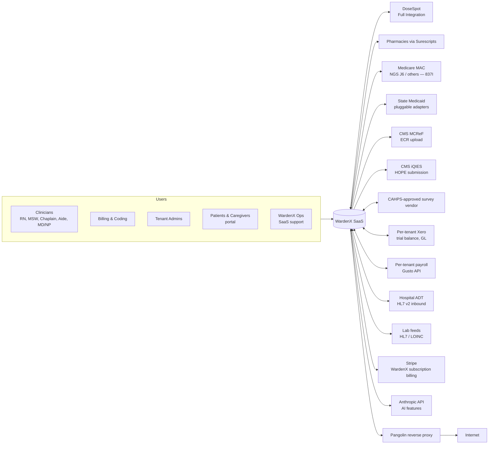

# WardenX — Architecture Document

**Status:** v0.12 (supersedes v0.11)
**Owner:** Fabrice V. Adjam
**Purpose:** Complete architecture lock for WardenX, a multi-tenant hospice EHR SaaS. This document is the input spec for the Archon workflow engine driving Claude Code. Per-module spec documents (one per module) follow this document and are produced before each module’s build cycle.

## Document Control — Changes from v0.11 (Phase 0 remediation, 2026-06-11)

Phase 0 of the compliance-audit remediation (`audit/AUDIT_CONSOLIDATED_FINAL.md`). These are the
architecture-level corrections that several BLOCKER findings traced back to; each is recorded as
an ADR under `docs/adr/`. Module specs re-lock against these in later phases.

|Change                                                                                                                                                                                                 |Driver (ADR / finding)                                                                     |
|-------------------------------------------------------------------------------------------------------------------------------------------------------------------------------------------------------|-------------------------------------------------------------------------------------------|
|**Medicare RHC two-tier rate corrected:** the §11.A "HIPPS / first-7-days-vs-8+" construct is replaced by the **day-60 RHC-High/RHC-Low** model (cumulative election day count, >60-day-gap reset); hospice claims carry **no HIPPS code**; `HippsCalculation` entity renamed `PerDiemRateCalculation`; SIA tightened (RHC days only, 15-min units, ≤4 hr/day, G0299/G0155).|ADR-0001 — M23-F01/F02/F03|
|**Hospice cap accounting year corrected** Nov 1 – Oct 31 → **Oct 1 – Sep 30** (FY since 2017).|ADR-0002 — M23-F14, M26, ARCH-178|
|**Hospice room & board revenue code corrected** `0294` → **`0658`** (NF room & board).|ADR-0003 — M24|
|**OPEN-020 closed:** §24.1 *Sessions* row aligned to **15 min idle / 8 hr work / 24 hr maximum / 5 min screen lock** (matches §7/§14, SEC v0.2). Canonical RLS var `app.org_id`.|ADR-0004 — OPEN-020, M02-F11|
|**OPEN-021 closed:** clinical-record + HOPE retention default **6 → 7 years from last patient contact** (HIPAA floor 6; longer per `state_retention_override`).|ADR-0004 — OPEN-021, M01-F03|
|**OPEN-022 closed:** `state_retention_override` is owned by **Module 4** (not Module 39); §25.9 corrected.|ADR-0004 — OPEN-022|
|**Manifest governance** (recorded in the Architecture Fitness companion `ARCHITECTURE_25_15_FITNESS.md`): outbox/seam consumption needs **no `dependsOn` import edge**; seam interfaces live in `packages/types`; `packages/foundation` is **banned**; foundation helper packages (audit/auth/tenancy + db schema-types) are implicitly importable; one consolidated ADR per module for `dependsOn` deltas.|ADR-0005 — X1/X2/X12, M01-F01, M03-F02/F07|
|**Manifest 22↔39 cycle removed:** `M39.dependsOn` drops 22 (Consent consumes Documents via a forward seam); §20 build-order note corrected.|ADR-0006 — M22-DC1/F01|
|**M8↔M9/M10 read direction settled:** M9/M10 stay downstream of M8; M8's signing-completeness gate consults M9/M10 via boot-registered seams (no manifest inversion).|ADR-0007 — M09-F02, M10-F03|
|**EVV applicability corrected:** Cures Act EVV is **Medicaid-only**; Medicare-hospice EVV is **operational, never claim-blocking** (no §11.A `regulatory_required` EVV rule for Medicare); HQRP has **no** EVV measure; launch state is **Oregon**.|ADR-0008 — M18-F04/F05|
|**§20.A phase / DR-tier / INT-tier discipline:** Phase-1 modules ship Phase-1 scope only; later-phase early-build requires ADR + default-off flag; cross-phase critical-path needs a documented degraded fallback; per-module DR tier + INT inventory are template requirements.|ADR-0009 — Build-Blocking #8|

## Document Control — Changes from v0.10

|Change                                                                                                                                                                                                 |Driver                                                                                     |
|-------------------------------------------------------------------------------------------------------------------------------------------------------------------------------------------------------|-------------------------------------------------------------------------------------------|
|**§24 retention reconciliation:** `audit_event` retention_class=compliance changed from "6 years" to "7 years default (HIPAA floor 6 — §164.316(b)(2))", matching §7's "7-year retention" statement. Warm tier extended to 6.5 years accordingly.|Module 4 lock decision D1 — eliminate the §7/§24 conflict; standardize on 7 years (exceeds HIPAA minimum, satisfies state 7+ requirements without override)|

## Document Control — Changes from v0.9

|Change                                                                                                                                                                                                                                                                                                                                                      |Driver                                                          |
|------------------------------------------------------------------------------------------------------------------------------------------------------------------------------------------------------------------------------------------------------------------------------------------------------------------------------------------------------------|----------------------------------------------------------------|
|**Promoted: Local/small AI models are now a first-class capability.** Added §10.7 Model Backend Abstraction — pluggable backend interface with Anthropic (cloud), Ollama (local), vLLM (local production-scale) implementations. Per-capability and per-tenant routing. Cloud-default for narrative/extraction; local-default for embeddings/classification.|Sovereignty, cost, offline capability, privacy-sensitive tenants|
|**Updated Module 32 (AI Platform) catalog entry** to include local model serving infrastructure, model artifact storage, capability-to-backend routing, hybrid cloud-local operation                                                                                                                                                                        |                                                                |
|**Tech stack additions:** Ollama, vLLM (optional), llama.cpp (optional), local model artifact format (GGUF, safetensors), HuggingFace Transformers + Sentence-Transformers for Python workers                                                                                                                                                               |                                                                |
|**Module 1 §13.7 Initial Flag Catalog** expanded to include backend-routing flags                                                                                                                                                                                                                                                                           |                                                                |

## Document Control — Changes from v0.8

|Change                                                                                                                                                                                                                                                                                                         |Driver                                                                                                                                            |
|---------------------------------------------------------------------------------------------------------------------------------------------------------------------------------------------------------------------------------------------------------------------------------------------------------------|--------------------------------------------------------------------------------------------------------------------------------------------------|
|**New Module 38: Clinical Terminology Service** — ICD-10-CM, SNOMED CT (US edition + hospice subset), LOINC, RxNorm, CPT/HCPCS, CVX. Single source for code lookup, validation, value-set membership, annual CMS update workflow, deprecation handling. Consumed by Modules 5, 8, 9, 10, 11, 12, 23, 28.       |Without consolidation, each module reinvents code lookup; CMS quarterly updates become N separate engineering tasks                               |
|**New Module 39: Consent & Authorization Management** — Patient-issued consents distinct from staff RBAC: DPOA, 42 CFR Part 2, portal access, family delegation, media release, research consent, telehealth consent. Currently scattered across Modules 5/6/31; consolidated here.                            |Consent is patient-issued, has its own lifecycle, revocation cascade, and audit requirements — RBAC/ABAC don’t cover it                           |
|**New Module 40: Master Data Management** — External Physicians (NPI-keyed), Facilities (CCN-keyed where applicable), Pharmacies, Referral Sources, Payers, DME Vendors, Funeral Homes. Platform-shared canonical records with tenant-scoped overlays. NPPES sync, deduplication, hierarchical relationships.  |Without MDM, every tenant creates duplicates of the same external physicians/facilities; cross-tenant analytics break                             |
|**New §11.B Cost Report Validation Framework** — Parallel to §11.A but applied to CMS-1984-14. Configurable rule library covering worksheet S/S-1/S-2/A/A-1/A-6/A-7/B/B-1/C/D/E/G interlinks, MAC-specific requirements.                                                                                       |Cost report errors are expensive to fix post-submission; deterministic validation pattern proven by §11.A                                         |
|**New §24 Data Retention Matrix** — Consolidated retention policy across clinical records, audit, messages, recordings, push tokens, backups, AI prompts, working files, system logs, security events. With state variation notes (Oregon reference) and legal hold override.                                  |Surveyors will ask; partial retention coverage is worse than none                                                                                 |
|**New §25 Patterns Catalog** — Standardized patterns: XState for state machines, rules-as-data for validation frameworks (no generic rules engine), BullMQ for async, withOrgContext for tenant scoping, outbox for cross-module events, typed errors, Pino redacted logging, two-phase forward-only migrations|Locks the patterns explicitly; prevents reinvention per module; explicitly rejects over-engineering (generic rules engine, custom workflow engine)|
|**Updated §11 catalog count: 37 → 40**                                                                                                                                                                                                                                                                         |New modules added                                                                                                                                 |
|**Updated §20 Build Sequence** — Modules 38, 40 land in Phase 1 before clinical modules; Module 39 lands in Phase 1 after Patient module                                                                                                                                                                       |Dependency-correct ordering                                                                                                                       |
|**Updated §20.A Phase 1 cut: 25 → 28 modules** (added 38, 39, 40 to Phase 1)                                                                                                                                                                                                                                   |Foundation modules must precede consumers                                                                                                         |
|**Renumbered: old §24 Sign-off → §26 Sign-off**                                                                                                                                                                                                                                                                |Make room for new §24, §25                                                                                                                        |

## Document Control — Changes from v0.7

|Change                                                                                                                                                               |Driver                                                                                                                             |
|---------------------------------------------------------------------------------------------------------------------------------------------------------------------|-----------------------------------------------------------------------------------------------------------------------------------|
|**Fixed:** Removed “Native mobile applications” from Non-goals — contradicted ADR-008 resolution adopting Capacitor and `apps/mobile/` workspace                     |Document consistency                                                                                                               |
|**Added:** §20.A — Phased Delivery Plan with explicit v1 / v1.1 / v1.2 / v2 module cut lines                                                                         |Need realistic first-build scope, not just dependency order                                                                        |
|**Added:** §20.B — Module Spec Template that all 37 per-module spec docs must follow                                                                                 |Workflow acceptance criteria, screens, permissions, validations, audit events, test cases, route inventory, schema delta per module|
|**Added:** §20.C — Cross-Cutting Documents Inventory naming the four docs that complement module specs (Ops Runbook, Integrations, Security Hardening, AI Governance)|Items 8-11 from gap audit need home; this catalogs them                                                                            |

## Document Control — Changes from v0.6

|Change                                                                                                                                                                                                                                                                             |Driver                                                                                                                  |
|-----------------------------------------------------------------------------------------------------------------------------------------------------------------------------------------------------------------------------------------------------------------------------------|------------------------------------------------------------------------------------------------------------------------|
|New Module 37: Inpatient Unit (IPU) Management — bed/room mgmt, 24/7 staffing, IPU-specific clinical workflows, GIP/IRC admission criteria, place-of-service coding                                                                                                                |Competitive parity with HCHB and mumms; CoP 418.108 / 418.110 support                                                   |
|New §11.A Claim Pre-Submission Validation Framework — configurable rule library with 30+ default rules across demographics, election period, F2F, certifications, level-of-care/Q-code coherence, ICD-10 sequencing, NOE timeliness, cap projection, eligibility, duplicate-billing|Architect for >99% claim acceptance; equivalent to FireNote’s “31-point audit”                                          |
|Mobile strategy resolved (ADR-008 closed): Capacitor-wrapped native iOS/Android apps for clinical and field roles                                                                                                                                                                  |Reliable GPS for EVV, native camera for wound photos, biometric auth, native push, offline sync — field clinical reality|
|New app `apps/mobile/` — Capacitor wrapping mobile-optimized TanStack Start frontend                                                                                                                                                                                               |Native shell delivery                                                                                                   |
|Scope confirmed: hospice-only. Home health, palliative-only, SNF, private duty, ALF explicitly out of scope.                                                                                                                                                                       |User direction; focused TAM defensible niche                                                                            |
|Total module count: 37                                                                                                                                                                                                                                                             |                                                                                                                        |

## Document Control — Changes from v0.5

|Change                                                                                                                                                                                                 |Driver                                                                                                 |
|-------------------------------------------------------------------------------------------------------------------------------------------------------------------------------------------------------|-------------------------------------------------------------------------------------------------------|
|New §10.6 DocLens Patient Intake Document Extraction — pipeline + safety guardrails + review UI + chart writeback                                                                                      |Eliminate manual re-typing of referral PDFs into the chart; reduce intake time and transcription errors|
|11 document type schemas in v1: discharge summary, med reconciliation, H&P, labs, imaging, consults, insurance cards, photo ID, advance directive/POLST/MOLST, DPOA, prior hospice/home health transfer|All common hospice referral document types                                                             |
|Safety gates: never auto-commit, side-by-side review, per-field approval for high-risk fields, source highlighting, confidence thresholds, discrepancy flags                                           |Patient safety with OCR/LLM accuracy limits                                                            |
|New package `packages/intake-extraction/` in monorepo layout                                                                                                                                           |DocLens implementation                                                                                 |
|Module 22 (Document Management) updated — DocLens is first-class capability                                                                                                                            |Workflow integration                                                                                   |
|Module 5, 7, 9, 11, 12 updated — extraction-commit entry paths                                                                                                                                         |Receive validated extractions                                                                          |
|Module 32 (AI Platform) updated — document classifier and Claude verification pass                                                                                                                     |AI capabilities inventory                                                                              |
|HearthNote integration: extracted H&P findings can seed admission note selections                                                                                                                      |Compound time savings — extraction → narrative                                                         |
|§23.13 (new) DocLens audit and provenance traceability                                                                                                                                                 |Surveyor defensibility of extraction-sourced chart data                                                |

## Document Control — Changes from v0.4

|Change                                                                                                                                           |Driver                                                                               |
|-------------------------------------------------------------------------------------------------------------------------------------------------|-------------------------------------------------------------------------------------|
|New §10.5 HearthNote Narrative Engine — three-layer hybrid documentation system (deterministic core + optional LLM enhancement + compliance gate)|Reduce clinician documentation time without compromising auditability                |
|HearthNote IDG aggregation — auto-builds pre-meeting patient packets and post-meeting writeback                                                  |Eliminate re-typing of encounter information for biweekly IDG meetings per CoP 418.56|
|New package `packages/hearthnote/` in monorepo layout                                                                                            |Narrative engine implementation                                                      |
|Module 8 (Encounters & Visit Notes) updated — HearthNote replaces ad-hoc AI proofread as the primary documentation surface                       |Consolidation of documentation workflow                                              |
|Module 14 (IDG) updated — HearthNote IDG aggregation drives pre-meeting workflow                                                                 |No-prep IDG                                                                          |
|Module 32 (AI Platform) updated — narrative enhancement capability documented as HearthNote consumer                                             |Clarify AI-Platform/HearthNote relationship                                          |
|Module 2 (Identity & Org) updated — tenant-level HearthNote AI opt-in flag + per-clinician override                                              |Layer 2 activation policy                                                            |
|§23 Compliance Traceability — AI-touched content audit requirements explicit                                                                     |Survey defensibility of AI-assisted documentation                                    |
|Note: “HearthNote” is the WardenX-internal name. RapidChart® is a registered trademark of FireNote and is not used.                              |Trademark clarity                                                                    |

## Document Control — Changes from v0.3.1

|Change                                                                                                                     |Driver                                                                                 |
|---------------------------------------------------------------------------------------------------------------------------|---------------------------------------------------------------------------------------|
|New §23 Compliance Traceability — explicit mapping of each regulatory framework to WardenX architecture components         |Surveyor-ready, customer-security-review-ready, audit-ready                            |
|Added 42 CFR Part 2 PrivacyFlag on Patient entity (Module 5)                                                               |Substance Use Disorder record confidentiality                                          |
|Added explicit F2F window enforcement and recert claim block (Module 6)                                                    |CMS CoP — F2F must occur 30 days prior to 3rd benefit period and each subsequent recert|
|Added annual HIPAA Security Risk Assessment workflow (Module 30)                                                           |HIPAA Security Rule 164.308(a)(1)(ii)(A)                                               |
|Clarified 21 CFR Part 11 as NOT directly applicable; principles satisfied as best practice                                 |Honest scoping — applies to FDA-regulated contexts, not hospice EHR                    |
|Disclaimer: Compliance Traceability is engineering guidance; certification/attestation requires legal and compliance review|Set expectations                                                                       |

## Document Control — Changes from v0.3 (patch)

|Change                                                                                                            |Driver                          |
|------------------------------------------------------------------------------------------------------------------|--------------------------------|
|Renamed `apps/api` → `apps/backend` and `apps/web` → `apps/frontend` (admin and portal unchanged)                 |Naming preference               |
|Added §7.9 explicitly documenting the three-layer authorization model (RLS + RBAC + ABAC) and why each is required|Clarification — defense in depth|

## Document Control — Changes from v0.2

|Change                                                                                                                                          |Driver                                                              |
|------------------------------------------------------------------------------------------------------------------------------------------------|--------------------------------------------------------------------|
|New Module 36 (Secure Messaging & Alerts) with Socket.IO + Valkey adapter                                                                       |Real-time staff messaging, caregiver portal, alert routing          |
|Expanded role catalog from ~15 to ~60 named roles in 12 categories                                                                              |Comprehensive persona inventory                                     |
|Auditor Mode framework (time-bound, watermarked, view-audited, no edit)                                                                         |Federal/state surveyors, MAC reviewers, accreditation bodies, OIG   |
|External Collaborator Pattern (magic-link short-lived scoped sessions)                                                                          |Attending physicians, hospital staff, funeral homes, SNF/ALF staff  |
|Funeral Home role with defined data scope                                                                                                       |Body release coordination, decedent demographics, attending sign-off|
|Volunteer Compliance Gates (background check, TB, training as scheduling preconditions)                                                         |CoP 418.78                                                          |
|User identity model clarified: one email may hold Memberships in multiple Organizations; sessions scoped to one Organization at a time          |Traveling clinicians working at multiple agencies                   |
|Tech stack additions: Socket.IO + Valkey adapter, web-push (VAPID), Twilio (SMS/Voice with BAA), Postmark (email with BAA)                      |Module 36 backbone                                                  |
|Build sequence updated: Module 36 inserted after Module 4 (Audit), before Module 5 (Patient) — many later modules consume messaging from day one|Avoid bolt-on rework                                                |
|Total module count: 36                                                                                                                          |New messaging module                                                |

## Prior change log (v0.1 → v0.2)

|Change                                                                                 |Driver                                                                        |
|---------------------------------------------------------------------------------------|------------------------------------------------------------------------------|
|Three-tier tenancy: Organization → ProviderEntity → Location                           |SaaS multi-agency model with Engrace as first customer                        |
|New Module 34 (SaaS Tenant Platform)                                                   |SaaS productization                                                           |
|New Module 35 (Subscription Billing)                                                   |WardenX charging customers                                                    |
|HOPE Engine corrected for Admission/HUV1/HUV2/SFV timepoints with J2051 triggers       |CMS HOPE rule (effective Oct 1, 2025)                                         |
|Added Clinical Assessments Suite as its own module                                     |Industry-standard scales (PPS, FAST, PAINAD, ESAS, etc.)                      |
|Added On-Call Triage, Field Safety, EVV as separate modules                            |Modern hospice operational requirements                                       |
|Added AI Platform as cross-cutting module 32                                           |Mortality risk, hospitalization risk, LOC prediction, semantic search, copilot|
|Added Bereavement as its own module                                                    |13-month required follow-up program with risk scoring                         |
|Added HQRP & Quality module (HCI, HVLDL, CAHPS, HOPE measures, QAPI)                   |4-percentage-point APU penalty for non-compliance                             |
|Tenant isolation defense in depth (envelope encryption, per-tenant bucket scope)       |SaaS PHI handling                                                             |
|Nothing deferred — all modules in scope; sequence determines build order, not inclusion|User direction                                                                |

-----

## 1. Project Overview

WardenX is a multi-tenant, HIPAA-compliant hospice EHR SaaS platform supporting the complete operational, clinical, billing, and quality reporting lifecycle of US hospice agencies. Engrace Hospice LLC (CCN 381588, Pendleton OR) is the founding customer and reference implementation tenant.

### Primary goals

- Production-grade hospice EHR supporting all clinical, operational, and revenue cycle workflows
- SaaS architecture supporting multiple agencies with strong tenant isolation
- AI-augmented documentation, prediction, and decision support — with explainability and calibration discipline
- Full Medicare and multi-state Medicaid billing
- Complete cost report (CMS-1984-14) workflow ending in MCReF-ready ECR files
- Conformance to HQRP, HOPE, and CAHPS requirements
- DoseSpot Full Integration with EPCS (certification deferred from initial build per direction; data and architecture ready)

### Non-goals (still)

- Home health, palliative-only, or SNF clinical workflows
- Inpatient hospital EHR functionality (Module 37 IPU covers hospice inpatient unit; not general hospital EHR)
- Long-term care (nursing home / SNF) clinical workflows
- Pharmacy management system (use DoseSpot)
- General-purpose accounting / GL (use Xero)
- Payroll processing (use Gusto)

-----

## 2. System Context



-----

## 3. Tenancy Model — The Critical Decision

### Three-tier hierarchy

```
Organization (tenant — the WardenX customer)
└── ProviderEntity (CCN-bearing — has NPI, MAC, tax ID, files its own cost report)
    └── Location (physical practice site under the CCN)
        └── Patients, Staff assignments, Encounters, Schedules
```

### Why three tiers

- **Organization** is the billing customer of WardenX and the security boundary. All RLS scopes by `organization_id`. Every PHI table has this column.
- **ProviderEntity** is what CMS sees as the hospice provider. NOE/NOTR, 837I claims, and cost reports are scoped by ProviderEntity. Some Organizations operate multiple CCNs (corporate parents); most operate one.
- **Location** is the geographic operational unit. Scheduling, on-call rotation, IDG, and route optimization are scoped by Location. Locations also drive Q-code selection (Q5001 home, Q5003 SNF, etc.) at the visit level.

### Engrace v1 configuration

- 1 Organization (Engrace Hospice LLC)
- 1 ProviderEntity (CCN 381588, NGS J6 MAC)
- N Locations (Pendleton primary + satellites as needed)

### Multi-CCN scenario (future tenants)

- 1 Organization (corporate parent)
- N ProviderEntities (each with own CCN, NPI, possibly different MAC jurisdictions)
- M Locations under each ProviderEntity

### Cross-cutting rules

- Every PHI table carries `organization_id`, `provider_entity_id`, and `location_id` (the last two nullable only on org-level entities)
- RLS policies enforce `organization_id` match against session variable
- Application-level checks enforce ProviderEntity and Location scoping based on RBAC
- A user belongs to an Organization and has memberships at one or more Locations within ProviderEntities of that Organization
- “All-locations” access is a flag on the membership, not a separate role

### User identity model

- One user record (one email) MAY hold Memberships in multiple Organizations — for clinicians who work at multiple hospice agencies on WardenX
- **Each session is scoped to exactly one Organization.** Pick at login. To work in a different Organization, log out and log back in. No in-session org switcher.
- Per-Organization Memberships carry their own roles, location memberships, and audit trail
- Login to Org A produces audit entries only in Org A’s log
- Better Auth’s organization plugin enforces this pattern
- Passkeys and 2FA seeds may be shared across Organizations for the same user (they’re authentication, not authorization)

-----

## 4. Monorepo Layout

Turborepo + Bun workspaces.

```
wardenx/
├── apps/
│   ├── frontend/                  # TanStack Start — hospice tenant UI (web/desktop)
│   ├── mobile/                    # Capacitor wrapping a mobile-optimized TanStack Start variant — iOS + Android native shells for clinical and field roles
│   ├── backend/                   # Fastify 5 — main backend
│   ├── admin/                     # TanStack Start — WardenX ops console
│   └── portal/                    # TanStack Start — patient/caregiver portal (PWA)
├── packages/
│   ├── db/                        # Drizzle schema, migrations, seed
│   ├── domain/                    # Pure domain types & invariants (no I/O)
│   ├── shared/                    # Cross-cutting utilities, error envelope
│   ├── types/                     # TypeBox schemas, shared TS types
│   ├── auth/                      # Better Auth config, RBAC/ABAC engine
│   ├── tenancy/                   # Three-tier hierarchy primitives, RLS helpers
│   ├── audit/                     # Audit log, scrubbing, query API
│   ├── fhir/                      # R4 mappers (R5 stub, R6 ready)
│   ├── billing/                   # Medicare + Medicaid claim assembly
│   ├── cost-report/               # CMS-1984-14 worksheets, ECR generation
│   ├── hope/                      # HOPE timepoint engine
│   ├── assessments/               # Clinical assessment scales (PPS, FAST, PAINAD, ESAS, …)
│   ├── dosespot/                  # DoseSpot Full Integration client + webhook handlers
│   ├── ai-platform/               # AI feature SDK (predictions, copilot, proofreading)
│   ├── hearthnote/                # Narrative engine — deterministic core, LLM enhancement, compliance gate
│   ├── narrative-vocab/           # Bounded clinical vocabulary, SNOMED CT subset, phrase library per discipline
│   ├── intake-extraction/         # DocLens — patient intake document extraction pipeline + schemas + review UI
│   ├── messaging/                 # Socket.IO server, alert rule engine, notification dispatch
│   ├── forms/                     # PDF templates (NOE, election, CMS-485, NOMNC, …)
│   ├── medicaid-adapters/         # State plug-in implementations
│   ├── saas/                      # Tenant onboarding, subscription, support tools
│   └── ui/                        # shadcn/ui-based component library, iconsax
├── services/                      # Python sidecars (separate containers)
│   ├── docling-worker/
│   ├── langextract-worker/
│   ├── x12-worker/                # pyx12 — 837I, 277CA, 835, 270/271
│   ├── ecr-worker/                # Electronic Cost Report generator
│   ├── ml-worker/                 # Prediction models (mortality, hospitalization, LOC)
│   └── embeddings-worker/         # Embedding generation for pgvector
├── infra/
│   ├── docker/                    # Compose for dev and prod
│   └── proxmox/                   # Terraform / cloud-init for prod
└── docs/
    ├── ARCHITECTURE.md            # this file
    ├── modules/                   # per-module specs (one per module)
    └── adr/                       # architecture decision records
```

-----

## 5. Tech Stack

### Runtime & language

- Bun 1.x — runtime, package manager, test runner where Vitest doesn’t fit
- TypeScript 5.x — strict mode, `noUncheckedIndexedAccess`, `exactOptionalPropertyTypes`
- Python 3.12 for sidecar services

### Frontend

- TanStack Start (full-stack React)
- TanStack Router, Query, Form, Table
- React 19
- Tailwind CSS v4
- shadcn/ui component primitives
- iconsax for icons
- Recharts for clinical and financial dashboards
- Better Auth React client

### Mobile (clinical and field roles — `apps/mobile/`)

- Capacitor 6.x wrapping TanStack Start frontend for native iOS and Android delivery
- Native plugins: Geolocation (EVV reliability), Camera (wound photos, document capture for DocLens), BiometricAuth (Face ID / Touch ID / Android biometric), PushNotifications (APNs / FCM), Filesystem (offline note draft cache), Network (online/offline state), Device, Haptics
- Offline-capable for encounter drafting (notes/vitals saved locally; sync on reconnect)
- Background sync for completed notes upload
- App store distribution + MDM enterprise distribution support

### Backend

- Fastify 5
- TypeBox for schemas + runtime validation
- Better Auth (organization, 2FA, passkey, admin, audit plugins)
- Fastify plugins: cors, helmet, rate-limit, swagger, multipart, sse
- Pino for structured logging with PHI scrubbing rules

### Real-time & notifications

- Socket.IO 4.x + @fastify/socket.io for bidirectional messaging
- @socket.io/redis-adapter pointed at Valkey for multi-instance pub/sub
- web-push (VAPID) for PWA push notifications
- Twilio (with BAA) for SMS and voice escalation
- Postmark (with BAA) for transactional email

### Database

- PostgreSQL 18
- Drizzle ORM + Drizzle Kit migrations
- Row-Level Security for tenant isolation
- pgvector for semantic embeddings
- pgcrypto for envelope encryption of sensitive columns
- pgBackRest for backups + PITR

### Cache & queue

- Valkey 8.x
- BullMQ for job orchestration

### AI & document processing

- **Cloud foundation model:** Anthropic SDK (Claude Opus / Haiku) for proofreading, narrative generation, copilot, vision verification — used under BAA with Zero Data Retention
- **Local foundation models:** Ollama (Phase 1 default) hosting Llama 3.1 8B / Mistral 7B / Phi-3.5 — opt-in alternative to cloud per capability per tenant
- **Local LLM at scale (Phase 2+):** vLLM as alternative to Ollama when sustained throughput demands; llama.cpp / llama-server for highly constrained ml-worker hardware
- **Local embeddings:** sentence-transformers + ONNX runtime (BGE-small-en, all-MiniLM-L6-v2, E5) — default for non-clinical embedding work
- **Local classifiers:** custom-trained models on distilBERT or similar bases (DocLens document type classifier) served via FastAPI in ml-worker
- **Document processing:** Docling (Python sidecar) for parsing; LangExtract (Python sidecar) for structured extraction
- **Vector search:** pgvector for similar-case and semantic search (works with both cloud and local embeddings)
- **Tabular ML:** scikit-learn / XGBoost (Python sidecar) for prediction models (mortality, falls risk, etc.) — these are local-only by design
- **Model registry:** MLflow for both cloud-prompt versioning and local-model artifact versioning
- **Model serving:** Ollama HTTP API for LLM; FastAPI for custom classifiers; sentence-transformers in-process for embeddings
- **Model artifact format:** GGUF (Ollama/llama.cpp), safetensors (HuggingFace), ONNX (cross-runtime), MLflow artifact format (custom)

### Object storage

- MinIO (Docker locally; Docker on TrueNAS in prod)
- Per-tenant bucket scope with strict IAM
- Platform-shared `platform/ml-models/` for local model artifacts
- Object lock and versioning for HIPAA retention

### PDF generation

- react-pdf for structured clinical forms
- Puppeteer for cost report worksheets and complex layouts

### E-prescribe

- DoseSpot Full Integration (custom UI on 250+ APIs, EPCS-ready architecture)

### EDI / claims

- Python pyx12 sidecar for 837I generation, 999/277CA parsing, 835 posting, 270/271 eligibility

### FHIR

- Custom mappers on @medplum/fhirtypes for R4 type definitions
- Version-pluggable mapper interface

### Subscription billing (WardenX charging customers)

- Stripe (subscription, invoicing, dunning)
- Stripe Tax for sales tax handling

### Observability

- OpenTelemetry instrumentation throughout
- Sentry self-hosted (with PHI scrubbing rules)
- Grafana + Loki + Prometheus self-hosted on Proxmox
- Uptime Kuma + external probe

### Testing

- Vitest for unit + integration
- Playwright for E2E
- MSW for API mocks in web tests
- Testcontainers for PostgreSQL test isolation
- pytest for Python sidecars

### Tooling

- Biome for lint + format
- lefthook for pre-commit
- Turborepo for task graph
- Drizzle Studio for schema inspection

### Infrastructure

- Docker Compose for local dev (MacBook Pro)
- Production: Proxmox VMs behind Pangolin reverse proxy
- GitHub Actions for CI
- ghcr.io for container registry

-----

## 6. Architectural Principles

1. **Domain model is the source of truth, not FHIR.** FHIR is a representation; internal code never imports FHIR types.
1. **Every PHI access — read or write — is logged.** Enforced at the DB layer (audit trigger) and API layer (middleware).
1. **Multitenancy enforced in the database via RLS.** Application bugs cannot leak data across tenants.
1. **State machines for clinical workflow.** Admission status, election period, certification, level of care, claim lifecycle — all explicit state machines with declared transitions.
1. **Idempotent claim submission.** Every claim has a deterministic ID; retries never double-bill.
1. **Workers are separate processes, not in-process jobs.** Resumable, observable, independently scalable.
1. **No business logic in components.** UI is rendering and event dispatch.
1. **TypeBox schemas, derived once.** Produce TS types and runtime validators; no Zod-TS duplication.
1. **AI features must show calibration, not just scores.** Every prediction surface shows the model’s calibration curve and the timeframe it’s been validated against. No black-box scores in clinical decision surfaces.
1. **Per-tenant configurability is a first-class concern.** Anything that varies between agencies lives in tenant configuration, not in code branches.

-----

## 7. Identity, Authorization & RBAC

### Identity (Better Auth)

- Email + password (with breached-password check)
- Passkeys (preferred for clinicians)
- 2FA TOTP (required for all roles except read-only)
- Session: 15 min idle, 8 hr absolute, 5 min UI screen lock
- SSO via OIDC for enterprise tenants (deferred until first enterprise customer)

### Role catalog (per-tenant configurable; defaults provided)

The catalog has ~60 roles in 12 categories. Each Organization can disable, rename, or add to the defaults. Some roles trigger compliance gates or special access patterns (auditor mode, external collaborator pattern, volunteer gates).

#### A. Internal Clinical Staff (full PHI within case-load)

|Role                                         |Scope                 |Notes                                            |
|---------------------------------------------|----------------------|-------------------------------------------------|
|Registered Nurse (RN) — Case Manager         |Location membership(s)|Primary care coordinator per patient             |
|Licensed Practical/Vocational Nurse (LPN/LVN)|Location              |Notes co-signed by RN                            |
|Hospice Aide / CHHA                          |Location              |POC-driven visits                                |
|Medical Social Worker (MSW)                  |Location              |Psychosocial assessment, discharge planning      |
|Chaplain / Spiritual Care Coordinator        |Location              |Spiritual assessment, family support             |
|Bereavement Counselor                        |Location              |Distinct from MSW; 13-month follow-up            |
|Hospice Medical Director                     |ProviderEntity        |Required role per CoP 418.102                    |
|Hospice Physician                            |ProviderEntity        |Employed or contracted                           |
|Nurse Practitioner (NP)                      |Location membership(s)|Can serve as attending for some Medicare patients|
|Physician Assistant (PA)                     |Location membership(s)|                                                 |
|Consulting Pharmacist                        |ProviderEntity        |Med review, comfort kit oversight                |
|Music Therapist                              |Location              |Per CoP optional service                         |
|Massage Therapist                            |Location              |                                                 |
|Dietitian (consultant)                       |Location              |                                                 |
|Therapist (PT/OT/SLP, consultant)            |Location              |Rare in hospice but possible                     |

#### B. Clinical Leadership

|Role                                  |Scope                         |Notes                 |
|--------------------------------------|------------------------------|----------------------|
|Director of Nursing (DON)             |ProviderEntity                |Required per CoP      |
|Assistant DON                         |ProviderEntity                |                      |
|Clinical Supervisor / Clinical Manager|Location or ProviderEntity    |                      |
|Patient Care Coordinator              |Location                      |                      |
|IDG / IDT Coordinator                 |ProviderEntity                |Schedules and runs IDG|
|Director of Quality                   |Organization or ProviderEntity|QAPI lead             |
|Clinical Educator                     |Organization                  |Training, in-service  |

#### C. Operations Staff

|Role                         |Scope                         |Notes                                             |
|-----------------------------|------------------------------|--------------------------------------------------|
|Director of Operations       |Organization or ProviderEntity|                                                  |
|Location Director            |Location                      |                                                  |
|Scheduler / Visit Coordinator|Location                      |                                                  |
|Intake Coordinator           |ProviderEntity                |                                                  |
|Admissions Nurse             |Location membership(s)        |Does initial assessment + election                |
|Referral Coordinator         |ProviderEntity                |                                                  |
|On-Call Triage Nurse         |ProviderEntity                |Time-bound elevation during shift                 |
|Volunteer Coordinator        |Location                      |Manages volunteer roster                          |
|Bereavement Coordinator      |ProviderEntity                |Program-level, distinct from individual counselors|
|DME / Logistics Coordinator  |ProviderEntity                |                                                  |
|Supply Manager               |Location                      |                                                  |

#### D. Administrative / Executive

|Role                            |Scope                         |Notes                                       |
|--------------------------------|------------------------------|--------------------------------------------|
|Tenant Owner                    |Organization                  |Full control; manages subscription          |
|Administrator (Agency Executive)|Organization or ProviderEntity|CMS-required role; Fabrice’s role at Engrace|
|Owner / Board Member            |Organization                  |Governance access; configurable PHI scope   |
|HR Director / HR Manager        |Organization                  |Personnel files, no clinical                |
|Office Manager                  |Location                      |                                            |
|Marketing / Community Liaison   |Organization                  |No PHI by default; aggregate dashboards only|
|Receptionist / Front Desk       |Location                      |Minimal PHI; contact info, scheduling       |

#### E. Billing & Finance

|Role                |Scope         |Notes                                |
|--------------------|--------------|-------------------------------------|
|Billing Manager     |ProviderEntity|                                     |
|Biller              |ProviderEntity|Claims submission, AR follow-up      |
|Coder               |ProviderEntity|ICD-10 sequencing, terminal diagnosis|
|Accounts Receivable |ProviderEntity|                                     |
|Accounts Payable    |Organization  |No PHI                               |
|Bookkeeper          |Organization  |No PHI; financial only               |
|Controller / CFO    |Organization  |                                     |
|Cost Report Preparer|ProviderEntity|Per-CCN cost report work             |

#### F. Compliance, Quality, Privacy

|Role                   |Scope         |Notes                               |
|-----------------------|--------------|------------------------------------|
|Compliance Officer     |Organization  |Audit log read; break-glass approver|
|HIPAA Privacy Officer  |Organization  |Required under HIPAA                |
|HIPAA Security Officer |Organization  |Required under HIPAA                |
|QAPI Coordinator       |ProviderEntity|                                    |
|Risk Manager           |Organization  |Incident review                     |
|Survey Coordinator     |Organization  |Survey-readiness prep               |
|Infection Preventionist|ProviderEntity|Per CoP 418.60                      |

#### G. Volunteers (CoP 418.78 compliance-gated)

|Role                        |Scope                           |Compliance gates                                         |
|----------------------------|--------------------------------|---------------------------------------------------------|
|Patient Visit Volunteer     |Location, assigned patients only|Background check, TB, training, confidentiality agreement|
|Vigil Volunteer             |Location, assigned patients     |Same gates                                               |
|Office Volunteer            |Location, no clinical           |Background, confidentiality                              |
|Bereavement Volunteer       |Location, assigned bereaved     |Background, TB, training, confidentiality                |
|Community Outreach Volunteer|Location, no PHI                |Background, confidentiality                              |
|Volunteer Trainer           |Location                        |Background, training certification                       |

#### H. Patient / Family / Caregiver (consent-driven portal access)

|Role                   |Scope                                |Notes                             |
|-----------------------|-------------------------------------|----------------------------------|
|Patient                |Self                                 |Legally entitled but rarely active|
|Primary Caregiver      |One patient                          |Most common portal user           |
|Healthcare Proxy / DPOA|One patient                          |Equivalent to patient access      |
|Family Member          |One patient, granular permissions    |Per patient or proxy consent      |
|Bereaved Family Member |One deceased patient, 13-month window|Bereavement portal subset         |

#### I. External Regulatory & Audit (Auditor Mode — see §7.5)

|Role                                  |Scope                                    |Notes             |
|--------------------------------------|-----------------------------------------|------------------|
|CMS Surveyor                          |Time-bound, full org or specific patients|Federal           |
|State Surveyor                        |Time-bound, full org                     |Deemed status     |
|Accreditation Surveyor (CHAP/ACHC/TJC)|Time-bound, full org                     |                  |
|UPIC Auditor                          |Time-bound, specific patients/claims     |Medicare integrity|
|MAC Medical Reviewer (TPE)            |Time-bound, specific claims              |                  |
|RAC                                   |Time-bound, specific claims              |                  |
|SMRC                                  |Time-bound, specific claims              |                  |
|OIG Investigator                      |Time-bound, scoped                       |                  |
|State Medicaid Program Integrity      |Time-bound, Medicaid patients            |                  |
|MFCU                                  |Time-bound, scoped                       |                  |
|External CPA (financial audit)        |Time-bound, financial only, no PHI       |                  |
|MAC Cost Report Auditor               |Time-bound, cost report + supporting docs|                  |

#### J. External Clinical Collaborators (External Collaborator Pattern — see §7.6)

|Role                    |Scope                                |Notes                       |
|------------------------|-------------------------------------|----------------------------|
|Attending Physician     |One patient, magic-link or persistent|CMS-required role; signs CTI|
|Referring Physician     |One patient                          |                            |
|Hospital Physician      |One patient, time-bound              |During hospitalization      |
|SNF / ALF Facility Staff|Patients residing in facility        |                            |
|Specialty Pharmacy Staff|Per-patient med records              |Enclara, Optum, etc.        |
|DME Vendor Staff        |Per-patient DME orders               |                            |
|Lab Staff               |Lab order routing only               |                            |
|Interpreter             |Per-encounter transient access       |Documentation only          |
|Funeral Home            |Per-deceased-patient, defined scope  |See §7.7 for data scope     |

#### K. WardenX Platform Staff (cross-tenant by design; PHI walled)

|Role                            |Scope                                                        |Notes                                |
|--------------------------------|-------------------------------------------------------------|-------------------------------------|
|WardenX Platform Owner          |All tenants (Fabrice)                                        |Highest privilege; all access audited|
|WardenX Customer Success Manager|Tenant metadata; PHI walled                                  |Onboarding, training                 |
|WardenX Support — Tier 1        |Tenant metadata; PHI walled                                  |Triage                               |
|WardenX Support — Tier 2        |PHI requires break-glass + tenant consent                    |Investigation                        |
|WardenX SRE / DevOps            |Infrastructure; PHI walled                                   |                                     |
|WardenX Security Officer        |Cross-tenant security investigation; PHI requires break-glass|                                     |
|WardenX Billing Administrator   |Subscription/Stripe only; no PHI                             |                                     |
|WardenX Sales                   |Aggregate metrics only; no PHI                               |                                     |

#### L. Temporary / Special Roles

|Role                 |Scope                                                             |Notes                             |
|---------------------|------------------------------------------------------------------|----------------------------------|
|Interim Administrator|Organization, time-bound                                          |Executive transitions; extra audit|
|Locum Physician      |ProviderEntity, time-bound                                        |Coverage period                   |
|Travel/Contract Nurse|Location, time-bound (may have separate identity per Organization)|                                  |
|Student / Intern     |Location, supervised, all writes co-signed                        |                                  |

### ABAC attributes layered on top

- Patient case-load (clinician sees own assigned patients unless covering)
- On-call active window (time-bound elevation to ProviderEntity patient access)
- Bereavement window (counselor sees patients in 13-month bereavement only)
- Discipline scope (chaplain doesn’t see meds; aide doesn’t see billing)

### Break-glass

- “View any patient” action with required reason text, immediate notification to Compliance Officer, prominent audit entry
- Per-tenant policy: require Compliance Officer co-sign for non-emergency break-glass

### Audit log (Module 4)

- Append-only `audit_event` table partitioned monthly
- Trigger-based capture on all PHI table writes (INSERT, UPDATE, DELETE)
- Application-layer capture on PHI reads (DB-level read auditing is too expensive)
- Captures: actor, organization, provider_entity, location, action, resource type, resource ID, before/after diff (scrubbed where needed), IP, user agent, timestamp, correlation_id
- 7-year retention; encrypted at rest; immutable (DB user has no UPDATE/DELETE grant)
- Tenant-scoped queries; WardenX support cannot query another tenant’s audit without break-glass + audit on the audit itself

### 7.5 Auditor Mode Framework

External regulatory and audit users (category I in the role catalog) operate in a distinct UI mode with specific constraints. This is not just an RBAC tweak — it’s a separate session class.

**Constraints enforced by Auditor Mode:**

- **Time-bound:** Engagement period set on grant (start and end timestamp); session cannot be created outside the window
- **Scoped:** Either tenant-wide, ProviderEntity-wide, or to specific patients / claims / cost report years
- **Read-only, always:** No write capability regardless of scope; UI hides all edit affordances
- **Watermarked outputs:** Every PDF download is watermarked with auditor name, agency, date, engagement ID
- **No bulk export:** No `$export`, no CSV dumps, no archive downloads; one-document-at-a-time only
- **Every page view audited:** Page-level audit with patient ID, time on page, fields viewed
- **No copy-paste of PHI** (where browser supports): JS clipboard disable + DRM hint
- **Session restrictions:** Shorter idle timeout (10 min), no concurrent sessions per auditor
- **Notification to Compliance Officer** on first access of any patient chart during engagement

**Grant workflow:**

1. Compliance Officer creates an Engagement record (auditor agency, contact, scope, start/end, reason)
1. System generates per-auditor magic-link invitations + 2FA enrollment
1. Each auditor confirms identity, accepts BAA terms, enrolls 2FA
1. Access available within scope until end timestamp; auto-revoked at expiry
1. Engagement summary report: every patient touched, every document downloaded, time on each

**Engagement types pre-configured for common scenarios:**

- CMS Survey (full org, 14 days, all current census + 12 months back)
- State Survey (same shape, state-specific)
- TPE Probe (specific claims, 60 days)
- UPIC Investigation (specific patients/claims, variable, often 90+ days)
- Cost Report Field Audit (one CCN, one fiscal year, supporting docs)
- Financial Audit (no PHI, financial reports + GL only, 30 days)

### 7.6 External Collaborator Pattern

External clinical collaborators (category J) — attending physicians, hospital staff, facility staff, pharmacy, lab — get **per-patient or per-case scoped magic-link sessions**, not persistent accounts (by default).

**Pattern:**

- Hospice staff (typically RN or admissions) invites collaborator via email or SMS, scoped to one patient
- Magic link valid for 30 minutes; one-time use; opens session
- Session scope: one patient only; specific permissions per role (attending sees clinical, lab sees order); duration default 8 hours, configurable
- Session expiry: clean termination, audit entry
- 2FA challenge if collaborator has previously logged in; otherwise email/SMS verification
- Optional: collaborator can opt-in to a persistent account (passkey-based) for repeat engagements — Tenant Admin approves

**Specific scopes by role:**

- **Attending Physician:** Full clinical view, CTI signing, order signing, telehealth visit join
- **Hospital Physician:** Clinical view (read), bidirectional messaging with care team, hospital ADT linkage
- **SNF/ALF Staff:** Care plan view, medication list, visit schedule, secure messaging
- **Specialty Pharmacy:** Medication orders, refill requests, allergies, admin records (read)
- **Lab Staff:** Active lab orders only; submit results
- **Interpreter:** Encounter participation; document language and interpreter name on encounter

### 7.7 Volunteer Compliance Gates

Per CoP 418.78, hospice volunteers have specific compliance requirements that the system enforces as **scheduling gates**. A volunteer cannot be scheduled for any patient-facing activity without all gates satisfied.

**Required gates per volunteer:**

|Gate                                                       |Frequency                                           |Source                             |
|-----------------------------------------------------------|----------------------------------------------------|-----------------------------------|
|Background check                                           |At onboarding + per agency policy (typically annual)|Vendor integration or manual upload|
|TB screening                                               |Annually                                            |Health record                      |
|Confidentiality agreement                                  |At onboarding                                       |Signed document                    |
|Initial training (HIPAA, hospice philosophy, role-specific)|At onboarding                                       |Training records                   |
|Annual continuing education                                |Annually                                            |Training records                   |
|Specific patient assignment training (if applicable)       |Per assignment                                      |Training records                   |
|Active TB / Hep B / flu vaccination per agency policy      |Annual                                              |Health record                      |

**Behavior when a gate is unmet or expiring:**

- Volunteer’s status auto-changes to “Inactive” if any gate expires
- Scheduler cannot select an inactive volunteer for visits
- Notification to Volunteer Coordinator 30 / 14 / 7 / 1 days before any gate expires
- Volunteer Coordinator dashboard shows gate status grid for all volunteers

**Reporting:**

- CoP 418.78(e) requires hospice to maintain documented evidence of volunteer time and cost savings — system auto-generates from logged visit data

### 7.8 Funeral Home Access (specific external collaborator subtype)

Funeral home staff get a tightly scoped per-deceased-patient session for body release coordination.

**Data scope (everything else hidden):**

- Decedent name, DOB, MRN
- Date and time of death
- Attending physician name and contact (for death certificate)
- Body location at time of death (home address or facility name)
- Hospice contact person for the case
- Pronouncement / disposition documentation
- Body release authorization form

**Out of scope:** clinical history, medications, encounter notes, family relationships, financial info

**Access pattern:**

- Hospice staff (typically admissions or on-call) issues magic-link invitation when funeral home is identified
- Single-use or short-lived (configurable, default 72 hours from death)
- Optional persistent account for high-volume relationships (Tenant Admin creates)
- All page views audited
- No editing except the disposition acknowledgement form

### 7.9 Authorization — Three-Layer Model (RLS + RBAC + ABAC)

The three layers answer different questions and operate together. Each is required; none can substitute for another.

|Layer                                    |Where enforced        |Question it answers                                                                       |Failure mode if missing                                                        |
|-----------------------------------------|----------------------|------------------------------------------------------------------------------------------|-------------------------------------------------------------------------------|
|**RLS (PostgreSQL Row-Level Security)**  |Database, per query   |“Which rows is this tenant allowed to see at all?”                                        |Cross-tenant data leak from any SQL or app bug                                 |
|**RBAC (Role-Based Access Control)**     |API layer, per request|“Is this action permitted for this user’s role?”                                          |Any user in a tenant could perform any action — no separation of duties        |
|**ABAC (Attribute-Based Access Control)**|API layer + UI gating |“Is this specific user allowed to access this specific resource right now, given context?”|HIPAA minimum-necessary violation — every user sees every patient in the tenant|

**Concrete examples in WardenX:**

- Tenant Owner (RBAC) of Engrace queries a patient list — RLS filters to Engrace’s `organization_id`, RBAC permits the list action, ABAC permits all Locations since Owner has full scope
- RN-Case-Manager (RBAC) queries her patient list — RLS filters to Engrace, RBAC permits the list, ABAC narrows further to patients assigned to her case-load
- On-Call Triage Nurse (RBAC) during her shift queries any patient in the ProviderEntity — RLS scopes to Engrace, RBAC permits the read, ABAC permits ProviderEntity-wide because her on-call shift attribute is active
- The same On-Call Nurse tries the same query when her shift ended an hour ago — RLS still scopes to Engrace, RBAC still permits the action, ABAC denies because the on-call attribute is no longer active
- An external Surveyor (RBAC = Auditor role) views a patient chart during her engagement — RLS scopes to Engrace, RBAC permits read-only in Auditor Mode, ABAC permits because patient is within engagement scope and the engagement window is active; the page view is audited

**Implementation:**

- RLS: `packages/tenancy` provides policy template generator; every PHI table gets a standard policy
- RBAC: `packages/auth` role catalog and permission check API — every API route declares required permission(s)
- ABAC: `packages/auth` attribute policy engine — evaluates per-resource attributes against user attributes at request time
- Decision order: RLS (DB enforces) → RBAC (route middleware) → ABAC (resource handler) → response

Funeral home staff get a tightly scoped per-deceased-patient session for body release coordination.

**Data scope (everything else hidden):**

- Decedent name, DOB, MRN
- Date and time of death
- Attending physician name and contact (for death certificate)
- Body location at time of death (home address or facility name)
- Hospice contact person for the case
- Pronouncement / disposition documentation
- Body release authorization form

**Out of scope:** clinical history, medications, encounter notes, family relationships, financial info

**Access pattern:**

- Hospice staff (typically admissions or on-call) issues magic-link invitation when funeral home is identified
- Single-use or short-lived (configurable, default 72 hours from death)
- Optional persistent account for high-volume relationships (Tenant Admin creates)
- All page views audited
- No editing except the disposition acknowledgement form

-----

## 8. Tenant Isolation — Defense in Depth

1. **RLS at the database** — every PHI table has `organization_id`; session sets `app.org_id` via `SET LOCAL`; policies enforce match
1. **Envelope encryption** for sensitive columns (SSN, financial account numbers, narrative blocks containing high-sensitivity content) — DEK per tenant, KEK held by app, rotation supported
1. **Per-tenant object storage scope** — MinIO bucket prefix `tenant/<org_id>/` with IAM policies preventing cross-tenant signing
1. **Per-tenant DoseSpot clinic registration** — credentials stored in `packages/dosespot/credentials` keyed by tenant
1. **Per-tenant Xero connection** — OAuth tokens scoped per tenant, refresh isolated
1. **Tenant boundary in logs** — every log line carries `tenant_id`; Sentry events tagged; Grafana dashboards filtered
1. **HIPAA data subject access & deletion** — tenant offboarding job exports all data (NDJSON + PDFs) and shreds (cryptographic via DEK destruction)
1. **Cross-tenant queries forbidden in app code** — repository helpers refuse `WHERE organization_id IN (...)` queries; only single-tenant queries pass

-----

## 9. Domain Model — Layering & FHIR Decoupling

### Layers

```
┌──────────────────────────────────────────────────────┐
│  HTTP / Fastify routes (apps/backend/src/routes)         │
├──────────────────────────────────────────────────────┤
│  Application services (apps/backend/src/services)        │  ← orchestration
├──────────────────────────────────────────────────────┤
│  Domain layer (packages/domain)                      │  ← pure, no I/O
├──────────────────────────────────────────────────────┤
│  Repositories (packages/db/src/repos)                │  ← Drizzle queries
├──────────────────────────────────────────────────────┤
│  PostgreSQL (RLS-enforced)                           │
└──────────────────────────────────────────────────────┘

         ─── FHIR mapping (separate, optional) ───
┌──────────────────────────────────────────────────────┐
│  packages/fhir/                                      │
│    - r4/mappers/   (Patient, Encounter, Observation) │
│    - r5/mappers/   (stub)                            │
│    - r6/mappers/   (when published)                  │
│    - common/       (version-agnostic helpers)        │
└──────────────────────────────────────────────────────┘
```

Domain types never import from `packages/fhir`. FHIR mappers import from `packages/domain`. R6 adoption is a new mapper module, not a domain rewrite.

### Core domain entities (catalog, not exhaustive)

- Organization, ProviderEntity, Location, Membership
- Patient, Caregiver, EmergencyContact, Payer
- Referral, Admission, ElectionPeriod, CertificationPeriod, LevelOfCarePeriod
- CarePlan, Problem, Goal, Intervention
- Encounter, EncounterNote, Vitals, Assessment, Mileage
- HopeAssessment, HopeItem, SymptomFollowUp
- ClinicalScale (PPS, FAST, PAINAD, ESAS, …)
- Order, OrderSignature, StandingOrder
- MedicationOrder, AdministrationRecord, MedicationReconciliation, ComfortKit
- IdgMeeting, IdgAttendance, IdgDecision
- BereavementPlan, BereavementContact, BereavementEncounter
- Volunteer, VolunteerAssignment, VolunteerHours
- Document, DocumentVersion, DocumentTag, FormTemplate
- Schedule, Visit, RouteOptimization, EvvEvent
- OnCallShift, TriageCall, TriageProtocol
- Claim, ClaimLine, RemittanceAdvice, RemittanceLine
- CostReport, CostReportWorksheet
- AuditEvent, BreakGlassEvent
- TenantSubscription, TenantInvoice, TenantUsageRecord

-----

## 10. AI Platform (Cross-Cutting)

The AI Platform is module 32, called by other modules through a typed SDK in `packages/ai-platform/`. It is not a separate user-facing module — it provides capabilities that other modules surface.

### Capability inventory

|Capability                                |Method                                            |Surface                                                      |Calibration data                                                                    |
|------------------------------------------|--------------------------------------------------|-------------------------------------------------------------|------------------------------------------------------------------------------------|
|HearthNote narrative enhancement (Layer 2)|Claude (Anthropic API)                            |Encounter notes, IDG packets — see §10.5                     |Diff-validated against deterministic Layer 1; hallucination block on factual content|
|DocLens document classifier               |DistilBERT-class or Claude Haiku (configurable)   |Module 22 intake pipeline — see §10.6                        |Per-class precision/recall tracked; threshold tunable per tenant                    |
|DocLens high-risk field verification      |Claude with vision (source image + extracted text)|Module 22 intake review — meds, allergies, doses, code status|Discrepancy flagging on disagreement with LangExtract output                        |
|Note proofreading                         |Claude (Anthropic API)                            |Encounter, IDG, bereavement notes                            |N/A (LLM assist)                                                                    |
|Narrative drafting                        |Claude                                            |Encounter summaries, F2F narratives                          |N/A (LLM assist, human-edited)                                                      |
|Mortality risk (30, 90, 180 day)          |XGBoost on EHR features                           |Patient header, recert workflow                              |Calibration plot + AUROC per cohort; rebuilt quarterly                              |
|Hospitalization risk (30 day)             |XGBoost on EHR features                           |Patient header, on-call triage                               |Calibration plot + AUROC; rebuilt quarterly                                         |
|Level of care prediction                  |XGBoost                                           |Care plan, IDG                                               |Calibration; rebuilt quarterly                                                      |
|Bereavement risk score                    |Rule + LLM hybrid                                 |Bereavement plan generation                                  |Documented heuristic, no claimed AUROC                                              |
|Symptom trajectory                        |LSTM or simple regression on assessment series    |Patient timeline, predictive flag for SFV likelihood         |Calibration on retrospective HOPE data                                              |
|ICD-10 coding assistant                   |Claude with embedded ICD-10 knowledge             |Coder workspace                                              |Human verified before submission                                                    |
|Compliance pre-check                      |Claude with regulatory rules                      |Pre-submission of notes, claims                              |Audit-grade; false positives logged                                                 |
|Chart copilot                             |Claude with chart-scoped retrieval                |Patient chart Q&A                                            |RAG-grounded; no recommendations                                                    |
|Semantic search                           |pgvector embeddings + reranker                    |Find similar cases, prior decisions                          |N/A                                                                                 |

### Discipline rules (all features)

- **Calibration over accuracy.** Every probabilistic surface shows the model’s calibration curve from the most recent retraining, and the population it was trained on. No black-box scores in clinical decision surfaces.
- **Honest about generalization limits.** Research literature on hospice/palliative AI is mostly single-site retrospective. UI explicitly notes “model trained on Engrace data through MM/YYYY” and warns when applied to new tenants until tenant-specific calibration is acquired.
- **No autonomous action.** AI features suggest; humans decide and sign.
- **Per-tenant opt-in for training.** A tenant’s data is never used to train models for other tenants without explicit BAA-level consent.
- **PHI never leaves the perimeter for training.** Local training (ML worker) only. LLM inference goes to Anthropic under their BAA.
- **Cost ceiling per tenant.** Per-tenant token budgets with soft and hard caps; alerts before hard cap.

### Validation framework

- All predictive models have a `ml_model` record with version, training data window, AUROC, calibration plot, feature importance
- Production traffic is split (canary 5% by default) when a new model version is shadow-deployed
- Drift detection on input distributions; automatic alert when drifted beyond threshold

-----

## 10.5 HearthNote Narrative Engine

HearthNote is WardenX’s clinical narrative system. It is **not** generative-AI-first. It is a deterministic, rules-based documentation engine with an optional LLM enhancement layer and a non-negotiable compliance gate. It is the documentation surface for every clinical encounter, every IDG meeting, every discipline-specific note.

> **Trademark note:** HearthNote is the WardenX-internal name. RapidChart® is a registered trademark of FireNote and is not used in WardenX. The architectural inspiration acknowledges FireNote’s deterministic approach, but HearthNote adds an opt-in LLM enhancement layer that FireNote explicitly does not offer.

### 10.5.1 Three-layer architecture

```
┌─────────────────────────────────────────────────────────────┐
│  Layer 3 — Compliance Gate (always on)                      │
│  Required-element validation per encounter type, discipline │
│  Blocks signing if non-compliant                            │
└─────────────────────────────────────────────────────────────┘
                          ▲
┌─────────────────────────┴───────────────────────────────────┐
│  Layer 2 — LLM Enhancement (tenant opt-in; default-on        │
│  for clinicians within an opt-in tenant; per-clinician      │
│  disable available)                                          │
│  - Polishes Layer 1 narrative for fluency                   │
│  - Contextualizes to patient specifics                       │
│  - Suggests additional observations (clinician must accept)  │
│  - NEVER generates new clinical facts                        │
│  - Every modified passage flagged in audit; original kept   │
└─────────────────────────────────────────────────────────────┘
                          ▲
┌─────────────────────────┴───────────────────────────────────┐
│  Layer 1 — Deterministic Core (always on; foundational)      │
│  - Bounded clinical vocabulary (SNOMED CT + hospice phrase  │
│    library per discipline)                                   │
│  - Template structure per encounter type                     │
│  - Clinician-selected inputs only — no system invention      │
│  - Rules-based assembly into grammatical narrative           │
│  - Every sentence attributable to a specific selection       │
│  - No hallucination possible                                 │
└─────────────────────────────────────────────────────────────┘
```

### 10.5.2 Layer 1 — Deterministic Core

**Components:**

- **Vocabulary library** (`packages/narrative-vocab/`)
  - SNOMED CT subset relevant to hospice clinical observation
  - Hospice-specific phrase library curated per discipline (RN, LPN, CHHA, MSW, Chaplain, MD/NP)
  - Per-body-system observation vocabulary (cardiovascular, respiratory, neurological, GI, GU, integumentary, musculoskeletal, psychosocial, spiritual)
  - Symptom impact vocabulary aligned with HOPE J2051 categories
  - Care plan element vocabulary aligned with care plan structure
  - Each entry: code, plain-language label, narrative phrase template(s), discipline tags, encounter-type tags
- **Template engine** (`packages/hearthnote/templates/`)
  - One template per encounter type × discipline combination (RN routine visit, RN admission, RN recert, LPN visit, CHHA visit, MSW assessment, Chaplain initial spiritual assessment, etc.)
  - Templates declare required sections, optional sections, and assembly grammar
  - Templates version-controlled per tenant (defaults provided; tenants can customize but cannot remove regulatory-required sections)
- **Selection UI** (in `apps/frontend/`)
  - Clinician picks from finite, scoped menus per template section
  - Free-text entry permitted in narrative annotation fields (always preserved verbatim)
  - Vital signs and assessment scale entries direct-typed (numeric)
  - Selection state captured as structured JSON
- **Assembly engine** (`packages/hearthnote/assembly/`)
  - Takes the selection state + template
  - Resolves narrative phrase templates with patient context (name, pronouns, date, location)
  - Applies grammar rules (subject-verb agreement, tense, sentence joining)
  - Produces deterministic narrative output

**Properties:**

- Pure function: same selections → same output, byte-identical
- No randomness, no probabilistic content
- Every output sentence traceable to a specific clinician selection or free-text entry
- Audit captures: selection state, free-text entries, assembled narrative

### 10.5.3 Layer 2 — LLM Enhancement (opt-in)

**Purpose:** Make the Layer 1 narrative read more naturally and surface clinician-relevant context. **Never** generate new clinical facts.

**Inputs to the LLM:**

- The Layer 1 deterministic narrative (the “ground truth”)
- The patient’s chart context (active problems, recent assessments, current medications) — for clinician-facing context only
- Recent encounter narratives for stylistic consistency
- Tenant style preferences (formal/conversational, brevity/detail)

**Allowed LLM outputs:**

1. **Polish:** Rewrite Layer 1 sentences for natural language flow without changing clinical content. Constraint: no new facts, no removed facts.
1. **Contextual phrasing:** Connect Layer 1 facts with patient-specific transitions (“Consistent with last week’s assessment…” referencing data the system already has)
1. **Suggested observations:** Surface clinical observations the LLM thinks the clinician may have overlooked, presented as a *suggestion panel* the clinician must explicitly accept. Accepting it converts the suggestion into a Layer 1 selection.

**Forbidden LLM outputs:**

- New clinical facts not present in Layer 1 input
- Removed clinical facts
- Speculation about diagnosis, prognosis, or treatment beyond what’s in the chart
- Direct quotes attributed to the patient or family unless those quotes are in the Layer 1 selections

**Hallucination defenses:**

- LLM output is *diffed* against Layer 1 narrative before display
- New “facts” detected in the diff (named entities, vitals, symptoms not in Layer 1) trigger a warning and require explicit clinician acceptance
- Hard block on certain categories (medication doses, diagnostic codes, vital sign values) — these CANNOT differ from Layer 1; LLM modifications to these are stripped

**Activation policy:**

- Tenant-level opt-in flag (default off; turned on at tenant onboarding with informed consent re: BAA, audit, cost)
- Per-clinician override: clinicians within an opt-in tenant can disable for their own notes
- Per-encounter-type override: a tenant can opt in for routine visits but not for admissions or recerts, for instance

**Audit:**

- Every LLM call: prompt, model version, timestamp, clinician, encounter ID
- Both Layer 1 narrative AND Layer 2 modified narrative preserved in the audit
- The diff explicitly stored (added/removed/changed passages)
- Clinician acceptance/edit/rejection of each LLM modification logged
- Cost (tokens) per call attributed to tenant for the cost ceiling

### 10.5.4 Layer 3 — Compliance Gate

Before any note can be signed:

- Required sections per encounter type × discipline are populated (from Module 8 spec)
- Required HOPE items captured where applicable (Module 10)
- Required assessment scales completed where applicable (Module 9)
- Required signatures/cosignatures in place per RBAC rules
- Clinician confirmation: “I have reviewed all content, including any system-assisted material, and attest to its accuracy”
- For LLM-enhanced notes: explicit acceptance of every flagged modification
- If any check fails: signing blocked with specific remediation pointers

### 10.5.5 HearthNote IDG Aggregation

Eliminates duplicate documentation for biweekly IDG meetings (CoP 418.56). Clinicians document encounters in HearthNote; the system aggregates for IDG automatically.

**Aggregator workflow:**

- Nightly job (and on-demand before each IDG meeting) builds a packet per active patient
- **Inputs:**
  - All encounter narratives since last IDG meeting (or admission if first IDG)
  - Assessment scale changes (PPS, ESAS, FAST, etc.) — with trend deltas
  - Active orders and order changes
  - Medication changes (adds, discontinuations, dose changes)
  - Flagged events (hospitalizations, ER visits, missed doses, falls, infections)
  - Recert and F2F windows opening within next 30 days
  - Cap projection status
  - Previous IDG decisions and their status (completed, in progress, pending)
  - Family/caregiver-reported concerns (from Module 31 portal messages)
- **Output — Per-discipline patient one-pager:**
  - RN view: clinical status, symptom management, medication picture, decline indicators
  - MSW view: psychosocial status, family dynamics, financial/caregiver burden
  - Chaplain view: spiritual care status, family spiritual support, anticipatory grief
  - Aide view: ADL status, mobility, hygiene, safety
  - MD/NP view: prognosis indicators, recert/F2F status, complex symptom management
- **Output — Cross-discipline IDG packet:**
  - Patient cover summary (3-5 sentences via Layer 1; Layer 2 can polish if opted in)
  - “Since last IDG” change list
  - Discussion items requiring team input (level-of-care candidates, recert decisions, complex symptoms, family meetings needed)
  - Open action items from last meeting

**At the IDG meeting (Module 14 surface):**

- Pre-meeting: all packets available 24 hours before meeting; clinicians review individually
- During meeting: shared screen view, real-time annotation, decision capture
- Post-meeting: IDG decisions automatically generate care plan updates (Module 7), order tasks (Module 11), and follow-up flags

**Authorship preservation:**

- Aggregated content is always attributable to its source encounter and clinician
- Aggregator never overwrites or replaces encounter notes — it summarizes them
- IDG packet is a derived view, not a separate documentation artifact

### 10.5.6 Cost and Performance

- **Layer 1:** in-process, no external calls, sub-millisecond assembly
- **Layer 2 (when active):** Anthropic API call(s) per encounter, ~$0.01–$0.05 per call typical
- **IDG aggregation:** scheduled nightly with on-demand pre-meeting refresh; Layer 1 always runs; Layer 2 runs only for opted-in tenants
- **Per-tenant cost ceiling:** configurable monthly cap; soft alert at 80%, hard cap at 100% with auto-disable of Layer 2

### 10.5.7 Compliance and Audit Posture

HearthNote is designed to be **surveyor-defensible**:

- Layer 1 provides bounded, attributable, traceable narrative — equivalent to FireNote’s RapidChart compliance posture
- Layer 2 (when active) adds optional polish, with every modification flagged and original preserved
- A surveyor can review any note and see exactly which content was clinician-selected, which was Layer 1 deterministic assembly, which was Layer 2 LLM modification, and which modifications the clinician accepted vs. edited vs. rejected
- This stands up to UPIC, MAC, RAC, OIG review in a way pure generative AI documentation does not

See §23.1 (HIPAA Security Rule), §23.4 (CMS CoP 418.104 Clinical Records), and §23.7 (21 CFR Part 11 principles) for the specific compliance traces.

-----

## 10.6 DocLens — Patient Intake Document Extraction

DocLens is WardenX’s structured extraction system for patient referral documents. Hospice intake routinely receives 20-100+ pages of records per admission — hospital discharge summaries, medication lists, H&Ps, labs, imaging, consults, advance directives, insurance cards, photo IDs. Manual transcription is the dominant time sink in intake and a transcription-error source. DocLens parses these documents and proposes structured chart entries; clinicians verify and approve before anything reaches the chart.

> **Honest scope:** OCR and LLM extraction are not error-free. Clean printed text achieves 95-99% character accuracy; faxed/scanned/handwritten content can be much worse. DocLens does not eliminate the need for clinician review; it eliminates the need for clinician *transcription*. The safety value is in the verification UI and the never-auto-commit policy.

### 10.6.1 Pipeline

```
┌──────────────────────────────────────────────────────┐
│  1. Upload (single PDF, batch, or fax bundle)        │
└────────────────────┬─────────────────────────────────┘
                     ▼
┌──────────────────────────────────────────────────────┐
│  2. Docling pass (docling-worker)                    │
│     PDF → layout-aware markdown + page coordinates   │
└────────────────────┬─────────────────────────────────┘
                     ▼
┌──────────────────────────────────────────────────────┐
│  3. Classifier pass (ml-worker)                      │
│     Document type label per page or page-range       │
│     (multi-document fax bundles auto-split)          │
└────────────────────┬─────────────────────────────────┘
                     ▼
┌──────────────────────────────────────────────────────┐
│  4. Per-type extraction (langextract-worker)         │
│     Schema-driven field extraction with source       │
│     page + bounding-box coordinates per field        │
│     Confidence score per field                       │
└────────────────────┬─────────────────────────────────┘
                     ▼
┌──────────────────────────────────────────────────────┐
│  5. Claude verification on high-risk fields           │
│     Medications, allergies, doses, code status:      │
│     re-checked using Claude with source image input   │
└────────────────────┬─────────────────────────────────┘
                     ▼
┌──────────────────────────────────────────────────────┐
│  6. Discrepancy detection                            │
│     Same field appearing in multiple documents with  │
│     different values → flagged for review            │
│     Field exists in chart with different value →     │
│     diff shown, explicit overwrite required          │
└────────────────────┬─────────────────────────────────┘
                     ▼
┌──────────────────────────────────────────────────────┐
│  7. Review UI (apps/frontend)                        │
│     Side-by-side: extracted candidates on left;      │
│     source PDF on right with field locations         │
│     highlighted. Per-field approve / edit / reject.  │
└────────────────────┬─────────────────────────────────┘
                     ▼
┌──────────────────────────────────────────────────────┐
│  8. Chart writeback                                  │
│     Approved fields commit to Modules 5, 7, 9, 11,   │
│     12, 22, etc. with full provenance link to source │
│     document, page, extraction job, reviewer         │
└──────────────────────────────────────────────────────┘
```

### 10.6.2 Document Classification

Multi-page faxes commonly contain multiple documents. The classifier:

- Operates per page (or contiguous page range with same header signature)
- Uses a small fine-tuned model (DistilBERT-class) or Claude Haiku in production
- Labels each page with one of the supported types (see §10.6.4)
- Splits multi-document bundles automatically; presents the split for human confirmation before extraction proceeds
- Confidence threshold; ambiguous classifications go to manual labeling queue

### 10.6.3 Per-Type Extraction Schemas

Each document type has a dedicated TypeBox schema + LangExtract prompt template + post-processing rules. Schemas live in `packages/intake-extraction/schemas/`. Each field in a schema declares:

- TypeBox type and validation
- Source page reference required (always)
- Bounding-box coordinates required (always)
- Risk level (low / medium / high) — determines review UI treatment
- Confidence threshold for auto-approve eligibility
- Target chart entity and field for writeback

### 10.6.4 Document Types Supported in v1 (all 11)

#### 1. Hospital Discharge Summary

Extracted fields: discharge date, discharge dx codes (ICD-10) with primary/secondary flag, brief hospital course (text), discharge medications (per-med with dose, route, frequency, indication, prescriber, start date), pending lab/imaging results, follow-up appointments, code status, discharge disposition, attending physician name + NPI, admitting reason.
Risk profile: meds and code status are HIGH; everything else medium.

#### 2. Medication Reconciliation List

Extracted fields per med: name (brand + generic), dose, route, frequency, PRN flag, indication, prescriber, start date, last fill date. Plus allergies (separately): allergen, reaction, severity.
Risk profile: all fields HIGH (meds + allergies).

#### 3. History & Physical (H&P)

Extracted fields: chief complaint, HPI (text — preserved verbatim), past medical history (problem list), past surgical history, family history, social history (with SUD screening flag if applicable per 42 CFR Part 2), review of systems (text), physical exam findings (text), vitals at exam, assessment and plan, treating physician.
Risk profile: problem list and SUD flag HIGH; narrative text medium.

#### 4. Lab Reports

Extracted fields per test: test name (LOINC-mapped where possible), value, units, reference range, abnormal flag, collection date, ordering provider.
Risk profile: medium (lab values matter but generally well-OCR’d).

#### 5. Imaging Reports

Extracted fields: study type, study date, indication, findings (text), impression (text — preserved verbatim), recommendations, radiologist.
Risk profile: medium.

#### 6. Specialist Consult Notes

Extracted fields: specialty, consulting provider name + NPI, consult date, reason for consult, assessment (text), recommendations (text), follow-up plan.
Risk profile: medium.

#### 7. Insurance Cards (Front + Back)

Extracted fields: insurance company, plan type (Medicare, Medicaid, commercial, etc.), member ID, group number, BIN/PCN for pharmacy, copay/coinsurance information, customer service phone, claims address. Front + back paired.
Risk profile: medium (financial impact if wrong).

#### 8. Photo ID

Extracted fields: full legal name, DOB, ID number, ID type (driver’s license, state ID, passport), expiration date, address, gender.
Risk profile: medium (identity verification).

#### 9. Advance Directive / POLST / MOLST

Extracted fields: code status (full code / DNR / DNI / comfort measures only), CPR preference, intubation preference, artificial nutrition preference, antibiotic preference, hospitalization preference, signature date, signing provider name + license, witness signatures, document type (AD vs. POLST vs. MOLST).
Risk profile: ALL HIGH — these directly govern care decisions.

#### 10. Durable Power of Attorney / Healthcare Proxy

Extracted fields: principal (patient) name, agent name, agent contact (phone, address, email), alternate agent name and contact, scope of authority (healthcare decisions, financial, both), effective date, notarization details, signing attorney.
Risk profile: HIGH (legal authority for decisions).

#### 11. Prior Hospice or Home Health Transfer Record

Extracted fields: prior agency name, admission date, current diagnoses, current medications, current orders, recent assessments (PPS, ESAS, FAST as available), current plan of care summary, most recent IDG date, attending physician, certification period dates.
Risk profile: HIGH for meds and code status; medium for other.

### 10.6.5 Safety Guardrails — Non-Negotiable

- **Never auto-commit.** Extraction produces candidates, not chart facts. Nothing reaches the chart without explicit clinician approval.
- **Per-field approval required for HIGH-risk fields.** No bulk-approve option for medications, allergies, doses, code status, advance directive content, DPOA agents. Clinician approves each individually.
- **Bulk-approve permitted for LOW-risk fields** below a confidence threshold, with audit recording the bulk action.
- **Source highlight is mandatory.** Every candidate field renders with a clickable link that opens the source PDF page with the extraction location highlighted (bounding box). Clinician sees exactly where the data came from.
- **Discrepancy flags.** Conflicting values across documents (e.g., metoprolol 25mg in med list, 50mg in discharge summary) raise a discrepancy flag; clinician must resolve before either is committed.
- **Chart-overwrite confirmation.** If extracted data conflicts with existing chart data, the conflict is shown side-by-side; explicit per-field overwrite confirmation required.
- **Confidence floor.** Fields below configurable confidence threshold cannot be bulk-approved; require individual review even when low-risk.
- **42 CFR Part 2 detection.** If extraction identifies SUD-related content, the PrivacyFlag (SUD) workflow in Module 5 triggers automatically.
- **PHI never leaves the perimeter for classification or extraction.** Classification and LangExtract run on local Python workers. Claude verification pass uses Anthropic API under BAA.

### 10.6.6 Chart Writeback Targets

Approved fields commit to:

|Extracted content                     |Target module                                                                                   |Target entity                                                         |
|--------------------------------------|------------------------------------------------------------------------------------------------|----------------------------------------------------------------------|
|Demographics (name, DOB, address)     |Module 5                                                                                        |Patient, Address                                                      |
|Insurance                             |Module 5                                                                                        |Payer                                                                 |
|Photo ID details                      |Module 5                                                                                        |Patient verification record                                           |
|Diagnoses                             |Module 7                                                                                        |Problem                                                               |
|Medications                           |Module 12                                                                                       |MedicationOrder (held for prescriber confirmation; no auto-prescribe) |
|Allergies                             |Module 5                                                                                        |Allergy (linked to Patient)                                           |
|Code status, advance directive content|Module 22                                                                                       |Document + structured CodeStatusDirective                             |
|DPOA agent                            |Module 5                                                                                        |Caregiver with proxy designation; Module 22 stores the source document|
|Lab values                            |Module 8                                                                                        |Baseline Vitals/Lab                                                   |
|Imaging findings                      |Module 22                                                                                       |Document with linked impression text                                  |
|Consult recommendations               |Module 22                                                                                       |Document                                                              |
|Vitals at exam                        |Module 8                                                                                        |Baseline Vitals                                                       |
|HPI / PMH / narrative content         |HearthNote selection seed for admission note (§10.5) — pre-populates relevant Layer 1 selections|                                                                      |

### 10.6.7 Audit and Provenance

Every committed chart field carries a provenance link back to:

- The source ExtractionJob
- The source Document and DocumentVersion
- The source page number and bounding box
- The ExtractedCandidate (raw extraction with confidence score)
- The reviewer User and timestamp
- The accept / edit / reject decision (with edit content if edited)
- The classifier and extractor model versions used

A surveyor reviewing the chart can trace every extraction-sourced field back to its source PDF page. Stored in dedicated `extraction_provenance` table linked from every chart entity that supports extraction-sourced creation.

### 10.6.8 Performance and Cost

- **Docling pass:** ~5-30 seconds per document depending on size and scan quality
- **Classifier:** sub-second per page
- **LangExtract:** ~3-15 seconds per document depending on type complexity
- **Claude verification (high-risk fields only):** ~$0.05-$0.15 per document
- **End-to-end target for typical referral bundle (50 pages, 5 distinct documents):** under 90 seconds from upload to review-ready
- Per-tenant cost ceiling applies; Claude verification can be downgraded to LangExtract-only for budget-constrained tenants (with appropriate warning in UI about reduced verification rigor)

### 10.6.9 HearthNote Integration

The most valuable composite workflow:

1. Admissions nurse uploads referral bundle → DocLens extracts everything
1. Admissions nurse reviews and approves extractions (15-30 min for a typical bundle)
1. Approved data populates the chart (demographics, meds, dx, allergies, code status)
1. Admissions nurse opens the admission HearthNote — Layer 1 selections are *pre-populated* from extracted data
1. Admissions nurse confirms / edits the pre-populated selections, adds her own observations
1. Layer 2 (if opted in) polishes the narrative
1. Layer 3 verifies completion
1. Note signs in a fraction of the time a from-scratch admission narrative requires

Combined time savings on admission documentation: hours to ~45-60 minutes. The integration is what makes both features worth more together than separately.

-----

## 10.7 Model Backend Abstraction — Cloud and Local AI

Every AI capability in WardenX is implemented against a pluggable **Model Backend** interface. The same capability can be served by different backends — cloud foundation model (Anthropic Claude), local foundation model (Ollama-hosted Llama, vLLM-hosted Mistral, etc.), or local task-specific model (small classifier, embedding model) — without changing the capability’s calling code. Backend selection is per-capability and per-tenant configurable.

This is structural, not optional. WardenX is built to serve customers with different sovereignty, cost, and privacy preferences over the same product surface.

### 10.7.1 Why Both Cloud and Local

|Driver                          |Cloud (Anthropic)                         |Local (Ollama / vLLM)                                                    |
|--------------------------------|------------------------------------------|-------------------------------------------------------------------------|
|Output quality on complex tasks |Highest — frontier model                  |Lower for narrative/conversation; comparable for classification/embedding|
|Cost per call                   |Pay per token; significant for high-volume|Hardware fixed cost; marginal call cost near-zero                        |
|PHI disclosure                  |Disclosed to vendor under BAA             |No disclosure — stays inside WardenX trust boundary                      |
|Latency                         |Network round-trip to vendor              |Lower if hardware adequate                                               |
|Availability                    |Subject to vendor uptime                  |Subject to our own infrastructure                                        |
|Compliance                      |Strong (Anthropic BAA + ZDR)              |Strongest (PHI never leaves WardenX)                                     |
|Operational burden              |Vendor manages                            |We manage (model serving, GPU, updates)                                  |
|Sovereignty / air-gap deployment|Not feasible                              |Feasible                                                                 |

Local is not strictly “better” — it trades quality and operational simplicity for sovereignty and cost. Cloud is not strictly “better” — it trades sovereignty for quality. Architecture supports both because both are right for different customers and different capabilities.

### 10.7.2 Backend Interface

```typescript
// packages/ai/src/backend.ts

export interface ModelBackend {
  /** Backend identification */
  id: string                          // 'anthropic' | 'ollama-llama3.1-8b' | etc.
  kind: 'cloud' | 'local'
  supportedModalities: Modality[]     // 'text' | 'embedding' | 'classification' | 'vision'

  /** Capability operations */
  complete(req: CompletionRequest): Promise<CompletionResponse>
  embed?(req: EmbedRequest): Promise<EmbedResponse>
  classify?(req: ClassifyRequest): Promise<ClassifyResponse>

  /** Health and metadata */
  health(): Promise<BackendHealth>
  capabilities(): BackendCapabilities  // context window, max tokens, supported features
}

export interface CompletionRequest {
  prompt: string
  systemPrompt?: string
  maxTokens: number
  temperature?: number
  outputSchema?: JsonSchema             // for structured output
  stopSequences?: string[]
  // Always present for routing/audit
  context: {
    capabilityId: string
    organizationId: string
    correlationId: string
    promptTemplateVersion: string
  }
}
```

### 10.7.3 Backend Implementations (Phase 1)

|Backend ID                                      |Kind |Used for                                                                                       |Hardware                                        |
|------------------------------------------------|-----|-----------------------------------------------------------------------------------------------|------------------------------------------------|
|`anthropic-claude-opus-4-7`                     |cloud|HearthNote Layer 2 (default), DocLens vision verification (default), Copilot clinical (default)|n/a                                             |
|`anthropic-claude-haiku-4-5`                    |cloud|Copilot administrative (cost-saving), low-stakes capabilities                                  |n/a                                             |
|`local-llama-3.1-8b-instruct` (Ollama)          |local|HearthNote Layer 2 (opt-in local), DocLens extraction (opt-in local), Copilot (opt-in local)   |CPU OK with q4_K_M quantization; better with GPU|
|`local-mistral-7b-instruct` (Ollama)            |local|Same alternatives as Llama 3.1                                                                 |Same                                            |
|`local-phi-3.5-mini` (Ollama)                   |local|Lightweight tasks, classification                                                              |CPU OK                                          |
|`local-bge-small-en` (sentence-transformers)    |local|Embeddings (default for non-clinical embedding)                                                |CPU                                             |
|`local-all-minilm-l6-v2` (sentence-transformers)|local|Embeddings (lightweight)                                                                       |CPU                                             |
|`local-distilbert-classifier` (custom-trained)  |local|DocLens document type classification (default)                                                 |CPU                                             |

Adding new backends is straightforward — implement the interface, register in the routing config.

### 10.7.4 Capability-to-Backend Routing

Per capability, WardenX defines a **routing policy**:

```yaml
# packages/ai/config/routing.yaml
capabilities:
  hearthnote_layer2:
    default_backend: anthropic-claude-opus-4-7
    allowed_backends:
      - anthropic-claude-opus-4-7
      - local-llama-3.1-8b-instruct
      - local-mistral-7b-instruct
    tenant_override_allowed: true
    fallback_chain:
      - anthropic-claude-opus-4-7
      - local-llama-3.1-8b-instruct  # if cloud unavailable AND tenant has local enabled
    calibration_per_backend:
      anthropic-claude-opus-4-7: { hallucination_rate: 0.5, latency_p95_ms: 5000 }
      local-llama-3.1-8b-instruct: { hallucination_rate: 1.5, latency_p95_ms: 8000 }
      # Per-backend thresholds — local accepts lower quality

  doclens_extract:
    default_backend: anthropic-claude-opus-4-7
    allowed_backends:
      - anthropic-claude-opus-4-7
      - local-llama-3.1-8b-instruct
    tenant_override_allowed: true
    fallback_chain:
      - anthropic-claude-opus-4-7
      - local-llama-3.1-8b-instruct

  doclens_classify:
    default_backend: local-distilbert-classifier  # local by default — sufficient quality, no PHI disclosure
    allowed_backends:
      - local-distilbert-classifier
      - anthropic-claude-haiku-4-5  # fallback if classifier confidence low
    tenant_override_allowed: false  # not user-tunable

  embeddings_clinical:
    default_backend: local-bge-small-en  # local by default
    allowed_backends:
      - local-bge-small-en
      - local-all-minilm-l6-v2
    tenant_override_allowed: false

  copilot_admin:
    default_backend: anthropic-claude-haiku-4-5  # cost-optimized cloud
    allowed_backends:
      - anthropic-claude-haiku-4-5
      - anthropic-claude-opus-4-7
      - local-llama-3.1-8b-instruct
    tenant_override_allowed: true

  copilot_clinical:
    default_backend: anthropic-claude-opus-4-7
    allowed_backends:
      - anthropic-claude-opus-4-7
      - local-llama-3.1-8b-instruct
    tenant_override_allowed: true
```

**Routing decision flow:**

1. Application calls `ai.complete({capability: 'hearthnote_layer2', ...})`
1. AI Platform reads routing config + tenant override (if any)
1. Selects primary backend
1. Checks kill switch and feature flag
1. Routes to backend
1. On backend failure: tries fallback chain
1. On total failure: returns degraded response per HearthNote Layer 1 fallback (capability-specific)

### 10.7.5 Tenant Override

Tenants can override routing for capabilities where `tenant_override_allowed: true`:

|Tenant preference       |Effect                                                  |
|------------------------|--------------------------------------------------------|
|`prefer_local`          |Local backends preferred over cloud where allowed       |
|`local_only`            |Only local backends used; cloud disabled for that tenant|
|`prefer_cloud` (default)|Cloud backends preferred for highest quality            |
|`cloud_only`            |Only cloud backends used; local disabled                |

A `local_only` tenant cannot use capabilities where no local backend exists (currently: none of WardenX’s planned capabilities are exclusively cloud, but if added, `local_only` tenants would not see them).

### 10.7.6 Local Model Hosting

Local foundation models run on the `ml-worker` Python sidecar VM (or a dedicated `llm-worker` VM if scale demands separation). Hosting options supported:

#### 10.7.6.1 Ollama (Phase 1 default)

- Simple operational model
- Wide model support (Llama, Mistral, Phi, Gemma, etc.)
- HTTP API
- Quantization built-in (GGUF format)
- CPU-only acceptable for small models with quantization
- GPU recommended for production-scale serving

```bash
# ml-worker container has Ollama installed
ollama pull llama3.1:8b-instruct-q4_K_M
ollama pull mistral:7b-instruct-q4_K_M
ollama pull phi3.5:3.8b-mini-instruct-q4_K_M

# Backend calls Ollama over HTTP
curl http://ml-worker:11434/api/chat \
  -d '{"model":"llama3.1:8b-instruct-q4_K_M","messages":[...]}'
```

#### 10.7.6.2 vLLM (Phase 2 for production scale)

- Higher throughput than Ollama
- Better batching, paged attention
- Requires GPU (or AMD MI300)
- More complex operational footprint
- Recommended when one customer has sustained heavy local-model workload

#### 10.7.6.3 llama.cpp / llama-server (optional alternative)

- Even lighter than Ollama
- Direct C++ inference; tight quantization options
- Used when ml-worker hardware is constrained

#### 10.7.6.4 sentence-transformers (Embeddings)

For embedding generation (BGE, MiniLM, E5):

- Runs in Python directly on `embeddings-worker`
- CPU-acceptable for small models
- ONNX runtime option for performance

#### 10.7.6.5 Custom Models

For task-specific classifiers (DocLens document type, etc.):

- Trained via WardenX ML pipeline (see Module 32)
- Stored in MLflow + MinIO `platform/ml-models/`
- Served via FastAPI in `ml-worker`

### 10.7.7 Hardware Configuration

Phase 1 expectation for `ml-worker` VM:

- **Minimum (CPU-only):** 16 vCPUs, 32 GB RAM — adequate for embeddings, classifiers, and ~7-8B quantized models at modest throughput
- **Recommended (with GPU):** 16 vCPUs, 64 GB RAM, NVIDIA RTX 4090 or similar (24 GB VRAM) — enables real-time 8B and modest 70B work
- **Production-scale:** 32 vCPUs, 128 GB RAM, 1-2 NVIDIA A100 or H100 — for vLLM serving at scale (Phase 2+)

Cloud-portability: when WardenX moves to cloud, ml-worker maps to GPU instances (AWS `g5.xlarge`+, GCP `a2-standard-1`+, Azure `Standard_NC4as_T4_v3`+).

### 10.7.8 Model Artifact Storage

Local model artifacts stored in MinIO:

```
platform/
├── ml-models/
│   ├── ollama/             # Mirrored Ollama model cache for fast restart
│   │   ├── llama3.1-8b-instruct-q4_K_M/
│   │   ├── mistral-7b-instruct-q4_K_M/
│   │   └── phi3.5-mini-q4_K_M/
│   ├── embeddings/
│   │   ├── bge-small-en-v1.5/
│   │   └── all-MiniLM-L6-v2/
│   └── classifiers/
│       └── doclens-doctype-v3/  # Custom trained
```

Model versioning aligned with MLflow:

- Every deployed model has an MLflow model version
- Model artifacts immutable once published
- Rollback = redeploy prior version
- Models pulled to ml-worker on startup; cached locally

### 10.7.9 Governance Equivalence

Local models go through the **same** governance as cloud models (per WARDENX_AI_GOVERNANCE):

- Model approval workflow (§5)
- Calibration thresholds per capability per backend
- Drift monitoring
- Clinical safety review for High-risk capabilities
- Prompt template versioning
- Audit of every invocation
- Kill switches

Two governance nuances specific to local:

- **WardenX is the model operator** — uptime, security, updates become WardenX responsibility (not vendor’s). Reflects in WARDENX_OPS_RUNBOOK procedures.
- **Quality threshold may differ per backend** — same capability on local model may have looser hallucination tolerance because user has explicitly chosen local for sovereignty/cost reasons; tenant is informed of the trade-off.

### 10.7.10 Compliance Impact

|Aspect                       |Cloud backend                            |Local backend                                         |
|-----------------------------|-----------------------------------------|------------------------------------------------------|
|BAA required with vendor     |Yes (e.g., Anthropic)                    |No (model is on our infrastructure)                   |
|PHI disclosure to third party|Yes (mitigated by ZDR, minimum-necessary)|No                                                    |
|Audit logging                |`ai.phi_disclosed` event                 |Same audit events but `vendor: 'local'`               |
|Customer compliance review   |Includes vendor due diligence            |Includes WardenX hosting due diligence                |
|Subject access request       |Includes “PHI shared with Anthropic”     |“No PHI shared with third parties for this capability”|

For tenants with strict sovereignty requirements (e.g., government agency hospice, certain academic medical centers), `local_only` configuration may be the difference between adopting WardenX or not.

-----

## 11. Module Catalog — All 40 Modules

Each module is a complete spec produced as a separate document under `docs/modules/`. This catalog is the index, with the substantive shape of each module. Per-module specs are produced **before that module’s build cycle starts**.

### A. Platform Foundation

#### Module 1 — Foundation

- **Purpose:** Bootstrap monorepo, base infra, error envelope, logging, observability scaffold, dev environment
- **Key:** Turborepo + Bun setup, Docker Compose with PG/Valkey/MinIO, Pino logger with PHI scrubbing, OpenTelemetry SDK, error envelope shape, request correlation IDs
- **Deliverables:** Working `bun dev`, base Fastify server with health endpoint, base TanStack Start app, base CI pipeline

#### Module 2 — Identity & Org (three-tier tenancy)

- **Entities:** Organization, ProviderEntity, Location, User, Membership, MembershipRole, TenantConfiguration, ClinicianPreferences
- **TenantConfiguration flags:** AI feature opt-ins per capability — `hearthnote_llm_enhancement_enabled` (default false; toggled at onboarding with informed consent re: BAA, audit, cost), `ai_predictions_enabled`, `ai_chart_copilot_enabled`, etc.
- **ClinicianPreferences:** Per-clinician overrides for opt-in features (e.g., disable HearthNote Layer 2 for own notes even when tenant has it enabled)
- **Auth:** Better Auth with org + 2FA + passkey + admin + audit plugins
- **Workflows:** Tenant creation, user invitation, location assignment, role assignment, login, SSO (interface only), AI feature opt-in workflow at onboarding
- **Critical:** RLS policy template generator that produces a standard policy for any new PHI table; helper that scopes a query to active membership

#### Module 3 — Authorization (RBAC + ABAC)

- **Entities:** Role, Permission, AttributePolicy, BreakGlassEvent
- **Engine:** Policy evaluation with role + attribute filters
- **Workflows:** Permission check API, ABAC evaluation per request, break-glass with reason text and notification
- **Surfaces:** Compliance Officer console for break-glass review and policy administration

#### Module 4 — Audit & Compliance Log

- **Entities:** AuditEvent (partitioned monthly), AuditPolicy
- **Capture:** DB triggers on PHI tables for writes; middleware capture for reads; correlation-ID propagation
- **Workflows:** Tenant audit query UI (Compliance Officer), automatic PHI-access reports, suspicious access detection
- **Retention:** 7 years, immutable

### B. Patient Spine

#### Module 5 — Patient & Demographics

- **Entities:** Patient, Caregiver, EmergencyContact, Payer (Medicare, Medicaid, private), Address, ContactPreference, PrivacyFlag
- **PrivacyFlag types:** SUD record (42 CFR Part 2), HIV-related, mental health, genetic information, minor restricted, victim of abuse — each flag triggers heightened access controls and may require separate re-disclosure consent
- **Workflows:** Patient creation, demographic update, payer change, address history, primary-caregiver designation, privacy flag set/clear with reason and signed consent attachment
- **42 CFR Part 2 handling:** Patients with SUD flag require separate written consent for any re-disclosure outside the immediate care team; system enforces redaction in shared documents and FHIR export by default; consent-tracking workflow per recipient
- **Integrations:** NPI Registry lookup for attending physician validation; Medicare HETS for eligibility (future)
- **Audit:** Every demographic field change with before/after; every PrivacyFlag change with reason and consent reference

#### Module 6 — Admission, Election & Certification

- **Entities:** Admission, ElectionPeriod, CertificationPeriod, RevocationEvent, TransferEvent, FaceToFaceEncounter, F2fAttestation
- **State machine — Election Period:** 90-day, 90-day, then unlimited 60-day periods with required recerts and F2F starting the 3rd benefit period
- **State machine — Admission:** Referral → Pending → Active → On-hold → Discharged → Bereavement
- **Workflows:** Admission, recert, revocation, transfer, discharge for cause / death / revoke / other, GIP→Home conversions
- **F2F enforcement (CMS CoP 418.22(a)(4)):**
  - Required prior to the 3rd benefit period and each subsequent recert
  - Must occur within the 30 calendar days **prior** to the start of the recert period
  - Must be performed by hospice physician or hospice NP (not the attending)
  - System auto-calculates F2F window from active benefit period dates
  - F2F task auto-created in physician/NP queue when window opens
  - Alerts at 14, 7, 2 days before window close
  - F2F attestation captured separately from the encounter note
  - **Recert claim submission is blocked until F2F is documented and signed**
  - Late F2F handling: revocation logic per CMS rules
- **Critical:** Late-recert detection, recert calendar drives Module 33 (Reporting); F2F window enforcement is hard-coded gating
- **Audit:** Every period boundary, every reason, every F2F window calculation

#### Module 7 — Care Plan (IPOC)

- **Entities:** CarePlan, Problem, Goal, Intervention
- **Workflows:** Initial care plan within 5 days of admission, IDG updates every 15 days (CoP 418.56), discipline-specific contributions
- **Integration:** IDG decisions flow back into care plan version
- **Audit:** Every revision linked to the meeting or signer

### C. Clinical Documentation

#### Module 8 — Encounters & Visit Notes

- **Entities:** Encounter, EncounterNote, Vitals, Mileage, Cosignature, HearthNoteSelection, HearthNoteAssembledOutput, HearthNoteLlmModification, HearthNoteAuditTrail
- **Documentation surface:** HearthNote narrative engine (see §10.5) — three-layer hybrid: deterministic core (always on), LLM enhancement (tenant opt-in), compliance gate (always on)
- **Templates per discipline:** RN routine visit, RN admission, RN recert, LPN visit, CHHA visit, MSW assessment/follow-up, Chaplain assessment/visit, Volunteer visit, MD/NP visit, MD/NP F2F encounter — all built as HearthNote templates
- **Workflows:** Visit creation from schedule, mid-visit save with selection state preserved, completion, attestation (with explicit confirmation of any LLM-modified content), late-entry handling, cosignature for LPN/CHHA notes
- **Audit specifics for HearthNote-authored content:** Selection state, free-text entries, Layer 1 assembled output, Layer 2 modifications (if applicable), clinician accept/edit/reject decisions, final signed version — all retained for surveyor review
- **Integrations:** EVV check-in/out triggers visit start/stop; Mileage feeds productivity; vital signs feed Module 9 trending (via an **outbox event**, payload type in `packages/types` — not an import edge, ADR-0007)
- **Compliance:** Layer 3 gate enforces required-element completion before signing per encounter type × discipline. Where the gate must confirm **required assessment scales completed (Module 9)** or **required HOPE items captured (Module 10)**, it consults their **boot-registered completeness seams** (`AssessmentCompletenessProvider`, `HopeCompletenessProvider`, deny-stub default) — **not** a `dependsOn` edge to 9/10, so M8 stays `dependsOn=[6,7,36,38]` and the graph remains a DAG (ADR-0007).

#### Module 9 — Clinical Assessments Suite

- **Entities:** ClinicalScaleAssessment (polymorphic), with per-scale typed subtype
- **Scales:** PPS (Palliative Performance Scale), KPS (Karnofsky), FAST (Functional Assessment Staging Tool), PAINAD, FLACC, ESAS-r, NYHA, MELD, BODE, Flacker, Global Deterioration Scale, Braden, Morse Fall, AIMS
- **Licensing note:** PPS is Victoria Hospice copyrighted — license tracked in BAA register
- **Workflows:** Scale completion (during encounter or standalone), longitudinal trending, alerts on significant decline (e.g., PPS drop of 20)
- **AI:** Symptom trajectory model uses scale series as features

#### Module 10 — HOPE Engine

- **Entities:** HopeAssessment, HopeItem (per CMS spec sections A-Z), SymptomFollowUpVisit, J2051SymptomImpactRecord, HopeSubmission
- **Timepoints:** Admission, HUV1 (days 6-15), HUV2 (days 16-30) — auto-scheduled per CMS rules
- **Trigger logic:** J2051 (Symptom Impact) score of moderate or severe at any HOPE visit triggers a required SFV within 2 calendar days
- **Workflows:** Auto-schedule HUVs from admission date, SFV trigger and assignment, late-completion handling, batch submission to iQIES
- **Critical:** This is a real-time engine, not a retrospective form. Missing windows → HQRP non-compliance → 4-point APU reduction.
- **Reporting:** Feeds Module 30 quality dashboards

### D. Medications & Orders

#### Module 11 — Orders

- **Entities:** Order (non-medication), OrderSignature, StandingOrder, VerbalOrder
- **Order types:** Lab, DME, level-of-care change, recertification, comfort kit, supply, ancillary service, IDG-requested
- **Workflows:** Order creation by clinician, signing, verbal order with 48-hour signature timer, recurrence
- **Audit:** Every signature with timestamp

#### Module 12 — DoseSpot Integration & Prescribing

- **Entities:** DoseSpotPatientSync, DoseSpotPrescriber, MedicationOrder, RefillRequest, MedicationHistory
- **APIs:** Patient sync, prescriber roster, NewRx, refills, RxBenefit, MedicationHistory
- **Workflows:** Patient sync on demographic change, prescriber roster mgmt, NewRx flow, refill inbox, EPCS workflow (architecture in place; certification deferred)
- **UI:** Native React prescribing screens (Full Integration); not iframe
- **Webhooks:** Inbound from DoseSpot — script status, refill requests

#### Module 13 — eMAR & Med Administration

- **Entities:** AdministrationRecord, ScheduledDose, PrnAdministration, MissedDose, ComfortKit, MedicationReconciliation
- **Workflows:** Scheduled dose recording, PRN with reason and effectiveness, missed-dose escalation, med rec at admission/transfer/discharge/recert
- **Comfort kit:** Special workflow for kit deployment and tracking
- **Critical:** Always shows source MedicationOrder; never standalone

### E. Interdisciplinary Care

#### Module 14 — IDG (Interdisciplinary Group)

- **Entities:** IdgMeeting, IdgAttendance, IdgAgendaItem, IdgDecision, IdgMinutes, IdgPatientPacket, IdgActionItem
- **CMS rules:** Required attendees: physician, RN, MSW, chaplain (CoP 418.56); review every 15 days
- **HearthNote IDG aggregation (see §10.5.5):** Per-patient packets auto-built nightly and on-demand 24 hours before meeting; per-discipline one-pagers + cross-discipline IDG packet; “since last IDG” change list; flagged items requiring team discussion
- **Workflows:**
  - Schedule (per location, recurring biweekly per CMS)
  - Pre-meeting: packets generated and available to attendees 24 hrs ahead; clinicians review individually
  - Meeting: shared screen view, real-time annotation, quorum check, decision capture
  - Post-meeting: IDG decisions automatically generate care plan updates (Module 7), order tasks (Module 11), follow-up flags, action item tracking
  - Action item closure tracking carries to next IDG
- **No re-documentation:** Aggregator pulls from encounter notes; clinicians never re-type what’s already in HearthNote-authored content
- **Authorship preservation:** Aggregated content is attributable to its source encounter and clinician; aggregator summarizes, never overwrites
- **AI:** Layer 2 (if tenant opted in) polishes packet summaries; agenda prioritization based on patient acuity, recent symptom changes, recert-window approaching

#### Module 15 — Discipline Care Plans

- **Sub-modules with shared shape:** Aide POC, Volunteer Plan, Spiritual Care Plan, MSW Plan
- **Entities per discipline:** DisciplineCarePlan, DisciplineAssessment, DisciplineVisit
- **Workflows:** Initial discipline assessment, ongoing discipline visits, IDG contribution
- **Notes:** Each discipline has unique assessment forms; share Encounter base but specialize content

#### Module 16 — Bereavement

- **Entities:** BereavementPlan (13-month), BereavementContact, BereavementEncounter, BereavementRiskScore, AnniversaryReminder
- **Workflows:** Auto-generate plan on patient death, risk scoring at initiation, scheduled outreach (calls, mailings, in-person), anniversary reminders, plan completion at 13 months
- **AI:** Risk scoring blends documented loss factors + LLM-summarized clinical context (heuristic, no claimed accuracy)

### F. Operations

#### Module 17 — Scheduling & Route Optimization

- **Entities:** Schedule, Visit, Availability, TimeOff, RouteSegment
- **Workflows:** Visit creation (manual, recurring, frequency-driven from POC), staff assignment, drag-drop reschedule, conflict detection
- **Optimization:** Per-day route optimization per clinician using Mapbox or OSRM (run nightly + on-demand)
- **Surfaces:** Day view, week view, map view, clinician self-service portal

#### Module 18 — EVV (Electronic Visit Verification)

- **Entities:** EvvEvent (check-in / check-out), Geofence, Device, EvvAggregatorRecord
- **Applicability (ADR-0008):** 21st Century Cures Act §12006 EVV is a **Medicaid** mandate (personal-care services since 2020, home-health services since 2023). **Medicare hospice (TOB 81x) is not federally EVV-mandated.** For Medicare visits, EVV is an **operational / internal visit-verification** feature and **must never** be a `regulatory_required`, claim-blocking rule. For Medicaid services, EVV capture and aggregator submission are required **only where the state mandates EVV for that payer program × service type**, determined by a per-`(state × payer program × service type)` applicability matrix; the payer/program input arrives via a typed coverage seam, not patient address state. **HQRP has no EVV measure** — EVV compliance is an internal operational metric only.
- **State aggregators:** Per-state EVV aggregator integration where the state Medicaid program requires it (Cures Act); some states open/hybrid, some single-vendor. **Launch state is Oregon** (Engrace, ARCH-016) — the default adapter and worked examples use the Oregon Medicaid EVV regime (OR-PTC / the Oregon aggregator), not Texas/Wisconsin. Aggregators receive PHI → each must be added to the Integration Catalog via INT-002 with a BAA / trading-partner determination before production.
- **Workflows:** Mobile check-in (GPS), check-out, geofence validation, late-check resolution, aggregator submission (Medicaid-mandate states only)
- **Integration:** Pluggable per-state aggregator adapter

#### Module 19 — On-Call Triage

- **Entities:** OnCallShift, TriageCall, TriageProtocol, TriageEscalation
- **Workflows:** Shift mgmt, inbound call log (manual entry, future: phone integration), protocol-driven triage with required questions per chief complaint, escalation tree, EMR documentation auto-attached to patient chart
- **Models:** Direct (own staff), Hybrid (outsourced + escalate), Centralized (fully outsourced) — supported as configurations
- **AI:** Suggested protocol from chief complaint, hospitalization risk surfaced to triage nurse

#### Module 20 — Field Safety

- **Entities:** SafetyCheckIn, SafetyAlert (SOS), GeofenceViolation, SafetyIncident
- **Workflows:** Pre-visit check-in, periodic in-visit check, post-visit check-out, SOS button (one-tap with location), supervisor-side live awareness dashboard
- **Integrations:** Mobile device GPS, push notifications, SMS escalation (Twilio)

#### Module 21 — Supplies, DME & Comfort Kits

- **Entities:** SupplyItem, SupplyOrder, DmeOrder, ComfortKit, ParLevel, Vendor
- **Workflows:** Order placement (vendor-routed or internal), receipt, distribution to patient, return/disposal, par-level alerting
- **Integration:** Vendor APIs where available; manual entry otherwise

### G. Documents

#### Module 22 — Document Management

- **Entities:** Document, DocumentVersion, DocumentTag, FormTemplate, FormFill, ExtractionJob, ClassifiedPage, ExtractedCandidate, ExtractionReview, ExtractionDecision, ExtractionProvenance
- **Storage:** MinIO with per-tenant bucket scope; signed URLs
- **OCR:** Docling worker processes uploads; LangExtract worker extracts structured data per schema
- **DocLens (see §10.6):** Full patient intake document extraction pipeline — classifier, per-type schemas (11 supported), Claude verification on high-risk fields, side-by-side review UI, chart writeback to Modules 5/7/9/11/12, full provenance, HearthNote selection seeding
- **PDF generation:** react-pdf for forms, Puppeteer for complex layouts
- **Form template library:** NOE, NOTR, Election Statement, Revocation, Certification of Terminal Illness, Face-to-Face Encounter, CMS-485 (Plan of Care), NOMNC, Discharge Summary, GIP transition documentation, ABN, HIPAA Privacy Notice, code status directive transcription form
- **AI capabilities consumed:** DocLens classifier and verification (Module 32), HearthNote narrative engine for form sections, Form prefill from chart data, narrative section drafting

### H. Revenue Cycle

#### Module 23 — Billing — Medicare

- **Entities:** Claim, ClaimLine, RevenueCodeMapping, PerDiemRateCalculation, SiaCalculation, NoeRecord, NotrRecord, PreSubmissionValidation, ValidationRule, ValidationResult, ValidationOverride
  - *(ADR-0001: hospice claims carry **no HIPPS code**; the former `HippsCalculation` entity is renamed `PerDiemRateCalculation` and prices RHC days from the CMS per-diem table using the day-60 RHC-High/RHC-Low tier — not a HIPPS rate code.)*
- **Claim types:** TOB 811, 812, 813, 814, 817, 818
- **Revenue codes:** 0651 RHC, 0652 CHC, 0655 IRC, 0656 GIP, 0657 physician, 0658 room & board (nursing facility), 0659 other, 0942 bereavement *(ADR-0003: hospice NF room & board is revenue code **0658**, not 0294)*
- **Q-codes:** Q5001 home, Q5002 ALF, Q5003 SNF/NF, Q5004 SNF as residence, Q5005 IPU, Q5006 unspec, Q5007 hospice facility, Q5008 hospital, Q5009 unident, Q5010 hospice home in facility
- **RHC two-tier rate (ADR-0001):** Routine Home Care is paid at the **RHC-High** rate for cumulative election **days 1–60** and the **RHC-Low** rate for **days 61+**. The day count is the beneficiary's **cumulative hospice election day count** across sequential stays and across hospices, with a **>60-day election-gap reset** to day 1. No HIPPS code is emitted.
- **SIA (ADR-0001):** Service Intensity Add-on for **RHC days only** in the **last 7 days of life** when an RN (reported **G0299**) or MSW/social worker (reported **G0155**) provides direct patient care; paid in **15-minute units, maximum 4 hours/day**; not combined with CHC; not double-counted with other adjustments.
- **Sequestration:** Configurable percentage
- **NOE/NOTR fast path:** Independent submission from full claim; 5-day window enforced
- **Workflow state machine:** DRAFT → VALIDATING → READY → SUBMITTED → ACK_PENDING → ACK_ACCEPTED → PAID, with rejection / denial / void / replacement branches
- **Claim Pre-Submission Validation Framework (see §11.A below):** Every claim runs through the configurable rule library before SUBMITTED state; failing rules block submission unless explicitly overridden with reason and elevated approval
- **Submission:** Via x12-worker → MAC (NGS for Engrace) — file drop with portal upload

##### §11.A Claim Pre-Submission Validation Framework

A configurable rule library that validates every claim before submission. Architected for >99% acceptance — competitors’ typical 31-point pre-submission audits codified and extended into a rule-engine model. Tenant can disable, customize, or add rules; can never disable rules tagged as `regulatory_required`.

**Default rule library (30+ rules across categories):**

|Category                         |Default rules                                                                                                                                                                                                                                                                                                                |
|---------------------------------|-----------------------------------------------------------------------------------------------------------------------------------------------------------------------------------------------------------------------------------------------------------------------------------------------------------------------------|
|Patient eligibility              |Active Medicare Part A coverage on service dates; MBI valid and on file; HETS eligibility check passed (within 30 days); no overlapping hospice election with another agency                                                                                                                                                 |
|Election period validity         |Active ElectionPeriod covering all service dates; election form signed and on file; for revoked patients, claim ends on revocation date                                                                                                                                                                                      |
|Certification of Terminal Illness|CTI signed by hospice MD before service period start; for 3rd+ benefit period, CTI also signed by attending physician (if patient has one); CTI narrative present and physician-attributable                                                                                                                                 |
|Face-to-Face encounter           |For 3rd benefit period and each subsequent recert: F2F documented within 30 calendar days prior to recert period start; performed by hospice physician or NP (not attending); F2F attestation signed                                                                                                                         |
|Level of care coherence          |Every claim line has a level-of-care assignment; Q-code matches place of service; revenue code matches level of care (0651/RHC, 0652/CHC, 0655/IRC, 0656/GIP); CHC requires 8+ hours of skilled care in 24-hour period documented; GIP requires admission criteria documented (uncontrolled symptoms or end-of-life imminent)|
|RHC rate-tier coherence          |RHC days priced from the CMS per-diem table at the day-60 RHC-High (days 1–60) / RHC-Low (days 61+) tier using the beneficiary's cumulative election day count with a >60-day-gap reset; **no HIPPS code** is emitted on hospice claims (ADR-0001)                                                                                                                                                                                                 |
|SIA add-on                       |SIA calculated for **RHC days only** in the last 7 days of life when an RN (G0299) or MSW (G0155) provides direct care; 15-min units, ≤4 hr/day; not combined with CHC; not double-counted (ADR-0001)                                                                                                                                                                                                  |
|ICD-10 sequencing                |Terminal diagnosis as primary; related conditions as secondary; conditions unrelated to terminal diagnosis explicitly excluded or flagged; no truncated codes; specificity sufficient per ICD-10-CM rules                                                                                                                    |
|Physician credentials            |Attending physician NPI valid and active in NPPES; hospice physician NPI valid and active; required state license unexpired on service dates                                                                                                                                                                                 |
|NOE timeliness                   |NOE filed within 5 days of admission (warn at day 3, block submission of claim if NOE unfiled; allow override with reason)                                                                                                                                                                                                   |
|Bill type and dates              |TOB matches claim type (811 admission-through-discharge, 812 first interim, etc.); service dates within benefit period; no service date after death date; from-through dates contiguous with prior claim                                                                                                                     |
|Duplicate billing                |No overlapping date ranges within same patient and CCN; no duplicate of previously submitted claim                                                                                                                                                                                                                           |
|Place of service consistency     |Q-code matches Location/facility records; place-of-service changes documented with effective dates                                                                                                                                                                                                                           |
|Aggregate cap projection         |Patient’s aggregate cap projection not exceeded for the cap year; warn if claim brings agency-wide projection within 5% of cap                                                                                                                                                                                               |
|IPU cap projection               |IPU days (GIP + IRC) projection not exceeded for the cap period                                                                                                                                                                                                                                                              |
|Bereavement / discharge          |Discharge claims have discharge reason and date; bereavement-period claims (revenue code 0942) restricted to allowable post-death services                                                                                                                                                                                   |
|Modifier codes                   |Required modifiers present where applicable; modifier codes valid per current CMS lists                                                                                                                                                                                                                                      |
|Medicaid (when applicable)       |Medicaid eligibility verified within 30 days via 270/271; state-specific plan code matches patient enrollment; Medicaid claim assembled per state adapter                                                                                                                                                                    |

**Rule structure:**

```typescript
interface ValidationRule {
  id: string
  category: string
  title: string
  severity: 'error' | 'warn' | 'info'
  regulatory_required: boolean   // cannot be disabled if true
  tenant_configurable: boolean   // can be modified per tenant if false defaults apply
  check: (claim: Claim, context: ValidationContext) => ValidationResult
  remediation_hint: string       // shown to user when rule fails
  override_role_required?: Role  // if overridable, which role can approve
}
```

**Workflow:**

1. Claim moves DRAFT → VALIDATING — all enabled rules execute
1. Each rule produces `pass | fail | warn` with remediation hint
1. All `pass` → claim moves to READY for submission
1. Any `fail` → claim stays in VALIDATING with worklist of failed rules
1. User addresses failures (fix data → re-validate) OR requests override with reason text and elevated approver
1. Override approved → claim moves to READY with override audit record
1. Submission proceeds
1. If MAC rejection received post-submission with a code that maps to a rule we didn’t have or didn’t catch, the rule library auto-suggests a new rule for tenant review

**Reporting:**

- Per-tenant dashboard: rule failure frequency, override frequency by rule, denial rate correlation with overrides
- WardenX platform aggregate (anonymized): which rules catch the most issues across tenants — feeds back into default rule library improvement

**This is the architectural answer to “>99% claim acceptance rate” — it’s not a marketing number, it’s a function of comprehensive deterministic validation.**

#### Module 24 — Billing — Medicaid

- **Entities:** MedicaidClaim, StatePlanCode, StateRateSchedule
- **Adapter interface:** Per-state implementation with eligibility, claim assembly, submission, remittance parsing, rate lookup, optional cap calculation
- **Reference implementation:** Oregon (OHP CCO routing)
- **State configuration:** Plan codes, submission channel, rate schedule source, eligibility channel, remittance format

#### Module 25 — Remittance & Denials

- **Entities:** RemittanceAdvice, RemittanceLine, DenialCode, AppealCase
- **Posting:** 835 from x12-worker, auto-match to claims, write off contractual adjustments, flag denials
- **Denial worklist:** CARC/RARC taxonomy with plain-language descriptions, suggested next action per code, aging buckets
- **Appeals:** Case tracking with deadline timers, document attachment

#### Module 26 — Cap Management

- **Entities:** CapPeriod (**Oct 1 – Sep 30**, federal fiscal year per 42 CFR 418.309 — ADR-0002), CapBeneficiaryAccrual, IpuCapAccrual, CapProjection
- **Aggregate cap:** Per-beneficiary cap with running accrual, accruing/resetting on the Oct 1 – Sep 30 boundary
- **IPU cap:** GIP and IRC day limits per cap year (Oct 1 – Sep 30)
- **Projections:** End-of-year projection updated nightly; alerts when nearing limit
- **Reporting:** Feeds Module 33 Cap Watch dashboard

#### Module 27 — Cost Report

- **Entities:** CostReport, CostReportWorksheet, CostCenterMapping, BadDebtRecord, StatisticData, EcrSubmission, CostReportValidation, CostReportValidationRule
- **Worksheets:** S, S-1, S-2, S-3, A, A-1 through A-8, B, B-1, C, D, F-1, F-2 (CMS-1984-14)
- **Inputs:** Xero trial balance import (via Xero MCP), encounter days by level of care aggregation, payroll wage data (manual or Gusto), bad debt log, statistical data from EHR
- **Cost Report Pre-Submission Validation Framework (see §11.B below):** Every cost report runs through the configurable rule library before submission; failing rules block submission unless overridden
- **Submission:** ecr-worker generates ECR + PI files; manual upload to MCReF portal
- **Lockdown:** Snapshot on submit, reopen requires admin override + reason
- **Per ProviderEntity:** One cost report per CCN per fiscal year

##### §11.B Cost Report Pre-Submission Validation Framework

Same architecture pattern as §11.A (Claim Pre-Submission Validation Framework) applied to CMS-1984-14 cost report. Configurable rule library with defaults covering interlinked worksheet totals, regulatory completeness, MAC-specific requirements. Cost report errors are expensive to fix after submission and can trigger audits — deterministic validation is the correct pattern.

**Default rule library (25+ rules across categories):**

|Category                           |Default rules                                                                                                                                                               |
|-----------------------------------|----------------------------------------------------------------------------------------------------------------------------------------------------------------------------|
|Demographics & ownership (S-1, S-2)|All required entity identifiers complete (CCN, NPI, Tax ID, FYE); ownership disclosure complete; chain organization disclosure if applicable; signature lines populated     |
|Statistical data (S-3)             |Patient days by level of care match Module 23 claim history; FTE counts reasonable vs. days served; bereavement census present                                              |
|Trial balance (A)                  |A worksheet ties to imported Xero trial balance within $1; cost center mapping covers all GL accounts; no orphan accounts; reclassification entries (A-1) net to zero       |
|Reclassifications (A-1)            |Each reclass entry has matching debit and credit; sum of A-1 entries equals zero net; reclassification documentation attached                                               |
|Adjustments (A-6)                  |Adjustments documented with explanation; protested amounts (A-7) properly classified; non-allowable costs identified                                                        |
|Cost allocation (B, B-1)           |B-1 statistical basis defined for every overhead cost center; B step-down complete with no remaining unallocated balances; allocation methodology documented per cost center|
|Ancillary apportionment (C)        |C apportionment uses allowable methodology; per-diem rates calculated correctly                                                                                             |
|Apportionment to programs (D)      |Medicare/Medicaid/other patient days agree with S-3; ratios applied consistently across cost centers                                                                        |
|Settlement (E)                     |E settlement calculation references correct apportioned amounts; sequestration applied at correct percentage; SIA add-ons reflected                                         |
|Balance sheet (G)                  |G ties to Xero balance sheet at FYE within $1; intercompany balances eliminated where applicable                                                                            |
|Cap calculations                   |Aggregate cap per beneficiary not exceeded; inpatient cap calculation present and reasonable; cap overages reported correctly                                               |
|Bad debt (if claiming)             |Bad debt detail log attached; only allowable Medicare bad debt claimed; collection efforts documented per CMS rules                                                         |
|Cross-worksheet ties               |Total costs on A tie to total costs allocated on B; B-allocated costs equal C+D apportionment; D-apportioned amounts equal E-settlement basis                               |
|MAC-specific                       |Fiscal intermediary-specific schedule requirements (varies by NGS, CGS, Palmetto, etc.); electronic cost report file passes MAC-side syntax check                           |
|Supporting documentation           |All required attachments present (organization chart, executed agreements, related-party disclosures, time studies if applicable)                                           |
|Filing deadline                    |Submission scheduled within 5 months after FYE (or approved extension); late-filing penalty acknowledgment if past deadline                                                 |

**Workflow:** Identical to §11.A — validation runs on snapshot; failures produce remediation worklist; overrides require elevated approval with reason; rule failures auto-suggest new rules when MAC settlements come back with surprises.

**Per-tenant configuration:** Rules tagged `regulatory_required` cannot be disabled; tenants may add custom rules (e.g., agency-specific reconciliations between Xero and EHR). Platform updates the default ruleset when CMS releases cost report changes (typically annual reissue).

### I. Integrations

#### Module 28 — FHIR Gateway

- **Resources (v1):** Patient, Encounter, Observation, MedicationRequest, MedicationAdministration, Condition, CarePlan, Goal, DocumentReference, Practitioner, PractitionerRole, Organization
- **Endpoints:** Standard FHIR REST (`/fhir/r4/...`), `$everything` per patient, system bulk export (NDJSON to MinIO)
- **US Core:** Conform to v6 (R4-based); v10 (R6-based) when published
- **Inbound:** FHIR import for selected resources (patient demographic from ADT, medication history)

#### Module 29 — External Interfaces

- **Hospital ADT (HL7 v2):** Inbound feed via MLLP listener; A01, A03, A04, A08, A11 message types; patient match algorithm
- **Lab feeds (HL7 v2 / LOINC):** Inbound results, auto-attach to patient chart, abnormal-flag alerting
- **Xero accounting:** OAuth per tenant; trial balance pull for cost report; AR sync optional
- **Gusto payroll:** OAuth per tenant; wage data pull for cost report Worksheet S-3
- **NPI Registry:** Provider verification (read-only)

### J. Quality & Compliance

#### Module 30 — HQRP & Quality

- **HCI (Hospice Care Index):** 10 indicators from claims — auto-calculated from billing data, dashboard with peer comparison
- **HVLDL (Hospice Visits in Last Days of Life):** Claims-derived metric, dashboard
- **HOPE-derived measures:** From Module 10 outputs
- **CAHPS coordination:** Decedent caregiver survey via approved vendor; tenant-configurable vendor; results ingest and dashboard
- **Two new HOPE-derived measures coming FY 2028:** Timely Follow-Up for Pain Impact, Timely Follow-Up for Non-Pain Symptom Impact — tracking architecture in place
- **QAPI:** Quality Assurance & Performance Improvement program tracking — projects, indicators, PIPs, governance minutes
- **HIPAA Security Risk Assessment (164.308(a)(1)(ii)(A)):**
  - Annual workflow owned by HIPAA Security Officer with Compliance Officer co-sign
  - Template based on NIST 800-66r2 (HIPAA Security Rule implementation guide) and HHS Security Risk Assessment Tool
  - Identifies threats to ePHI confidentiality, integrity, and availability across administrative, physical, and technical safeguards
  - Risk register with severity × likelihood scoring, remediation owner, target date, status
  - Tracks remediation completion through to closure with evidence attachments
  - Auto-reminders at 90 / 60 / 30 / 7 days before annual due date
  - Generates assessment artifact (PDF) for survey / audit / customer security review
- **Incident reports:** Falls, med errors, complaints, allegations of abuse, exposure events; routing to leadership
- **Mortality reviews:** Per-patient post-death review with clinical, satisfaction, and compliance dimensions
- **CoP compliance tracking:** Survey-readiness checklist mapped to 418.x conditions; tenant self-assessment

### K. Engagement

#### Module 31 — Patient/Family Portal & Telehealth

- **Entities:** PortalAccount (caregiver, patient-designated proxy), PortalMessage, DocumentShare, TelehealthVisit
- **Portal:** Care plan summary, upcoming visits, message clinical team, document sharing (bidirectional), bereavement resources
- **Telehealth:** Video visits (WebRTC, vendor-pluggable — start with Daily.co), audio-only fallback, embedded in scheduling
- **Access:** Patient consent recorded; caregiver granular permissions

### L. AI Platform (cross-cutting; capabilities consumed by other modules)

#### Module 32 — AI Platform

See §10 for capability inventory, discipline rules, and §10.7 for model backend abstraction. The module provides a typed SDK in `packages/ai-platform/` and operational tooling (model registry, calibration tracking, cost monitoring, drift detection, local model serving).

- **Model backend abstraction (§10.7):** Pluggable backend interface; multiple backend implementations (Anthropic cloud, Ollama local, vLLM local, sentence-transformers local, custom Python classifiers); per-capability and per-tenant routing
- **Sub-services:**
  - `ml-worker` (Python): XGBoost / LSTM / scikit-learn for tabular ML (predictions); custom-trained classifiers (DocLens document type); foundation model serving via Ollama (HTTP API) for local LLM capabilities
  - `embeddings-worker` (Python): sentence-transformers + ONNX for local embedding generation (BGE, MiniLM, E5)
  - `anthropic-client` (TS, in `packages/ai-platform`): Anthropic API client with retries, ZDR enforcement, PHI minimization
  - (Phase 2 optional) `llm-worker` (Python): dedicated vLLM serving for high-throughput local LLM workloads; split from ml-worker when scale demands
- **Local model artifact storage:** MinIO `platform/ml-models/` with subdirectories for Ollama models, embedding models, custom classifiers; aligned with MLflow versioning
- **Model registry:** MLflow self-hosted on Proxmox; tracks both cloud-backend usage (model versions, prompt versions, calibration metrics) and local-backend deployments (model artifacts, training runs, evaluation runs); per-capability per-backend calibration metrics
- **Capability routing config:** `packages/ai-platform/config/routing.yaml` declares per-capability default backend, allowed backends, tenant-override permission, fallback chain
- **Tenant routing override:** Tenant settings include `ai_routing_preference`: `prefer_cloud` (default) | `prefer_local` | `cloud_only` | `local_only` — drives backend selection within allowed set
- **Cost monitoring:** Per-tenant per-capability per-backend tracking. Cloud backend = token usage × vendor rate. Local backend = compute attribution (a tenant heavily using local capabilities consumes ml-worker capacity; attributed pro-rata). Configurable monthly budgets with soft/hard caps.
- **Drift detection:** Input distribution monitoring; per-backend output quality tracking; automatic alert + dashboard. Same monitoring for cloud and local backends with same calibration metrics, possibly different thresholds.
- **Hardware management:** ml-worker VM specs documented (CPU minimum, GPU recommended, GPU required at scale); GPU monitoring; model loading and warm-up at service start

### M-bis. Real-time Communication & Alerts (cross-cutting backbone)

#### Module 36 — Secure Messaging & Alerts

- **Purpose:** Real-time bidirectional messaging across staff and into the family/caregiver portal, plus typed alert routing for clinical, operational, administrative, and system events.
- **Backbone:** Socket.IO 4.x on Fastify (`@fastify/socket.io`) with Valkey adapter (`@socket.io/redis-adapter`) for multi-instance pub/sub.
- **Entities:** Conversation, Message, MessageAttachment, MessageReceipt (delivered/read/ack), Channel, ChannelMember, Presence, AlertRule, Alert, AlertSubscription, NotificationDelivery, UserNotificationPreferences
- **Channel types:**
  - Per-patient care team (auto-created on admission; members = assigned clinicians + portal-enabled caregivers per granted permissions)
  - Discipline channels (RN team, Aide team, MSW team, Chaplain team)
  - Location channels (shift handoffs, location-wide announcements)
  - On-call active channel (membership rotates automatically with shift in Module 19)
  - Direct messages (1:1 staff)
  - Tenant-wide announcements (broadcast from Tenant Admin)
  - Bereavement counselor ↔ bereaved family (post-death continuation; lives 13 months)
- **Alert categories with default routing:**

|Category        |Examples                                                                                                |Default delivery                              |
|----------------|--------------------------------------------------------------------------------------------------------|----------------------------------------------|
|Clinical urgent |HOPE SFV due in <12 hr, hospitalization risk threshold crossed, PPS drop ≥20, missed med dose escalation|In-app + push + SMS                           |
|Clinical routine|Recert window opening in 14 days, F2F due, lab result attached, abnormal vitals trend                   |In-app + email digest                         |
|Operational     |Late visit, EVV non-compliance, schedule conflict                                                       |In-app + push                                 |
|Field safety    |SOS from field, geofence violation                                                                      |In-app + push + voice escalation to supervisor|
|Administrative  |NOE late risk, claim denied, approaching cap, recert needed                                             |In-app + email                                |
|System          |AI cost threshold, integration failure, backup failure                                                  |In-app to tenant admin                        |

- **Delivery channels:** in-app (Socket.IO), PWA push (web-push with VAPID), SMS (Twilio with BAA), email (Postmark with BAA), voice (Twilio Voice — SOS escalation only)
- **Per-user preferences:** routing map (urgency × category → channels), quiet hours, vacation forwarding to backup user
- **AI features (Module 32 capabilities consumed):** Suggested response drafts for caregiver messages, urgency triage on inbound caregiver messages, thread summarization for incoming clinicians, automatic categorization

**HIPAA constraints baked in:**

- Message bodies encrypted at rest via envelope encryption (per-tenant DEK)
- **No PHI in push/SMS/email notification payloads** — they say “You have a new message” with a deep link to the authenticated app
- Audit log entry for every message read and every alert delivered (channel + timestamp)
- 6-year minimum retention for care-related messages
- Caregiver/portal access to a patient’s care team channel requires explicit recorded consent (patient or legal proxy), with granular permissions per caregiver
- Recipient cannot screenshot-protect, but watermark on portal view

**Cross-module relationships:**

- Every clinical and ops module emits typed events that Module 36’s alert rule engine subscribes to and routes — modules are “alert producers”
- Module 31 (Portal & Telehealth) messaging surface is a client of Module 36 — same backbone, restricted permissions
- Module 19 (On-Call Triage) heavily consumes — triage and field coordinate through the on-call channel
- Module 20 (Field Safety) — SOS button publishes a critical alert with GPS through this system
- Module 32 (AI Platform) — AI capabilities operate on messages within the perimeter

### M. SaaS Platform & Subscription

#### Module 34 — SaaS Tenant Platform

- **Entities:** Tenant (= Organization with subscription attached), TenantInvitation, OnboardingTask, FeatureFlag, SupportTicket, DataExportJob, DataDeletionJob
- **Onboarding workflow:** Account creation, CCN registration, MAC setup wizard, DoseSpot certification kickoff, Xero connect, payroll connect, location setup, user invitation, sample data load (optional), go-live checklist
- **Tenant admin console:** Separate UI (`apps/admin/`) for WardenX ops staff
- **Per-tenant feature flags:** Toggle modules / features per tenant (e.g., enable telehealth for tenant X)
- **Support tools:** PHI-walled by default; access to tenant data requires break-glass + audit + tenant consent record
- **Data export (HIPAA access right):** Full NDJSON + PDF bundle on request; tenant-configurable schedule
- **Data deletion (offboarding):** Cryptographic shred via DEK destruction + record retention compliance

#### Module 35 — Subscription Billing

- **Entities:** Plan, Subscription, Invoice, UsageRecord, PaymentMethod
- **Stripe:** Subscription management, invoice generation, dunning workflows, payment methods, Stripe Tax for sales tax
- **Plans:** Per-seat, per-patient-month, or hybrid (TBD; flagged as ADR-001)
- **Usage metering:** Active patients, active users, claim volume, AI token usage
- **Tenant-facing UI:** Subscription mgmt, invoice download, payment method update
- **Internal:** Revenue dashboards, MRR tracking, churn

### N. Reporting

#### Module 33 — Reporting & Dashboards

- **Dashboards:** Census, productivity by clinician/discipline/location, financial (AR aging, claims status, projected revenue, cap watch), clinical quality (HQRP measures, HOPE compliance, SFV adherence), recert calendar, F2F calendar, denial worklist, on-call activity, EVV compliance, IPU census and bed occupancy
- **Custom report builder:** Tenant-configurable reports with saved views, scheduled email delivery
- **Data layer:** Materialized views refreshed nightly + on-demand; tenant-scoped
- **Export:** PDF (Puppeteer), Excel (xlsx)

### O. Inpatient Unit

#### Module 37 — Inpatient Unit (IPU) Management

- **Purpose:** Support hospice agencies that operate inpatient units directly (CoP 418.110) or through arrangement (CoP 418.108). Covers GIP (General Inpatient) and IRC (Inpatient Respite Care) levels of care delivered in a facility setting.
- **Entities:** InpatientUnit, IpuRoom, IpuBed, IpuCensus, IpuAdmission, IpuShift, IpuStaffAssignment, GipAdmissionCriteria, IrcAdmissionCriteria, IpuTransition, IpuEquipment, IpuVisitor
- **IPU census management:** Real-time bed occupancy view; reservation/hold for incoming admissions; bed turnover with cleaning status; private vs. semi-private room handling; family room availability
- **24/7 nursing schedule:** Required RN coverage per CoP 418.110 — system enforces RN-on-duty at all hours; alerts when coverage gap projected; integrates with Module 17 scheduling but with stricter shift-coverage rules
- **GIP admission criteria documentation (CoP 418.108):** Acute symptom management not manageable at home, terminal care of imminently dying patient, medications/treatments requiring inpatient setting — system requires documented criteria with physician attestation at admission and reassessment per visit
- **IRC admission criteria (CoP 418.108):** Caregiver respite need, up to 5 consecutive days per IRC episode — system enforces 5-day limit with stop-billing trigger
- **Level-of-care transitions:** Home → GIP → Home; ER → Direct GIP admission; GIP → IRC → Home; system manages place-of-service Q-code transitions and revenue code changes seamlessly into Module 23 billing
- **IPU-specific clinical workflows:** Continuous nursing notes (q-shift minimum), scheduled vitals per orders (typical q-4h or q-shift), scheduled assessments, post-mortem care workflow, body release coordination with funeral home (Module 22)
- **IPU-specific orders:** Continuous IV pumps, scheduled IV meds, comfort kit at bedside, oxygen titration, sedation protocols — integrate with Module 11 (Orders) and Module 13 (eMAR) with IPU-specific safety checks
- **IPU pharmacy workflow:** Many IPUs have onsite or rapid-access pharmacy; integration with stat med dispensing
- **IPU dietary services:** Tray service tracking for facilities that provide meals; comfort-feeding documentation
- **IPU equipment management:** Beds, oxygen concentrators, suction machines, IV pumps, BiPAP/CPAP — tracking, maintenance, biomedical inspection records
- **IPU safety:** Falls prevention protocols, restraint policy enforcement (hospice IPU generally restraint-free; document any use with strict justification), infection control surveillance per CoP 418.60
- **IPU visitor tracking:** Visitor log for family members; visitor restrictions during outbreaks; chaplain/MSW family room scheduling
- **Bereavement at IPU:** Post-death body release timeline, family room access, viewing arrangements, funeral home coordination via Module 22 (Funeral Home Access)
- **Billing integration:** Daily census feeds Module 23 — GIP days bill at revenue code 0656, IRC at 0655, with place-of-service Q5005 (IPU) or Q5007 (hospice facility) per setting
- **Compliance:** CoP 418.108 (short-term inpatient care), CoP 418.110 (hospices providing inpatient care directly), CoP 418.112 (patients in SNF/NF/ICF-IID — for arranged inpatient care)
- **Reporting:** IPU-specific dashboard for Module 33 — census, average length of stay by level, transition patterns, revenue per bed-day, staffing ratios

### P. Clinical Terminology

#### Module 38 — Clinical Terminology Service

- **Purpose:** Single source of truth for clinical code lookups, validation, value-set membership, version management, and CMS update workflows. Eliminates per-module reimplementation and centralizes the annual CMS update burden. Consumed by Modules 5 (problem list), 8 (encounter coding), 9 (assessments), 10 (HOPE J-codes), 11 (medication orders), 12 (DoseSpot), 23 (claim ICD-10 sequencing), 28 (FHIR CodeSystem / ValueSet resources).
- **Code systems supported (v1):** ICD-10-CM, ICD-10-PCS, SNOMED CT US Edition, LOINC, RxNorm, NDC, CPT, HCPCS, CVX (vaccines), HCPCS Q-codes (place of service), revenue codes (UB-04), CARC/RARC (denial reasons)
- **Entities:** CodeSystem, CodeSystemVersion, Concept, ConceptDesignation, ConceptProperty, ConceptRelation, ValueSet, ValueSetExpansion, DeprecationMapping, UpdateLog
- **Hospice-relevant value sets:** Hospice terminal diagnoses (ICD-10 with related/unrelated tagging), HOPE J-codes (J2030, J2050, J2051 symptom impact), HQRP measure codes, advance directive types, level-of-care codes, route of administration, dosage form, common comfort medications (morphine, lorazepam, haloperidol, atropine, etc. — RxNorm-keyed)
- **Lookup API:** `validate(code, system, asOfDate)`, `lookup(code, system, asOfDate)`, `expand(valueSetId, asOfDate)`, `isMemberOf(code, valueSetId)`, `getDeprecationMapping(oldCode, system)`, `searchByText(query, system, filters)` — semantic search via pgvector for natural-language code finding
- **Version management:** Every code carries effective date and (optionally) end date; queries always include `asOfDate` so historical claims/records validate against the version active at service time, not at query time
- **Annual CMS update workflow (ICD-10-CM):** Cron job fetches new ICD-10-CM file from CMS each year (effective Oct 1); parses; diffs vs prior version; flags newly deprecated codes used in active patient records; emits per-tenant report listing affected patients and remediation guidance; tenant coders review and update before Oct 1 cutover
- **SNOMED CT updates:** US Edition releases twice yearly (March, September) via UMLS license; same diff-and-notify workflow
- **RxNorm updates:** Monthly releases; lighter-touch update workflow
- **License management:** SNOMED CT requires UMLS license (free for US users via NLM); RxNorm public domain; LOINC requires Regenstrief license (free); ICD-10-CM/PCS public domain
- **FHIR conformance:** Module 28 exposes WardenX terminology as FHIR R4 CodeSystem and ValueSet resources for interoperability; downstream consumers can query
- **Search performance:** HNSW pgvector index on concept embeddings for text search; B-tree on (system, code) for exact lookup; partial index on (system, status=‘active’) for active-code filtering
- **Storage:** Per-system table with concept versioning; reference value sets stored separately; total data volume ~5-10 GB across all supported systems
- **Caching:** Hot codes cached in Valkey with TTL aligned to next system update; cache invalidated on new version load

### Q. Consent & Authorization Management

#### Module 39 — Consent & Authorization Management

- **Purpose:** Capture, track, and enforce patient-issued consents distinct from staff-side RBAC/ABAC. Consolidates consent logic currently scattered across Modules 5 (PrivacyFlag for SUD), 6 (hospice election form), 31 (portal access). One model for all patient-issued permissions with consistent revocation cascade and audit.
- **Conceptual distinction:** RBAC/ABAC = “what can this staff member do?” Consent = “what has the patient (or legal representative) authorized?” These intersect (a staff member with the right role still cannot share SUD records with hospital staff unless 42 CFR Part 2 consent is on file) but are separate concerns.
- **Entities:** ConsentType (catalog), ConsentRecord (executed consent), ConsentRevocation, DelegatedAccess (caregiver/family grants), ConsentDocument (signed PDF artifact), ConsentReminder (renewal alerts)
- **Consent types (v1):**
  - `portal_access` — patient/caregiver can use Module 31 portal
  - `dpoa_healthcare` — durable power of attorney for healthcare (named agent, scope, effective conditions)
  - `dpoa_financial` — financial DPOA (limited scope in hospice; mostly tracking awareness)
  - `family_caregiver_access` — designated family/caregiver can view records (granular: which family members, what scope)
  - `42_cfr_part_2_release` — explicit consent to share SUD records with named recipients (required even within healthcare; very strict)
  - `media_release` — photos, videos, public-facing content (used for case studies, marketing with patient consent)
  - `research_participation` — IRB-approved studies
  - `telehealth_consent` — required before telehealth visits per state
  - `advance_directive_acknowledgment` — confirmation patient has reviewed and signed POLST/MOLST/AD
  - `hipaa_release` — release of records to non-treatment third parties (employer, attorney, etc.)
- **Per consent type:** scope definition (what data covered, what actions permitted), grantor (patient or legal rep with proof of authority), grantee (named recipient or category), effective date, expiration date (some consents auto-expire), revocation lifecycle, capture method (electronically signed via portal, signed PDF uploaded, witnessed verbal documented), required attachments (signed form, witness signatures, notary if applicable)
- **Revocation cascade:** When a consent is revoked, downstream access is immediately blocked. Examples:
  - `portal_access` revoked → portal sessions invalidated, push notifications stopped
  - `family_caregiver_access` revoked → named family member can no longer view records via portal
  - `42_cfr_part_2_release` revoked → future record disclosures blocked; past disclosures audited
  - `dpoa_healthcare` revoked → decision-making authority returns to patient or alternate agent
- **Audit:** Every access to consent-gated data records: which consent was checked, what was the consent state at access time, was access allowed or denied. Audit is consent-version-aware (a record accessed yesterday under prior consent may not be accessible today after revocation, and the audit trail reflects both).
- **Integration with Module 5:** Patient.PrivacyFlag is computed from active consent records (e.g., SUD flag is set if patient has 42 CFR Part 2 protected diagnoses and no active release consent)
- **Integration with Module 31:** Portal authentication checks `portal_access` consent state on every login and key navigation; if revoked mid-session, session terminates with notice
- **Integration with Module 7:** DPOA agent shown on care plan UI; decisions logged with attribution
- **Integration with Module 22:** Consent documents stored in Document Management with retention class `compliance` and tamper-evident metadata
- **Reminders:** Expiring consents trigger alerts to social worker / admin to renew; lapsed consents auto-block dependent access until renewed
- **Compliance:** HIPAA Privacy Rule §164.508 (Authorization for Uses and Disclosures), 42 CFR Part 2 (SUD), state-specific advance directive statutes

### R. Master Data Management

#### Module 40 — Master Data Management

- **Purpose:** Manage external entities referenced by multiple modules with deduplication, hierarchical relationships, and platform-shared canonical records with tenant-scoped overlays. Prevents the “every tenant creates duplicate Dr. Smith records” problem that wrecks cross-tenant analytics and creates data quality nightmares.
- **Entities:** ExternalPhysician, Facility, Pharmacy, ReferralSource, Payer, DmeVendor, FuneralHome, EntityRelationship (hierarchies), TenantOverlay (per-tenant fields per entity), MergeRequest (deduplication workflow), NppesSyncLog
- **Master entity types (v1):**
  - **ExternalPhysician** — NPI-keyed; NPPES-synced; specialty, credentials, license states, addresses, contact methods. Used as attending physician on patient records, F2F-eligible physician designations, ordering physician for orders, etc.
  - **Facility** — hospitals, ALFs, SNFs, hospice IPUs of other agencies, hospitals receiving discharge transfers. CCN-keyed where applicable; NPI-keyed otherwise; address-keyed for facilities without identifiers
  - **Pharmacy** — DoseSpot-linked pharmacies; preferred dispensing pharmacies per location; specialty pharmacies for comfort kits
  - **ReferralSource** — can be Physician OR Facility OR Individual (case manager, social worker at hospital, etc.); tracks referral history per source for analytics
  - **Payer** — Medicare, Medicaid (per state), Medicare Advantage plans, commercial insurers, hospice carve-out contracts; payer hierarchies (BCBS → BCBS of Oregon → specific plan)
  - **DmeVendor** — durable medical equipment suppliers; contract terms; preferred vendors per region
  - **FuneralHome** — funeral homes for body release coordination from IPU/home death scenarios
- **Platform-shared vs tenant-scoped:** Canonical record at platform level (e.g., one row for Dr. Sarah Smith NPI 1234567890 shared across all tenants); tenant-scoped overlay for tenant-specific data (relationship rating, preferred contact phone, contract terms, internal notes, “do not refer” flag). RLS enforces: tenants see all canonical records (read), but their overlay fields only.
- **Deduplication strategy:**
  - **NPI matching** for physicians, facilities, pharmacies — primary key when available
  - **CCN matching** for facilities with CMS certification
  - **Fuzzy address+name matching** for entities without identifiers (e.g., small ALFs); admin UI surfaces likely matches for manual confirmation
  - **Merge workflow** — when duplicates found, MergeRequest tracks proposed merge; admin reviews; on approval, all references re-point to canonical record; original record retained with `merged_into_id` for audit
- **Hierarchies:** Facility can have parent (e.g., “Providence Health System” → “Providence Pendleton” → “Providence Pendleton Hospital Unit 3”); Payer hierarchies as above; Pharmacies have chain relationships
- **NPPES sync (platform-level job):** Nightly fetch of NPPES deactivations and updates; updates ExternalPhysician records; alerts tenants when their attending physician’s NPI is deactivated
- **License verification (where automated):** State medical board API integrations where available (varies by state); manual entry/upload fallback; alerts on expiration approach
- **Tenant-level relationships:**
  - Preferred physicians (top referrers, top attending)
  - Preferred facilities (hospitals we work well with, ALFs we have contracts with)
  - Pharmacy preferences per location
  - Payer contracts and rates
  - DME vendor SLAs
- **Integration with other modules:**
  - **Module 5** — patient’s attending physician is an ExternalPhysician reference
  - **Module 6** — F2F physician must be hospice-employed OR an ExternalPhysician with NP designation
  - **Module 11/12** — orders reference ExternalPhysician (ordering); medication orders reference Pharmacy
  - **Module 17** — referral intake creates/updates ReferralSource and tracks referral history
  - **Module 22** — document recipients are MDM entities (sending records to attending physician’s office, etc.)
  - **Module 23/24** — claims reference Payer; payer rate schedules referenced for cost report
  - **Module 28** — FHIR Practitioner / Organization resources map from MDM entities
  - **Module 29** — HL7 ADT message senders mapped to MDM facilities
  - **Module 37** — IPU body release coordination references FuneralHome
- **API patterns:**
  - `search(entityType, query, filters)` with NPI/CCN exact match and fuzzy fallback
  - `getOrCreate(entityType, identifyingData)` — finds existing or creates with provisional flag for admin review
  - `merge(canonicalId, duplicateId, mergeRequestId)` — admin-approved merge
  - `attachTenantOverlay(canonicalId, overlayFields)` — tenant adds preferences/notes
- **Data quality monitoring:** Dashboard for tenant admin shows: external entities without NPI (potential dupes), entities not referenced in 12+ months (candidate for archival), conflicting addresses across overlays (canonical correction candidates)
- **Compliance:** Vendor risk management for external entities engaged in PHI exchange (signed BAAs tracked per entity where applicable)

-----

## 12. Worker Services (Python sidecars)

Each runs as a separate Docker container with its own dependencies and lifecycle. Internal HTTP with TypeBox-validated JSON. Per direction, kept as separate services rather than monolith.

|Worker            |Purpose                                                  |Stack                                             |
|------------------|---------------------------------------------------------|--------------------------------------------------|
|docling-worker    |Parse uploaded clinical documents                        |Python 3.12, Docling, FastAPI                     |
|langextract-worker|Extract structured data from clinical text               |Python 3.12, LangExtract, FastAPI                 |
|x12-worker        |Generate / parse X12 EDI (837I, 999, 277CA, 835, 270/271)|Python 3.12, pyx12, FastAPI                       |
|ecr-worker        |Generate Electronic Cost Report files for MCReF          |Python 3.12, custom, FastAPI                      |
|ml-worker         |Train and serve prediction models                        |Python 3.12, scikit-learn/XGBoost, MLflow, FastAPI|
|embeddings-worker |Generate embeddings for pgvector                         |Python 3.12, sentence-transformers, FastAPI       |

-----

## 13. State-Pluggable Medicaid Framework

### Interface

```typescript
interface MedicaidAdapter {
  state: USState
  eligibilityCheck(patient: Patient): Promise<EligibilityResult>
  assembleClaim(claim: HospiceClaim): Promise<AdapterClaim>
  submit(claim: AdapterClaim): Promise<SubmissionReceipt>
  parseRemittance(file: Buffer): Promise<RemittanceAdvice>
  rateLookup(date: Date, levelOfCare: LevelOfCare, county: string): Promise<Money>
  capCalculation?(period: DateRange): Promise<CapResult>
}
```

### Reference: Oregon

- OHP routing via assigned CCO
- Hospice rates published annually by OHA
- Eligibility verification via MMIS 270/271

### Adapter loading

- Registered in `packages/medicaid-adapters/registry.ts`
- Selected per-claim based on patient’s Medicaid plan
- Per-state subpackages: `oregon/`, `washington/`, `idaho/`, etc.

-----

## 14. HIPAA Controls

|Control                          |Implementation                                                                                                                                                                                                  |
|---------------------------------|----------------------------------------------------------------------------------------------------------------------------------------------------------------------------------------------------------------|
|Encryption at rest               |LUKS on Proxmox volumes; pgcrypto envelope encryption per tenant for sensitive columns                                                                                                                          |
|Encryption in transit            |TLS 1.3 everywhere; mTLS between API and Python workers                                                                                                                                                         |
|Audit logging                    |Module 4 (see §7)                                                                                                                                                                                               |
|Access control                   |RBAC + ABAC + RLS                                                                                                                                                                                               |
|Session management               |15 min idle, 8 hr absolute, 5 min UI screen lock                                                                                                                                                                |
|Backup & recovery                |pgBackRest with offsite (encrypted); monthly restore drill                                                                                                                                                      |
|BAA register                     |Tracked in `packages/shared/baa-register.ts` — DoseSpot, Surescripts, Anthropic, Twilio (SMS/Voice), Postmark (email), Sentry (self-hosted, no external BAA needed), Stripe (no PHI sent), Daily.co (telehealth)|
|Messaging — encryption           |Per-tenant DEK envelope encryption for message bodies; portable across tenants is impossible                                                                                                                    |
|Messaging — notification payloads|No PHI in push/SMS/email payloads; deep link to authenticated app                                                                                                                                               |
|Messaging — retention            |6 years minimum for care-related messages; bereavement messages until plan close                                                                                                                                |
|Messaging — caregiver access     |Explicit recorded consent (patient or proxy) per granted caregiver; granular permissions                                                                                                                        |
|Auditor Mode                     |Time-bound; watermarked outputs; no bulk export; per-page-view audit; 10-min idle timeout                                                                                                                       |
|External Collaborator            |Magic-link short-lived (30 min); session scoped to one patient/case; 8-hour default session length                                                                                                              |
|Volunteer Compliance Gates       |Background, TB, training, confidentiality enforced as scheduling preconditions per CoP 418.78                                                                                                                   |
|Funeral Home Access              |Defined data scope only (decedent, time of death, attending, body release); 72-hour default validity                                                                                                            |
|PHI scrubbing                    |Pino redaction rules; Sentry beforeSend hook; logs never carry PHI                                                                                                                                              |
|User access reviews              |Quarterly attestation workflow (tenant admin module)                                                                                                                                                            |
|Incident response                |Runbook in `docs/runbooks/incident-response.md`; 60-day breach notification timer                                                                                                                               |
|Data retention                   |7 years clinical (or longer per state); 7 years audit; EPCS audit 2 years minimum once enabled                                                                                                                  |
|Subject access                   |Module 34 data export job                                                                                                                                                                                       |
|Subject deletion                 |Module 34 cryptographic shred job                                                                                                                                                                               |

-----

## 15. Observability

- **Tracing:** OpenTelemetry SDK in API and all Python workers; export to self-hosted Grafana Tempo
- **Metrics:** Prometheus scrape; business metrics (claims submitted/day, denials by code, census, HOPE compliance, AI prediction count) alongside system metrics
- **Logs:** Pino structured JSON → Loki; correlation ID propagated through all services
- **Errors:** Sentry self-hosted with PHI scrub
- **Uptime:** Internal Uptime Kuma; external probe from separate VPS
- **Cost monitoring:** Per-tenant Anthropic token usage, per-tenant Stripe processing volume, infrastructure cost attribution

-----

## 16. Testing Strategy

|Layer         |Tool                                                                          |Coverage target                       |
|--------------|------------------------------------------------------------------------------|--------------------------------------|
|Domain        |Vitest                                                                        |90%+                                  |
|Repositories  |Vitest + Testcontainers PG                                                    |Critical paths                        |
|API routes    |Vitest + Fastify inject + Testcontainers PG                                   |All endpoints                         |
|Workers       |Vitest (TS) / pytest (Python)                                                 |Critical paths                        |
|Web components|Vitest + Testing Library + MSW                                                |Visual + behavior                     |
|E2E           |Playwright                                                                    |Top user flows per persona, per module|
|Contract      |TypeBox schemas as contract checks                                            |All API boundaries                    |
|RLS           |Dedicated test suite verifying cross-tenant isolation                         |100% of PHI tables                    |
|AI            |Calibration tests against held-out data; behavioral tests against canned cases|All prediction surfaces               |

Test data fixtures in `packages/db/test-fixtures/` — multi-tenant set: Engrace (Oregon), a fictional multi-CCN tenant, a fictional single-location tenant.

-----

## 17. Local Development (MacBook Pro)

```yaml
# infra/docker/dev.compose.yaml — runs everything needed on Mac
services:
  postgres:              # PG18 + pgvector + pgcrypto
  valkey:
  minio:
  mailpit:               # local SMTP capture
  docling-worker:
  langextract-worker:
  x12-worker:
  ecr-worker:
  ml-worker:
  embeddings-worker:
  mlflow:
  grafana, loki, prometheus, tempo:  # observability stack (optional, profile-gated)
```

- `bun dev` boots Compose + Turborepo dev tasks for `web`, `api`, `admin`, `portal`
- Drizzle Studio on port 4983
- ARM64 images for all sidecars
- Seed script populates: Engrace tenant with 1 ProviderEntity, 2 Locations, 10 patients, full encounter history, 1 cost report draft, 1 active claim batch

-----

## 18. CI / CD

- **CI:** lint (Biome) → typecheck → unit tests → integration tests → RLS isolation tests → build → Playwright (against built artifacts) → SBOM
- **Branch model:** `main` is always deployable; feature branches via Archon worktrees
- **Deploy:** Docker images pushed to ghcr.io; Proxmox VMs pull via systemd-managed compose; zero-downtime with health-check gated swap
- **Migrations:** Drizzle migrations run as a one-shot container before API rollout; backward-compatible only in same release
- **Per-tenant rollouts:** Feature flag gated; canary tenant first, then broader rollout

-----

## 19. Production Deployment

- Proxmox VMs on user’s homelab (primary)
- Off-site DR: TBD — flagged as ADR-002
- Pangolin reverse proxy
- Per-tenant subdomain pattern: `<tenant-slug>.wardenx.app`
- TLS via Let’s Encrypt
- Backup: pgBackRest with offsite encrypted backup to second site (TBD per ADR-002)

-----

## 20. Build Sequence

Strict dependency-ordered. Each module is “done with tests + UI + audit + RBAC” before the next starts.

|# |Module                                                                       |Depends on                                                                                  |
|--|-----------------------------------------------------------------------------|--------------------------------------------------------------------------------------------|
|1 |Foundation                                                                   |—                                                                                           |
|2 |Identity & Org (three-tier tenancy)                                          |1                                                                                           |
|3 |Authorization (RBAC + ABAC)                                                  |2                                                                                           |
|4 |Audit & Compliance Log                                                       |1, 2, 3                                                                                     |
|36|Secure Messaging & Alerts (built early — consumed by many later modules)     |1, 2, 3, 4                                                                                  |
|38|Clinical Terminology Service (built early — consumed by all clinical modules)|1, 2, 3, 4                                                                                  |
|40|Master Data Management (built early — consumed by patient, orders, billing)  |1, 2, 3, 4                                                                                  |
|5 |Patient & Demographics                                                       |2, 3, 4, 36, 38, 40                                                                         |
|39|Consent & Authorization Management                                           |1, 2, 3, 4, 5  *(was 1,2,3,4,5,22 — 22 dropped, consumed via forward seam, ADR-0006)*       |
|6 |Admission, Election & Certification                                          |5, 38, 40, 39                                                                               |
|7 |Care Plan (IPOC)                                                             |6, 38, 39                                                                                   |
|8 |Encounters & Visit Notes                                                     |6, 7, 36, 38                                                                                |
|9 |Clinical Assessments Suite                                                   |8, 38                                                                                       |
|10|HOPE Engine                                                                  |8, 9, 36, 38                                                                                |
|11|Orders                                                                       |6, 8, 36, 38, 40                                                                            |
|12|DoseSpot Integration                                                         |5, 11, 38, 40                                                                               |
|13|eMAR & Med Administration                                                    |12, 36, 38                                                                                  |
|14|IDG                                                                          |7, 8, 36                                                                                    |
|15|Discipline Care Plans                                                        |7, 8                                                                                        |
|16|Bereavement                                                                  |5, 6, 36                                                                                    |
|17|Scheduling & Route Optimization                                              |5, 8, 40                                                                                    |
|18|EVV                                                                          |17                                                                                          |
|19|On-Call Triage                                                               |5, 17, 36                                                                                   |
|20|Field Safety                                                                 |17, 36                                                                                      |
|21|Supplies, DME & Comfort Kits                                                 |11, 40                                                                                      |
|22|Document Management                                                          |1, 5, 39                                                                                    |
|23|Billing — Medicare                                                           |6, 8, 22, 38, 40                                                                            |
|24|Billing — Medicaid                                                           |23, 40                                                                                      |
|25|Remittance & Denials                                                         |23, 36                                                                                      |
|26|Cap Management                                                               |23, 36                                                                                      |
|27|Cost Report                                                                  |23, 26, 38                                                                                  |
|28|FHIR Gateway                                                                 |5, 6, 7, 8, 11, 12, 13, 38, 40                                                              |
|29|External Interfaces                                                          |5, 11, 40                                                                                   |
|30|HQRP & Quality                                                               |10, 23, 27, 36, 38                                                                          |
|31|Patient/Family Portal & Telehealth                                           |5, 7, 8, 22, 36, 39                                                                         |
|32|AI Platform                                                                  |parallel from Module 5 onward (provides capabilities consumed by other modules including 36)|
|33|Reporting & Dashboards                                                       |all clinical + billing modules                                                              |
|34|SaaS Tenant Platform                                                         |2, 3, 4, 36                                                                                 |
|35|Subscription Billing                                                         |34                                                                                          |
|37|Inpatient Unit (IPU) Management                                              |6, 8, 11, 13, 17, 23 — built late as it’s only needed for tenants operating IPUs            |

**Critical scheduling notes:**

- Modules 1–4 (Foundation, Identity & Org, Authorization, Audit) plus Module 36 (Messaging) must land complete and correct before any clinical module. Retrofitting tenancy or bolting messaging on after the fact is what wrecks codebases.
- Module 36 lands right after Module 4 because Encounters, Orders, eMAR, HOPE, On-Call, Field Safety, Bereavement, and Portal all consume messaging from day one of their build.
- Module 32 (AI Platform) runs as a parallel track — its capabilities are needed by Modules 8, 14, 16, 19, 30, 33, 36 as they’re built. Start the AI Platform shell early (after Module 5) so it’s available to consume.
- Module 34 (SaaS Tenant Platform) lands before Engrace go-live but its full feature set evolves as we acquire second/third customers.
- Modules 23/24 (Medicare/Medicaid Billing) gate Engrace go-live since the production agency needs to bill from day one.
- **Modules 38 (Terminology) and 40 (MDM) land immediately after foundation (1-4) and messaging (36) and before Module 5.** Every clinical module from Module 5 onward consumes one or both. Building 38/40 late means retrofitting code lookups and external-entity references across 20+ modules.
- **Module 39 (Consent) lands after Module 5 (Patient).** Consent records attach to patients. Signed consent-form PDFs are rendered/stored by Module 22, but Module 39 consumes Module 22 via a **boot-registered forward seam** (`DocumentRenderer`/`DocumentStorageProvider`, deny-stub default) — **not** an import edge — so Module 39 does **not** depend on Module 22 (ADR-0006 breaks the manifest's 22↔39 cycle). Module 39 then gates Module 31 (Portal) and is consulted by Modules 6 (election forms), 5 (PrivacyFlag derivation), 7 (DPOA on care plan), and 22 (which consumes the `ConsentEvaluator` to gate document disclosure).

-----

## 20.A Phased Delivery Plan

Build sequence (above) is dependency order — what must precede what. **Phased delivery** is what actually ships when. Without an explicit phase cut, “everything must ship before launch” creates a launch that never happens.

### Phase 1 — Engrace Go-Live (call this v1)

Minimum set to operate Engrace Hospice LLC as a real hospice agency. If a module isn’t here, Engrace doesn’t depend on it on day one.

|Phase 1 Modules                                                            |Justification                                                                                                                            |
|---------------------------------------------------------------------------|-----------------------------------------------------------------------------------------------------------------------------------------|
|1 Foundation                                                               |Required                                                                                                                                 |
|2 Identity & Organization                                                  |Required                                                                                                                                 |
|3 Authorization                                                            |Required                                                                                                                                 |
|4 Audit & Compliance Log                                                   |Required                                                                                                                                 |
|36 Secure Messaging & Alerts                                               |Required from day one — many modules consume it                                                                                          |
|**38 Clinical Terminology Service**                                        |Required — every clinical and billing module consumes code validation                                                                    |
|**40 Master Data Management**                                              |Required — external physicians, facilities, pharmacies, payers referenced from Modules 5, 11, 12, 23 onward                              |
|5 Patient & Demographics                                                   |Required to admit anyone                                                                                                                 |
|**39 Consent & Authorization Management**                                  |Required — DPOA designations, advance directives, 42 CFR Part 2 consent, portal-access consent must be captured from first patient onward|
|6 Admission, Election, Certification                                       |Required for Medicare hospice election                                                                                                   |
|7 Care Plan (IPOC)                                                         |CoP 418.56 — required                                                                                                                    |
|8 Encounters & Visit Notes (HearthNote Layer 1 only)                       |Clinical documentation — Layer 1 deterministic suffices for Phase 1; Layer 2 toggled off                                                 |
|9 Clinical Assessments Suite                                               |PPS/FAST/PAINAD/ESAS — required for routine charting                                                                                     |
|10 HOPE Engine                                                             |HOPE is live; mandatory CMS submission                                                                                                   |
|11 Orders                                                                  |Required for medication orders                                                                                                           |
|12 DoseSpot Integration (Full Integration, no EPCS at launch)              |Required for prescribing; EPCS deferred until DEA certification path completes                                                           |
|13 eMAR & Med Administration                                               |Required for medication tracking                                                                                                         |
|14 IDG (basic — HearthNote Layer 1 aggregation)                            |CoP 418.56 — IDG meetings mandatory                                                                                                      |
|17 Scheduling (basic — no route optimization yet)                          |Required to schedule visits                                                                                                              |
|18 EVV (basic — Medicare visits)                                           |**Operational** visit verification (ADR-0008 — never a `regulatory_required` claim gate for Medicare; Medicaid aggregator submission only where the state mandates it)|
|22 Document Management (without DocLens)                                   |Required for chart documents and consent PDFs                                                                                            |
|23 Billing — Medicare (with full Pre-Submission Validation Framework §11.A)|**Required — this is how revenue comes in**                                                                                              |
|25 Remittance & Denials (basic — 835 posting + denial worklist)            |Required to close the revenue loop                                                                                                       |
|26 Cap Management (basic projection only)                                  |Required to avoid cap overage                                                                                                            |
|28 FHIR Gateway (read-only US Core R4)                                     |Required for interoperability mandate                                                                                                    |
|29 External Interfaces (Xero for GL, Gusto referenced not integrated)      |Required for accounting                                                                                                                  |
|30 HQRP & Quality (basic — HOPE submission status)                         |Required — CMS pay-for-reporting                                                                                                         |
|32 AI Platform (capability shell + HearthNote Layer 1 only)                |Foundation for Phase 2 AI                                                                                                                |
|34 SaaS Tenant Platform (single-tenant mode for Engrace)                   |Multi-tenant infra running single-tenant                                                                                                 |

**Phase 1 module count: 28 of 40 modules.** This is the ship cut to put Engrace into production. Approximately 7-10 months of build with a focused engineering pace (added 1-2 months vs prior 25-module estimate because Modules 38/39/40 add real work, though they save downstream rework).

### Phase 2 — AI Activation + Operational Depth (v1.1)

Modules that turn the lights on for the differentiating AI features and operational maturity that win against FireNote/Axxess/WellSky.

|Phase 2 Modules                                                       |Activation                                            |
|----------------------------------------------------------------------|------------------------------------------------------|
|8 Encounters — **HearthNote Layer 2 enabled**                         |Tenant-opt-in LLM enhancement                         |
|14 IDG — **full HearthNote IDG aggregation with packets + LLM polish**|The no-prep IDG competitive feature                   |
|22 Document Management — **DocLens activated**                        |Intake document extraction                            |
|32 AI Platform — **predictions, copilot, semantic search activated**  |Full AI Platform                                      |
|15 Discipline Care Plans                                              |MSW, chaplain, aide care plans (Phase 1 covers RN/MD) |
|16 Bereavement                                                        |13-month bereavement workflow per CoP 418.64          |
|17 Scheduling — **route optimization activated**                      |Mapbox/OSRM integration                               |
|19 On-Call Triage                                                     |After-hours workflows                                 |
|20 Field Safety                                                       |Field safety beyond basic EVV                         |
|21 Supplies / DME / Comfort Kits                                      |Inventory and ordering                                |
|24 Billing — Medicaid (Oregon adapter)                                |When first Medicaid patient enrolls                   |
|27 Cost Report (CMS-1984-14)                                          |Annual — first fiscal year completion                 |
|31 Patient/Family Portal & Telehealth                                 |Patient engagement                                    |
|33 Reporting & Dashboards                                             |Reporting beyond Phase 1 essentials                   |
|35 Subscription Billing (Stripe)                                      |Required when first paying tenant joins beyond Engrace|

**Phase 2 module count: 15 modules (some new, some upgrades to Phase 1 modules).** Approximately 3-6 months after Phase 1 ships. This is the “WardenX is competitively differentiated” moment.

### Phase 3 — Multi-Tenant Scale + Inpatient (v1.2)

Modules that matter when WardenX has multiple paying tenants and some operate IPUs.

|Phase 3 Modules                                                             |Activation                                         |
|----------------------------------------------------------------------------|---------------------------------------------------|
|34 SaaS Tenant Platform — **full multi-tenant mode**                        |Tenant onboarding, self-serve, ops console maturity|
|37 Inpatient Unit (IPU) Management                                          |Activated for tenants that operate IPUs            |
|30 HQRP & Quality — **CAHPS integration, HVLDL/HCI tracking**               |Full quality measure reporting                     |
|26 Cap Management — **full agency-wide cap watch with projections + alerts**|More than basic                                    |
|28 FHIR Gateway — **R4 write + R5 stub**                                    |Full bidirectional FHIR                            |
|12 DoseSpot — **EPCS certification path complete**                          |Controlled-substance e-prescribing                 |

**Phase 3 module count: 6 modules (mix of new and upgrades).** Approximately 6-12 months after Phase 2. This is the “WardenX is a real SaaS business with multiple agencies” moment.

### Phase 4 / v2 — State Expansion, Multi-State Medicaid, Enterprise Features (future)

Out of v1 horizon. Includes: additional state Medicaid adapters per WardenX customer demand, advanced analytics, multi-CCN agencies, additional integrations, certifications (HITRUST, SOC 2, CHAP-verified for WardenX itself).

### Phase Cut Rationale

The cuts honor three rules:

1. **A Phase 1 module is one Engrace cannot operate without.** Anything Engrace can workaround for 6 months goes to Phase 2.
1. **A Phase 2 module is one that differentiates WardenX competitively or operationally matures the agency.** AI features, route optimization, on-call, bereavement — all critical to compete but not blocking for go-live.
1. **A Phase 3 module is one that only matters at scale.** Multi-tenant, IPU, full FHIR write, EPCS — these gate growth beyond Engrace, not Engrace itself.

**Phase discipline (ADR-0009).** These three rules are enforced by:

1. **A Phase-1 module ships only Phase-1 scope.** Early-building a later-phase capability is permitted **only** with (a) an ADR that moves the capability's phase and (b) a feature flag that **defaults off** until its phase activates (ARCH-231). A spec may **not** move its own — or a sibling's — phase by assertion or by citing another spec's changelog.
2. **No cross-phase critical-path coupling without a fallback.** If a Phase-1 capability needs a later-phase module's capability, either an ADR pulls the minimal surface into Phase 1, or the Phase-1 capability declares a **documented degraded fallback** for when the later-phase module is absent (e.g., after-hours SOS falls back to supervisor subscriptions + the tenant emergency number when M19 is not yet built).
3. **Every module declares its DR tier and external surfaces.** The DR/BCP RTO/RPO tier + degraded-mode behavior (per `WARDENX_DR_BCP`) and every external touchpoint in the `WARDENX_INTEGRATIONS` inventory (per INT-002) are CI-gated template requirements, not optional prose.

-----

## 20.B Module Spec Template

Every per-module spec document follows this template. The Module 1 (Foundation) spec instantiates it first and demonstrates the pattern.

```markdown
# Module N — <Name> Specification

**Module ID:** <N>
**Phase:** <1 | 2 | 3 | 4>
**Depends on:** <list of module IDs>
**Consumed by:** <list of module IDs that depend on this>
**Spec status:** <Draft | Locked | Implemented | Frozen>

## 1. Purpose & Scope
- What this module does
- What it explicitly does not do
- Regulatory drivers (CoPs, CMS rules, HIPAA, state law)
- Competitive context (what equivalent looks like at FireNote/WellSky/etc.)

## 2. Domain Model
- Entity-relationship diagram (mermaid)
- Per-entity field list with types, constraints, indexes
- Lifecycle states for entities with state machines
- Validation rules (synchronous and async)
- Side-effect rules (audit events emitted, alerts triggered, downstream modules notified)

## 3. Drizzle Schema
- Actual Drizzle TypeScript schema code
- Enums
- Indexes (b-tree, GIN, HNSW where applicable)
- Foreign key constraints with on-delete/update behavior
- RLS policies
- Partition definition if applicable
- Migration file content

## 4. API Routes
- Route inventory table: method, path, auth required, RBAC roles, ABAC checks
- Per-route: request/response TypeBox schema, success codes, error codes, idempotency support, pagination
- Webhook routes if any (signing scheme)
- Socket.IO events emitted/consumed
- BullMQ jobs created/consumed

## 5. Frontend Screens
- Screen inventory: name, route, primary role, purpose
- Per-screen: layout sketch, primary actions, real-time event subscriptions, form schemas, accessibility notes (WCAG 2.1 AA)
- Mobile-specific variants (Capacitor app)
- Portal variants if applicable

## 6. Permissions Matrix
- Action × Role × ABAC condition table
- Override workflows (who can override what with what approval)
- External collaborator access patterns if relevant

## 7. Workflow Acceptance Criteria
- User stories grouped by role
- "Done means" definition per workflow
- Edge cases and error paths
- Concurrency scenarios (two clinicians editing simultaneously, etc.)

## 8. Audit & Observability
- Audit events catalog: event type, actor, target, payload shape, retention class
- Metrics emitted (Prometheus): name, type, labels, purpose
- Log events of note
- OpenTelemetry spans of note

## 9. Test Plan
- Unit test catalog (with target coverage %)
- Integration test catalog (using Testcontainers)
- RLS isolation tests (cross-tenant denial)
- E2E test scenarios (Playwright)
- Test data fixtures required
- Performance test targets

## 10. Implementation Tasks
- Ordered task list with estimated complexity (S/M/L)
- Dependencies between tasks
- Suggested PR boundaries

## 11. Open Questions
- Any decisions deferred to ADRs
- Items needing user/business input

## 12. Acceptance Sign-Off
- Checklist: schema migrated, routes tested, RLS verified, audit emitted, alerts wired, mobile variant working, documentation written, ADRs resolved
```

Each module spec is the input to a Claude Code build cycle. When the spec is complete and locked, the build cycle produces the code.

-----

## 20.C Cross-Cutting Documents Inventory

Four documents complement module specs by covering concerns that span multiple modules. They are not module specs; they are governance/operational docs.

|Document                      |Purpose                                                                                                                                                                                                                                                                                                                 |Owner                   |
|------------------------------|------------------------------------------------------------------------------------------------------------------------------------------------------------------------------------------------------------------------------------------------------------------------------------------------------------------------|------------------------|
|**WARDENX_OPS_RUNBOOK**       |Step-by-step procedures: deploy, rollback, DB failover, backup restore, secret rotation, key rotation, DR test, on-call escalation, common incidents                                                                                                                                                                    |Engineering (Fabrice)   |
|**WARDENX_INTEGRATIONS**      |Per-integration contract: DoseSpot, NGS/MAC, Medicaid, iQIES, Xero, Gusto, Stripe, Twilio, Postmark, Anthropic. Credential model, BAA status, sandbox vs prod, webhook specs, retries, failure handling, rate limit posture                                                                                             |Engineering             |
|**WARDENX_SECURITY_HARDENING**|Threat model (STRIDE per module), pen-test plan and cadence, SAST/DAST configuration, dependency scanning, secret rotation schedule, key rotation procedures, mobile device policy, PHI export approval workflow, admin break-glass procedure with audit                                                                |Engineering + Compliance|
|**WARDENX_AI_GOVERNANCE**     |Model risk policy, human-review rules per AI capability, prompt versioning, Anthropic PHI handling (Zero Data Retention, BAA terms, redaction-before-send rules), evaluation datasets per capability, drift monitoring procedure, tenant opt-in records schema and consent capture flow, AI cost watch and budget limits|Engineering + Product   |

These four land in parallel with Modules 2-4 specs (post-Module 1) since they reference foundation concepts that Module 1 establishes.

-----

## 21. Open Architecture Decision Records

These remain genuinely open and need decision before specific modules are spec’d. Per direction, nothing is *deferred* in scope — every module is built — but specific implementation choices need decisions.

|ADR    |Title                                                                                                                         |Needed before      |
|-------|------------------------------------------------------------------------------------------------------------------------------|-------------------|
|ADR-001|Subscription pricing model (per-seat, per-patient-month, hybrid)                                                              |Module 35 spec     |
|ADR-002|Off-site disaster recovery destination                                                                                        |Production cutover |
|ADR-003|Telehealth video vendor (Daily.co, Twilio Video, build with WebRTC native)                                                    |Module 31 spec     |
|ADR-004|Mortality prediction model — own training (XGBoost on Engrace data) vs. published model adaptation                            |Module 32 deep spec|
|ADR-005|CAHPS Hospice Survey vendor partnership default                                                                               |Module 30 spec     |
|ADR-006|EPCS enablement timeline (architecture present, certification kickoff date)                                                   |Module 12 spec     |
|ADR-007|Map / routing provider (Mapbox vs. OSRM self-hosted)                                                                          |Module 17 spec     |
|ADR-008|Mobile strategy — **RESOLVED v0.7: Capacitor-wrapped native iOS/Android shell for clinical/field roles; PWA for portal users**|Resolved           |

-----

## 22. Per-Module Spec Process

Each module gets a dedicated `docs/modules/NN-<name>.md` produced before its build cycle starts. Per-module spec contents:

1. Domain entities — full schema, every column, every constraint, every index
1. State machines — every state, every transition, every guard
1. Drizzle schema file (target — not the file itself, but the schema spec)
1. API surface — every endpoint, method, path, request schema (TypeBox), response schema, status codes, error envelope cases
1. RBAC bindings — required permissions per action
1. ABAC rules
1. RLS policy specification
1. UI surfaces — every screen, key components, key user flows
1. AI integration points (if any) — capability used, surface, calibration requirements
1. External integration points (if any) — protocol, endpoints, auth, retry/idempotency
1. Audit events captured
1. Test plan — unit, integration, E2E coverage
1. Migration plan from ChartWarden / Hospici (where domain logic harvested)
1. Known unknowns — questions that need user decision

-----

## 23. Compliance Traceability

This section maps each regulatory framework’s requirements to specific WardenX architecture components, modules, and audit/proof artifacts. It is the document handed to surveyors, customer security reviewers, and HIPAA risk assessors as the engineering response to compliance obligations.

> **Disclaimer:** This is engineering traceability, not legal advice. Actual compliance certification, attestation, BAA scope, and audit response require review by qualified legal counsel and a HIPAA compliance professional. The Compliance Officer role exists in WardenX to operate this traceability in production; the architecture provides the surfaces.

### 23.1 HIPAA Security Rule (45 CFR §164.308–164.312)

|Requirement                                               |WardenX implementation                                            |Module(s)                             |Proof artifact                                           |
|----------------------------------------------------------|------------------------------------------------------------------|--------------------------------------|---------------------------------------------------------|
|§164.308(a)(1) Security Management Process — Risk Analysis|Annual HIPAA Risk Assessment workflow                             |Module 30                             |Annual SRA artifact PDF, risk register                   |
|§164.308(a)(1) Risk Management                            |Risk register with remediation tracking                           |Module 30                             |Remediation tickets with evidence                        |
|§164.308(a)(2) Assigned Security Responsibility           |HIPAA Security Officer role                                       |§7 role catalog, Module 2             |Role assignment audit record                             |
|§164.308(a)(3) Workforce Security                         |RBAC + ABAC + onboarding/offboarding workflows                    |Modules 2, 3                          |Membership change audit log                              |
|§164.308(a)(4) Information Access Management              |RLS + RBAC + ABAC three-layer model                               |§7.9, §8, Module 3                    |Access policy specifications, RLS policy generator output|
|§164.308(a)(5) Security Awareness and Training            |Training records on user profile; gates to specific actions       |Module 2, §7.7 (volunteers)           |Training completion records                              |
|§164.308(a)(6) Security Incident Procedures               |Incident response runbook with 60-day breach notification timer   |§14, Module 30                        |Runbook in `docs/runbooks/`, incident records            |
|§164.308(a)(7) Contingency Plan                           |Backup + DR plan (pgBackRest + offsite per ADR-002)               |§14, §19                              |Backup logs, restore drill records                       |
|§164.308(a)(8) Evaluation                                 |Annual SRA + quarterly access reviews                             |Module 30                             |Quarterly review attestations                            |
|§164.308(b) Business Associate Contracts                  |BAA register in code                                              |`packages/shared/baa-register.ts`, §14|Signed BAAs filed; register validated in CI              |
|§164.310(a)(1) Facility Access Controls                   |Out of scope (cloud/Proxmox provider controls)                    |§19                                   |Provider attestations                                    |
|§164.310(b) Workstation Use / (c) Workstation Security    |Tenant policy guidance; not enforced by software                  |N/A                                   |Tenant policy template                                   |
|§164.310(d)(1) Device and Media Controls                  |Encrypted volumes; per-tenant DEK destruction on offboarding      |§14, Module 34                        |Encryption attestation, offboarding job log              |
|§164.312(a)(1) Access Control — Unique User ID            |Better Auth user records                                          |Module 2                              |User table; no shared accounts allowed                   |
|§164.312(a)(1) Access Control — Emergency Access          |Break-glass workflow                                              |§7, Module 3                          |Break-glass event log                                    |
|§164.312(a)(1) Access Control — Automatic Logoff          |15 min idle, 8 hr absolute, 5 min UI lock                         |§7, §14                               |Session config                                           |
|§164.312(a)(1) Access Control — Encryption and Decryption |At-rest envelope encryption per tenant                            |§14                                   |Encryption key management runbook                        |
|§164.312(b) Audit Controls                                |Module 4 (DB triggers + middleware capture)                       |Module 4                              |Audit query API, sample audit log                        |
|§164.312(c) Integrity                                     |Immutable audit log (no UPDATE/DELETE grants); message body hashes|Module 4, Module 36                   |Schema grants; hash verification job                     |
|§164.312(d) Person or Entity Authentication               |Better Auth (passkey, 2FA, password)                              |Module 2                              |Auth config; 2FA enforcement audit                       |
|§164.312(e) Transmission Security                         |TLS 1.3 everywhere; mTLS internal                                 |§14                                   |TLS scan output; mTLS cert rotation log                  |

### 23.2 HIPAA Privacy Rule (45 CFR §164.500–164.534)

|Requirement                                                         |WardenX implementation                                       |Module(s)                 |
|--------------------------------------------------------------------|-------------------------------------------------------------|--------------------------|
|§164.502(b) Minimum Necessary                                       |ABAC narrows access per case-load, discipline, role          |§7.9, Module 3            |
|§164.502(g) Personal Representatives                                |Healthcare Proxy / DPOA role with patient-equivalent access  |§7 role catalog, Module 31|
|§164.508 Authorizations for Disclosure                              |Document signing + retention; per-recipient consent tracking |Module 22, Module 5       |
|§164.510 Uses and Disclosures with Opportunity to Object            |Patient portal preference controls                           |Module 31                 |
|§164.512 Uses Without Authorization (treatment, payment, operations)|Logged separately; audit retains purpose tag                 |Module 4                  |
|§164.514 De-identification                                          |Tenant-level de-identification job for research/analytics use|Module 32 (AI Platform)   |
|§164.520 Notice of Privacy Practices                                |Form template; tracked acknowledgment at admission           |Module 22, Module 6       |
|§164.524 Right of Access (PHI to subject)                           |Patient/family portal + on-request export                    |Modules 31, 34            |
|§164.526 Right to Amend                                             |Patient-requested correction workflow with provider approval |Modules 5, 8              |
|§164.528 Accounting of Disclosures                                  |Disclosure log queryable per patient                         |Module 4                  |
|§164.530 Privacy Officer                                            |HIPAA Privacy Officer role                                   |§7 role catalog           |

### 23.3 HITECH Act

HITECH extends HIPAA with stricter breach notification, increased penalties, and expanded BA liability. Covered through HIPAA implementation above. Specifics:

- Breach notification within 60 days (HITECH §13402) — incident response runbook
- Breach risk assessment 4-factor test — incident workflow template
- EHR meaningful use criteria — not directly applicable to hospice (Medicare hospice not subject to MIPS/MU); architecture supports if scope expands

### 23.4 CMS Hospice Conditions of Participation (42 CFR Part 418)

|Subpart / Citation|Requirement                                                           |WardenX module(s)                             |Proof artifact                                |
|------------------|----------------------------------------------------------------------|----------------------------------------------|----------------------------------------------|
|418.22            |Certification of terminal illness, recertification, F2F               |Module 6                                      |F2F audit trail, window enforcement log       |
|418.24            |Election of hospice care, revocation                                  |Module 6                                      |Election/revocation forms with signatures     |
|418.25            |Admission to hospice care                                             |Module 6                                      |Admission workflow record                     |
|418.26            |Discharge from hospice care                                           |Module 6                                      |Discharge workflow with reason                |
|418.28            |Revocation; loss of eligibility; transfer                             |Module 6                                      |State transition log                          |
|418.52            |Patient rights                                                        |Module 22 + Module 6                          |Notice of Rights at admission                 |
|418.54            |Initial and comprehensive assessment                                  |Module 6 + Module 9                           |48-hr initial + 5-day comprehensive timestamps|
|418.56            |IDG composition, care plan, 15-day review                             |Modules 7, 14                                 |IDG meeting records with attendance and quorum|
|418.58            |QAPI                                                                  |Module 30                                     |QAPI project records, indicators, PIPs        |
|418.60            |Infection control                                                     |Module 30 + Infection Preventionist role      |Infection log, surveillance reports           |
|418.62            |Licensed professional services                                        |Module 2 (credentials), §7                    |License expiration tracking                   |
|418.64            |Core services (nursing, MSW, counseling, MD)                          |Modules 14, 15                                |Service availability records                  |
|418.76            |Hospice aide services; 14-day supervisory visits                      |Module 15 (Aide POC)                          |Supervisory visit scheduling enforcement      |
|418.78            |Volunteers — training, supervision, time tracking, ≥5% time-cost ratio|§7.7, Module 15                               |Volunteer gate compliance report, time logs   |
|418.100           |Organization and administration                                       |Modules 2, 34                                 |Org structure record                          |
|418.102           |Medical director qualifications and role                              |§7 role catalog, Module 14                    |Medical director assignment, IDG attendance   |
|418.104           |Clinical records — completeness, authentication, retention            |Modules 4, 5, 8                               |Audit log, 7-year retention policy            |
|418.106           |Drugs, biologicals, medical supplies, DME                             |Modules 12, 13, 21                            |Inventory records, comfort kit logs           |
|418.108           |Short-term inpatient care                                             |Module 6 (GIP)                                |Level-of-care transition log                  |
|418.110           |Hospices that provide inpatient care directly                         |Module 6, Module 23 (Q5005, Q5007)            |IPU bed census, place-of-service records      |
|418.112           |Patients in SNF/NF/ICF-IID                                            |Module 5 (residence), Module 23 (Q5003, Q5004)|Place-of-service per visit                    |
|418.114           |Personnel qualifications                                              |Module 2 (credentials), HR Director           |License/credential records                    |
|418.116           |Compliance with federal, state, local laws                            |Module 30                                     |Compliance tracking, state-pluggable Medicaid |
|418.302           |Election to receive hospice care                                      |Module 6                                      |ElectionPeriod state machine                  |
|418.304           |Filing claim — TOB, NOE, NOTR                                         |Module 23                                     |NOE within 5 days enforcement, claim records  |
|418.306           |Payment rates by level of care                                        |Module 23                                     |Per-diem calculation logs                     |
|418.308           |Hospice cap                                                           |Module 26                                     |Cap accrual ledger, projections               |
|418.312           |HOPE data submission requirements                                     |Modules 10, 30                                |HOPE submission log to iQIES                  |

### 23.5 DEA EPCS (21 CFR Part 1311) — applies to controlled substance prescribing

|Requirement                                   |WardenX implementation                              |Status                                                         |
|----------------------------------------------|----------------------------------------------------|---------------------------------------------------------------|
|§1311.115 Identity Proofing (IAL2)            |Via DoseSpot IDP workflow                           |Architecture in Module 12; certification deferred per direction|
|§1311.116 Two-factor authentication at signing|DoseSpot integration enforces                       |Architecture in Module 12                                      |
|§1311.120 Logical Access Controls             |RBAC + ABAC restricts EPCS to authorized prescribers|Modules 3, 12                                                  |
|§1311.150 Audit Trail                         |Module 4 audit + DoseSpot audit                     |Module 4 + DoseSpot integration                                |
|§1311.300 Third-Party Audit / Certification   |Drummond Group EPCS certification                   |Deferred per direction; architecture supports                  |
|§1311.205 Records of Application              |Application records retained 2 years minimum        |Module 4 retention policy                                      |

### 23.6 42 CFR Part 2 (Substance Use Disorder Records — confidentiality)

|Requirement                                         |WardenX implementation                                                                           |Module(s)        |
|----------------------------------------------------|-------------------------------------------------------------------------------------------------|-----------------|
|§2.11 SUD record protection                         |PrivacyFlag (SUD type) on Patient                                                                |Module 5         |
|§2.31 Consent for disclosure                        |Per-recipient written consent tracking                                                           |Modules 5, 22    |
|§2.32 Prohibition on re-disclosure                  |System redacts SUD data in shared documents and FHIR export by default; explicit consent required|Modules 5, 22, 28|
|§2.13 Confidentiality of records (heightened access)|ABAC narrows access further when SUD flag set                                                    |Module 3         |
|§2.4 Patient’s Right to Restrict                    |Consent revocation workflow                                                                      |Modules 5, 22    |

### 23.7 21 CFR Part 11 — NOT directly applicable

**Scope clarification:** 21 CFR Part 11 governs electronic records required by FDA *predicate rules* (pharmaceutical manufacturing, clinical trials, medical devices, food safety). Hospice clinical records are governed by HIPAA and CMS hospice CoP (42 CFR Part 418), not FDA. WardenX is therefore **not subject to 21 CFR Part 11** in its hospice EHR role.

**Principles satisfied as best practice (not regulatory):**

|Part 11 principle                                |WardenX equivalent                                       |
|-------------------------------------------------|---------------------------------------------------------|
|Validated systems                                |Test coverage targets in §16; deployment validation in CI|
|Audit trails                                     |Module 4 immutable audit log                             |
|Electronic signatures with unique controls       |Better Auth + 2FA; EPCS adds 2FA-at-signing              |
|Limits on system access to authorized individuals|RLS + RBAC + ABAC                                        |
|Operational system checks                        |Health endpoints, monitoring, integrity hashes           |
|Authority checks                                 |RBAC enforcement at API layer                            |
|Device checks                                    |mTLS between services                                    |

If WardenX is ever used in an FDA-regulated context (e.g., embedded in a clinical trial for hospice patients), a separate Part 11 validation effort would be required.

### 23.8 State Health Information Privacy

State laws layer on top of HIPAA. Pluggable per-state model required.

**Oregon reference (Engrace’s home state):**

|Citation           |Requirement                                      |WardenX                                                     |
|-------------------|-------------------------------------------------|------------------------------------------------------------|
|ORS 192.553 et seq.|Protected Health Information — general protection|Covered via HIPAA implementation                            |
|ORS 179.505        |Health care information confidentiality          |Covered via HIPAA + audit                                   |
|ORS 146.770        |Medical records of minors                        |Minor-restricted PrivacyFlag in Module 5                    |
|OAR 333-505-0050   |Hospice agency licensing record requirements     |Module 4 retention; clinical record completeness in Module 8|

**Other states added per Medicaid adapter expansion** (Module 24); each state’s privacy nuances captured in adapter config.

### 23.9 ONC Certification / USCDI — future scope

ONC certification (45 CFR Part 170) is not currently in scope. If pursued (e.g., for selling to integrated delivery networks):

- USCDI v3/v4 conformance — partial via Module 28 (FHIR Gateway); explicit USCDI mapping needed
- (b)(10) Electronic Health Information Export — Module 34 data export workflow covers
- Certified Health IT Module testing — separate effort
- Adoption would expand market access to non-hospice-specialized customers

### 23.10 SOC 2 Type II — future scope

Required for selling WardenX to enterprise hospice chains. Not in scope v1; preparation effort:

- Trust Services Criteria (Security, Availability, Confidentiality at minimum; Privacy if storing PHI of subjects) — most criteria already satisfied by HIPAA + tenant isolation work
- 6–12 month observation window after readiness assessment
- Engage external auditor (Schellman, A-LIGN, etc.)

### 23.11 HITRUST CSF — future scope (post-SOC 2)

Common in healthcare SaaS sales. Not in scope v1.

### 23.12 HearthNote AI-Touched Content — Audit Posture

HearthNote’s three-layer design produces surveyor-defensible documentation. The audit requirements:

|Requirement                                              |HearthNote handling                                                                                                                                   |
|---------------------------------------------------------|------------------------------------------------------------------------------------------------------------------------------------------------------|
|Attribution of every clinical statement                  |Layer 1: each sentence traceable to a specific clinician selection. Layer 2: original Layer 1 narrative preserved verbatim alongside modified version.|
|Authorship integrity                                     |Clinician must explicitly attest at signing; for Layer 2 notes, must explicitly accept each flagged modification                                      |
|Detection of AI-generated facts                          |Layer 2 output diffed against Layer 1; new factual content (vitals, doses, diagnostic codes) hard-blocked from inclusion                              |
|Surveyor reconstruction of the documentation process     |Full audit trail: selections, Layer 1 output, Layer 2 modifications (if applicable), clinician decisions on each modification, final signed version   |
|Tenant choice to disable LLM enhancement entirely        |Tenant-level flag in Module 2; setting it off disables Layer 2 across the tenant; Layer 1 + Layer 3 continue to function                              |
|Compliance with CoP 418.104 clinical record requirements |Layer 3 gate enforces required elements per encounter type × discipline before signing                                                                |
|Defensibility against UPIC / MAC / RAC / OIG review      |Reviewer can replay the documentation process for any note; AI involvement transparent; no black-box generation                                       |
|21 CFR Part 11 principles (not regulatory; best practice)|Bounded vocabulary + clinician selection + audit trail + electronic signature with controls satisfies the validated-system principles                 |

### 23.13 DocLens Extraction — Audit and Provenance Traceability

Chart fields created from extracted documents carry full provenance for surveyor review.

|Requirement                                             |DocLens handling                                                                                                                                                       |
|--------------------------------------------------------|-----------------------------------------------------------------------------------------------------------------------------------------------------------------------|
|Source of every extracted chart field                   |`extraction_provenance` table links every committed field to source Document, page, bounding box, ExtractionJob, ExtractedCandidate, reviewer User, timestamp, decision|
|Detection of OCR/extraction error                       |Reviewer sees source PDF page with extraction location highlighted; can edit or reject before commit                                                                   |
|Conflict resolution between documents                   |Discrepancy flagging blocks commit until reviewer resolves                                                                                                             |
|Conflict with existing chart data                       |Diff displayed; per-field overwrite confirmation required                                                                                                              |
|AI-touched content disclosure                           |Every extraction-sourced field is tagged as such in the chart; auditor can filter to see all AI-touched data                                                           |
|Model version recording                                 |Classifier and extractor model versions stored on every extraction job for traceability                                                                                |
|Reviewer attestation                                    |Reviewer is the accountable party for the committed data; their User ID and timestamp on every commit                                                                  |
|Compliance with 42 CFR Part 2                           |SUD content detection triggers PrivacyFlag workflow (Module 5) before commit                                                                                           |
|Compliance with CoP 418.104 clinical record requirements|Source documents retained per §14 retention policy; provenance links survive document version updates                                                                  |

### 23.14 Compliance Operating Model

The architecture provides the surfaces. The Compliance Officer role operates them:

- Owns annual HIPAA Risk Assessment (Module 30)
- Approves break-glass requests (§7)
- Reviews quarterly access attestations
- Manages BAA register
- Coordinates surveyor and auditor engagements (§7.5 Auditor Mode)
- Responds to subject access and deletion requests (Module 34)
- Owns Compliance Traceability document updates as architecture evolves

-----

## 24. Data Retention Matrix

Consolidated retention policy across all data classes WardenX stores. Drives audit partition retention classes (Module 1), MinIO bucket lifecycle policies, Valkey TTLs, and the destruction certification workflow per HIPAA §164.310(d)(2)(i). State-specific variations override defaults where state law requires longer retention; legal hold overrides everything.

### 24.1 Retention Matrix

|Data class                                                                 |Default retention                                                                                          |State variations                                                                                             |Encryption                                                                         |Destruction method                                                  |Storage tier transition                                                                                |
|---------------------------------------------------------------------------|-----------------------------------------------------------------------------------------------------------|-------------------------------------------------------------------------------------------------------------|-----------------------------------------------------------------------------------|--------------------------------------------------------------------|-------------------------------------------------------------------------------------------------------|
|**Clinical record (encounter notes, assessments, care plans, orders, MAR)**|**7 years from last patient contact** (HIPAA floor 6 — §164.530(j)(2); standardized to 7, ADR-0004)        |Oregon: 7 years from last contact; minors: until age 21; varies by state — state config table holds overrides|AES-256 at rest, TLS in transit                                                    |Cryptographic erasure of partition; certificate of destruction filed|Hot (PG) for 2 years; warm (MinIO Standard) for years 3-7; cold (MinIO Glacier-equivalent) for years 8+|
|**Patient demographics and election records**                              |Same as clinical record                                                                                    |Same                                                                                                         |Same                                                                               |Same                                                                |Same                                                                                                   |
|**HOPE assessments + HIS records**                                         |**7 years from submission** (matches clinical record, ADR-0004)                                            |Match clinical record                                                                                        |Same                                                                               |Same                                                                |Same                                                                                                   |
|**Claims (837), remittances (835), acknowledgments (999, 277CA)**          |7 years (CMS suggests 10 years; HIPAA requires 6; we standardize on 7 unless state requires more)          |Some states extend to 10                                                                                     |Same                                                                               |Same; object-lock retention enforced on MinIO buckets               |Hot for current + prior fiscal year; warm thereafter                                                   |
|**Cost reports + supporting workpapers**                                   |7 years (CMS audit window can reopen older claims; we retain 7)                                            |None                                                                                                         |Same                                                                               |Same                                                                |Warm immediately on submission                                                                         |
|**Audit log — `audit_event` retention_class=operational**                  |1 year                                                                                                     |None                                                                                                         |Same                                                                               |Partition detach + erase                                            |Hot for 3 months; warm thereafter                                                                      |
|**Audit log — `audit_event` retention_class=compliance**                   |7 years default (HIPAA floor 6 — §164.316(b)(2)); matches §7 audit retention                               |Some states 7+ years (covered by default)                                                                   |Same                                                                               |Same                                                                |Hot for 6 months; warm for 6.5 years; cold thereafter                                                  |
|**Audit log — `audit_event` retention_class=legal_hold**                   |Indefinite until release                                                                                   |N/A                                                                                                          |Same                                                                               |Released to compliance class on legal hold release                  |Warm storage                                                                                           |
|**Consent records and signed consent PDFs**                                |Lifetime of patient relationship + 6 years (matches clinical record)                                       |Match state clinical record rules                                                                            |Same; tamper-evident metadata                                                      |Same as clinical record                                             |Warm immediately                                                                                       |
|**Secure messages (Module 36)**                                            |6 years (treated as clinical communication subject to HIPAA)                                               |Match clinical record                                                                                        |Same                                                                               |Partition detach + erase                                            |Hot for 6 months; warm for 5.5 years                                                                   |
|**Push notification tokens (Capacitor APNs/FCM tokens)**                   |90 days from last successful delivery                                                                      |None                                                                                                         |Per-token encryption                                                               |Direct delete on TTL                                                |Hot only (Valkey)                                                                                      |
|**Sessions**                                                               |15 min idle; 8 hr work-session; 24 hr hard maximum; 5 min UI screen lock (ADR-0004, per §7/§14)            |None                                                                                                         |Per-session token; HMAC-protected                                                  |Direct delete on expiry                                             |Hot only (Valkey)                                                                                      |
|**Idempotency keys**                                                       |24 hours                                                                                                   |None                                                                                                         |n/a (no PHI in keys)                                                               |TTL expiry                                                          |Hot only (Valkey + PG mirror)                                                                          |
|**Outbox events**                                                          |30 days post-dispatch                                                                                      |None                                                                                                         |n/a                                                                                |Direct delete                                                       |Hot only (PG)                                                                                          |
|**DocLens working files (intake bundle PDFs, intermediate parses)**        |30 days from job completion                                                                                |None                                                                                                         |Same as clinical                                                                   |MinIO lifecycle policy auto-delete                                  |Hot only                                                                                               |
|**Telehealth recordings (if enabled and consented)**                       |Per-tenant config + per-consent terms; default 90 days                                                     |Vary by state; some prohibit recording                                                                       |Same as clinical                                                                   |Direct delete                                                       |Warm                                                                                                   |
|**AI prompts/responses sent to Anthropic**                                 |If no PHI (system-only): 6 months for evaluation; if PHI: 6 years (compliance class)                       |Match clinical record                                                                                        |Per-message; Anthropic Zero Data Retention enabled where contracted                |Cryptographic erasure                                               |Warm                                                                                                   |
|**ML model artifacts (MLflow + MinIO)**                                    |Indefinite while in production; archived 7 years after deprecation                                         |None                                                                                                         |Same                                                                               |Versioned cold storage                                              |Cold after retirement                                                                                  |
|**MLflow run metadata**                                                    |3 years                                                                                                    |None                                                                                                         |Per-run                                                                            |Direct delete                                                       |Hot for 6 months; warm thereafter                                                                      |
|**Backups (pgBackRest snapshots + WAL)**                                   |Daily for 30 days; weekly for 12 weeks; monthly for 7 years; annual for 10 years                           |None — backups inherit retention of the longest-retention data class they contain                            |Encrypted backup files                                                             |Cryptographic erasure                                               |Warm/cold per age                                                                                      |
|**System logs (Loki)**                                                     |90 days hot; 1 year cold (PHI-scrubbed before ingestion)                                                   |None                                                                                                         |At-rest on Loki backend                                                            |Direct delete                                                       |Hot/cold per age                                                                                       |
|**Security event logs (auth failures, RLS denials, suspicious activity)**  |6 years (compliance class)                                                                                 |None                                                                                                         |Same                                                                               |Cryptographic erasure                                               |Warm                                                                                                   |
|**System metrics (Prometheus)**                                            |15 days raw; 6 months downsampled; 2 years aggregated                                                      |None                                                                                                         |At-rest on Prometheus backend                                                      |Direct delete                                                       |Hot/cold per age                                                                                       |
|**Distributed traces (Tempo)**                                             |14 days                                                                                                    |None                                                                                                         |At-rest on Tempo backend                                                           |Direct delete                                                       |Hot only                                                                                               |
|**Email artifacts (Mailpit dev; Postmark prod)**                           |Dev: ephemeral; Prod: per Postmark retention (default 30 days for events, 7 days for content if BAA covers)|None                                                                                                         |Per Postmark BAA terms                                                             |Postmark TTL                                                        |n/a                                                                                                    |
|**SMS artifacts (Twilio)**                                                 |Twilio default 13 months (configurable down); we configure 30 days                                         |None                                                                                                         |Per Twilio BAA                                                                     |Twilio TTL                                                          |n/a                                                                                                    |
|**Stripe invoice/payment data**                                            |Stripe retains per their terms; we retain billing records 7 years                                          |None                                                                                                         |Per Stripe BAA-equivalent (note: Stripe does not handle PHI; only billing metadata)|Stripe TTL + our DB delete                                          |Warm in our DB                                                                                         |

### 24.2 Destruction Certification Workflow

Per HIPAA §164.310(d)(2)(i), destruction of PHI requires documentation. WardenX produces a Certificate of Destruction for any retention-expired data class containing PHI:

1. Retention job identifies expired partitions/objects
1. Pre-destruction report generated: data class, record count, date range, encryption status, destruction method
1. Compliance officer (org admin) reviews and approves (or holds — e.g., if litigation pending)
1. Destruction executed: cryptographic erasure (for keyed data) or secure delete
1. Post-destruction certificate generated and stored in `compliance` retention class (so it persists 6 years after destruction)
1. Audit event `data.destruction_certified` emitted

### 24.3 Legal Hold Override

Any data class can be moved to `legal_hold` retention by compliance officer action:

- Affected records identified by query
- All matching records’ retention class flipped to `legal_hold`
- Retention jobs skip `legal_hold` records
- Audit trail: `data.legal_hold_applied` / `data.legal_hold_released`
- Release returns records to original retention class with adjusted clock

### 24.4 State Variation Framework

State-specific retention rules stored in `state_retention_override` table:

```
state_code | data_class | retention_years | citation
-----------|------------|-----------------|-------------
OR         | clinical_record | 7 | ORS 192.553
TX         | clinical_record_minor | until_age_21+7 | Tex. Health & Safety Code §241.103
... (extensible per tenant operational geography)
```

When patient’s address state has an override, the override applies; otherwise default applies.

### 24.5 Backup Encryption Attestation

- pgBackRest configured with TLS in transit and AES-256-CBC at rest using site-specific keys
- Backup verification: monthly automated restore-and-checksum drill to a sandboxed VM; verifies backup integrity and encryption can be reversed with key
- Key rotation: backup encryption keys rotated annually; old keys retained for re-decryption of older backups; key destruction follows the same destruction certification workflow

-----

## 25. Patterns Catalog

Standardized patterns that every module follows. Locks the patterns explicitly; prevents reinvention per module; explicitly rejects over-engineering when a generic abstraction would do more harm than per-domain implementation.

### 25.1 State Machines

**Pattern:** Use **XState** (or equivalent typed state machine library) — one state machine per aggregate that has a lifecycle (Claim, Election, Admission, Order, Encounter, Care Plan, etc.). Machines defined in TypeScript with explicit state names, transition events, guards, side effects.

**Persistence:** Current state is a column on the aggregate row (e.g., `claim.status`). State transitions occur via service functions that load the aggregate, dispatch the event to the machine, and commit the new state in the same transaction as the side effects.

**Anti-pattern (rejected):** Building a “Workflow Engine” service — generic engines almost always become wrong-abstraction landmines. Each domain’s state machine is hospice-specific and clearer when colocated with the aggregate.

### 25.2 Validation Frameworks

**Pattern:** Rules-as-data per domain with a shared **interface** in `packages/rules-engine/` (interface only — no implementation). Each domain implements its own rule registry with domain-typed rules: `ClaimValidationRule`, `CostReportValidationRule`, `IntakeValidationRule`, etc.

**Examples in use:** §11.A Claim Pre-Submission Validation Framework (Module 23), §11.B Cost Report Pre-Submission Validation Framework (Module 27). HOPE J-code triggers (Module 10) and care-plan compliance (Module 7) follow the same pattern.

**Why not a generic rules engine:** Hospice billing rules and cost report rules share an interface (rule registry, execution, override) but their semantics are completely different. Forcing them into one generic engine creates abstractions that fit neither domain well. The shared interface is enough.

### 25.3 Async Work

**Pattern:** **BullMQ** on Valkey for background jobs. Every queue has: explicit name, priority, retry policy, backoff strategy, concurrency limit, dead-letter queue. See System Design §7.3 for queue topology table.

**Anti-pattern:** Raw `Promise.all` chains for complex async work, fire-and-forget HTTP calls without job tracking.

### 25.4 Idempotency

**Pattern:** Every mutating route accepts an `Idempotency-Key` header. Backend stores `(org_id, key, request_hash, response)` in Valkey for 24 hours (PG mirror for crash safety). Same key + same body → cached response. Same key + different body → 409.

**Implementation:** Module 1 §4.6 idempotency middleware.

### 25.5 Outbox Pattern

**Pattern:** Every cross-module event goes through the `outbox_event` table. Producer commits the event in the same transaction as the domain change. Dispatcher worker reads outbox, delivers to consumers (Socket.IO emit, BullMQ enqueue, internal HTTP), marks dispatched.

**Why:** Atomicity. The event cannot be sent without the data change, and the data change cannot be made without scheduling the event. Eliminates the “I updated the DB but the notification never went out” class of bug.

**Implementation:** Module 1 §3.10 outbox_events schema; outbox dispatcher worker.

### 25.6 Audit

**Pattern:** Every PHI access and mutation calls the `audit()` helper in the same transaction as the action. Audit row records actor, action, target, before/after (PHI-redacted), correlation ID, source IP, outcome, retention class.

**Implementation:** Module 1 §8.2 audit helper API.

**Anti-pattern:** “I’ll add audit logging later.” There is no later — retrofitting audit through 40 modules produces gaps.

### 25.7 Error Handling

**Pattern:** Typed error classes (`WardenXError`, `ValidationError`, `NotFoundError`, `UnauthorizedError`, `ForbiddenError`, `ConflictError`, `DegradedError`). Never throw strings. Route handlers convert to standard error envelope via Fastify error handler.

**Implementation:** Module 1 §4.3 error envelope contract.

### 25.8 Logging

**Pattern:** **Pino** with structured fields and explicit redact paths. Every log line carries correlation ID, organization ID (when known), user ID, module name, trace/span IDs. PHI never logged in plain — patient IDs hashed with per-env salt if needed for debugging.

**Implementation:** Module 1 §8.5 Pino logger configuration.

### 25.9 Configuration vs Feature Flags vs Tenant Variation

**Pattern:**

- **Environment variables** for operational config (DB URLs, Anthropic API keys, service ports) — never tenant-specific
- **Feature flags** (`feature_flag` table, Module 1) for product behavior toggles — can be global or per-tenant
- **Tenant settings** (`organization.settings` jsonb) for tenant-specific configuration (preferences, branding, defaults)
- **State-specific behavior** via state registry/adapter (Module 24 Medicaid Framework; **Module 4 `state_retention_override`** for state retention rules — ADR-0004 / OPEN-022; Module 39 consent/redisclosure rules) — never hardcoded `if (tenant === 'engrace')`

**Anti-pattern:** `if/else` branches on tenant identity in code. Any tenant-specific behavior must be a configuration value, never a code branch.

### 25.10 Tenancy

**Pattern:** ALWAYS use `withOrgContext()` for any code path touching PHI tables. Sets `app.org_id` and `app.user_id` PostgreSQL session variables, which RLS policies read. RLS is the safety net — not the only guard.

**Implementation:** Module 1 §3.13 context helper.

### 25.11 Testing

**Pattern:**

- **Unit tests** for pure functions (validators, parsers, calculators)
- **Integration tests** with Testcontainers — real PostgreSQL, Valkey, MinIO containers
- **RLS isolation tests** required for every PHI-bearing module — cross-tenant denial cases
- **E2E tests** with Playwright for critical user flows
- **Snapshot tests** for SQL migrations (catches accidental destructive changes)

### 25.12 Migrations

**Pattern:** Forward-only Drizzle migrations. Two-phase pattern for breaking changes:

- Release N: add new column nullable, dual-write, no remove
- Release N+1: backfill, switch reads
- Release N+2: drop old column

**Anti-pattern:** Destructive migrations in the same release as code changes that depend on the new state.

### 25.13 Cross-Module Communication

**Pattern:** Modules communicate via Socket.IO events (real-time), BullMQ jobs (async), and the outbox pattern (durable). Direct cross-module function calls are allowed within `packages/`, but PHI-touching reads still go through `withOrgContext()`.

**Anti-pattern:** Modules directly reaching into other modules’ database tables. Always go through the owning module’s service API.

### 25.14 External Service Calls

**Pattern:** Wrap every external call in a circuit breaker. Configure timeout, retry, backoff. Failures propagate as `DegradedError` to clients, never as raw `fetch` rejections. Per-vendor adapter package (`packages/dosespot-client`, `packages/anthropic-client`, etc.) so the rest of the system depends on an interface, not a vendor.

### 25.15 Mobile Considerations

**Pattern:** Mobile (Capacitor) apps assume intermittent connectivity. Draft state cached locally; sync on reconnect. EVV check-in/check-out must work offline — store locally, sync later, server reconciles. Biometric unlock at app launch. App-level idle timer (15 min) re-prompts auth.

-----

## 26. Sign-off

Architecture v0.10 sign-off blocks structural changes during the build cycle. Module-level changes go through ADRs in `docs/adr/`. Compliance Traceability (§23) is updated whenever a regulation changes or a new framework is adopted. Data Retention Matrix (§24) is updated when state laws change or new data classes are introduced. Patterns Catalog (§25) is updated when a pattern is amended (rare).

This document is the input spec for the Archon workflow library. Workflows derived from it:

- `module-spec.yaml` — produce per-module spec from this architecture + research
- `module-build.yaml` — implement a module given its spec (plan → schema → API → UI → tests → review)
- `feature.yaml` — add a new feature to an existing module
- `fix.yaml` — reproduce, patch, test a defect
- `migration.yaml` — schema changes with backward compatibility check
- `claim-submission.yaml` — billing path with heavy validation
- `model-train.yaml` — AI model training, validation, deployment