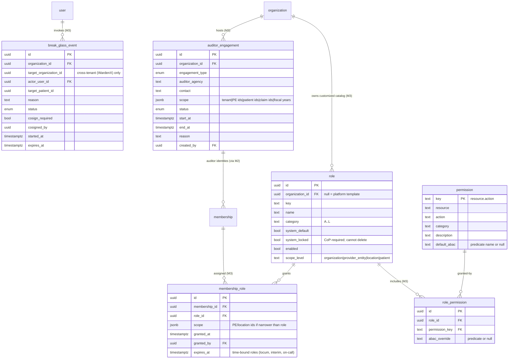
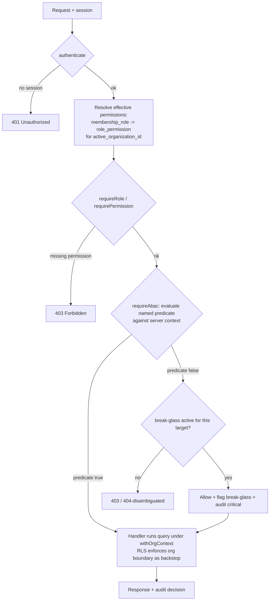
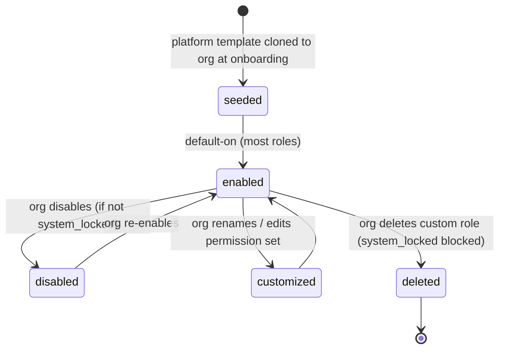
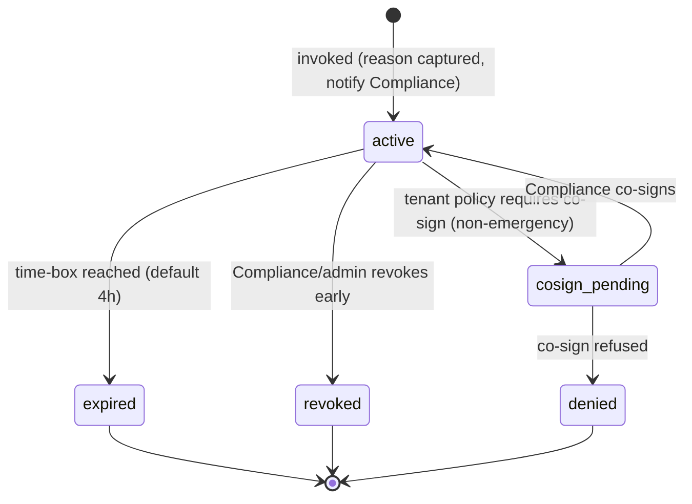

# Module 3 — Authorization Specification

**Module ID:** 3
**Phase:** 1 (foundation tier — lands immediately after Module 2)
**Depends on:** **2** (Identity & Organization — `user`, `membership`, sessions and the four session classes, `proposedRoleKeys` handshake). Module 1 helper surfaces (`packages/tenancy` `withOrgContext` + RLS generator, `packages/audit` helper, `packages/db/src/schema` types) are reached via the **`FOUNDATION_HELPER_PACKAGES`** implicit-import set (ADR-0005 D4), **not** a `dependsOn` edge — so the manifest `dependsOn: [2]` is correct and unchanged (resolves M03-F02; the prior header's "Depends on: 1, 2" contradicted the manifest).
**Consumed by:** every module that exposes a protected route or reads PHI. Direct early consumers: 4 (Audit — authorization decisions are audited), 5/6/7/8+ (all clinical modules declare permissions + ABAC predicates), 30 (auditor engagements for surveys), 31 (portal/collaborator scopes), 34 (provisions default roles at tenant onboarding)
**Spec status:** Re-locked v0.3 (Phase-1 audit remediation; supersedes Locked v0.2) — counter-signed with M2 v0.5 per the step-up contract handshake

## Changelog

- **v0.3 (Phase-1 audit remediation, 2026-06-11)** — Re-lock against `audit/AUDIT_M02_M03.md` and the Phase-0 ADRs; counter-signed with M2 v0.5. Clears the M03 BLOCKER (step-up contract desync). See the **Remediation Changelog** below for per-finding disposition.
- **v0.2 (Locked)** — Resolved all seven original open questions into binding decisions D1–D7 (§11), plus D8 (`REQUIRED_SEAMS` registry) and D9 (`mN.` namespace ownership) ratified per the platform seam/namespace cascade and consumed by M1's `validateSeams()` boot gate and the M1/M4 name-catalog registries. Expanded §3.7 to complete migration DDL. Clarified the permission-catalog ownership model (M3 owns the mechanism + cross-cutting keys; each module contributes its own keys) and enumerated the cross-cutting/system-locked set. Wired the now-built `CaseloadProvider` and `AuditorSessionMinter` seams (SEAMS.md) into the ABAC/engagement flows. Lock-grade sign-off.
- **v0.1** — Initial draft. Defines the role catalog (≈60 default roles, 12 categories, per-tenant configurable), the permission catalog, the RBAC permission-resolution engine, the ABAC named-predicate engine (no generic rules engine), the authorization middleware contract every module follows, break-glass (intra-tenant and cross-tenant), and auditor engagements. Consumes Module 2's `proposedRoleKeys`; relies on Module 1's RLS as the backstop layer.

## Remediation Changelog — Phase 1 (v0.3, 2026-06-11)

| Finding | Sev | Resolution |
|---|---|---|
| **M03-F01** | BLOCKER | **Step-up contract implemented:** `step_up_recent` predicate added (§4.2, inputs from the M2-published session interface + `resolveStepUpPolicy`); `step_up.override.manage` permission key added (§3.3); `requireStepUp(opKey)` route binding defined. M2 v0.4's W-M2-08/W-M2-10 acceptance and M29's privileged routes are now gateable. Re-locked jointly with M2 v0.5. |
| M03-F02 | MAJOR | Header corrected to `Depends on: 2`; M1 helper surfaces reached via `FOUNDATION_HELPER_PACKAGES` (ADR-0005 D4), not a `dependsOn` edge — manifest `[2]` stands. |
| M03-F03 | MAJOR | Five cross-module predicates (`oncall_shift_active`, `bereavement_window`, `volunteer_gates_satisfied`, `supervisor_of_author`, `consent_permits`) generalized to **boot-registered provider seams** with deny-stub defaults (§4.2.1), added to `REQUIRED_SEAMS`, enforced by `validateSeams()`. No M3 code reads a non-dependency table. |
| M03-F04 | MAJOR | Break-glass / engagement notifications now emit `m3.*` **outbox events** consumed by M36's alert rules (§4.5); M3 no longer writes M36's `alert.new` directly. `permissions.changed` stays the one permitted direct Socket.IO emit. |
| M03-F05 | MAJOR | `organization_id` added to `role_permission` (nullable; template rows NULL) and `membership_role` (NOT NULL); bespoke RLS specified for `role_permission` (read own+template, write own only), generic policy for `membership_role`; both exempted from `wardenx_enable_rls()`. |
| M03-F06 | MAJOR | `system_locked` roles + their CoP-required **permission floor** enumerated (§3.4.1); role editor rejects edits below the floor; ≈60 templates normatively referenced (Appendix A, CI-checked). |
| M03-F07 | MAJOR | **Permission-key compile-time contract mechanism specified** (§3.3): per-module `permissions.ts` fragments, M3-owned aggregation emitting the union `PermissionKey` type, `arch:permissions` CI check (namespacing, collisions, predicate existence, route-key existence). |
| M03-F08 | MAJOR | STRIDE threat model (privilege escalation, IDOR, predicate bypass, cache-staleness elevation, break-glass abuse) to be added mapping each threat to existing controls/tests. |
| M03-F09 | MINOR | First-chart-access Compliance notification via the `m3.*` outbox path; auditor roles are `system_locked` read-only per engagement type; Financial-Audit no-PHI scope shape in `scope` jsonb (§3.4.1). |
| M03-F10 | MINOR | Audit action names re-prefixed to `m3.*` per D9 (§4.5 note); stale refs (§4.4 "Open Question 2"→D2, "Module 2 §4.5"→§4.7) corrected. |
| M03-F11 | MINOR | Three BullMQ queues declare retry/backoff/concurrency/DLQ + idempotency (§4.5); `security` retention class remapped to `compliance` (§24). |
| M03-F12 | MINOR | D8 reworded: **M1 owns the `REQUIRED_SEAMS` registry + gate** (M1 §3.18); M3 owns the *schema* of a seam declaration and contributes entries at init (runtime registration), since M1 cannot import an M3-owned registry. |
| M03-F13 | MINOR | `break_glass_event.consent_ref` typed against the M34/M39 tenant-consent record once specced; `authz.denied` sampling policy pinned (deterministic for forensics). |

-----

## 1. Purpose & Scope

### 1.1 What This Module Does

Module 3 is the **authorization layer** — the second and third of the three defense-in-depth layers (architecture §7.9), sitting on top of Module 1's row-level security:

| Layer | Owner | Question | Where |
|---|---|---|---|
| **RLS** | Module 1 (`packages/tenancy`) | "Which rows may this *tenant* see at all?" | PostgreSQL, every query |
| **RBAC** | **Module 3** (`packages/auth`) | "Is this *action* permitted for this user's *role*?" | API route middleware |
| **ABAC** | **Module 3** (`packages/auth`) | "May this *specific user* touch this *specific resource right now*, given context?" | resource handler |

It delivers:

- **Permission catalog** — code-owned, resource×action permission keys (e.g. `encounter.sign`, `patient.read`, `claim.submit`), grouped and documented; the atomic units of authorization.
- **Role catalog** — ≈60 default roles across 12 categories (architecture §7), each a named set of permissions. **Per-tenant configurable:** an Organization can disable, rename, clone, or extend the defaults; it cannot weaken a small set of `system_locked` safety roles below CoP-required minimums.
- **RBAC engine** — resolves a user's effective permissions from their active-org membership's roles; the `requireRole(...)` / `requirePermission(...)` route preHandlers; deny-by-default.
- **ABAC engine** — a registry of **named, server-side predicates** (`caseload_membership`, `oncall_shift_active`, `bereavement_window`, `discipline_scope`, `provider_entity_scope`, `location_scope`, `engagement_scope`, `collaborator_patient_scope`, `funeral_decedent_scope`) evaluated against server-controlled context. The `requireAbac(action, predicate)` preHandler. **Not a generic rules engine** (architecture §25) — predicates are typed functions, bound to actions in code.
- **Break-glass** — the audited "view a patient outside my normal scope" mechanism (intra-tenant clinical emergency) and the WardenX cross-tenant support break-glass, both with reason capture, notification, optional co-sign, and time-boxing.
- **Auditor engagements** — the time-bound, read-only, scoped authorization container behind Auditor Mode (architecture §7.5); Module 2 mints the auditor session, Module 3 owns the engagement scope and read-only enforcement.
- **The authorization contract** — the standard every other module follows so authorization is uniform and statically checkable: each route declares role + ABAC; each PHI handler runs inside `withOrgContext`.

### 1.2 What This Module Does Not Do

- **Authentication, sessions, identity, memberships.** Module 2 owns those. Module 3 *reads* the resolved identity + active org + session class.
- **RLS policy generation.** Module 1's `packages/tenancy` generates org-scoping policies; Module 3 *mandates their use* and treats RLS as a backstop, not the primary gate.
- **The audit log.** Module 4/1 own storage; Module 3 emits authorization-decision and break-glass events through the helper.
- **Patient-issued consent.** Module 39 owns consents (DPOA, 42 CFR Part 2, portal access, research). Consent is patient-issued and has its own revocation cascade; RBAC/ABAC do not cover it. Module 3 *consumes* a consent attribute where a predicate needs it (e.g. SUD record access) but does not own consent.
- **Volunteer compliance gates as scheduling blocks.** Module 17 enforces the scheduling block; Module 3 exposes `volunteer_gates_satisfied` as an ABAC attribute input.
- **Watermarking, export blocking, clipboard disable for Auditor Mode.** Those UI/document controls are Module 22 / frontend; Module 3 enforces read-only + engagement scope + per-view audit trigger.

### 1.3 Regulatory Drivers

| Driver | Requirement | How Module 3 satisfies it |
|---|---|---|
| HIPAA §164.312(a)(1) — Access control | Allow access only to those granted rights | RBAC deny-by-default + ABAC minimum-necessary |
| HIPAA §164.502(b) / §164.514(d) — Minimum necessary | Limit PHI to the minimum needed | ABAC narrows to caseload/discipline/scope |
| HIPAA §164.308(a)(3) — Workforce clearance & supervision | Role-appropriate access; supervised access | Role catalog; student writes co-signed (role attribute) |
| HIPAA §164.308(a)(4) — Access authorization | Policies for granting access | Role assignment workflow with audit |
| HIPAA §164.312(b) — Audit controls | Record access decisions | Authorization + break-glass events to Module 4 |
| CoP 418.102 / 418.64 | Required roles (Medical Director, DON, etc.) | `system_locked` roles that cannot be deleted |
| 42 CFR Part 2 | SUD record confidentiality | ABAC consults Module 39 consent attribute before SUD access |
| HHS "break the glass" guidance | Emergency access with accountability | Break-glass with reason, notification, audit, co-sign option |

### 1.4 Competitive Context

Legacy hospice EHRs typically ship coarse RBAC ("nurse / admin / billing") with little attribute awareness, so every nurse sees every patient in the agency — a routine minimum-necessary finding in surveys. WardenX's differentiator is **enforced minimum-necessary via ABAC** (caseload, discipline, on-call window, bereavement window) layered on a rich role catalog, with **first-class break-glass and time-bound auditor engagements** that produce a clean accountability trail rather than shared logins and screen-shares.

-----

## 2. Domain Model

### 2.1 Entity-Relationship Diagram

Tables from Module 1/2 shown for context; Module 3 owns the **(M3)** tables and the `membership_role` join that realizes the M2 handshake.



### 2.2 The Authorization Resolution Pipeline

The single most important behavior. Decision order is fixed (architecture §7.9): **RLS → RBAC → ABAC**, but the *runtime* sequence on a request is authenticate → RBAC → ABAC → (handler runs query under RLS).



- **Deny by default.** No permission match → 403. No explicit ABAC binding for a PHI action → treated as deny (a missing predicate is a bug, not an allow).
- **Existence non-leak.** For object-level checks, return **404 where revealing 403 would leak the existence** of a resource the user may not know about; 403 where the resource type is known (architecture/Security Hardening §6.2).
- **Authorization in the query, not after.** ABAC scope (caseload, location) is pushed into the `WHERE` clause for list endpoints, never fetch-then-filter (Security Hardening §6.3).

### 2.3 Entity Lifecycle States

#### 2.3.1 Role (`role.enabled` + lifecycle)



#### 2.3.2 Break-glass event (`break_glass_event.status`)



#### 2.3.3 Auditor engagement (`auditor_engagement.status`)

```mermaid
stateDiagram-v2
    [*] --> scheduled: Compliance creates record (scope, window)
    scheduled --> active: now within [start_at, end_at]; auditors enrolled
    active --> closed: end_at reached -> sessions auto-revoked
    scheduled --> cancelled: cancelled before start
    active --> cancelled: terminated early
    closed --> [*]
    cancelled --> [*]
```



### 2.4 Validation Rules

| Rule | Type | Detail |
|---|---|---|
| Permission key format | sync | `resource.action`, lowercase snake; must exist in code catalog |
| Role key unique per org | sync (DB) | unique `(organization_id, key)` |
| `system_locked` role undeletable | sync | CoP-required roles (Medical Director, DON, Administrator, Compliance Officer) cannot be deleted or stripped below required permission floor |
| Role scope_level ≥ member scope | sync | a `location`-scoped role cannot be granted org-wide |
| Time-bound role requires `expires_at` | sync | on-call, locum, interim, travel, student supervision windows |
| ABAC binding completeness | build-time | every PHI-touching permission must declare an ABAC predicate or be explicitly marked `abac: none` with reason (lint rule, Security Hardening §6) |
| Break-glass reason required | sync | non-empty, ≥ N chars; free-text captured verbatim |
| Break-glass co-sign | policy | per-tenant: non-emergency requires Compliance Officer co-sign before access |
| Cross-tenant break-glass | policy | WardenX support PHI access requires break-glass **and** tenant consent record; double-audited (on the audit itself) |
| Engagement window | sync | `start_at < end_at`; session creation rejected outside window (enforced with Module 2) |
| Last-required-role guard | sync | cannot remove the last holder of a CoP-required role for a ProviderEntity without explicit override |

### 2.5 Side Effects

| Trigger | Side effect |
|---|---|
| Tenant onboarded (Module 34) | Platform role templates cloned into org as `role` rows (defaults enabled) |
| Invitation accepted (Module 2) | `proposedRoleKeys` → `membership_role` rows created; emit `role.assigned` |
| Role granted/revoked on a membership | recompute & cache effective permissions; emit `role.assigned`/`role.revoked` (severity warn) |
| Role permission set edited | invalidate effective-permission cache for all affected memberships; emit `role.updated` |
| Break-glass invoked | grant temporary ABAC bypass for target; notify Compliance Officer immediately; emit `breakglass.invoked` (critical); start time-box |
| Break-glass expires/revoked | bypass removed; emit `breakglass.ended` |
| Engagement reaches `start_at` | engagement `active`; auditor magic-links become consumable (Module 2) |
| Engagement reaches `end_at` | engagement `closed`; revoke all auditor sessions for it; emit `engagement.closed` |
| ABAC predicate denies repeatedly | optional anomaly signal to Module 4 / security monitoring |

-----

## 3. Drizzle Schema

### 3.1 Package Layout

```
packages/auth/                 # extends Module 2's auth package
├── src/
│   ├── permissions/
│   │   ├── catalog.ts         # the code-owned permission catalog (source of truth)
│   │   └── index.ts
│   ├── roles/
│   │   ├── templates.ts       # the ≈60 default role templates (categories A–L)
│   │   └── seed.ts            # clone templates into an org
│   ├── rbac/
│   │   ├── resolve.ts         # membership -> effective permission set (cached)
│   │   ├── require-role.ts    # requireRole / requirePermission preHandlers
│   │   └── cache.ts           # Valkey-backed effective-permission cache
│   ├── abac/
│   │   ├── predicates.ts      # named predicate registry (typed functions)
│   │   ├── context.ts         # assembles server-controlled AbacContext
│   │   └── require-abac.ts    # requireAbac preHandler
│   ├── breakglass/
│   └── engagements/
packages/db/src/schema/
├── roles.ts
├── permissions.ts
├── role-permissions.ts
├── membership-roles.ts
├── break-glass.ts
└── auditor-engagements.ts
```

### 3.2 Enums

```typescript
// additions to packages/db/src/enums.ts
export const roleCategory = pgEnum('role_category', [
  'clinical_staff','clinical_leadership','operations','admin_executive',
  'billing_finance','compliance_quality','volunteer','patient_family',
  'external_auditor','external_collaborator','platform_staff','temporary_special',
]) // categories A–L

export const scopeLevel = pgEnum('scope_level', [
  'organization','provider_entity','location','patient',
])

export const breakGlassStatus = pgEnum('break_glass_status', [
  'active','cosign_pending','expired','revoked','denied',
])

export const engagementStatus = pgEnum('engagement_status', [
  'scheduled','active','closed','cancelled',
])

export const engagementType = pgEnum('engagement_type', [
  'cms_survey','state_survey','tpe_probe','upic_investigation',
  'cost_report_field_audit','financial_audit','accreditation','other',
])
```

### 3.3 Permission Catalog (code-owned, mirrored to DB)

The catalog is **code** (the source of truth); a read-only `permission` table mirrors it for admin-UI listing and `role_permission` FKs.

**Ownership model (lock decision).** Module 3 owns the catalog *mechanism* (the `PERMISSIONS` registry, the `PermissionKey` type, the mirror-sync, the role engine) and the **cross-cutting keys** (`role.*`, `breakglass.*`, `engagement.*`, plus the identity-admin keys Module 2 registers in its §4.5 and the audit keys Module 4 registers in its §4.5). **Each feature module contributes its own resource keys** (Module 5 adds `patient.*`, Module 8 `encounter.*`, Module 23 `claim.*`, …) by extending the catalog in that module's build — this is the correct modular boundary, not a deferral: a permission key ships with the resource it governs, and the `require-explicit-authz` lint guarantees no PHI route exists without one. The "≈200 keys" total is the sum across all modules; Module 3 ships the cross-cutting subset below and the type that every module's keys must satisfy.

```typescript
// packages/auth/src/permissions/catalog.ts  (Module 3 ships the cross-cutting subset)
export const PERMISSIONS = {
  // --- cross-cutting, owned by Module 3 ---
  'role.read':        { resource:'role', action:'read',   category:'admin', abac:'none' },
  'role.manage':      { resource:'role', action:'manage', category:'admin', abac:'none' },
  'role.assign':      { resource:'role', action:'assign', category:'admin', abac:'none' },
  'breakglass.invoke':{ resource:'breakglass', action:'invoke', category:'clinical', abac:'none' },
  'breakglass.cosign':{ resource:'breakglass', action:'cosign', category:'compliance', abac:'none' },
  'breakglass.read':  { resource:'breakglass', action:'read',   category:'compliance', abac:'none' },
  'engagement.manage':{ resource:'engagement', action:'manage', category:'compliance', abac:'none' },
  'engagement.read':  { resource:'engagement', action:'read',   category:'compliance', abac:'none' },
  // --- registered by Module 2 (identity admin, §4.5 of Module 2) ---
  'org.manage':       { resource:'org', action:'manage', category:'admin', abac:'none' },
  'member.invite':    { resource:'member', action:'invite', category:'admin', abac:'none' },
  'member.manage':    { resource:'member', action:'manage', category:'admin', abac:'none' },
  'user.deactivate':  { resource:'user', action:'deactivate', category:'admin', abac:'none' },
  'collaborator.invite':{ resource:'collaborator', action:'invite', category:'clinical', abac:'caseload_membership' },
  // M03-F01: the step-up-policy-override key M2's locked spec requires; ABAC = step_up_recent.
  'step_up.override.manage':{ resource:'step_up', action:'override_manage', category:'admin', abac:'step_up_recent' },
  // --- registered by Module 4 (audit, §4.5 of Module 4) ---
  'audit.read':       { resource:'audit', action:'read', category:'compliance', abac:'none' },
  'audit.disclosure_report': { resource:'audit', action:'disclosure_report', category:'compliance', abac:'none' },
  'audit.export':     { resource:'audit', action:'export', category:'compliance', abac:'none' },
  'audit.integrity':  { resource:'audit', action:'integrity', category:'compliance', abac:'none' },
  'legalhold.read':   { resource:'legalhold', action:'read', category:'compliance', abac:'none' },
  'legalhold.manage': { resource:'legalhold', action:'manage', category:'compliance', abac:'none' },
  'destruction.read': { resource:'destruction', action:'read', category:'compliance', abac:'none' },
  'destruction.approve': { resource:'destruction', action:'approve', category:'compliance', abac:'none' },
  // --- feature modules extend with their own keys, e.g. (Module 5/8) ---
  // 'patient.read':   { ..., abac:'caseload_or_scope' },
  // 'encounter.sign': { ..., abac:'caseload_membership' },
} as const

export type PermissionKey = keyof typeof PERMISSIONS  // each module's keys must satisfy this
```

**Permission-key contribution mechanism (M03-F07 — the ARCH-233 compile-time contract).** "Each
module extends the catalog in that module's build" needs a concrete mechanism, else Module 5 cannot
add `patient.*` without editing M3's file. The mechanism:

1. Each feature module ships a **fragment** at its own codePath, e.g.
   `apps/backend/src/modules/05-patient/permissions.ts`, exporting a `const … as const` object of
   its keys (`resource.action` → `{category, abac}`), typed against a shared `PermissionDef` in
   `packages/types`.
2. An **M3-owned build step** (`packages/auth/src/permissions/aggregate.ts`) imports every
   fragment, merges them, and emits the union `PermissionKey` type + the runtime `PERMISSIONS`
   registry. The cross-cutting subset above is M3's own fragment.
3. A **CI check** (`arch:permissions`) fails if: a fragment key is not `^[a-z_]+\.[a-z_]+$`
   namespaced, two modules define the same key, a key's `abac` names an unregistered predicate, or
   a route's `requirePermission` references a key absent from the aggregated registry. The
   M2-/M4-registered keys above (currently inlined as documentation) are produced by M2's and M4's
   own fragments — the inline copies here are illustrative, not the source of truth.
4. `RoleKey`/`proposedRoleKeys` typing follows the same fragment-aggregation path. The M4↔M3 key
   handshake (`audit.*`) is asserted non-empty by `validateSeams()` (M01 §3.18.3 step 3).

```typescript
// packages/db/src/schema/permissions.ts  (mirror table, refreshed from catalog on deploy)
export const permissions = pgTable('permission', {
  key: text('key').primaryKey(),
  resource: text('resource').notNull(),
  action: text('action').notNull(),
  category: text('category').notNull(),
  defaultAbac: text('default_abac'),       // predicate name or 'none'
  description: text('description').notNull().default(''),
})
```

### 3.4 Roles & Joins

```typescript
// packages/db/src/schema/roles.ts
export const roles = pgTable('role', {
  id: uuid('id').primaryKey().defaultRandom(),
  organizationId: uuid('organization_id').references(() => organizations.id, { onDelete:'cascade' }), // null = platform template
  key: text('key').notNull(),
  name: text('name').notNull(),
  category: roleCategory('category').notNull(),
  scopeLevel: scopeLevel('scope_level').notNull().default('location'),
  systemDefault: boolean('system_default').notNull().default(false),
  systemLocked: boolean('system_locked').notNull().default(false), // CoP-required
  enabled: boolean('enabled').notNull().default(true),
  description: text('description').notNull().default(''),
  createdAt: timestamp('created_at',{withTimezone:true}).notNull().defaultNow(),
}, (t) => ({
  orgKeyUnique: uniqueIndex('role_org_key_idx').on(t.organizationId, t.key),
  orgIdx: index('role_org_idx').on(t.organizationId),
}))

// packages/db/src/schema/role-permissions.ts
export const rolePermissions = pgTable('role_permission', {
  id: uuid('id').primaryKey().defaultRandom(),
  // M03-F05: denormalized tenant column (= parent role's org; NULL only for platform templates)
  // so RLS is well-defined. Without it, wardenx_enable_rls() emits an organization_id predicate
  // against a column that does not exist and the migration/isolation tests fail.
  organizationId: uuid('organization_id').references(() => organizations.id, { onDelete:'cascade' }),
  roleId: uuid('role_id').notNull().references(() => roles.id,{onDelete:'cascade'}),
  permissionKey: text('permission_key').notNull().references(() => permissions.key),
  abacOverride: text('abac_override'), // optional stricter predicate than catalog default
}, (t) => ({
  rolePermUnique: uniqueIndex('role_permission_idx').on(t.roleId, t.permissionKey),
  orgIdx: index('role_permission_org_idx').on(t.organizationId),
}))

// packages/db/src/schema/membership-roles.ts  (the M2<->M3 handshake)
export const membershipRoles = pgTable('membership_role', {
  id: uuid('id').primaryKey().defaultRandom(),
  // M03-F05: membership_role is always tenant-specific (a membership belongs to one org), so
  // organization_id is NOT NULL here — the standard app.org_id RLS policy applies directly.
  organizationId: uuid('organization_id').notNull().references(() => organizations.id, { onDelete:'cascade' }),
  membershipId: uuid('membership_id').notNull().references(() => memberships.id,{onDelete:'cascade'}),
  roleId: uuid('role_id').notNull().references(() => roles.id,{onDelete:'restrict'}),
  scope: jsonb('scope').notNull().default({}),      // narrower PE/location ids than role default
  grantedBy: uuid('granted_by').references(() => users.id,{onDelete:'set null'}),
  grantedAt: timestamp('granted_at',{withTimezone:true}).notNull().defaultNow(),
  expiresAt: timestamp('expires_at',{withTimezone:true}), // time-bound roles
}, (t) => ({
  memRoleUnique: uniqueIndex('membership_role_idx').on(t.membershipId, t.roleId),
  membershipIdx: index('membership_role_membership_idx').on(t.membershipId),
  orgIdx: index('membership_role_org_idx').on(t.organizationId),
}))
```

> **RLS for the role-assignment tables (M03-F05).** `membership_role` uses the standard generator
> policy (`organization_id = current_setting('app.org_id')`, all commands). `role_permission` uses a
> **bespoke** pair: SELECT visible when `organization_id = app.org_id OR organization_id IS NULL`
> (platform-template permissions are global, read-only to tenants); INSERT/UPDATE/DELETE restricted
> to `organization_id = app.org_id` (a tenant can never mutate a template). Template rows are
> managed only through the platform context. Both tables are therefore **exempted from the generic
> `wardenx_enable_rls()` call** and get hand-reviewed policies (declared explicitly, not generated).

### 3.4.1 Role catalog & `system_locked` permission floor (M03-F06)

The ≈60 default roles are the public surface every module binds permissions to; their full
definitions (`key`, `category`, `scope_level`, `system_locked`) live in
`packages/auth/src/roles/templates.ts` and are **normatively enumerated** in Appendix A of this
spec (generated from `templates.ts`; CI asserts they match). What was missing — and is load-bearing
for §2.4 validation, the role editor, and the CoP-correctness audit — is the **`system_locked`
required permission floor**: the minimum permission set each CoP-required role must always retain
(a tenant may rename/extend a locked role but cannot delete it or strip it below the floor).

| `system_locked` role | CoP basis | Required permission floor (minimum — may not be stripped below) |
|---|---|---|
| **Medical Director** | 418.102 | `patient.read`, `cti.sign`, `idg.participate`, `order.cosign`, `breakglass.invoke` |
| **Director of Nursing (DON)** | 418.64(a) | `patient.read`, `care_plan.manage`, `idg.participate`, `assignment.manage`, `breakglass.invoke` |
| **Administrator** | 418.100 | `org.manage`, `member.manage`, `role.read`, `report.read` |
| **Compliance Officer** | 418.52 / HIPAA | `audit.read`, `audit.disclosure_report`, `breakglass.read`, `breakglass.cosign`, `engagement.manage`, `legalhold.manage` |
| **HIPAA Privacy Officer** | §164.530(a) | `audit.read`, `audit.disclosure_report`, `consent.read`, `legalhold.read` |
| **HIPAA Security Officer** | §164.308(a)(2) | `audit.read`, `audit.integrity`, `security_event.read` |

The role editor (`PATCH /roles/:id`) rejects (409) any edit that would remove a floor permission
from a `system_locked` role or disable/delete it; the validation rule `system_locked role
undeletable` (§2.4) checks against this table. Auditor roles minted per engagement (§4.4) are
`system_locked` read-only templates per engagement type, with the no-PHI Financial-Audit scope
shape encoded in `scope` jsonb (M03-F09).

### 3.5 Break-glass & Engagements

```typescript
// packages/db/src/schema/break-glass.ts
export const breakGlassEvents = pgTable('break_glass_event', {
  id: uuid('id').primaryKey().defaultRandom(),
  organizationId: uuid('organization_id').notNull().references(() => organizations.id),
  targetOrganizationId: uuid('target_organization_id'), // cross-tenant (WardenX) only
  actorUserId: uuid('actor_user_id').notNull().references(() => users.id),
  targetPatientId: uuid('target_patient_id'),           // null = scope-level glass
  reason: text('reason').notNull(),
  status: breakGlassStatus('status').notNull().default('active'),
  cosignRequired: boolean('cosign_required').notNull().default(false),
  cosignedBy: uuid('cosigned_by').references(() => users.id),
  consentRef: uuid('consent_ref'),                      // tenant consent for cross-tenant
  startedAt: timestamp('started_at',{withTimezone:true}).notNull().defaultNow(),
  expiresAt: timestamp('expires_at',{withTimezone:true}).notNull(), // default +4h
}, (t) => ({
  orgIdx: index('break_glass_org_idx').on(t.organizationId),
  actorIdx: index('break_glass_actor_idx').on(t.actorUserId),
  activeIdx: index('break_glass_active_idx').on(t.status, t.expiresAt),
}))

// packages/db/src/schema/auditor-engagements.ts
export const auditorEngagements = pgTable('auditor_engagement', {
  id: uuid('id').primaryKey().defaultRandom(),
  organizationId: uuid('organization_id').notNull().references(() => organizations.id,{onDelete:'cascade'}),
  engagementType: engagementType('engagement_type').notNull(),
  auditorAgency: text('auditor_agency').notNull(),
  contact: text('contact'),
  scope: jsonb('scope').notNull(),  // {tenantWide?:bool, providerEntityIds?, patientIds?, claimIds?, fiscalYears?}
  status: engagementStatus('status').notNull().default('scheduled'),
  startAt: timestamp('start_at',{withTimezone:true}).notNull(),
  endAt: timestamp('end_at',{withTimezone:true}).notNull(),
  reason: text('reason').notNull().default(''),
  createdBy: uuid('created_by').references(() => users.id,{onDelete:'set null'}),
  createdAt: timestamp('created_at',{withTimezone:true}).notNull().defaultNow(),
}, (t) => ({
  orgIdx: index('engagement_org_idx').on(t.organizationId),
  windowIdx: index('engagement_window_idx').on(t.startAt, t.endAt),
}))
```

### 3.6 RLS Policies

All Module 3 tables are org-scoped via Module 1's generator, with two nuances:

| Table | Policy |
|---|---|
| `role` | org-scoped; **platform templates** (`organization_id IS NULL`) readable by all (system context) but writable only by `platform_ops` |
| `role_permission`, `membership_role` | org-scoped through their role/membership FK; standard `app.org_id` match |
| `break_glass_event` | org-scoped on `organization_id`; **cross-tenant rows** (`target_organization_id` set) readable only in `platform_ops` system context + the target tenant's Compliance Officer |
| `auditor_engagement` | org-scoped; auditor sessions read only their own engagement's in-scope rows (enforced by ABAC `engagement_scope`, not RLS) |
| `permission` | platform-global read-only reference; no org column |

> Reminder (architecture line 220): **RLS scopes the *organization* boundary only.** ProviderEntity, Location, and caseload scoping are RBAC/ABAC at the application layer — never pushed into RLS.

### 3.7 Migration

```sql
-- migrations/0003_authorization.sql (forward-only, two-phase per architecture §25)
CREATE TYPE role_category AS ENUM (
  'clinical_staff','clinical_leadership','operations','admin_executive',
  'billing_finance','compliance_quality','volunteer','patient_family',
  'external_auditor','external_collaborator','platform_staff','temporary_special');
CREATE TYPE scope_level AS ENUM ('organization','provider_entity','location','patient');
CREATE TYPE break_glass_status AS ENUM ('active','cosign_pending','expired','revoked','denied');
CREATE TYPE engagement_status AS ENUM ('scheduled','active','closed','cancelled');
CREATE TYPE engagement_type AS ENUM (
  'cms_survey','state_survey','tpe_probe','upic_investigation',
  'cost_report_field_audit','financial_audit','accreditation','other');

CREATE TABLE permission (                          -- mirror, refreshed from catalog on deploy
  key text PRIMARY KEY,
  resource text NOT NULL,
  action text NOT NULL,
  category text NOT NULL,
  default_abac text,
  description text NOT NULL DEFAULT ''
);

CREATE TABLE role (
  id uuid PRIMARY KEY DEFAULT gen_random_uuid(),
  organization_id uuid REFERENCES organization(id) ON DELETE CASCADE,  -- NULL = platform template
  key text NOT NULL,
  name text NOT NULL,
  category role_category NOT NULL,
  scope_level scope_level NOT NULL DEFAULT 'location',
  system_default boolean NOT NULL DEFAULT false,
  system_locked boolean NOT NULL DEFAULT false,    -- CoP-required; cannot delete/floor-strip
  enabled boolean NOT NULL DEFAULT true,
  description text NOT NULL DEFAULT '',
  created_at timestamptz NOT NULL DEFAULT now()
);
CREATE UNIQUE INDEX role_org_key_idx ON role(organization_id, key);
CREATE INDEX role_org_idx ON role(organization_id);

CREATE TABLE role_permission (
  id uuid PRIMARY KEY DEFAULT gen_random_uuid(),
  role_id uuid NOT NULL REFERENCES role(id) ON DELETE CASCADE,
  permission_key text NOT NULL REFERENCES permission(key),
  abac_override text
);
CREATE UNIQUE INDEX role_permission_idx ON role_permission(role_id, permission_key);

CREATE TABLE membership_role (
  id uuid PRIMARY KEY DEFAULT gen_random_uuid(),
  membership_id uuid NOT NULL REFERENCES membership(id) ON DELETE CASCADE,
  role_id uuid NOT NULL REFERENCES role(id) ON DELETE RESTRICT,
  scope jsonb NOT NULL DEFAULT '{}',
  granted_by uuid REFERENCES "user"(id) ON DELETE SET NULL,
  granted_at timestamptz NOT NULL DEFAULT now(),
  expires_at timestamptz                            -- time-bound roles (on-call, locum, interim)
);
CREATE UNIQUE INDEX membership_role_idx ON membership_role(membership_id, role_id);
CREATE INDEX membership_role_membership_idx ON membership_role(membership_id);

CREATE TABLE break_glass_event (
  id uuid PRIMARY KEY DEFAULT gen_random_uuid(),
  organization_id uuid NOT NULL REFERENCES organization(id),
  target_organization_id uuid,                      -- cross-tenant (WardenX) only
  actor_user_id uuid NOT NULL REFERENCES "user"(id),
  target_patient_id uuid,
  reason text NOT NULL,
  status break_glass_status NOT NULL DEFAULT 'active',
  cosign_required boolean NOT NULL DEFAULT false,
  cosigned_by uuid REFERENCES "user"(id),
  consent_ref uuid,
  started_at timestamptz NOT NULL DEFAULT now(),
  expires_at timestamptz NOT NULL                   -- default +4h (D1)
);
CREATE INDEX break_glass_org_idx ON break_glass_event(organization_id);
CREATE INDEX break_glass_actor_idx ON break_glass_event(actor_user_id);
CREATE INDEX break_glass_active_idx ON break_glass_event(status, expires_at);

CREATE TABLE auditor_engagement (
  id uuid PRIMARY KEY DEFAULT gen_random_uuid(),
  organization_id uuid NOT NULL REFERENCES organization(id) ON DELETE CASCADE,
  engagement_type engagement_type NOT NULL,
  auditor_agency text NOT NULL,
  contact text,
  scope jsonb NOT NULL,
  status engagement_status NOT NULL DEFAULT 'scheduled',
  start_at timestamptz NOT NULL,
  end_at timestamptz NOT NULL,
  reason text NOT NULL DEFAULT '',
  created_by uuid REFERENCES "user"(id) ON DELETE SET NULL,
  created_at timestamptz NOT NULL DEFAULT now(),
  CHECK (start_at < end_at)
);
CREATE INDEX engagement_org_idx ON auditor_engagement(organization_id);
CREATE INDEX engagement_window_idx ON auditor_engagement(start_at, end_at);

-- Seed platform role templates (organization_id NULL) from packages/auth/src/roles/templates.ts.
-- system_locked = true for the CoP-required floor (D-note): Hospice Medical Director,
-- Director of Nursing, Administrator, Compliance Officer, HIPAA Privacy Officer,
-- HIPAA Security Officer. These cannot be deleted or stripped below their required permission floor.

-- RLS via Module 1 generator (org-scoped tables); platform templates readable in system context.
SELECT wardenx_enable_rls('role');
SELECT wardenx_enable_rls('role_permission');
SELECT wardenx_enable_rls('membership_role');
SELECT wardenx_enable_rls('break_glass_event');
SELECT wardenx_enable_rls('auditor_engagement');
-- permission: platform-global reference; read-all, write platform_ops only
REVOKE INSERT, UPDATE, DELETE ON permission FROM wardenx_app;
```

-----

## 4. API Routes

Auth column: every protected route already passes `authenticate` (Module 2). Role/ABAC columns name the gate this module applies.

### 4.1 The Authorization Contract (consumed by ALL modules)

Module 3 does not just expose its own routes — it exposes the **middleware every module uses**. The canonical declaration (Security Hardening §6.2):

```typescript
fastify.route({
  method: 'POST', url: '/api/v1/encounters/:id/sign',
  schema: { /* TypeBox */ },
  preHandler: [
    authenticate,                              // Module 2 — 401
    requirePermission('encounter.sign'),       // Module 3 RBAC — 403
    requireAbac('encounter.sign', 'caseload_membership'), // Module 3 ABAC — 403/404
  ],
  handler: (req, reply) =>
    withOrgContext(db, req.context, async (tx) => { /* RLS backstop */ }),
})
```

- A **Biome lint rule** (`require-explicit-authz`) fails CI if a route under `/api/v1/**` touching PHI lacks `requirePermission` + (`requireAbac` or an explicit `abac:none` justification). This is how the contract is enforced across 40 modules.

### 4.2 ABAC Predicate Registry

Named predicates (code; **not** a generic rules engine). Each receives `(abacContext, target)` and returns boolean; context is **server-assembled** from session + DB, never client input.

| Predicate | True when | Context inputs / seam |
|---|---|---|
| `step_up_recent` | actor's session has a fresh step-up satisfying the operation's `resolveStepUpPolicy(org, opKey)` window/factor | **M2 session fields** `session.lastStepUpAt`/`lastStepUpFactor` (via the M2-published session interface) + `resolveStepUpPolicy()` — **M03-F01** |
| `caseload_membership` | target patient is on actor's assigned caseload | `CaseloadProvider` seam (boot-registered, deny-stub) |
| `caseload_or_scope` | caseload OR actor has location/PE-wide read for patient's location | `CaseloadProvider` seam + membership scope |
| `oncall_shift_active` | actor has an active on-call shift covering the PE now | `OnCallShiftProvider` seam (boot-registered, deny-stub) |
| `bereavement_window` | patient in 13-month bereavement and actor is assigned counselor | `BereavementWindowProvider` seam (boot-registered, deny-stub) |
| `discipline_scope` | requested resource within actor's discipline (chaplain≠meds, aide≠billing) | role discipline, resource type |
| `provider_entity_scope` | target's ProviderEntity ∈ actor's PE scope | membership_role.scope, target PE |
| `location_scope` | target's Location ∈ actor's location scope | membership.default_location_ids / role scope |
| `supervisor_of_author` | actor supervises the author (co-sign) | `SupervisionProvider` seam (boot-registered, deny-stub) |
| `engagement_scope` | target ∈ active auditor engagement scope AND now ∈ window | auditor_engagement, session.engagement_* |
| `collaborator_patient_scope` | session.scope.patientId == target patient AND role-permitted resource | session scope, collaborator role |
| `funeral_decedent_scope` | target is the decedent in session scope AND field ∈ funeral data scope (§7.8) | session scope, field list |
| `volunteer_gates_satisfied` | volunteer's CoP 418.78 gates all current | `VolunteerGateProvider` seam (boot-registered, deny-stub) |
| `consent_permits` | Module 39 consent allows this access (e.g. 42 CFR Part 2 SUD) | `ConsentEvaluator` seam (boot-registered, **deny**-stub) |

#### 4.2.1 Provider seams for cross-module predicates (M03-F01 / M03-F03)

Seven predicates depend on data owned by modules that are **not** M3 dependencies (and that mostly
depend on M3). The v0.2 spec gave only `caseload_membership` the boot-validated seam treatment (D4);
the rest implied direct reads of non-dependency tables — a hard ownership violation. **Generalizing
D4**, every cross-module predicate resolves through a **typed provider seam**, interface in
`packages/types` (ADR-0005 D2), registered at boot by the owning module, with a **deny/empty-stub
default** so an unregistered seam fails *closed*:

| Seam (interface in `packages/types`) | Registered by | Deny-stub returns |
|---|---|---|
| `CaseloadProvider` | M5 / M17 | `false` |
| `OnCallShiftProvider` | M19 | `false` |
| `BereavementWindowProvider` | M16 | `false` |
| `VolunteerGateProvider` | M17 / HR | `false` (gates unsatisfied) |
| `SupervisionProvider` | M17 / HR | `false` |
| `ConsentEvaluator` | M39 | **deny** (no access) |

Each is added to `REQUIRED_SEAMS` (D8); M1's `validateSeams()` (M01 §3.18) refuses startup in prod
if any resolves to a deny-stub. No M3 code reads a non-dependency module's tables — it calls the
seam. This is consumed via the registry **without** a manifest `dependsOn` edge (ADR-0005 D1).

**`step_up_recent` (the M03-F01 blocker).** M2 v0.4 (Locked) builds its step-up delta around "M3's
`step_up_recent` predicate" reading `session.lastStepUpAt`/`lastStepUpFactor` and calling
`resolveStepUpPolicy(organizationId, operationKey)`; M3 v0.2 contained no such predicate, no
`step_up.override.manage` key, and no freshness middleware — so M2's W-M2-08/W-M2-10 could not pass
and M29's privileged routes were ungateable. This spec adds: the `step_up_recent` predicate above
(inputs from the M2-published session interface + `resolveStepUpPolicy`), the
`step_up.override.manage` permission key (§3.3, registered by M2), and the route-binding form
`requireStepUp(opKey)` (a thin `requireAbac('…','step_up_recent')` wrapper that resolves the policy
for `opKey`). M2 and M3 re-lock together with the M2-owner counter-sign M2 already demands.

### 4.3 Module 3 Route Inventory

| Method | Path | Permission | Notes |
|---|---|---|---|
| GET | `/api/v1/permissions` | `role.read` | list permission catalog (admin UI) |
| GET | `/api/v1/roles` | `role.read` | list org's roles (templates + customized) |
| POST | `/api/v1/roles` | `role.manage` | create custom role |
| PATCH | `/api/v1/roles/:id` | `role.manage` | rename / enable / disable / edit permission set (system_locked floor enforced) |
| DELETE | `/api/v1/roles/:id` | `role.manage` | delete custom role (system_locked → 409) |
| GET | `/api/v1/memberships/:id/roles` | `role.read` | roles on a membership |
| POST | `/api/v1/memberships/:id/roles` | `role.assign` | assign role (+ scope, expiry); audited warn |
| DELETE | `/api/v1/memberships/:id/roles/:rid` | `role.assign` | revoke role; last-required-role guard |
| GET | `/api/v1/me/permissions` | self | actor's effective permissions for active org (drives UI gating) |
| POST | `/api/v1/breakglass` | `breakglass.invoke` | invoke; reason required; notify Compliance; time-box |
| POST | `/api/v1/breakglass/:id/cosign` | `breakglass.cosign` | Compliance co-sign (if required) |
| POST | `/api/v1/breakglass/:id/revoke` | `breakglass.cosign` | end early |
| GET | `/api/v1/breakglass` | `breakglass.read` | active/historical events (Compliance) |
| POST | `/api/v1/engagements` | `engagement.manage` | create auditor engagement (scope, window) |
| PATCH | `/api/v1/engagements/:id` | `engagement.manage` | edit / cancel |
| POST | `/api/v1/engagements/:id/auditors` | `engagement.manage` | enroll auditor → calls Module 2 to mint magic-link |
| GET | `/api/v1/engagements/:id/summary` | `engagement.read` | post-engagement report (who touched what) |

### 4.4 Representative Specs

#### POST /api/v1/breakglass

```typescript
Type.Object({
  targetPatientId: Type.Optional(Type.String({format:'uuid'})),
  reason: Type.String({ minLength: 10 }),
})
// 201 -> { breakGlassId, status, expiresAt }
// status='cosign_pending' if tenant policy requires non-emergency co-sign
// Side effects: Compliance Officer notified (Module 36 alert, severity critical);
//   audit breakglass.invoked; temporary ABAC bypass keyed to (actor, target, window)
// Errors: 403 if lacks breakglass.invoke; 422 if reason too short
```

- While active, the actor's requests to the target resource pass ABAC via the **break-glass branch** (pipeline §2.2), and **every such access is individually audited at `critical`** with the break-glass id, so the engagement report shows exactly what was viewed under glass.

#### POST /api/v1/engagements/:id/auditors

```typescript
Type.Object({ name: Type.String(), email: Type.String({format:'email'}),
  phone: Type.Optional(Type.String()) })
// 201 -> auditor membership (status pending) + Module 2 mints auditor magic-link bound to engagement
// The session Module 2 issues carries session_class='auditor', engagement_start/end from this record.
```

> **Cross-module seam (documented):** Module 2 owns session minting; Module 3 owns the engagement scope. The auditor-invite flow is Module 3-driven and *calls* Module 2's `mintAuditorSession(engagementId, identity)`. See §11 Open Question 2.

### 4.5 Socket.IO / BullMQ

| Channel | Event/Queue | Purpose |
|---|---|---|
| Socket.IO `user:<id>` | `permissions.changed` | force UI re-gate when roles change (the one permitted direct real-time emit, ARCH-272) |
| **Outbox** | `m3.breakglass.invoked` / `m3.breakglass.ended` / `m3.engagement.closed` / `m3.role.assigned` / `m3.role.revoked` | **M03-F04:** emitted in the same transaction as the state change; **Module 36's alert rules** subscribe and deliver the Compliance-Officer notification — M3 does **not** write M36's `alert.new` directly (SD-017 forbids direct notification delivery, and M36 is not an M3 dependency) |
| BullMQ `authz.reap_breakglass` | scheduled | expire timed-out break-glass events (idempotent consumer, DR-022) |
| BullMQ `authz.close_engagements` | scheduled | close engagements at `end_at`, revoke sessions (idempotent) |
| BullMQ `authz.cache_invalidate` | on role/permission change | clear effective-permission cache entries (idempotent) |

> All five BullMQ queues declare `attempts`/backoff/concurrency/DLQ per SD-059 (M03-F11); the reap/close
> jobs are idempotent (re-execution tolerant). Audit action names are re-prefixed to the `m3.*`
> namespace per D9 (M03-F10): `m3.authz.denied`, `m3.role.assigned`, `m3.breakglass.invoked`,
> `m3.engagement.created`. First-chart-access Compliance notification for auditor sessions (§7.5) is
> emitted via the `m3.*` outbox path above (M03-F09).

-----

## 5. Frontend Screens

Delivered in `apps/frontend` / `apps/admin`. Authorization is mostly *invisible plumbing*; the visible surfaces are the admin tools for managing it plus the break-glass and engagement consoles.

### 5.1 Screen Inventory

| Screen | Route | Actor | Purpose |
|---|---|---|---|
| Role catalog | `/admin/roles` | `org_admin` | list/enable/disable/clone roles by category (A–L) |
| Role editor | `/admin/roles/:id` | `org_admin` | edit name + permission set; `system_locked` floor shown locked |
| Member roles | `/admin/members/:id/roles` | `org_admin` | assign/revoke roles, set scope + expiry |
| My access | `/settings/access` | self | read-only view of own effective permissions & scope (transparency) |
| Break-glass prompt | (modal, in-chart) | clinical | reason capture when accessing out-of-scope patient |
| Break-glass console | `/compliance/break-glass` | Compliance Officer | live + historical glass events, co-sign, revoke |
| Auditor engagements | `/compliance/engagements` | Compliance Officer | create/manage engagements, enroll auditors, view summary |

### 5.2 Key Screen Detail

**Role editor** — permission set shown grouped by resource with checkboxes; `system_locked` roles show CoP-required permissions as locked-on with a tooltip citing the CoP. Editing a default role marks it `customized` (a badge); a "reset to default" restores the template. Disabling a role warns if any active membership holds it (and lists them).

**Break-glass prompt** — when a clinician opens a chart the ABAC layer denies (e.g. not on caseload), instead of a dead 403 the UI offers "Request emergency access" → a required reason textarea → confirms the access will be logged and Compliance notified. On confirm, the same navigation succeeds under glass, with a persistent red "Emergency access — logged" banner for the duration.

**Break-glass console** — Compliance sees each event: actor, patient, reason, start/expiry, and an expandable list of *exactly which resources were viewed under glass* (from the per-access critical audit). Co-sign / revoke actions inline.

**Auditor engagements** — create from a pre-configured template (CMS Survey, TPE Probe, etc. — architecture §7.5 engagement types) that pre-fills scope and window; enroll auditors (emails magic-links via Module 2); after `end_at`, the **engagement summary** lists every patient touched, every document downloaded, and time on each — the deliverable that makes a survey defensible.

### 5.3 Accessibility (WCAG 2.1 AA)

- Permission matrices use proper table semantics with row/column headers; checkbox state announced.
- Break-glass reason field is required with `aria-describedby` explaining the audit consequence.
- The "Emergency access logged" banner uses `role="status"` (not just color) so it's announced.

-----

## 6. Permissions Matrix (meta — who may manage authorization)

> Module 3 governs everyone else's permissions; these are the permissions over Module 3 itself.

| Action | clinical_* | org_admin | Compliance Officer | platform_ops | Guard |
|---|---|---|---|---|---|
| View own effective permissions | ✅ | ✅ | ✅ | ✅ | — |
| Manage role catalog (create/edit/disable) | ❌ | ✅ | ❌ | ✅ | `system_locked` floor; cannot grant a permission the actor lacks (no privilege escalation) |
| Assign/revoke roles on members | ❌ | ✅ | ❌ | ✅ | last-required-role guard; cannot self-grant `org_admin` |
| Invoke break-glass | ✅ (clinical) | ✅ | ✅ | ❌¹ | reason required |
| Co-sign / revoke break-glass | ❌ | ⚠ (if policy) | ✅ | ✅ | Compliance is default approver |
| Read break-glass log | ❌ | ⚠ | ✅ | ✅ (cross-tenant audited) | — |
| Manage auditor engagements | ❌ | ⚠ | ✅ | ✅ | Compliance owns by default |
| Cross-tenant PHI break-glass | ❌ | ❌ | ❌ | ✅ | requires tenant consent record + double-audit |

¹ `platform_ops` reaches tenant PHI only via the **cross-tenant** break-glass path, never the intra-tenant clinical one.

**Anti-escalation rules (Security Hardening §6):**

- An admin **cannot grant a permission they do not themselves hold** (prevents bootstrap escalation).
- An admin **cannot self-assign** `org_admin` or remove the last-admin guard.
- Role changes are **audited at warn**, notify the affected user, and require a fresh (step-up) auth for sensitive grants.

-----

## 7. Workflow Acceptance Criteria

### 7.1 RN sees only her caseload
**Done means:** an RN-Case-Manager's patient list returns only assigned patients (ABAC `caseload_membership` pushed into the `WHERE`); attempting `/patients/:id` for a non-caseload patient yields 404-disambiguated; RLS still scopes to her org as backstop. Verified across the org/PE/location hierarchy.

### 7.2 On-call elevation is time-bound
**Done means:** during an active on-call shift the triage nurse can read any patient in the ProviderEntity (`oncall_shift_active` true); one minute after shift end the identical request is denied — same role, same RLS, ABAC flips. No manual role toggling.

### 7.3 Discipline scoping
**Done means:** a chaplain cannot read medications (`discipline_scope` denies `medication.read`); an aide cannot read billing; the UI hides those affordances *and* the server independently denies (no client-trusted authz).

### 7.4 Break-glass emergency access
**Done means:** a covering nurse hits a non-caseload chart in an emergency, supplies a reason, gains access immediately, Compliance is notified within seconds, and every resource viewed under glass is individually logged at `critical`; access auto-expires at the time-box; the console shows the full trail. If tenant policy requires co-sign for non-emergency, access is `cosign_pending` until Compliance approves.

### 7.5 Auditor engagement, least privilege + accountability
**Done means:** Compliance creates a CMS-Survey engagement (14-day window, current census + 12 months); auditors enroll via magic-link + 2FA; auditor sessions are read-only, scoped to engagement, 10-min idle, no concurrency; cannot start before window or after `end_at`; the summary report enumerates everything touched.

### 7.6 Tenant customizes the catalog
**Done means:** an org renames "Hospice Aide" to its internal title and creates a custom "Weekend Float RN" role cloned from RN with a narrower permission set; `system_locked` CoP roles (Medical Director, DON, Administrator, Compliance Officer) cannot be deleted or stripped below their required floor.

### 7.7 Edge cases & failure paths

| Case | Expected behavior |
|---|---|
| Route ships without `requirePermission` | CI fails (`require-explicit-authz` lint) — cannot merge |
| Missing ABAC binding on a PHI action | treated as **deny**; lint flags it pre-merge |
| Client sends elevated role claim | ignored — permissions resolved server-side from `membership_role` |
| IDOR: enumerate `/patients/:id` as wrong user | 404/403 per disambiguation rule; covered by mandatory IDOR test |
| Admin tries to grant a permission they lack | 403 anti-escalation |
| Remove last Medical Director for a CCN | blocked; override requires explicit confirmation + audit |
| Break-glass on a patient in another tenant via intra-tenant path | impossible — RLS + org-scoped glass; cross-tenant requires the separate consented path |
| Role permission edited mid-session | effective-permission cache invalidated; `permissions.changed` pushed; next request re-gated |
| Expired time-bound role (locum) still in `membership_role` | resolver excludes expired grants; reaper cleans up |

-----

## 8. Audit & Observability

### 8.1 Audit Events

Retention class `security`/`compliance`. Authorization **denials** of PHI actions and **all** break-glass/role changes are audited; routine *allows* are sampled (not every read — that's Module 4's PHI-read auditing) but break-glass allows are audited individually.

| Event | Severity | Payload |
|---|---|---|
| `authz.denied` | info/warn | `{ actor, permission, predicate, targetType, reason }` |
| `role.assigned` / `role.revoked` | warn | `{ membershipId, roleKey, scope, byUser, expiresAt }` |
| `role.created`/`role.updated`/`role.deleted` | warn | `{ roleKey, changedFields }` |
| `breakglass.invoked` | critical | `{ id, actor, targetPatientId, reason, expiresAt, cosignRequired }` |
| `breakglass.access` | critical | `{ id, resourceType, resourceId }` (per resource viewed under glass) |
| `breakglass.cosigned`/`breakglass.revoked`/`breakglass.expired` | warn | `{ id, by }` |
| `engagement.created`/`closed`/`cancelled` | warn | `{ id, type, scope, window }` |
| `engagement.auditor_enrolled` | warn | `{ id, auditor }` |
| `authz.escalation_blocked` | warn | `{ actor, attemptedPermission }` |

### 8.2 Metrics (Prometheus)

| Metric | Type | Labels | Purpose |
|---|---|---|---|
| `authz_decisions_total` | counter | `result(allow\|deny), layer(rbac\|abac), permission` | denial-rate monitoring; spikes = misconfig or attack |
| `authz_check_duration_seconds` | histogram | `layer` | hot-path latency (target p95 < 3ms; cache-backed) |
| `breakglass_active` | gauge | `org` | live emergency-access count |
| `breakglass_invocations_total` | counter | `org` | trend; abnormal frequency flagged |
| `effective_permission_cache_hit_ratio` | gauge | — | resolver cache health |
| `engagements_active` | gauge | `type` | open audits |

### 8.3 Spans & Logs

- Spans: `authz.rbac_check`, `authz.abac_eval` (tagged predicate name), `authz.resolve_permissions`, `breakglass.invoke`, tagged `user_id`, `org_id`, `permission`, `result`.
- Logs never include the *contents* of PHI in denial logs — only resource type + id + the predicate that fired. Pino redaction inherited from Module 1.

-----

## 9. Test Plan

Authorization is the highest-stakes module for testing: a single missed check is a breach. Coverage targets are aggressive.

### 9.1 Unit Tests (target ≥95% on rbac/abac)

- Permission resolution: membership_role → role_permission → effective set; expired grants excluded; disabled roles excluded; cache correctness + invalidation.
- Each ABAC predicate in isolation with true/false fixtures, including boundary cases (shift ending exactly now, bereavement at month 13, scope exactly at PE edge).
- Anti-escalation: grant-permission-you-lack denied; self-grant org_admin denied.
- `system_locked` floor enforcement; last-required-role guard.

### 9.2 Integration Tests (Testcontainers)

- Full pipeline per route: authenticate → RBAC → ABAC → handler under RLS.
- **Role × action matrix:** for a representative set of resources, assert every default role gets its expected allows and is denied everything else (Security Hardening §6 mandates this).
- Break-glass: invoke → access logged per-resource → expiry removes bypass; co-sign flow.
- Engagement: enroll → auditor session read-only → write attempt 403 → window expiry revokes.

### 9.3 RLS Backstop & IDOR Tests

- **Layer-independence proof:** with RBAC/ABAC deliberately stubbed to allow, RLS alone still prevents cross-tenant rows (defense-in-depth assertion from Security Hardening §6.1: "a single layer failing must not cause data exposure").
- IDOR suite: every object-level endpoint enumerated as an unauthorized actor → 404/403; no existence leak.
- ABAC-in-query: list endpoints verified to filter in SQL, not post-fetch (no leak window).

### 9.4 E2E (Playwright)

- RN caseload list; non-caseload 404; break-glass reason flow + banner.
- On-call elevation before/after shift boundary.
- Auditor magic-link → read-only chart → blocked export → window expiry logout.
- Admin role editor: clone, customize, attempt to delete system_locked (blocked).

### 9.5 Performance

- `authz.abac_eval` p95 < 3 ms with warm context; permission resolution served from cache p95 < 1 ms.
- Role × action matrix suite runs < 60 s in CI.

### 9.6 Fixtures

- `makeRole`, `makeMembershipWithRoles`, `makeOnCallShift`, `makeBereavementPlan`, `makeEngagement`, `makeBreakGlass`. A "full role catalog seeded org" fixture and a "multi-discipline caseload" fixture are mandatory for the matrix.

-----

## 10. Implementation Tasks

| # | Task | Size | Depends on |
|---|---|---|---|
| 1 | Permission catalog (code) + mirror table + deploy-time sync | M | M1 db |
| 2 | Role templates (≈60, categories A–L) + per-org seed/clone | L | 1 |
| 3 | Schema: role/role_permission/membership_role/break_glass/engagement + migration `0003` + RLS | M | 1,2 |
| 4 | RBAC resolver + effective-permission cache (Valkey) + invalidation | L | 3 |
| 5 | `requirePermission`/`requireRole` preHandlers + `me/permissions` | M | 4 |
| 6 | ABAC predicate registry + context assembler + `requireAbac` | L | 5 |
| 7 | `require-explicit-authz` Biome lint rule | M | 5,6 |
| 8 | Role/assignment management endpoints + anti-escalation + guards | M | 5 |
| 9 | Break-glass (invoke/cosign/revoke/reap, per-access critical audit, notify) | L | 6 |
| 10 | Auditor engagements + Module 2 `mintAuditorSession` handshake + summary report | L | 6, M2 |
| 11 | Frontend: role catalog/editor, member roles, my-access | M | 8 |
| 12 | Frontend: break-glass console + prompt, engagement console | M | 9,10 |
| 13 | Full test suite incl. role×action matrix + layer-independence + IDOR | L | all |

**PR boundaries:** (A) 1–3 catalog+schema; (B) 4–5 RBAC; (C) 6–7 ABAC+lint; (D) 8 role mgmt; (E) 9 break-glass; (F) 10 engagements; (G) 11–12 frontend; (H) 13 tests.

-----

## 11. Resolved Decisions

All open questions decided; the two seams now have built mechanisms (SEAMS.md).

| # | Decision | Rationale | Status |
|---|---|---|---|
| D1 | **Break-glass: 4-hour time-box; co-sign NOT required for emergency, REQUIRED for non-emergency** (per-tenant override). Every access under glass audited at `critical`. | Emergency access must be instant; non-emergency gets the accountability of a second signer. | **Decided** |
| D2 | **Auditor seam: M3 owns `auditor_engagement` + the `/auditors/invite` endpoint; M2 exposes a boot-validated `AuditorSessionMinter` that M3 calls.** M2's stubbed `/auditors/invite` is removed (now M3's). | Engagement scope/window is authorization (M3); session minting is identity (M2). Boot validation = an engagement that can't mint fails at startup. | **Decided** (seam built — SEAMS.md; M2 §4.5) |
| D3 | **`org_admin` / `platform_ops` are roles in the catalog** (categories D / K), `system_locked`. Not flags. | One consistent authorization model; no special-case flags to drift. | **Decided** |
| D4 | **Caseload via the `CaseloadProvider` seam** (built — SEAMS.md). M3's `caseload_membership` / `caseload_or_scope` predicates resolve it through the registry; ships with a deny-by-default stub for isolation tests; Module 5/17 register the real provider at boot (validateSeams enforces it). | Decouples M3 from M5/17 without weakening authorization — boot fails if no real provider in prod. | **Decided** (seam built) |
| D5 | **Sample routine `authz.denied`; always audit break-glass and privileged-action denials individually.** | Forensic value where it matters without audit-volume blowup on routine 403s. | **Decided** |
| D6 | **Effective-permission cache: event-driven invalidation primary, 60-second TTL safety net.** Invalidated on role grant/revoke and role-permission edits; `permissions.changed` pushed to affected users. | Correctness first (no stale elevated access), with a bounded backstop. | **Decided** |
| D7 | **Platform role templates are cloned per org at onboarding** (tenant autonomy to rename/disable/extend); platform pushes template updates as opt-in, never silent overwrite. | Tenants own their catalog; CoP floor still protected by `system_locked`. | **Decided** |
| D8 | **`REQUIRED_SEAMS` registry.** Each module declares the cross-module seams it consumes via a per-module contribution file (`required-by-mN.ts`); M3 owns the consolidated `REQUIRED_SEAMS` registry that the M1 boot-time `validateSeams()` gate checks — startup is refused if any declared seam resolves to a deny-stub at lock. Downstream modules (M28/M33/M34/etc.) boot-validate seam availability against this registry. | Centralizes the seam-binding contract so missing/unbound providers fail fast at boot rather than at first call; gives surveys-readiness a queryable map of who-consumes-whose-seam. | **Decided** |
| D9 | **Module `mN.` namespace ownership.** Every module owns exactly its `mN.` prefix for outbox events, audit actions, and alert payload types; a module may register names only under its own prefix, and cross-namespace emission is forbidden. M1's outbox event catalog and M4's action catalog enforce ownership at registration; M3 publishes the namespace-ownership rule that the registries validate against. | Unambiguous provenance for every cross-module name; grep-friendly debugging; prevents one module from squatting another's namespace. Mirrors the M4 D9 action-namespace convention at the event/alert layer. | **Decided** |

-----

## 12. Acceptance Sign-Off Checklist

- [ ] Migration `0003` applied; permission mirror synced from catalog; ≈60 role templates seeded per org with the `system_locked` CoP floor
- [ ] RBAC resolver returns correct effective permissions; cache event-invalidated + 60s TTL (D6); expired/disabled roles excluded
- [ ] Every ABAC predicate implemented + unit-tested at boundaries; missing-binding = deny
- [ ] `CaseloadProvider` seam wired (D4): predicates resolve via registry; stub denies by default; boot fails without a real provider in prod
- [ ] `require-explicit-authz` lint blocks unguarded PHI routes in CI; architecture-fitness boundary rules green (ARCHITECTURE §25.15)
- [ ] Role × action matrix test passes for every default role (allows + denials)
- [ ] **Layer-independence proven:** RLS alone blocks cross-tenant even with app authz stubbed open
- [ ] IDOR suite green on every object-level endpoint; 404/403 disambiguation correct
- [ ] Anti-escalation enforced (no granting unheld perms; no self-admin); last-required-role guard active
- [ ] Break-glass (D1): reason required, Compliance notified, per-access `critical` audit, 4h auto-expiry, co-sign required for non-emergency
- [ ] Auditor engagements (D2): read-only, scoped, window-bound, no concurrency; `AuditorSessionMinter` seam registered + boot-validated; summary report accurate
- [ ] `system_locked` CoP roles undeletable and floor-protected (D3)
- [ ] **Cross-module handshake:** Module 2 (§4.5) and Module 4 (§4.5) permission keys present in catalog + assigned to default templates; `proposedRoleKeys` typed against `RoleKey`
- [ ] Metrics scraped; authz check latency within targets (p95 < 3ms)
- [ ] WCAG 2.1 AA on admin/compliance screens

**Lock status:** All decisions resolved (§11); both seams (caseload, auditor minter) built and boot-validated. Buildable now. Items completing after downstream modules exist: feature modules contribute their own permission keys (§3.3 model) and Module 5/17 register the real `CaseloadProvider` — both are typed interfaces, not open design.

-----

**End of Module 3 — Authorization Specification v0.2 (Locked)**
