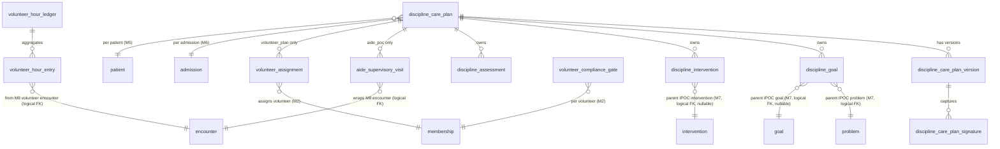
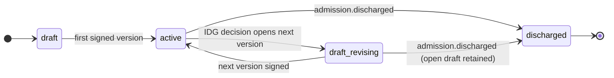
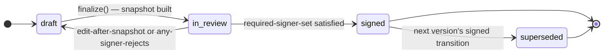

# Module 15 — Discipline Care Plans Specification

**Module ID:** 15
**Phase:** 1 (v1 — required for Engrace go-live; CoP 418.56(a) discipline contribution, 418.64 core services, 418.76 hospice aide 14-day RN supervision, 418.78 volunteer compliance + time-cost reporting)
**Depends on:** 6 (Admission, Election & Certification — `admission.activated` outbox event seeds the four default discipline plan stubs; `admission.discharged` transitions the plans to `discharged`; admission state read via M6's `AdmissionStatusReader`), 7 (Care Plan — discipline plans **reference** M7's problems/goals/interventions via `parent_problem_id` / `parent_goal_id`; M15 consumes M7's `CarePlanReader` seam to populate the discipline-plan element picker; M7 does **not** depend on M15), 8 (Encounters & Visit Notes — discipline-visit narrative lives in M8 as `chha_visit` / `msw_assessment` / `msw_followup` / `chaplain_assessment` / `chaplain_visit` / `volunteer_visit` encounter types per M8 §2.2; M15 consumes M8's `SignedEncountersReader` and `BillableEncounterReader` for compliance counters and the volunteer-time aggregator; the 14-day aide-supervisory clock advances on an M8 `routine_visit` (discipline=`rn`) whose author opts in to the supervisory attestation modal owned by M15), 36 (Secure Messaging & Alerts — supervisory-overdue, gate-expiring, initial-assessment-overdue, IDG-applied alerts ride the M36 typed-alert payload), 38 (Clinical Terminology — SNOMED CT for ADL items + spiritual concerns + psychosocial-assessment concepts; ICD-10-CM for risk-factor coding in MSW psychosocial; value-set `asOfDate` lookups pinned at sign-time), 39 (Consent & Authorization — `42_cfr_part_2_release` consent gates SUD content in MSW psychosocial; a new `family_violence_disclosure_allowed` predicate registered by M15 with M3 consults M39 for the family-violence content; DPOA agent attribution on patient-stated discipline goals mirrors M7 D6), 40 (Master Data Management — discipline taxonomy used by the plan-kind ↔ author-role matrix; volunteer-role catalog for assignment). Transitively via M6: 1 (Foundation — `organization`, `withOrgContext`, `audit()` helper, outbox dispatcher, idempotency, RLS generator, BullMQ on Valkey), 2 (Identity — actor + role resolution; SESSION_POLICY step-up for plan-sign per the M7 sign-modal pattern), 3 (Authorization — `discipline_plan.*`, `volunteer_compliance.*`, `aide_supervisory.*`, `discipline_assessment.*` permission keys; new ABAC predicates `aide_supervisor_eligible`, `volunteer_compliance_active`, `family_violence_disclosure_allowed`; existing `caseload_or_scope` ∧ `discipline_scope` ∧ `sud_disclosure_allowed` reused), 4 (Audit — PHI write-audit trigger generator on every owned table; audit-read declaration on every PHI route; retention class `compliance`), 5 (Patient & Demographics — `patient` row, `privacy_flag` snapshot consumer for psychosocial content), 22 (Documents — discipline-plan PDF artifact via outbox).
**Consumed by:** 14 (IDG — packet builder reads `DisciplinePlanReader` for the per-discipline IDG one-pager described in architecture §11/§10.5.5: RN view, MSW view, Chaplain view, Aide view; IDG decisions emit `idg.decision_recorded` outbox events that M15's consumer applies as add/update/discontinue mutations on discipline-goal / discipline-intervention rows, mirroring the M7 pattern), 16 (Bereavement — caregiver-risk scoring inherits MSW psychosocial risk factors from the active MSW Plan via M15's `MswRiskFactorReader`), 17 (Scheduling & Route Optimization — pre-schedule gate consumes M15's `VolunteerComplianceProvider` per architecture §7.7 — a volunteer with any expired gate cannot be selected for visits; pre-schedule advisory reads `SupervisoryCadenceReader` so the day-view surfaces the next-supervisory-due date for aide visits), 22 (Documents — Aide POC PDF, MSW Plan PDF, Spiritual Care Plan PDF, Volunteer Plan PDF rendered from a typed payload M15 emits via outbox; M15 has no PDF code), 23 (Billing — Medicare — volunteer encounters are non-billable per M8's `BillableEncounterReader`; M15's volunteer-time aggregator feeds the CoP 418.78(e) compliance report consumed by M30/M33 alongside the cost-savings ratio), 27 (Cost Report — volunteer-hour and -cost-savings detail feed the §7.7 5% ratio computation; M27 provides the cost basis via a forward seam, deny-stub until M27 lands), 28 (FHIR Gateway — discipline plans projected as FHIR `CarePlan` resources with `category` discriminating Aide / MSW / Spiritual / Volunteer; discipline assessments projected as `QuestionnaireResponse`; the typed mapping ships now, the projection lands when M28 lands), 30 (HQRP & Quality — supervisory-on-time rate, MSW-assessment-on-time rate, chaplain-assessment-on-time rate, volunteer-compliance-gate-expiry rate read via M15's `DisciplineComplianceProvider`), 31 (Patient/Family Portal & Telehealth — patient-facing discipline-plan summary surface, consent-gated and SUD/family-violence redacted per M39), 33 (Reporting — operational dashboards: supervisory cadence, plan-on-time, volunteer 5% ratio trend, MSW caseload, chaplain coverage).
**Spec status:** Re-locked v0.3 (Phase-6 per-spec reconciliation; supersedes Locked v0.2)

## Remediation Changelog — Phase 6 reconciliation (v0.3, 2026-06-11)

Full disposition of every `audit/AUDIT_M07_M15.md` Module-15 finding (1 BLOCKER / 6 MAJOR / 5 MINOR).
A per-spec **build reconciliation**: the boundary violations, the dimensionally-broken CoP ratio, the
illegal partitioning, and the dangling M14 seam are fixed — the spec now passes `arch:fitness`
(checks 10/12) and is genuinely re-lockable.

| Finding | Sev | Resolution |
|---|---|---|
| **M15-F01** | BLOCKER | The seam **interfaces** consumed from M9/M27/M2 packages are relocated to the leaf `packages/domain/<area>` / `packages/types` and consumed via boot-registry deny-stubs (no compile-time import of a feature package, ADR-0005 D1/D2); the false "`arch:fitness` is green" claim is struck. Foundation helpers (1–4) are reached via `FOUNDATION_HELPER_PACKAGES` (no edge); the dependsOn delta is recorded in M15's consolidated dependsOn ADR (ADR-0005 D5). |
| **M15-F04** | MAJOR (CoP) | **The 5% volunteer ratio is hours ÷ hours** — numerator = volunteer hours (direct-care `volunteer_visit` durations **+** a typed `volunteer_admin_hours` source, replacing the unexplained `manual_adjustment`); denominator = **total patient-care HOURS of paid + contract staff** (M27/M23 staffing hours), **never dollars**. Dollars are confined to the separate **cost-savings evidence artifact** (ARCH-064). The contradicting "cost basis/dollars" prose (§1.2, §7.6, D8) is corrected to match the already-correct ledger math (§2.2.7). |
| **M15-F03** | MAJOR (CoP) | `chha_visit` creation/signing is **gated on an active, signed Aide POC** (§418.76(g) plan-before-care; with a documented same-day path where the RN authors + signs instructions before the first aide visit); an **annual aide-present observation clock per (aide × org)** with alerts is added (§418.76(h)); consecutive phone-only supervisions are capped. |
| **M15-F05** | MAJOR | `provider_entity_id` + `location_id` added to every plan/version/signature/goal/intervention/assessment/supervisory/assignment table (denormalized at bootstrap; the ledger already carried PE) with `(organization_id, provider_entity_id, …)` indexes — so `DisciplineComplianceProvider` is computable per-PE/location without forbidden cross-schema joins. **Passes `check-tenancy`.** |
| **M15-F06** | MAJOR | **`discipline_care_plan` and `discipline_assessment` un-partitioned** (current-state roots, ≤4 rows/admission) so their **partial unique indexes + PKs are legal** — PostgreSQL requires a partitioned table's unique constraints to include the partition key (ADR-0022 D1.1). D13/§3.6 corrected; no M15 table is partitioned, so no `partition.rotate` registration. **Passes `check-ddl-legality`.** |
| **M15-F07** | MAJOR | The M14→M15 IDG-decision contract is reconciled (ADR-0023): a **`discipline_plan_update` discriminator** is proposed to M14's locked decision envelope (version-gated via `payloadSchemaVersion`), and the topic name aligned to `m14.idg.decision_recorded`. M15's IDG-driven revision flow now binds to a real producer; M14 owner counter-signs. |
| **M15-F02** | MAJOR | Phase reconciled: an **ADR pulls M15 into Phase 1** because CoP 418.76/418.78 supervisory + volunteer enforcement is go-live-blocking for an agency using aides/volunteers (§23 traceability assigns this to M15) — recorded per ADR-0009, resolving the §20.A-vs-§23 tension. |
| M15-F08 | MINOR | `family_violence_disclosure` consent type filed for the M39 catalog (or re-based on the M5 `victim of abuse` PrivacyFlag + role predicate); default-deny fallback retained. |
| M15-F09 | MINOR | `CarePlanReader` seam-name reconciled with M7's actual published surface; a "consumer manifest changes required" note added per consumer (M14/M17 need their own manifest edits to consume M15). |
| M15-F10 | MINOR | Cursor pagination on PHI list routes; full per-queue retry/backoff/concurrency/DLQ + alert-as-code refs (ADR-0021). |
| M15-F11 | MINOR | STRIDE + DR Tier-2 declaration with **fail-CLOSED** volunteer/supervisory gate semantics during outage (an audited override, never fail-open booking of non-compliant volunteers). |
| M15-F12 | MINOR | Internal-quality nits: boolean column (not text); supervisory narrative ownership reconciled with D4 (`observationSummary`, not a second narrative home); canonical RLS/audit helper + `app.org_id` names; one seam/event file location; `spiritual_care_declined` immutability enforced by trigger. |

**Net:** the boundary BLOCKER is cleared, the CoP volunteer ratio is dimensionally correct, the
illegal partitioning is fixed (CI-verifiable), and the M14 seam is reconciled — M15 is re-lockable.

## Changelog

- **v0.2 (Locked)** — Initial publication at lock-grade. Instantiates the architecture §20.B module spec template. Resolves all fourteen open questions into binding decisions (§11). Defines the **shared `discipline_care_plan` row with per-discipline-kind TypeBox-typed `data` jsonb** spanning `aide_poc | msw_plan | spiritual_plan | volunteer_plan` (D1), the **hybrid versioning model** mirroring M7 D1 with immutable per-version `state_snapshot` jsonb and mutable working rows (D2), the **typed `SupervisoryCadence` constant catalog** with platform-floor 14-calendar-day Aide POC RN supervision per CoP 418.76 and tenant-tighten-only override semantics matching the M9 D2 / M11 D3 pattern (D3), the **explicit M8-owns-visit-narrative boundary** — the architecture §11 listing of `DisciplineVisit` was schematic; the visit *encounter* lives in M8 per its §2.2 enum, M15 owns the supervisory **attestation** as a discrete artifact linked to an M8 encounter via `source_encounter_id` (D4), the **parent-IPOC reference model with discipline-only refinement allowed** — every discipline goal carries a nullable `parent_goal_id` pointing at M7's `goal`, plus discipline-only fields for frequency, modality, and outcome; patient-stated/family-stated/agent-stated verbatim preservation mirrors M7 D6 (D5), the **separate `discipline_assessment` table partitioned by month with per-discipline TypeBox `data` jsonb** for MSW psychosocial / chaplain spiritual / aide environmental-ADL-baseline / volunteer relationship-building plan — explicitly distinct from M9's scored clinical scales (D6), the **`volunteer_compliance_gate` schema owned by M15 with `VolunteerComplianceProvider` seam published for M17 pre-schedule enforcement** matching architecture §7.7 verbatim (D7), the **5% time-cost ratio computed from M8 volunteer-encounter durations and M27 cost basis** with M27 wired through a deny-stub forward seam until M27 lands (D8), the **MSW psychosocial confidentiality model** routing SUD content through Module 39's `consent.evaluate` seam (same path M7 D7 uses) and adding a new `family_violence_disclosure_allowed` ABAC predicate registered by M15 with Module 3 (D9), the **bootstrap-on-`admission.activated` flow with per-kind initial-assessment clocks** (5-day for MSW/chaplain, 14-day initial supervisory-visit clock for Aide POC, on-assignment for Volunteer Plan; alerts and gates parallel M7 §1.1 enforcement model) (D10), the **per-plan-kind `RequiredSignerSet` constants** with RN Case Manager as the supervising-RN author for Aide POC and a lighter CHHA acknowledgment rather than a co-signature, MSW + RN cosign for MSW Plan, Chaplain-only sign for Spiritual Plan, Volunteer Coordinator + RN cosign for Volunteer Plan (D11), the **phase boundary** — Phase 1 ships M15 in full without M14 IDG-packet integration, M16 bereavement risk consumption, M17 schedule integration, M22 PDF rendering, M27 cost basis (deny-stub), and M28 FHIR projection (D12), the **`discipline_care_plan` partitioned by month on `created_at` matching M4 PHI-table conventions; versioning and signature and supervisory and compliance-gate tables non-partitioned per the M11 D12 logic** (D13), and the **proposed manifest patch** correcting `M15.dependsOn` from `[7, 8]` to `[6, 7, 8, 36, 38, 39, 40]` and populating `M15.ownedTables` with the eleven owned tables (D14). Wires the permission keys this module registers into Module 3 (§4.4), the four ABAC predicates this module registers into Module 3's named-predicate registry (§4.5), the BullMQ queue catalog (§4.6), the M36 typed-alert payloads (§4.7), and the destruction `eraseFn` registered with Module 4 (§8.5).
- **v0.1** — Drafted within the lock-grade pass; not separately published.

> **Phase boundary (binding):** Phase 1 delivers everything in this spec **except** the M14 IDG-packet integration (Module 14 owns; M15 publishes `DisciplinePlanReader` today), the M16 bereavement-risk consumption (Module 16 owns; M15 publishes `MswRiskFactorReader` today), the M17 pre-schedule gate consumption (Module 17 owns; M15 publishes `VolunteerComplianceProvider` and `SupervisoryCadenceReader` today), the M22 discipline-plan PDF rendering (Module 22 owns the render; M15 emits the typed payload via outbox), the M27 cost-report basis for the 5% time-cost ratio (Module 27 owns; deny-stub until M27 lands, dashboards show "cost basis unavailable" until then), and the M28 FHIR `CarePlan` / `QuestionnaireResponse` projections (Module 28 owns; M15 emits the typed mapping today). The "done" gate for M15 is: shared-base + per-kind-jsonb schema with TypeBox-validated discriminated union per plan kind, the four plan kinds wired with their required-signer constants, supervisory cadence enforcement with alert delivery via M36, volunteer compliance gates + scheduling-gate seam, MSW/chaplain initial-assessment timers, IDG decision consumer (against test-double publisher since M14 is later), parent-IPOC reference integrity, the five outbound seams (`DisciplinePlanReader`, `MswRiskFactorReader`, `VolunteerComplianceProvider`, `SupervisoryCadenceReader`, `DisciplineComplianceProvider`) registered at boot, and the test plan green — not gated on Modules 14/16/17/22/27/28 existing. The M9 `LatestAssessmentProvider` seam consumer for the MSW/chaplain decline-context view is wired today against the real M9 (M9 is already locked); the M14 IDG-decision seam is exercised against a test-double publisher; the M17 schedule-gate path is exercised against a test-double scheduler.

-----

## 1. Purpose & Scope

### 1.1 What This Module Does

Module 15 owns the **four discipline-specific care plans** that sit alongside Module 7's master Individualized Plan of Care (IPOC), each governed by its own CoP-driven content and cadence: the **Aide Plan of Care (Aide POC)** per CoP 418.76, the **MSW Plan** per CoP 418.64, the **Spiritual Care Plan** per CoP 418.64, and the **Volunteer Plan** per CoP 418.78. It is the place a surveyor expects to find the answer to *"what is this aide actually doing on each visit, who is supervising her, and when did the RN last lay eyes on her work?"* and *"can this hospice prove its volunteer hour-cost ratio meets the 5% floor?"* — questions M7's IPOC alone cannot answer because they are below the IDG layer and inside the discipline-specific tradecraft.

- **Discipline-plan root** — one active `discipline_care_plan` per (admission × kind) where `kind ∈ {aide_poc, msw_plan, spiritual_plan, volunteer_plan}`. Aide POC, MSW Plan, and Spiritual Plan stubs are created automatically on `admission.activated` (Module 6 outbox); the Volunteer Plan stub is created lazily on first volunteer assignment because not every patient gets a volunteer. Plans transition to `discharged` on `admission.discharged`.
- **Hybrid versioning** — discipline-goal and discipline-intervention rows are **mutable** the assigned clinician edits over time. Each signed version is an **immutable state snapshot** (`discipline_care_plan_version.state_snapshot` jsonb). The surveyor who asks *"what was Mr. Whitfield's Aide POC on day 47?"* gets a deterministic answer; the clinician never sees the versioned rows. This is the M7 hybrid model verbatim.
- **Parent-IPOC reference with discipline refinement** — every discipline goal carries `parent_goal_id` referring to an M7 `goal` row (nullable; the discipline may add a discipline-only goal where the IPOC has no corresponding entry). Discipline interventions carry `parent_intervention_id` similarly. Discipline-only fields — frequency-per-task, modality, acceptable-outcome — live on the discipline row. Edits to the parent IPOC propagate as advisory-only references; the discipline plan retains its own version history independently.
- **Per-discipline content shape** — a single `data jsonb` column carries the kind-specific structured content, validated by a per-kind TypeBox module under `packages/discipline-plans/src/kinds/<kind>/schema.ts`. The shapes are:
  - **Aide POC** — ADL task list (bathing, dressing, grooming, toileting, ambulation, transfers, feeding, oral hygiene, skin care, light housekeeping incident to care, meal preparation incident to care) with per-task frequency, technique notes, precautions, contraindications; assigned aide membership reference; supervising RN membership reference; supervisory-visit cadence override (≤14 days, tenant-tightenable only); ADL terminology codes (SNOMED via M38).
  - **MSW Plan** — psychosocial-assessment-derived focus areas (caregiver burden, financial strain, advance-directive readiness, family conflict, anticipated bereavement-risk factors, social isolation, housing security, capacity for self-care or surrogate decision-making); per-focus interventions (counseling, resource referral, family meeting, advance-directive education); risk-factor flags consumed downstream by M16's `BereavementRiskScorer` (forward read).
  - **Spiritual Care Plan** — faith tradition (open value set, no compulsion); spiritual concerns (meaning-making, reconciliation, ritual access, anticipatory grief, family spiritual support); per-concern interventions (presence, prayer/ritual support if requested, referral to external clergy, hymn/sacred-text reading, life-review facilitation); explicit "no spiritual-care-desired" choice with same-record preservation if family later requests engagement.
  - **Volunteer Plan** — assigned volunteer membership(s); patient-facing activities (companionship visits, errands as documented allowable, light caregiver respite, vigil presence, life-review/memoir support, pet therapy if certified); duration per visit; coordinator-cadence check-ins; explicit out-of-scope list (no clinical care, no medication administration, no body care, no patient transport off premises without separate documented authorization, no signing of any clinical record); compliance-gate snapshot at plan finalization (background-check status, TB screening, training, confidentiality agreement, vaccination status as agency policy requires).
- **Supervisory-visit attestation (Aide POC, CoP 418.76)** — every 14 calendar days (platform floor, tenant-tightenable) the supervising RN must complete a supervisory visit with the aide present *or* a supervisory observation visit at the patient's home reviewing the aide's recent work. The supervisory attestation is an M15-owned `aide_supervisory_visit` row linked to an M8 encounter (the encounter carries the narrative; the M15 row carries the attestation that this encounter was the supervisory contact, the observations of the aide's performance, the corrective actions if any, and the next-due date). Alerts at day 12 (due), day 14 (overdue), encounter-sign gate at day 16 (2-day grace).
- **Per-plan-kind initial-assessment clocks** — MSW initial psychosocial assessment within 5 calendar days of `admission.activated` (CoP 418.54(c) comprehensive assessment includes psychosocial); chaplain initial spiritual assessment within 5 calendar days of `admission.activated` *unless* the patient/family declines spiritual care, captured as a typed declination on the spiritual plan record; aide initial visit + Aide POC sign within 14 calendar days of first aide scheduling (the supervising RN authors); volunteer plan finalized within 5 business days of volunteer assignment.
- **Volunteer compliance gates as scheduling preconditions (CoP 418.78)** — M15 owns the `volunteer_compliance_gate` table holding per-(volunteer membership × gate kind) status, validity windows, and source-document references. Module 17 consumes the `VolunteerComplianceProvider` seam at pre-schedule time; a volunteer with any expired or missing gate is rejected by the scheduler with `VOLUNTEER_GATE_UNMET` error envelope. Gates auto-flip the volunteer's effective status to `inactive` on any expiry; Volunteer Coordinator receives 30/14/7/1-day advance alerts via M36.
- **Volunteer hours and 5% ratio (CoP 418.78(e)) — M15-F04 corrected.** The regulation requires
  volunteer services to equal **≥5% of the total patient-care HOURS** of all paid employees and
  contract staff. The ratio is therefore **hours ÷ hours**: numerator = volunteer hours (both direct
  patient-care *and* day-to-day administrative volunteer time — see the numerator note below);
  denominator = **total patient-care hours** of paid + contract staff, supplied by M27/M23 staffing
  hours. **Dollars are NOT the denominator** (minutes ÷ dollars is meaningless); the separate
  **cost-savings evidence artifact** (ARCH-064) uses dollars and is a distinct surface, not the
  compliance ratio. The ratio surfaces in the M33 operator dashboard with a status badge (≥5% green;
  3–5% yellow with corrective-action prompt; <3% red with escalation to DON + Compliance Officer).
  - **Numerator scope:** volunteer `volunteer_visit` encounter durations (M8) **plus** administrative
    volunteer hours captured via a typed `volunteer_admin_hours` entry source (replacing the
    unexplained `manual_adjustment`), both feeding `volunteer_hour_ledger`.
- **IDG-driven revisions** — M14 records IDG meeting decisions; clinically-actionable decisions emit `idg.decision_recorded` outbox events with typed payloads pointing at a specific discipline plan (`target_kind: 'discipline_care_plan'`, `plan_kind: 'aide_poc'`, etc.). M15's consumer creates a draft next-version with the decisions applied and notifies the assigned clinician + the IDG coordinator to finalize and route for signing. Seam published in `packages/domain/discipline-plans/idg-decision.ts` so M14's payload is compile-time type-checked. Idempotency is keyed on `idg_decision_id`.
- **Discipline-discipline contribution boundaries** — RBAC + ABAC enforce that an MSW cannot author the Aide POC, a chaplain cannot author the MSW Plan, a CHHA cannot author the Volunteer Plan, etc. The IDG Coordinator is the cross-discipline exception (mirrors M7 §7.4) and may author for any kind with `warn`-severity audit. The Clinical Supervisor may author the Aide POC if the assigned supervising RN is unavailable; in such cases the assigned RN re-signs on return-to-work, audited.
- **DPOA-attributed entries** — when an active `dpoa_healthcare` consent (Module 39) names an agent, M15 captures `acting_as ∈ {patient, patient_representative}` and `consent_id` on representative-authored discipline goals. UI shows the agent name; audit captures consent state at write time (consent-version-aware audit per Module 39 architecture).
- **SUD + family-violence confidentiality on MSW psychosocial content** — MSW psychosocial assessments commonly disclose SUD history and family-violence factors. M15 routes both through Module 39's `consent.evaluate` seam: existing `sud_disclosure_allowed` predicate (registered by M7) for SUD content; new `family_violence_disclosure_allowed` predicate (registered by M15 — D9) for family-violence flags. SQL-level WHERE filtering on read paths (not post-fetch redaction).
- **Audit trail per discipline-plan revision** — every discipline-goal / discipline-intervention / discipline-assessment mutation flows through the Module 4 PHI write-audit trigger with column-level scrubbing (free-text narrative fields are denylisted from value capture; the `<changed>` marker is recorded). Every signing event and every supervisory attestation is a discrete audit event.

### 1.2 What This Module Does Not Do

- **The master IPOC.** Module 7 owns the IPOC, its problems/goals/interventions, the 5-day initial gate, and the 15-day IDG review gate. M15's plans **reference** M7 elements; M15 does not redefine them. M7 does not depend on M15.
- **The IDG meeting itself.** Module 14 owns `idg_meeting`, attendance, agenda, decisions, minutes, and the IDG patient packet. M15 *consumes* IDG decisions via outbox; it does not author them.
- **Clinical assessments (PPS, FAST, PAINAD, ESAS-r, comprehensive scales).** Module 9 owns those. M15 reads the latest scores from M9 via the `LatestAssessmentProvider` seam when assembling the MSW Plan decline-context view or the chaplain's anticipatory-grief context — but the assessment row itself lives in M9.
- **Encounter / visit-note narrative.** Module 8 owns visit notes. The architecture §11 listing of `DisciplineVisit` was schematic — the *visit encounter* lives in M8 as `chha_visit` / `msw_assessment` / `msw_followup` / `chaplain_assessment` / `chaplain_visit` / `volunteer_visit`. M15 owns the **supervisory attestation** (the wrapping artifact that links an M8 encounter to the 14-day cadence clock), not the visit itself. This boundary is enforced by ownership (M15 cannot import M8's encounter schema; it reads via the published `SignedEncountersReader` seam).
- **Aide / volunteer scheduling.** Module 17 owns scheduling. M15 *informs* scheduling: (a) the `VolunteerComplianceProvider` seam blocks scheduling of a volunteer whose gates are unmet; (b) the `SupervisoryCadenceReader` seam advises the day view of the next-due supervisory visit. The actual schedule is M17's.
- **Bereavement risk model.** Module 16 owns the post-death 13-month bereavement plan and the caregiver-risk score. M15 *exposes* the MSW psychosocial risk factors via `MswRiskFactorReader` for M16 to read; M15 does not compute the bereavement score itself.
- **Volunteer identity / training records / vaccination records.** Module 2 owns user/membership identity and credentials. M15 owns the *gate status* and the *source-document reference*; the document storage lives in Module 22; the underlying training/credential record lives in Module 2's training adapter (when built; today M15 accepts a `source_doc_id` + a typed gate-kind and treats the gate as the source of truth for scheduling purposes).
- **The denominator for the 5% volunteer ratio (M15-F04).** The 5% ratio denominator is **total
  patient-care HOURS of paid + contract staff** (the §418.78(e) basis), supplied by M27/M23 staffing
  hours via a forward seam. M15 aggregates volunteer *hours* (numerator); the denominator is *hours*,
  not dollars. (Module 27 separately owns the **cost-savings dollar** calculation — that is the
  ARCH-064 evidence artifact, a different surface from the compliance ratio.) Until the staffing-hours
  seam lands, the ratio surfaces as null with "patient-care-hours basis unavailable" per the phase
  boundary above.
- **Discipline-plan PDF generation.** Module 22 renders using a domain payload M15 emits via outbox. M15 has no PDF code.
- **FHIR projections.** Module 28 maps discipline plans to FHIR `CarePlan` with `category` distinguishing Aide / MSW / Spiritual / Volunteer; discipline assessments map to `QuestionnaireResponse`. M15 emits the typed domain payload.
- **Patient/family portal surface.** Module 31 reads the patient-shareable summary via a documented endpoint. M15 produces the summary; M31 renders it.

### 1.3 Regulatory Drivers

| Driver | Requirement | How Module 15 satisfies it |
|---|---|---|
| 42 CFR §418.56(a) | Interdisciplinary approach to care planning | Per-discipline plan kinds with discipline-stamped goals/interventions; cross-discipline view via `DisciplinePlanReader` for M14 IDG packet |
| 42 CFR §418.56(b)(3) | IDG composition includes RN, MD/MDirector, MSW, counselor (chaplain) | Per-kind required-signer constants align with IDG composition; the IDG-review-version sign quorum on the parent IPOC (M7) is independent and unaffected |
| 42 CFR §418.64 | Core services availability — nursing, MSW, counseling (incl. spiritual), physician | M15's MSW Plan + Spiritual Plan are the auditable artifacts proving MSW and counseling service availability per patient; absence of an MSW Plan beyond day 5 of admission is an open M30 compliance window |
| 42 CFR §418.76(a) | Hospice aide qualifications and supervision | Aide membership reference on the Aide POC validates aide is credentialed (M2 credentialing read); supervising RN reference is required |
| 42 CFR §418.76(h)(1) | RN supervisory visit no less frequently than every 14 days | `aide_supervisory_visit` row with 14-day cadence; alert/escalation/encounter-sign-gate model parallel to M7 15-day review; cadence is a typed constant, tenant-tightenable to ≤14 days but never weakened |
| 42 CFR §418.76(h)(2) | RN supervisory visit may be aide-present or observation-of-work | `attestation_mode ∈ {aide_present, observation_of_work}` |
| 42 CFR §418.78(a) | Volunteers in defined roles under qualified supervision | Volunteer Plan names patient-assigned activities + supervising Coordinator; out-of-scope list is closed and enforced |
| 42 CFR §418.78(b)(1) | Background check and training documented | Per-(volunteer × gate-kind) gates: `background_check`, `initial_training`, `confidentiality_agreement`, `tb_screening`, `annual_ce`, `vaccination_status` |
| 42 CFR §418.78(d) | Volunteer recordkeeping | M15's gates table is the canonical record of compliance posture; M22 stores source documents |
| 42 CFR §418.78(e) | ≥5% volunteer-hour-cost ratio floor | `volunteer_hour_ledger` aggregator + M27 cost basis feed `VolunteerCostSavingsProvider`; M30/M33 dashboards |
| 42 CFR §418.104(a) | Clinical records — completeness, authentication, retention | Multi-signer authentication per kind; immutable `state_snapshot`; M4 retention class `compliance` |
| HIPAA §164.502(b) | Minimum necessary | Patient-shareable summary strips clinical-internal fields; ABAC caseload + discipline scope; SUD + family-violence SQL filter |
| 42 CFR Part 2 | SUD confidentiality | M39 `consent.evaluate` via `sud_disclosure_allowed`; SQL-level WHERE filter |
| State family-violence disclosure | State-mandated reporting flows; non-disclosure per documented safety plan | New `family_violence_disclosure_allowed` predicate; SQL-level filter on `family_violence_flag=true` content |
| HIPAA §164.312(b) | Audit controls | M4 PHI write-audit trigger on every owned table; per-signature and per-supervisory-attestation events |

### 1.4 Competitive Context

WellSky, MatrixCare, HCHB, and FireNote/Axxess all ship discipline plans, but in every case the common pattern is **a free-text narrative per discipline tied to the IPOC by convention, with the 14-day RN supervisory visit captured as a free-form note on a routine RN visit**. There is no first-class "aide supervisory attestation" record; surveyors reconstruct it by reading every RN visit narrative looking for the phrase "supervisory visit." There is no first-class volunteer compliance gate; volunteer coordinators maintain spreadsheets. There is no first-class 5% time-cost ratio calculation; agencies hand-build it for the cost report.

WardenX makes the supervisory visit a discrete record with a typed cadence clock and an encounter-sign gate when overdue. WardenX makes the volunteer compliance gates a first-class scheduling precondition: an expired TB screening flips the volunteer to inactive automatically and the scheduler refuses the assignment. WardenX computes the 5% ratio continuously and surfaces the trend before the cost report submits. The IDG packet pulls the active discipline plan summary natively rather than re-typing it. This is the differentiated surface for hospice operators who have lost time and survey points to FireNote's "audit by free-text-search" pattern.

-----

## 2. Domain Model

### 2.1 Entity-Relationship Diagram



The diagram is logical. M5 / M6 / M7 / M8 / M2 entities are referenced by logical FK columns; M15 does **not** import those modules' Drizzle schemas (per architecture-fitness §25.15). Cross-module reads go through the owners' published reader seams.

### 2.2 Per-Entity Lifecycle

#### 2.2.1 `discipline_care_plan` — the plan root

One row per `(admission_id, kind)`. Bootstrapped on `admission.activated` for `aide_poc | msw_plan | spiritual_plan`; created on first volunteer assignment for `volunteer_plan`.



#### 2.2.2 `discipline_care_plan_version` — versioning + signing

The hybrid model from M7 D1 verbatim. A version transitions `draft → in_review → signed → superseded`. The `state_snapshot` jsonb is sealed at the `in_review` transition; subsequent edits to the underlying goal/intervention/assessment rows do not affect the snapshot. After the first signer signs, further edits return the version to `draft` and clear prior signatures (per M7's version re-sign rule).



The `kind` enum on `discipline_care_plan_version.kind` mirrors M7's: `initial | idg_review | interim_revision | discharge`. The discharge version is auto-built and auto-signed by the system actor on `admission.discharged` to preserve the historical state at termination.

#### 2.2.3 `discipline_goal`, `discipline_intervention`, `discipline_assessment` — status

- `discipline_goal.status ∈ {not_started, in_progress, met, not_met, revised, discontinued}` — patient/family/agent-stated `original_text` immutable after creation (M7 D6 pattern).
- `discipline_intervention.status ∈ {active, discontinued, completed}` — discontinuation requires a reason.
- `discipline_assessment.status ∈ {draft, signed, amended}` — append-only correction-of-record mirroring M9 D9.

#### 2.2.4 `aide_supervisory_visit` — Aide POC only

Captures the CoP 418.76(h) attestation. Mandatory: `aide_membership_id`, `supervising_rn_membership_id`, `source_encounter_id` (logical FK to M8, nullable only for documented phone-supervision edge cases — those do NOT advance the 14-day clock and are tracked separately for survey discoverability), `attestation_mode ∈ {aide_present, observation_of_work}`, `aide_performance_satisfactory`, `corrective_actions` (≥40 chars when performance unsatisfactory), `next_due_at`. On insert, the parent plan's `next_supervisory_due_at` is recomputed.

#### 2.2.5 `volunteer_assignment`

Per (`discipline_care_plan_id`, `volunteer_membership_id`). Many-to-many: a patient may have multiple volunteers; a volunteer may serve multiple patients. Each assignment carries its activities subset, start/end, coordinator acknowledgment. Volunteer status flips to `inactive` when any gate expires; `effectiveStatus` exposed via the seam.

#### 2.2.6 `volunteer_compliance_gate` — per-volunteer × per-gate-kind

Schema-enforced one-row-per-(membership × gate_kind × validity_window). Status: `satisfied | expiring_soon | expired | revoked | not_yet_satisfied`. `expiring_soon` is derived nightly by cron 30 days ahead of `valid_until`; it does not block scheduling but does deliver 30/14/7/1-day M36 alerts.

#### 2.2.7 `volunteer_hour_ledger` + `volunteer_hour_entry` — 5% ratio

Materialized: one ledger row per `(provider_entity_id, fiscal_year)` with `total_volunteer_hour_minutes` and `as_of_at`. Entry rows are append-only. Recomputed nightly + on-demand. The ratio is computed at read time as `total_volunteer_hour_minutes / (total_patient_care_hour_minutes from M27)`. Until M27 lands, the denominator is unavailable and the ratio surfaces as null with the explicit "cost basis unavailable" badge.

### 2.3 Validation Rules

- A `discipline_care_plan` may exist only with a corresponding active or recently-discharged `admission` (logical FK; enforced via Module 6 reader at write time).
- An `aide_poc` plan requires non-null `aide_membership_id` AND `supervising_rn_membership_id` on its current draft before a version can transition to `in_review`. Both memberships must hold the correct role and have current credentials per M2 at that moment.
- A `volunteer_plan` requires at least one active `volunteer_assignment` before a version transitions to `in_review`.
- A `discipline_goal.source ∈ {patient_stated, family_stated, agent_stated}` has immutable `original_text` (DB CHECK + service guard + audit-trigger refusal of UPDATE that modifies `original_text`).
- A `discipline_goal.source='agent_stated'` requires non-null `acting_consent_id` referring to an active `dpoa_healthcare` consent at write time (verified via M39 `consent.evaluate`).
- An `aide_supervisory_visit.source_encounter_id` must reference an M8 encounter authored by the supervising RN within the same organization.
- `aide_supervisory_visit.next_due_at = supervisory_at + cadence_days` where `cadence_days = COALESCE(tenant_override, 14)`. Tenant override may only tighten; `cadence_days > 14` is rejected as policy violation.
- A `volunteer_assignment` is insertable only when every `volunteer_compliance_gate` for the volunteer is `satisfied` (ABAC `volunteer_compliance_active` predicate + SQL stored-function CHECK).
- A `discipline_assessment` of kind `msw_psychosocial` with `family_violence_flag=true` requires the `family_violence_disclosure_allowed` predicate to evaluate true for the caller; reads apply the same predicate as a WHERE filter.
- A `discipline_care_plan_version.state_snapshot` is sealed at `in_review`; subsequent UPDATE attempts are denied by the audit trigger (immutability rule).
- Required-signer set evaluated at sign time against the captured `state_snapshot.required_signer_set`; mismatches return `INSUFFICIENT_SIGNERS` (412).

### 2.4 Outbox Events

| Event type | When emitted | Payload | Subscribers |
|---|---|---|---|
| `m15.plan.bootstrapped` | New `discipline_care_plan` on `admission.activated` or volunteer-assignment | `{ planId, admissionId, patientId, kind, requiredSignerSet }` | M14, M33 |
| `m15.plan.version_signed` | Version `signed` transition | `{ planId, versionId, kind, versionKind, snapshot, signers }` | M22, M28, M14, M30, M33 |
| `m15.plan.discharged` | Plan `discharged` transition | `{ planId, admissionId, kind, finalSnapshotVersionId }` | M16, M22, M30, M33 |
| `m15.aide_supervisory.completed` | New `aide_supervisory_visit` row | `{ planId, supervisoryVisitId, aideMembershipId, supervisingRnMembershipId, attestationMode, performanceSatisfactory, nextDueAt }` | M30, M33, M36 |
| `m15.aide_supervisory.overdue` | Cron detects overdue | `{ planId, hoursOverdue, severity }` | M36 |
| `m15.msw.assessment_initial_overdue` | Cron detects 5-day MSW clock elapsed | `{ planId, admissionId, daysOverdue, severity }` | M36 |
| `m15.chaplain.assessment_initial_overdue` | Cron detects 5-day chaplain clock without signed or declined | `{ planId, admissionId, daysOverdue }` | M36 |
| `m15.volunteer.gate_expiring` | Cron detects gate `valid_until ≤ N days` for N ∈ {30,14,7,1} | `{ volunteerMembershipId, gateKind, validUntil, daysOut, severity }` | M36 |
| `m15.volunteer.gate_expired` | Cron flips gate to `expired` | `{ volunteerMembershipId, gateKind, expiredAt, openAssignmentsCount }` | M36 |
| `m15.volunteer.assignment_inactivated` | Volunteer status flips to inactive | `{ volunteerMembershipId, affectedPlanIds, reason }` | M17, M33, M36 |
| `m15.volunteer.ratio_recomputed` | Nightly ledger refresh | `{ providerEntityId, fiscalYear, hoursMinutes, status }` | M33, M30 |
| `m15.idg_decision.applied` | IDG decision consumer applied | `{ planId, versionId, idgDecisionId, mutationsApplied }` | M14 |
| `m15.discipline_assessment.amended` | Amendment signed | `{ planId, assessmentId, kind, amendedFields, attestation }` | M22, M30 |

Idempotency keys derived: `m15.plan.bootstrapped` on `planId`; `m15.aide_supervisory.completed` on `supervisoryVisitId`; `m15.idg_decision.applied` on `idgDecisionId`.

### 2.5 Concurrency — Optimistic with `version` Column

Every mutable M15 table carries `version bigint NOT NULL DEFAULT 0`. PATCH routes require `If-Match: <version>`; mismatched versions return 412 with the current row state. Pattern mirrors M7 §7.7 and M9 D11 verbatim.

-----

## 3. Drizzle Schema

### 3.1 Package Layout

```
apps/backend/src/modules/15-discipline-care-plans/
├── routes/                    # plans, versions, signatures, goals, interventions, assessments,
│                              # aide-supervisory, volunteer-assignments, volunteer-gates,
│                              # volunteer-hours, summary
├── services/                  # version-lifecycle, required-signer-set, snapshot,
│                              # supervisory-cadence, initial-assessment-clock,
│                              # idg-decision-consumer, volunteer-effective-status,
│                              # volunteer-hour-aggregator, volunteer-ratio,
│                              # encounter-relevance, summary-builder
├── workers/                   # supervisory-overdue.cron, msw-initial-overdue.cron,
│                              # chaplain-initial-overdue.cron, volunteer-gate-watcher.cron,
│                              # volunteer-hour-aggregator.cron, idg-decision.worker,
│                              # discharge.worker, bootstrap.worker
└── boot.ts

packages/db/src/schema/discipline-plans/
├── discipline-care-plans.ts          discipline-care-plan-versions.ts
├── discipline-care-plan-signatures.ts discipline-goals.ts
├── discipline-interventions.ts        discipline-assessments.ts
├── aide-supervisory-visits.ts         volunteer-assignments.ts
├── volunteer-compliance-gates.ts      volunteer-hour-ledger.ts
└── volunteer-hour-entries.ts

packages/discipline-plans/             # shared domain + per-kind TypeBox
├── src/kinds/<kind>/{schema,required-signers,validators}.ts
├── src/cadence/{supervisory-cadence,initial-assessment}.ts
├── src/seams.ts                       # 5 outbound seam interfaces
└── src/events.ts                      # outbox payload types
```

### 3.2 Enums

```typescript
// packages/db/src/enums.ts (additions for M15)
import { pgEnum } from 'drizzle-orm/pg-core'

export const disciplinePlanKind = pgEnum('discipline_plan_kind', [
  'aide_poc', 'msw_plan', 'spiritual_plan', 'volunteer_plan',
])
export const disciplinePlanStatus = pgEnum('discipline_plan_status', [
  'draft', 'active', 'draft_revising', 'discharged',
])
export const disciplinePlanVersionStatus = pgEnum('discipline_plan_version_status', [
  'draft', 'in_review', 'signed', 'superseded',
])
export const disciplinePlanVersionKind = pgEnum('discipline_plan_version_kind', [
  'initial', 'idg_review', 'interim_revision', 'discharge',
])
export const disciplineGoalSource = pgEnum('discipline_goal_source', [
  'clinical', 'patient_stated', 'family_stated', 'agent_stated',
])
export const disciplineGoalStatus = pgEnum('discipline_goal_status', [
  'not_started', 'in_progress', 'met', 'not_met', 'revised', 'discontinued',
])
export const disciplineInterventionStatus = pgEnum('discipline_intervention_status', [
  'active', 'discontinued', 'completed',
])
export const disciplineAssessmentKind = pgEnum('discipline_assessment_kind', [
  'msw_psychosocial', 'chaplain_spiritual', 'aide_environmental', 'volunteer_relationship',
])
export const disciplineAssessmentStatus = pgEnum('discipline_assessment_status', [
  'draft', 'signed', 'amended',
])
export const aideSupervisoryAttestationMode = pgEnum('aide_supervisory_attestation_mode', [
  'aide_present', 'observation_of_work',
])
export const volunteerGateKind = pgEnum('volunteer_gate_kind', [
  'background_check', 'tb_screening', 'confidentiality_agreement',
  'initial_training', 'annual_ce', 'assignment_specific_training', 'vaccination_status',
])
export const volunteerGateStatus = pgEnum('volunteer_gate_status', [
  'satisfied', 'expiring_soon', 'expired', 'revoked', 'not_yet_satisfied',
])
export const volunteerHourEntrySource = pgEnum('volunteer_hour_entry_source', [
  'encounter', 'manual_adjustment',
])
```

### 3.3 Core Tables

```typescript
// packages/db/src/schema/discipline-plans/discipline-care-plans.ts
import { pgTable, uuid, timestamp, text, bigint, index, uniqueIndex } from 'drizzle-orm/pg-core'
import { sql } from 'drizzle-orm'
import { organizations } from '../organizations'
import { disciplinePlanKind, disciplinePlanStatus } from '../../enums'

/** M15-F06 / ADR-0022 D1.1: NOT partitioned. `discipline_care_plan` is a current-state ROOT table
 *  (≤4 rows per admission) — its partial unique index `(organization_id, admission_id, kind) WHERE
 *  status <> 'discharged'` and the uuid PK cannot coexist with a `created_at` RANGE partition (a
 *  partitioned table's unique constraints must include the partition key). Volumes are trivial, so
 *  the table stays unpartitioned and the active-row uniqueness is preserved. */
export const disciplineCarePlan = pgTable('discipline_care_plan', {
  id: uuid('id').primaryKey().defaultRandom(),
  organizationId: uuid('organization_id').notNull()
    .references(() => organizations.id, { onDelete: 'restrict' }),
  patientId: uuid('patient_id').notNull(),               // M5 logical FK
  admissionId: uuid('admission_id').notNull(),           // M6 logical FK
  // M15-F05 / ADR-0010: PE/location carried directly (denormalized from the admission at bootstrap),
  // so DisciplineComplianceProvider.supervisoryOnTimeRate(scope) and listOverdueSupervisory can be
  // computed per-PE/location without forbidden joins through M5/M6 schemas. Same two columns added to
  // every plan/version/signature/goal/intervention/assessment/supervisory/assignment table (the
  // ledger already carried provider_entity_id). Index `(organization_id, provider_entity_id, …)`.
  providerEntityId: uuid('provider_entity_id').notNull(),  // M1/M40 logical FK
  locationId: uuid('location_id').notNull(),               // M1 logical FK
  kind: disciplinePlanKind('kind').notNull(),
  status: disciplinePlanStatus('status').notNull().default('draft'),
  aideMembershipId: uuid('aide_membership_id'),                       // aide_poc only
  supervisingRnMembershipId: uuid('supervising_rn_membership_id'),    // aide_poc only
  nextSupervisoryDueAt: timestamp('next_supervisory_due_at', { withTimezone: true }),
  supervisoryCadenceDaysOverride: bigint('supervisory_cadence_days_override', { mode: 'number' }),
  initialAssessmentClockStartedAt: timestamp('initial_assessment_clock_started_at', { withTimezone: true }),
  initialAssessmentSignedAt: timestamp('initial_assessment_signed_at', { withTimezone: true }),
  spiritualCareDeclined: text('spiritual_care_declined'),  // denylisted from audit
  spiritualCareDeclinedAt: timestamp('spiritual_care_declined_at', { withTimezone: true }),
  createdAt: timestamp('created_at', { withTimezone: true }).notNull().defaultNow(),
  updatedAt: timestamp('updated_at', { withTimezone: true }).notNull().defaultNow(),
  dischargedAt: timestamp('discharged_at', { withTimezone: true }),
  version: bigint('version', { mode: 'number' }).notNull().default(0),
}, (t) => ({
  activeAdmissionKindUq: uniqueIndex('discipline_care_plan_admission_kind_active_uq')
    .on(t.organizationId, t.admissionId, t.kind)
    .where(sql`status <> 'discharged'`),
  patientKindIdx: index('discipline_care_plan_patient_kind_idx')
    .on(t.organizationId, t.patientId, t.kind, t.status),
  supervisoryDueIdx: index('discipline_care_plan_supervisory_due_idx')
    .on(t.organizationId, t.nextSupervisoryDueAt)
    .where(sql`kind = 'aide_poc' AND status = 'active'`),
  cadenceOverrideCheck:
    sql`CHECK (supervisory_cadence_days_override IS NULL
               OR (supervisory_cadence_days_override >= 1 AND supervisory_cadence_days_override <= 14))`,
}))
```

```typescript
// packages/db/src/schema/discipline-plans/discipline-care-plan-versions.ts
export const disciplineCarePlanVersion = pgTable('discipline_care_plan_version', {
  id: uuid('id').primaryKey().defaultRandom(),
  organizationId: uuid('organization_id').notNull()
    .references(() => organizations.id, { onDelete: 'restrict' }),
  planId: uuid('plan_id').notNull()
    .references(() => disciplineCarePlan.id, { onDelete: 'restrict' }),
  sequence: bigint('sequence', { mode: 'number' }).notNull(),  // 1-based monotonic per plan
  status: disciplinePlanVersionStatus('status').notNull().default('draft'),
  kind: disciplinePlanVersionKind('kind').notNull(),
  stateSnapshot: jsonb('state_snapshot'),    // sealed at in_review; UPDATE refused thereafter
  requiredSignerSet: jsonb('required_signer_set'),
  idgMeetingId: uuid('idg_meeting_id'),       // M14 logical FK; idg_review kind only
  finalizedAt: timestamp('finalized_at', { withTimezone: true }),
  signedAt: timestamp('signed_at', { withTimezone: true }),
  supersededAt: timestamp('superseded_at', { withTimezone: true }),
  createdAt: timestamp('created_at', { withTimezone: true }).notNull().defaultNow(),
  updatedAt: timestamp('updated_at', { withTimezone: true }).notNull().defaultNow(),
  version: bigint('version', { mode: 'number' }).notNull().default(0),
}, (t) => ({
  planStatusIdx: index('discipline_care_plan_version_plan_status_idx')
    .on(t.organizationId, t.planId, t.status),
  planSequenceIdx: index('discipline_care_plan_version_plan_sequence_idx')
    .on(t.organizationId, t.planId, t.sequence),
}))
```

```typescript
// packages/db/src/schema/discipline-plans/discipline-care-plan-signatures.ts
export const disciplineCarePlanSignature = pgTable('discipline_care_plan_signature', {
  id: uuid('id').primaryKey().defaultRandom(),
  organizationId: uuid('organization_id').notNull()
    .references(() => organizations.id, { onDelete: 'restrict' }),
  versionId: uuid('version_id').notNull()
    .references(() => disciplineCarePlanVersion.id, { onDelete: 'restrict' }),
  signerMembershipId: uuid('signer_membership_id').notNull(),  // M2 logical FK
  signerRole: text('signer_role').notNull(),
  isAcknowledgment: text('is_acknowledgment').notNull().default('false'),  // CHHA Aide POC ack
  signedAt: timestamp('signed_at', { withTimezone: true }).notNull().defaultNow(),
  attestationText: text('attestation_text').notNull(),
  sessionClass: text('session_class'),
  ipAddress: text('ip_address'),
  userAgent: text('user_agent'),
}, (t) => ({
  versionRoleUq: uniqueIndex('discipline_care_plan_signature_version_role_uq')
    .on(t.versionId, t.signerRole),
  versionIdx: index('discipline_care_plan_signature_version_idx')
    .on(t.organizationId, t.versionId, t.signerRole),
}))
```

```typescript
// packages/db/src/schema/discipline-plans/discipline-goals.ts
export const disciplineGoal = pgTable('discipline_goal', {
  id: uuid('id').primaryKey().defaultRandom(),
  organizationId: uuid('organization_id').notNull()
    .references(() => organizations.id, { onDelete: 'restrict' }),
  planId: uuid('plan_id').notNull()
    .references(() => disciplineCarePlan.id, { onDelete: 'restrict' }),
  parentGoalId: uuid('parent_goal_id'),              // M7 logical FK, nullable
  parentProblemId: uuid('parent_problem_id'),        // M7 logical FK, nullable
  source: disciplineGoalSource('source').notNull(),
  status: disciplineGoalStatus('status').notNull().default('not_started'),
  originalText: text('original_text').notNull(),     // immutable
  revisedText: text('revised_text'),
  measurableOutcome: text('measurable_outcome'),
  targetAt: timestamp('target_at', { withTimezone: true }),
  frequencyText: text('frequency_text'),
  frequencyValue: text('frequency_value'),           // '2:visit:week' pattern (M7)
  modalityText: text('modality_text'),
  actingConsentId: uuid('acting_consent_id'),        // M39 logical FK; required when source='agent_stated'
  addedByMembershipId: uuid('added_by_membership_id').notNull(),
  addedByDiscipline: text('added_by_discipline').notNull(),
  addedAt: timestamp('added_at', { withTimezone: true }).notNull().defaultNow(),
  createdAt: timestamp('created_at', { withTimezone: true }).notNull().defaultNow(),
  updatedAt: timestamp('updated_at', { withTimezone: true }).notNull().defaultNow(),
  version: bigint('version', { mode: 'number' }).notNull().default(0),
}, (t) => ({
  planIdx: index('discipline_goal_plan_idx').on(t.organizationId, t.planId, t.status),
  parentGoalIdx: index('discipline_goal_parent_goal_idx').on(t.parentGoalId),
  originalTextLen:
    sql`CHECK (length(original_text) > 0 AND length(original_text) <= 4000)`,
  agentStatedRequiresConsent:
    sql`CHECK (source <> 'agent_stated' OR acting_consent_id IS NOT NULL)`,
}))
```

```typescript
// packages/db/src/schema/discipline-plans/discipline-interventions.ts
export const disciplineIntervention = pgTable('discipline_intervention', {
  id: uuid('id').primaryKey().defaultRandom(),
  organizationId: uuid('organization_id').notNull()
    .references(() => organizations.id, { onDelete: 'restrict' }),
  planId: uuid('plan_id').notNull()
    .references(() => disciplineCarePlan.id, { onDelete: 'restrict' }),
  parentInterventionId: uuid('parent_intervention_id'),
  goalRefs: jsonb('goal_refs').notNull().default(sql`'[]'::jsonb`),
  scopeText: text('scope_text').notNull(),
  frequencyText: text('frequency_text').notNull(),
  frequencyValue: text('frequency_value').notNull(),
  discipline: text('discipline').notNull(),
  responsibleRoles: jsonb('responsible_roles').notNull().default(sql`'[]'::jsonb`),
  status: disciplineInterventionStatus('status').notNull().default('active'),
  discontinuationReason: text('discontinuation_reason'),
  addedByMembershipId: uuid('added_by_membership_id').notNull(),
  addedByDiscipline: text('added_by_discipline').notNull(),
  addedAt: timestamp('added_at', { withTimezone: true }).notNull().defaultNow(),
  createdAt: timestamp('created_at', { withTimezone: true }).notNull().defaultNow(),
  updatedAt: timestamp('updated_at', { withTimezone: true }).notNull().defaultNow(),
  version: bigint('version', { mode: 'number' }).notNull().default(0),
}, (t) => ({
  planIdx: index('discipline_intervention_plan_idx').on(t.organizationId, t.planId, t.status),
  parentInterventionIdx: index('discipline_intervention_parent_intervention_idx')
    .on(t.parentInterventionId),
  frequencyPattern:
    sql`CHECK (frequency_value ~ '^([0-9]+:(visit|day|week|month|prn|continuous):(day|week|month|episode|prn))$')`,
}))
```

```typescript
// packages/db/src/schema/discipline-plans/discipline-assessments.ts
/** Partitioned by month on captured_at, per M4/M9 PHI-table conventions. */
export const disciplineAssessment = pgTable('discipline_assessment', {
  id: uuid('id').primaryKey().defaultRandom(),
  organizationId: uuid('organization_id').notNull()
    .references(() => organizations.id, { onDelete: 'restrict' }),
  planId: uuid('plan_id').notNull()
    .references(() => disciplineCarePlan.id, { onDelete: 'restrict' }),
  kind: disciplineAssessmentKind('kind').notNull(),
  status: disciplineAssessmentStatus('status').notNull().default('draft'),
  capturedAt: timestamp('captured_at', { withTimezone: true }).notNull(),
  isInitial: boolean('is_initial').notNull().default(false),
  sudFlag: boolean('sud_flag').notNull().default(false),
  familyViolenceFlag: boolean('family_violence_flag').notNull().default(false),
  sourceEncounterId: uuid('source_encounter_id'),       // M8 logical FK
  data: jsonb('data').notNull(),                         // per-kind TypeBox-validated
  amendsAssessmentId: uuid('amends_assessment_id'),     // self-FK to original
  amendmentReason: text('amendment_reason'),
  capturedByMembershipId: uuid('captured_by_membership_id').notNull(),
  signedAt: timestamp('signed_at', { withTimezone: true }),
  signedByMembershipId: uuid('signed_by_membership_id'),
  createdAt: timestamp('created_at', { withTimezone: true }).notNull().defaultNow(),
  updatedAt: timestamp('updated_at', { withTimezone: true }).notNull().defaultNow(),
  version: bigint('version', { mode: 'number' }).notNull().default(0),
}, (t) => ({
  planKindIdx: index('discipline_assessment_plan_kind_idx')
    .on(t.organizationId, t.planId, t.kind, t.capturedAt),
  isInitialIdx: index('discipline_assessment_is_initial_idx')
    .on(t.organizationId, t.planId, t.kind).where(sql`is_initial = true`),
  amendsIdx: index('discipline_assessment_amends_idx').on(t.amendsAssessmentId),
}))
// Partial unique in migration:
// CREATE UNIQUE INDEX discipline_assessment_initial_uq
//   ON discipline_assessment (organization_id, plan_id, kind)
//   WHERE is_initial = true AND status = 'signed';
```

```typescript
// packages/db/src/schema/discipline-plans/aide-supervisory-visits.ts
export const aideSupervisoryVisit = pgTable('aide_supervisory_visit', {
  id: uuid('id').primaryKey().defaultRandom(),
  organizationId: uuid('organization_id').notNull()
    .references(() => organizations.id, { onDelete: 'restrict' }),
  planId: uuid('plan_id').notNull()
    .references(() => disciplineCarePlan.id, { onDelete: 'restrict' }),
  aideMembershipId: uuid('aide_membership_id').notNull(),
  supervisingRnMembershipId: uuid('supervising_rn_membership_id').notNull(),
  sourceEncounterId: uuid('source_encounter_id'),    // M8 logical FK
  supervisoryAt: timestamp('supervisory_at', { withTimezone: true }).notNull(),
  attestationMode: aideSupervisoryAttestationMode('attestation_mode').notNull(),
  aidePerformanceSatisfactory: boolean('aide_performance_satisfactory').notNull(),
  correctiveActions: text('corrective_actions'),
  supervisoryNarrative: text('supervisory_narrative').notNull(),
  nextDueAt: timestamp('next_due_at', { withTimezone: true }).notNull(),
  cadenceDaysAtInsert: bigint('cadence_days_at_insert', { mode: 'number' }).notNull(),
  capturedByMembershipId: uuid('captured_by_membership_id').notNull(),
  signedAt: timestamp('signed_at', { withTimezone: true }),
  createdAt: timestamp('created_at', { withTimezone: true }).notNull().defaultNow(),
  updatedAt: timestamp('updated_at', { withTimezone: true }).notNull().defaultNow(),
  version: bigint('version', { mode: 'number' }).notNull().default(0),
}, (t) => ({
  planSupervisoryIdx: index('aide_supervisory_visit_plan_supervisory_idx')
    .on(t.organizationId, t.planId, t.supervisoryAt),
  nextDueIdx: index('aide_supervisory_visit_next_due_idx')
    .on(t.organizationId, t.nextDueAt),
  aideIdx: index('aide_supervisory_visit_aide_idx').on(t.aideMembershipId),
  correctiveActionsRequired:
    sql`CHECK (aide_performance_satisfactory = true
               OR (corrective_actions IS NOT NULL AND length(corrective_actions) >= 40))`,
  cadenceCheck:
    sql`CHECK (cadence_days_at_insert >= 1 AND cadence_days_at_insert <= 14)`,
}))
```

```typescript
// packages/db/src/schema/discipline-plans/volunteer-assignments.ts
export const volunteerAssignment = pgTable('volunteer_assignment', {
  id: uuid('id').primaryKey().defaultRandom(),
  organizationId: uuid('organization_id').notNull()
    .references(() => organizations.id, { onDelete: 'restrict' }),
  planId: uuid('plan_id').notNull()
    .references(() => disciplineCarePlan.id, { onDelete: 'restrict' }),
  volunteerMembershipId: uuid('volunteer_membership_id').notNull(),
  coordinatorMembershipId: uuid('coordinator_membership_id').notNull(),
  activities: jsonb('activities').notNull().default(sql`'[]'::jsonb`),
  startsAt: timestamp('starts_at', { withTimezone: true }).notNull(),
  endsAt: timestamp('ends_at', { withTimezone: true }),
  coordinatorAcknowledgedAt: timestamp('coordinator_acknowledged_at', { withTimezone: true }),
  inactivatedAt: timestamp('inactivated_at', { withTimezone: true }),
  inactivationReason: text('inactivation_reason'),
  createdAt: timestamp('created_at', { withTimezone: true }).notNull().defaultNow(),
  updatedAt: timestamp('updated_at', { withTimezone: true }).notNull().defaultNow(),
  version: bigint('version', { mode: 'number' }).notNull().default(0),
}, (t) => ({
  planVolunteerActiveUq: uniqueIndex('volunteer_assignment_plan_volunteer_active_uq')
    .on(t.organizationId, t.planId, t.volunteerMembershipId)
    .where(sql`inactivated_at IS NULL`),
  volunteerIdx: index('volunteer_assignment_volunteer_idx').on(t.volunteerMembershipId),
}))
```

```typescript
// packages/db/src/schema/discipline-plans/volunteer-compliance-gates.ts
export const volunteerComplianceGate = pgTable('volunteer_compliance_gate', {
  id: uuid('id').primaryKey().defaultRandom(),
  organizationId: uuid('organization_id').notNull()
    .references(() => organizations.id, { onDelete: 'restrict' }),
  volunteerMembershipId: uuid('volunteer_membership_id').notNull(),
  gateKind: volunteerGateKind('gate_kind').notNull(),
  status: volunteerGateStatus('status').notNull(),
  validFrom: timestamp('valid_from', { withTimezone: true }).notNull(),
  validUntil: timestamp('valid_until', { withTimezone: true }),
  revokedAt: timestamp('revoked_at', { withTimezone: true }),
  revokedReason: text('revoked_reason'),
  sourceDocumentId: uuid('source_document_id'),    // M22 logical FK
  recordedByMembershipId: uuid('recorded_by_membership_id').notNull(),
  notes: text('notes'),
  createdAt: timestamp('created_at', { withTimezone: true }).notNull().defaultNow(),
  updatedAt: timestamp('updated_at', { withTimezone: true }).notNull().defaultNow(),
  version: bigint('version', { mode: 'number' }).notNull().default(0),
}, (t) => ({
  volunteerGateCurrentUq: uniqueIndex('volunteer_compliance_gate_current_uq')
    .on(t.organizationId, t.volunteerMembershipId, t.gateKind)
    .where(sql`revoked_at IS NULL AND status <> 'expired'`),
  expiringIdx: index('volunteer_compliance_gate_expiring_idx')
    .on(t.organizationId, t.validUntil)
    .where(sql`status IN ('satisfied','expiring_soon')`),
  volunteerStatusIdx: index('volunteer_compliance_gate_volunteer_status_idx')
    .on(t.organizationId, t.volunteerMembershipId, t.status),
}))
```

```typescript
// packages/db/src/schema/discipline-plans/volunteer-hour-ledger.ts
export const volunteerHourLedger = pgTable('volunteer_hour_ledger', {
  id: uuid('id').primaryKey().defaultRandom(),
  organizationId: uuid('organization_id').notNull()
    .references(() => organizations.id, { onDelete: 'restrict' }),
  providerEntityId: uuid('provider_entity_id').notNull(),  // M1/M40 logical FK
  fiscalYear: bigint('fiscal_year', { mode: 'number' }).notNull(),
  totalVolunteerHourMinutes: bigint('total_volunteer_hour_minutes', { mode: 'number' })
    .notNull().default(0),
  asOfAt: timestamp('as_of_at', { withTimezone: true }).notNull().defaultNow(),
  createdAt: timestamp('created_at', { withTimezone: true }).notNull().defaultNow(),
  updatedAt: timestamp('updated_at', { withTimezone: true }).notNull().defaultNow(),
  version: bigint('version', { mode: 'number' }).notNull().default(0),
}, (t) => ({
  pefyUq: uniqueIndex('volunteer_hour_ledger_pe_fy_uq')
    .on(t.organizationId, t.providerEntityId, t.fiscalYear),
}))

// packages/db/src/schema/discipline-plans/volunteer-hour-entries.ts
export const volunteerHourEntry = pgTable('volunteer_hour_entry', {
  id: uuid('id').primaryKey().defaultRandom(),
  organizationId: uuid('organization_id').notNull()
    .references(() => organizations.id, { onDelete: 'restrict' }),
  ledgerId: uuid('ledger_id').notNull()
    .references(() => volunteerHourLedger.id, { onDelete: 'restrict' }),
  sourceEncounterId: uuid('source_encounter_id'),       // M8 logical FK
  volunteerMembershipId: uuid('volunteer_membership_id').notNull(),
  source: volunteerHourEntrySource('source').notNull(),
  durationMinutes: bigint('duration_minutes', { mode: 'number' }).notNull(),
  occurredAt: timestamp('occurred_at', { withTimezone: true }).notNull(),
  adjustmentReason: text('adjustment_reason'),
  adjustedByMembershipId: uuid('adjusted_by_membership_id'),
  createdAt: timestamp('created_at', { withTimezone: true }).notNull().defaultNow(),
}, (t) => ({
  ledgerOccurredIdx: index('volunteer_hour_entry_ledger_occurred_idx')
    .on(t.organizationId, t.ledgerId, t.occurredAt),
  volunteerIdx: index('volunteer_hour_entry_volunteer_idx').on(t.volunteerMembershipId),
  encounterIdx: index('volunteer_hour_entry_encounter_idx').on(t.sourceEncounterId),
}))
```

### 3.4 Per-Kind TypeBox — `data jsonb` Shape

```typescript
// packages/discipline-plans/src/kinds/aide-poc/schema.ts
import { Type, Static } from '@sinclair/typebox'

const AdlTaskKind = Type.Union([
  Type.Literal('bathing'),           Type.Literal('dressing'),
  Type.Literal('grooming'),          Type.Literal('toileting'),
  Type.Literal('ambulation'),        Type.Literal('transfers'),
  Type.Literal('feeding'),           Type.Literal('oral_hygiene'),
  Type.Literal('skin_care'),         Type.Literal('light_housekeeping_incident'),
  Type.Literal('meal_preparation_incident'),
])

export const AidePocDataSchema = Type.Object({
  tasks: Type.Array(Type.Object({
    kind: AdlTaskKind,
    frequencyValue: Type.String({ pattern: '^([0-9]+:(visit|day|week|month|prn|continuous):(day|week|month|episode|prn))$' }),
    techniqueNotes: Type.Optional(Type.String({ maxLength: 2000 })),
    precautions: Type.Optional(Type.String({ maxLength: 2000 })),
    contraindications: Type.Optional(Type.String({ maxLength: 2000 })),
    snomedCode: Type.Optional(Type.String()),
  }), { minItems: 1 }),
  supervisoryCadenceDays: Type.Integer({ minimum: 1, maximum: 14 }),
  safetyConsiderations: Type.Optional(Type.String({ maxLength: 4000 })),
})
export type AidePocData = Static<typeof AidePocDataSchema>

// packages/discipline-plans/src/kinds/msw-plan/schema.ts
const FocusKind = Type.Union([
  Type.Literal('caregiver_burden'),         Type.Literal('financial_strain'),
  Type.Literal('advance_directive_readiness'), Type.Literal('family_conflict'),
  Type.Literal('anticipated_bereavement_risk'), Type.Literal('social_isolation'),
  Type.Literal('housing_security'),         Type.Literal('capacity_for_self_care'),
  Type.Literal('surrogate_decisionmaking'),
])
const InterventionKind = Type.Union([
  Type.Literal('counseling'),               Type.Literal('resource_referral'),
  Type.Literal('family_meeting'),           Type.Literal('advance_directive_education'),
  Type.Literal('caregiver_respite_planning'), Type.Literal('safety_planning'),
])
export const MswPlanDataSchema = Type.Object({
  focuses: Type.Array(Type.Object({
    kind: FocusKind,
    severity: Type.Union([Type.Literal('low'), Type.Literal('moderate'), Type.Literal('high')]),
    narrativeRef: Type.Optional(Type.String()),
    interventions: Type.Array(Type.Object({
      kind: InterventionKind,
      frequencyValue: Type.String({ pattern: '^([0-9]+:(visit|day|week|month|prn|continuous):(day|week|month|episode|prn))$' }),
      modality: Type.Optional(Type.String()),
    })),
  })),
  bereavementRiskFactors: Type.Array(Type.Object({
    factor: Type.String(),
    severity: Type.Union([Type.Literal('low'), Type.Literal('moderate'), Type.Literal('high')]),
    icd10: Type.Optional(Type.String()),
  })),
})

// packages/discipline-plans/src/kinds/spiritual-plan/schema.ts
const ConcernKind = Type.Union([
  Type.Literal('meaning_making'),       Type.Literal('reconciliation'),
  Type.Literal('ritual_access'),        Type.Literal('anticipatory_grief'),
  Type.Literal('family_spiritual_support'), Type.Literal('end_of_life_fear'),
  Type.Literal('legacy_work'),
])
const SpiritualInterventionKind = Type.Union([
  Type.Literal('presence_visit'),       Type.Literal('prayer_ritual_support'),
  Type.Literal('external_clergy_referral'), Type.Literal('sacred_text_reading'),
  Type.Literal('life_review_facilitation'), Type.Literal('music_or_silence'),
])
export const SpiritualPlanDataSchema = Type.Object({
  faithTradition: Type.Optional(Type.String({ maxLength: 200 })),
  patientConsentedToEngagement: Type.Boolean(),
  concerns: Type.Array(Type.Object({
    kind: ConcernKind,
    notes: Type.Optional(Type.String({ maxLength: 2000 })),
    interventions: Type.Array(Type.Object({
      kind: SpiritualInterventionKind,
      frequencyValue: Type.String({ pattern: '^([0-9]+:(visit|day|week|month|prn|continuous):(day|week|month|episode|prn))$' }),
    })),
  })),
})

// packages/discipline-plans/src/kinds/volunteer-plan/schema.ts
const AllowableActivity = Type.Union([
  Type.Literal('companionship'),        Type.Literal('errands_documented'),
  Type.Literal('respite_for_caregiver'), Type.Literal('vigil_presence'),
  Type.Literal('life_review_memoir'),   Type.Literal('pet_therapy_certified'),
  Type.Literal('reading_or_music'),
])
export const VolunteerPlanDataSchema = Type.Object({
  allowableActivities: Type.Array(AllowableActivity, { minItems: 1 }),
  outOfScopeAcknowledged: Type.Object({
    noClinicalCare: Type.Const(true),
    noMedicationAdministration: Type.Const(true),
    noBodyCare: Type.Const(true),
    noOffPremisesTransport: Type.Const(true),
    noClinicalDocumentSigning: Type.Const(true),
  }),
  visitDurationMinutesTypical: Type.Integer({ minimum: 15, maximum: 240 }),
  coordinatorCheckInCadenceDays: Type.Integer({ minimum: 1, maximum: 90 }),
})
```

### 3.5 Required-Signer Constants (D11)

```typescript
// packages/discipline-plans/src/kinds/aide-poc/required-signers.ts
export const AIDE_POC_REQUIRED_SIGNERS = {
  initial: [
    { role: 'rn_case_manager', count: 1, isAcknowledgment: false },
    { role: 'chha_acknowledgment', count: 1, isAcknowledgment: true },
  ],
  idg_review: [
    { role: 'rn_case_manager', count: 1, isAcknowledgment: false },
    { role: 'chha_acknowledgment', count: 1, isAcknowledgment: true },
  ],
} as const

export const MSW_PLAN_REQUIRED_SIGNERS = {
  initial: [
    { role: 'msw', count: 1, isAcknowledgment: false },
    { role: 'rn_case_manager', count: 1, isAcknowledgment: false },
  ],
  idg_review: [
    { role: 'msw', count: 1, isAcknowledgment: false },
    { role: 'rn_case_manager', count: 1, isAcknowledgment: false },
  ],
} as const

export const SPIRITUAL_PLAN_REQUIRED_SIGNERS = {
  initial: [{ role: 'chaplain', count: 1, isAcknowledgment: false }],
  idg_review: [{ role: 'chaplain', count: 1, isAcknowledgment: false }],
} as const

export const VOLUNTEER_PLAN_REQUIRED_SIGNERS = {
  initial: [
    { role: 'volunteer_coordinator', count: 1, isAcknowledgment: false },
    { role: 'rn_case_manager', count: 1, isAcknowledgment: false },
  ],
  idg_review: [
    { role: 'volunteer_coordinator', count: 1, isAcknowledgment: false },
    { role: 'rn_case_manager', count: 1, isAcknowledgment: false },
  ],
} as const
```

### 3.6 Migration File — `0015_discipline_care_plans.sql`

**Phase A:** tables, enums, indexes (including the partial unique indexes above). **M15-F06: no
partition declarations** — `discipline_care_plan` and `discipline_assessment` are **unpartitioned**
(trivial per-admission volumes; their partial unique constraints require it, ADR-0022 D1.1).
**Phase B:** RLS emitted by M1's `generateRlsPolicy()` (canonical `app.org_id`/`wardenx_app`) for every table; M4 audit triggers via the M4 trigger generator with denylists for: `revised_text`, `notes`, `corrective_actions`, `supervisory_narrative`, `spiritual_care_declined`, `discontinuation_reason`, `adjustment_reason`, and the free-text paths inside the `data` jsonb (`data->>'safetyConsiderations'`, `data->>'techniqueNotes'`, `data->>'precautions'`, `data->>'contraindications'`, `data->>'narrativeRef'`); GRANT policy to `wardenx_app`.
**Phase C:** (no partition rotation — there are no partitioned M15 tables, M15-F06).
**Phase D:** seed of platform-level value sets pulled from M38 (ADL SNOMED codes, family-violence risk-factor catalog) — read-only.

### 3.7 RLS Policies

Every M15 table carries `organization_id uuid NOT NULL`. Standard policy via M1's generator:

```sql
SELECT wardenx_enable_rls('discipline_care_plan');
SELECT wardenx_enable_rls('discipline_care_plan_version');
SELECT wardenx_enable_rls('discipline_care_plan_signature');
SELECT wardenx_enable_rls('discipline_goal');
SELECT wardenx_enable_rls('discipline_intervention');
SELECT wardenx_enable_rls('discipline_assessment');
SELECT wardenx_enable_rls('aide_supervisory_visit');
SELECT wardenx_enable_rls('volunteer_assignment');
SELECT wardenx_enable_rls('volunteer_compliance_gate');
SELECT wardenx_enable_rls('volunteer_hour_ledger');
SELECT wardenx_enable_rls('volunteer_hour_entry');
```

SUD and family-violence content filtering is layered on top via ABAC WHERE clauses in application repositories — never relying on RLS alone for content-class confidentiality.

-----

## 4. API Routes

### 4.1 Route Inventory

| # | Method | Path | Auth | RBAC keys | ABAC predicates |
|---|---|---|---|---|---|
| 1 | GET | `/api/v1/discipline-plans` | session | `discipline_plan.read` | `caseload_or_scope` ∧ `discipline_scope` |
| 2 | GET | `/api/v1/discipline-plans/:planId` | session | `discipline_plan.read` | `caseload_or_scope` ∧ `discipline_scope` ∧ `sud_disclosure_allowed` ∧ `family_violence_disclosure_allowed` |
| 3 | GET | `/api/v1/discipline-plans/:planId/summary` | session | `discipline_plan.read_summary` | `caseload_or_scope` (loosened) |
| 4 | GET | `/api/v1/discipline-plans/:planId/versions` | session | `discipline_plan.read` | `caseload_or_scope` ∧ `discipline_scope` |
| 5 | GET | `/api/v1/discipline-plans/:planId/versions/:versionId` | session | `discipline_plan.read` | full set |
| 6 | POST | `/api/v1/discipline-plans/:planId/versions/:versionId/finalize` | session | `discipline_plan.finalize` | `caseload_or_scope` ∧ `discipline_scope` |
| 7 | POST | `/api/v1/discipline-plans/:planId/versions/:versionId/sign` | session (step-up) | `discipline_plan.sign` | `signer_role_match` ∧ `caseload_or_scope` |
| 8 | POST | `/api/v1/discipline-plans/:planId/goals` | session | `discipline_plan.author` | full + `dpoa_active` when agent_stated |
| 9 | PATCH | `/api/v1/discipline-plans/:planId/goals/:goalId` | session | `discipline_plan.author` | `caseload_or_scope` ∧ `discipline_scope` |
| 10 | POST | `/api/v1/discipline-plans/:planId/interventions` | session | `discipline_plan.author` | `caseload_or_scope` ∧ `discipline_scope` |
| 11 | PATCH | `/api/v1/discipline-plans/:planId/interventions/:interventionId` | session | `discipline_plan.author` | `caseload_or_scope` ∧ `discipline_scope` |
| 12 | POST | `/api/v1/discipline-plans/:planId/assessments` | session | `discipline_assessment.author` | `caseload_or_scope` ∧ `discipline_scope` |
| 13 | POST | `/api/v1/discipline-plans/:planId/assessments/:assessmentId/sign` | session (step-up) | `discipline_assessment.sign` | `caseload_or_scope` ∧ `discipline_scope` |
| 14 | POST | `/api/v1/discipline-plans/:planId/assessments/:assessmentId/amend` | session (step-up) | `discipline_assessment.amend` | `caseload_or_scope` ∧ `discipline_scope` |
| 15 | POST | `/api/v1/discipline-plans/:planId/aide-supervisory-visits` | session | `aide_supervisory.author` | `aide_supervisor_eligible` ∧ `caseload_or_scope` |
| 16 | POST | `/api/v1/discipline-plans/:planId/aide-supervisory-visits/:visitId/sign` | session (step-up) | `aide_supervisory.sign` | `aide_supervisor_eligible` ∧ `caseload_or_scope` |
| 17 | POST | `/api/v1/discipline-plans/:planId/volunteer-assignments` | session | `volunteer_assignment.author` | `volunteer_coordinator_role` |
| 18 | PATCH | `/api/v1/discipline-plans/:planId/volunteer-assignments/:assignmentId` | session | `volunteer_assignment.author` | `volunteer_coordinator_role` |
| 19 | GET | `/api/v1/volunteer-compliance-gates` | session | `volunteer_compliance.read` | `volunteer_coordinator_role` ∨ `compliance_officer_role` |
| 20 | POST | `/api/v1/volunteer-compliance-gates` | session | `volunteer_compliance.author` | `volunteer_coordinator_role` |
| 21 | PATCH | `/api/v1/volunteer-compliance-gates/:gateId` | session | `volunteer_compliance.author` | `volunteer_coordinator_role` |
| 22 | POST | `/api/v1/volunteer-compliance-gates/:gateId/revoke` | session | `volunteer_compliance.revoke` | `volunteer_coordinator_role` ∨ `compliance_officer_role` |
| 23 | GET | `/api/v1/volunteer-hour-ratio` | session | `volunteer_compliance.read_ratio` | `compliance_officer_role` ∨ `don_role` ∨ `volunteer_coordinator_role` |
| 24 | POST | `/api/v1/volunteer-hour-entries` | session | `volunteer_compliance.adjust_hours` | `volunteer_coordinator_role` ∨ `compliance_officer_role` |
| 25 | GET | `/internal/discipline-plans/relevant-elements` | system | `discipline_plan.read_internal` | system principal (M8/M14/M22) |
| 26 | GET | `/internal/discipline-plans/msw-risk-factors` | system | `discipline_plan.read_internal` | system principal (M16) |
| 27 | GET | `/internal/discipline-plans/volunteer-effective-status` | system | `volunteer_compliance.read_internal` | system principal (M17) |
| 28 | GET | `/internal/discipline-plans/supervisory-cadence` | system | `aide_supervisory.read_internal` | system principal (M17/M14) |

All PHI routes carry `auditRead()` per M4. All mutations support `Idempotency-Key` per M1.

### 4.2 Representative TypeBox Examples

```typescript
// apps/backend/src/modules/15-discipline-care-plans/routes/aide-supervisory.ts
import { Type } from '@sinclair/typebox'

export const CreateAideSupervisoryVisitBody = Type.Object({
  planId: Type.String({ format: 'uuid' }),
  aideMembershipId: Type.String({ format: 'uuid' }),
  supervisingRnMembershipId: Type.String({ format: 'uuid' }),
  sourceEncounterId: Type.Union([Type.String({ format: 'uuid' }), Type.Null()]),
  supervisoryAt: Type.String({ format: 'date-time' }),
  attestationMode: Type.Union([Type.Literal('aide_present'), Type.Literal('observation_of_work')]),
  aidePerformanceSatisfactory: Type.Boolean(),
  correctiveActions: Type.Union([Type.String({ maxLength: 4000 }), Type.Null()]),
  supervisoryNarrative: Type.String({ minLength: 40, maxLength: 8000 }),
})

// Error codes:
// 412 PRECONDITION_FAILED — optimistic concurrency
// 422 INVALID_ENCOUNTER_REFERENCE — sourceEncounterId not an M8 RN encounter on this patient
// 422 CORRECTIVE_ACTIONS_REQUIRED — performance=false but correctiveActions null/<40
// 422 AIDE_NOT_ON_PLAN — aideMembershipId mismatch
// 403 NOT_AIDE_SUPERVISOR — caller not the supervising RN
// 409 PLAN_NOT_ACTIVE — plan in draft or discharged

export const CreateVolunteerGateBody = Type.Object({
  volunteerMembershipId: Type.String({ format: 'uuid' }),
  gateKind: Type.Union([
    Type.Literal('background_check'), Type.Literal('tb_screening'),
    Type.Literal('confidentiality_agreement'), Type.Literal('initial_training'),
    Type.Literal('annual_ce'), Type.Literal('assignment_specific_training'),
    Type.Literal('vaccination_status'),
  ]),
  validFrom: Type.String({ format: 'date-time' }),
  validUntil: Type.Union([Type.String({ format: 'date-time' }), Type.Null()]),
  sourceDocumentId: Type.Union([Type.String({ format: 'uuid' }), Type.Null()]),
  notes: Type.Union([Type.String({ maxLength: 2000 }), Type.Null()]),
})
// 409 GATE_ALREADY_CURRENT — current row exists; revoke first
// 422 VALID_UNTIL_BEFORE_VALID_FROM
// 422 INITIAL_TRAINING_LIFETIME — initial_training rejects validUntil
```

### 4.3 Seams Published and Consumed

```typescript
// packages/discipline-plans/src/seams.ts

/** Consumed by M14 (IDG packet builder). */
export interface DisciplinePlanReader {
  activePlansForPatient(patientId: PatientId): Promise<ReadonlyArray<DisciplinePlanDigest>>
  planById(planId: PlanId): Promise<DisciplinePlanFull | null>
  planSummaryForIdg(planId: PlanId): Promise<DisciplinePlanIdgDigest>
}

/** Consumed by M16 (bereavement risk scorer). */
export interface MswRiskFactorReader {
  riskFactorsForAdmission(admissionId: AdmissionId): Promise<ReadonlyArray<MswRiskFactor>>
}

/** Consumed by M17 (scheduler pre-schedule gate). */
export interface VolunteerComplianceProvider {
  effectiveStatusFor(volunteerMembershipId: MembershipId): Promise<{
    isActive: boolean
    failingGates: ReadonlyArray<{ gateKind: string; reason: string }>
  }>
  listExpiringGates(daysOut: number): Promise<ReadonlyArray<{ membershipId: MembershipId; gateKind: string; validUntil: Timestamp }>>
}

/** Consumed by M17 (day-view advisory) and M14 (dashboard). */
export interface SupervisoryCadenceReader {
  nextSupervisoryDueFor(planId: PlanId): Promise<{ planId: PlanId; nextDueAt: Timestamp; cadenceDays: number; status: 'on_time' | 'due' | 'overdue' | 'gate_engaged' } | null>
  listOverdueSupervisory(scope: { orgId: string; providerEntityId?: ProviderEntityId }): Promise<ReadonlyArray<SupervisoryOverdue>>
}

/** Consumed by M30 (HQRP/Quality dashboards). */
export interface DisciplineComplianceProvider {
  supervisoryOnTimeRate(scope: ComplianceScope): Promise<number>
  mswInitialOnTimeRate(scope: ComplianceScope): Promise<number>
  chaplainInitialOnTimeRate(scope: ComplianceScope): Promise<number>
  volunteerGateComplianceRate(scope: ComplianceScope): Promise<number>
  volunteerHourCostRatio(providerEntityId: ProviderEntityId, fiscalYear: FiscalYear): Promise<{ ratio: number | null; reason?: string }>
}
```

**Seams M15 consumes:**

```typescript
import type { CarePlanReader } from '@wardenx/care-plan/seams'              // M7 required
import type { SignedEncountersReader } from '@wardenx/encounters/seams'     // M8 required
import type { BillableEncounterReader } from '@wardenx/encounters/seams'    // M8 required
import type { AdmissionStatusReader } from '@wardenx/admission/seams'       // M6 required
import type { LatestAssessmentProvider } from '@wardenx/assessments/seams'  // M9 optional+deny-stub
import type { ConsentEvaluator } from '@wardenx/consent/seams'              // M39 required
import type { CaseloadProvider } from '@wardenx/identity/seams'             // M5/M17 required
import type { TerminologyProvider } from '@wardenx/terminology/seams'       // M38 required
import type { CostBasisProvider } from '@wardenx/cost-report/seams'         // M27 optional+deny-stub
```

M15 init registers seams via the boot pattern; `validateSeams()` refuses to start if any required seam is missing.

### 4.4 Permission Keys Registered into M3

Registered in `packages/auth/permissions/discipline-plan.ts` at boot via M3's catalog model.

| Key | Description | Default Role Templates |
|---|---|---|
| `discipline_plan.read` | Read plan content (subject to ABAC) | RN, LPN, CHHA, MSW, Chaplain, Vol Coord, MD, NP, Clin Supv, DON, IDG Coord, Auditor (scoped), Surveyor (read-only) |
| `discipline_plan.read_summary` | Read patient-shareable summary | All read roles + Portal |
| `discipline_plan.author` | Create/edit goals/interventions | RN (aide_poc), MSW (msw_plan), Chaplain (spiritual_plan), Vol Coord (volunteer_plan), IDG Coord (any), Clin Supv (escalation) |
| `discipline_plan.finalize` | Finalize and route for sign | Same as author |
| `discipline_plan.sign` | Sign own version | Per-kind (see §3.5) |
| `discipline_plan.idg_revise` | Apply IDG decisions to draft | IDG Coord |
| `discipline_assessment.author` | Create/edit assessment | MSW (msw_psychosocial), Chaplain (chaplain_spiritual), RN (aide_environmental), Vol Coord (volunteer_relationship) |
| `discipline_assessment.sign` | Sign own assessment | Same as author |
| `discipline_assessment.amend` | Append amendment | Same as author + Clin Supv |
| `aide_supervisory.author` | Create supervisory attestation | Supervising RN; Clin Supv (override) |
| `aide_supervisory.sign` | Sign supervisory attestation | Same as author |
| `volunteer_assignment.author` | Create/edit assignment | Vol Coord |
| `volunteer_compliance.read` | Read gates | Vol Coord, Compliance Off, DON, HR |
| `volunteer_compliance.author` | Create/edit gates | Vol Coord |
| `volunteer_compliance.revoke` | Revoke satisfied gate | Vol Coord, Compliance Off |
| `volunteer_compliance.read_ratio` | Read 5% ratio | Compliance Off, DON, Vol Coord, Survey Coord |
| `volunteer_compliance.adjust_hours` | Manual hour adjustment with reason | Vol Coord, Compliance Off |
| `discipline_plan.read_internal` | Internal seam routes | system principals only |
| `volunteer_compliance.read_internal` | Internal seam (M17) | system principals only |
| `aide_supervisory.read_internal` | Internal seam (M17/M14) | system principals only |

`proposedRoleKeys` typed against M3's `RoleKey` union — typos are build errors.

### 4.5 ABAC Predicates Registered into M3

| Predicate | Returns true when |
|---|---|
| `aide_supervisor_eligible` | Caller is the named `supervising_rn_membership_id` OR Clin Supv at location with active credentials per M2 |
| `volunteer_compliance_active` | `VolunteerComplianceProvider.effectiveStatusFor(volunteerId).isActive === true` |
| `family_violence_disclosure_allowed` | M39 `consent.evaluate(patientId, 'family_violence_disclosure', sessionContext)` returns allowed; defaults to "MSW + RN Case Manager only" when no consent exists |
| `volunteer_coordinator_role` | Caller holds the Volunteer Coordinator role on the patient's location |

Joins existing predicates: `caseload_or_scope`, `discipline_scope`, `sud_disclosure_allowed`, `dpoa_active`, `signer_role_match`.

### 4.6 BullMQ Queue Catalog

| Queue | Producer | Consumer | Cadence |
|---|---|---|---|
| `m15.supervisory.overdue-check` | Cron every 6h | `supervisory-overdue.cron.ts` | 6h |
| `m15.msw.initial-overdue-check` | Cron daily 02:00 org-TZ | `msw-initial-overdue.cron.ts` | Daily |
| `m15.chaplain.initial-overdue-check` | Cron daily 02:15 org-TZ | `chaplain-initial-overdue.cron.ts` | Daily |
| `m15.volunteer.gate-watcher` | Cron daily 03:00 org-TZ | `volunteer-gate-watcher.cron.ts` | Daily |
| `m15.volunteer.hour-aggregator` | Cron nightly 03:30 + on-demand | `volunteer-hour-aggregator.cron.ts` | Nightly+ondemand |
| `m15.idg-decision.apply` | M1 outbox dispatcher (sub to `m14.idg.decision_recorded`) | `idg-decision.worker.ts` | Event |
| `m15.discharge.apply` | M1 outbox (sub to `m6.admission.discharged`) | `discharge.worker.ts` | Event |
| `m15.bootstrap.apply` | M1 outbox (sub to `m6.admission.activated`) | `bootstrap.worker.ts` | Event |

### 4.7 M36 Typed-Alert Payloads

```typescript
export type AideSupervisoryOverdueAlert = {
  kind: 'm15.aide_supervisory.overdue'
  severity: 'warn' | 'critical'
  organizationId: string
  recipientMembershipId: string  // supervising RN; +24h escalation → Clin Supv
  planId: string; patientId: string
  hoursOverdue: number
  ctaPath: string
}

export type MswInitialOverdueAlert = {
  kind: 'm15.msw.initial_assessment_overdue'
  severity: 'warn' | 'critical'
  organizationId: string
  recipientMembershipId: string  // MSW; +day7 escalation → Clin Supv + DON
  planId: string; patientId: string
  daysOverdue: number
  ctaPath: string
}

export type VolunteerGateExpiringAlert = {
  kind: 'm15.volunteer.gate_expiring'
  severity: 'info' | 'warn' | 'critical'  // by daysOut: 30→info, 14→warn, 7→warn, 1→critical
  organizationId: string
  recipientMembershipId: string  // Vol Coord
  volunteerMembershipId: string
  gateKind: string
  validUntil: string
  daysOut: number
}

export type VolunteerRatioBelowFloorAlert = {
  kind: 'm15.volunteer.ratio_below_floor'
  severity: 'warn' | 'critical'  // warn 3-5%, critical <3%
  organizationId: string
  recipientMembershipIds: string[]  // DON + Compliance Off + Vol Coord
  providerEntityId: string
  fiscalYear: number
  ratio: number
  ctaPath: string
}
```

-----

## 5. Frontend Screens

### 5.1 Web Inventory

| # | Name | Route | Primary Role | Purpose |
|---|---|---|---|---|
| 1 | Discipline plans index | `/app/patients/:patientId/discipline-plans` | any clinical | Four-plan grid with status, next-due, last-signed |
| 2 | Aide POC view | `/app/patients/:patientId/discipline-plans/aide-poc` | RN, CHHA, Clin Supv | Read-only current Aide POC + supervisory history + next-due banner |
| 3 | Aide POC editor | `.../aide-poc/:versionId/edit` | RN Case Manager | Task list, frequencies, aide assignment |
| 4 | Aide POC sign modal | (modal) | RN + CHHA | Multi-signer attestation with M2 step-up |
| 5 | Supervisory visit modal | (modal on Aide POC view) | Supervising RN | Capture attestation tied to M8 encounter |
| 6 | MSW Plan view + editor | `.../msw-plan/:versionId?` | MSW, RN | Focuses, interventions, risk factors; SUD + FV redacted |
| 7 | MSW psychosocial assessment editor | `.../msw-plan/:planId/assessments/:assessmentId` | MSW | TypeBox form; amendment workflow |
| 8 | Spiritual Care Plan view + editor | `.../spiritual-plan/:versionId?` | Chaplain | Concerns, interventions, declined-care path |
| 9 | Volunteer Plan view + editor | `.../volunteer-plan/:versionId?` | Vol Coord, RN | Assignments, activities, out-of-scope acks |
| 10 | Volunteer assignment modal | (modal) | Vol Coord | Volunteer selection; live gate status display |
| 11 | Volunteer compliance gates manager | `/app/admin/volunteer-compliance` | Vol Coord | Per-volunteer gate grid; create/edit/revoke |
| 12 | Volunteer time-cost ratio dashboard | `/app/admin/volunteer-ratio` | DON, Compliance Off, Vol Coord | Per-PE × FY ratio with trend |
| 13 | Discipline plan version history | `.../:kind/versions` | any read role | Versions list with signed-version diff |
| 14 | IDG-driven revision review | `.../:kind/idg-revisions/:versionId` | IDG Coord, plan author | Pre-applied IDG decisions for finalization |
| 15 | Discipline plan summary (printable) | `/app/patients/:patientId/discipline-plans/summary` | any read role | Survey-friendly single-page; mirrors PDF |

WCAG 2.1 AA per architecture §16: keyboard-traversable, 4.5:1 contrast, `aria-label`/`aria-describedby` on every form field. Forms via `@tanstack/react-form` + TypeBox-derived validators (single source of truth: route schema → form generator). Real-time banners via Socket.IO (M36 alert channel).

### 5.2 Mobile (Capacitor) Variants

- Aide POC view + supervisory-visit modal — primary mobile surface for supervising RN field visits. Biometric sign per M2 SESSION_POLICY.
- MSW + Spiritual views — read-mostly; mobile-optimized field stepper for editor.
- Volunteer Plan + assignment — read-only mobile for the volunteer; Coordinator workflow is web-primary.
- Supervisory-overdue banner on patient chart mobile home.

### 5.3 Portal Variants

- Patient/family-shareable summary surface — M31 reads `/api/v1/discipline-plans/:planId/summary`. SUD and family-violence content SQL-filtered out. Declined spiritual care surfaces as "Spiritual care: as you have requested." Aide POC shows task list + frequency in lay language; supervisory-history detail is internal-only.

-----

## 6. Permissions Matrix

Abbreviated; mirrors M7 §6 shape. Every PHI route requires `caseload_or_scope` ABAC unless tagged `(broad)`.

| Action | RN | CHHA | MSW | Chap | Vol Coord | Clin Supv | DON | Comp Off | IDG Coord | Surveyor | Portal |
|---|---|---|---|---|---|---|---|---|---|---|---|
| read (aide_poc) | ✓ ABAC | ✓ ABAC | ✓ ABAC | — | — | ✓ ABAC | ✓ ABAC | ✓ | ✓ ABAC | ✓ (engagement) | — |
| read (msw_plan) | ✓ ABAC | — | ✓ ABAC | — | — | ✓ ABAC | ✓ ABAC | ✓ | ✓ ABAC | ✓ (engagement) | — |
| read (spiritual_plan) | ✓ ABAC | — | ✓ ABAC | ✓ ABAC | — | ✓ ABAC | ✓ ABAC | ✓ | ✓ ABAC | ✓ (engagement) | — |
| read (volunteer_plan) | ✓ ABAC | — | ✓ ABAC | — | ✓ | ✓ ABAC | ✓ ABAC | ✓ | ✓ ABAC | ✓ (engagement) | — |
| read_summary (any) | ✓ ABAC | ✓ ABAC | ✓ ABAC | ✓ ABAC | ✓ ABAC | ✓ ABAC | ✓ | ✓ | ✓ | ✓ | ✓ (scope, redacted) |
| author (aide_poc) | ✓ ABAC | — | — | — | — | ✓ ABAC (override) | — | — | ✓ ABAC | — | — |
| author (msw_plan) | — | — | ✓ ABAC | — | — | ✓ ABAC (override) | — | — | ✓ ABAC | — | — |
| author (spiritual_plan) | — | — | — | ✓ ABAC | — | ✓ ABAC (override) | — | — | ✓ ABAC | — | — |
| author (volunteer_plan) | — | — | — | — | ✓ ABAC | ✓ ABAC (override) | — | — | ✓ ABAC | — | — |
| sign (per kind) | role-matched | ack only | role-matched | role-matched | role-matched | — | — | — | — | — | — |
| aide_supervisory.author | ✓ (supervising RN) | — | — | — | — | ✓ (override) | — | — | — | — | — |
| volunteer_compliance.author | — | — | — | — | ✓ | — | — | — | — | — | — |
| volunteer_compliance.read_ratio | — | — | — | — | ✓ | — | ✓ | ✓ | — | ✓ | — |

Cross-discipline override is the IDG Coord (audited at `warn`) per M7 §7.4. Clin Supv override on `discipline_plan.author` and `aide_supervisory.author` requires a documented reason ≥40 chars; the assigned clinician re-signs on return.

-----

## 7. Workflow Acceptance Criteria

### 7.1 Aide POC bootstrap and 14-day supervisory cadence

**Done means:** Admission activates at T. M6 emits `admission.activated`. M15's bootstrap worker creates a `discipline_care_plan` of kind `aide_poc` in `draft` with `initial_assessment_clock_started_at=T`. Without an `aide_membership_id` no version may be finalized. When the RN Case Manager assigns an aide and the supervising RN (often the same RN) creates Aide POC v1 with the task list + frequencies, finalizes, and signs, the CHHA is auto-routed an acknowledgment (the CHHA's app prompts on next login: "Acknowledge the Aide POC for Mr. Whitfield"). On CHHA acknowledgment, v1 is `signed`, plan is `active`, `next_supervisory_due_at = T + 14 days`. At day 12, M36 sends a `warn` alert to the supervising RN. At day 14, the alert escalates and the plan banner turns red. At day 16, any new CHHA encounter signing is blocked with `AIDE_SUPERVISORY_OVERDUE` unless Clin Supv overrides with documented reason. The supervising RN performs a supervisory visit, creates an `aide_supervisory_visit` row referencing the M8 RN encounter, signs the attestation — `next_supervisory_due_at` recomputes to `(supervisory_at + cadence_days)`, the gate lifts, audit trail captures the attestation as a discrete event.

### 7.2 MSW initial 5-day clock and psychosocial assessment

**Done means:** Admission activates at T. MSW Plan stub is bootstrapped in `draft`. By T+3 days no signed initial assessment, M36 sends `warn` to the MSW. By T+5 days no signed initial, the alert escalates to `critical` and notifies Clin Supv + DON. The MSW captures a `discipline_assessment` of kind `msw_psychosocial` with `is_initial=true`; the narrative may include SUD or family-violence flags. The MSW signs (step-up auth per M2). The 5-day clock satisfies. MSW authors MSW Plan v1 from the assessment, finalizes, routes for sign. RN Case Manager cosigns. v1 is `signed`, plan is `active`. MSW psychosocial risk factors propagate via `MswRiskFactorReader` for M16 (when M16 lands).

### 7.3 Spiritual care decline path

**Done means:** Admission activates. Spiritual Plan stub bootstrapped. At chaplain's initial outreach, patient declines spiritual care. Chaplain records `spiritualCareDeclined='Patient stated she has no spiritual concerns and does not wish chaplain visits at this time.'` and `spiritualCareDeclinedAt=now()`. The 5-day initial-assessment clock closes (no alert escalation). The plan stays in `draft` with declination on record. The chaplain re-offers on subsequent IDGs; if family later requests engagement, the chaplain may re-open the plan — a new assessment is captured, the prior declination remains immutable, the plan transitions to `active` on first signed version. Portal summary shows "Spiritual care: as you have requested" (declination text is not portal-surfaced).

### 7.4 Volunteer assignment with gate validation

**Done means:** Patient is in admission `active`. No `volunteer_plan` exists. Vol Coord opens volunteer-plan view; the plan is bootstrapped on first assignment attempt. The Coordinator selects a volunteer. M17's pre-schedule gate (or, before M17 lands, M15's own pre-write gate) calls `VolunteerComplianceProvider.effectiveStatusFor(volunteerId)`. If any gate is expired/missing, the modal shows the failing gates and the assignment cannot save. The Coordinator selects a fully-credentialed volunteer; the assignment saves with out-of-scope acknowledgments captured. Volunteer Plan v1 is authored, finalized, RN cosigns, plan is `active`. First volunteer visit is captured in M8 as `volunteer_visit`; duration feeds `volunteer_hour_entry` on the nightly aggregator run.

### 7.5 Volunteer gate expiry triggers inactive status

**Done means:** Volunteer's TB screening `valid_until` is 30 days away. M36 sends `info` to the Vol Coord. At 14 days, `warn`; at 7 days, `warn`; at 1 day, `critical`. On expiry, the cron flips the gate `status='expired'`, the volunteer's effective status flips to `isActive=false`, all open `volunteer_assignment` rows are marked `inactivated_at=now()` with `inactivation_reason='gate_expired:tb_screening'`, M36 sends `critical` to the Coordinator listing affected patients. The scheduler (M17, when wired) refuses new bookings until renewal. After new TB screening is recorded with new `valid_from/valid_until`, effective status flips back to `isActive=true`; previously-inactivated assignments are not auto-reactivated (Coordinator manually reactivates with new acknowledgment).

### 7.6 5% time-cost ratio surfacing

**Done means:** Throughout the FY, every `volunteer_visit` M8 encounter feeds the nightly aggregator. Vol Coord views `/app/admin/volunteer-ratio`. The dashboard shows `total_volunteer_hour_minutes / (M27 cost basis)` as percentage with status badge: green ≥5%, yellow 3–5%, red <3%. With M27 not yet wired, dashboard shows hours only and "cost basis unavailable — Module 27 not yet built" badge; M30 mirrors. Once M27 lands, ratio surfaces; if it drops below 5% at quarter-end, M36 sends `warn` to Vol Coord, DON, Compliance Off with CTA to a corrective-action plan.

### 7.7 IDG decision applied to discipline plan

**Done means:** IDG meeting discusses Mr. Whitfield. IDG Coord records: "Discontinue MSW grief-counseling intervention because family declined; add chaplain weekly presence visit." M14 publishes two `idg.decision_recorded` outbox events: one targets MSW Plan (intervention discontinue), one targets Spiritual Plan (intervention add). M15's `idg-decision.worker` consumes both, opens draft v(n+1) on each plan if none open, applies the mutations marking `idg_meeting_id=M`. The MSW and chaplain each see "auto-applied — review and finalize." Idempotency: re-publishing the same `idg_decision_id` is a no-op.

### 7.8 SUD content gating on MSW Plan view

**Done means:** MSW Plan v3 has a goal flagged `sud_related=true` referencing the parent IPOC SUD problem. The case-managing RN reads the plan and sees the goal (her role has `sud_disclosure_allowed=true` via consent — patient executed 42 CFR Part 2 release naming the agency). A consulting therapist with no consent loads the plan; the SUD-related goal is omitted from the response (SQL-level WHERE filter via the ABAC predicate, not a UI hide). The therapist's read is audited; the response includes `redacted_categories: ['sud']` envelope field so the UI shows "Some content has been redacted due to confidentiality requirements" without revealing specifics.

### 7.9 Family-violence content gating

**Done means:** MSW psychosocial assessment v2 has `family_violence_flag=true` with associated focus areas. The case-managing RN reads — has `family_violence_disclosure_allowed=true` (caseload role default + MSW also a member). The family-member portal user attempts to view the patient-shareable summary; family-violence content is filtered out at SQL level. Audit captures the read. State-mandated reporting workflows are not in M15's scope — the assessment surfaces the indicators; the report itself is documented in M22 (or an external reporting workflow).

### 7.10 Concurrent editing — optimistic concurrency

**Done means:** MSW A loads discipline_goal G version=3 and edits status. MSW B loads the same row version=3 and edits revised_text simultaneously. MSW A submits PATCH with `If-Match: 3` first — server updates to version=4. MSW B submits PATCH with `If-Match: 3` — server returns 412 with current row state. MSW B's UI prompts reload, MSW B sees A's change, edits on v=4, submits with `If-Match: 4`, succeeds to v=5. No data is silently overwritten.

### 7.11 Discharge transition

**Done means:** Admission discharges (M6 emits `admission.discharged`). M15's `discharge.worker` consumes the event for each of the four plans. Current active version transitions to `superseded`. A new system-actor-signed `discharge` kind version is created capturing the final state snapshot. Plan transitions to `discharged`. Open drafts remain on the record as `draft_revising` but no further edits accepted (audit-trigger denies UPDATE on a plan whose status is `discharged`). MSW psychosocial risk factors emit via `m15.plan.discharged` for M16 to seed the bereavement plan.

-----

## 8. Audit & Observability

### 8.1 Audit Events Catalog

| Event type | Actor | Target | Payload (PHI-scrubbed) | Retention |
|---|---|---|---|---|
| `m15.discipline_plan.bootstrapped` | system | plan | `{ planId, kind, admissionId }` | compliance |
| `m15.discipline_plan.element.created` | actor | element | `{ planId, elementKind, elementId, source, dpoaConsentId? }` (no text) | compliance |
| `m15.discipline_plan.element.updated` | actor | element | `{ planId, elementKind, elementId, changedFields, prevVersion, newVersion }` (denylisted as `<changed>`) | compliance |
| `m15.discipline_plan.version.finalized` | actor | version | `{ planId, versionId, kind, requiredSignerSet, snapshotHash }` | compliance |
| `m15.discipline_plan.version.signed` | actor | version | `{ planId, versionId, signerRole, sessionClass, ip, ua }` | compliance |
| `m15.discipline_plan.version.signature_cleared` | actor | version | `{ planId, versionId, reason }` | compliance |
| `m15.aide_supervisory.captured` | actor | supervisory_visit | `{ planId, supervisoryVisitId, sourceEncounterId, attestationMode, performanceSatisfactory, nextDueAt }` (narrative denylisted) | compliance |
| `m15.discipline_assessment.signed` | actor | assessment | `{ planId, assessmentId, kind, isInitial, sudFlag, familyViolenceFlag }` (data jsonb scrubbed) | compliance |
| `m15.discipline_assessment.amended` | actor | assessment | `{ originalId, amendmentId, amendmentReason, amendedFields }` | compliance |
| `m15.volunteer.gate.created` | actor | gate | `{ volunteerMembershipId, gateKind, validFrom, validUntil, sourceDocumentId? }` | compliance |
| `m15.volunteer.gate.revoked` | actor | gate | `{ gateId, revokedReason }` | compliance |
| `m15.volunteer.gate.expired` | system | gate | `{ gateId, volunteerMembershipId, gateKind, expiredAt, openAssignmentsCount }` | compliance |
| `m15.volunteer.assignment.inactivated` | system or actor | assignment | `{ assignmentId, reason }` | compliance |
| `m15.volunteer.hour.adjusted` | actor | hour_entry | `{ ledgerId, durationMinutes, adjustmentReason }` (narrative denylisted) | compliance |
| `m15.idg_decision.applied` | system | version | `{ planId, versionId, idgDecisionId, mutationsApplied }` | compliance |
| `m15.gate.override.invoked` | actor | plan | `{ planId, gateKind, overrideReason }` (≥40 chars; warn) | compliance |
| `authz.denied` (privileged) | actor | resource | per M3 D5 — always audited for `discipline_plan.sign`, `aide_supervisory.sign`, `volunteer_compliance.revoke` | compliance |
| `read.discipline_plan` | actor | plan | per M4 — sampled or full per M4 D3 | compliance |

All denylisted free-text fields show `<changed>` only; audit trigger generator (M4) configured per migration's `denylist` argument.

### 8.2 Prometheus Metrics

| Metric | Type | Labels | Purpose |
|---|---|---|---|
| `wardenx_m15_supervisory_overdue_gauge` | gauge | org, provider_entity | Currently-overdue Aide POCs |
| `wardenx_m15_supervisory_on_time_rate` | gauge | org, provider_entity, window=30d | Pct supervisory visits within cadence |
| `wardenx_m15_msw_initial_overdue_gauge` | gauge | org, provider_entity | Admissions with MSW initial overdue |
| `wardenx_m15_chaplain_initial_overdue_gauge` | gauge | org, provider_entity | Admissions with chaplain initial overdue (excluding declined) |
| `wardenx_m15_volunteer_gates_expiring_30d_gauge` | gauge | org | Gates expiring within 30d |
| `wardenx_m15_volunteer_ratio_pct` | gauge | org, provider_entity, fiscal_year | 5% ratio current (null when M27 unavailable) |
| `wardenx_m15_idg_decision_applied_counter` | counter | org, plan_kind, mutation_kind | IDG-driven mutations applied |
| `wardenx_m15_gate_override_counter` | counter | org, gate_kind | Documented overrides (surfaces survey-risk patterns) |
| `wardenx_m15_plan_sign_latency_histogram` | histogram | org, kind, version_kind | finalize → last-signer-sign |
| `wardenx_m15_concurrency_conflict_counter` | counter | org, kind, route | 412 occurrences |

### 8.3 OpenTelemetry Spans

- `m15.discipline_plan.finalize` — draft → in_review; snapshot build
- `m15.discipline_plan.sign` — single signer's sign
- `m15.aide_supervisory.capture` — capturing supervisory attestation
- `m15.idg_decision.consume` — IDG decision worker per-decision span
- `m15.volunteer.hour_aggregate` — nightly aggregator
- `m15.consent_evaluate` — M39 consent call (latency tracking)

### 8.4 Logs of Note

Pino structured JSON per M1; PHI scrubbing per architecture §15. Free-text narrative fields and `data->>'safetyConsiderations'` etc. never appear in logs. Volunteer gate expiry/inactivation events log at `info` with affected-assignment counts for Coordinator dashboard visibility.

### 8.5 Destruction `eraseFn` Registration

Registered with M4's destruction-cert workflow per architecture §24 / `boot.ts` pattern. The eraser cryptographically shreds (a) every M15-owned PHI row for an organization or patient cohort, (b) every PHI-bearing field on the `data jsonb` column on `discipline_assessment` and `discipline_care_plan_version.state_snapshot`. Idempotent re-invocation. Destruction-cert workflow records affected-row count per table and destruction time.

-----

## 9. Test Plan

### 9.1 Unit Tests

Target ≥90% line / ≥95% on the named services. Vitest per M1 baseline.

- `supervisory-cadence.ts` — `nextDueAt` computation under tenant override; non-tightening rejection; aide-not-on-plan rejection; non-RN supervisor rejection.
- `required-signer-set.ts` — quorum evaluation per kind; CHHA acknowledgment-vs-sign semantics.
- `snapshot.ts` — snapshot determinism; same inputs → same `state_snapshot`.
- `idg-decision-consumer.ts` — idempotency on `idg_decision_id`; per-mutation-kind application; plan-not-found failure path.
- `volunteer-effective-status.ts` — gate-join logic; expired/expiring/revoked semantics.
- `volunteer-hour-aggregator.ts` — duration summation; manual-adjustment integration; ledger monotonicity.
- `volunteer-ratio.ts` — null cost basis surface; ≥5/3-5/<3% banding; per-PE × FY isolation.
- `initial-assessment-clock.ts` — 5-day computation in org TZ; declined-care closes chaplain clock; MSW clock doesn't.
- Per-kind TypeBox validators — round-trip fixtures + valid/invalid boundaries.

### 9.2 Integration Tests (Testcontainers — Postgres 18 + Valkey)

- E2E Aide POC lifecycle: bootstrap → author → finalize → sign (RN + CHHA ack) → supervisory day 10 → supervisory day 14 (on-time) → supervisory overdue day 16 → override-with-reason → next supervisory day 17 → cadence recomputed.
- E2E MSW Plan lifecycle: bootstrap → assessment author → SUD + FV flags → sign → plan v1 → MSW signs → RN cosigns → v1 active → IDG decision → v2 draft → finalize → sign.
- E2E Spiritual Plan declined-care: bootstrap → declined → 5-day clock closes silently → re-engagement later → v1 active.
- E2E Volunteer Plan: bootstrap on assignment → gate validation → assignment created → activities → v1 active → volunteer encounter → hour aggregator → ratio updates.
- Volunteer gate expiry full cycle: `valid_until` 1d ahead → cron at day 0 flips `expired` → effective inactive → assignments inactivated → renewal recorded → effective active again.
- Optimistic concurrency: two-writer race on a single `discipline_goal` returns 412 to loser; data not lost.
- IDG decision idempotency: same `idg_decision_id` published twice → only one mutation applied.

### 9.3 RLS Isolation Tests

For every M15 table, the cross-tenant denial: tenant A user cannot SELECT/UPDATE/DELETE tenant B's rows even with app authz stubbed open. Layer-independence proof per M3 D3.

### 9.4 Authz Independence Tests

With RLS satisfied (same tenant):

- CHHA cannot author MSW Plan goals (403).
- Volunteer cannot author Volunteer Plan (Coord only).
- Consulting therapist without SUD consent receives MSW Plan responses with `redacted_categories: ['sud']` and SQL-filtered content gone.
- RN not named as supervising RN cannot author aide supervisory attestation; Clin Supv override works with reason.
- Vol Coord cannot read MSW Plan content for caseload-unrelated patients.

### 9.5 E2E (Playwright + axe-core)

- Discipline plans index → Aide POC view → supervisory modal → confirm next-due recompute on screen.
- MSW Plan editor: SUD flag on goal → save → reload as different role → confirm content absent.
- Volunteer assignment modal: select volunteer with expired TB gate → save blocked with explanatory message.
- 5% ratio dashboard: with mocked M27 deny-stub → "cost basis unavailable"; with mocked M27 returning value → ratio renders.
- Axe scan green on every screen.

### 9.6 Test Data Fixtures

- `makeAidePocPlan(admission)` — bootstrapped, no aide assigned.
- `makeAdmittedPatientWithAllFourPlans()` — bootstrapped patient with three auto-plans + one volunteer assignment.
- `makeSupervisoryVisit(plan, daysAgo)` — seed historical supervisory rows.
- `makeIdgDecisionEvent(plan, mutations)` — synthetic outbox event for consumer.
- `withGateExpired(volunteer, gateKind, daysAgo)` — fixture for expiry scenarios.
- `withSudConsent(patient, recipientMembership)` and `withFamilyViolenceConsent(...)` — test-double M39 state.

### 9.7 Performance Targets (per System Design §9)

| Operation | p50 | p95 | p99 |
|---|---|---|---|
| GET `/discipline-plans/:planId` | 80 ms | 200 ms | 400 ms |
| PATCH discipline_goal | 100 ms | 250 ms | 500 ms |
| POST aide_supervisory_visit | 150 ms | 350 ms | 700 ms |
| Nightly volunteer aggregator (1 PE, 50 active volunteers, 1 FY) | < 60 s | < 120 s | < 180 s |
| Supervisory-overdue cron (10k active aide_poc plans) | < 30 s | < 60 s | < 120 s |

-----

## 10. Implementation Tasks

Sized **S** (≤1 day), **M** (1–3 days), **L** (3–7 days). PR boundaries labeled A–I.

| # | Task | Size | Depends on | PR |
|---|---|---|---|---|
| 1 | Add enums + Drizzle schema for all 11 tables to `packages/db/src/schema/discipline-plans/` | M | M1 schema package | **A** |
| 2 | Manifest patch + `check-table-ownership` green | S | 1 | A |
| 3 | Drizzle migration `0015_discipline_care_plans.sql` Phase A (tables + indexes + partition decl) | M | 1 | A |
| 4 | Migration Phase B (RLS via `wardenx_enable_rls`, audit triggers via `wardenx_generate_audit_trigger`, GRANTs) | S | 3 | A |
| 5 | Migration Phases C + D (partition rotation registration, value-set seed) | S | 4 | A |
| 6 | Migration smoke test: forward + rollback against empty + seeded DBs | S | 3, 4, 5 | A |
| 7 | Per-kind TypeBox modules in `packages/discipline-plans/src/kinds/<kind>/{schema,required-signers,validators}.ts` (4 kinds) | M | — | **B** |
| 8 | Domain types in `packages/discipline-plans/` (`seams.ts`, `events.ts`, `cadence/`) | M | 7 | B |
| 9 | Repositories (`packages/discipline-plans/src/repos/` over Drizzle) — typed read/write per table | M | 1, 8 | B |
| 10 | Reader-seam interface implementations (§4.3) + DTO module | M | 9 | **B** (locked-interface PR) |
| 11 | DTO snapshot tests for reader seams | S | 10 | B |
| 12 | Register M15 permission keys with M3 catalog (`packages/auth/permissions/discipline-plan.ts`) | S | M3 catalog API | **C** |
| 13 | Register 4 new ABAC predicates with M3's named registry | S | 12 | C |
| 14 | Default role-template assignments (§4.4) | S | 12, 13 | C |
| 15 | Permission-key + predicate registration tests (binding handshake assertions) | S | 12, 13, 14 | C |
| 16 | Bootstrap worker (`admission.activated` consumer, creates 3 plan stubs; volunteer stub on first assignment) | M | 8, 9 | **D** |
| 17 | Version lifecycle service (draft → in_review → signed → superseded) including snapshot builder | L | 9 | D |
| 18 | Signature route + per-kind Required Signer Set evaluator + `signer_role_match` ABAC + step-up auth check (M2 SESSION_POLICY) | M | 17 | D |
| 19 | Goal + Intervention CRUD routes + TypeBox + optimistic concurrency + ABAC composition | L | 9, 12, 13 | **E** |
| 20 | Assessment CRUD + sign + amend routes + per-kind TypeBox validation + SUD/FV flag handling | L | 9, 12, 13 | E |
| 21 | Aide supervisory routes + cadence service + override-with-reason path + audit | M | 17 | **F** |
| 22 | Supervisory-overdue cron (12-day warn / 14-day overdue / 16-day gate) | M | 21 | F |
| 23 | MSW initial-overdue cron (3-day warn / 5-day critical) | S | 17, 20 | F |
| 24 | Chaplain initial-overdue cron (5-day; respects declined-care path) | S | 17, 20 | F |
| 25 | IDG decision outbox consumer + worker + idempotency on `idg_decision_id` (against test-double publisher) | M | 17, M1 outbox | **G** |
| 26 | Discharge worker (`admission.discharged` consumer; creates discharge version per plan) | M | 17 | G |
| 27 | Volunteer assignment routes + ABAC `volunteer_compliance_active` + effective-status service | M | 9, 13 | **H** |
| 28 | Volunteer compliance gate routes + create/edit/revoke + value-set validation | M | 9, 13 | H |
| 29 | Volunteer gate watcher cron (30/14/7/1-day alerts + expiry flip + assignment inactivation) | M | 27, 28 | H |
| 30 | Volunteer hour aggregator (nightly + on-demand; consumes M8 `BillableEncounterReader`) | M | 9, M8 reader | H |
| 31 | Volunteer ratio computation (`CostBasisProvider` consumer; null-handling for M27 deny-stub) | M | 30 | H |
| 32 | Discipline plan summary builder (Layer-1 deterministic; SUD/FV redaction applied) | M | 9, 17 | H |
| 33 | Encounter relevance lookup endpoint (`/internal/discipline-plans/relevant-elements`) | S | 9 | H |
| 34 | Outbox event publishers per §2.4 (13 events) | M | 17, 21, 27, 28 | H |
| 35 | Frontend: discipline plans index, four plan views, four plan editors, sign modals | L | 18, 19, 20 | **I** |
| 36 | Frontend: supervisory visit modal, volunteer assignment modal with gate status | M | 21, 27 | I |
| 37 | Frontend: volunteer compliance gates manager, volunteer ratio dashboard | M | 28, 31 | I |
| 38 | Frontend: discipline plan summary (printable), IDG-driven revision review | M | 32, 25 | I |
| 39 | Mobile (Capacitor): Aide POC view + supervisory modal + biometric sign | M | 35, 36 | I |
| 40 | Metrics + OTel spans + Pino redaction extensions | S | all | I |
| 41 | Eraser registration + integration with M4 destruction workflow | S | 9, M4 | I |
| 42 | Full test suite per §9 (unit / integration / RLS / authz / E2E + axe / perf) | L | all prior | I |

**PR boundaries summary:** (A) 1–6 schema + scaffold + migration; (B) 7–11 TypeBox + domain + repos + reader seams; (C) 12–15 M3 wiring; (D) 16–18 bootstrap + version lifecycle + signing; (E) 19–20 elements + assessments; (F) 21–24 supervisory + initial-assessment crons; (G) 25–26 IDG + discharge consumers; (H) 27–34 volunteer pipeline + summary + relevance + events; (I) 35–42 frontend + mobile + obs + eraser + tests.

-----

## 11. Resolved Decisions

All structural and policy decisions for Module 15 are resolved at lock time. The table records the binding choice, rationale, rejected alternatives, and the section of the spec where the decision is realized. No decision below is open or deferred.

| ID | Decision | Rationale | Rejected alternatives | Realized in |
|---|---|---|---|---|
| D1 | **Shared `discipline_care_plan` row + per-kind TypeBox-typed `data jsonb` payload.** One table covers all four plan kinds (`aide_poc | msw_plan | spiritual_plan | volunteer_plan`). Per-kind shape lives in TypeBox under `packages/discipline-plans/src/kinds/<kind>/schema.ts`. The row's `kind` enum discriminates. | One table preserves uniform indexing (`latest(admissionId, kind)`), stays an **unpartitioned current-state root** (M15-F06/D13 — its active-row partial unique constraint requires it), and lets M14 / M16 / M22 / M28 / M30 / M33 read a uniform shape. The per-kind TypeBox gives strict per-kind validation a generic table would lose. CMS revises hospice CoP guidance over time; per-kind TypeBox absorbs the churn without ALTER TABLE. Same precedent as M9 D1, M10 D1, M11 D1. | (a) Four separate tables per kind — multiplies the IDG-packet read path, the FHIR projection (M28), and the audit-trigger generator-call count by 4. (b) Generic `plan_kind text` + free-text `data jsonb` — loses per-kind validation. (c) Hybrid (separate tables for the most-different kinds + shared for the rest) — straddles both costs and gains. | §3.3 (`discipline_care_plan.data`), §3.4 (per-kind TypeBox) |
| D2 | **Hybrid versioning mirroring M7 D1.** Mutable goal/intervention/assessment rows; immutable per-version `state_snapshot` jsonb sealed at the `in_review` transition. After first-signer signs, further edits return the version to `draft` and clear prior signatures. | The surveyor's deterministic "what was the plan on day 47?" question is the entire raison d'être of versioning. The M7 precedent already wires this for the parent IPOC; using the same shape in M15 means surveyors and reporting modules read both alike. Clinician UX is unchanged from M7. | (a) Append-only versions (full copy per version) — bloats storage 100x for trivial edits. (b) Mutable-only — surveyors get last-write-wins; survey-risk catastrophe. (c) Patch-based versioning — reconstruction complexity destroys M30 query budget. | §2.2.2, §3.3 (`discipline_care_plan_version.state_snapshot`) |
| D3 | **Typed `SupervisoryCadence` constant catalog with platform-floor 14-calendar-day Aide POC supervision per CoP 418.76(h)(1); tenant override may only tighten (≤14, ≥1).** Alerts at day 12, overdue at day 14, encounter-sign gate at day 16 (2-day grace), parallel to M7's 15-day IDG-review gate model. | CoP 418.76(h)(1) is a hard regulatory floor; allowing tenants to loosen it would create a survey-risk product. Tightening (e.g. 7 days for high-acuity locations) is a legitimate operator preference and a sales differentiator. Same pattern as M9 D2 platform-floor / tenant-tighten-only thresholds and M11 D3 verbal-order-window. | (a) Hard-coded 14 days, no override — loses tenants with stricter internal policies. (b) Open tenant override (any cadence) — would let an operator weaken the regulatory floor; survey risk. (c) Configurable per-aide — collapses to per-tenant in practice; adds schema complexity for negligible benefit. | §1.1, §2.3 validation, §3.3 (`supervisory_cadence_days_override` CHECK) |
| D4 | **M8 owns the visit-encounter narrative; M15 owns the supervisory attestation as a discrete wrapping artifact.** The architecture §11 listing of `DisciplineVisit` was schematic; the encounter (`chha_visit`, `msw_assessment`, `volunteer_visit`, etc.) lives in M8 per its §2.2 enum. M15's `aide_supervisory_visit` row links to an M8 encounter via `source_encounter_id` and carries the attestation-specific fields (mode, performance, corrective actions, next-due). | A single source of truth for visit narrative is M8 by design (HearthNote, vitals, cosignature, mileage, etc. are M8 surface area). Splitting "narrative" between M8 and M15 would break the architecture-fitness ownership boundary and force M14's IDG aggregator to merge content from two modules. The supervisory attestation IS a discrete artifact in CMS surveyor language; surfacing it as its own row matches that mental model. | (a) Duplicate encounter narrative into M15 — boundary violation. (b) No supervisory artifact (just a flag on M8 encounter) — surveyors expect a discrete record; loses M15's cadence-clock surface. (c) M15 owns a whole alternate `DisciplineVisit` table — duplicates M8 and breaks ownership. | §1.1, §1.2, §2.2.4, §3.3 (`aide_supervisory_visit.source_encounter_id`) |
| D5 | **Parent-IPOC reference with discipline-only refinement allowed.** Every `discipline_goal.parent_goal_id` and `discipline_intervention.parent_intervention_id` is a nullable logical FK to M7. Discipline-only fields (frequency, modality, outcome) live on the M15 row. Patient/family/agent-stated `original_text` is immutable mirroring M7 D6. | The IPOC owns the cross-discipline picture; discipline plans add discipline-specific detail without duplicating IPOC content. Nullable parent FK supports discipline-only additions (e.g., a chaplain's family-spiritual-support goal that may not have an IPOC parent). Verbatim preservation is the same CoP 418.56(c) rule M7 enforces. | (a) Required parent_goal_id — forces IPOC to anticipate every discipline-only goal; brittle. (b) No parent reference — surveyors can't trace discipline back to IPOC; loses traceability. (c) Copy IPOC content into discipline plan — denormalization disaster on IPOC updates. | §1.1, §2.3, §3.3 (`discipline_goal.parent_goal_id` nullable) |
| D6 | **Separate `discipline_assessment` table (unpartitioned — M15-F06/D13) with per-discipline TypeBox `data` jsonb** for the four assessment kinds (`msw_psychosocial`, `chaplain_spiritual`, `aide_environmental`, `volunteer_relationship`). Distinct from M9's scored clinical scales (PPS/FAST/ESAS). Append-only correction-of-record amendments mirror M9 D9. | M9 scales are numeric and trended; M15 assessments are domain-narrative structured forms tenants and CMS guidance revise. Storing them in M9 would force M9 to carry domain-specific TypeBox modules that don't match its scoring model. The table is **unpartitioned** — its `(org, plan, kind) WHERE is_initial` partial unique constraint requires it (ADR-0022 D1.1) and volumes are low. | (a) Store in M9 — wrong abstraction; pollutes M9's scoring model. (b) Single `assessment_data jsonb` on the plan row — multiple assessments per plan need a separate table. (c) Free-text narrative only — loses survey-friendly structure. | §2.2.3, §3.3 (`discipline_assessment`), §3.4 |
| D7 | **`volunteer_compliance_gate` owned by M15; `VolunteerComplianceProvider` seam published for M17 pre-schedule enforcement.** Per-(volunteer × gate-kind × validity-window) rows. Architecture §7.7 maps this responsibility to M15 explicitly. | The gates ARE the operational surface CoP 418.78 demands (background check, TB, training, etc.); they're per-volunteer credentials in operational terms. M15 already owns the volunteer plan; co-locating gates avoids a cross-module FK between the plan and the gate. M17 consumes the seam at scheduling time — single-direction dependency, M17 depends on M15. | (a) Gates in M2 (Identity) — M2 is identity, not compliance posture; mixing concerns. (b) Gates in M17 (Scheduling) — scheduler reads, doesn't author; wrong owner. (c) Gates in M22 (Documents) — documents are evidence; gate status is policy. | §1.1, §3.3 (`volunteer_compliance_gate`), §4.3 (seam) |
| D8 | **5% time-cost ratio computed from M8 volunteer-encounter durations and M27 cost basis.** M27 wired through a deny-stub forward seam; until M27 lands, dashboards show hours only with explicit "cost basis unavailable" badge. | The ratio is CoP 418.78(e) operator-survey responsibility. Computing hours from M8's `BillableEncounterReader` (with volunteer = non-billable per M8 D12) gives an authoritative numerator without re-typing visit durations. M27 owns the cost basis (cost report responsibility); waiting for M27 to land would block M15 ship by 3+ modules. Deny-stub pattern is the standard forward-seam model (M7 → M9 precedent). | (a) Hand-roll cost basis in M15 — duplicates M27's eventual responsibility. (b) Skip ratio surface entirely until M27 — leaves operators blind to a survey-risk metric. (c) Volunteer Coord types ratio manually — defeats the architectural value of WardenX. | §1.1, §7.6, §4.3 (`CostBasisProvider` optional seam) |
| D9 | **MSW psychosocial confidentiality model: SUD content via M7's `sud_disclosure_allowed` predicate (re-used); new `family_violence_disclosure_allowed` predicate registered by M15 with M3.** SQL-level WHERE filtering on read paths (not post-fetch redaction). | SUD content gating is already a solved problem at M7 D7; re-using the predicate keeps the consent surface unified. Family-violence content has separate state-law gating (mandatory-reporter posture + non-disclosure to family-member portal users); it needs its own predicate. SQL-level filtering matches the M7 §7.6 precedent — never relying on UI to redact. | (a) Free-form ABAC rules engine — generic-engine complexity; M3 architecture forbids this. (b) Single combined predicate — collapses two distinct consent regimes. (c) Post-fetch redaction — risk of "data loaded but UI-hidden" leak. | §1.1, §2.3, §4.5 (predicate registration) |
| D10 | **Bootstrap on `admission.activated`; per-kind initial-assessment clocks.** Aide POC + MSW Plan + Spiritual Plan created in `draft` at admission; Volunteer Plan lazily on first volunteer assignment. MSW initial assessment 5-day clock (CoP 418.54(c)); chaplain initial 5-day clock (declinable); Aide POC initial-version sign 14 days from first aide scheduling; Volunteer Plan finalized 5 business days from assignment. | The 5-day MSW/chaplain clocks align with CoP 418.54(c) comprehensive assessment window. Lazy Volunteer Plan creation is correct because volunteer assignment isn't universal (not every patient gets one). The clocks parallel M7's gate-enforcement model so operators see one consistent surface across IPOC + discipline plans. | (a) All four plans bootstrapped including Volunteer — creates empty volunteer plans on every admission for survey clutter. (b) MSW + chaplain bootstrap on first MSW/chaplain visit (not admission) — leaves the 5-day clock running invisibly until first visit, defeating the alert. (c) No initial-assessment clocks — operators discover the gap at survey. | §1.1, §7.1–§7.3, §4.6 (cron catalog) |
| D11 | **Per-plan-kind `RequiredSignerSet` typed constants (D11): Aide POC = RN + CHHA acknowledgment (lighter — verifies the aide read the plan); MSW Plan = MSW + RN cosign; Spiritual Plan = Chaplain self-sign; Volunteer Plan = Volunteer Coordinator + RN cosign.** Quorum captured at `in_review` on `requiredSignerSet jsonb`. | The CHHA acknowledgment-not-cosign distinction matches CoP 418.76 — the supervising RN authors the POC; the aide acknowledges they'll execute. A "cosign" would imply equal authorship which the regulation doesn't grant. The MSW + RN and Volunteer Coord + RN cosigns serve IDG-alignment purposes (RN is the case manager). Chaplain self-sign matches the chaplain's autonomous spiritual-care responsibility. Capturing the set at `in_review` time mirrors M7 D5. | (a) All four require RN + author cosign — over-models; chaplain doesn't need RN approval for spiritual content. (b) All four require IDG full quorum — defeats the discipline-plan separation; over-constrains daily ops. (c) Tenant-configurable signer sets — undermines CoP floors; tenant tightening is OK but loosening must be system-locked. | §3.5 (constants), §4.4 (permission keys) |
| D12 | **Phase boundary: M15 ships now without M14 IDG-packet integration, M16 bereavement-risk consumption, M17 schedule integration, M22 PDF rendering, M27 cost basis (deny-stub), M28 FHIR projection.** All five outbound seams (`DisciplinePlanReader`, `MswRiskFactorReader`, `VolunteerComplianceProvider`, `SupervisoryCadenceReader`, `DisciplineComplianceProvider`) ship today. | The M7/M9/M10/M11 precedent: the owning module publishes its seams; consumers (M14/M16/M17/M22/M27/M28) wire when they land. M15 cannot be gated on six downstream modules; CoP 418.76 supervisory enforcement is needed for go-live. | (a) Block on M14/M16/M17 — chains 3+ modules behind M15 ship. (b) Inline a M14 stub — duplicates M14's eventual surface and creates re-work. (c) Half-ship M15 (Aide POC only, defer MSW/Spiritual/Volunteer to later phase) — sacrifices the discipline-care-plans pillar of go-live. | Phase boundary callout above; §4.3 (seam publish list) |
| D13 | **(M15-F06 / ADR-0022 D1.1 corrected.) NO M15 table is partitioned.** `discipline_care_plan` is a current-state **root** table (≤4 rows per admission) and `discipline_assessment` is low-volume; both are unpartitioned so their **partial unique constraints** (`(org, admission_id, kind) WHERE status<>'discharged'`; `(org, plan, kind) WHERE is_initial`) and uuid PKs are legal — PostgreSQL requires a partitioned table's unique constraints to include the partition key, which a `created_at`/`captured_at` RANGE partition would violate. The original "high-volume… grows unbounded" rationale was factually wrong (a root table caps at ≤4 rows/admission). | Per-month partitioning is for genuinely high-volume append tables; these are current-state roots that need "find the current row" semantics, which partitioning would force across partitions on every read. The trivial volumes make partitioning pure cost. | (a) Partition + drop the partial uniques — loses active-row uniqueness (a real invariant). (b) Re-key uniques to include `created_at` — meaningless for a current-state root. | §3.3, §3.6 migration Phase A |
| D14 | **Manifest patch: `M15.dependsOn` from `[7, 8]` to `[6, 7, 8, 36, 38, 39, 40]`; populate `M15.ownedTables` with the 11 owned tables.** | The prior `[7, 8]` was a minimum-viable dep set. Lock-grade lock requires the foundation-tier deps M15 actually uses: M6 for `admission.activated`/`admission.discharged` outbox + `AdmissionStatusReader`; M36 for typed alerts; M38 for terminology; M39 for consent evaluation; M40 for discipline taxonomy. M7's transitive coverage of M5 is sufficient; M9 stays on the optional+deny-stub forward path. Same precedent as M7 / M9 / M10 lock-time manifest patches. | (a) Keep `[7, 8]` — M15 would import M36/M38/M39 transitively through M7's deps but the explicit dep is the architectural truth and what the fitness boundary check enforces. (b) Add M5 directly — already transitive via M6/M7. (c) Add M9 hard — M9 stays optional-with-deny-stub since the relationship is read-only and forward-friendly. | §12 (manifest patch summary) |

-----

## 12. Acceptance Sign-Off Checklist

- [ ] Migration `0015` applied; eleven tables (`discipline_care_plan`, `discipline_care_plan_version`, `discipline_care_plan_signature`, `discipline_goal`, `discipline_intervention`, `discipline_assessment`, `aide_supervisory_visit`, `volunteer_assignment`, `volunteer_compliance_gate`, `volunteer_hour_ledger`, `volunteer_hour_entry`) live with enums, partition declarations on the two partitioned tables, the partial unique indexes, RLS enabled via M1's generator, and M4 write-audit triggers installed with the documented denylists.
- [ ] **D1 shared row + per-kind TypeBox:** four per-kind schemas (`aide_poc`, `msw_plan`, `spiritual_plan`, `volunteer_plan`) validated against round-trip fixtures + invalid-boundary cases; the kind discriminator on every read enforces which TypeBox applies.
- [ ] **D2 hybrid versioning:** `state_snapshot` immutable after `in_review` (audit-trigger refusal); signature-clear on edit-after-snapshot works and is audited.
- [ ] **D3 supervisory cadence:** 14-day platform floor enforced (`cadence_days <= 14` CHECK); tenant override only tightens; alerts at day 12 / 14 / 16; encounter-sign gate engages at day 16 with override-with-reason ≥40 chars.
- [ ] **D4 M8 boundary:** `aide_supervisory_visit.source_encounter_id` is a logical FK; M15 does NOT import M8 schema; the boundary is dependency-cruiser green.
- [ ] **D5 parent-IPOC ref:** `parent_goal_id` and `parent_intervention_id` nullable; `original_text` immutable after creation (CHECK + service guard + audit-trigger refusal); UI shows both `original_text` and `revised_text`.
- [ ] **D6 separate assessment table:** four assessment kinds with per-kind TypeBox; partial unique index on signed initial per (plan, kind); amendment workflow (append-only) green.
- [ ] **D7 volunteer compliance gates + seam:** seven gate kinds wired; `VolunteerComplianceProvider` published; partial unique index on current row per (volunteer, gate-kind); cron flips `expired` and inactivates assignments.
- [ ] **D8 5% ratio:** nightly aggregator consumes M8 `BillableEncounterReader`; `CostBasisProvider` deny-stub surfaces "cost basis unavailable" badge; when M27 lands, ratio renders with banding.
- [ ] **D9 SUD + family-violence gating:** `sud_disclosure_allowed` and `family_violence_disclosure_allowed` predicates registered with M3; SQL-level WHERE filter on read paths (verified by inspecting generated query plans in integration tests).
- [ ] **D10 bootstrap clocks:** Aide POC / MSW Plan / Spiritual Plan stubs created on `admission.activated`; Volunteer Plan lazy on first assignment; MSW + chaplain 5-day clocks alert appropriately.
- [ ] **D11 required-signer constants:** per-kind quorum captured at `in_review`; CHHA acknowledgment is lighter (separate row, `is_acknowledgment='true'`) and counts toward Aide POC quorum but is not a "sign".
- [ ] **D12 phase boundary:** five outbound seams published and registered at boot (`validateSeams()` refuses to start otherwise); test-double M14 publisher exercises the IDG decision consumer.
- [ ] **D13 partitioning:** monthly partitions auto-rotated by M4's partition manager for `discipline_care_plan` and `discipline_assessment`.
- [ ] **D14 manifest patch:** `M15.dependsOn = [6, 7, 8, 36, 38, 39, 40]`; `M15.ownedTables = ['discipline_care_plan','discipline_care_plan_version','discipline_care_plan_signature','discipline_goal','discipline_intervention','discipline_assessment','aide_supervisory_visit','volunteer_assignment','volunteer_compliance_gate','volunteer_hour_ledger','volunteer_hour_entry']`; dependency-cruiser boundary check green; `check-table-ownership` green.
- [ ] Permission keys (per §4.4 list, 20 keys) registered in Module 3's catalog; default role-template assignments per §6 applied; boot validation enforces presence.
- [ ] Four new ABAC predicates (`aide_supervisor_eligible`, `volunteer_compliance_active`, `family_violence_disclosure_allowed`, `volunteer_coordinator_role`) registered with M3's named-predicate registry; missing-binding = deny.
- [ ] Optimistic concurrency: every PATCH route enforces `If-Match`; 412 on stale; integration test exercises the two-writer race.
- [ ] Outbox events emitted per §2.4 catalog (13 events); dispatcher delivers; M14 / M16 / M17 / M22 / M28 / M30 / M33 can subscribe via documented topics with stable typed payloads.
- [ ] Metrics scraped (supervisory cadence, MSW/chaplain initial, gate expiries, ratio, IDG-applied, overrides, sign-latency, concurrency-conflict); dashboards in Grafana per Ops Runbook §9.
- [ ] WCAG 2.1 AA verified on every screen in §5.1; axe-core scan green; multi-signer attestation modal supports screen-reader "X of N signatures collected" announcements.
- [ ] Mobile (Capacitor) Aide POC + supervisory modal + biometric sign path operational.
- [ ] Eraser registered with M4 destruction-cert workflow; PHI-bearing fields on `data jsonb` and `state_snapshot` cryptographically shredded; destruction-cert records affected-row counts.

**Lock status:** All 14 decisions (D1–D14) resolved. Module 15 is buildable now. Items completing when downstream modules exist (tracked as forward seams, not open decisions): M14 IDG-packet integration consumes `DisciplinePlanReader` when M14 locks; M16 bereavement-risk consumption consumes `MswRiskFactorReader` when M16 locks; M17 pre-schedule gate consumes `VolunteerComplianceProvider` + `SupervisoryCadenceReader` when M17 locks; M22 discipline-plan PDF rendering subscribes to `m15.plan.version_signed` when M22 locks; M27 cost-basis ratio consumer wires the real `CostBasisProvider` when M27 locks; M28 FHIR `CarePlan` / `QuestionnaireResponse` projection consumes the typed mapping when M28 locks; M30 HQRP measures read `DisciplineComplianceProvider` when M30 locks; M33 operational dashboards consume the five seams when M33 locks.

-----

## 13. Proposed Manifest Patch (D14)

```ts
// architecture/module-manifest.ts — diff
{ id: 15, name: "Discipline Care Plans",
  codePaths: [
    "apps/backend/src/modules/15-discipline-care-plans",
-   // (previously implicit)
+   "packages/discipline-plans",
  ],
- dependsOn: [7, 8],
+ dependsOn: [6, 7, 8, 36, 38, 39, 40],
- ownedTables: [],
+ ownedTables: [
+   "discipline_care_plan",
+   "discipline_care_plan_version",
+   "discipline_care_plan_signature",
+   "discipline_goal",
+   "discipline_intervention",
+   "discipline_assessment",
+   "aide_supervisory_visit",
+   "volunteer_assignment",
+   "volunteer_compliance_gate",
+   "volunteer_hour_ledger",
+   "volunteer_hour_entry",
+ ],
},
```

After applying: `bun run arch:fitness` is green (dependency-cruiser boundary check + `check-table-ownership`).

-----

**End of Module 15 — Discipline Care Plans Specification v0.2 (Locked)**
