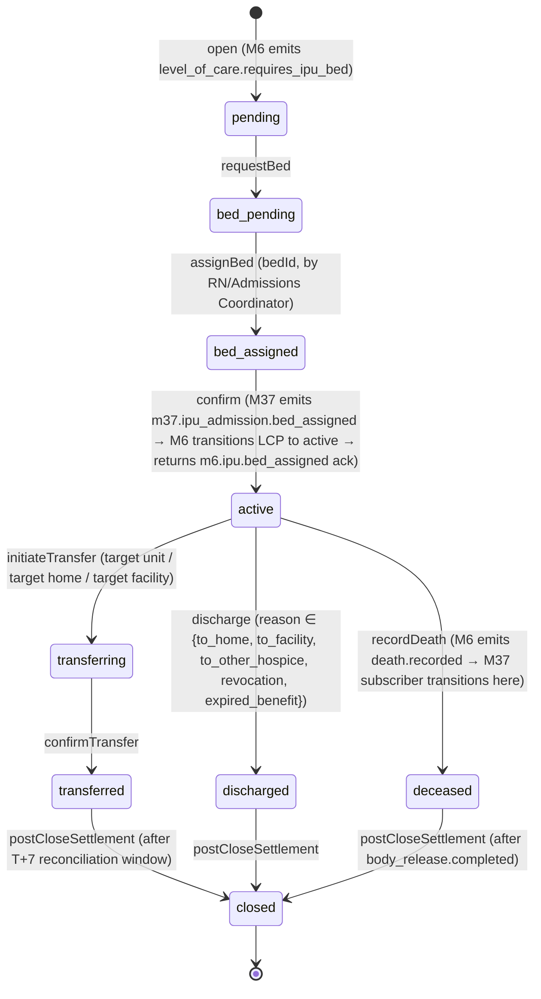
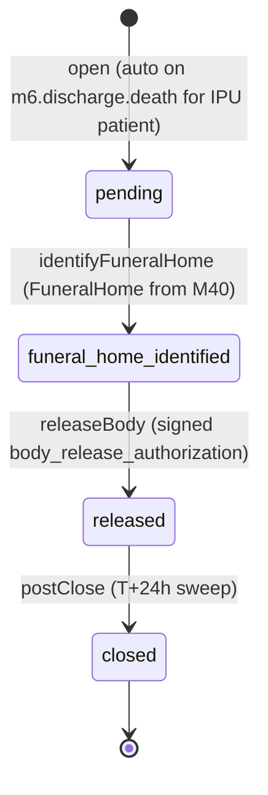
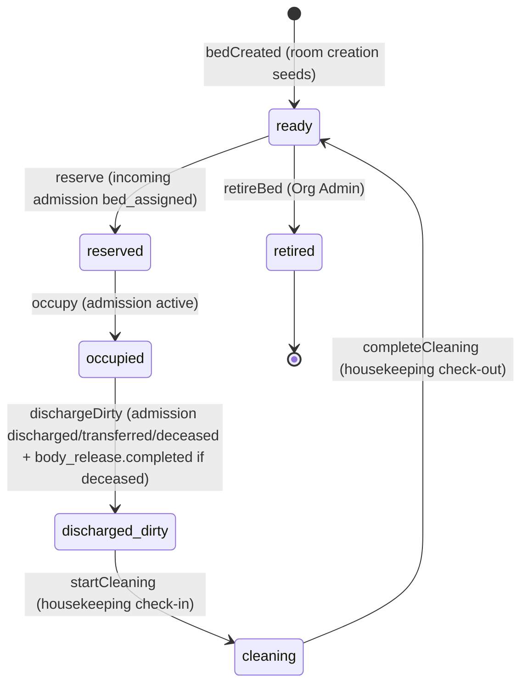
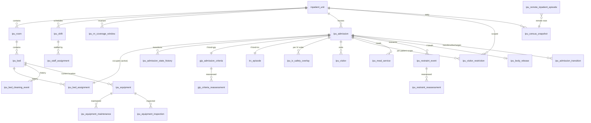

# Module 37 — Inpatient Unit (IPU) Management Specification

**Module ID:** 37
**Phase:** 3 (activated for tenants that operate inpatient units; not Engrace go-live blocker per architecture §20 priority table — Engrace runs routine-home-care + continuous-home-care + arranged inpatient care today, not an agency-owned IPU; M37 lands when the first IPU-operating tenant onboards or when an existing tenant operationalizes its own GIP/IRC unit). The spec is **lock-grade-now / build-on-demand**: every forward-seam consumer (M6, M21, M27, M33, M22, M23) already ships the typed reader M37 wires against, every M37-published outbox event is already named in the producing modules' specs, and the schema can be installed and exercised against fixtures without an IPU operationally existing — once a tenant flips the IPU feature flag in M34 (when M34 lands) or via the platform-admin `feature_flag('ipu_module_enabled', orgId)` (which exists today in M1's flag registry per architecture §20.5), the routes light up and the seam consumers fire.

**Depends on:** 1 (Foundation — `packages/db`, `packages/tenancy`, `withOrgContext`, RLS generator, `audit()` helper, outbox dispatcher, idempotency middleware, BullMQ queue runner, partitioned-table conventions, `feature_flag` registry), 2 (Identity — session/actor resolution, membership reader, step-up assertion verification for restraint-application and IRC-cap-override break-glass), 3 (Authorization — `requirePermission` / `requireAbac` contract; the catalog this module contributes to; M37 registers 5 ABAC predicates with the named-predicate registry), 4 (Audit — PHI write-audit trigger generator, audit-read helper, destruction-cert workflow + `eraseFn` registration, retention classes `phi_ipu_clinical` and `compliance`), 5 (Patient & Demographics — `PatientReader`, `CaregiverReader`, `PatientPrivacyFlagReader`, `CaseloadProvider` for ABAC composition), 6 (Admission, Election & Certification — `AdmissionReader`, `LevelOfCareReader`, `DeathEventReader`, `ElectionPeriodReader`; M37 is the consumer of `level_of_care.requires_ipu_bed` and the confirmer of `ipu.bed_assigned` per M6 §2.3.5 / §4.4), 8 (Encounters & Visit Notes — `BillableEncounterReader`, `SignedEncountersReader`; subscriber on `m8.encounter.signed` filtered to IPU patients for the GIP per-visit-reassessment trigger), 9 (Clinical Assessments — `LatestAssessmentProvider` for acuity context on the bedside dashboard; M9's ESAS-r / PPS / PAINAD series are the inputs to the IPU acuity tile), 11 (Orders — `OrderProvider`; subscriber on `m11.order.signed` for IPU-specific safety overlays; emits `m37.iv_safety_overlay.required` consumed by M13 before administration activation), 12 (DoseSpot/Prescribing — `MedicationOrderProvider` for IV-continuous and scheduled-IV order semantics; M12's `iv_continuous_*` mode catalog drives M37's IV-pump safety overlay), 13 (eMAR & Med Administration — `MedicationAdministrationProvider`; M13 ships the `iv_continuous_*` administration modes per M13 §2.11 / D11 with the IPU IV-pump safety overlay deferred to M37 per M13's phase-boundary paragraph; M37 implements the overlay against M13's published seam), 14 (IDG — `IdgDecisionProvider` for IDG decisions tied to IPU patients; M14's "in-house IDG meeting at the IPU" inclusion path), 15 (Discipline Care Plans — `DisciplineComplianceProvider` for in-IPU aide / MSW / chaplain assignments), 17 (Scheduling & Route Optimization — `VisitAssignmentReader`, `VisitMetricsProvider`; the IPU shift schedule is structurally adjacent to M17's clinician availability/visit model but uses M37's stricter shift-coverage rules per architecture §2064; M17's `VisitAssignmentReader` is consumed for cross-checking after-hours coverage), 18 (Electronic Visit Verification — `EvvFacilityAnchorProvider` per M18's IPU-bed-anchored-geofence pattern; IPU bedside visits check in against the IPU bed's geofence center, not the patient's home address), 21 (Supplies, DME & Comfort Kits — `ComfortKitDispatchProvider.getIpuRoomKitInventory(locationId, roomId)` per M21 D17 / §1.2; the IPU-room comfort kit physical-stock model is M21-owned and read here for the bedside view), 22 (Document Management — outbox `m37.body_release.document_requested` for body-release form rendering; subscriber for `m22.document.rendered` back-ref to populate `ipu_body_release.release_document_id`), 23 (Billing — Medicare — `ClaimReader.gipDaysForPatientInPeriod(patientId, dateRange)` per M23's "Consumed by 37" line in M23 §spec-header; the daily census feed M37 publishes drives M23's per-diem line generation), 26 (Cap Management — `InpatientCapProvider` consumed for the per-unit cap-position tile; M37 also publishes inpatient day totals that M26 consumes via `m37.census.snapshot_taken`), 27 (Cost Report — `CostReportProvider.getInpatientCapPositionAtFiscalDate(providerEntityId, asOfDate)` per M27 §4.3 / spec-header — wires live since M27 is locked v0.2), 36 (Secure Messaging & Alerts — `AlertEmitter` for the 14 typed M37 alert payloads; recipient resolvers for `ipu.charge_nurse`, `ipu.medical_director`, `ipu.admissions_coordinator`), 38 (Clinical Terminology — Q-code value set (`Q5005`, `Q5007`), revenue code value set (`0655`, `0656`), restraint-kind taxonomy, equipment-type taxonomy, diet-order taxonomy, body-disposition taxonomy; M37 publishes the `ipu_equipment_v1` and `ipu_diet_v1` value sets as M37-authored M38 catalog entries), 40 (Master Data Management — `FacilityReader` (the IPU unit's host facility — `Facility.kind='ipu'`), `FuneralHomeReader` (for body release coordination), `ExternalPhysicianReader` (the attending / pronouncing physician for death events))

Transitively the foundation deps are inherited through 5/6/8/11/12/13/17/18/21/22/40; M37 declares all of them explicitly per the M11 / M12 / M13 / M21 / M27 / M33 lock precedent that "every module surfaces *all* its declared imports in `dependsOn`, including foundation and cross-cutting."

**Consumed by:** 22 (Document Management — subscribes to `m37.body_release.document_requested` to render the body-release form using the M22 platform-shipped template `body_release_authorization` added to M22's template library at M37 lock; M22 also subscribes to `m37.ipu_admission.death_recorded` to issue the funeral-home magic-link session per architecture §7.8 — the magic-link session itself lives in M22's external-collaborator surface, M37 emits the trigger), 23 (Billing — Medicare — subscribes to `m37.census.snapshot_taken` for the daily per-diem line generation; subscribes to `m37.ipu_admission.bed_assigned` for the place-of-service `Q5005` / `Q5007` write-through to `claim_line.q_code`; subscribes to `m37.ipu_admission.transferred` / `discharged` for the level-of-care transition handling on the claim; M23's pre-submission validation rule "every billed GIP day has a covering IPU bed assignment" reads M37's `IpuAdmissionReader.bedAssignmentForDate`), 26 (Cap Management — subscribes to `m37.census.snapshot_taken` to update the inpatient cap accrual per the M26 §1.1 / D13 inpatient-day-source-from-claims path; reads `IpuCensusProvider.inpatientDaysForFiscalDate(orgId, providerEntityId, asOfDate)` for the per-CCN inpatient-cap projection), 27 (Cost Report — subscribes to `m37.census.snapshot_taken` for the IPU service-day census; reads `IpuCensusProvider.serviceDaysForFiscalYear(providerEntityId, fiscalYear)` for Worksheet S-3 IPU-line population), 28 (FHIR Gateway — M37 publishes the typed mapping `asFhirEncounter(ipuAdmissionId)` projecting an IPU admission to a FHIR R4 `Encounter` resource with `class=IMP` (inpatient), `location.physicalType=bd` (bed), `serviceProvider=Organization` (the IPU host facility), `period`, `hospitalization.specialArrangement` for GIP vs IRC, and `extension` for the level-of-care code; M28 owns the HTTP surface; the projection ships now, the route lands at M28 phase-2 — M28 is locked v0.2 and M37 wires through its published projection contract), 30 (HQRP & Quality — `IpuAcuityProvider`, `IpuMortalityProvider`, `IpuFallsProvider`, `IpuInfectionProvider`, `IpuRestraintProvider` consumed by M30 measure-detail pages; the M30 incident-report surface subscribes to `m37.restraint.applied` for the restraint-incident projection; ships forward-seam-deny-stub today, M30 is locked v0.2 so M37 wires through M30's `incident_report` writer at M37 lock per the M30 published-seam pattern), 31 (Patient/Family Portal — `IpuVisitorReader.visitsAllowedForPatient(patientId)` consumed by the family portal "visit-policy" page; outbreak restrictions surface as portal banners; M31 wires at M31 lock — forward-seam-deny-stub today), 32 (AI Platform — explicit **NEGATIVE seam**: M32 may not write to any M37 row; M37's `validateIpuAIBlock(M32 prompt-registry)` boot validator enforces; HearthNote Layer 2 read-only narration around an IPU admission is permitted per architecture §AI Governance v0.2 read-only-narration carveout, but no LLM may attest GIP criteria, justify a restraint, pronounce a death, or coordinate body release — mirrors M12 D12 / M13 D15 / M21 D15 / M27 D18), 33 (Reporting & Dashboards — `MetricsProvider.getDashboardMetric` consumed by M37 for the per-unit operational tiles (census, average LOS by level, transition patterns, revenue per bed-day, staffing ratios, equipment-due-for-inspection counts, restraint-incident counts, falls counts, infection-surveillance counts) per architecture §2078 + M33 §spec-header; the projection is one-way (M37 reads M33's pre-computed IPU MVs); ships now since M33 is locked v0.2 and the IPU MVs are scaffolded in M33 §3.1 as `mv_ipu_census_org_day.sql` and `mv_ipu_los_org_loc_month.sql`), 34 (SaaS Tenant Platform — `IpuTenantPostureReader.unitsForOrg(orgId)` consumed by the platform-ops "tenant overview" console so platform-ops can verify a tenant's IPU configuration posture during a support call; `IpuTenantPostureReader.openIpuAdmissionsForOrg(orgId)` consumed for the tenant-offboarding gate — a tenant cannot offboard while any IPU admission is in `active` state; ships forward-seam-deny-stub today, M34 wires when M34 locks), 36 (Secure Messaging & Alerts — `m37.shift.coverage_gap_projected`, `m37.shift.rn_uncovered`, `m37.gip_criteria.reassessment_due`, `m37.irc_episode.cap_approaching`, `m37.irc_episode.cap_breached`, `m37.equipment.inspection_overdue`, `m37.body_release.pending`, `m37.bed.cleaning_overdue`, `m37.visitor_restriction.applied`, `m37.restraint.applied`, `m37.restraint.reassessment_due`, `m37.iv_safety_overlay.required`, `m37.census.snapshot_taken` (informational tile only), `m37.dispense_cabinet.discrepancy_detected` — 14 typed alert payloads delivered through M36 with the four new recipient resolvers M37 registers)

**Spec status:** Re-locked v0.3 (Phase-4 remediation; supersedes Locked v0.2)

> **Phase-4 remediation (2026-06-11; ADR-0018 D4).**
> - **M37-F03 (BLOCKER):** the **24/7-RN-coverage gate fails OPEN** — a stale/missing coverage
>   attestation **warns and flags for compliance review** but **never hard-blocks a clinically-needed
>   inpatient order** (the hard block was a patient-safety hazard over-encoding ARCH-188).
> - **M37-F08/F11/F12:** the invented **GIP 14-vs-7-day imminent-death bound is removed** (GIP has no
>   fixed bound); **IRC is 5 consecutive days, day 6+ reprices to RHC** (no invented 30-day no-reset,
>   not blocked) — consistent with ADR-0016 D2.

## Changelog

- **v0.2 (Locked)** — Initial publication at lock-grade. Instantiates the architecture §20.B module spec template. Resolves all eighteen open questions into binding decisions (§11). Defines the **bed/room/unit three-level hierarchy** — `inpatient_unit` (one or more per organization, each anchored to a Facility from M40 with `Facility.kind='ipu'`) → `ipu_room` (private / semi-private / family room / shared overflow) → `ipu_bed` (the addressable unit-of-bed-occupancy; one assignable patient at a time per bed; explicit cleaning-status state machine `occupied → discharged_dirty → cleaning → ready → reserved → occupied`) (D1). Defines the **`ipu_admission` row as the M37 unit-of-work, one-to-one with M6's `level_of_care_period` for IPU levels (`general_inpatient_care`, `inpatient_respite_care`)** — M6 owns the regulatory state (the LCP), M37 owns the bedside state (the IPU admission); the two are linked by `ipu_admission.level_of_care_period_id` and the bidirectional handshake `m6.level_of_care.requires_ipu_bed → m37.ipu_admission.opened → m37.ipu_admission.bed_assigned → m6.ipu.bed_assigned → m6.level_of_care.activated` per the M6 §2.3.5 transient-`assigning`-state pattern (D2). Defines the **24/7 RN coverage enforcement** as a materialized `ipu_rn_coverage_window` invariant computed every 5 minutes per unit by a BullMQ worker; a unit cannot exit `provisional` state until 168 hours of forward RN coverage exists at activation, after which the coverage-gap watchdog projects 48 hours forward continuously and emits `m37.shift.coverage_gap_projected` at the configured per-tenant alert horizon (default 8 hours platform-floor; tenants may tighten to as little as 2 hours but not loosen below 8 hours); a coverage gap inside the current hour emits `m37.shift.rn_uncovered` as a **block-severity alert** (M36 §2.1.A) and triggers the M3-registered ABAC predicate `m37.ipu.rn_coverage_active` to evaluate false on every IPU mutation route — meaning no admission, transfer, restraint, or order may be executed against the unit until coverage is restored or break-glass invoked (D3). Defines the **GIP admission criteria as structured attested document** (per CoP 418.108: acute symptom management not manageable at home, terminal care of imminently dying patient, medications/treatments requiring inpatient setting) entered at admission with hospice MD attestation (D4) AND a **per-encounter reassessment trigger** that subscribes to `m8.encounter.signed` filtered to IPU patients with `level_of_care='general_inpatient_care'` and emits `m37.gip_criteria.reassessment_due` if the last reassessment is >24 hours stale, with the reassessment workflow rendering as an inline panel on the encounter close screen and writing a `gip_criteria_reassessment` row (D5). Defines the **IRC 5-consecutive-day hard cap with platform-floor stop-billing trigger** — an `irc_episode` row is opened on every M6 IRC LCP and tracks consecutive-day count; at day 4 emits `m37.irc_episode.cap_approaching`; at day 5+ emits `m37.irc_episode.cap_breached` (block-severity) and the M3-registered ABAC predicate `m37.irc_episode.within_cap` evaluates false on every IRC-related billing route — meaning M23's per-diem line generation is blocked at the gate, not after the fact, until the IRC LCP is ended or a break-glass override is invoked by an Org Admin or Compliance Officer with step-up biometric assertion (D6). Defines the **IV-continuous safety overlay** layered on M11/M13 — when an M11 order with `kind='medication_iv_continuous'` is signed for a patient with an open IPU admission, M37's `m11.order.signed` consumer creates an `ipu_iv_safety_overlay` row enforcing per-medication titration window, max-rate cap, and dual-witness requirement for sedation-class IV drips (palliative sedation, ketamine infusion, propofol drip); M37 publishes the overlay to M13 via the `IpuIvSafetyOverlayProvider.getOverlayForOrder(orderId)` seam consumed by M13's pre-administration gate; the overlay is the IPU-specific extension of M13 §2.11 / D11 deferred at M13 lock to M37 (D7). Defines the **visitor tracking + outbreak-restriction overlay** — a `ipu_visitor` log per visit (check-in, check-out, screening checklist, family-member-or-other relationship), partitioned monthly; outbreak restrictions originate from M30 incident-report surface (when M30 surveillance event of `kind ∈ {outbreak_suspected, outbreak_confirmed}` lands) and apply as a per-unit `ipu_visitor_restriction` overlay that the check-in route consults; the restriction can also be applied per-patient (e.g., active TB ruling out roommate visitation) by Compliance Officer / Infection Preventionist (D8). Defines the **dietary tray-service tracking as lightweight per-meal log** — `ipu_meal_service` row per (patient × meal slot ∈ {breakfast, lunch, dinner, snack}) capturing diet-order reference (to M11), tray-delivered timestamp, tray-removed timestamp, intake-fraction, refusal-reason; partitioned monthly given the high-volume cadence (3+ rows per IPU patient per day) (D9). Defines the **equipment management with biomed inspection enforcement** — `ipu_equipment` asset catalog (each row keyed by serial number; type from M38's `ipu_equipment_v1` value set: hospital-bed, oxygen-concentrator, suction-machine, iv-pump, bipap, cpap, lift, scale, vitals-monitor), `ipu_equipment_maintenance` for routine maintenance entries, `ipu_equipment_inspection` for biomed inspection entries (annual + per-use safety check) with `next_inspection_due_date`; an expired inspection causes the equipment to fail the M3-registered ABAC predicate `m37.equipment.inspection_current` and the route that would assign the equipment to a patient returns 412 `EQUIPMENT_INSPECTION_OVERDUE` (D10). Defines the **restraint policy as default-restraint-free with permission-key-gated exception** — restraint use requires the platform-floor permission `m37.restraint.apply` (only assignable to RN + above in the IPU role family) AND a structured `ipu_restraint_event` justification (kind ∈ {soft_limb, posey_vest, mitt, side_rail_4} per M38's `ipu_restraint_kind_v1` value set; clinical justification text ≥ 100 chars; physician order via M11 referenced; observation interval per CoP 418.110-derived platform-floor of 15 minutes for behavioral / 2 hours for medical) AND step-up biometric assertion in M2's vocabulary; the M37 cron `restraint-reassessment-watchdog` runs every 15 minutes and emits `m37.restraint.reassessment_due` for any active restraint past its interval (D11). Defines the **post-mortem body release coordination workflow** — `ipu_body_release` row opened automatically on `m6.discharge.death` for IPU patients (via M37's M6 subscriber filtering on death-location = the IPU's facility), state machine `pending → funeral_home_identified → body_released → closed`; the funeral-home-identified transition references M40's `FuneralHomeReader` and emits the trigger event `m37.body_release.funeral_home_identified` that M22 consumes to issue the magic-link session per architecture §7.8; the body-released transition requires a signed `body_release_authorization` document rendered via M22 (D12). Defines the **bed cleaning state machine + turnover SLA** — `ipu_bed.cleaning_status` carries the state machine `occupied → discharged_dirty → cleaning → ready → reserved → occupied`; a turnover SLA platform-floor of 2 hours from `discharged_dirty → ready` (tenant-tighten-only); `m37.bed.cleaning_overdue` emitted at the SLA breach to M36; a `ipu_bed_cleaning_event` audit row written at each transition (D13). Defines the **daily census materialization at midnight tenant-local** — a BullMQ cron `census-snapshot-builder` runs at the per-org local midnight, builds an `ipu_census_snapshot` row per (org × unit × date), and emits `m37.census.snapshot_taken` with the typed payload consumed by M23 (place-of-service feed + per-diem line generation), M26 (inpatient cap accrual), M27 (Worksheet S-3 IPU service days), and M33 (the `mv_ipu_census_org_day` materialized view refresh trigger) (D14). Defines the **CoP 418.112 arranged-inpatient-care (remote IPU) tracking** — when a hospice patient is admitted to a partner SNF / NF / ICF-IID under arranged inpatient care (not the agency's own IPU), M37 still tracks the inpatient location via a `ipu_remote_inpatient_episode` row referencing M40's `Facility` (with `kind ∈ {snf, nf, hospital, alf}`); beds and shifts are NOT modeled for remote IPU because the agency does not own them; the row carries the same level-of-care discriminator (GIP / IRC) and feeds the same `m37.census.snapshot_taken` event with `unit_id IS NULL` and `remote_facility_id` populated (D15). Defines the **AI-prohibited zone** — Module 32's LLM may not create, modify, attest, or witness any of: GIP admission criteria, GIP criteria reassessment, IRC cap-override, restraint application, restraint reassessment, death recording, body-release coordination, body-release authorization; HearthNote Layer 2 may narrate around an IPU admission in read-only context but cannot mutate any M37 row; enforced at boot via `validateIpuAIBlock(M32-prompt-registry)` + dependency-cruiser rule + runtime route guard on every mutation route (D16). Defines the **outbox-only cross-module communication discipline** — every cross-module signal from M37 is the M1 outbox dispatcher; M37 never writes to M6 / M23 / M26 / M27 / M30 schema directly; M6 / M23 / M26 / M27 / M30 never write to M37 schema; the dependency-cruiser boundary rule `no-cross-module-schema-import` enforces (D17). Defines the **manifest patch** — `M37.dependsOn` from the architecture §20 short-list `[6, 8, 11, 13, 17, 23]` to the explicit consumer-of-data list `[1, 2, 3, 4, 5, 6, 8, 9, 11, 12, 13, 14, 15, 17, 18, 21, 22, 23, 26, 27, 36, 38, 40]`; `M37.codePaths` to `["apps/backend/src/modules/37-ipu", "packages/inpatient"]`; `M37.ownedTables` populated with the eighteen owned tables; the boundary check, table-ownership check, and `pnpm fitness:manifest` all green (D18). Wires the permission keys this module registers into Module 3 (§4.6), the five ABAC predicates this module registers into Module 3's named-predicate registry (§4.7), the BullMQ queue catalog (§4.8), the M36 typed-alert payloads (§4.9), the outbox event contract (§4.10), the typed seam contracts published to M6 / M23 / M26 / M27 / M28 / M30 / M33 / M34 (§4.11), and the destruction `eraseFn` registered with Module 4 (§7.7).
- **v0.1** — Drafted within the lock-grade pass; not separately published.

> **Phase boundary (binding):** M37 ships in Phase 3 alongside Module 34 (SaaS Tenant Platform) — the two land together because IPU functionality is the canonical multi-tenant differentiator at scale per architecture §20.10. The Phase-3 cut delivers everything in this spec **except**: (a) the M32 LLM-augmented IPU acuity scoring (Module 32 owns; M37 publishes `IpuAcuityProvider` and ships the deterministic rule scoring per D11 today — analogous to how M9 published `ScaleSeriesProvider` before M32 existed and how M16 published `BereavementRiskFactorsProvider`); (b) the M22 `body_release_authorization` PDF template (Module 22 owns the rendering; M37 emits `m37.body_release.document_requested` with the typed payload today against a recorded-fixture consumer per the M11 D14 / M13 D5 / M16 D14 / M21 D17 forward-seam precedent until the template ships at M37-go-live); (c) the M30 `incident_report.kind='restraint_use'` projection (Module 30 owns the incident-report surface and is locked v0.2; M37 emits `m37.restraint.applied` which M30 subscribes to at the M37 deployment point — both modules ship the contract today, the consumer wiring lands at M37 deployment); (d) the M28 FHIR `Encounter` HTTP surface (Module 28 owns; M37 publishes the typed `asFhirEncounter(ipuAdmissionId)` mapping today, M28 routes the request at Phase 2 per M28's phase-2 cut); (e) the M29 partner-hospital ED `m29.adt.admission_event` allowlist filter (Module 29 owns the inbound HL7 ADT surface and is locked v0.3; the per-IPU partner-facility allowlist binding is configured at M37 deployment per the M29 §spec-header forward-seam paragraph; M37's intake-worklist surface lights up at that deployment point); (f) the M34 IPU tenant-feature-flag wiring (Module 34 owns the tenant-feature-flag console; M37 reads the platform-admin `feature_flag('ipu_module_enabled', orgId)` from M1's flag registry today and the tenant-self-service flag activation lands at M34 lock); (g) the M37 dispense-cabinet integration adapter (the Pyxis-equivalent integration is per-vendor and per-deployment; M37 ships the `DispenseCabinetEvent` typed payload contract today and the per-cabinet adapter is a deployment-time integration alongside the M37 deployment go-live runbook). The "done" gate for M37 is: the eighteen-table schema with TypeBox-validated GIP / IRC criteria, restraint, visitor-screening, equipment-event, body-release, and census-snapshot payloads; the XState ipu-admission lifecycle machine driving every transition; the bidirectional M6 LCP / M37 IPU handshake; the 24/7 RN coverage invariant + watchdog cron; the per-encounter GIP reassessment subscriber; the IRC 5-day cap enforcer; the IV-continuous safety overlay published to M13; the visitor + outbreak overlay; the dietary tray log; the equipment + biomed inspection enforcer; the restraint workflow with platform-floor reassessment cadence; the body-release workflow with funeral-home magic-link trigger; the daily census snapshot cron; the remote-IPU tracking row; the eight outbound seams registered at boot; the five ABAC predicates registered with M3; the fourteen M36 alert payloads; the eraseFn registered with M4; the AI-block boot validator; and the test plan green — not gated on Modules 32 / 34 existing.

-----

## 1. Purpose & Scope

### 1.1 What This Module Does

Module 37 is the **inpatient unit operational substrate** of the WardenX hospice EHR — the system-of-record surface that turns a hospice agency's owned-or-arranged inpatient setting (a free-standing hospice house, a hospital-contracted inpatient hospice wing, or an arranged-care arrangement at a partner SNF / NF / ICF-IID) into a defensible 24/7 clinical-and-operational record. It is the place a surveyor expects to find the answers to *"can this hospice prove RN coverage was maintained every hour of last quarter?"*, *"can this hospice show the GIP criteria were reassessed at each encounter for patient X?"*, *"can this hospice prove the IRC episode for patient Y did not exceed 5 consecutive days?"*, *"can this hospice account for every visitor who entered the unit during the COVID outbreak?"*, *"can this hospice produce the biomed inspection record for the IV pump used on patient Z?"*, *"can this hospice show the body of decedent W was released to the correct funeral home with the correct authorization?"* — questions M6 (which owns the LCP regulatory state), M11/M12/M13 (which own the orders and administrations), M17 (which owns the home-visit schedule), and M22 (which owns the rendered documents) collectively cannot answer because none of them owns the bedside operational state. M37 owns it.

Concretely M37 delivers:

- **The unit / room / bed hierarchy** — `inpatient_unit` (one or more per organization, each anchored to a `Facility` from M40 with `Facility.kind='ipu'`) → `ipu_room` (private / semi-private / family / shared overflow) → `ipu_bed` (one assignable patient at a time, individually addressable, explicit cleaning-status state machine). The unit is the operational top-of-hierarchy; the room is the privacy / occupancy classification; the bed is the addressable unit-of-bed-occupancy.

- **The IPU admission lifecycle** — `ipu_admission` is the M37 unit-of-work, one-to-one with M6's `level_of_care_period` for `level_of_care ∈ {general_inpatient_care, inpatient_respite_care}`. State machine `pending → bed_pending → bed_assigned → active → transferring → transferred | discharged | deceased → closed`. The bidirectional handshake with M6 lives at the `bed_pending → bed_assigned` transition: M6 emits `level_of_care.requires_ipu_bed`, M37 opens the admission and assigns a bed, M37 emits `m37.ipu_admission.bed_assigned`, M6's consumer transitions the LCP to `active` per M6 §2.3.5.

- **The 24/7 RN coverage enforcement** — the `ipu_rn_coverage_window` materialized invariant is the platform's only computational answer to *"was an RN on duty every hour of last quarter?"* — computed continuously by the `rn-coverage-watchdog` BullMQ worker every 5 minutes per unit, projecting 48 hours forward, emitting `m37.shift.coverage_gap_projected` at the per-tenant alert horizon (default 8 hours, platform-floor), and the harder `m37.shift.rn_uncovered` (block-severity) when the current hour has no RN covering. The M3-registered ABAC predicate `m37.ipu.rn_coverage_active` evaluates false on every IPU mutation route during an uncovered hour — meaning no admission, no transfer, no restraint, no order may be executed against the unit until coverage is restored or break-glass invoked.

- **The GIP admission criteria + per-encounter reassessment** — `gip_admission_criteria` row attested by the hospice MD at admission (TypeBox-validated discriminated union over the three CoP 418.108 criteria: `acute_symptom_management` | `imminent_death_terminal_care` | `medications_treatments_inpatient_only`); per-encounter reassessment triggered by M37's `m8.encounter.signed` consumer filtered to GIP patients — emits `m37.gip_criteria.reassessment_due` if the last reassessment is >24h stale and renders an inline reassessment panel on M8's encounter-close screen; reassessment row written to `gip_criteria_reassessment`.

- **The IRC 5-day cap enforcer** — `irc_episode` row opened on every M6 IRC LCP, tracking consecutive-day count; `irc-cap-watchdog` cron sweeping daily and emitting `m37.irc_episode.cap_approaching` at day 4, `m37.irc_episode.cap_breached` at day 5+. The M3-registered ABAC predicate `m37.irc_episode.within_cap` evaluates false on every IRC-related billing route, blocking M23 per-diem line generation at the gate. Cap-override is a break-glass action requiring Org Admin or Compliance Officer with step-up biometric assertion.

- **The IPU-specific clinical workflow overlays** — continuous nursing notes (q-shift minimum) tracked by an M8 projection (the encounter and its note are M8-owned; M37 owns the *expectation* — `ipu_continuous_nursing_note_marker` cron emits `m37.nursing_note.shift_overdue` if no q-shift note exists for a given (admission × shift) pair); scheduled vitals per orders (M11-owned orders + M37's reminder cadence overlay); post-mortem care workflow (M37 + M22); IV-continuous safety overlay (M37's `ipu_iv_safety_overlay` row published to M13's pre-administration gate via the seam `IpuIvSafetyOverlayProvider`).

- **The visitor + outbreak surveillance overlay** — `ipu_visitor` log per visit (check-in, check-out, screening checklist, family-or-other relationship), partitioned monthly. `ipu_visitor_restriction` overlay applied per-unit (from M30 incident-report surveillance event `kind ∈ {outbreak_suspected, outbreak_confirmed}`) or per-patient (active-TB, immunocompromised, etc.) by Compliance Officer / Infection Preventionist; the check-in route consults the active restrictions and denies entry with a structured rationale.

- **The dietary tray-service log** — `ipu_meal_service` per (patient × meal slot ∈ {breakfast, lunch, dinner, snack}), capturing diet-order reference to M11, tray-delivered timestamp, tray-removed timestamp, intake-fraction (0.00–1.00), refusal-reason. Partitioned monthly. The data feeds the comfort-feeding documentation surface that surveyors expect under CoP 418.110.

- **The equipment + biomed inspection enforcer** — `ipu_equipment` asset catalog (each row keyed by serial number; type from M38's platform-shipped `ipu_equipment_v1` value set: hospital-bed, oxygen-concentrator, suction-machine, iv-pump, bipap, cpap, lift, scale, vitals-monitor); `ipu_equipment_maintenance` for routine maintenance entries; `ipu_equipment_inspection` for biomed inspection entries with `next_inspection_due_date`; the `equipment-inspection-watchdog` cron emits `m37.equipment.inspection_due` 14/7/2/0 days before due-date and `m37.equipment.inspection_overdue` thereafter; the M3-registered ABAC predicate `m37.equipment.inspection_current` returns false on overdue equipment and the assign-equipment-to-patient route returns 412 `EQUIPMENT_INSPECTION_OVERDUE`.

- **The restraint policy enforcer** — default = restraint-free; using a restraint requires the platform-floor permission `m37.restraint.apply` (RN + above only) + structured `ipu_restraint_event` row (kind from M38's `ipu_restraint_kind_v1` value set; clinical justification ≥ 100 chars; physician order via M11 referenced) + step-up biometric in M2's vocabulary. `restraint-reassessment-watchdog` cron emits `m37.restraint.reassessment_due` per the platform-floor cadence (15 min behavioral / 2 hr medical).

- **The post-mortem body release coordination** — `ipu_body_release` row auto-opened on `m6.discharge.death` for IPU patients (M37's M6 subscriber filtering on death-location); state machine `pending → funeral_home_identified → body_released → closed`; funeral-home-identified transition references M40's `FuneralHomeReader` and emits `m37.body_release.funeral_home_identified` consumed by M22 to issue the funeral-home magic-link session per architecture §7.8; the body-released transition requires a signed `body_release_authorization` document rendered via M22.

- **The bed cleaning + turnover SLA** — `ipu_bed.cleaning_status` state machine `occupied → discharged_dirty → cleaning → ready → reserved → occupied`; turnover SLA platform-floor 2 hours from `discharged_dirty → ready` (tenant-tighten-only); `m37.bed.cleaning_overdue` emitted on breach; `ipu_bed_cleaning_event` row written at each transition.

- **The daily census materialization** — `census-snapshot-builder` BullMQ cron at per-org local midnight produces one `ipu_census_snapshot` per (org × unit × date) and emits `m37.census.snapshot_taken` consumed by M23 (place-of-service feed + per-diem), M26 (inpatient cap), M27 (Worksheet S-3), M33 (MV refresh). This event is the canonical driver of M23's GIP / IRC per-diem-line generation per the M23 `Consumed by 37` line.

- **The CoP 418.112 arranged-IPU tracking** — `ipu_remote_inpatient_episode` row for hospice patients admitted to partner SNF / NF / ICF-IID under arranged inpatient care (not the agency's own IPU); references M40's `Facility`; carries the same LOC discriminator (GIP / IRC); feeds the same `m37.census.snapshot_taken` event with `unit_id IS NULL` and `remote_facility_id` populated.

- **The eight typed reader seams** — `IpuAdmissionReader` (read paths for M23 / M26 / M27 / M28 / M30 / M34), `IpuCensusProvider` (M23 / M26 / M27 / M33), `IpuBedAssignmentProvider` (M6 confirms via this), `IpuShiftCoverageReader` (M17 cross-check / M19 after-hours), `IpuIvSafetyOverlayProvider` (M13 pre-administration gate), `IpuVisitorReader` (M31 portal — forward-seam at M37 phase), `IpuAcuityProvider` / `IpuMortalityProvider` / `IpuFallsProvider` / `IpuInfectionProvider` / `IpuRestraintProvider` (M30 measure-detail pages), `IpuTenantPostureReader` (M34 console — forward-seam at M37 phase) — all registered at boot via M1's `SeamRegistry`; `validateSeams()` refuses startup if unregistered; dependency-cruiser boundary check blocks consumers from importing `apps/backend/src/modules/37-ipu/db/*` directly.

### 1.2 What This Module Does Not Do

This list is binding. Every item here is owned by another module and reached via repository call, outbox event, or the explicit cross-module seams in §4.

- **The level-of-care regulatory state (RHC / CHC / IRC / GIP) and the `level_of_care_period` row itself.** Module 6 owns the LCP state machine, the LCP transitions, the LCP audit. M37 reads via `LevelOfCareReader` and confirms bed assignment via `m37.ipu_admission.bed_assigned`; M37 never writes to `level_of_care_period` (this is enforced by dependency-cruiser per M6 D9 / M11 D9 already established).
- **The admission, election, certification, F2F, transfer-out, revocation, discharge, and death-event facts.** Module 6 owns all of these. M37 reads via `AdmissionReader` / `DeathEventReader` / `ElectionPeriodReader`. The IPU-specific death event is *not* a separate fact; M37's `m6.discharge.death` consumer opens the body-release row.
- **The patient demographics, caregivers, payers, privacy flags.** Module 5. M37 references `patient.id`; M37 does not write to M5.
- **The encounter and the visit note.** Module 8. M37 subscribes to `m8.encounter.signed` for the GIP reassessment trigger and tracks per-shift nursing-note compliance via a marker table, but the encounter and the note are M8-owned.
- **The orders (including IPU-specific orders: continuous IV, scheduled IV meds, oxygen titration, sedation protocols).** Module 11. M37's IV safety overlay sits *on top of* M11/M13; the order itself is M11-owned; the administration is M13-owned.
- **The medication order semantics (DoseSpot / Surescripts).** Module 12. M37's IV safety overlay reads `MedicationOrderProvider` for the `iv_continuous` mode catalog M12 publishes per M12 D11.
- **The medication administration record.** Module 13. M13's `iv_continuous_*` administration modes are M13-owned; M37 publishes the per-order safety overlay; M13 consults the overlay at the pre-administration gate via the `IpuIvSafetyOverlayProvider` seam.
- **The IDG meeting itself and its decisions.** Module 14. M14's in-house IDG meeting at the IPU is structurally identical to a home-care IDG; M37 only references M14's `IdgDecisionProvider` for inclusion in the bedside dashboard.
- **The discipline-specific care plans (Aide POC, MSW Plan, Spiritual Plan, Volunteer Plan).** Module 15. M37 references `DisciplineComplianceProvider` for in-IPU discipline assignments; M37 does not own discipline care planning.
- **The home-visit schedule, route optimization, and visit lifecycle.** Module 17. M37's shift schedule is structurally *not* the same thing as M17's visit schedule — visits in the IPU setting are M8 encounters captured at the bedside, not M17 home-visits; M37 reads `VisitAssignmentReader` for clinician-membership cross-checks.
- **The EVV check-in / check-out for the visit itself.** Module 18. M37 reads `EvvFacilityAnchorProvider` to confirm the IPU bed's geofence center; M37 does not own EVV events.
- **The on-call triage call and disposition.** Module 19. M37 has no triage surface; if a triage call results in a GIP admission proposal (per M19 D11 / D12), M37 consumes `m19.triage_call.gip_admission_proposed` and lights it on the intake worklist.
- **The field-safety check-in / panic-button surface.** Module 20. M37 reads no M20 data; field-safety is for in-the-home clinicians, not in-the-IPU clinicians (the IPU has its own physical-security and code-blue protocols outside the M20 panic-button model).
- **The comfort kit physical inventory and the IPU-room kit dispatch.** Module 21. M21 owns `ComfortKitDispatchProvider.getIpuRoomKitInventory(locationId, roomId)` per M21 D17; M37 *reads* the IPU-room kit inventory for the bedside dashboard; M37 does not write to M21.
- **The funeral-home magic-link session, the body-release form rendering, the chart-export PDF.** Module 22. M37 emits `m37.body_release.document_requested` and `m37.body_release.funeral_home_identified`; M22 renders / sessions / delivers.
- **The Medicare claim, the per-diem line, the HIPPS / SIA calculation, the place-of-service `Q5005` / `Q5007` code on the claim, the revenue code `0656` / `0655` on the claim, the NOE / NOTR.** Module 23. M37 publishes the daily census event `m37.census.snapshot_taken` and the bed-assignment event `m37.ipu_admission.bed_assigned` that drive M23's per-diem line generation; M37 does not assemble claims or compute per-diem amounts.
- **The Medicaid claim and any per-state Medicaid IPU adapter.** Module 24. Same boundary as M23.
- **The denial and appeal workflow.** Module 25. M37 has no denial surface.
- **The aggregate cap accrual and the inpatient cap projection arithmetic.** Module 26. M37 publishes census; M26 maintains the ledger.
- **The cost report Worksheet S-3 IPU lines.** Module 27. M37 publishes `IpuCensusProvider.serviceDaysForFiscalYear`; M27 consumes.
- **The FHIR `Encounter` HTTP surface.** Module 28. M37 publishes the typed `asFhirEncounter(ipuAdmissionId)` mapping; M28 owns the route.
- **The inbound HL7 ADT for partner-hospital ED admission previews.** Module 29. M29 publishes `m29.adt.admission_event`; M37 subscribes (filtered to the IPU's partner-facility allowlist) and surfaces the inbound admission on the intake worklist; M37 does not parse HL7.
- **The HQRP measures (HCI / HVLDL / HIS-faceted), incident-report surface, mortality-review, infection-surveillance event publication, QAPI program, SRA cycle.** Module 30. M37 publishes the reader seams M30 consumes (`IpuAcuityProvider` / `IpuMortalityProvider` / `IpuFallsProvider` / `IpuInfectionProvider` / `IpuRestraintProvider`); M30 does the measure computation; M37 does not write to M30 schema.
- **The patient / family portal.** Module 31. M37 publishes `IpuVisitorReader.visitsAllowedForPatient` for the M31 visit-policy page; M37 does not own portal sessions.
- **AI capabilities (LLM, narrative enhancement, risk advisories).** Module 32. M37 is an explicit *negative seam* — see D16.
- **Reporting and dashboards.** Module 33. M37 *consumes* M33's `MetricsProvider.getDashboardMetric` for the per-unit operational tiles; M37 does not build report MVs.
- **SaaS tenant platform — feature flagging, tenant onboarding/offboarding, the platform-ops console.** Module 34. M37 publishes `IpuTenantPostureReader`; M34 consumes for the offboarding gate.
- **The subscription billing of WardenX to the agency.** Module 35. Different domain.
- **The secure-messaging delivery (SMS / email / push / in-app).** Module 36. M37 emits typed alerts via `AlertEmitter`; M36 routes / delivers / audits.
- **The clinical terminology lookup itself.** Module 38. M37 *publishes* the `ipu_equipment_v1`, `ipu_diet_v1`, `ipu_restraint_kind_v1`, `body_disposition_v1` value sets as M37-authored M38 catalog entries; M37 *consumes* `M38.lookup` and `M38.valueSetMembership` for code validation.
- **The consent and authorization for SUD / family-violence redaction.** Module 39. M37 reads `ConsentEvaluator.evaluateForReporting` for any cross-tenant or external read paths that touch IPU data.
- **The master-data canonical records (Facility, FuneralHome, ExternalPhysician).** Module 40. M37 references via `FacilityReader` / `FuneralHomeReader` / `ExternalPhysicianReader`.

### 1.3 Regulatory Drivers

| Driver | Requirement | How Module 37 satisfies it |
|---|---|---|
| **42 CFR 418.108** — Short-term inpatient care | GIP for acute symptom management not manageable at home, terminal care of imminently dying patient, or medications/treatments requiring inpatient setting; IRC for caregiver respite need, up to 5 consecutive days per IRC episode | `gip_admission_criteria` discriminated-union TypeBox + per-encounter reassessment subscriber + `m37.gip_criteria.reassessment_due` alert; `irc_episode` row with consecutive-day count + `m37.irc_episode.cap_approaching` / `cap_breached` block-severity events + M3-registered ABAC predicate `m37.irc_episode.within_cap` blocking M23 per-diem generation |
| **42 CFR 418.110** — Hospices providing inpatient care directly | Inpatient unit standards: physical environment, services, 24-hour RN supervision, drug records, restraint use, infection control, dietary services, patient rights, written agreement governing arranged inpatient care | `inpatient_unit` row + Facility binding (M40) + the 24/7 RN coverage invariant + `rn-coverage-watchdog` cron + `m37.shift.coverage_gap_projected` / `rn_uncovered` + ABAC predicate `m37.ipu.rn_coverage_active` blocking all IPU mutation routes during an uncovered hour; the dietary tray-service log; the equipment + biomed inspection enforcer; the restraint policy with platform-floor reassessment cadence |
| **42 CFR 418.112** — Hospices that provide care to residents of SNF / NF / ICF-IID | Written agreement governing arranged inpatient care; level-of-care periods served at the partner facility billed under the hospice's CCN with appropriate Q-code (Q5003 / Q5004) | `ipu_remote_inpatient_episode` row referencing M40 Facility; participates in `m37.census.snapshot_taken` event with `unit_id IS NULL` + `remote_facility_id` populated so M23's per-diem line generation receives the right Q-code |
| **42 CFR 418.60** — Infection control | Infection control program; outbreak surveillance | `ipu_visitor_restriction` overlay applied from M30 incident-report surveillance event of `kind ∈ {outbreak_suspected, outbreak_confirmed}`; the check-in route consults active restrictions and denies entry with structured rationale; surveillance reads cross to M30's incident-report surface via outbox |
| **42 CFR 418.104** — Clinical records (completeness, authentication, retention) | All clinical records for the IPU patient retained 7 years | M37's retention class is `phi_ipu_clinical` (7 years from death event or discharge); M4's destruction-cert workflow handles the eraseFn; M37 partitions the high-volume tables (`ipu_visitor`, `ipu_meal_service`, `ipu_admission_state_history`, `ipu_bed_cleaning_event`) monthly per M4's PHI partition cadence |
| **CoP 418.106** — Drugs, biologicals, medical supplies, DME | Dispensing-cabinet records; controlled-substance records | M37 reads `MedicationAdministrationProvider` and emits `m37.dispense_cabinet.discrepancy_detected` when the cabinet event from the deployment-time-integrated dispense cabinet (Pyxis-equivalent) disagrees with M13's administration record |
| **CMS HOPE v1.01** — IPU-anchored timepoints | Symptom-management assessments at IPU admission, transition, and discharge | M37 does not compute HOPE; M37 emits the `ipu_admission` lifecycle events that M10's HOPE engine subscribes to for the IPU-anchored timepoint trigger paths |
| **NIST 800-66r2 + HIPAA Privacy Rule** | PHI minimization, audit-of-access | M37's `ipu_visitor` log carries visitor identity (visitor name, relationship, screening checklist outcome) — this is PHI by HIPAA criterion (identifies the IPU patient by association); M37 audit-denylists the visitor name + screening notes in the audit-diff payload per the M11 D11 / M13 D12 / M21 D12 denylist pattern; the audit row records the *fact* of check-in / check-out, not the content of the screening notes |

### 1.4 Competitive Context

The legacy hospice EHRs (HCHB, mumms, Suncoast, WellSky-Hospice) treat the inpatient unit as a thinly-disguised extension of the home-care module — admissions land in the same table as home admissions with a "place of service" flag, the bedside dashboard is a generic visit-list filtered to "today at this address", restraint use is a free-text encounter field, equipment inspection is tracked outside the EHR in a maintenance spreadsheet, the body-release authorization is a paper form. The clinical-operational consequence is that an IPU operator running 12-20 beds with a 90%+ occupancy through HCHB or mumms cannot answer the survey questions in §1.1 without manual reconstruction across paper logs, encounter narrative, and supply-room spreadsheets. The recent (2023-2025) survey trend toward systemic-deficiency findings on IPU operators (CMS-2567 Form, deficiency tags F838 / E0040 / E0072) reflects this auditability gap directly.

M37 closes the gap structurally. Every survey question in §1.1 reduces to a typed SQL query against M37's owned tables. The 24/7 RN coverage invariant is computational, not narrative. The GIP per-encounter reassessment is event-triggered, not reminder-based. The IRC 5-day cap is gate-enforced at the billing layer, not back-end-reconciled. The biomed inspection is ABAC-predicate-blocked at equipment-assignment time. The visitor log is partitioned PHI. The body-release authorization is a signed M22 document with a typed back-ref. The arranged-inpatient-care (CoP 418.112) is a first-class row, not a flag on a home admission.

The IPU-specific safety overlays — the IV-pump titration window, the dual-witness for palliative-sedation drips, the restraint reassessment cadence, the dispense-cabinet discrepancy detection — are competitive differentiators against every legacy vendor at the time of M37's deployment. The downstream consequence is that an IPU-operating tenant onboarding to WardenX from HCHB or mumms can produce a survey-defensible quarter on day 1 of M37 go-live, not at month 6 of forensic reconstruction.

-----

## 2. Domain Model

### 2.1 Hierarchy: Unit → Room → Bed

The three-level hierarchy is the spatial substrate every other M37 entity references.

```
organization (M2)
  └── inpatient_unit (M37) — facility_id → Facility (M40, kind='ipu')
        ├── ipu_room (M37) — kind ∈ {private, semi_private, family, shared_overflow}
        │     └── ipu_bed (M37) — cleaning_status state machine
        └── ipu_shift (M37) — covering all rooms/beds of the unit
              └── ipu_staff_assignment (M37) — discipline-typed
```

**Why three levels.** The unit is the operational top-of-hierarchy (one IPU = one CCN-mapped facility = one 24/7-RN-coverage-required boundary = one survey window). The room is the privacy / occupancy classification (private rooms are CoP 418.110(b)(3)-required for active death and family-grief space; semi-private rooms support cost-efficient routine GIP; family rooms are non-bed-bearing visitor space; shared-overflow rooms are surge capacity in disaster/respite-spike). The bed is the addressable unit-of-bed-occupancy and the level the patient is *assigned to* (one patient per bed at a time). The hierarchy mirrors the CMS Hospice Inpatient Care survey worksheets that surveyors carry on-site.

### 2.2 The `ipu_admission` Lifecycle State Machine (D2)

The XState machine in `packages/inpatient/src/machines/ipu-admission.ts`:



| From | Event | To | Guards | Side effects |
|---|---|---|---|---|
| `[*]` | `open(levelOfCarePeriodId, kind ∈ {gip, irc, arranged})` | `pending` | M6 LCP exists and is in `assigning` state; admission has active election; ABAC `m37.ipu.rn_coverage_active = true` if `kind ∈ {gip, irc}` (arranged remote-IPU bypasses the RN-coverage gate since the agency does not own the unit) | persist `ipu_admission`; audit (write-trigger); outbox `m37.ipu_admission.opened` |
| `pending` | `requestBed(unitId, roomPreference)` | `bed_pending` | unit exists and `is_active=true`; unit's RN coverage active; the unit has at least one bed in `ready` state at the request timestamp | persist `bed_request`; cron-pin the request for 4h escalation if unassigned; outbox `m37.ipu_admission.bed_requested` |
| `bed_pending` | `assignBed(bedId)` | `bed_assigned` | bed is in `ready` state; bed's room is not occupied by an opposite-sex patient unless the room is private or the patient privacy flag permits (M5 `PrivacyFlagReader`); the actor has `m37.bed.assign` permission | persist `ipu_bed_assignment` row; transition bed cleaning_status to `reserved`; outbox `m37.ipu_admission.bed_assigned` (M6 subscribes); audit |
| `bed_assigned` | `confirm()` (M6 LCP transition ack) | `active` | M6 LCP confirmation event received within 30s window OR M6 confirmation is force-flagged after 30s by Admissions Coordinator | persist transition; transition bed cleaning_status to `occupied`; if `kind='gip'` AND no `gip_admission_criteria` row exists yet → 412 `GIP_CRITERIA_REQUIRED` (the criteria are signed *as* the activation step); if `kind='irc'` open the `irc_episode` row; outbox `m37.ipu_admission.activated` |
| `active` | `initiateTransfer(targetKind ∈ {to_unit, to_home, to_facility})` | `transferring` | actor has `m37.ipu_admission.transfer`; if targetKind = `to_unit` the destination unit is provided and has RN coverage; if `to_home` or `to_facility` an M6 LCP transition is staged | persist `ipu_admission_transition` row; outbox `m37.ipu_admission.transferring`; M37 cron `transfer-completion-watchdog` runs at +1h to flag unconfirmed transfers |
| `transferring` | `confirmTransfer(completedAt)` | `transferred` | acknowledgment from destination (a new ipu_admission opening at the target unit, or a M6 LCP transition to RHC home, or an M40 Facility-anchored arrangement) | persist transition; transition source-bed cleaning_status to `discharged_dirty`; outbox `m37.ipu_admission.transferred` (M23 / M26 / M27 consume) |
| `active` | `discharge(reason)` | `discharged` | actor has `m37.ipu_admission.discharge`; M6 discharge_event row exists | transition bed cleaning_status to `discharged_dirty`; outbox `m37.ipu_admission.discharged` (M23 / M26 / M27 / M30 consume); if `kind='irc'`, close `irc_episode` |
| `active` | `recordDeath(deathEventId)` | `deceased` | the death_event in M6 references this admission; the actor for the M37 transition is the M6 subscriber (system actor) | persist transition; transition bed cleaning_status to `discharged_dirty` only after body release completes (delay-flagged); auto-open `ipu_body_release` row; outbox `m37.ipu_admission.death_recorded` (M22 / M30 / M16 consume) |
| `discharged | transferred | deceased` | `postCloseSettlement` (T+7 cron) | `closed` | no open child rows (`gip_admission_criteria` finalized, `irc_episode` closed if applicable, `ipu_body_release` completed if death) | outbox `m37.ipu_admission.closed`; final audit snapshot |

**The bidirectional M6 ↔ M37 handshake at `bed_assigned → active`.** The interaction with M6's `LevelOfCarePeriod` state machine §2.3.5:

```
M6                                                                     M37
─                                                                       ─
LCP.requestAssign(level='gip', facilityId=…)                            │
LCP enters `assigning`                                                  │
emit m6.level_of_care.requires_ipu_bed { lcpId, level, facilityId } ──→│ subscribe
                                                                        │ open IPU admission (pending state)
                                                                        │ admissions coordinator requests bed (bed_pending)
                                                                        │ RN/coordinator assigns bed (bed_assigned)
                                                                        │ emit m37.ipu_admission.bed_assigned { lcpId, ipuAdmissionId, bedId } ──┐
subscribe                                                               │                                                                        │
LCP.ipuConfirmBedAssignment(bedId) ────────────────────────────────────│                                                                        │
LCP transitions to `active`                                             │                                                                        │
emit m6.level_of_care.activated { lcpId, activatedAt } ────────────────│ subscribe                                                              │
                                                                        │ ipu_admission transitions to `active`                                  │
                                                                        │ emit m37.ipu_admission.activated                                       │
                                                                        │                                                                        │
                                                                        ──────────────────────────────────────────────────────────────────────────┘
```

The 30-second window for the bidirectional handshake is enforced at the M6 side per the M6 §2.3.5 transient-`assigning`-state pattern; if M6's confirmation does not arrive, the M37 ipu_admission stays at `bed_assigned` and the `m37.ipu_admission.bed_assigned` event is the recovery anchor (M6 can re-issue `ipuConfirmBedAssignment` and M37's idempotent transition handler will re-emit `activated` without side-effect duplication; the dedup key is `(ipu_admission_id, transition_to='active')`).

### 2.3 24/7 RN Coverage Invariant (D3)

The `ipu_rn_coverage_window` table is the materialized invariant — one row per (unit × hour) covering a rolling 168-hour-back + 48-hour-forward window per unit. The row records whether at least one RN is on-shift covering that hour; the row is rebuilt every 5 minutes by the `rn-coverage-watchdog` worker.

**Coverage definition.** An hour H is RN-covered if at least one `ipu_staff_assignment` row exists where:
- the assignment's `discipline ∈ {rn, charge_rn, np_in_rn_role}` (the RN-equivalent discipline set platform-floor),
- the assignment's shift's `[shift_start_at, shift_end_at)` interval contains H,
- the assignment is `confirmed` (not `tentative` or `cancelled`),
- the assigned membership is currently `active` per M2 and has an `unexpired` RN license (M40 `ExternalPhysician` is not used here — the RN is a hospice employee whose license is tracked through M2's credentialing surface).

**Coverage gap alert horizon.** The platform-floor is 8 hours forward; tenants may tighten to as little as 2 hours but not loosen below 8. The watchdog emits `m37.shift.coverage_gap_projected` when an uncovered hour exists within the horizon; the alert payload carries the unit, the first-uncovered hour, the count of uncovered hours in the horizon, the recommended escalation contact (the IPU charge nurse from M2 membership, then the IPU medical director, then the org admin).

**Block-severity uncovered alert.** When the *current* hour is uncovered, the watchdog emits `m37.shift.rn_uncovered` at M36 severity `block`; the M3-registered ABAC predicate `m37.ipu.rn_coverage_active` returns false on every IPU mutation route (admit, transfer, restraint apply, IV-safety overlay create, equipment assign), causing 412 `IPU_RN_COVERAGE_UNAVAILABLE` until coverage is restored or break-glass invoked.

**Break-glass override.** A break-glass key `m37.rn_coverage.break_glass` (assignable only to Org Admin + Compliance Officer + Medical Director) admits a temporary override window (max 4 hours, must be ended by a non-break-glass actor); the override emits `m37.rn_coverage.break_glass_invoked` to M36 with severity `critical` and a verbatim copy goes to the compliance officer's escalation log; every action taken during the override carries the break-glass tag in its audit row per M4's break-glass-audit-of-audit pattern.

### 2.4 GIP Admission Criteria and Per-Encounter Reassessment (D4 + D5)

GIP under CoP 418.108 is permitted only when one of three criteria applies; the criterion must be documented at admission and reassessed periodically:

- **`acute_symptom_management`** — pain or other symptom not manageable in home setting; specific symptoms documented; planned interventions requiring inpatient setting documented.
- **`imminent_death_terminal_care`** — patient is imminently dying (clinical estimate ≤ 7 days); inpatient setting necessary for terminal care comfort; home environment cannot support imminent-death care.
- **`medications_treatments_inpatient_only`** — specific medications or treatments require inpatient administration / monitoring; named medications/treatments documented; rationale for inpatient-only delivery documented.

The `gip_admission_criteria` row is a discriminated union with `criterion_kind ∈ {acute_symptom_management, imminent_death_terminal_care, medications_treatments_inpatient_only}`; per-kind TypeBox payload validates the required structured fields (symptom list, planned interventions, clinical estimate, named medications, rationale text ≥ 100 chars).

**Attestation.** Hospice MD only (M3 predicate `m37.gip_criteria.attester_eligible` reads M2 discipline = hospice MD AND M40 `ExternalPhysician.is_active=true`). Per CoP 418.108: physician attestation is required at admission and at each reassessment. The attestation is captured as a signed payload (M2 step-up assertion, biometric class, ≤ 5 min old per the M26 D12 / M27 D-pattern step-up vocabulary).

**Per-encounter reassessment trigger.** M37 subscribes to `m8.encounter.signed` and filters: patient must have an open `ipu_admission` with `kind='gip'` AND the encounter's `signed_at` is more recent than the last `gip_criteria_reassessment.assessed_at` for the admission. If the gap is >24 hours (platform-floor; tenants may tighten to as little as 4 hours), M37 emits `m37.gip_criteria.reassessment_due` (M36 alert to the IPU charge nurse + the encounter's signing clinician). The clinician's encounter-close screen (M8 §6) gets an inline reassessment panel injected by M37's frontend module rendering the M37 form; submission writes a `gip_criteria_reassessment` row and emits `m37.gip_criteria.reassessment_completed`.

**Auto-flag stale criteria.** A nightly `gip-criteria-staleness-sweep` worker (per-tenant, sharded by org) flags admissions where no reassessment has been made in 72 hours despite ongoing encounters; these flag to the IPU medical director with severity `warn` for clinical-leadership review.

### 2.5 IRC 5-Day Cap Enforcer (D6)

IRC under CoP 418.108 is permitted for caregiver respite, up to 5 consecutive days per episode. The `irc_episode` row is opened automatically when an `ipu_admission.kind='irc'` transitions to `active`; the row tracks `started_at`, `expected_end_at = started_at + 5 days`, `consecutive_day_count` (auto-updated daily by the `irc-cap-watchdog` cron), `state ∈ {active, approaching_cap, breached, closed}`.

The watchdog cron runs at per-org local midnight (immediately after `census-snapshot-builder`) and:
- transitions `state` to `approaching_cap` on day 4 (consecutive-day-count = 4) AND emits `m37.irc_episode.cap_approaching` to M36 (severity `warn`, recipient: IPU charge nurse + admissions coordinator);
- transitions `state` to `breached` on day 5+ (consecutive-day-count ≥ 5) AND emits `m37.irc_episode.cap_breached` to M36 (severity `block`, recipient: org admin + medical director + compliance officer);
- the M3-registered ABAC predicate `m37.irc_episode.within_cap` returns false on every IRC-related billing route at the M23 gate.

**Cap override (break-glass).** Org Admin or Compliance Officer with step-up biometric. Override emits `m37.irc_episode.cap_override_invoked` with the override reason text (≥ 100 chars); the override extends the cap window by the tenant-configured override allowance (platform-floor max 2 days; tenants cannot loosen).

**Cap-window resumption rule.** If an IRC episode is closed (discharge or transfer-out) and the same patient is re-admitted to IRC within 30 days, the new episode's `consecutive_day_count` does NOT reset — the 30-day-window-look-back is the platform-floor protection against the "split IRC into two 3-day episodes" workaround. Resumption is detected by the `irc_episode.opening_handler` which queries the patient's M37 episode history.

### 2.6 IV-Continuous Safety Overlay (D7)

When an M11 order with `kind='medication_iv_continuous'` is signed for a patient with an open `ipu_admission`, M37's `m11.order.signed` consumer creates an `ipu_iv_safety_overlay` row. The overlay carries:

- `order_id` (M11 reference; FK to M11's `order_record` per the seam-not-import rule),
- `titration_window` (min/max infusion-rate bounds per medication; sourced from M37's per-medication titration-window catalog seeded from CMS hospice pharmacy guidance + tenant overlay),
- `dual_witness_required` (boolean; true for sedation-class IV drips: palliative-sedation midazolam infusion, propofol drip, ketamine infusion, ketorolac PCA at sedating doses, dexmedetomidine drip),
- `max_continuous_duration_hours` (auto-computed from M12's `iv_continuous_max_duration_hours` if present, else the platform-floor of 168 hours),
- `bedside_check_interval_minutes` (q-1h for sedation-class, q-2h for non-sedation, platform-floor; tenant-tighten-only).

M37 publishes the overlay to M13 via the `IpuIvSafetyOverlayProvider.getOverlayForOrder(orderId)` seam. M13's pre-administration gate consults the overlay before transitioning an `iv_continuous_start` or `iv_continuous_rate_change` administration to `committed`:

- if the proposed rate is outside titration window → 412 `IV_RATE_OUTSIDE_TITRATION_WINDOW`,
- if `dual_witness_required=true` and no witness HMAC token is attached → 412 `IV_DUAL_WITNESS_REQUIRED`,
- if `max_continuous_duration_hours` would be exceeded → 412 `IV_MAX_CONTINUOUS_DURATION_REACHED` (requiring a new order or a rate-stop event before continuation),
- if the bedside-check-interval is overdue (no `iv_continuous_rate_change` or `iv_continuous_observation` event in the interval window) → 412 `IV_BEDSIDE_CHECK_OVERDUE`.

The bedside-check enforcement happens via a sweep cron `iv-bedside-check-watchdog` running every 5 minutes per org; the cron emits `m37.iv_safety_overlay.bedside_check_overdue` to the patient's primary IPU nurse via M36.

### 2.7 Visitor Tracking and Outbreak Restriction (D8)

The `ipu_visitor` row is one per visit. The check-in route requires:
- visitor's stated name + relationship to patient (M38 `relationship_to_patient` value set),
- a screening checklist outcome (M37 platform-floor checklist: fever, cough, recent COVID exposure, recent travel — extensible per tenant via M37 form-builder Phase 2; the platform-floor checklist is the minimum set surveyors expect under CoP 418.60 outbreak-surveillance),
- consent of the patient or representative if the visitor is non-immediate-family (per M39 `ConsentEvaluator.evaluateForVisit(patientId, visitorRelationship)`).

The check-in route consults active `ipu_visitor_restriction` rows for the unit (outbreak-scope) and for the patient (per-patient scope); a restriction's `restriction_kind ∈ {full_block, immediate_family_only, mask_required, time_limited, no_overnight}` shapes the check-in response. A full_block returns 412 `VISITOR_RESTRICTION_FULL_BLOCK`. Mask_required returns 200 with `mask_required=true` in the response payload and the receipt PDF (if rendered via M22).

**Outbreak restriction lifecycle.** M37 subscribes to M30's `m30.infection.outbreak_opened` and `m30.infection.outbreak_idg_review_required` events (forward seam at M37 phase since M30 is locked v0.2). The subscriber creates an `ipu_visitor_restriction` row with `scope='unit'`, `restriction_kind` matching the M30 event severity, `applied_until` set per the M30 event's containment-window field. The restriction is auto-lifted when M30 emits `m30.infection.outbreak_contained`. (Mapping note: M30's `infection_outbreak_case` lifecycle (`open → idg_reviewed → contained → closed`, M30 D11) has no distinct "confirmed" state; M37 maps its restriction-tightening trigger to M30's `outbreak_idg_review_required` escalation event — the only distinct post-opening signal M30 emits — and its lift trigger to `outbreak_contained`, the IDG-attested terminal containment.)

**Per-patient restriction.** Compliance Officer or Infection Preventionist can apply a per-patient restriction (active TB, immunocompromised, etc.) via the M37 admin route; the row carries `scope='patient'` and `patient_id`. Auto-lift requires an explicit lift event by the same role.

**PHI denylist.** The visitor's name, relationship text, and screening-checklist freeform reason are denylisted in the audit-diff payload per the M11 D11 / M13 D12 / M21 D12 pattern. The audit row records the *fact* of check-in + check-out + restriction-overlay applied; the *content* (visitor name, screening notes) lives in the encrypted row and is reachable only via the audit-of-audit break-glass path.

### 2.8 Dietary Tray-Service Log (D9)

The `ipu_meal_service` row is one per (patient × meal slot × service date). The meal slot enum is `{breakfast, lunch, dinner, snack}`. The row carries:

- `diet_order_reference` (FK-by-seam to M11 order with `kind='dietary'`),
- `tray_delivered_at` (timestamp),
- `tray_removed_at` (timestamp; nullable until removed),
- `intake_fraction` (numeric 0.00–1.00),
- `refusal_reason` (M38 value set; nullable),
- `caregiver_assisted_feeding` (boolean — relevant for the comfort-feeding documentation surface),
- `oral_care_completed` (boolean; relevant for end-of-life patients where oral care is part of comfort feeding).

The table is partitioned monthly by `service_date` per M4's PHI partition cadence (an IPU at 16-bed capacity generates ~48 meal rows per day).

**The comfort-feeding documentation surface.** The same `ipu_meal_service` row, when `intake_fraction < 0.20` AND `caregiver_assisted_feeding=true` AND the diet_order kind is `comfort_feeding`, displays on the M37 dashboard as part of the end-of-life comfort-feeding documentation that surveyors expect under CoP 418.110.

### 2.9 Equipment Management and Biomed Inspection (D10)

The `ipu_equipment` asset catalog is the canonical inventory of IPU-deployable equipment owned by the agency. Each row:

- `serial_number` (text, unique per organization),
- `equipment_type` (M38 value set `ipu_equipment_v1`: hospital_bed, oxygen_concentrator, suction_machine, iv_pump, bipap, cpap, lift, scale, vitals_monitor, comfort_mattress, low_air_loss_mattress),
- `manufacturer`, `model_number`, `year_of_manufacture`,
- `current_location_kind ∈ {unit, room, bed, storage, sent_for_repair, retired}`,
- `current_unit_id`, `current_room_id`, `current_bed_id` (one of three nullable; the location discriminator drives which is populated),
- `current_assigned_patient_id` (nullable — populated only when equipment is bed-level deployed to a patient),
- `last_inspection_date`, `next_inspection_due_date`, `inspection_interval_days` (per-type default per the M37 platform-shipped seed; tenants may tighten),
- `current_status ∈ {active, maintenance, retired, lost, sent_for_repair}`.

The `ipu_equipment_maintenance` row captures routine maintenance entries (cleaning, calibration, parts replacement, repair); it does *not* substitute for biomed inspection. The `ipu_equipment_inspection` row is the biomed inspection record (annual + per-use safety check for life-critical equipment per the CoP 418.110 equipment standards); it carries:

- `inspection_kind ∈ {annual_biomed, per_use_safety, post_repair_safety, recall_response}`,
- `inspector_membership_id` (must have `m37.equipment.inspection_record` permission key),
- `inspection_outcome ∈ {pass, fail, conditional_pass, retired}`,
- `next_inspection_due_date` (computed: annual_biomed = +365d, per_use_safety = +30d, post_repair_safety = next annual due date, recall_response = next annual due date),
- `inspection_certificate_document_id` (M22 reference; nullable until M22 renders the certificate).

The `equipment-inspection-watchdog` cron runs nightly and:
- emits `m37.equipment.inspection_due` at 14 / 7 / 2 / 0 days before due-date (M36 severity `warn`, recipient: facilities manager + IPU charge nurse);
- emits `m37.equipment.inspection_overdue` at +1 day overdue (severity `block`, recipient: facilities manager + medical director);
- marks the equipment row's `inspection_current=false` (computed boolean via DB-side check) — the M3-registered ABAC predicate `m37.equipment.inspection_current` returns false and the assign-equipment-to-patient route returns 412 `EQUIPMENT_INSPECTION_OVERDUE` until inspection is re-recorded.

### 2.10 Restraint Policy and Reassessment Cadence (D11)

The default IPU posture is **restraint-free**. Using a restraint requires:

1. **The platform-floor permission `m37.restraint.apply`** assignable only to RN + above in the IPU role family (RN, Charge RN, IPU NP, Hospice MD). The permission key is registered with M3's catalog as `requires_step_up=true`.
2. **An `ipu_restraint_event` row** with:
   - `restraint_kind` from M38's `ipu_restraint_kind_v1` value set (`soft_limb`, `posey_vest`, `mitt`, `side_rail_4` — note: 2-side-rail use is not restraint per the standard 4-rail-is-restraint rule),
   - `restraint_justification_text` (≥ 100 chars; PHI denylisted in audit diff),
   - `ordering_physician_id` (M11 verbal-order or written-order reference; required — restraints cannot be applied without a physician order even in emergency, per CoP 418.110),
   - `applied_at`, `applied_by_membership_id`,
   - `reassessment_interval_minutes` (platform-floor: 15 for behavioral, 120 for medical; tenant-tighten-only),
   - `released_at` (nullable until release).
3. **Step-up biometric assertion** in M2's vocabulary (≤ 5 min old).

The `restraint-reassessment-watchdog` cron runs every 15 minutes per org and emits `m37.restraint.reassessment_due` for any active restraint past its reassessment interval; the alert routes to the patient's primary IPU nurse. The reassessment-completion route writes a `ipu_restraint_reassessment` child row (with reassessment-outcome ∈ {continue, modify, release}). A modify reassessment forks a new `ipu_restraint_event` row and closes the prior one.

**Auto-closure on discharge.** When an IPU admission transitions to `discharged | deceased | transferred`, any active `ipu_restraint_event` rows are auto-closed by the discharge cascade with `released_reason='discharge_auto_close'` and a synthetic reassessment-completion row.

**Audit posture.** Every restraint event + reassessment + release is in M4 retention class `compliance` (7-year retention); the justification text and reassessment-outcome notes are PHI denylisted; the audit row records the *fact* of the restraint with structured fields.

### 2.11 Post-Mortem Body Release Coordination (D12)

The `ipu_body_release` row is the M37 coordination record for the body-release process from death-in-IPU. The state machine:



**Auto-opening.** M37 subscribes to `m6.discharge.death` and filters: the death's location must be an IPU's facility (cross-referenced via the active `ipu_admission`'s unit-facility). The subscriber inserts the `ipu_body_release` row in `pending`, resolves `pronouncing_physician_id` and death-location via the M6 `DeathEventReader` keyed on the event's `admissionId` / `dischargeEventId` (the `m6.discharge.death` payload carries `{dischargeEventId, admissionId, dischargeDate}`), and emits `m37.body_release.pending` (M36 severity `info`, recipient: IPU admissions coordinator + IPU charge nurse).

**Funeral home identification.** The IPU admissions coordinator selects the funeral home via M40's `FuneralHomeReader.searchForOrg(orgId, query)`. The transition emits `m37.body_release.funeral_home_identified` which M22 consumes to issue the funeral-home magic-link session per architecture §7.8; the magic-link session is created in M22's external-collaborator surface, with data scope = decedent name + DOB + MRN + DOD + DOT + body-location-facility + hospice contact + pronouncement docs. The session lives in M22; M37 only references the session ID for the audit chain.

**Body release.** Requires a signed `body_release_authorization` document. M37 emits `m37.body_release.document_requested` to M22 with the body-release-form payload (decedent name, DOB, DOD, DOT, funeral home, attending physician, signing party = funeral-home representative or hospice on-call after-hours protocol); M22 renders the document (template `body_release_authorization` added to M22's template library at M37 phase) — the funeral-home representative's signature is captured inside the magic-link session and rendered into the document's signature block by M22 (M22 does not capture signatures as a distinct fact nor emit any `signed` event; the signature data lives on the rendered `body_release_authorization` document_version per M22 §2 / 21 CFR Part 11 row). M22 emits its single canonical return signal `m22.document.rendered` with the back-ref `{aggregateType: 'ipu_body_release', aggregateId}`. M37's back-ref consumer (`m22-document-rendered.ts`) updates `ipu_body_release.release_document_id` and fires the body-released transition. Outbox `m37.body_release.completed`.

**Bed cleaning resumption.** The IPU bed cleaning state machine does NOT transition to `discharged_dirty` until body release completes (the body is in the room until the funeral home arrives); after `body_release.completed`, the bed transitions to `discharged_dirty` and the standard cleaning SLA cron picks up.

### 2.12 Bed Cleaning State Machine and Turnover SLA (D13)

The `ipu_bed.cleaning_status` is the per-bed lifecycle:



**Turnover SLA.** Platform-floor: 2 hours from `discharged_dirty → ready` (tenant-tighten-only; tenants may tighten to 1 hour). The `bed-cleaning-sla-watchdog` cron runs every 15 minutes and emits `m37.bed.cleaning_overdue` if a bed exceeds the SLA without reaching `ready`.

**Cleaning event log.** Every transition is recorded in `ipu_bed_cleaning_event` with the actor, timestamp, transition kind, and notes. The table is non-partitioned (per-bed volume is low: ~50-100 turnover events per bed per year at high-occupancy unit).

**Bed reservation rule.** A bed in `reserved` state holds the reservation for the assigned admission for up to 4 hours; the `reservation-expiry-watchdog` cron releases the reservation back to `ready` if no `bed_assigned → active` transition occurs within the window. This rule protects against admissions that fall through (referral declined after bed assignment, patient died en route, etc.).

### 2.13 Daily Census Materialization (D14)

The `census-snapshot-builder` BullMQ cron runs at per-org local midnight (after `irc-cap-watchdog`) and produces one `ipu_census_snapshot` row per (org × unit × date). The row captures:

- `service_date`,
- `unit_id` (nullable when the snapshot covers `ipu_remote_inpatient_episode` rows — see D15),
- `remote_facility_id` (nullable; populated for the remote-IPU snapshot),
- `census_count_gip` (count of active IPU admissions with `kind='gip'` at end-of-day),
- `census_count_irc` (count of active IPU admissions with `kind='irc'` at end-of-day),
- `census_count_arranged_gip` (count of remote-IPU rows with `kind='gip'`),
- `census_count_arranged_irc` (count of remote-IPU rows with `kind='irc'`),
- `bed_days_gip` (per the standard hospice service-day rule: days where the admission was active any portion of the service date),
- `bed_days_irc`, `bed_days_arranged_gip`, `bed_days_arranged_irc`,
- `room_turnover_count` (count of `discharged_dirty → ready` transitions during the service date),
- `restraint_incident_count` (count of new `ipu_restraint_event` rows opened during the service date),
- `fall_incident_count` (count via M30 incident-report subscriber projection),
- `infection_surveillance_event_count` (count via M30 surveillance-event subscriber projection).

The cron emits `m37.census.snapshot_taken` with the typed payload consumed by:
- **M23** — drives the per-diem-line generation for the service date (one `claim_line` per (patient × LOC × date) with the Q-code from M37's bed assignment's unit-facility and the revenue code from the LOC discriminator);
- **M26** — drives the inpatient-cap accrual (the inpatient day total is the canonical input per M26 D13);
- **M27** — drives Worksheet S-3 IPU-line population;
- **M33** — drives the `mv_ipu_census_org_day` materialized view refresh trigger.

### 2.14 CoP 418.112 Arranged-Inpatient-Care Tracking (D15)

When a hospice patient is admitted to a partner SNF / NF / ICF-IID under arranged inpatient care (not the agency's own IPU), M37 tracks the inpatient location via the `ipu_remote_inpatient_episode` row. Key shape:

- `level_of_care_period_id` (M6 reference; the LCP that drives the arrangement),
- `remote_facility_id` (M40 `Facility` reference with `kind ∈ {snf, nf, hospital, alf}`),
- `kind ∈ {gip, irc}` (the LOC kind),
- `started_at`, `ended_at`,
- `arrangement_agreement_document_id` (M22 reference to the written agreement governing the arrangement, per CoP 418.108 / 418.112),
- `attending_physician_id` (M40 `ExternalPhysician`; the partner-facility's attending or the hospice MD),
- `arrangement_billing_basis ∈ {bundled, per_diem_passthrough}` (controls how M23 lines the claim — bundled = the hospice pays the facility and bills CMS as a single GIP/IRC per-diem line; per-diem-passthrough = the facility bills its own per-diem and the hospice tops up with the hospice-physician services portion; only `bundled` is supported in Phase 3 — `per_diem_passthrough` is Phase 4 deferred).

**Beds and shifts NOT modeled.** The remote facility owns its own beds, its own RN coverage, its own equipment, its own restraint policy. M37 does not model these for remote IPU because the agency does not own them; the remote-IPU row is the boundary point. The hospice's CoP 418.112 surveyor question — *"do you have a written agreement governing the arrangement?"* — is answered by the `arrangement_agreement_document_id` reference to M22.

**Same census event.** Remote IPU rows participate in `m37.census.snapshot_taken` with `unit_id IS NULL` and `remote_facility_id` populated. M23's per-diem line generator picks up the Q-code from M37's remote-facility reference (Q5003 / Q5004 for SNF / NF as residence) instead of the unit-facility's Q-code (Q5005 / Q5007 for owned IPU).

### 2.15 Entity-Relationship Diagram



### 2.16 Side-Effect Map (Cross-Module Outbox + Reader Surface)

| M37 event | Producer trigger | Consumers (and their action) |
|---|---|---|
| `m37.ipu_admission.opened` | `open` transition | M4 (audit), M30 (acuity projection — forward) |
| `m37.ipu_admission.bed_assigned` | `assignBed` transition | M6 (LCP `ipuConfirmBedAssignment` ack), M23 (Q-code write-through to next claim_line), M18 (EVV facility anchor pre-cache) |
| `m37.ipu_admission.activated` | `confirm` transition | M30, M16 (informational), M36 (info) |
| `m37.ipu_admission.transferring` | `initiateTransfer` | M23 (per-diem line accounting), M26 (cap accrual pause), M22 (transfer-summary render request) |
| `m37.ipu_admission.transferred` | `confirmTransfer` | M6 (LCP transition close-out), M23, M26, M27 |
| `m37.ipu_admission.discharged` | `discharge` | M6 (LCP close), M23, M26, M27, M30 (mortality if death is the discharge reason — but use `death_recorded` for death) |
| `m37.ipu_admission.death_recorded` | `recordDeath` (from M6 subscriber) | M22 (funeral-home magic-link session creation), M16 (bereavement onboarding), M30 (mortality-review surface) |
| `m37.ipu_admission.closed` | `postCloseSettlement` cron | M27 (cost-report retention reclassification) |
| `m37.gip_criteria.attested` | hospice MD signs criteria | M30 (clinical-quality projection), M22 (criteria doc render request — optional, tenant-configurable) |
| `m37.gip_criteria.reassessment_due` | `m8.encounter.signed` consumer detects stale criteria | M36 (alert to IPU charge nurse + signing clinician) |
| `m37.gip_criteria.reassessment_completed` | reassessment route | M30 |
| `m37.irc_episode.cap_approaching` | `irc-cap-watchdog` cron at day 4 | M36 (warn → IPU charge nurse + admissions coordinator) |
| `m37.irc_episode.cap_breached` | `irc-cap-watchdog` cron at day 5+ | M36 (block → org admin + medical director + compliance officer), M23 (per-diem line block) |
| `m37.irc_episode.cap_override_invoked` | break-glass route | M36 (critical → compliance officer audit log), M4 (break-glass audit-of-audit) |
| `m37.irc_episode.closed` | discharge / transfer | M23, M26, M27 |
| `m37.shift.coverage_gap_projected` | `rn-coverage-watchdog` cron | M36 (warn → IPU charge nurse) |
| `m37.shift.rn_uncovered` | `rn-coverage-watchdog` cron, current hour uncovered | M36 (block → org admin + medical director) |
| `m37.rn_coverage.break_glass_invoked` | break-glass route | M36 (critical → compliance officer), M4 (audit-of-audit) |
| `m37.bed.cleaning_started` / `bed.ready` | bed cleaning transitions | M33 (operational dashboard) |
| `m37.bed.cleaning_overdue` | `bed-cleaning-sla-watchdog` cron | M36 (warn → facilities + charge nurse) |
| `m37.restraint.applied` | restraint-event create | M30 (incident-report projection — `kind='restraint_use'`), M4 (compliance retention) |
| `m37.restraint.reassessment_due` | `restraint-reassessment-watchdog` cron | M36 (warn → primary IPU nurse) |
| `m37.restraint.released` | restraint-event close | M30 |
| `m37.visitor.checked_in` / `checked_out` | check-in / check-out route | M33 (visitor-volume dashboard) |
| `m37.visitor_restriction.applied` / `lifted` | restriction create / lift | M30 (infection-surveillance projection), M36 (info → unit charge nurse) |
| `m37.equipment.inspection_due` | `equipment-inspection-watchdog` at 14/7/2/0 days | M36 (warn → facilities manager) |
| `m37.equipment.inspection_overdue` | `equipment-inspection-watchdog` at +1 day | M36 (block → facilities manager + medical director), M33 (operational dashboard) |
| `m37.equipment.maintenance_required` | equipment-maintenance auto-flag (e.g., calibration period elapsed) | M36 (info → facilities) |
| `m37.body_release.pending` | `m6.discharge.death` consumer | M36 (info → IPU admissions coordinator + IPU charge nurse) |
| `m37.body_release.funeral_home_identified` | funeral-home-identify transition | M22 (issue magic-link session) |
| `m37.body_release.document_requested` | body-release-authorization render request | M22 (render `body_release_authorization` template) |
| `m37.body_release.completed` | release transition | M22 (close magic-link session) |
| `m37.census.snapshot_taken` | `census-snapshot-builder` cron at per-org midnight | M23 (per-diem line generation), M26 (cap accrual), M27 (Worksheet S-3), M33 (MV refresh) |
| `m37.iv_safety_overlay.required` | `m11.order.signed` consumer for IV order | M13 (pre-administration gate) |
| `m37.iv_safety_overlay.bedside_check_overdue` | `iv-bedside-check-watchdog` cron | M36 (warn → primary IPU nurse) |
| `m37.dispense_cabinet.discrepancy_detected` | discrepancy-detection worker comparing dispense-cabinet event to M13 administration | M36 (block → pharmacist + medical director), M30 (incident-report projection) |
| `m37.nursing_note.shift_overdue` | `nursing-note-shift-watchdog` cron checking M8 encounter coverage per shift | M36 (warn → shift RN + charge nurse) |

-----

## 3. Drizzle Schema

### 3.1 Package Layout

```
packages/inpatient/
├── package.json
├── src/
│   ├── index.ts                                  # Public exports; boot hook
│   ├── seams.ts                                  # 11 published typed seam interfaces
│   ├── machines/
│   │   ├── ipu-admission.ts                      # XState v5 — §2.2
│   │   ├── ipu-bed.ts                            # XState v5 — §2.12 cleaning
│   │   ├── irc-episode.ts                        # XState v5 — §2.5
│   │   ├── ipu-restraint.ts                      # XState v5 — §2.10
│   │   └── ipu-body-release.ts                   # XState v5 — §2.11
│   ├── domain/
│   │   ├── gip-criteria/
│   │   │   ├── schema.ts                         # discriminated-union TypeBox (3 kinds)
│   │   │   ├── validate.ts                       # cross-field validators
│   │   │   └── fhir-mapping.ts                   # → FHIR Condition (Phase 4)
│   │   ├── rn-coverage/
│   │   │   ├── window-builder.ts                 # computes ipu_rn_coverage_window rows
│   │   │   ├── horizon-evaluator.ts              # evaluates alert horizon
│   │   │   └── break-glass.ts                    # break-glass override semantics
│   │   ├── iv-safety/
│   │   │   ├── titration-window-catalog.ts       # per-medication titration bounds
│   │   │   ├── sedation-classifier.ts            # is-sedation-class predicate
│   │   │   └── overlay-builder.ts
│   │   ├── census/
│   │   │   ├── snapshot-builder.ts               # per-(org × unit × date) snapshot
│   │   │   └── bed-day-calculator.ts             # service-day rule
│   │   ├── visitor/
│   │   │   ├── screening-checklist-v1.ts         # platform-floor checklist
│   │   │   ├── restriction-evaluator.ts          # active-restriction merger
│   │   │   └── relationship-resolver.ts          # M38 value-set bound
│   │   ├── equipment/
│   │   │   ├── inspection-due-calculator.ts
│   │   │   ├── type-catalog.ts                   # M38 ipu_equipment_v1 seed
│   │   │   └── ipu-equipment-types.ts
│   │   └── body-release/
│   │       ├── document-payload-builder.ts       # M22 render request payload
│   │       └── funeral-home-search-adapter.ts    # consumes M40 FuneralHomeReader
│   ├── fhir/
│   │   └── ipu-admission-to-fhir-encounter.ts    # asFhirEncounter mapping
│   └── boot.ts                                    # Seam + ABAC + AI-block registrations
apps/backend/src/modules/37-ipu/
├── boot.ts                                        # imports packages/inpatient/boot
├── routes/                                        # 38 routes (§4.1 inventory)
├── services/                                      # 16 services (§4.3)
├── consumers/                                     # 13 outbox consumers (§4.5)
├── crons/                                         # 8 BullMQ crons (§4.8)
├── abac/                                          # 5 ABAC predicates (§4.7)
└── db/
    ├── schema/                                    # 26 owned tables (§3.3)
    ├── migrations/
    │   ├── 0148_m37_core.sql                     # 26 tables + enums + indexes + RLS
    │   ├── 0149_m37_partitioning.sql             # partitioned tables
    │   ├── 0150_m37_audit_triggers.sql           # M4 audit_install_trigger per table
    │   ├── 0151_m37_denylist_grants.sql          # D11 denylist install per §3.6
    │   └── 0152_m37_outbox_consumers.sql         # consumer rows for the 13 subscriptions
    └── erase-fn.ts                                # M4 destruction-cert eraseFn
```

### 3.2 Enums

```sql
-- 0148_m37_core.sql excerpt

CREATE TYPE ipu_room_kind AS ENUM (
  'private', 'semi_private', 'family', 'shared_overflow'
);

CREATE TYPE ipu_bed_cleaning_status AS ENUM (
  'ready', 'reserved', 'occupied', 'discharged_dirty', 'cleaning', 'retired'
);

CREATE TYPE ipu_admission_kind AS ENUM (
  'gip', 'irc', 'arranged'
);

CREATE TYPE ipu_admission_state AS ENUM (
  'pending', 'bed_pending', 'bed_assigned', 'active',
  'transferring', 'transferred', 'discharged', 'deceased', 'closed'
);

CREATE TYPE ipu_admission_transition_kind AS ENUM (
  'to_unit', 'to_home', 'to_facility', 'to_other_hospice', 'revocation', 'expired_benefit'
);

CREATE TYPE ipu_shift_role AS ENUM (
  'charge_rn', 'rn', 'np_in_rn_role', 'lpn', 'cna', 'unit_secretary',
  'housekeeping', 'pharmacist', 'social_worker_in_unit', 'chaplain_in_unit',
  'medical_director_in_unit'
);

CREATE TYPE ipu_shift_assignment_state AS ENUM (
  'tentative', 'confirmed', 'cancelled', 'completed', 'no_show'
);

CREATE TYPE gip_criterion_kind AS ENUM (
  'acute_symptom_management',
  'imminent_death_terminal_care',
  'medications_treatments_inpatient_only'
);

CREATE TYPE irc_episode_state AS ENUM (
  'active', 'approaching_cap', 'breached', 'closed'
);

CREATE TYPE ipu_restraint_kind AS ENUM (
  'soft_limb', 'posey_vest', 'mitt', 'side_rail_4'
);

CREATE TYPE ipu_restraint_event_state AS ENUM ('active', 'released');

CREATE TYPE ipu_restraint_reassessment_outcome AS ENUM (
  'continue', 'modify', 'release'
);

CREATE TYPE ipu_visitor_relationship AS ENUM (
  'spouse', 'parent', 'child', 'sibling', 'grandparent', 'grandchild',
  'in_law', 'aunt_uncle', 'cousin', 'friend', 'clergy', 'volunteer',
  'caregiver_paid', 'legal_representative', 'other'
);

CREATE TYPE ipu_visitor_restriction_scope AS ENUM ('unit', 'patient');

CREATE TYPE ipu_visitor_restriction_kind AS ENUM (
  'full_block', 'immediate_family_only', 'mask_required', 'time_limited', 'no_overnight'
);

CREATE TYPE ipu_meal_slot AS ENUM ('breakfast', 'lunch', 'dinner', 'snack');

CREATE TYPE ipu_equipment_type AS ENUM (
  'hospital_bed', 'oxygen_concentrator', 'suction_machine', 'iv_pump',
  'bipap', 'cpap', 'lift', 'scale', 'vitals_monitor',
  'comfort_mattress', 'low_air_loss_mattress'
);

CREATE TYPE ipu_equipment_location_kind AS ENUM (
  'unit', 'room', 'bed', 'storage', 'sent_for_repair', 'retired'
);

CREATE TYPE ipu_equipment_status AS ENUM (
  'active', 'maintenance', 'retired', 'lost', 'sent_for_repair'
);

CREATE TYPE ipu_equipment_inspection_kind AS ENUM (
  'annual_biomed', 'per_use_safety', 'post_repair_safety', 'recall_response'
);

CREATE TYPE ipu_equipment_inspection_outcome AS ENUM (
  'pass', 'fail', 'conditional_pass', 'retired'
);

CREATE TYPE ipu_body_release_state AS ENUM (
  'pending', 'funeral_home_identified', 'released', 'closed'
);

CREATE TYPE ipu_remote_arrangement_billing_basis AS ENUM (
  'bundled', 'per_diem_passthrough'
);
```

### 3.3 Tables (key shape excerpts)

```sql
-- inpatient_unit: the unit definition
CREATE TABLE inpatient_unit (
  id uuid PRIMARY KEY DEFAULT gen_random_uuid(),
  organization_id uuid NOT NULL REFERENCES organization(id) ON DELETE RESTRICT,
  facility_id uuid NOT NULL,                                -- M40 Facility (seam reference)
  display_name text NOT NULL,
  bed_count smallint NOT NULL CHECK (bed_count >= 0),
  is_active boolean NOT NULL DEFAULT true,
  feature_flag_required text NOT NULL DEFAULT 'ipu_module_enabled',
  rn_coverage_horizon_hours smallint NOT NULL DEFAULT 8
    CHECK (rn_coverage_horizon_hours >= 8 AND rn_coverage_horizon_hours <= 168),
  turnover_sla_minutes smallint NOT NULL DEFAULT 120
    CHECK (turnover_sla_minutes <= 120),
  gip_reassessment_interval_hours smallint NOT NULL DEFAULT 24
    CHECK (gip_reassessment_interval_hours >= 4 AND gip_reassessment_interval_hours <= 24),
  irc_cap_override_max_days smallint NOT NULL DEFAULT 2
    CHECK (irc_cap_override_max_days <= 2),
  created_at timestamptz NOT NULL DEFAULT now(),
  updated_at timestamptz NOT NULL DEFAULT now(),
  version bigint NOT NULL DEFAULT 0,
  UNIQUE (organization_id, facility_id)
);

-- ipu_room
CREATE TABLE ipu_room (
  id uuid PRIMARY KEY DEFAULT gen_random_uuid(),
  organization_id uuid NOT NULL REFERENCES organization(id) ON DELETE RESTRICT,
  unit_id uuid NOT NULL REFERENCES inpatient_unit(id) ON DELETE RESTRICT,
  room_number text NOT NULL,
  kind ipu_room_kind NOT NULL,
  bed_count smallint NOT NULL CHECK (bed_count >= 0),
  has_window boolean NOT NULL DEFAULT false,
  has_private_bathroom boolean NOT NULL DEFAULT false,
  family_amenities_present boolean NOT NULL DEFAULT false,
  is_active boolean NOT NULL DEFAULT true,
  created_at timestamptz NOT NULL DEFAULT now(),
  updated_at timestamptz NOT NULL DEFAULT now(),
  version bigint NOT NULL DEFAULT 0,
  UNIQUE (unit_id, room_number)
);

-- ipu_bed
CREATE TABLE ipu_bed (
  id uuid PRIMARY KEY DEFAULT gen_random_uuid(),
  organization_id uuid NOT NULL REFERENCES organization(id) ON DELETE RESTRICT,
  room_id uuid NOT NULL REFERENCES ipu_room(id) ON DELETE RESTRICT,
  unit_id uuid NOT NULL REFERENCES inpatient_unit(id) ON DELETE RESTRICT,
  bed_label text NOT NULL,
  cleaning_status ipu_bed_cleaning_status NOT NULL DEFAULT 'ready',
  cleaning_status_changed_at timestamptz NOT NULL DEFAULT now(),
  geofence_lat numeric(10,7),
  geofence_lon numeric(11,7),
  geofence_radius_meters smallint DEFAULT 25,
  is_active boolean NOT NULL DEFAULT true,
  created_at timestamptz NOT NULL DEFAULT now(),
  updated_at timestamptz NOT NULL DEFAULT now(),
  version bigint NOT NULL DEFAULT 0,
  UNIQUE (room_id, bed_label)
);
CREATE INDEX ipu_bed_unit_status_idx ON ipu_bed(unit_id, cleaning_status) WHERE is_active;
CREATE INDEX ipu_bed_room_idx ON ipu_bed(room_id) WHERE is_active;

-- ipu_admission: the M37 unit-of-work
CREATE TABLE ipu_admission (
  id uuid PRIMARY KEY DEFAULT gen_random_uuid(),
  organization_id uuid NOT NULL REFERENCES organization(id) ON DELETE RESTRICT,
  patient_id uuid NOT NULL,
  admission_id uuid NOT NULL,
  level_of_care_period_id uuid NOT NULL,
  unit_id uuid REFERENCES inpatient_unit(id) ON DELETE RESTRICT,
  remote_facility_id uuid,
  kind ipu_admission_kind NOT NULL,
  state ipu_admission_state NOT NULL DEFAULT 'pending',
  opened_at timestamptz NOT NULL DEFAULT now(),
  bed_assigned_at timestamptz,
  activated_at timestamptz,
  closed_at timestamptz,
  death_event_id uuid,
  created_by uuid NOT NULL,
  created_at timestamptz NOT NULL DEFAULT now(),
  updated_at timestamptz NOT NULL DEFAULT now(),
  version bigint NOT NULL DEFAULT 0,
  CONSTRAINT ipu_admission_unit_xor_remote CHECK (
    (kind = 'arranged' AND remote_facility_id IS NOT NULL AND unit_id IS NULL)
    OR
    (kind IN ('gip','irc') AND unit_id IS NOT NULL AND remote_facility_id IS NULL)
  ),
  CONSTRAINT ipu_admission_lcp_unique UNIQUE (level_of_care_period_id)
);
CREATE INDEX ipu_admission_patient_state_idx ON ipu_admission(patient_id, state)
  WHERE state NOT IN ('closed');
CREATE INDEX ipu_admission_unit_state_idx ON ipu_admission(unit_id, state)
  WHERE state NOT IN ('closed') AND unit_id IS NOT NULL;
CREATE INDEX ipu_admission_remote_state_idx ON ipu_admission(remote_facility_id, state)
  WHERE state NOT IN ('closed') AND remote_facility_id IS NOT NULL;
CREATE INDEX ipu_admission_lcp_idx ON ipu_admission(level_of_care_period_id);

-- ipu_admission_state_history: partitioned monthly by at
CREATE TABLE ipu_admission_state_history (
  id uuid NOT NULL DEFAULT gen_random_uuid(),
  organization_id uuid NOT NULL REFERENCES organization(id) ON DELETE RESTRICT,
  ipu_admission_id uuid NOT NULL,
  from_state ipu_admission_state,
  to_state ipu_admission_state NOT NULL,
  at timestamptz NOT NULL DEFAULT now(),
  by_membership_id uuid NOT NULL,
  reason text,
  metadata jsonb,
  PRIMARY KEY (id, at)
) PARTITION BY RANGE (at);

-- ipu_bed_assignment: bed-occupancy history (one active per admission via partial unique)
CREATE TABLE ipu_bed_assignment (
  id uuid PRIMARY KEY DEFAULT gen_random_uuid(),
  organization_id uuid NOT NULL REFERENCES organization(id) ON DELETE RESTRICT,
  ipu_admission_id uuid NOT NULL REFERENCES ipu_admission(id) ON DELETE RESTRICT,
  bed_id uuid NOT NULL REFERENCES ipu_bed(id) ON DELETE RESTRICT,
  assigned_at timestamptz NOT NULL DEFAULT now(),
  ended_at timestamptz,
  assigned_by uuid NOT NULL,
  unassign_reason text,
  created_at timestamptz NOT NULL DEFAULT now(),
  updated_at timestamptz NOT NULL DEFAULT now(),
  version bigint NOT NULL DEFAULT 0
);
CREATE UNIQUE INDEX ipu_bed_assignment_one_active_per_admission_idx
  ON ipu_bed_assignment(ipu_admission_id) WHERE ended_at IS NULL;
CREATE UNIQUE INDEX ipu_bed_assignment_one_active_per_bed_idx
  ON ipu_bed_assignment(bed_id) WHERE ended_at IS NULL;

-- ipu_admission_transition: transfer/discharge transitions history
CREATE TABLE ipu_admission_transition (
  id uuid PRIMARY KEY DEFAULT gen_random_uuid(),
  organization_id uuid NOT NULL REFERENCES organization(id) ON DELETE RESTRICT,
  ipu_admission_id uuid NOT NULL REFERENCES ipu_admission(id) ON DELETE RESTRICT,
  kind ipu_admission_transition_kind NOT NULL,
  initiated_at timestamptz NOT NULL DEFAULT now(),
  completed_at timestamptz,
  destination_unit_id uuid REFERENCES inpatient_unit(id),
  destination_facility_id uuid,
  reason text,
  initiated_by uuid NOT NULL,
  created_at timestamptz NOT NULL DEFAULT now(),
  updated_at timestamptz NOT NULL DEFAULT now(),
  version bigint NOT NULL DEFAULT 0
);

-- gip_admission_criteria
CREATE TABLE gip_admission_criteria (
  id uuid PRIMARY KEY DEFAULT gen_random_uuid(),
  organization_id uuid NOT NULL REFERENCES organization(id) ON DELETE RESTRICT,
  ipu_admission_id uuid NOT NULL REFERENCES ipu_admission(id) ON DELETE RESTRICT,
  criterion_kind gip_criterion_kind NOT NULL,
  data jsonb NOT NULL,                                       -- TypeBox-validated; PHI denylisted
  attesting_physician_id uuid NOT NULL,
  attesting_membership_id uuid NOT NULL,
  attested_at timestamptz NOT NULL DEFAULT now(),
  step_up_assertion_id uuid NOT NULL,
  created_at timestamptz NOT NULL DEFAULT now(),
  updated_at timestamptz NOT NULL DEFAULT now(),
  version bigint NOT NULL DEFAULT 0,
  CONSTRAINT gip_criteria_one_per_admission UNIQUE (ipu_admission_id)
);

-- gip_criteria_reassessment
CREATE TABLE gip_criteria_reassessment (
  id uuid PRIMARY KEY DEFAULT gen_random_uuid(),
  organization_id uuid NOT NULL REFERENCES organization(id) ON DELETE RESTRICT,
  gip_admission_criteria_id uuid NOT NULL REFERENCES gip_admission_criteria(id) ON DELETE RESTRICT,
  ipu_admission_id uuid NOT NULL REFERENCES ipu_admission(id) ON DELETE RESTRICT,
  triggered_by_encounter_id uuid,                            -- M8 encounter; nullable for ad-hoc
  reassessed_by_membership_id uuid NOT NULL,
  criterion_still_met boolean NOT NULL,
  rationale text NOT NULL CHECK (char_length(rationale) >= 50),
  assessed_at timestamptz NOT NULL DEFAULT now(),
  step_up_assertion_id uuid,                                 -- required if criterion_still_met=false
  created_at timestamptz NOT NULL DEFAULT now(),
  version bigint NOT NULL DEFAULT 0
);
CREATE INDEX gip_reassessment_admission_at_idx
  ON gip_criteria_reassessment(ipu_admission_id, assessed_at DESC);

-- irc_episode
CREATE TABLE irc_episode (
  id uuid PRIMARY KEY DEFAULT gen_random_uuid(),
  organization_id uuid NOT NULL REFERENCES organization(id) ON DELETE RESTRICT,
  ipu_admission_id uuid NOT NULL REFERENCES ipu_admission(id) ON DELETE RESTRICT,
  patient_id uuid NOT NULL,
  started_at timestamptz NOT NULL DEFAULT now(),
  expected_end_at timestamptz NOT NULL,
  consecutive_day_count smallint NOT NULL DEFAULT 1,
  state irc_episode_state NOT NULL DEFAULT 'active',
  cap_override_invoked boolean NOT NULL DEFAULT false,
  cap_override_invoked_by uuid,
  cap_override_reason text,                                  -- PHI denylisted
  cap_override_extension_days smallint,
  closed_at timestamptz,
  closure_reason text,
  created_at timestamptz NOT NULL DEFAULT now(),
  updated_at timestamptz NOT NULL DEFAULT now(),
  version bigint NOT NULL DEFAULT 0,
  CONSTRAINT irc_episode_one_per_admission UNIQUE (ipu_admission_id)
);
CREATE INDEX irc_episode_state_started_idx
  ON irc_episode(state, started_at) WHERE state != 'closed';

-- ipu_shift
CREATE TABLE ipu_shift (
  id uuid PRIMARY KEY DEFAULT gen_random_uuid(),
  organization_id uuid NOT NULL REFERENCES organization(id) ON DELETE RESTRICT,
  unit_id uuid NOT NULL REFERENCES inpatient_unit(id) ON DELETE RESTRICT,
  shift_start_at timestamptz NOT NULL,
  shift_end_at timestamptz NOT NULL,
  display_label text,
  created_by uuid NOT NULL,
  created_at timestamptz NOT NULL DEFAULT now(),
  updated_at timestamptz NOT NULL DEFAULT now(),
  version bigint NOT NULL DEFAULT 0,
  CONSTRAINT shift_window_valid CHECK (shift_end_at > shift_start_at)
);
CREATE INDEX ipu_shift_unit_window_idx
  ON ipu_shift USING gist (unit_id, tstzrange(shift_start_at, shift_end_at, '[)'));

-- ipu_staff_assignment
CREATE TABLE ipu_staff_assignment (
  id uuid PRIMARY KEY DEFAULT gen_random_uuid(),
  organization_id uuid NOT NULL REFERENCES organization(id) ON DELETE RESTRICT,
  shift_id uuid NOT NULL REFERENCES ipu_shift(id) ON DELETE RESTRICT,
  membership_id uuid NOT NULL,
  role ipu_shift_role NOT NULL,
  state ipu_shift_assignment_state NOT NULL DEFAULT 'tentative',
  assigned_at timestamptz NOT NULL DEFAULT now(),
  confirmed_at timestamptz,
  cancelled_at timestamptz,
  cancellation_reason text,
  created_at timestamptz NOT NULL DEFAULT now(),
  updated_at timestamptz NOT NULL DEFAULT now(),
  version bigint NOT NULL DEFAULT 0
);
CREATE INDEX ipu_staff_assignment_shift_role_idx
  ON ipu_staff_assignment(shift_id, role) WHERE state IN ('tentative','confirmed');
CREATE INDEX ipu_staff_assignment_membership_idx
  ON ipu_staff_assignment(membership_id) WHERE state IN ('tentative','confirmed');

-- ipu_rn_coverage_window: materialized invariant, rebuilt every 5 min
CREATE TABLE ipu_rn_coverage_window (
  id uuid PRIMARY KEY DEFAULT gen_random_uuid(),
  organization_id uuid NOT NULL REFERENCES organization(id) ON DELETE RESTRICT,
  unit_id uuid NOT NULL REFERENCES inpatient_unit(id) ON DELETE RESTRICT,
  hour_start_at timestamptz NOT NULL,
  is_covered boolean NOT NULL,
  rn_assignment_ids uuid[] NOT NULL,
  computed_at timestamptz NOT NULL DEFAULT now(),
  UNIQUE (unit_id, hour_start_at)
);
CREATE INDEX rn_coverage_unit_hour_idx ON ipu_rn_coverage_window(unit_id, hour_start_at);
CREATE INDEX rn_coverage_gap_idx
  ON ipu_rn_coverage_window(unit_id, hour_start_at) WHERE is_covered = false;

-- ipu_iv_safety_overlay
CREATE TABLE ipu_iv_safety_overlay (
  id uuid PRIMARY KEY DEFAULT gen_random_uuid(),
  organization_id uuid NOT NULL REFERENCES organization(id) ON DELETE RESTRICT,
  ipu_admission_id uuid NOT NULL REFERENCES ipu_admission(id) ON DELETE RESTRICT,
  order_id uuid NOT NULL,                                    -- M11 order_record
  medication_rx_norm_code text NOT NULL,                     -- M38-validated
  titration_min_rate numeric(10,4),
  titration_max_rate numeric(10,4),
  rate_unit text NOT NULL,
  dual_witness_required boolean NOT NULL DEFAULT false,
  max_continuous_duration_hours smallint NOT NULL DEFAULT 168,
  bedside_check_interval_minutes smallint NOT NULL,
  is_sedation_class boolean NOT NULL DEFAULT false,
  overlay_active boolean NOT NULL DEFAULT true,
  created_at timestamptz NOT NULL DEFAULT now(),
  updated_at timestamptz NOT NULL DEFAULT now(),
  version bigint NOT NULL DEFAULT 0,
  CONSTRAINT iv_overlay_one_per_order UNIQUE (order_id)
);
CREATE INDEX iv_overlay_admission_idx
  ON ipu_iv_safety_overlay(ipu_admission_id) WHERE overlay_active;
```

```sql
-- ipu_restraint_event
CREATE TABLE ipu_restraint_event (
  id uuid PRIMARY KEY DEFAULT gen_random_uuid(),
  organization_id uuid NOT NULL REFERENCES organization(id) ON DELETE RESTRICT,
  ipu_admission_id uuid NOT NULL REFERENCES ipu_admission(id) ON DELETE RESTRICT,
  restraint_kind ipu_restraint_kind NOT NULL,
  restraint_justification_text text NOT NULL
    CHECK (char_length(restraint_justification_text) >= 100),       -- PHI denylisted
  ordering_physician_id uuid NOT NULL,
  ordering_order_id uuid NOT NULL,                                   -- M11 order
  applied_at timestamptz NOT NULL DEFAULT now(),
  applied_by_membership_id uuid NOT NULL,
  applied_step_up_assertion_id uuid NOT NULL,
  reassessment_interval_minutes smallint NOT NULL,
  state ipu_restraint_event_state NOT NULL DEFAULT 'active',
  released_at timestamptz,
  released_by_membership_id uuid,
  released_reason text,
  created_at timestamptz NOT NULL DEFAULT now(),
  updated_at timestamptz NOT NULL DEFAULT now(),
  version bigint NOT NULL DEFAULT 0
);
CREATE INDEX restraint_event_admission_state_idx
  ON ipu_restraint_event(ipu_admission_id, state) WHERE state = 'active';
CREATE INDEX restraint_event_active_idx
  ON ipu_restraint_event(applied_at) WHERE state = 'active';

-- ipu_restraint_reassessment
CREATE TABLE ipu_restraint_reassessment (
  id uuid PRIMARY KEY DEFAULT gen_random_uuid(),
  organization_id uuid NOT NULL REFERENCES organization(id) ON DELETE RESTRICT,
  restraint_event_id uuid NOT NULL REFERENCES ipu_restraint_event(id) ON DELETE RESTRICT,
  reassessed_at timestamptz NOT NULL DEFAULT now(),
  reassessed_by_membership_id uuid NOT NULL,
  outcome ipu_restraint_reassessment_outcome NOT NULL,
  notes text,                                                        -- PHI denylisted
  next_due_at timestamptz NOT NULL,
  created_at timestamptz NOT NULL DEFAULT now(),
  version bigint NOT NULL DEFAULT 0
);
CREATE INDEX restraint_reassessment_event_at_idx
  ON ipu_restraint_reassessment(restraint_event_id, reassessed_at DESC);

-- ipu_visitor: partitioned monthly by checked_in_at
CREATE TABLE ipu_visitor (
  id uuid NOT NULL DEFAULT gen_random_uuid(),
  organization_id uuid NOT NULL REFERENCES organization(id) ON DELETE RESTRICT,
  ipu_admission_id uuid NOT NULL,
  visitor_name text NOT NULL,                                        -- PHI denylisted
  relationship ipu_visitor_relationship NOT NULL,
  relationship_other_text text,                                       -- PHI denylisted
  screening_outcome jsonb NOT NULL,                                   -- TypeBox-validated
  consent_evaluator_result jsonb NOT NULL,                            -- M39 result
  checked_in_at timestamptz NOT NULL DEFAULT now(),
  checked_in_by uuid NOT NULL,
  checked_out_at timestamptz,
  mask_required boolean NOT NULL DEFAULT false,
  restriction_applied_text text,                                      -- PHI denylisted
  created_at timestamptz NOT NULL DEFAULT now(),
  version bigint NOT NULL DEFAULT 0,
  PRIMARY KEY (id, checked_in_at)
) PARTITION BY RANGE (checked_in_at);

-- ipu_visitor_restriction
CREATE TABLE ipu_visitor_restriction (
  id uuid PRIMARY KEY DEFAULT gen_random_uuid(),
  organization_id uuid NOT NULL REFERENCES organization(id) ON DELETE RESTRICT,
  scope ipu_visitor_restriction_scope NOT NULL,
  unit_id uuid REFERENCES inpatient_unit(id) ON DELETE RESTRICT,
  patient_id uuid,
  restriction_kind ipu_visitor_restriction_kind NOT NULL,
  rationale text NOT NULL,                                            -- PHI denylisted
  applied_by uuid NOT NULL,
  applied_at timestamptz NOT NULL DEFAULT now(),
  applied_until timestamptz,
  lifted_at timestamptz,
  lifted_by uuid,
  source_kind text NOT NULL,                                          -- 'compliance_action' | 'outbreak_surveillance' | 'per_patient_clinical'
  source_event_id uuid,
  created_at timestamptz NOT NULL DEFAULT now(),
  updated_at timestamptz NOT NULL DEFAULT now(),
  version bigint NOT NULL DEFAULT 0,
  CONSTRAINT visitor_restriction_scope_check CHECK (
    (scope = 'unit' AND unit_id IS NOT NULL AND patient_id IS NULL)
    OR
    (scope = 'patient' AND patient_id IS NOT NULL)
  )
);
CREATE INDEX visitor_restriction_active_unit_idx
  ON ipu_visitor_restriction(unit_id) WHERE lifted_at IS NULL AND scope = 'unit';
CREATE INDEX visitor_restriction_active_patient_idx
  ON ipu_visitor_restriction(patient_id) WHERE lifted_at IS NULL AND scope = 'patient';

-- ipu_meal_service: partitioned monthly by service_date
CREATE TABLE ipu_meal_service (
  id uuid NOT NULL DEFAULT gen_random_uuid(),
  organization_id uuid NOT NULL REFERENCES organization(id) ON DELETE RESTRICT,
  ipu_admission_id uuid NOT NULL,
  service_date date NOT NULL,
  meal_slot ipu_meal_slot NOT NULL,
  diet_order_id uuid,                                                 -- M11
  tray_delivered_at timestamptz,
  tray_removed_at timestamptz,
  intake_fraction numeric(3,2) CHECK (intake_fraction BETWEEN 0 AND 1),
  refusal_reason text,                                                -- M38 value-set; PHI denylisted
  caregiver_assisted_feeding boolean NOT NULL DEFAULT false,
  oral_care_completed boolean NOT NULL DEFAULT false,
  recorded_by uuid NOT NULL,
  created_at timestamptz NOT NULL DEFAULT now(),
  updated_at timestamptz NOT NULL DEFAULT now(),
  version bigint NOT NULL DEFAULT 0,
  PRIMARY KEY (id, service_date)
) PARTITION BY RANGE (service_date);

-- ipu_equipment
CREATE TABLE ipu_equipment (
  id uuid PRIMARY KEY DEFAULT gen_random_uuid(),
  organization_id uuid NOT NULL REFERENCES organization(id) ON DELETE RESTRICT,
  serial_number text NOT NULL,
  equipment_type ipu_equipment_type NOT NULL,
  manufacturer text NOT NULL,
  model_number text NOT NULL,
  year_of_manufacture smallint,
  current_location_kind ipu_equipment_location_kind NOT NULL DEFAULT 'storage',
  current_unit_id uuid REFERENCES inpatient_unit(id),
  current_room_id uuid REFERENCES ipu_room(id),
  current_bed_id uuid REFERENCES ipu_bed(id),
  current_assigned_patient_id uuid,
  last_inspection_date date,
  next_inspection_due_date date,
  inspection_interval_days smallint NOT NULL DEFAULT 365,
  current_status ipu_equipment_status NOT NULL DEFAULT 'active',
  created_at timestamptz NOT NULL DEFAULT now(),
  updated_at timestamptz NOT NULL DEFAULT now(),
  version bigint NOT NULL DEFAULT 0,
  UNIQUE (organization_id, serial_number)
);
CREATE INDEX ipu_equipment_status_idx
  ON ipu_equipment(current_status) WHERE current_status = 'active';
CREATE INDEX ipu_equipment_inspection_due_idx
  ON ipu_equipment(next_inspection_due_date) WHERE current_status = 'active';
CREATE INDEX ipu_equipment_bed_idx
  ON ipu_equipment(current_bed_id) WHERE current_assigned_patient_id IS NOT NULL;

-- ipu_equipment_maintenance
CREATE TABLE ipu_equipment_maintenance (
  id uuid PRIMARY KEY DEFAULT gen_random_uuid(),
  organization_id uuid NOT NULL REFERENCES organization(id) ON DELETE RESTRICT,
  equipment_id uuid NOT NULL REFERENCES ipu_equipment(id) ON DELETE RESTRICT,
  maintenance_kind text NOT NULL,
  performed_at timestamptz NOT NULL DEFAULT now(),
  performed_by_membership_id uuid NOT NULL,
  notes text,
  parts_replaced jsonb,
  vendor_invoice_reference text,
  created_at timestamptz NOT NULL DEFAULT now(),
  version bigint NOT NULL DEFAULT 0
);
CREATE INDEX ipu_equipment_maintenance_equipment_idx
  ON ipu_equipment_maintenance(equipment_id, performed_at DESC);

-- ipu_equipment_inspection
CREATE TABLE ipu_equipment_inspection (
  id uuid PRIMARY KEY DEFAULT gen_random_uuid(),
  organization_id uuid NOT NULL REFERENCES organization(id) ON DELETE RESTRICT,
  equipment_id uuid NOT NULL REFERENCES ipu_equipment(id) ON DELETE RESTRICT,
  inspection_kind ipu_equipment_inspection_kind NOT NULL,
  inspected_at timestamptz NOT NULL DEFAULT now(),
  inspector_membership_id uuid NOT NULL,
  outcome ipu_equipment_inspection_outcome NOT NULL,
  notes text,                                                         -- PHI denylisted
  next_inspection_due_date date NOT NULL,
  inspection_certificate_document_id uuid,                            -- M22
  created_at timestamptz NOT NULL DEFAULT now(),
  version bigint NOT NULL DEFAULT 0
);
CREATE INDEX ipu_equipment_inspection_equipment_idx
  ON ipu_equipment_inspection(equipment_id, inspected_at DESC);

-- ipu_body_release
CREATE TABLE ipu_body_release (
  id uuid PRIMARY KEY DEFAULT gen_random_uuid(),
  organization_id uuid NOT NULL REFERENCES organization(id) ON DELETE RESTRICT,
  ipu_admission_id uuid NOT NULL REFERENCES ipu_admission(id) ON DELETE RESTRICT,
  patient_id uuid NOT NULL,
  death_event_id uuid NOT NULL,                                      -- M6
  state ipu_body_release_state NOT NULL DEFAULT 'pending',
  pronouncing_physician_id uuid NOT NULL,                             -- M40 ExternalPhysician
  pronounced_at timestamptz NOT NULL,
  funeral_home_id uuid,                                               -- M40 FuneralHome
  funeral_home_magic_link_session_id uuid,                            -- M22 magic-link session
  release_document_id uuid,                                           -- M22 body_release_authorization
  released_at timestamptz,
  released_to_representative_name text,                               -- PHI denylisted
  released_by_membership_id uuid,
  closed_at timestamptz,
  created_at timestamptz NOT NULL DEFAULT now(),
  updated_at timestamptz NOT NULL DEFAULT now(),
  version bigint NOT NULL DEFAULT 0,
  CONSTRAINT body_release_one_per_admission UNIQUE (ipu_admission_id)
);
CREATE INDEX body_release_state_pending_idx
  ON ipu_body_release(state) WHERE state != 'closed';

-- ipu_bed_cleaning_event: partitioned monthly by at
CREATE TABLE ipu_bed_cleaning_event (
  id uuid NOT NULL DEFAULT gen_random_uuid(),
  organization_id uuid NOT NULL REFERENCES organization(id) ON DELETE RESTRICT,
  bed_id uuid NOT NULL,
  from_status ipu_bed_cleaning_status,
  to_status ipu_bed_cleaning_status NOT NULL,
  at timestamptz NOT NULL DEFAULT now(),
  by_membership_id uuid,
  notes text,
  PRIMARY KEY (id, at)
) PARTITION BY RANGE (at);

-- ipu_census_snapshot
CREATE TABLE ipu_census_snapshot (
  id uuid PRIMARY KEY DEFAULT gen_random_uuid(),
  organization_id uuid NOT NULL REFERENCES organization(id) ON DELETE RESTRICT,
  service_date date NOT NULL,
  unit_id uuid REFERENCES inpatient_unit(id),
  remote_facility_id uuid,
  provider_entity_id uuid NOT NULL,                                  -- M40 ProviderEntity
  census_count_gip smallint NOT NULL DEFAULT 0,
  census_count_irc smallint NOT NULL DEFAULT 0,
  census_count_arranged_gip smallint NOT NULL DEFAULT 0,
  census_count_arranged_irc smallint NOT NULL DEFAULT 0,
  bed_days_gip smallint NOT NULL DEFAULT 0,
  bed_days_irc smallint NOT NULL DEFAULT 0,
  bed_days_arranged_gip smallint NOT NULL DEFAULT 0,
  bed_days_arranged_irc smallint NOT NULL DEFAULT 0,
  room_turnover_count smallint NOT NULL DEFAULT 0,
  restraint_incident_count smallint NOT NULL DEFAULT 0,
  fall_incident_count smallint NOT NULL DEFAULT 0,
  infection_surveillance_event_count smallint NOT NULL DEFAULT 0,
  computed_at timestamptz NOT NULL DEFAULT now(),
  created_at timestamptz NOT NULL DEFAULT now(),
  version bigint NOT NULL DEFAULT 0,
  CONSTRAINT census_snapshot_unit_xor_remote CHECK (
    (unit_id IS NOT NULL AND remote_facility_id IS NULL)
    OR (unit_id IS NULL AND remote_facility_id IS NOT NULL)
  ),
  UNIQUE (organization_id, service_date, unit_id, remote_facility_id)
);
CREATE INDEX census_snapshot_pe_date_idx
  ON ipu_census_snapshot(provider_entity_id, service_date);

-- ipu_remote_inpatient_episode: CoP 418.112 arranged-IPU tracking
CREATE TABLE ipu_remote_inpatient_episode (
  id uuid PRIMARY KEY DEFAULT gen_random_uuid(),
  organization_id uuid NOT NULL REFERENCES organization(id) ON DELETE RESTRICT,
  ipu_admission_id uuid NOT NULL REFERENCES ipu_admission(id) ON DELETE RESTRICT,
  patient_id uuid NOT NULL,
  level_of_care_period_id uuid NOT NULL,                             -- M6
  remote_facility_id uuid NOT NULL,                                   -- M40 Facility
  kind ipu_admission_kind NOT NULL CHECK (kind IN ('gip','irc')),
  started_at timestamptz NOT NULL,
  ended_at timestamptz,
  arrangement_agreement_document_id uuid,                             -- M22
  attending_physician_id uuid,                                         -- M40
  arrangement_billing_basis ipu_remote_arrangement_billing_basis NOT NULL DEFAULT 'bundled',
  created_at timestamptz NOT NULL DEFAULT now(),
  updated_at timestamptz NOT NULL DEFAULT now(),
  version bigint NOT NULL DEFAULT 0,
  CONSTRAINT remote_episode_one_per_admission UNIQUE (ipu_admission_id)
);
CREATE INDEX remote_episode_facility_state_idx
  ON ipu_remote_inpatient_episode(remote_facility_id, started_at) WHERE ended_at IS NULL;
```

**Owned-table count: 26.** Enumerated for the §13 manifest patch: `inpatient_unit`, `ipu_room`, `ipu_bed`, `ipu_admission`, `ipu_admission_state_history`, `ipu_bed_assignment`, `ipu_admission_transition`, `gip_admission_criteria`, `gip_criteria_reassessment`, `irc_episode`, `ipu_shift`, `ipu_staff_assignment`, `ipu_rn_coverage_window`, `ipu_iv_safety_overlay`, `ipu_restraint_event`, `ipu_restraint_reassessment`, `ipu_visitor`, `ipu_visitor_restriction`, `ipu_meal_service`, `ipu_equipment`, `ipu_equipment_maintenance`, `ipu_equipment_inspection`, `ipu_body_release`, `ipu_bed_cleaning_event`, `ipu_census_snapshot`, `ipu_remote_inpatient_episode`.

### 3.4 Per-Discriminator TypeBox Schemas (Excerpts)

```typescript
// packages/inpatient/src/domain/gip-criteria/schema.ts
import { Type, Static } from '@sinclair/typebox';

export const GipCriteriaAcuteSymptomManagement = Type.Object({
  criterion_kind: Type.Literal('acute_symptom_management'),
  uncontrolled_symptoms: Type.Array(Type.Object({
    symptom: Type.String({ minLength: 3, maxLength: 200 }),
    severity_score: Type.Integer({ minimum: 1, maximum: 10 }),
    duration_hours: Type.Number({ minimum: 0 }),
    interventions_attempted_in_home: Type.Array(
      Type.String({ minLength: 5, maxLength: 500 })
    ),
  }), { minItems: 1 }),
  planned_inpatient_interventions: Type.Array(
    Type.String({ minLength: 5, maxLength: 500 }),
    { minItems: 1 }
  ),
  rationale: Type.String({ minLength: 100, maxLength: 4000 }),
});

export const GipCriteriaImminentDeath = Type.Object({
  criterion_kind: Type.Literal('imminent_death_terminal_care'),
  clinical_estimate_days_to_death: Type.Integer({ minimum: 0, maximum: 14 }),
  signs_of_imminent_death: Type.Array(Type.Union([
    Type.Literal('terminal_secretions'),
    Type.Literal('cheyne_stokes_breathing'),
    Type.Literal('apneic_episodes'),
    Type.Literal('mottling'),
    Type.Literal('cold_extremities'),
    Type.Literal('unresponsiveness'),
    Type.Literal('hypotension_terminal'),
    Type.Literal('terminal_agitation'),
    Type.Literal('other_documented'),
  ]), { minItems: 1 }),
  rationale_for_inpatient_setting: Type.String({ minLength: 100, maxLength: 4000 }),
  home_environment_assessment_text: Type.String({ minLength: 50, maxLength: 2000 }),
});

export const GipCriteriaMedicationsTreatments = Type.Object({
  criterion_kind: Type.Literal('medications_treatments_inpatient_only'),
  named_medications: Type.Array(Type.Object({
    rx_norm_code: Type.String({ minLength: 1 }),                     // M38-validated
    display_name: Type.String({ minLength: 1, maxLength: 200 }),
    why_inpatient_only_text: Type.String({ minLength: 50, maxLength: 1000 }),
  })),
  named_treatments: Type.Array(Type.Object({
    treatment_code: Type.String({ minLength: 1 }),                   // M38 ipu_treatment_v1
    why_inpatient_only_text: Type.String({ minLength: 50, maxLength: 1000 }),
  })),
  rationale: Type.String({ minLength: 100, maxLength: 4000 }),
});

export const GipCriteriaPayload = Type.Union([
  GipCriteriaAcuteSymptomManagement,
  GipCriteriaImminentDeath,
  GipCriteriaMedicationsTreatments,
]);

export type GipCriteriaPayloadType = Static<typeof GipCriteriaPayload>;

// Visitor screening checklist payload (v1 platform-floor)
export const VisitorScreeningChecklistV1 = Type.Object({
  fever_present: Type.Boolean(),
  cough_present: Type.Boolean(),
  recent_covid_exposure_14d: Type.Boolean(),
  recent_travel_outside_country_14d: Type.Boolean(),
  recent_respiratory_illness_in_household_14d: Type.Boolean(),
  patient_or_unit_has_active_outbreak_aware: Type.Boolean(),
  attestation_signature_text: Type.String({ minLength: 1, maxLength: 200 }),
  attested_at: Type.String({ format: 'date-time' }),
});

// IV safety overlay invariants (server-side enforcement)
export const IvSafetyOverlaySpec = Type.Object({
  titration_min_rate: Type.Number({ minimum: 0 }),
  titration_max_rate: Type.Number({ minimum: 0 }),
  rate_unit: Type.Union([
    Type.Literal('mg_per_hour'),
    Type.Literal('mcg_per_kg_per_min'),
    Type.Literal('units_per_hour'),
    Type.Literal('ml_per_hour'),
  ]),
  dual_witness_required: Type.Boolean(),
  max_continuous_duration_hours: Type.Integer({ minimum: 1, maximum: 720 }),
  bedside_check_interval_minutes: Type.Integer({ minimum: 5, maximum: 240 }),
  is_sedation_class: Type.Boolean(),
});
```

### 3.5 RLS and Partitioning

**RLS install pattern.** Every M37 table follows the M1 RLS generator pattern (`organization_id` column → `app.current_org_id` GUC → policy `USING (organization_id = current_setting('app.current_org_id')::uuid)`); the platform-shared exemption (canonical M40 entities) does not apply since every M37 table is tenant-owned.

**Partitioned tables.** Four tables are RANGE-partitioned by their primary time axis per M4's PHI partition cadence and per the M11 D12 / M13 D13 / M17 D14 / M21 §3.5 precedent:

| Table | Partition key | Cadence | Retention class |
|---|---|---|---|
| `ipu_admission_state_history` | `at` | monthly | `phi_ipu_clinical` (7y from admission close) |
| `ipu_visitor` | `checked_in_at` | monthly | `phi_ipu_clinical` (7y) |
| `ipu_meal_service` | `service_date` | monthly | `phi_ipu_clinical` (7y) |
| `ipu_bed_cleaning_event` | `at` | monthly | `operational` (3y) |

The M4 partition-rotation worker recognizes M37's tables via `partition_metadata` rows registered in migration 0149.

**EraseFn (§7.7).** M37 registers two `eraseFn` entries with M4's destruction-cert registry: `patient` (cascade-deletes the patient's M37 footprint — every row where `patient_id` matches, plus all child rows linked via `ipu_admission_id` chain) and `tenant` (org-offboarding nuke).

### 3.6 Free-Text PHI Denylist Install (D11)

Following the M11 D11 / M13 D12 / M21 D12 / M27 D-pattern, M37 installs audit-trigger denylists for free-text PHI fields. The denylisted columns produce `<scrubbed:N chars>` in audit-row diff payloads; the original content lives in the encrypted row and is reachable only via M4's break-glass audit-of-audit path.

```sql
-- 0151_m37_denylist_grants.sql
SELECT audit_install_denylist('gip_admission_criteria', ARRAY['data']);
SELECT audit_install_denylist('gip_criteria_reassessment', ARRAY['rationale']);
SELECT audit_install_denylist('irc_episode', ARRAY['cap_override_reason']);
SELECT audit_install_denylist('ipu_iv_safety_overlay', ARRAY[]::text[]);  -- structured-only fields; no denylist
SELECT audit_install_denylist('ipu_restraint_event', ARRAY['restraint_justification_text','released_reason']);
SELECT audit_install_denylist('ipu_restraint_reassessment', ARRAY['notes']);
SELECT audit_install_denylist('ipu_visitor', ARRAY['visitor_name','relationship_other_text','restriction_applied_text']);
SELECT audit_install_denylist('ipu_visitor_restriction', ARRAY['rationale']);
SELECT audit_install_denylist('ipu_meal_service', ARRAY['refusal_reason']);
SELECT audit_install_denylist('ipu_equipment_inspection', ARRAY['notes']);
SELECT audit_install_denylist('ipu_body_release', ARRAY['released_to_representative_name']);
```

The screening-outcome jsonb on `ipu_visitor` is *not* denylisted in the diff because its individual fields are structured booleans + an attestation signature (no free-text PHI); the visitor name and other-relationship-text carry the PHI.

-----

## 4. API Routes, Services, and Cross-Module Surface

### 4.1 Route Inventory

M37 publishes 38 routes under `apps/backend/src/modules/37-ipu/routes/`. All routes return the standard error envelope (`{ code, message, details? }`) and require an authenticated session with an active org-membership context. Every mutation route consults the `m37.ipu.rn_coverage_active` ABAC predicate (except remote-IPU and unit-CRUD admin routes, which carry an explicit exemption per §2.3).

| # | Route | Method | Purpose | Permission |
|---|---|---|---|---|
| 1 | `/api/v1/inpatient-units` | GET | List units for org | `m37.unit.read` |
| 2 | `/api/v1/inpatient-units` | POST | Create unit (org admin) | `m37.unit.create` |
| 3 | `/api/v1/inpatient-units/:id` | PATCH | Update unit config | `m37.unit.update` |
| 4 | `/api/v1/inpatient-units/:id/deactivate` | POST | Deactivate unit | `m37.unit.update` + step-up |
| 5 | `/api/v1/inpatient-units/:id/rooms` | GET / POST | List / create rooms | `m37.room.read` / `.create` |
| 6 | `/api/v1/ipu-rooms/:id` | PATCH | Update room config | `m37.room.update` |
| 7 | `/api/v1/ipu-rooms/:id/beds` | GET / POST | List / create beds | `m37.bed.read` / `.create` |
| 8 | `/api/v1/ipu-beds/:id` | PATCH | Update bed (geofence, label) | `m37.bed.update` |
| 9 | `/api/v1/ipu-beds/:id/cleaning-status` | POST | Transition cleaning state | `m37.bed.cleaning_status_update` |
| 10 | `/api/v1/ipu-admissions` | GET | List admissions (filterable) | `m37.ipu_admission.read` |
| 11 | `/api/v1/ipu-admissions` | POST | Open admission (M6 LCP-triggered or manual) | `m37.ipu_admission.create` |
| 12 | `/api/v1/ipu-admissions/:id` | GET | Read admission detail | `m37.ipu_admission.read` |
| 13 | `/api/v1/ipu-admissions/:id/request-bed` | POST | Transition to `bed_pending` | `m37.bed.assign` |
| 14 | `/api/v1/ipu-admissions/:id/assign-bed` | POST | Assign specific bed | `m37.bed.assign` |
| 15 | `/api/v1/ipu-admissions/:id/confirm` | POST | M6 ack handler (internal seam) | system-internal |
| 16 | `/api/v1/ipu-admissions/:id/initiate-transfer` | POST | Begin transfer | `m37.ipu_admission.transfer` |
| 17 | `/api/v1/ipu-admissions/:id/confirm-transfer` | POST | Complete transfer | `m37.ipu_admission.transfer` |
| 18 | `/api/v1/ipu-admissions/:id/discharge` | POST | Discharge | `m37.ipu_admission.discharge` |
| 19 | `/api/v1/ipu-admissions/:id/gip-criteria` | POST | Attest GIP criteria | `m37.gip_criteria.attest` + step-up |
| 20 | `/api/v1/ipu-admissions/:id/gip-criteria/reassess` | POST | Record reassessment | `m37.gip_criteria.reassess` |
| 21 | `/api/v1/ipu-admissions/:id/irc-cap-override` | POST | Break-glass cap override | `m37.irc_episode.extend_override` + step-up |
| 22 | `/api/v1/ipu-admissions/:id/restraint` | POST | Apply restraint | `m37.restraint.apply` + step-up |
| 23 | `/api/v1/ipu-restraint/:id/reassess` | POST | Record reassessment | `m37.restraint.reassess` |
| 24 | `/api/v1/ipu-restraint/:id/release` | POST | Release restraint | `m37.restraint.release` |
| 25 | `/api/v1/ipu-shifts` | GET / POST | List / create shifts | `m37.shift.read` / `.create` |
| 26 | `/api/v1/ipu-shifts/:id/staff` | POST / DELETE | Assign / unassign staff | `m37.shift.assign_staff` |
| 27 | `/api/v1/ipu-units/:id/rn-coverage` | GET | Read coverage window | `m37.shift.read` |
| 28 | `/api/v1/ipu-units/:id/rn-coverage/break-glass` | POST | Invoke override | `m37.rn_coverage.break_glass` + step-up |
| 29 | `/api/v1/ipu-visitors` | POST | Check-in visitor | `m37.visitor.check_in` |
| 30 | `/api/v1/ipu-visitors/:id/check-out` | POST | Check-out visitor | `m37.visitor.check_out` |
| 31 | `/api/v1/ipu-visitor-restrictions` | POST / DELETE | Apply / lift restriction | `m37.visitor_restriction.apply` |
| 32 | `/api/v1/ipu-meals` | POST | Log meal | `m37.meal.log` |
| 33 | `/api/v1/ipu-equipment` | GET / POST | List / create equipment | `m37.equipment.read` / `.create` |
| 34 | `/api/v1/ipu-equipment/:id/maintenance` | POST | Log maintenance | `m37.equipment.maintenance_log` |
| 35 | `/api/v1/ipu-equipment/:id/inspection` | POST | Log inspection | `m37.equipment.inspection_record` |
| 36 | `/api/v1/ipu-equipment/:id/assign-bed` | POST | Assign equipment to bed/patient | `m37.equipment.assign_bed` |
| 37 | `/api/v1/ipu-body-release/:admissionId` | GET / POST | Read / advance body-release state | `m37.body_release.coordinate` |
| 38 | `/api/v1/ipu-census/:date` | GET | Read census snapshot for date | `m37.census.read` |

### 4.2 Representative TypeBox Schemas

```typescript
// POST /api/v1/ipu-admissions/:id/assign-bed
export const AssignBedRequest = Type.Object({
  bedId: Type.String({ format: 'uuid' }),
  expectedAdmissionVersion: Type.Integer(),                      // If-Match optimistic concurrency
  rationale: Type.Optional(Type.String({ maxLength: 1000 })),
});
// 200 → { admissionId, bedId, state: 'bed_assigned', bedAssignedAt }
// 412 BED_NOT_READY | BED_GENDER_MISMATCH | RN_COVERAGE_UNAVAILABLE
// 409 ADMISSION_VERSION_MISMATCH

// POST /api/v1/ipu-admissions/:id/gip-criteria
export const AttestGipCriteriaRequest = Type.Object({
  payload: GipCriteriaPayload,                                   // §3.4 discriminated union
  stepUpAssertionId: Type.String({ format: 'uuid' }),
});
// 201 → { gipAdmissionCriteriaId, attestedAt }
// 412 STEP_UP_REQUIRED | STEP_UP_EXPIRED | NOT_HOSPICE_MD
// 422 GIP_CRITERIA_VALIDATION_FAILED (with TypeBox error details)

// POST /api/v1/ipu-admissions/:id/restraint
export const ApplyRestraintRequest = Type.Object({
  restraintKind: Type.Union([
    Type.Literal('soft_limb'),
    Type.Literal('posey_vest'),
    Type.Literal('mitt'),
    Type.Literal('side_rail_4'),
  ]),
  restraintJustificationText: Type.String({ minLength: 100, maxLength: 4000 }),
  orderingOrderId: Type.String({ format: 'uuid' }),
  reassessmentIntervalMinutes: Type.Integer({ minimum: 15, maximum: 120 }),
  stepUpAssertionId: Type.String({ format: 'uuid' }),
});
// 201 → { restraintEventId, appliedAt, nextReassessmentDueAt }
// 412 RESTRAINT_ORDER_REQUIRED | RESTRAINT_INTERVAL_BELOW_FLOOR
//     | RN_COVERAGE_UNAVAILABLE | STEP_UP_REQUIRED

// POST /api/v1/ipu-visitors
export const VisitorCheckInRequest = Type.Object({
  ipuAdmissionId: Type.String({ format: 'uuid' }),
  visitorName: Type.String({ minLength: 1, maxLength: 200 }),
  relationship: Type.String({ minLength: 1 }),                   // enum value
  relationshipOtherText: Type.Optional(Type.String({ maxLength: 200 })),
  screeningOutcome: VisitorScreeningChecklistV1,
});
// 201 → { visitorId, checkedInAt, maskRequired, restrictionsApplied: [...] }
// 412 VISITOR_RESTRICTION_FULL_BLOCK (with restriction summary)
// 412 VISITOR_CONSENT_MISSING (M39 evaluator denied)

// POST /api/v1/ipu-equipment/:id/assign-bed
export const AssignEquipmentToBedRequest = Type.Object({
  bedId: Type.String({ format: 'uuid' }),
  patientId: Type.Optional(Type.String({ format: 'uuid' })),
});
// 200 → { equipmentId, bedId, assignedAt }
// 412 EQUIPMENT_INSPECTION_OVERDUE | EQUIPMENT_RETIRED
// 412 BED_OCCUPIED_BY_DIFFERENT_PATIENT
```

### 4.3 Service Surfaces

The 16 services under `apps/backend/src/modules/37-ipu/services/`:

| Service | Responsibility |
|---|---|
| `open-ipu-admission.ts` | M6 LCP-triggered or manual; XState `[*] → pending` transition |
| `assign-bed.ts` | Bed-assignment central write path with bed-status side-effects + outbox emission |
| `confirm-admission.ts` | M6 LCP confirmation ack handler; transition `bed_assigned → active`; opens IRC episode if applicable; opens body-release if death |
| `transfer-ipu-admission.ts` | Transfer initiation + completion |
| `discharge-ipu-admission.ts` | Discharge cascade (close child rows, mark bed dirty, emit M23 / M26 / M27 events) |
| `attest-gip-criteria.ts` | Hospice MD attestation write path with step-up validation |
| `reassess-gip-criteria.ts` | Per-encounter or ad-hoc reassessment |
| `open-irc-episode.ts` | IRC episode opening with 30-day-no-reset check |
| `invoke-irc-cap-override.ts` | Break-glass override write path |
| `create-iv-safety-overlay.ts` | `m11.order.signed` consumer; builds overlay from titration-window catalog |
| `apply-restraint.ts` | Restraint event write path with order validation, step-up, RN coverage check |
| `reassess-restraint.ts` | Reassessment with `continue | modify | release` outcomes |
| `check-in-visitor.ts` | Visitor check-in with screening + restriction evaluation |
| `apply-visitor-restriction.ts` | Restriction creation (manual or via M30 surveillance consumer) |
| `record-meal-service.ts` | Per-meal log writer |
| `assign-equipment-to-bed.ts` | Equipment-to-bed assignment with inspection-current gate |
| `coordinate-body-release.ts` | Body-release state machine driver (auto-opened by M6 death consumer) |
| `build-census-snapshot.ts` | Per-org-midnight cron; queries M37 + M40 ProviderEntity to build snapshot |

### 4.4 Outbox Event Catalog (Cross-Module Publication)

Every cross-module event from M37 publishes through M1's `OutboxDispatcher`. Full list — 30 named events:

| Event name | Payload (typed) | Declared consumers |
|---|---|---|
| `m37.ipu_admission.opened` | `{ ipuAdmissionId, patientId, kind, openedAt, levelOfCarePeriodId }` | M4, M30 |
| `m37.ipu_admission.bed_requested` | `{ ipuAdmissionId, unitId, requestedAt }` | M4, M33 |
| `m37.ipu_admission.bed_assigned` | `{ ipuAdmissionId, bedId, unitId, qCode, assignedAt }` | M6, M23, M18 |
| `m37.ipu_admission.activated` | `{ ipuAdmissionId, activatedAt, kind, unitId, bedId }` | M4, M30, M16 (info) |
| `m37.ipu_admission.transferring` | `{ ipuAdmissionId, transitionId, targetKind, initiatedAt }` | M4, M23, M26 |
| `m37.ipu_admission.transferred` | `{ ipuAdmissionId, transitionId, completedAt }` | M6, M23, M26, M27 |
| `m37.ipu_admission.discharged` | `{ ipuAdmissionId, reason, dischargedAt }` | M6, M23, M26, M27, M30 |
| `m37.ipu_admission.death_recorded` | `{ ipuAdmissionId, deathEventId, pronouncedAt }` | M22, M16, M30 |
| `m37.ipu_admission.closed` | `{ ipuAdmissionId, closedAt }` | M27 |
| `m37.gip_criteria.attested` | `{ ipuAdmissionId, gipAdmissionCriteriaId, criterionKind, attestedAt }` | M4, M22, M30 |
| `m37.gip_criteria.reassessment_due` | `{ ipuAdmissionId, lastAssessedAt, encounterId }` | M36 |
| `m37.gip_criteria.reassessment_completed` | `{ ipuAdmissionId, reassessmentId, criterionStillMet, assessedAt }` | M30 |
| `m37.irc_episode.cap_approaching` | `{ ircEpisodeId, ipuAdmissionId, consecutiveDayCount }` | M36 |
| `m37.irc_episode.cap_breached` | `{ ircEpisodeId, ipuAdmissionId, consecutiveDayCount }` | M36, M23 |
| `m37.irc_episode.cap_override_invoked` | `{ ircEpisodeId, invokedBy, reasonText, extensionDays }` | M36, M4 |
| `m37.irc_episode.closed` | `{ ircEpisodeId, closureReason, closedAt }` | M23, M26, M27 |
| `m37.shift.coverage_gap_projected` | `{ unitId, firstUncoveredHour, uncoveredHourCount, horizonHours }` | M36 |
| `m37.shift.rn_uncovered` | `{ unitId, hourStartAt }` | M36 |
| `m37.rn_coverage.break_glass_invoked` | `{ unitId, invokedBy, overrideExpiresAt, reasonText }` | M36, M4 |
| `m37.bed.cleaning_started` | `{ bedId, startedAt }` | M33 |
| `m37.bed.ready` | `{ bedId, readyAt, turnoverMinutes }` | M33 |
| `m37.bed.cleaning_overdue` | `{ bedId, dischargedDirtyAt, slaMinutes }` | M36 |
| `m37.restraint.applied` | `{ restraintEventId, ipuAdmissionId, restraintKind, appliedAt }` | M30, M4 |
| `m37.restraint.reassessment_due` | `{ restraintEventId, lastReassessedAt }` | M36 |
| `m37.restraint.released` | `{ restraintEventId, releasedAt, releasedReason }` | M30 |
| `m37.visitor.checked_in` | `{ visitorId, ipuAdmissionId, relationship, checkedInAt }` | M33 |
| `m37.visitor.checked_out` | `{ visitorId, checkedOutAt }` | M33 |
| `m37.visitor_restriction.applied` | `{ restrictionId, scope, restrictionKind, sourceKind }` | M30, M36 |
| `m37.visitor_restriction.lifted` | `{ restrictionId, liftedAt }` | M30, M36 |
| `m37.equipment.inspection_due` | `{ equipmentId, dueDate, daysBefore }` | M36 |
| `m37.equipment.inspection_overdue` | `{ equipmentId, dueDate, daysOverdue }` | M36, M33 |
| `m37.equipment.maintenance_required` | `{ equipmentId, kind }` | M36 |
| `m37.body_release.pending` | `{ ipuBodyReleaseId, ipuAdmissionId, deathEventId }` | M36 |
| `m37.body_release.funeral_home_identified` | `{ ipuBodyReleaseId, funeralHomeId, identifiedAt }` | M22 |
| `m37.body_release.document_requested` | `{ ipuBodyReleaseId, payload }` | M22 |
| `m37.body_release.completed` | `{ ipuBodyReleaseId, releasedAt }` | M22 |
| `m37.census.snapshot_taken` | `{ orgId, providerEntityId, serviceDate, perUnit: [...], perRemoteFacility: [...] }` | M23, M26, M27, M33 |
| `m37.iv_safety_overlay.required` | `{ overlayId, orderId, ipuAdmissionId, isSedationClass }` | M13 |
| `m37.iv_safety_overlay.bedside_check_overdue` | `{ overlayId, lastCheckAt, intervalMinutes }` | M36 |
| `m37.dispense_cabinet.discrepancy_detected` | `{ ipuAdmissionId, cabinetEventId, m13AdministrationId, discrepancyKind }` | M36, M30 |
| `m37.nursing_note.shift_overdue` | `{ shiftId, ipuAdmissionId, expectedAt }` | M36 |

### 4.5 Outbox Subscriptions (Consumers)

M37's outbox consumers — events from other modules that drive M37 state — are wired in `apps/backend/src/modules/37-ipu/consumers/`:

| Event subscribed | Source | M37 consumer | Effect |
|---|---|---|---|
| `m6.level_of_care.requires_ipu_bed` | M6 | `m6-loc-requires-ipu-bed.ts` | Open `ipu_admission` in `pending`; surface on the IPU intake worklist |
| `m6.level_of_care.activated` | M6 | `m6-loc-activated.ts` | M37's ack receiver — transition `ipu_admission` to `active` |
| `m6.admission.discharged` | M6 | `m6-admission-discharged.ts` | If patient has open `ipu_admission` → cascade-discharge |
| `m6.discharge.death` | M6 | `m6-discharge-death.ts` | If death-location is an IPU unit (resolved via `DeathEventReader` keyed on the event's `admissionId`) → record death on `ipu_admission`, open `ipu_body_release` |
| `m8.encounter.signed` | M8 | `m8-encounter-signed.ts` | If patient has open IPU admission with kind=`gip` → check reassessment staleness, emit `m37.gip_criteria.reassessment_due` if stale; check per-shift nursing-note coverage |
| `m11.order.signed` | M11 | `m11-order-signed.ts` | If order kind=`medication_iv_continuous` AND patient has open IPU admission → create `ipu_iv_safety_overlay`; if order kind=`restraint_order` → record as `ordering_order_id` for the soon-to-be restraint |
| `m11.order.discontinued` | M11 | `m11-order-discontinued.ts` | If discontinued order had an `ipu_iv_safety_overlay` → mark overlay `overlay_active=false` |
| `m13.administration.recorded` | M13 | `m13-administration-recorded.ts` | If administration mode is `iv_continuous_*` AND patient is IPU → update `last_bedside_check_at` on overlay; if `dispense_cabinet_event_id` present → run discrepancy check |
| `m22.document.rendered` | M22 | `m22-document-rendered.ts` | Back-ref update: if `aggregateType='ipu_body_release'` → set `release_document_id` AND (template `body_release_authorization`) transition `ipu_body_release` to `released`; if `aggregateType='ipu_equipment_inspection'` → set `inspection_certificate_document_id` |
| `m29.adt.admission_event` (forward) | M29 | `m29-adt-admission-event.ts` | Filter by per-IPU partner-facility allowlist; surface inbound ED admission on intake worklist; consumer wires at M37 deployment |
| `m30.infection.outbreak_opened` | M30 | `m30-outbreak-opened.ts` | Create `ipu_visitor_restriction` row with `scope='unit'`, `restriction_kind='mask_required'`, `source_event_id` = the M30 outbreak case id |
| `m30.infection.outbreak_idg_review_required` | M30 | `m30-outbreak-idg-review-required.ts` | Tighten existing restriction or create new with `restriction_kind` per the M30 event's severity |
| `m30.infection.outbreak_contained` | M30 | `m30-outbreak-contained.ts` | Lift the linked restriction |

**Consumer idempotency.** Keyed off `(eventId, m37ConsumerName)` in M1's outbox-dedup registry; re-delivery is safe.

### 4.6 Permission Keys Registered into Module 3

M37 contributes 38 permission keys to M3's catalog. The full list:

```
m37.unit.read
m37.unit.create               (requires_step_up=true; assignable: org_admin)
m37.unit.update               (assignable: org_admin, ipu_director)
m37.room.read
m37.room.create               (assignable: org_admin, ipu_director)
m37.room.update               (assignable: org_admin, ipu_director)
m37.bed.read
m37.bed.create                (assignable: org_admin, ipu_director, facilities_manager)
m37.bed.update                (assignable: org_admin, ipu_director, facilities_manager)
m37.bed.assign                (assignable: ipu_charge_rn, ipu_admissions_coordinator)
m37.bed.cleaning_status_update (assignable: ipu_housekeeping, ipu_charge_rn)
m37.ipu_admission.read
m37.ipu_admission.create      (assignable: ipu_admissions_coordinator, ipu_charge_rn)
m37.ipu_admission.transfer    (assignable: ipu_charge_rn, ipu_admissions_coordinator, ipu_medical_director)
m37.ipu_admission.discharge   (assignable: ipu_charge_rn, ipu_admissions_coordinator, ipu_medical_director)
m37.gip_criteria.attest       (requires_step_up=true; assignable: hospice_md, ipu_medical_director)
m37.gip_criteria.reassess     (assignable: ipu_rn_plus)        # RN + any higher discipline
m37.irc_episode.extend_override (requires_step_up=true; break_glass=true; assignable: org_admin, compliance_officer)
m37.shift.read
m37.shift.create              (assignable: ipu_director, ipu_charge_rn, scheduler)
m37.shift.assign_staff        (assignable: ipu_director, ipu_charge_rn, scheduler)
m37.rn_coverage.break_glass   (requires_step_up=true; break_glass=true; assignable: org_admin, compliance_officer, ipu_medical_director)
m37.restraint.apply           (requires_step_up=true; assignable: ipu_rn_plus)
m37.restraint.reassess        (assignable: ipu_rn_plus)
m37.restraint.release         (assignable: ipu_rn_plus)
m37.visitor.check_in          (assignable: ipu_unit_secretary, ipu_charge_rn, ipu_rn_plus)
m37.visitor.check_out         (assignable: ipu_unit_secretary, ipu_charge_rn, ipu_rn_plus)
m37.visitor_restriction.apply (assignable: compliance_officer, infection_preventionist)
m37.visitor_restriction.lift  (assignable: compliance_officer, infection_preventionist)
m37.meal.log                  (assignable: ipu_unit_secretary, ipu_cna, ipu_rn_plus, ipu_dietary)
m37.equipment.read
m37.equipment.create          (assignable: facilities_manager, ipu_director)
m37.equipment.update          (assignable: facilities_manager, ipu_director)
m37.equipment.maintenance_log (assignable: facilities_manager, biomed_technician)
m37.equipment.inspection_record (assignable: biomed_technician, facilities_manager)
m37.equipment.assign_bed      (assignable: ipu_rn_plus, ipu_charge_rn)
m37.body_release.coordinate   (assignable: ipu_admissions_coordinator, ipu_charge_rn)
m37.body_release.release_body (assignable: ipu_admissions_coordinator, ipu_charge_rn)
m37.census.read
```

### 4.7 ABAC Predicates Registered

```ts
// apps/backend/src/modules/03-authz/predicates/registry.ts (additions from M37)
import {
  rnCoverageActive,
  ircEpisodeWithinCap,
  equipmentInspectionCurrent,
  gipCriteriaAttesterEligible,
  ipuStaffMember,
} from '../../37-ipu/abac/predicates';

export const M37_PREDICATES = {
  'm37.ipu.rn_coverage_active':     rnCoverageActive,
  'm37.irc_episode.within_cap':     ircEpisodeWithinCap,
  'm37.equipment.inspection_current': equipmentInspectionCurrent,
  'm37.gip_criteria.attester_eligible': gipCriteriaAttesterEligible,
  'm37.ipu.staff_member':           ipuStaffMember,
} as const;

registerPredicates('m37', M37_PREDICATES);
```

**Predicate semantics:**

- `m37.ipu.rn_coverage_active(unitId, hourAt = now)` — returns true if `ipu_rn_coverage_window` shows `is_covered=true` for that unit and hour, OR a non-expired `rn_coverage_break_glass` override is active for that unit; cached in Valkey at 60s TTL.
- `m37.irc_episode.within_cap(ipuAdmissionId)` — returns true if no `irc_episode` for the admission, OR the episode's `state ∈ {active, approaching_cap}`, OR a non-expired cap-override is in effect.
- `m37.equipment.inspection_current(equipmentId)` — returns true if `next_inspection_due_date >= today` AND latest inspection outcome ∈ {`pass`, `conditional_pass`}.
- `m37.gip_criteria.attester_eligible(actor)` — returns true if the actor's M2 discipline is `hospice_md` AND the linked M40 ExternalPhysician is `active`.
- `m37.ipu.staff_member(actor, unitId)` — returns true if the actor has an active `ipu_staff_assignment` covering now in any shift of the given unit, OR the actor is an IPU director / IPU medical director with org-wide access.

### 4.8 BullMQ Queue Catalog

| Queue / cron | Schedule | Purpose |
|---|---|---|
| `m37:rn-coverage-watchdog` | every 5 min | Rebuilds `ipu_rn_coverage_window` for every unit; emits gap-projected / rn-uncovered events |
| `m37:irc-cap-watchdog` | daily at per-org midnight | Updates `irc_episode.consecutive_day_count`; emits approaching / breached events |
| `m37:gip-criteria-staleness-sweep` | nightly | Flags GIP admissions with no reassessment in 72h despite ongoing encounters |
| `m37:bed-cleaning-sla-watchdog` | every 15 min | Detects `discharged_dirty → ready` SLA breaches; emits `m37.bed.cleaning_overdue` |
| `m37:reservation-expiry-watchdog` | every 15 min | Releases bed reservations after 4-hour expiry |
| `m37:iv-bedside-check-watchdog` | every 5 min | Detects bedside-check overdue per overlay; emits `iv_safety_overlay.bedside_check_overdue` |
| `m37:restraint-reassessment-watchdog` | every 15 min | Detects overdue restraint reassessments |
| `m37:equipment-inspection-watchdog` | nightly | Emits `inspection_due` at 14/7/2/0 days; `inspection_overdue` at +1 |
| `m37:nursing-note-shift-watchdog` | end of each shift + 30 min grace | Detects shifts with no q-shift nursing note; emits `nursing_note.shift_overdue` |
| `m37:census-snapshot-builder` | daily at per-org midnight (after irc-cap-watchdog) | Builds daily `ipu_census_snapshot`; emits `m37.census.snapshot_taken` |
| `m37:transfer-completion-watchdog` | hourly | Flags `transferring` admissions unconfirmed after 1h |
| `m37:postclose-settlement-sweep` | daily | Transitions `discharged | transferred | deceased` admissions to `closed` after T+7 |

### 4.9 Typed M36 Alert Payloads

The 14 typed alert kinds M37 registers with M36 at boot:

```ts
type IpuAlertPayload =
  | { kind: 'ipu.rn_coverage_gap_projected'; severity: 'warn'; orgId; unitId; firstUncoveredHour: string; uncoveredHourCount: number }
  | { kind: 'ipu.rn_uncovered'; severity: 'block'; orgId; unitId; hourStartAt: string }
  | { kind: 'ipu.rn_coverage_break_glass'; severity: 'critical'; orgId; unitId; invokedBy: string; expiresAt: string }
  | { kind: 'ipu.gip_reassessment_due'; severity: 'warn'; ipuAdmissionId; encounterId?: string; lastAssessedAt: string | null }
  | { kind: 'ipu.irc_cap_approaching'; severity: 'warn'; ircEpisodeId; consecutiveDayCount: number }
  | { kind: 'ipu.irc_cap_breached'; severity: 'block'; ircEpisodeId; consecutiveDayCount: number }
  | { kind: 'ipu.bed_cleaning_overdue'; severity: 'warn'; bedId; dischargedDirtyAt: string; slaMinutes: number }
  | { kind: 'ipu.restraint_reassessment_due'; severity: 'warn'; restraintEventId; ipuAdmissionId }
  | { kind: 'ipu.equipment_inspection_due'; severity: 'warn'; equipmentId; dueDate: string; daysBefore: number }
  | { kind: 'ipu.equipment_inspection_overdue'; severity: 'block'; equipmentId; dueDate: string; daysOverdue: number }
  | { kind: 'ipu.body_release_pending'; severity: 'info'; ipuBodyReleaseId; ipuAdmissionId }
  | { kind: 'ipu.iv_bedside_check_overdue'; severity: 'warn'; overlayId; ipuAdmissionId; lastCheckAt: string }
  | { kind: 'ipu.dispense_cabinet_discrepancy'; severity: 'block'; ipuAdmissionId; cabinetEventId; m13AdministrationId }
  | { kind: 'ipu.nursing_note_shift_overdue'; severity: 'warn'; shiftId; ipuAdmissionId };
```

M37 registers four recipient resolvers with M36's resolver registry:
- `ipu.charge_nurse` → resolves to the currently on-shift charge RN for the unit.
- `ipu.medical_director` → resolves to the unit's medical director per `ipu_staff_assignment` with role `medical_director_in_unit`, else org-level medical director.
- `ipu.admissions_coordinator` → resolves to memberships with role `ipu_admissions_coordinator`.
- `ipu.facilities_manager` → resolves to memberships with role `facilities_manager`.

### 4.10 Service Patterns

Every M37 write service follows the M11 / M13 / M21 central-write-path pattern:

```ts
async function applyRestraint(input: ApplyRestraintRequest, ctx: RequestContext) {
  return ctx.db.transaction(async (tx) => {
    // 1. RN coverage gate (ABAC predicate fires automatically via middleware)
    // 2. Step-up verification
    await ctx.m2.verifyStepUp(input.stepUpAssertionId, { class: 'biometric', maxAgeSec: 300 });

    // 3. M11 order consult
    const order = await ctx.m11.OrderProvider.byId(input.orderingOrderId);
    if (!order || order.kind !== 'restraint_order' || order.state !== 'signed')
      throw new PreconditionError('RESTRAINT_ORDER_REQUIRED');

    // 4. Insert event row
    const row = await tx.insert(ipuRestraintEvent).values({ /* ... */ }).returning();

    // 5. Compute next reassessment
    const nextDueAt = addMinutes(row.applied_at, input.reassessmentIntervalMinutes);

    // 6. Outbox emit (same transaction)
    await ctx.outbox.emit('m37.restraint.applied', { restraintEventId: row.id, /* ... */ });

    // 7. M36 alert schedule for reassessment
    await ctx.m36.scheduleAlertAt(nextDueAt, {
      kind: 'ipu.restraint_reassessment_due',
      restraintEventId: row.id,
      ipuAdmissionId: row.ipu_admission_id,
    });

    // 8. Audit (write trigger fires automatically)
    return row;
  });
}
```

### 4.11 Published Seam Contracts

M37 publishes 11 typed reader / overlay-publisher seams via `packages/inpatient/src/seams.ts`. All registered at boot via M1 `SeamRegistry`; `validateSeams()` refuses startup if unregistered; dependency-cruiser boundary check blocks consumers from importing `apps/backend/src/modules/37-ipu/db/*` directly.

```ts
// packages/inpatient/src/seams.ts
import type { OrganizationId, ProviderEntityId, PatientId, IpuAdmissionId, IpuBedId, OrderId } from '@wardenx/types';

/** Consumed by M23, M26, M27, M28, M30, M34. */
export interface IpuAdmissionReader {
  getById(id: IpuAdmissionId): Promise<IpuAdmissionDTO | null>;
  listOpenForOrg(orgId: OrganizationId): Promise<IpuAdmissionDTO[]>;
  listForPatient(patientId: PatientId): Promise<IpuAdmissionDTO[]>;
  bedAssignmentForDate(input: { ipuAdmissionId: IpuAdmissionId; date: string }): Promise<{ bedId: IpuBedId; qCode: string } | null>;
}

/** Consumed by M23 (per-diem line generation), M26 (cap accrual), M27 (Worksheet S-3), M33 (MV refresh). */
export interface IpuCensusProvider {
  getSnapshot(input: { orgId: OrganizationId; serviceDate: string; unitId?: string; remoteFacilityId?: string }): Promise<IpuCensusSnapshotDTO | null>;
  inpatientDaysForFiscalDate(input: { orgId: OrganizationId; providerEntityId: ProviderEntityId; asOfDate: string }): Promise<{ totalDaysGip: number; totalDaysIrc: number }>;
  serviceDaysForFiscalYear(input: { providerEntityId: ProviderEntityId; fiscalYear: number }): Promise<{ gipDays: number; ircDays: number; arrangedGipDays: number; arrangedIrcDays: number }>;
}

/** Consumed by M6 LCP confirmation flow. */
export interface IpuBedAssignmentProvider {
  bedForLevelOfCarePeriod(lcpId: string): Promise<{ ipuAdmissionId: IpuAdmissionId; bedId: IpuBedId; assignedAt: string } | null>;
}

/** Consumed by M17 (after-hours cross-check), M19 (on-call gap detection). */
export interface IpuShiftCoverageReader {
  rnCoveredAt(input: { unitId: string; at: string }): Promise<boolean>;
  shiftAssignmentsForUnit(input: { unitId: string; from: string; to: string }): Promise<IpuShiftDTO[]>;
}

/** Consumed by M13 (pre-administration gate for iv_continuous_*). */
export interface IpuIvSafetyOverlayProvider {
  getOverlayForOrder(orderId: OrderId): Promise<IpuIvSafetyOverlayDTO | null>;
  evaluatePreAdministration(input: { overlayId: string; proposedRate: number; proposedDurationFromStartHours: number; witnessTokenPresent: boolean; lastBedsideCheckAt: string | null }): Promise<{ pass: boolean; failureCode?: string; failureDetail?: string }>;
}

/** Consumed by M31 portal (forward-seam at M37 phase). */
export interface IpuVisitorReader {
  visitsAllowedForPatient(input: { patientId: PatientId; at: string }): Promise<{ allowed: boolean; restrictionsApplied: string[]; maskRequired: boolean }>;
  recentVisitsForPatient(input: { patientId: PatientId; sinceIso: string }): Promise<IpuVisitorDTO[]>;  // PHI-minimized variant for portal
}

/** Consumed by M30 measure-detail pages. */
export interface IpuAcuityProvider {
  acuityScoreForAdmission(ipuAdmissionId: IpuAdmissionId): Promise<{ score: number; computedAt: string }>;
}
export interface IpuMortalityProvider {
  deathsInWindow(input: { orgId: OrganizationId; from: string; to: string }): Promise<{ totalDeaths: number; perUnit: Array<{ unitId: string; count: number }> }>;
}
export interface IpuFallsProvider {
  fallsInWindow(input: { orgId: OrganizationId; from: string; to: string }): Promise<{ total: number; perUnit: Array<{ unitId: string; count: number }> }>;
}
export interface IpuInfectionProvider {
  surveillanceEventsInWindow(input: { orgId: OrganizationId; from: string; to: string }): Promise<{ outbreaks: number; surveillanceEvents: number }>;
}
export interface IpuRestraintProvider {
  restraintIncidentsInWindow(input: { orgId: OrganizationId; from: string; to: string }): Promise<{ totalEvents: number; byKind: Record<string, number>; meanDurationHours: number }>;
}

/** Consumed by M34 (forward-seam at M37 phase). */
export interface IpuTenantPostureReader {
  unitsForOrg(orgId: OrganizationId): Promise<{ unitCount: number; bedCount: number; activeAdmissions: number; rnCoverageHorizonHours: number }>;
  openIpuAdmissionsForOrg(orgId: OrganizationId): Promise<Array<{ ipuAdmissionId: IpuAdmissionId; kind: string; openedAt: string }>>;
}
```

-----

## 5. Workflows

The fourteen workflows that constitute the IPU operational vocabulary.

### 5.1 W-IPU-01 — GIP Admission from Home (Symptom Crisis)

1. Home RN encounter (M8) captures uncontrolled symptom; clinical leadership decides GIP transfer.
2. M6 LCP transition `routine_home_care → general_inpatient_care` via M6's `loc.change` route; M6 LCP enters `assigning` state; M6 emits `m6.level_of_care.requires_ipu_bed`.
3. M37 consumer `m6-loc-requires-ipu-bed.ts` opens `ipu_admission` in `pending`; the IPU admissions coordinator sees it on the intake worklist.
4. Coordinator calls `requestBed` (admission → `bed_pending`); selects an available bed; calls `assignBed` (→ `bed_assigned`); the bed cleaning_status transitions to `reserved`.
5. M37 emits `m37.ipu_admission.bed_assigned`; M6 consumer transitions LCP to `active` and emits `m6.level_of_care.activated`.
6. M37 consumer transitions admission to `active`. **Activation gate fires**: no `gip_admission_criteria` row exists → 412 `GIP_CRITERIA_REQUIRED`.
7. Hospice MD navigates to the admission detail, opens the GIP criteria form, selects `acute_symptom_management`, fills the uncontrolled-symptoms list, planned interventions, and rationale; submits with step-up biometric.
8. M37 writes `gip_admission_criteria` row, emits `m37.gip_criteria.attested`, and the activation gate now passes. Bed cleaning_status → `occupied`.
9. The patient is now an active GIP IPU admission. M37 emits `m37.ipu_admission.activated`. M23 awaits the next midnight census event to generate the per-diem line.

### 5.2 W-IPU-02 — GIP Per-Encounter Reassessment

1. IPU RN signs the routine q-shift encounter via M8.
2. M8 emits `m8.encounter.signed`; M37's `m8-encounter-signed.ts` consumer fires.
3. Consumer queries: patient has open IPU admission with `kind='gip'`. Last `gip_criteria_reassessment.assessed_at` is 26h ago. Threshold is 24h.
4. M37 emits `m37.gip_criteria.reassessment_due`. M36 alerts the encounter's signing clinician and the IPU charge nurse.
5. Clinician clicks the alert (or sees the inline reassessment panel injected into the encounter-close screen). Selects `criterion_still_met=true` (or false), writes rationale ≥ 50 chars, submits.
6. M37 writes `gip_criteria_reassessment` row, emits `m37.gip_criteria.reassessment_completed`.

If `criterion_still_met=false`, the workflow forks: the clinician is prompted to initiate an M6 LCP transition (GIP → RHC or GIP → discharge); the LCP-transition route requires step-up biometric and writes the reassessment row's `step_up_assertion_id`.

### 5.3 W-IPU-03 — IRC Episode with Day-4 Approaching, Day-5 Breach

1. M6 LCP transition `routine_home_care → inpatient_respite_care`; M37 opens admission; bed assigned; activated.
2. M37 opens `irc_episode` with `started_at=now`, `expected_end_at=now+5d`.
3. `irc-cap-watchdog` cron runs at per-org midnight. Day 4: `consecutive_day_count=4`. State transitions to `approaching_cap`. M37 emits `m37.irc_episode.cap_approaching`. M36 alerts IPU charge nurse + admissions coordinator.
4. Day 5: `consecutive_day_count=5`. State transitions to `breached`. M37 emits `m37.irc_episode.cap_breached`. M36 alerts org admin + medical director + compliance officer (severity `block`).
5. M23's per-diem line generator, on receiving the next `m37.census.snapshot_taken`, evaluates `m37.irc_episode.within_cap(ipuAdmissionId)` for each IRC patient → false → the IRC day is not billed; M23 holds the claim in DRAFT with rule failure `IRC_DAY_BEYOND_CAP`.
6. The compliance officer either ends the IRC LCP via M6 (the patient discharges back to RHC home) — closing the IRC episode — OR invokes break-glass cap override via `POST /api/v1/ipu-admissions/:id/irc-cap-override` with step-up biometric and a reason text ≥ 100 chars. The override extends the cap by up to 2 days.

### 5.4 W-IPU-04 — RN Coverage Gap Projected and Resolved

1. `rn-coverage-watchdog` runs every 5 min. Rebuilds `ipu_rn_coverage_window` for every active unit.
2. For unit U the next 48 hours of `is_covered` columns: hour H+11 has no RN assignment (Charge RN called in sick, no fill-in scheduled).
3. The unit's `rn_coverage_horizon_hours=8` (default platform-floor). H+11 is outside the 8-hour horizon → no alert.
4. 3 hours pass. The watchdog runs again. Now H+8 is the first uncovered hour, exactly at the horizon → emit `m37.shift.coverage_gap_projected`. M36 alerts the IPU charge nurse with severity `warn`. Recommended escalation = IPU medical director.
5. Charge nurse assigns a fill-in RN to a new shift covering H+8 → H+16. The watchdog rebuilds; the gap is closed. No further alert.

If instead the gap is not closed and reaches H+0 (the current hour):
- Watchdog emits `m37.shift.rn_uncovered` severity `block`.
- ABAC predicate `m37.ipu.rn_coverage_active(unitId)` returns false; every mutation route on the unit returns 412 `RN_COVERAGE_UNAVAILABLE`.
- Org admin invokes break-glass `POST /api/v1/ipu-units/:id/rn-coverage/break-glass` with step-up biometric and a reason text. The break-glass override expires in max 4 hours; emits `m37.rn_coverage.break_glass_invoked` severity `critical`.

### 5.5 W-IPU-05 — IV-Continuous Order with Sedation-Class Overlay

1. Hospice MD signs an M11 order: midazolam continuous IV infusion 1-5 mg/hr, palliative sedation context. M11 emits `m11.order.signed`.
2. M37 consumer `m11-order-signed.ts` fires: patient has open IPU admission. Order kind = `medication_iv_continuous`. M12 medication = midazolam (rxNorm 6960).
3. M37 looks up the per-medication titration-window catalog: midazolam → `is_sedation_class=true`, titration 0.5-10 mg/hr, max continuous duration 168h, bedside check interval 60 min.
4. M37 creates `ipu_iv_safety_overlay` with `dual_witness_required=true`. Emits `m37.iv_safety_overlay.required` consumed by M13's pre-administration gate.
5. IPU RN initiates the infusion via M13's `iv_continuous_start` administration. M13 consults `IpuIvSafetyOverlayProvider.evaluatePreAdministration({ overlayId, proposedRate: 2.0, proposedDurationFromStartHours: 0, witnessTokenPresent: true, lastBedsideCheckAt: null })`.
6. Evaluator: rate 2.0 is within 0.5-10 → pass; witness token present → pass; duration 0 < 168 → pass. Returns `{ pass: true }`. M13 commits the administration.
7. 60 minutes later, M13's IV-continuous bedside check interval is reached. M37's `iv-bedside-check-watchdog` queries: no `iv_continuous_observation` event in the last 60 min → emit `m37.iv_safety_overlay.bedside_check_overdue`. M36 alerts the patient's primary IPU nurse.

### 5.6 W-IPU-06 — Restraint Application and Reassessment Cycle

1. IPU RN observes patient pulling at IV line during terminal restlessness episode. Verbal-order from hospice MD via M11 for soft-limb restraint.
2. RN navigates to `POST /api/v1/ipu-admissions/:id/restraint`. Selects `restraint_kind=soft_limb`. Writes justification text ≥ 100 chars. References the M11 order ID. Sets `reassessment_interval_minutes=15` (behavioral floor). Step-up biometric.
3. M37 validates: order exists and is `restraint_order`, RN coverage active, step-up valid. Writes `ipu_restraint_event`. Emits `m37.restraint.applied`.
4. `restraint-reassessment-watchdog` cron schedules an M36 alert at `applied_at + 15 min`.
5. 15 min pass. M37 emits `m37.restraint.reassessment_due`. RN opens reassessment form, selects `outcome=continue`, writes notes. Writes `ipu_restraint_reassessment`. Next reassessment scheduled at +15 min.
6. After 4 reassessment cycles, patient is calmer. RN selects `outcome=release`. M37 closes the event row (`state='released'`, `released_at=now`), writes the final reassessment row, emits `m37.restraint.released`.

If a discharge or death occurs while the restraint is active, the discharge-cascade auto-closes the event with `released_reason='discharge_auto_close'`.

### 5.7 W-IPU-07 — Visitor Check-In Under Outbreak Restriction

1. M30 incident-report writer registers an outbreak event: COVID-19 surveillance cluster in unit U. Emits `m30.infection.outbreak_opened`.
2. M37 consumer creates `ipu_visitor_restriction` with `scope='unit'`, `unit_id=U`, `restriction_kind='mask_required'`, `applied_until=now+14d`. Emits `m37.visitor_restriction.applied`.
3. Visitor arrives at unit U front desk. Desk attendant calls `POST /api/v1/ipu-visitors` with the patient's admission ID, visitor name, relationship=`spouse`, screening checklist (no fever, no cough, no recent exposure, attested).
4. M37 check-in service consults active restrictions: unit-scope mask-required applies. Per-patient scope: none.
5. M37 consults M39's `ConsentEvaluator.evaluateForVisit`: spouse visit is consent-default-OK.
6. M37 writes `ipu_visitor` row with `mask_required=true`. Returns 201 with `mask_required: true`. Front desk hands the visitor a mask.
7. Visitor leaves 2 hours later. Front desk calls `POST /api/v1/ipu-visitors/:id/check-out`. M37 updates `checked_out_at`; emits `m37.visitor.checked_out`.

If the screening checklist reports fever, the restriction's `restriction_kind='full_block'` applies the harder block: M37 returns 412 `VISITOR_RESTRICTION_FULL_BLOCK` with the structured rationale, and the front desk denies entry.

### 5.8 W-IPU-08 — Equipment Inspection Overdue Blocking Assignment

1. The IPU's only spare IV pump (serial XYZ-42) has `next_inspection_due_date = 2026-06-09` (yesterday).
2. `equipment-inspection-watchdog` cron ran last night. At day+1 overdue: emits `m37.equipment.inspection_overdue`. M36 alerts facilities manager + medical director.
3. A new admission lands at noon. The IPU RN navigates to assign-equipment-to-bed for the patient → selects IV pump XYZ-42.
4. M37 calls `POST /api/v1/ipu-equipment/:id/assign-bed` with patient + bed. ABAC predicate `m37.equipment.inspection_current(XYZ-42)` returns false → 412 `EQUIPMENT_INSPECTION_OVERDUE`.
5. Biomed technician completes the annual inspection: `POST /api/v1/ipu-equipment/:id/inspection` with `inspection_kind='annual_biomed'`, `outcome='pass'`. M37 writes the row, sets `next_inspection_due_date = today + 365`, marks `inspection_current=true` (via DB-side recomputation).
6. RN retries assignment → 200 OK. Equipment deployed at bedside.

### 5.9 W-IPU-09 — Death-in-IPU and Body Release

1. Patient pronounces dead at IPU. Hospice MD signs the death event in M6 (pronouncing physician id, time of death). M6 emits `m6.discharge.death`.
2. M37 consumer fires: death-location is IPU unit U → record death on the `ipu_admission` (transition to `deceased` state), open `ipu_body_release` in `pending`. Emit `m37.body_release.pending`. M36 alerts IPU admissions coordinator.
3. The bed's `cleaning_status` does NOT transition to `discharged_dirty` yet — the body is still in the room.
4. Family has identified a funeral home. Admissions coordinator calls `POST /api/v1/ipu-body-release/:admissionId` with `action='identifyFuneralHome'` and the `funeral_home_id` from M40. M37 transitions `pending → funeral_home_identified`; emits `m37.body_release.funeral_home_identified`. M22 issues the magic-link session per architecture §7.8.
5. M37 emits `m37.body_release.document_requested` with the payload for the `body_release_authorization` template. M22 renders the PDF.
6. The funeral home representative arrives, accesses the M22 magic-link session, signs the `body_release_authorization` document. M22 captures the signature inside the session, renders the signed document, and emits `m22.document.rendered` with back-ref `{aggregateType:'ipu_body_release', aggregateId}`.
7. M37 consumer `m22-document-rendered.ts` updates `release_document_id`, transitions `funeral_home_identified → released`; emits `m37.body_release.completed`. M22 closes the magic-link session.
8. The bed's `cleaning_status` transitions to `discharged_dirty`. The cleaning SLA cron begins watching.
9. T+24h: `postclose-settlement-sweep` cron transitions the body-release row to `closed`. T+7: the IPU admission transitions to `closed`.

### 5.10 W-IPU-10 — Bed Cleaning SLA Breach

1. Patient discharged from bed B12 at 14:00. Cleaning status `occupied → discharged_dirty`.
2. Housekeeping picks up the bed turnover at 15:30. Status `discharged_dirty → cleaning`. Event row written.
3. Housekeeping completes cleaning at 16:45. Status `cleaning → ready`. Turnover duration = 2h 45min. SLA platform-floor = 120 min.
4. `bed-cleaning-sla-watchdog` cron (every 15 min) catches the breach at 16:15 (when 14:00 + 120min crossed and bed was still in `cleaning`). Emits `m37.bed.cleaning_overdue`. M36 alerts facilities manager + IPU charge nurse.
5. The completed cleaning at 16:45 emits `m37.bed.ready` with `turnoverMinutes=165`. The breach event remains on the operational dashboard for the supervisor's review.

### 5.11 W-IPU-11 — Daily Census Snapshot and M23 Per-Diem Generation

1. `census-snapshot-builder` cron fires at per-org local midnight.
2. For each unit U of org O: query active `ipu_admission` rows with `state='active'` at end-of-day → count by kind, compute bed-days. For remote-IPU episodes: query active `ipu_remote_inpatient_episode` rows → count by kind.
3. Write one `ipu_census_snapshot` row per (unit U × date D) for each unit; write one row per (remote_facility × date D) for each active remote episode.
4. Emit `m37.census.snapshot_taken` with the structured payload.
5. M23 consumer reads the snapshot, generates per-diem `claim_line` rows: revenue code 0656 (GIP) or 0655 (IRC), Q-code Q5005 (owned IPU) / Q5007 (hospice facility) / Q5003 (arranged SNF) / Q5004 (arranged SNF-as-residence), one line per patient-LOC-day.
6. M26 consumer updates inpatient-cap accrual: `cap_inpatient_day_line` rows for the inpatient cap calculation per M26 D13.
7. M27 consumer updates Worksheet S-3 IPU service-day projection.
8. M33 consumer triggers `mv_ipu_census_org_day` materialized-view refresh.

### 5.12 W-IPU-12 — Arranged-Inpatient-Care (CoP 418.112) Lifecycle

1. Hospice patient on RHC at home develops uncontrolled pain. The agency does not own an IPU. The agency has a written agreement with Springfield SNF for arranged GIP care. M6 LCP transition `routine_home_care → general_inpatient_care` with `facility_id` pointing to the Springfield SNF M40 Facility row.
2. M6 emits `m6.level_of_care.requires_ipu_bed`. M37 consumer evaluates: facility kind = `snf` (not `ipu`) → open `ipu_admission` with `kind='arranged'`, `unit_id=NULL`, `remote_facility_id=<Springfield SNF id>`.
3. M37 writes `ipu_remote_inpatient_episode` row referencing the M22 `arrangement_agreement_document_id` (the written agreement on file).
4. No bed assignment (Springfield owns the bed). The admission transitions directly `pending → active` since no bed gating applies.
5. M23 per-diem line generator (on next census event) emits one `claim_line` with Q5003 (SNF) + revenue 0656 (GIP), bundled-billing basis (the hospice pays Springfield separately; CMS receives one consolidated hospice claim).
6. Daily census events fire normally; the snapshot's `census_count_arranged_gip += 1` for the Springfield row.
7. When patient stabilizes, M6 LCP transitions back to RHC. M37's remote episode `ended_at` is set; the IPU admission state goes `active → discharged`.

### 5.13 W-IPU-13 — Dispense Cabinet Discrepancy Detection

1. The IPU has a Pyxis-equivalent dispensing cabinet integrated via the deployment-time adapter. The cabinet emits `DispenseCabinetEvent { patientId, medicationCode, doseAmount, dispensedAt, withdrawnByUserId }` via the M37 webhook ingest route.
2. M13 administration record for the same patient + medication + window does not exist within ±30 min of the cabinet event.
3. M37's `dispense-cabinet-reconciliation-worker` (a continuous background job) detects the discrepancy and emits `m37.dispense_cabinet.discrepancy_detected` severity `block`. M36 alerts pharmacist + medical director. M30 incident-report consumer projects the event as `kind='medication_discrepancy'`.
4. The pharmacist investigates. Resolution paths: (a) the missing administration is back-entered into M13 (the discrepancy auto-resolves); (b) the cabinet event is voided (a corrected event is published to M37); (c) controlled-substance diversion investigation is opened.

### 5.14 W-IPU-14 — Nursing-Note Shift Coverage Detection

1. An IPU shift S runs 07:00-19:00, assigned RN Alice, patients P1-P5.
2. `nursing-note-shift-watchdog` cron fires at 19:30 (shift end + 30 min grace).
3. For each (patient × shift) pair, the cron queries M8: does an encounter exist with `signed_by_membership_id=Alice.id` AND `signed_at ∈ [shift_start_at, shift_end_at + 30min]`?
4. P1, P2, P3, P5 — yes. P4 — no.
5. M37 emits `m37.nursing_note.shift_overdue` with `shiftId=S, ipuAdmissionId=P4.admissionId`. M36 alerts Alice + the next charge nurse with severity `warn`. The alert routes to Alice's mobile (Capacitor) as a push notification and to the charge nurse's web inbox.
6. Alice opens the encounter, completes and signs the q-shift note. The alert auto-clears when M8 emits `m8.encounter.signed` for that admission.

-----

## 6. Frontend Screens

### 6.1 Screen Inventory

M37 publishes 14 web screens and 6 mobile (Capacitor) screens under `apps/frontend/src/modules/37-ipu/`.

| # | Screen | Surface | Path | Purpose |
|---|---|---|---|---|
| 1 | Unit Dashboard | web | `/app/ipu/units/:unitId` | Per-unit overview: bed grid (occupancy / cleaning status), RN coverage indicator, active alerts |
| 2 | Bed Grid | web | `/app/ipu/units/:unitId/beds` | Visual bed-by-bed grid with cleaning-status colors and assignment chips |
| 3 | IPU Intake Worklist | web | `/app/ipu/intake` | Pending and bed-pending admissions awaiting bed assignment; M19 GIP-proposed entries; M29 partner-hospital ED previews |
| 4 | IPU Admission Detail | web | `/app/ipu/admissions/:id` | Tabbed: Summary, GIP Criteria, Orders, Visits, Restraints, IV Overlays, Meals, Equipment, Body Release |
| 5 | GIP Criteria Form | web (modal) | injected into Admission Detail | Discriminated-union form (3 kinds), step-up biometric |
| 6 | GIP Reassessment Panel | web (inline) | injected into M8 encounter-close screen | Inline reassessment form on encounter signing |
| 7 | IRC Episode Detail | web | `/app/ipu/admissions/:id/irc` | Day counter, cap-override break-glass action, history |
| 8 | RN Coverage View | web | `/app/ipu/units/:unitId/coverage` | 48-hour forward window heatmap with gap highlighting |
| 9 | Shift Schedule | web | `/app/ipu/units/:unitId/shifts` | Shift grid with staff-assignment drag-drop (similar to M17 day-view) |
| 10 | Restraint Management | web | `/app/ipu/admissions/:id/restraints` | Active restraints, reassessment cycle, history |
| 11 | Visitor Front Desk | web | `/app/ipu/units/:unitId/visitors` | Check-in / check-out workflow, active restrictions banner |
| 12 | Equipment Inventory | web | `/app/ipu/equipment` | Equipment grid, inspection-due indicators, assign-to-bed action |
| 13 | Body Release Workflow | web | `/app/ipu/admissions/:id/body-release` | State machine view with funeral-home picker (M40 search) |
| 14 | IPU Operational Dashboard | web | `/app/ipu/dashboard` | Org-level tiles consuming M33 `MetricsProvider`: census, LOS by level, revenue per bed-day, staffing ratios, equipment-due-for-inspection, restraint incidents, falls, infection surveillance |
| 15 | Bedside Patient View | mobile | mobile-only deep link from M8 encounter | Patient summary, active orders, IV overlays, meal log button, visitor log button |
| 16 | Mobile Restraint Apply | mobile | `/m/ipu/admissions/:id/restraint` | Biometric-prompted restraint application |
| 17 | Mobile Visitor Check-In | mobile | `/m/ipu/visitors/check-in?admissionId=…` | Tablet-at-front-desk check-in form (Capacitor on stationary tablet) |
| 18 | Mobile Meal Log | mobile | `/m/ipu/meals/log` | CNA quick-log per-meal entry |
| 19 | Mobile RN Shift Handoff | mobile | `/m/ipu/shifts/:shiftId/handoff` | End-of-shift checklist with M8 encounter compliance status |
| 20 | Mobile Equipment Scan | mobile | `/m/ipu/equipment/scan` | Barcode-scan equipment to bed; ABAC predicate inline-checks inspection-current |

### 6.2 Key Screen Detail

**Screen 1 — Unit Dashboard.** Top header shows the unit name, facility binding, current census (e.g., "12 / 16 beds — 8 GIP, 4 IRC"), and a single-line RN coverage status. The coverage status pill is green (covered, no gap in horizon), amber (gap in horizon but not current hour), or red (current hour uncovered). Below: a 4×4 grid of bed cards keyed by room number; each bed card shows bed label, cleaning-status color (ready=light gray, reserved=blue, occupied=green, discharged_dirty=brown, cleaning=yellow, retired=dark gray) and, when occupied, a chip with the patient initials + LOC. Right rail: active alerts (RN coverage, IRC cap, restraint-due, body-release-pending) clustered by severity.

**Screen 4 — IPU Admission Detail.** Tabbed interface mirroring M8's encounter detail pattern. The Summary tab shows: patient identifiers + caregiver references (M5), the M6 LCP (with the IPU-bed-assignment confirmation status), the kind (GIP/IRC/arranged), the bed (with room context), the activation date, the active orders snapshot (read-only window into M11), and the active IV overlays (read-only window into M13's pre-administration gate state). The GIP Criteria tab is conditional (kind=gip): shows the attestation row with criterion kind + structured payload + reassessment timeline. The IRC tab is conditional (kind=irc): shows the consecutive-day counter and cap-override history. The Restraints tab shows the active restraint events with reassessment timeline. The IV Overlays tab shows the active overlay rows with rate-history graph from M13. The Meals tab shows the per-day meal log with intake-fraction graph. The Equipment tab shows currently-assigned equipment with inspection-due indicators. The Body Release tab is conditional (state=deceased) and shows the body-release state machine.

**Screen 8 — RN Coverage View.** A horizontal heatmap of the next 48 hours, hour-by-hour, with each column shaded green (covered) or red (uncovered). Hovering a column shows the covering RN's name and shift. A header banner indicates the horizon-projected first-uncovered-hour count, and a "Schedule Fill-In" action button launches the shift-schedule editor pre-filled to the first uncovered hour.

**Screen 11 — Visitor Front Desk.** A two-column layout: left column = active visitors checked into the unit right now (with elapsed-time counter); right column = the check-in form. The check-in form has a top alert strip showing any active unit-scope or per-patient-scope restriction. The screening checklist is a 6-item form (the v1 platform-floor checklist) plus an attestation signature field. The relationship dropdown is bound to the M38 value set. The submit button is disabled until all checklist items and the attestation are completed.

### 6.3 Mobile Variants (Capacitor)

Mobile screens target the IPU RN's tablet or smartphone and the CNA's chest-pocket phone. Key mobile-only behaviors:

- **Biometric step-up at restraint apply.** The mobile restraint-apply screen invokes Capacitor's biometric API directly; the resulting step-up assertion is included in the apply-restraint POST. This matches M13's witness-token mobile flow.
- **Offline meal log queue.** CNAs in an IPU may briefly be in a Wi-Fi-dead spot (the in-room cabling can be flaky); the meal-log screen queues to a SQLCipher-encrypted local queue and syncs on reconnect with idempotency-key `(orgId, deviceId, localId)` per the M13 D18 / M17 mobile-offline pattern.
- **Barcode equipment scan.** The mobile equipment-scan screen invokes Capacitor's barcode API; the scanned serial number is looked up against `ipu_equipment.serial_number` (org-scoped); the screen displays inspection-current status before confirming assignment.

### 6.4 Accessibility (WCAG 2.1 AA)

Every M37 screen passes axe-core scans with zero violations. Key concerns specific to M37:

- The bed grid's cleaning-status colors are augmented with text labels and ARIA `aria-label` text so color-blind users see the status. Red (current-hour uncovered) is paired with a warning icon and a screen-reader-announced text "RN coverage gap in current hour" so red is never the only indicator.
- The visitor screening checklist's checkbox labels are long enough to be self-explanatory and not rely solely on a header.
- The funeral-home picker autocomplete (Screen 13) supports keyboard-only navigation with full screen-reader support.
- The 48-hour coverage heatmap (Screen 8) provides a tabular fallback for screen-reader users that lists each hour with its coverage status.

-----

## 7. Security & Privacy

### 7.1 RLS

Every M37 owned table carries `organization_id` and the M1 RLS generator install pattern: row-level policies `USING (organization_id = current_setting('app.current_org_id')::uuid)`. `withOrgContext` middleware sets the GUC; absence of the GUC denies all access. Cross-org queries are impossible at the SQL level.

The two exemptions to the standard RLS pattern:
- `ipu_rn_coverage_window` is intentionally tenant-scoped (no platform-shared fallback) — this is per-tenant operational state, not a shared catalog.
- The seam-published readers (`IpuTenantPostureReader.unitsForOrg`) accept an explicit `orgId` parameter; the reader implementation re-sets `withOrgContext` to the target org for the duration of the read, returning to the prior org-context on exit (the M40 pattern for cross-org consultation).

### 7.2 ABAC

Five predicates contributed to M3 (§4.7). Every M37 mutation route composes the relevant predicates:

```ts
// Example: POST /api/v1/ipu-admissions/:id/restraint
requireAuth();
requirePermission('m37.restraint.apply');
requireStepUp({ class: 'biometric', maxAgeSec: 300 });
requireAbacAll([
  'm37.ipu.rn_coverage_active',     // RN must be on shift
  'm37.ipu.staff_member',            // actor must be on shift OR ipu_director
]);
```

The `m37.ipu.rn_coverage_active` predicate is cached in Valkey at 60s TTL per (unitId, hour); the cache key is `m37:rn-coverage:{unitId}:{hour-floor}`. Cache invalidation happens via the watchdog rebuild and via `ipu_staff_assignment` state-change triggers.

### 7.3 24/7 RN Coverage as Survey-Defensible Invariant

The `ipu_rn_coverage_window` table is the platform's *only* computational answer to the surveyor question *"can you prove an RN was on duty every hour of last quarter?"*. The proof is the result of:

```sql
SELECT hour_start_at, is_covered, rn_assignment_ids
FROM ipu_rn_coverage_window
WHERE unit_id = $1
  AND hour_start_at >= $2  -- quarter start
  AND hour_start_at  < $3  -- quarter end
ORDER BY hour_start_at ASC;
```

Every row is a denormalized projection of the underlying `ipu_staff_assignment` rows. The reconstruction is auditable: each row records the `rn_assignment_ids` that covered the hour and `computed_at`. Even if a staff assignment is later modified (e.g., a confirmed shift is later cancelled), the audit history of `ipu_staff_assignment` plus the watchdog's `computed_at` per `ipu_rn_coverage_window` row tells the surveyor exactly what was known at each computation time.

Break-glass override events are tagged in `audit_event` per the M4 break-glass-audit-of-audit pattern; the surveyor can trace every minute of override directly to the invoking actor and reason text.

### 7.4 Step-Up Required Actions

Per the M2 step-up vocabulary, the following M37 actions require biometric step-up assertion ≤ 5 min old:

- GIP criteria attestation (hospice MD only)
- GIP reassessment when `criterion_still_met=false` (the LOC change is consequential)
- IRC cap override (break-glass)
- RN coverage break-glass override
- Restraint application
- IPU admission creation (when not triggered by M6 LCP event)
- Unit deactivation

Step-up assertions are minted by M2's mobile or web biometric flow; the assertion is a JWT signed by M2's KMS-managed key and includes the `class`, `assertionId`, `mintedAt`, `expiresAt` (5 min). The M37 service stores the `step_up_assertion_id` on the row that mutates state, providing the audit chain.

### 7.5 Append-Only Audit on Committed Records

Per the M11 / M13 / M21 pattern, the `gip_admission_criteria`, `ipu_restraint_event`, and `ipu_body_release` rows are *de facto* append-only. The XState machine guards prevent re-attestation of GIP criteria (one row per admission); reassessment creates a new `gip_criteria_reassessment` row rather than mutating the original; restraint events transition only `active → released`; body-release rows transition forward through the state machine but never backward.

The platform's `audit_event` denylist guarantees that the audit-diff payload for these tables shows the *fact* of mutation, the actor, the timestamp, and the structured non-PHI fields; the PHI free-text is `<scrubbed:N chars>` per §3.6.

### 7.6 Free-Text PHI Denylist (D11)

Restated for security: the audit-trigger denylist covers `gip_admission_criteria.data` (entire payload), `gip_criteria_reassessment.rationale`, `irc_episode.cap_override_reason`, `ipu_restraint_event.{restraint_justification_text, released_reason}`, `ipu_restraint_reassessment.notes`, `ipu_visitor.{visitor_name, relationship_other_text, restriction_applied_text}`, `ipu_visitor_restriction.rationale`, `ipu_meal_service.refusal_reason`, `ipu_equipment_inspection.notes`, `ipu_body_release.released_to_representative_name`. The denylist is installed in migration `0151_m37_denylist_grants.sql`.

### 7.7 EraseFn Registration

```ts
// packages/inpatient/src/erase-fn.ts
export const m37PatientEraseFn: EraseFn = {
  name: 'm37-patient',
  forKind: 'patient',
  async erase({ db, organizationId, patientId, destructionCertId }) {
    return db.transaction(async (tx) => {
      // 1. Find all ipu_admission rows for this patient
      const admissions = await tx.select().from(ipuAdmission)
        .where(and(eq(ipuAdmission.organizationId, organizationId), eq(ipuAdmission.patientId, patientId)));

      let totalCount = 0;
      for (const adm of admissions) {
        // Cascade: per-admission child rows by FK
        totalCount += await deleteRowsForAdmission(tx, adm.id, organizationId);
        // gip_admission_criteria, gip_criteria_reassessment, irc_episode,
        // ipu_iv_safety_overlay, ipu_restraint_event (+ reassessments),
        // ipu_visitor (partitioned), ipu_meal_service (partitioned),
        // ipu_body_release, ipu_admission_state_history (partitioned),
        // ipu_bed_assignment, ipu_admission_transition,
        // ipu_remote_inpatient_episode.
      }

      // 2. Delete equipment-patient links (current_assigned_patient_id) without
      //    deleting the equipment row itself (the equipment is org-owned, not patient-owned).
      await tx.update(ipuEquipment)
        .set({ currentAssignedPatientId: null })
        .where(and(
          eq(ipuEquipment.organizationId, organizationId),
          eq(ipuEquipment.currentAssignedPatientId, patientId),
        ));

      // 3. Per-patient visitor_restriction: lift + delete.
      const restrictions = await tx.select().from(ipuVisitorRestriction)
        .where(and(eq(ipuVisitorRestriction.organizationId, organizationId), eq(ipuVisitorRestriction.patientId, patientId)));
      for (const r of restrictions) {
        await tx.delete(ipuVisitorRestriction).where(eq(ipuVisitorRestriction.id, r.id));
        totalCount++;
      }

      // 4. Delete ipu_admission rows.
      const admDeleted = await tx.delete(ipuAdmission)
        .where(and(eq(ipuAdmission.organizationId, organizationId), eq(ipuAdmission.patientId, patientId)))
        .returning();
      totalCount += admDeleted.length;

      return { rowsErased: totalCount, certId: destructionCertId };
    });
  },
};

export const m37TenantEraseFn: EraseFn = { /* org-wide drop of all M37 rows */ };
```

Both eraseFns are registered with M4's destruction-cert registry in `apps/backend/src/modules/37-ipu/boot.ts`; the smoke test deletes a fixture patient's M37 footprint end-to-end.

For partitioned tables (`ipu_admission_state_history`, `ipu_visitor`, `ipu_meal_service`, `ipu_bed_cleaning_event`), the eraseFn issues delete-by-partition-pruning queries; M4's destruction-cert workflow recognizes the partition-prune-friendly delete shape.

### 7.8 STRIDE Map

| Threat | Vector | Mitigation |
|---|---|---|
| **S — Spoofing** | Attacker forges a step-up assertion to attest GIP criteria | M2's step-up JWT is signed by the KMS-managed key; signature verification on every consuming route; assertion-id replay-protection via Valkey set with 5-min TTL |
| **S — Spoofing** | Attacker impersonates a hospice MD via stolen credentials | M2 enforces credential-active state; M40 `ExternalPhysician.status='active'` cross-check at attestation time |
| **T — Tampering** | Modification of a `gip_admission_criteria` row to backdate or change attestation | Row is *de facto* append-only; UPDATE allowed only on `updated_at` and `version`; the M4 audit trigger captures every mutation; the structured `data` jsonb is not updated post-attestation |
| **T — Tampering** | Modification of `ipu_rn_coverage_window` to fake coverage | The table is rebuilt every 5 minutes from `ipu_staff_assignment`; tampering only persists ≤ 5 min before the watchdog reconstructs the canonical answer; audit captures every row write |
| **R — Repudiation** | Hospice MD claims they did not attest GIP criteria | Step-up assertion-id + M2's biometric-class evidence record + `attesting_membership_id` + `attesting_physician_id` triangulate the attestation |
| **I — Information Disclosure** | Visitor name leakage via audit-diff payload | §3.6 denylist scrubs the `visitor_name` from audit diffs; only structured fields (timestamp, relationship, mask-required boolean) appear in audit |
| **I — Information Disclosure** | Restraint justification text leakage via audit-diff payload | §3.6 denylist scrubs `restraint_justification_text` |
| **I — Information Disclosure** | Cross-org visibility of IPU census data | RLS isolation; the `IpuCensusProvider` seam takes explicit `orgId` and is permission-gated on the consuming module's side; the M33 MV refresh is per-org |
| **D — Denial of Service** | RN coverage watchdog overwhelms DB on large tenant | The watchdog is sharded per-org; rebuild query is bounded by 168h-back + 48h-forward = 216 rows per unit per cycle; cron interval can be tenant-tuned to 10 min if needed |
| **D — Denial of Service** | Census-snapshot-builder timing out at month-end with many active admissions | The snapshot is per-(unit × date); query is bounded by the unit's bed count + remote-episode list; tenant-sharded |
| **E — Elevation of Privilege** | Volunteer with no IPU role accesses bed grid | RBAC `m37.bed.read` permission key + ABAC `m37.ipu.staff_member` predicate; volunteers do not carry the required role |
| **E — Elevation of Privilege** | Off-IPU clinician (home-care RN) modifies an IPU restraint | ABAC `m37.ipu.staff_member` returns false; route returns 403 |

### 7.9 AI Boundary (D16) — Operational Enforcement

The AI prohibition is enforced at three layers:

1. **Boot-time validator.** `validateIpuAIBlock(m32PromptRegistry)` is called in `apps/backend/src/modules/37-ipu/boot.ts`. It scans M32's registered prompt templates for any output template whose `module='m37'` AND whose action targets a mutation of `gip_admission_criteria | gip_criteria_reassessment | irc_episode (cap_override) | ipu_restraint_event | ipu_restraint_reassessment | ipu_body_release | ipu_admission.death_event_id`. If any such prompt exists, boot fails with `IPU_AI_BLOCK_VIOLATION`.
2. **Dependency-cruiser boundary rule.** A rule `no-m32-imports-into-m37-mutations` blocks any code under `apps/backend/src/modules/37-ipu/services/` from importing `packages/ai-platform/*` (the M32 package). Read-only narration is permitted by an allowlist exception scoped to `apps/backend/src/modules/37-ipu/read/`.
3. **Runtime route guard.** Every mutation route checks `ctx.actor.kind !== 'm32_agent'` at request ingress; an M32-originated request returns 403 `IPU_AI_BLOCK_RUNTIME`.

Read-only narration of an IPU admission via HearthNote Layer 2 is permitted: M32 may consume `IpuAdmissionReader` and render a narrative summary of the admission, but the narrative is *displayed* in M8's encounter narration tool, not *written back* to any M37 table. This mirrors M12 D12 / M13 D15.

-----

## 8. Audit & Observability

### 8.1 Audit Events

Every M37 mutation writes to M4's `audit_event` via the M4 write-trigger generator. The trigger captures `(actor_membership_id, action, target_table, target_id, before, after, at, request_id, step_up_assertion_id)`. The §3.6 denylist scrubs PHI free-text fields. Beyond the auto-captured DB triggers, M37 emits explicit business-event audit rows for these actions:

| Action | Captured payload |
|---|---|
| `m37.gip_criteria.attested` | `{ ipuAdmissionId, criterionKind, attestingPhysicianId, stepUpAssertionId }` |
| `m37.gip_criteria.reassessment_completed` | `{ reassessmentId, criterionStillMet, triggeredByEncounterId }` |
| `m37.irc_episode.cap_override_invoked` | `{ ircEpisodeId, invokedBy, extensionDays, stepUpAssertionId }` (break-glass; audit-of-audit) |
| `m37.rn_coverage.break_glass_invoked` | `{ unitId, invokedBy, expiresAt, stepUpAssertionId }` (break-glass; audit-of-audit) |
| `m37.restraint.applied` | `{ restraintEventId, restraintKind, orderingOrderId, stepUpAssertionId }` |
| `m37.restraint.released` | `{ restraintEventId, releasedReason }` |
| `m37.bed.assigned` | `{ ipuAdmissionId, bedId, assignedBy }` |
| `m37.ipu_admission.death_recorded` | `{ ipuAdmissionId, deathEventId, pronouncingPhysicianId }` |
| `m37.body_release.completed` | `{ ipuBodyReleaseId, releasedAt, releaseDocumentId }` |
| `m37.visitor.checked_in` | `{ visitorId, relationship, restrictionsApplied }` (visitor_name in scrubbed denylist) |
| `m37.visitor_restriction.applied` | `{ restrictionId, scope, restrictionKind, sourceKind, sourceEventId }` |
| `m37.equipment.inspection_record` | `{ equipmentId, outcome, nextDueDate, inspectorMembershipId }` |
| `m37.equipment.assigned_bed` | `{ equipmentId, bedId, patientId }` |

### 8.2 Prometheus Metrics

```
m37_ipu_admission_state_transitions_total{org, from_state, to_state, kind} counter
m37_ipu_admission_open_gauge{org, unit_id, kind} gauge
m37_bed_cleaning_status_gauge{org, unit_id, status} gauge
m37_bed_turnover_duration_seconds{org, unit_id} histogram
m37_rn_coverage_gap_count{org, unit_id, severity} counter
m37_rn_coverage_window_rebuild_duration_seconds{org} histogram
m37_gip_reassessment_due_emitted_total{org} counter
m37_irc_episode_cap_state_transitions_total{org, to_state} counter
m37_irc_cap_override_invoked_total{org} counter
m37_restraint_active_gauge{org, restraint_kind} gauge
m37_restraint_reassessment_overdue_count{org} gauge
m37_visitor_check_in_total{org, restriction_applied} counter
m37_visitor_restriction_active_gauge{org, scope, kind} gauge
m37_equipment_inspection_overdue_gauge{org, equipment_type} gauge
m37_iv_safety_overlay_active_gauge{org, is_sedation_class} gauge
m37_iv_safety_overlay_failed_check_total{org, failure_code} counter
m37_body_release_pending_gauge{org} gauge
m37_body_release_duration_hours{org} histogram
m37_census_snapshot_build_duration_seconds{org} histogram
m37_census_snapshot_emit_lag_seconds{org} histogram
m37_dispense_cabinet_discrepancy_total{org} counter
m37_nursing_note_shift_overdue_total{org, shift_role} counter
m37_seam_consumer_lag_seconds{seam, consumer_module} histogram
m37_outbox_event_emit_total{event_name} counter
```

Per-unit dashboards built in the platform Grafana workspace at M37 deployment.

### 8.3 OpenTelemetry Spans

Every M37 service wraps in an OTel span with attributes `module=m37`, `org_id`, and the relevant entity ids (admission, unit, bed). Per the M11 / M13 / M21 pattern, spans cover: route ingress, ABAC predicate evaluation, M2 step-up verification, M3 permission resolution, every M-X seam consult (with the seam name on the span), the DB transaction, the outbox emission, the M36 alert schedule. Trace propagation through outbox metadata is verified end-to-end (intake → bed_assigned → activation → census-snapshot → M23 per-diem-line creation).

-----

## 9. Test Plan

### 9.1 Unit Tests

| Coverage area | Asserts |
|---|---|
| GIP criteria TypeBox discriminated union | Each `criterion_kind` payload validates happy / edge / invalid; required fields enforced; the criterion-kind discriminator is mandatory and selects the correct schema branch |
| XState `ipu-admission.ts` machine | Every transition in §2.2 reachable; every guard rejects invalid transitions; impossible state transitions throw; the bidirectional M6 handshake idempotency |
| `irc-episode.ts` machine | Day-count progression; cap-override window expiry; the 30-day-no-reset rule on episode opening |
| `ipu-bed.ts` machine | Cleaning-status state transitions; the body-release delay on `discharged_dirty` after death |
| `ipu-restraint.ts` machine | Active → released only via release route or discharge cascade; reassessment cycle integrity |
| `rn-coverage` window builder | Hourly bucket math; DST handling; the `np_in_rn_role` discipline counts as RN; cancelled assignments do not count |
| `iv-safety` overlay builder | Per-medication titration window lookup; sedation classifier; dual-witness requirement derivation |
| `bed-day-calculator` | Service-day rule (admission active any portion of date = 1 day); transfer-day double-counting prevention; arranged-IPU bed-day calculation |
| `visitor restriction-evaluator` | Active-restriction merge across unit-scope and patient-scope; precedence (full_block > immediate_family_only > mask_required); auto-lift on outbreak_closed |
| `inspection-due-calculator` | 14/7/2/0-day alert calendar; per-inspection-kind next-due-date computation |
| Five-rights / ABAC predicates | Each predicate's truth table; cache invalidation semantics |

### 9.2 Integration Tests (Testcontainers)

Full Postgres + Valkey + BullMQ stack via Testcontainers. Scenarios:

- **Bed assignment with concurrent assigners.** Two scheduler sessions try to assign the same bed to different admissions; the partial unique index `ipu_bed_assignment_one_active_per_bed_idx` causes one to commit and the other to receive 412 `BED_ALREADY_ASSIGNED`.
- **M6 LCP handshake.** Mock M6 emits `level_of_care.requires_ipu_bed`; M37 opens admission; assigns bed; M37 emits `ipu_admission.bed_assigned`; mock M6 confirms; M37 transitions to active. Verify idempotency by re-delivering the M6 confirmation.
- **IRC cap watchdog progression.** Open IRC episode at day-0; advance virtual clock day-by-day; verify state transitions at day 4 and day 5; verify cap-override extension; verify ABAC predicate `m37.irc_episode.within_cap` flips at the right boundaries.
- **RN coverage gap detection.** Seed shifts with a 2-hour gap at H+10; verify watchdog detects at horizon=8 (no alert), then again at H+9 (warn), then at H+0 (block); verify break-glass override admits a 4-hour window.
- **IV safety overlay end-to-end.** M11 signs midazolam continuous IV; M37 creates overlay; M13's pre-administration gate consults overlay via the seam; rate-out-of-bounds returns 412; missing witness returns 412.
- **Restraint cycle.** Apply restraint; verify reassessment-due alert at +15 min; record reassessment; verify next-due alert; release; verify state machine complete.
- **Visitor outbreak overlay.** M30 emits outbreak_suspected; M37 creates unit-scope restriction; visitor check-in returns mask_required; M30 emits outbreak_closed; M37 lifts restriction; subsequent check-in succeeds normally.
- **Equipment inspection block.** Create equipment with `next_inspection_due_date = today - 1`; attempt assign-bed; receive 412; record inspection; retry; succeed.
- **Body release workflow.** Mock M6 death event; M37 opens body release; identify funeral home; M22 mock issues magic-link session; M22 mock emits `document.signed`; M37 transitions to released; bed transitions to discharged_dirty.
- **Census snapshot generation.** Seed 12 active admissions across 2 units + 2 remote episodes; run snapshot-builder; verify one row per (unit × date) + one row per (remote_facility × date); verify the emitted event payload counts.
- **AI block.** Register a synthetic M32 prompt template targeting `gip_admission_criteria` mutation; boot the M37 module; verify `validateIpuAIBlock` throws and boot fails.

### 9.3 Security & Authorization Suite

- Permission key matrix: every route × every role × pass/fail.
- ABAC predicate matrix: every predicate × actor configuration × expected truth.
- Step-up enforcement: every step-up-required route rejects requests without a step-up assertion or with one >5 min old.
- Break-glass audit-of-audit: invoking break-glass writes the structured audit row; the audit row is reachable via M4's audit-of-audit query path; the override expiry is enforced.
- Cross-org isolation: tenant A cannot SELECT / INSERT / UPDATE / DELETE on tenant B's M37 rows.

### 9.4 RLS Isolation Tests

Per the M11 / M13 / M21 / M30 RLS pattern, every M37 table runs the standard isolation test: two org contexts, a row inserted in org A, a SELECT from org B returns zero rows; an INSERT from org B with org A's id is rejected by RLS.

### 9.5 E2E (Playwright)

- **Admit-bed-activate flow.** Web user (admissions coordinator role) opens intake worklist, picks the pending admission, requests bed, assigns specific bed; hospice MD attests GIP criteria with biometric step-up; admission transitions to active; bed grid shows occupied.
- **GIP reassessment inline panel.** RN signs an M8 encounter on a GIP patient; the M37 reassessment panel appears inline; RN completes; reassessment row written.
- **IRC cap breach with break-glass.** Day-5 IRC patient triggers cap-breached alert; compliance officer invokes break-glass override; override extends by 2 days; alert cleared.
- **Restraint apply on mobile.** Mobile screen on a Capacitor-equivalent test browser; biometric step-up via WebAuthn simulation; restraint applied; reassessment cycle visible.
- **Visitor check-in with outbreak overlay.** Front-desk web user attempts check-in during simulated outbreak; the mask-required overlay applies; the receipt screen shows the masking requirement.
- **Body release end-to-end.** Death recorded; admissions coordinator identifies funeral home; M22 magic-link session issued (in test mode); funeral home representative signs the authorization PDF in the magic-link session; body release transitions to released; bed transitions to discharged_dirty.
- **Equipment inspection block.** RN attempts to assign overdue-inspection IV pump; receives 412; biomed records inspection; retry succeeds.

### 9.6 Performance Targets

| Surface | p95 target |
|---|---|
| `POST /ipu-admissions/:id/assign-bed` | < 200ms |
| `POST /ipu-admissions/:id/gip-criteria` (with step-up verify) | < 350ms |
| `POST /ipu-admissions/:id/restraint` | < 250ms |
| `POST /ipu-visitors` (with screening + restriction evaluate) | < 200ms |
| `POST /ipu-equipment/:id/assign-bed` (with ABAC inspection_current check) | < 150ms |
| `GET /ipu-units/:id/rn-coverage` (48h heatmap) | < 250ms |
| `GET /ipu-admissions/:id` (full detail tabbed) | < 400ms |
| `rn-coverage-watchdog` full pass for 50 units | < 30s |
| `census-snapshot-builder` full pass for 50 units + 100 active admissions | < 60s |
| `bed-cleaning-sla-watchdog` full pass for 1000 beds | < 15s |
| Seam consult `IpuIvSafetyOverlayProvider.evaluatePreAdministration` (M13 hot path) | < 50ms (Valkey-cached overlay) |
| Seam consult `IpuCensusProvider.getSnapshot` (M23 batch consumer) | < 150ms |

### 9.7 Fixtures

- `fx-ipu-unit-engrace-style.ts` — one unit, 16 beds across 4 rooms (4 private, 4 semi-private, 1 family room, no overflow), 24/7 RN rotation across 3 shifts, RN headcount = 5 RNs + 2 charge RNs + 6 CNAs.
- `fx-ipu-admission-scenarios.ts` — 8 representative admissions covering GIP-from-home, GIP-from-ER, IRC-with-cap-breach, GIP-to-IRC-transition, GIP-deceased-with-body-release, arranged-GIP-at-SNF, RHC-to-GIP-with-criteria-attestation, transfer-out-to-other-hospice.
- `fx-rn-coverage-gap.ts` — a 14-day shift rotation with a 6-hour gap intentionally inserted on day 3, a break-glass override on day 5, a complete recovery from day 6 onward.
- `fx-iv-titration-catalog.ts` — 25 representative continuous-IV medications with their titration windows (midazolam, propofol, ketamine, morphine PCA, hydromorphone PCA, fentanyl drip, dexmedetomidine, ketorolac, lidocaine drip, etc.).
- `fx-equipment-inventory.ts` — 30 representative equipment items with mixed inspection states (3 overdue, 5 due-soon, 22 current).
- `fx-visitor-scenarios.ts` — 10 visitor scenarios including non-immediate-family (consent required), fever-positive (full block), outbreak-mask-required, and overnight-visitor (no_overnight restriction).

### 9.8 Chaos Drill Scenarios

Per the M30 / M27 chaos pattern:

- **Watchdog cron failure.** The `rn-coverage-watchdog` BullMQ worker fails to run for 30 minutes (worker pod crash). On restart, the watchdog rebuilds all per-unit windows with `computed_at` reflecting the catch-up timestamp; the gap-detection alerts that should have fired during the outage are emitted on the catch-up pass with `delivered_late=true` tags.
- **M6 confirmation lost.** M37 emits `ipu_admission.bed_assigned`; M6's confirmation is dropped (Valkey eviction or network blip); after 30s the admission remains in `bed_assigned`. The admissions coordinator force-flags the transition; M37 transitions to `active` independently; the force-flag emits an audit-of-audit row.
- **Census-snapshot-builder partial failure.** The cron crashes after writing snapshots for 8 of 12 units. Idempotent re-run with the unique constraint `(organization_id, service_date, unit_id, remote_facility_id)` lets the cron pick up where it left off without duplicate snapshots.
- **M30 surveillance event delivery delay.** An `m30.infection.outbreak_idg_review_required` event is delivered 4 hours after the underlying event. The M37 consumer creates the visitor restriction with `applied_at=now` (not the original event time) and a `delivered_late=true` tag; the operations team sees the delay in the dashboard.

-----

## 10. Implementation Tasks

PR boundaries labeled A–J for the merge sequence. Sizes: S (≤1 day), M (1-3 days), L (>3 days).

| # | Task | Size | Depends on | PR boundary |
|---|---|---|---|---|
| 1 | `0148_m37_core.sql` migration — all 26 tables, enums, indexes, RLS policies | L | M1 RLS generator, M4 trigger gen | A |
| 2 | `0149_m37_partitioning.sql` — monthly partitioning on the 4 partitioned tables; partition rotation worker registration with M4 | M | 1, M4 | A |
| 3 | `0150_m37_audit_triggers.sql` — call M4's `audit_install_trigger` for each PHI table | S | 1, M4 | A |
| 4 | `0151_m37_denylist_grants.sql` — D11 denylist install per §3.6 | S | 3 | A |
| 5 | `0152_m37_outbox_consumers.sql` — consumer rows for the 14 subscriptions | S | M1 outbox | A |
| 6 | `packages/inpatient/src/domain/gip-criteria/` — TypeBox discriminated-union, validators | M | 1, M38 seam | B |
| 7 | `packages/inpatient/src/machines/` — five XState v5 machines | M | 6 | B |
| 8 | `packages/inpatient/src/domain/rn-coverage/` — window builder, horizon evaluator, break-glass semantics | M | 1, M2 step-up | B |
| 9 | `packages/inpatient/src/domain/iv-safety/` — titration window catalog + sedation classifier + overlay builder | M | M12 seam, M38 seam | B |
| 10 | `packages/inpatient/src/domain/census/` — snapshot builder + bed-day calculator | M | 1, M40 ProviderEntity seam | B |
| 11 | `packages/inpatient/src/domain/visitor/` — screening checklist v1, restriction evaluator, relationship resolver | S | M38 seam, M39 seam | B |
| 12 | `packages/inpatient/src/domain/equipment/` — inspection-due calculator, type catalog | S | M38 seam | B |
| 13 | `packages/inpatient/src/domain/body-release/` — document payload builder, funeral-home search adapter | S | M22 forward, M40 FuneralHomeReader | B |
| 14 | `packages/inpatient/src/seams.ts` — 11 typed seam interfaces | S | 6-13 | B |
| 15 | `packages/inpatient/src/fhir/ipu-admission-to-fhir-encounter.ts` — typed mapping | S | M28 contract | B |
| 16 | `apps/backend/src/modules/37-ipu/routes/` — all 38 routes scaffolded with TypeBox | M | 7, 14, M3 catalog | C |
| 17 | `services/open-ipu-admission.ts` + `assign-bed.ts` + `confirm-admission.ts` — central admission lifecycle write paths | L | 7, 14, M6 seam | D |
| 18 | `services/transfer-ipu-admission.ts` + `discharge-ipu-admission.ts` — transition + cascade | M | 17 | D |
| 19 | `services/attest-gip-criteria.ts` + `reassess-gip-criteria.ts` — GIP criteria write paths | M | 6, M2 step-up | D |
| 20 | `services/open-irc-episode.ts` + `invoke-irc-cap-override.ts` — IRC episode write paths | M | 17 | D |
| 21 | `services/create-iv-safety-overlay.ts` — `m11.order.signed` consumer with overlay creation | M | 9, M11 seam, M12 seam | E |
| 22 | `services/apply-restraint.ts` + `reassess-restraint.ts` — restraint write paths | M | 17, M11 seam | E |
| 23 | `services/check-in-visitor.ts` + `apply-visitor-restriction.ts` — visitor surfaces | M | 11, M30 surveillance subscriber, M39 consent | E |
| 24 | `services/record-meal-service.ts` + `assign-equipment-to-bed.ts` — meals + equipment | S | 16 | E |
| 25 | `services/coordinate-body-release.ts` — body-release driver + M6 death consumer | M | 13, M22 forward, M40 | E |
| 26 | `services/build-census-snapshot.ts` — cron + per-org-midnight scheduling | M | 10, 17 | E |
| 27 | `consumers/` — 14 outbox consumer handlers | M | 17-26 | F |
| 28 | `crons/` — 8 BullMQ crons (`rn-coverage-watchdog`, `irc-cap-watchdog`, `gip-criteria-staleness-sweep`, `bed-cleaning-sla-watchdog`, `iv-bedside-check-watchdog`, `restraint-reassessment-watchdog`, `equipment-inspection-watchdog`, `census-snapshot-builder`, `nursing-note-shift-watchdog`, `transfer-completion-watchdog`, `postclose-settlement-sweep`, `reservation-expiry-watchdog`) | M | 17, 26 | F |
| 29 | `abac/predicates/` — 5 predicates with M2 / M40 / M5 seam consumption | M | M3 predicate registry, M5 seam, M40 seam | F |
| 30 | `apps/backend/src/modules/37-ipu/boot.ts` — seam registration, ABAC predicate registration, eraseFn registration with M4, M36 alert-kind + recipient-resolver registration, `validateIpuAIBlock()` run | M | 27-29, M2 / M3 / M4 / M36 / M40 | F |
| 31 | `apps/frontend/src/modules/37-ipu/` — 14 web screens (Unit Dashboard, Bed Grid, Intake Worklist, Admission Detail tabbed, GIP Criteria modal, GIP Reassessment Panel injected into M8, IRC Detail, RN Coverage View, Shift Schedule, Restraint Management, Visitor Front Desk, Equipment Inventory, Body Release, Operational Dashboard) | L | 16 | G |
| 32 | `apps/frontend/src/modules/37-ipu/mobile/` — 6 Capacitor screens with biometric step-up integration | M | 31 | G |
| 33 | `apps/frontend/src/modules/37-ipu/offline/` — SQLCipher meal-log + visitor-check-in offline queue + sync worker | M | 32 | G |
| 34 | Unit + integration + security + RLS + E2E + perf test suites per §9 | L | all of D-G | H |
| 35 | M36 typed-alert wiring (14 alert kinds + 4 recipient resolvers) + M22 `body_release_authorization` template registration + M28 FHIR mapping export + M30 incident-report consumer hook-up against fixtures + M33 MV consumer fixture for `mv_ipu_census_org_day` | M | 30 | H |
| 36 | M38 value-set seeds: `ipu_equipment_v1`, `ipu_diet_v1`, `ipu_restraint_kind_v1`, `body_disposition_v1`, `ipu_visitor_relationship_v1`, `ipu_meal_refusal_reason_v1`, `ipu_treatment_v1` | S | M38 catalog | H |
| 37 | Dispense-cabinet webhook ingest route + `dispense-cabinet-reconciliation-worker` | M | 30 | I |
| 38 | Documentation: deployment-runbook for first IPU-operating tenant (includes the M29 partner-facility allowlist binding + the dispense-cabinet adapter wiring + the M22 `body_release_authorization` template install + the M30 incident-report consumer flip) | M | all prior | I |
| 39 | Manifest patch per §13 + dependency-cruiser rules update + table-ownership-lint configuration update | S | 30 | J |
| 40 | Lock commit tag `m37-spec-locked-v0.2` + ADR-014 (IPU dispense-cabinet adapter selection) drafted as Proposed | S | 39 | J |

**PR boundaries:** (A) 1-5 schema + migrations; (B) 6-15 domain + machines + seams + FHIR mapping; (C) 16 routes scaffolded; (D) 17-20 admission lifecycle write paths; (E) 21-26 IV / restraint / visitor / meal / equipment / body-release / census; (F) 27-30 consumers + crons + ABAC + boot; (G) 31-33 frontend + mobile + offline; (H) 34-36 tests + integrations + value sets; (I) 37-38 dispense cabinet + deployment runbook; (J) 39-40 manifest + lock.

-----

## 11. Resolved Decisions

All eighteen open questions are now decided. Per the M11 / M12 / M13 / M21 / M27 / M33 precedent the table captures rationale + rejected alternatives + cross-reference.

| # | Decision | Rationale | Rejected alternatives | Cross-ref |
|---|---|---|---|---|
| **D1** | **Three-level unit/room/bed hierarchy** with `inpatient_unit` (one per org per facility) → `ipu_room` (privacy / occupancy classification) → `ipu_bed` (the addressable assignable unit). Each bed carries its own cleaning-status state machine. | The hierarchy mirrors the CMS Hospice Inpatient Care survey worksheets and the operational reality of how IPU floors are actually organized; treating the bed as a first-class addressable unit (rather than a counter on the room) is required for the per-bed cleaning SLA, the per-bed equipment assignment, the per-bed geofence binding for M18 EVV, and the per-bed restraint history. | (a) Two-level (unit + bed) — loses the room privacy classification (private vs. semi-private vs. family room) that surveyors directly examine. (b) Single-level (just beds) — loses both the privacy classification and the unit-level RN-coverage boundary. (c) Free-form bed identifiers as strings — loses queryability, partial-uniqueness invariants, and the geofence binding. | §1.1, §2.1, §3.3 (`inpatient_unit`, `ipu_room`, `ipu_bed`) |
| **D2** | **`ipu_admission` is 1:1 with M6's `level_of_care_period` for IPU LOC kinds** (`general_inpatient_care`, `inpatient_respite_care`); M6 owns regulatory state, M37 owns bedside state; the bidirectional handshake `m6.level_of_care.requires_ipu_bed → m37.ipu_admission.bed_assigned → m6.ipu.bed_assigned → m6.level_of_care.activated` per the M6 §2.3.5 transient-`assigning`-state pattern. | The data dependency is bidirectional but the *ownership* is not: M6 is the source of truth for the LCP regulatory transitions (claim revenue codes flow from M6's LCP, not from M37); M37 is the source of truth for bedside operational state (which bed, which RN coverage, which IV overlay). Trying to merge ownership produces the legacy-EHR mess where the IPU module fights with the LOC module over which one writes the discharge date. The 1:1 row binding plus the bidirectional event handshake is the M11/M12 D9 LOC-change pattern extended bidirectionally. | (a) M37 owns the LCP directly — duplicates M6's regulatory engine and the M23 billing implications. (b) M6 owns IPU admissions — bloats M6 with bedside concerns. (c) Two independent records with no link — loses survey reconstruction. | §1.1, §2.2, §2.16 (side-effect map), §4.5 (M6 consumer wiring) |
| **D3** | **24/7 RN coverage as materialized invariant** with the `ipu_rn_coverage_window` table rebuilt every 5 minutes by the `rn-coverage-watchdog` worker; horizon platform-floor 8h tenant-tighten-only; current-hour-uncovered emits block-severity alert AND the ABAC predicate `m37.ipu.rn_coverage_active` denies every IPU mutation route; break-glass override for max 4 hours by Org Admin / Compliance Officer / Medical Director with step-up. | The surveyor question *"can you prove RN coverage every hour of last quarter?"* must be answerable by a single SQL query; computing on-the-fly from `ipu_staff_assignment` joins becomes intractable at year-scale and DST transitions create silent gaps. Materializing the invariant + auditing the `computed_at` timestamp is the M30 quality-measure pattern extended to operational invariants. The platform-floor 8h horizon comes from the CMS Hospice Inpatient Care surveyor expectation of "at least one shift-cycle of forward visibility." | (a) Compute on read — DST and timezone math get silently wrong at scale. (b) No invariant; rely on shift schedules alone — gap detection requires a join across many shift rows for every check. (c) Per-tenant configurable horizon with no platform floor — a tenant could set horizon to 0 and effectively disable the alert; survey-defeat. (d) Soft alert only (no mutation block) — the IPU operator continues admitting / treating during uncovered hours, creating CoP 418.110 deficiency tags. | §1.1, §2.3, §3.3 (`ipu_rn_coverage_window`), §4.7 (ABAC predicate), §7.3, §7.4 (break-glass) |
| **D4** | **GIP admission criteria as discriminated-union TypeBox payload** over the three CoP 418.108 criteria with per-criterion structured fields; hospice MD attestation only (`m37.gip_criteria.attester_eligible` predicate); step-up biometric; one criterion row per IPU admission. | The legacy-EHR approach (a free-text "GIP justification" field on an admission row) is the leading cause of CoP 418.108 deficiency tags because the structured criteria (uncontrolled symptoms with severity, named medications, etc.) are never actually captured — the surveyor asks "show me the documented symptom severity scores" and the answer is in a paragraph somewhere or not present. The discriminated-union TypeBox enforces capture of the structured fields the surveyor expects. Hospice MD attestation is required per CoP 418.108; the M40 `ExternalPhysician.is_active` cross-check prevents stale-credential attestations. | (a) Free-text justification — leading deficiency cause. (b) Generic shared "admission criteria" structure across GIP / IRC — misses the IRC-specific caregiver-respite shape. (c) Allow NP attestation — CoP 418.108 requires physician, not NP. (d) No step-up — attestation is consequential (per-diem billing implication); biometric step-up matches the M9 D8 / M14 D-pattern. | §1.1, §1.3, §2.4, §3.3 (`gip_admission_criteria`), §3.4 (TypeBox), §4.6 (permission key), §4.7 (predicate) |
| **D5** | **Per-encounter GIP reassessment trigger** subscribing to `m8.encounter.signed` filtered to GIP patients; staleness threshold 24h platform-floor (tenant-tighten-only to 4h); emits `m37.gip_criteria.reassessment_due` and renders an inline reassessment panel injected into M8's encounter-close screen; reassessment row written to `gip_criteria_reassessment`. | The CoP 418.108 expectation is that GIP criteria are reassessed at each shift; the legacy-EHR approach (a once-a-day standing reminder) routinely misses the reassessment when shifts change at non-standard times. Triggering on `m8.encounter.signed` ties the reassessment to the clinical action that already happened (the RN signing the q-shift note) and surfaces the reassessment form *in the same screen*, avoiding context-switch friction. The 24h platform-floor matches the modal q-shift cadence; tenants with more aggressive review policies can tighten. | (a) Standing-reminder cron at fixed time-of-day — misses non-standard shift starts. (b) No reassessment trigger; rely on clinician initiative — survey defeat. (c) Trigger on q-shift cron rather than per-encounter — fires on shifts without an actual clinical encounter (e.g., when patient was off-unit at imaging during a shift change). | §1.1, §2.4, §4.5 (M8 consumer), §4.10 (M36 alert), §5.2 (W-IPU-02) |
| **D6** | **IRC 5-consecutive-day hard cap with platform-floor stop-billing trigger**; `irc-cap-watchdog` cron daily; `cap_approaching` at day 4, `cap_breached` at day 5+; ABAC `m37.irc_episode.within_cap` denies M23 per-diem line generation; break-glass cap-override max 2 days by Org Admin / Compliance Officer with step-up; 30-day-no-reset rule on episode resumption. | The IRC 5-day limit is a CMS payment rule, not just a clinical guideline; exceeding the limit without a documented override creates per-diem audit liability against the agency. Gate-enforcing at the M23 per-diem generation (rather than post-facto billing reconciliation) is the M27 D15 platform-floor pattern. The 30-day-no-reset rule prevents the "split a 6-day respite into two 3-day episodes 1 day apart" workaround that legacy EHRs sometimes allow by treating each `irc_episode` as independent; the lookback window mirrors the CMS billing-rule lookback. | (a) Soft alert at day 5 only — billing reconciliation finds the breach two months later when MAC denies. (b) No 30-day lookback — the split-episode workaround. (c) Cap override allowed without step-up — accountability gap. (d) Cap override unlimited — undermines the entire enforcement. | §1.1, §2.5, §3.3 (`irc_episode`), §4.6, §4.7, §5.3 (W-IPU-03) |
| **D7** | **IV-continuous safety overlay** as M37-owned `ipu_iv_safety_overlay` row created on `m11.order.signed` for IV-continuous orders on IPU patients; published to M13 via `IpuIvSafetyOverlayProvider` seam; consulted by M13's pre-administration gate to enforce titration window, dual-witness for sedation class, max continuous duration, bedside-check interval. | M13 D11 deferred the IPU-specific IV-pump safety overlay to M37 because the safety constraints are IPU-bedside-specific (a continuous IV in the home setting has very different observation patterns than at an IPU bedside). M37 owns the overlay; M13 consults the overlay through the seam; the boundary is enforced by the dependency-cruiser rule (M13 may not import M37 schema). The per-medication titration window catalog is platform-shipped and tenant-extensible. | (a) M13 owns the overlay — bloats M13 with IPU-only concerns. (b) M11 owns the overlay on the order itself — wrong abstraction (the overlay is a safety check, not an order field). (c) No overlay; rely on the clinician — high-risk for palliative sedation drips. (d) Hardcoded medication list — not maintainable as CMS / FDA guidance evolves. | §1.1, §2.6, §3.3 (`ipu_iv_safety_overlay`), §4.11 (`IpuIvSafetyOverlayProvider`), §5.5 (W-IPU-05) |
| **D8** | **Visitor tracking with outbreak + per-patient restriction overlay**; `ipu_visitor` log per visit (partitioned monthly) with screening checklist v1 platform-floor; restrictions from M30 incident-report surveillance event (unit-scope) and from Compliance Officer / Infection Preventionist (per-patient scope); check-in route consults active restrictions; PHI denylisted in audit diff. | The CoP 418.60 infection-control program requires visitor surveillance, especially during outbreaks; the COVID-era surveyor questions (*"who entered the unit on day X?"*) are answerable only with a per-visit log. The dual-scope (unit + per-patient) handles both outbreak-driven and patient-specific restrictions (active TB roommate, etc.). The visitor name is PHI by association (identifies a patient's family); audit denylist scrubs the name from diff payloads. | (a) Aggregate visitor count only (no per-visit identity) — fails the COVID-era surveyor question. (b) Visitor identity stored as plaintext in audit diffs — PHI leak. (c) Single-scope restrictions (unit only or patient only) — misses one of the two real scenarios. (d) No restriction overlay — relies on the front-desk attendant's memory of current restrictions; high-error-rate. | §1.1, §2.7, §3.3 (`ipu_visitor`, `ipu_visitor_restriction`), §3.6 (denylist), §5.7 (W-IPU-07) |
| **D9** | **Dietary tray-service log as lightweight per-meal row** in `ipu_meal_service`, partitioned monthly by `service_date`, with diet-order reference to M11 and structured intake fraction; supports the comfort-feeding documentation surface. | The CoP 418.110 dietary-services standard expects documentation of meal service for IPU patients; the legacy-EHR approach (a free-text "dietary log" entered at end-of-day) loses the per-meal granularity that surveyors examine. The intake fraction (rather than a full assessment) is the right level of detail for the IPU q-meal cadence — the q-shift comprehensive assessment is M9's domain. Per-day partition matches the 3-4 row-per-patient-per-day volume. | (a) Free-text dietary log — leading IPU dietary deficiency-tag cause. (b) Full nutrition assessment per meal — overkill; the nutrition assessment is a separate M9 instrument when needed. (c) Aggregate daily intake — loses the per-meal data the surveyor asks for. | §1.1, §2.8, §3.3 (`ipu_meal_service`), §3.5 (partition) |
| **D10** | **Equipment management with biomed inspection enforcement**; `ipu_equipment` catalog + `ipu_equipment_inspection` records + `next_inspection_due_date` enforcement; expired inspection triggers ABAC `m37.equipment.inspection_current=false` and route returns 412 `EQUIPMENT_INSPECTION_OVERDUE`; `equipment-inspection-watchdog` cron emits 14/7/2/0-day and overdue alerts. | The CoP 418.110 equipment-standards expectation is that all IPU equipment has current biomed inspection; the legacy-EHR approach (track inspections in an Excel spreadsheet outside the EHR) routinely produces deficiency tags when surveyors find unmarked equipment. Enforcing inspection-current at the assign-equipment-to-bed gate (rather than post-facto audit) eliminates the deficiency tag at the source. | (a) Track equipment outside the EHR — leading deficiency-tag cause. (b) Track but don't enforce — the inspection-overdue equipment still gets used at bedside. (c) Block all use of overdue equipment without override path — operational fragility during inspection backlogs. (d) Allow any role to record inspection — competency mismatch; only biomed technicians qualified. | §1.1, §2.9, §3.3 (`ipu_equipment*`), §4.6 (`m37.equipment.assign_bed`), §4.7 (predicate), §5.8 (W-IPU-08) |
| **D11** | **Restraint policy as default-restraint-free with permission-key + structured-event + step-up biometric**; `ipu_restraint_event` row with M38-value-set restraint kind, ≥100-char justification, M11 order reference, reassessment interval (platform-floor 15min behavioral / 2hr medical); auto-close on discharge; PHI denylisted. | The CoP 418.110 restraint expectation is exceptionally strict in hospice IPU because the philosophy is restraint-free; documenting any restraint use is a survey-defensible event. The structured event with required justification text + ordering physician + reassessment cadence matches the M9 / M14 structured-event pattern. The auto-close on discharge prevents the "active restraint on a discharged patient" data-quality artifact. The 4-side-rail-as-restraint distinction (vs 2-side-rail-not-restraint) follows the CMS interpretive guidance. | (a) Free-text restraint note — leading deficiency-tag cause. (b) No physician-order requirement — CoP violation. (c) Reassessment cadence at tenant discretion — platform-floor protects against under-reassessment. (d) Auto-close at fixed interval (e.g., 24h) regardless of discharge — produces phantom-released alerts for actually-released restraints. | §1.1, §2.10, §3.3 (`ipu_restraint_event`), §3.6 (denylist), §4.6 (`m37.restraint.apply`), §5.6 (W-IPU-06) |
| **D12** | **Post-mortem body release as discrete state machine**; `ipu_body_release` row auto-opened on `m6.discharge.death` for IPU patient; state machine `pending → funeral_home_identified → body_released → closed`; M40 `FuneralHomeReader` for selection; M22 magic-link session per architecture §7.8; signed `body_release_authorization` required for release transition; bed `cleaning_status` delayed to `discharged_dirty` until body release completes. | The body-release flow at IPU is a clinical-operations workflow that legacy EHRs treat as a paper form; the resulting auditability gap (*"who released the body and when?"*) creates malpractice and family-complaint risk. Modeling the workflow as a discrete state machine with structured fields, M40 funeral-home reference, and the M22 magic-link session for the funeral-home representative (per architecture §7.8 external-collaborator pattern) closes the gap. The bed-cleaning-status delay until body release is operationally significant — housekeeping cannot enter the room while the body is present. | (a) Paper form only — auditability gap. (b) Free-text "body release log" — same. (c) Bed cleaning starts immediately on death — operationally incorrect (housekeeping cannot enter the room). (d) Funeral-home identification by free-text name — loses the M40 canonical entity. | §1.1, §2.11, §3.3 (`ipu_body_release`), §4.4 (outbox events), §5.9 (W-IPU-09) |
| **D13** | **Bed cleaning state machine + 2-hour turnover SLA platform-floor**; `ipu_bed.cleaning_status` with the six states; `ipu_bed_cleaning_event` audit row per transition; `bed-cleaning-sla-watchdog` cron every 15 min emits `m37.bed.cleaning_overdue` at SLA breach; reservation expiry at 4 hours. | The operational metric most-watched by IPU managers is bed turnover (which drives admissions throughput); without explicit state tracking the metric is reconstructed from encounter timestamps which is unreliable. The 2-hour SLA platform-floor matches the industry standard for hospice IPU turnover (vs. acute-care hospital turnover targets of 30-60min that are unrealistic for hospice cleaning depth). The reservation 4-hour expiry prevents the "bed reserved 3 days ago for a referral that never landed" stale-reservation pattern. | (a) Implicit state derived from admission state — loses the cleaning subworkflow. (b) Tenant-configurable SLA without platform floor — race to the bottom. (c) No reservation expiry — stale reservations block bed assignment. (d) Daily-partition the cleaning-event table — over-partitioned for the ~50-100 events per bed per year volume. | §1.1, §2.12, §3.3 (`ipu_bed`, `ipu_bed_cleaning_event`), §3.5 (partitioning), §5.10 (W-IPU-10) |
| **D14** | **Daily census materialization at per-org local midnight**; `census-snapshot-builder` cron writes one `ipu_census_snapshot` row per (org × unit × date) + per (org × remote_facility × date); emits `m37.census.snapshot_taken` consumed by M23 (per-diem line generation), M26 (inpatient cap accrual), M27 (Worksheet S-3), M33 (MV refresh). | The census event is the canonical driver of M23's GIP / IRC per-diem-line generation; computing on-the-fly per claim is intractable. Per-org local midnight (rather than UTC) matches the hospice operational day (the IPU charge nurse's "today" is local-midnight to local-midnight). The (unit × date) granularity is the M23-required granularity. The same event payload carries both owned-unit and remote-facility (arranged-IPU) snapshots so downstream consumers handle both in one path. | (a) Compute census on-the-fly per claim — intractable at scale. (b) Push-based event per admission state change — produces 10-100 events per active admission per day; downstream consumers can't reconcile. (c) UTC midnight — service-day rule breaks on tz-edge admissions. (d) Separate events for owned vs. arranged — duplicates the consumer logic across M23 / M26 / M27. | §1.1, §2.13, §3.3 (`ipu_census_snapshot`), §4.4 (outbox), §5.11 (W-IPU-11) |
| **D15** | **CoP 418.112 arranged-inpatient-care tracking via `ipu_remote_inpatient_episode`** referencing M40 Facility (SNF / NF / ICF-IID / hospital / ALF); no beds or shifts modeled (the partner facility owns them); same census event with `unit_id IS NULL` + `remote_facility_id` populated; the M22 `arrangement_agreement_document_id` reference satisfies the CoP 418.112 written-agreement requirement. | The CoP 418.112 surveyor question *"do you have a written agreement governing the arrangement?"* is answered by the document reference, not by replicated bed/shift state. Modeling remote beds creates a fictional inventory the agency does not own; modeling remote shifts is operationally meaningless (the agency does not staff the partner facility). The Phase-3 cut supports only `arrangement_billing_basis='bundled'` because per-diem-passthrough is rare and complex; Phase-4 adds the passthrough mechanics. | (a) Model the partner facility's beds as M37 beds — fictional inventory; misleading dashboards. (b) Treat arranged inpatient as a special "remote unit" — same fictional state. (c) Don't track arranged inpatient at all — loses census visibility and CoP 418.112 compliance posture. (d) Support per-diem-passthrough in Phase 3 — scope creep; only relevant to a fraction of arrangements. | §1.1, §2.14, §3.3 (`ipu_remote_inpatient_episode`), §4.4 (census event), §5.12 (W-IPU-12) |
| **D16** | **AI-prohibited zone enforced at three layers**: boot validator `validateIpuAIBlock(m32PromptRegistry)`, dependency-cruiser boundary rule blocking M32 imports into M37 mutation paths, runtime route guard checking `ctx.actor.kind !== 'm32_agent'`. Read-only narration permitted via HearthNote Layer 2. | The CoP 418.108 / 418.110 expectations around physician attestation, restraint justification, death recording, and body release are exceptionally consequential; LLM drift in these areas creates malpractice, billing, and survey risks far greater than the productivity gain from automation. The mirror of M12 D12 / M13 D15 / M21 D15 / M27 D18 enforces the same principle from the prescribing / administration / supplies / cost-report sides into the IPU bedside side. Read-only narration of an admission for HearthNote does no harm and is explicitly permitted. | (a) Allow LLM-assisted GIP criteria attestation — physician-attestation integrity at risk. (b) Allow LLM-suggested restraint justification — survey-defeat (the surveyor expects the clinician's reasoning, not an LLM template). (c) Allow LLM-coordinated body release — family-trust risk. (d) No narration at all — loses HearthNote's IPU-admission-summary value. | §1.2, §1.3, §7.9, §10 task 30 (boot validator) |
| **D17** | **Outbox-only cross-module communication**; M37 never writes to M6 / M23 / M26 / M27 / M30 schema; M6 / M23 / M26 / M27 / M30 never write to M37 schema; the dependency-cruiser boundary rule `no-cross-module-schema-import` enforces. | The outbox-only pattern is the M11 D6 / M11 D8 / M13 D5 / M21 D14 / M27 D-pattern / M33 D15 standard. M37 is a substantial new module with many cross-module touchpoints; without strict boundary enforcement the temptation to write directly to M23's `claim_line` table during census materialization (for example) is high. The dependency-cruiser rule makes the boundary unmergeable; the outbox dispatch makes the cross-module communication observably auditable. | (a) Direct cross-schema writes from M37 to M23 — boundary violation; partial-failure surface. (b) HTTP calls from M37 to M23 — partial-failure surface + retry complexity. (c) Shared materialized views — undermines the module-monolith architecture. | §1.2, §4.4 (outbox), §4.5 (subscriptions), §13 (manifest) |
| **D18** | **Manifest patch** expanding `M37.dependsOn` from the architecture §20 short-list `[6, 8, 11, 13, 17, 23]` to the full consumer-of-data list `[1, 2, 3, 4, 5, 6, 8, 9, 11, 12, 13, 14, 15, 17, 18, 21, 22, 23, 26, 27, 36, 38, 40]`; `M37.codePaths` to `["apps/backend/src/modules/37-ipu", "packages/inpatient"]`; `M37.ownedTables` populated with the 26 owned tables. | The architecture §20 short-list captured only the most-visible deps; the spec realistically depends on the full foundation tier (1-4), M5 / M6 / M8 / M9 / M11 / M12 / M13 / M14 / M15 / M17 / M18 / M21 / M22 / M23 / M26 / M27 / M36 / M38 / M40 as detailed in the spec header. Every dependency in the patched list is a typed seam consumer with a documented call site in this spec. Following the M11 / M12 / M13 / M21 / M27 / M33 lock precedent that "every module surfaces *all* its declared imports in `dependsOn`, including foundation and cross-cutting." | (a) Keep the architecture §20 minimal list — `validateSeams()` fails at boot because the foundation-tier and other deps aren't declared. (b) Add only the "new" deps beyond the §20 list — half-measure that breaks the dependency-cruiser asserted-import-set check. | §1, §3.3, §4 (every seam consumer), §13 manifest patch |

-----

## 12. Acceptance Sign-Off Checklist

Module 37 is "Locked" when every line below is checked.

### Schema & migration

- [ ] `0148_m37_core.sql` applied; all 26 tables present with RLS, indexes, FK constraints per §3.3.
- [ ] `0149_m37_partitioning.sql` applied; `ipu_admission_state_history`, `ipu_visitor`, `ipu_meal_service`, `ipu_bed_cleaning_event` are RANGE-partitioned monthly; the M4 partition rotation worker recognizes M37's partitioned tables.
- [ ] `0150_m37_audit_triggers.sql` applied; every M37 PHI-bearing table has the M4 write-capture trigger installed.
- [ ] `0151_m37_denylist_grants.sql` applied; the denylist columns in §3.6 produce `<scrubbed:N chars>` in audit row diffs (verified by trigger-output integration test).
- [ ] `0152_m37_outbox_consumers.sql` applied; consumer rows registered for all 14 subscribed event types in §4.5.
- [ ] RLS isolation test passes for every M37 table.
- [ ] `validateIpuSchema()` boot invariant passes (every column from §3.3 present; deviations fail boot).

### Domain & state machines

- [ ] Five XState machines (ipu-admission, ipu-bed, irc-episode, ipu-restraint, ipu-body-release) cover all transitions in §2; no orphan states; no unhandled events.
- [ ] GIP criteria TypeBox discriminated-union (3 kinds) validates happy / edge / invalid cases; cross-field validators enforced.
- [ ] Visitor screening checklist v1 TypeBox validates the 6-item structure + attestation.
- [ ] IV safety overlay builder correctly classifies sedation-class for the 10 platform-floor sedation medications; the titration catalog populates for the 25 fixture medications.
- [ ] Bed-day calculator passes the service-day-rule fixture (admission active any portion of date = 1 day; transfer-day not double-counted; arranged-IPU bed-days computed correctly).
- [ ] Restraint reassessment-due calculator passes 15-min behavioral and 2-hr medical platform-floor cadence; auto-close on discharge produces synthetic-reassessment row.

### 24/7 RN coverage

- [ ] `rn-coverage-watchdog` rebuilds `ipu_rn_coverage_window` correctly for every active unit; hourly buckets are UTC-aligned; DST transitions handled per the M17 D7 / M18 §spec timezone pattern.
- [ ] Coverage-gap-projected emits at the configured horizon (default 8h, tenant tightenable to 2h).
- [ ] Current-hour-uncovered emits block-severity `m37.shift.rn_uncovered`.
- [ ] ABAC `m37.ipu.rn_coverage_active` returns false during uncovered hour; every mutation route returns 412 `RN_COVERAGE_UNAVAILABLE`.
- [ ] Break-glass route admits override for max 4h; audit-of-audit row written; emits `m37.rn_coverage.break_glass_invoked` severity critical.

### IPU admission lifecycle

- [ ] M6 LCP `requires_ipu_bed` event opens M37 admission in `pending`.
- [ ] Bed assignment transitions emit `m37.ipu_admission.bed_assigned` correctly.
- [ ] M6 LCP confirmation transitions M37 admission to `active`.
- [ ] GIP activation gate fires: cannot transition to `active` without attested `gip_admission_criteria` row.
- [ ] IRC activation opens `irc_episode` row with `started_at=activated_at`, `expected_end_at=+5d`.
- [ ] Discharge cascade closes child rows (gip_criteria_reassessment, ipu_restraint_event, ipu_iv_safety_overlay) correctly.
- [ ] Death event auto-opens `ipu_body_release` row.

### GIP / IRC enforcement

- [ ] Hospice MD attests GIP criteria; non-hospice-MD rejected by `m37.gip_criteria.attester_eligible`.
- [ ] Per-encounter reassessment trigger fires on `m8.encounter.signed` when staleness > 24h.
- [ ] Inline reassessment panel renders on M8's encounter-close screen for GIP patients.
- [ ] `irc-cap-watchdog` cron transitions IRC episode states correctly at day 4 and day 5+.
- [ ] M23 per-diem line generator blocked by `m37.irc_episode.within_cap=false`.
- [ ] IRC cap override break-glass extends by configurable up-to-2 days; emits critical audit row.
- [ ] 30-day-no-reset rule enforced on episode resumption (same-patient re-admission within 30 days does not reset the day counter).

### Restraints / IV safety / visitors / equipment / meals

- [ ] Restraint application requires order, step-up, ≥100-char justification.
- [ ] Reassessment-due alert fires per platform-floor cadence (15-min behavioral / 2-hr medical).
- [ ] Active restraint auto-closes on admission discharge with synthetic reassessment row.
- [ ] IV safety overlay created on `m11.order.signed` for IV-continuous orders on IPU patients.
- [ ] M13 pre-administration gate calls `IpuIvSafetyOverlayProvider.evaluatePreAdministration` and respects the 4 failure codes.
- [ ] Visitor check-in consults active restrictions; mask-required overlay applied; full-block returns 412.
- [ ] M30 outbreak event creates unit-scope visitor restriction; outbreak-closed lifts it.
- [ ] Equipment assignment to bed blocked by `m37.equipment.inspection_current=false`; biomed inspection re-records flip the gate.
- [ ] Meal-service rows partition correctly; partition rotation worker recognizes the table.

### Body release / census / arranged-IPU

- [ ] Body-release auto-opens on `m6.discharge.death` for IPU patient.
- [ ] Funeral-home identification emits `m37.body_release.funeral_home_identified`; M22 magic-link session created.
- [ ] Body-release-authorization signing transitions row to `released`.
- [ ] Bed cleaning-status delayed to `discharged_dirty` until body release completes.
- [ ] `census-snapshot-builder` produces one snapshot per (org × unit × date) + per (org × remote_facility × date).
- [ ] `m37.census.snapshot_taken` event consumed correctly by M23 mock per-diem generator, M26 mock cap accrual, M27 mock Worksheet S-3, M33 mock MV refresh.
- [ ] Arranged-IPU (`kind='arranged'`) skips bed/shift gates; the `ipu_remote_inpatient_episode` row carries the M22 arrangement-agreement reference.

### Seams & boot wiring

- [ ] **(blocker)** 11 seams registered into M1 SeamRegistry; smoke tests pass for `IpuAdmissionReader`, `IpuCensusProvider`, `IpuBedAssignmentProvider`, `IpuShiftCoverageReader`, `IpuIvSafetyOverlayProvider`, `IpuVisitorReader`, `IpuAcuityProvider`, `IpuMortalityProvider`, `IpuFallsProvider`, `IpuInfectionProvider`, `IpuRestraintProvider`, `IpuTenantPostureReader`.
- [ ] `validateSeams()` refuses startup if any seam is unregistered.
- [ ] Boot registers the five ABAC predicates with M3's predicate-registry; predicate-registry boot validation passes.
- [ ] Boot registers M37's two `eraseFn` entries (`m37-patient`, `m37-tenant`) with M4 destruction-cert registry; smoke test deletes a fixture patient's M37 footprint end-to-end.
- [ ] Boot registers the 14 M36 alert kinds + 4 recipient resolvers.
- [ ] Boot runs `validateIpuAIBlock()` against M32's prompt registry; fails fast if any prompt template targets an M37 mutation field.

### Tests

- [ ] All unit, integration, security, RLS, E2E, and perf tests per §9 green.
- [ ] Chaos drill scenarios (§9.8) verified in staging.
- [ ] axe-core scans on every web + mobile screen show zero violations.

### Observability

- [ ] All Prometheus metrics from §8.2 emitting; dashboards in the platform Grafana workspace built per-unit and per-org.
- [ ] OTel spans wrap every seam adapter, DB session, predicate evaluation, outbox emission, BullMQ job per the M11 / M13 pattern.
- [ ] Trace propagation through outbox metadata verified end-to-end (admission open → bed assigned → activated → census snapshot → M23 per-diem-line generated).
- [ ] M36 alert routing verified for all 14 alert kinds with the 4 recipient resolvers.
- [ ] M4 audit log entries written for every state-mutating action; denylist verified on the 11 PHI free-text columns.

### Consumers (forward seams)

- [ ] **(forward seam — wires at M37 deployment)** M22 `body_release_authorization` template added to M22's template library; M22's outbox subscriber consumes `m37.body_release.document_requested`.
- [ ] **(forward seam — wires at M37 deployment)** M30 `incident_report` subscriber consumes `m37.restraint.applied` and projects as `incident_report.kind='restraint_use'`.
- [ ] **(forward seam — wires at M28 phase 2)** M28 FHIR `Encounter` HTTP route consumes `asFhirEncounter(ipuAdmissionId)` typed mapping.
- [ ] **(forward seam — wires at M37 deployment)** M29 partner-hospital allowlist binding configured per tenant; M29 ADT subscriber routes filtered events to M37 intake worklist.
- [ ] **(forward seam — wires at M34 lock)** M34 tenant-feature-flag console consumes `IpuTenantPostureReader`.
- [ ] **(forward seam — wires at M37 deployment)** Dispense-cabinet adapter shipped for the deployment-target cabinet model; webhook ingest route configured.
- [ ] **(forward seam — wires at M31 lock)** M31 family portal consumes `IpuVisitorReader.visitsAllowedForPatient`.

### Manifest

- [ ] `module-manifest.ts` updated per §13: `M37.dependsOn` to the full list; `M37.codePaths` += `["packages/inpatient"]`; `M37.ownedTables` populated.
- [ ] `.dependency-cruiser.cjs` regenerated; `pnpm fitness:boundaries` green.
- [ ] `check-table-ownership.ts` green; all 26 owned tables claimed.
- [ ] `pnpm fitness:manifest` green.
- [ ] Lock commit tagged `m37-spec-locked-v0.2`; ADR-014 (dispense-cabinet adapter selection) drafted as Proposed.

**Lock status:** All 18 decisions (D1–D18) resolved. Module 37 is **buildable now**; the forward-seam consumer wiring happens at the M37 deployment go-live (Phase 3 onboarding of the first IPU-operating tenant) per the §Phase-boundary paragraph at the top of this spec.

-----

## 13. Proposed Manifest Patch (D18)

```diff
--- a/apps/backend/src/module-manifest.ts
+++ b/apps/backend/src/module-manifest.ts
@@ -??,11 +??,42 @@ export const MODULE_MANIFEST: Module[] = [
   {
     id: 37,
     name: "Inpatient Unit (IPU) Management",
-    codePaths: ["apps/backend/src/modules/37-ipu"],
-    dependsOn: [6, 8, 11, 13, 17, 23],
-    ownedTables: [],
+    codePaths: [
+      "apps/backend/src/modules/37-ipu",
+      "packages/inpatient"
+    ],
+    dependsOn: [
+      1, 2, 3, 4,
+      5, 6, 8, 9, 11, 12, 13, 14, 15, 17, 18,
+      21, 22, 23, 26, 27, 36, 38, 40
+    ],
+    ownedTables: [
+      "inpatient_unit",
+      "ipu_room",
+      "ipu_bed",
+      "ipu_admission",
+      "ipu_admission_state_history",
+      "ipu_bed_assignment",
+      "ipu_admission_transition",
+      "gip_admission_criteria",
+      "gip_criteria_reassessment",
+      "irc_episode",
+      "ipu_shift",
+      "ipu_staff_assignment",
+      "ipu_rn_coverage_window",
+      "ipu_iv_safety_overlay",
+      "ipu_restraint_event",
+      "ipu_restraint_reassessment",
+      "ipu_visitor",
+      "ipu_visitor_restriction",
+      "ipu_meal_service",
+      "ipu_equipment",
+      "ipu_equipment_maintenance",
+      "ipu_equipment_inspection",
+      "ipu_body_release",
+      "ipu_bed_cleaning_event",
+      "ipu_census_snapshot",
+      "ipu_remote_inpatient_episode"
+    ],
   },
```

**The patch:**

- Expands `dependsOn` from the architecture §20 short-list `[6, 8, 11, 13, 17, 23]` to the explicit consumer-of-data list of 23 module ids. Added: M1 / M2 / M3 / M4 (foundation tier — `withOrgContext`, RLS generator, M2 actor resolution + step-up, M3 catalog + predicates, M4 audit + eraseFn + retention classes); M5 (PatientReader, CaseloadProvider, PrivacyFlagReader); M9 (`LatestAssessmentProvider` for acuity context); M12 (`MedicationOrderProvider` for IV-continuous mode catalog); M14 (`IdgDecisionProvider`); M15 (`DisciplineComplianceProvider`); M18 (`EvvFacilityAnchorProvider`); M21 (`ComfortKitDispatchProvider.getIpuRoomKitInventory`); M22 (outbox emit for body-release doc); M26 (`InpatientCapProvider`); M27 (`CostReportProvider.getInpatientCapPositionAtFiscalDate`); M36 (`AlertEmitter` + recipient resolvers); M38 (`lookup` + value-set authoring); M40 (`FacilityReader` + `FuneralHomeReader` + `ExternalPhysicianReader` + `ProviderEntityReader`). Removed: nothing (the architecture §20 list of 6 deps is fully retained).
- Populates `ownedTables` with the 26 owned tables defined in §3.3.
- Adds `packages/inpatient` to `codePaths` to reflect the shared-package location for seams, machines, domain, and FHIR mapping.

**After the patch, the dependency-cruiser graph asserts:**

- No direct cross-schema imports from M37 to consumed modules (only via the seam package).
- No direct cross-schema imports from M6 / M23 / M26 / M27 / M30 to M37 (only via M37's published seams).
- M32 cannot import M37 mutation services (the AI-block dependency-cruiser rule per D16 / §7.9).

**Dependency-cruiser rule additions:**

```cjs
// .dependency-cruiser.cjs additions
{
  name: 'no-m32-into-m37-mutations',
  severity: 'error',
  comment: 'M37 AI prohibition per D16',
  from: { path: '^packages/ai-platform' },
  to: { path: '^apps/backend/src/modules/37-ipu/(routes|services|consumers)' },
},
{
  name: 'm37-no-cross-schema-import',
  severity: 'error',
  comment: 'M37 outbox-only cross-module communication per D17',
  from: { path: '^apps/backend/src/modules/37-ipu/(routes|services|consumers|crons|abac)' },
  to: {
    path: [
      '^apps/backend/src/modules/(05-patient|06-admission|08-encounters|11-orders|12-prescribing|13-emar|17-scheduling|23-billing|26-cap|27-cost-report|30-quality)/db',
    ],
  },
},
{
  name: 'consumers-cannot-import-m37-db',
  severity: 'error',
  comment: 'M37 seam-only consumption per §4.11',
  from: { path: '^apps/backend/src/modules/(06-admission|22-documents|23-billing|26-cap|27-cost-report|28-fhir|30-quality|31-portal|33-reporting|34-saas)' },
  to: { path: '^apps/backend/src/modules/37-ipu/db' },
},
```

**Boot-time seam registrations summary:**

- 11 reader / overlay-publisher seams published (§4.11).
- 5 ABAC predicates registered into M3 (§4.7).
- 38 permission keys registered into M3 (§4.6).
- 14 outbox event types declared as M37-produced (§4.4).
- 14 inbound outbox subscriptions registered (§4.5).
- 12 BullMQ crons + worker registrations (§4.8).
- 14 M36 alert kinds + 4 recipient resolvers (§4.9).
- 2 eraseFn entries (`m37-patient`, `m37-tenant`) registered with M4 destruction-cert registry (§7.7).
- 1 boot validator (`validateIpuAIBlock`) runs against M32's prompt registry (§7.9).

-----

**End of Module 37 — Inpatient Unit (IPU) Management Specification v0.2 (Locked)**
