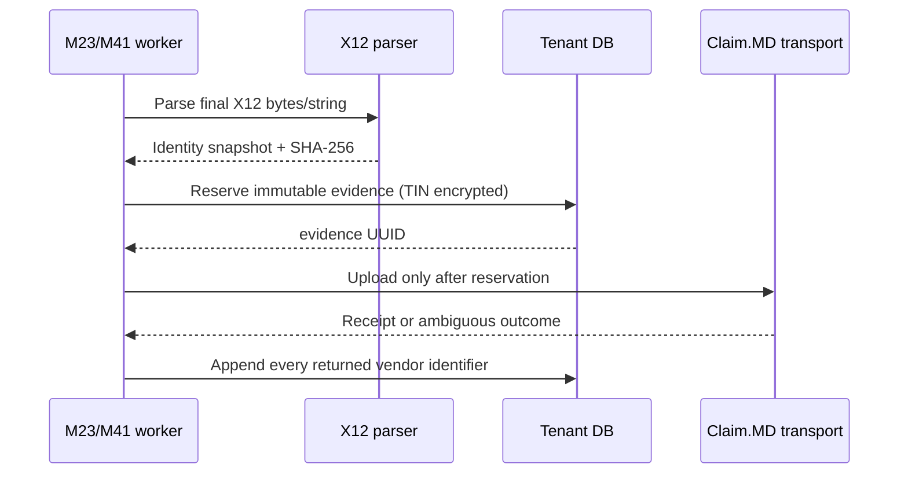

# Submission evidence contract

## Evidence lifecycle

The payload digest is SHA-256 over the exact UTF-8 X12 string that is passed to the transport. Parsed facts include ISA13, GS06, ST02, billing NPI/TIN, payer ID, claim control (PCN/CLM01), transaction/claim type, and service dates when present. The parser validates ISA/IEA, GS/GE, ST/SE control agreement and supported transaction-set versions. The send boundary enforces one CLM per evidence row.

`packages/x12-837-client/src/clearinghouse/submission-evidence.ts` performs extraction and digesting. `claimmd-evidence/cipher.ts` encrypts TIN using the tenant DEK provider and AAD bound to module/table/column/version/evidence UUID/org/provider/attempt key. Neither raw X12 nor plaintext TIN is persisted in this evidence table.

## Immutability and tenant scope

Migration `1352_m23_claimmd_submission_evidence.sql` defines composite tenant/account/environment receipt foreign keys, FORCE RLS, `app.org_id` policies, no UPDATE/DELETE grants, and immutable/append-only triggers. Receipt uniqueness prevents duplicate observations by evidence, source field, value, and source. These protections require live verification as the real `chartwarden_app` NOBYPASSRLS role; no claim of runtime certification is made.

The store (`claimmd-evidence/store.ts`) enters `withOrgContext` for each operation and verifies a repeated reservation's payload digest, claim/provider/account/environment/NPI/payer/control and decrypted TIN before reusing the existing evidence UUID. A cross-org evidence lookup is constrained by RLS and store filters.

## Receipt provenance

The transport returns `vendorIdentifiers` only when Claim.MD's upload response includes recognized fields. Each entry preserves the source field name; consumers map it to a namespace without rewriting vendor data. If an attempt replay has only the generic `clearinghouseSubmissionId`, it is stored under the explicit opaque field. The `file:` prefix in the transport's legacy generic identifier is not treated as authoritative vendor field provenance.

The Claim.MD upload list reconciliation currently resolves an inbound file identifier internally. Full durable enrichment of reconciliation-discovered IDs belongs in BIL-1.2.2B, as transport attempt replay does not persist the original field-by-field receipt. Do not infer claim acceptance or payer acceptance from an upload receipt.
