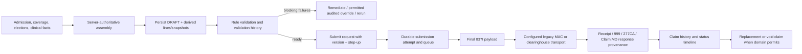
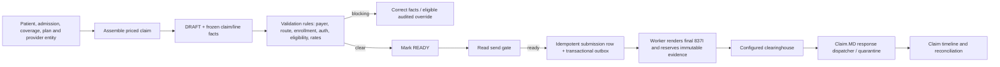

# Current Claim Workflows

This map describes code and durable contracts on `origin/develop`; “implemented” does not mean production-certified. Routes and state transitions are cited to source.

## M23 — Medicare hospice

- Assembly checks Medicare FFS primary coverage, active hospice election, overlap and prior-claim continuity, derive TOB and line data from server facts: [claim-assembly.ts](../../../apps/backend/src/modules/23-billing-medicare/services/claim-assembly.ts#L188) lines 188–327.
- Claim list/detail/edit/validate/submit/replace/void endpoints and preconditions: [claims.routes.ts](../../../apps/backend/src/modules/23-billing-medicare/routes/claims.routes.ts#L182) lines 182–357.
- Validation re-materializes current facts and snapshots before evaluating the frozen rules: [claim-validation-service.ts](../../../apps/backend/src/modules/23-billing-medicare/services/claim-validation-service.ts#L191) lines 191–259.
- The loader joins persisted claim, lines, admission, patient identity, billing parties and receiver. Missing facts are typed gaps; MBI is read through an audited unlock seam and held in memory: [claim-837i-loader.ts](../../../apps/backend/src/modules/23-billing-medicare/services/claim-837i-loader.ts#L1) lines 1–18.
- The worker preflights before transport; on success it records the attempt, transitions state and emits an outbox event: [m23-jobs.ts](../../../apps/backend/src/modules/23-billing-medicare/jobs/m23-jobs.ts#L916) lines 916–1059.
- Replacement/void is a distinct claim-state operation, not mutation of a sent payload. NOE/NOTR/transfer are distinct notice workflows and remain separately guarded; see [MEDICARE_GAPS.md](./MEDICARE_GAPS.md).

## M41 — Commercial

- Assembly enforces provider scope, patient caseload and admission binding, commercial-primary coverage and derives clinical fields: [claim-assembly.ts](../../../apps/backend/src/modules/41-billing-commercial/services/claim-assembly.ts#L141) lines 141–229.
- Route surface includes assemble/list/detail/validate/ready/send-gate/timeline/submit/reconcile/void: [commercial-billing.routes.ts](../../../apps/backend/src/modules/41-billing-commercial/routes/commercial-billing.routes.ts#L123) lines 123–301.
- Submission is idempotent, re-evaluates the gate and publishes a transactional outbox request; ambiguous sends go to `in_doubt` and require reconciliation: [submission-service.ts](../../../apps/backend/src/modules/41-billing-commercial/services/submission-service.ts#L296) lines 296–455.
- Renderer checks current validation facts, `ready` state, payer, provider/attending, subscriber and parties before rendering 837I: [render-837i.ts](../../../apps/backend/src/modules/41-billing-commercial/services/render-837i.ts#L88) lines 88–169.
- Correcting a sent commercial claim is not represented by the current local void workflow; see [COMMERCIAL_GAPS.md](./COMMERCIAL_GAPS.md).

## M24 — Medicaid

- M24 write contract explicitly identifies state adapter, M5/M6/M8/M40 readers and rate-schedule dependencies: [write-service.ts](../../../apps/backend/src/modules/24-billing-medicaid/routes/write-service.ts#L1) lines 1–10, 135–175.
- Assembly requires in-force coverage, provider/state trading partner, active state plan, CCN and clinical/LOC inputs: [write-service-drizzle.ts](../../../apps/backend/src/modules/24-billing-medicaid/routes/write-service-drizzle.ts#L420) lines 420–535.
- Submission refuses unsupported electronic states before mutation/queueing; the worker binds credentials, assembles per-state payload, submits and records sync/async results: [write-service-drizzle.ts](../../../apps/backend/src/modules/24-billing-medicaid/routes/write-service-drizzle.ts#L958) lines 958–1040; [submission-jobs.ts](../../../apps/backend/src/modules/24-billing-medicaid/jobs/submission-jobs.ts#L166) lines 166–398.
- Adapter registry and state deny-stubs are authoritative over prose that describes future states: [registry.ts](../../../packages/medicaid-adapters/src/registry.ts#L25) lines 25–77.

## Shared boundaries

- M1 owns provider entities/locations and M5 owns patient coverage/identity facts; billing modules consume owner seams. M23 and M41 must keep their own claim state machines and payer rules.
- BIL-1 adds shared Claim.MD account/environment response capture, immutable evidence, identity resolution and M23/M41 acknowledgement application; it does not certify payer adjudication or switch on workers. BIL-1 status is summarized at [BIL-1.5B readiness](../BIL-1.5B/NEXT_PHASE_READINESS.md).
- M25 owns remittance/ERA review and posting. Claim submission work can consume M25 remittance references/history, but must not add a second posting path.
