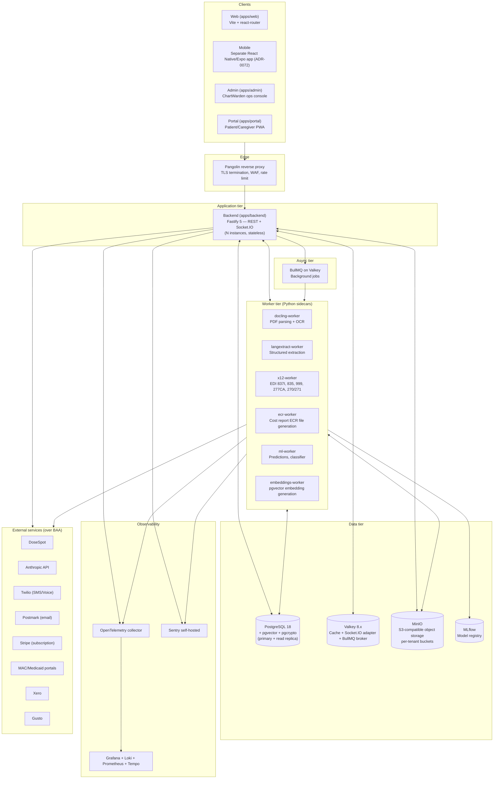
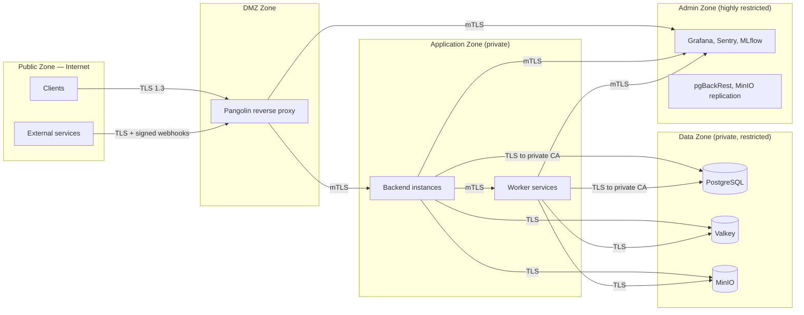
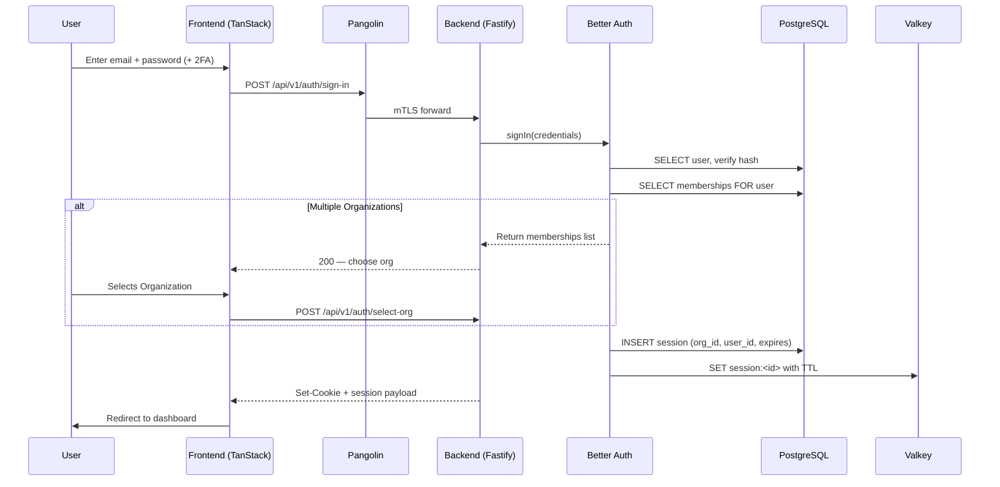
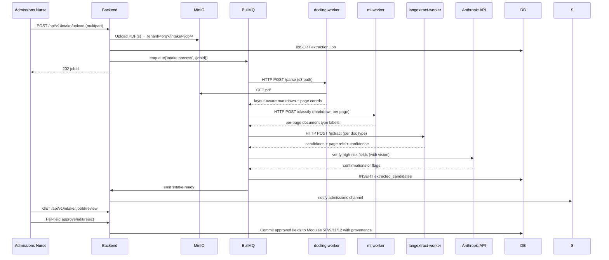
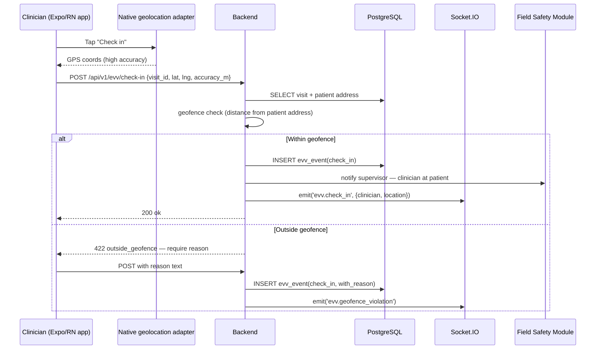
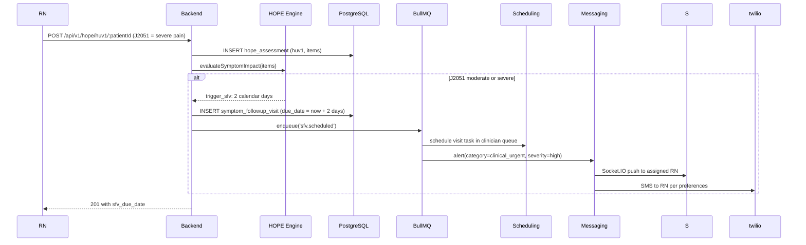
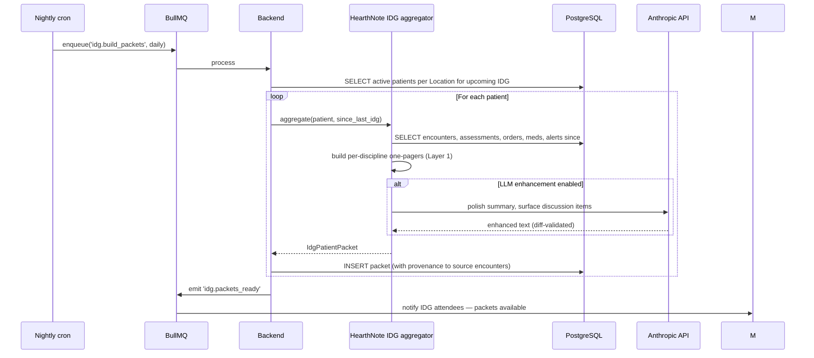
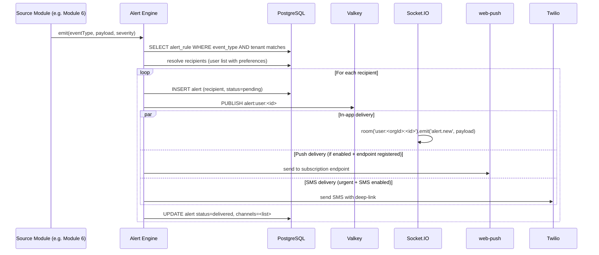
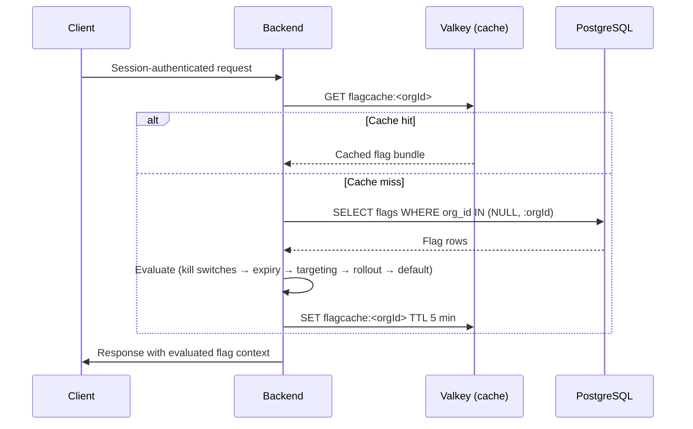
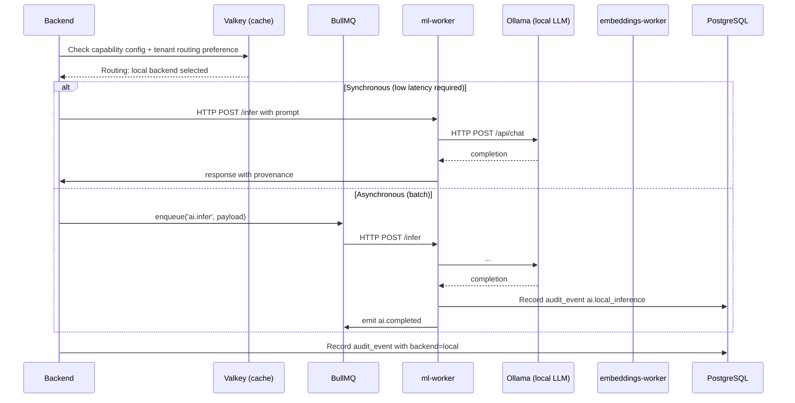

# ChartWarden — System Design Document

**Status:** v0.3
**Owner:** Fabrice V. Adjam
**Companion to:** CHARTWARDEN_ARCHITECTURE v0.12 (file `CHARTWARDEN_ARCHITECTURE_v0_11.md`)
**Purpose:** Define the runtime architecture, deployment topology, and operational contracts of ChartWarden. The architecture document answers *what and why*; this document answers *how it actually runs*.

**Execution stance:** Local-first development (MacBook Pro + Docker Compose), Proxmox VMs for initial production deployment. All design decisions favor cloud-portability — every component is containerized, every storage interface is portable (S3-compatible, standard PostgreSQL, standard Redis protocol). Cloud migration later is a deployment-target change, not an architecture change.

## Changelog
- **v0.3** — §2.2 updated: ml-worker VM hardware specs for local AI model serving (CPU minimum / GPU recommended / production-scale GPU). §4.5 updated: MinIO `platform/ml-models/` layout for local model artifact storage. §4.8 new: Local AI Inference Data Flow.
- **v0.2** — §4.6 added: Platform-shared vs Tenant-scoped data model for Module 40 (Master Data Management). §4.7 added: Feature flag evaluation data flow and cache invalidation.
- **v0.1** — Initial system design

---

## 1. Logical Architecture

### 1.1 Component Diagram



### 1.2 Trust Boundaries



### 1.3 Critical Sequence Diagrams

#### 1.3.1 User Login (Web)



#### 1.3.2 Encounter Save with HearthNote

```mermaid
sequenceDiagram
  participant C as Clinician (mobile)
  participant B as Backend
  participant H as HearthNote (in packages/hearthnote)
  participant L as Anthropic API
  participant DB as PostgreSQL
  participant V as Valkey
  participant S as Socket.IO
  C->>B: PATCH /api/v1/encounters/:id/selections (in-progress)
  B->>DB: BEGIN; SET LOCAL app.org_id = :org; UPDATE encounter_draft
  B->>V: SET draft cache (90-day TTL)
  B-->>C: 200 draft saved
  Note over C,B: Clinician completes the note
  C->>B: POST /api/v1/encounters/:id/finalize
  B->>H: assembleLayer1(selections)
  H-->>B: deterministic narrative
  alt LLM enhancement enabled (tenant+clinician)
    B->>L: POST /v1/messages (with system prompt + Layer1 + chart context)
    L-->>B: enhanced narrative
    B->>H: diffAndValidate(layer1, llm_output)
    H-->>B: valid + diff (or hard-block on factual changes)
  end
  B->>H: complianceGate(encounter)
  alt Compliance gate passes
    H-->>B: pass
    B->>DB: COMMIT — encounter, narrative versions, audit
    B->>S: emit('encounter.signed', {orgId, patientId, encounterId})
    B-->>C: 200 signed
  else Compliance gate fails
    H-->>B: fail + remediation
    B-->>C: 422 with remediation hints
  end
```

#### 1.3.3 Claim Submission

```mermaid
sequenceDiagram
  participant U as Biller
  participant B as Backend
  participant V as ValidationFramework
  participant X as x12-worker
  participant Q as BullMQ
  participant M as MAC portal
  participant DB as PostgreSQL
  U->>B: POST /api/v1/claims/:id/submit
  B->>DB: SELECT claim WITH lines, election, certs
  B->>V: runAllRules(claim)
  V->>V: 30+ default rules execute
  V-->>B: results
  alt Any rule fails (no override)
    B-->>U: 422 with rule failures + remediation
  else All pass OR overrides documented
    B->>DB: UPDATE claim status = READY; INSERT validation_result
    B->>Q: enqueue('claim.submit', {claimId})
    B-->>U: 202 queued
    Q->>X: HTTP POST /generate-837i
    X-->>Q: 837I file bytes
    Q->>M: portal upload
    M-->>Q: 999 ACK file
    Q->>X: HTTP POST /parse-999
    X-->>Q: parsed ack
    Q->>DB: UPDATE claim status; INSERT ack record
    Q->>B: emit 'claim.acknowledged'
    B->>S: emit('claim.acknowledged') to billing channel
  end
```

#### 1.3.4 DocLens Intake Extraction

> **Amended by [ADR-0048](../adr/ADR-0048-doclens-docling-plus-grounded-extractor.md) (2026-10-03).** The diagram below predates it: `langextract-worker` and the DocLens use of `ml-worker` are gone. Stage 3–4 are M32 `doclens_classify` / `doclens_extract` invocations (local Ollama or Claude under the BAA, per the tenant's consented routing); `docling-worker` receives a presigned GET URL and authenticates the backend with a worker-specific `DOCLING_WORKER_TOKEN`.



#### 1.3.5 EVV Check-in from Field



#### 1.3.6 HOPE SFV Trigger



#### 1.3.7 IDG Pre-meeting Packet Build



#### 1.3.8 Alert Delivery via Module 36



---

## 2. Physical & Deployment Topology

### 2.1 Local Development (MacBook Pro)

> **STATUS: TARGET — NOT BUILT.** There is no `infra/` directory and no compose file at the path
> below. Local dev today is a bare `docker run` of Postgres (`pgvector/pgvector:pg18`) plus
> `bun run dev`; there is no local valkey, minio, mailpit or mlflow. `docs/DEVELOPMENT.md` is the
> maintained runbook for it.

Single-host Docker Compose. All services run as containers. Services exposed on localhost ports.

```yaml
# infra/docker/dev.compose.yaml
networks:
  wardenx: { driver: bridge }
services:
  postgres:
    image: pgvector/pgvector:pg18
    ports: ["5432:5432"]
    volumes: [./data/pg:/var/lib/postgresql/data]
    networks: [wardenx]
  valkey:
    image: valkey/valkey:8
    ports: ["6379:6379"]
    volumes: [./data/valkey:/data]
    networks: [wardenx]
  minio:
    image: minio/minio
    ports: ["9000:9000", "9001:9001"]
    volumes: [./data/minio:/data]
    command: server /data --console-address ":9001"
    networks: [wardenx]
  mailpit:
    image: axllent/mailpit
    ports: ["1025:1025", "8025:8025"]
    networks: [wardenx]
  mlflow:
    image: ghcr.io/mlflow/mlflow:latest
    ports: ["5000:5000"]
    networks: [wardenx]
  docling-worker:
    build: ./services/docling-worker
    ports: ["8001:8000"]
    networks: [wardenx]
  langextract-worker:
    build: ./services/langextract-worker
    ports: ["8002:8000"]
    networks: [wardenx]
  x12-worker:
    build: ./services/x12-worker
    ports: ["8003:8000"]
    networks: [wardenx]
  ecr-worker:
    build: ./services/ecr-worker
    ports: ["8004:8000"]
    networks: [wardenx]
  ml-worker:
    build: ./services/ml-worker
    ports: ["8005:8000"]
    networks: [wardenx]
  embeddings-worker:
    build: ./services/embeddings-worker
    ports: ["8006:8000"]
    networks: [wardenx]
  # Optional observability stack (profile: observe)
  prometheus:
    profiles: [observe]
    image: prom/prometheus
    ports: ["9090:9090"]
  loki:
    profiles: [observe]
    image: grafana/loki
    ports: ["3100:3100"]
  tempo:
    profiles: [observe]
    image: grafana/tempo
    ports: ["3200:3200"]
  grafana:
    profiles: [observe]
    image: grafana/grafana
    ports: ["3001:3000"]
```

**Local dev port map:**

| Service | Port | Purpose |
|---|---|---|
| web | 5173 | Vite dev server (react-router; `apps/web`) |
| portal | 5174 | Patient portal (`apps/portal`) |
| admin | 5175 | Admin console (`apps/admin`) |
| backend | 3000 | Fastify HTTP (`PORT`); worker role listens on 3001 (`WORKER_PORT`) |
| postgres | 5432 | DB |
| valkey | 6379 | Cache + queue |
| minio | 9000 | S3 API |
| minio console | 9001 | MinIO web UI |
| mailpit SMTP | 1025 | Capture outbound email |
| mailpit UI | 8025 | View captured email |
| mlflow | 5000 | Model registry |
| drizzle studio | 4983 | Schema explorer |
| workers | 8001-8006 | Python sidecars |
| grafana | 3001 | (optional) observability UI |

**Mac specifics:**
- All images ARM64 (Apple Silicon)
- Docker Desktop with file sharing for `./data` directory
- Postgres tuned for dev (`shared_buffers=256MB`, lower than prod)
- MinIO mode `single-node` for dev

### 2.2 Production Target (Proxmox)

Initial production: Proxmox cluster on user's hardware. VM allocation:

| VM | vCPUs | RAM | Disk | Role |
|---|---|---|---|---|
| wardenx-edge-01 | 4 | 4 GB | 40 GB | Pangolin reverse proxy + WAF |
| wardenx-app-01 | 8 | 16 GB | 80 GB | Backend instance #1 + admin + portal |
| wardenx-app-02 | 8 | 16 GB | 80 GB | Backend instance #2 (hot standby; load-balanced) |
| wardenx-workers-01 | 8 | 16 GB | 100 GB | Python sidecars (docling, langextract, x12, ecr) |
| wardenx-workers-02 | 16 | 32 GB | 200 GB + optional GPU passthrough | ml-worker, embeddings-worker (Phase 1 default: CPU-only with q4 quantized 8B local models; Phase 2 recommended: NVIDIA RTX 4090 24GB VRAM for higher-quality 8B and lightweight 70B; Production-scale: NVIDIA A100/H100 with vLLM serving) |
| wardenx-db-01 | 8 | 32 GB | 500 GB | PostgreSQL primary + pgBouncer |
| wardenx-db-02 | 8 | 32 GB | 500 GB | PostgreSQL streaming replica |
| wardenx-data-01 | 4 | 8 GB | 200 GB | Valkey + MLflow |
| wardenx-storage-01 | 4 | 8 GB | 4 TB | MinIO (S3-compatible object storage) |
| wardenx-obs-01 | 4 | 16 GB | 500 GB | Grafana + Loki + Prometheus + Tempo + Sentry |
| wardenx-backup-01 | 2 | 4 GB | 8 TB | pgBackRest + MinIO replication target |

**Total:** ~78 vCPUs, ~200 GB RAM, ~14 TB storage across 11 VMs. Fits in a single Proxmox host with 32 cores / 256 GB RAM, or split across 2-3 hosts for HA.

### 2.3 Cloud-Portability Mapping

When ready to move to cloud, each VM maps cleanly to a managed service or container:

| Local | Cloud equivalent |
|---|---|
| Pangolin | AWS ALB / Cloudflare / managed Kubernetes ingress |
| Backend VMs | ECS Fargate / Cloud Run / fly.io / Kubernetes Deployment |
| Worker VMs | Same as backend |
| PostgreSQL | RDS PostgreSQL / Cloud SQL / Neon (if HIPAA BAA) |
| Valkey | ElastiCache for Redis / Memorystore / managed Redis |
| MinIO | S3 / GCS / Cloudflare R2 (BAA required for PHI) |
| MLflow | Same container, mounted volume → managed disk |
| Observability | Same containers OR managed (Datadog, New Relic) |
| pgBackRest | Same; backup target → S3 |

No code change required. Only deployment manifests differ.

### 2.4 Why Not Kubernetes Initially

Kubernetes adds operational overhead unjustified for a single-tenant local deployment and a handful of production VMs. The architecture is K8s-compatible (containers with health checks, configurable via environment variables, stateless app tier) so adoption is straightforward when scale demands it. Premature K8s for solo-developer ops is technical debt disguised as best practice.

---

## 3. Network Architecture

### 3.1 Trust Zones (Production)

| Zone | Inhabitants | Inbound | Outbound |
|---|---|---|---|
| **Public** | Internet | N/A | N/A |
| **DMZ** | Pangolin | 443/TCP from Internet | mTLS to Application Zone |
| **Application** | Backend VMs, Worker VMs | mTLS from DMZ; mTLS from peer apps | TLS to Data; TLS to External over BAA |
| **Data** | PostgreSQL, Valkey, MinIO | TLS from Application Zone only | No outbound to Internet |
| **Admin** | Observability, Backups, MLflow | mTLS from Application Zone | No outbound to Internet |

### 3.2 Local Dev (Single Bridge Network)

Local dev runs on a single Docker bridge network. No zone enforcement — everything talks freely on internal DNS names (`postgres`, `valkey`, `minio`, etc.). This is fine for dev; do not replicate in production.

### 3.3 Proxmox VLAN Segmentation

| VLAN | Subnet | Members | Routing |
|---|---|---|---|
| VLAN 10 (DMZ) | 10.10.10.0/24 | edge-01 | NAT to Internet inbound; allowed → VLAN 20 |
| VLAN 20 (App) | 10.10.20.0/24 | app-01, app-02, workers-01, workers-02 | Allowed → VLAN 10 (replies), VLAN 30, VLAN 40 (specific ports), Internet egress |
| VLAN 30 (Data) | 10.10.30.0/24 | db-01, db-02, data-01, storage-01 | Allowed → VLAN 20 (specific ports), No Internet |
| VLAN 40 (Admin) | 10.10.40.0/24 | obs-01, backup-01 | Allowed → VLAN 20 (scrape), VLAN 30 (backup); No Internet |
| VLAN 99 (Mgmt) | 10.10.99.0/24 | All VM mgmt interfaces | SSH/Proxmox admin only |

### 3.4 TLS Strategy

| Hop | Protocol | Certificate authority |
|---|---|---|
| Internet → Pangolin | TLS 1.3 | Let's Encrypt (public) |
| Pangolin → Backend | mTLS | Private CA (per-environment) |
| Backend → Worker | mTLS | Private CA |
| Backend → Postgres | TLS with client cert verification | Private CA |
| Backend → Valkey | TLS (with `requirepass`) | Private CA |
| Backend → MinIO | TLS | Private CA |
| Backend → External | TLS 1.3 with cert pinning | Public CA |
| Webhook inbound (DoseSpot/Stripe/etc.) | TLS + signed payloads | Public CA + signature verification |

Private CA lives offline (or in a sealed-box pattern). Cert rotation handled by `cert-manager`-style cron jobs (custom for VM deployment; standard cert-manager in K8s).

### 3.5 Secret Management

| Environment | Secret store | Decryption |
|---|---|---|
| Local dev | `.env.local` (gitignored) | Read by Bun process |
| Production | SOPS-encrypted YAML in repo + age key on each VM | systemd unit decrypts at service start |
| Future cloud | AWS Secrets Manager / GCP Secret Manager / HashiCorp Vault | Workload identity |

No secrets in code, no secrets in container images, no secrets in environment dumps. Secrets reach the container as ephemeral mounted files (`/run/secrets/<name>`) or in-memory environment variables set at process start.

---

## 4. Data Architecture

### 4.1 PostgreSQL Physical Design

**Version:** PostgreSQL 18 with pgvector and pgcrypto extensions.

**Connection model:**
- PgBouncer in transaction-pooling mode in front of every backend instance
- Each backend instance: pool size 20 connections to PgBouncer
- PgBouncer → Postgres: pool size 50 (configurable)
- Read replica: backend opts in per-query via `db.read()` helper (most queries default to primary for consistency)

**Partitioning strategy:**

| Table | Partition by | Reason |
|---|---|---|
| `audit_event` | RANGE on `created_at`, monthly | High volume, retention by age |
| `claim` | LIST on `provider_entity_id` then RANGE on `created_at` quarterly | Sharded by ProviderEntity |
| `claim_line` | Same as parent | Co-partitioned |
| `encounter` | LIST on `organization_id` then RANGE on `created_at` quarterly | Tenant-bound + time |
| `encounter_note` | Same as parent | Co-partitioned |
| `hope_assessment` | LIST on `organization_id` then RANGE on `created_at` annually | Annual cadence sufficient |
| `message` (Module 36) | LIST on `organization_id` then RANGE on `created_at` monthly | High volume, 6-yr retention |
| `extraction_job` | RANGE on `created_at` monthly | Operational queue history |

**Index strategy:**

- Every PHI table has composite index `(organization_id, <natural_key>)` for RLS-friendly queries
- B-tree on foreign keys
- GIN on JSONB columns used for filtering (e.g., `audit_event.diff`)
- HNSW (pgvector) on embedding columns
- Partial indexes on common filter sets (e.g., `WHERE status = 'active'`)

**RLS policy template:**

```sql
ALTER TABLE <table> ENABLE ROW LEVEL SECURITY;
CREATE POLICY <table>_org_isolation ON <table>
  USING (organization_id = current_setting('app.org_id', true)::uuid)
  WITH CHECK (organization_id = current_setting('app.org_id', true)::uuid);
GRANT ALL ON <table> TO chartwarden_app;
-- audit table is INSERT-only for app role; UPDATE/DELETE not granted
```

**Vacuum / analyze:**

- `autovacuum = on`
- Aggressive settings on hot tables (`audit_event`, `encounter`, `message`) — scale factor 0.05
- Weekly `VACUUM FULL` on heavily-updated tables during maintenance window
- pgBackRest snapshot before any DDL migration

**Connection budget:**

For 2 backend instances × 20 pool × 8 workers × 5 pool = 80 connections to PgBouncer. PgBouncer transaction pooling → ~50 actual Postgres connections. PG max_connections set to 200 (headroom for migrations, admin tools, monitoring).

### 4.2 pgvector Usage

| Purpose | Embedding model | Dimension | Index |
|---|---|---|---|
| Encounter note semantic search | `text-embedding-3-small` (or local model) | 1536 | HNSW (m=16, ef_construction=64) |
| Similar-case lookup | Same | 1536 | HNSW |
| HearthNote vocabulary similarity | Smaller local model | 384 | HNSW |
| DocLens reference matching | Smaller local model | 384 | HNSW |

Embeddings generated by `embeddings-worker`. Stored in dedicated `*_embedding` tables linked to the source row by FK. Updated on row change via trigger → enqueue job.

### 4.3 Valkey Usage Patterns

| Pattern | Key format | TTL | Eviction policy |
|---|---|---|---|
| Session storage | `session:<id>` | Match session expiry | volatile-ttl |
| Rate limit counters | `rate:<route>:<user>:<window>` | Window size | volatile-ttl |
| Cache: encounter draft | `draft:encounter:<id>` | 90 days | volatile-ttl |
| Cache: tenant config | `tenantcfg:<org_id>` | 5 minutes | volatile-ttl |
| Cache: feature flags | `flags:<org_id>` | 5 minutes | volatile-ttl |
| Socket.IO adapter | `socket.io#<event>` | Managed by adapter | n/a |
| BullMQ queues | `bull:<queue>:*` | Per-queue config | n/a |
| Distributed locks | `lock:<resource>` | TTL = max operation time | volatile-ttl |

Valkey configured with `maxmemory-policy=allkeys-lru` for cache evictions, but BullMQ and Socket.IO data is on a separate Valkey instance OR a separate database number (db 0 = cache+session, db 1 = BullMQ, db 2 = Socket.IO).

### 4.4 MinIO Bucket Layout

```
<minio>/
├── tenants/
│   ├── <org_id>/
│   │   ├── documents/        # User-uploaded clinical documents
│   │   ├── generated/         # Generated PDFs (forms, reports)
│   │   ├── intake/            # DocLens working files (per job)
│   │   ├── claims/            # 837I files submitted, 835 received
│   │   ├── cost-reports/      # ECR + PI files
│   │   ├── exports/           # Subject-access NDJSON bundles
│   │   └── recordings/        # Telehealth recordings (if enabled)
└── platform/                  # Cross-tenant ChartWarden assets
    ├── form-templates/        # PDF templates (NOE, election, etc.)
    └── ml-models/             # Model artifacts (sync with MLflow)
```

**Bucket-level IAM:** Each tenant gets a unique access key/secret that scopes via IAM policy to `tenants/<org_id>/*`. Backend uses platform-level credentials for cross-tenant operations (with audit).

**Object lifecycle:**

- Versioning: enabled on `documents/`, `generated/`, `claims/`, `cost-reports/`
- Object lock (compliance mode): on `claims/` and `cost-reports/` for 7-year retention
- Lifecycle transition: `intake/` artifacts deleted 30 days after job completion
- Replication: `platform/` and `tenants/<org>/claims/` and `cost-reports/` replicated to backup VM

### 4.5 MLflow Storage

- Backend store: PostgreSQL (separate schema, same DB)
- Artifact store: MinIO `platform/ml-models/`
- One MLflow tracking server (not per-tenant)
- Model versioning: per (capability × tenant) when tenant-specific calibration exists; otherwise platform-default

### 4.6 Platform-Shared vs Tenant-Scoped Data Model

Most tables in ChartWarden are tenant-scoped via RLS on `organization_id`. **Module 40 (Master Data Management)** introduces a third pattern: **platform-shared canonical records with tenant-scoped overlays**. This is the right pattern when an external entity (Dr. Smith with NPI 1234567890) is referenced by many tenants and we don't want N copies of the same physician with different fields filled in.

**Three data scoping patterns in ChartWarden:**

| Scope | Examples | Storage pattern | RLS pattern |
|---|---|---|---|
| **Tenant-scoped** | Patient, Encounter, Claim, Order, all PHI | `organization_id` column on every row | RLS policy: `USING (organization_id = current_setting('app.org_id')::uuid)` |
| **Platform-shared (read-only to tenants)** | TerminologyConcept (Module 38), Form templates, ML models, Default validation rules | No `organization_id`; visible to all tenants | RLS policy: `USING (true)` for SELECT to `chartwarden_app`; INSERT/UPDATE/DELETE only to `chartwarden_admin` |
| **Platform-shared canonical + tenant-scoped overlay** | ExternalPhysician (Module 40), Facility, Pharmacy, Payer, etc. | Two tables per entity: `external_physician` (canonical) and `external_physician_tenant_overlay` (tenant-specific fields) | Canonical: `USING (true)` for SELECT; overlay: tenant-scoped RLS |

**Pattern for Module 40 entities:**

```sql
-- Canonical: visible to all tenants, mutable only by platform jobs (NPPES sync, admin merge)
CREATE TABLE external_physician (
  id UUID PRIMARY KEY,
  npi TEXT NOT NULL UNIQUE,
  first_name TEXT,
  last_name TEXT,
  credentials TEXT,
  specialty TEXT,
  primary_address JSONB,
  status TEXT, -- 'active' | 'deactivated' | 'merged'
  merged_into_id UUID REFERENCES external_physician(id), -- non-null if merged
  nppes_last_synced_at TIMESTAMPTZ,
  ...
);
ALTER TABLE external_physician ENABLE ROW LEVEL SECURITY;
CREATE POLICY external_physician_read ON external_physician
  FOR SELECT TO chartwarden_app USING (true);
-- No INSERT/UPDATE/DELETE policy for chartwarden_app
GRANT SELECT ON external_physician TO chartwarden_app;
GRANT ALL ON external_physician TO chartwarden_admin;

-- Tenant overlay: per-tenant fields about the canonical physician
CREATE TABLE external_physician_tenant_overlay (
  id UUID PRIMARY KEY,
  external_physician_id UUID NOT NULL REFERENCES external_physician(id),
  organization_id UUID NOT NULL REFERENCES organization(id),
  preferred_contact_phone TEXT,
  preferred_contact_email TEXT,
  relationship_notes TEXT,
  do_not_refer BOOLEAN DEFAULT false,
  is_preferred BOOLEAN DEFAULT false,
  contract_terms JSONB,
  created_by UUID,
  updated_at TIMESTAMPTZ,
  UNIQUE (external_physician_id, organization_id)
);
ALTER TABLE external_physician_tenant_overlay ENABLE ROW LEVEL SECURITY;
CREATE POLICY overlay_org_isolation ON external_physician_tenant_overlay
  FOR ALL TO chartwarden_app
  USING (organization_id = current_setting('app.org_id', true)::uuid)
  WITH CHECK (organization_id = current_setting('app.org_id', true)::uuid);
GRANT SELECT, INSERT, UPDATE, DELETE ON external_physician_tenant_overlay TO chartwarden_app;
```

**Query pattern:**

Application code queries the joined view via Drizzle:

```typescript
// Returns physician canonical fields + this tenant's overlay
const physician = await db
  .select({
    id: externalPhysician.id,
    npi: externalPhysician.npi,
    firstName: externalPhysician.firstName,
    lastName: externalPhysician.lastName,
    specialty: externalPhysician.specialty,
    primaryAddress: externalPhysician.primaryAddress,
    // overlay fields (may be null if no overlay exists yet)
    preferredContactPhone: physicianOverlay.preferredContactPhone,
    isPreferred: physicianOverlay.isPreferred,
    relationshipNotes: physicianOverlay.relationshipNotes,
  })
  .from(externalPhysician)
  .leftJoin(
    physicianOverlay,
    eq(physicianOverlay.externalPhysicianId, externalPhysician.id),
  )
  .where(eq(externalPhysician.id, physicianId))
```

The `chartwarden_app` connection has RLS active so the overlay join only returns the current tenant's overlay row; canonical fields are visible to all.

**NPPES sync (platform job):**

A nightly platform-role job (using `chartwarden_admin` connection or `withPlatformContext`) fetches NPPES update files and refreshes canonical `external_physician` rows. Audit event `nppes.sync_completed` logged with deactivated/changed counts. Tenants whose preferred physicians changed get an alert via Module 36 in the next morning brief.

**Deduplication workflow:**

When the canonical table has potential duplicates (manually created entries before NPI was known, address-based matches), a `merge_request` table tracks proposed merges. Admin (platform role) reviews; on approval:
1. All references to `duplicate_id` re-pointed to `canonical_id` via foreign-key update jobs (per-table, batched)
2. Duplicate row updated: `status = 'merged'`, `merged_into_id = canonical_id`
3. Duplicate's tenant overlays migrated to canonical (with conflict resolution per overlay field)
4. Audit event `mdm.merge_completed` with full provenance

Applications always follow `merged_into_id` transparently in service-layer queries; foreign keys to merged rows still resolve correctly via the redirect.

### 4.7 Feature Flag Evaluation Data Flow

Feature flags (Module 1 §3.10 enhanced in v0.2) are evaluated per request. The data flow:



**Kill switch cache bypass:**

When any flag with `kill_switch_active = true` exists for a tenant, the cache is **not used** — every request re-evaluates from PG. This is intentional: kill switches are activated in incidents and must be effective immediately. Performance cost is acceptable because kill switch activation is rare.

**Cache invalidation:**

- Time-based: 5-minute TTL on the bundle
- Event-based: `feature_flag.updated` and `feature_flag.kill_switch_activated` Socket.IO events trigger backend instances to delete `flagcache:<orgId>` immediately; clients refetch on next request
- Frontend: TanStack Query stale time 5 minutes; Socket.IO `feature_flag.kill_switch_activated` invalidates query cache for immediate refresh

**Evaluation order (high to low precedence):**

1. **Kill switch active** → return disabled, bypass everything else, record evaluation
2. **Migration flag expired** (`expires_at < NOW()`) → return default, log warning
3. **Targeting rule match** (role, userId, locationId, providerEntityId, segment) → return matched value
4. **Rollout percent** → bucket by `hash(flagKey + organizationId + userId) % 100`; if bucket < `rollout_percent` return 'true' equivalent, else default
5. **Default value** → return `value` column

**Evaluation recording:**

- `product` flags: not recorded (too high volume)
- `rollout` flags: recorded for first 14 days of rollout (analysis window)
- `kill_switch` flags: every evaluation while active recorded (incident forensics)
- `migration` flags: every evaluation recorded (validates migration progress)

### 4.8 Local AI Inference Data Flow

Local AI capabilities (Architecture §10.7) run on `wardenx-workers-02` (ml-worker VM). The data flow differs from cloud AI in that PHI never leaves ChartWarden:



**Key differences from cloud inference:**

- No outbound API call to vendor
- Audit event `event_type=ai.local_inference` instead of `ai.phi_disclosed`
- Latency dependent on local hardware (typically 2-4× cloud for 8B local model on CPU; comparable on GPU)
- No vendor rate limits — only local compute capacity
- No vendor cost — only ChartWarden infrastructure cost

**Local model storage layout in MinIO:**

```
platform/ml-models/
├── ollama/                              # Mirrored Ollama model cache for fast restart
│   ├── llama3.1-8b-instruct-q4_K_M/
│   │   ├── manifest.json
│   │   ├── model.gguf                   # ~4.5 GB
│   │   └── tokenizer.model
│   ├── mistral-7b-instruct-v0.3-q4_K_M/
│   └── phi3.5-mini-q4_K_M/
├── embeddings/
│   ├── bge-small-en-v1.5/
│   │   ├── config.json
│   │   ├── pytorch_model.bin
│   │   └── tokenizer.json
│   └── all-MiniLM-L6-v2/
├── classifiers/
│   └── doclens-doctype-v3/              # Custom ChartWarden-trained model
│       ├── model.safetensors
│       ├── config.json
│       └── eval-results.json            # Calibration metrics at training time
└── manifests/
    └── current.yaml                     # Currently-deployed versions per capability
```

**Model lifecycle in MinIO:**

- New model version uploaded to versioned path
- `manifests/current.yaml` updated when promoted to production
- ml-worker startup: reads manifest; pulls models not already cached locally; verifies checksums
- Old versions retained 30 days for rollback
- Models tagged in MLflow with full provenance (training data version if custom-trained, base model + quantization params, calibration results)

**Capacity planning for local AI:**

| Workload | Concurrent inferences | Hardware tier |
|---|---|---|
| Embeddings only (BGE/MiniLM) | 100+ qps | CPU minimum sufficient |
| Classifier + embeddings | 50+ qps | CPU minimum sufficient |
| 8B LLM on CPU (q4 quantized) | 1-3 qps per worker; serializes per request | CPU minimum acceptable for pilot/light usage |
| 8B LLM on RTX 4090 | 5-20 qps depending on context length | GPU recommended for serious use |
| 70B LLM on A100 | 1-5 qps depending on context | Production-scale GPU |
| Multi-tenant local AI at scale | Higher with vLLM | Dedicated llm-worker VM Phase 2+ |

Capacity planning by tenant: heavy local-AI tenant projected against ml-worker capacity; scaling decisions per CHARTWARDEN_OPS_RUNBOOK §10.4.

---

## 5. Identity & Context Propagation

### 5.1 Authentication Flow Recap

1. User submits credentials (or passkey) to Better Auth
2. Better Auth issues a session record in PostgreSQL with `(user_id, organization_id, expires_at)`
3. Better Auth stores the web session in its HttpOnly cookie; the Expo client persists the same Better Auth cookie material through SecureStore
4. Subsequent native REST requests explicitly carry the Better Auth `Cookie` header; protected mutations also carry ChartWarden's exact `chartwarden_csrf` cookie and `X-CSRF-Token` value
5. Backend middleware resolves session → loads `(user_id, organization_id, membership_roles, location_memberships)` into request context

### 5.2 Identity Context (per request)

Backend constructs a `RequestContext` for every request:

```typescript
interface RequestContext {
  correlationId: string         // UUID, generated at edge or accepted from upstream
  userId: string                // from session
  organizationId: string        // from session (after org select)
  providerEntityIds: string[]   // resolved from memberships
  locationIds: string[]         // resolved from memberships
  roles: Role[]                 // active roles in this org
  attributes: AttributeBag      // for ABAC (caseload, oncall_shift_active, ...)
  ip: string
  userAgent: string
  startTime: number             // for latency tracking
}
```

This context is propagated through:
- Every Fastify route handler (via `request.context`)
- Every domain service call (passed explicitly)
- Every repository call (sets `app.org_id` on the transaction)
- Every BullMQ job (serialized into job payload)
- Every Worker HTTP call (in `X-Correlation-ID`, `X-Org-ID`, `X-User-ID` headers)
- Every log line (Pino context binding)
- Every OpenTelemetry span (attributes)
- Every Sentry breadcrumb

### 5.3 Postgres RLS Context

Before any query runs in a request:

```typescript
async function withOrgContext<T>(ctx: RequestContext, fn: () => Promise<T>): Promise<T> {
  return await db.transaction(async (tx) => {
    await tx.execute(sql`SET LOCAL app.org_id = ${ctx.organizationId}`)
    await tx.execute(sql`SET LOCAL app.user_id = ${ctx.userId}`)
    return await fn()
  })
}
```

`SET LOCAL` scopes to the transaction; RLS policies read `current_setting('app.org_id')`. If a query runs outside a transaction or without context set, RLS denies access (default DENY).

### 5.4 Mobile (React Native/Expo) Auth

The separate mobile application uses the same Better Auth instance and `/api/auth/*` routes as the web clients:

- `@better-auth/expo/client` persists Better Auth cookie material with Expo SecureStore. There is no ChartWarden bearer token or second session store.
- `MOBILE_AUTH_TRUSTED_ORIGINS` contains reviewed, exact native callback schemes. Browser CORS and WebAuthn expected origins remain exact HTTP(S) origins from `TRUSTED_ORIGINS`.
- An authenticated `GET /api/v1/auth/csrf` returns a non-cacheable double-submit nonce and emits `chartwarden_csrf`; native code sends that exact value in both the `Cookie` and `X-CSRF-Token` headers for every protected mutation.
- Organization selection remains one-shot. The client cannot change tenant, role, permissions, or rooms with a local identifier or request header.
- Server session classes, password-change requirements, MFA enrolment, idle/absolute expiry, revocation, and step-up remain authoritative. A biometric app lock is an additional device control to validate in PR C.
- Browser WebAuthn/passkeys remain supported. Native passkey enrolment is not considered available until association files and device testing prove it; TOTP and backup codes are the required fallback.
- Offline PHI, EVV queues, native push, attestation, pinning, screenshot controls, and device integrity are later security work. No offline authentication ticket is issued by this design.

### 5.5 Cross-Module Identity (Worker Calls)

Backend → Worker calls include:

```
POST /extract HTTP/1.1
Host: docling-worker:8000
X-Correlation-ID: <uuid>
X-Org-ID: <uuid>
X-User-ID: <uuid>
Authorization: Bearer <internal-service-token>
Content-Type: application/json

{ "job_id": "...", "minio_path": "..." }
```

Worker validates the internal-service-token (mTLS or shared secret rotated regularly) and propagates correlation/org/user IDs into its logs and any downstream calls.

---

## 6. API Conventions

### 6.1 URL Structure

```
https://<tenant-slug>.wardenx.app/api/v<version>/<resource>[/<id>][/<subresource>]
```

Examples:
- `GET /api/v1/patients` — list patients (paginated)
- `POST /api/v1/patients` — create
- `GET /api/v1/patients/:id` — read
- `PATCH /api/v1/patients/:id` — partial update
- `POST /api/v1/patients/:id/admit` — domain action
- `GET /api/v1/patients/:id/encounters` — subresource
- `POST /api/v1/claims/:id/submit` — domain action
- `POST /api/v1/intake/upload` — file upload
- `GET /api/v1/intake/:job_id/review` — read state

**Tenant scoping** — the tenant for a request is the Better Auth session's active organization, never the URL, body or any header. Each tenant is served at `<slug>.<TENANT_BASE_DOMAIN>` ([ADR-0049](../adr/ADR-0049-tenant-subdomains.md)):
- **Edge:** Pangolin preserves `Host` (it injects no tenant header).
- **Host check:** the backend resolves the host's slug to an organization and refuses the request (403 `TENANT_HOST_MISMATCH`) if it disagrees with the session.

The host is a consistency check that can only refuse, never widen access.

**Versioning** — explicit `/api/v1`, `/api/v2` etc. Breaking changes increment version; deprecation overlap minimum 12 months.

### 6.2 Error Envelope

Every error returns:

```json
{
  "error": {
    "code": "VALIDATION_FAILED",
    "message": "Human-readable summary",
    "details": [
      { "field": "patient.dob", "code": "INVALID_FORMAT", "message": "..." }
    ],
    "correlationId": "<uuid>",
    "documentationUrl": "https://docs.wardenx.app/errors/VALIDATION_FAILED"
  }
}
```

Status codes:
- 200/201/202/204 — success
- 400 — validation, malformed request
- 401 — unauthenticated
- 403 — authenticated but not authorized
- 404 — resource not found (or hidden by RLS — same response either way to avoid info leak)
- 409 — conflict (concurrent modification, duplicate)
- 422 — semantic validation failed (e.g., claim pre-submission rule failure)
- 429 — rate limited
- 500 — internal (always with correlation ID; bug to investigate)
- 503 — degraded mode (external dependency down)

### 6.3 Pagination

Cursor-based, never offset-based for PHI lists.

```
GET /api/v1/patients?limit=50&cursor=<opaque>
```

Response:

```json
{
  "data": [...],
  "pagination": {
    "next_cursor": "<opaque>",
    "has_more": true
  }
}
```

Cursor is an opaque base64-encoded value containing `(last_id, last_sort_value)` for stable pagination.

### 6.4 Idempotency

Every mutating endpoint accepts an `Idempotency-Key` header. Backend stores `(org_id, idempotency_key, response_hash, expires_at)` in Valkey for 24 hours. Same key + same body → return cached response. Same key + different body → 409.

### 6.5 Field Filtering and Sparse Responses

```
GET /api/v1/patients/:id?fields=id,name,dob,active_admission
```

Default response is the full canonical representation; `?fields=` lets clients reduce payload size.

### 6.6 Rate Limiting

| Tier | Limit | Window | Strategy |
|---|---|---|---|
| Unauthenticated | 30 req | 1 min | IP-based |
| Authenticated user | 600 req | 1 min | User-based |
| Backend → Worker | 10000 req | 1 min | Service-to-service |
| Webhook receivers | per partner contract | per partner | IP allowlist + signature |
| AI capability calls (Anthropic) | per-tenant configured ceiling | per month | Token budget |

Rate limit responses return `429` with `Retry-After` header.

### 6.7 Request Signing for Webhooks

| Inbound webhook | Signing scheme |
|---|---|
| DoseSpot | HMAC-SHA256 of body with shared secret in `X-DoseSpot-Signature` |
| Stripe | Stripe-Signature header with timestamp + HMAC |
| Twilio | X-Twilio-Signature HMAC-SHA1 over URL + form params |
| Postmark | DNS-based + bearer token |

All webhooks rejected if signature invalid. Replay protection via timestamp window (5 min) and idempotency key in payload.

---

## 7. Event Conventions

### 7.1 Socket.IO Event Naming

Events follow `<domain>.<action>` pattern:

| Event | Payload | Rooms |
|---|---|---|
| `encounter.draft_updated` | `{ encounterId, by }` | `patient:<id>` |
| `encounter.signed` | `{ encounterId, patientId, by }` | `patient:<id>`, `careteam:<patientId>` |
| `idg.packet_ready` | `{ idgMeetingId, patientCount }` | `idg:<locationId>` |
| `claim.submitted` | `{ claimId, by }` | `billing:<providerEntityId>` |
| `claim.acknowledged` | `{ claimId, status }` | `billing:<providerEntityId>` |
| `evv.check_in` | `{ visitId, clinician, location }` | `supervisor:<locationId>` |
| `evv.geofence_violation` | same | `supervisor:<locationId>`, `safety:<orgId>` |
| `alert.new` | `{ alertId, category, severity, summary }` | `user:<orgId>:<userId>` |
| `presence.user_active` | `{ userId, lastSeen }` | `org:<orgId>` |
| `hope.sfv_triggered` | `{ patientId, dueDate, severity }` | `careteam:<patientId>` |
| `field_safety.sos` | `{ userId, location, timestamp }` | `safety:<orgId>` (urgent) |

### 7.2 Socket.IO Rooms

| Room type | Format | Members |
|---|---|---|
| User-direct | `user:<orgId>:<userId>` | The user's active connections |
| Patient care team | `careteam:<patientId>` | Assigned clinicians + portal caregivers per consent |
| Location | `location:<locationId>` | All staff with location membership |
| Discipline | `discipline:<orgId>:<discipline>` | All staff of a discipline |
| IDG | `idg:<locationId>` | IDG-attending members |
| Billing | `billing:<providerEntityId>` | Billing staff for ProviderEntity |
| Safety / On-call | `safety:<orgId>`, `oncall:<providerEntityId>` | Supervisors, on-call active |
| Org-wide | `org:<orgId>` | All users in org (announcements only) |

Room membership computed at connection time from current memberships + active shifts; updated when shifts change.

### 7.3 BullMQ Queue Topology

| Queue | Priority | Retries | Backoff | Worker concurrency |
|---|---|---|---|---|
| `claim.submit` | high | 5 | exponential | 4 |
| `claim.parse_ack` | high | 5 | exponential | 4 |
| `claim.parse_remit` | high | 5 | exponential | 4 |
| `noe.submit` | urgent (5-day window) | 10 | exponential | 4 |
| `intake.process` | normal | 3 | exponential | 8 |
| `hope.batch_submit_iqies` | normal | 5 | exponential | 2 |
| `idg.build_packets` | low | 2 | exponential | 4 |
| `embedding.generate` | low | 3 | exponential | 16 |
| `ml.train` | low (scheduled) | 1 | n/a | 1 |
| `report.generate` | normal | 3 | exponential | 4 |
| `cost_report.ecr_generate` | low | 3 | exponential | 2 |
| `notification.deliver` | high | 5 | linear | 16 |
| `audit.archive` | low | 3 | exponential | 4 |
| `data_export.subject_access` | low | 2 | exponential | 2 |

Each queue has a dead-letter queue (DLQ). DLQ entries surfaced in admin console for manual triage.

### 7.4 Job Idempotency

Job IDs include a deterministic key (e.g., `claim.submit:<claimId>:<attempt>`). Workers check job state before executing; idempotent retries are safe.

### 7.5 Backend → Worker HTTP Contract

```
POST /<endpoint>
Content-Type: application/json
X-Correlation-ID: <uuid>
X-Org-ID: <uuid>
X-User-ID: <uuid>
Authorization: Bearer <service-token>

{ "<typed payload>": ... }
```

Worker response shape:

```json
{
  "ok": true,
  "data": { ... },
  "error": null,
  "duration_ms": 1234,
  "model_versions": { "classifier": "v3", "extractor": "v7" }
}
```

Error response:

```json
{
  "ok": false,
  "data": null,
  "error": { "code": "...", "message": "..." },
  "duration_ms": 1234
}
```

Workers must respond within their declared SLO; backend timeouts beyond SLO + 50%.

---

## 8. Concurrency & Scaling

### 8.1 Backend Instance Model

- Backend is **stateless** — no in-memory session, no in-memory locks
- N instances (N ≥ 2 in production for redundancy) behind Pangolin load balancer
- Round-robin or least-connections balancing
- Health endpoint `/health` returns 200 only when: DB reachable, Valkey reachable, MinIO reachable
- Graceful shutdown: SIGTERM → stop accepting new requests → finish in-flight → close DB pool → exit

### 8.2 Socket.IO Horizontal Scaling

- Multiple backend instances each running Socket.IO
- `@socket.io/redis-adapter` via Valkey for pub/sub between instances
- Sticky sessions NOT required (adapter handles cross-instance message routing)
- Client reconnects automatically with exponential backoff
- Server-side: `connection`, `disconnect` events trigger presence updates

### 8.3 BullMQ Worker Concurrency

Workers are separate processes from the API backend:

- One BullMQ worker container per queue family (e.g., `billing-worker` handles `claim.*`, `noe.*`, `intake.process`)
- Concurrency per worker process configured per queue (see §7.3 table)
- Multiple worker replicas possible — BullMQ handles distribution
- Job locks ensure single-execution

### 8.4 Python Sidecar Scaling

Each Python worker runs N instances (N = 1 in dev, 2-4 in production per worker type):

- Behind internal load balancer (HAProxy or Pangolin internal upstream)
- Each instance is stateless except for ephemeral file workspace
- Heavy workers (ml-worker, embeddings-worker) get more resources but fewer replicas
- Light workers (docling, langextract) scale horizontally

### 8.5 Database Connection Budget

| Source | Connections per instance | Instances | Total |
|---|---|---|---|
| Backend | 20 (via PgBouncer) | 2 | 40 |
| Worker containers | 10 each | 6 | 60 |
| Admin/portal | 10 each | 2 | 20 |
| Monitoring | 5 | 1 | 5 |
| Migrations (transient) | 5 | 1 | 5 |
| Headroom | — | — | 30 |
| **Total via PgBouncer** | | | **160** |
| **Actual to Postgres (transaction pool)** | | | **~50** |
| **Postgres `max_connections`** | | | **200** |

### 8.6 Workload Profiles

| Workload | Profile |
|---|---|
| Encounter save | CPU light, IO moderate (DB writes), latency-critical |
| HearthNote Layer 2 (LLM call) | CPU light, external IO (Anthropic), 1-5 sec latency |
| Claim submission | CPU moderate (validation), IO heavy (DB + worker + external), latency tolerant |
| DocLens batch (50 pages) | CPU heavy (Docling) + GPU-optional (embeddings), 60-90 sec |
| IDG packet build | CPU moderate, DB heavy reads, batch background |
| ML training | CPU heavy / GPU optional, hours, scheduled off-peak |
| Audit query | Heavy DB read, latency tolerant |
| Real-time alert delivery | Latency-critical, low CPU |

---

## 9. Performance Budgets & SLOs

### 9.1 Latency Budgets per Endpoint Class

| Class | p50 | p95 | p99 |
|---|---|---|---|
| Simple read (GET /api/v1/patients/:id) | 50 ms | 150 ms | 300 ms |
| List query (GET /api/v1/encounters) | 100 ms | 300 ms | 600 ms |
| Mutation (POST/PATCH) | 100 ms | 250 ms | 500 ms |
| HearthNote draft save | 80 ms | 200 ms | 400 ms |
| HearthNote finalize (Layer 1 only) | 150 ms | 350 ms | 700 ms |
| HearthNote finalize (Layer 2 enabled) | 2 sec | 5 sec | 10 sec |
| Claim validation run | 500 ms | 2 sec | 5 sec |
| DocLens upload + queue | 200 ms | 500 ms | 1 sec |
| DocLens full processing (50-page bundle) | 60 sec | 120 sec | 180 sec |
| File download (signed URL gen) | 30 ms | 80 ms | 150 ms |
| Search (semantic) | 200 ms | 500 ms | 1 sec |
| Report generation (typical) | 500 ms | 2 sec | 5 sec |

### 9.2 Page Load Budgets (Web Frontend)

| Page class | First Contentful Paint | Time to Interactive |
|---|---|---|
| Login | 1 sec | 2 sec |
| Dashboard | 1.5 sec | 3 sec |
| Patient chart | 1.5 sec | 3 sec |
| Encounter note (heavy HearthNote UI) | 2 sec | 4 sec |
| Reporting dashboard | 2 sec | 5 sec |

### 9.3 Mobile App (React Native/Expo) Targets

- Cold launch to login screen: 2 sec
- Login to dashboard: 3 sec
- Encounter note open and ready to chart: 2 sec
- EVV check-in tap-to-confirmation: 1 sec
- Offline clinical operation is a future target and requires its own encrypted persistence and reconciliation contract

### 9.4 Socket.IO Delivery Latency

- p95 from emit to recipient: < 500 ms
- p99 from emit to recipient: < 2 sec
- Connection recovery after network blip: < 5 sec

### 9.5 Batch Job Completion Targets

- Nightly IDG packet build (50 patients per location): < 30 min total
- Nightly embedding refresh: < 30 min
- HOPE batch submission: < 5 min per submission window
- ML training: < 4 hours per model
- Audit archive (monthly): < 2 hours

### 9.6 Uptime SLOs

| Service | SLO | Measurement window |
|---|---|---|
| Backend API | 99.9% | Rolling 30 days |
| Socket.IO | 99.5% | Rolling 30 days |
| Workers | 99% | Rolling 30 days |
| Database | 99.95% | Rolling 30 days |
| MinIO | 99.9% | Rolling 30 days |

In failure modes, degraded operation continues for many flows (see §10).

---

## 10. Failure Modes & Recovery

### 10.1 Component Failure Behaviors

| Component | Failure mode | Effect | Mitigation / degraded mode |
|---|---|---|---|
| Single backend instance | Crash, restart | Load balancer routes around it; in-flight requests retry on client | Other instance handles load; health check → automatic restart |
| All backend instances | Total outage | All API down; mobile app can still draft notes offline | Recovery: redeploy / fail over; mobile drafts sync on recovery |
| PostgreSQL primary | Disk failure, crash | Writes fail; reads continue from replica if configured | Failover to replica with manual promote; pgBackRest PITR if data lost; RTO < 1 hour, RPO < 5 min |
| PostgreSQL replica | Lag, disconnect | Read replica unavailable; reads route to primary | Primary handles all load; reconfigure or rebuild replica |
| Valkey | Crash | Sessions invalidate, cache cold-start, BullMQ jobs stall | Recover from snapshot (5-min RPO); sessions force re-login; queues resume |
| MinIO | Unavailable | Document upload/download fails; new encounters can still draft (texts in DB); PDFs cannot generate | Backend serves "document temporarily unavailable" with retry; recover from backup VM |
| docling-worker | Down | DocLens stalls at parsing step | Retry queue; user sees "processing" until worker recovers |
| langextract-worker | Down | DocLens stalls at extraction | Same |
| x12-worker | Down | Claim submission stalls; NOE submission stalls — risk to 5-day window | High-priority alert; retry queue; if extended, manual file generation fallback |
| ml-worker | Down | Predictions unavailable, classifier unavailable for DocLens | Degraded mode: DocLens runs classifier=Claude Haiku fallback; predictions hidden in UI with "temporarily unavailable" |
| Anthropic API | Outage | HearthNote Layer 2 disabled, copilot disabled, AI verification on DocLens degraded | Layer 1 continues (no UX change for non-Layer-2 tenants); banner notes degraded AI |
| DoseSpot | Outage | Prescribing unavailable | Banner; clinicians paper-prescribe and reconcile when restored |
| MAC portal | Down | Claim submission deferred | Queue holds claims; auto-resume on portal recovery |
| Twilio | Down | SMS alerts not delivered | In-app + email continue; alert log shows undelivered |
| Postmark | Down | Email alerts not delivered | In-app + SMS continue |
| Stripe | Down | Subscription operations defer; tenants not blocked on clinical use | Banner; retry queue |
| Hospital ADT (HL7) | Disconnect | Inbound feeds stop | Manual entry continues; alert ops |
| MinIO backup target | Down | Backups fail | Alert; investigate; production data not affected |

### 10.2 Disaster Recovery (Production, Proxmox)

> **Superseded — see `CHARTWARDEN_DR_BCP_v0.1.md` §3.1** (AD-16). RTO/RPO are **per service tier**, not
> one blanket figure. The numbers below are Tier 2's, and this section stated them as if they
> covered everything — including Tier 1 (backend API, PostgreSQL primary, eMAR, orders, EVV,
> on-call), whose targets are **1 hour / 5 minutes**. §10.1's own failure table on the preceding page
> already said "RTO < 1 hour, RPO < 5 min" for the PostgreSQL primary, contradicting this header.
> DR/BCP §3.1 is the single source; do not restate targets here.
>
> **STATUS: TARGET — NOT BUILT.** No mechanism implements either figure today: there is no streaming
> replica, no WAL archiving running, and no restore automation. `ops/pgbackrest/pgbackrest.conf.template`
> is a placeholder config whose own header says it is "NOT wired to any real host/credentials". What
> IS exercised is `bun run backup:restore-drill`, which proves the backup/restore mechanics against a
> disposable local cluster. Treat every number here as a target, not a commitment.

**RTO target (Tier 2):** 4 hours
**RPO target (Tier 2):** 15 minutes for PostgreSQL, 1 hour for MinIO

**Backups:**

- PostgreSQL: pgBackRest with continuous WAL archiving to wardenx-backup-01 VM; full backup nightly, incremental every 2 hours
- MinIO: MinIO mirror replication to wardenx-backup-01 VM; per-bucket policies
- Valkey: AOF persistence; snapshot every 15 min to backup VM (sessions and cache are recoverable; queue jobs are best-effort)
- Application config: SOPS-encrypted in Git
- VM disk images: weekly Proxmox VM backups to backup VM
- Off-site (future per ADR-002): encrypted backup to second site (separate Proxmox cluster or cloud)

**Restore drill:** Monthly. Restore PG snapshot to isolated VM, verify data integrity, run smoke tests, document time.

### 10.3 Degraded Mode Indicators

When any major component is degraded, banner across UI:

> "ChartWarden is operating in degraded mode: [DoseSpot prescribing unavailable / AI features temporarily limited / etc.]. Patient care functions remain available. Updates: [link]"

Banner driven by `system_status` table; updated by ops console.

### 10.4 Circuit Breakers

External service calls wrapped in circuit breakers:

- Default: 5 failures in 30 sec → open for 60 sec → half-open with 1 test → close on success
- Each external service configured independently
- Open circuit returns degraded response immediately, doesn't block

---

## 11. Observability Integration

### 11.1 OpenTelemetry Trace Propagation

- Edge: Pangolin injects `X-Request-ID` if not present, propagates as W3C `traceparent`
- Backend: receives `traceparent`, starts root span, propagates to:
  - Database queries (via Drizzle instrumentation)
  - Cache operations (via Valkey client instrumentation)
  - External HTTP calls (via undici instrumentation)
  - Worker HTTP calls (via custom client)
  - BullMQ job creation (span links from creator to job span)
- Workers: receive `traceparent`, continue span; Python OpenTelemetry SDK

### 11.2 Span Attributes (standardized)

Every span includes:

- `tenant.organization_id`
- `tenant.provider_entity_id` (if applicable)
- `tenant.location_id` (if applicable)
- `user.id` (the actor; if request is system, `system`)
- `user.role` (primary role for the action)
- `wardenx.module` (which module the span belongs to)
- `correlation.id`

PHI never goes into span attributes or names.

### 11.3 Logs (Pino → Loki)

Every log line includes:

```json
{
  "level": "info",
  "time": "2026-...",
  "msg": "encounter signed",
  "correlationId": "...",
  "organizationId": "...",
  "userId": "...",
  "module": "encounters",
  "trace_id": "...",
  "span_id": "...",
  "patient_id_hash": "..."   // hashed, not raw
}
```

**PHI scrubbing rules (in Pino redact config):**

- Patient names, addresses, phone numbers, MRNs, DOBs → never logged in plain
- If a patient ID must be logged for debugging, log a one-way hash with a per-environment salt
- Drug names, dose values → never logged
- Free-text fields (encounter notes, narratives) → never logged
- Configuration values containing tokens → redacted

### 11.4 Sentry Configuration

- Sentry self-hosted on wardenx-obs-01
- `beforeSend` hook scrubs PHI before transmit
- User context: only `userId` and `organizationId` — no email, no name
- Performance monitoring sampled at 10% in production, 100% in dev
- Issue severity routing to PagerDuty (or equivalent) for `critical` only

### 11.5 Grafana Dashboard Inventory (initial)

| Dashboard | Purpose | Audience |
|---|---|---|
| System Health | Uptime, error rate, latency p95, DB connections, queue depth | Ops (Fabrice) |
| Tenant Health (per tenant) | Their usage, their errors, their AI cost | Ops + tenant admin |
| Business Metrics | Active tenants, MRR, claim submission volume | Fabrice (founder) |
| Claim Pipeline | Validation pass/fail per rule, denial rate, ACK turnaround | Billing tenant role |
| HOPE Compliance | SFV trigger rate, on-time SFV completion, HQRP submission status | Tenant compliance |
| AI Cost Watch | Tokens per tenant per capability, budget burn-down | Ops + tenant owner |
| Worker Performance | Queue depth, job latency, failure rate per worker | Ops |
| Database Health | Connections, slow queries, vacuum status, replication lag | Ops |

### 11.6 Alert Routing

| Severity | Targets | Examples |
|---|---|---|
| Critical | PagerDuty (24/7 on-call) | DB primary down, all backend instances down, security breach indicator |
| High | Slack + email | Worker queue backlog growing, claim submission failure spike, MAC portal unreachable >30 min |
| Medium | Email only | Replica lag, individual job DLQ entry, budget threshold 80% |
| Low | Dashboard only | Routine warnings, slow query records |

---

## 12. Build & Deployment Pipeline

### 12.1 GitHub Actions Job DAG

```
push to feature branch
  ├── lint (Biome) ────────────┐
  ├── typecheck (tsc --noEmit) ┤
  └── unit-tests (Vitest) ─────┘
           │
           ▼ all pass
       integration-tests
       (Testcontainers PG + Valkey + MinIO)
           │
           ▼ pass
       RLS isolation tests
       (verify cross-tenant denial)
           │
           ▼ pass
       build artifacts
       (Docker images per service)
           │
           ▼
       e2e-tests (Playwright against built artifacts)
           │
           ▼ pass
       SBOM generation
       (CycloneDX format, stored as artifact)
           │
           ▼
       PR ready to merge

merge to main
  ├── re-run all CI ─────────────┐
  ├── publish images to GHCR ────┤
  └── tag with semver ───────────┘
           │
           ▼
       deploy to staging
       (Proxmox staging VM cluster)
           │
           ▼ smoke tests pass
       MANUAL APPROVAL gate
           │
           ▼
       deploy to production
       (blue-green with health gate)
           │
           ▼
       post-deploy verification
       (synthetic monitoring, key flow tests)
```

### 12.2 Container Image Strategy

- Multi-stage Dockerfile per service
- Base image: `node:22-bookworm-slim` for TS services, `python:3.12-slim` for Python
- Distroless final image where feasible
- Image tagged with: `<service>:<git-sha>`, `<service>:<branch>`, `<service>:latest` (latest only on main)
- Image signing with cosign; verification in deploy
- SBOM attached as image manifest annotation

### 12.3 Migration Runner Contract

- Drizzle migrations in `packages/db/migrations/`
- Migrations are forward-only, never destructive in same release
- Two-phase pattern for breaking changes:
  - Release N: add new column nullable, dual-write, no remove
  - Release N+1: backfill, switch reads
  - Release N+2: drop old column
- Migration runner runs as init container before backend rollout
- Backout: rollback runner runs `down` migrations (only used for emergencies; preferred to roll forward)

### 12.4 Blue-Green Deploy Mechanics

For production (Proxmox VMs):

1. New version deployed alongside running version on app VMs (containers tagged green/blue)
2. New version registered with Pangolin upstream, weighted 0%
3. Health check on new instances must return 200 for 60 sec
4. Weight ramps: 5% → 25% → 50% → 100% over 5 minutes
5. Old version registered weighted 100% → 0% in parallel
6. After 10 min of new-version-only with no error spike, old containers stopped
7. Rollback: re-weight to old containers (still resident) for 1 hour after cutover

### 12.5 Rollback Procedure

| Trigger | Action |
|---|---|
| Error rate spike >5% within 10 min of cutover | Auto-rollback to previous |
| Manual `wardenx-deploy rollback` | Re-weight to previous version |
| Database migration cannot be rolled back | Forward-fix only with hotfix release |

### 12.6 Local Development Workflow

```bash
# First time
git clone wardenx
cd wardenx
bun install
# STATUS: TARGET — NOT BUILT. `infra/` does not exist and there is no compose file at that path.
# Real local dev: a bare `docker run` of Postgres, then migrate + seed. See docs/DEVELOPMENT.md.
docker run -d --name wardenx-pg -e POSTGRES_PASSWORD=postgres -e POSTGRES_DB=wardenx \
  -p 5440:5432 pgvector/pgvector:pg18
bun db:migrate
bun db:seed

# Daily
bun dev
# Spins up:
# - web (5173), portal (5174), admin (5175), backend (3000)
# - All services hot-reload on file save

# Run tests
bun run test              # unit + integration (vitest projects)
bun run test:e2e          # Playwright, against a seeded local stack; CI runs it in the `e2e` job
# NOTE: `bun test:integration` does not exist, and Testcontainers is not installed. Live-DB suites
# are the `test:*:live` scripts, gated on CHARTWARDEN_TEST_DATABASE_URL.
bun test:rls              # RLS isolation tests

# Migrations
bun drizzle:gen           # generate from schema diff
bun drizzle:migrate       # apply
bun drizzle:studio        # open Drizzle Studio on 4983
```

### 12.7 Pre-Commit Hooks (**`.githooks/`, not lefthook**)

> `lefthook` is not installed. Hooks live in `.githooks/` and are activated with
> `git config core.hooksPath .githooks`.

```yaml
pre-commit:
  parallel: true
  commands:
    biome:
      run: bunx biome check --files-affected
    typecheck:
      run: bun tsc --noEmit
    test-staged:
      run: bun test --findRelatedTests
pre-push:
  commands:
    all-tests:
      run: bun test
```

---

## 13. Summary

This system design specifies how ChartWarden runs — concrete topology, networking, data layout, identity propagation, conventions, and operations. It is meant to be read alongside the architecture document; together they describe both *what* ChartWarden is and *how it operates*.

The next layer of detail lives in **per-module specifications** under `docs/modules/`. Module 1 (Foundation) is the next deliverable and instantiates §12.6 (local dev), §4 (data architecture), §5 (identity propagation), §11 (observability scaffolding), and the package skeletons referenced throughout this design.

<!-- verified-against: 6a6eb454a12a · 2026-08-14 -->
