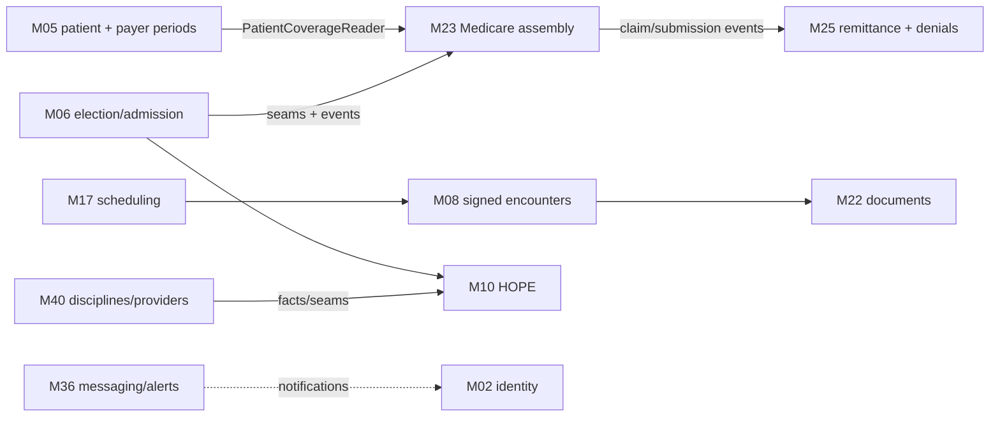

# 15 — Cross-module consistency

Architecture imports are constrained by the manifest and dependency-cruiser; runtime collaboration
uses leaf-typed seams, outbox events, queues, and shared types. All related fitness gates passed.
The primary hidden-coupling defect is payer interval/priority semantics across M5 and M23.

## Shared-concept review

| Concept | Owners/consumers | Result |
|---|---|---|
| Primary payer/effective dates | M5 → M23/M24/M41 | FAIL: CW-QA-0001 |
| Admission/election/benefit period | M6 → M10/M23/M30 | Targeted M6 pass; full temporal consistency unverified |
| Discipline identity | M40 → M10 | FAIL policy/version consistency: CW-QA-0006 |
| Signed documentation | M8 → M22/billing | Static controls; concurrent end-to-end unverified |
| Claim/remittance state | M23/M24/M41 → M25 | Targeted suites pass; external acknowledgment unverified |
| Tenant/org identity | M1/M2 → every module | RLS baseline pass; exhaustive endpoints unverified |

The successful manifest, queue-name, and outbox-binding gates reduced false-positive findings; they
do not show that a bound consumer computes the correct business outcome.
