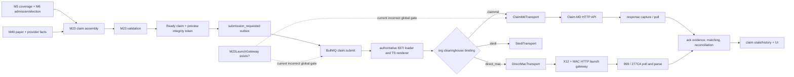
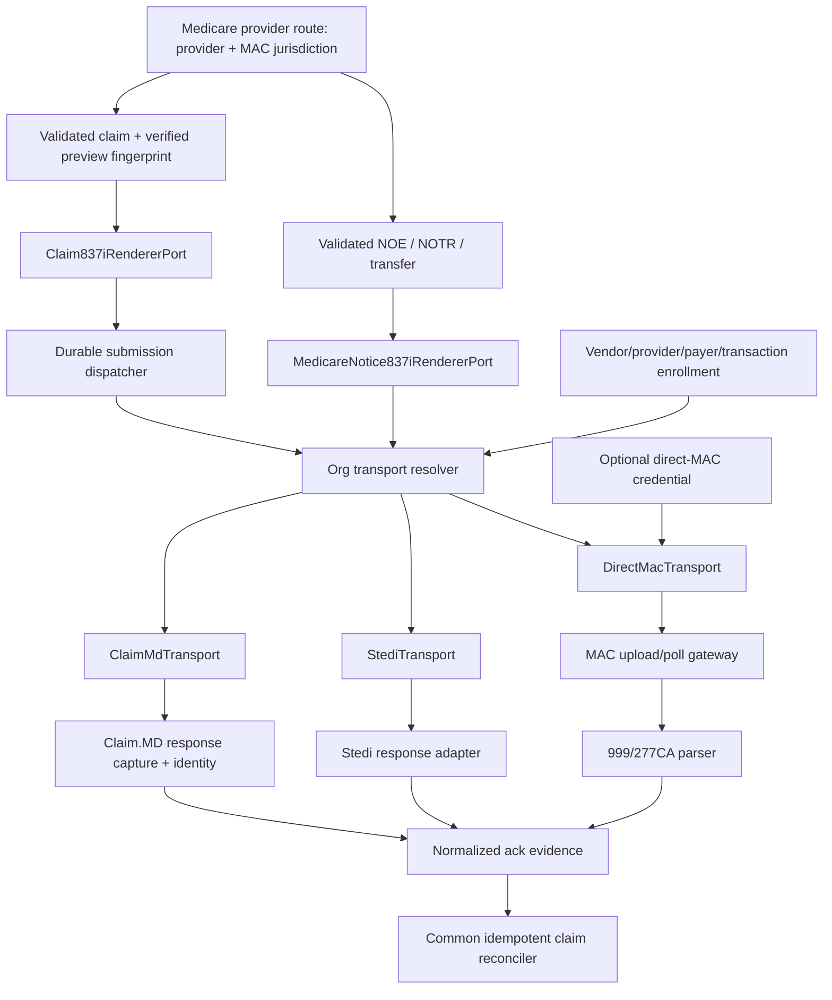

# M23 Claim.MD Integration Audit and Architecture Remediation Plan

**Audit ID:** M23-CM-0
**Repository state audited:** `develop` at `31802ea5f` on 2026-11-12
**Method:** static source, configuration, schema, migration, test-fixture, and deployment review only
**Not performed:** test execution, database access, deployment changes, network submissions, or credential inspection

## 1. Executive summary

The current checkout contains substantially more Claim.MD and TypeScript X12 implementation than the staging failure alone suggests. In particular, it has an executable 837I claim generator, executable NOE/NOTR and transfer-notice builders, a raw 999 parser, a durable Claim.MD transport, per-tenant encrypted Claim.MD configuration, and an extensive submission-attempt state machine. Claim.MD is nevertheless **not end-to-end operational** in the examined composition.

The immediate Worker failure is a composition bug. `apps/backend/src/index.ts` independently constructs a Claim.MD transport, but constructs submission queues and all M23 launch workers only when the combined `M23LaunchGateway` exists. That combined gateway itself requires both an X12 HTTP endpoint and a MAC-portal HTTP endpoint. The same composition then explicitly throws when a platform vendor is bound without that gateway. This contradicts the implemented claim path: a Claim.MD claim is rendered in-process by `renderClaimForTransport` and submitted by `ClaimMdTransport`; it does not need `MacPortalPort` and does not normally need `X12ClientPort` (`apps/backend/src/index.ts:4052-4066,4221-4237,11226-11266`; `apps/backend/src/modules/23-billing-medicare/jobs/m23-jobs.ts:903-993,1470-1805`).

The smallest safe correction is to register claim submission/retry workers, the submission queue port, and the outbox-to-queue consumer from their actual capabilities: Redis, database/outbox services, the internal claim renderer, durable attempt store, and an organization-resolved clearinghouse transport. Direct-MAC workers should continue to require the X12/MAC gateway. Notice generation and direct-MAC acknowledgment parsing must remain separately fail-closed until their required capabilities exist.

There are four additional blockers to a complete Claim.MD workflow:

1. Medicare provider routing is coupled to `mac_submitter_credential`, so even a Claim.MD-only provider must currently have a direct-MAC credential row to supply its MAC jurisdiction (`claim-assembly-seam-adapters.ts:136-203`; `clearinghouse-context.ts:191-267`).
2. Claim.MD Medicare payer routes are environment JSON rather than tenant-owned durable configuration, and enrollment readiness is not proven by M23 (`clearinghouse-context.ts:63-116,275-316`).
3. Claim.MD acknowledgment handling has two unequal paths. Tenant accounts use the generic polling mapper; a platform account is skipped by that poller and requires the separately flagged capture/identity/dispatcher pipeline. The central dispatcher currently applies only a conservatively identified Claim.MD receipt acceptance, not complete payer acceptance/rejection reconciliation (`m23-jobs.ts:2633-2847`; `claimmd-ack/medicare-adapter.ts:8-101`).
4. Notice builders exist in-process, but the M23 NOE/NOTR/transfer workers still call the HTTP X12 port. The transfer processor is implemented but is not registered by `registerM23LaunchWorkers` (`m23-jobs.ts:1955-2139,3518-3592`; `transfer-notice-jobs.ts:78-193`).

The accepted architecture already supports the recommended split: ADR-0053 says the transport is the submission boundary and direct MAC is the legacy launch gateway re-expressed as a vendor adapter (`docs/adr/ADR-0053-clearinghouse-transport-port.md:19-126`). The bootstrap, not the transport abstraction, is the principal regression.

## 2. Audit scope and version qualification

This report is evidence for the checkout named above. `git diff main...HEAD` shows that the branch contains a large M23/Claim.MD/X12 implementation delta, so it must not be treated as proof of what an older deployed staging artifact contains. The reported staging error exactly matches the throw at `apps/backend/src/index.ts:11251-11256`, but deployment provenance (image digest/commit SHA) is required before assuming every finding below is present in that image.

The production Compose inventory contains Postgres, Valkey, object storage, Docling, Rust, API, Worker, HL7, web, and supporting jobs, but no dedicated M23 X12 or MAC service (`deploy/production/compose.yml:22-119,240-295,375-509,510-622`). Therefore the disabled HTTP URLs cannot become functional through the checked-in production composition.

## 3. Current architecture

The solid path describes the intended and mostly implemented domain flow. The dotted gate is the defect: the Worker composition makes a direct-MAC implementation detail a prerequisite for Claim.MD and Stedi.

### Architecture boundaries

- `ClearinghouseTransport` is the vendor boundary. It carries scope, usage, submission, acknowledgments, remittances, status, validation, and eligibility contracts (`packages/x12-837-client/src/clearinghouse/types.ts:1-401`).
- `Claim837iRendererPort`/the M23 authoritative loader is the claim-generation boundary. It reads source-of-truth data and renders in-process (`services/claim-837i-loader.ts:145-234,266-439`; `services/claim-837i-submit.ts:39-92`).
- `X12ClientPort` is an HTTP sidecar contract for legacy generation and raw-file parsing; it is not the only X12 implementation (`jobs/m23-jobs.ts:562-607`; `jobs/launch-gateway.ts:76-131`).
- `MacPortalPort` is a direct-MAC upload/poll/health boundary (`jobs/launch-gateway.ts:133-167`).
- `SubmissionAttemptStore` is the durable vendor idempotency boundary (`packages/x12-837-client/src/clearinghouse/attempt-store-contract.ts:1-403`; `clearinghouse-attempt-store.ts:78-287`).
- Tenant clearinghouse selection and credential decryption occur per organization, not at module-global transport selection (`tenant-clearinghouse/resolver.ts:48-203`).

## 4. File and function inventory

| Area | Executable source and relevant ranges | Finding |
|---|---|---|
| Boot/composition | `apps/backend/src/index.ts:4052-4066,4221-4288,11226-11287,15236-15238` | Builds the transport independently but gates queues, workers, schedules, and outbox bridge on the combined gateway. |
| Gateway HTTP client | `jobs/launch-gateway.ts:3-9,29-75,76-168,213-225` | One config object requires X12 and MAC URLs/tokens; exposes generation, parsing, portal upload/poll/health. |
| Queue catalog | `jobs/queues.ts:35-90,111-140` | Claim/retry, notice, eligibility, validation, ack, watch, and health queues with retry policies. |
| Worker composition | `jobs/m23-jobs.ts:456-505,562-669,3308-3312,3392-3592` | Domain/watch workers are separable; launch workers are unnecessarily monolithic. |
| Claim job | `jobs/m23-jobs.ts:903-993,1470-1928` | In-process render, reservation, dispatch, ambiguous-failure handling, finalization, retry/reconciliation. |
| Notice jobs | `jobs/m23-jobs.ts:1955-2139`; `jobs/transfer-notice-jobs.ts:78-193` | Still use the X12 port; transfer processor exists but is not registered. |
| Ack jobs | `jobs/m23-jobs.ts:2507-2847` | Cursor-paged transport polling or legacy MAC raw-file polling; applies claim acknowledgments. |
| Submission outbox bridge | `outbox-consumers/submit-requests.ts:9-25,63-145,172-188` | Converts committed request events to deterministic queue jobs. |
| Claim assembly | `services/claim-assembly.ts:198-340,460-520`; `claim-assembly-facts.ts:44-174`; `claim-assembly-lines.ts:1-142` | Server-authoritative admission, coverage, provider, diagnosis, visit/rate, line, TOB, and control-number assembly. |
| Cross-module source adapters | `services/claim-assembly-seam-adapters.ts:59-128,132-209` | Reads M5 Medicare coverage and provider facts; currently obtains MAC jurisdiction from a direct-MAC credential. |
| Validation | `services/claim-validation-service.ts:1-400`; `routes/write-service-drizzle.ts:803-849` | Persists runs/results and publishes validation work. |
| Preview/integrity | `routes/claims.routes.ts:389-496`; `services/claim-preview-integrity.ts:1-174` | Same renderer, short-lived signed integrity token, source/account/usage/route binding; raw X12 omitted from response. |
| Submission API | `routes/claims.routes.ts:546-653`; `routes/write-service-drizzle.ts:852-944` | Permission, step-up, idempotency, version, ready/no-blocker, and integrity checks; returns queue acceptance, not vendor acceptance. |
| Claim data loader | `services/claim-837i-loader.ts:1-20,145-234,266-439` | Reads claim/lines, admission, beneficiary, MBI, and parties under org context; audits sensitive access. |
| Claim mapper/generator | `services/claim-837i-mapper.ts:1-16,65-159`; `packages/x12-837-client/src/claims/build-837i-claim.ts:98-379` | Production TypeScript 837I mapping and serialization. |
| EDI parties | `services/claim-837i-parties.ts:137-191`; `routes/edi-profile-typebox.ts:7-35` | Route-keyed submitter/receiver profile and encrypted provider EIN. |
| Claim.MD binding | `clearinghouse-binding.ts:36-91` | Claim.MD needs account reference, DB attempt store, key/config; only direct MAC needs the launch gateway. |
| Claim.MD wire | `packages/x12-837-client/src/clearinghouse/claimmd-wire.ts:18-93` | HTTPS form/multipart client, timeout and ambiguity classification. |
| Claim.MD transport | `claimmd-transport.ts:137-169,257-346,351-646,658-935` | 837 validation, durable reserve/reconcile/upload/finalize, response/status/ERA mapping, validation and eligibility. |
| Claim.MD rate limit | `claimmd-rate-limit.ts:1-22,49-78` | Shared-window counter, conservative budget, bounded wait. |
| Attempt persistence | `clearinghouse-attempt-store.ts:78-287`; `packages/db/src/schema/billing/clearinghouse-submission-attempt.ts:1-68` | Atomic org-scoped reservation and completion. |
| Tenant config API | `tenant-clearinghouse/routes.ts:43-99`; `tenant-clearinghouse/service.ts:1-38` | Draft, verify, BAA, activate, revoke lifecycle with authorization and step-up. |
| Tenant config storage | `packages/db/src/schema/billing/tenant-clearinghouse-config.ts:1-68`; `tenant-clearinghouse/config-store.ts:1-275` | One org row, status/mode/vendor, sealed secret, keyed fingerprint, BAA metadata. |
| Tenant secret protection | `tenant-clearinghouse/secret-cipher.ts:54-105,135-205` | AES-GCM with org/vendor/mode AAD plus keyed fingerprint and rotation derivation. |
| Tenant runtime resolution | `tenant-clearinghouse/resolver.ts:48-203`; `tenant-clearinghouse/org-bound-transport.ts:43-54`; `tenant-clearinghouse/choice.ts:64-92` | Active row wins; org/usage guard; env fallback only for allowlisted orgs. |
| Admin UI/API | `apps/admin/src/modules/34-saas-platform/tenant-clearinghouse-card.tsx:191-234`; `apps/backend/src/modules/34-saas-tenant-platform/routes/platform/onboarding-data-routes.ts:402-489` | Admin uses org slug externally, resolves canonical org ID server-side, and writes through M23 onboarding port. |
| Claim.MD central response pipeline | `claimmd-capture/config.ts:1-32`; `claimmd-capture/service.ts:20-92`; `claimmd-identity/service.ts:29-117`; `claimmd-ack/service.ts:68-260` | Optional platform-account capture, durable cursor/lease, identity evidence, shadow/apply dispatcher. |
| Claim.MD M23 ack adapter | `claimmd-ack/medicare-adapter.ts:8-101`; `claimmd-ack/interpret.ts:48-94` | Conservatively applies identified clearinghouse receipt acceptance only. |
| UI status | `routes/read-service-drizzle.ts:371-499`; `apps/web/src/modules/23-billing-medicare/submissions-timeline.tsx:10-17,78-149` | Org/provider-scoped in-doubt and attempt timeline; vendor text is not exposed directly. |
| Remittance feedback | `outbox-consumers/m25-remittance.ts:17-59,78-231` | M25 outcomes can update M23 claim state idempotently; separate from submission acknowledgments. |

Principal persistence includes `claim`, `claim_line`, `validation_run`, `validation_result`, `validation_override`, `claim_submission`, `clearinghouse_submission_attempt`, `clearinghouse_interchange_number`, `clearinghouse_ack_cursor`, `claim_acknowledgment`, `claim_state_history`, `billing_edi_profile`, `mac_submitter_credential`, `tenant_clearinghouse_config`, and the Claim.MD response/evidence/ack/ERA tables under `packages/db/src/schema/billing/`.

The principal executable symbols are `createM23LaunchGateway`, `m23LaunchGatewayConfigFromEnv`, `buildM23SubmissionQueuePort`, `buildM23WorkerDeps`, `registerM23DomainWorkers`, `registerM23WatchCronWorkers`, `registerM23LaunchWorkers`, `registerM23PortalHealthWorker`, `generateClaim837i`, `runClaimSubmitJob`, `runClaimSubmitRetryJob`, `runTransportAckPull`, `runAckPull999Job`, `runAckPull277caJob`, `runTransferNoticeSubmitJob`, `buildM23SubmissionRequestConsumer`, `buildClaimAssemblyService`, `renderClaimForTransport`, `build837iClaim`, `build837iNotice`, `build837iTransferNotice`, `parse999`, `bindPlatformClearinghouse`, `createClaimMdTransportFromEnv`, `ClaimMdTransport.submitClaim`, `createTenantClearinghouseRuntime`, and `buildOrgRouteKeyReader`. Their implementation files and line ranges are inventoried above; none is counted as implemented merely because an interface or test double exists.

## 5. End-to-end workflow analysis

### 5.1 Admission, eligibility, payer, and provider facts

M23 does not create patient/admission truth. Claim assembly reads Medicare coverage from M5 and election/admission facts from M6 through explicit seams, and reads provider/rate facts through M40/M23 adapters (`claim-assembly-facts.ts:44-174`; `claim-assembly-seam-adapters.ts:59-209`). It rejects missing or overlapping coverage, missing election/provider facts, and incomplete charge inputs before persisting a claim (`claim-assembly.ts:198-340,460-520`). Eligibility refresh is a separate HETS capability and is not proof that a claim can be submitted (`index.ts:4056-4060`; `jobs/m23-jobs.ts:3392-3429`).

The provider selection defect is architectural rather than merely configurational: `ProviderEntityDirectoryEntry.macJurisdiction` is sourced from `mac_submitter_credential`. Thus Claim.MD still inherits the existence of a portal credential even though its transport never uses that portal secret (`claim-assembly-seam-adapters.ts:136-203`). The worker context repeats this dependency when listing providers and building Claim.MD routing context (`clearinghouse-context.ts:191-267`).

### 5.2 Claim creation, validation, preview, and integrity

Assembly creates authoritative claim and line rows, derives TOB and charges, records jurisdiction, and emits lifecycle events. Validation is persisted and asynchronous. Submission requires the claim to be ready with no blocking result (`write-service-drizzle.ts:803-944`).

Preview is not a cosmetic client rendering. It calls the same authoritative renderer used for submission, binds organization, claim version, source fingerprint, clearinghouse route, account reference, and usage into a short-lived integrity token, and omits raw X12/MBI/TIN from the response (`claims.routes.ts:389-496`; `claim-preview-integrity.ts:1-174`). Submit verifies that token plus permission, recent step-up, idempotency key, version, and current route/account/usage (`claims.routes.ts:546-653`). This check must be retained.

### 5.3 X12 generation

For configured clearinghouse transports, `generateClaim837i` invokes `renderClaimForTransport`; only the legacy/unbound branch calls `x12.generate837i` (`m23-jobs.ts:903-993`). The renderer loads the authoritative claim, allocates a durable interchange number/render clock, maps it, and calls the in-process TypeScript builder (`claim-837i-loader.ts:266-439`; `claim-837i-mapper.ts:65-159`).

Therefore the staging error text—“needs the M23 launch gateway (X12 generation)”—is false for the implemented Claim.MD claim path. It remains true for current NOE/NOTR/transfer jobs and for legacy direct-MAC raw acknowledgment parsing.

### 5.4 Submission request, queueing, and clearinghouse resolution

The API persists `claim_submission` before publishing a submission request. The outbox consumer creates deterministic BullMQ jobs (`write-service-drizzle.ts:852-944`; `submit-requests.ts:63-188`). In the current bootstrap, however, both the producer port and consumer registration are absent unless `m23LaunchGateway` exists (`index.ts:4065-4066,15236-15238`). Even with `CLEARINGHOUSE_VENDOR=` and a valid active tenant Claim.MD row, the runtime can resolve that tenant transport but no launch worker or submission bridge is running (`index.ts:4258-4288,11257-11266`).

Tenant resolution itself is sound in shape: an active tenant row takes precedence; its secret is decrypted under org/vendor/mode AAD; the transport is wrapped to reject a mismatched org or usage; a platform fallback is available only to explicitly allowlisted organizations (`resolver.ts:48-203`; `org-bound-transport.ts:43-54`; `choice.ts:64-92`). Thus a tenant-owned Claim.MD account **can be resolved while the platform vendor is unbound**, but it cannot currently progress through the globally disabled queue/worker path.

### 5.5 Claim.MD upload, persistence, and idempotency

`ClaimMdTransport.submitClaim` validates raw X12 before I/O, including receiver `CLAIMMD`, usage, single claim, control identity, and provider NPI (`claimmd-transport.ts:257-439`). It creates a PHI-free hashed filename and reserves the durable attempt before upload. A replay returns the recorded result; a stale in-flight reservation is reconciled against Claim.MD's upload list; conflicting identity fails; only a known non-send releases the reservation (`claimmd-transport.ts:441-646`).

The M23 worker adds an outer durable state machine. It reserves/locks the `claim_submission`, records `dispatch_started`, distinguishes a known failure from `submission_in_doubt`, never blindly creates a new control number after ambiguity, and reconciles an in-doubt attempt before retry (`m23-jobs.ts:1470-1928`). These are complementary layers and should not be collapsed.

The wire client uses `AccountKey`, a 30-second timeout, and treats timeout, unreadable success, and server failures as ambiguous. It does not log response bodies (`claimmd-wire.ts:44-93`). There is no blind automatic HTTP retry. The account-wide limiter budgets below Claim.MD's documented maximum and can use Redis across processes (`claimmd-rate-limit.ts:49-78`; `index.ts:4217-4237`).

### 5.6 Acknowledgments, status, and reconciliation

There are three distinct mechanisms:

- Direct MAC pulls file references from the portal, then calls the X12 HTTP sidecar to parse 999/277CA and applies `claim_acknowledgment` rows (`launch-gateway.ts:117-130,141-155`; `m23-jobs.ts:2507-2597,2766-2847`).
- Tenant Claim.MD accounts use `fetchAcknowledgments`, cursor storage, and the transport mapper. The mapper turns Claim.MD response data into normalized `AckEvent`s (`claimmd-transport.ts:658-820`; `m23-jobs.ts:2633-2763`). Its assumption that non-`CLMMD` sender data is a payer-stage answer requires vendor-confirmed samples before production reliance.
- A platform Claim.MD account is intentionally skipped by generic per-provider polling and instead requires optional central response capture, identity matching, and ack dispatch. If those flags/services are off, the platform account has no fallback ack poll (`m23-jobs.ts:2633-2847`; `claimmd-capture/config.ts:1-32`). The M23 central adapter currently advances only a verified Claim.MD receipt acceptance and does not implement the complete clearinghouse-reject/payer-accept/payer-reject state model (`claimmd-ack/medicare-adapter.ts:8-101`).

Claim.MD's current official documentation says the API returns claim status in JSON/XML, does not return 999 transactions, and exposes 277 through SFTP rather than the API. Consequently, Claim.MD must not be wired to the direct-MAC raw 999/277CA parser contract. Its response API must be treated as a separate vendor normalization boundary. See [Claim.MD acknowledgment transaction support](https://docs.claim.md/docs/which-x12-claim-status-and-acknowledgment-transactions-are-supported-by-claimmd) and the [API quickstart](https://docs.claim.md/docs/test-account-quickstart-guide).

M25 remittance processing is a later, separate feedback loop. It can idempotently advance a claim based on ERA adjudication but does not repair missing submission-response reconciliation (`outbox-consumers/m25-remittance.ts:17-59,78-231`).

### 5.7 Errors and UI responses

HTTP routes throw typed domain errors and the submit route returns `202` for durable queue acceptance, not a false success at the clearinghouse (`claims.routes.ts:546-653`). Submission and ack rows are read under organization/provider scope; the web timeline shows safe states and codes and avoids raw vendor text that could contain PHI (`read-service-drizzle.ts:371-499`; `submissions-timeline.tsx:10-17,78-149`). In-doubt attempts require an authorized, stepped-up resolution route (`routes/clearinghouse-attempt.routes.ts:1-43`).

## 6. Existing versus missing capabilities

| Capability | State | Evidence / qualification |
|---|---|---|
| Authoritative Medicare claim assembly | Implemented | `claim-assembly.ts:198-520` and seam adapters. |
| Persisted validation and ready gate | Implemented | `claim-validation-service.ts:1-400`; `write-service-drizzle.ts:803-944`. |
| Preview/submission integrity binding | Implemented | `claims.routes.ts:389-653`; `claim-preview-integrity.ts:1-174`. |
| In-process 837I claim generation | Implemented and used | `build-837i-claim.ts:98-379`; `m23-jobs.ts:903-993`. |
| In-process NOE/NOTR generation | Implemented library, not wired to jobs | `notices/build-837i-notice.ts:39-119`; jobs still call `X12ClientPort`. |
| In-process transfer generation | Implemented library, processor not registered | `build-837i-transfer-notice.ts:54-282`; `transfer-notice-jobs.ts:78-193`; `m23-jobs.ts:3518-3592`. |
| ISA/GS/ST writer and validation | Implemented | `x12/writer.ts:37-232` with writer/golden tests. |
| Raw 999 parser | Implemented library, not adapted to raw-file URI port | `acks/parse-999.ts:105-194`. |
| Raw 277CA parser | Missing in M23 | `packages/x12-835-client/src/parse-277ca.ts:33-63` maps already-parsed sidecar JSON; it is not a raw X12 parser. |
| Claim.MD upload transport | Implemented executable client | `claimmd-wire.ts:44-93`; `claimmd-transport.ts:351-646`. |
| Durable upload idempotency/recovery | Implemented | M23 submission state plus clearinghouse attempt store. |
| Tenant encrypted Claim.MD configuration | Implemented | tenant config schema/service/cipher/resolver. |
| Claim.MD worker reachability without MAC gateway | Missing | Global boot/registration gate in `index.ts`. |
| Claim.MD-only provider routing | Missing | Jurisdiction depends on `mac_submitter_credential`. |
| Durable tenant Medicare payer-route/enrollment model | Missing | `CLAIMMD_M23_PAYER_ROUTES` environment JSON is authoritative at runtime. |
| Verified full Claim.MD ack/status semantics | Incomplete/external dependency | Two unequal paths; central path only applies receipt acceptance. |
| Dedicated deployed X12/MAC service | Missing from production Compose | No matching Compose service. |

The library has meaningful tests and fixtures for the claim, notice and transfer builders, writer, 999 parser, Claim.MD transport/rate limiter, and transport conformance under `packages/x12-837-client/src/**`. They demonstrate executable code but were not run in this audit and do not prove deployed service reachability.

## 7. Root cause of Worker startup failure

The exact chain is:

1. `M23_LAUNCH_GATEWAY_ENABLED` gates `m23LaunchGatewayConfigFromEnv` (`index.ts:4052-4055`).
2. The config function returns null unless **all four** X12 URL/token and MAC URL/token values exist (`launch-gateway.ts:213-225`).
3. `m23SubmissionQueues` is constructed only when both Redis and that gateway exist (`index.ts:4065-4066`).
4. Claim.MD is independently bound and needs no gateway in its factory (`clearinghouse-binding.ts:68-82`; `index.ts:4221-4237`).
5. All launch workers are nevertheless registered only in `if (m23LaunchGateway)`, with both `x12` and `macPortal` injected (`index.ts:11230-11250`).
6. If the platform vendor is Claim.MD and the gateway is absent, bootstrap throws the reported message (`index.ts:11251-11256`).
7. If the platform vendor is unbound but tenant runtime exists, bootstrap only warns and leaves the workers off (`index.ts:11257-11266`). The outbox bridge is also omitted (`index.ts:15236-15238`).

This is not a missing Claim.MD adapter and not a missing claim generator. It is capability aggregation at the composition root. The direct-MAC factory correctly requires the gateway; the global worker gate incorrectly projects that requirement onto every vendor (`clearinghouse-binding.ts:42-57`).

## 8. X12 implementation findings

The repository contains a real TypeScript X12 engine for the relevant outbound transactions:

- 837I 005010X223A2 claim builder with hospice field and total validations (`claims/build-837i-claim.ts:98-379`).
- Reusable ISA/GS/ST envelope writer with segment validation (`x12/writer.ts:37-232`).
- NOE/NOTR builder (`notices/build-837i-notice.ts:39-119`).
- 8xC/8xD transfer builder (`notices/build-837i-transfer-notice.ts:54-282`).
- Raw 999 parser designed to avoid returning sensitive IK4 element values (`acks/parse-999.ts:105-194`).

Trading-partner values come from `billing_edi_profile`, keyed by provider and actual vendor route. For Claim.MD, the transport additionally verifies `ISA08=CLAIMMD`; the official companion guide also requires the Claim.MD account number in ISA06/GS02 and `CLAIMMD` in ISA08/GS03 ([Claim.MD Companion Guide](https://www.claim.md/ClaimMD_Companion_Guide.pdf)). The EDI profile comment's example `claim_md` at `edi-profile-typebox.ts:15` is documentation drift; runtime vendor keys and tenant route resolution use `claimmd` (`tenant-clearinghouse/route-key.ts:9-16`).

Control identity is durable: M23 allocates a claim control number and the attempt store allocates/memoizes ISA13 plus render time so redelivery renders identical bytes (`m23-jobs.ts:903-993`; ADR-0053's 2026-10-26 amendment). Claim.MD adds a deterministic PHI-free filename and reconciles it against upload-list results.

The external HTTP X12 contract remains necessary today for legacy direct-MAC raw-file parsing and for the currently wired notice jobs. It is not necessary for Claim.MD claim generation. The internal notice builders can be reused, but require an authoritative M23 notice loader/mapper and durable envelope allocation analogous to the claim renderer before replacing the sidecar safely. A raw 277CA parser is not present and should not be invented as part of Claim.MD work because Claim.MD's API contract is JSON/XML status, not raw 277CA.

## 9. Claim.MD integration findings

### Authentication and environment isolation

The API key is sent as the documented `AccountKey` form field; upload uses multipart form data (`claimmd-wire.ts:71-93`). The official production FAQ says test and production use the same host but different account keys and separate enrollments ([Production Account API FAQs](https://docs.claim.md/docs/production-account-api-faqs)). The code therefore relies on the credential plus explicit `usage` to maintain isolation rather than a hostname split (`claimmd-transport.ts:299-346`). Tenant mode is stored with the sealed secret and enforced by the org-bound wrapper.

### Upload and response behavior

The client performs actual HTTP upload; it is not a mock. It supports upload-list reconciliation, response polling, status, ERA, eligibility, and validation surfaces (`claimmd-transport.ts:351-935`). Claim.MD officially documents 837I upload and `/services/response/` polling ([API quickstart](https://docs.claim.md/docs/test-account-quickstart-guide)) and a 100-request/minute ceiling; the implementation budgets conservatively below it.

No undocumented endpoint should be considered guaranteed merely because a fixture accepts it. In particular, status-code/stage mapping must be proven with Claim.MD-provided response schemas and sandbox samples. The central interpreter is appropriately conservative; the older tenant polling mapper is more assertive and should be converged only after evidence.

### Idempotency, timeouts, and recovery

Claim.MD is not trusted as the durable idempotency authority. Reservation precedes upload, identity conflicts fail closed, ambiguity preserves the attempt, and upload-list reconciliation occurs before a retry (`claimmd-transport.ts:441-646`). M23 separately preserves claim-submission dispatch state and offers operator resolution for stale ambiguity (`m23-jobs.ts:1470-1928`; `clearinghouse-attempt-resolution-service.ts:1-92`). This is appropriate for crash recovery and unknown network outcomes.

### Sensitive data and tenancy

Raw X12 necessarily contains PHI but is kept out of log/error messages and the preview response. Upload filenames are hashes rather than patient/control labels. Tenant secrets are write-only in the API, encrypted with organization-bound AAD, and not returned by the UI (`secret-cipher.ts:54-205`; `tenant-clearinghouse/routes.ts:43-99`). The database and transport wrappers scope access by organization. The schema also prevents one credential fingerprint from being silently reused across organizations (`tenant-clearinghouse-config.ts:1-68`).

### Operational qualification

The official test-account policy requires fictional data, separate credentials, and says test transactions do not go to payers ([Test Account Disclaimer](https://docs.claim.md/docs/test-account-disclaimer-read-this-before-using-a-test-account)). No sandbox transaction was sent in this audit. Code presence therefore supports “implemented adapter,” not “operational Claim.MD integration.”

## 10. MAC dependency analysis

| Dependency | Claim.MD claim | Claim.MD notice today | Direct-MAC claim/notice | Direct-MAC ack | Assessment |
|---|---:|---:|---:|---:|---|
| Internal claim renderer | Required | No | Reusable but current direct-MAC may use gateway path | No | Common claim capability. |
| `X12ClientPort.generate837i` | Not required | No | Required by current direct-MAC gateway | No | Legacy fallback only for configured transport claims. |
| `generateNoe/Notr/Transfer` | Not intrinsically; current jobs require it | Required by current jobs | Required currently | No | Split notice-render capability. |
| `MacPortalPort.upload` | Never | Never | Required | No | Direct-MAC only. |
| `MacPortalPort.pullPending*` | Never | Never | No | Required | Direct-MAC only. |
| `X12ClientPort.parse999/277ca` | Never for Claim.MD API | Never | No | Required | Direct-MAC raw-file only. |
| MAC jurisdiction | Medicare business/routing fact | Required business fact | Required | Required | Keep fact; detach it from portal credential. |
| MAC portal bearer credential | Never | Never | Required | Required | Must not gate Claim.MD. |

`buildM23WorkerDeps` and `registerM23LaunchWorkers` currently take the superset and therefore obscure these boundaries (`m23-jobs.ts:562-607,3518-3592`). `DirectMacTransport` is the correct place for the gateway requirement (`packages/x12-837-client/src/clearinghouse/direct-mac-transport.ts:40-59,150-455`). `registerM23DomainWorkers` and `registerM23WatchCronWorkers` already demonstrate that capability-specific registration is viable (`m23-jobs.ts:3392-3457`).

## 11. Multi-tenant and payer-routing findings

- `CLEARINGHOUSE_VENDOR` selects the platform fallback adapter. It need not be set for tenant-owned rows; the tenant binding's top-level vendor is deliberately null because selection occurs per org (`index.ts:4238-4288`).
- `CLEARINGHOUSE_ENV_FALLBACK_ORG_IDS` is an allowlist for organizations allowed to use the platform environment credential. A platform vendor with no allowlisted orgs is not a tenant default (`tenant-clearinghouse/choice.ts:64-92`).
- An active `tenant_clearinghouse_config` row wins over fallback. Draft, unverified, revoked, or `outside` rows do not yield a sending transport (`resolver.ts:108-203`).
- Tenant Claim.MD `accountReference` is derived as a tenant identity, while platform Claim.MD requires `CLAIMMD_ACCOUNT_REFERENCE`; usage is tenant row mode or platform `CLAIMMD_ACCOUNT_USAGE` (`clearinghouse-context.ts:149-189`; `clearinghouse-binding.ts:68-82`).
- `CLEARINGHOUSE_PAYER_ID` is not the M23 Claim.MD route authority. Claim.MD M23 routes come from `CLAIMMD_M23_PAYER_ROUTES`, scoped by organization/provider/MAC/account/usage/effective date (`clearinghouse-context.ts:63-116`).
- The submit route checks an active M40 payer and fingerprints route/account/usage. The raw worker context resolver does not independently re-prove every M40 readiness condition (`clearinghouse-context.ts:275-316`; `claims.routes.ts:546-653`). The durable preview fingerprint limits route drift, but readiness should have one canonical service.
- `billing_edi_profile` supplies route-specific submitter/receiver envelope values. A missing/mismatched `claimmd` profile fails rendering; it does not fall back to another vendor (`claim-837i-parties.ts:137-191`).
- Provider NPI/EIN and MAC jurisdiction are validated, but the latter is wrongly stored as part of a portal credential. Claim.MD enrollment status for each provider/payer/transaction is not represented as a definitive M23 send gate.
- The admin UI passes `orgSlug`; the backend resolves it to the canonical org ID before invoking the M23 onboarding service. Storage, cipher AAD, runtime scope, and attempt rows use the canonical UUID (`onboarding-data-routes.ts:402-489`; `tenant-clearinghouse-card.tsx:191-234`).

The organization isolation controls are credible in source: RLS-scoped stores, org-bound transport checks, organization-bound cipher AAD, scoped counters/cursors, and unique attempt identities. This audit did not execute the live RLS suites, so runtime enforcement is not re-certified here.

## 12. Security and billing-correctness risks

| Priority | Risk | Evidence and consequence | Required response |
|---|---|---|---|
| Critical | Vendor-independent workers are disabled or boot fails without direct-MAC gateway | `index.ts:4065-4066,11230-11266,15236-15238` | Split registration by capability; preserve fail-closed behavior per lane. |
| High | Claim.MD-only providers require a portal credential | `claim-assembly-seam-adapters.ts:136-203`; `clearinghouse-context.ts:191-267` | Store Medicare jurisdiction/routing separately from portal credentials. |
| High | Platform Claim.MD sends can lack response reconciliation when central flags are off | generic poll skips platform account; `claimmd-capture/config.ts:1-32` | Readiness must refuse outbound enablement unless the matching response pipeline is ready, or hold submissions. |
| High | Claim.MD status-stage semantics are not fully vendor-proven | tenant mapper vs conservative central interpreter | Shadow-capture samples, document mappings, quarantine conflicts, then enable application. |
| High | Transfer-notice jobs can be queued without a registered processor | queue/outbox definitions versus `registerM23LaunchWorkers` | Register only when transfer render+transport capability exists; alert held deadlines. |
| High | Claim.MD payer enrollment is not a definitive M23 gate | env route is not enrollment evidence | Add explicit provider/payer/transaction enrollment readiness. |
| Medium | Notice builders exist but current jobs require absent sidecar | notice jobs and internal builders | Add authoritative internal notice renderer; do not fake success. |
| Medium | Tenant and platform Claim.MD response paths diverge | `m23-jobs.ts:2633-2847`; central pipeline files | Converge on durable capture/evidence/identity/reconcile semantics. |
| Medium | Claim.MD rate limiter falls back per process without Redis | `clearinghouse-binding.ts:78-82`; `claimmd-rate-limit.ts:49-78` | Make shared counter a production readiness requirement for Claim.MD. |
| Low | EDI schema comment says `claim_md` while runtime key is `claimmd` | `edi-profile-typebox.ts:15`; `route-key.ts:9-16` | Correct documentation and add a canonical vendor-key assertion. |

Controls that must remain unchanged include the ready/no-blocker gate, signed preview integrity, authorization and step-up, durable outbox, attempt reservation, ambiguity state, RLS/org guards, encrypted credentials, usage isolation, PHI-free logs, and operator resolution. Making the Worker start by weakening any of these would be incorrect.

## 13. Recommended target architecture

The key properties are:

1. Claim rendering is independent of transport and uses the existing in-process implementation.
2. Vendor selection occurs per organization; the selected transport owns only vendor I/O.
3. Direct-MAC credentials and health/poll/parsing are injected only into `DirectMacTransport` and its ack workers.
4. MAC jurisdiction remains a Medicare routing/rate fact but is no longer proof that a portal credential exists.
5. Notices use a separate renderer capability because their authoritative inputs differ from claims.
6. Every vendor response becomes durable evidence before identity matching and state transition. Claim.MD JSON/XML is not pretended to be X12 999/277CA.
7. Missing capability disables/holds only the affected lane and surfaces readiness; it does not silently fall back to a different vendor.

### Capability matrix

| Configuration | Claim send | Notices | Ack/status reconciliation | Boot/readiness behavior |
|---|---|---|---|---|
| Tenant/platform Claim.MD + DB + Redis + internal claim renderer + valid route/profile/enrollment + response pipeline | Yes | Only with notice renderer and explicit vendor support | Yes, through Claim.MD response adapter | Ready for enabled capabilities. |
| Claim.MD missing MAC gateway | Yes | Yes only after internal notice renderer | Unaffected | Must boot; no MAC health worker. |
| Claim.MD missing credential/active row/route/profile/enrollment | No for affected org/provider | No | Reads may continue | Boot may continue; send fails/holds with typed readiness reason. |
| Claim.MD response pipeline disabled | Outbound should be held by production readiness | Held | No | Sandbox may allow explicit send-only mode with operator reconciliation; production refuses. |
| Direct MAC + complete X12/MAC gateway + credential | Yes | Yes | Yes through MAC poll/parser | Ready. |
| Direct MAC missing either X12 or MAC capability | No | No | No | If selected, fail closed at boot/readiness; other vendors continue. |
| Stedi + its independent config | Existing behavior | Capability-specific | Stedi adapter-specific | Must not acquire a MAC dependency. |
| Platform unbound + active tenant Claim.MD | Yes for that tenant after PR 1 | Capability-specific | Tenant response path | Worker registers common workers and resolves per job. |

## 14. Numbered implementation PR plan

### PR 1 — Split M23 claim-launch capabilities and unblock Claim.MD sandbox claims

**Scope/objective.** Remove the global launch-gateway gate from claim submission/retry, queue production, and outbox consumption. Keep direct MAC and notices fail-closed. Update ADR-0053/bootstrap comments to match executable architecture.

**Files/components.** `apps/backend/src/index.ts`; `modules/23-billing-medicare/jobs/m23-jobs.ts`, `jobs/index.ts`, `jobs/queues.ts`, `clearinghouse-binding.ts`; relevant bootstrap/readiness tests; `docs/adr/ADR-0053-clearinghouse-transport-port.md`; configuration examples/deployment runbook.

**Behavior.** Register common claim workers with Redis+DB+renderer+org binding. Register direct-MAC raw ack/health and legacy notice workers only with their explicit ports. Build `m23SubmissionQueues` from Redis rather than gateway. Register the outbox bridge whenever the queue port exists.

**Environment.** No new secret. `M23_LAUNCH_GATEWAY_ENABLED` continues to control direct-MAC/legacy capabilities, not Claim.MD claims. Existing Claim.MD variables remain. Make shared Redis counter and response-path readiness explicit for production.

**Migration.** None.

**Tests.** Composition tests for Claim.MD/no gateway, tenant Claim.MD/platform unbound, Stedi/no gateway, direct-MAC missing half its gateway, unbound transport, outbox reachability, queue crash/redelivery, and “no MAC call” assertions. Use stubs only; no external submission.

**Compatibility/rollback.** Direct-MAC behavior and variable names remain. Rollback restores the old Worker but again disables Claim.MD; no data rollback.

**Acceptance.** All criteria AC-01 through AC-08 and AC-18 below. This is the recommended first PR.

### PR 2 — Separate Medicare provider routing from direct-MAC credentials

**Scope/objective.** Introduce a non-secret M23 Medicare provider-routing record (provider entity, MAC jurisdiction, effective dates/readiness) independent of portal credentials. Direct MAC additionally requires its credential; Claim.MD does not.

**Files/components.** New M23 schema and expand migration; `architecture/module-manifest.ts` and `.cjs`; DB exports/types; `claim-assembly-seam-adapters.ts`; `clearinghouse-context.ts`; M23 onboarding/readiness routes; admin UI; module/architecture docs.

**Behavior.** Claim assembly and routing read jurisdiction from the new record. Backfill from existing `mac_submitter_credential`; retain a compatibility read during rollout. Never synthesize credentials.

**Environment.** None.

**Tests.** RLS isolation, effective-date selection, Claim.MD provider with no portal credential, direct-MAC refusal without credential, backfill parity, live app-role coverage.

**Compatibility/rollback.** Expand-first migration; old credential rows remain. Roll back application before later contract cleanup.

**Acceptance.** AC-09 through AC-11 and AC-18.

### PR 3 — Durable Claim.MD Medicare payer routes and enrollment readiness

**Scope/objective.** Replace environment JSON as the long-term tenant route authority with org/provider/account/usage/payer/effective-date records and explicit provider-payer-transaction enrollment state tied to active M40 payers.

**Files/components.** New M23 tables/migrations and manifest mirrors; `clearinghouse-context.ts`; claim preview/submit readiness service; tenant/platform onboarding APIs and admin UI; M40 seam; docs. Preserve `CLAIMMD_M23_PAYER_ROUTES` as a temporary platform fallback with deprecation telemetry.

**Behavior.** One canonical readiness service is used by preview, submit, and worker. Route or enrollment change invalidates preview fingerprint. No cross-org route is visible.

**Environment.** Existing JSON remains supported only for allowlisted platform fallback during migration; no silent default payer ID.

**Tests.** Overlap/effective dates, M40 active/inactive, account/usage mismatch, enrollment states, tenant isolation, preview drift, migration/backfill.

**Compatibility/rollback.** Expand/backfill/dual-read, then a later contract PR removes JSON. Rollback retains new rows without use.

**Acceptance.** AC-12 through AC-15 and AC-18.

### PR 4 — Wire internal notice renderers and register transfer processing

**Scope/objective.** Add authoritative NOE/NOTR/transfer loaders and renderer ports using existing TypeScript builders; register each worker only when its render+transport capabilities exist.

**Files/components.** New M23 notice loader/mapper services; `m23-jobs.ts`; `transfer-notice-jobs.ts`; `index.ts`; existing notice builders only for necessary correctness fixes; preview/evidence/readiness UI; ADR/module docs.

**Behavior.** Claim.MD/Stedi notices no longer need the X12 HTTP gateway. Direct MAC consumes the same generated raw X12 through its portal transport. The transfer queue has a real processor. Unsupported vendor notice capability holds/fails with a typed state and deadline alert.

**Environment.** Retain `M23_CLAIMMD_NOTICE_UPLOAD_ENABLED` as rollout kill switch until verified; deprecate after readiness proves support.

**Migration.** Possibly an expand migration for durable notice interchange/render evidence; decide from existing notice evidence schema during design.

**Tests.** Golden X12, authoritative loader, byte-stable redelivery, NOE/NOTR/8xC/8xD, transfer registration/recovery, capability holds, no PHI logs.

**Compatibility/rollback.** Direct-MAC gateway remains available until parity is proven. Rollback must not mark held notices filed.

**Acceptance.** AC-16 through AC-20.

### PR 5 — Converge Claim.MD response capture and reconciliation

**Scope/objective.** Use durable response capture/evidence/identity for platform and tenant accounts, normalize only vendor-documented status meanings, and feed one idempotent M23 reconciler.

**Files/components.** `claimmd-capture/**`, `claimmd-identity/**`, `claimmd-ack/**`, `claimmd-transport.ts`, ack cursor/evidence schemas if needed, `m23-jobs.ts`, M23 UI/read models, M25 handoff.

**Behavior.** Separate account cursors, no per-provider loss, quarantine unmatched/conflicting responses, clearinghouse receipt distinct from payer disposition, deduped replays, durable backlog and shadow/apply modes. Remove the unconditional platform skip only after the central path is mandatory/ready.

**Environment.** Capability-specific capture/identity/dispatch flags migrate to one validated mode. Production outbound Claim.MD requires response readiness; sandbox may use an explicit operator-reconciled send-only mode.

**Migration.** Expand only if normalized stage/status evidence needs new columns; preserve raw encrypted evidence and existing ack history.

**Tests.** Vendor sample contracts, cursor restart, duplicate/out-of-order responses, account/org/provider conflict, unknown status quarantine, receipt versus payer stage, M25 ERA handoff, crash recovery.

**Compatibility/rollback.** Deploy shadow first, compare, then apply. Rollback returns to shadow without deleting evidence.

**Acceptance.** AC-21 through AC-27.

### PR 6 — Isolate and harden direct-MAC operations

**Scope/objective.** Rename/document the gateway as a direct-MAC capability, keep upload/poll/health/parsers behind `DirectMacTransport`, and eliminate residual vendor-global checks.

**Files/components.** `launch-gateway.ts`, `direct-mac-gateway.ts`, `direct-mac-transport.ts`, `m23-jobs.ts`, `index.ts`, bootstrap env and runbooks.

**Behavior.** Direct MAC still refuses to bind without all required capabilities; Claim.MD/Stedi do not inspect MAC URLs/tokens. Consider a backward-compatible variable alias before any rename.

**Migration.** None.

**Tests.** Direct-MAC conformance, health/ack scheduling, partial config refusal, other-vendor independence.

**Compatibility/rollback.** Support old variables for at least one release; no silent variable precedence.

**Acceptance.** AC-28 through AC-30.

### PR 7 — Operational qualification and staged sandbox rollout

**Scope/objective.** Add capability-specific readiness, dashboards/runbook, synthetic-only sandbox procedure, and deployment provenance checks. This PR authorizes no automatic claim send.

**Files/components.** readiness endpoint/composition; deployment templates; `docs/` operations and Claim.MD sandbox runbook; audit evidence scripts; no production data.

**Behavior.** Readiness names claim send, notice send, response capture, reconciliation, rate limiter, and direct-MAC separately. The operator must confirm image commit, account usage, synthetic identifiers, EDI profile, route/enrollment, and held-for-approval behavior before a manually approved sandbox test.

**Migration.** None.

**Tests.** Configuration matrices and boot probes; no external calls in CI.

**Compatibility/rollback.** Observability-only except for readiness refusal of unsafe production configuration.

**Acceptance.** AC-31 through AC-34.

## 15. Exact acceptance criteria

1. **AC-01:** With `CLEARINGHOUSE_VENDOR=claimmd`, valid Claim.MD config, DB and Redis, and no M23 X12/MAC gateway variables, API and Worker boot.
2. **AC-02:** That configuration registers `claim.submit` and `claim.submit.retry`, submission queues, and the outbox consumer exactly once.
3. **AC-03:** A Claim.MD claim job uses the internal authoritative renderer and never invokes `MacPortalPort` or HTTP `generate837i`.
4. **AC-04:** With platform vendor unbound and an active tenant Claim.MD row, a job resolves only that tenant's account.
5. **AC-05:** Missing/invalid Claim.MD credential, route, profile, usage, renderer, attempt store, DB, or Redis produces a typed refusal/hold; no submission is reported successful.
6. **AC-06:** Selecting `direct_mac` without its full X12+MAC gateway still fails closed.
7. **AC-07:** Stedi composition and tests remain independent of MAC configuration.
8. **AC-08:** Redelivery after timeout preserves control number, ISA13/render time, payload identity, and attempt reservation; it reconciles before any new upload.
9. **AC-09:** Claim.MD claim assembly succeeds for a configured provider with a Medicare jurisdiction and no direct-MAC portal credential.
10. **AC-10:** Direct MAC refuses that same provider until a valid portal credential is present.
11. **AC-11:** Provider routing is RLS-isolated and effective-dated; cross-tenant reads return nothing.
12. **AC-12:** Preview, submit, and worker use one canonical active M40 payer/Claim.MD route/enrollment decision.
13. **AC-13:** Route/account/usage/enrollment changes invalidate a prior preview token.
14. **AC-14:** No `CLEARINGHOUSE_PAYER_ID` or cross-org fallback silently substitutes for a missing Claim.MD Medicare route.
15. **AC-15:** Production usage cannot send without recorded, in-effect provider/payer/transaction enrollment where Claim.MD requires it.
16. **AC-16:** NOE, NOTR, 8xC and 8xD are generated from authoritative data by executable internal renderers with golden fixtures.
17. **AC-17:** Notice redelivery is byte-stable and does not duplicate an accepted upload.
18. **AC-18:** No test, log, error, metric, filename, or UI response exposes MBI, TIN, patient name, raw X12, secret, or unfiltered vendor message.
19. **AC-19:** Every declared notice queue has a registered processor or is explicitly held with an operational alert; transfer is not stranded.
20. **AC-20:** A clearinghouse receipt never satisfies Medicare notice timeliness; payer/MAC acceptance remains distinct.
21. **AC-21:** Claim.MD response cursors are durable per account and usage and resume after crash without loss.
22. **AC-22:** Duplicate and out-of-order response events are idempotent and cannot regress claim state.
23. **AC-23:** Unmatched or conflicting Claim.MD responses are quarantined with PHI-safe operational metadata.
24. **AC-24:** Only documented and sample-proven Claim.MD status values advance clearinghouse/payer states; unknown values do not.
25. **AC-25:** Platform and tenant accounts follow equivalent evidence, identity, and reconciliation rules while retaining separate credentials/cursors.
26. **AC-26:** Claim.MD API responses are not represented as raw 999/277CA unless an actual X12 file was obtained from a documented channel.
27. **AC-27:** M25 ERA adjudication remains a separate idempotent feedback loop and cannot fabricate missing submission acceptance.
28. **AC-28:** Direct-MAC health and ack workers register only for direct-MAC capability.
29. **AC-29:** Claim.MD/Stedi boots never read or validate MAC bearer tokens.
30. **AC-30:** A variable migration preserves old direct-MAC deployments for the documented compatibility window.
31. **AC-31:** Readiness reports claim send, notice send, response capture, reconciliation, rate limiting, and direct-MAC independently.
32. **AC-32:** The deployed image exposes/verifies the audited commit SHA before sandbox qualification.
33. **AC-33:** Sandbox procedure permits only approved synthetic patient/provider identifiers and test credentials; it cannot target production usage.
34. **AC-34:** Rollback procedures preserve durable submissions, attempts, response evidence, and in-doubt state; they never mark an unknown upload failed or resend it blindly.

## 16. Unresolved questions and external dependencies

1. Which exact commit/image digest is deployed to staging, and which portions of this branch's Claim.MD/X12 implementation are present there?
2. Has Claim.MD supplied a test account, account number (for ISA06/GS02), AccountKey, approved synthetic provider values, and account transmission-approval setting?
3. Has Claim.MD confirmed in writing that hospice TOB 81x claims and NOE/NOTR/8xC/8xD are accepted for the intended Medicare payer IDs? ADR-0053 records these as go criteria, not settled facts (`ADR-0053:127-190`).
4. What exact response API fields and values distinguish Claim.MD receipt, clearinghouse rejection, payer acceptance, payer rejection, and denial for hospice institutional claims? Representative sanitized sandbox payloads are required.
5. Will each hospice hold its own Claim.MD account, or will ChartWarden use a platform account? Official Claim.MD guidance requires separate cursors/keys for provider-owned accounts and additional functionality for a vendor-held single account ([API quickstart](https://docs.claim.md/docs/test-account-quickstart-guide)).
6. Is a BAA executed for the intended production account/model, and are production enrollments complete? Test enrollments do not carry into production ([Production Account API FAQs](https://docs.claim.md/docs/production-account-api-faqs)).
7. Should direct MAC remain a supported production route or only a transition path? The answer affects configuration deprecation, not PR 1's capability split.
8. Which existing table is authoritative for a provider's MAC jurisdiction after it is decoupled from portal credentials, or should PR 2 add an M23-owned effective-dated table?
9. Does Claim.MD guarantee upload-list filename uniqueness and retention long enough for the implemented stale-attempt reconciliation window? The current recovery behavior needs a written vendor contract or observed sandbox evidence.
10. Which Claim.MD central capture flags and stream bootstrap records are active in staging? Platform Claim.MD should not be enabled for outbound use without a ready response path.

## 17. Final determination

### Confirmed root cause

The Worker composition gates all M23 submission queues/workers and the outbox bridge on a combined X12+MAC launch gateway, then explicitly throws when platform Claim.MD is bound without it. Claim.MD's implemented claim path has its own in-process 837I renderer and HTTP transport, so the MAC dependency is unnecessary (`apps/backend/src/index.ts:4052-4066,11230-11266,15236-15238`).

### What is already implemented

Authoritative claim assembly and validation; signed preview integrity; an executable TypeScript 837I/NOE/NOTR/transfer engine; raw 999 parsing; durable claim submissions and clearinghouse attempts; ambiguity-safe retry/reconciliation; executable Claim.MD upload/status/ERA clients; encrypted per-tenant Claim.MD configuration; organization-bound runtime resolution; and partial Claim.MD response capture/identity/reconciliation.

### What must be implemented or changed

Split worker/queue registration by real capability; remove MAC gateway requirements from Claim.MD/Stedi claims; decouple Medicare jurisdiction from portal credentials; make payer route/enrollment durable and canonical; wire internal notice renderers and the transfer worker; and converge Claim.MD response processing on vendor-proven JSON/XML semantics with complete, durable reconciliation. Direct MAC must retain its own fail-closed gateway requirements.

### Recommended first implementation PR

PR 1: split M23 claim-launch capabilities and register Claim.MD claim submit/retry, queues, and the outbox bridge without the launch gateway. It needs no database migration, preserves all authorization/idempotency/integrity controls, and is independently reversible.

### External blocker to Claim.MD sandbox testing

A Claim.MD-provisioned test account and key, account number/trading-partner values, approved synthetic provider/patient data, confirmed hospice 837I payer routing, and representative documented response payloads are required. The staging image must also be proven to contain the audited remediation and must have a ready response-reconciliation path. Until those facts exist, the repository supports an implemented adapter—not a claim that Claim.MD is fully operational.
