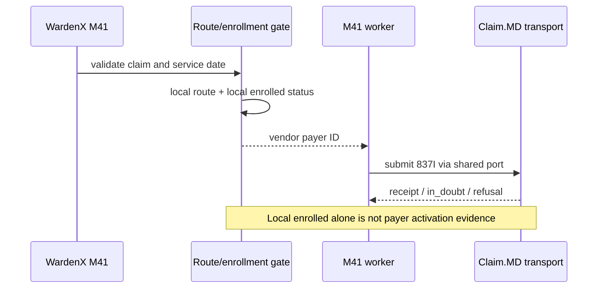
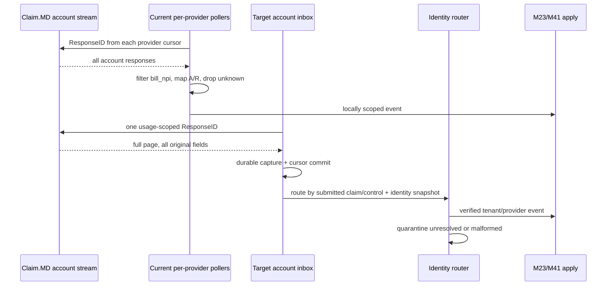

# End-to-end flows: source behavior and target capture

Solid arrows below denote source paths; `Target inbox` arrows are proposed and inactive. A transport upload receipt is not payer acceptance, an ERA is not itself a successful claim, and a normalized Claim.MD response is not proof of a specific 999/277CA. Evidence: `packages/x12-837-client/src/clearinghouse/claimmd-transport.ts:560-729`; `apps/backend/src/modules/25-remittance/ingest/service-drizzle.ts:829-984`.

## Medicare M23

```mermaid
sequenceDiagram
 participant UI as WardenX M23
 participant M as M23 claim/notices
 participant DB as Attempt + claim DB
 participant C as Claim.MD
 UI->>M: submit validated 837I / notice
 M->>DB: reserve key and global control/ISA13
 M->>C: upload one file
 C-->>M: file/claim receipt or error
 M->>DB: sent or in_doubt; preserve attempt
 Note over M,C: MAC payer ID and hospice notice support require certification
```

M23 context selects payer override or MAC jurisdiction (`apps/backend/src/modules/23-billing-medicare/jobs/clearinghouse-context.ts:44-73`); this does **not** prove a correct Claim.MD payer ID for each claim. M23 claim, NOE, NOTR and transfer are separate domain paths (`packages/db/migrations/0074_billing_m23_enums_claim.sql:130-132`; `0075_billing_m23_tables.sql:125-157`; `0375_m23_transfer_notice.sql:69`). The adapter reserves and reconciles in-doubt uploads by filename (`claimmd-transport.ts:439-502,560-625`); M23 retry behavior must keep the same key or stop for operator reconciliation (`:191-195`).

## Commercial M41 and Medicaid M24



M41 gate and separate status worker: `apps/backend/src/modules/41-billing-commercial/eligibility/send-gate.ts:48-79`; `jobs/submission-worker.ts:95`; `jobs/ack-worker.ts:137-205`. M24 uses state trading-partner credentials and its own adapters (`packages/db/migrations/0093_billing_medicaid_m24_tables.sql:235`; `apps/backend/src/modules/24-billing-medicaid/jobs/submission-jobs.ts:250-275`), so no Claim.MD arrow is inferred for it. M25 still matches M24 advice through the Medicaid seam (`claim-match-adapter.ts:71-129`).

## Response ingestion: existing and proposed



Existing source: `claimmd-transport.ts:639-729`; M23 `clearinghouse-submission.ts:288-390`; M41 `ack-worker.ts:137-205`, `ack-apply.ts:169-185`. Claim.MD documents account-wide `/response/` ([API](https://api.claim.md/), [quickstart](https://docs.claim.md/v1/docs/test-account-quickstart-guide)). The target fan-out keeps original vendor provenance and feeds existing module transitions only after identity resolution.

## ERA to M25

```mermaid
sequenceDiagram
 participant C as Claim.MD
 participant P as Current provider ERA pull
 participant I as Target account ERA inbox
 participant M as M25 receive/post
 P->>C: eralist ERAID + NPI; era835
 C-->>P: 835 file
 P->>M: receiveAdvice(caller org/provider, Medicare payer)
 M->>M: payee check, dedupe, stage, parse CLP/CAS/SVC
 M->>M: exact match or manual worklist; tx post
 I->>C: account ERAID + Page; era835
 I->>I: retain file, route transaction sets/payees safely
 I->>M: verified org/provider/payer advice
```

Current pull is Medicare-payer typed (`apps/backend/src/modules/25-remittance/ingest/clearinghouse-pull.ts:134-173`). M25 does support payer-kind-specific match adapters, CAS/denial/PR ledger, transactional exactly-once state guards (`service-drizzle.ts:258-290,460-574,606-699,909-984`), but a mixed-payee or commercial ERA from Claim.MD's shared account must not be assigned via the current caller context. Claim.MD says its API does not match ERA to original claims ([quickstart](https://docs.claim.md/v1/docs/test-account-quickstart-guide)).
