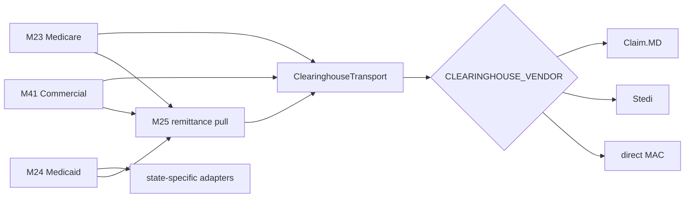

# Inventory and wiring

All verdicts mean **source implementation only**. `@chartwarden/x12-837-client` is the local package `packages/x12-837-client/package.json:2`, not a third-party SDK. Its port is `packages/x12-837-client/src/clearinghouse/types.ts:343`; vendor registry is `transport-registry.ts:60-90`; Claim.MD implementation is `claimmd-transport.ts:135-150,297-919`, wire `claimmd-wire.ts:18-92`, eligibility `claimmd-eligibility.ts:50-131`, rate budget `claimmd-rate-limit.ts:11-76`. The transport is built at `apps/backend/src/modules/23-billing-medicare/clearinghouse-binding.ts:39-88` and bound at `apps/backend/src/index.ts:3904-3917`. A Valkey counter is injected only when `rateLimitStore` exists; the adapter otherwise uses an in-process counter (`claimmd-transport.ts:313-315`). Multi-worker production without a shared counter is therefore a **configuration-dependent risk**.

| Area | Source | Verdict and boundary |
|---|---|---|
| M23 submit/ack/status | `apps/backend/src/modules/23-billing-medicare/jobs/clearinghouse-submission.ts:280-390`; `jobs/m23-jobs.ts`; `jobs/clearinghouse-context.ts:44-84` | Implemented, per-provider pull; context payer defaults to MAC jurisdiction unless one platform `CLEARINGHOUSE_PAYER_ID` override, not a verified per-claim Claim.MD payer route. |
| M41 submit/ack/eligibility/enrollment | `apps/backend/src/modules/41-billing-commercial/jobs/submission-worker.ts:95`; `jobs/ack-worker.ts:137-205`; `jobs/ack-apply.ts:153-185`; `eligibility/send-gate.ts:48-79`; `routes/enrollment.routes.ts:51-101` | Partial account integration; local route and enrollment status. |
| M25 ERA/posting | `apps/backend/src/modules/25-remittance/ingest/clearinghouse-pull.ts:89-203`; `service-drizzle.ts:258-290,606-699,829-984`; `claim-match-adapter.ts:36-68,100-129,158-180` | Implemented transaction/dedupe/ledger skeleton, partial account routing. Boot attaches pull at `apps/backend/src/index.ts:9144-9149`. |
| M24 direct/state | `apps/backend/src/modules/24-billing-medicaid/jobs/submission-jobs.ts:250-275`; `packages/db/migrations/0093_billing_medicaid_m24_tables.sql:235` | Separate workflow; do not infer Claim.MD state support. |
| Legacy and alternatives | `packages/x12-837-client/src/clearinghouse/stedi-transport.ts:278`; `mac-portal/ngs-j6.ts:1`; `clearinghouse/episode-alert-transport.ts`; `apps/backend/src/modules/23-billing-medicare/clearinghouse-binding.ts:39-88` | Multiple implementations exist; registry selects one submit transport. Episode Alert is eligibility-only (see `docs/history/episode-alert-adapter.md:3`). MAC portal siblings include deny stubs. |
| DDL/security | `packages/db/migrations/0000_foundation_initial.sql:14-59`; `1267_m23_clearinghouse_ack_cursor.sql:9-29`; `1254_m25_remittance_pull_cursor.sql:4-15`; `1265_m41_commercial_enrollment_eligibility.sql:22-85`; `1274_m41_commercial_submission.sql:57-115` | Org RLS/FORCE on billing tables inspected. Runtime NOBYPASSRLS proof still required. |
| UI | `apps/web/src/modules/23-billing-medicare/screens.ts:66-117`; `41-billing-commercial/screens.ts:39-112`; `25-remittance/screens.ts:41-127`; `apps/web/src/shell/billing-tabs.tsx`; `medicaid-billing-tabs.tsx` | Screens for claims, notices, A/R, commercial enrollment/eligibility, remittance/denial/appeal. Screen registration is not end-to-end UX certification. Admin wage-index UI is `apps/admin/src/modules/23-billing-medicare/screens.ts`; subscription billing is a different product module. |

**Configuration names only:** `CLEARINGHOUSE_VENDOR`, `CLEARINGHOUSE_USAGE`, `CLEARINGHOUSE_PAYER_ID` (`.env.example:66-70`); `CLAIMMD_ACCOUNT_KEY`, `CLAIMMD_ACCOUNT_USAGE`, `CLAIMMD_ACCOUNT_NUMBER` (`.env.example:363-377`); `REDIS_URL` (shared counter, `docs/audits/clearinghouse-integration/CLAIMMD_TRANSPORT_CONTRACT_20261104.md:22`). No value was read. `.env.example` has duplicated Claim.MD blocks; clean-up is documentation/config hygiene, not evidence of two accounts. No evidence here certifies deployed key storage, rotation, portal access or CI secrets.

Relevant architecture: `docs/adr/ADR-0053-*` (port), `docs/adr/ADR-0100-commercial-billing-module-41.md`, `docs/architecture/CHARTWARDEN_ARCHITECTURE_v0_11.md:253`, and the earlier contract audit `docs/audits/clearinghouse-integration/CLAIMMD_TRANSPORT_CONTRACT_20261104.md`. Earlier sandbox observations in that audit are historical evidence, not a BIL-0 transaction or production certification.
