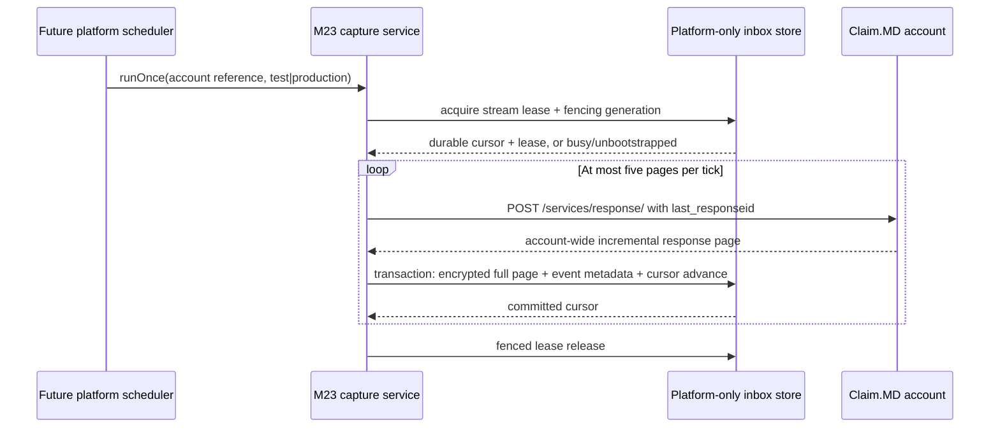

# Capture flow

The vendor result is account-wide. The reader does not infer a tenant, filter by provider, or claim a vendor guarantee for provider isolation. Each parent response is preserved in the encrypted batch and its message objects get independently deduplicated metadata. Missing or unrecognized identity/status fields are marked `needs_review`; they are not converted to synthetic 999/277CA acknowledgments.

The store requires an explicitly bootstrapped stream row; no account or cursor is silently created. A full page with no cursor progress stops the tick. Five-page bounds limit one lease/API run. Cursor advancement occurs only after encrypted page and event metadata have committed. A later scheduler must serialize by stream and use jittered backoff without creating multiple credentials/configurations for one account.

This flow ends at capture. No tenant routing, claim matching, rejection application, state mutation, billing UI, or ERA processing is implemented here. Those are downstream work and must consume only durable captured records with quarantine for ambiguity.
