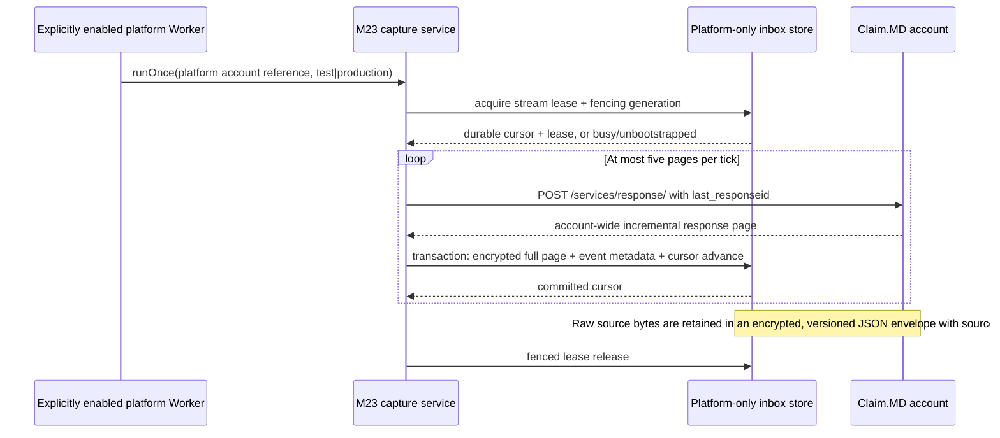

# Capture flow

The vendor result is account-wide. The reader does not infer a tenant, filter by provider, or claim a vendor guarantee for provider isolation. Each parent response is preserved in the encrypted batch and its message objects get independently deduplicated metadata. Missing or unrecognized identity/status fields are marked `needs_review`; they are not converted to synthetic 999/277CA acknowledgments.

The store requires an explicitly bootstrapped stream row; no account or cursor is silently created. A full page with no cursor progress stops the tick. Five-page bounds limit one lease/API run. Cursor advancement occurs only after encrypted page and event metadata have committed. A successful empty response with an unchanged cursor records poll health without accumulating an empty batch. Raw JSON/XML is encrypted with its source format in a versioned envelope; downstream identity/ack readers accept both that envelope and legacy encrypted JSON pages. The poller starts only when `CLAIMMD_RESPONSE_CAPTURE_ENABLED=true` and all platform-account, keyring, rate-budget, database and stream-bootstrap checks pass.

This flow ends at capture. No tenant routing, claim matching, rejection application, state mutation, billing UI, or ERA processing is implemented here. Those are downstream work and must consume only durable captured records with quarantine for ambiguity. Tenant-owned Claim.MD accounts continue using the existing organization-scoped provider poll; centralized durable shadow capture for tenant accounts is not implemented.

### Tenant-owned account hold (CM-5A.2)

Do not start `createClaimMdResponseCapture` for a `tenant:<organization>` account alongside `runTransportAckPull`. The latter currently fetches through each tenant transport/provider context, applies normalized ACK events, and advances `clearinghouse_ack_cursor` keyed by organization/provider/vendor/usage/stage. The BIL-1.1 store instead requires one bootstrapped account/usage stream and lease, stores raw pages under the platform-only `claimmd_capture` role, and encrypts with the platform inbox key. There is no transactional bridge between these stores and no tenant-key/RLS ownership in the inbox schema. A second poller would reread the same feed with an independent cursor; an archive callback after normalization would not retain the exact source page and cannot safely advance the account cursor.

Tenant archival remains held until a single account-scoped reader can durably archive the raw page and quarantine metadata before cursor advancement, while preserving existing ACK application through one idempotent downstream handoff. That design must define tenant-owned encryption/key rotation and application-role RLS (including shared/platform account separation), reconcile or explicitly migrate existing provider cursors without rewinding them, and use a fenced account lease. Do not fabricate historical inbox coverage; establish and record a reviewed coverage-start point. No live cutover or vendor call is authorized by this documentation.

### CM-5A.3A repository boundary (not activated)

Migrations 1503–1504 provide a distinct tenant-owned account identity, credential-binding history, encrypted page table, ordered item metadata, and append-only downstream outcome/quarantine ledger. `claimmd-tenant-inbox` resolves the configured tenant account, encrypts source JSON/XML with the tenant M36 DEK and AAD bound to organization/account/usage/batch/cursor/key version, and requires explicit poll-owner, evidence-reader, and outcome-writer authorization callbacks in addition to RLS and account-binding checks. Bounded item/provenance reads and bounded encrypted evidence replay are available internally; replay passes a stable replay key to the downstream idempotency contract and never fetches Claim.MD or advances a cursor. Outcome reasons are closed-format codes so they cannot carry response contents. The platform `claimmd_capture` role, platform key, inbox and cursor remain unchanged. Tenant account IDs are operator-verified internal IDs; because the current tenant config model has no vendor-issued external account ID, the verification reference is provenance and does not by itself prove vendor-side identity.

`createTenantClaimMdAckHandoff` is a future integration contract: it archives an already-fetched raw page before invoking the existing idempotent ACK application callback. It is intentionally not composed into `runTransportAckPull`; the current transport supplies normalized ACK events rather than exact source page bytes. No second poller or vendor request is introduced. The read-only cursor inventory preserves each `(organization, provider, usage, ACK kind)` legacy coordinate separately, records `runTransportAckPull` as its current owner, reports no separate processing-success timestamp, and never computes a maximum or mutates a cursor. Unmapped coordinates remain `legacy_only`; a future authoritative account mapping requires cutover assessment. Historical ACK processing predating the recorded coverage start is not represented as archived evidence.

This repository foundation is not live-cutover-ready: account provisioning is an internal authorization-gated service rather than a public route, runtime migration/RLS/concurrency tests remain unexecuted, and no raw-page bridge exists in the active transport. Archive failure must stop the future handoff; consumer ambiguity after archive is replayable from encrypted evidence and does not imply ingestion loss. Evidence reads are bounded and never fetch Claim.MD or advance cursors.
