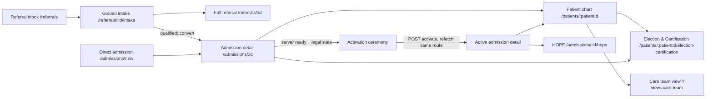

# Patient Admission Workflow — Current-State Audit (G0)

**Audit date:** 2026-11-14
**Checkout:** `fix/pr1036-main-conflicts` at `22f386bdb239c90e039d363bbad89ded80c1d607`
**Scope:** Workflow 02, referral-to-admission handoff through activation and post-activation navigation
**Runtime status:** **NOT RUNTIME VERIFIED in this audit.** The findings below come from the current
checkout and committed automated-test corpus. Existing screenshots under
`docs/implementation/evidence/intake-redesign-pr5/` are historical evidence from the intake redesign,
not a fresh baseline for this checkout.

**Follow-up:** The approved frontend increment was subsequently runtime-verified. See
[`02-admission-implementation-validation.md`](./02-admission-implementation-validation.md) for the
change record, multi-role Playwright result, responsive evidence, limitations, and rollback plan.

This document is the mandatory G0 deliverable from
`ChartWarden_Patient_Admission_Implementation_Plan.md`. It records current behavior; it does not
authorize feature implementation or change clinical policy.

## 1. Executive finding

The proposed admission redesign is not greenfield. The current checkout already implements most of
its intended orientation layer:

- Referral rows open a six-stage intake workspace, which derives progress from canonical referral
  state and hands a converted referral to the existing admission detail route
  (`apps/web/src/modules/06-admission/referral-inbox.tsx:273`,
  `apps/web/src/modules/06-admission/intake-workspace-stage.ts:42`).
- Pending admissions already render a server-backed readiness cockpit, a top blocking item, named
  owners, actionable resolution controls, an activation ceremony, and links back to the referral and
  patient chart (`apps/web/src/modules/06-admission/admission-detail.tsx:1104`,
  `apps/web/src/modules/06-admission/admission-detail.tsx:1272`,
  `apps/web/src/modules/06-admission/admission-detail.tsx:1296`,
  `apps/web/src/modules/06-admission/admission-detail.tsx:1344`).
- The backend remains authoritative. The readiness read and activation write share server-derived
  facts; activation rechecks readiness inside the write transaction before applying the lifecycle
  transition (`apps/backend/src/modules/06-admission/admission-route-service-db.ts:1490`,
  `apps/backend/src/modules/06-admission/admission-route-service-db.ts:4355`).

The remaining work is therefore refinement and correction, not a replacement wizard. The principal
verified gap is that generic readiness action buttons are not permission-aware before opening a
ceremony; authorization is enforced only after submission. Additional product decisions are needed
before changing requirement grouping, activation policy, or post-activation handoff.

## 2. Navigation and ownership map

### 2.1 Entry, back navigation, and deep links

| Surface | Current path and behavior | Evidence |
|---|---|---|
| Referral worklist | `/referrals`; each row and its next-action link open `/referrals/:id/intake`. | `apps/web/src/modules/06-admission/referral-inbox.tsx:273`, `apps/web/src/modules/06-admission/referral-inbox.tsx:327` |
| Guided intake | Six presentation stages: receive, verify, match, review, handoff, requirements. It embeds the existing `ReferralDetail`; it does not own transitions. Back moves to earlier available stages; “View full referral” opens `/referrals/:id`. | `apps/web/src/modules/06-admission/intake-workspace.tsx:22`, `apps/web/src/modules/06-admission/intake-workspace.tsx:215`, `apps/web/src/modules/06-admission/intake-workspace.tsx:272`, `apps/web/src/modules/06-admission/intake-workspace.tsx:305` |
| Referral conversion | When canonical status is `converted`, the derived primary action is `/admissions/:convertedAdmissionId`. | `apps/web/src/modules/06-admission/intake-workspace-stage.ts:134` |
| Direct admission | `/admissions/new` is a separate three-step direct-intake form. It returns to `/admissions` and, after create, navigates to `/admissions/:id`. It explicitly keeps unsaved values only in React state. | `apps/web/src/modules/06-admission/admission-create.tsx:16`, `apps/web/src/modules/06-admission/admission-create.tsx:50`, `apps/web/src/modules/06-admission/admission-create.tsx:127`, `apps/web/src/modules/06-admission/admission-create.tsx:159`, `apps/web/src/modules/06-admission/admission-create.tsx:183` |
| Admission detail | `/admissions/:id` is the shared readiness and lifecycle workspace for referral-converted and direct admissions. It links to the referral and patient chart and deep-links F2F/addendum work to the patient election screen. | `apps/web/src/modules/06-admission/admission-detail.tsx:1162`, `apps/web/src/modules/06-admission/admission-detail.tsx:1203`, `apps/web/src/modules/06-admission/admission-detail.tsx:1147` |
| Patient chart | The chart actions expose “View admission,” HOPE, care team, and “Election & certification.” The patient rail also has an Election & Certification tab. | `apps/web/src/modules/05-patient/patient-overview.tsx:692`, `apps/web/src/modules/05-patient/patient-overview.tsx:705`, `apps/web/src/modules/05-patient/patient-overview.tsx:735`, `apps/web/src/modules/05-patient/patient-overview.tsx:745`, `apps/web/src/shell/chart-module-rail.tsx:77` |
| Election/certification | `/patients/:patientId/election-certification` reads the patient-scoped aggregate and displays admission, election, CTI, F2F, addendum, and compliance windows. | `apps/web/src/modules/06-admission/patient-election-cert.tsx:11`, `apps/web/src/modules/06-admission/patient-election-cert.tsx:152`, `apps/web/src/modules/06-admission/patient-election-cert.tsx:261` |
| After activation | Activation closes the ceremony and reloads the same admission route. There is no automatic redirect or explicit care-team handoff; the user can follow the patient/admission actions manually. | `apps/web/src/modules/06-admission/admission-detail.tsx:574`, `apps/web/src/modules/06-admission/admission-detail.tsx:591`, `apps/web/src/modules/05-patient/patient-overview.tsx:735` |

### 2.2 Exact intake/create ownership boundary

`IntakeWorkspace` is an orientation shell over a referral. Its stage mapping is pure, and its primary
actions either click controls already owned by `ReferralDetail` or navigate to an existing route
(`apps/web/src/modules/06-admission/intake-workspace.tsx:138`,
`apps/web/src/modules/06-admission/intake-workspace-stage.ts:42`). Referral conversion owns the
referral-to-admission transition. `AdmissionCreate` is intentionally different: it is the direct
walk-in/phone/transfer entry point and calls `POST /api/v1/admissions` without a `referralId`
(`apps/web/src/modules/06-admission/admission-create.tsx:120`,
`apps/backend/src/modules/06-admission/admission-route-service-db.ts:3831`).

The two entry points converge on `/admissions/:id`. They must not be merged into a second state
machine. The direct form may share presentation components or copy, but referral qualification and
patient-resolution ownership must remain in the referral workflow.

## 3. Backend contract map

All listed routes derive `organizationId` and actor identity from the authenticated request context,
not from request bodies. Single-resource routes compose RBAC with `admission.scope` or the relevant
resource scope; absent, cross-tenant, and out-of-scope resources collapse to not-found semantics
(`apps/backend/src/modules/06-admission/routes/admission-routes.ts:261`,
`apps/backend/src/modules/06-admission/routes/admission-routes.ts:270`). List reads are narrowed by
org-wide role, caseload, and session-pinned patient; new-admission paths additionally admit intake or
same-site clinical scope (`apps/backend/src/modules/06-admission/routes/admission-routes.ts:151`,
`apps/backend/src/modules/06-admission/routes/admission-routes.ts:321`).

### 3.1 Create, acknowledgement, activation, signature, and evidence endpoints

| Operation | Contract | Authorization and scope | Durable effects |
|---|---|---|---|
| Create direct admission | `POST /api/v1/admissions`; patient, intake method, hospice medical director, optional attending, codes, readmission/benefit-period fields. | `admission.create` + patient/caseload, intake, or same-site clinician ABAC. | Validates patient in org; creates `pending` admission, opens compliance windows, creates first period and CTI when applicable; audit/outbox includes `m6.admission.draft_created`, `m6.cti.drafted`, `m6.cti.signature_requested`. (`admission-routes.ts:734`; `admission-typebox.ts:261`; `admission-route-service-db.ts:3831`) |
| Update admission details | `PATCH /api/v1/admissions/:id`; optimistic `ifVersion`, date, physician, provider/location and claim codes. | `admission.update` + `admission.scope`. | Versioned admission update; location is checked against provider entity. (`admission-routes.ts:843`; `admission-typebox.ts:300`) |
| Read readiness | `GET /api/v1/admissions/:id/readiness`. | `admission.read` + scope; PHI read-audited with resource id. | No lifecycle mutation; may backfill legacy evidence before evaluation. (`admission-routes.ts:777`; `admission-route-service-db.ts:1490`) |
| Record NOR | `POST /api/v1/admissions/:id/nor`; method, acknowledgement instant, signer name and patient/representative role. | `nor.acknowledge` + admission scope. | `pending → notice_of_rights_acknowledged`, evidence row, window close, audit, `m6.nor.acknowledged`. (`admission-routes.ts:1498`; `admission-typebox.ts:721`; `admission-route-service-db.ts:6735`) |
| Upload NOR evidence | First create and verify the M22 document; then `POST /api/v1/admissions/:id/nor/uploaded-evidence` with document/version ids and optional acknowledgement metadata. | `nor.acknowledge` + admission scope; M22 upload permissions also apply to the document phase. | Validated uploaded admission evidence; this endpoint does not itself run the admission state transition. (`document-workflows.tsx:1811`; `admission-routes.ts:1520`; `admission-route-service-db.ts:4107`) |
| Draft election | `POST /api/v1/admissions/:id/election-statements`; period id, effective date, diagnosis, elected provider/attending, waiver and optional state addendum. | `election.draft` + admission scope. | Election statement plus structured evidence and election outbox lifecycle. (`admission-routes.ts:957`; `admission-typebox.ts:361`) |
| Sign election | `POST /api/v1/election-statements/:id/sign`; signer name/role and `ifVersion`. | `election.sign` + owning-admission scope. | Versioned signature, evidence, audit/outbox `m6.election.signed`. (`admission-routes.ts:1000`; `admission-typebox.ts:371`) |
| Upload election/election signature | `POST /api/v1/election-periods/:id/election-statement/uploaded-evidence` or `/api/v1/election-statements/:id/sign/uploaded-evidence`; document ids, state, and signer metadata when signed. | `election.draft` or `election.sign` + owning-admission scope. | Validated evidence; signed uploads require signer name, role and date. (`admission-routes.ts:1027`; `admission-routes.ts:1045`; `admission-route-service-db.ts:4140`; `admission-route-service-db.ts:4199`) |
| Draft CTI | `POST /api/v1/election-periods/:id/cti`; physician ids, diagnoses, prognosis, narrative, findings, recert flag. | `cti.draft` + owning-admission scope. | CTI/evidence creation plus `m6.cti.drafted` and `m6.cti.signature_requested`. (`admission-routes.ts:1102`; `admission-typebox.ts:394`; `admission-route-service-db.ts:4820`) |
| Sign CTI as hospice physician | `POST /api/v1/cti/:id/sign-hospice-md`; `ifVersion`, optional narrative. | `cti.sign_hospice_md` + `cti.is_hospice_md`; signer identity is server-derived. | Versioned signature/evidence; emits `m6.cti.signed`; recert activation rules run in the same transaction. (`admission-routes.ts:1151`; `admission-typebox.ts:407`; `admission-route-service-db.ts:4939`) |
| Upload CTI evidence | `POST /api/v1/election-periods/:id/cti/uploaded-evidence`; document ids, signed/unsigned state, optional signature date. | `cti.draft` + owning-admission scope. | Validated CTI and optional signature evidence. (`admission-routes.ts:1127`; `admission-typebox.ts:354`) |
| Record physician recommendation | `POST /api/v1/admissions/:id/admission-recommendation`; server-eligible signer, time, capacity, consultation fields and version. | `admission.record_recommendation` + admission scope. | Versioned recommendation with signer-set validation; readiness item is advisory under current policy. (`admission-routes.ts:898`; `admission-typebox.ts:697`) |
| Activate | `POST /api/v1/admissions/:id/activate`; `ifVersion`, optional location. | `admission.activate` + admission scope. | Recomputes readiness and legacy activation facts in the transaction, resolves/validates site, transitions to `active`, starts the election period, re-anchors windows, audits, and emits activation/election events. (`admission-routes.ts:886`; `admission-typebox.ts:316`; `admission-route-service-db.ts:4355`) |

The M22 upload helper calculates SHA-256, obtains a presigned upload, uploads the bytes, and completes
server verification before returning document/version ids (`apps/web/src/shell/document-workflows.tsx:1835`,
`apps/web/src/shell/document-workflows.tsx:1858`,
`apps/web/src/shell/document-workflows.tsx:1887`). Admission evidence attachment is therefore a
separate final step, not a raw file upload to M6.

### 3.2 Concurrency, idempotency, audit, and retry

- Versioned admission/election/CTI commands carry `ifVersion`; stale competing writes return a
  version conflict. The live concurrency suite exercises two activators, and the module spec expects
  one success and one `409 VERSION_MISMATCH`.
- Global HTTP idempotency is **optional by header**: mutating requests with an `Idempotency-Key` are
  fingerprinted by org, actor, route, parameters, query, version header and body; same-body retries
  replay, changed-body reuse conflicts, and in-flight duplicates return a distinct 409. A mutation
  without the header is not rejected (`apps/backend/src/bootstrap/plugins/idempotency.ts:12`,
  `apps/backend/src/bootstrap/plugins/idempotency.ts:168`,
  `apps/backend/src/bootstrap/plugins/idempotency.ts:179`).
- The NOR UI deliberately uses a stable key and click-time timestamp across retries
  (`apps/web/src/modules/06-admission/admission-detail.tsx:237`,
  `apps/web/src/modules/06-admission/admission-detail.tsx:596`). Other admission-detail writes use the
  typed client directly; they still receive optimistic-concurrency protection but do not all show an
  explicit same-intent retry keeper in this component.
- M6 state-machine effects name audit and outbox work in the same transaction. Database PHI tables
  also sit behind the repository audit/RLS controls. Read routes declare resource-specific read audit,
  for example admission and readiness at `admission-routes.ts:762` and `admission-routes.ts:777`.

## 4. Admission lifecycle and legal actions

```mermaid
stateDiagram-v2
  [*] --> referred
  referred --> pending: createAdmission
  pending --> notice_of_rights_acknowledged: acknowledgeNoticeOfRights
  pending --> active: activate (graph permits; guards still require NOR)
  notice_of_rights_acknowledged --> active: activate
  active --> on_hold: placeOnHold
  on_hold --> active: releaseFromHold
  active --> discharged: executeDischarge (non-death)
  on_hold --> discharged: executeDischarge (non-death)
  active --> bereavement: executeDischarge (death)
  on_hold --> bereavement: executeDischarge (death)
  discharged --> closed: closeAdmission
  bereavement --> closed: closeAdmission
```

The executable graph is authoritative (`apps/backend/src/modules/06-admission/state-machines/admission.ts:58`).
Important guards include:

- create requires an accepted referral/direct equivalent and no other open admission
  (`state-machines/admission.ts:93`);
- activation requires NOR, signed election, signed CTI, no blocking privacy flag, and either a timely
  initial assessment or the permitted override (`state-machines/admission.ts:121`);
- hold requires a reason; for-cause discharge requires cosign; death validates certifier facts; close
  requires cleanup confirmation (`state-machines/admission.ts:158`,
  `state-machines/admission.ts:171`, `state-machines/admission.ts:233`).

Although the graph includes `pending → activate`, the guards require NOR and the durable NOR command
changes the admission to `notice_of_rights_acknowledged`. The UI correctly treats both pending states
as the workspace but enables activation only from server readiness
(`apps/web/src/modules/06-admission/admission-detail.tsx:1104`). There are no frontend-invented
lifecycle states.

## 5. Activation readiness and timing semantics

### 5.1 Server authority

`evaluateAdmissionReadiness` returns the status, completion count, blocker count, individual status,
blocking flag, explanation, action and evidence (`apps/backend/src/modules/06-admission/intake/activation-gate.ts:101`,
`apps/backend/src/modules/06-admission/intake/activation-gate.ts:250`). The write path loads this
inside the activation transaction and refuses with structured requirements when `canActivate` is
false (`apps/backend/src/modules/06-admission/admission-route-service-db.ts:4359`).

The legacy `activationGate.missing` remains the compact three-code view:
`election_signed`, `nor_acknowledged`, `cti_signed`
(`apps/backend/src/modules/06-admission/intake/activation-gate.ts:526`). The richer readiness response
also accounts for identity, admission date, privacy, F2F and policy-defined advisory items.

### 5.2 Requirement classification

| Requirement | Current activation meaning | Current action/location |
|---|---|---|
| Patient identity | Blocking; canonical M5 patient and referral resolution must agree. | Back to referral intake match. (`activation-gate.ts:254`; `admission-detail.tsx:1152`) |
| Admission details | Admission date blocks. Provider entity/location facts are intentionally not readiness blockers, although activation must still resolve a valid service location. | In-place admission-details ceremony. (`activation-gate.ts:274`; `admission-route-service-db.ts:4383`) |
| Patient privacy | Most restrictions or unavailable clearance block. An unreviewed intake detection is a visible, non-blocking advisory while access remains restricted. | Privacy dialog with permission-aware links where available. (`activation-gate.ts:294`; `admission-detail.tsx:2929`) |
| Notice of Rights | Blocking until valid acknowledgement/evidence. | In-place record or upload ceremony. (`activation-gate.ts:333`; `admission-detail.tsx:1457`) |
| Election statement | Blocking until current-period statement and signature evidence exist. | In-place create/sign/upload ceremony. (`activation-gate.ts:351`; `admission-detail.tsx:1469`) |
| CTI | Blocking until CTI and hospice-physician signature evidence exist. Attending signature is not an activation prerequisite. | In-place create/sign/upload ceremony; patient election screen also supports physician work. (`activation-gate.ts:387`; module spec changelog line 37) |
| F2F | Not applicable before period 3. Normally blocking when required; a documented exceptional-circumstance window can be pending but non-blocking until its due date. | Deep link to patient Election & Certification F2F section. (`activation-gate.ts:417`; `admission-detail.tsx:1147`) |
| Physician admission recommendation | Current code makes it advisory through one policy constant. | In-place recommendation drawer. (`activation-gate.ts:484`; `physician-authority.ts:45`) |
| Election statement addendum | Never an activation blocker; it is a payment condition/deadline after election and is explicitly described that way. | Patient Election & Certification addendum panel. (`activation-gate.ts:177`; `activation-gate.ts:195`; `admission-detail.tsx:1149`) |
| HOPE | Not part of the activation evaluator. The admission detail exposes HOPE only after activation and displays post-activation attention/deadline data. | `/admissions/:id/hope`. (`admission-detail.tsx:405`; `admission-detail.tsx:1449`) |

The UI groups these into setup/privacy, notices/election/certification, clinical follow-up and other,
without changing server order or blocking flags
(`apps/web/src/modules/06-admission/admission-readiness-presentation.ts:27`,
`apps/web/src/modules/06-admission/admission-readiness-presentation.ts:57`).

### 5.3 Overrides

- Privacy readiness can be satisfied normally or by an upstream authorized override; the evaluator
  only consumes the server result (`activation-gate.ts:124`).
- F2F exposes an explicit override state and compliance-officer route/predicate. It is not a generic
  “activate anyway” control (`activation-gate.ts:154`, `admission-routes.ts:245`).
- Initial-assessment DON override exists in the admission state-machine event, but the current DB
  activation adapter passes `initialAssessment48hOverdue: false` and `donOverride: false`; the richer
  readiness evaluator, not a client override, is the current write-path authority
  (`admission-route-service-db.ts:4369`).
- No admission-wide manual override is exposed by `POST /activate`.

## 6. Shared UI, responsiveness, and accessibility

The existing implementation uses shared UI primitives rather than local shell chrome:
`StepperWorkflowLayout`, `WorkflowStepper`, `StickyFooterActions`, `DetailPageLayout`,
`RightDetailPanel`, `GateStepper`, `GuardChip`, status pills and ceremony modals
(`apps/web/src/modules/06-admission/admission-create.tsx:1`,
`apps/web/src/modules/06-admission/admission-detail.tsx:20`). Lantern tokens are defined in the web
theme (`apps/web/src/index.css:42`), while shared list and shell chrome remain in the UI package per
repository policy.

Current accessibility evidence in code includes semantic headings and regions, labelled steppers,
live announcements, focus restoration after patient reload, accessible disabled-action explanations,
and DOM accessibility tests (`admission-detail.tsx:1272`, `admission-detail.tsx:257`,
`admission-detail.tsx:2765`, `admission-detail.tsx:3693`). The Playwright admission test runs axe on
the direct-intake wizard, and the global dynamic-route walker scans a seeded admission route.

Responsive behavior is implemented through the shared layouts and `wx-*` classes, but it was not
visually rechecked in this audit. Historical intake evidence covers desktop/tablet/mobile readiness
screens; it must not be treated as proof of the current branch.

## 7. Automated-test inventory and gaps

### 7.1 Existing coverage

- Pure lifecycle and readiness: `admission-state-machines.test.ts`,
  `admission-readiness.test.ts`, and `admission-workflow-acceptance.test.ts` cover legal transitions,
  gate classifications, outbox chains, F2F, discharge, and cross-tenant denial.
- Web DOM: admission detail, activation/promotion behavior, evidence upload, readiness presentation,
  intake workspace, create validation, patient election/certification, addendum, and a11y-focused
  drawer tests exist under `apps/web/src/modules/06-admission/__tests__/`.
- Live Postgres: package scripts include M6 RLS, reads, write lifecycle, ABAC scope, concurrency,
  election/CTI, uploaded evidence, F2F/adequacy, addendum, readmission and election-view conflict
  suites (`package.json:101`, `package.json:136`, `package.json:337`). CI maps these scripts to named
  jobs (`.github/workflows/ci.yml:277`, `.github/workflows/ci.yml:1275`).
- Browser E2E: `e2e/specs/admission.spec.ts` creates a direct admission through the real UI and asserts
  the readiness cockpit; `e2e/specs/documents.spec.ts` covers referral creation and guided-intake
  progression; `axe-route-walk.spec.ts` scans a seeded admission route.

### 7.2 Missing or incomplete proof

1. No single Playwright scenario currently proves the complete referral → convert → NOR → election
   signature → CTI signature by the proper physician → activation → patient chart/care-team handoff.
2. The direct-admission E2E stops after creation/readiness; it does not prove activation concurrency,
   lost-response recovery, or post-activation focus/navigation in a browser.
3. There is no current usability baseline for context-switch count, task failures, or role-specific
   completion time. Those metrics must be measured with synthetic cases, not inferred from unit tests.
4. Fresh responsive screenshots and keyboard/screen-reader walkthrough evidence are absent for this
   checkout.
5. Live suites require a private Postgres container and the real non-bypass app role. They were not run
   for this read-only audit; no live-DB result is claimed here.

## 8. Duplicate entry and context switching

### Verified duplicate or split-context points

1. Direct admission requires a hospice medical director and creates a draft CTI, while admission
   detail can later ask for hospice physician/admission details again if the aggregate is incomplete
   (`admission-create.tsx:313`, `admission-route-service-db.ts:3958`,
   `admission-detail.tsx:648`). This is legitimate when server state is incomplete, but the UI should
   continue prefilling and avoid silent overwrite.
2. Election and CTI can be worked in admission detail and reviewed/continued in the patient-scoped
   Election & Certification screen. This is purposeful cross-role access, but labels should make the
   source of truth and intended owner clear (`admission-detail.tsx:1469`,
   `patient-election-cert.tsx:336`).
3. F2F and addendum blockers intentionally leave admission detail for the patient election screen;
   privacy may leave for DocLens review or consent. These are real workflow owners, not missing button
   handlers (`admission-detail.tsx:1147`, `admission-detail.tsx:2929`,
   `admission-detail.tsx:2952`).
4. Post-activation care-team handoff is manual: activation reloads admission detail, and the user must
   navigate to the patient chart/care-team view. There is no explicit “continue to care team” primary
   action (`admission-detail.tsx:591`, `patient-overview.tsx:735`).

### Usability hypotheses requiring runtime validation

- The long pending-admission page repeats readiness in the header, summary, right rail, overview cards,
  and section-specific rows. This may help orientation or may create scanning noise; code inspection
  cannot decide.
- “Admission Intake” for pending records and “Admission” after activation may feel like a context reset
  even though the route is unchanged.
- Users may not understand why F2F/addendum opens the patient screen while NOR/election/CTI usually
  opens an in-place ceremony.
- Suggested owners are static presentation labels, not current assignees. Users may read them as an
  assignment unless copy and visual treatment are tested.

## 9. Role scenarios

| Actor | Current supported path | Fail-closed behavior / concern |
|---|---|---|
| Intake coordinator/supervisor | Org-level unsited referral/admission access; referral review, patient resolution, conversion/direct create, NOR/election and activation when granted. | RBAC plus intake ABAC; resource misses collapse to 404. Readiness action buttons should become permission-aware before opening ceremonies. |
| Admitting RN/clinician | May create/read a patient at their site or their own unsited admission; can prepare CTI/F2F surfaces according to grants. | Site/caseload ABAC narrows access. RN cannot satisfy physician-signature predicates. |
| Hospice physician/medical director | Patient/admission scope, CTI signature, F2F management and physician recommendation as granted; medical director has broad admission scope. | `cti.is_hospice_md` and server signer facts prevent staff impersonation; a body-supplied role is not authoritative. (`abac-predicates.ts:203`, `admission-routes.ts:374`) |
| Administrator | Business-admin roles have broad admission scope and can coordinate activation if permissioned. | Scope does not replace permission checks; clinical signatures still require signer predicates. |
| Compliance reviewer/officer | Org-wide read visibility and compliance-window work; F2F/compliance overrides require named predicate and reason. | Read scope does not grant arbitrary admission writes; no generic activation override exists. |
| Unauthorized/out-of-scope user | Screen registry may hide navigation; server remains decisive. | Missing permission is 403; absent/cross-tenant/out-of-scope resource predicates use non-leaking 404 behavior. |

## 10. Verified defects, hypotheses, and approval-required requirements

### 10.1 Verified defects / implementation gaps

1. **Readiness actions are not generally permission-aware before interaction.**
   `RequirementActionButton` checks whether the client has a handler and required ids, but not whether
   the session has the route permission. It can open NOR, election, CTI, recommendation, or admission
   details ceremonies for a user who will only learn on submit that the server refuses them
   (`apps/web/src/modules/06-admission/admission-detail.tsx:2725`,
   `apps/web/src/modules/06-admission/admission-detail.tsx:2749`). The server remains secure, but the UX
   conflicts with the plan's requirement to explain unavailable actions.
2. **No explicit post-activation handoff action.** Successful activation reloads the same admission
   detail and provides no primary continuation to patient chart, care team, HOPE, or the next due task
   (`admission-detail.tsx:591`). This is a workflow gap, not a security defect.
3. **No current complete browser acceptance path.** Existing E2E coverage proves direct creation and
   separate referral progression, but not the full multi-role activation journey.

### 10.2 Usability hypotheses

- Consolidating repeated readiness summaries may reduce cognitive load.
- Separating “required before activation,” “awaiting another person,” and “after admission” more
  explicitly may improve scanning beyond the current domain grouping.
- Showing actual assignee/team data alongside suggested owner labels may improve handoff clarity.
- A persistent compact patient/admission header may reduce context loss across deep links.

These are not defects until validated with runtime observation and synthetic role scenarios.

### 10.3 Product/clinical/compliance approval required

1. Any change to what blocks activation, including physician recommendation, F2F exceptional
   circumstances, privacy restrictions, admission date, CTI or NOR.
2. Any change that treats HOPE, election addendum, attending CTI signature, downstream assessment, or
   billing prerequisites as activation blockers.
3. Any new backend endpoint, durable draft, assignment model, or data field.
4. Any automatic post-activation transition, care-team assignment, notification, or task creation.
5. Any change to role grants, signer eligibility, override semantics, or cross-site visibility.
6. Any browser persistence of referral/admission PHI.

## 11. Preservation matrix

| Preserve | Reason |
|---|---|
| Backend admission/election/CTI/F2F state machines | They define legal transitions and clinical guards. |
| Server-derived readiness and activation recheck | Prevents UI/backend divergence and stale activation. |
| Tenant RLS, resource-scope ABAC, site/caseload narrowing and 404 non-leak behavior | Security and multi-tenant isolation. |
| Optimistic concurrency, optional global idempotency, and same-intent NOR retry key | Prevent duplicate or stale clinical writes. |
| Structured and uploaded evidence model with verified M22 upload | Keeps document integrity and provenance. |
| Distinct readiness statuses (`complete`, `action_required`, `awaiting_signature`, `pending`, `blocked`, `overdue`, `not_applicable`) | Avoids flattening clinically meaningful state. |
| Non-blocking classification of HOPE/addendum/attending signature where current policy says so | Prevents accidental care delay or policy invention. |
| No PHI browser storage for the direct-admission form | No durable draft endpoint exists. |
| Existing intake workspace as referral owner and admission detail as readiness owner | Prevents parallel workflow/state ownership. |

## 12. Proposed implementation boundary after G0 approval

The smallest evidence-backed next increment is frontend-only:

1. Make readiness actions permission-aware, rendering the action owner and a plain-language reason
   instead of opening a ceremony the user cannot submit.
2. Add an explicit post-activation continuation panel using existing routes only (patient chart,
   care-team view, HOPE when available), without automatic side effects.
3. Refine the current readiness presentation into the plan's three operational buckets while
   preserving server status/order/blocking semantics in data and tests.
4. Add one multi-role Playwright journey or a documented split scenario that proves referral handoff,
   signer separation, activation, duplicate-submit behavior, and post-activation navigation using
   synthetic data.
5. Capture fresh desktop/tablet/mobile and keyboard evidence after implementation.

Likely frontend edit set after approval:

- `apps/web/src/modules/06-admission/admission-detail.tsx`
- `apps/web/src/modules/06-admission/admission-readiness-presentation.ts`
- focused tests under `apps/web/src/modules/06-admission/__tests__/`
- `e2e/specs/admission.spec.ts` and/or a new narrowly scoped admission-handoff spec

No backend, database, migration, Rust, or policy change is justified by this audit. If product chooses
to change activation criteria, actual assignments, or automatic handoff behavior, that work requires a
separate API/policy proposal before implementation.

## 13. G0 decision requested

**Decision:** Approved by the user on 2026-11-14. The first implementation increment remains inside
the frontend-only boundary in section 12.

Approve or revise these boundaries before feature edits:

1. Preserve the current two-entry model: referral intake and direct admission converge on one
   admission-detail readiness workspace.
2. Keep the server readiness evaluator and state machines authoritative.
3. Treat this effort as refinement of existing behavior, beginning with permission-aware blocker
   actions and explicit post-activation navigation.
4. Keep all activation-policy, role-grant, assignment, and backend changes out of the first UI PR.
