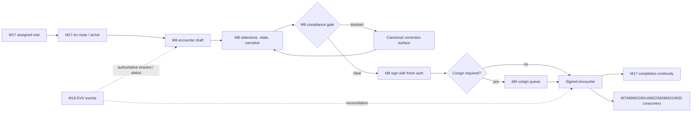

# ChartWarden — Workflow 04: Scheduled Visit & Encounter Documentation

**Status:** Four boundaries and G0 approved on 2026-11-14; presentation-focused implementation is
in progress without backend contract changes

**Sequence:** Workflow 04, after Unified Intake, Patient Admission, and Patient Chart & Demographics

**Primary journey:** Published visit → clinician arrival → encounter documentation → compliance gate
→ signature/cosignature → downstream continuity

**Primary owners:** M17 Scheduling, M8 Encounters, M18 EVV, with M7 Care Plan as a read/gate dependency

**Authority:** Architecture and accepted ADRs win over this implementation proposal

---

## 1. Why this is Workflow 04

Workflows 01–03 establish the patient, activate the hospice admission, and provide a safe chart
context. The next recurring frontline task is the first scheduled clinical visit: a clinician opens
their assigned work, confirms the correct patient and visit, documents what happened, satisfies the
record-completeness gate, signs the note, and returns an immutable clinical record to the chart and
downstream workflows.

This workflow is deliberately narrower than “redesign clinical documentation.” It connects existing
module-owned lifecycles without moving their authority:

- M17 owns visit scheduling, assignment, status, recurrence, and route context.
- M8 owns encounter content, vitals, finalization, signature, cosignature, addenda, and the signed
  clinical record.
- M18 owns EVV capture, reconciliation, correction, and aggregator state.
- M7 owns care-plan content and review cadence; M8 may consume its gate but does not rewrite it.
- M9, M10, M11, M14, M22, M28, M31, and M33 remain downstream or linked domain owners.

## 2. Desired outcome

A field clinician can move from an assigned visit to a defensible signed encounter without losing
patient context, duplicating data, guessing which module owns an action, or bypassing compliance
gates. A supervisor can resolve cosignature and late-entry work through the existing authoritative
lifecycle. The result is visible from both the schedule and patient chart while retaining one source
of truth for each domain.

Success means:

1. The visit-to-encounter handoff is explicit and returns to the same patient and visit.
2. Draft state is recoverable, patient-bound, and never mistaken for a signed clinical record.
3. Finalize and sign present server-derived blockers with actionable remediation.
4. Signed content is immutable; corrections use the existing addendum lifecycle.
5. EVV presence, absence, and reconciliation are represented accurately without M8 writing M18 data.
6. Exact permissions, clinician discipline, caseload ABAC, tenant RLS, audit, and step-up rules remain
   server-authoritative.
7. Desktop, tablet, and mobile surfaces preserve the persistent patient identity context and remain
   keyboard and screen-reader operable.

## 3. In scope

- `/me/visits`, scheduling visit detail, and patient-scoped encounter routes already registered by
  M17 and M8.
- The published/en-route/in-visit/completed visit progression and its handoff into an encounter.
- M8 encounter draft, server-provided template/selections, vitals, deterministic narrative preview,
  finalization, signature, cosignature status, and addendum entry points.
- Clear separation of scheduled-visit state, encounter-document state, and EVV state.
- Care-plan-review and other compliance blockers as server-derived facts, with links to their
  canonical correction surfaces.
- Draft recovery, stale-version handling, duplicate-submit protection, and cross-tab behavior.
- Responsive, accessibility, performance, console/network, and multi-role browser validation using
  synthetic patients only.
- A current-state audit and preservation matrix before implementation.

## 4. Out of scope without a separate approval

- Changing encounter, visit, EVV, or care-plan state machines or database ownership.
- Replacing M8’s deterministic HearthNote Layer 1 or enabling/changing high-risk Layer 2 AI.
- Redesigning clinical vocabularies, assessment scoring, HOPE, orders, medication administration,
  IDG aggregation, document rendering, FHIR mapping, portal summaries, or billing rules.
- Inventing a web EVV capture path where the authoritative design requires the mobile/Capacitor flow.
- Editing signed encounters in place, weakening step-up authentication, or auto-signing content.
- Broad offline-sync protocol changes, new conflict semantics, or new optimistic-locking contracts.
- New endpoints, migrations, permissions, tables, vendors, or telemetry destinations unless a gap is
  first documented and separately approved.

## 5. Canonical journey and ownership

Compatibility rules:

- Preserve every existing `/me/visits`, `/scheduling/visits/:visitId`,
  `/patients/:patientId/encounters`, encounter detail, compose, draft, and cosignature deep link.
- Preserve the patient banner and verify that every transition retains the same patient id.
- Never infer visit completion from a client-only state or infer a signed note from a successful
  draft save.
- Do not merge EVV, scheduling, and encounter state into one synthetic status.
- Use generated API-client contracts and existing module seams; no cross-module table access.

## 6. G0 — required current-state audit

Before implementation, create `docs/implementation/04-visit-encounter-current-state-audit.md` with
file-and-line evidence for:

1. All M17 → M8 handoff routes, query parameters, back links, and deep links.
2. Visit and encounter lifecycle states, transition guards, versions, idempotency, and retry behavior.
3. M8 template, selections, vitals, finalization, signing, cosignature, late-entry, and addendum APIs.
4. M18 check-in/check-out and missing-EVV ownership, including web-versus-mobile boundaries.
5. Exact permission, discipline, ABAC, step-up, RLS, read-audit, and write-audit controls.
6. Care-plan-review and other cross-module gates, including the canonical correction route.
7. Draft persistence, unload/navigation protection, stale requests, multi-tab behavior, and offline
   claims actually implemented today.
8. Current responsive layouts, accessibility failures, request fan-out, Core Web Vitals, and console
   or network errors at 375, 768, and 1440 px.
9. Existing unit, DOM, live-Postgres, and Playwright coverage mapped to the test matrix below.
10. A preserve/reuse/change/defer matrix. Architecture and module ownership must resolve every
    conflict before an implementation boundary is proposed.

G0 is an evidence task only. Commit the audit separately and stop for approval before product code.

## 7. Proposed work packages after G0 approval

### WP1 — Visit-to-encounter continuity

- Make the assigned-visit action and resulting encounter relationship unambiguous.
- Preserve patient, visit, schedule, and return context across navigation and refresh.
- Prevent duplicate encounter creation from repeated clicks or stale tabs using existing backend
  guarantees; document any gap instead of masking it in the UI.

### WP2 — Encounter authoring workspace

- Present the server-provided template, structured selections, vitals, narrative preview, and save
  state in one coherent patient workspace.
- Distinguish saved draft, unsaved local changes, finalization-ready, and read-only signed states.
- Protect dirty/in-flight work across route changes and browser unload without trapping system exits.
- Keep M9 assessments, M10 HOPE, M11 orders, and M7 care-plan corrections in their own routes.

### WP3 — Finalize, sign, cosign, and correct

- Render the Layer 3 gate response as server-derived blockers with canonical remediation links.
- Require existing fresh-auth/step-up behavior at signature; do not duplicate its policy client-side.
- Make LPN/CHHA cosignature status, assignee, deadline, escalation, and billing hold legible without
  changing M8 lifecycle semantics.
- Make post-sign correction an addendum workflow; never expose signed content as directly editable.

### WP4 — EVV and mobile truth

- Show check-in/check-out, missing, late, attested, corrected, and submission state from M18 facts.
- Preserve the mobile/Capacitor capture boundary and make web surfaces link to reconciliation rather
  than simulate device capture.
- Characterize current offline draft/capture behavior before claiming offline safety.

### WP5 — Downstream continuity and release evidence

- Prove the signed encounter appears from the patient chart, schedule, cosign queue, and applicable
  downstream readers without duplicate clinical ownership.
- Add complete multi-role and cross-tenant denial journeys, responsive screenshots, axe scans,
  keyboard/focus checks, console/network capture, and Core Web Vitals.
- Document rollback as presentation/navigation reversion; no irreversible schema or clinical-state
  change belongs in the first slice.

## 8. Minimum test matrix

| ID  | Scenario                           | Required assertion                                                      |
| --- | ---------------------------------- | ----------------------------------------------------------------------- |
| T01 | Clinician opens assigned visit     | Correct patient/visit; no wrong-patient or stale context                |
| T02 | Repeated start/open action         | One encounter or an explicit idempotent/conflict outcome                |
| T03 | Save structured draft              | Canonical M8 draft reloads; no false success                            |
| T04 | Network failure during save        | Local work retained; retry is safe and status is accurate               |
| T05 | Navigate with dirty/in-flight work | Explicit protection; system exits are not intercepted                   |
| T06 | Two tabs edit one draft            | Existing version/conflict policy is explicit and tested                 |
| T07 | Missing required content           | Finalize returns server blockers and actionable remediation             |
| T08 | Authorized signature               | Fresh auth, immutable signed record, audit/outbox behavior              |
| T09 | Unauthorized/direct signature      | UI omits action; backend denies without data leakage                    |
| T10 | LPN/CHHA signature                 | Cosign request, deadline, routing, and billing hold are correct         |
| T11 | RN/supervisor cosign               | Exact role/scope; lifecycle closes once; audit remains durable          |
| T12 | Signed-note correction             | Addendum only; original bytes and attribution preserved                 |
| T13 | EVV complete/missing/late          | M18 truth represented; M8 does not manufacture EVV events               |
| T14 | Care-plan review overdue           | Server gate blocks and links to canonical M7 correction                 |
| T15 | Visit completion continuity        | Schedule and chart reach the same signed encounter                      |
| T16 | Cross-tenant/caseload deep link    | Consistent non-leaking denial at UI, API, and RLS layers                |
| T17 | Mobile/offline interruption        | Implemented recovery behavior proven; unsupported claims removed        |
| T18 | Responsive and accessible          | 375/768/1440, keyboard, focus, labels, axe, no clipped controls         |
| T19 | Performance and resilience         | Stable layout, bounded requests, no critical console/5xx errors         |
| T20 | PHI handling                       | No PHI in URL, logs, analytics, persistent browser storage, or evidence |

Use synthetic patients and clinicians only. A green unit test does not substitute for live RLS,
real-browser, signature, or multi-role evidence.

## 9. Clinical, security, and data-integrity guardrails

1. The patient banner supports context; it does not replace active patient verification.
2. Backend permissions, discipline predicates, caseload ABAC, RLS, and step-up remain decisive.
3. Signed encounters are immutable. Corrections are attributed addenda with preserved originals.
4. Do not put narrative, diagnoses, vitals, addresses, coordinates, or patient names in logs,
   analytics, URLs, screenshot filenames, or persistent browser storage.
5. AI suggestions are never authoritative and are outside the first slice; Layer 1 and Layer 3 remain
   available and deterministic.
6. EVV geolocation and device evidence remain M18-owned and minimum-necessary.
7. Relay ticks, workers, and downstream consumers use org-explicit seams/request context.
8. New API or data contracts require separate architecture, security, migration, audit, idempotency,
   client-generation, and rollback review.

## 10. Verification and release gates

At minimum, run the repository’s actual equivalents of:

- change-scoped formatting/lint and `bun run typecheck`;
- focused M17/M8/M18/M7 unit and DOM suites;
- private-Postgres live suites as the real NOBYPASSRLS application role;
- `bun run arch:fitness` and `bun run test`;
- the complete synthetic visit → encounter → sign/cosign → chart Playwright journey;
- responsive screenshots and axe at 375, 768, and 1440 px;
- browser console/network and Core Web Vitals checks;
- changed backend routes against an isolated Docker stack before merge.

Do not report a live, browser, offline, signature, or cross-role result as passing when its required
environment was unavailable. A first delivery should be compatible and presentation-focused, so it
can be reverted without rewriting clinical data.

## 11. Definition of done

- G0 audit approved with current file-and-line evidence.
- The scheduled visit and encounter remain separate, linked authoritative records.
- Draft, finalized, signed, cosign-pending, cosigned, voided, and addendum states are accurate.
- Exact permissions and clinical-discipline gates are reflected in the UI and enforced by the server.
- Signing blockers are actionable without weakening compliance.
- Signed originals remain immutable and reconstructable.
- EVV state is accurate and M18-owned.
- Patient, visit, chart, and downstream continuity is proven across roles and reloads.
- All required automated and runtime evidence passes or has an explicit blocker.
- Product, clinical, privacy/security, and QA approvals are recorded before production rollout.

## 12. Approved boundary

The following four boundaries were approved on 2026-11-14:

1. **Workflow identity:** Workflow 04 is the scheduled-visit-to-signed-encounter journey, with M17,
   M8, M18, and M7 retaining their current ownership.
2. **First implementation slice:** Start with one RN routine visit from a published assignment through
   encounter draft, required documentation, finalization, signature, and chart/schedule continuity.
3. **Record integrity:** Preserve signed-note immutability and use addenda for corrections; no in-place
   signed-content editing.
4. **Mobile/EVV boundary:** Characterize and present current mobile/offline/EVV behavior first; any new
   offline-sync or EVV capture contract requires separate approval.

Approval of these boundaries authorizes G0 evidence collection, not product-code changes. G0 will
return a preserve/reuse/change/defer proposal for a second approval before implementation.
