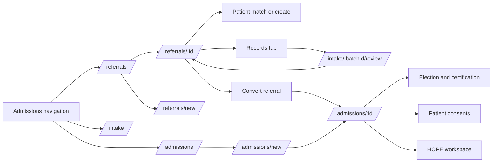
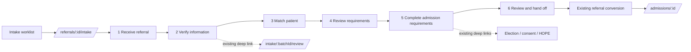

# Intake Redesign Current-State Audit

**Gate:** G0 discovery and contract mapping

**Date:** 2026-11-12

**Branch:** `feat/intake-redesign-wp0`

**Source plan:** [`CHARTWARDEN_INTAKE_REDESIGN_IMPLEMENTATION_PLAN.md`](./CHARTWARDEN_INTAKE_REDESIGN_IMPLEMENTATION_PLAN.md)

**Scope:** Evidence and proposed UI composition only. No product code, database schema, API contract, clinical rule, or production behavior is changed by this document.

## Executive decision

The redesign is feasible as a UI composition over the existing M6 referral/admission, M22 document/DocLens, M5 patient, M39 consent, and M10 HOPE capabilities. The repository already contains the important server-owned controls: referral state transitions, explicit patient resolution, admission conversion, admission-readiness evaluation, signature and step-up gates, tenant-scoped document access, extraction review locks, audit configuration, and write idempotency.

The safe first implementation slice is a derived worklist plus a route-compatible workspace shell. It must not create a second workflow state machine. Existing routes remain valid, and the shell determines its presentation step from server state and existing resource links.

Three target requirements are not supported by the current list contract and therefore must not be promised in PR 2 without approval:

1. server-global worklist counts (the current UI counts only the loaded rows),
2. team ownership/filtering (referrals expose an assigned user, not an intake team), and
3. server-side blocked-reason and received-date filtering.

The term **Ready** is also unsafe as a standalone referral label. A `qualified` referral is ready to start an admission; it is not necessarily ready for admission activation. The presentation label should be **Ready to start admission**.

## 1. Application and UI foundations

### 1.1 Composition and scripts

| Concern                  | Repository evidence                                                                                            | Current behavior                                                                                                                                                    |
| ------------------------ | -------------------------------------------------------------------------------------------------------------- | ------------------------------------------------------------------------------------------------------------------------------------------------------------------- |
| Web composition root     | `apps/web/src/main.tsx:11-14`, `apps/web/src/main.tsx:94-127`                                              | A single web client registers module screens, including M5, M6, M10, M22, and M39.                                                                                  |
| Build and verification   | `package.json:76-83`                                                                                         | `dev:web`, `build`, `typecheck`, `lint`, and `test` are root scripts. Module-specific live suites are also registered in `package.json`.                |
| Design tokens            | `apps/web/src/index.css:1-25`, `apps/web/src/index.css:42-146`; `packages/ui/src/core/theme/colors.ts:1` | The web app uses Lantern/ChartWarden tokens and imports the shared shell and list chrome after Tailwind. Colors are parity-controlled from the shared theme source. |
| Shared components        | `packages/ui/src/index.ts:1-14`                                                                              | The shared package exports buttons, cards, form sections, page headers, status pills, workflow steppers, sticky actions, tables, and detail/workflow layouts.       |
| Shared application shell | `packages/ui/src/web/styles/app-shell.css:1-41`                                                              | Shared shell, sidebar, header, base behavior, and skip link.                                                                                                        |
| Shared list treatment    | `packages/ui/src/web/styles/list-chrome.css:1-12`                                                            | Shared `wx-*` list/table/filter chrome; worklist additions belong here when generally reusable.                                                                   |

There is no need for a new design system or one-off intake primitives. PR 2 should compose the existing `PageHeader`, `StatusPill`, `DataTable`, `WorkflowStepper`, `StepperWorkflowLayout`, and `StickyFooterActions` components and extend shared list chrome only for genuinely shared behavior.

### 1.2 Current navigation and routes

The Admissions navigation currently exposes three separate concepts rather than a single intake journey:

- `/referrals` and `/referrals/new` are registered by M6 (`apps/web/src/modules/06-admission/screens.ts:62-76`).
- `/admissions`, `/admissions/:id`, and `/admissions/new` are registered separately (`apps/web/src/modules/06-admission/screens.ts:78-129`).
- `/intake`, `/intake/:batchId`, and `/intake/:batchId/review` are M22 document-review routes (`apps/web/src/modules/22-documents/screens.ts:107-130`).
- The primary navigation groups `/referrals`, `/admissions`, and `/intake` under Admissions (`apps/web/src/shell/primary-nav.ts:66-98`).
- Breadcrumbs explicitly treat direct admission and referral routes as separate parent chains (`apps/web/src/shell/breadcrumb-navigation.ts:6-20`).

Other intake-related routes remain module-owned:

| Capability                 | UI path                                                              | Evidence                                                 |
| -------------------------- | -------------------------------------------------------------------- | -------------------------------------------------------- |
| Patient list/search/detail | `/patients`, `/search`, `/patients/:id`                        | `apps/web/src/modules/05-patient/screens.ts:21-51`     |
| Election/certification     | `/patients/:patientId/election-certification`                      | `apps/web/src/modules/06-admission/screens.ts:158-164` |
| HOPE workspace/timeline    | `/admissions/:admissionId/hope`, HOPE timepoints, patient timeline | `apps/web/src/modules/10-hope/screens.ts:84-128`       |
| Patient consents           | patient consent list, capture, and detail routes                     | `apps/web/src/modules/39-consent/screens.ts:30-75`     |

Existing deep links and permissions are valuable contracts. The proposed workspace should wrap or link these routes, not replace their registrars or silently redirect them in its first release.

## 2. Current intake journey

### 2.1 Observed UI capabilities

| Journey area                | Observed implementation                                                                                                                                    | Evidence                                                                                                                                                                                                     |
| --------------------------- | ---------------------------------------------------------------------------------------------------------------------------------------------------------- | ------------------------------------------------------------------------------------------------------------------------------------------------------------------------------------------------------------ |
| Referral inbox              | Filters for all, new, mine, unassigned, pending information, ready, and declined; client-side search/source/priority/resolution filters; table navigation. | `apps/web/src/modules/06-admission/referral-inbox.tsx:26-66`, `apps/web/src/modules/06-admission/referral-inbox.tsx:115-220`, `apps/web/src/modules/06-admission/referral-inbox.tsx:249-355`           |
| Referral creation           | Dedicated `/referrals/new` path using the existing referral create contract.                                                                             | `apps/web/src/modules/06-admission/screens.ts:70-76`; `apps/backend/src/modules/06-admission/routes/admission-routes.ts:423-429`                                                                         |
| Referral review             | Long-form detail with overview/records tabs; start/return review, qualify, priority, assignment, pending-information, and terminal actions.                | `apps/web/src/modules/06-admission/referral-detail.tsx:179-237`, `apps/web/src/modules/06-admission/referral-detail.tsx:646-753`                                                                         |
| Patient resolution          | Find matches, choose a candidate, explicitly confirm a match, or explicitly create a patient.                                                              | `apps/web/src/modules/06-admission/referral-detail.tsx:313-438`; `apps/backend/src/modules/06-admission/routes/admission-routes.ts:487-532`                                                              |
| Referral documents          | Referral Records lists intake batches and links out to M22 review/detail routes.                                                                           | `apps/web/src/modules/06-admission/referral-records.tsx:114-265`                                                                                                                                           |
| Upload and extraction start | Shared dialog verifies the upload, creates an intake batch, then starts extraction. If extraction start fails, the batch remains filed.                    | `apps/web/src/shell/intake-upload-dialog.tsx:1-5`, `apps/web/src/shell/intake-upload-dialog.tsx:73-139`                                                                                                  |
| DocLens queue               | Separate `/intake` queue with open/completed views and local queue KPIs.                                                                                 | `apps/web/src/modules/22-documents/intake-review-queue.tsx:76-99`, `apps/web/src/modules/22-documents/intake-review-queue.tsx:142-214`                                                                   |
| DocLens review              | Source-view human review with field decisions, risk/vision indicators, identity handling, review ownership, and SUD-aware controls.                        | `apps/web/src/modules/22-documents/doclens-review-workspace.tsx:12-41`, `apps/web/src/modules/22-documents/doclens-review-workspace.tsx:145-176`                                                         |
| Referral conversion         | A qualified, patient-resolved referral can call the conversion endpoint and navigate to the created admission.                                             | `apps/web/src/modules/06-admission/referral-detail.tsx:599-635`; `apps/backend/src/modules/06-admission/routes/admission-routes.ts:577-598`                                                              |
| Direct admission            | Separate three-step React-only draft (`intake`, `clinical`, `review`) posts directly to admissions. It explicitly has no durable draft endpoint.     | `apps/web/src/modules/06-admission/admission-create.tsx:16-18`, `apps/web/src/modules/06-admission/admission-create.tsx:44-172`, `apps/web/src/modules/06-admission/admission-create.tsx:378-410`      |
| Admission readiness         | Admission detail fetches server readiness, shows requirement actions, and invokes the existing activation mutation.                                        | `apps/web/src/modules/06-admission/admission-detail.tsx:411-443`, `apps/web/src/modules/06-admission/admission-detail.tsx:531-609`, `apps/web/src/modules/06-admission/admission-detail.tsx:1278-1552` |

### 2.2 Current journey diagram

The return from DocLens to the referral is a user-navigation convention rather than a persistent unified context. Admission requirements then branch into separate module routes.

### 2.3 Proposed journey composition

The six stages are derived presentation. They do not become database states. Browser refresh, back/forward, and direct entry must reconstruct the stage from the referral, related intake batches, patient-resolution state, admission link, and server readiness.

## 3. Server contracts and controls

### 3.1 Module ownership

| Module        | Owned intake responsibility                                                            | Evidence                                                                                                              |
| ------------- | -------------------------------------------------------------------------------------- | --------------------------------------------------------------------------------------------------------------------- |
| M5 Patient    | Patient identity, duplicate-aware creation, patient-level access and privacy clearance | `architecture/module-manifest.ts:415-463`; `apps/backend/src/modules/05-patient/routes/patient-routes.ts:117-225` |
| M6 Admission  | Referrals, admission lifecycle, election, CTI, benefit-period and readiness records    | `architecture/module-manifest.ts:492-516`                                                                           |
| M10 HOPE      | HOPE assessments, schedules, timepoints, answers, and signing                          | `apps/backend/src/modules/10-hope/routes/hope-routes.ts:263-529`                                                    |
| M22 Documents | Documents, intake batches, extraction jobs/decisions/provenance and DocLens review     | `architecture/module-manifest.ts:894-926`                                                                           |
| M39 Consent   | Consent drafts, versions, signatures, supersession, revocation, and renewal            | `architecture/module-manifest.ts:465-489`; `apps/backend/src/modules/39-consent/routes/consent-routes.ts:138-318` |

The workspace may orchestrate links and reads across these modules, but it must not move tables or reproduce their business rules in M6 UI code.

### 3.2 Referral and admission APIs

The M6 registrar uses authenticated request context, permission checks, resource scope checks, location row filters, read-audit configuration, and `withOrgContext` for database work (`apps/backend/src/modules/06-admission/routes/admission-routes.ts:1-12`, `apps/backend/src/modules/06-admission/routes/admission-routes.ts:204-315`).

| Action                           | Existing contract                                                   | Control notes                                                                                                   | Classification |
| -------------------------------- | ------------------------------------------------------------------- | --------------------------------------------------------------------------------------------------------------- | -------------- |
| Create/list/read/update referral | `POST/GET /api/v1/referrals`, `GET/PATCH /api/v1/referrals/:id` | Create/read/update permissions; detail scope; optimistic `ifVersion` update.                                  | `reuse`      |
| Begin review                     | `POST /api/v1/referrals/:id/review`                               | Existing transition guard.                                                                                      | `reuse`      |
| Find patient matches             | `POST /api/v1/referrals/:id/patient-matches`                      | Existing patient matcher; no implicit match.                                                                    | `reuse`      |
| Confirm/create patient           | `POST .../confirm-patient`, `POST .../create-patient`           | Explicit choice; M5 duplicate checks apply.                                                                     | `reuse`      |
| Qualify referral                 | `POST /api/v1/referrals/:id/qualify`                              | Existing transition guard; does not activate an admission.                                                      | `reuse`      |
| Assign/priority/pending/note     | Existing M6 subresource mutations                                   | Existing permission and optimistic concurrency behavior.                                                        | `reuse`      |
| Decline/duplicate/withdraw       | Existing terminal-state mutations                                   | Irreversible workflow meaning; expose with confirmation and permissions.                                        | `reuse`      |
| Convert referral                 | `POST /api/v1/referrals/:id/convert`                              | Server creates admission/benefit period, marks referral converted, publishes events, and returns the admission. | `reuse`      |
| Create/list/read admission       | `POST/GET /api/v1/admissions`, `GET /api/v1/admissions/:id`     | Direct-create remains separate from referral conversion.                                                        | `reuse`      |
| Read readiness                   | `GET /api/v1/admissions/:id/readiness`                            | Server-derived checklist; never compute this independently in the client.                                       | `reuse`      |
| Activate admission               | `POST /api/v1/admissions/:id/activate`                            | Server re-evaluates readiness immediately before the state transition.                                          | `reuse`      |

Route evidence: `apps/backend/src/modules/06-admission/routes/admission-routes.ts:423-598`, `apps/backend/src/modules/06-admission/routes/admission-routes.ts:600-794`, and `apps/backend/src/modules/06-admission/routes/admission-routes.ts:886-889`. Payload/validation evidence: `apps/backend/src/modules/06-admission/routes/admission-typebox.ts:169-238`, `apps/backend/src/modules/06-admission/routes/admission-typebox.ts:260-321`.

### 3.3 Patient, document, consent, and HOPE APIs

- Patient create/admit uses the real matcher and returns a hard `409` when duplicates require resolution; no patient is created in that case (`apps/backend/src/modules/05-patient/routes/patient-routes.ts:416-449`). Patient-create fields and bypass justification are schema-validated (`apps/backend/src/modules/05-patient/routes/patient-typebox.ts:45-74`).
- Intake upload accepts referral-read users, validates records-request context and patient/referral consistency, applies document scope, and creates the intake batch (`apps/backend/src/modules/22-documents/routes/documents-routes.ts:722-788`).
- M22 exposes referral batches, batch/classification/jobs, open/get/decide/bulk/discrepancy/complete/abandon/discard review operations (`apps/backend/src/modules/22-documents/routes/documents-routes.ts:790-978`). Completion requires AI-reject and idempotency controls where configured.
- Verified upload initiation, completion, and abort are separate guarded routes (`apps/backend/src/modules/22-documents/routes/verified-upload-routes.ts:19-53`).
- The DocLens workspace includes patient/referral identity, pages, source bounding boxes, model/vision metadata, risk, decisions, and reviewer-lock state (`apps/backend/src/modules/22-documents/extraction/review-workspace-routes.ts:63-228`). Queue, workspace, protected page-image, SUD, identity, and relink operations apply ABAC and permission checks (`apps/backend/src/modules/22-documents/extraction/review-workspace-routes.ts:278-425`).
- Consent authoring, signing, supersession, revocation, and renewal use existing consent permissions and step-up where required (`apps/backend/src/modules/39-consent/routes/consent-route-support.ts:32-42`; `apps/backend/src/modules/39-consent/routes/consent-routes.ts:209-318`, `apps/backend/src/modules/39-consent/routes/consent-routes.ts:575-578`).
- HOPE admission reads, schedules, timepoint creation, SFV, assessment updates, signing, correction, workspace, and patient history remain M10 operations (`apps/backend/src/modules/10-hope/routes/hope-routes.ts:263-529`).

### 3.4 Tenancy, audit, and provenance

- Referral storage follows the three-column tenant convention and is RLS/audit protected (`packages/db/src/schema/admission/referrals.ts:1-7`, `packages/db/src/schema/admission/referrals.ts:32-110`).
- Route handlers derive organization and actor context server-side and execute tenant data access under `withOrgContext`; the client cannot select a trusted organization by sending an ID (`apps/backend/src/modules/06-admission/routes/admission-routes.ts:1-12`).
- Sensitive reads use route audit configuration and resource scope. Writes rely on existing route controls and database audit/event mechanisms; the redesign must call those routes rather than writing tables.
- Extraction provenance stores source document/page/location and extraction/model metadata (`packages/db/src/schema/documents/extraction-provenance.ts:1-46`). The UI may render that evidence but must not synthesize missing provenance.
- Protected document pages are obtained through the guarded M22 page-image route, not a browser-constructed object-store URL (`apps/backend/src/modules/22-documents/extraction/review-workspace-routes.ts:362-387`).

## 4. State and transition map

### 4.1 Canonical states

Referral states are `received`, `under_review`, `pending_information`, `qualified`, `declined`, `duplicate`, `withdrawn`, and `converted`. Patient resolution is `unresolved`, `possible_match`, `matched`, or `created`. Admission states are `referred`, `pending`, `notice_of_rights_acknowledged`, `active`, `on_hold`, `discharged`, `bereavement`, and `closed` (`packages/db/src/enums.ts:849-891`).

```mermaid
stateDiagram-v2
  [*] --> received
  received --> under_review: begin review
  under_review --> pending_information: request information
  pending_information --> under_review: resume review
  under_review --> qualified: qualify after patient resolution
  qualified --> converted: convert; creates admission
  received --> declined
  under_review --> declined
  received --> duplicate
  under_review --> duplicate
  received --> withdrawn
  under_review --> withdrawn

  state admission {
    [*] --> referred: conceptual transition source
    referred --> pending: direct create or referral conversion
    pending --> notice_of_rights_acknowledged: acknowledge notice of rights
    pending --> active: server readiness gate
    notice_of_rights_acknowledged --> active: server readiness gate
    active --> on_hold
    on_hold --> active
    active --> discharged
    discharged --> bereavement
    bereavement --> closed
  }
```

The admission state-machine graph and guards are implemented in `apps/backend/src/modules/06-admission/state-machines/admission.ts:1-8`, `apps/backend/src/modules/06-admission/state-machines/admission.ts:58-70`, and `apps/backend/src/modules/06-admission/state-machines/admission.ts:121-143`.

### 4.2 Deterministic worklist labels

These are presentation labels only. Every canonical referral state maps exactly once.

| Canonical referral state | Worklist label           | User-facing next-action rule                                                                                 |
| ------------------------ | ------------------------ | ------------------------------------------------------------------------------------------------------------ |
| `received`             | Needs review             | Start review.                                                                                                |
| `under_review`         | In progress              | Resume the first incomplete supported task: information review, patient resolution, or qualification.        |
| `pending_information`  | Waiting on information   | Show the recorded pending-information reason and owner when present; resume review when information arrives. |
| `qualified`            | Ready to start admission | Review conversion summary and invoke the existing conversion action. Never shorten this to “Ready.”        |
| `converted`            | Completed / closed       | Open the linked admission.                                                                                   |
| `declined`             | Completed / closed       | Show terminal reason and history; no advancement CTA.                                                        |
| `duplicate`            | Completed / closed       | Show duplicate disposition and history; no advancement CTA.                                                  |
| `withdrawn`            | Completed / closed       | Show withdrawal disposition and history; no advancement CTA.                                                 |

Patient-resolution state refines the CTA but never changes the canonical referral state. `unresolved` and `possible_match` direct the user to explicit patient resolution; `matched` and `created` permit the existing downstream guard to decide whether qualification is allowed.

### 4.3 Admission readiness authority

The readiness service loads the admission, referral, election, CTI, notice-of-rights, F2F, evidence, recommendation, and patient-clearance facts and builds one result (`apps/backend/src/modules/06-admission/admission-route-service-db.ts:1490-1615`). Activation re-runs that same readiness computation immediately before the transition (`apps/backend/src/modules/06-admission/admission-route-service-db.ts:4348-4362`).

The pure gate identifies requirements and corrective actions for patient identity, admission details, privacy, notice of rights, election statement/signature, CTI/signature, F2F, admission recommendation, and the non-blocking election addendum (`apps/backend/src/modules/06-admission/intake/activation-gate.ts:1-70`). The proposed UI must render these server results. It must not infer completion from a local checkbox, document presence alone, or DocLens “processed” state.

### 4.4 Irreversible actions and side effects

| Action                                          | Material effect                                                                                                     | Required UI treatment                                                                                        |
| ----------------------------------------------- | ------------------------------------------------------------------------------------------------------------------- | ------------------------------------------------------------------------------------------------------------ |
| Create patient from referral                    | Creates an M5 patient, then links the referral.                                                                     | Explicit confirmation; surface duplicate/conflict response; never auto-create from extraction.               |
| Confirm patient match                           | Binds referral to an existing patient.                                                                              | Show chosen identity and require a deliberate action.                                                        |
| Decline/duplicate/withdraw                      | Places referral in a terminal state and emits existing activity/events.                                             | Permission-aware confirmation and reason; no optimistic “undo.”                                            |
| Convert referral                                | Atomically creates admission records, marks referral converted, emits outbox events, and grants post-commit access. | Show summary, disable repeat clicks, use existing idempotency, and navigate from the returned admission ID.  |
| Complete document review                        | Commits human review decisions and downstream document/extraction effects.                                          | Preserve reviewer lock, conflict, provenance, and M22 completion gate.                                       |
| Sign consent/election/CTI or activate admission | Legally or clinically significant mutation.                                                                         | Use the existing route, step-up, signature, permission, and readiness controls without frontend substitutes. |

One implementation risk is already documented in code: referral-driven patient creation calls M5 outside the later referral transaction, so a failure while linking the referral may leave the patient created and a retry may receive a duplicate `409` (`apps/backend/src/modules/06-admission/admission-route-service-db.ts:3156-3176`). The UI must surface the recovery path; changing transaction ownership requires backend design approval.

### 4.5 Retry and idempotency

The shared API client assigns idempotency keys to mutating JSON requests and retains the same key for an unresolved intent across no-response and qualifying gateway/in-flight outcomes. The intent includes method, URL, `If-Match`, and JSON body; multipart/file bodies are deliberately outside this automatic fingerprinting (`packages/ui/src/core/api/idempotency-middleware.ts:1-37`, `packages/ui/src/core/api/idempotency-middleware.ts:89-139`).

Consequences for the redesign:

- use existing client writes rather than raw ad hoc fetches;
- retain existing `ifVersion` optimistic concurrency on referral updates;
- keep upload initiation/completion and extraction start as their existing explicit intents;
- use one attempt key across a conversion retry, and treat conflict/precondition responses as server truth;
- do not claim autosave: direct admission currently has a React-only draft and no durable draft endpoint.

## 5. Observed facts versus UX hypotheses

### 5.1 Observed code facts

1. Admissions, referrals, and DocLens intake are separate routes and navigation entries.
2. Referral Records sends users from the referral detail to a separate M22 review route.
3. Referral detail presents many actions on one long page rather than a single derived stage action.
4. The inbox “Ready” count and filter represent `qualified` referrals, while admission readiness is a separate server result.
5. Inbox KPI counts are computed from currently loaded items, and the screen combines a bounded server fetch with client pagination/load-more behavior (`apps/web/src/modules/06-admission/referral-inbox.tsx:90-99`). They are not authoritative global queue counts.
6. Assignment supports an assigned user and “mine/unassigned”; a referral team ownership model was not found.
7. Blocked-reason and received-date filters were not found in the current referral list query/UI.
8. The manual referral and patient-resolution path exists independently of DocLens.
9. Upload failure after batch creation preserves the filed batch, allowing recovery.
10. DocLens has human decisions, reviewer state, protected source pages, and provenance. A processed document is not equivalent to an activated admission or verified clinical eligibility.
11. Admission readiness and activation share a server computation.
12. The direct-admission draft is not durable; displaying autosave would be false.

Explicit discovery results for requested target capabilities:

| Capability                                               | Result                                              |
| -------------------------------------------------------- | --------------------------------------------------- |
| Team-owned referrals and team assignment/filter contract | **NOT FOUND**                                 |
| Authoritative server-global referral queue counts        | **NOT FOUND**                                 |
| Referral list query for blocked reason                   | **NOT FOUND**                                 |
| Referral list query for received-date range              | **NOT FOUND**                                 |
| Durable intake/admission draft or autosave API           | **NOT FOUND**                                 |
| Automatic AI-derived clinical eligibility decision       | **NOT FOUND** and intentionally outside scope |
| Complete browser E2E for DocLens extraction review       | **NOT FOUND**; component/DOM coverage exists  |

### 5.2 Hypotheses requiring staff usability testing

1. A single Intake entry point will reduce route-selection errors compared with the current three Admissions entries.
2. A persistent stage header and one prominent CTA will reduce time spent scanning referral detail.
3. Returning from DocLens to the same referral/stage will reduce lost context.
4. “Ready to start admission” will reduce confusion between referral qualification and admission activation readiness.
5. Grouping server readiness blockers by owner and corrective action will reduce support questions and unnecessary navigation.
6. A six-step presentation model will match frontline intake staff's mental model; this must be validated because the legal/domain boundaries remain more granular.

Usability testing must use synthetic patient data and representative intake roles. These hypotheses should not be recorded as solved merely because a new route renders.

## 6. Preservation matrix

| Existing contract/control                       | Proposed wrapper behavior                                       | Classification        | Backend impact / approval point                                     |
| ----------------------------------------------- | --------------------------------------------------------------- | --------------------- | ------------------------------------------------------------------- |
| `/referrals` list and detail permissions      | Derived worklist and workspace entry                            | `adapt`             | UI-only if existing query and page-local counts are accepted.       |
| Referral create/update/review/qualify mutations | Stage-specific CTA using current handlers                       | `reuse`             | None. Preserve `ifVersion`, errors, and permissions.              |
| Existing `/referrals/:id` deep link           | Continue to resolve; optionally offer workspace link            | `reuse`             | No redirect in first rollout.                                       |
| Referral assignment to a user                   | Show owner and existing assign action                           | `reuse`             | None.                                                               |
| Team assignment/filter                          | Do not render as functional until a real ownership model exists | `requires approval` | API/domain/schema design may be required.                           |
| Server-global queue counts                      | Label counts as loaded results or omit initially                | `requires approval` | Aggregate/count contract required for authoritative totals.         |
| Blocked-reason/received-date server filters     | Defer or use clearly page-local filtering                       | `requires approval` | Query schema/service/index review required.                         |
| M22 verified upload and intake-batch creation   | Receive-referral document action                                | `reuse`             | None. Preserve scan/storage controls and partial-failure state.     |
| `/intake/:batchId/review`                     | Link/embed with explicit return-to-referral context             | `adapt`             | UI-only if routing uses non-PHI IDs and existing protected APIs.    |
| Extraction field decisions/provenance           | Render source, decision, conflict, and reviewer state           | `reuse`             | No fabricated provenance or new writeback.                          |
| Automatic clinical-field overwrite from AI      | Not offered                                                     | `not supported`     | Would require approved contracts, conflict rules, and audit design. |
| Patient matcher/confirm/create                  | Guided explicit patient-resolution stage                        | `reuse`             | None; preserve duplicate `409` and manual choice.                 |
| Referral conversion                             | Review-and-handoff CTA                                          | `reuse`             | None; server remains transition authority.                          |
| Admission readiness endpoint                    | Needs-attention panel and corrective links                      | `reuse`             | None; do not duplicate gate logic.                                  |
| Election, CTI, consent, HOPE routes             | Grouped task links in admission-requirements stage              | `adapt`             | UI composition only; no timing/signature changes.                   |
| Admission activation                            | Existing guarded action after readiness refresh                 | `reuse`             | None; UI cannot override missing requirements.                      |
| Audit and RLS                                   | Continue using module routes and protected document access      | `reuse`             | Any new mutation/event requires compliance review and approval.     |
| Autosave/durable draft                          | Provide explicit Save/exit and unsaved-change protection only   | `not supported`     | Durable draft API would require approval.                           |
| External extraction/PHI vendor                  | No new integration                                              | `not supported`     | Requires security, privacy, contractual, and architecture approval. |

## 7. Testing and environment inventory

### 7.1 Existing coverage

| Area                       | Current evidence                                                                                                                                             |
| -------------------------- | ------------------------------------------------------------------------------------------------------------------------------------------------------------ |
| Admission UI/E2E           | `e2e/specs/admission.spec.ts:1-17`, `e2e/specs/admission.spec.ts:59-143` covers direct admission and accessibility.                                      |
| Referral/document E2E      | `e2e/specs/documents.spec.ts:84-109`, `e2e/specs/documents.spec.ts:163-185` creates a referral and exercises referral document upload.                   |
| DocLens component behavior | `apps/web/src/modules/22-documents/doclens-review.dom.test.tsx` covers workspace DOM behavior. A complete extraction-review browser journey was not found. |
| HOPE E2E                   | `e2e/specs/hope.spec.ts:228-234` includes main-path accessibility coverage.                                                                                |
| Consent E2E                | `e2e/specs/consent.spec.ts:9-61` covers the consent journey.                                                                                               |
| Broad route accessibility  | `e2e/specs/axe-route-walk.spec.ts`; `e2e/fixtures/helpers.ts:116-135` runs Axe with WCAG 2.1 A/AA tags.                                                  |
| Live backend controls      | Root scripts register M5, M6, M10, M22, and M39 live suites in `package.json:101-224`.                                                                     |

The target is WCAG 2.2 AA, while the broad Axe helper currently selects WCAG 2.1 A/AA rule tags. Existing reflow/touch tests help, but WCAG 2.2-specific acceptance needs an explicit test/manual checklist rather than an unsupported claim.

### 7.2 Required additions by delivery gate

- Worklist unit/component tests: every canonical status maps once; qualified never displays generic admission-ready wording; permission and empty/error/loading states.
- Workspace route tests: refresh/back/deep-link reconstruction; no client-only workflow state; old routes still resolve.
- Document tests: interrupted/repeated upload, extraction unavailable, protected page access, reviewer conflict, reject/conflict visibility, manual fallback.
- Patient/conversion tests: possible duplicate, explicit match, unauthorized conversion, stale version, double submission, orphan-patient recovery messaging.
- Readiness/handoff tests: missing election/CTI/signature, privacy advisory versus blocker, F2F deadline, corrective links, server `412` refresh.
- Cross-tenant live tests: app role only, protected document page and referral/admission access denied with no PHI leakage.
- E2E and accessibility: synthetic complete packet, manual no-document path, keyboard/focus/error summary, zoom/reflow/touch targets, desktop/tablet/mobile screenshots.
- Audit verification: assert existing clinical decision and transition events land; do not use a no-op outbox publisher.

### 7.3 Environment dependencies and blockers

DocLens development requires the documented document/extraction stack: object storage, scan/verified-upload path, PostgreSQL/platform context, Redis/worker processing, Docling, an approved model backend such as the documented local Ollama setup, registered extraction capabilities, terminology/reference data, and required key-encryption configuration (`docs/DEVELOPMENT.md:167-203`).

Live suites must use an isolated production-image PostgreSQL container and the real non-superuser app role per repository policy. They must not run against the shared Docker cluster. No production credentials or real PHI are required or permitted.

Known blockers for a fully faithful target:

- authoritative global counts, team ownership, and additional server filters need decisions before backend work;
- a complete DocLens browser E2E fixture/environment is not presently evident;
- the referral patient-create transaction boundary can require recovery after a partial failure;
- a durable intake draft/autosave contract does not exist;
- WCAG 2.2-specific automated coverage is not established by the current Axe tag set.

## 8. Proposed PR-by-PR file map

This map follows the plan's five-PR delivery sequence. Exact new filenames are proposals; existing paths are verified. Generated OpenAPI/client files are included only if an approved backend contract change later makes them necessary.

### PR 1 — Gate G0 audit and UX contract (this change)

| File                                                  | Change                                                                                                          |
| ----------------------------------------------------- | --------------------------------------------------------------------------------------------------------------- |
| `docs/implementation/intake-current-state-audit.md` | Current-state evidence, route/state/journey maps, discrepancies, preservation matrix, risks, tests, and PR map. |

No application or backend files. Approval of this document is the prerequisite for PR 2.

### PR 2 — Worklist and shared workspace shell (WP1 + WP2; frontend only)

| File                                                                  | Proposed responsibility                                                                                                |
| --------------------------------------------------------------------- | ---------------------------------------------------------------------------------------------------------------------- |
| `apps/web/src/modules/06-admission/referral-inbox.tsx`              | One Intake heading/action, deterministic action-oriented filters, honest loaded-result counts, next-action affordance. |
| `apps/web/src/modules/06-admission/admission-status.ts`             | Central presentation mapping for all referral states; no domain transitions.                                           |
| `apps/web/src/modules/06-admission/intake-workspace.tsx` (new)      | Route-compatible shell, identity/status header, stage derivation, blocker summary, one primary CTA.                    |
| `apps/web/src/modules/06-admission/intake-workspace-stage.ts` (new) | Pure derived stage/CTA mapping from existing server resources.                                                         |
| `apps/web/src/modules/06-admission/screens.ts`                      | Register a non-breaking workspace route while preserving existing routes.                                              |
| `apps/web/src/shell/primary-nav.ts`                                 | Make Intake the obvious entry while retaining accessible Admission destinations.                                       |
| `apps/web/src/shell/breadcrumb-navigation.ts`                       | Explicit workspace parent/return behavior.                                                                             |
| `packages/ui/src/web/styles/list-chrome.css`                        | Only shared worklist chrome needed by both apps/components.                                                            |
| Adjacent `*.test.ts(x)` / `*.dom.test.tsx` files                  | Mapping completeness, permissions, route reconstruction, accessibility, error/empty/loading states.                    |

Gate G1: no backend changes; old routes and permissions remain; visual review with synthetic data. Team filters, global counts, and unsupported filters are omitted or explicitly scoped, not simulated.

### PR 3 — Document capture and verified review integration (WP3 + WP4)

| File                                                                            | Proposed responsibility                                                                                           |
| ------------------------------------------------------------------------------- | ----------------------------------------------------------------------------------------------------------------- |
| `apps/web/src/modules/06-admission/intake-workspace.tsx` and stage components | Receive/verify stage composition and explicit manual fallback.                                                    |
| `apps/web/src/modules/06-admission/referral-records.tsx`                      | Preserve referral context and show upload/extraction/review states.                                               |
| `apps/web/src/shell/intake-upload-dialog.tsx`                                 | Route-compatible return target and recovery messaging; retain verified-upload sequence.                           |
| `apps/web/src/modules/22-documents/intake-review-queue.tsx`                   | Entry/return context only where it does not weaken M22 ownership.                                                 |
| `apps/web/src/modules/22-documents/doclens-review-workspace.tsx`              | Clear verified/unverified/conflict state and return to same intake context.                                       |
| Existing adjacent M6/M22 tests plus `e2e/specs/documents.spec.ts`             | Retry, failure/manual fallback, reviewer conflict, provenance, protected access, deep-link return, accessibility. |

Gate G2: security/provenance/retry review. Stop for approval if the desired field writeback is not already represented by an M22 review action. No new vendor or external PHI flow.

### PR 4 — Patient matching and admission handoff (WP5)

| File                                                                                                    | Proposed responsibility                                                                                |
| ------------------------------------------------------------------------------------------------------- | ------------------------------------------------------------------------------------------------------ |
| `apps/web/src/modules/06-admission/referral-detail.tsx`                                               | Extract/reuse patient resolution and conversion summary without changing handlers.                     |
| `apps/web/src/modules/06-admission/intake-workspace.tsx` and stage components                         | Guided match stage, explicit candidate confirmation, conversion review and server error recovery.      |
| `apps/web/src/shell/entity-lookups.tsx` (only if current shared lookup presentation needs adaptation) | Reuse `PatientLookupField`; no matcher duplication.                                                  |
| Adjacent M5/M6 tests and `e2e/specs/admission.spec.ts`                                                | Duplicate patient, unauthorized/stale conversion, repeat submission, deep link, at-most-one admission. |

Gate G3: backend contracts remain unchanged. The partial-failure recovery case for referral-driven patient creation must be demonstrably handled. Any transaction redesign is a separate approved backend change.

### PR 5 — Readiness consolidation, accessibility, rollout, and docs (WP6 + WP7)

| File                                                                                                                                     | Proposed responsibility                                                                       |
| ---------------------------------------------------------------------------------------------------------------------------------------- | --------------------------------------------------------------------------------------------- |
| `apps/web/src/modules/06-admission/admission-detail.tsx`                                                                               | Reuse server-readiness rendering and expose stable corrective links.                          |
| `apps/web/src/modules/06-admission/intake-workspace.tsx` and stage components                                                          | Grouped admission requirements, owner/reason/action, handoff summary.                         |
| `apps/web/src/modules/06-admission/screens.ts`, `apps/web/src/shell/primary-nav.ts`, `apps/web/src/shell/breadcrumb-navigation.ts` | Approved route-level rollout and navigation cleanup while retaining deep links.               |
| M10/M39 screen components only where link/return context is required                                                                     | Preserve signatures, timing, permissions, and module ownership.                               |
| `e2e/specs/admission.spec.ts`, `e2e/specs/hope.spec.ts`, `e2e/specs/consent.spec.ts`, accessibility helpers/tests                  | Full synthetic journeys, blocked readiness, keyboard/focus/reflow/touch, route compatibility. |
| User/support documentation under the existing docs index                                                                                 | Intake workflow and known limitations; update indexes if required by docs gates.              |

Gate G4: accessibility evidence, full server-gate regression, user acceptance with hospice intake staff, reversible route-level rollout, and explicit approval before changing the production-default navigation.

## 9. Gate G0 approval record

Gate G0 is ready for reviewer decision when this audit's evidence and scope are accepted. Approval authorizes only PR 2 as described above: a frontend-derived worklist and route-compatible workspace shell with no backend contract, schema, clinical rule, signature, Medicare notice, PHI integration, or irreversible-transition change.

The following decisions remain explicitly outside that approval unless separately accepted:

- add an authoritative worklist-count endpoint;
- introduce team ownership;
- extend referral list filters;
- create a durable draft/autosave API;
- change referral patient-creation transaction boundaries;
- add automatic extracted-field writeback;
- alter readiness, eligibility, election, CTI, consent, HOPE, or admission-transition rules.
