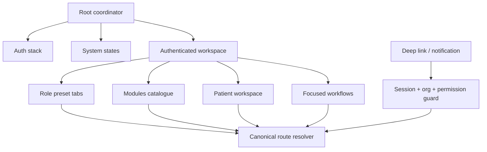

# Architecture de navigation mobile

## Principes structurants

Une destination possède une route canonique et une seule instance logique. Tabs, catalogue, recherche,
notification et deep link appellent tous `navigate(canonicalRoute, { origin })`. Une destination déjà
présente dans sa stack est réutilisée/unwind plutôt que poussée en double. Un workflow explicitement
répétable peut utiliser `push`, mais doit porter un identifiant de brouillon distinct.

## Root coordinator

| État observé | Route/écran | Décision |
|---|---|---|
| Démarrage sans contexte | `Root/Loading` | Hydrater uniquement les secrets/session, afficher un état non-PHI. |
| 401 confirmé | `Root/Auth/SignIn` | Purger caches, brouillons de l’identité précédente et socket. |
| Réseau/DNS/timeout ou contexte non-401 | `Root/System/Offline` | Ne pas transformer une panne en logout. Conserver les brouillons chiffrés autorisés. |
| Session avec `passwordChangeRequired` | `Root/Auth/RequiredPasswordChange` | Autoriser seulement status, changement et sign-out, comme `authenticate.ts`. |
| Session pré-org | `Root/Auth/OrganizationSelect` | Charger memberships puis appeler la sélection one-shot. |
| MFA requis | `Root/Auth/MfaChallenge` ou enrolment | Ne pas lier l’organisation avant assurance suffisante. |
| Session org-scoped | `Root/App` | Charger `/api/v1/auth/context`, construire shortcuts et catalogue. |
| Step-up demandé | modal/stack `StepUp` au-dessus du workflow | Reprendre l’opération avec son intention, jamais rejouer aveuglément une mutation. |
| 403 | écran interdit contextualisé | Rafraîchir le contexte ; expliquer le retrait d’accès et revenir à une destination sûre. |
| 423 | écran compte/session verrouillé | Message serveur, sortie sûre, aucune boucle de retry. |
| 503 | maintenance/dégradé | Afficher correlation ID si présent et action Retry. |
| Logout/révocation | Auth stack | Fermer socket, révoquer token/cookie, purger SecureStore/cache/brouillons. |

`apps/web/src/shell/actor-session.ts` distingue déjà `loading`, `anonymous`, `outage` et
`authenticated`. Le mobile conserve cette distinction au lieu d’utiliser un booléen `isLoggedIn`.

## Téléphone : convention principale

La bottom bar contient de 3 à 5 destinations stables. Sa dernière destination est `Modules`, qui ouvre
un catalogue plein écran/recherchable. **Aucun hamburger n’est ajouté au header** : hamburger + onglet
`More/Modules` crée deux portes concurrentes vers le même contenu, rend l’état actif ambigu et coûte une
zone d’action dans un header clinique déjà chargé.

Ordre de base : destination du jour, `Patients`, destination métier secondaire, `Messages` si autorisé,
`Modules`. Le preset est calculé à la connexion/changement d’organisation et ne se réordonne pas après
chaque clic. Une permission retirée masque la destination au prochain refresh ; si elle est active,
l’écran devient forbidden et la sélection revient sur le premier shortcut encore autorisé.

Les tabs conservent leur stack. Retaper le tab actif revient à sa racine après confirmation si un
brouillon non enregistré existe. Les actions ne sont jamais des tabs.

## Tablette et tailles adaptatives

- Compact : bottom bar + catalogue `Modules` plein écran.
- Medium/paysage : navigation rail ; le catalogue s’ouvre comme panneau leading sans remplacer le
  contexte courant.
- Expanded/tablette : sidebar leading persistante ou repliable, liste/détail en split view, bannière
  patient persistante. La bottom bar disparaît.
- Le nombre et l’ordre logique des destinations restent identiques entre tailles ; seule leur
  représentation change.

Ce choix suit Android Adaptive Navigation (bar 3–5 destinations, rail sur grand écran) et Apple HIG
(tab bar pour sections de haut niveau, sidebar lorsqu’il y a l’espace nécessaire).

## Catalogue `Modules`

Le catalogue contient toutes les destinations statiques autorisées, regroupées comme le shell web :

1. Soins : Patients, Admissions, Assessments, Care Plans, Orders, Medications, IDG, Documents.
2. Terrain : Visits & Scheduling, EVV, On-call, Safety.
3. Communication : Messaging, Notifications.
4. Revenue : Medicare, Medicaid, Remittance, CAP, Cost Reports, Subscription.
5. Qualité et rapports : QAPI, Reporting, Audit.
6. Administration : Staff, Roles, Organization, Integrations, AI, Terminology, MDM.

La recherche porte sur les labels et synonymes métier, jamais sur des contenus PHI mis en index local.
La destination active porte `aria-current`/équivalent natif et un indicateur visuel. Les routes
paramétriques ne figurent pas comme destinations autonomes ; elles sont atteintes depuis leur parent,
la recherche sécurisée ou un deep link.

Le catalogue n’affiche pas systématiquement `New Admission`, `Sign`, `Check-in` ou d’autres commandes.
Une action de création peut être proposée dans la liste qui la possède si la permission est effective.

## Patient Workspace

Le workspace est un groupe de routes canonique `/patients/[patientId]`. Une bannière compacte montre
nom, identifiants strictement nécessaires, statut, niveau de soins, alertes critiques et action overflow.
Le `patientId` vient de la route, jamais d’un singleton global implicite.

Les 12 tabs horizontaux web de `chart-module-rail.tsx` deviennent des groupes :

| Groupe mobile | Sections | Permission évaluée section par section |
|---|---|---|
| Résumé | overview, demographics, addresses, coverage, care team, privacy | `patient.read` puis clés spécifiques |
| Clinique | clinical, encounters/visits, HOPE, assessments | permissions M8–M10/M17 |
| Plans | plan of care, discipline plans, bereavement lié | permissions M7/M15/M16 |
| Traitements | orders, medications, eMAR, supplies | permissions M11–M13/M21 |
| Coordination | IDG, documents, consent, communication | permissions M14/M22/M36/M39 |
| Finance | claims/coverage | permissions billing concernées |

Chaque groupe absent de permission est omis. Un groupe visible mais temporairement vide explique l’état.
Un lien externe vers un patient passe d’abord par session → organisation → `patient.read`/ABAC ; un refus
ne révèle pas l’existence du patient. Le changement de patient invalide les requêtes, caches et brouillons
non attachés au nouvel identifiant.

## Navigation locale et Admissions

Une liste utilise filtres/search/sort dans le même écran. Les vues sœurs peu nombreuses peuvent utiliser
un segmented control. Un détail est poussé dans la stack. Création, signature et transition d’état ouvrent
un workflow focalisé.

Les tabs web Admissions mélangent aujourd’hui destinations et commandes. Sur mobile :

- `All Admissions`, `Referral Inbox`, `Readmit candidates`, `Discharge/Transfer queue` sont des vues
  sœurs sélectionnées depuis l’en-tête de la zone ou le catalogue ;
- `New Admission`, `New Referral`, `Readmit`, `Discharge`, `Transfer In`, `Death Pronouncement` sont des
  workflows lancés depuis la vue ou le détail approprié ;
- la barre web persistante n’est donc pas reproduite. Le contexte Admissions reste visible dans le titre,
  le breadcrumb tablette et le comportement Back.

## Workflows, brouillons et états

Un workflow porte `{workflowId, resourceId, version, origin, draftState}`. Un brouillon PHI n’est stocké
que dans un stockage chiffré approuvé, avec identité utilisateur + organisation + ressource, expiration et
version de schéma. Il est purgé au logout, révocation, changement d’organisation et désinstallation.

| État | Rendu et action |
|---|---|
| `loading` | skeleton stable, action critique désactivée |
| `empty` | raison + action possible selon permission |
| `offline` | bandeau persistant, draft local explicite, aucune fausse confirmation serveur |
| `error` | message utile + correlation ID + retry sûr |
| `forbidden` | accès retiré, purge du cache ressource, retour destination sûre |
| `conflict` | comparer version serveur/brouillon ; jamais écraser silencieusement |
| `success` | seulement après réponse serveur/état relu ; afficher l’identifiant utile |

Appel téléphonique, passage en background ou verrouillage préservent un brouillon autorisé. Un retour
arrière avec modifications ouvre `Enregistrer le brouillon / Abandonner / Continuer`. Après step-up,
l’utilisateur revient sur la confirmation de l’action ; le client ne relance pas automatiquement un POST
dont le résultat est inconnu.

## Back, origine et deep links

- Android hardware Back et geste iOS poppent le niveau courant ; ils ne changent jamais de tab sans
  arriver à la racine de la stack.
- Un workflow non enregistré intercepte Back avec le dialogue de sortie.
- Un deep link sans historique utilise un anchor sûr (`Home` ou racine du module) pour fournir un Back.
- Une notification enregistre `origin=notification`; fermeture revient à l’écran antérieur si la session
  existait, sinon à la racine du preset.
- Exemple `My Visits → Patient → Encounter`: Back revient `Encounter → Patient → My Visits`. Un accès au
  même Encounter depuis Patient ne crée pas une deuxième instance ; il réutilise la route canonique avec
  une origine différente.

## Plateforme et accessibilité

- Safe areas respectées ; bottom bar et CTA remontent au-dessus du clavier.
- Bottom sheet pour choix courts/réversibles ; écran plein pour formulaires, signatures, step-up et actions
  à conséquences cliniques/légales.
- Portrait est la référence téléphone ; paysage n’écrase pas le brouillon et active un layout plus large
  si disponible.
- VoiceOver/TalkBack : labels explicites, ordre de lecture, annonces des erreurs et du statut de sync.
- Dynamic Type sans texte tronqué ; zones tactiles d’au moins 44×44 pt iOS / 48×48 dp Android.
- Couleur jamais seule porteuse de statut ; contraste aligné sur les tokens déjà corrigés du web.
- Notifications, logs, analytics, URLs et noms de fichier restent sans PHI. Un push contient une catégorie,
  un identifiant opaque et un deep link ; les données se chargent après authentification.
- Une action critique demande une confirmation qui nomme l’objet et la conséquence. Le toast de succès
  n’apparaît qu’après preuve serveur, pas après mise en file locale.

