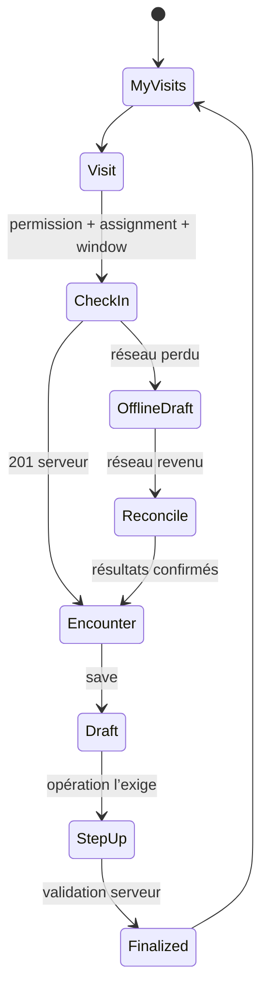
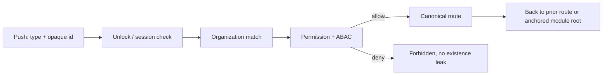

# Parcours utilisateurs de référence

## Convention de retour et d’interruption

Chaque parcours stocke une `originRoute`, l’organisation, les identifiants de ressource et, pour une
écriture, la version serveur. Back revient vers l’origine sans empiler une deuxième instance. Un appel,
un changement d’app ou un verrouillage conserve seulement un brouillon chiffré autorisé. Une perte de
permission ferme les données en mémoire, purge le cache concerné et revient au premier écran autorisé.

## A. RN / RN Case Manager — visite, EVV et encounter

| Élément | Spécification |
|---|---|
| Déclencheur | Début de tournée ou shortcut My Visits. |
| Objectif mental | « Quelle visite dois-je faire maintenant et que reste-t-il à documenter ? » |
| Information attendue | horaire, patient, lieu, statut, alertes, assignation, tâches obligatoires |
| Écrans | Sign in → org → My Visits → Visit Detail → Patient Workspace → EVV → Encounter Composer |
| Action prioritaire | check-in/out puis enregistrer/finaliser le brouillon encounter |
| Réussite | capture EVV acceptée et état relu ; encounter finalisé selon validation serveur |
| Back | Encounter → Patient/Visit → My Visits, sans perdre le filtre/date |

- Échec : 403 = assignation/permission changée ; 409 = afficher conflit et version courante ; erreur
  GPS = choix métier permis par le serveur, jamais faux check-in.
- Offline : le batch `/api/v1/evv/offline-sync` peut réussir partiellement après les prévalidations.
  Le client conserve chaque événement jusqu’à un accusé individuel prouvé et présente la réconciliation.
- Interruption : draft chiffré par `orgId/userId/encounterId`; reprise après foreground/step-up.

## B. Physician / Hospice Physician — signature

| Élément | Spécification |
|---|---|
| Déclencheur | badge de tâche, Orders inbox ou Cosign Queue |
| Objectif mental | « Puis-je signer ceci avec assez de contexte et de certitude ? » |
| Information attendue | patient, document/order, auteur, version, preuves, validations, échéance |
| Écrans | Queue → Detail → Patient context → Review → Step-up → Confirmation → Queue |
| Action prioritaire | signer/cosigner la version affichée |
| Réussite | transition serveur confirmée, version/signature et horodatage visibles |
| Back | Review → Detail → queue avec position et filtres conservés |

- Échec : step-up annulé revient au review sans signer ; 409 recharge la version et exige une nouvelle
  revue ; 422 montre les validations serveur près des champs concernés.
- Offline : lecture éventuellement mise en cache selon politique, mais signature désactivée. Aucun succès
  local ni retry automatique d’un POST ambigu.
- Permissions : `orders.read`, clé de signature/cosign et ABAC applicables ; le label physician ne suffit pas.

## C. Chaplain ou MSW — plan disciplinaire et documentation

| Élément | Spécification |
|---|---|
| Déclencheur | My Visits, caseload patient ou message clinique |
| Objectif mental | « Que dois-je accomplir pour ce patient dans ma discipline ? » |
| Information attendue | résumé patient, objectifs/plan liés à la discipline, dernière note, tâches |
| Écrans | Visits/Patients → Patient Workspace → Plans → discipline plan → documentation |
| Action prioritaire | enregistrer la note/évolution et mettre à jour le plan si autorisé |
| Réussite | save serveur + version relue ; tâche reflétée comme terminée si le backend le fait |
| Back | documentation → plan → patient → liste d’origine |

- Échec/conflit : conserver le draft, afficher version serveur et demander résolution explicite.
- Offline/interruption : draft chiffré ; aucune donnée dans AsyncStorage, clipboard ou logs.
- Permissions : section et action sont filtrées séparément. Un accès patient ne donne pas le droit
  d’auteur M15.

## D. Intake / Admissions — referral vers admission

| Élément | Spécification |
|---|---|
| Déclencheur | nouvelle referral ou inbox |
| Objectif mental | « Le dossier est-il complet, sans doublon, et prêt pour une admission sûre ? » |
| Information attendue | source, patient candidat, documents, éligibilité, doublons, blockers |
| Écrans | Referral Inbox → Referral Review → New Admission workflow → validation → Admission Detail |
| Action prioritaire | résoudre les blockers puis créer/activer selon contrats existants |
| Réussite | identifiant admission serveur et retour liste mis à jour |
| Back | workflow → referral review ; après succès → admissions/referrals avec item mis à jour |

- `New Referral` et `New Admission` sont des workflows, pas des tabs.
- Échec : hard duplicate 409 bloque et propose la résolution autorisée ; soft review reste explicite ;
  upload/extraction externe affiche son état réel.
- Offline : lecture cache bornée possible ; création/activation non présentée comme accomplie hors ligne.
- Permissions : `referral.read/create`, `admission.read/create` et ABAC intake/admission selon étape.

## E. Scheduling — assigner une visite

| Élément | Spécification |
|---|---|
| Déclencheur | Calendar, proposal ou besoin de réassignation |
| Objectif mental | « Quel membre éligible peut assurer cette visite sans conflit ? » |
| Information attendue | créneau, patient/lieu, discipline, credentials, PTO, charge et conflits |
| Écrans | Calendar → Visit/Proposal → Eligible clinicians → Confirm → refreshed calendar |
| Action prioritaire | assigner/publier/réassigner avec motif si requis |
| Réussite | transition serveur et calendrier relu ; assignee affiché |
| Back | détail → calendrier au même jour/semaine et même scroll |

- Utiliser `/api/v1/scheduling/eligible-clinicians`; la liste est indicative, la mutation réapplique
  RBAC/ABAC et règles métier.
- Conflit : un overlap doit apparaître comme conflit métier. Le commentaire actuel de `screens.ts`
  signale qu’un `23P01` peut encore devenir 500 : **Backend gap critique** avant une UX fiable.
- Offline : pas d’assignation locale ; draft de filtres non sensible seulement.

## F. Admin — état opérationnel vers gestion

| Élément | Spécification |
|---|---|
| Déclencheur | Home/Reports ou alerte opérationnelle |
| Objectif mental | « Où est le problème et quelle action suis-je autorisé à prendre ? » |
| Information attendue | KPIs, admissions, patients, users, incidents, état système |
| Écrans | Home → domaine → list/detail → workflow permissionné → Home/list |
| Action prioritaire | corriger une exception précise, jamais naviguer dans une copie exhaustive du web |
| Réussite | mutation confirmée et KPI/liste rafraîchi |
| Back | détail → liste → Home avec filtres conservés |

- Les actions member/role respectent l’anti-escalation serveur.
- Les outils plateforme `apps/admin` ne sont pas portés ici ; les écrans staff/admin réellement montés
  dans `apps/web` restent dans le catalogue mobile P3.
- Offline : lecture clairement datée seulement ; gestion utilisateurs/permissions désactivée.

## G. Notification ou deep link transversal

| Élément | Spécification |
|---|---|
| Déclencheur | push sans PHI, lien universel/app link ou lien interne |
| Objectif mental | « Quel événement requiert mon attention et puis-je y accéder ? » |
| Information attendue | catégorie générique avant unlock ; contexte détaillé après auth/permission |
| Écrans | OS notification → Root guard → Auth/org si nécessaire → canonical target → origin |
| Action prioritaire | ouvrir la ressource, puis action contextuelle autorisée |
| Réussite | ressource à jour affichée ; notification marquée lue seulement selon contrat confirmé |
| Back | session existante : écran précédent ; cold start : racine du module/preset |

- Organisation différente : ne jamais changer `organizationId` localement. Demander une nouvelle session
  ou expliquer que la ressource appartient à une autre organisation.
- Ressource supprimée/inaccessible : état 404/forbidden uniforme selon le backend.
- Offline : conserver le deep link opaque en mémoire/stockage non-PHI à courte durée, puis réévaluer les
  droits au retour réseau.

