# Module 1 — Foundation Specification

> **Authority note:** This spec is an **implementation proposal** (repo authority rule): [`docs/architecture/`](../architecture/) and the ratified ADRs in [`docs/adr/`](../adr/) win on conflict, and the code plus [`docs/BUSINESS_LOGIC.md`](../BUSINESS_LOGIC.md) are ground truth for as-built behavior. Mechanism choices named here may be superseded — see ADR-0036…0040 and ADR-0030/0032/0035 for the recorded divergences (outbox not Socket.IO, TypeScript not Python sidecars, app-layer AES-256-GCM not pgcrypto, pure transition tables not XState, hand-rolled HTTP hardening not `@fastify/*`, Vite + react-router not TanStack Start).


**Module ID:** 1
**Phase:** 1 (foundation — prerequisite for everything)
**Owns (per manifest codePaths):** `apps/backend/src/bootstrap` (server, seam registry, request context, Pino, OTel, error envelope), `packages/db` (foundation tables + schema + audit trigger generator), `packages/shared` (outbox dispatcher, idempotency middleware), `packages/tenancy` (`withOrgContext` + RLS policy generator), `packages/types` (seam interface types).
**Depends on:** none
**Consumed by:** all other 39 modules
**Spec status:** Re-locked v0.5 (Phase-1 audit remediation; supersedes Locked v0.4)

> **`packages/foundation` is banned (ADR-0005 D3 / M01-F01).** This spec's v0.4 text repeatedly
> referenced an invented `packages/foundation` package (in neither the manifest nor architecture
> §4). **Everywhere a v0.4 passage says `packages/foundation/<area>`, read it as the re-homed
> package below; the manifest codePaths above are authoritative.**
>
> | v0.4 `packages/foundation/...` | Re-homed to |
> |---|---|
> | outbox publish/dispatcher, idempotency | `packages/shared` |
> | RLS generator, `withOrgContext` | `packages/tenancy` |
> | audit helper | `packages/audit` (M4) |
> | seam interface types, policy constants, error codes | `packages/types` |
> | org-settings registry (§3.15), CMSR registry (§3.16, D7), outbox catalog (§3.17) | `packages/db` (M1-owned schema-adjacent) |
> | `events-by-mN.ts` / per-module contribution files | each module's own codePath, aggregated at boot |
>
> Seam interface **types** live in `packages/types`; implementations register at boot (§3.18).
> The CI `arch:fitness` boundary check (which v0.4's pipeline omitted — M01-F08) rejects any real
> `packages/foundation` import.

## Changelog
- **v0.5 (Phase-1 audit remediation, 2026-06-11)** — Re-lock against `audit/AUDIT_M01_M04.md` and the Phase-0 ADRs. Resolves the M01 BLOCKER and the named foundation deliverables; see the **Remediation Changelog** section directly below for the per-finding disposition.
- **v0.4 (Consolidated)** — Rolls the v0.2 base and v0.3 delta into a single self-contained specification. No scope change; no decision reversals.
- **v0.3** — Three pieces of consolidation work driven by patterns that recurred across the v0.3 owner-module specs and the M29 implementation track:
  - **Open Questions → Resolved Decisions.** The v0.2 "Open Questions" section listed 5 items pending ADR. By the time M3 v0.3 / M2 v0.3 / etc. shipped, all 5 had been decided in-flight by what got built. They were ratified as **D1–D5** binding decisions, aligning M1's spec format with every other module's lock-grade convention.
  - **Organization-settings collision-guard trigger** — hosting M5 v0.3's request. M5 v0.3 introduced `organization.settings.hl7_internal_mrn_authority` as a tenant-scoped configuration that maps to the HL7 PID-3.4 assigning authority. The platform must prevent two organizations from claiming the same authority code (cross-tenant collision would corrupt MRN namespacing in inbound ADT messages). M1 hosts the trigger as **D6**, since M1 owns the `organization` table.
  - **Cross-Module Schema Request (CMSR) doc shape** — across v0.3 PRs, 7 specs requested schema changes on tables owned by other modules (M29→M4 retention class, M5→M1 trigger, M40→M29 platform-shared read, M3→all-modules seam validation, M11→M1 outbox events, M6→M1 outbox events, M4→M5 patient.deceased_date reads). Each request had ad-hoc shape. **D7** pins a typed registry file at `packages/foundation/src/cross-module-schema-requests/registry.json` + per-request YAML files *(TARGET — never created: no CMSR registry or CI rule exists anywhere in the repo, and `packages/foundation` is banned by ADR-0005 D3; a revived registry would live under `docs/` or `scripts/`)*.
  - **Outbox event catalog formalization** — paired with M4 v0.3's audit action catalog. With 29 outbox events in M11 v0.3 alone (up from M11 v0.2's 24), the platform needs a central registry to enforce the M3 v0.3 D9 "modules own their `mN.` namespace" convention at the event level as well. **D8** introduces `outbox_event_catalog` (platform-shared table) and a boot-validation step in M1's startup sequence.
- **v0.2** — Enhanced feature flag governance: added rollout percentage targeting, tenant/user targeting predicates, kill-switch semantics, migration-flag pattern. Added §3.10.1 (enhanced schema), §4.2.1 (evaluation API), §13 (feature flag governance patterns). Initial lock-grade publication with 5 open questions deferred to ADR.
- **v0.1** — Initial draft

---

## Remediation Changelog — Phase 1 (v0.5, 2026-06-11)

Disposition of every `audit/AUDIT_M01_M04.md` Module-1 finding. Architecture-level rulings cited
as ADR-000N live in `docs/adr/`.

| Finding | Sev | Resolution |
|---|---|---|
| **M01-F01** | BLOCKER | **`packages/foundation` banned** (ADR-0005 D3). Header `Owns:` rewritten to the manifest codePaths; a normative re-home map (header callout) governs every v0.4 `packages/foundation/...` reference; helper-only-table access stays in `packages/db`/`packages/shared`/`packages/audit`. The `arch:fitness` boundary stage (now in the base CI, F08) rejects any real `packages/foundation` import. |
| M01-F02 | MAJOR | `feature_flag_evaluation`, `organization_settings_registry`, `outbox_event_catalog` added to M1 `ownedTables` in `module-manifest.ts`/`.cjs` (closes the ownership-checker enforcement hole). |
| M01-F03 | MAJOR | Compliance retention **6 → 7 years** in all three places (§3.2 enum, §3.11 COMMENT, archive narrative); aligned to M4 D1 / ADR-0004. |
| M01-F04 | MAJOR | **Seam Registry & Boot-Time Validation specified (new §3.18):** `apps/backend/src/bootstrap/seams.ts`, `registerSeam`/`registerEraser`, `REQUIRED_SEAMS` with deny-stub defaults, and `validateSeams()` run after module inits / before `server.listen()`, failing the boot when a PHI data class has no `DataEraser` or a required seam is unregistered. Interface types live in `packages/types`. |
| M01-F05 | MAJOR | **`withPlatformContext` no longer `SET ROLE chartwarden_admin` on the tenant pool** (§3.14): runs against a separately-pooled platform credential, gated by a platform-job allowlist, cross-tenant scope audited at severity=critical. `chartwarden_admin` stays confined to migration-runner/break-glass. |
| M01-F06 | MAJOR | **RLS `OR organization_id IS NULL` blast radius removed** (§3.11): `audit_event` is tenant-scoped read-only for `chartwarden_app` (writes via the audit-writer role); `feature_flag` reads see own+global but per-command write policies keep WITH CHECK free of the NULL branch, so a tenant can never write a global flag/kill-switch. |
| M01-F07 | MAJOR | Org-settings collision trigger made **`SECURITY DEFINER` + `SET search_path`**, backed by a partial `UNIQUE` index per `uniqueAcrossTenants` key; tenant-context collision test added (§3.15). |
| M01-F08 | MAJOR | Base CI pipeline now declares the full ARCH-220 stage order incl. **`arch:fitness` after typecheck/before unit**, Playwright-against-artifacts, SBOM+cosign (§1.1). |
| M01-F09 | MAJOR | **Per-queue retry/backoff/concurrency/DLQ declared** (§4.8.1); outbox dispatcher max-attempts(8)/exponential-backoff/`outbox.dlq`/no-silent-drop; consumer-idempotency promoted to a binding contract (DR-022). |
| M01-F10 | MAJOR | **Security middleware baseline wired** (§4.6.1): helmet/CSP/HSTS, `@fastify/rate-limit` SD-055 tiers (30/600 per min), 10 MB bodyLimit, CORS, CSRF plumbing. |
| M01-F11 | MINOR | `outbox.cleanup` (30 d post-dispatch) added to §4.8; `feature_flag_evaluation` to be monthly-partitioned + retention-classed (register in `partition.rotate`). |
| M01-F12 | MINOR | Outbox publisher must compare `callerModule` to `entry.moduleOwner` and constrain `sud.*` to a registered emitter list; tx threaded through the API (noted for §3.17.3 impl). |
| M01-F13 | MINOR | OTel span attrs use the SD-077 names (`tenant.provider_entity_id`, `tenant.location_id`, `user.role`, `chartwarden.module`, `correlation.id`); Pino redact paths recursive; idempotency keys hashed SHA-256 of (org_id, key, body) per SEC-025. |
| M01-F14 | MINOR | RLS generator home resolved to `packages/tenancy` (ADR-0005/§7.9, M1-owned); stale v0.8/v0.9 doc refs refreshed to v0.12; D1 key-management restated per SEC §4.5/4.6 (no KMS — SOPS/age). |
| M01-F15 | MINOR | STRIDE threat-model section + migration snapshot tests to be added; idempotency middleware gains a pending/lock state (concurrent-duplicate race); `audit()` helper parameterizes `actorKind`. |

**Net:** the M01 BLOCKER is cleared and the foundation-freeze surface (seam bootstrap, RLS,
retention, queues, CI) is corrected. Remaining MINORs are implementation-time items tracked above.

---

## 1. Purpose & Scope

### 1.1 What This Module Does

Module 1 establishes the runtime foundation on which every other ChartWarden module is built. It is the only module with no upstream dependencies and is consumed by all 39 others. It delivers:

- **Monorepo bootstrap** — Turborepo + Bun workspaces, all `apps/*` and `packages/*` skeletons compiling and building
- **Local development environment** — Docker Compose with PostgreSQL 18 + pgvector + pgcrypto, Valkey 8, MinIO, Mailpit, MLflow, and the six Python sidecar containers running on the documented ports (4180-4189 for apps, 5432/6379/9000 for infra)
- **Foundation database schema** — `organization`, `provider_entity`, `location`, `user`, `membership`, `session`, `account`, `verification`, `audit_event` (partitioned), `system_status`, `feature_flag`, `idempotency_key`, `outbox_event` tables with Drizzle TypeScript schema, indexes, foreign keys, and RLS policies
- **RLS policy generator** — utility that emits standard row-level-security policies for any PHI-bearing table given its `organization_id` column
- **Audit log architecture** — append-only partitioned audit log with helper API, retention policy, and partition rotation worker
- **Error envelope contract** — typed error class hierarchy, route handler integration, machine-readable error codes catalog
- **Logging baseline** — Pino with structured fields, PHI scrubbing redact rules, log shipping to Loki
- **OpenTelemetry baseline** — tracer initialization, span attribute standards (org/user/correlation), W3C trace propagation, instrumentation for Fastify + Drizzle + Valkey + undici
- **Health and readiness endpoints** — `/health`, `/ready`, `/version` with dependency checks
- **Better Auth bootstrap** — minimal configuration of Better Auth (auth flows themselves are Module 2's domain, but the auth package skeleton is here)
- **Request context plumbing** — middleware that resolves `RequestContext` per request and sets `app.org_id` / `app.user_id` for RLS
- **Idempotency support** — middleware that handles `Idempotency-Key` headers using Valkey storage
- **Outbox pattern** — `outbox_event` table + dispatcher worker for reliable cross-module event publication
- **Dev seed script** — creates a minimal viable tenant (one Organization, one ProviderEntity, one Location, two Users with memberships, basic feature flags) so subsequent module development has runnable data
- **Base CI pipeline** — GitHub Actions workflow with the full ARCH-220 stage order (M01-F08): lint (Biome incl. `require-explicit-authz`, `require-read-audit`) → typecheck → **`arch:fitness` (`arch:boundaries` + `arch:tables` — module import boundaries, adapter mandate, domain/FHIR direction, helper-only tables, table ownership, no-cycles; the enforcement backbone of the whole architecture, ARCH-221) — runs after typecheck, before unit tests** → unit tests → integration tests (Testcontainers) → RLS isolation tests → build verification → **Playwright against built artifacts** → **SBOM (CycloneDX) + cosign**
- **Pre-commit hooks** — lefthook configuration running Biome and typecheck on staged files
- **Testing scaffolding** — Vitest setup, Testcontainers utilities, RLS isolation test helper, test data factories
- **Cross-module schema governance.** When an owner-module spec (M5, etc.) needs a schema change on a table owned by another module (M1's `organization`, M4's `audit_event`, etc.), the change is documented in a Cross-Module Schema Request (CMSR) registry M1 hosts. The CI checks every spec PR for a matching CMSR entry. This catches the failure mode "M29 needs an enum value on M4 but the M4 owner doesn't know" — the CMSR registry is the platform-team's discoverable surface for these dependencies.
- **Outbox event catalog enforcement.** With ~150+ outbox events across the planned 40 modules, the platform needs a central registry mirroring M4's audit-action catalog approach. M1's startup boot-validates that every event name used in code is registered, that no module crosses another module's `mN.` namespace, and that event payloads conform to their registered TypeBox shape.

### 1.2 What This Module Does Not Do

- **Authentication flows** — sign-up, sign-in, password reset, 2FA enrollment, passkey registration are Module 2's domain. Module 1 only provides the Better Auth package skeleton and database tables Better Auth requires.
- **Role and permission models** — Module 1 establishes the membership table; Module 3 defines roles and ABAC.
- **Tenant onboarding workflow** — Module 1 provides the data model and seed script; Module 34 owns the self-serve onboarding UX.
- **Any clinical or billing logic** — strictly foundation.

M1 doesn't make domain decisions; M1 doesn't store PHI in its own tables (M1 hosts the foundation tables that other modules write to); M1 doesn't authorize (M3 does); M1 doesn't audit (M4 does — M1 ships the helper `audit()` writer).

### 1.3 Regulatory Drivers

| Driver | Requirement met by Module 1 |
|---|---|
| HIPAA §164.312(a)(1) Access Control | RLS enforcement, RequestContext propagation, RBAC table skeleton |
| HIPAA §164.312(b) Audit Controls | `audit_event` table, append-only enforcement, partition retention |
| HIPAA §164.312(c)(1) Integrity | Outbox pattern for exactly-once delivery, idempotency keys, transactional context |
| HIPAA §164.312(d) Person/Entity Authentication | Better Auth bootstrap (Module 2 completes) |
| HIPAA §164.312(e)(1) Transmission Security | TLS everywhere, mTLS internal, secret handling |
| HIPAA §164.308(a)(1)(ii)(D) Information System Activity Review | Audit log query interface (UI in Module 4; data layer in Module 1) |
| 42 CFR §418.104 Clinical Records | Audit trail foundation for clinical record actions |
| 21 CFR Part 11 (not applicable but principles satisfied) | Append-only audit log, user attribution, timestamps |

### 1.4 Competitive Context

Foundation is invisible in competitor demos but determines whether the product is honest. Most legacy hospice EHR vendors built tenancy at the application layer (filter-by-tenant in WHERE clauses), which leaks PHI any time a developer forgets the filter. ChartWarden enforces tenancy at the database via RLS — a defense-in-depth move that no major competitor advertises because they cannot retrofit it. Module 1 makes that real.

---

## 2. Domain Model

### 2.1 Entity-Relationship Diagram

```mermaid
erDiagram
  ORGANIZATION ||--o{ PROVIDER_ENTITY : "owns"
  PROVIDER_ENTITY ||--o{ LOCATION : "operates"
  ORGANIZATION ||--o{ MEMBERSHIP : "has"
  USER ||--o{ MEMBERSHIP : "has"
  USER ||--o{ SESSION : "has"
  USER ||--o{ ACCOUNT : "has"
  USER ||--o{ VERIFICATION : "has (transient)"
  ORGANIZATION ||--o{ AUDIT_EVENT : "scope"
  USER ||--o{ AUDIT_EVENT : "actor"
  ORGANIZATION ||--o{ FEATURE_FLAG : "scoped"
  ORGANIZATION ||--o{ IDEMPOTENCY_KEY : "scoped"
  ORGANIZATION ||--o{ OUTBOX_EVENT : "scoped"

  ORGANIZATION {
    uuid id PK
    text slug "unique"
    text legal_name
    text display_name
    text status "active|suspended|closed"
    jsonb settings
    timestamptz created_at
    timestamptz updated_at
    uuid created_by FK
  }

  PROVIDER_ENTITY {
    uuid id PK
    uuid organization_id FK
    text ccn "CMS Certification Number, unique"
    text legal_name
    text doing_business_as
    text fiscal_intermediary "MAC code, e.g. NGS-J6"
    text npi "Org NPI"
    text tax_id "encrypted"
    text fiscal_year_end "MMDD"
    jsonb addresses
    text status "active|suspended|closed"
    timestamptz created_at
    timestamptz updated_at
  }

  LOCATION {
    uuid id PK
    uuid provider_entity_id FK
    text name
    text address_line1
    text address_line2
    text city
    text state
    text postal_code
    text phone
    text fax
    text timezone "IANA tz"
    text status "active|suspended|closed"
    jsonb service_area "counties or zip ranges"
    timestamptz created_at
    timestamptz updated_at
  }

  USER {
    uuid id PK
    text email "unique, lowercase"
    text email_verified
    text name
    text image
    text status "active|suspended|deactivated"
    timestamptz created_at
    timestamptz updated_at
  }

  MEMBERSHIP {
    uuid id PK
    uuid user_id FK
    uuid organization_id FK
    text status "pending|active|suspended|revoked"
    jsonb default_location_ids "uuid array"
    jsonb default_provider_entity_id
    timestamptz invited_at
    timestamptz accepted_at
    timestamptz revoked_at
    uuid invited_by FK
  }

  SESSION {
    text id PK
    uuid user_id FK
    uuid active_organization_id "nullable"
    text token "hashed"
    timestamptz expires_at
    text ip_address
    text user_agent
    timestamptz created_at
    timestamptz updated_at
  }

  ACCOUNT {
    uuid id PK
    uuid user_id FK
    text provider_id "credential|passkey|google|..."
    text account_id "provider-specific"
    text password "hashed, nullable"
    text access_token "encrypted, nullable"
    timestamptz created_at
    timestamptz updated_at
  }

  VERIFICATION {
    text id PK
    text identifier "email or phone"
    text value "code or token"
    timestamptz expires_at
    timestamptz created_at
  }

  AUDIT_EVENT {
    uuid id PK
    timestamptz created_at "partition key"
    uuid organization_id FK
    uuid actor_user_id FK "nullable for system events"
    text actor_kind "user|system|integration|external_collaborator"
    text actor_role "primary role at time of event"
    text event_type "Module.Action namespaced"
    text resource_kind
    uuid resource_id "nullable for non-resource events"
    text correlation_id
    text request_id
    text trace_id
    text source_ip
    text user_agent
    text outcome "success|failure|denied"
    text severity "info|warn|critical"
    jsonb before "redacted snapshot of prior state, nullable"
    jsonb after "redacted snapshot of new state, nullable"
    jsonb context "additional metadata"
    text retention_class "operational|compliance|legal_hold"
  }

  SYSTEM_STATUS {
    text id PK "system|<component>"
    text status "operational|degraded|outage"
    text headline
    text details
    timestamptz updated_at
    uuid updated_by FK
  }

  FEATURE_FLAG {
    uuid id PK
    uuid organization_id FK "nullable for global"
    text flag_key
    text value_type "bool|string|number|json"
    jsonb value
    text rationale
    timestamptz updated_at
    uuid updated_by FK
  }

  IDEMPOTENCY_KEY {
    uuid id PK
    uuid organization_id FK
    text key
    text request_hash
    text response_status
    jsonb response_body
    timestamptz created_at
    timestamptz expires_at
  }

  OUTBOX_EVENT {
    uuid id PK
    uuid organization_id FK
    text event_type
    text aggregate_kind
    uuid aggregate_id
    jsonb payload
    text status "pending|dispatching|dispatched|failed"
    int attempt_count
    text last_error
    timestamptz created_at
    timestamptz dispatched_at
  }
```



### 2.2 Entity Lifecycle States

**Organization status:**
```
created → active → (optionally suspended) → active OR closed
```
- `active` is the only state allowing operations
- `suspended` blocks all operations except billing/admin access
- `closed` is terminal — read-only access for audit/legal retention period

**ProviderEntity status:**
```
created → active → (optionally suspended) → active OR closed
```
- Mirrors Organization lifecycle
- `closed` ProviderEntity means CCN is no longer in service; historical claims/data retained per 6-yr regulatory minimum

**Location status:**
```
created → active → (optionally suspended) → active OR closed
```
- A Location can be closed while ProviderEntity remains active (location relocation, branch closure)

**User status:**
```
created → active → (optionally suspended) → active OR deactivated
```
- `deactivated` user cannot sign in; all memberships effectively revoked
- We never hard-delete a User row — audit trail integrity requires the FK to remain valid

**Membership status:**
```
pending (invited) → active (accepted) → (optionally suspended) → active OR revoked
```
- A revoked membership preserves the historical association for audit
- Re-invitation creates a new Membership row

### 2.3 Validation Rules

| Entity | Rule | Enforcement |
|---|---|---|
| Organization.slug | lowercase, alphanumeric + hyphen, 3-50 chars, unique, not in reserved list | Application + DB unique constraint |
| ProviderEntity.ccn | 6 digits, valid CMS format, unique across all orgs | Application + DB unique constraint |
| ProviderEntity.npi | 10 digits, Luhn check valid, unique | Application + DB unique constraint |
| Location.timezone | Valid IANA timezone identifier | Application |
| User.email | RFC 5322 valid, lowercase storage, unique | Application + DB unique constraint |
| Membership | A given (user, organization) pair has at most one non-revoked Membership at a time | Partial unique index |
| AuditEvent | created_at must be > 0 and not in the future | DB CHECK constraint |
| AuditEvent | After insert, row is immutable | RLS + role-based GRANT denies UPDATE/DELETE to app role |
| IdempotencyKey | (org_id, key) unique while not expired | Partial unique index |
| OutboxEvent | At most one dispatcher claims an event at a time | SELECT FOR UPDATE SKIP LOCKED |
| Organization.settings | Registered-keys discipline; `uniqueAcrossTenants` keys are unique across all tenants | `validate_organization_settings()` BEFORE INSERT/UPDATE trigger |

### 2.4 Side Effects

| Event | Audit emitted | Alerts triggered |
|---|---|---|
| Organization created | `org.created` with org snapshot | Internal ChartWarden ops |
| ProviderEntity created | `provider_entity.created` | Internal ChartWarden ops |
| Membership invited | `membership.invited` | Invitee (email) + inviter (in-app) |
| Membership accepted | `membership.accepted` | Inviter, org admins |
| User session created | `session.started` | none routine; flagged if anomalous IP/agent |
| User session ended | `session.ended` | none |
| Feature flag changed | `feature_flag.updated` with before/after | Org admins if global |
| System status changed | `system_status.changed` | All tenants if degraded/outage |

---

## 3. Drizzle Schema

### 3.1 Package Layout

```
packages/db/
├── drizzle.config.ts
├── package.json
├── tsconfig.json
├── src/
│   ├── client.ts              # DB connection + helpers
│   ├── context.ts             # withOrgContext, RLS setters
│   ├── rls.ts                 # RLS policy generator
│   ├── audit.ts               # audit helper API
│   ├── outbox.ts              # outbox helper + dispatcher
│   ├── idempotency.ts         # idempotency helper
│   ├── schema/
│   │   ├── index.ts           # re-exports
│   │   ├── organizations.ts
│   │   ├── provider-entities.ts
│   │   ├── locations.ts
│   │   ├── users.ts
│   │   ├── memberships.ts
│   │   ├── sessions.ts
│   │   ├── accounts.ts
│   │   ├── verifications.ts
│   │   ├── audit-events.ts
│   │   ├── system-status.ts
│   │   ├── feature-flags.ts
│   │   ├── idempotency-keys.ts
│   │   └── outbox-events.ts
│   └── enums.ts
└── migrations/
    ├── 0000_foundation_initial.sql
    └── meta/
```

### 3.2 Enums

```typescript
// packages/db/src/enums.ts
import { pgEnum } from 'drizzle-orm/pg-core'

export const organizationStatus = pgEnum('organization_status', [
  'created',
  'active',
  'suspended',
  'closed',
])

export const providerEntityStatus = pgEnum('provider_entity_status', [
  'created',
  'active',
  'suspended',
  'closed',
])

export const locationStatus = pgEnum('location_status', [
  'created',
  'active',
  'suspended',
  'closed',
])

export const userStatus = pgEnum('user_status', [
  'created',
  'active',
  'suspended',
  'deactivated',
])

export const membershipStatus = pgEnum('membership_status', [
  'pending',
  'active',
  'suspended',
  'revoked',
])

export const auditActorKind = pgEnum('audit_actor_kind', [
  'user',
  'system',
  'integration',
  'external_collaborator',
])

export const auditOutcome = pgEnum('audit_outcome', [
  'success',
  'failure',
  'denied',
])

export const auditSeverity = pgEnum('audit_severity', [
  'info',
  'warn',
  'critical',
])

export const auditRetentionClass = pgEnum('audit_retention_class', [
  'operational', // 1 year
  'compliance',  // 7 years default (HIPAA floor 6 — §164.316(b)(2); standardized to 7, ADR-0004 / M4 D1)
  'legal_hold',  // indefinite
])

export const systemStatusValue = pgEnum('system_status_value', [
  'operational',
  'degraded',
  'outage',
])

export const featureFlagValueType = pgEnum('feature_flag_value_type', [
  'bool',
  'string',
  'number',
  'json',
])

export const featureFlagKind = pgEnum('feature_flag_kind', [
  'product',      // long-lived behavior toggle
  'rollout',      // percentage-based gradual rollout
  'kill_switch',  // emergency disable; default-off; bypass cache
  'migration',    // temporary; tied to deployment; auto-expires
])

export const outboxEventStatus = pgEnum('outbox_event_status', [
  'pending',
  'dispatching',
  'dispatched',
  'failed',
])
```

### 3.3 Organizations Schema

```typescript
// packages/db/src/schema/organizations.ts
import { pgTable, text, uuid, timestamp, jsonb, index } from 'drizzle-orm/pg-core'
import { organizationStatus } from '../enums'
import { users } from './users'

export const organizations = pgTable(
  'organization',
  {
    id: uuid('id').primaryKey().defaultRandom(),
    slug: text('slug').notNull().unique(),
    legalName: text('legal_name').notNull(),
    displayName: text('display_name').notNull(),
    status: organizationStatus('status').notNull().default('created'),
    settings: jsonb('settings').notNull().default({}),
    createdAt: timestamp('created_at', { withTimezone: true })
      .notNull()
      .defaultNow(),
    updatedAt: timestamp('updated_at', { withTimezone: true })
      .notNull()
      .defaultNow(),
    createdBy: uuid('created_by').references(() => users.id, {
      onDelete: 'set null',
    }),
  },
  (t) => ({
    statusIdx: index('organization_status_idx').on(t.status),
    createdAtIdx: index('organization_created_at_idx').on(t.createdAt),
  }),
)

export type Organization = typeof organizations.$inferSelect
export type NewOrganization = typeof organizations.$inferInsert
```

### 3.4 Provider Entities Schema

```typescript
// packages/db/src/schema/provider-entities.ts
import {
  pgTable,
  text,
  uuid,
  timestamp,
  jsonb,
  index,
  uniqueIndex,
} from 'drizzle-orm/pg-core'
import { providerEntityStatus } from '../enums'
import { organizations } from './organizations'

export const providerEntities = pgTable(
  'provider_entity',
  {
    id: uuid('id').primaryKey().defaultRandom(),
    organizationId: uuid('organization_id')
      .notNull()
      .references(() => organizations.id, { onDelete: 'restrict' }),
    ccn: text('ccn').notNull(),
    legalName: text('legal_name').notNull(),
    doingBusinessAs: text('doing_business_as'),
    fiscalIntermediary: text('fiscal_intermediary'),
    npi: text('npi').notNull(),
    taxIdEncrypted: text('tax_id_encrypted').notNull(),
    fiscalYearEnd: text('fiscal_year_end').notNull(), // 'MMDD'
    addresses: jsonb('addresses').notNull().default([]),
    status: providerEntityStatus('status').notNull().default('created'),
    createdAt: timestamp('created_at', { withTimezone: true })
      .notNull()
      .defaultNow(),
    updatedAt: timestamp('updated_at', { withTimezone: true })
      .notNull()
      .defaultNow(),
  },
  (t) => ({
    ccnUniqueIdx: uniqueIndex('provider_entity_ccn_idx').on(t.ccn),
    npiUniqueIdx: uniqueIndex('provider_entity_npi_idx').on(t.npi),
    orgIdx: index('provider_entity_org_idx').on(t.organizationId),
  }),
)

export type ProviderEntity = typeof providerEntities.$inferSelect
export type NewProviderEntity = typeof providerEntities.$inferInsert
```

### 3.5 Locations Schema

```typescript
// packages/db/src/schema/locations.ts
import {
  pgTable,
  text,
  uuid,
  timestamp,
  jsonb,
  index,
} from 'drizzle-orm/pg-core'
import { locationStatus } from '../enums'
import { providerEntities } from './provider-entities'

export const locations = pgTable(
  'location',
  {
    id: uuid('id').primaryKey().defaultRandom(),
    providerEntityId: uuid('provider_entity_id')
      .notNull()
      .references(() => providerEntities.id, { onDelete: 'restrict' }),
    name: text('name').notNull(),
    addressLine1: text('address_line1').notNull(),
    addressLine2: text('address_line2'),
    city: text('city').notNull(),
    state: text('state').notNull(),
    postalCode: text('postal_code').notNull(),
    phone: text('phone'),
    fax: text('fax'),
    timezone: text('timezone').notNull(),
    serviceArea: jsonb('service_area').notNull().default([]),
    status: locationStatus('status').notNull().default('created'),
    createdAt: timestamp('created_at', { withTimezone: true })
      .notNull()
      .defaultNow(),
    updatedAt: timestamp('updated_at', { withTimezone: true })
      .notNull()
      .defaultNow(),
  },
  (t) => ({
    providerEntityIdx: index('location_provider_entity_idx').on(
      t.providerEntityId,
    ),
    stateIdx: index('location_state_idx').on(t.state),
  }),
)

export type Location = typeof locations.$inferSelect
export type NewLocation = typeof locations.$inferInsert
```

### 3.6 Users Schema (Better Auth compatible)

```typescript
// packages/db/src/schema/users.ts
import {
  pgTable,
  text,
  uuid,
  timestamp,
  boolean,
  uniqueIndex,
  index,
} from 'drizzle-orm/pg-core'
import { userStatus } from '../enums'

export const users = pgTable(
  'user',
  {
    id: uuid('id').primaryKey().defaultRandom(),
    email: text('email').notNull(),
    emailVerified: boolean('email_verified').notNull().default(false),
    name: text('name'),
    image: text('image'),
    status: userStatus('status').notNull().default('active'),
    createdAt: timestamp('created_at', { withTimezone: true })
      .notNull()
      .defaultNow(),
    updatedAt: timestamp('updated_at', { withTimezone: true })
      .notNull()
      .defaultNow(),
  },
  (t) => ({
    emailUniqueIdx: uniqueIndex('user_email_idx').on(t.email),
    statusIdx: index('user_status_idx').on(t.status),
  }),
)

export type User = typeof users.$inferSelect
export type NewUser = typeof users.$inferInsert
```

### 3.7 Memberships Schema

```typescript
// packages/db/src/schema/memberships.ts
import {
  pgTable,
  text,
  uuid,
  timestamp,
  jsonb,
  index,
  uniqueIndex,
} from 'drizzle-orm/pg-core'
import { sql } from 'drizzle-orm'
import { membershipStatus } from '../enums'
import { users } from './users'
import { organizations } from './organizations'

export const memberships = pgTable(
  'membership',
  {
    id: uuid('id').primaryKey().defaultRandom(),
    userId: uuid('user_id')
      .notNull()
      .references(() => users.id, { onDelete: 'restrict' }),
    organizationId: uuid('organization_id')
      .notNull()
      .references(() => organizations.id, { onDelete: 'restrict' }),
    status: membershipStatus('status').notNull().default('pending'),
    defaultLocationIds: jsonb('default_location_ids').notNull().default([]),
    defaultProviderEntityId: uuid('default_provider_entity_id'),
    invitedAt: timestamp('invited_at', { withTimezone: true })
      .notNull()
      .defaultNow(),
    acceptedAt: timestamp('accepted_at', { withTimezone: true }),
    revokedAt: timestamp('revoked_at', { withTimezone: true }),
    invitedBy: uuid('invited_by').references(() => users.id, {
      onDelete: 'set null',
    }),
  },
  (t) => ({
    userOrgIdx: index('membership_user_org_idx').on(t.userId, t.organizationId),
    // Only one non-revoked membership per (user, org) at a time
    activeUniqueIdx: uniqueIndex('membership_active_unique_idx')
      .on(t.userId, t.organizationId)
      .where(sql`${t.status} != 'revoked'`),
    statusIdx: index('membership_status_idx').on(t.status),
  }),
)

export type Membership = typeof memberships.$inferSelect
export type NewMembership = typeof memberships.$inferInsert
```

### 3.8 Sessions, Accounts, Verifications (Better Auth tables)

```typescript
// packages/db/src/schema/sessions.ts
import { pgTable, text, uuid, timestamp, index } from 'drizzle-orm/pg-core'
import { users } from './users'

export const sessions = pgTable(
  'session',
  {
    id: text('id').primaryKey(),
    userId: uuid('user_id')
      .notNull()
      .references(() => users.id, { onDelete: 'cascade' }),
    activeOrganizationId: uuid('active_organization_id'),
    token: text('token').notNull().unique(),
    expiresAt: timestamp('expires_at', { withTimezone: true }).notNull(),
    ipAddress: text('ip_address'),
    userAgent: text('user_agent'),
    createdAt: timestamp('created_at', { withTimezone: true })
      .notNull()
      .defaultNow(),
    updatedAt: timestamp('updated_at', { withTimezone: true })
      .notNull()
      .defaultNow(),
  },
  (t) => ({
    userIdx: index('session_user_idx').on(t.userId),
    expiresIdx: index('session_expires_idx').on(t.expiresAt),
  }),
)

// packages/db/src/schema/accounts.ts
import { pgTable, text, uuid, timestamp, index } from 'drizzle-orm/pg-core'
import { users } from './users'

export const accounts = pgTable(
  'account',
  {
    id: uuid('id').primaryKey().defaultRandom(),
    userId: uuid('user_id')
      .notNull()
      .references(() => users.id, { onDelete: 'cascade' }),
    providerId: text('provider_id').notNull(),
    accountId: text('account_id').notNull(),
    passwordHash: text('password_hash'),
    accessTokenEncrypted: text('access_token_encrypted'),
    refreshTokenEncrypted: text('refresh_token_encrypted'),
    createdAt: timestamp('created_at', { withTimezone: true })
      .notNull()
      .defaultNow(),
    updatedAt: timestamp('updated_at', { withTimezone: true })
      .notNull()
      .defaultNow(),
  },
  (t) => ({
    userProviderIdx: index('account_user_provider_idx').on(
      t.userId,
      t.providerId,
    ),
  }),
)

// packages/db/src/schema/verifications.ts
import { pgTable, text, timestamp, index } from 'drizzle-orm/pg-core'

export const verifications = pgTable(
  'verification',
  {
    id: text('id').primaryKey(),
    identifier: text('identifier').notNull(),
    value: text('value').notNull(),
    expiresAt: timestamp('expires_at', { withTimezone: true }).notNull(),
    createdAt: timestamp('created_at', { withTimezone: true })
      .notNull()
      .defaultNow(),
  },
  (t) => ({
    identifierIdx: index('verification_identifier_idx').on(t.identifier),
    expiresIdx: index('verification_expires_idx').on(t.expiresAt),
  }),
)
```

### 3.9 Audit Event Schema (Partitioned)

```typescript
// packages/db/src/schema/audit-events.ts
import {
  pgTable,
  text,
  uuid,
  timestamp,
  jsonb,
  index,
} from 'drizzle-orm/pg-core'
import {
  auditActorKind,
  auditOutcome,
  auditSeverity,
  auditRetentionClass,
} from '../enums'
import { organizations } from './organizations'
import { users } from './users'

/**
 * audit_event is RANGE partitioned on created_at, monthly.
 * Drizzle does not generate partition DDL — see the migration file
 * 0000_foundation_initial.sql for actual partition creation.
 */
export const auditEvents = pgTable(
  'audit_event',
  {
    id: uuid('id').notNull().defaultRandom(),
    createdAt: timestamp('created_at', { withTimezone: true })
      .notNull()
      .defaultNow(),
    organizationId: uuid('organization_id').references(
      () => organizations.id,
      { onDelete: 'restrict' },
    ),
    actorUserId: uuid('actor_user_id').references(() => users.id, {
      onDelete: 'set null',
    }),
    actorKind: auditActorKind('actor_kind').notNull(),
    actorRole: text('actor_role'),
    eventType: text('event_type').notNull(),
    resourceKind: text('resource_kind').notNull(),
    resourceId: uuid('resource_id'),
    correlationId: text('correlation_id').notNull(),
    requestId: text('request_id'),
    traceId: text('trace_id'),
    sourceIp: text('source_ip'),
    userAgent: text('user_agent'),
    outcome: auditOutcome('outcome').notNull(),
    severity: auditSeverity('severity').notNull().default('info'),
    before: jsonb('before'),
    after: jsonb('after'),
    context: jsonb('context').notNull().default({}),
    retentionClass: auditRetentionClass('retention_class')
      .notNull()
      .default('compliance'),
  },
  (t) => ({
    orgCreatedIdx: index('audit_event_org_created_idx').on(
      t.organizationId,
      t.createdAt,
    ),
    eventTypeCreatedIdx: index('audit_event_event_type_created_idx').on(
      t.eventType,
      t.createdAt,
    ),
    actorUserCreatedIdx: index('audit_event_actor_user_created_idx').on(
      t.actorUserId,
      t.createdAt,
    ),
    resourceIdx: index('audit_event_resource_idx').on(
      t.resourceKind,
      t.resourceId,
    ),
    correlationIdx: index('audit_event_correlation_idx').on(t.correlationId),
  }),
)
```

### 3.10 System Status, Feature Flags, Idempotency, Outbox

```typescript
// packages/db/src/schema/system-status.ts
import { pgTable, text, uuid, timestamp } from 'drizzle-orm/pg-core'
import { systemStatusValue } from '../enums'
import { users } from './users'

export const systemStatus = pgTable('system_status', {
  id: text('id').primaryKey(), // 'system' or '<component>' e.g. 'dosespot'
  status: systemStatusValue('status').notNull().default('operational'),
  headline: text('headline'),
  details: text('details'),
  updatedAt: timestamp('updated_at', { withTimezone: true })
    .notNull()
    .defaultNow(),
  updatedBy: uuid('updated_by').references(() => users.id),
})

// packages/db/src/schema/feature-flags.ts
import {
  pgTable,
  text,
  uuid,
  timestamp,
  jsonb,
  integer,
  boolean,
  uniqueIndex,
  index,
} from 'drizzle-orm/pg-core'
import { featureFlagValueType, featureFlagKind } from '../enums'
import { organizations } from './organizations'
import { users } from './users'

/**
 * Feature flags support four governance patterns:
 * - 'product' — long-lived behavior toggle (e.g. ai.hearthnote_layer2_enabled)
 * - 'rollout' — percentage-based rollout (e.g. ui.new_dashboard with rollout_percent)
 * - 'kill_switch' — emergency disable; default-off semantics; bypass cache (e.g. ai.copilot_kill)
 * - 'migration' — temporary flag tied to a deployment; auto-expires (e.g. db.use_new_encounter_table)
 *
 * Targeting predicates allow flag value to vary by tenant role,
 * specific users, specific locations, or specific ProviderEntities.
 */
export const featureFlags = pgTable(
  'feature_flag',
  {
    id: uuid('id').primaryKey().defaultRandom(),
    organizationId: uuid('organization_id').references(() => organizations.id, {
      onDelete: 'cascade',
    }), // null = platform-global flag
    flagKey: text('flag_key').notNull(),
    flagKind: featureFlagKind('flag_kind').notNull().default('product'),
    valueType: featureFlagValueType('value_type').notNull(),
    value: jsonb('value').notNull(), // default value when no targeting matches
    // Rollout: percentage of users (or tenants if global) who get 'true' value
    // Bucketed deterministically by hash of (flagKey, targetingKey) to ensure
    // a given user/tenant consistently sees the same value across requests.
    rolloutPercent: integer('rollout_percent'),
    // Targeting predicates (evaluated in order; first match wins)
    targeting: jsonb('targeting').notNull().default([]),
    // Kill switch: when true, flag returns 'false' regardless of other config
    // and bypasses any caching. Used for emergency disables.
    killSwitchActive: boolean('kill_switch_active').notNull().default(false),
    // Migration flags: expiration date after which flag is no-op (returns default)
    // Prevents migration flags from becoming permanent technical debt.
    expiresAt: timestamp('expires_at', { withTimezone: true }),
    rationale: text('rationale'),
    createdBy: uuid('created_by').references(() => users.id, {
      onDelete: 'set null',
    }),
    createdAt: timestamp('created_at', { withTimezone: true })
      .notNull()
      .defaultNow(),
    updatedAt: timestamp('updated_at', { withTimezone: true })
      .notNull()
      .defaultNow(),
    updatedBy: uuid('updated_by').references(() => users.id, {
      onDelete: 'set null',
    }),
  },
  (t) => ({
    keyOrgUniqueIdx: uniqueIndex('feature_flag_key_org_idx').on(
      t.flagKey,
      t.organizationId,
    ),
    kindIdx: index('feature_flag_kind_idx').on(t.flagKind),
    expiresIdx: index('feature_flag_expires_idx').on(t.expiresAt),
  }),
)

/**
 * Feature flag evaluation history — audit trail of every evaluation
 * for kill-switched, rollout, and migration flags (not product flags
 * which would flood the table).
 */
export const featureFlagEvaluations = pgTable(
  'feature_flag_evaluation',
  {
    id: uuid('id').primaryKey().defaultRandom(),
    flagId: uuid('flag_id')
      .notNull()
      .references(() => featureFlags.id, { onDelete: 'cascade' }),
    organizationId: uuid('organization_id'),
    userId: uuid('user_id'),
    evaluatedValue: jsonb('evaluated_value').notNull(),
    targetingMatched: text('targeting_matched'), // which targeting rule matched, if any
    evaluatedAt: timestamp('evaluated_at', { withTimezone: true })
      .notNull()
      .defaultNow(),
  },
  (t) => ({
    flagEvaluatedIdx: index('feature_flag_eval_flag_idx').on(
      t.flagId,
      t.evaluatedAt,
    ),
  }),
)

// packages/db/src/schema/idempotency-keys.ts
import {
  pgTable,
  text,
  uuid,
  timestamp,
  jsonb,
  index,
  uniqueIndex,
} from 'drizzle-orm/pg-core'
import { sql } from 'drizzle-orm'
import { organizations } from './organizations'

export const idempotencyKeys = pgTable(
  'idempotency_key',
  {
    id: uuid('id').primaryKey().defaultRandom(),
    organizationId: uuid('organization_id')
      .notNull()
      .references(() => organizations.id, { onDelete: 'cascade' }),
    key: text('key').notNull(),
    requestHash: text('request_hash').notNull(),
    responseStatus: text('response_status').notNull(),
    responseBody: jsonb('response_body').notNull(),
    createdAt: timestamp('created_at', { withTimezone: true })
      .notNull()
      .defaultNow(),
    expiresAt: timestamp('expires_at', { withTimezone: true }).notNull(),
  },
  (t) => ({
    orgKeyUniqueIdx: uniqueIndex('idempotency_org_key_idx').on(
      t.organizationId,
      t.key,
    ),
    expiresIdx: index('idempotency_expires_idx').on(t.expiresAt),
  }),
)

// packages/db/src/schema/outbox-events.ts
import {
  pgTable,
  text,
  uuid,
  timestamp,
  jsonb,
  integer,
  index,
} from 'drizzle-orm/pg-core'
import { outboxEventStatus } from '../enums'
import { organizations } from './organizations'

export const outboxEvents = pgTable(
  'outbox_event',
  {
    id: uuid('id').primaryKey().defaultRandom(),
    organizationId: uuid('organization_id')
      .notNull()
      .references(() => organizations.id, { onDelete: 'cascade' }),
    eventType: text('event_type').notNull(),
    aggregateKind: text('aggregate_kind').notNull(),
    aggregateId: uuid('aggregate_id').notNull(),
    payload: jsonb('payload').notNull(),
    status: outboxEventStatus('status').notNull().default('pending'),
    attemptCount: integer('attempt_count').notNull().default(0),
    lastError: text('last_error'),
    createdAt: timestamp('created_at', { withTimezone: true })
      .notNull()
      .defaultNow(),
    dispatchedAt: timestamp('dispatched_at', { withTimezone: true }),
  },
  (t) => ({
    statusCreatedIdx: index('outbox_status_created_idx').on(
      t.status,
      t.createdAt,
    ),
    orgIdx: index('outbox_org_idx').on(t.organizationId),
  }),
)
```

### 3.11 Initial Migration with RLS, Partitioning, and Roles

```sql
-- packages/db/migrations/0000_foundation_initial.sql

-- Extensions
CREATE EXTENSION IF NOT EXISTS "uuid-ossp";
CREATE EXTENSION IF NOT EXISTS "pgcrypto";
CREATE EXTENSION IF NOT EXISTS "vector";

-- Application role (used by backend connections via PgBouncer)
CREATE ROLE chartwarden_app NOLOGIN;
GRANT USAGE ON SCHEMA public TO chartwarden_app;

-- Admin role (used only for migrations and emergency ops)
CREATE ROLE chartwarden_admin NOLOGIN;
GRANT ALL ON SCHEMA public TO chartwarden_admin;

-- Read-only role (for read replicas / reporting)
CREATE ROLE chartwarden_readonly NOLOGIN;
GRANT USAGE ON SCHEMA public TO chartwarden_readonly;

-- (Enums and table DDL would come here via Drizzle generation)

-- Convert audit_event to partitioned table
-- (Drizzle generates a plain table; we DROP and recreate partitioned)
DROP TABLE IF EXISTS audit_event;

CREATE TABLE audit_event (
  id UUID NOT NULL DEFAULT gen_random_uuid(),
  created_at TIMESTAMPTZ NOT NULL DEFAULT NOW(),
  organization_id UUID,
  actor_user_id UUID,
  actor_kind audit_actor_kind NOT NULL,
  actor_role TEXT,
  event_type TEXT NOT NULL,
  resource_kind TEXT NOT NULL,
  resource_id UUID,
  correlation_id TEXT NOT NULL,
  request_id TEXT,
  trace_id TEXT,
  source_ip TEXT,
  user_agent TEXT,
  outcome audit_outcome NOT NULL,
  severity audit_severity NOT NULL DEFAULT 'info',
  before JSONB,
  after JSONB,
  context JSONB NOT NULL DEFAULT '{}'::jsonb,
  retention_class audit_retention_class NOT NULL DEFAULT 'compliance',
  PRIMARY KEY (id, created_at)
) PARTITION BY RANGE (created_at);

-- Initial partitions: current month and next month
-- Subsequent partitions created by partition rotation worker
CREATE TABLE audit_event_default PARTITION OF audit_event DEFAULT;

-- Function to create monthly partitions
CREATE OR REPLACE FUNCTION create_audit_partition(start_date DATE)
RETURNS VOID AS $$
DECLARE
  partition_name TEXT;
  end_date DATE;
BEGIN
  partition_name := 'audit_event_' || to_char(start_date, 'YYYY_MM');
  end_date := start_date + INTERVAL '1 month';
  EXECUTE format(
    'CREATE TABLE IF NOT EXISTS %I PARTITION OF audit_event FOR VALUES FROM (%L) TO (%L)',
    partition_name, start_date, end_date
  );
END;
$$ LANGUAGE plpgsql;

-- Create partitions for current + next 3 months
SELECT create_audit_partition(date_trunc('month', NOW())::date);
SELECT create_audit_partition((date_trunc('month', NOW()) + INTERVAL '1 month')::date);
SELECT create_audit_partition((date_trunc('month', NOW()) + INTERVAL '2 month')::date);
SELECT create_audit_partition((date_trunc('month', NOW()) + INTERVAL '3 month')::date);

-- Indexes on audit_event (apply per partition automatically)
CREATE INDEX audit_event_org_created_idx ON audit_event (organization_id, created_at);
CREATE INDEX audit_event_event_type_created_idx ON audit_event (event_type, created_at);
CREATE INDEX audit_event_actor_user_created_idx ON audit_event (actor_user_id, created_at);
CREATE INDEX audit_event_resource_idx ON audit_event (resource_kind, resource_id);
CREATE INDEX audit_event_correlation_idx ON audit_event (correlation_id);

-- Grants
GRANT INSERT, SELECT ON audit_event TO chartwarden_app;
-- Critically: no UPDATE, no DELETE granted to chartwarden_app on audit_event
GRANT ALL ON audit_event TO chartwarden_admin;

GRANT INSERT, SELECT, UPDATE, DELETE ON
  organization, provider_entity, location, "user", membership, session, account, verification,
  system_status, feature_flag, idempotency_key, outbox_event
TO chartwarden_app;

-- Enable RLS on all tenant-scoped tables
ALTER TABLE organization ENABLE ROW LEVEL SECURITY;
ALTER TABLE provider_entity ENABLE ROW LEVEL SECURITY;
ALTER TABLE location ENABLE ROW LEVEL SECURITY;
ALTER TABLE membership ENABLE ROW LEVEL SECURITY;
ALTER TABLE audit_event ENABLE ROW LEVEL SECURITY;
ALTER TABLE feature_flag ENABLE ROW LEVEL SECURITY;
ALTER TABLE idempotency_key ENABLE ROW LEVEL SECURITY;
ALTER TABLE outbox_event ENABLE ROW LEVEL SECURITY;

-- RLS policies (use current_setting('app.org_id'))

CREATE POLICY organization_self ON organization
  FOR ALL TO chartwarden_app
  USING (id = current_setting('app.org_id', true)::uuid)
  WITH CHECK (id = current_setting('app.org_id', true)::uuid);

CREATE POLICY provider_entity_org ON provider_entity
  FOR ALL TO chartwarden_app
  USING (organization_id = current_setting('app.org_id', true)::uuid)
  WITH CHECK (organization_id = current_setting('app.org_id', true)::uuid);

CREATE POLICY location_org ON location
  FOR ALL TO chartwarden_app
  USING (
    provider_entity_id IN (
      SELECT id FROM provider_entity
      WHERE organization_id = current_setting('app.org_id', true)::uuid
    )
  );

CREATE POLICY membership_org ON membership
  FOR ALL TO chartwarden_app
  USING (organization_id = current_setting('app.org_id', true)::uuid);

-- audit_event (M01-F06b fix): tenants may READ only their own org's rows. The prior
-- `FOR ALL … OR organization_id IS NULL` let any tenant SELECT platform-wide (org-NULL)
-- audit rows AND INSERT org-NULL rows — a cross-tenant blast radius if the RBAC layer alone
-- failed (SEC-035). Reads are scoped to the tenant; platform-wide (org-NULL) rows are visible
-- only through the platform context. INSERTs come from the SECURITY DEFINER audit-writer role
-- (chartwarden_audit_writer — its INSERT policy is defined in M4's migration, M04-F06), never from
-- chartwarden_app: there is no FOR ALL / WITH CHECK here, so chartwarden_app cannot write audit_event.
CREATE POLICY audit_event_org_read ON audit_event
  FOR SELECT TO chartwarden_app
  USING (organization_id = current_setting('app.org_id', true)::uuid);

-- feature_flag (M01-F06a fix): tenants may READ their own org's flags and GLOBAL (org-NULL)
-- flags, but may only WRITE org-scoped flags. Per-command policies keep the WITH CHECK free of
-- the NULL branch, so a tenant-context write can never create or mutate a GLOBAL flag or
-- kill-switch. Global flags are managed only through the platform context.
CREATE POLICY feature_flag_org_read ON feature_flag
  FOR SELECT TO chartwarden_app
  USING (
    organization_id = current_setting('app.org_id', true)::uuid
    OR organization_id IS NULL
  );
CREATE POLICY feature_flag_org_insert ON feature_flag
  FOR INSERT TO chartwarden_app
  WITH CHECK (organization_id = current_setting('app.org_id', true)::uuid);
CREATE POLICY feature_flag_org_update ON feature_flag
  FOR UPDATE TO chartwarden_app
  USING (organization_id = current_setting('app.org_id', true)::uuid)
  WITH CHECK (organization_id = current_setting('app.org_id', true)::uuid);
CREATE POLICY feature_flag_org_delete ON feature_flag
  FOR DELETE TO chartwarden_app
  USING (organization_id = current_setting('app.org_id', true)::uuid);

CREATE POLICY idempotency_key_org ON idempotency_key
  FOR ALL TO chartwarden_app
  USING (organization_id = current_setting('app.org_id', true)::uuid);

CREATE POLICY outbox_event_org ON outbox_event
  FOR ALL TO chartwarden_app
  USING (organization_id = current_setting('app.org_id', true)::uuid);

-- Users, sessions, accounts, verifications are NOT RLS'd by org —
-- a user can belong to multiple orgs; org context applied at app layer

-- CHECK constraints
ALTER TABLE audit_event
  ADD CONSTRAINT audit_event_created_at_check
  CHECK (created_at > '2020-01-01' AND created_at < NOW() + INTERVAL '1 day');

-- Comments for documentation
COMMENT ON TABLE audit_event IS 'Append-only audit trail. INSERT and SELECT only via chartwarden_app role; no UPDATE/DELETE granted.';
COMMENT ON COLUMN audit_event.retention_class IS 'Drives partition retention: operational=1yr, compliance=7yr (HIPAA floor 6, ADR-0004), legal_hold=indefinite';
```

### 3.12 Organization-Settings and Outbox-Catalog Migration

Migration `0036_m1_v03_organization_settings_and_outbox_catalog.sql` adds the organization-settings collision-guard trigger (Decision D6), the platform-shared `organization_settings_registry` table, and the `outbox_event_catalog` table (Decision D8).

```sql
-- Migration 0036_m1_v03_organization_settings_and_outbox_catalog.sql

-- Phase A: organization-settings validator function + trigger (D6)

CREATE OR REPLACE FUNCTION validate_organization_settings()
RETURNS trigger AS $$
DECLARE
  registry_entry JSONB;
  setting_key TEXT;
  setting_value TEXT;
  collision_id UUID;
BEGIN
  -- For each top-level key in NEW.settings, look up its registry entry
  -- The registry is in a settings table that boots from foundation code at startup.
  FOR setting_key, setting_value IN
    SELECT * FROM jsonb_each_text(NEW.settings)
  LOOP
    SELECT registry_entry_json INTO registry_entry
      FROM organization_settings_registry
     WHERE settings_key = setting_key
     LIMIT 1;

    IF registry_entry IS NULL THEN
      -- Unknown key — permitted (additive principle: tenants may stash arbitrary
      -- non-registered keys for their own use). A later revision may tighten to "registered keys only."
      CONTINUE;
    END IF;

    -- Check uniqueAcrossTenants
    IF (registry_entry->>'uniqueAcrossTenants')::boolean = TRUE THEN
      SELECT id INTO collision_id
        FROM organization
       WHERE settings->>setting_key = setting_value
         AND id != NEW.id
       LIMIT 1;

      IF collision_id IS NOT NULL THEN
        RAISE EXCEPTION
          'organization_settings_collision: % value already claimed by organization %',
          setting_key, collision_id
          USING ERRCODE = '23505';                   -- unique_violation
      END IF;
    END IF;

    -- Future: typed schema validation (the registry holds a TypeBox shape;
    -- a later revision will add a check that calls a TypeBox-eval function against the value)
  END LOOP;

  RETURN NEW;
END;
$$ LANGUAGE plpgsql;

CREATE TRIGGER trg_validate_organization_settings
  BEFORE INSERT OR UPDATE OF settings ON organization
  FOR EACH ROW
  EXECUTE FUNCTION validate_organization_settings();

-- Phase B: organization_settings_registry table (platform-shared; boot-populated)

CREATE TABLE organization_settings_registry (
  settings_key TEXT PRIMARY KEY,
  registered_by_module TEXT NOT NULL,                    -- 'm5', etc.
  description TEXT NOT NULL,
  registry_entry_json JSONB NOT NULL,                    -- the full entry: { uniqueAcrossTenants, typeBoxSchema, defaultValue, ... }
  registered_at TIMESTAMPTZ NOT NULL DEFAULT NOW()
);

-- Seed (known entries from M5's hl7_internal_mrn_authority registration)
INSERT INTO organization_settings_registry (settings_key, registered_by_module, description, registry_entry_json) VALUES
  (
    'hl7_internal_mrn_authority', 'm5',
    'The HL7 v2 PID-3.4 assigning-authority code that identifies this organization as the source of MRNs in outbound HL7 messages',
    '{"uniqueAcrossTenants": true, "typeBoxSchema": {"type": "string", "minLength": 1, "maxLength": 64}, "defaultValue": null, "required": false}'::jsonb
  );

CREATE INDEX idx_organization_settings_registry_module
  ON organization_settings_registry (registered_by_module);

-- Phase C: outbox_event_catalog table (D8)

CREATE TABLE outbox_event_catalog (
  event_name TEXT PRIMARY KEY,
  module_owner TEXT NOT NULL,                            -- 'mN' or 'system'
  description TEXT NOT NULL,
  payload_schema JSONB NOT NULL,                         -- TypeBox schema
  declared_consumers TEXT[] NOT NULL DEFAULT '{}'::text[],
  is_outbox_only BOOLEAN NOT NULL DEFAULT TRUE,
  registered_at TIMESTAMPTZ NOT NULL DEFAULT NOW()
);

CREATE INDEX idx_outbox_event_catalog_module ON outbox_event_catalog (module_owner);

-- Phase D: optional indexes on organization.settings for known unique-keys
-- (Allows the trigger's collision check to use an index scan)

CREATE INDEX idx_organization_settings_hl7_internal_mrn_authority
  ON organization ((settings->>'hl7_internal_mrn_authority'))
  WHERE settings ? 'hl7_internal_mrn_authority';
```

The corresponding Drizzle schema for the two new platform-shared tables:

```ts
// packages/db/src/schema/foundation/organization-settings-registry.ts (new)
export const organizationSettingsRegistry = pgTable('organization_settings_registry', {
  settingsKey: text('settings_key').primaryKey(),
  registeredByModule: text('registered_by_module').notNull(),
  description: text('description').notNull(),
  registryEntryJson: jsonb('registry_entry_json').notNull(),
  registeredAt: timestamp('registered_at').notNull().defaultNow(),
})

// packages/db/src/schema/foundation/outbox-event-catalog.ts (new)
export const outboxEventCatalog = pgTable('outbox_event_catalog', {
  eventName: text('event_name').primaryKey(),
  moduleOwner: text('module_owner').notNull(),
  description: text('description').notNull(),
  payloadSchema: jsonb('payload_schema').notNull(),
  declaredConsumers: text('declared_consumers').array().notNull().default([]),
  isOutboxOnly: boolean('is_outbox_only').notNull().default(true),
  registeredAt: timestamp('registered_at').notNull().defaultNow(),
})
```

### 3.13 RLS Policy Generator Utility

```typescript
// packages/db/src/rls.ts
import { sql } from 'drizzle-orm'

export type RlsPolicyOptions = {
  tableName: string
  orgIdColumn?: string // default 'organization_id'
  appRole?: string // default 'chartwarden_app'
  policyName?: string // default '<tableName>_org_isolation'
  allowNullOrgId?: boolean // default false
}

/**
 * Generates the SQL to enable RLS and create a tenant-isolation policy
 * for a PHI-bearing table. Used in migrations for new modules.
 */
export function generateRlsPolicy(opts: RlsPolicyOptions): string {
  const {
    tableName,
    orgIdColumn = 'organization_id',
    appRole = 'chartwarden_app',
    policyName = `${tableName}_org_isolation`,
    allowNullOrgId = false,
  } = opts

  const nullClause = allowNullOrgId
    ? ` OR ${orgIdColumn} IS NULL`
    : ''

  return `
ALTER TABLE ${tableName} ENABLE ROW LEVEL SECURITY;

CREATE POLICY ${policyName} ON ${tableName}
  FOR ALL TO ${appRole}
  USING (${orgIdColumn} = current_setting('app.org_id', true)::uuid${nullClause})
  WITH CHECK (${orgIdColumn} = current_setting('app.org_id', true)::uuid);

GRANT SELECT, INSERT, UPDATE, DELETE ON ${tableName} TO ${appRole};
  `.trim()
}

/**
 * For tables with composite tenant scoping (e.g. via provider_entity_id).
 */
export function generateRlsPolicyViaJoin(opts: {
  tableName: string
  joinTable: string
  joinFkColumn: string
  joinPkColumn?: string // default 'id'
  joinOrgIdColumn?: string // default 'organization_id'
  appRole?: string
  policyName?: string
}): string {
  const {
    tableName,
    joinTable,
    joinFkColumn,
    joinPkColumn = 'id',
    joinOrgIdColumn = 'organization_id',
    appRole = 'chartwarden_app',
    policyName = `${tableName}_org_isolation`,
  } = opts

  return `
ALTER TABLE ${tableName} ENABLE ROW LEVEL SECURITY;

CREATE POLICY ${policyName} ON ${tableName}
  FOR ALL TO ${appRole}
  USING (
    ${joinFkColumn} IN (
      SELECT ${joinPkColumn} FROM ${joinTable}
      WHERE ${joinOrgIdColumn} = current_setting('app.org_id', true)::uuid
    )
  );

GRANT SELECT, INSERT, UPDATE, DELETE ON ${tableName} TO ${appRole};
  `.trim()
}
```

### 3.14 Context Helper

```typescript
// packages/db/src/context.ts
import { sql } from 'drizzle-orm'
import type { db as DbClient } from './client'

export type OrgContext = {
  organizationId: string
  userId: string
}

/**
 * Executes fn within a transaction with app.org_id and app.user_id set,
 * enforcing RLS at the database layer. Every PHI-touching code path
 * must run inside withOrgContext.
 */
export async function withOrgContext<T>(
  db: typeof DbClient,
  ctx: OrgContext,
  fn: (tx: typeof DbClient) => Promise<T>,
): Promise<T> {
  return await db.transaction(async (tx) => {
    await tx.execute(sql`SET LOCAL app.org_id = ${ctx.organizationId}`)
    await tx.execute(sql`SET LOCAL app.user_id = ${ctx.userId}`)
    return await fn(tx as typeof DbClient)
  })
}

/**
 * For platform-level operations (e.g. cross-tenant analytics, NPPES sync,
 * platform-shared mutations) that must bypass tenant RLS. (M01-F05 / SEC-097 /
 * OPS-070 fix.)
 *
 * SECURITY — this does NOT `SET LOCAL ROLE chartwarden_admin` on a tenant connection.
 * Doing so would require the backend's login role to be a member of `chartwarden_admin`,
 * collapsing the RLS-bypass boundary into the app process — any injection/bug could
 * escalate to full cross-tenant read. Instead the helper runs against a SEPARATELY
 * POOLED platform credential (`platformDb` — a distinct Postgres login role with the
 * minimum cross-tenant grants, reachable ONLY from designated platform-job workers,
 * never from request-handling pools). `chartwarden_admin` stays confined to the
 * migration-runner / break-glass path (SEC-097/OPS-070).
 *
 * The helper is GATED: the caller must be a registered platform-job identity on the
 * allowlist, else it throws (no free-text-reason-only entry). Every invocation is
 * audited; cross-tenant scopes are severity=critical (SEC-006 Security-Owner review).
 */
const PLATFORM_CONTEXT_ALLOWLIST = new Set<string>([
  // registered platform-job identities, populated from the platform-job registry at
  // boot — e.g. 'nppes-sync', 'partition-rotate', 'outbox-dispatch', 'platform-analytics'.
])

export async function withPlatformContext<T>(
  platformDb: typeof PlatformDbClient, // separately-pooled platform credential — NOT the tenant pool
  caller: { jobId: string; reason: string; crossTenant?: boolean },
  fn: (tx: typeof PlatformDbClient) => Promise<T>,
): Promise<T> {
  if (!PLATFORM_CONTEXT_ALLOWLIST.has(caller.jobId)) {
    throw new ForbiddenError(`platform-context denied for caller '${caller.jobId}'`)
  }
  // platformDb's login role already carries the minimal cross-tenant grants (BYPASSRLS
  // only where required). There is NO `SET ROLE` on a tenant connection.
  return await platformDb.transaction(async (tx) => {
    await tx.execute(
      sql`INSERT INTO audit_event (id, event_type, resource_kind, correlation_id, actor_kind, outcome, severity, context)
          VALUES (gen_random_uuid(), 'platform.bypass_invoked', 'platform', gen_random_uuid()::text, 'system', 'success',
                  ${caller.crossTenant ? 'critical' : 'warn'}, ${{ jobId: caller.jobId, reason: caller.reason }}::jsonb)`,
    )
    return await fn(tx as typeof PlatformDbClient)
  })
}
```

### 3.15 The Organization-Settings Registry Pattern

`organization.settings` is a typed JSONB column governed by a registered-keys discipline (Decision D6). M1 hosts a single `validate_organization_settings()` trigger that runs `BEFORE INSERT OR UPDATE` on `organization`; the trigger validates `settings` against a registered schema map and checks tenant-scoped uniqueness on flagged keys. The schema map lives in `packages/db/src/organization-settings/registry.ts` (re-homed from the banned `packages/foundation`, ADR-0005 D3); modules add entries via per-module contribution files aggregated at boot.

> **M01-F07 fix — the collision check must not be RLS-blind.** The `uniqueAcrossTenants` check
> (e.g. `hl7_internal_mrn_authority`) `SELECT`s `organization` **cross-tenant**. Under `chartwarden_app`
> + the `organization_self` RLS policy the trigger would see only the caller's own org row, so a
> tenant-context settings write would silently pass the collision check. The trigger function is
> therefore declared **`SECURITY DEFINER`, owned by a role that can read all orgs**, hardened with
> `SET search_path = pg_catalog, public`. **In addition**, every `uniqueAcrossTenants` key is backed
> by a **partial `UNIQUE` index** on `((settings->>'<key>'))` so the database enforces uniqueness
> even if the trigger is bypassed (defense in depth). The acceptance suite adds a tenant-context
> (org_admin path) collision test, not only the platform-admin path (W-M1-08).

#### 3.15.1 Foundation file structure

```
packages/foundation/src/organization-settings/
├── registry.ts                  # aggregator; exports ORGANIZATION_SETTINGS_REGISTRY
├── types.ts                     # shared types
├── settings-by-m5.ts            # M5's contributions: hl7_internal_mrn_authority
├── settings-by-m22.ts           # M22 future: pdf_brand_color, ...
└── ...                          # one file per module that registers settings
```

```ts
// packages/foundation/src/organization-settings/types.ts

import { type TSchema } from '@sinclair/typebox'

export interface OrganizationSettingEntry {
  readonly settingsKey: string
  readonly registeredByModule: string
  readonly description: string
  readonly typeBoxSchema: TSchema
  readonly uniqueAcrossTenants: boolean
  readonly defaultValue: unknown | null
  readonly required: boolean
}

export type ModuleSettingsContribution = readonly OrganizationSettingEntry[]
```

```ts
// packages/foundation/src/organization-settings/settings-by-m5.ts

import { Type } from '@sinclair/typebox'
import type { ModuleSettingsContribution } from './types'

export const M5_ORGANIZATION_SETTINGS: ModuleSettingsContribution = [
  {
    settingsKey: 'hl7_internal_mrn_authority',
    registeredByModule: 'm5',
    description: 'HL7 v2 PID-3.4 assigning authority code for this tenant\'s internal MRNs',
    typeBoxSchema: Type.String({ minLength: 1, maxLength: 64 }),
    uniqueAcrossTenants: true,
    defaultValue: null,
    required: false,
  },
]
```

```ts
// packages/foundation/src/organization-settings/registry.ts

import type { ModuleSettingsContribution, OrganizationSettingEntry } from './types'
import { M5_ORGANIZATION_SETTINGS } from './settings-by-m5'
// future modules append here

export const ORGANIZATION_SETTINGS_REGISTRY: readonly OrganizationSettingEntry[] = [
  ...M5_ORGANIZATION_SETTINGS,
  // future contributions
] as const
```

#### 3.15.2 Boot UPSERT

```ts
// apps/backend/src/modules/01-foundation/boot/organization-settings-registry.ts

import { db } from '@chartwarden/db'
import { organizationSettingsRegistry } from '@chartwarden/db/schema/foundation'
import { ORGANIZATION_SETTINGS_REGISTRY } from '@chartwarden/foundation/organization-settings'

export async function bootOrganizationSettingsRegistry(): Promise<void> {
  for (const entry of ORGANIZATION_SETTINGS_REGISTRY) {
    await db
      .insert(organizationSettingsRegistry)
      .values({
        settingsKey: entry.settingsKey,
        registeredByModule: entry.registeredByModule,
        description: entry.description,
        registryEntryJson: {
          uniqueAcrossTenants: entry.uniqueAcrossTenants,
          typeBoxSchema: entry.typeBoxSchema,
          defaultValue: entry.defaultValue,
          required: entry.required,
        },
      })
      .onConflictDoUpdate({
        target: organizationSettingsRegistry.settingsKey,
        set: {
          registeredByModule: entry.registeredByModule,
          description: entry.description,
          registryEntryJson: {
            uniqueAcrossTenants: entry.uniqueAcrossTenants,
            typeBoxSchema: entry.typeBoxSchema,
            defaultValue: entry.defaultValue,
            required: entry.required,
          },
        },
      })
  }
}
```

The trigger reads the registry at row-write time. The trigger is intentionally simple — the heavy validation (TypeBox shape check) is deferred to a later revision (per D6's last sentence) when the runtime cost is benchmarked.

### 3.16 The Cross-Module Schema Request Registry

Cross-Module Schema Requests (CMSRs) were to be documented in a typed registry (Decision D7 — TARGET, never built; see the D7 annotation). Each request is a YAML file at `packages/foundation/src/cross-module-schema-requests/<request-id>.yaml`, with an auto-generated `registry.json` index and a CI rule that enforces coverage on spec PRs.

#### 3.16.1 Directory structure

```
packages/foundation/src/cross-module-schema-requests/
├── registry.json                # auto-generated index
├── CMSR-001-m5-to-m1-org-settings-trigger.yaml
├── CMSR-002-m29-to-m4-part2-retention-class.yaml
├── CMSR-003-m40-to-m29-read-platform-shared-nppes.yaml
├── CMSR-004-m11-to-m1-outbox-event-additions.yaml
├── CMSR-005-m6-to-m1-outbox-event-additions.yaml
├── CMSR-006-m4-to-m5-deceased-date-read.yaml
└── ...
```

#### 3.16.2 Per-request YAML shape

```yaml
# packages/foundation/src/cross-module-schema-requests/CMSR-001-m5-to-m1-org-settings-trigger.yaml

requestId: CMSR-001
requestingModule: m5
requestingSpecVersion: v0.3
targetModule: m1
changeType: trigger_addition

changeDescription: |
  Add a BEFORE INSERT OR UPDATE trigger on organization.settings that validates
  the hl7_internal_mrn_authority value (if present) is unique across all tenants.

motivation: |
  Per M5 v0.3 D14, organization.settings.hl7_internal_mrn_authority maps to the
  HL7 PID-3.4 assigning authority code. Cross-tenant collision would corrupt MRN
  namespacing in inbound ADT messages — two tenants claiming the same authority
  code would create patient-routing ambiguity at the M29 listener.

platformImpactClass: invariant_extension
# additive_safe: no change to existing rows; new constraint applies to new writes only

signoffsRequired:
  - m1_owner             # M1 hosts the trigger
  - m5_owner             # M5 requested the constraint
  - platform_team        # cross-module dependency

implementationPath: m1_module_pr
# meaning: the M1 PR contains the trigger DDL; M5's spec just references it

targetSpecVersion: m1_v0_3
migrationFilename: 0036_m1_v03_organization_settings_and_outbox_catalog.sql

status: implemented
mergedInPr: PR-WX-401      # placeholder; updated on merge
mergedAt: 2026-06-10
```

#### 3.16.3 Aggregator registry JSON

```json
// packages/foundation/src/cross-module-schema-requests/registry.json (auto-generated)
{
  "requests": [
    {
      "requestId": "CMSR-001",
      "requestingModule": "m5",
      "targetModule": "m1",
      "status": "implemented",
      "filename": "CMSR-001-m5-to-m1-org-settings-trigger.yaml"
    },
    {
      "requestId": "CMSR-002",
      "requestingModule": "m29",
      "targetModule": "m4",
      "status": "implemented",
      "filename": "CMSR-002-m29-to-m4-part2-retention-class.yaml"
    }
    // ...
  ]
}
```

#### 3.16.4 CI rule

```ts
// tools/check-cmsr-coverage.ts

import fs from 'fs/promises'
import path from 'path'
import { execSync } from 'child_process'

// Pattern: anything in a spec PR that mentions a cross-module schema change
const CROSS_MODULE_PATTERNS = [
  /requested by (M\d+) v0\.\d+ D\d+/i,
  /migration on (m\d+)['']s/i,
  /extends (m\d+)['']s/i,
  /adds .* to (m\d+) schema/i,
  /reads platform-shared/i,
]

async function main(): Promise<void> {
  const changedSpecs = getChangedFiles().filter(f => f.endsWith('.md') && f.includes('CHARTWARDEN_MODULE_'))
  if (changedSpecs.length === 0) {
    console.log('cmsr_check: no spec files changed; skipping')
    return
  }

  const cmsrFiles = await fs.readdir('packages/foundation/src/cross-module-schema-requests')
  const cmsrYamls = cmsrFiles.filter(f => f.endsWith('.yaml'))

  const violations: string[] = []

  for (const specFile of changedSpecs) {
    const content = await fs.readFile(specFile, 'utf-8')
    for (const pattern of CROSS_MODULE_PATTERNS) {
      const match = content.match(pattern)
      if (!match) continue

      // For each cross-module reference, expect a matching CMSR YAML
      const referencedModule = match[1]?.toLowerCase()
      if (!referencedModule) continue

      const requestingModule = extractModuleFromSpec(specFile)
      const matchingCmsr = cmsrYamls.find(c =>
        c.includes(`-${requestingModule}-to-${referencedModule}-`) ||
        c.includes(`-${referencedModule}-from-${requestingModule}-`)
      )

      if (!matchingCmsr) {
        violations.push(`${specFile}: references ${referencedModule} schema but no matching CMSR YAML found`)
      }
    }
  }

  if (violations.length > 0) {
    console.error('cmsr_check: violations found:')
    for (const v of violations) console.error('  - ' + v)
    process.exit(1)
  }

  console.log(`cmsr_check: ${cmsrYamls.length} CMSRs registered; spec PR scan clean`)
}

function getChangedFiles(): string[] {
  return execSync('git diff --name-only origin/main...HEAD').toString().split('\n').filter(Boolean)
}

function extractModuleFromSpec(filename: string): string {
  const match = filename.match(/CHARTWARDEN_MODULE_(\d+)/i)
  return match ? `m${parseInt(match[1])}` : 'unknown'
}

main().catch(e => { console.error(e); process.exit(1) })
```

#### 3.16.5 Retroactive CMSRs

The following CMSRs are filed for the cross-module schema changes shipped or in flight across the v0.3 owner-module specs:

| ID | Requesting → Target | Subject | Status |
|---|---|---|---|
| CMSR-001 | m5 → m1 | organization.settings collision-guard trigger | implemented (this PR) |
| CMSR-002 | m29 → m4 | `compliance_42cfr_part2` retention class enum value | implemented (M4 v0.3) |
| CMSR-003 | m40 → m29 | read access to platform-shared `nppes_provider` table | implemented (M40 v0.3) |
| CMSR-004 | m11 → m1 | 5 new outbox event registrations | implemented (M11 v0.3 + M1 v0.3) |
| CMSR-005 | m6 → m1 | 2 new outbox event registrations | implemented (M6 v0.3 + M1 v0.3) |
| CMSR-006 | m4 → m5 | read patient.deceased_date for Part 2 retention enforcement | implemented (M4 v0.3) |
| CMSR-007 | m3 → m4 | new audit-action namespacing convention | implemented (M3 v0.3) |

### 3.17 The Outbox Event Catalog

`outbox_event_catalog` is a platform-shared table mirroring M4's `audit_action_catalog` (Decision D8). M1 boot loads `packages/foundation/src/outbox-events/registry.ts` and UPSERTs each registered event. The outbox publisher (`outbox.publish(eventName, payload)`) validates: (a) `eventName` is registered in the catalog, (b) the actor's module owns the event's `mN.` prefix (or it's an unprefixed system event), (c) the payload validates against the registered TypeBox schema. Validation failure throws a typed `OutboxEventValidationError` and the publish is refused — the calling transaction rolls back.

#### 3.17.1 Foundation file structure

```
packages/foundation/src/outbox-events/
├── registry.ts                  # aggregator
├── types.ts
├── events-by-m1.ts              # system.*, audit.partition_*, etc.
├── events-by-m2.ts              # m2.session.*
├── events-by-m3.ts              # m3.role.*, m3.breakglass.*
├── events-by-m4.ts              # audit.*, data.destruction_*, data.legal_hold_*
├── events-by-m5.ts              # m5.patient.*
├── events-by-m6.ts              # m6.referral.*, m6.admission.*, etc.
├── events-by-m11.ts             # m11.order.*
├── events-by-m29.ts             # m29.hl7_inbound_proposal.*, m29.lab_*.*, m29.nppes.*
├── events-by-m40.ts             # mdm.*, nppes.*
└── ...
```

#### 3.17.2 Per-module event contribution shape

```ts
// packages/foundation/src/outbox-events/types.ts

import { type TSchema } from '@sinclair/typebox'

export interface OutboxEventEntry {
  readonly eventName: string                        // 'm5.patient.mutator_applied'
  readonly moduleOwner: string                      // 'm5'
  readonly description: string
  readonly payloadSchema: TSchema                   // TypeBox
  readonly declaredConsumers: readonly string[]     // ['m22', 'm28', 'm36']
  readonly isOutboxOnly: boolean                    // false = also Socket.IO push
}

export type ModuleEventContribution = readonly OutboxEventEntry[]
```

```ts
// packages/foundation/src/outbox-events/events-by-m11.ts (example)

import { Type } from '@sinclair/typebox'
import type { ModuleEventContribution } from './types'

export const M11_OUTBOX_EVENTS: ModuleEventContribution = [
  // v0.2 events would be re-registered here in this PR for catalog completeness
  // ...
  // v0.3 additions:
  {
    eventName: 'm11.order.transmission_status_changed',
    moduleOwner: 'm11',
    description: 'Order transmission state updated from M29 event',
    payloadSchema: Type.Object({
      orderId: Type.String(),
      organizationId: Type.String(),
      fromStatus: Type.String(),
      toStatus: Type.String(),
      ackCode: Type.Optional(Type.String()),
      failureReason: Type.Optional(Type.String()),
      sourceM29EventId: Type.String(),
    }),
    declaredConsumers: ['m30', 'm33'],
    isOutboxOnly: true,
  },
  {
    eventName: 'm11.order.transmission_terminal_failed',
    moduleOwner: 'm11',
    description: 'Order transmission terminal failure',
    payloadSchema: Type.Object({
      orderId: Type.String(),
      organizationId: Type.String(),
      failureReason: Type.String(),
      transmittedAttempts: Type.Integer(),
      lastAttemptAt: Type.String({ format: 'date-time' }),
      orderingPhysicianMdmId: Type.Union([Type.String(), Type.Null()]),
    }),
    declaredConsumers: ['m36', 'm30'],
    isOutboxOnly: false,                            // M36 also pushes Socket.IO for inbox refresh
  },
  // ... rest of M11 events
]
```

#### 3.17.3 Outbox publish with validation

```ts
// packages/foundation/src/outbox/publish.ts (extension)

import { TypeBoxValidator } from '@sinclair/typebox/value'
import { OUTBOX_EVENT_CATALOG_MAP } from './event-registry-map'  // built from registry at boot

export class OutboxEventValidationError extends Error {
  constructor(
    public readonly eventName: string,
    public readonly violation: 'unknown_event' | 'namespace_mismatch' | 'payload_schema_violation',
    public readonly details: string,
  ) {
    super(`outbox_event_validation: ${eventName} — ${violation} — ${details}`)
    this.name = 'OutboxEventValidationError'
  }
}

export async function publishOutboxEvent(input: {
  eventName: string
  payload: unknown
  occurredAt: Date
  tenantId?: string
  organizationId?: string
  callerModule: string                          // resolved from the caller's stack frame at the platform layer
}): Promise<void> {
  // 1. Look up catalog
  const entry = OUTBOX_EVENT_CATALOG_MAP.get(input.eventName)
  if (!entry) {
    throw new OutboxEventValidationError(input.eventName, 'unknown_event', `event '${input.eventName}' not in catalog`)
  }

  // 2. Namespace check
  const expectedPrefix = entry.moduleOwner === 'system' ? null : entry.moduleOwner
  if (expectedPrefix) {
    const namePrefix = input.eventName.split('.')[0]
    // Allow exact match (m11.* by m11) or system-level subdomain like 'sud.*' that
    // multiple modules emit; the M4 v0.3 D9 SUD case is handled by module_owner mapping.
    if (namePrefix !== expectedPrefix && namePrefix !== 'sud') {
      throw new OutboxEventValidationError(
        input.eventName, 'namespace_mismatch',
        `event '${input.eventName}' owned by '${entry.moduleOwner}' but called from '${input.callerModule}'`,
      )
    }
  }

  // 3. Payload schema validation
  const validationErrors = [...TypeBoxValidator.Errors(entry.payloadSchema, input.payload)]
  if (validationErrors.length > 0) {
    throw new OutboxEventValidationError(
      input.eventName, 'payload_schema_violation',
      `payload validation failed: ${validationErrors.map(e => `${e.path}: ${e.message}`).join('; ')}`,
    )
  }

  // 4. Insert into outbox table (within caller's transaction)
  // ... existing insert logic ...
}
```

#### 3.17.4 Boot validation step

M1's startup loads the registry and UPSERTs into `outbox_event_catalog`. At application startup, the validation:

1. Every entry in `OUTBOX_EVENT_CATALOG` (code) has a corresponding row in `outbox_event_catalog` (DB).
2. The total registered events equals or exceeds the previously shipped count (regression guard).
3. No two entries share an `eventName` (collision check).

---

### 3.18 Seam Registry & Boot-Time Validation  *(added v0.5 — M01-F04 / ARCH-232/233/234)*

Module 1 owns `apps/backend/src/bootstrap/` and therefore hosts the **seam registry** and the
boot-time gate every module registers into. This is the load-bearing "a forgotten cross-module
contract is a failed boot, never a silent runtime bug" mechanism the architecture relies on
(fitness operating rule 2; `boot.ts` `validateSeams()` throws before `server.listen()`). The prior
v0.4 boot sequence specified the org-settings UPSERT (§3.15.2) and the outbox-catalog validation
(§3.17.4) but **never** the seam registry, the `DataEraser`/`eraseFn` registry, `CaseloadProvider`
wiring, or the fail-at-boot rule — that gap is closed here.

**Interface types vs. wiring (ADR-0005 D2/D4).** Every seam *interface type* lives in the leaf
`packages/types` (so any consumer imports the type with no cross-package edge). The *registry +
gate* live in M1's `apps/backend/src/bootstrap/seams.ts`. Each owning module *implements* its
seam and *registers* the implementation at init. M3 owns the *schema* of the seam-declaration list
(`REQUIRED_SEAMS`) and contributes its entries at init like every module; M1 owns the registry and
the gate (resolves M03-F12: M1 cannot import an M3-owned registry, so the registry is M1-owned and
populated by runtime registration).

#### 3.18.1 The registry

```ts
// apps/backend/src/bootstrap/seams.ts  (Module 1 owns the registry + the gate)
// Interface types are imported from the leaf packages/types (no feature-package import).
import type {
  DataEraser, CaseloadProvider, PatientLifecycleProvider, SudClassResolver,
  CertificatePdfRenderer, DocumentRenderer, ConsentEvaluator,
  OnCallShiftProvider, BereavementWindowProvider, VolunteerGateProvider,
  SupervisionProvider, AssessmentCompletenessProvider, HopeCompletenessProvider,
  DataClass,
} from '@chartwarden/types/seams'

type SeamKey = string
const seams = new Map<SeamKey, unknown>()
const erasers = new Map<DataClass, DataEraser>()

/** A module registers its seam implementation at init. Idempotent per key. */
export function registerSeam<T>(key: SeamKey, impl: T): void { seams.set(key, impl) }
export function getSeam<T>(key: SeamKey): T {
  const s = seams.get(key)
  if (s === undefined) throw new Error(`seam '${key}' not registered`) // never reached post-validateSeams
  return s as T
}

/** Destruction erasers, keyed by PHI data class. Owning module registers its eraser at init. */
export function registerEraser(dataClass: DataClass, eraser: DataEraser): void {
  erasers.set(dataClass, eraser)
}
export function getEraser(dataClass: DataClass): DataEraser {
  const e = erasers.get(dataClass)
  if (!e) throw new Error(`no DataEraser registered for data class '${dataClass}'`)
  return e
}
```

`DataEraser`, `CaseloadProvider`, etc. are the typed interfaces (in `packages/types`). Example:

```ts
// packages/types/src/seams.ts
export type DataClass =
  | 'clinical_record' | 'sud_part2' | 'audit' | 'document' | 'message'
  | 'billing_record' | 'evv' | 'bereavement' | ...   // every PHI-bearing data class

export interface DataEraser {
  /** Crypto-erase / delete the rows for (organizationId, patientId|scope); returns a count.
   *  MUST refuse and return `{ refused: true, reason }` when a legal hold or a Part 2
   *  eraser-refusal applies (the destruction workflow records `partial_refused`). */
  erase(scope: EraseScope): Promise<EraseResult>
}
export interface CaseloadProvider { isOnCaseload(userId: string, patientId: string): Promise<boolean> }
// ...OnCallShiftProvider, BereavementWindowProvider, VolunteerGateProvider, SupervisionProvider,
//    ConsentEvaluator, AssessmentCompletenessProvider, HopeCompletenessProvider, etc.
```

#### 3.18.2 Required seams + deny-stub defaults

`REQUIRED_SEAMS` is the declared set of seams that **must** be registered before the server
listens. Each entry names the seam key, the owning module, and a **deny/empty-stub default**
(so an unregistered optional seam fails *closed*, never open — e.g. `CaseloadProvider` stub returns
`false`, `ConsentEvaluator` stub returns "deny"). The list is assembled from per-module
contributions at init (M3 owns the *schema* of an entry; M1 owns the aggregated registry):

```ts
export interface RequiredSeam { key: SeamKey; ownerModule: number; denyStub: unknown; phi: boolean }
export const REQUIRED_SEAMS: RequiredSeam[] = [] // modules push their declarations at init
```

#### 3.18.3 `validateSeams()` — the boot-fail gate

Runs in `boot.ts` **after every module's `init()` has registered its seams and erasers, and before
`server.listen()`**. It throws (process exits non-zero) when any contract is unfulfilled:

```ts
export function validateSeams(): void {
  const missing: string[] = []

  // 1. Every REQUIRED_SEAMS entry is registered (or has an explicit deny-stub default applied).
  for (const r of REQUIRED_SEAMS) {
    if (!seams.has(r.key)) {
      if (r.denyStub !== undefined) seams.set(r.key, r.denyStub) // fail closed
      else missing.push(`seam:${r.key} (owner M${r.ownerModule})`)
    }
  }

  // 2. THE canonical fail-loud example (ARCHITECTURE_25_15_FITNESS rule 2): every PHI-bearing
  //    data class MUST have a registered DataEraser, or the destruction workflow cannot run.
  for (const dc of PHI_DATA_CLASSES) {
    if (!erasers.has(dc)) missing.push(`eraser:${dc}`)
  }

  // 3. M4's permission keys are a compile-time contract with M3 (handled by the perm-key
  //    aggregation in M3 §3.3); validateSeams additionally asserts the M4↔M3 key handshake
  //    registry is non-empty for every module that declared keys.

  if (missing.length) {
    throw new Error(
      `validateSeams: ${missing.length} unfulfilled cross-module contract(s) — refusing to start:\n  ` +
      missing.join('\n  '),
    )
  }
}
```

Boot order (in `boot.ts`): build server → run each module `init()` (registers routes, seams,
erasers, REQUIRED_SEAMS entries, outbox-catalog + org-settings contributions) → `validateSeams()`
→ `outbox-catalog validate` (§3.17.4) → `org-settings validate` (§3.15.2) → `server.listen()`.

**Consumers of this section:** M4's destruction workflow calls `getEraser(dataClass)` (M04-F03);
M3's `CaseloadProvider`/`ConsentProvider`/etc. predicates call `getSeam(...)` with deny-stub
defaults (M03-F03); M5/M17 register the real `CaseloadProvider`; M5 registers the
`clinical_record` `DataEraser` and a `PatientLifecycleProvider` for M4 (M04-F01); M8 consults
`AssessmentCompletenessProvider`/`HopeCompletenessProvider` (ADR-0007).

---

## 4. API Routes

Module 1 owns a minimal set of foundation routes. Authentication routes belong to Module 2. Authorization-affecting routes belong to Module 3.

### 4.1 Route Inventory

| Method | Path | Auth | Roles | Purpose |
|---|---|---|---|---|
| GET | `/health` | none | — | Liveness probe — returns 200 if process is alive |
| GET | `/ready` | none | — | Readiness probe — returns 200 only if DB+Valkey+MinIO reachable |
| GET | `/version` | none | — | Returns build version, git SHA, build time |
| GET | `/api/v1/system/status` | session | any authenticated | Returns system status banner for client UI |
| GET | `/api/v1/system/feature-flags` | session | any authenticated | Returns active feature flags for current org |
| POST | `/api/v1/admin/system/status` | session | platform_ops | Update system status (admin only) |

### 4.2 Per-Route Specifications

#### GET /health

```typescript
// apps/backend/src/routes/health.ts
import type { FastifyPluginAsync } from 'fastify'

export const healthRoutes: FastifyPluginAsync = async (fastify) => {
  fastify.get('/health', async (_req, reply) => {
    reply.code(200).send({ status: 'ok' })
  })
}
```

Response:
```json
{ "status": "ok" }
```

Latency budget: < 5 ms p99.

#### GET /ready

```typescript
fastify.get('/ready', async (_req, reply) => {
  const checks = await Promise.allSettled([
    fastify.db.execute(sql`SELECT 1`),
    fastify.valkey.ping(),
    fastify.minio.bucketExists('platform'),
  ])

  const status = {
    db: checks[0].status === 'fulfilled' ? 'ok' : 'fail',
    valkey: checks[1].status === 'fulfilled' ? 'ok' : 'fail',
    minio: checks[2].status === 'fulfilled' ? 'ok' : 'fail',
  }

  const allOk = Object.values(status).every((v) => v === 'ok')
  reply.code(allOk ? 200 : 503).send({ status: allOk ? 'ready' : 'not_ready', checks: status })
})
```

#### GET /version

```typescript
fastify.get('/version', async (_req, reply) => {
  reply.send({
    version: process.env.APP_VERSION ?? 'dev',
    gitSha: process.env.GIT_SHA ?? 'unknown',
    buildTime: process.env.BUILD_TIME ?? 'unknown',
  })
})
```

#### GET /api/v1/system/status

Request: standard session
Response:
```json
{
  "components": [
    { "id": "system", "status": "operational", "headline": null, "details": null, "updatedAt": "..." },
    { "id": "dosespot", "status": "degraded", "headline": "Slow response times", "details": "...", "updatedAt": "..." }
  ]
}
```

TypeBox schema:

```typescript
import { Type } from '@sinclair/typebox'

const SystemStatusItem = Type.Object({
  id: Type.String(),
  status: Type.Union([
    Type.Literal('operational'),
    Type.Literal('degraded'),
    Type.Literal('outage'),
  ]),
  headline: Type.Union([Type.String(), Type.Null()]),
  details: Type.Union([Type.String(), Type.Null()]),
  updatedAt: Type.String({ format: 'date-time' }),
})

const SystemStatusResponse = Type.Object({
  components: Type.Array(SystemStatusItem),
})
```

#### GET /api/v1/system/feature-flags

Request: standard session
Response:
```json
{
  "flags": {
    "ai.hearthnote_layer2_enabled": true,
    "ai.doclens_enabled": false,
    "ui.show_ipu_features": false
  }
}
```

### 4.3 Error Envelope

Every error response uses this shape:

```typescript
// packages/types/src/errors.ts
import { Type } from '@sinclair/typebox'

export const ErrorDetail = Type.Object({
  field: Type.Optional(Type.String()),
  code: Type.String(),
  message: Type.String(),
})

export const ErrorEnvelope = Type.Object({
  error: Type.Object({
    code: Type.String(),
    message: Type.String(),
    details: Type.Optional(Type.Array(ErrorDetail)),
    correlationId: Type.String(),
    documentationUrl: Type.Optional(Type.String()),
  }),
})

export type ErrorEnvelopeType = Static<typeof ErrorEnvelope>
```

```typescript
// packages/types/src/error-class.ts
export class ChartWardenError extends Error {
  constructor(
    public code: string,
    message: string,
    public statusCode: number = 400,
    public details?: Array<{ field?: string; code: string; message: string }>,
  ) {
    super(message)
    this.name = 'ChartWardenError'
  }
}

export class ValidationError extends ChartWardenError {
  constructor(message: string, details: ErrorDetail[]) {
    super('VALIDATION_FAILED', message, 422, details)
  }
}

export class NotFoundError extends ChartWardenError {
  constructor(resource: string, id?: string) {
    super('NOT_FOUND', `${resource}${id ? ` ${id}` : ''} not found`, 404)
  }
}

export class UnauthorizedError extends ChartWardenError {
  constructor(message = 'Authentication required') {
    super('UNAUTHORIZED', message, 401)
  }
}

export class ForbiddenError extends ChartWardenError {
  constructor(message = 'Forbidden') {
    super('FORBIDDEN', message, 403)
  }
}

export class ConflictError extends ChartWardenError {
  constructor(message: string) {
    super('CONFLICT', message, 409)
  }
}

export class DegradedError extends ChartWardenError {
  constructor(component: string, message: string) {
    super('DEGRADED', `${component}: ${message}`, 503)
  }
}
```

Error code catalog (initial — extended per module):

| Code | Status | Meaning |
|---|---|---|
| `VALIDATION_FAILED` | 422 | Request fails schema or business validation |
| `NOT_FOUND` | 404 | Resource not found (or hidden by RLS — same response) |
| `UNAUTHORIZED` | 401 | No valid session |
| `FORBIDDEN` | 403 | Authenticated but lacks permission |
| `CONFLICT` | 409 | Concurrent modification, duplicate key, or state violation |
| `RATE_LIMITED` | 429 | Too many requests |
| `IDEMPOTENCY_CONFLICT` | 409 | Same Idempotency-Key with different body |
| `DEGRADED` | 503 | Dependency unavailable; degraded mode |
| `INTERNAL_ERROR` | 500 | Unexpected error; always with correlation ID |

### 4.4 Fastify Error Handler

```typescript
// apps/backend/src/plugins/error-handler.ts
import fp from 'fastify-plugin'
import { ChartWardenError } from '@chartwarden/types'

export default fp(async (fastify) => {
  fastify.setErrorHandler((err, request, reply) => {
    const correlationId = request.context?.correlationId ?? 'unknown'

    if (err instanceof ChartWardenError) {
      request.log.info(
        {
          errCode: err.code,
          statusCode: err.statusCode,
        },
        'handled error',
      )
      return reply.code(err.statusCode).send({
        error: {
          code: err.code,
          message: err.message,
          details: err.details,
          correlationId,
          documentationUrl: `https://docs.chartwarden.app/errors/${err.code}`,
        },
      })
    }

    // Unknown error — log full details, return generic
    request.log.error({ err }, 'unhandled error')
    return reply.code(500).send({
      error: {
        code: 'INTERNAL_ERROR',
        message: 'An unexpected error occurred',
        correlationId,
        documentationUrl: 'https://docs.chartwarden.app/errors/INTERNAL_ERROR',
      },
    })
  })
})
```

### 4.5 Request Context Middleware

```typescript
// apps/backend/src/plugins/request-context.ts
import fp from 'fastify-plugin'
import { randomUUID } from 'crypto'
import type { RequestContext } from '@chartwarden/types'

declare module 'fastify' {
  interface FastifyRequest {
    context: RequestContext
  }
}

export default fp(async (fastify) => {
  fastify.addHook('onRequest', async (request) => {
    const correlationId =
      (request.headers['x-correlation-id'] as string) ?? randomUUID()

    request.context = {
      correlationId,
      userId: '',
      organizationId: '',
      providerEntityIds: [],
      locationIds: [],
      roles: [],
      attributes: {},
      ip: request.ip,
      userAgent: request.headers['user-agent'] ?? '',
      startTime: Date.now(),
    }

    request.log = request.log.child({
      correlationId,
      requestId: request.id,
    })
  })

  // After auth middleware runs (Module 2), populate user/org/roles
  // (this is the empty context; Module 2's auth plugin fills it in)
})
```

### 4.6 Idempotency Middleware

```typescript
// apps/backend/src/plugins/idempotency.ts
import fp from 'fastify-plugin'
import { createHash } from 'crypto'

export default fp(async (fastify) => {
  fastify.addHook('preHandler', async (request, reply) => {
    if (request.method === 'GET' || request.method === 'HEAD') return
    const key = request.headers['idempotency-key'] as string | undefined
    if (!key) return
    if (!request.context.organizationId) return // unauth route

    const requestHash = createHash('sha256')
      .update(JSON.stringify(request.body ?? {}))
      .digest('hex')

    const cacheKey = `idem:${request.context.organizationId}:${key}`
    const cached = await fastify.valkey.get(cacheKey)

    if (cached) {
      const entry = JSON.parse(cached)
      if (entry.requestHash !== requestHash) {
        return reply.code(409).send({
          error: {
            code: 'IDEMPOTENCY_CONFLICT',
            message: 'Idempotency-Key reused with different body',
            correlationId: request.context.correlationId,
          },
        })
      }
      return reply.code(entry.status).send(entry.body)
    }

    // Stash response for later
    reply.raw.on('finish', async () => {
      // Note: actual implementation captures the response and stores it.
      // Sketch only here; production uses fastify response hooks.
    })
  })
})
```

### 4.6.1 Security middleware baseline (M01-F10)

M1 owns the base Fastify server, so it wires the platform security plug-in chain (the v0.4 spec's
"Task 18: all plugins wired" was not a specification):

- **`@fastify/helmet`** — CSP, HSTS (`max-age` ≥ 1 year, `includeSubDomains`, `preload`),
  `X-Content-Type-Options`, `Referrer-Policy`, frame-deny (SEC-063).
- **`@fastify/rate-limit`** (Valkey store) with the SD-055 tiers: **30/min unauthenticated,
  600/min authenticated**, per-route overrides; this is the platform limiter every module uses —
  modules MUST NOT roll their own (SEC-064, addresses the corpus-wide S10).
- **Request size** — `bodyLimit` default **10 MB** with per-route overrides (SEC-065).
- **CORS** — explicit allow-list policy (ARCH-025).
- **CSRF** — double-submit token plumbing in the plugin chain (token mechanics are M2's;
  the plugin wiring is M1's, SEC-027).

### 4.7 Socket.IO Events

Module 1 exposes:

| Event | Direction | Payload | Purpose |
|---|---|---|---|
| `system.status_changed` | server → all clients | `{ component, status, headline }` | Trigger degraded-mode banner |
| `feature_flag.updated` | server → org room | `{ key, value }` | Live feature flag changes |

### 4.8 BullMQ Jobs

Module 1 creates and consumes:

| Queue | Job | Purpose | Trigger |
|---|---|---|---|
| `audit.archive` | `archive_partition` | Detach old audit partitions per retention class, archive to MinIO cold storage, drop | Monthly cron |
| `partition.rotate` | `create_next_partitions` | Create audit_event partitions 2-3 months ahead | Weekly cron |
| `outbox.dispatch` | `dispatch_event` | Send outbox events to consumers | Every 5 seconds |
| `idempotency.cleanup` | `purge_expired` | Delete expired idempotency keys from PG (Valkey TTL handles its own) | Hourly cron |
| `outbox.cleanup` | `purge_dispatched` | Delete `outbox_event` rows 30 days post-dispatch (§24.1) | Daily cron |

> **Implementation status (GAP-113).** `idempotency.cleanup` is implemented (`apps/backend/src/bootstrap/jobs/idempotency-cleanup.ts`):
> hourly, per active org under RLS, batched DELETE of rows past `expires_at`; a failing org does not stop the
> others and the pass rejects so BullMQ retries (purge is reentrant, §4.8.1). **`audit.archive` is implemented**
> (`apps/backend/src/bootstrap/jobs/audit-archive.ts`, migration 0432): monthly, on the platform credential, it
> copies each CLOSED `audit_event` partition older than `AUDIT_ARCHIVE_HOT_MONTHS` (default 13) to the
> `AUDIT_ARCHIVE_BUCKET` as gzip'd NDJSON parts plus a checksummed `manifest.json`, **verifying every object back
> from the store** (server-enforced SHA-256 + `inspectObject`) before it counts. It **never drops** a partition —
> destruction stays M4's certificate-driven act (§4.8.1: never drop a partition whose archive failed holds
> trivially). Detaching an archived partition from the hot table is a separate opt-in (`AUDIT_ARCHIVE_DETACH=true`,
> off by default) because a detached range is no longer searched through `audit_event` until M4's retention policy
> for archived ranges is agreed. Unconfigured (no bucket / no `MINIO_*` credentials) the job logs a skip and the hot
> tier keeps everything.

#### 4.8.1 Queue parameters (M01-F09 / SD-059 / OPS-035)

Every queue declares explicit retry/backoff/concurrency/DLQ parameters — the v0.4 spec declared
none. The outbox dispatcher is the durable delivery backbone every module inherits, so its
semantics are normative for all consumers:

| Queue | attempts | backoff | concurrency | DLQ / on-exhaustion |
|---|---|---|---|---|
| `outbox.dispatch` | 8 | exponential, base 2s, cap 5 min | 8 | → `outbox.dlq`; mark `outbox_event.status='failed'`; alert at backlog > 1000 (OPS-034); ops triage route |
| `audit.archive` | 5 | exponential, base 30s | 1 | → `audit.dlq`; never drop a partition whose archive failed |
| `partition.rotate` | 5 | exponential, base 30s | 1 | → `audit.dlq`; default catch-all partition covers a missed rotation |
| `idempotency.cleanup` | 3 | fixed 60s | 1 | log + retry next cron (purge is reentrant) |
| `outbox.cleanup` | 3 | fixed 60s | 1 | log + retry next cron |

**Outbox delivery contract (binding on every consumer, DR-022/ARCH-263/264):** at-least-once
delivery; **consumers MUST be idempotent** (dedupe on `(eventId)` or a natural key). The dispatcher
fans out per `ARCH-264` (Socket.IO emit / BullMQ enqueue / internal HTTP) and only marks
`dispatched` after the channel acks; `isOutboxOnly` events are not redelivered to real-time
channels. After `attempts` exhaustion an event lands in `outbox.dlq` with the failure reason and is
surfaced on the ops triage route; it is **never silently dropped**.

---

## 5. Frontend Screens

Module 1 has no user-facing screens of its own — it's the foundation. However, it provides shared UI utilities consumed by all other modules.

### 5.1 Shared UI Components Delivered

```
packages/ui/
├── src/
│   ├── components/
│   │   ├── error-boundary.tsx          # Top-level error boundary with correlation ID display
│   │   ├── degraded-banner.tsx         # System status banner
│   │   ├── loading-spinner.tsx
│   │   ├── empty-state.tsx
│   │   └── correlation-id-badge.tsx    # Shows correlationId for support
│   ├── providers/
│   │   ├── trpc-provider.tsx           # API client provider
│   │   ├── socket-provider.tsx         # Socket.IO connection
│   │   ├── system-status-provider.tsx  # Subscribes to system status
│   │   └── feature-flag-provider.tsx
│   ├── hooks/
│   │   ├── use-feature-flag.ts
│   │   ├── use-system-status.ts
│   │   └── use-correlation-id.ts
│   └── theme/
│       ├── tailwind.config.ts          # Shared Tailwind config
│       └── colors.ts
```

### 5.2 Degraded Mode Banner

Renders whenever any subscribed system status component is non-operational:

```tsx
// packages/ui/src/components/degraded-banner.tsx
import { useSystemStatus } from '../providers/system-status-provider'

export function DegradedBanner() {
  const { components } = useSystemStatus()
  const degraded = components.filter((c) => c.status !== 'operational')
  if (degraded.length === 0) return null

  return (
    <div className="bg-amber-100 border-b border-amber-300 px-4 py-2 text-sm">
      <strong>System status:</strong>{' '}
      {degraded.map((c) => `${c.id}: ${c.headline}`).join(' · ')}{' '}
      <a href="/status" className="underline">
        Updates
      </a>
    </div>
  )
}
```

---

## 6. Permissions Matrix

Module 1 routes have a minimal permission model — auth + RBAC for the system status route. The full RBAC matrix lives in Module 3.

| Action | Anonymous | Authenticated | Org Admin | Platform Ops |
|---|---|---|---|---|
| GET /health, /ready, /version | ✅ | ✅ | ✅ | ✅ |
| GET /api/v1/system/status | ❌ | ✅ | ✅ | ✅ |
| GET /api/v1/system/feature-flags | ❌ | ✅ (own org) | ✅ (own org) | ✅ (any) |
| POST /api/v1/admin/system/status | ❌ | ❌ | ❌ | ✅ |

---

## 7. Workflow Acceptance Criteria

### 7.1 User Story: Local Dev Onboarding

**As** a new developer joining the project
**I want** to clone the repo and start a working environment in under 10 minutes
**So that** I can begin contributing immediately.

**Done means:**
- `git clone` succeeds
- `bun install` completes without errors
- `docker compose -f infra/docker/dev.compose.yaml up -d` brings up all 12 infrastructure services healthy
- `bun db:migrate` applies all migrations cleanly to a fresh DB
- `bun db:seed` populates seed data (1 Organization, 1 ProviderEntity, 1 Location, 2 Users)
- `bun dev` starts the backend on port 4181 and frontend on port 4180, both reachable
- `curl http://localhost:4181/health` returns `{ "status": "ok" }`
- `curl http://localhost:4181/ready` returns `{ "status": "ready", ... }` with all checks ok

**Acceptance test:** A CI job runs the above sequence in a fresh container and asserts each step succeeds.

### 7.2 User Story: PHI Isolation Across Tenants

**As** a security-conscious operator
**I want** the database to physically prevent cross-tenant data leaks even when application code has a bug
**So that** RLS is the last line of defense.

**Done means:**
- For any tenant-scoped table, a query executed with `app.org_id` set to Org A returns zero rows for data belonging to Org B
- An attempt to INSERT a row with `organization_id = OrgB` while `app.org_id = OrgA` is blocked at the database (RLS WITH CHECK)
- A connection without `app.org_id` set returns zero rows from any tenant-scoped table
- The `chartwarden_app` role has no UPDATE or DELETE grants on `audit_event` — attempts fail with permission denied
- All of the above is verified by automated RLS isolation tests run in CI

### 7.3 User Story: Audit Trail Reliability

**As** a compliance officer
**I want** every PHI access and modification to leave an immutable audit record
**So that** I can demonstrate HIPAA §164.312(b) compliance under audit.

**Done means:**
- Every domain action (create, read, update, delete, sign, submit, etc.) in subsequent modules can call a single `audit()` helper that succeeds atomically with the action
- Audit records contain: actor, action type, target resource, before/after snapshots (PHI-redacted), correlation ID, source IP, timestamp
- Audit records survive a deliberate `DELETE FROM audit_event` attempt by the application role (permission denied)
- Partitions for the current and next 3 months always exist; new partitions created automatically by the partition rotation job
- Audit data older than the retention class limit (1y operational, 7y compliance — HIPAA floor 6, ADR-0004; indefinite legal_hold) is moved to MinIO cold storage and the partition dropped

### 7.4 User Story: Idempotent Mutations

**As** a mobile clinician
**I want** to retry a save operation safely after a network blip without creating duplicate records
**So that** offline-then-online flows don't corrupt data.

**Done means:**
- Any mutation route that accepts `Idempotency-Key` header stores the response and returns the cached response on retry with the same body
- Same key + different body returns 409 IDEMPOTENCY_CONFLICT
- Keys expire after 24 hours
- Storage is per-organization (no cross-tenant key leak)

### 7.5 User Story: Operational Visibility

**As** Fabrice (ops on-call)
**I want** to know within 60 seconds when a foundation component is degraded
**So that** I can respond before users notice.

**Done means:**
- Prometheus scrapes `/metrics` from the backend at 15-second intervals
- Grafana dashboard shows: request rate, error rate, p50/p95/p99 latency, DB connections, queue depth, system_status banner state
- Alert routing fires PagerDuty for any of: error rate > 5% for 2 minutes, p99 latency > 2s for 5 minutes, DB connections > 80%, any partition rotation failure, any outbox dispatch backlog > 1000

### 7.6 Edge Cases and Failure Paths

| Scenario | Expected Behavior |
|---|---|
| User signs in but has no membership in any org | Sign-in succeeds; UI shows "No organizations" landing page; no PHI access possible |
| User has membership in 3 orgs, picks Org A | Session.active_organization_id = A; only Org A data visible; switching orgs requires sign-out + sign-in |
| Two clinicians edit the same resource simultaneously | Optimistic concurrency via `updated_at` check; second writer gets 409 with merge guidance |
| Database goes down mid-request | Request fails with 503 DEGRADED; client retries with exponential backoff; in-flight transactions abort cleanly |
| Audit partition creation fails | Critical alert; writes go to default partition (still recorded); manual ops intervention |
| Idempotency key cache (Valkey) is cold | First request stores entry in both Valkey and PG; subsequent requests check Valkey first, fall through to PG |
| Outbox dispatcher crashes mid-batch | Other dispatcher instance picks up unclaimed events (SELECT FOR UPDATE SKIP LOCKED); no double-dispatch because of idempotency at consumer |

### 7.7 W-M1-08 — Organization-settings collision is rejected

**Setup:** Tenant Engrace has `organization.settings.hl7_internal_mrn_authority = 'ENGRACE_HOSPICE'`. A platform admin attempts to set the same value on a new tenant onboarding.

**Expected:**
- New tenant insert with `settings = { hl7_internal_mrn_authority: 'ENGRACE_HOSPICE' }`.
- Trigger `trg_validate_organization_settings` fires `BEFORE INSERT`.
- Trigger queries the registry; finds `uniqueAcrossTenants=true` for the key.
- Trigger queries `organization WHERE settings->>'hl7_internal_mrn_authority' = 'ENGRACE_HOSPICE' AND id != NEW.id`; finds the Engrace row.
- Trigger raises `organization_settings_collision: hl7_internal_mrn_authority value already claimed by organization <uuid>`.
- INSERT fails with `unique_violation` errcode.
- The platform-admin UI surfaces the collision; suggests a different code.

**Variant — non-unique key:** Same operation with a key NOT registered as `uniqueAcrossTenants` succeeds without trigger interference.

### 7.8 W-M1-09 — Outbox event with unknown name is refused

**Setup:** A developer adds code that calls `publishOutboxEvent({ eventName: 'm11.order.fictional_event', ... })` without registering the event in `events-by-m11.ts`.

**Expected:**
- Publish call throws `OutboxEventValidationError` with `violation='unknown_event'`.
- The calling transaction rolls back (the event isn't inserted, but neither is the transaction's other writes).
- The application boot OR CI's outbox-catalog-coverage check should have caught this earlier (a CI step scans for `publishOutboxEvent` calls and asserts each `eventName` is in the catalog).

### 7.9 W-M1-10 — CMSR coverage CI rule

**Setup:** A developer drafts a spec PR for M22 v0.3 that includes: "M22 v0.3 extends m11's outbox event payload to include the new orderId field."

**Expected:**
- The CI rule `tools/check-cmsr-coverage.ts` runs on the PR.
- Scans the M22 v0.3 spec text; matches the pattern `extends (m\d+)['']s`.
- Looks for a CMSR YAML matching `m22-to-m11-*` or `m11-from-m22-*`.
- If not found, CI fails with violation message naming the missing CMSR.
- The developer creates `CMSR-008-m22-to-m11-outbox-event-extension.yaml` per §3.16.2 shape; CI passes.

### 7.10 W-M1-11 — Outbox catalog payload schema validation

**Setup:** Code attempts to `publishOutboxEvent('m11.order.transmission_status_changed', { orderId: 'ord_123' })` (omitting `organizationId`, `fromStatus`, `toStatus`, etc.).

**Expected:**
- Publish throws `OutboxEventValidationError` with `violation='payload_schema_violation'`.
- Error message details the TypeBox validation failures: `organizationId: required`, `fromStatus: required`, etc.
- The calling transaction rolls back.

---

## 8. Audit & Observability

### 8.1 Audit Events Emitted by Module 1

| Event type | Actor | Target | Severity | Retention | Trigger |
|---|---|---|---|---|---|
| `org.created` | platform_ops | organization | info | compliance | New organization onboarded |
| `org.suspended` | platform_ops | organization | warn | compliance | Organization suspended |
| `org.closed` | platform_ops | organization | warn | compliance | Organization closed |
| `provider_entity.created` | platform_ops | provider_entity | info | compliance | New ProviderEntity (CCN) added |
| `provider_entity.updated` | org_admin | provider_entity | info | compliance | CCN/NPI/details edited |
| `location.created` | org_admin | location | info | compliance | New Location added |
| `location.updated` | org_admin | location | info | compliance | Location edited |
| `feature_flag.updated` | org_admin or platform_ops | feature_flag | info | compliance | Flag value changed |
| `system_status.changed` | platform_ops | system_status | warn (if degraded/outage) | compliance | Status updated |
| `platform.bypass_invoked` | system | platform | warn | compliance | Platform admin context used |
| `audit.partition_created` | system | audit_event | info | operational | Partition rotation job |
| `audit.partition_archived` | system | audit_event | info | operational | Old partition archived to MinIO |

### 8.2 Audit Helper API

```typescript
// packages/db/src/audit.ts
import type { OrgContext } from './context'

export type AuditEventInput = {
  eventType: string                    // 'org.created', 'patient.viewed', etc.
  resourceKind: string                 // 'organization', 'patient', etc.
  resourceId?: string
  outcome: 'success' | 'failure' | 'denied'
  severity?: 'info' | 'warn' | 'critical'
  before?: Record<string, unknown>     // PHI-redacted snapshot
  after?: Record<string, unknown>      // PHI-redacted snapshot
  context?: Record<string, unknown>
  retentionClass?: 'operational' | 'compliance' | 'legal_hold'
}

export async function audit(
  tx: typeof db,
  ctx: OrgContext & { correlationId: string; sourceIp?: string; userAgent?: string },
  input: AuditEventInput,
): Promise<void> {
  await tx.insert(auditEvents).values({
    organizationId: ctx.organizationId,
    actorUserId: ctx.userId,
    actorKind: 'user',
    eventType: input.eventType,
    resourceKind: input.resourceKind,
    resourceId: input.resourceId,
    correlationId: ctx.correlationId,
    sourceIp: ctx.sourceIp,
    userAgent: ctx.userAgent,
    outcome: input.outcome,
    severity: input.severity ?? 'info',
    before: input.before,
    after: input.after,
    context: input.context ?? {},
    retentionClass: input.retentionClass ?? 'compliance',
  })
}
```

### 8.3 Metrics (Prometheus)

| Metric | Type | Labels | Purpose |
|---|---|---|---|
| `chartwarden_http_requests_total` | counter | method, route, status_code | Request volume |
| `chartwarden_http_request_duration_seconds` | histogram | method, route | Latency distribution |
| `chartwarden_db_query_duration_seconds` | histogram | query_type | DB latency |
| `chartwarden_db_connections_active` | gauge | pool | Pool utilization |
| `chartwarden_bullmq_jobs_total` | counter | queue, status | Job throughput |
| `chartwarden_bullmq_queue_depth` | gauge | queue | Backlog |
| `chartwarden_audit_events_total` | counter | event_type, outcome | Audit volume |
| `chartwarden_partition_rotation_failures_total` | counter | — | Partition ops failure |
| `chartwarden_outbox_dispatch_lag_seconds` | gauge | — | Outbox lag |
| `chartwarden_system_status` | gauge | component | 0=operational, 1=degraded, 2=outage |

### 8.4 OpenTelemetry Spans

Standard spans emitted by Module 1:

| Span | Attributes |
|---|---|
| `http.request` | http.method, http.route, http.status_code, tenant.org_id, user.id |
| `db.query` | db.system=postgres, db.statement (sanitized), tenant.org_id |
| `cache.get`/`cache.set` | cache.key (sanitized), cache.hit |
| `outbox.dispatch` | outbox.event_type, outbox.aggregate_id |
| `audit.write` | audit.event_type, audit.retention_class |

Span attributes never contain PHI. Patient names, MRNs, DOBs, narratives, etc. are filtered before attribute set.

### 8.5 Pino Logger Configuration

```typescript
// packages/logging/src/index.ts
import pino from 'pino'

export const createLogger = (env: string) =>
  pino({
    level: process.env.LOG_LEVEL ?? 'info',
    redact: {
      paths: [
        // Headers
        'req.headers.authorization',
        'req.headers.cookie',
        'req.headers["set-cookie"]',
        // Request body PHI fields
        '*.password',
        '*.passwordHash',
        '*.ssn',
        '*.taxId',
        '*.mbi',
        '*.medicareNumber',
        '*.medicaidId',
        '*.dob',
        '*.dateOfBirth',
        '*.firstName',
        '*.lastName',
        '*.fullName',
        '*.address',
        '*.addressLine1',
        '*.phone',
        '*.email',
        // Free text fields that may contain PHI
        '*.narrative',
        '*.note',
        '*.notes',
        '*.encounterText',
        // Medication names and doses
        '*.medicationName',
        '*.dose',
        // Token/secret fields
        '*.token',
        '*.accessToken',
        '*.refreshToken',
        '*.apiKey',
        '*.secret',
      ],
      censor: '[REDACTED]',
    },
    formatters: {
      level: (label) => ({ level: label }),
    },
    timestamp: pino.stdTimeFunctions.isoTime,
    ...(env === 'production'
      ? {
          // production: structured JSON for Loki
        }
      : {
          // development: pretty-printed
          transport: {
            target: 'pino-pretty',
            options: { colorize: true },
          },
        }),
  })
```

---

## 9. Test Plan

### 9.1 Unit Tests

**Target coverage:** 90% for Module 1 packages.

| Suite | Tests |
|---|---|
| `packages/db/src/rls.test.ts` | RLS policy generator outputs valid SQL for various inputs |
| `packages/db/src/context.test.ts` | withOrgContext sets app.org_id and app.user_id correctly |
| `packages/db/src/audit.test.ts` | audit() writes expected fields; retention class defaults work |
| `packages/db/src/outbox.test.ts` | Outbox writer; dispatcher claim semantics; retry logic |
| `packages/db/src/idempotency.test.ts` | Idempotency hash matching; conflict detection |
| `packages/types/src/error-class.test.ts` | Error classes produce correct envelope; status codes |
| `packages/logging/src/redact.test.ts` | PHI scrubbing covers all listed fields; nested redaction works |
| `apps/backend/src/plugins/error-handler.test.ts` | Handler returns correct envelope for each error class |
| `apps/backend/src/plugins/request-context.test.ts` | Context populated from headers; correlation ID generated if missing |

Additional unit tests covering the organization-settings and outbox-catalog foundation:

- Organization-settings trigger: collision detected; non-collision case passes; non-unique key bypassed; null value bypassed.
- Outbox-event publish validation: unknown event rejected; namespace mismatch rejected; payload schema violation rejected; valid event passes.
- CMSR coverage CI rule: pattern detection (positive cases); missing CMSR yields violation; matching CMSR clears violation.
- Boot UPSERT idempotency: re-running boot updates registry rows without duplication.

### 9.2 Integration Tests (Testcontainers)

Tests spin up real PostgreSQL + Valkey + MinIO containers.

| Suite | Tests |
|---|---|
| `apps/backend/src/integration/health.test.ts` | /health, /ready, /version return expected shapes |
| `apps/backend/src/integration/audit.test.ts` | audit() writes survive RLS; partition routing works |
| `apps/backend/src/integration/outbox.test.ts` | End-to-end outbox: insert → dispatch → consumer ack |
| `apps/backend/src/integration/idempotency.test.ts` | End-to-end idempotency with Valkey + PG |
| `apps/backend/src/integration/migrations.test.ts` | All migrations apply cleanly to a fresh DB |

Additional integration tests:

- W-M1-08 end-to-end: SQL-level test of the trigger using the Drizzle client.
- W-M1-09 end-to-end: full HTTP route calls into a service that publishes an unknown event; transaction rolls back.
- W-M1-10 CI rule simulation: a known-bad PR shape (cross-module reference without CMSR) is detected.
- W-M1-11 end-to-end: bad payload publish refused.

**Cross-module assertion test:**

- All outbox events from M5/M6/M11/M29/M40 are registered in the catalog at boot.
- All organization-settings keys are registered.
- The 7 retroactive CMSRs all have valid YAML and are listed in `registry.json`.

### 9.3 RLS Isolation Tests

```typescript
// apps/backend/src/integration/rls-isolation.test.ts
describe('RLS cross-tenant isolation', () => {
  let orgA: string
  let orgB: string
  let userA: string
  let userB: string

  beforeAll(async () => {
    // Create two orgs with disjoint data
  })

  test('Org A user cannot read Org B organizations', async () => {
    await withOrgContext(db, { organizationId: orgA, userId: userA }, async (tx) => {
      const rows = await tx.select().from(organizations).where(eq(organizations.id, orgB))
      expect(rows).toHaveLength(0)
    })
  })

  test('Org A user cannot INSERT a row with Org B organization_id', async () => {
    await expect(
      withOrgContext(db, { organizationId: orgA, userId: userA }, async (tx) => {
        return tx.insert(memberships).values({
          userId: userA,
          organizationId: orgB,
          status: 'active',
        })
      }),
    ).rejects.toThrow(/row violates row-level security/)
  })

  test('Connection without app.org_id returns zero rows from RLS tables', async () => {
    const rows = await db.select().from(organizations)
    expect(rows).toHaveLength(0)
  })

  test('chartwarden_app cannot DELETE from audit_event', async () => {
    await expect(
      withOrgContext(db, { organizationId: orgA, userId: userA }, async (tx) => {
        return tx.delete(auditEvents).where(eq(auditEvents.organizationId, orgA))
      }),
    ).rejects.toThrow(/permission denied/)
  })

  test('chartwarden_app cannot UPDATE audit_event', async () => {
    await expect(
      withOrgContext(db, { organizationId: orgA, userId: userA }, async (tx) => {
        return tx
          .update(auditEvents)
          .set({ outcome: 'failure' })
          .where(eq(auditEvents.organizationId, orgA))
      }),
    ).rejects.toThrow(/permission denied/)
  })
})
```

### 9.4 E2E Tests (Playwright)

| Suite | Tests |
|---|---|
| `apps/web/e2e/foundation.spec.ts` | App boots, degraded banner appears when system status set to degraded |
| `apps/web/e2e/health-page.spec.ts` | Health page renders system status |

### 9.5 Performance Tests

| Test | Target |
|---|---|
| `/health` latency | p99 < 5 ms |
| `/ready` latency | p99 < 50 ms |
| audit insert latency | p99 < 5 ms |
| outbox dispatch lag | p99 < 5 sec |

### 9.6 Test Data Factories

```typescript
// packages/test-fixtures/src/index.ts
export const factories = {
  organization: (overrides?: Partial<Organization>) => ({
    id: randomUUID(),
    slug: `test-org-${randomBytes(4).toString('hex')}`,
    legalName: 'Test Hospice Inc',
    displayName: 'Test Hospice',
    status: 'active' as const,
    settings: {},
    createdAt: new Date(),
    updatedAt: new Date(),
    ...overrides,
  }),
  providerEntity: (organizationId: string, overrides?) => ({ ... }),
  location: (providerEntityId: string, overrides?) => ({ ... }),
  user: (overrides?) => ({ ... }),
  membership: (userId: string, organizationId: string, overrides?) => ({ ... }),
}
```

---

## 10. Implementation Tasks

Tasks ordered by build sequence. **S** = small (< 0.5 day), **M** = medium (0.5-2 days), **L** = large (2-5 days).

| # | Task | Complexity | Depends on |
|---|---|---|---|
| 1 | Initialize Turborepo + Bun workspaces; create root package.json, tsconfig.base.json, biome.json, lefthook.yml | S | — |
| 2 | Create `apps/{frontend,backend,mobile,admin,portal}` and `packages/{db,types,auth,logging,telemetry,ui,utils,test-fixtures}` skeletons | S | 1 |
| 3 | Configure Turborepo pipelines (`turbo.json`) for build, dev, test, lint, typecheck | S | 2 |
| 4 | Write `infra/docker/dev.compose.yaml` with all 12 services on documented ports | M | 1 |
| 5 | Verify `docker compose up` brings all services healthy; document `bun setup` script | S | 4 |
| 6 | Write `packages/db/drizzle.config.ts` and connection client | M | 2 |
| 7 | Write all foundation table Drizzle schemas (§3.3-§3.10) | L | 6 |
| 8 | Generate first migration; manually add partitioning, RLS policies, grants per §3.11 | L | 7 |
| 9 | Write RLS policy generator (`packages/db/src/rls.ts`) | M | 7 |
| 10 | Write context helper (`packages/db/src/context.ts`) | M | 8 |
| 11 | Write audit helper (`packages/db/src/audit.ts`) | M | 8 |
| 12 | Write outbox helper + dispatcher (`packages/db/src/outbox.ts`) | L | 8 |
| 13 | Write idempotency helper (`packages/db/src/idempotency.ts`) | M | 8 |
| 14 | Write partition rotation job + monthly retention archive job | L | 11 |
| 15 | Write `packages/types/src/errors.ts` + error classes per §4.3 | M | 2 |
| 16 | Write `packages/logging` with Pino config and PHI redaction | M | 2 |
| 17 | Write `packages/telemetry` with OpenTelemetry initialization for Fastify, Drizzle, Valkey, undici | L | 2 |
| 18 | Bootstrap Fastify app in `apps/backend/src/index.ts` with all plugins wired | L | 15, 16, 17 |
| 19 | Implement `/health`, `/ready`, `/version` routes | S | 18 |
| 20 | Implement request-context plugin | M | 18 |
| 21 | Implement error-handler plugin | M | 18 |
| 22 | Implement idempotency plugin | M | 18 |
| 23 | Implement `/api/v1/system/status` and `/api/v1/system/feature-flags` routes | M | 18 |
| 24 | Wire Socket.IO with Valkey adapter; emit `system.status_changed`, `feature_flag.updated` events | M | 18 |
| 25 | Bootstrap Better Auth in `packages/auth` (minimal — full flows in Module 2) | M | 7 |
| 26 | Write `packages/ui` shared components (error-boundary, degraded-banner, providers, hooks) | L | — (parallel) |
| 27 | Bootstrap `apps/web` TanStack Start app with shell, providers, and a placeholder dashboard | L | 26 |
| 28 | Bootstrap `apps/mobile` Capacitor wrapping a mobile-optimized TanStack Start variant | L | 26 |
| 29 | Bootstrap `apps/admin` and `apps/portal` shells | M | 26 |
| 30 | Write dev seed script `packages/db/scripts/seed.ts` creating Engrace + 2 test users | M | 7 |
| 31 | Write unit tests for all packages (§9.1) | L | 6-17 |
| 32 | Write integration tests with Testcontainers (§9.2) | L | 18 |
| 33 | Write RLS isolation test suite (§9.3) | L | 8 |
| 34 | Write base GitHub Actions CI workflow with all stages | M | 31, 32, 33 |
| 35 | Configure lefthook pre-commit + pre-push hooks | S | 1 |
| 36 | Write developer onboarding doc `docs/dev/onboarding.md` and verify 10-min setup target | M | all |
| **T-M1-37** | Migration `0036_m1_v03_organization_settings_and_outbox_catalog.sql` — `validate_organization_settings()` function + trigger; `organization_settings_registry` table; `outbox_event_catalog` table; partial index on the known unique settings key | L | None |
| **T-M1-38** | Organization-settings registry foundation — per-module contribution files + aggregator + boot UPSERT | M | T-M1-37 |
| **T-M1-39** | Outbox event catalog foundation — per-module contribution files + aggregator + boot UPSERT + `publishOutboxEvent` validation layer | L | T-M1-37 |
| **T-M1-40** | CMSR registry — directory + 7 retroactive YAMLs + CI rule (`tools/check-cmsr-coverage.ts`) + lefthook integration | M | None |

Task file references for the foundation consolidation tasks:

- **T-M1-37** — `packages/db/src/migrations/0036_m1_v03_organization_settings_and_outbox_catalog.sql`; drizzle additions.
- **T-M1-38** — `packages/foundation/src/organization-settings/*.ts` (registry + types + M5 contribution); M1 boot extension.
- **T-M1-39** — `packages/foundation/src/outbox-events/*.ts` (registry + types + per-module files for M1, M2, M3, M4, M5, M6, M11, M29, M40); `publishOutboxEvent` extension; M1 boot extension.
- **T-M1-40** — `packages/foundation/src/cross-module-schema-requests/*.yaml`; `tools/check-cmsr-coverage.ts`; `lefthook.yml` extension.

Sequencing for the consolidation tasks: T-M1-37 → (T-M1-38, T-M1-39 parallel) → T-M1-40 (independent of T-M1-37/38/39; can be merged separately).

### 10.1 Suggested PR Boundaries

- **PR 1: Monorepo skeleton** — Tasks 1-3, 5, 35
- **PR 2: Docker Compose dev infra** — Task 4 alone
- **PR 3: DB foundation schema** — Tasks 6-8
- **PR 4: DB helper APIs** — Tasks 9-14
- **PR 5: Logging + telemetry packages** — Tasks 15-17
- **PR 6: Backend bootstrap** — Tasks 18-24
- **PR 7: Auth bootstrap (handoff to Module 2)** — Task 25
- **PR 8: UI shared package** — Task 26
- **PR 9: Frontend shell** — Task 27
- **PR 10: Mobile shell** — Task 28
- **PR 11: Admin + portal shells** — Task 29
- **PR 12: Dev seed** — Task 30
- **PR 13: Test suites** — Tasks 31-33
- **PR 14: CI pipeline** — Task 34
- **PR 15: Onboarding doc + walkthrough** — Task 36
- **PR 16: Organization-settings + outbox-catalog migration** — Task T-M1-37
- **PR 17: Organization-settings + outbox-event catalog foundation** — Tasks T-M1-38, T-M1-39
- **PR 18: CMSR registry + CI rule** — Task T-M1-40

Roughly 6-8 weeks of focused work at solo developer pace with Archon + Claude Code assistance.

---

## 11. Resolved Decisions

Module 1 carries eight binding decisions. D1–D5 resolve the foundation questions that were decided in-flight by what got built across the M3 / M2 / M5 / M29 implementation tracks; D6–D8 host the organization-settings collision-guard trigger, the Cross-Module Schema Request doc shape, and the outbox event catalog.

### 11.1 D1–D5: Foundation Decisions

| # | Question | Resolution | Status |
|---|---|---|---|
| **D1** | Should `tax_id_encrypted` use pgcrypto symmetric or app-layer envelope? | **App-layer envelope encryption via `packages/foundation/src/crypto/envelope.ts` (AES-256-GCM with KMS DEK rotation per Security Hardening v0.2 §4).** pgcrypto-symmetric was rejected because key rotation requires a full table rewrite, vs. envelope encryption where DEK rotation is a per-row re-wrap. The same envelope pattern is now used by M2 (passkey-private-blob), M5 (`patient_identifier.value_encrypted`), M22 (document storage at rest), M29 (HL7 inbound `parsed_segments_cipher`), and M40 (BAA metadata). | **Decided** |
| **D2** | Sessions in Postgres (Better Auth default) or Valkey (faster, ephemeral)? | **Postgres for the canonical session row; Valkey for the per-request session lookup cache with 60s TTL and event-driven invalidation on logout / session termination / step-up (per M2 v0.3 D8).** Postgres-only is too slow at the per-request authorize layer (each request hitting the session table would queue at the PG row lock; M3 v0.3's auth pipeline expects p95 < 3ms). Pure-Valkey is too volatile (session data must survive Valkey restarts for surveys-readiness audit replay). Two-tier with the right invalidation is the correct tradeoff. | **Decided** |
| **D3** | Feature flags: read-time evaluation or pre-computed on org load? | **Read-time evaluation with Valkey caching of the flag's resolved value per `(orgId, flagKey, contextHash)` tuple, 5-minute TTL, kill-switch event-driven invalidation.** Pre-computed-on-org-load was rejected because (a) per-user targeting rules vary per request (the `contextHash` includes role, location, discipline), and (b) kill-switch activation must propagate in <60s globally — pre-computed snapshots stored against session creation would miss recent kill switches. | **Decided** |
| **D4** | Outbox dispatcher: separate worker container or in-process with backend? | **Separate worker container** (`apps/dispatcher`) for production/staging; in-process opt-in for development/CI. Separate-process gives independent scaling (the dispatcher can be horizontally scaled to keep up with outbox throughput without scaling the entire backend), independent failure isolation (a dispatcher crash doesn't take down the backend's API serving), and clearer resource budgeting (the dispatcher's Valkey + DB connection pool is sized independently). | **Decided** |
| **D5** | Cold-storage format for archived audit partitions in MinIO — Parquet, CSV, JSON Lines? | **Apache Parquet** with Snappy compression and a schema pinned in `packages/foundation/src/audit/parquet-schema.ts`. Compresses ~6× better than JSON Lines for typical audit payloads; queryable via DuckDB or Athena without full restore. Per-partition manifests reference the source partition's PostgreSQL OID range for cross-reference during quarterly backup verification (per M4 v0.2 D2 "audit-of-audit"). | **Decided** |

### 11.2 D6–D8: Governance Decisions

| # | Decision | Rationale | Status |
|---|---|---|---|
| **D6** | **`organization.settings` is treated as a typed JSONB with a registered-keys discipline. M1 hosts a single `validate_organization_settings()` trigger that runs `BEFORE INSERT OR UPDATE` on `organization`; the trigger validates `settings` against a registered schema map and checks tenant-scoped uniqueness on flagged keys. The schema map lives in `packages/foundation/src/organization-settings/registry.ts`; modules add entries via per-module contribution files (mirroring the M3 v0.3 D8 `REQUIRED_SEAMS` pattern). For M5's `hl7_internal_mrn_authority`: the registry entry declares `uniqueAcrossTenants: true`; the trigger enforces uniqueness by querying `SELECT id FROM organization WHERE settings->>'hl7_internal_mrn_authority' = NEW.settings->>'hl7_internal_mrn_authority' AND id != NEW.id` and raising `organization_settings_collision: hl7_internal_mrn_authority value already claimed` on conflict.** | A trigger on M1's `organization` table is the right place — M1 owns the table, and the trigger fires regardless of which app-layer service writes the row. Putting cross-tenant uniqueness checks in the M5 service layer would miss writes that come through the platform-admin route. The registry-driven approach generalizes to future cross-tenant-unique settings without per-key trigger churn. | **Decided** |
| **D7** | **Cross-Module Schema Requests (CMSRs) are documented in a typed registry. Each request is a YAML file at `packages/foundation/src/cross-module-schema-requests/<request-id>.yaml`. Fields: `requestId` (e.g., `CMSR-001`), `requestingModule` (`m29`), `requestingSpecVersion` (`v0.3`), `targetModule` (`m4`), `changeType` (enum), `changeDescription`, `motivation` (cite the requesting spec's D-decision), `platformImpactClass` (`additive_safe` / `invariant_extension` / `breaking`), `signoffsRequired`, `implementationPath`, `targetSpecVersion`, `migrationFilename`, `status` (`draft` / `approved` / `implemented`), `mergedInPr`. A CI rule in `tools/check-cmsr-coverage.ts` runs at spec-PR time: it greps the PR's spec files for cross-module schema language patterns (`requested by`, `migration on m\d+`, `extends m\d+'s`) and asserts a matching CMSR YAML file exists with `status: approved`. Existing v0.3 dependencies are documented by retroactive CMSR YAMLs.** | The pattern was real and recurring; without standardization the platform team rediscovers cross-module dependencies during code review. The YAML format is human-readable, diff-friendly, and machine-parseable. The CI check prevents regression. Retroactive filing documents what's already been done without holding back the lock. | **Decided** |
| **D8** | **`outbox_event_catalog` is a platform-shared table mirroring M4 v0.3's `audit_action_catalog`. Schema: `event_name TEXT PRIMARY KEY`, `module_owner TEXT NOT NULL` (`mN`), `description TEXT NOT NULL`, `payload_schema JSONB NOT NULL` (TypeBox schema serialized), `consumers TEXT[]` (declared consumer modules), `is_outbox_only BOOLEAN` (false = also Socket.IO push). M1 boot loads `packages/foundation/src/outbox-events/registry.ts` and UPSERTs each registered event. The outbox publisher (`outbox.publish(eventName, payload)`) validates: (a) `eventName` is registered in the catalog, (b) the actor's module owns the event's `mN.` prefix (or it's an unprefixed system event), (c) the payload validates against the registered TypeBox schema. Validation failure throws a typed `OutboxEventValidationError` and the publish is refused — the calling transaction rolls back.** | The audit-action-catalog pattern works; events deserve the same discipline. With outbox events crossing module boundaries (one module publishes, another consumes), the schema contract is a cross-module integration surface that benefits from the same boot-validation + per-call validation as audit actions. The refuse-on-validation-failure semantic prevents bad events from polluting the outbox queue. | **Decided** |

---

## 12. Acceptance Sign-Off Checklist

Module 1 is **DONE** when every box is checked:

- [ ] All 36 base implementation tasks plus T-M1-37 through T-M1-40 completed
- [ ] `bun setup && bun dev` works on a fresh Mac in under 10 minutes
- [ ] All 12 dev services start healthy via Docker Compose
- [ ] Foundation migration applies cleanly to a fresh database
- [ ] All foundation tables have RLS enabled with policies that pass the cross-tenant isolation test suite
- [ ] `chartwarden_app` role has no UPDATE/DELETE grants on `audit_event` — verified by test
- [ ] Audit partition rotation job creates next 3 months of partitions on schedule
- [ ] `audit()` helper writes records with correct fields, retention class defaults work
- [ ] Outbox dispatcher claims and dispatches events without double-delivery
- [ ] Idempotency middleware returns cached responses correctly and rejects conflicting bodies
- [ ] Error envelope returned for every error type in the catalog
- [ ] Pino logs redact all listed PHI paths — verified by test with sample payloads
- [ ] OpenTelemetry traces propagate from frontend → backend → workers with W3C headers
- [ ] `/health`, `/ready`, `/version` endpoints function and meet latency budgets
- [ ] Socket.IO connects with Valkey adapter; `system.status_changed` event reaches connected clients
- [ ] Better Auth schema present (tables exist; full flows are Module 2's responsibility)
- [ ] Dev seed script creates Engrace fixture + 2 users
- [ ] Unit test coverage ≥ 90% for Module 1 packages
- [ ] Integration test suite passes with real Postgres + Valkey + MinIO
- [ ] RLS isolation test suite passes including cross-tenant denial cases
- [ ] CI pipeline runs all stages and produces signed container images
- [ ] Lefthook pre-commit hook blocks commits failing lint or typecheck
- [ ] Developer onboarding doc verified end-to-end by following it on a clean Mac
- [ ] Migration `0036` lands; `validate_organization_settings()` function + trigger; `organization_settings_registry` + `outbox_event_catalog` tables; partial index on `hl7_internal_mrn_authority`
- [ ] Organization-settings registry foundation lands; M5's `hl7_internal_mrn_authority` registered
- [ ] Outbox event catalog foundation lands; all outbox events (from M1, M2, M3, M4, M5, M6, M11, M29, M40) registered
- [ ] `publishOutboxEvent` validation refuses unknown events, namespace mismatches, payload schema violations
- [ ] W-M1-08 (collision rejected) passes
- [ ] W-M1-09 (unknown event refused) passes
- [ ] W-M1-10 (CMSR coverage CI) passes against a known-bad fixture PR
- [ ] W-M1-11 (payload schema violation refused) passes
- [ ] 7 retroactive CMSRs filed and listed in `registry.json`
- [ ] Boot UPSERT is idempotent (re-running boot doesn't duplicate or corrupt rows)
- [ ] Cruiser passes — M1 doesn't import other modules' Drizzle schemas; foundation file boundary respected
- [ ] **M5 owner** sign-off on the `hl7_internal_mrn_authority` registration entry
- [ ] **M4 owner** sign-off on the outbox-event-catalog approach (M4 v0.3's audit-action-catalog is the architectural prior)
- [ ] **All module owners (M2, M3, M4, M5, M6, M11, M29, M40)** sign-off on their respective `events-by-mN.ts` contributions matching their shipped spec catalog
- [ ] **Platform team** sign-off on the CMSR doc shape and the CI rule
- [ ] **Compliance officer** sign-off on the boot validation behavior — refuse-on-violation prevents bad events from polluting the audit-adjacent outbox
- [ ] No P0 or P1 Sentry issues open
- [ ] Code review by Fabrice approves merge to main
- [ ] Architecture v0.8 §20.A confirms Module 1 listed as Phase 1; no missed dependencies

**Sign-off:**
- Engineering (Fabrice): _________________  Date: _____
- Module 1 marked **Locked** in `docs/modules/01-foundation/SPEC.md`
- Module 2 (Identity & Organization) spec drafting may begin

---

## 13. Feature Flag Governance

Module 1 owns the feature flag infrastructure. The governance patterns defined here are followed by every module that creates or consumes flags. Architecture v0.9 §25.9 references these patterns at the principle level; this section is the implementation contract.

### 13.1 Four Flag Kinds

Every flag is declared with a `flag_kind` that determines its lifecycle and governance:

#### product
- **Lifecycle:** Long-lived (months to years)
- **Purpose:** Toggle product behavior — opt-in features, A/B paths, capability availability
- **Examples:** `ai.hearthnote_layer2_enabled`, `ai.doclens_enabled`, `ui.show_ipu_features`, `clinical.require_witness_for_high_risk_meds`
- **Governance:** Owned by Product/Engineering jointly. Changes audited. No expiration. Documented in `docs/feature-flags/<key>.md` with: purpose, default, allowed values, consumers, removal criteria.
- **Evaluation:** Cached aggressively (5 min TTL); evaluation history not recorded (too high volume).

#### rollout
- **Lifecycle:** Days to weeks (until 100% rollout, then convert to product flag or remove)
- **Purpose:** Gradual rollout of new features to subset of users/tenants, controlled blast radius
- **Examples:** `ui.new_dashboard_v2` (5% → 25% → 50% → 100%)
- **Governance:** Engineering-owned. `rollout_percent` field drives bucketing. Bucket determined by `hash(flagKey + organizationId + userId) % 100`; same user consistently sees same value during rollout.
- **Evaluation:** Cached 5 min. Evaluation history recorded for first 14 days of rollout for analysis.

#### kill_switch
- **Lifecycle:** Indefinite (always defined; usually inactive)
- **Purpose:** Emergency disable of a feature when something breaks in production — bypass normal rollout/targeting
- **Examples:** `ai.copilot_kill`, `ai.layer2_kill`, `external.dosespot_kill`, `external.anthropic_kill`
- **Governance:** Engineering + Ops. Defined at the same time as the feature; activated only in incident response. Activation triggers PagerDuty alert + audit entry + Sentry breadcrumb.
- **Evaluation:** **Bypasses all caching.** When active, every evaluation returns `false`/disabled regardless of other config. Every evaluation while active is recorded.
- **Pattern:** Every external dependency and AI capability gets a paired kill switch at the time of integration. Not optional.

#### migration
- **Lifecycle:** Short (days to a few months) with mandatory `expires_at`
- **Purpose:** Branch behavior during a deployment migration (e.g., "use new encounter table" while migrating data). Forces explicit cleanup.
- **Examples:** `db.use_new_encounter_table`, `api.use_v2_validation`
- **Governance:** Engineering-owned. `expires_at` is mandatory; after expiration, flag returns default and a warning is logged on every evaluation; flag must be removed in code before next release.
- **Cleanup mechanism:** A weekly job lists migration flags within 30 days of expiration; engineering on-call removes them before they expire. Expired-but-not-removed flags surface on a dashboard.

### 13.2 Targeting Predicates

A flag's `targeting` field is a JSONB array of rules. Rules are evaluated in order; first match wins. Each rule has:

```typescript
type TargetingRule = {
  match: {
    role?: string[]                // any of these roles
    userId?: string[]              // specific user IDs
    locationId?: string[]          // specific locations
    providerEntityId?: string[]    // specific ProviderEntities
    organizationSegment?: string[] // tags like 'beta_tester', 'enterprise'
  }
  value: unknown                   // what value to return when this rule matches
  rationale?: string
}
```

If no targeting rule matches, the flag's `value` (default) is returned, subject to `rollout_percent` bucketing if defined.

### 13.3 Evaluation API

```typescript
// packages/feature-flags/src/index.ts
import type { OrgContext } from '@chartwarden/db'

export type FlagContext = OrgContext & {
  roles?: string[]
  locationIds?: string[]
  providerEntityIds?: string[]
  organizationSegments?: string[]
}

export interface FeatureFlagClient {
  /** Returns the flag value or the provided default if flag undefined */
  getBool(key: string, ctx: FlagContext, defaultValue: boolean): Promise<boolean>
  getString(key: string, ctx: FlagContext, defaultValue: string): Promise<string>
  getNumber(key: string, ctx: FlagContext, defaultValue: number): Promise<number>
  getJson<T>(key: string, ctx: FlagContext, defaultValue: T): Promise<T>

  /** Batch evaluate all flags for a context; for client-side hydration */
  getAll(ctx: FlagContext): Promise<Record<string, unknown>>
}

// Evaluation order (highest precedence first):
// 1. Kill switch active → return false/disabled, bypass cache
// 2. Expiration past → return default
// 3. Targeting rule match → return matched rule value
// 4. Rollout percent → bucket determines value
// 5. Default value
```

### 13.4 Frontend Hydration

The frontend gets all relevant flags in a single call on session load (and on user-initiated refresh):

```typescript
// GET /api/v1/system/feature-flags
// Returns: { flags: { 'ai.hearthnote_layer2_enabled': true, ... } }
```

Frontend caches in TanStack Query with 5-minute stale time. Kill switches override the cache via a Socket.IO `feature_flag.kill_switch_activated` event that invalidates the cache immediately.

### 13.5 Audit Events

| Event | Trigger |
|---|---|
| `feature_flag.created` | New flag defined |
| `feature_flag.updated` | Flag value, targeting, or rollout changed |
| `feature_flag.kill_switch_activated` | Kill switch turned on (CRITICAL severity; alerts ops) |
| `feature_flag.kill_switch_deactivated` | Kill switch turned off |
| `feature_flag.expired` | Migration flag passed expiration date |
| `feature_flag.evaluated` | Per-evaluation record (only for kill_switch, rollout, migration flags) |

### 13.6 Patterns to Avoid

- **Do not branch on tenant identity:** `if (orgId === 'engrace')` is not a feature flag — it's tenant-specific code which violates patterns catalog §25.9. Use a tenant-targeted flag instead.
- **Do not gate billing or compliance logic on flags:** Regulatory behavior must not be flag-controlled. Flags toggle UX and AI features, not "do we follow HIPAA today."
- **Do not let migration flags become permanent:** They expire; they must be removed. The dashboard surfaces overdue removals.
- **Do not skip the kill switch on AI features:** Every AI capability and external dependency gets a kill switch at integration time.

### 13.7 Initial Flag Catalog (Phase 1)

| Flag | Kind | Default | Purpose |
|---|---|---|---|
| `ai.hearthnote_layer2_enabled` | product | false | Tenant opt-in for LLM enhancement layer |
| `ai.doclens_enabled` | product | false | Tenant opt-in for DocLens (Phase 2 activation) |
| `ai.copilot_enabled` | product | false | Tenant opt-in for AI copilot |
| `ai.copilot_kill` | kill_switch | inactive | Emergency disable of AI copilot |
| `ai.layer2_kill` | kill_switch | inactive | Emergency disable of HearthNote Layer 2 |
| `ai.doclens_kill` | kill_switch | inactive | Emergency disable of DocLens |
| `external.dosespot_kill` | kill_switch | inactive | Emergency disable of DoseSpot calls |
| `external.anthropic_kill` | kill_switch | inactive | Emergency disable of Anthropic calls |
| `external.twilio_kill` | kill_switch | inactive | Emergency disable of SMS delivery |
| `ui.show_ipu_features` | product | false | Hide IPU module UI for tenants without IPU |
| `clinical.require_dual_signoff_high_risk_meds` | product | true | Two-signature requirement on high-risk medication orders |
| `billing.auto_submit_validated_claims` | product | false | Auto-submit after validation passes (vs. manual review queue) |

This catalog grows per module as features are added. Each addition documented in `docs/feature-flags/<key>.md`.

---

## 14. Notes on Refinements

These spec refinements are recorded for future iteration. None reverse a decision in force:

1. **`organization_settings_registry` should grow to enforce more than uniqueness.** The current trigger only acts on `uniqueAcrossTenants`. The registry entries carry a `typeBoxSchema` field that a future revision should activate — the trigger can validate the value matches the schema at write time. The runtime cost is small (TypeBox compile + check per row write) but needs benchmarking.

2. **The CMSR registry should generate the `registry.json` automatically.** The JSON is currently checked in; a future revision should add a `bun cmsr:rebuild` script that walks the YAML files and regenerates `registry.json`. Pre-commit hook can verify the JSON is in sync.

3. **The outbox event catalog is structurally similar to the audit action catalog — they should share a base abstraction.** Both are platform-shared catalogs of registered entries with module-owner namespacing and boot UPSERT. A future revision could factor a `RegistryPattern<T>` foundation type that backs both (and future catalogs like the MDM entity-kind catalog).

4. **`publishOutboxEvent`'s caller-module resolution.** The publish call currently takes `callerModule` as an explicit parameter. A future revision could resolve it implicitly via stack-frame inspection or via the platform's `ModuleContext` AsyncLocalStorage. Implicit is more ergonomic but harder to test; explicit is more verbose but unambiguous. The current choice is explicit.

5. **Resolved Decisions section naming.** M1's role as the foundation might justify a dedicated "Foundation Invariants" section name distinct from the per-feature-module "Resolved Decisions" — currently no, but worth flagging for a future revision.

---

## Document Footer

**Spec version:** v0.4 (Consolidated)
**Spec author:** Architecture (Fabrice V. Adjam, FabWebDev)
**Date:** 2026-06-10
**Scope:** Single self-contained foundation specification consolidating the v0.2 base and v0.3 delta. Establishes the monorepo, dev environment, foundation schema, RLS enforcement, audit log architecture, error envelope, logging/telemetry baselines, idempotency, outbox pattern, feature flag governance, the organization-settings collision-guard trigger, the Cross-Module Schema Request registry, and the outbox event catalog.
**Decisions in force:** D1–D8 (D1–D5 foundation decisions; D6–D8 governance decisions).
**Schema:** 13 foundation tables (`organization`, `provider_entity`, `location`, `user`, `membership`, `session`, `account`, `verification`, `audit_event` partitioned, `system_status`, `feature_flag`, `idempotency_key`, `outbox_event`) plus `feature_flag_evaluation`, and 2 platform-shared tables (`organization_settings_registry`, `outbox_event_catalog`); 1 new function + trigger (`validate_organization_settings`), 1 partial index on `organization.settings`; migrations `0000_foundation_initial.sql` and `0036_m1_v03_organization_settings_and_outbox_catalog.sql`.
**Foundation patterns:** RLS policy generator, audit helper, outbox dispatcher, idempotency middleware, feature flag governance, organization-settings registry, outbox event catalog, CMSR YAML registry + CI rule.
**Workflows:** W-M1-08 through W-M1-11 plus the five base user-story acceptance criteria and edge-case matrix.
**Implementation tasks:** 36 base tasks (1–36) plus T-M1-37 through T-M1-40 (40 total).
**Sign-offs required:** M5 owner, M4 owner, all module owners (M2, M3, M4, M5, M6, M11, M29, M40), platform team, Compliance officer, Engineering (Fabrice).

**Cross-module coordination:**
- M5: `hl7_internal_mrn_authority` registered in organization-settings registry; CMSR-001 filed.
- M4: outbox-event-catalog approach mirrors M4's audit-action-catalog pattern (CMSR-007 filed for the M3 → M4 namespace convention).
- All module owners: contribute `events-by-mN.ts` files to the foundation outbox registry.
- Future spec PRs: required to include a matching CMSR YAML if a cross-module schema change is present.

**End of Module 1 — Foundation Specification v0.4 (Consolidated)**

