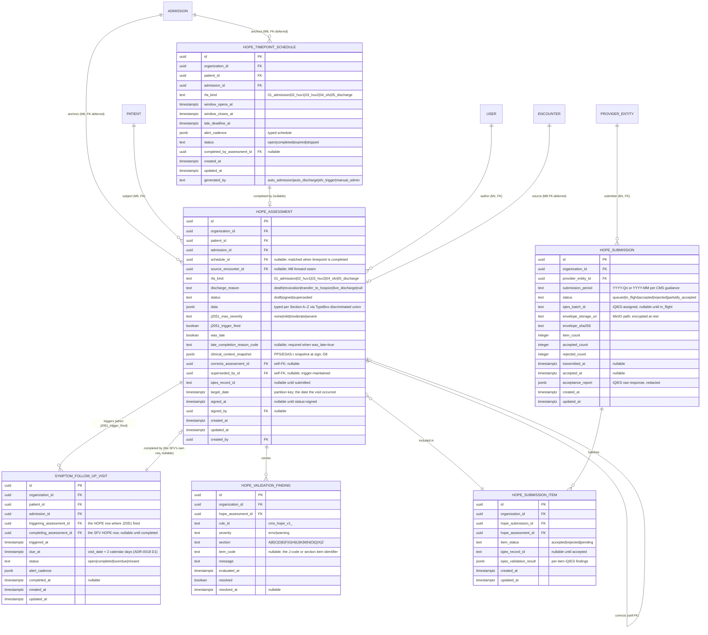

# Module 10 — HOPE Engine Specification

> **Authority note:** This spec is an **implementation proposal** (repo authority rule): [`docs/architecture/`](../architecture/) and the ratified ADRs in [`docs/adr/`](../adr/) win on conflict, and the code plus [`docs/BUSINESS_LOGIC.md`](../BUSINESS_LOGIC.md) are ground truth for as-built behavior. Mechanism choices named here may be superseded — see ADR-0036…0040 and ADR-0030/0032/0035 for the recorded divergences (outbox not Socket.IO, TypeScript not Python sidecars, app-layer AES-256-GCM not pgcrypto, pure transition tables not XState, hand-rolled HTTP hardening not `@fastify/*`, Vite + react-router not TanStack Start).


**Module ID:** 10
**Phase:** 1 (clinical-regulatory engine — required for Engrace go-live; HQRP non-compliance carries a 4-percentage-point APU reduction)
**Depends on:** 6 (Admission, Election & Certification — the admission row + activation timestamp is the anchor for every HOPE timepoint window; `level_of_care_period` discriminates SFV obligations under GIP/IRC; discharge events from M6's outbox drive the Discharge RFA timepoint), 9 (Clinical Assessments Suite — `LatestAssessmentProvider` returns PPS / ESAS-r at HOPE completion for snapshotting; the M9 series feeds the HUV trend context per architecture §11), 36 (Secure Messaging & Alerts — timepoint-window alerts, SFV-deadline alerts, submission-deadline alerts; typed-alert payload per M36 §4.9; care-team channel broadcast on overdue timepoints), 38 (Clinical Terminology — HOPE J-code value sets (`hope_j_codes`, `j2051_severity`), hospice diagnosis value set for Section I, LOINC bindings for J-item externalization, `asOfDate` lookups for survey-grade historical reconstruction). Transitively via M6: 1 (Foundation — `withOrgContext`, `audit()` helper, outbox dispatcher, idempotency middleware, RLS generator, partitioned-table conventions, per-tenant DEK, BullMQ queue runner), 2 (Identity — actor resolution; discipline resolution from membership for the HOPE-author discipline rule), 3 (Authorization — RBAC + ABAC; the `hope.*` permission keys this module contributes), 4 (Audit — PHI write-audit trigger generator, audit-read helper, destruction-cert workflow + `eraseFn` registration, `compliance` retention class with extended retention for submitted assessments), 5 (Patient & Demographics — `patient` row, deceased status driving the Discharge-by-death RFA branch, `medicare_beneficiary_identifier` for iQIES submission), 40 (MDM — discipline taxonomy used by the HOPE-author eligibility rule).
**Consumed by:** 8 (Encounters & Visit Notes — an encounter whose type is `hope_admission` / `hope_huv1` / `hope_huv2` / `hope_sfv` / `hope_discharge` calls M10's `recordHopeTimepoint` API with `source_encounter_id`; encounter-sign workflow consults M10's "required HOPE items" rules), 14 (IDG — packet builder surfaces J2051 trigger + open SFV obligations; "open HOPE windows" appears on the IDG dashboard), 22 (Documents — HOPE summary PDF rendering per submission cycle via the outbox `hope.summary_requested` event), 28 (FHIR Gateway — HOPE assessment row exposed as FHIR R4 `Observation` (J-items) and `QuestionnaireResponse` (HOPE Section A–Z) when M28 lands; the LOINC bindings travel with the typed payload), 30 (HQRP & Quality — HCI / Timely Follow-Up for Pain / Timely Follow-Up for Non-Pain Symptom Impact / future HOPE-derived measures all read M10's `HopeTimepointProvider`, `HopeSubmissionProvider`, and `HopeJ2051Provider` seams; M30 is the operational dashboard for the 4-point APU compliance posture), 31 (Portal — patient/family-facing "what we measure and how often" surface, consent-gated; J2051 individual responses are not portal-surfaced), 32 (AI Platform — `HopeJ2051Provider` feeds the symptom-trajectory model alongside M9's `ScaleSeriesProvider`; the decline-prediction model reads `HopeTimepointProvider`), 33 (Reporting — operational dashboards: HOPE-window-on-time rate, SFV-on-time rate, submission-acceptance rate, late-completion-reason distribution).
**Spec status:** Re-locked v0.4 (A0600A SSN format edits, draft chart re-prefill, payer-number fallback; supersedes Re-locked v0.3 — Phase-2 + Phase-4 + ADR-0021 §20.B template sweep; supersedes Locked v0.2)

> **Phase-4 remediation (2026-06-11; ADR-0018).** **M10-F02 (BLOCKER):** the SFV 2-calendar-day clock
> now anchors to the **HOPE assessment visit date**, not `signed_at` (§1.1, §1.3) — delaying the
> signature can no longer extend the federal deadline (silent HQRP non-compliance / APU exposure).
> **M10-F07:** the transposed HOPE J-item codes are corrected against the CMS HOPE Manual value set.
> **M10-F06:** an **iQIES inactivation flow** (correct/withdraw a submitted record) is added. M30's
> HQRP Timely-Follow-Up measure uses the same visit-date anchor (M30-F04).
>
> **Phase-2 tenancy (2026-06-11; ADR-0010/0011 / ARCH-011).** **M10-F09 (MAJOR):** the four
> patient-level PHI tables — `hope_timepoint_schedule`, `hope_assessment`, `symptom_follow_up_visit`,
> `hope_validation_finding` — now carry `provider_entity_id` + `location_id` beside `organization_id`,
> both **NOT NULL** and denormalized from the admission. HOPE submission, **CCN matching**, and the
> HQRP dashboard are all **per-ProviderEntity**, so the assessment rows now reach their PE without
> joining through M6's admission (which M10 may not query directly per M10-F01); the per-PE batch
> assembler indexes on `(provider_entity_id, …)`. `hope_submission` already carried `provider_entity_id`
> (a per-CCN batch, no `location_id`); `hope_submission_item` is a submission-join row outside the
> three-column rule. Now gated by `check-tenancy` (fitness #10). See §3.3.

## Changelog

- **v0.4 (Re-locked; 2026-10-04)** — (1) **A0600A SSN format edits:** the CMS v1.00.1 fatal edits -3015 (digits only), -3001 (exactly 9), -3002 (not `000`-prefixed) and -3003 (not 111111111 / 333333333 / 123456789 / 999999999) run in the Section A validation rule as `error` findings, judged on the value as stored; the workspace strips dashes/spaces before saving and shows the failing edit while typing (shared `ssnCmsProblem` in `@chartwarden/types`). (2) **Draft re-prefill:** opening a draft Admission / HUV / Discharge workspace re-runs the chart prefill (`refreshOnly`), so chart facts recorded after the draft was created (e.g. coverage entered at intake) flow in; only answers the clinician has not typed (`source != 'user'`) change, and an unchanged chart writes nothing. Signed records are untouched (the D8 snapshot rule is unchanged). (3) **Payer-number fallback:** A0600B / A0700 fall back to coverage that had not ended by admission when no coverage in force on the admission date carries a number (intake often keys coverage "effective today"); the A1400 payer answers stay bound to the admission date. (4) **Chart check + reconcile:** a typed A0600B / A0700 the chart lacks or contradicts shows "Not on the patient's chart" / "Differs from the chart" with a **Reconcile…** action. The dialog compares both values and offers either direction: *the chart is right* — use the chart's number in HOPE (drafts only; a signed record needs a correction); *the HOPE number is right* — add it to the chart as Medicare / Medicaid coverage (payer, rank, effective date defaulting to the admission date) or re-file the existing coverage with it, keeping payer, rank and dates (M5 `POST /patients/:id/payers` closes the row at that rank and inserts the replacement, preserving history). A chart MBI held as a patient identifier has no write route and is corrected from the patient chart; an invalid MBI / Medicaid number is never written to the chart. *Neither is right* — staff type the number from the member card (validated live); it is saved in HOPE (drafts) and re-files the chart's coverage in one step. The check also covers values copied into a correction (`source = 'correction_copy'`), and a signed record with a correction already in progress offers **Open correction draft** (header, Review and the dialog) instead of a second correction, which the server refuses with 409. The prefill prefers the current row when a superseded one shares its rank.
- **v0.3 (Re-locked; 2026-06-13)** — ADR-0021 §20.B template sweep (four findings added; no schema, decisions, seam contracts, or queue catalog changed). **M10-F10 (ARCH-262, SD-059, OPS-035):** Full BullMQ queue parameter table added as §4.8.1 — every queue row declares priority / attempts / backoff / concurrency / DLQ + DLQ triage instructions. **M10-F13 (SEC-048, ARCH-185):** §4.9.1 declares that `patientDisplayName` and other PHI fields in `HopeTimepointWindowAlert` / `HopeSfvAlert` are in-app-render only; out-of-band push/SMS channels carry no payload PHI — `buildOutOfBandPayload()` contract added; `HopeSfvAlert` at SFV creation is classified `severity='clinical_urgent'` from first emission (SD-015). **M10-F17 (INT-009, SD-075, SD-033/034):** §4.10.1 declares the `packages/iqies-client` circuit-breaker config (SD-075 defaults with iQIES-specific 25 s timeout), the `DegradedError` five-field shape, and the MinIO per-tenant prefix (`tenants/<org_id>/iqies-envelopes/…`) with `COMPLIANCE` object-lock (10 years) + lifecycle (12 years total) for submitted envelopes. **M10-F19 (DR-066/067, SEC-075, SD-015):** §5.6 adds the DR tier declaration (confirmed Tier 2 capture / Tier 3 submission), degraded-mode behaviour table, BCP re-entry path written as a design only (a `system_outage` late-reason code, a `data.Z.bcpPaperOrigin` marker, an `m10.hope.paper_origin_transcribed` audit event, a BCP re-entry panel on the HQRP compliance dashboard, missed-window triage via `lateOverrideReason: "system_outage_bcp"`: **none of it was built**, and a paper-origin record is re-entered as an ordinary late capture; see §5.6 items 1-5), and the sqlcipher pin for mobile offline HOPE drafts (a design only: a `hope_assessment_draft` table in a shared `@chartwarden/mobile-offline` encrypted store, no IndexedDB fallback, evict-PHI-on-logout; that package and the `no-phi-indexeddb` lint rule do not exist).

- **v0.2 (Locked)** — Initial publication at lock-grade. Instantiates the architecture §20.B module spec template. Resolves all twelve open questions into binding decisions (§11). Defines the **shared `hope_assessment` row with per-section TypeBox-typed `data` jsonb** (D1), the **soft-window + hard-cutoff timepoint enforcement** (D2), the **2-calendar-day SFV trigger** (D3), the **per-symptom J2051 trigger model with one-SFV-per-source-timepoint semantics** (D4), the **CMS HOPE submission XML batch via `packages/iqies-client`** (D5), the **iQIES adapter package boundary** (D6), the **append-only correction-of-record submission to iQIES with original retained** (D7), the **PPS / ESAS-r snapshot at HOPE completion** (D8), the **Discharge RFA timepoint listener on M6's `admission.discharged` outbox** (D9), the **`HopeTimepointProvider` / `HopeSubmissionProvider` / `HopeJ2051Provider` seams published for M30/M32 consumption** (D10), the **single-`data`-jsonb section storage avoiding annual ALTER TABLE churn** (D11), and the **late-completion capture with mandatory reason and HQRP counter** (D12). Wires the permission keys this module registers into Module 3 (§4.6), the BullMQ queue catalog (§4.8), the M36 typed-alert payload (§4.9), the iQIES submission worker (§4.10), and the destruction `eraseFn` registered with Module 4 (§8.4). Includes a **proposed manifest patch** (§12, last item) correcting `M10.dependsOn` from `[8, 9, 36, 38]` to `[6, 9, 36, 38]` *(relationship inventory - not the `dependsOn` edge set; per ADR-0005 D1/D4 seam/outbox/foundation consumers are no-edge - see audit/MANIFEST_DEPENDSON_REVIEW.md; do not bulk-apply)* — the prior encoding inverted the M8↔M10 dep direction; the architecture flow ("an RN's HOPE-timepoint encounter records HOPE items via M10's API") is M8 → M10, and the M9 lock established the precedent that consumers (M8) carry the dep, not the data-owner (M10). Also adds `packages/iqies-client` to `M10.codePaths` per D6.
- **v0.1** — Drafted within the lock-grade pass; not separately published.

> **Transport ground truth (2026-10-21; supersedes D5, D6 and §4.10 wherever they promise an HTTP transport).**
> CMS states that iQIES "does not support API interoperability" (HOPE Implementation FAQs, Q30): there is no
> submission endpoint, no sandbox and no machine credential. HOPE records reach CMS only when a person with the
> iQIES *Assessment Submitter* role (HARP identity + MFA, approved by the agency's Provider Security Official)
> uploads one `.zip` in the iQIES web portal — at most 5 MB, one `.xml` per assessment, an `<ASSESSMENT>` root,
> ASCII only (HOPE Data Specifications Overview V1.00.1 §9). Acceptance comes back as Final Validation Reports
> in the portal, up to 24 hours later; pre-upload testing is the web-only Validation Utility Tool
> (`iqies.cms.gov/vut`). Modify and inactivate records are XML (`A0050` = 2 / 3); the portal's change-request
> form supports delete requests only (Assessment Submitter manual v2.2).
> **As built:** M10 validates and assembles; `hope-cms-xml-serializer.ts` / `hope-cms-xml-render.ts` render the
> files; the operator downloads the package, uploads it, and records the outcome (`transportMode =
> manual_iqies_upload`). `packages/iqies-client` is kept as a typed contract for a future CMS API and is a
> deny-stub today. Addresses GAP-096 (spec side).

> **Phase boundary (binding):** Phase 1 delivers everything in this spec **except** the M28 FHIR `Observation` / `QuestionnaireResponse` projections (Module 28 owns; M10 emits the typed mapping today), the M22 HOPE-summary PDF rendering (Module 22 owns; M10 emits `hope.summary_requested`), the M30 HQRP measure calculations (Module 30 owns; M10 publishes the three provider seams today), and the M32 AI decline-prediction model integration (Module 32 owns; the `HopeJ2051Provider` seam ships now — analogous to how M9 published `ScaleSeriesProvider` before M32 existed). The "done" gate for M10 is: the seven-table schema migrated and RLS-clean; the five RFA timepoint windows auto-scheduled from M6's admission events; the J2051 trigger logic firing SFV creation within 2 calendar days; the iQIES submission worker batching and submitting per ProviderEntity per submission window with idempotent retries; the correction-RFA workflow preserving originals; the three outbound seams registered at boot; the `eraseFn` registered with M4; and the test plan green — not gated on Modules 8/14/22/28/30/32 existing. The M8 encounter-linkage seam is exercised against a test-double encounter signer; the iQIES submission is exercised against the CMS iQIES sandbox endpoint with synthetic assessments validated against the CMS HOPE submission XML schema (per `CHARTWARDEN_INTEGRATIONS §6.7`).

> **DR tier (binding):** HOPE timepoint capture is **Tier 2** per `CHARTWARDEN_DR_BCP §3.1` — visit-time entry must continue to function during a degradation event because missing a timepoint cannot be recovered after the window closes. iQIES submission is **Tier 3** — batch submission can wait 24 hours without regulatory consequence because the submission deadline is 30 days from timepoint completion. The two paths are deliberately decoupled: `hope_assessment` writes never depend on iQIES adapter health.

-----

## 1. Purpose & Scope

### 1.1 What This Module Does

Module 10 owns the **CMS HOPE (Hospice Outcomes & Patient Evaluation) timepoint engine** — the real-time scheduling, capture, validation, and submission system that replaced HIS (Hospice Item Set) effective October 1, 2025. HOPE is the single CMS-mandated quality-data instrument every Medicare-certified hospice must submit; missing a timepoint window directly reduces the Hospice Quality Reporting Program (HQRP) compliance score, and dropping below the CMS threshold removes the 4-percentage-point Annual Payment Update from the following fiscal year's base rate. For Engrace (CCN 381588) operating at the median census, a 4-point APU shortfall is approximately $80–$120k of annual margin. M10 exists so that this shortfall is structurally impossible.

The module delivers:

- **Five timepoint types (RFA — Reason for Assessment, per CMS HOPE manual §A2400):**
  - **RFA 01 — Admission HOPE.** Completed within the 5-day comprehensive-assessment window (42 CFR §418.54(b)(2)). Anchored on `admission.election_effective_date`.
  - **RFA 02 — HOPE Update Visit 1 (HUV1).** Window opens on day 6 and closes on day 15 after the election effective date. Mid-window alerts and late-window alerts fire automatically.
  - **RFA 03 — HOPE Update Visit 2 (HUV2).** Window opens on day 16 and closes on day 30 after the election effective date.
  - **RFA 04 — Symptom Follow-Up Visit (SFV).** Triggered when any J2051 symptom-impact item at any prior HOPE timepoint is recorded at "moderate" or "severe". The SFV must be completed within **2 calendar days** of the triggering timepoint per the CMS HOPE manual §J2051. Each triggering timepoint produces at most one SFV (per D4).
  - **RFA 05 — Discharge HOPE.** Triggered by an `admission.discharged` outbox event from M6 (death / revocation / transfer / live-discharge). Window: 7 calendar days from `discharge_date`. The `discharge_reason` enum branches the required-items profile (Death-RFA omits the participation section Q; Transfer-RFA omits the post-mortem items).

- **Auto-scheduling.** When M6 emits `admission.activated` to the outbox, M10's M6 admission consumer (`m10.m6-admission-workflow`, `outbox-consumers/m6-admission-workflow.ts`; it is what §4.8 calls `schedule-hope-timepoints`, an outbox consumer and not a BullMQ worker) creates three admission-anchored `hope_timepoint_schedule` rows in one transaction: Admission (`01_admission`), HUV1 (`02_huv1`) and HUV2 (`03_huv2`). The Discharge RFA is deliberately NOT pre-planned (`packages/hope/src/scheduling/schedule-plan.ts`, D9): the same consumer creates the single `05_discharge` row when M6 emits `admission.discharged`, and in that same step marks an `open` HUV1 or HUV2 schedule whose window opens after the discharge date `skipped` with the system reason `discharged_before_huv_window` (§2.2.1). Each row carries its `window_opens_at`, `window_closes_at`, `late_deadline_at` (window close + a fixed 7-day grace: the planner takes a `graceDays` parameter, but no tenant setting feeds it), and `alert_cadence` (typed schedule of when M36 alerts fire). Scheduling is idempotent: a re-emitted `admission.activated` does not create duplicates.

- **HOPE item capture across CMS-mandated sections.** Each `hope_assessment` row carries a typed `data jsonb` payload with the CMS HOPE manual sections, validated against per-section TypeBox schemas at the recording boundary:
  - **A — Administrative** (date of birth, race/ethnicity, gender, primary terminal diagnosis code)
  - **B — Hearing/Speech/Vision**
  - **C — Cognitive Patterns** (BIMS, signs of delirium, mood)
  - **D — Mood** (PHQ-2-derived items)
  - **E — Behavior**
  - **F — Preferences** (advance directives, code status)
  - **G — Functional Status** (ADL items per CMS HOPE-G coding)
  - **H — Bladder/Bowel**
  - **I — Active Diagnoses** (hospice terminal diagnosis ICD-10-CM with cross-validation against M6's certified diagnosis)
  - **J — Health Conditions** — the trigger-bearing section:
    - **J2030 — Screening for Pain.** Yes/No; if Yes, pain characteristics captured.
    - **J2050 — Screening for Shortness of Breath.** Yes/No; if Yes, dyspnea characteristics captured.
    - **J2051 — Symptom Impact at this Visit.** Per-symptom severity (none / mild / moderate / severe) across the CMS-listed symptoms (pain, shortness of breath, anxiety, agitation, nausea/vomiting, constipation, restlessness, other). **Any "moderate" or "severe" on any symptom fires the SFV trigger** (D4).
  - **K — Swallow/Nutritional Status**
  - **M — Skin Conditions** (pressure ulcers staged)
  - **N — Medications** (opioid for pain, scheduled bowel regimen if opioid, antiemetic if nausea)
  - **O — Treatments** (oxygen, IV therapy, dialysis)
  - **Q — Participation** (omitted on Death-RFA)
  - **X — Care Preferences** (preferred place of death, hospitalization preference)
  - **Z — Administrative Items** (signature, completion date, late-completion reason if applicable)

- **Server-authoritative J2051 trigger evaluation.** The recording service computes `j2051_max_severity` and `j2051_trigger_fired` from the typed `data.J` payload server-side; the client cannot suppress an SFV by under-reporting severity through API tampering. On `trigger_fired`, a `symptom_follow_up_visit` row is inserted in the same transaction with **`due_at = visit_date + 2 calendar days`** — the SFV 2-calendar-day clock anchors to the **HOPE assessment's visit/encounter date**, **never** to `signed_at` (M10-F02 / ADR-0018 D1). Anchoring to the signature timestamp would let a clinician extend the federal deadline simply by delaying signing, silently under-reporting HQRP non-compliance and exposing the 4-point APU reduction. A typed alert is dispatched through M36's care-team channel (per D4 + M36 §4.9): **design, not built.** As built, opening the SFV writes only the outbox event `m10.hope.sfv_created`, which M14's IDG packet consumes; no M36 consumer is bound to it (M36 seeds an alert rule for the event name, but nothing triggers it) and the only SFV alerts M10 emits are the watchdogs' `overdue` and `missed` ones (§4.9). **As built (R-02):** on the live DB path the SFV row is created or reconciled when the draft's J2050/J2051 answers are patched (not at sign), and its `due_at` is computed from the recorded J2050B answer (23:59:59.999 UTC on the 2nd calendar day after it), not from the visit date; see ADR-0018 *Implementation note* and `docs/BUSINESS_LOGIC.md` (open CMS-VERIFY).

- **PPS / ESAS-r snapshot at sign.** When a HOPE row is signed, M10 reads M9's `LatestAssessmentProvider` for `PPS` and `ESAS-r` as of `signed_at`, and **writes the values into the HOPE row's `clinical_context_snapshot` jsonb column** (D8). Subsequent M9 corrections do not change the HOPE row — the HOPE row is the canonical historical record of what was submitted to iQIES.

- **Timepoint window enforcement (soft + hard).** The recording API admits writes inside `[window_opens_at, late_deadline_at]`. Writes before `window_opens_at` are rejected with `M10_TIMEPOINT_NOT_OPEN`; writes between `window_closes_at` and `late_deadline_at` succeed and set `was_late=true` with a mandatory `late_completion_reason_code`; writes past `late_deadline_at` are rejected with `M10_TIMEPOINT_EXPIRED` and an admin-override path that requires platform-admin justification (D2, D12).

- **iQIES submission as a separately-tiered subsystem.** The capture path (Tier 2) writes a `hope_assessment` draft, and signing makes it a row with status `signed`. The submission path (Tier 3) is an operator-run assemble per ProviderEntity (`POST /hope/submissions/assemble`; the `iqies-submit-worker` cron of §4.8 is not wired), packaging signed-and-unsubmitted assessments as one CMS-format XML file per assessment inside a single `.zip` for **operator upload to the iQIES portal** (see *Transport ground truth* above); `packages/iqies-client` keeps the typed adapter contract for a future CMS API and is a deny-stub today. Each submission produces a `hope_submission` row whose `status` runs `packaged → exported → submitted_pending_result` and then to the outcome derived from the recorded CMS report (`accepted`, `accepted_with_warnings`, `partially_accepted` or `rejected`; `cancelled` before an upload; `in_flight` belongs to the unbuilt automated design, and `queued` is reached only by the deprecated `.../retry` of a `rejected` batch, which nothing consumes) and a `hope_submission_item` row per included assessment with the per-assessment iQIES validation result. **Double-batching guard (as built):** an assessment can sit on only one `pending` item at a time (the partial unique index `uniq_hope_sub_item_assessment_active`), and assemble skips an assessment that already has a `pending`, `accepted`, `accepted_with_warnings` or `rejected` item (a rejected original is fixed by a correction in a NEW batch, not re-sent). Idempotency on `(provider_entity_id, submission_period, hope_assessment_id)` is a design only: no unique constraint or check involves `submission_period` (only a plain index does), and `.../retry` only requeues a `rejected` batch (§8.5).

- **Pre-submission validation.** Before XML envelope assembly, the `validate-hope-assessment` service runs the CMS HOPE submission validation rules: required-items-per-RFA presence, value-set membership (Section I diagnosis ∈ active hospice-terminal-diagnosis value set per M38; *design, not enforced on the live path*, §2.3), cross-field consistency (J2030=Yes ⇒ pain characteristics present; J2050=Yes ⇒ dyspnea characteristics present; Death-RFA ⇒ Section Q absent; live-discharge RFA ⇒ Section Q present). A `hope_validation_finding` row is written per violation with severity `error` (blocks submission) or `warning` (informational, does not block). Validation re-runs on every signed assessment and on any tenant value-set update affecting M38 codes M10 consumes (*design:* as built the M38 re-validation does not exist, `revalidate-on-terminology-update` being a catalog row with no body, §4.8).

- **Append-only correction RFA workflow.** A correction inserts a new `hope_assessment` row with `rfa_kind` matching the target's RFA (01–05) and `corrects_assessment_id` set; the correction starts as a draft, and when it is signed a trigger marks the prior row `superseded_by_id` (migration 0225). The signed correction is packaged by the next operator-run assemble in a NEW batch; no submission worker queues a Correction RFA (`submit-correction-rfa` is not wired, §4.8) (D7). The original row's content is never edited (only its status and `superseded_by_id` change).

- **Alerting (design; as built a minimum).** The design: each `hope_timepoint_schedule` row carries a typed `alert_cadence` (default: window-open notice on day 1, mid-window reminder at 50% elapsed, closing reminder 48h before close, late-window urgent, daily until late-deadline, escalating to clinical lead), each `symptom_follow_up_visit` row one (created notice, 24h reminder, due-tomorrow urgent, overdue critical), and each `hope_submission` carries deadline alerts (30d-from-completion → at 14d, 7d, 2d, 1d), all routed through M36 with the typed-alert envelope (`category='clinical_compliance'`, `severity` escalates). **As built:** a schedule row is written with the planned `alert_cadence`, and an SFV row with an empty one (`{}`), and nothing consumes either: `hope-alert-dispatcher` has no Worker (§4.8). The only alerts M10 emits are one `critical` alert when the watchdogs expire a schedule, turn an SFV `overdue` and turn it `missed` (§2.2.3, §4.8). There is no SFV reminder cadence and no submission-deadline alert (§4.9).

- **Audit-grade everything.** Every write flows through Module 4's PHI write-audit trigger with column-level scrubbing of free-text within `data` jsonb (clinical observation text fields denylisted from value capture; only `<changed>` markers). Every read of a HOPE row through the chart, the IDG packet, or the survey-reconstruction surface emits a `hope_assessment.viewed` audit event (per-resource for chart opens, aggregate for list views per M4 D3). Marking a package uploaded is recorded by the write-audit trigger as a `hope_submission.update` row event (§8.1) and emits the `m10.hope.submission_transmitted` outbox event carrying the package's SHA-256 (as built the package ZIP is stored on the `hope_submission` row, not in MinIO: §4.10.1 is a design).

- **Outbox-driven downstream integration.** Every meaningful event — timepoint scheduled, timepoint signed, J2051 trigger fired, SFV created, SFV completed, submission queued, submission accepted, submission rejected, correction submitted — flows through the outbox dispatcher (Module 1 §4.8). Downstream subscribers (M14 IDG packet builder, M22 PDF render, M28 FHIR projection, M30 HQRP measure calculators, M32 AI decline-prediction model, M33 reporting materialized views) attach to the documented topics. Idempotent dispatch keyed on `hope_assessment_id` + `event_kind`.

### 1.2 What This Module Does Not Do

- **Clinical scale assessments (PPS, ESAS-r, FAST, PAINAD, etc.).** Module 9 owns the scale library. M10 reads M9's `LatestAssessmentProvider` for prognostic context and snapshots the values into the HOPE row at sign time (D8); M10 does not store the canonical scale series and does not implement scale scoring. The thematic overlap between M9's ESAS-r and M10's J2051 is intentional — they are clinically related but regulatorily distinct (M9 D-rationale in §1.2 there): ESAS-r is an industry-standard 0–10 symptom-burden instrument; J2051 is a CMS-defined four-level symptom-impact item with a 2-calendar-day follow-up trigger. M10 does **not** double-source J2051 from ESAS-r.

- **The comprehensive admission assessment narrative.** The 42 CFR §418.54(b)(2) comprehensive assessment is a narrative-and-form document owned by Module 8 (Encounters & Visit Notes) when conducted as the admission visit. The Admission HOPE timepoint runs *alongside* the comprehensive assessment — typically the same visit captures both — but the HOPE row is M10's, the comprehensive assessment is M8's. M8's encounter-sign workflow consults M10's "required HOPE items for encounter type" rules when the encounter type is `hope_admission`.

- **Vital signs.** Blood pressure, heart rate, respiratory rate, temperature, oxygen saturation, pain score (the 0–10 number distinct from J2030's yes/no screen) are encounter vitals — Module 8 stores these inline on the encounter row. M10 does not capture vital signs.

- **Care plan goals or interventions.** Module 7 owns goals and interventions. A goal may reference a J2051 trigger ("Pain impact at most mild at next HOPE timepoint" is a measurable goal); M7 owns the goal row; M10 just provides whether the J2051 score at the next timepoint met the goal.

- **Symptom-management orders.** Module 11 owns orders. M10 may surface an order-suggestion banner when J2051 pain = severe, but M10 does not create the order; the RN clicks through to M11. The order, if created, references `triggering_hope_assessment_id` so the order trail back to the HOPE row is preserved.

- **CTI narrative content.** Module 6 owns CTI; the surface that reads "objective clinical findings" for the CTI narrative consumes M9's `LatestAssessmentProvider`, not M10's row. The HOPE row is not a clinical evidentiary instrument — it is a CMS quality-reporting artifact.

- **HQRP measure calculations.** Module 30 owns HCI, HVLDL, Timely Follow-Up for Pain, Timely Follow-Up for Non-Pain Symptom Impact, and the future HOPE-derived measures (FY2028). M10 publishes the three provider seams (`HopeTimepointProvider`, `HopeSubmissionProvider`, `HopeJ2051Provider`); M30 consumes and computes. M10 has no measure code.

- **FHIR `Observation` / `QuestionnaireResponse` HTTP surface.** Module 28 owns FHIR R4 endpoints; M10 publishes the typed mapping (HOPE row → FHIR `QuestionnaireResponse` for the full HOPE form, plus per-J-item `Observation` resources with the LOINC code from M38) consumed by M28. M10 has no FHIR HTTP surface.

- **HOPE-summary PDF rendering.** Module 22 owns the PDF generator; M10 emits a typed `hope.summary_requested` outbox event with the domain payload (the HOPE row, the SFV chain, the submission outcome). M22 renders. M10 has no PDF code.

- **iQIES adapter internals.** iQIES has no submission API, so there is no HTTP transport, submitter authentication or sandbox endpoint to build (see *Transport ground truth*). The per-assessment XML record layout lives in `apps/backend/src/modules/10-hope/hope-cms-xml-render.ts`; `packages/iqies-client` holds only the typed adapter contract and deny-stub for a future CMS API (D6). M10 (in `apps/backend/src/modules/10-hope`) consumes the adapter's typed methods (`submitBatch`, `fetchAcceptanceReport`, `submitCorrection`). The adapter is the only package allowed to import HTTP clients for iQIES.

- **Tenant-configurable J2051 thresholds.** Unlike M9's significant-change thresholds (where tenants may tighten platform floors per M9 D2), the J2051 SFV trigger is set by CMS at "moderate or severe" — it is a regulatory threshold, not a clinical-judgment one. M10 does not expose a tenant-override path for the J2051 threshold. A tenant override of the late-deadline grace is **not built** (no `late_deadline_grace_days` setting exists; the grace is a fixed 7 days, the planner takes a `graceDays` parameter that no caller passes); the SFV 2-calendar-day window is not configurable either.

- **iQIES production credential onboarding workflow.** iQIES access is a HARP account with the Assessment Submitter role, held by the agency's own staff and approved by its Provider Security Official; ChartWarden stores no iQIES credential. The only per-ProviderEntity iQIES datum it holds is the CMS-assigned facility ID (`provider_entity.iqies_facility_id`, emitted as `FAC_ID`).

### 1.3 Regulatory Drivers

| Driver | Requirement | How Module 10 satisfies it |
|---|---|---|
| 42 CFR §418.312 — Hospice Quality Reporting Program | Quality data submitted per CMS specification or 4-percentage-point APU reduction | The five-RFA timepoint engine with the window and SFV watchdog alerts (§4.9) and the operator-run iQIES package flow (assemble, upload by hand, record the CMS report; §4.10). *As built* no `iqies-submit-worker` runs and no submission-deadline alert exists, so the 30-day submission deadline is the operator's to watch |
| 42 CFR §418.54(b)(2) — Comprehensive assessment within 5 days | Initial clinical assessment captured by day 5 of election | Admission RFA window opens on `election_effective_date` and closes at day 5; alerts and late-completion capture as defined in §1.1 |
| CMS HOPE Manual v1.x §A2400 — Reasons for Assessment | RFA values 01 (Admission), 02 (HUV1), 03 (HUV2), 04 (SFV), 05 (Discharge) with specific timing rules | The `hope_rfa_kind` enum maps 1:1 to CMS RFA codes; the M6 admission consumer (§4.8) auto-creates three timepoints (Admission, HUV1, HUV2) when the admission is activated and the Discharge timepoint when it is discharged |
| CMS HOPE Manual §J2030 / §J2050 / §J2051 — Symptom Impact and Follow-Up | J2051 moderate/severe at any HOPE timepoint requires SFV completion within 2 calendar days **of the visit date** | `j2051_trigger_evaluator.ts` runs server-side at sign; SFV row created in the same transaction with **`due_at = visit_date + 2 calendar days`** (anchored to the assessment visit date, not `signed_at` — M10-F02/ADR-0018 D1); *design:* alert dispatched immediately (not built: the SFV row emits only the `m10.hope.sfv_created` outbox event, §1.1, §4.9). *As built (R-02): the live DB path opens the SFV when the draft's J2050/J2051 answers are patched (not at sign) and computes `due_at` from J2050B, not the visit date; see ADR-0018 implementation note (open CMS-VERIFY).* |
| CMS HOPE Manual §Z — Late Completion | Late completion permitted with documentation; reported to CMS | Writes between `window_closes_at` and `late_deadline_at` succeed with required `late_completion_reason_code` per the CMS list; included in iQIES submission with the late flag |
| CMS HOPE Submission Spec v1.x | Submission per CMS HOPE submission XML envelope to iQIES | As built the per-assessment CMS XML is rendered by `apps/backend/src/modules/10-hope/hope-cms-xml-render.ts` / `hope-cms-xml-serializer.ts` and packaged in one `.zip` by the operator-run assemble (*Transport ground truth*, §4.10); `packages/iqies-client` holds only a PHI-light canonical-JSON envelope model (a hash pre-image, not the wire XML), the circuit-breaker config and a deny-stub adapter, which the assemble route does not call. Assemble runs the validation engine in final mode (§2.3); the 30-day submission deadline from timepoint completion is not enforced or alerted by any code (§4.9) |
| CMS HOPE Correction Policy | Corrections to submitted HOPE assessments via Correction RFA | Append-only `corrects_assessment_id` + a supersede trigger that fires when the correction is signed (migration 0225); as built the signed correction is packaged by the next operator-run assemble in a new batch, and the automated Correction RFA submission (`submit-correction-rfa`) is not wired (§4.8) |
| 42 CFR §418.104 — Clinical Records | Immutable, attributed, timestamped, retained | Server-authoritative item validation + write-audit triggers + the retention rule of §4.8 / §8.4: a patient's HOPE record is held 10 years from the last iQIES transmission once any assessment was submitted (the `hope-retention-scan` flags and the `hope_record` eraser refuses an earlier erase). *As built* the `extended_for_cms` retention-class flag of §3 is a label that no code reads (§3.6, §8.4) |
| 42 CFR §418.22(a) — Eligibility / Certification | Active hospice election required for HOPE submission | `recordHopeTimepoint` rejects writes without an active admission via M6's `admission` row; iQIES submission validates `election_effective_date` falls within the HOPE timepoint's measurement period |
| HIPAA §164.502(b) — Minimum necessary | Disclose only what's needed | Portal-facing HOPE surface (M31, future) shows the schedule of measurement and the patient's contribution; J2051 individual responses are not portal-surfaced |
| HIPAA §164.312(b) — Audit Controls | Audit every action on PHI | Every HOPE assessment write, read, and submission emits an audit event; envelope SHA-256 hash recorded per submission |

### 1.4 Competitive Context

The mainstream hospice EHRs (Homecare Homebase, MatrixCare, WellSky/Consolo, FireNote) all support HOPE as a form — they had to, because CMS mandated it on October 1, 2025. What they typically do not do well is the regulatory engine *around* the form: the auto-scheduling of HUV1 and HUV2 from the election date, the J2051 trigger that creates the SFV obligation, the deadline-aware alerting that escalates as a window closes, and the iQIES submission with idempotent retries and acceptance-report reconciliation. ChartWarden's M10 differentiators are:

- **Real-time, not retrospective.** Most legacy vendors implemented HOPE as "open the form when the nurse remembers." We open the form *for* the nurse by auto-scheduling HUV1 (days 6–15) and HUV2 (days 16–30) on admission activation and surfacing the open-windows dashboard on the IDG view (the design also escalates an alert as the window closes; as built only the schedule-expired alert is emitted, §4.9). A missed window is, in our model, a workflow failure, not a data entry one.

- **Server-authoritative J2051 trigger.** The single most-missed HOPE compliance failure is the SFV that should have fired but didn't — typically because the clinician thought "moderate" was discretionary. We compute the trigger server-side from the typed `data.J` payload; the SFV row is inserted in the *same transaction* as the HOPE row, with a 2-calendar-day clock (as built the SFV opens when the draft's J2050/J2051 answers are patched, not in the HOPE row's insert transaction, §1.1; the design adds an alert routing to the care team channel, which is not built: only the watchdogs' `overdue` and `missed` alerts exist, §4.9). The clinician cannot under-report severity to avoid an SFV obligation, and the SFV cannot be silently skipped — its non-completion is a tracked compliance event feeding M30.

- **Submission, not just capture.** Several vendors capture HOPE locally and leave iQIES submission as a manual workflow. We package the submission. The *design* is a cron-driven `iqies-submit-worker` that batches signed-and-unsubmitted assessments per ProviderEntity, runs CMS pre-submission validation, transmits the envelope, fetches the acceptance report and reconciles per-assessment outcomes, with rejections flowing into a correction worklist that feeds the next worker tick. **As built** (iQIES has no submission API, *Transport ground truth*) the operator calls `POST /hope/submissions/assemble`, which validates in final mode and builds the CMS XML package per ProviderEntity; the operator uploads the package in the iQIES portal by hand and records the CMS report with `POST .../results` (§4.10). No cron transmits or reconciles, and a rejected record is fixed by a correction in a new batch.

- **Survey-grade reconstruction.** A surveyor asking "what was this patient's J2051 score on day 8 (HUV1)?" gets a deterministic answer from the partitioned PHI table with no derived-table drift. The PPS / ESAS-r values snapshotted into the HOPE row at sign time are the values that were considered at the time of HOPE completion — even if M9's source assessments were later corrected, the HOPE row preserves the data as submitted to iQIES. The correction RFA workflow preserves both the original and the corrected — no silent in-place UPDATE.

- **Append-only correction with iQIES Correction RFA.** Most vendors implement HOPE correction as an in-place edit and a re-submission; the original is gone. We implement correction as a new row with `corrects_assessment_id`, a supersede trigger on the prior row (fired when the correction is signed), and a Correction RFA submission to iQIES referencing the original by its `iqies_record_id` (**design**: as built the signed correction goes out in the next operator-run package, and no worker submits a Correction RFA, §4.8). The full record of what was reported, what was corrected, and why is available to the surveyor.

- **Tier-correct degradation.** Capture (Tier 2) is decoupled from submission (Tier 3). An iQIES outage cannot prevent a clinician from recording a HOPE timepoint at the bedside; the row is signed locally and waits in the submission worklist for the operator's package upload (the design adds deadline alerts that escalate through M36 if the outage persists; not built, §4.9, §7.10). The 30-day submission deadline gives plenty of room for vendor-side recovery without compliance impact.

The bet is the same as M9's: the second half of the value — the deadline alerts, the trigger logic, the submission and reconciliation, the correction workflow — is where M10 is competitively differentiated, not in the per-form ergonomics that every vendor reluctantly built when CMS mandated it.

-----

## 2. Domain Model

### 2.1 Entity-Relationship Diagram



### 2.2 Entity Lifecycle States

#### 2.2.1 `hope_timepoint_schedule.status`

```
open  ─signed assessment matches schedule_id────────▶ completed
  │
  ├─ late_deadline_at passes without completion ────▶ expired
  │
  ├─ admin force-skip (e.g. patient hospitalized) ──▶ skipped
  │
  └─ discharge before a HUV window opens (system) ──▶ skipped
```

- `open` is the only status from which a HOPE assessment may be signed against the schedule.
- `expired` is terminal; the missed-timepoint compliance event fires to M30 via outbox (`m10.hope.timepoint_expired`), and the status change is recorded by the write-audit trigger as a `hope_timepoint_schedule.update` row event (there is no separate `assessment_expired` audit event, §8.1).
- `skipped` requires the clinical-lead permission `hope.schedule.skip` and a reason code (free text of 1 to 64 characters, not validated against a CMS list); only an `open` schedule can be skipped (any other status answers `409 CONFLICT`, §4.4). The reason is stored in `skip_reason_code`; the skip is one UPDATE, audited as a `hope_timepoint_schedule.update` row event (§6, §8.1). The permission governs only the API skip. There is also a **system skip**: when M6 emits `admission.discharged`, the `m10.m6-admission-workflow` consumer marks every `open` HUV1 / HUV2 schedule of the admission, with no completing assessment, whose window opens after the discharge date `skipped` with `skip_reason_code='discharged_before_huv_window'`. It checks no permission, writes the UPDATE in the consumer's own transaction and emits no event for the skip.

#### 2.2.2 `hope_assessment.status`

```
draft  ─sign──────▶  signed  ─a correction is signed (trigger sets) ──▶ superseded
                          │
                          └─ erased by destruction-cert workflow ─▶ (rows deleted by the eraser, §8.4)
```

- `draft` rows are working state; not visible on charts; not submitted to iQIES.
- `signed` is the canonical clinical record. Once signed, the row is immutable except through the correction workflow.
- `superseded` rows remain queryable (history, audit, surveyor reconstruction) but do not appear in default lookups.

#### 2.2.3 `symptom_follow_up_visit.status`

```
open  ─SFV HOPE row signed────▶ completed
  │
  └─ due_at passes without completion ──▶ overdue ──after 7 days──▶ missed
```

- `overdue` is a soft state. As built, the `sfv-watchdog` emits one `critical` M36 alert when an SFV turns `overdue` and one when it turns `missed`; the correlation id carries no time bucket, so a replayed tick is deduped and no repeat fires. The escalating cadence (24h, 48h, 72h, daily until missed) is **not built**: `hope-alert-dispatcher`, which would apply `alert_cadence`, has no Worker (§4.8), and an SFV row is written with an empty `alert_cadence`.
- `missed` is terminal; an `sfv_missed` outbox event fires to M30 for the HQRP Timely Follow-Up measure.

#### 2.2.4 `hope_submission.status`

```
queued  ─worker pick up──▶  in_flight  ─iQIES response: 200 + accepted──▶ accepted
                                  │
                                  ├─ iQIES response: 200 + rejected ────▶ rejected
                                  │
                                  └─ iQIES response: partial ───────────▶ partially_accepted
```

- Rejected and partially-accepted submissions feed a correction worklist; per-item failures are surfaced in the `hope_submission_item.iqies_validation_result`.
- **As built (manual flow):** the diagram above is the automated design (`in_flight` is produced by nothing registered; `queued` only by the deprecated `POST .../retry` of a `rejected` batch, which nothing consumes, and by the unregistered assemble and submit runners). A batch is created `packaged`, moves to `exported` on the first package download and to `submitted_pending_result` when marked uploaded, then takes the status derived from the recorded CMS report (`accepted`, `accepted_with_warnings`, `partially_accepted`, `rejected`); a batch never marked uploaded can be `cancelled` (§4.10).

### 2.3 Validation Rules

Validation is layered: TypeBox at the route boundary (shape), business logic in `record-hope-timepoint.ts` (cross-field + temporal), and `validate-hope-assessment.ts` running CMS HOPE submission rules before envelope assembly.

**Route-boundary (TypeBox):**
- `rfa_kind` ∈ enum
- `data` is a discriminated union per Section A–Z; each section's TypeBox is in `packages/hope/src/sections/<letter>/schema.ts`
- Required-sections-per-RFA matrix enforced via TypeBox composition (Death-RFA omits Q; Transfer-RFA omits Q; live-discharge-RFA includes Q)

**Business logic (`record-hope-timepoint`):**
- `admission` is `active` at `target_date` (or, for Discharge-RFA, was active immediately before discharge)
- `target_date` falls within `[schedule.window_opens_at, schedule.late_deadline_at]`; if outside the closed window but inside the late deadline, `was_late=true` and `late_completion_reason_code` is required
- `rfa_kind` matches `schedule.rfa_kind`; `rfa_kind='04_sfv'` is not a timepoint: `POST .../hope/timepoints` refuses it (`422 VALIDATION_FAILED`, details code `M10_RFA_KIND_NOT_A_TIMEPOINT`), and an SFV is completed with `POST /admissions/:admissionId/hope/sfv`
- For SFV: the triggering HOPE row is referenced via `corrects_assessment_id`-style linkage in `symptom_follow_up_visit.triggering_assessment_id`; the SFV completion is judged against the SFV's `due_at` (visit date + 2 calendar days, end of that day; ADR-0018 D1 — anchored to the assessment visit date; as built from the J2050B answer, §1.1) with **no grace**: a completion later than `due_at` (the later of the request's `targetDate` and the server's now) needs the late-deadline override (§6) and is otherwise `409 M10_SFV_PAST_DUE`
- Section I primary diagnosis ∈ M38's active `hospice_terminal_diagnosis` value set at `target_date` — **design; not enforced as built.** Neither the record path nor the live validation (`hope-validation-service.ts`, which runs the spec's rule engine `spec/validation-registry.ts`; used by `GET .../validation` and the final-mode check in assemble) reads M38, so an invalid Section I code passes record, draft validation and assemble and only CMS rejects it. The one M38 read in M10 is `validation/run-validation.ts` (`runHopeAssessmentValidation`), whose only caller is the unregistered submit runner (§4.8). `M10_DIAGNOSIS_NOT_IN_VALUE_SET` is declared in `packages/hope/src/errors.ts` and raised nowhere (§4.4). Whether to wire the check is a decision for a human
- Section J consistency: J2030=Yes ⇒ pain characteristics present; J2050=Yes ⇒ dyspnea characteristics present
- Section N consistency: opioid prescribed ⇒ scheduled bowel regimen present or documented contraindication
- Author's discipline ∈ {RN, NP, MD} per `mdm.discipline_taxonomy` (CMS HOPE manual restricts HOPE completion to these disciplines)

**Pre-submission (`validate-hope-assessment`):**
- All required items per RFA present (per CMS HOPE submission spec required-items matrix, encoded in `packages/hope/src/sections/required-items.ts`; readiness and on-demand item validation derive their section scope from this same matrix)
- Cross-RFA temporal consistency: HUV1 `target_date` > Admission `target_date`; HUV2 `target_date` > HUV1 `target_date` if HUV1 exists
- iQIES envelope-level constraints: ProviderEntity CCN matches admission's `ccn_at_election`; patient MBI matches M5's snapshot
- **A0600A SSN (CMS fatal format edits, v0.4):** -3015 digits only; -3001 exactly 9 digits; -3002 first three not `000`; -3003 not 111111111 / 333333333 / 123456789 / 999999999. `^` (blank) is exempt. Evaluated on the stored value; the workspace normalizes `123-45-6789` → `123456789` before saving.

**Chart prefill (Admission / HUV / Discharge drafts, v0.4):** created drafts are prefilled from M5 (identity, address, coverage) and M1 (provider NPI/CCN) with `source='patient_prefill'` / `'admission_prefill'`; opening a draft re-runs it so later chart changes flow in. Prefill never overwrites a clinician-typed answer and writes nothing when the chart is unchanged. A0600B takes the active MBI, else the best-ranked Medicare coverage subscriber ID; A0700 the Medicaid coverage subscriber ID — each preferring coverage in force on the admission date, falling back to coverage not ended by it.

### 2.4 Side-Effects (Events Emitted)

Every meaningful state transition emits a typed outbox event (Module 1 §4.8) with deterministic idempotency keys. The provider-seam interfaces are re-exported from `packages/hope/src/seams.ts`; outbox subscribers live with their consuming modules.

| Event | Trigger | Payload (typed in `seams.ts`) | Idempotency key |
|---|---|---|---|
| `hope.timepoint.scheduled` | `schedule-hope-timepoints` worker on `admission.activated` | `{ scheduleId, rfaKind, windowOpensAt, windowClosesAt, lateDeadlineAt }` | `(scheduleId, "scheduled")` |
| `hope.timepoint.signed` | `signTimepoint` on transition to `signed` | `{ assessmentId, rfaKind, signedAt, signedBy, j2051TriggerFired, wasLate }` | `(assessmentId, "signed")` |
| `hope.timepoint.expired` | `hope-window-watchdog` cron when `late_deadline_at` passes | `{ scheduleId, rfaKind, expiredAt }` | `(scheduleId, "expired")` |
| `hope.j2051.triggered` | `signTimepoint` when the signed record's `j2051_trigger_fired=true` and its SFV exists (the SFV obligation was opened earlier, when the J2050/J2051 answers were patched on the draft) | `{ assessmentId, sfvId, maxSeverity, triggeredAt, dueAt }` | `(assessmentId, "j2051_triggered")` |
| `hope.sfv.created` | `PATCH .../answers`, in the patch transaction that creates or re-opens the SFV obligation for the draft's J2050/J2051 answers (not at sign) | `{ sfvId, triggeringAssessmentId, dueAt }` | `(sfvId, "created")` |
| `hope.sfv.completed` | `POST /admissions/:admissionId/hope/sfv` (`recordSfv`), completing an open SFV | `{ sfvId, completingAssessmentId, completedAt }` | `(sfvId, "completed")` |
| `hope.sfv.overdue` | `sfv-watchdog` cron | `{ sfvId, hoursPastDue }` | `(sfvId, "overdue", floor(hours/24))` |
| `hope.sfv.missed` | `sfv-watchdog` after 7 days overdue | `{ sfvId }` | `(sfvId, "missed")` |
| `hope.correction.submitted` | `POST .../correct` (`correctTimepoint`), when the correction DRAFT is inserted | `{ correctionAssessmentId, originalAssessmentId }` | `(correctionAssessmentId, "submitted")` |
| `hope.inactivation.created` | `POST /hope/assessments/:id/inactivations` (`inactivateTimepoint`), when the inactivation DRAFT (`isc = XX`) is inserted; the catalog (`events-by-m10.ts`) declares no consumer for it | `{ inactivationAssessmentId, targetAssessmentId }` | one event per inactivation draft (aggregate `hope_assessment`, id = the inactivation draft's id) |
| `hope.submission.queued` | `POST /hope/submissions/assemble` (and `.../retry`); the `assemble-hope-submission` worker is not wired | `{ submissionId, providerEntityId, itemCount }` | `(submissionId, "queued")` |
| `hope.submission.transmitted` | `POST /hope/submissions/:id/mark-uploaded` (the manual upload; no `iqies-submit-worker` runs); `envelopeSha256` is the package's SHA-256 | `{ submissionId, transmittedAt, envelopeSha256 }` | `(submissionId, "transmitted")` |
| `hope.submission.accepted` | `POST /hope/submissions/:id/results`, when the recorded CMS report settles the batch (no `iqies-reconcile-worker` runs) | `{ submissionId, acceptedCount, rejectedCount }` | `(submissionId, "accepted")` |
| `hope.submission.rejected` | `POST /hope/submissions/:id/results`, when the recorded CMS report settles the batch (no `iqies-reconcile-worker` runs) | `{ submissionId, rejectedCount, findings }` | `(submissionId, "rejected")` |
| `hope.retention.eligible` | `hope-retention-scan` (monthly, §4.8), when a patient's HOPE record is newly past its retention horizon with no blocker; the scan only flags, it never deletes | `{ patientId, basis, retentionYears, eligibleAt }` | once per eligibility episode |
| `hope.summary_requested` | API `POST /hope/:id/summary-pdf` | `{ assessmentId, requestedBy }` | `(assessmentId, requestedAt)` |

> **Fully-qualified outbox `eventName` (binding) — producer-side reconciliation with downstream consumers.** The short topic strings in the table above are the in-module shorthand. The **canonical `eventName` actually published to the M1 outbox dispatcher** follows the platform convention from M1 §3.17 (`m<N>.<entity>.<verb_with_underscores>`, e.g. `m11.order.transmission_status_changed`) and is registered in `apps/backend/src/modules/10-hope/events-by-m10.ts` (the as-built home; `packages/foundation` is banned by ADR-0005 D3). M10 emits these events today; no new events are introduced here — this mapping only makes the wire-level names explicit so existing downstream subscribers resolve correctly. The four events with declared downstream consumers map as follows:
>
> | In-module shorthand (§2.4) | Canonical `eventName` published | Declared consumers |
> |---|---|---|
> | `hope.timepoint.signed` (line above) | `m10.hope.timepoint_signed` | M33 |
> | `hope.j2051.triggered` (line above) | `m10.hope.j2051_trigger_fired` | M33 |
> | `hope.submission.accepted` (line above) | `m10.hope.submission_accepted` | M30, M33 |
> | `hope.submission.rejected` (line above) | `m10.hope.submission_rejected` | M33 |
>
> These four are the names M30 (HQRP Quality) and M33 (Reporting) subscribe to in their respective specs. The remaining §2.4 events publish under the same `m10.hope.<entity>_<verb>` rule (e.g. `hope.timepoint.scheduled` → `m10.hope.timepoint_scheduled`, `hope.sfv.created` → `m10.hope.sfv_created`) and gain consumer subscriptions as those modules lock. No event in this catalog is renamed or removed; the shorthand column remains the human-readable label and the canonical `eventName` is the registered wire identifier.

-----

## 3. Drizzle Schema

### 3.1 Package Layout

> The tree below is the original design, not the as-built layout: `packages/hope/src/sections/` holds only `required-items.ts` (there are no per-section `schema.ts` files), there is no `packages/hope/src/eraser.ts` (the eraser is `apps/backend/src/modules/10-hope/erasers/hope-eraser.ts`, §8.4), and the submission pipeline files are not built as drawn (§4.8, §4.10).

```
packages/hope/
├── package.json
├── src/
│   ├── index.ts                     # public re-exports
│   ├── schema.ts                    # Drizzle tables (all 6) — see §3.3
│   ├── enums.ts                     # all enums in one place (re-exported)
│   ├── sections/                    # per-section TypeBox + validators
│   │   ├── A/schema.ts              # Administrative
│   │   ├── B/schema.ts              # Hearing/Speech/Vision
│   │   ├── C/schema.ts              # Cognitive Patterns
│   │   ├── D/schema.ts              # Mood
│   │   ├── E/schema.ts              # Behavior
│   │   ├── F/schema.ts              # Preferences
│   │   ├── G/schema.ts              # Functional Status
│   │   ├── H/schema.ts              # Bladder/Bowel
│   │   ├── I/schema.ts              # Active Diagnoses
│   │   ├── J/schema.ts              # Health Conditions (includes J2030/J2050/J2051)
│   │   ├── J/j2051-evaluator.ts     # server-authoritative trigger evaluator
│   │   ├── K/schema.ts              # Swallow/Nutritional
│   │   ├── M/schema.ts              # Skin
│   │   ├── N/schema.ts              # Medications
│   │   ├── O/schema.ts              # Treatments
│   │   ├── Q/schema.ts              # Participation (omitted on death-RFA)
│   │   ├── X/schema.ts              # Care Preferences
│   │   ├── Z/schema.ts              # Administrative items / late-completion reason
│   │   └── required-items.ts        # required-items-per-RFA matrix
│   ├── scheduling/
│   │   ├── schedule-hope-timepoints.ts   # called from M6 admission.activated handler
│   │   ├── window-calculator.ts          # admission_date → 4 windows
│   │   └── alert-cadence.ts              # default + tenant-override cadence
│   ├── recording/
│   │   ├── record-hope-timepoint.ts      # main write service
│   │   ├── sign-hope-assessment.ts       # draft→signed transition
│   │   ├── correct-hope-assessment.ts    # correction RFA workflow
│   │   └── snapshot-clinical-context.ts  # reads M9 LatestAssessmentProvider (D8)
│   ├── triggers/
│   │   ├── evaluate-j2051.ts             # server-authoritative trigger
│   │   ├── create-sfv.ts                 # same-transaction SFV creation
│   │   └── sfv-watchdog.ts               # cron-side overdue/missed transitions
│   ├── validation/
│   │   ├── validate-hope-assessment.ts   # CMS HOPE pre-submission rules
│   │   ├── rules/                        # per-rule files (cms_hope_v1_<n>.ts)
│   │   └── findings-writer.ts            # writes hope_validation_finding rows
│   ├── submission/
│   │   ├── assemble-hope-submission.ts   # batches signed+unsubmitted per PE
│   │   ├── iqies-submit-worker.ts        # cron: pick queued, transmit
│   │   ├── iqies-reconcile-worker.ts     # cron: fetch acceptance reports
│   │   ├── submit-correction.ts          # correction-RFA submission
│   │   └── envelope-storage.ts           # MinIO encrypted-at-rest helper
│   ├── seams.ts                          # HopeTimepointProvider, HopeSubmissionProvider, HopeJ2051Provider
│   ├── permissions.ts                    # registered into M3 at boot
│   ├── eraser.ts                         # registered with M4 destruction workflow
│   └── boot.ts                           # called from apps/backend bootstrap
└── tests/
    ├── unit/                       # section validators, j2051 evaluator, window calc
    ├── integration/                # Testcontainers: record → trigger → SFV → submission
    ├── rls/                        # cross-tenant isolation
    └── fixtures/                   # synthetic HOPE assessments per RFA

packages/iqies-client/              # adapter package — D6
├── src/
│   ├── index.ts
│   ├── envelope-builder.ts         # CMS HOPE submission XML
│   ├── envelope-validator.ts       # XML schema validation
│   ├── transport.ts                # NOT BUILT — iQIES has no submission API (see Transport ground truth)
│   ├── signing.ts                  # per-PE submitter credential signing
│   ├── sandbox-config.ts           # env-based sandbox vs prod
│   └── types.ts                    # SubmissionEnvelope, AcceptanceReport, CorrectionEnvelope
└── tests/                          # mocked iQIES responses

apps/backend/src/modules/10-hope/
├── routes/                         # Fastify routes — see §4
├── handlers/                       # per-route handlers; thin wrappers over packages/hope
└── index.ts                        # module init: registers permissions, seams, eraser
```

### 3.2 Enums

```ts
// packages/hope/src/enums.ts
import { pgEnum } from "drizzle-orm/pg-core";

export const hopeRfaKind = pgEnum("hope_rfa_kind", [
  "01_admission",
  "02_huv1",
  "03_huv2",
  "04_sfv",
  "05_discharge",
]);

export const hopeDischargeReason = pgEnum("hope_discharge_reason", [
  "death",
  "revocation",
  "transfer_to_hospice",
  "live_discharge",
]);

export const hopeAssessmentStatus = pgEnum("hope_assessment_status", [
  "draft",
  "signed",
  "superseded",
]);

export const hopeScheduleStatus = pgEnum("hope_schedule_status", [
  "open",
  "completed",
  "expired",
  "skipped",
]);

export const hopeSfvStatus = pgEnum("hope_sfv_status", [
  "open",
  "completed",
  "overdue",
  "missed",
]);

export const hopeSubmissionStatus = pgEnum("hope_submission_status", [
  "queued",
  "in_flight",
  "accepted",
  "rejected",
  "partially_accepted",
]);

export const hopeSubmissionItemStatus = pgEnum("hope_submission_item_status", [
  "accepted",
  "rejected",
  "pending",
]);

export const hopeValidationSeverity = pgEnum("hope_validation_severity", [
  "error",
  "warning",
]);

export const j2051Severity = pgEnum("j2051_severity", [
  "none",
  "mild",
  "moderate",
  "severe",
]);

export const hopeScheduleGeneratedBy = pgEnum("hope_schedule_generated_by", [
  "auto_admission",
  "auto_discharge",
  "sfv_trigger",
  "manual_admin",
]);
```

### 3.3 Tables

> **Tenancy three-column rule (M10-F09 / ADR-0010 D1 / ARCH-011).** The four patient-level PHI tables
> (`hope_timepoint_schedule`, `hope_assessment`, `symptom_follow_up_visit`, `hope_validation_finding`)
> carry `organization_id` + `provider_entity_id` + `location_id`, the latter two **NOT NULL** and
> denormalized from the admission. HOPE is inherently **per-ProviderEntity** — submission batching, the
> iQIES envelope's `ccn_at_election` match, and the HQRP acceptance dashboard all key on the CCN — so
> carrying `provider_entity_id` on the assessment rows removes the illegal join through M6's admission
> (M10-F01) that the per-PE batch assembler would otherwise need; `location_id` supports
> location-scoped overdue-window dashboards. `hope_submission` is a **per-CCN batch** that already
> carries `provider_entity_id` (and needs no `location_id`); `hope_submission_item` is a
> submission↔assessment join row, outside the PHI three-column rule. RLS stays keyed on `app.org_id`.
> Satisfies `check-tenancy` (fitness #10); `location` is added to the shared `packages/db/schema`
> import.

```ts
// packages/hope/src/schema.ts
import {
  pgTable, uuid, text, jsonb, boolean, timestamp, integer,
  index, uniqueIndex, foreignKey, primaryKey,
} from "drizzle-orm/pg-core";
import { organization, providerEntity, location, user } from "packages/db/schema";  // location added — ARCH-011 tenancy spine (M10-F09)
// No cross-module schema imports for M5.patient / M6.admission (ADR-0011, M10-F01):
// patient_id / admission_id are plain uuid columns (logical FK only) resolved at runtime via the M5/M6 reader seams.
import {
  hopeRfaKind, hopeDischargeReason, hopeAssessmentStatus,
  hopeScheduleStatus, hopeSfvStatus, hopeSubmissionStatus,
  hopeSubmissionItemStatus, hopeValidationSeverity,
  j2051Severity, hopeScheduleGeneratedBy,
} from "./enums";

// 1. hope_timepoint_schedule
export const hopeTimepointSchedule = pgTable("hope_timepoint_schedule", {
  id: uuid("id").primaryKey().defaultRandom(),
  organizationId: uuid("organization_id").notNull().references(() => organization.id),
  providerEntityId: uuid("provider_entity_id").notNull().references(() => providerEntity.id),  // ARCH-011 / M10-F09 (NOT NULL — see §3.3 tenancy note)
  locationId: uuid("location_id").notNull().references(() => location.id),                      // ARCH-011 / M10-F09 (NOT NULL — see §3.3 tenancy note)
  patientId: uuid("patient_id").notNull(),  // logical FK to M5.patient — resolved at runtime via the M5 reader seam (ADR-0011)
  admissionId: uuid("admission_id").notNull(),  // logical FK to M6.admission — resolved at runtime via the M6 reader seam (ADR-0011)
  rfaKind: hopeRfaKind("rfa_kind").notNull(),
  windowOpensAt: timestamp("window_opens_at", { withTimezone: true }).notNull(),
  windowClosesAt: timestamp("window_closes_at", { withTimezone: true }).notNull(),
  lateDeadlineAt: timestamp("late_deadline_at", { withTimezone: true }).notNull(),
  alertCadence: jsonb("alert_cadence").$type<AlertCadence>().notNull(),
  status: hopeScheduleStatus("status").notNull().default("open"),
  completedByAssessmentId: uuid("completed_by_assessment_id"),  // self-ref via FK after assessment exists
  generatedBy: hopeScheduleGeneratedBy("generated_by").notNull(),
  skipReasonCode: text("skip_reason_code"),  // required when status='skipped'
  createdAt: timestamp("created_at", { withTimezone: true }).notNull().defaultNow(),
  updatedAt: timestamp("updated_at", { withTimezone: true }).notNull().defaultNow(),
}, (t) => ({
  // Window queries: "what's open for this patient" and "what's open organization-wide"
  byPatientOpen: index("idx_hope_sched_by_patient_open")
    .on(t.patientId, t.status, t.windowOpensAt),
  byOrgWindow: index("idx_hope_sched_by_org_window")
    .on(t.organizationId, t.status, t.windowClosesAt),
  // Uniqueness: one open schedule per (admission, rfa_kind) at a time;
  // SFVs are distinct rows so RFA 04 is allowed multiple times.
  uniqueOpenAdmissionRfa: uniqueIndex("uniq_hope_sched_admission_rfa_open")
    .on(t.admissionId, t.rfaKind)
    .where(({ status, rfaKind }) =>
      // partial: open status, base RFAs only (not SFV)
      `${status} = 'open' AND ${rfaKind} != '04_sfv'`),
}));

// 2. hope_assessment — PARTITIONED MONTHLY BY target_date (D11; mirrors M9 partition pattern)
export const hopeAssessment = pgTable("hope_assessment", {
  id: uuid("id").primaryKey().defaultRandom(),
  organizationId: uuid("organization_id").notNull().references(() => organization.id),
  providerEntityId: uuid("provider_entity_id").notNull().references(() => providerEntity.id),  // ARCH-011 / M10-F09 (NOT NULL — see §3.3 tenancy note)
  locationId: uuid("location_id").notNull().references(() => location.id),                      // ARCH-011 / M10-F09 (NOT NULL — see §3.3 tenancy note)
  patientId: uuid("patient_id").notNull(),  // logical FK to M5.patient — resolved at runtime via the M5 reader seam (ADR-0011)
  admissionId: uuid("admission_id").notNull(),  // logical FK to M6.admission — resolved at runtime via the M6 reader seam (ADR-0011)
  scheduleId: uuid("schedule_id").references(() => hopeTimepointSchedule.id),  // nullable for SFV-driven
  sourceEncounterId: uuid("source_encounter_id"),  // M8 forward seam; FK added at M8 lock
  rfaKind: hopeRfaKind("rfa_kind").notNull(),
  dischargeReason: hopeDischargeReason("discharge_reason"),  // required when rfa_kind='05_discharge'
  status: hopeAssessmentStatus("status").notNull().default("draft"),
  data: jsonb("data").$type<HopeSectionData>().notNull(),  // discriminated union per Section
  // Derived from data.J payload at sign; server-authoritative
  j2051MaxSeverity: j2051Severity("j2051_max_severity").notNull().default("none"),
  j2051TriggerFired: boolean("j2051_trigger_fired").notNull().default(false),
  // Late completion
  wasLate: boolean("was_late").notNull().default(false),
  lateCompletionReasonCode: text("late_completion_reason_code"),  // CMS late-reason code
  // PPS / ESAS-r snapshot at sign (D8)
  clinicalContextSnapshot: jsonb("clinical_context_snapshot").$type<ClinicalContextSnapshot>(),
  // Correction chain
  correctsAssessmentId: uuid("corrects_assessment_id"),  // self-FK; nullable
  supersededById: uuid("superseded_by_id"),  // self-FK; trigger-maintained
  // iQIES linkage; nullable until submission accepted
  iqiesRecordId: text("iqies_record_id"),
  // Partition key
  targetDate: timestamp("target_date", { withTimezone: true }).notNull(),
  signedAt: timestamp("signed_at", { withTimezone: true }),
  signedBy: uuid("signed_by").references(() => user.id),
  createdAt: timestamp("created_at", { withTimezone: true }).notNull().defaultNow(),
  updatedAt: timestamp("updated_at", { withTimezone: true }).notNull().defaultNow(),
  createdBy: uuid("created_by").notNull().references(() => user.id),
}, (t) => ({
  // Latest signed per (patient, rfa_kind) — the hot read for chart and IDG
  byPatientRfaLatest: index("idx_hope_assess_patient_rfa")
    .on(t.patientId, t.rfaKind, t.targetDate)
    .where(({ status }) => `${status} = 'signed'`),
  // Triggered J2051 for the open SFV worklist
  byOrgTriggered: index("idx_hope_assess_org_triggered")
    .on(t.organizationId, t.j2051TriggerFired, t.signedAt)
    .where(({ j2051TriggerFired }) => `${j2051TriggerFired} = true`),
  // Signed-and-unsubmitted for the iQIES batch assembler
  byOrgUnsubmitted: index("idx_hope_assess_org_unsubmitted")
    .on(t.organizationId, t.signedAt)
    .where(({ status, iqiesRecordId }) => `${status} = 'signed' AND ${iqiesRecordId} IS NULL`),
  // Correction chain lookup
  byCorrectsId: index("idx_hope_assess_corrects")
    .on(t.correctsAssessmentId)
    .where(({ correctsAssessmentId }) => `${correctsAssessmentId} IS NOT NULL`),
}));

// 3. symptom_follow_up_visit
export const symptomFollowUpVisit = pgTable("symptom_follow_up_visit", {
  id: uuid("id").primaryKey().defaultRandom(),
  organizationId: uuid("organization_id").notNull().references(() => organization.id),
  providerEntityId: uuid("provider_entity_id").notNull().references(() => providerEntity.id),  // ARCH-011 / M10-F09 (NOT NULL — see §3.3 tenancy note)
  locationId: uuid("location_id").notNull().references(() => location.id),                      // ARCH-011 / M10-F09 (NOT NULL — see §3.3 tenancy note)
  patientId: uuid("patient_id").notNull(),  // logical FK to M5.patient — resolved at runtime via the M5 reader seam (ADR-0011)
  admissionId: uuid("admission_id").notNull(),  // logical FK to M6.admission — resolved at runtime via the M6 reader seam (ADR-0011)
  triggeringAssessmentId: uuid("triggering_assessment_id").notNull(),  // FK to hope_assessment
  completingAssessmentId: uuid("completing_assessment_id"),  // nullable until completed
  triggeredAt: timestamp("triggered_at", { withTimezone: true }).notNull(),
  dueAt: timestamp("due_at", { withTimezone: true }).notNull(),  // visit_date + 2 calendar days (ADR-0018 D1, not signed_at/triggered_at)
  status: hopeSfvStatus("status").notNull().default("open"),
  alertCadence: jsonb("alert_cadence").$type<AlertCadence>().notNull(),
  completedAt: timestamp("completed_at", { withTimezone: true }),
  createdAt: timestamp("created_at", { withTimezone: true }).notNull().defaultNow(),
  updatedAt: timestamp("updated_at", { withTimezone: true }).notNull().defaultNow(),
}, (t) => ({
  byPatientOpen: index("idx_sfv_patient_open")
    .on(t.patientId, t.status, t.dueAt),
  byOrgDueAt: index("idx_sfv_org_due_at")
    .on(t.organizationId, t.status, t.dueAt),
  // One SFV per triggering assessment (D4)
  uniqueTriggeringAssessment: uniqueIndex("uniq_sfv_per_triggering_assessment")
    .on(t.triggeringAssessmentId),
}));

// 4. hope_validation_finding
export const hopeValidationFinding = pgTable("hope_validation_finding", {
  id: uuid("id").primaryKey().defaultRandom(),
  organizationId: uuid("organization_id").notNull().references(() => organization.id),
  providerEntityId: uuid("provider_entity_id").notNull().references(() => providerEntity.id),  // ARCH-011 / M10-F09 (NOT NULL — see §3.3 tenancy note)
  locationId: uuid("location_id").notNull().references(() => location.id),                      // ARCH-011 / M10-F09 (NOT NULL — see §3.3 tenancy note)
  hopeAssessmentId: uuid("hope_assessment_id").notNull(),  // FK to hope_assessment
  ruleId: text("rule_id").notNull(),
  severity: hopeValidationSeverity("severity").notNull(),
  section: text("section").notNull(),
  itemCode: text("item_code"),
  message: text("message").notNull(),
  evaluatedAt: timestamp("evaluated_at", { withTimezone: true }).notNull().defaultNow(),
  resolved: boolean("resolved").notNull().default(false),
  resolvedAt: timestamp("resolved_at", { withTimezone: true }),
}, (t) => ({
  byAssessment: index("idx_hope_finding_assessment")
    .on(t.hopeAssessmentId, t.severity, t.resolved),
  // Latest unresolved error blocks submission
  byOrgUnresolvedError: index("idx_hope_finding_org_unresolved_error")
    .on(t.organizationId, t.severity, t.resolved)
    .where(({ severity, resolved }) => `${severity} = 'error' AND ${resolved} = false`),
}));

// 5. hope_submission
export const hopeSubmission = pgTable("hope_submission", {
  id: uuid("id").primaryKey().defaultRandom(),
  organizationId: uuid("organization_id").notNull().references(() => organization.id),
  providerEntityId: uuid("provider_entity_id").notNull().references(() => providerEntity.id),
  submissionPeriod: text("submission_period").notNull(),  // e.g. "2026-Q2" or "2026-06"
  status: hopeSubmissionStatus("status").notNull().default("queued"),
  iqiesBatchId: text("iqies_batch_id"),  // iQIES-assigned, nullable until in_flight
  envelopeStorageUri: text("envelope_storage_uri").notNull(),  // MinIO encrypted-at-rest
  envelopeSha256: text("envelope_sha256").notNull(),
  itemCount: integer("item_count").notNull(),
  acceptedCount: integer("accepted_count").notNull().default(0),
  rejectedCount: integer("rejected_count").notNull().default(0),
  transmittedAt: timestamp("transmitted_at", { withTimezone: true }),
  acceptedAt: timestamp("accepted_at", { withTimezone: true }),
  acceptanceReport: jsonb("acceptance_report"),  // redacted iQIES response
  createdAt: timestamp("created_at", { withTimezone: true }).notNull().defaultNow(),
  updatedAt: timestamp("updated_at", { withTimezone: true }).notNull().defaultNow(),
}, (t) => ({
  byOrgPeriod: index("idx_hope_sub_org_period")
    .on(t.organizationId, t.submissionPeriod, t.status),
  byOrgQueued: index("idx_hope_sub_org_queued")
    .on(t.organizationId, t.status, t.createdAt)
    .where(({ status }) => `${status} IN ('queued','in_flight')`),
}));

// 6. hope_submission_item
export const hopeSubmissionItem = pgTable("hope_submission_item", {
  id: uuid("id").primaryKey().defaultRandom(),
  organizationId: uuid("organization_id").notNull().references(() => organization.id),
  hopeSubmissionId: uuid("hope_submission_id").notNull().references(() => hopeSubmission.id),
  hopeAssessmentId: uuid("hope_assessment_id").notNull(),  // FK to hope_assessment
  itemStatus: hopeSubmissionItemStatus("item_status").notNull().default("pending"),
  iqiesRecordId: text("iqies_record_id"),
  iqiesValidationResult: jsonb("iqies_validation_result"),
  createdAt: timestamp("created_at", { withTimezone: true }).notNull().defaultNow(),
  updatedAt: timestamp("updated_at", { withTimezone: true }).notNull().defaultNow(),
}, (t) => ({
  bySubmission: index("idx_hope_sub_item_submission")
    .on(t.hopeSubmissionId, t.itemStatus),
  byAssessment: index("idx_hope_sub_item_assessment")
    .on(t.hopeAssessmentId),
  // Idempotency: assessment can appear in only one queued/in-flight submission at a time
  uniqueAssessmentActive: uniqueIndex("uniq_hope_sub_item_assessment_active")
    .on(t.hopeAssessmentId)
    .where(({ itemStatus }) => `${itemStatus} = 'pending'`),
}));
```

**TypeScript domain types** (referenced above; defined in `packages/hope/src/types.ts`):

```ts
export type AlertCadence = {
  events: Array<{
    offsetMinutesFromAnchor: number;  // negative = before deadline; positive = after
    severity: "info" | "warn" | "urgent" | "critical";
    channel: "care_team" | "compliance" | "admin";
  }>;
  anchor: "window_opens_at" | "window_closes_at" | "late_deadline_at" | "due_at";
};

export type ClinicalContextSnapshot = {
  ppsScore?: number;          // 0–100
  ppsAssessmentId?: string;   // M9 row id
  esasTotalScore?: number;    // 0–90
  esasAssessmentId?: string;
  snapshottedAt: string;      // ISO timestamp
};

// HopeSectionData is the discriminated union built from per-section TypeBox schemas
// in packages/hope/src/sections/<letter>/schema.ts. Imported via `Static<typeof schema>`.
export type HopeSectionData = {
  A?: SectionA; B?: SectionB; C?: SectionC; D?: SectionD; E?: SectionE;
  F?: SectionF; G?: SectionG; H?: SectionH; I?: SectionI; J: SectionJ;
  K?: SectionK; M?: SectionM; N?: SectionN; O?: SectionO; Q?: SectionQ;
  X?: SectionX; Z?: SectionZ;
};
```

### 3.4 Migration `0010_hope.sql` (Outline)

```sql
-- packages/db/migrations/0010_hope.sql
BEGIN;

-- 1. Enums
CREATE TYPE hope_rfa_kind AS ENUM (
  '01_admission', '02_huv1', '03_huv2', '04_sfv', '05_discharge'
);
CREATE TYPE hope_discharge_reason AS ENUM (
  'death', 'revocation', 'transfer_to_hospice', 'live_discharge'
);
CREATE TYPE hope_assessment_status AS ENUM ('draft', 'signed', 'superseded');
CREATE TYPE hope_schedule_status AS ENUM ('open', 'completed', 'expired', 'skipped');
CREATE TYPE hope_sfv_status AS ENUM ('open', 'completed', 'overdue', 'missed');
CREATE TYPE hope_submission_status AS ENUM (
  'queued', 'in_flight', 'accepted', 'rejected', 'partially_accepted'
);
CREATE TYPE hope_submission_item_status AS ENUM ('accepted', 'rejected', 'pending');
CREATE TYPE hope_validation_severity AS ENUM ('error', 'warning');
CREATE TYPE j2051_severity AS ENUM ('none', 'mild', 'moderate', 'severe');
CREATE TYPE hope_schedule_generated_by AS ENUM (
  'auto_admission', 'auto_discharge', 'sfv_trigger', 'manual_admin'
);

-- 2. hope_timepoint_schedule (low volume; not partitioned)
CREATE TABLE hope_timepoint_schedule (...);  -- per §3.3
CREATE INDEX ...

-- 3. hope_assessment (PARTITIONED MONTHLY by target_date)
CREATE TABLE hope_assessment (
  ...
  target_date timestamptz NOT NULL,
  ...
) PARTITION BY RANGE (target_date);

-- Initial partitions: current month and next 12 months
SELECT generate_monthly_partition('hope_assessment', date_trunc('month', now()), 13);
-- Partition rotation worker (M1) creates new partitions monthly

-- Correction-supersede trigger.
-- DESIGN SKETCH (AFTER INSERT): it superseded the original the moment a correction draft was opened, which made merely
-- opening a draft destructive. As built (migration 0225, trg_hope_assessment_supersede_on_correction_sign) the trigger is
-- AFTER UPDATE and supersedes the original only when the correction is signed (draft -> signed), see §4.1 and §7.8.
CREATE OR REPLACE FUNCTION hope_assessment_correction_supersede()
RETURNS TRIGGER AS $$
BEGIN
  IF NEW.corrects_assessment_id IS NOT NULL THEN
    UPDATE hope_assessment
       SET status = 'superseded',
           superseded_by_id = NEW.id,
           updated_at = now()
     WHERE id = NEW.corrects_assessment_id
       AND organization_id = NEW.organization_id;  -- defense in depth
  END IF;
  RETURN NEW;
END;
$$ LANGUAGE plpgsql SECURITY DEFINER;

CREATE TRIGGER trg_hope_assessment_correction_supersede
  AFTER INSERT ON hope_assessment
  FOR EACH ROW
  WHEN (NEW.corrects_assessment_id IS NOT NULL)
  EXECUTE FUNCTION hope_assessment_correction_supersede();

-- Schedule-status-update trigger (when assessment is signed against a schedule)
CREATE OR REPLACE FUNCTION hope_schedule_mark_completed()
RETURNS TRIGGER AS $$
BEGIN
  IF NEW.status = 'signed' AND OLD.status = 'draft' AND NEW.schedule_id IS NOT NULL THEN
    UPDATE hope_timepoint_schedule
       SET status = 'completed',
           completed_by_assessment_id = NEW.id,
           updated_at = now()
     WHERE id = NEW.schedule_id
       AND organization_id = NEW.organization_id
       AND status = 'open';
  END IF;
  RETURN NEW;
END;
$$ LANGUAGE plpgsql SECURITY DEFINER;

CREATE TRIGGER trg_hope_schedule_mark_completed
  AFTER UPDATE ON hope_assessment
  FOR EACH ROW EXECUTE FUNCTION hope_schedule_mark_completed();

-- 4. symptom_follow_up_visit (low volume; not partitioned)
CREATE TABLE symptom_follow_up_visit (...);

-- 5. hope_validation_finding
CREATE TABLE hope_validation_finding (...);

-- 6. hope_submission + hope_submission_item
CREATE TABLE hope_submission (...);
CREATE TABLE hope_submission_item (...);

-- 7. RLS — per M1's RLS generator pattern
SELECT install_org_rls('hope_timepoint_schedule');
SELECT install_org_rls('hope_assessment');
SELECT install_org_rls('symptom_follow_up_visit');
SELECT install_org_rls('hope_validation_finding');
SELECT install_org_rls('hope_submission');
SELECT install_org_rls('hope_submission_item');

-- 8. PHI write-audit triggers via M4 generator
-- The hope_assessment.data jsonb has clinical free-text in section observation fields;
-- the audit trigger captures the data column with a column-level denylist for those
-- subpaths (only the <changed> marker is recorded; raw text is redacted).
SELECT install_phi_audit_trigger(
  'hope_assessment',
  ARRAY['data.A.administrative_notes', 'data.E.behavior_notes',
        'data.I.diagnosis_notes',     'data.Z.late_completion_narrative']::text[]
);
SELECT install_phi_audit_trigger('symptom_follow_up_visit', ARRAY[]::text[]);
SELECT install_phi_audit_trigger('hope_submission', ARRAY['acceptance_report']::text[]);

-- 9. Retention class: 'compliance' with extended_for_cms flag
-- Submitted HOPE assessments retain 10 years from submission per CMS records-retention.
-- Unsubmitted draft rows follow the standard 7-year compliance retention.
INSERT INTO retention_class (table_name, retention_class, extended_flag)
VALUES
  ('hope_assessment',          'compliance', 'extended_for_cms'),
  ('symptom_follow_up_visit',  'compliance', NULL),
  ('hope_submission',          'compliance', 'extended_for_cms'),
  ('hope_submission_item',     'compliance', 'extended_for_cms'),
  ('hope_validation_finding',  'compliance', NULL),
  ('hope_timepoint_schedule',  'compliance', NULL);

COMMIT;
```

### 3.5 RLS

All six tables apply the standard `organization_id`-scoped RLS via M1's generator. The unique invariant for M10 is that `hope_assessment` partitions inherit the parent's RLS policy automatically per PostgreSQL's `ENABLE ROW LEVEL SECURITY ... INHERIT` behavior; the partition-rotation worker (M1) is responsible for re-applying RLS on each new partition. Tested in §9.4.

### 3.6 Partition Strategy

`hope_assessment` is partitioned by `RANGE (target_date)` with monthly partitions. The expected row volume is small relative to M9's `clinical_assessment` (HOPE produces ~5 rows per admission lifecycle vs. M9's hundreds per admission), but monthly partitioning matches M4's retention cadence. As built, the platform job `partition.rotate` (M1, `apps/backend/src/bootstrap/jobs/partition-rotation.ts`, migration 0224) only creates partitions ahead of the current month: it drops and detaches none. The `eraseFn` deletes rows through the partitioned parent (§8.4) and does not drop a partition, and no code reads the `extended_for_cms` flag: the CMS 10-year hold is the eraser's and the retention scan's `transmitted_at` check. The partition-drop design of the original spec is not built.

The other five M10 tables are not partitioned — they are low volume and operationally simpler unpartitioned.

-----

## 4. API Routes

### 4.1 Route Inventory

| Method | Path | Auth | RBAC | ABAC | Idempotent | Purpose |
|---|---|---|---|---|---|---|
| `GET` | `/admissions/:admissionId/hope` | required | `hope.timepoint.read` | caseload | yes | Admission-scoped workflow state: the four fixed timepoint views (Admission, HUV1, HUV2, Discharge; the Discharge view is `not_applicable` until the discharge schedule row exists) with their window and status, the SFVs of **that admission** only, and a summary (actionable / overdue / completed counts, next deadline, highest severity); PHI-minimal, read-audited as `hope_workflow` |
| `GET` | `/hope/schedules` | required | `hope.schedule.read` | caseload | yes | List schedules for org or filtered patient (status, RFA, window-state) |
| `GET` | `/hope/schedules/:id` | required | `hope.schedule.read` | caseload | yes | Schedule detail with derived state (open/closing/late/expired) |
| `POST` | `/hope/schedules/:id/skip` | required | `hope.schedule.skip` | caseload | yes | Skip an `open` schedule (e.g. patient hospitalized); requires a reason code (free text of 1 to 64 characters; no CMS list is enforced); a schedule that is not `open` answers `409 CONFLICT` (§4.4) |
| `POST` | `/admissions/:admissionId/hope/timepoints` | required | `hope.timepoint.write` | caseload + discipline | yes (Idempotency-Key) | Record a new HOPE timepoint (Admission/HUV1/HUV2/Discharge); draft state; `targetDate` must be a real calendar date-time with an explicit offset (422: a date that does not exist is never rolled forward); `rfaKind: "04_sfv"` is refused (`422 VALIDATION_FAILED`, details code `M10_RFA_KIND_NOT_A_TIMEPOINT`; the request schema still lists the value): complete an SFV with `POST .../hope/sfv`; `422 M10_SPEC_NOT_IN_FORCE` when no HOPE spec is in force for that target date, for a new draft and for opening an existing one (§4.4); `422 M10_ADMISSION_PROJECTION_GAP` for a new draft when neither the M6 summary nor an open schedule row names the admission's patient (§4.4) |
| `POST` | `/admissions/:admissionId/hope/sfv` | required | `hope.timepoint.write` | caseload + discipline | yes (Idempotency-Key) | Record an SFV completion (RFA 04); matches an open SFV row **of the URL admission** (R-01: another admission's SFV is `M10_SFV_NO_TRIGGER`; the admission's patient is resolved through the M6 seam first, so a seam that answers but cannot project the admission is `422 M10_ADMISSION_PROJECTION_GAP` (the idempotency layer replays the 422 for 24 h on the same key, so use a NEW Idempotency-Key after an operator repairs the admission; §4.4) and a seam read that fails is a retryable `503 DEGRADED` (a 5xx key is released by the idempotency layer; this is the request's second seam read, since `hope.scope` reads the seam first and answers `404` when it fails there, so a real outage usually answers `404` before the service runs), never `M10_SFV_NO_TRIGGER`). Inserts an already-signed record, so it is a signing route (R-05): body `attestationConfirmed: true` (strictly the boolean) and complete J2053A-H content are required, a fresh step-up (`requireStepUp("hope.sfv.record")`) is demanded after scope/discipline, and AI principals are refused (403); an optional body field `attestationVersion` must be the current attestation wording when sent (409 `M10_ATTESTATION_STALE`); `422 M10_SPEC_NOT_IN_FORCE` when the triggering assessment has no frozen spec and none is in force for its target date (§4.4) |
| `PUT` | `/hope/assessments/:id` | required | `hope.timepoint.write` | caseload + discipline | yes (Idempotency-Key) | Update a draft assessment's payload (shallow merge of `data`). The assessment row is locked first and "still a draft" is judged on the locked row; the write carries `status = draft` and the locked version, so an edit that raced a sign answers `409 M10_CORRECTION_TARGET_NOT_SIGNED` and never rewrites the signed record |
| `POST` | `/hope/assessments/:id/sign` | required | `hope.timepoint.sign` | caseload + discipline | yes (Idempotency-Key) | Sign draft; transitions to signed; runs J2051 trigger; snapshots PPS/ESAS-r. Signing ceremony (R-05): body `attestationConfirmed: true` (strictly the boolean) is required, a fresh step-up (`requireStepUp("hope.timepoint.sign")`) is demanded after scope/discipline, and AI principals are refused (403). Parallel signs of one draft: one 200, the other `M10_CORRECTION_TARGET_NOT_SIGNED` (409); an optional body field `attestationVersion` must be the current attestation wording when sent (409 `M10_ATTESTATION_STALE`). Like workspace and review, it first freezes the spec of a legacy spec-less draft in its own committed transaction, which answers `422 M10_SPEC_NOT_IN_FORCE` when no HOPE spec is in force for the draft's target date (§4.1.1, §4.4) |
| `POST` | `/hope/assessments/:id/correct` | required | `hope.timepoint.correct` | caseload + discipline | yes (Idempotency-Key) | Insert a correction DRAFT (`201`; emits `m10.hope.correction_submitted`). The original stays `signed` and is superseded when the correction is signed (trigger on draft→signed, migration 0225); the signed correction is packaged by the next assemble in a new batch, and nothing is queued for submission. The body's `targetDate` is required but **ignored**: the correction reuses the original record's `target_date`. The pending-operation check and the insert are serialised per source record by an advisory lock (two parallel corrections yield one `201` and one `409`) |
| `POST` | `/hope/assessments/:id/inactivations` | required | `hope.timepoint.correct` | caseload + discipline | yes (Idempotency-Key) | Create an inactivation draft (`isc = XX`) for a signed, non-superseded record that has no other pending correction or inactivation (409 otherwise); the pending-operation check and the insert are serialised per source record by an advisory lock; LPN/LVN only for an RFA-04; emits `m10.hope.inactivation_created` when the draft is inserted (§2.4) |
| `GET` | `/hope/assessments/:id` | required | `hope.timepoint.read` | caseload | yes | Read single assessment with all sections, snapshot, validation findings |
| `GET` | `/hope/assessments/:id/submissions` | required | `hope.timepoint.read` | caseload | yes | Reverse lookup: the submission batch(es) holding this assessment and their status |
| `GET` | `/hope/assessments/:id/workspace` | required | `hope.timepoint.read` | caseload | yes | Canonical answer workspace: the active items of the frozen spec with their current item-level state, applicability and progress. A draft whose workflow-control answers are out of date has them rewritten first (taking the record's lock only when something needs writing; see §4.1.1); read-audited as `hope_assessment_workspace`. A legacy spec-less draft has its spec frozen first, in its own committed transaction, and answers `422 M10_SPEC_NOT_IN_FORCE` when no HOPE spec is in force for its target date (§4.4) |
| `GET` | `/hope/assessments/:id/review` | required | `hope.timepoint.read` | caseload | yes | Final-review / sign-readiness model (validation findings, blockers, section completeness); read-audited as `hope_assessment_review`. Like workspace and sign, opening it first freezes the spec of a legacy spec-less draft in its own committed transaction (the spec, the ISC and the workflow-control answers; `422 M10_SPEC_NOT_IN_FORCE` when no HOPE spec is in force for the draft's target date, §4.4), then may repair a completed SFV's J2052/J2053 answers on a still-draft triggering assessment (the review self-heal, a second transaction; §4.1.1). The readiness read itself writes no assessment data (the platform's read-audit event aside) |
| `PATCH` | `/hope/assessments/:id/answers` | required | `hope.timepoint.write` | caseload + discipline | yes (Idempotency-Key) | Patch canonical item answers on a draft (`set` / `clear` only; `skipped` stays internal) with an optimistic `ifVersion`. Each of the following is refused **before** any lock is taken: a body that fails the route's TypeBox schema, an empty `changes` list included (`minItems` 1, so `HOPE_EMPTY_ANSWER_PATCH` is reachable only by a direct service call) (`422 VALIDATION_FAILED` from the route's `parse()`, details code `INVALID`, no M10 code; the route declares no framework schema, so there is no framework `400`), a duplicated change list (`422 VALIDATION_FAILED`, details code `HOPE_DUPLICATE_ANSWER_CHANGE`), an unknown assessment or item (`404 NOT_FOUND`), a workflow-controlled (protected) item (`403 FORBIDDEN`), an item inactive for the record's ISC (`422 VALIDATION_FAILED`, details code `HOPE_ITEM_INACTIVE_FOR_ISC`) and a value the item does not accept (`422 VALIDATION_FAILED`, details code `HOPE_INVALID_ANSWER_VALUE`); a record that is not a draft, or an `ifVersion` that is not current, is judged on that unlocked read as well (`409 CONFLICT`). The SFV row, then the assessment row, are then locked and status and version judged again on the locked row (`409 CONFLICT` again, or `409 M10_RECORD_BUSY` when a lock is not free within 5 s). The database backend answers a stale `ifVersion` and a non-draft on this route with the generic `CONFLICT`, not with `M10_VERSION_CONFLICT` / `M10_ASSESSMENT_IMMUTABLE` and not with `M10_INVALID_ANSWER` / `M10_DUPLICATE_ANSWER` / `M10_PROTECTED_ANSWER`: those M10 codes belong to the in-memory backend (`createInMemoryHopeBackend`, `routes/service.ts`), which production does not mount, and `M10_ASSESSMENT_IMMUTABLE` is also raised by the database backend on `PATCH .../huv/completion-date` for a HUV record that is no longer a draft. An item that is not applicable under the proposed answers is refused **after** the locks, on the locked row (`422 VALIDATION_FAILED`, details code `HOPE_ITEM_NOT_APPLICABLE` or `HOPE_ITEM_APPLICABILITY_PENDING`) |
| `PATCH` | `/hope/assessments/:id/huv/completion-date` | required | `hope.timepoint.write` | caseload + discipline | yes (Idempotency-Key) | Set the HUV completion date (Z0350) through the workflow-controlled path (a HUV draft only; the date must exist). It also sets the record's `target_date`, which can move the row to another `hope_assessment` partition: see §4.1.1 |
| `GET` | `/patients/:patientId/hope/assessments` | required | `hope.timepoint.read` | caseload | yes | Patient HOPE timeline (Admission → HUVs → SFVs → Discharge) |
| `POST` | `/hope/assessments/:id/summary-pdf` | required | `hope.timepoint.read` | caseload | yes | Emit `hope.summary_requested` to outbox (M22 renders) |
| `GET` | `/hope/sfv` | required | `hope.sfv.read` | caseload | yes | Open / overdue / missed SFV worklist; optional `?triggeringAssessmentId=<uuid>` returns only the SFV that assessment triggered (unknown id = empty list) |
| `GET` | `/hope/sfv/:id` | required | `hope.sfv.read` | caseload | yes | SFV detail with triggering and completing rows |
| `GET` | `/hope/assessments/:id/validation` | required | `hope.timepoint.read` | caseload | yes | Pre-submission validation findings (run on-demand for the row) |
| `GET` | `/hope/submissions` | required | `hope.submission.read` | provider_entity | yes | Submission batch list per ProviderEntity |
| `GET` | `/hope/submissions/:id` | required | `hope.submission.read` | provider_entity | yes | Submission detail with per-item outcomes |
| `POST` | `/hope/submissions/:id/retry` | required | `hope.submission.manage` | provider_entity | yes (Idempotency-Key) | Deprecated: requeue a rejected batch (`rejected` → `queued`, re-emits `m10.hope.submission_queued`); nothing consumes `queued`, and it neither re-validates nor re-assembles. A rejected record is fixed with a correction and re-packaged in a new batch |
| `POST` | `/hope/submissions/assemble` | required | `hope.submission.manage` | provider_entity | yes (Idempotency-Key) | Assemble and package the eligible signed assessments of a provider entity into a `packaged` batch (the only assemble path; no cron runs it). Two parallel assembles of one provider entity serialise on an advisory key (§4.1.1): the loser waits at most 5 s, then answers the retryable `409 M10_RECORD_BUSY` (§4.4); `409` when nothing is eligible |
| `GET` | `/hope/submissions/:id/package` | required | `hope.submission.manage` | provider_entity | n/a (stream) | Download the generated manual iQIES ZIP package (read-audited); the first download of a `packaged` batch moves it to `exported`; a cancelled batch is `409 M10_SUBMISSION_CANCELLED` |
| `POST` | `/hope/submissions/:id/mark-uploaded` | required | `hope.submission.manage` | provider_entity | yes (Idempotency-Key) | Record that the package was uploaded to iQIES by hand: `submittedAt` (optional) must be a real calendar date-time with an explicit offset (422); a cancelled batch is `409 M10_SUBMISSION_CANCELLED` |
| `POST` | `/hope/submissions/:id/results` | required | `hope.submission.manage` | provider_entity | yes (Idempotency-Key) | Record the CMS Final Validation Report for a batch that was downloaded (`exported`) or marked uploaded (`in_flight`, `submitted_pending_result`) and is still awaiting its result (per-item outcome, derived batch status, findings; idempotent); `409 M10_SUBMISSION_RESULT_NOT_UPLOADED` when the batch was never handed over (`packaged`, `queued`, `ready`), `M10_SUBMISSION_CANCELLED` for a cancelled batch, `M10_SUBMISSION_RESULT_ALREADY_RECORDED` for any other status (a settled batch), `422 M10_SUBMISSION_RESULT_NO_MATCH` |
| `POST` | `/hope/submissions/:id/cancel` | required | `hope.submission.manage` | provider_entity | yes (Idempotency-Key) | Cancel a generated package that was never marked uploaded (`packaged`/`exported`; body `{reasonCode}` from a fixed list); its assessments are packaged again in a NEW batch. A replay returns the cancelled batch; 409 once uploaded |
| `GET` | `/hope/dashboard/compliance` | required | `hope.dashboard.read` | provider_entity | yes | Org-level HQRP compliance posture (HOPE on-time rate, SFV on-time rate, submission acceptance rate) |
| `POST` | `/hope/admin/regenerate-schedules` | required | `hope.admin.regenerate_schedules` | platform_admin | yes | Create any missing HOPE schedule windows for an admission (existing rows in any status are left untouched, so a window computed from a wrong date is not recomputed); returns the admission's schedule count. An admission the caller cannot see (absent, another organization's, or one the M6 seam cannot answer for) is `404 NOT_FOUND` from the `hope.scope` guard, which runs before the service; `422 M10_ADMISSION_PROJECTION_GAP` is for a visible admission that cannot be sited (§4.4) |

All POST, PUT and PATCH endpoints accept the standard `Idempotency-Key` header per M1 §4.8 (the idempotency layer guards every mutating method that carries a key). A GET carries no key and is never claimed or cached. All endpoints emit the M1 standard error envelope.

#### 4.1.1 Writers, lock order and bounded waits

M10's total lock order is **SFV row → `hope_assessment` row → `hope_assessment_answer` rows**. A path that takes no SFV lock starts at the assessment row; every request path that writes answers or UPDATEs a draft assessment row takes the assessment lock **before** its first answer write, through one helper family (`lockAssessmentRow` / `lockTriggeredSfv` / `lockRecordKey`, all built on `takeBoundedLock`, `hope-assessment-lock.ts`), so no two writers can each hold an answer row and wait on the other's assessment lock (the `40P01` deadlocks the review self-heal and the workspace-open prefill used to produce). The one other UPDATE of an assessment row in a request, `POST .../results` stamping `iqies_record_id` on the batch's assessments, runs under the submission row's lock instead and writes no answers (the unregistered reconcile runner stamps it too, from a cron tick, §4.8).

| Writer | Locks, in order | Notes |
|---|---|---|
| `PATCH .../answers` | SFV (triggered by the assessment, HA admission only) → assessment | Protected / unknown / invalid items are refused before the first lock; status and version are judged again on the locked row, and the rest of the patch reads the locked row, not the earlier unlocked one |
| `GET .../workspace` | assessment, **only** when a workflow-control answer is out of date (or a legacy draft has no frozen spec: the spec-freezing UPDATE takes the row) | Two phases: an unlocked read compares the control answers; the lock is taken (and the comparison redone on the locked row) only when a write is needed; the spec-freezing UPDATE commits in its own transaction before the prefill; `422 M10_SPEC_NOT_IN_FORCE` (§4.4) when no spec covers the target date |
| workspace-open chart prefill (`refreshChartPrefill`; the review does no chart prefill) | assessment, only when a chart value is out of date | Same two-phase shape. A refresh that changes an answer bumps the draft's `version` in the same transaction (a signer who reviewed the older version is refused with `409`, and the open's response carries the new version); an open that changes nothing bumps nothing. Run only for a caller holding `hope.timepoint.write`: a read-only caller (an auditor included) is shown the stored state |
| review: spec-freezing step | assessment (the spec-freezing UPDATE), only for a legacy spec-less draft | Its own committed transaction, before the heal below; `422 M10_SPEC_NOT_IN_FORCE` (§4.4) when no spec covers the target date |
| review self-heal (SFV completion repair) | SFV → assessment | Reads unlocked first; locks only when something differs; starts after the spec-freezing step has committed, so it still takes the SFV before the assessment. Run only for a caller holding `hope.timepoint.write` |
| `POST .../hope/sfv` (`recordSfv`) | SFV → assessment (via the answer writer) | The clock is read after the lock wait and the content guard; both locks are bounded, and the draft lock retries once on a moved row |
| `POST .../sign` | assessment (and its own Z0500B answer); signing a correction or inactivation draft also row-locks the corrected original, through the supersede trigger (migration 0225) | No SFV lock; bounded (the original's row is locked by the trigger, not by `takeBoundedLock`, but only after the sign lock set the bound, so a timeout there maps to `M10_RECORD_BUSY` like any later statement), and retried once when the row moved partition under the wait (§ Partition moves). Preceded by its own committed spec-freezing transaction for a legacy spec-less draft (`422 M10_SPEC_NOT_IN_FORCE`, §4.4) |
| `PUT /hope/assessments/:id` | assessment | Status and version judged on the locked row; the UPDATE also carries `status = draft` |
| `PATCH .../huv/completion-date` | assessment | Status and `ifVersion` judged on the locked row |
| `POST .../hope/timepoints` (existing-draft check + insert) | advisory lock `(org, admission, RFA)` first | One draft per admission and RFA: two parallel records return the same draft |
| `POST .../correct`, `.../inactivations` | advisory lock `(org, source record)` first | One pending operation per signed record |
| `POST /hope/submissions/assemble` | advisory key `(org, provider entity)`, the first statement, before the candidate read | Two parallel assembles of one provider entity serialise; the loser waits at most 5 s (`M10_RECORD_BUSY`) or, once the winner committed, finds the winner's records already packaged |
| `POST /hope/submissions/:id/cancel`, `.../mark-uploaded`, `.../results` | the submission row (`FOR UPDATE`); `.../results` then UPDATEs the batch's assessments | Bounded; a later wait of the same request is bounded and mapped too |
| `GET /hope/submissions/:id/package` | no row lock on the read; the `packaged` → `exported` UPDATE queues on the row | That UPDATE is bounded; a refused or busy download changes no batch status and sends no bytes (the platform's read-audit event aside) |
| `POST /hope/schedules/:id/skip`, `POST /hope/submissions/:id/retry`, `POST /hope/admin/regenerate-schedules`, the validation-finding writes (`validateAssessment`, its own transaction) | none (not covered by the bounded wait) | `skip` and `retry` are single UPDATEs that judge the status of the row they wait for (`open` / `rejected`; a loser is a `409`); `regenerate-schedules` inserts only the windows the admission lacks |

**Bounded waits.** The locks named in the table above are each waited for at most **5 seconds** (`lock_timeout`, set transaction-locally, then the statement runs). Each is taken through `takeBoundedLock`, directly or through `lockAssessmentRow` / `lockTriggeredSfv` / `lockRecordKey` (`hope-assessment-lock.ts`): the assessment row, the SFV row (the answer patch's and the SFV completion's), the submission row (cancel, mark-uploaded, results), the advisory keys (`m10:record`, `m10:lineage`, `m10:assemble`), the sign lock, the spec-freezing UPDATE and the download's `packaged` → `exported` UPDATE. A request that cannot get a lock in that time answers the retryable `409 M10_RECORD_BUSY` (§4.4): the step that timed out was not applied, but a request that runs more than one transaction may have committed an earlier one (`GET .../workspace`, `GET .../review` and `POST .../sign` each commit the spec-freezing step of a legacy spec-less draft first, and `GET .../review` then runs the self-heal in a second transaction), so the current state must be checked before the request is sent again. The bound stays in force for the rest of the transaction, and a lock timeout (`55P03`) raised by **any later statement** of a transaction opened through the backend's database is mapped to the same code (`mapLockTimeoutToBusy` wraps the database `createDbHopeBackend` hands its services), not to a generic `500`. The platform's shared retryable-SQLSTATE list (`40P01`, `40001`) is unchanged: a deadlock or serialization failure that reaches the generic handler is the platform's retryable `409 CONCURRENT_UPDATE`. **Not covered** (the named exceptions to the sentence above): (1) a request whose transaction takes none of these locks keeps the database's default (the application sets no `lock_timeout` for that route): `POST /hope/schedules/:id/skip`, `POST /hope/submissions/:id/retry`, `POST /hope/admin/regenerate-schedules` and the validation-finding writes. (2) The cron jobs do not call `takeBoundedLock` themselves: the tick transactions of `hope-window-watchdog`, `sfv-watchdog` and `hope-retention-scan` (and of the unregistered assemble, submit and reconcile runners) bound their lock waits with `boundCronLockWait`, a `set_config` of the same 5-second `lock_timeout` (§4.8); a statement that is running rather than waiting is not bounded. One exception goes through the helper: the unregistered assemble runner (`runAssembleSubmissionCron`) also takes the per-provider-entity advisory key `m10:assemble` through `lockRecordKey`, which is built on `takeBoundedLock`, so a timeout there is raised as `M10_RECORD_BUSY` (logged per organization and failing that organization's tick; it is not an HTTP reply). (3) The destruction eraser's per-patient advisory lock (§8.4) has no timeout. (4) A lock that a database trigger takes (the supersede trigger above) is bounded only when an earlier statement of that transaction set the bound.

**Partition moves and the audit pair.** `hope_assessment` is partitioned by `target_date`. `PATCH .../huv/completion-date` changes `target_date` (the J2052/Z0350 consumers, the XML serializer and the submission period all read it, so it cannot stay unchanged), and when the new date falls in another monthly partition PostgreSQL moves the row: a **delete followed by an insert** with the same record id. Two consequences are documented rather than designed away: (1) a writer waiting on the old row version fails `40001` ("tuple to be locked was already moved to another partition"); the assessment lock, the sign lock and the SFV-completion draft lock retry that statement **once**, on the moved row, and a second failure is the retryable `409 CONCURRENT_UPDATE`; (2) the write-audit trigger records the move as a `hope_assessment` **delete row event and an insert row event in one transaction, with no update event**, for a record that was never deleted. Audit consumers must read that pair, with the same record id and the same transaction, as one update. The audit trigger is platform code (M4) and is unchanged.


### 4.2 Webhooks

M10 does not expose inbound webhooks. In the automated design the `iqies-reconcile-worker` cron would *pull* acceptance reports from iQIES on a schedule (not wired: an operator records the CMS report with `POST /hope/submissions/:id/results`); iQIES does not push to ChartWarden. If CMS exposes a push interface in the future, the webhook will live in `packages/iqies-client` per the adapter mandate.

### 4.3 TypeBox — Per-RFA Discriminated Union

The recording API accepts a typed payload discriminated on `rfa_kind`. Each RFA's required and forbidden sections are encoded in the TypeBox schema; an Admission RFA payload missing Section A fails route-boundary validation, and a Death-RFA payload containing Section Q fails route-boundary validation.

```ts
// packages/hope/src/recording/schemas.ts
import { Type, type Static } from "@sinclair/typebox";
import { SectionA } from "../sections/A/schema";
import { SectionB } from "../sections/B/schema";
// ... per-section imports
import { SectionJ } from "../sections/J/schema";   // J is required on every RFA

// Common base — every RFA carries these
const HopeBase = Type.Object({
  targetDate: Type.String({ format: "date-time" }),
  authorDiscipline: Type.Union([
    Type.Literal("RN"), Type.Literal("NP"), Type.Literal("MD"),
  ]),
  sourceEncounterId: Type.Optional(Type.String({ format: "uuid" })),
});

// 01 Admission — all sections required except Z (signature ceremony at sign endpoint)
export const RecordAdmissionRfa = Type.Composite([
  HopeBase,
  Type.Object({
    rfaKind: Type.Literal("01_admission"),
    data: Type.Object({
      A: SectionA, B: SectionB, C: SectionC, D: SectionD, E: SectionE,
      F: SectionF, G: SectionG, H: SectionH, I: SectionI, J: SectionJ,
      K: SectionK, M: SectionM, N: SectionN, O: SectionO,
      Q: Type.Optional(SectionQ),  // Q optional on admission per CMS HOPE manual
      X: SectionX,
    }),
  }),
]);

// 02 HUV1 — updates a subset; A and I carry forward from Admission per CMS
export const RecordHuv1Rfa = Type.Composite([
  HopeBase,
  Type.Object({
    rfaKind: Type.Literal("02_huv1"),
    data: Type.Object({
      // Updatable sections per CMS HOPE manual HUV requirements
      C: Type.Optional(SectionC),
      D: Type.Optional(SectionD),
      G: SectionG,    // ADL revalidated each HUV
      J: SectionJ,    // J always required at every timepoint
      K: Type.Optional(SectionK),
      M: Type.Optional(SectionM),
      N: SectionN,
      O: SectionO,
    }),
  }),
]);

// 03 HUV2 — same shape as HUV1
export const RecordHuv2Rfa = Type.Composite([
  HopeBase,
  Type.Object({
    rfaKind: Type.Literal("03_huv2"),
    data: /* same as HUV1 data */,
  }),
]);

// 04 SFV — focused on the triggering symptoms; J required; X if preferences changed
export const RecordSfvRfa = Type.Composite([
  HopeBase,
  Type.Object({
    rfaKind: Type.Literal("04_sfv"),
    triggeringAssessmentId: Type.String({ format: "uuid" }),
    data: Type.Object({
      J: SectionJ,
      N: Type.Optional(SectionN),
      O: Type.Optional(SectionO),
      X: Type.Optional(SectionX),
    }),
  }),
]);

// 05 Discharge — branches by reason
export const RecordDischargeRfa = Type.Composite([
  HopeBase,
  Type.Object({
    rfaKind: Type.Literal("05_discharge"),
    dischargeReason: Type.Union([
      Type.Literal("death"), Type.Literal("revocation"),
      Type.Literal("transfer_to_hospice"), Type.Literal("live_discharge"),
    ]),
    data: Type.Object({
      G: Type.Optional(SectionG),  // not required on death
      J: SectionJ,
      // Q is required only on live_discharge per CMS
      Q: Type.Optional(SectionQ),
      X: Type.Optional(SectionX),
      Z: Type.Object({
        completedAt: Type.String({ format: "date-time" }),
        narrativeNotes: Type.Optional(Type.String({ maxLength: 4000 })),
      }),
    }),
  }),
]);

export const RecordHopeTimepointBody = Type.Union([
  RecordAdmissionRfa,
  RecordHuv1Rfa,
  RecordHuv2Rfa,
  RecordSfvRfa,
  RecordDischargeRfa,
]);

export type RecordHopeTimepointBody = Static<typeof RecordHopeTimepointBody>;
```

Section schemas live in `packages/hope/src/sections/<letter>/schema.ts`. Each section file co-locates TypeBox shape, LOINC bindings for FHIR projection (consumed by M28), and a section-specific validator that runs server-side. Section J (`packages/hope/src/sections/J/schema.ts`) is the most consequential:

```ts
// packages/hope/src/sections/J/schema.ts
import { Type } from "@sinclair/typebox";

const J2051SymptomEntry = Type.Object({
  symptomCode: Type.Union([
    Type.Literal("pain"),
    Type.Literal("shortness_of_breath"),
    Type.Literal("anxiety"),
    Type.Literal("agitation"),
    Type.Literal("nausea_vomiting"),
    Type.Literal("constipation"),
    Type.Literal("restlessness"),
    Type.Literal("other"),
  ]),
  severity: Type.Union([
    Type.Literal("none"),
    Type.Literal("mild"),
    Type.Literal("moderate"),
    Type.Literal("severe"),
  ]),
  otherSymptomLabel: Type.Optional(Type.String({ maxLength: 100 })),
});

export const SectionJ = Type.Object({
  J2030: Type.Object({
    screenedForPain: Type.Boolean(),
    painNumeric: Type.Optional(Type.Number({ minimum: 0, maximum: 10 })),
    painCharacteristics: Type.Optional(Type.Object({
      location: Type.String(),
      quality: Type.String(),
      durationMinutes: Type.Optional(Type.Number({ minimum: 0 })),
    })),
  }),
  J2050: Type.Object({
    screenedForDyspnea: Type.Boolean(),
    dyspneaCharacteristics: Type.Optional(Type.Object({
      atRest: Type.Boolean(),
      onExertion: Type.Boolean(),
      requiresOxygen: Type.Boolean(),
    })),
  }),
  J2051: Type.Object({
    entries: Type.Array(J2051SymptomEntry, { minItems: 1, maxItems: 8 }),
  }),
});

// Server-authoritative evaluator (D4); used by recording service
export function evaluateJ2051Trigger(j: Static<typeof SectionJ>): {
  maxSeverity: "none" | "mild" | "moderate" | "severe";
  triggerFired: boolean;
  contributingSymptoms: Array<{ symptomCode: string; severity: string }>;
} {
  const severities = j.J2051.entries.map(e => e.severity);
  const order = ["none", "mild", "moderate", "severe"] as const;
  const maxIdx = severities
    .map(s => order.indexOf(s as typeof order[number]))
    .reduce((a, b) => Math.max(a, b), 0);
  const maxSeverity = order[maxIdx];
  return {
    maxSeverity,
    triggerFired: maxIdx >= 2,  // moderate or severe
    contributingSymptoms: j.J2051.entries
      .filter(e => order.indexOf(e.severity as typeof order[number]) >= 2)
      .map(e => ({ symptomCode: e.symptomCode, severity: e.severity })),
  };
}
```

### 4.4 Error Codes (M10-specific; on top of M1 envelope)

| Code | HTTP | Meaning |
|---|---|---|
| `M10_TIMEPOINT_NOT_OPEN` | 409 | Attempted to record before `window_opens_at` |
| `M10_TIMEPOINT_EXPIRED` | 409 | Attempted to record past `late_deadline_at`; judged when the record is captured (`POST .../hope/timepoints`, on the later of `targetDate` and the server's now, GAP-015), not when it is signed. An admin override lifts the cutoff for that one capture |
| `M10_LATE_REASON_REQUIRED` | 400 | `was_late=true` requires `late_completion_reason_code` |
| `M10_LATE_REASON_INVALID` | 400 | `late_completion_reason_code` not in CMS list |
| `M10_ADMISSION_NOT_ACTIVE` | 409 | Admission status is not `active` at `target_date` |
| `M10_DISCIPLINE_NOT_PERMITTED` | 403 | Author discipline is not RN/NP/MD (SFV: RN/NP/LPN/LVN) |
| `M10_RFA_KIND_MISMATCH` | 409 | `rfa_kind` does not match the schedule's `rfa_kind` |
| `VALIDATION_FAILED` (details code `M10_RFA_KIND_NOT_A_TIMEPOINT`) | 422 | (M1 envelope code with an M10 details code.) `POST /admissions/:admissionId/hope/timepoints` with `rfaKind: "04_sfv"`: an SFV completion is inserted signed against an open SFV and is recorded with `POST /admissions/:admissionId/hope/sfv`, never as a draft timepoint. The request schema still lists `04_sfv`, so the refusal comes from the service, not from schema validation |
| `M10_REQUIRED_SECTION_MISSING` | 400 | A required section for this RFA is absent (route-boundary or business-rule) |
| `M10_FORBIDDEN_SECTION_PRESENT` | 400 | A section forbidden for this RFA (e.g. Q on death-RFA) is present |
| `M10_DIAGNOSIS_NOT_IN_VALUE_SET` | 400 | Section I primary diagnosis ∉ active `hospice_terminal_diagnosis` value set. **Not raised as built:** the code is declared in `packages/hope/src/errors.ts` and no path throws it, because no live path reads M38 (§2.3) |
| `M10_SFV_NO_TRIGGER` | 409 | Attempted to record an SFV without a triggering assessment |
| `M10_SFV_ALREADY_COMPLETED` | 409 | Attempted to complete an SFV that is already `completed` |
| `M10_SFV_PAST_DUE` | 409 | Attempted to complete an SFV past `due_at` (no grace; judged on the later of the request's `targetDate` and the server's now); the late-deadline admin override (§6) lifts it |
| `M10_SFV_COMPLETION_INCOMPLETE` | 422 | An SFV completion carries no complete J2053A-H content, or a value the CMS spec does not allow for an item (judged by the answer engine's own validator against the triggering assessment's spec version; the message names item codes, never values); no record is inserted and the SFV stays open |
| `M10_ATTESTATION_REQUIRED` | 422 | A signature (`POST /hope/assessments/:id/sign`, `POST /admissions/:admissionId/hope/sfv`) without `attestationConfirmed: true` as a boolean (`"true"`/`1` are refused); enforced by the route on the raw body and again by the service |
| `M10_ATTESTATION_STALE` | 409 | A signing body (`POST /hope/assessments/:id/sign`, `POST /admissions/:admissionId/hope/sfv`) names an `attestationVersion` that is not the current `HOPE_ATTESTATION_VERSION`: the wording changed since the signer opened the dialog. Nothing is written; the signer reloads and reviews the current wording. An absent `attestationVersion` is accepted (the server's current wording is what is attested), and the audit row records the wording the SERVER held (`serverCurrentAttestationVersion`, `serverCurrentAttestationStatementSha256`) and whether the client named a version (`attestationVersionSupplied`, with `suppliedAttestationVersion`); a supplied version means the client named the current version, which a script can do, so it proves naming and not that a person read the text |
| `STEP_UP_REQUIRED` | 403 | (M1/M3 envelope code, not an M10 code.) The signing routes demand a fresh step-up; an active break-glass grant does not satisfy it. Raised only after permission, scope and discipline have passed, so a caller denied earlier is never asked to re-authenticate |
| `M10_CORRECTION_TARGET_NOT_SIGNED` | 409 | The record is not in the state the operation needs. A correction or inactivation of an assessment that is still `draft` (just edit the draft instead); and, in the other direction, a sign or a draft edit that finds the record already no longer a draft: the loser of two parallel signs, or an edit that raced a sign (§4.1) |
| `M10_CORRECTION_TARGET_SUPERSEDED` | 409 | Attempted to correct an already-superseded row; correct the latest instead |
| `M10_SUBMISSION_VALIDATION_FAILED` | 422 | Pre-submission validation found `error`-severity findings; resolve before submission |
| `M10_SUBMISSION_RETRY_NOT_REJECTED` | 409 | Attempted to retry a submission whose status is not `rejected` |
| `M10_SUBMISSION_CANCEL_NOT_ALLOWED` | 409 | Attempted to cancel a package that is not `packaged`/`exported` (it was marked uploaded or already has a result) |
| `M10_SUBMISSION_CANCELLED` | 409 | Attempted to download a cancelled package, mark it uploaded or record a CMS result against it; a cancelled package must never be uploaded to CMS |
| `M10_IQIES_ADAPTER_UNAVAILABLE` | 503 | iQIES adapter health check failed; capture path remains functional |
| `M10_RECORD_BUSY` | 409 | A HOPE write could not take a lock it needs (a record or SFV row, a submission batch row, or an advisory key), or a later statement of the same transaction timed out waiting for one, within the 5-second bounded wait because another request holds it. The message reads: "The record is busy. This step was not applied (an earlier step of the same request may have been); check the current state, then send the request again." The step that timed out was rolled back, but a request that runs more than one transaction may have committed an earlier one (`GET .../workspace`, `GET .../review` and `POST .../sign` commit the spec-freezing step of a legacy spec-less draft first; §4.1.1), so the state is checked before the request is sent again. The code is a retryable 409. On POST, PUT and PATCH the same Idempotency-Key may be reused because the key is released instead of the reply being cached (as for `CONCURRENT_UPDATE`); it is released only for a request it can prove committed nothing: if an earlier step of the request had already committed a write, the 409 is cached for 24 h on the same key and the resend needs a NEW Idempotency-Key. A GET (`GET .../workspace`, `GET .../review`, `GET .../submissions/:id/package`) carries no key and is never claimed or cached, so it is simply sent again |
| `M10_SPEC_NOT_IN_FORCE` | 422 | No HOPE spec is in force for that target date (before every loaded spec, or in a gap between two), so the record cannot be recorded or opened and an SFV completion has nothing to judge its J2052/J2053 values against. Raised by `POST /admissions/:admissionId/hope/timepoints` (a new timepoint, or opening the existing draft of the admission and RFA), by `GET /hope/assessments/:id/workspace`, `GET /hope/assessments/:id/review` and `POST /hope/assessments/:id/sign` (a legacy draft's spec initialisation) and by `POST /admissions/:admissionId/hope/sfv` (an SFV completion whose triggering assessment has no frozen spec). A data fault an administrator fixes by loading the spec version that covers the date; a plain retry does not help. On POST, PUT and PATCH the idempotency layer replays the 422 for 24 h on the same key, so after an operator loads the spec use a NEW Idempotency-Key. A GET (`GET .../workspace`, `GET .../review`) carries no key and is never cached, so it is simply sent again once the spec is loaded. The message names no date and no value |
| `M10_ADMISSION_PROJECTION_GAP` | 422 | No admission projection is available for the request: the M6 admission seam answered but cannot say whose admission the path names (no summary, another tenant's admission, no patient), or the admission is not sited (no provider entity or location), so an SFV completion cannot be bound to it, a schedule window cannot be created, or a new record's patient cannot be named. Raised by `POST /admissions/:admissionId/hope/sfv`, by `POST /hope/admin/regenerate-schedules` (on that route only for a visible admission that is not sited: an admission the caller cannot see answers `404 NOT_FOUND` from the `hope.scope` guard before the service runs) and by `POST /admissions/:admissionId/hope/timepoints` (for a NEW record only, when neither the M6 summary nor an open schedule row names the admission's patient: the record's subject is never guessed, and opening an existing draft is unaffected); the bound M6 admission consumer (`m10.m6-admission-workflow`) does not raise the typed code: for an unsited admission its delivery throws a plain `Error` (`m10.m6-admission-workflow: admission '<id>' has no provider/location siting`) instead of writing a schedule (there is no HTTP reply); the unbound `outbox-consumers/m6-admission-scheduling.ts` is the consumer that raised the typed code. A data fault an operator repairs; a plain retry does not help. On POST, PUT and PATCH the idempotency layer replays the 422 for 24 h on the same key, so use a NEW Idempotency-Key after an operator repairs the admission projection; a GET carries no key (none of these routes is a GET) |
| `CONFLICT` | 409 | (M1 envelope code, not an M10 code.) `POST /hope/schedules/:id/skip` on a schedule that is not `open` ("HOPE schedule {id} is {status}; only an open schedule can be skipped"); not the retryable `M10_RECORD_BUSY`; an unknown id is `404` |
| `DEGRADED` | 503 | (M1 envelope code, not an M10 code.) A dependency the request needs is temporarily unavailable. M10 raises it when its own read of M6's admission seam fails while completing an SFV (`POST /admissions/:admissionId/hope/sfv`); the message is generic (`a dependency this request needs is temporarily unavailable; retry the request`) and names no component. Retryable; an idempotency key is released |

### 4.5 Socket.IO Events (per-org / per-patient room)

> **Design only: not built.** No code emits or subscribes to any `hope:*` Socket.IO event (the authority note at the top records the outbox-not-Socket.IO decision). The table is the intended contract for a future live-update layer. As built the same facts leave only as outbox events (§2.4) and as the watchdogs' alerts (§4.9).

| Event | Room | Payload | Purpose |
|---|---|---|---|
| `hope:schedule:state` | `org:{orgId}:hope` | `{ scheduleId, status, derivedState }` | Live worklist updates for the timepoint dashboard |
| `hope:assessment:signed` | `patient:{patientId}` | `{ assessmentId, rfaKind, signedAt, j2051TriggerFired }` | Chart refresh when an assessment is signed |
| `hope:sfv:created` | `org:{orgId}:hope` | `{ sfvId, triggeringAssessmentId, dueAt }` | New SFV obligation surfaces immediately on the care-team dashboard |
| `hope:sfv:overdue` | `org:{orgId}:hope` | `{ sfvId, hoursPastDue }` | Escalating urgency for overdue SFVs |
| `hope:submission:transmitted` | `org:{orgId}:hope:submissions` | `{ submissionId, itemCount }` | Submission worklist update |
| `hope:submission:accepted` | `org:{orgId}:hope:submissions` | `{ submissionId, acceptedCount, rejectedCount }` | Reconciliation update |

### 4.6 Permission Keys this Module Registers into Module 3

```ts
// packages/hope/src/permissions.ts
export const M10_PERMISSIONS = [
  // Read
  { key: "hope.schedule.read",          description: "Read HOPE schedules" },
  { key: "hope.timepoint.read",         description: "Read HOPE assessments" },
  { key: "hope.sfv.read",               description: "Read symptom follow-up visits" },
  { key: "hope.submission.read",        description: "Read iQIES submission status" },
  { key: "hope.dashboard.read",         description: "Read HQRP compliance dashboard" },
  // Write
  { key: "hope.timepoint.write",        description: "Create / update draft HOPE assessment" },
  { key: "hope.timepoint.sign",         description: "Sign HOPE assessment (transitions to signed)" },
  { key: "hope.timepoint.correct",      description: "Insert correction RFA for a signed assessment" },
  // Schedule operations
  { key: "hope.schedule.skip",          description: "Skip a scheduled timepoint with reason" },
  // Submission management
  { key: "hope.submission.manage",      description: "Assemble / retry iQIES submissions" },
  // Platform admin
  { key: "hope.admin.regenerate_schedules", description: "Create any missing schedule windows for an admission (admin)" },
  { key: "hope.admin.late_deadline_override", description: "Override late_deadline_at to admit a past-deadline assessment (admin)" },
] as const;
```

> **As built.** The keys are registered in `packages/auth/src/permissions/contributed.ts` (`packages/hope/src/permissions.ts` does not exist) as resource / action / category / ABAC entries, and the permission mirror row's description is empty, so the descriptions above are this document's. `hope.admin.regenerate_schedules` creates only the schedule windows an admission is missing: a row that exists, in any status, is left untouched and nothing is recomputed (§4.1, §7.13). `hope.submission.manage` also gates the package download, mark-uploaded, results and cancel routes, not only assemble and retry.

Default role assignments (registered into M3's role catalog):
- **RN, NP, MD:** all read keys + `hope.timepoint.write` + `hope.timepoint.sign` + `hope.timepoint.correct` (RN can correct only the assessments they authored unless they have supervisor scope)
- **Clinical Lead:** the RN set + `hope.schedule.skip` + `hope.dashboard.read` (broadened scope via ABAC `provider_entity_scope`)
- **Compliance Officer:** all read keys + `hope.dashboard.read` + `hope.submission.manage`
- **Platform Admin:** all keys

### 4.7 ABAC Predicates Registered

```ts
// packages/hope/src/permissions.ts (continued)
export const M10_ABAC_PREDICATES = {
  // Author discipline check for write operations (D-decision: RN/NP/MD only)
  "hope.authorDisciplineAllowed": ({ subject, context }) =>
    ["RN", "NP", "MD"].includes(context.actingDiscipline),

  // SFV: RN/NP/LPN/LVN (CMS HOPE Guidance Manual v1.03, eff. 2026-10-01: an LPN/LVN may conduct and
  // complete an SFV when the hospice determines that discipline appropriate; the determination is agency
  // policy, not modelled by the platform. Other disciplines, MD included, stay excluded.)
  "hope.sfvAuthorAllowed": ({ subject, context }) =>
    ["RN", "NP", "LPN", "LVN"].includes(context.actingDiscipline),

  // Correction author: original author OR clinical-lead-with-scope
  "hope.correctionAuthorAllowed": ({ subject, resource, context }) =>
    context.actingUserId === resource.originalSignedBy
    || context.actingRoles.includes("clinical_lead"),
} as const;
```

### 4.8 BullMQ Jobs

| Queue | Job | Schedule | Purpose |
|---|---|---|---|
| `hope.scheduling` | `schedule-hope-timepoints` | event-driven from M6 `admission.activated` | Creates three timepoints per admission (`01_admission`, `02_huv1`, `03_huv2`); the Discharge row comes from `materialize-discharge-timepoint`. **As built** an outbox consumer (`m10.m6-admission-workflow`), not a BullMQ worker |
| `hope.scheduling` | `materialize-discharge-timepoint` | event-driven from M6 `admission.discharged` | Creates the Discharge RFA timepoint with 7-day window and `discharge_reason`. **As built** the same consumer (`m10.m6-admission-workflow`); it also skips an open HUV1 / HUV2 window that opens after the discharge date (§2.2.1) |
| `hope.windows` | `hope-window-watchdog` | cron, every 15 minutes | Transitions open schedules past `late_deadline_at` to `expired` (the write only matches a row still `open`: a sign that completed it first is never overwritten) and publishes `m10.hope.timepoint_expired` to the outbox for each transition written. M36 alerts are emitted AFTER the tick's transaction commits and are re-planned on every tick from the schedules expired within the last 7 days (the alert emitter dedupes on `(org, correlationId)`), so an emit that **threw** or timed out is retried by the next tick; an alert still failing after 7 days is dropped. An emit that **returns with no recipient** is recorded once and is **not** retried (every replay is absorbed by the dedupe). M10 cannot tell from the emit's answer whether the stored alert reached anyone: the recipient count is the emitter's per-call recomputation from today's rules, so the error-level log on a zero count (ids only) is a hint about today's rules, not a record of the stored alert: it can stay silent after a rule was fixed while an alert recorded earlier was never delivered, and it repeats on every replay of an alert that was delivered but whose recipients resolve to nobody today. Lock waits and emits are bounded: a tick's transaction waits at most 5 s for a row lock (a blocked write fails that org with `55P03`) and one emit at most 10 s (a timeout counts as a failed emit; the emit cannot be cancelled and may still finish, which the dedupe absorbs); a statement that is running rather than waiting, the pool checkout and the active-org read are not bounded. A failed emit does not hide the org's later alerts. After 3 failed emits in a row the org's last alert is emitted once as a probe: if it fails too the emitter is treated as down and the rest wait for the next tick; if it answers, the failures were per alert (a poisoned payload, a resolver that throws for one patient) and every remaining alert is attempted. Timed-out emits that are still running are capped twice, and the cap is checked before every emit: at 6 of one organization that organization emits nothing more until some settle, and at 30 across the whole process (all organizations) no organization emits until some settle; either way the tick counts the rest as skipped and reports the org as failed, and the next tick retries them. The same cap and delivery apply to `sfv-watchdog` below. The tick logs failures at error level (ids, the error class and the SQLSTATE, never a message), attempts every org, and throws once, with the first error as the `cause`, so the job-failure alert fires. The job runs with `attempts: 1`: the next firing is the retry (see the registration note under §4.8.1). **First deploy:** the first run after the replay shipped pages once for every already-overdue SFV and every SFV missed or schedule expired in the last 7 days whose alert was never persisted (the alert used to be emitted on the status edge only), an expected one-time burst |
| `hope.sfv` | `sfv-watchdog` | cron, every 15 minutes | Transitions open SFVs past `due_at` to `overdue`; past 7 days to `missed` (each write is keyed on the exact status and due date the plan read, so an overlapping tick or a completion never causes a duplicate or false transition). M36 alerts follow the same after-commit, re-planned-every-tick delivery as `hope.windows`, re-planned from every overdue SFV and every SFV missed within the last 7 days; runs with `attempts: 1`; the first run after deploy pages once for the already-overdue and recently missed SFVs, as above |
| `hope.alerts` | `hope-alert-dispatcher` | cron, every 5 minutes | Reads `alert_cadence` on open schedules and SFVs; dispatches M36 alerts at threshold |
| `hope.validation` | `revalidate-on-terminology-update` | event-driven from M38 `terminology.version_loaded` | Re-runs CMS validation rules for assessments whose Section I codes were affected |
| `hope.submission` | `assemble-hope-submission` | cron, daily at 02:00 per tenant TZ | Batches signed+unsubmitted per ProviderEntity into a `hope_submission` row |
| `hope.submission` | `iqies-submit-worker` | cron, every 30 minutes | Picks queued submissions, validates, transmits via `packages/iqies-client` |
| `hope.submission` | `iqies-reconcile-worker` | cron, every hour | Fetches iQIES acceptance reports for in-flight submissions; updates per-item outcomes |
| `hope.submission` | `submit-correction-rfa` | event-driven from `hope.correction.submitted` | Would queue a Correction RFA submission to iQIES referencing the original `iqies_record_id`; **not wired** (a pure planner in `jobs/submission.ts`, no Worker; the signed correction is packaged by the next assemble) |
| `hope.retention` | `hope-partition-rotation` | cron, monthly (`0 3 1 * *`); declared in the catalog only: `scheduleM10Jobs` does not register it and no M10 worker runs it (partition rotation itself is the platform job in `apps/backend/src/bootstrap/jobs/partition-rotation.ts`) | Design intent, not built: coordinate with M1 partition-rotation so `extended_for_cms` partitions are not dropped before the 10-year horizon. As built no job drops a HOPE partition (§3.6, §8.4) |
| `hope.retention` | `hope-retention-scan` | cron, monthly (`0 4 2 * *`, the day after the partition-rotation slot); registered by `scheduleM10Jobs` | Evaluates each patient's HOPE records against their retention horizon and flags a patient past it for M4 certified destruction; never deletes (see the as-built decision below) |

> **As-built decision (GAP-181) — HOPE retention.** The `hope.retention` queue now has a worker running the monthly `hope-retention-scan` (`0 4 2 * *`, the day after partition rotation). It EVALUATES and FLAGS; it never deletes.
> - **Horizons (architecture wins; OPEN-021 and §3 retention class):** a record with a *submitted* assessment is held **10 years from the last iQIES transmission** (CMS `extended_for_cms`) and never less than the standard horizon; every other record is held **7 years from its last effective date** (the longest of HIPAA 45 CFR 164.316(b)(2)/164.530(j) six years, 42 CFR 418.104 five years after discharge, and the architecture default). A tenant/state override can only LENGTHEN either horizon.
> - **Never eligible while:** an active M4 legal hold covers the patient (a hold with no patient selector is treated as org-wide — over-blocking is the safe error; a hold that names a patient with something that is no uuid cannot say who is held, so that organization's scan fails closed: it flags and publishes nothing that run, logs the organization id and the count only, and the run still fails at the end), an iQIES submission item is still `rejected`/`blocked`/`unmatched` on a live (non-superseded) assessment, or a correction draft is pending.
> - **Output:** the M10-owned ledger `hope_retention_review` (migration 0482), one row per `(organization, patient)` once the horizon is reached — `eligible` (flagged; publishes `m10.hope.retention_eligible` once per episode, seam consumer M4), `blocked` (with the blocker list) or `cleared`.
> - **Destruction** stays on the existing M4 pathway: a human-approved destruction certificate invokes the registered `hope_record` eraser, which re-checks the CMS 10-year rule itself and removes the review row with the subtree. The scan is fail-closed on the legal-hold port (unbound = it refuses to run).
> - **Isolation and races.** Each org is scanned in its own transaction and one failing org does not stop the others (the failure is logged with the org id, the error class and no value, and the run throws once at the end). The legal-hold and retention-override port reads each get 10 seconds: a read that never answers fails that org like a thrown error and the log names the read. The pool checkout and a running statement are not bounded. The scan's reads are unlocked, so each ledger UPDATE is keyed on the status its verdict was judged from; a row another scan moved, or a destruction deleted, since the read writes nothing and publishes no `m10.hope.retention_eligible` (logged by review id; the next monthly scan re-judges).
> - **Cancelled packages (R-08) stay as PHI at rest.** `POST /hope/submissions/:id/cancel` keeps the generated ZIP (`hope_submission.acceptance_report`) and every per-record XML (`hope_submission_item.iqies_validation_result`) as evidence of what was generated. A cancelled batch was never transmitted, so it is outside the 10-year `extended_for_cms` clock (no `transmitted_at`), its items never count as an open iQIES error, and `hope_submission` carries no `patient_id`, so neither the retention scan nor the `hope_record` eraser reaches it and no purge job exists for these bytes. Until one is built they are retained, with the PHI they contain, for the life of the organization's data; the control row for retention and disposal (CW-DS-01) needs a human-approved note to that effect.
> - The other declared-without-worker queues (`hope.scheduling`, `hope.alerts`, `hope.validation`) and the M7 snapshot queue remain documented deferrals: scheduling is the M6 admission outbox consumer `m10.m6-admission-workflow` (§2.2.1), validation runs inline in `hope-validation-service.ts` (on demand and in assemble's final mode; `revalidate-on-terminology-update` is a catalog row with no body), and the only alerts are the window/SFV watchdogs' (`hope-alert-dispatcher` has no Worker).
> - **The `hope.submission` cron stages are not wired.** `submit-correction-rfa` has a pure planner (`jobs/submission.ts`) and no Worker. `assemble-hope-submission`, `iqies-submit-worker` and `iqies-reconcile-worker` have runners in `jobs/cron-workers.ts`, but they are not registered, scheduled or given a Worker: the manual iQIES package flow (§4.10) is the transport, and a nightly assemble pass would lock eligible assessments into a header-less `queued` batch the package route can never pick up. The cadences in the table above are the catalog's, not what runs today, and no job failure or DLQ alert exists for these stages until they are wired. Likewise `hope.retention` / `hope-partition-rotation` is catalog-only (see its row).


#### 4.8.1 Queue Parameters (M10-F10 — ARCH-262, SD-059, OPS-035)

> **M10-F10 (ARCH-262, SD-059, OPS-035 — ADR-0021):** Every BullMQ queue below declares the full
> SD-059 parameter tuple (priority / attempts / backoff / concurrency / DLQ). No M10 queue ships
> with undeclared semantics. Every job consumer is idempotent — repeating a job with the same
> `jobId` produces no additional side-effect (window-watchdog transitions are already-state-checked;
> submission assembly is guarded by the unique-active-item index; alert dispatch is deduped by
> the `alert_cadence` offset+anchor key). DLQ policy (OPS-035): depth > 0 on any queue fires a
> `warn`-severity alert within 15 minutes; clinical-path queues (`hope.windows`, `hope.sfv`,
> `hope.alerts`) fire `critical` at depth > 0 for > 5 minutes.

| Queue | Job | Priority | Attempts | Backoff | Concurrency | DLQ | DLQ triage |
|---|---|---|---|---|---|---|---|
| `hope.scheduling` | `schedule-hope-timepoints` | 2 (high) | 5 | exponential 30 s, max 5 min | 4 | `hope.scheduling.dlq` — critical alert at depth > 0 for > 5 min | Re-check if `admission.activated` was re-emitted; rerun is idempotent; if schedule rows exist, job is a no-op — discard safely |
| `hope.scheduling` | `materialize-discharge-timepoint` | 2 (high) | 5 | exponential 30 s, max 5 min | 4 | `hope.scheduling.dlq` — critical alert at depth > 0 for > 5 min | Confirm M6 `admission.discharged` payload; rerun is idempotent; if Discharge schedule already exists, job is a no-op — discard safely |
| `hope.windows` | `hope-window-watchdog` | 1 (critical) | 1 | exponential 30 s (unused with one attempt: the next 15-minute firing is the retry) | 2 | `hope.windows.dlq` — critical PagerDuty P1 at depth > 0 for > 5 min | Transition is timestamp-guarded (`status='open' AND late_deadline_at < now()`); safe to retry; failed transitions left `open` create HQRP exposure — escalate immediately |
| `hope.sfv` | `sfv-watchdog` | 1 (critical) | 1 | exponential 30 s (unused with one attempt: the next 15-minute firing is the retry) | 2 | `hope.sfv.dlq` — critical PagerDuty P1 at depth > 0 for > 5 min | Transition is timestamp-guarded; safe to retry; uncaught overdue SFVs affect HQRP Timely Follow-Up measure — escalate immediately |
| `hope.alerts` | `hope-alert-dispatcher` | 2 (high) | 3 | fixed 15 s | 8 | `hope.alerts.dlq` — P2 alert at depth > 0 for > 15 min | Alert dispatch is at-least-once; M36 handles dedup via `alert_cadence` idempotency key; safe to retry or discard after 1 h |
| `hope.validation` | `revalidate-on-terminology-update` | 3 (normal) | 3 | exponential 60 s | 4 | `hope.validation.dlq` — warn alert at depth > 0 | Revalidation is idempotent; affected assessment IDs are in the job payload; retry after M38 health is confirmed |
| `hope.submission` | `assemble-hope-submission` | 3 (normal) | 3 | exponential 60 s | 2 | `hope.submission.dlq` — P2 alert at depth > 0 for > 15 min | Assembly is protected by the `uniq_hope_sub_item_assessment_active` partial unique index; retry is safe; confirm DB connectivity before retrying |
| `hope.submission` | `iqies-submit-worker` | 3 (normal) | 5 | exponential 30 s, max 10 min | 2 | `hope.submission.dlq` — P2 alert at depth > 0 for > 15 min | Check iQIES adapter health (`hope_iqies_adapter_health` metric); if adapter is open-circuited, hold the DLQ item until adapter recovers; CMS 30-day deadline gives headroom |
| `hope.submission` | `iqies-reconcile-worker` | 3 (normal) | 5 | exponential 60 s | 2 | `hope.submission.dlq` — P2 alert at depth > 0 for > 15 min | Reconcile is idempotent (re-fetching acceptance report is a read operation); retry after confirming iQIES reachability |
| `hope.submission` | `submit-correction-rfa` | 3 (normal) | 5 | exponential 30 s | 2 | `hope.submission.dlq` — P2 alert at depth > 0 for > 5 min | Correction RFA references `iqies_record_id`; confirm original was accepted before retrying; if iQIES is open-circuited, hold until adapter recovers |
| `hope.retention` | `hope-partition-rotation` | 5 (low) | 3 | exponential 120 s | 1 | `hope.retention.dlq` (a name only: `M10_DLQ` in `jobs/index.ts` declares no retention DLQ) — warn alert; next monthly run will reattempt | Confirm M1 partition-rotation worker sequence; safe to retry; no job drops a HOPE partition, so a delayed cron cannot cause a premature drop (§3.6). Declared only: not registered, no worker (§4.8) |
| `hope.retention` | `hope-retention-scan` | 5 (low) | 3 | exponential 120 s | 1 | `hope.retention.dlq` as the row above — warn alert; the next monthly run re-evaluates | The scan only evaluates and flags (it never deletes), so a retry is safe; a flagged record still needs a human-approved M4 destruction certificate |

**Registration.** The repeatable cron schedules (`hope.windows`, `hope.sfv`, `hope.retention`) are registered at boot with `upsertJobScheduler` under one scheduler id per queue (`<queue>.schedule`; `jobs/cron-schedule.ts`), carrying the attempts and backoff above. BullMQ keeps the options a repeatable was first stored with and copies them into every later firing, so the previous registration (`queue.add({ repeat })`) would have kept `attempts: 5` on an environment that already held it. The upsert replaces the options on every boot, and a repeatable stored under the old registration is removed after the upsert succeeds (a failed upsert leaves it, never zero schedules). A parameter change in this table therefore needs no manual re-registration. During a rolling deploy an old replica can re-create the old repeatable until a new replica next boots: a transient double tick, which the idempotent watchdogs absorb.

**DLQ message shape (all queues):** `{ originalJobId, queueName, failedAt, attemptNumber, errorMessage, jobData }` — `jobData` carries the original BullMQ job payload verbatim (may be PHI-bearing; DLQ storage inherits the same Valkey encryption-at-rest and RLS-equivalent key-scoping as the live queue). **Document-before-clear (OPS-035):** on-call engineer must open a DLQ ops ticket capturing this shape before calling `queue.drain()` or `obliterate()`.

### 4.9 M36 Typed Alert Payload

M10 emits typed alerts through M36's `alert.dispatch` seam per M36 §4.9. The payload shapes:

> **As built.** The shapes and the routing below are the design. The only M10 code that delivers an alert is the after-commit delivery of the two watchdog ticks (`hope-window-watchdog`, `sfv-watchdog`, §4.8): one `critical` alert when a schedule expires, one when an SFV turns `overdue` and one when it turns `missed`, deduplicated by a correlation id that carries no time bucket (§2.2.3). The cadence-driven timepoint-window states (`opening`, `mid_window`, `closing`, `late`), the SFV created / reminder / due-tomorrow alerts and the submission-deadline and iQIES-rejection alerts are **not built**: `buildSubmissionDeadlineAlert` and `buildIqiesRejectionAlert` exist in `packages/hope/src/alerts.ts` and nothing under `apps`, `packages` or `scripts` calls them, and the cadence planner (`hope-alert-dispatcher`) has no Worker. Where the routing below says "severity escalates", read it as the design.

```ts
// packages/hope/src/alerts.ts
import type { TypedAlertPayload } from "@chartwarden/messaging/types";

export type HopeTimepointWindowAlert = TypedAlertPayload<{
  source: "hope_engine";
  kind: "timepoint_window_state";
  scheduleId: string;
  rfaKind: HopeRfaKind;
  patientId: string;
  patientDisplayName: string;
  windowState: "opening" | "mid_window" | "closing" | "late" | "expired";
  hoursUntilDeadline: number;
  ctaUrl: string;  // chart link to the open form
}>;

export type HopeSfvAlert = TypedAlertPayload<{
  source: "hope_engine";
  kind: "sfv_obligation";
  sfvId: string;
  triggeringAssessmentId: string;
  patientId: string;
  patientDisplayName: string;
  state: "created" | "due_tomorrow" | "overdue" | "critical_overdue";
  hoursUntilDue: number;
  triggeringSymptoms: Array<{ symptomCode: string; severity: string }>;
  ctaUrl: string;
}>;

export type HopeSubmissionDeadlineAlert = TypedAlertPayload<{
  source: "hope_engine";
  kind: "submission_deadline";
  submissionId: string;
  providerEntityId: string;
  itemCount: number;
  daysUntilDeadline: number;
  ctaUrl: string;
}>;

export type HopeIqiesRejectionAlert = TypedAlertPayload<{
  source: "hope_engine";
  kind: "iqies_rejection";
  submissionId: string;
  rejectedCount: number;
  topRejectionReasons: Array<{ ruleId: string; count: number }>;
  ctaUrl: string;
}>;
```

Alert routing per category:
- **Timepoint-window alerts** → care-team channel for the patient's primary nurse + clinical lead; severity escalates as `windowState` advances.
- **SFV alerts** → care-team channel + on-call (after `overdue`); severity escalates.
- **Submission deadline / rejection** → compliance channel + provider-entity admin; severity escalates as deadline approaches.

#### 4.9.1 Alert Payload PHI — Out-of-Band Channel Restriction (M10-F13 — SEC-048, ARCH-185)

> **M10-F13 (SEC-048, ARCH-185 — ADR-0021):** The alert payload types in §4.9 carry
> `patientDisplayName` and other PHI fields. These fields are **in-app render only** — they are
> populated in the payload consumed by the in-app Socket.IO and in-app notification surface (M36
> §5.4 `inApp` channel). Out-of-band channels (push notifications, SMS via Twilio) **must not
> carry any PHI in the notification body or title**, including `patientDisplayName`,
> `rfaKind`, triggering-symptom labels, or SFV `dueAt` timestamp (which combined with context
> could identify a patient). This matches the platform-wide rule (architecture §2036:
> "No PHI in push/SMS/email notification payloads — they say 'You have a new message' with a
> deep link to the authenticated app").

**Binding constraints for M10 alert types:**

| Alert type | `patientDisplayName` / PHI fields | Out-of-band push / SMS body | Resolution |
|---|---|---|---|
| `HopeTimepointWindowAlert` | `patientId`, `patientDisplayName`, `rfaKind`, `ctaUrl` | **Omit all.** Body: `"HOPE timepoint action required — open ChartWarden"` + `ctaUrl` deep-link | In-app renders full patient name and RFA context; push/SMS carries only the deep-link and a generic notice |
| `HopeSfvAlert` | `patientId`, `patientDisplayName`, `triggeringSymptoms`, `dueAt` | **Omit all.** Body: `"Symptom Follow-Up Visit due — open ChartWarden"` + `ctaUrl` deep-link | In-app renders patient, symptoms, and countdown; push/SMS carries only deep-link |
| `HopeSubmissionDeadlineAlert` | `providerEntityId`, `itemCount`, `daysUntilDeadline` | `itemCount` + `daysUntilDeadline` are **not PHI** and may appear in the push/SMS body (no patient identifiers present) | No patient identifier in submission deadline alerts; these are safe for out-of-band |
| `HopeIqiesRejectionAlert` | `submissionId`, `rejectedCount`, `topRejectionReasons[].ruleId` | Rule IDs are **not PHI** and may appear in the push/SMS body | No patient identifier in rejection alerts; these are safe for out-of-band |

**Implementation contract in `packages/hope/src/alerts.ts`:** The `buildOutOfBandPayload(alert)` function emitted to M36 for push/SMS channels strips every field whose `kind` maps to a patient-identifying string, substituting only the deep-link `ctaUrl` and a static template string. The in-app `buildInAppPayload(alert)` receives the full typed payload. M36's dispatch layer selects the appropriate builder per delivery channel before calling Twilio or the VAPID push endpoint. The M10 alert tests assert that `buildOutOfBandPayload` returns zero patient-name tokens for `HopeTimepointWindowAlert` and `HopeSfvAlert` inputs.

> **As built.** The two builders exist in `packages/hope/src/alerts.ts` but nothing calls them: apart from their definitions, `buildOutOfBandPayload` and `buildInAppPayload` appear under `apps` and `packages` only in tests and comments, so nothing M10 emits to M36 is shaped by them, and no M36 dispatch code selects them. The out-of-band PHI strip that runs on delivery is M36's own `sanitizeForOutOfBand` (`packages/messaging/src/notification/sanitize.ts`). The one test, `apps/backend/__tests__/hope-routes.test.ts`, covers a `HopeTimepointWindowAlert` input only; no test covers a `HopeSfvAlert` input, because no SFV alert is built (§4.9).

**SFV trigger-time severity (M10-F19 / SD-015) — design, not built (no alert is emitted at SFV creation, and `hope-alert-dispatcher` has no Worker, §4.9):** The `HopeSfvAlert` emitted at SFV creation (`state: 'created'`) is classified `severity='clinical_urgent'` from first emission — not deferred to an escalation cron. A freshly-created SFV obligation has a 2-calendar-day deadline; waiting 24 hours to escalate to clinical-urgent (the default escalation-cron model for non-critical alerts) would consume half the allowable window silently. Routing at `clinical_urgent` on creation ensures the care-team channel and the clinical lead receive immediate notification. The `hope.alerts` alert-dispatcher cron escalates the `state: 'overdue'` alert to `severity='critical'` after 24 additional hours per the existing cadence.

### 4.10 iQIES Submission Worker Loop

The submission pipeline is the most operationally critical path in M10. Its design choices:

> **Not built (design only).** The three automated stages sketched below (the reconcile, submit and assemble crons) and the MinIO envelope storage of §4.10.1 are not what runs: the three runners exist in `jobs/cron-workers.ts` but are not registered, scheduled or given a Worker, and the manual package flow is the transport (§4.8 note, *Transport ground truth*): `POST /hope/submissions/assemble` creates a `packaged` batch → `GET .../package` (the first download moves it to `exported`) → the operator uploads in the iQIES portal and calls `POST .../mark-uploaded` (`submitted_pending_result`) → `POST .../results` records the CMS report; a package never marked uploaded can be cancelled (`POST .../cancel`) and its assessments are packaged again in a new batch.

```
[hourly cron] iqies-reconcile-worker
   │
   ├─ for each submission in {in_flight}:
   │     adapter.fetchAcceptanceReport(submission.iqies_batch_id)
   │     update hope_submission_item per result
   │     transition submission.status:
   │        all accepted    → accepted
   │        all rejected    → rejected
   │        mixed           → partially_accepted
   │     emit hope.submission.accepted / .rejected / .partially_accepted
   │     for each rejected item:
   │        write hope_validation_finding row (severity=error)
   │        attach to rejected-items worklist
   │
   └─ retry-once-then-alert posture for transient HTTP failures (per M36 alert)

[every-30-min cron] iqies-submit-worker
   │
   ├─ for each submission in {queued}, ordered by created_at:
   │     mark in_flight (CAS on status)
   │     re-run validate-hope-assessment for each included item; if any error: roll back to queued + alert
   │     adapter.submitBatch(envelope) → iqies_batch_id
   │     store envelope (encrypted) in MinIO; record SHA-256
   │     emit hope.submission.transmitted
   │
   └─ idempotent: a re-pick of the same submission detects in_flight and skips

[daily cron] assemble-hope-submission
   │
   ├─ for each ProviderEntity with signed-and-unsubmitted assessments:
   │     enumerate eligible assessments (signed, status=signed, iqies_record_id IS NULL,
   │                                     no active hope_submission_item for this assessment)
   │     create hope_submission row (status=queued)
   │     create hope_submission_item rows for each included assessment (status=pending)
   │     emit hope.submission.queued
   │
   └─ idempotent: the uniqueness constraint on hope_submission_item prevents double-include
```

**Per-tenant credentialing.** *Superseded — see Transport ground truth:* ChartWarden holds no iQIES submitter credential (HARP / Provider Security Official, `CHARTWARDEN_INTEGRATIONS §6.7`) and there is no sandbox endpoint; pre-upload testing is the CMS Validation Utility Tool. The audit payload records only the ProviderEntity ID and the envelope SHA-256.

**Per-ProviderEntity blast radius.** A 401/403 from iQIES for one ProviderEntity does not pause submissions for other ProviderEntities. Each ProviderEntity's submission queue is independent.

#### 4.10.1 Adapter Resilience + Envelope Storage (M10-F17 — INT-009, SD-075, SD-033/034)

> **Design only: not built (adapter resilience and MinIO storage).** Everything in this subsection describes the automated transport, which does not run (§4.10 banner). As built, `packages/iqies-client` ships the circuit-breaker constants and evaluator, `DegradedError`, and the pure key builder and object-lock / lifecycle constants (`storage.ts`), but no non-test code under `apps` imports the breaker, the key builder or the object-lock constants, and the adapter is a deny-stub (`createUnboundIqiesAdapter`). No MinIO prefix, object lock (`COMPLIANCE`, 3650 days) or lifecycle rule is applied: the package ZIP is stored on the `hope_submission` row itself (`envelope_storage_uri` is `db://hope_submission/<id>/package`, under the table's RLS), and the retention behaviour that exists is the one in §4.8 and §8.4. The prefix, object-lock and lifecycle statements below are the target design.

> **M10-F17 (INT-009, SD-075, SD-033/034 — ADR-0021):** `packages/iqies-client` is an external
> adapter package (D6). Per CHARTWARDEN_INTEGRATIONS §3.2 (INT-009), every external adapter must
> declare its circuit-breaker configuration and expose a typed `DegradedError` — raw `fetch`
> rejections must never propagate to M10 callers. The iQIES submission envelopes (PHI-bearing
> XML) must be stored under a declared per-tenant MinIO prefix with explicit object-lock and
> lifecycle policy (SD-033/034).

**Circuit-breaker configuration (SD-075 defaults, iQIES-specific overrides):**

```ts
// packages/iqies-client/src/circuit-breaker.ts
export const IQIES_CIRCUIT_BREAKER_CONFIG = {
  // SD-075 platform default: 5 failures in 30 s → open 60 s → half-open with 1 probe
  failureThreshold: 5,
  windowSeconds: 30,
  openDurationSeconds: 60,
  halfOpenProbeCount: 1,
  // iQIES-specific override: iQIES batch submissions are slow (up to 20 s each);
  // use a longer window to avoid spurious opens under load.
  timeoutMs: 25_000,
} as const;
```

The breaker is instantiated once per ProviderEntity endpoint (one per CCN / per MAC) so a single-PE outage does not open the circuit for other PEs. On open-circuit, the adapter throws `DegradedError` immediately; the caller (`iqies-submit-worker`) re-queues the job with BullMQ exponential backoff rather than blocking the Tier-2 capture path.

**`DegradedError` five-field shape (INT-009):**

```ts
// packages/iqies-client/src/errors.ts
export class DegradedError extends Error {
  constructor(
    public readonly integration: "iqies",              // field 1 — integration name
    public readonly operation: "submitBatch"            // field 2 — which operation failed
      | "fetchAcceptanceReport" | "submitCorrection",
    public readonly retryable: boolean,                // field 3 — transient vs permanent
    public readonly customerMessage: string,           // field 4 — human-readable, no PHI
    public readonly correlationId: string,             // field 5 — request correlation UUID
  ) {
    super(`[iqies/${operation}] ${customerMessage} (correlationId=${correlationId})`);
  }
}
```

`retryable: true` covers 429, 5xx, and network timeouts (BullMQ will retry per §4.8.1).
`retryable: false` covers 400 validation errors and permanent CMS rejections (job is DLQ'd immediately; a `hope_validation_finding` row is written with the iQIES error details).

Open-circuit events emit a **System** alert (M36 category `system.integration_failure`) to the tenant admin and to ChartWarden ops, carrying only the `integration`, `operation`, and `correlationId` — no PHI per §4.9.1.

**iQIES envelope storage — MinIO prefix + object-lock (SD-033/034):**

All CMS HOPE submission XML envelopes are PHI-bearing and subject to the CMS 10-year retention requirement. They are stored in MinIO under the following per-tenant prefix:

```
tenants/<org_id>/iqies-envelopes/<provider_entity_id>/<submission_period>/<submission_id>.xml.enc
```

- **Prefix:** `tenants/<org_id>/` is the platform-standard per-tenant bucket prefix (architecture §8(3)); the `iqies-envelopes/` sub-prefix isolates iQIES objects from documents, claims, and exports within the same tenant bucket; the `<provider_entity_id>/` sub-level enforces PE-scope at the storage layer so IAM policies can gate per-CCN if needed.
- **Encryption:** AES-256 encrypted at rest via MinIO SSE-S3 with the tenant's per-DEK. The `.enc` extension is a convention — the MinIO SSE layer applies transparently; the extension signals to operators that the object is PHI-bearing and encrypted.
- **Object lock:** `COMPLIANCE` mode, retention period `3650 days` (10 years from object creation date, satisfying the CMS extended retention for submitted HOPE assessments). This matches the `extended_for_cms` flag in the DB retention class. Object-lock prevents overwrite or deletion by any principal including platform admins until the retention period expires.
- **Lifecycle rule:** After the 10-year object-lock period, a MinIO lifecycle rule transitions the objects to the `GLACIER`-equivalent (cold tier) for an additional 2-year legal-hold buffer, then permanently deletes. The lifecycle rule is registered under prefix `tenants/*/iqies-envelopes/` with `ExpirationDays: 4380` (12 years total from creation).
- **`envelope_storage_uri` column:** The `hope_submission.envelope_storage_uri` column records the full MinIO object key (not a presigned URL). The envelope is accessed only via the M4 audit-read proxy, which generates a time-limited presigned URL on each authorized read — consistent with the architecture §8(3) presigned-URL pattern.

The bucket-level strategy entry for `tenants/<org>/iqies-envelopes/` is:

| Bucket prefix | Versioning | Object Lock | Replication |
|---|---|---|---|
| `tenants/<org_id>/iqies-envelopes/` | Enabled | Compliance, 10 years | chartwarden-backup-01 (real-time) + off-site daily |

-----

## 5. Frontend Screens

### 5.1 Screen Inventory

| Screen | Route | Primary role | Purpose |
|---|---|---|---|
| HOPE timepoint dashboard | `/hope` | Clinical lead, RN, NP, Compliance Officer | Org-wide view of open / closing / late / expired schedules + open / overdue / missed SFVs |
| Patient HOPE timeline | `/patients/:id/hope` | RN, NP, MD | Per-patient timeline: Admission → HUV1 → HUV2 → SFV(s) → Discharge |
| HOPE timepoint recording modal | (modal over chart) | RN, NP, MD | Section-by-section record / sign / correct |
| SFV worklist | `/hope/sfv` | RN, NP, Clinical lead | Open / overdue / missed SFVs across the org with triggering-symptom summary |
| HOPE assessment detail | `/hope/assessments/:id` | All clinical + Compliance Officer | Read-only view including snapshotted PPS / ESAS-r, validation findings, submission status |
| HOPE submission worklist | `/hope/submissions` | Compliance Officer, Provider-entity admin | Submission batches per ProviderEntity, per-period |
| HOPE submission detail | `/hope/submissions/:id` | Compliance Officer | Per-item outcomes, rejection findings, retry control |
| HQRP compliance dashboard | `/hope/compliance` | Compliance Officer, Org admin | On-time rate, SFV on-time rate, submission acceptance rate, late-completion-reason distribution |
| Schedule admin (regenerate / skip) | `/hope/admin` | Platform admin | Force-regenerate schedules; skip a timepoint with reason |

### 5.2 Key Screen Detail

**HOPE timepoint dashboard** is the operational hub. Top of page: four counters — Open This Week, Closing in 48h, Late, Expired (last 30d) — each clickable to filter. Below: two-column layout: left = open schedules sorted by `window_closes_at`; right = open SFVs sorted by `due_at`. Each row carries the patient name, RFA kind, deadline countdown, primary-nurse avatar, and a `Record` action. Color cues: green (window comfortably open), amber (closing within 48h), red (late or overdue), grey (expired or missed). Live updates via Socket.IO `hope:schedule:state` and `hope:sfv:*` events keep the dashboard fresh without polling (design only: no `hope:*` Socket.IO event is emitted or consumed as built, §4.5).

**HOPE timepoint recording modal** is section-tabbed (A through Z, sections greyed for the current RFA where forbidden). Each tab carries its TypeBox-validated form; section validity is computed client-side as a UX cue, but the server is the authority. Section J is the most consequential: J2051 entries render as a per-symptom slider (none/mild/moderate/severe); a banner appears the instant any symptom hits moderate or severe announcing "This timepoint will create a Symptom Follow-Up Visit obligation due within 2 calendar days." That banner is informational, not blocking — the clinician records what is clinically true; the SFV is the consequence. The "Sign" button is disabled until route-boundary validation passes; on click, the modal POSTs to `/hope/assessments/:id/sign`, displays the J2051 trigger outcome inline, and (if triggered) navigates to the freshly-created SFV row with the 2-calendar-day countdown visible.

**Late-completion confirmation.** If the form is submitted between `window_closes_at` and `late_deadline_at`, a confirmation dialog requires selection of a `late_completion_reason_code` from the CMS list (Patient hospitalized, Patient/family declined visit, Caregiver unavailable, Weather/access barrier, Staffing limitation, Other-with-narrative). The reason code feeds the HQRP late-completion-reason distribution in M30.

**HOPE submission detail** shows the envelope SHA-256 (for audit reference), the iQIES batch ID (once assigned), the item count, and a tabular list of per-item outcomes. Rejected items expand to show the iQIES validation findings; an inline `Correct` action navigates to the affected HOPE assessment's correction flow with the rejection-finding context pre-populated.

**HQRP compliance dashboard** answers the question "are we losing the 4 points?" with four KPI cards (HOPE on-time rate, SFV on-time rate, submission acceptance rate, late-completion rate), each with a 90-day trend sparkline and the CMS-published threshold line overlaid. Below the cards: a late-completion-reason distribution chart (the top reasons drive operational improvement focus) and a per-ProviderEntity submission-cadence chart.

### 5.3 Mobile (Capacitor)

The mobile-first surface for M10 is the **HOPE timepoint recording modal** — most HOPE timepoints are recorded at the bedside on a tablet. The mobile layout collapses the section-tab strip into a section selector (a typed list of sections valid for the current RFA), keeps Section J's symptom sliders touch-friendly, and is designed to support offline draft-save with a "queued for sync" indicator (a design only: the offline store does not exist, §5.6). Sync attempts at network recovery; on conflict (the server already has a more recent edit), the local draft is preserved and a typed conflict dialog surfaces.

The mobile **patient HOPE timeline** is a chronological list with a single column; "Open windows" surface as a sticky banner at the top.

Mobile does not include the org-level dashboards or the submission worklist — those are desk-clinician surfaces.

### 5.4 Portal (Module 31, future)

When M31 lands, the portal will show patient/family-facing HOPE in lay language: "We measure how you are feeling every 6–15 days and again at 16–30 days. If something is bothering you a lot, we follow up within 2 days." Individual J2051 responses are not portal-surfaced. Consent-gated per M31's standard portal-content policy.

### 5.5 Accessibility (WCAG 2.1 AA)

- **Keyboard-only flow through the recording modal** for the Admission RFA: tab through sections A → Z; section-J symptom sliders are operable via arrow keys; Sign is reachable via keyboard.
- **Screen reader announcements** for the J2051 trigger banner: an `aria-live=assertive` region announces "Symptom Follow-Up Visit will be created" when any symptom reaches moderate or severe.
- **Color contrast** for the dashboard color cues meets 4.5:1 against the underlying surface; status is always paired with a text label (not color alone).
- **Late-completion reason dialog** is fully keyboard-operable with focus management.
- **Time-based alert visuals** carry text equivalents ("Window closes in 3 hours" plus the colored countdown ring).

axe-core passes on every M10 screen in CI per the §9.5 E2E suite.

### 5.6 Disaster Recovery Tier, BCP Re-entry, and Mobile Storage (M10-F19 — DR-066/067, SEC-075, SD-015)

> **M10-F19 (DR-066/067, SEC-075, SD-015 — ADR-0021):** ADR-0021 §4 requires every module to
> declare its DR tier, its degraded-mode posture, its BCP re-entry path, and its encrypted
> offline storage approach. The existing spec header already declares the DR tiers (Tier 2 for
> capture; Tier 3 for iQIES submission). This section declares the degraded-mode posture and records
> the BCP re-entry workflow, the outage late-reason path and the sqlcipher pin for mobile offline
> storage as designs. **Those three are not built** (marked below); the as-built state is in
> `apps/backend/src/modules/10-hope/M10_DR_INT_INVENTORY.md`. The trigger-time SFV alert severity is
> treated in §4.9.1.

#### DR Tier Declaration

**Module 10 is split-tier (confirmed binding in the spec header):**
- **HOPE timepoint capture path (Tier 2) — RTO ≤ 4 hours / RPO ≤ 15 minutes.** Recording a HOPE timepoint at the bedside must remain available during degradation because a missed window cannot be recovered after `late_deadline_at` passes. Missing a timepoint is irreversible HQRP non-compliance and potential 4-point APU exposure.
- **iQIES submission path (Tier 3) — RTO ≤ 24 hours / RPO ≤ 1 hour.** The CMS 30-day submission deadline provides operational slack. An iQIES outage does not affect clinical care delivery.

**Tier 2 constraint (DR-010):** No external dependency — M36 alert delivery, M38 terminology seam, M9 `LatestAssessmentProvider` — may block the `recordHopeTimepoint` write path. If M36 is unavailable, the assessment inserts and the outbox event persists; M36 will drain on recovery. If M9 is unavailable when the record is signed, the PPS/ESAS-r snapshot is skipped and a `warning` finding is written when the admission's provider entity and location can be resolved (otherwise only a log line is written and no finding is stored; D8 / §7.13 edge case). The recording service (`recordTimepoint`) calls none of M36, M38, M9 or iQIES inline: alerts and events leave through the outbox and the watchdog ticks, and the M9 snapshot is taken at sign, not at record. It does read two in-platform seams inside its own transaction: M6's `AdmissionStatusReader` (the admission summary, for the Admission, HUV and Discharge RFAs) and the M5/M1 chart prefill.

#### Degraded-Mode Behaviour

| Dependency down | M10 capture-path behaviour |
|---|---|
| M36 (alert delivery) | Assessment records normally; `m10.hope.timepoint_signed` and `m10.hope.j2051_trigger_fired` land in the outbox; M36 drains on recovery. The SFV obligation already exists (it is opened when the draft's J2050/J2051 answers are patched, before sign), so it does not depend on alert delivery. |
| M9 (PPS/ESAS-r seam) | `LatestAssessmentProvider` call fails at sign; snapshot omitted; a `hope_validation_finding` `severity='warning'` is written (non-blocking) when the admission's provider entity and location resolve, and otherwise only a log line says so. Assessment proceeds to `signed`. |
| M38 (terminology seam) | No capture write waits on M38, and as built no live M10 path reads it: the only M38 read is `runHopeAssessmentValidation`, whose sole caller is the unregistered submit runner (§2.3). Where that runner reads it, a failed read is reported as "unavailable", never as a finding. **Not built:** resolving against a last-cached value set, and any `revalidate-on-terminology-update` body (a catalog row only). |
| BullMQ (Valkey) | Scheduling and watchdog crons pause. The recording transaction does not use BullMQ. Open windows and overdue SFVs remain visible in the DB; the dashboard reads them directly. |
| iQIES adapter (Tier 3) | Capture path is unaffected. Packaged batches wait for an operator to upload them. The rest of this row is the automated-transport design, which is not wired (§4.8, §4.10): `iqies-submit-worker` retries per §4.8.1, the circuit-breaker holds open while the adapter is down, M36 fires `system.integration_failure` per §4.10.1. |

#### BCP Re-entry Path (DR-066/067 — 72-Hour Window)

When the platform recovers from a declared outage event, HOPE timepoints captured on paper during the outage must be entered within the **72-hour re-entry window mandated by DR-066/DR-067**. **As built, M10 has no BCP-specific support.** The items below say what happens today and which parts of the earlier design were never built.

1. **A paper-origin record is an ordinary late capture.** There is no BCP re-entry route: the record is entered through `POST /admissions/:admissionId/hope/timepoints` like any other. Lateness and the hard cutoff are judged on the LATER of the request's `targetDate` and the server's now (GAP-015: `captureInstantOf` / `assertCaptureAllowed`), so a record dated inside the outage is **not** accepted verbatim. Re-entered after the schedule's `window_closes_at`, it is a late capture that needs a `late_completion_reason_code` from the existing codelist (D12: `pto`, `hospitalization`, `family_meeting_deferral`, `refused`, `missed`, `pandemic_cohort`, `admin_override`, `other`); re-entered after `late_deadline_at`, it is refused with `409 M10_TIMEPOINT_EXPIRED` unless a holder of `hope.admin.late_deadline_override` lifts the cutoff for that one capture (item 5). The 72-hour window is an organisational obligation: nothing in M10 enforces or measures it.

2. **Outage late-reason code: Not built.** `system_outage` is not in the late-reason codelist (`LATE_COMPLETION_REASON_CODES` in `packages/hope/src/recording/timepoint-gate.ts`), so a late capture that names it answers `400 M10_LATE_REASON_INVALID`. A re-entered record uses a code of the existing list, and the M30 late-completion distribution cannot tell outage lateness from any other.

3. **Paper-origin marking and audit event: Not built.** No `data.Z.bcpPaperOrigin` / `data.Z.bcpPaperFormReference` fields exist (the `packages/hope/src/sections/Z/schema.ts` the earlier design cited does not exist), and no `m10.hope.paper_origin_transcribed` event is defined or emitted. The design called for an audit event carrying the assessment id, RFA kind, the original visit date, the transcription instant, the transcriber and the paper form reference. As built, a re-entered paper record is stored and audited like any other late capture, with nothing marking it as paper-origin.

4. **BCP re-entry panel: Not built.** The HQRP compliance dashboard (§5.1) has no BCP Re-entry panel and no 72-hour amber warning; a compliance officer documenting a DR-066/067 re-entry has no M10 report to read and relies on the organisation's own incident record.

5. **Missed-window triage.** If a record is re-entered after `late_deadline_at`, a platform admin invokes the late-deadline override (`hope.admin.late_deadline_override`, §6) for that capture; it lifts the cutoff for that one write and does not move the schedule's own deadline. The override writes the critical `hope.late_deadline_override` audit event, which records the admin's typed justification (§6). **Not built:** a `lateOverrideReason: "system_outage_bcp"` marker set automatically from a BCP re-entry worklist; the event's context has no such field, so a BCP override is not distinguishable from a routine one by an audit field.

#### Mobile Offline Storage — sqlcipher Pin (M10-F19 / SEC-075)

> **Design only: not built.** `packages/mobile-offline` (the `@chartwarden/mobile-offline` shared sqlcipher store) does not exist in the repository, nor does the `eslint-plugin-chartwarden/no-phi-indexeddb` rule, and nothing defines the `hope_assessment_draft` table or the sync worker. What exists is the server path the sync worker would call, `POST /admissions/:admissionId/hope/timepoints` with the `Idempotency-Key` header. The text below is the design the offline layer is to meet.

The M10 mobile recording modal (§5.3) is to support offline draft-save for HOPE assessments recorded at the bedside without network connectivity. Per SEC-075 and ADR-0021 §7, offline PHI must be stored in **encrypted SQLite (sqlcipher)** — IndexedDB is forbidden for PHI drafts.

M10's offline layer is to use a **platform `@chartwarden/mobile-offline` shared sqlcipher store** (the store the M5 / M6 / M8 / M9 mobile offline layers are also designed against, keyed per-org per-session via the platform per-tenant DEK):

- **Table:** `hope_assessment_draft` in the encrypted SQLite database opened with the session-derived AES-256-CBC key (PBKDF2-SHA256, 100k iterations, salt = `org_id || device_id`).
- **Draft schema (sqlcipher table):**

  ```sql
  CREATE TABLE IF NOT EXISTS hope_assessment_draft (
    draft_id           TEXT PRIMARY KEY,   -- client UUID; becomes Idempotency-Key on submit
    patient_id         TEXT NOT NULL,
    admission_id       TEXT NOT NULL,
    schedule_id        TEXT,               -- nullable; matched when timepoint is completed
    rfa_kind           TEXT NOT NULL,      -- '01_admission'|'02_huv1'|...|'05_discharge'
    data_json          TEXT NOT NULL,      -- JSON of the per-section data payload (PHI)
    target_date_iso    TEXT NOT NULL,      -- visit date; ISO-8601
    source_encounter_id TEXT,
    created_at_iso     TEXT NOT NULL,
    synced             INTEGER NOT NULL DEFAULT 0  -- 0=pending, 1=submitted, 2=confirmed, 3=failed
  );
  ```

- **Key derivation:** same as M9's `packages/mobile-offline/src/key-derivation.ts` (shared store; no per-module key fork).
- **Evict-PHI-on-logout:** The shared `logout` event handler runs `DELETE FROM hope_assessment_draft` and all other PHI tables before dropping the derived key from Secure Storage (iOS Keychain / Android Keystore). Without the key the DB is opaque ciphertext. This satisfies SEC-075's "no residual PHI on device after session end."
- **Sync-on-reconnect:** The `@chartwarden/mobile-offline` sync worker reads `synced=0` draft rows in `created_at_iso` order and submits each as `POST /admissions/:admissionId/hope/timepoints` with `draft_id` as the `Idempotency-Key`. On HTTP 200 or 409 (already processed), the row is marked `synced=2`. On 4xx validation failure, the row is marked `synced=3` and a conflict dialog surfaces (per §5.3 sync-conflict behaviour).
- **Screen-capture posture:** Assessment form screens carrying J2051 PHI set `FLAG_SECURE` (Android) / `allowScreenRecording=false` (iOS) while visible on screen (SEC-075).
- **No IndexedDB fallback:** The web PWA variant of M10 does not support offline draft persistence — it requires connectivity to submit. Using IndexedDB for HOPE drafts in any context is to be a lint violation (`eslint-plugin-chartwarden/no-phi-indexeddb`, a rule that does not exist yet).

-----

## 6. Permissions Matrix

The full matrix below covers every action × role × ABAC condition. RBAC keys are the M10 permission keys from §4.6; ABAC conditions reference the predicates from §4.7 plus the standard `caseload` and `provider_entity` predicates from M3.

| Action | RN | NP | MD | LPN | CHHA | MSW | Chaplain | Clinical Lead | Compliance Officer | Platform Admin |
|---|---|---|---|---|---|---|---|---|---|---|
| Read HOPE schedule (patient on caseload) | ✓ | ✓ | ✓ | ✓ | ✓ | ✓ | ✓ | ✓ (PE scope) | ✓ (PE scope) | ✓ |
| Read HOPE assessment (caseload) | ✓ | ✓ | ✓ | ✓ | — | ✓ | ✓ | ✓ (PE scope) | ✓ (PE scope) | ✓ |
| Read SFV (caseload) | ✓ | ✓ | ✓ | ✓ | — | ✓ | ✓ | ✓ (PE scope) | ✓ (PE scope) | ✓ |
| Read HQRP dashboard | — | — | — | — | — | — | — | ✓ (PE scope) | ✓ (org-wide) | ✓ |
| Create / update draft HOPE assessment | ✓ | ✓ | ✓ | — | — | — | — | ✓ | — | ✓ |
| Sign HOPE assessment (Admission / HUVs / Discharge) | ✓ | ✓ | ✓ | — | — | — | — | ✓ | — | ✓ |
| Sign SFV | ✓ | ✓ | — | — | — | — | — | ✓ | — | ✓ |
| Correct signed assessment (own authorship) | ✓ | ✓ | ✓ | — | — | — | — | n/a | — | ✓ |
| Correct signed assessment (any) | — | — | — | — | — | — | — | ✓ | — | ✓ |
| Skip a scheduled timepoint | — | — | — | — | — | — | — | ✓ | — | ✓ |
| Read iQIES submission status | — | — | — | — | — | — | — | ✓ (PE scope) | ✓ (PE scope) | ✓ |
| Assemble / retry iQIES submission | — | — | — | — | — | — | — | — | ✓ (PE scope) | ✓ |
| Regenerate schedules for an admission | — | — | — | — | — | — | — | — | — | ✓ |
| Override late deadline (admit past-deadline assessment) | — | — | — | — | — | — | — | — | — | ✓ |

**Override workflows:**
- **Late-deadline override** (writing past the deadline): platform-admin permission `hope.admin.late_deadline_override`, demanded (403 otherwise) by `POST /admissions/:admissionId/hope/timepoints` and `POST /admissions/:admissionId/hope/sfv` whenever the body carries `adminOverride`; the body must also carry `adminOverrideJustification` (20 to 1000 characters measured after the surrounding whitespace is trimmed; a missing, blank or too short one is refused with a 422, and so is one that looks like it holds a patient identifier, see below). When the override actually lifted the cutoff (a timepoint captured past its schedule's `late_deadline_at`, an SFV completed past its `due_at`), the same transaction writes the critical audit event `hope.late_deadline_override` (§8.1). **The justification text is stored in that audit event** (`context.justification`, trimmed): the event is immutable and is the only record of why the HQRP hard cutoff was lifted, so a privileged override without its stated reason would not be accountable. Because it is free text a person typed, it is screened with the shared patient-identifier screen (`assertNoPatientIdentifier`, the one M34, M23 and M35 use for operator free text): text holding an SSN- or MBI-shaped value is refused with `422 EVIDENCE_LOOKS_LIKE_PHI` (field `adminOverrideJustification`; the text is never echoed), by the route guard before any write and again by the service at the point it writes the event. The screen is a best-effort guard against an accident, not a defence against someone hiding an identifier; the modal tells the admin not to enter patient identifiers. The text is never logged and is not an M10 event payload. No alert is sent to the Compliance Officer by this path; the audit row is its only trace.
- **Schedule skip** (typically for a hospitalized patient whose HUV cannot be conducted in-window): clinical-lead permission `hope.schedule.skip`; requires a reason code, which is free text of 1 to 64 characters and is **not** validated against a CMS skip-reason list; only an `open` schedule can be skipped (any other status answers `409 CONFLICT`, §4.4); the skip is one UPDATE, audited as a `hope_timepoint_schedule.update` row event (there is no `hope_schedule.skipped` event, §8.1); the reason is **not** part of the submission (neither the XML serializer nor assemble reads it). A system skip also exists: a discharge that precedes a HUV window auto-skips it with the reason `discharged_before_huv_window`, outside this permission (§2.2.1).

**External collaborator access:**
- A surveyor (engaged via M3's `AuditorEngagement`) reads HOPE assessments under the engagement's caseload scope. The audit-read trail is per M4's auditor-read protocol. No correction or sign rights for external collaborators.

-----

## 7. Workflow Acceptance Criteria

Each workflow below names the role, the precondition, the steps, the expected state, and the side-effects observable post-execution. Each is mapped 1:1 to a Playwright E2E in §9.5.

### 7.1 Admission HOPE captured on day 3

**Given:** A patient is admitted on 2026-06-01; M6 emits `admission.activated`. **When:** the RN opens the chart on 2026-06-04 and records the Admission HOPE timepoint with Section J including J2051 entries all at "mild", then signs it. **Then:** recording (`POST .../hope/timepoints`) inserts the `hope_assessment` row as a **draft** (`201`, `status='draft'`, `rfa_kind='01_admission'`, `was_late=false`); signing is a separate call (`POST /hope/assessments/:id/sign`: body `attestationConfirmed: true`, a fresh step-up, and a ready-to-sign readiness verdict). After the sign call: `status=signed`, `j2051_max_severity='mild'`, `j2051_trigger_fired=false`; the `hope_timepoint_schedule` row for Admission transitions to `completed` (the draft→signed trigger, so the schedule stays `open` until the sign); the PPS / ESAS-r snapshot reads from M9's `LatestAssessmentProvider` at the sign; no SFV is created; the outbox emits `hope.timepoint.signed` at the sign.

### 7.2 HUV1 captured in-window, J2051 trigger fires

**Given:** The same admission, day 8 (HUV1 window day 6–15). **When:** the RN records HUV1 with J2051 entries including `pain: moderate` and `nausea_vomiting: mild`. **Then:** the HUV1 schedule transitions to `completed`; the `hope_assessment` row carries `j2051_max_severity='moderate'`, `j2051_trigger_fired=true`; a `symptom_follow_up_visit` row is inserted when the draft's J2050/J2051 answers are patched (`PATCH .../answers`, before sign; readiness refuses to sign a fired trigger that has no SFV) with `due_at = visit_date + 2 calendar days` (ADR-0018 D1 — anchored to the assessment visit date, not `signed_at`; as built it is computed from the J2050B answer, §1.1); the outbox emits `hope.sfv.created` in that patch transaction and `hope.j2051.triggered` at sign. *Design, not built (§4.5, §4.9):* M36 dispatches `HopeSfvAlert` to the care-team channel and Socket.IO emits `hope:sfv:created` to the org room; as built a tester finds the `m10.hope.sfv_created` outbox event (M14 consumes it) and neither an M36 alert nor a socket event.

### 7.3 SFV completed on day 9

**Given:** The SFV from 7.2 is open with `due_at = 2026-06-10 23:59:59.999 UTC` (as built, J2050B + 2 calendar days, end of that day in UTC; §1.1). **When:** the RN records an SFV completion on 2026-06-09 with J2051 entries showing the pain symptom has resolved to "mild". **Then:** a new `hope_assessment` row is inserted with `rfa_kind='04_sfv'`; the `symptom_follow_up_visit` row's `completing_assessment_id` is set; `status='completed'`; the outbox emits `hope.sfv.completed`; the dashboard SFV counter decrements.

### 7.4 SFV missed; the miss counts in the SFV timeliness measures

**Given:** A J2051 trigger from a HUV1 whose J2050B answer is 2026-06-08 creates an SFV with `due_at = 2026-06-10 23:59:59.999 UTC` (as built, J2050B + 2 calendar days, end of that day in UTC; §1.1). **When:** the SFV is not completed; the `sfv-watchdog` cron runs at 2026-06-10 15:00 UTC. **Then:** nothing changes, the tick is before `due_at`. The first tick after `due_at` (the 2026-06-11 00:00 UTC run) transitions the SFV to `overdue`; `hope.sfv.overdue` fires, and M10 emits one `critical` M36 alert for it (no escalating cadence is built, §2.2.3). **And then:** if the SFV remains incomplete, the watchdog transitions it to `missed` on the first tick after the end of the 7th org-local day after the due date (the due date is 2026-06-10, so the end of 2026-06-17 in the org's time zone, `America/Los_Angeles` by default): at 2026-06-17 15:00 the SFV is still `overdue`; `hope.sfv.missed` fires on the `missed` transition, with its own `critical` M36 alert; the miss reaches M30 by pull, not by an event: M30's measure job reads terminal SFVs through the aggregate `HopeOrgRollupProvider` seam (`sfvTimelinessRollup`, `j2051FollowUpRollup`), where a `missed` SFV has no completion and so counts as not on time and not followed up in the window (the SFV on-time rate and the Timely Follow-Up measures). No consumer subscribes to `m10.hope.sfv_missed`, and no HQRP non-compliance counter exists (D12).

### 7.5 HUV2 missed; window expires

**Given:** An admission on 2026-05-01; HUV2 window is 2026-05-16 – 2026-05-30 (the start-of-care date counts as day 1, so HUV2 is days 16 to 30); `late_deadline_at = 2026-06-06 23:59:59.999` org-local (the fixed 7-day grace). **When:** the `hope-window-watchdog` cron runs on 2026-06-07 00:15. **Then:** the open HUV2 schedule transitions to `expired`; `hope.timepoint.expired` fires; M30 records the HQRP on-time-rate miss.

### 7.6 Late completion captured with reason

**Given:** The same admission, HUV2 window closes at the end of 2026-05-30. **When:** on 2026-06-03 the RN attempts to record HUV2 (between `window_closes_at` and `late_deadline_at`). **Then:** the modal surfaces the late-completion dialog with reason-code dropdown; the RN selects "Patient hospitalized" (code `hospitalization`) and records; the assessment is signed with `was_late=true`, `late_completion_reason_code='hospitalization'`; the audit row records the late capture; M30 records the late-completion event.

### 7.7 Late-deadline admin override

**Given:** A HUV1 with `late_deadline_at` already past (e.g. the patient was hospitalized and just discharged back to hospice). **When:** a Platform Admin invokes the late-deadline override with justification "Patient hospitalized 2026-06-02 through 2026-06-09; HUV1 captured upon return to hospice". **Then:** the recording API accepts the write with `was_late=true` and the `late_completion_reason_code` the request carried (required exactly as for any late capture; `admin_override` is one value of the codelist, it is not applied automatically); the critical audit event `hope.late_deadline_override` records the acting membership id, the RFA, the schedule, the target date and the justification text as typed (`justification`, screened for patient identifiers, §6); no alert is dispatched to the Compliance Officer.

### 7.8 Correction of a signed HUV1

**Given:** A signed HUV1 with `j2051_trigger_fired=true` (pain=moderate). **When:** review identifies that the actual J2051 entry was "severe" not "moderate" (a transcription error). **And when:** the RN invokes the correction flow. **Then:** a new `hope_assessment` DRAFT row is inserted (`201`) with `rfa_kind='02_huv1'`, `corrects_assessment_id=<original>` and the corrected J payload, and re-runs the J2051 evaluator; the outbox emits `hope.correction.submitted`; the original stays `signed`. When the RN signs the correction, the correction-supersede trigger (migration 0225) sets `superseded_by_id` on the original, and the signed correction is packaged by the next `POST /hope/submissions/assemble` in a NEW batch. No Correction RFA submission is queued and no `iqies-submit-worker` runs (§4.8).

### 7.9 iQIES submission cycle

**Given:** Five signed HOPE assessments for ProviderEntity P1 awaiting submission. **When:** a Compliance Officer (or Platform Admin) calls `POST /hope/submissions/assemble` for P1. **Then:** the eligible assessments are validated (final mode) and serialized to CMS XML; a `hope_submission` row is created with `status='packaged'` carrying the deterministic ZIP, five `hope_submission_item` rows are inserted with `item_status='pending'`, and `hope.submission.queued` fires (a `409` answers when nothing is eligible). **And then:** the operator downloads the package (`GET .../package`; the first download moves the batch to `exported`), uploads it in the iQIES portal by hand and calls `POST .../mark-uploaded`: the batch moves to `submitted_pending_result` and `hope.submission.transmitted` fires with the package's SHA-256. A package that was never marked uploaded can instead be cancelled (`POST .../cancel`), and its assessments are packaged again in a new batch. **And then:** when CMS publishes the Final Validation Report, the operator records it with `POST .../results`: per-item outcomes and the per-row CMS results are stored; in this example four items are accepted and one is rejected for an invalid Section I code, the batch derives `partially_accepted`, `hope.submission.rejected` fires, and the submission detail shows the rejected item and whether a correction exists for it.

**Not built (design only):** the `assemble-hope-submission` cron at 02:00, the `iqies-submit-worker` transmit at 02:30 through `packages/iqies-client` with the envelope stored in MinIO, and the `iqies-reconcile-worker` at 03:00 (§4.8, §4.10). The runners exist but are not registered, scheduled or given a Worker, `in_flight` is produced by nothing registered, and a `queued` batch comes only from the deprecated `POST .../retry` of a `rejected` batch, which nothing consumes (§4.1).

### 7.10 iQIES adapter unavailable; capture remains functional

**Given:** The iQIES portal has been unreachable (or no operator has uploaded the package) for the last 4 hours. **When:** RN records a HUV1 timepoint at the bedside. **Then:** the recording succeeds (Tier 2 capture is decoupled from Tier 3 submission): the `hope_assessment` row is inserted as a draft and, once the RN signs it, is `signed`; the SFV creation and J2051 trigger logic run normally; the signed assessment waits in the submission worklist until an operator uploads the package, and the 30-day submission deadline keeps running. **Not built (design only):** a Compliance-Officer alert that fires as that deadline nears; no code under `apps/backend/src` emits a submission-deadline alert (§4.9).

### 7.11 Discharge by death triggers Discharge RFA

**Given:** An active admission whose patient dies on 2026-06-15. **When:** M6 records the death and emits `admission.discharged` with `discharge_reason='death'`. **Then:** `materialize-discharge-timepoint` worker creates a `hope_timepoint_schedule` row with `rfa_kind='05_discharge'`, `window_opens_at = discharge_date`, `window_closes_at = discharge_date + 7 days`, `late_deadline_at = discharge_date + 14 days`; the schedule is visible on the dashboard; the recording flow for Discharge RFA enforces `discharge_reason='death'` ⇒ Section Q is absent.

### 7.12 Cross-tenant isolation

**Given:** Two tenants T1 and T2 each with active HOPE schedules. **When:** a user authenticated in T1 issues `GET /hope/schedules`. **Then:** the response contains only T1's rows; RLS denies T2's rows at the database layer; the audit row records the read with `organization_id = T1`.

### 7.13 Edge cases & failure paths

- **Race: two clinicians simultaneously submit drafts.** One transaction wins the `sign` transition; the other waits on the assessment row lock, re-reads the row as signed and receives `409 M10_CORRECTION_TARGET_NOT_SIGNED` (§4.1; `M10_RFA_KIND_MISMATCH` is the schedule check of a new capture, not this race). The losing user is redirected to the just-signed row to review.
- **Race: J2051 trigger and SFV creation.** The SFV obligation is opened while the draft is answered: when the J2050/J2051 answers are patched (`PATCH .../answers`), the SFV insert or re-open commits in the same transaction as that answer write, under the SFV lock then the assessment lock (§4.1.1). Sign only reads that SFV and emits `m10.hope.j2051_trigger_fired` in the sign transaction; readiness refuses to sign a draft whose J2051 trigger has fired but whose SFV does not exist, so the sign route does not sign such a record.
- **Stale draft past `late_deadline_at`.** The hard cutoff is judged when the record is captured (draft creation, on the later of `targetDate` and the server's now); signing does not re-check it. A draft created inside the window and signed after `late_deadline_at` signs normally, with `was_late` fixed when the draft was created. Whether sign should enforce the cutoff is an open decision for a human; it is not built.
- **iQIES rejection with no resolvable cause.** A submission rejected with a non-actionable iQIES error (e.g. transient CMS schema mismatch) surfaces in the worklist with the raw rejection reason; a Compliance Officer may invoke `Retry` after the resolution is published by CMS (it only requeues, §4.1). **Not built (design only):** a typed `acknowledge-non-actionable` flow that closes the finding with an audited justification.
- **Admission backdate.** If M6 corrects `election_effective_date` post-hoc, `hope.admin.regenerate_schedules` creates only the windows that are missing; a window that already exists, in any status, is left as it is. It does not recompute boundaries, move an `expired` schedule back to `open` or write a `regenerated_at` trail. **Not built:** recomputing existing windows after a date correction.
- **PPS not available at sign time.** If `LatestAssessmentProvider` returns `null` for PPS (no M9 PPS row exists), `clinical_context_snapshot.ppsScore` is omitted and a `hope_validation_finding` with `severity='warning'` is written when the admission's provider entity and location resolve (the finding row needs both; when they do not, a log line names the assessment and no finding is stored). The HOPE row still signs; a stored warning surfaces in the assessment detail view.
- **iQIES adapter returns a malformed acceptance report.** **Not built (design only):** a reconcile worker that quarantines the response in a typed dead-letter table, leaves the submission in `in_flight` and emits an Engineering-channel alert. As built, an operator records the CMS report by hand (`POST .../results`): it is refused with `422 M10_SUBMISSION_RESULT_NO_MATCH` when no row of it names an assessment of the batch, and a row that names none is stored as `unmatched`.

-----

## 8. Audit & Observability

### 8.1 Audit Events Emitted

What is recorded is what the code writes. Row changes are recorded by the M4 write-audit triggers, which name an event `<table>.<insert|update|delete>` (migration 0035 for the schedule, assessment, SFV, validation-finding, submission and submission-item tables; 0222 for answers; 0482 for the retention review); a lifecycle step such as a skip, a sign, a supersede or an SFV completion is therefore a row `.update` or `.insert`, not an event of its own. Three events are written explicitly, and platform read-audit records the reads.

| Event | Target | Retention class | Notes |
|---|---|---|---|
| `hope_timepoint_schedule.insert` / `.update` / `.delete` | `hope_timepoint_schedule` row | compliance | Trigger. Scheduling is an `.insert`; a skip (`skip_reason_code` in the row diff), the completion a sign causes and the watchdog's expiry are each an `.update`. There is no `hope_schedule.created`, `.skipped` or `.expired` event. `alert_cadence` is scrubbed |
| `hope_assessment.insert` / `.update` / `.delete` | `hope_assessment` row | compliance | Trigger. A draft create (or a correction or inactivation draft, with `corrects_assessment_id`) is an `.insert`; a draft edit, the sign (`status` becomes `signed`) and a supersede (`status` becomes `superseded`, `superseded_by_id` set) are `.update`s. `data`, `clinical_context_snapshot` and `late_completion_reason_code` are scrubbed to `<changed>` markers. A partition move is a `.delete` plus an `.insert` in one transaction (§4.1.1) |
| `hope_assessment_answer.insert` / `.update` / `.delete` | `hope_assessment_answer` row | compliance | Trigger; `value` and `source_reference` are scrubbed |
| `symptom_follow_up_visit.insert` / `.update` / `.delete` | `symptom_follow_up_visit` row | compliance | Trigger. An SFV opening is an `.insert`; its completion and the watchdog's `overdue` and `missed` transitions are `.update`s. There is no `sfv.created`, `.completed`, `.overdue` or `.missed` audit event (the `m10.hope.sfv_*` outbox events of §2.4 are a different channel) |
| `hope_submission.insert` / `.update` / `.delete`, `hope_submission_item.*`, `hope_validation_finding.*`, `hope_retention_review.*` | the row | compliance | Trigger. Assemble is an `.insert` followed by an `.update`; download (`exported`), mark-uploaded, result and cancel are `hope_submission.update`s; the submission's `acceptance_report`, `envelope_storage_uri` and `envelope_sha256` columns are scrubbed |
| `<resourceKind>.viewed` / `.list_viewed` | the read resource | per M4 read-audit | Platform read-audit on a 2xx read, for the kinds `hope_workflow`, `hope_schedule`, `hope_assessment` (the chart read, the timeline and `.../submissions`), `hope_assessment_workspace`, `hope_assessment_review`, `hope_assessment_validation`, `hope_sfv` and `hope_submission` (the manual package download included); a list read is one `.list_viewed` event with the row count |
| `hope.timepoint_signed` | `hope_assessment` row (the signed record) | compliance (the default: no M10 retention entry is registered) | Explicit, written in the sign transaction (R-05). Context: `rfaKind`, `attestationConfirmed`, `serverCurrentAttestationVersion`, `serverCurrentAttestationStatementSha256`, `attestationVersionSupplied` (and `suppliedAttestationVersion` when sent), `stepUpRequiredOperation`, `byMembershipId`, `version`, and `clientCorrelationId` when the client sent one |
| `hope.sfv_completed` | `hope_assessment` row (the completing RFA-04) | compliance (the default) | Explicit, written in the SFV-completion transaction (R-05); the same context as `hope.timepoint_signed` plus `sfvId` |
| `hope.late_deadline_override` | `hope_assessment` row (the new draft; for an SFV, the completing RFA-04) | compliance (the default: no M10 retention entry is registered) | Critical severity. Admin deadline override. Context: `rfaKind` and `scheduleId` (timepoint) or `sfvId` and `triggeringAssessmentId` (SFV), `targetDate`, `justification` (the admin's typed reason, trimmed and screened for patient identifiers, §6), `byMembershipId`, and `clientCorrelationId` when the client sent one |

Every audit row goes through M4's `audit()` helper or its triggers. PHI free-text in the HOPE `data` payload is column-level scrubbed at the trigger; only `<changed>` markers are recorded for the denylisted columns and JSON paths per §3.4.

### 8.2 Metrics (Prometheus)

> **Design only.** Apart from M30's measure key of the same name for `hope_submission_acceptance_rate`, no metric named below is defined or emitted by code under `apps/`, `packages/`, `scripts/` or `architecture/` (checked by grep); the HQRP dashboard reads the database, not these metrics. `hope_iqies_adapter_health` and the transmit-latency histogram belong to the unbuilt automated transport.

| Metric | Type | Labels | Purpose |
|---|---|---|---|
| `hope_schedule_open_total` | gauge | `org_id`, `provider_entity_id`, `rfa_kind`, `window_state` | Open windows by state (opening / mid_window / closing / late) |
| `hope_schedule_expired_total` | counter | `org_id`, `rfa_kind` | Cumulative expired timepoints |
| `hope_assessment_signed_total` | counter | `org_id`, `rfa_kind`, `was_late` | Cumulative signed assessments |
| `hope_assessment_sign_latency_seconds` | histogram | `org_id`, `rfa_kind` | Time from window open to sign |
| `hope_j2051_trigger_fired_total` | counter | `org_id`, `severity` (moderate/severe) | J2051 trigger rate by severity |
| `hope_sfv_open_total` | gauge | `org_id`, `status` (open/overdue) | SFV worklist depth |
| `hope_sfv_completion_latency_hours` | histogram | `org_id` | Time from trigger to SFV completion |
| `hope_sfv_missed_total` | counter | `org_id` | Cumulative missed SFVs (HQRP impact) |
| `hope_submission_total` | counter | `org_id`, `provider_entity_id`, `status` | Submissions by outcome |
| `hope_submission_item_total` | counter | `org_id`, `provider_entity_id`, `item_status` | Per-item outcomes |
| `hope_submission_transmit_latency_seconds` | histogram | `org_id`, `provider_entity_id` | Adapter HTTP latency to iQIES |
| `hope_submission_acceptance_rate` | gauge | `org_id`, `provider_entity_id` | Rolling 90-day acceptance rate (drives the HQRP dashboard) |
| `hope_iqies_adapter_health` | gauge | `provider_entity_id`, `endpoint` (sandbox/prod) | 1=healthy, 0=last-call-failed |

The HQRP dashboard reads from these metrics via the M30 reporting layer.

### 8.3 Spans & Logs

> **Design only.** No span or log name in this section is defined or emitted by code under `apps/`, `packages/`, `scripts/` or `architecture/` (checked by grep); the OpenTelemetry spans and the two named logs describe the unbuilt automated transport and the standard M1 patterns M10 is meant to follow.

OpenTelemetry spans are emitted per the standard M1 patterns:

| Span | Attributes | Notes |
|---|---|---|
| `hope.record_timepoint` | `org_id`, `rfa_kind`, `was_late`, `j2051_trigger_fired` | Per recordHopeTimepoint call |
| `hope.sign_assessment` | `org_id`, `assessment_id`, `snapshot_pps_present` | Per sign call; includes snapshot reach to M9 |
| `hope.evaluate_j2051` | `org_id`, `max_severity`, `trigger_fired` | Per server-side J2051 evaluator invocation |
| `hope.create_sfv` | `org_id`, `triggering_assessment_id`, `sfv_id` | Per SFV insert |
| `hope.validate_assessment` | `org_id`, `assessment_id`, `error_count`, `warning_count` | Per pre-submission validation run |
| `hope.assemble_submission` | `org_id`, `provider_entity_id`, `item_count` | Per assembly cycle |
| `hope.transmit_submission` | `org_id`, `provider_entity_id`, `submission_id`, `envelope_bytes` | Per iQIES adapter transmit |
| `hope.reconcile_submission` | `org_id`, `submission_id`, `accepted_count`, `rejected_count` | Per reconcile cycle |

Logs of note (Pino, structured):
- `hope.iqies_transient_failure` — adapter HTTP error class, retry count, next-retry-at
- `hope.iqies_acceptance_report_malformed` — quarantine reason, raw response stored in dead-letter

All log payloads route through M1's PHI scrubber; section data is never logged directly.

The late-deadline override (§6) writes no log line of its own: its one trace is the `hope.late_deadline_override` audit row (§8.1), and the justification text is never logged.

### 8.4 Destruction `eraseFn` (M4 Integration)

As built, the eraser is `apps/backend/src/modules/10-hope/erasers/hope-eraser.ts` (the `packages/hope/src/eraser.ts` of the original design does not exist). It registers as data class **`hope_record`** (`registerHopeErasers`, over the Phase-0 deny-stub; `hope_record` is in `REQUIRED_ERASERS`), not `hope_records`, and runs with a patient id under a human-approved M4 destruction certificate.

1. **Patient advisory lock.** `lockPatient` runs `pg_advisory_xact_lock(hashtext(patientId))` in its own `withOrgContext` transaction, with no `lock_timeout`. That transaction commits, and so releases the lock, before the retention check and the erase run in their own transactions, so the lock does not keep a concurrent write out of the destruction, and no HOPE writer takes this key (they take `m10:` keys, §4.1.1). Several other module erasers key the same `hashtext(patientId)`. **Open decision for a human, not made here:** whether the lock is to be held across the erase, or taken by the writers.
2. **CMS 10-year retention.** `getSubmittedAssessments` finds the patient's assessments that have an item on a `hope_submission` with a `transmitted_at`. Unless a legal-hold override is passed, an erase whose `beforeDate` is earlier than the youngest `transmitted_at` + 10 years is refused with `HopeRetentionBlockedError`. The rule is that transmission-date check; the `extended_for_cms` partition flag is not consulted.
3. **Erase, always by row delete.** In one transaction, for assessments with `target_date < beforeDate`: the `hope_validation_finding` rows of those assessments, then all of the patient's `symptom_follow_up_visit` rows, then the `hope_assessment` rows (signed and superseded, through the partitioned parent), then all of the patient's `hope_timepoint_schedule` rows and the patient's `hope_retention_review` row. The partition DETACH / DROP path of the original design is **not built**: `partitionsDropped` is always `0`. `hope_submission` and `hope_submission_item` rows survive (see the cancelled-package note in §4.8), and M10 purges no envelope content.
4. **`hope_assessment_answer` rows are not touched.** The eraser never reads or deletes them, and the table carries no foreign key to `hope_assessment`, so the answer rows of an erased assessment, which hold PHI values, survive a destruction certificate. **Open decision for a human, not made here:** whether the eraser is to delete `hope_assessment_answer` rows.

The app role has no DELETE on these tables, so the destruction path must be handed a privileged `DbClient` at the composition root (`createDrizzleHopeEraseStore`); under the app role the delete is refused and the erase throws. The partition-rotation worker (M1) is a separate platform job. A legal-hold override goes through M4's standard legal-hold workflow.

### 8.5 STRIDE (M10-specific)

> **Mitigations marked *(design only: not built)* do not exist.** The iQIES adapter (`packages/iqies-client` has no live transport), the `iqies-submit-worker`, the MinIO envelope storage and M4's envelope-integrity worker are not built (§4.8, §4.10); the manual package flow is the transport. As built, a generated package is stored in `hope_submission.acceptance_report` (base64) with its SHA-256 in `package_sha256` / `envelope_sha256`, and `package_storage_uri` / `envelope_storage_uri` is the key `db://hope_submission/<id>/package`, not an object-store URI. Nothing re-hashes the stored bytes, at download or on a schedule.

| Threat | Vector | Mitigation |
|---|---|---|
| **Spoofing** an iQIES submission as another ProviderEntity | Adapter loads wrong PE credentials | M3 ABAC ensures the submission row is visible only to that PE's scope (as built). *(Design only: not built)* an adapter whose credential lookup is keyed on the `provider_entity_id` of the submission row |
| **Tampering** with J2051 to suppress SFV trigger | Client sends `j2051_trigger_fired=false` despite "moderate" entries | Server ignores client `j2051_*` fields; evaluator runs server-side on `data.J` (D6 pattern from M9) |
| **Tampering** with the submitted envelope | Modify the stored package after it was generated (design: the MinIO object) | As built: the package SHA-256 is recorded in `hope_submission`; nothing compares it with the stored bytes. *(Design only: not built)* M4's envelope-integrity worker that periodically re-hashes and alerts on mismatch |
| **Repudiation** of late completion | "I never recorded that as late" | `was_late=true` and `late_completion_reason_code` are server-set when timing satisfies the predicate; audit row records actor, timestamp, reason |
| **Information disclosure** of HOPE PHI via portal | Portal surfaces individual J2051 responses | M31 portal projection strips individual responses; only the "what we measure and how often" summary surfaces |
| **Information disclosure** of envelope contents in logs | Adapter logs the XML envelope on error | *(Design only: not built)* an adapter that never logs envelope content. As built there is no adapter to log; the package download requires `hope.submission.manage` and provider-entity scope and is read-audited (§4.1), and `envelope_storage_uri` is a `db://` key, not a MinIO URI |
| **Denial of service** by storming the iQIES adapter | A buggy retry loop floods iQIES | *(Design only: not built)* adapter backoff with jitter and a rate-limited `iqies-submit-worker`. As built no registered M10 job calls iQIES: the operator uploads the package by hand |
| **Elevation of privilege** by recording a HOPE as another discipline | Sign a HOPE with `actingDiscipline='RN'` while membership is LPN | `hope.authorDisciplineAllowed` ABAC predicate evaluates against the membership-derived discipline, not the client-supplied one |
| **Elevation of privilege** via correction author | An RN corrects another RN's signed assessment without authorization | `hope.correctionAuthorAllowed` ABAC predicate restricts to original author OR clinical-lead-with-scope |
| **Replay** of an iQIES submission | An attacker re-POSTs an old envelope | As built: an assessment can sit in only one `pending` submission item at a time (the partial unique index `uniq_hope_sub_item_assessment_active`), and assemble is serialised per provider entity (§4.1.1). *(Design only: not built)* idempotency on `(provider_entity_id, submission_period, hope_assessment_id)`, unique iQIES batch IDs and an adapter that signs with a per-submission nonce |

-----

## 9. Test Plan

### 9.1 Unit (target ≥ 90%; ≥ 95% on `evaluateJ2051Trigger`, `window-calculator`, `validate-hope-assessment`, `eraser`)

- **Per-section TypeBox validators** — every section's Required-vs-forbidden field set, value-set membership, cross-field rules
- **J2051 evaluator** — `none/mild/moderate/severe` precedence; multi-symptom tie-breaking; multi-entry payloads
- **Window calculator** — Admission window from election date; HUV1 day 6–15; HUV2 day 16–30; SFV due_at = **visit_date** + 2 calendar days (ADR-0018 D1, not `signed_at`); tenant-TZ correctness across DST boundaries
- **Alert-cadence resolver** — at each `offsetMinutesFromAnchor`, predict the next dispatch correctly
- **Late-reason validator** — codes against the CMS list; admin-override code allowed only with override permission
- **CMS pre-submission rules** — every rule file (`cms_hope_v1_<n>.ts`) has its own unit suite; cross-rule independence
- **Eraser** — row-delete path, extended-retention block path, legal-hold-override path (the partition-detach-and-drop path is not built, §8.4)
- **Idempotency-key flow** — recordHopeTimepoint with the same Idempotency-Key returns the original row, not a duplicate

### 9.2 Integration (Testcontainers)

The bullets below that name the automated transmit / reconcile crons or `revalidate-on-terminology-update` describe behaviour that is not built (§4.8, §4.10, §5.6).

- **End-to-end Admission → HUV1 → SFV trigger → SFV complete → HUV2 → Discharge** on a single admission; assertions on every state transition and outbox event
- **Correction flow:** sign HUV1 → invoke correction (a draft; the original stays `signed`) → sign the correction → original superseded → correction has `corrects_assessment_id` → the next assemble packages the signed correction in a new batch
- **iQIES submission** against a stubbed `packages/iqies-client` test double; full cycle assemble → transmit → reconcile; rejection-finding writes
- **iQIES reconciliation race:** a submission whose acceptance arrives between transmit and reconcile-cron tick
- **Schedule regeneration:** `regenerate-schedules` creates only the missing windows; existing windows, in any status, are left untouched (nothing is recomputed or reopened)
- **Discharge by death:** M6 emits `admission.discharged` with `discharge_reason='death'` → Discharge schedule created → Section Q rejected in recording payload
- **Tenant value-set update:** M38 publishes a new `hospice_terminal_diagnosis` version → revalidate-on-terminology-update revalidates affected assessments → findings emitted
- **PPS snapshot:** sign HUV1 with M9 PPS available → snapshot present; sign HUV1 with M9 PPS absent → warning finding; later M9 PPS correction does NOT modify the HOPE row's snapshot

### 9.3 Security / Authorization (independence)

- **STRIDE table §8.5** — every row has a corresponding negative test
- **Cross-tenant submission attempt** — Tenant T1 attempts to retry T2's submission; denied at ABAC
- **Discipline elevation** — LPN attempts to sign a HOPE assessment; denied at ABAC `hope.authorDisciplineAllowed`
- **Correction elevation** — RN attempts to correct another RN's signed assessment without clinical-lead scope; denied
- **Envelope-content disclosure** — endpoint that returns `hope_submission.envelope_storage_uri` requires `hope.submission.read` + PE scope; cross-PE attempt denied; envelope download proxies through M4 audit-read

### 9.4 RLS Isolation

- **List endpoints:** every GET that returns multiple rows is exercised under T2 context after creating T1 data; T1 rows must not appear
- **Partition-level isolation:** rows in different `hope_assessment` partitions but same tenant are visible; rows in same partition but different tenants are not
- **Partition rotation:** a freshly-created partition (created by M1's rotation worker) inherits RLS; verified with a cross-tenant probe immediately after creation
- **Cross-tenant correction attempt:** a tenant attempts to set `corrects_assessment_id` to another tenant's row; denied at the FK check (the FK is `hope_assessment.id` which is RLS-scoped on read) and at an additional service-layer org-match check

### 9.5 E2E (Playwright)

The 13 workflows in §7 each have a dedicated Playwright spec. Covers the timepoint dashboard, the recording modal (all five RFAs), the SFV worklist, the submission worklist, the HQRP compliance dashboard, the correction flow, the late-completion confirmation dialog, the admin schedule-regenerate flow, and the admin late-deadline override.

axe-core invocation on every page; WCAG 2.1 AA pass required for CI green.

### 9.6 Performance

| Path | Target p95 | Notes |
|---|---|---|
| `GET /hope/schedules` (org-wide, 500 open) | < 200 ms | Index on `(organization_id, status, window_closes_at)` |
| `GET /patients/:id/hope/assessments` (50-row patient timeline) | < 100 ms | Index on `(patient_id, rfa_kind, target_date)` partial on `status='signed'` |
| `POST /admissions/:id/hope/timepoints` (full HOPE write, all sections) | < 400 ms | Includes TypeBox validation, snapshot read from M9, transaction commit |
| `POST /hope/assessments/:id/sign` | < 300 ms | J2051 evaluator, snapshot, SFV insert (when triggered), outbox writes |
| `assemble-hope-submission` (100 items / PE) | < 5 s | Index-driven enumeration, single transaction |
| `iqies-submit-worker` per submission | < 30 s end-to-end including adapter HTTP | Tier-3 path; not user-facing |
| `iqies-reconcile-worker` per cycle | < 2 min for 20 in-flight submissions | Adapter HTTP dominates |

### 9.7 Fixtures

- **Synthetic admissions per RFA scenario:** in-window normal, late-with-reason, expired, hospitalized-then-resumed, death-discharge, revocation-discharge, transfer-discharge
- **Synthetic J2051 payloads:** all-none, all-mild, one-moderate, multi-moderate, severe, edge cases at the symptom boundaries
- **Synthetic iQIES responses:** all-accepted, all-rejected, partially-accepted, malformed
- **CMS HOPE submission envelope golden files:** one per RFA kind, signed and validated against the published CMS XML schema; the integration suite asserts the assembler produces byte-equivalent envelopes for fixed inputs

-----

## 10. Implementation Tasks

> **Original delivery list, not an as-built inventory.** The rows say what was planned; where the tree differs, the row is not what runs. Rows 6 and 11: the schedule and discharge listeners are one outbox consumer of M6's `admission.activated` / `admission.discharged` (`outbox-consumers/m6-admission-workflow.ts`, consumer name `m10.m6-admission-workflow`, the only one bound at boot: the older `outbox-consumers/m6-admission-scheduling.ts` is not bound; `schedule-hope-timepoints` and `materialize-discharge-timepoint` in §4.8 are its two branches), not BullMQ workers, and row 6 writes three rows on activation (Admission, HUV1, HUV2), not four: the Discharge row is written on discharge. Row 7: the PPS/ESAS-r snapshot is taken at sign, and the SFV obligation is opened by `PATCH .../answers`, not at record (§1.1). Row 9: no Correction RFA submission is queued (§4.8). Row 4: the value-set membership rule is not on the live validation path (§2.3). Row 12: `revalidate-on-terminology-update` is a catalog row with no body. Row 13: there is no `late-completion-confirm.ts`; the late capture is part of the timepoint recording route, the column is `late_completion_reason_code`, and the HQRP non-compliance counter is not built (D12). Rows 15 and 16: the assemble, submit and reconcile runners exist in `jobs/cron-workers.ts` but are not registered, scheduled or given a Worker; the manual package flow is the transport (§4.10), `packages/iqies-client` is a deny-stub, and the idempotency tuple of row 15 is a design only (§1.1). Row 17: `hope-deadline-alerts` is not built; the cadence planner has no Worker and the watchdog ticks emit the only alerts (§4.9). Row 23: no code reads the `extended_for_cms` flag; the 10-year hold is the eraser's and the retention scan's `transmitted_at` rule (§8.4). Whether the list is re-scoped to the as-built tree is a decision for a human.

| # | Task | Size | Depends on |
|---|---|---|---|
| 1 | `0010_hope.sql` migration: enums (per §3.2), all 6 tables (`hope_assessment` partitioned monthly by `target_date`), RLS, audit triggers via M4 generator, correction-supersede trigger, schedule-mark-completed trigger, indexes per §3.4 | L | M1, M4 |
| 2 | `packages/hope` scaffold: per-section folder structure (`sections/{A,B,F,GG,I,J,M,N,Q}/`) + `catalog.ts` + `seams.ts` + `submission/` + `validation/` | S | 1 |
| 3 | Per-section TypeBox schemas (9 sections: A admin, B vitals, F preferences, GG functional, I diagnosis, J symptoms, M skin, N medications, Q discharge), each delivering: `schema.ts`, `required-items.ts` slice, LOINC bindings | L | 2 |
| 4 | `validate-hope-assessment.ts` service: required-items-per-RFA, value-set membership via M38 (Section I diagnosis ∈ active hospice-terminal-diagnosis value set), cross-field consistency (J2030/J2050 ⇒ characteristics; Death-RFA ⇒ Section Q absent; live-discharge RFA ⇒ Section Q present); writes `hope_validation_finding` rows | M | 3 |
| 5 | `evaluate-j2051-trigger.ts` service: server-authoritative per-symptom severity computation from typed `data.J` payload; produces `j2051_max_severity` + `j2051_trigger_fired`; ignores any client-supplied trigger flag (per D4) | M | 3 |
| 6 | `schedule-hope-timepoints.ts` worker: subscribes to M6's `admission.activated` outbox topic; creates three `hope_timepoint_schedule` rows (Admission, HUV1 day 6–15, HUV2 day 16–30) in one tx; idempotent on re-emit (the Discharge row is created on `m6.admission.discharged`, row 11 / D9) | M | 1, M6 |
| 7 | `record-hope-timepoint.ts` service: validate → discipline-gate (M3 ABAC) → license-gate for PPS via M9 seam → consent-gate (M39 seam) → snapshot PPS/ESAS-r from M9 (D8) → insert `hope_assessment` → evaluate J2051 → insert `symptom_follow_up_visit` when triggered (D4) → outbox emit | L | 3, 4, 5, M9, M39 |
| 8 | `sign-hope-assessment.ts` service: state transition `draft → signed`; re-runs `validate-hope-assessment`; marks `hope_timepoint_schedule.status='completed'` via trigger; emits `hope.assessment.signed` | S | 7 |
| 9 | `correct-hope-assessment.ts` service: append-only; inserts a new row with `corrects_assessment_id` set; supersede trigger handles the original; if original was submitted, queues a Correction RFA submission per D7 | M | 7, 8 |
| 10 | `complete-sfv.ts` service: state transition for `symptom_follow_up_visit`; one-SFV-per-source-timepoint enforcement; emits `hope.sfv.completed` | S | 7 |
| 11 | `discharge-rfa-listener.ts` worker: subscribes to M6's `admission.discharged`; materializes the Discharge RFA schedule with a 7-day window from `discharge_date`; branches by `discharge_reason` (death ⇒ Section Q rejected at recording) per D9 | M | 6, M6 |
| 12 | `revalidate-on-terminology-update.ts` worker: subscribes to M38 value-set publication events; revalidates affected assessments; writes new `hope_validation_finding` rows | S | 4, M38 |
| 13 | `late-completion-confirm.ts` service: writes `late_completion_reason_code` to the assessment; updates the HQRP non-compliance counter exposed via `HopeSubmissionProvider`; supports admin-override code under M3 scope (per D12) | M | 7, 8 |
| 14 | `packages/iqies-client` scaffold (contract only — no transport, credential resolver or sandbox switch, because iQIES has no API): typed methods `submitBatch` / `fetchAcceptanceReport` / `submitCorrection` (per D6) | L | — |
| 15 | `assemble-hope-submission.ts` service + `iqies-submit-worker` cron: bundles signed-and-unsubmitted assessments per ProviderEntity per submission period, runs final pre-submission validation, hands the envelope to `packages/iqies-client.submitBatch`, writes `hope_submission` + `hope_submission_item` rows; idempotent on `(provider_entity_id, submission_period, hope_assessment_id)` (per §4.10, D5) | L | 4, 14 |
| 16 | `iqies-reconcile-worker` cron: pulls iQIES acceptance reports via `packages/iqies-client.fetchAcceptanceReport`; updates `hope_submission.status`; per-item validation results land on `hope_submission_item.iqies_validation_result`; rejection findings emit `hope.submission.rejected` | M | 14, 15 |
| 17 | `hope-deadline-alerts.cron` worker: scans `hope_timepoint_schedule` (window-close cadence, late-deadline) + `symptom_follow_up_visit` (created / 24h / due-tomorrow / overdue) + `hope_submission` (30/14/7/2/1d before CMS deadline); emits M36 typed alerts per §4.9 | M | 6, 10, 15 |
| 18 | API routes per §4.1 (31 routes under `/api/v1/hope/...` and `/api/v1/admissions/:id/hope/...`) + TypeBox request/response schemas per §4.3 | L | 7–13, 15–17 |
| 19 | Permission keys (§4.6) registered into M3's catalog at boot + assigned to default role templates; ABAC predicates (§4.7) registered with M3 seam registry; missing-key startup failure verified | S | M3, 18 |
| 20 | Boot wiring: register `HopeTimepointProvider`, `HopeSubmissionProvider`, `HopeJ2051Provider` seams (per D10); register `eraseFn` with M4 (per §8.4); register BullMQ queues per §4.8; subscribe to M6, M38, M39 outbox topics | M | M1, M3, M4, 6, 11, 12 |
| 21 | Frontend (web): timepoint dashboard, recording modal (all 5 RFAs), SFV worklist, submission worklist + submission detail, HQRP compliance dashboard, late-completion confirmation dialog, admin schedule-regenerate, admin late-deadline override (per §5) | L | 18 |
| 22 | Frontend (mobile, Capacitor): recording form for all 5 RFAs, SFV worklist, schedule view (per §5.3) | M | 18 |
| 23 | Eraser registration + integration with M4 destruction workflow; extended-retention `extended_for_cms` flag on `compliance` retention class verified (per §8.4) | S | M4, 1 |
| 24 | Test suite per §9 (unit ≥ 90% / ≥ 95% on §9.1 named services; integration via Testcontainers; security/authz independence; RLS isolation; E2E Playwright + axe-core; perf budgets) | L | all prior |
| 25 | Manifest patch: update `M10.dependsOn` from `[8, 9, 36, 38]` to `[6, 9, 36, 38]` *(relationship inventory - not the `dependsOn` edge set; per ADR-0005 D1/D4 seam/outbox/foundation consumers are no-edge - see audit/MANIFEST_DEPENDSON_REVIEW.md; do not bulk-apply)* (per the M9 precedent that consumers carry the dep); add `packages/iqies-client` to `M10.codePaths`; populate `M10.ownedTables` with `['hope_assessment','hope_timepoint_schedule','symptom_follow_up_visit','hope_validation_finding','hope_submission','hope_submission_item']`; dependency-cruiser boundary check green | S | — |

**PR boundaries:** (A) 1–2 schema + scaffold; (B) 3 the 9 per-section TypeBox modules (each a sub-PR within the boundary); (C) 4–5 validators + J2051 evaluator; (D) 6, 11, 12 schedule workers + downstream listeners; (E) 7–10, 13 recording + sign + correct + SFV + late-completion services; (F) 14 `packages/iqies-client` (sub-PR for envelope assembler, sub-PR for transport + credential resolver, sub-PR for the three typed methods); (G) 15–16 submission + reconcile workers; (H) 17 deadline-alerts cron; (I) 18–19 routes + permissions; (J) 20 boot wiring; (K) 21–22 frontend; (L) 23 eraser; (M) 24 tests; (N) 25 manifest patch + boundary check green.

-----

## 11. Resolved Decisions

All structural and policy decisions for Module 10 are resolved at lock time. The table records the binding choice, the rejected alternatives, the rationale, and the section of the spec where the decision is realized. No decision below is open or deferred.

| ID | Decision | Rationale | Rejected alternatives | Realized in |
|---|---|---|---|---|
| D1 | **Shared `hope_assessment` row + per-section TypeBox-typed `data jsonb` payload.** One table covers all 5 RFAs and all CMS HOPE manual sections (A, B, F, GG, I, J, M, N, Q). Per-section shape lives in TypeBox + per-section module under `packages/hope/src/sections/<letter>/`. The row's `rfa_kind` (01–05) discriminates which sections are required. | One table preserves a uniform `latest(admissionId, rfaKind)` index pattern, keeps partitioning trivial (one monthly cadence on `target_date`), and lets M14 / M22 / M28 / M30 / M32 / M33 read a uniform shape. The per-section TypeBox + validator gives the strict per-RFA validation that a generic table would lose. CMS revises the HOPE manual annually; the per-section TypeBox absorbs the churn without an ALTER TABLE. | (a) One table per RFA — 5 tables to partition, 5 indexes per access pattern, fragile union for consumers, painful Correction RFA flow. (b) One column per section — annual ALTER TABLE churn against the CMS publication cadence; M30 measure queries become column-explosions. (c) One row per section — joins on every read; per-RFA cross-section validators become multi-row gymnastics. | §2.1, §3.3, §3.4, §3.6 |
| D2 | **Soft-window + hard-cutoff timepoint enforcement.** Each `hope_timepoint_schedule` carries `window_opens_at`, `window_closes_at`, and `late_deadline_at = window_closes_at` + a fixed 7-day grace (as built: the planner takes a `graceDays` parameter, but no tenant setting feeds it). Capture in the soft window is normal; capture between window close and late deadline requires a typed `late_completion_reason_code`; capture after the late deadline is rejected unless a platform admin holding `hope.admin.late_deadline_override` sends `adminOverride` (with a justification), which lifts the cutoff for that one capture; the schedule's own `late_deadline_at` does not move (§5.6 item 5, §6). | The CMS HUV1 (day 6–15) and HUV2 (day 16–30) windows are clinically meaningful — completion outside them measures different clinical states. But hospice operations face PTO, hospitalization, family-meeting deferral, and pandemic-cohort realities. Hard-blocking at window close drives chart back-dating, the worst possible response. A typed late-reason captures the deviation honestly and feeds the HQRP counter; an admin override is auditable and rare. | (a) Hard-block at window close — drives back-dating; clinically and audit-hostile. (b) Soft-only with no cutoff — undermines HQRP reporting; CMS-noncompliant. (c) Tenant-defined window — CMS windows are federal and not negotiable per tenant. | §2.2.1, §2.3, §3.3 (`late_deadline_at`, `late_completion_reason_code`), §4.1 (`POST /admissions/:admissionId/hope/timepoints`, whose late capture and `adminOverride` body field implement this; there is no `late-confirm` or `/override` route), §7.6, §7.7 |
| D3 | **2-calendar-day SFV trigger (CMS binding).** A `symptom_follow_up_visit` is required within 2 calendar days of any HOPE assessment whose J2051 evaluation fires (moderate or severe symptom on the per-symptom matrix in D4). The 2-day window is tenant-TZ-aware, computed from `signed_at` not `created_at`. **[SUPERSEDED for the SFV clock: see ADR-0018 D1 and `docs/BUSINESS_LOGIC.md`. `due_at` is never computed from `signed_at`; the live path is the J2050B answer + 2 calendar days at 23:59:59.999 UTC. J2050B-vs-visit-date and UTC-vs-org-local are open CMS-VERIFY items, and no per-org timezone seam exists.]** | The CMS HOPE manual sets the 2-calendar-day window as a regulatory floor for symptom follow-up; it is not a configurable cadence. Computing from `signed_at` matches the clinical signature event; computing in the tenant TZ keeps the deadline-crossing semantics correct for hospices in non-UTC zones (Hawaii, Alaska, and TZ-spanning multi-state hospices). | (a) Tenant-configurable interval — CMS-noncompliant. (b) Wall-clock 48 hours — TZ-incorrect and drift-prone. (c) Compute from `created_at` — lets a long-running draft satisfy the window without the clinical signature; defeats the purpose. | §2.3, §3.3 (`symptom_follow_up_visit.due_at`), §4.10, §7.3, §7.4 |
| D4 | **Per-symptom J2051 trigger model, one SFV per source timepoint.** The J2051 evaluator computes a per-symptom severity (pain, dyspnea, anxiety, nausea, agitation, other) from the typed `data.J` payload and fires the trigger if ANY symptom is moderate or severe. Exactly one `symptom_follow_up_visit` row is created per triggering source assessment, regardless of how many symptoms cross the threshold; the SFV's `data.symptoms_addressed` enumerates all of them. The trigger evaluation is server-authoritative — the API ignores any client-supplied `trigger_fired` flag. | The CMS manual specifies "at least one symptom at moderate or severe" as the trigger condition; a one-SFV-per-symptom model would multiply visits without clinical benefit and would let a single 4-symptom visit count for one SFV even though four symptoms were present. Server-authoritative evaluation prevents API tampering from suppressing the trigger. The `data.symptoms_addressed` array gives the M30 HQRP measure the per-symptom resolution it needs without inflating the table. | (a) One SFV per symptom — inflates visit count without clinical value, mis-models the workflow. (b) Client-computed trigger — security risk; a misconfigured EHR client could under-report severity. (c) Composite severity score — loses per-symptom granularity needed for M30 measure calculation. | §2.3, §3.3 (`hope_assessment.j2051_max_severity`, `symptom_follow_up_visit.data.symptoms_addressed`), §4.3 (J2051 evaluator), §7.2, §7.3 |
| D5 | **CMS HOPE submission XML batch via `packages/iqies-client`.** Submission to iQIES is a batched, scheduled, asynchronous workflow. The `iqies-submit-worker` cron runs per ProviderEntity per submission period (configurable, default daily); it packages signed-and-unsubmitted assessments as one XML file per assessment in a single `.zip` for operator upload (iQIES has no submission API — see Transport ground truth). Per-RFA submission (not per-assessment) preserves CMS's batching expectation. **As built:** no `iqies-submit-worker` cron is registered; the operator runs `POST /hope/submissions/assemble` per ProviderEntity, which validates and packages the eligible signed assessments (one XML per assessment) in one `.zip`, uploads it by hand and records the CMS report (§4.1, §4.10); there is no configurable submission period and no daily cadence. | iQIES accepts one `.zip` of per-assessment XML files per upload (≤ 5 MB) and reports acceptance per upload — a batch is the unit the operator uploads and the unit the Final Validation Report describes. Daily-default cadence keeps the submission well inside the 30-day deadline while preserving operator visibility before transmission. Per-PE batching matches the iQIES submitter-credential model (one credential per PE per MAC). | (a) One upload per assessment on sign — floods the operator and splits same-patient records across zips, which CMS warns causes timing errors. (b) Manual operator-triggered submission — invites missed deadlines and HQRP non-compliance. (c) Hourly cron — over-aggressive; CMS rate-limit pressure with no operational benefit. | §3.3 (`hope_submission`, `hope_submission_item`), §4.10, §7.9, §7.10 |
| D6 | **iQIES adapter package boundary at `packages/iqies-client`.** *Status (2026-10-21): contract only — iQIES has no API; XML rendering lives in `hope-cms-xml-render.ts`; the boundary below is kept for a future CMS API.* All HTTP, XML envelope construction, CMS spec versioning, sandbox-vs-prod selection, and submitter-credential resolution live inside `packages/iqies-client`. M10 (in `apps/backend/src/modules/10-hope`) consumes the adapter's typed methods (`submitBatch`, `fetchAcceptanceReport`, `submitCorrection`); M10 never imports an HTTP client for iQIES. The adapter is the only package allowed to talk to iQIES. | The CMS HOPE submission spec is published separately from the manual and evolves on a different cadence; isolating it in an adapter package lets schema-version bumps land without touching the module. M10's tests use a typed test double (CMS offers no sandbox endpoint). Same boundary pattern as `packages/fhir-client` for M28 and `packages/edi-client` for M19. | (a) Inline iQIES transport in M10 — couples M10 to CMS spec versions and HTTP retry policy; pollutes the module's test surface with adapter concerns. (b) Generic HTTP client utility — loses type safety on envelope assembly; CMS-specific concerns leak into shared code. | §3.1, §4.10, §10 (task #14) |
| D7 | **Append-only Correction RFA submission to iQIES with original retained.** A correction inserts a new `hope_assessment` row with `rfa_kind` matching the target's RFA and `corrects_assessment_id` set; a trigger marks the prior row `superseded_by_id`. If the prior row was already submitted to iQIES (i.e., the prior row has a `hope_submission_item` with `iqies_validation_result.status='accepted'`), the next submission worker tick emits a Correction RFA to iQIES referencing the original by its `iqies_record_id` per the CMS HOPE correction policy. The original `hope_assessment` row is never updated; the original `hope_submission_item` is never modified. **As built:** nothing queues a Correction RFA and no worker tick runs; the signed correction is packaged by the next operator-run assemble in a NEW batch, and `submit-correction-rfa` is not wired (§4.8). (The supersede trigger changes the original's `status` and `superseded_by_id` when the correction is signed; its content is never edited, §1.1, §2.2.2.) | The CMS HOPE manual specifies a Correction RFA workflow that requires the original to remain on file at iQIES with the correction explicitly linked. An update-in-place would destroy the audit trail and violate CMS expectations. The append-only pattern matches M9's correction-of-record amendments and gives M4 a clean read for regulator inspection. The Correction RFA submission is queued, not immediate, to preserve the batch-submission model in D5. | (a) Update-in-place + audit row — destroys row identity; iQIES has no concept of an updated record. (b) Soft-delete + re-insert — loses the explicit "this corrects that" linkage iQIES requires. (c) Immediate Correction RFA HTTP — breaks the D5 batching model and races against the original's still-in-flight acceptance. | §2.2.2, §3.3, §3.4 (correction-supersede trigger), §4.10, §7.8 |
| D8 | **PPS / ESAS-r snapshot at HOPE completion via M9 seam.** At `sign-hope-assessment`, the service reads the latest PPS and ESAS-r values via M9's `LatestAssessmentProvider` seam and writes them into the HOPE row's `data.B.pps_snapshot` and `data.J.esas_r_snapshot` fields. Subsequent corrections to those M9 readings do NOT retroactively modify the HOPE row's snapshot. If no PPS is on file at the time of signing, the validator emits a `warning`-severity finding (not blocking). | The CMS HOPE submission expects PPS as a Section B item and ESAS-r as a Section J item, but these are M9 scales (clinical assessments) not native HOPE items. Snapshotting at sign-time freezes the HOPE-recorded value as a regulatory artifact — the value the clinician saw at sign-time is what was submitted to iQIES; later M9 corrections are real and audit-tracked in M9 but don't rewrite history at the federal submission. | (a) Live read of M9 values on every HOPE row read — a later M9 correction would silently mutate the submitted HOPE row, an audit catastrophe. (b) Require explicit PPS entry in HOPE recording form — duplicates M9 capture; invites divergence between M9 history and HOPE record. | §3.3 (`hope_assessment.data` schema), §7.2, §7.8 |
| D9 | **Discharge RFA timepoint listener on M6's `admission.discharged` outbox.** A worker subscribes to M6's `admission.discharged` outbox topic. On event receipt, it materializes the Discharge RFA `hope_timepoint_schedule` row with a 7-day window from `discharge_date`. Branching on `discharge_reason`: `death` ⇒ Section Q rejected at recording (Section Q is the live-discharge section); `revocation` / `transfer` / `live_discharge_other` ⇒ Section Q required. | The CMS HOPE submission distinguishes death-discharge from live-discharge with different required-section matrices. M6 owns the `admission.discharged` semantics including `discharge_reason`; M10 must not duplicate M6's discharge logic. The outbox-driven materialization preserves the M6 → M10 dependency direction (consumer carries the dep — same precedent as M9). The 7-day window matches the CMS Discharge RFA deadline. | (a) Synchronous M10 discharge endpoint — couples M6 and M10 transactionally; breaks the outbox-first integration discipline. (b) Pre-scheduled Discharge row at admission — wastes a schedule for every active admission; the `discharge_reason` branch can't be computed until discharge actually happens. (c) Per-discharge-reason listener — duplicates the listener logic and complicates the audit trail. | §3.3, §4.8 (`materialize-discharge-timepoint`, the `m6.admission.discharged` outbox consumer; there is no `discharge-trigger` route), §7.11 |
| D10 | **Three published seams: `HopeTimepointProvider`, `HopeSubmissionProvider`, `HopeJ2051Provider`.** These are M10's public surface; everything else is internal. M14 (IDG packet) and M22 (PDF render) consume `HopeTimepointProvider` for the per-admission HOPE timeline. M30 (HQRP measure calculators) consumes `HopeSubmissionProvider` for the HQRP non-compliance counter and the per-PE submission-status rollup (**as built** the counter is not built, D12: `HopeSubmissionProvider` exposes only `latestForProviderEntity` and `submission`, and M30's measure job reads M10 through the aggregate `HopeOrgRollupProvider` seam instead, §7.4). M32 (AI decline-prediction) consumes `HopeJ2051Provider` for the per-symptom severity trajectory. No consumer touches a HOPE table directly. | M3's seam-registry pattern keeps cross-module coupling typed and review-gated. The three-seam slice maps the three semantic surfaces consumers actually need without over-publishing. A future M33 reporting module that needs richer access subscribes to outbox topics rather than gaining a fourth seam. | (a) Direct table reads from consumers — couples every consumer to M10's partition and per-section TypeBox internals; an annual CMS HOPE manual revision becomes a six-module change. (b) One omnibus `HopeProvider` seam — too coarse; a consumer that wants the J2051 trajectory shouldn't get the iQIES submission surface. | §3.1 (`seams.ts`), §10 task #20 |
| D11 | **Single `data` jsonb column avoiding annual ALTER TABLE churn.** The HOPE row stores the union of all CMS HOPE manual sections in a single typed `data jsonb` column rather than a column per section or a row per section. Per-RFA required-section masking lives in `packages/hope/src/sections/required-items.ts`. | The CMS HOPE manual revises annually with section additions, removals, and per-item revisions. A column-per-section schema requires a migration per CMS revision; a row-per-section schema requires a join on every read and complicates the correction model. Single-jsonb with TypeBox absorbs CMS revisions as a TypeBox change — code change, not schema change. Index strategy uses jsonb-path indexes only where M30 measure queries demand them (per §3.4). | (a) Column per section — annual ALTER TABLE; CMS revision becomes a six-week schema change. (b) Row per section — every M30 measure query joins 9 rows; correction model multiplies. (c) Separate `j_data jsonb` + `b_data jsonb` etc. — half-measure; doubles the column count over time as CMS adds sections. | §3.3 (`hope_assessment.data`), §3.4, §10 |
| D12 | **Late-completion capture with mandatory reason and HQRP counter.** A capture between `window_closes_at` and `late_deadline_at` requires a typed `late_completion_reason_code` from a closed CMS-aligned codelist (`LATE_COMPLETION_REASON_CODES`: `pto`, `hospitalization`, `family_meeting_deferral`, `refused`, `missed`, `pandemic_cohort`, `admin_override`, `other`). Each late completion increments the HQRP non-compliance counter exposed via `HopeSubmissionProvider`. The counter is per-PE per-quarter and feeds M30's HQRP measure surface and the operator dashboard. **As built:** a late capture is recorded as `was_late` plus `late_completion_reason_code` on the assessment row; the counter is **not built** (`HopeSubmissionProvider` exposes only `latestForProviderEntity` and `submission`, the per-PE submission status). | The CMS HQRP measure penalizes missed and late completions distinctly from on-time completions. An untyped free-text reason loses operational analytics; a closed codelist gives M30 + M33 the dimensions they need without PHI exposure. The counter is the operator's early-warning surface — missing the 4-percentage-point APU reduction signal until the CMS quarterly report would be too late. | (a) Free-text reason — no analytics; M30 can't slice by reason. (b) No counter — operators see late completions only in M30's quarterly rollup, which lags the operational reality by a quarter. (c) Per-completion penalty severity — over-models; the CMS HQRP measure is a count, not a weighted score. | §3.3 (`hope_assessment.late_completion_reason_code`), §4.1 (the late capture on `POST /admissions/:admissionId/hope/timepoints`, `lateCompletionReasonCode` and `adminOverride`; there is no `late-confirm` route), §7.6, §7.7 |

-----

## 12. Acceptance Sign-Off Checklist

Module 10 is "Locked" when every line below is checked. Items marked **(blocker)** must pass for the lock to hold; items marked **(forward seam)** are expected to remain open until the named downstream module locks and are tracked here so the seam doesn't drift.

### Schema & migration

- [ ] **(blocker)** `0010_hope.sql` applies cleanly against a fresh `0009_*` baseline and against a representative seeded baseline.
- [ ] **(blocker)** All six M10 tables present with the columns, defaults, and constraints from §3.3.
- [ ] **(blocker)** `hope_assessment` is monthly-partitioned by `target_date`; partitions for `current_month - 1`, `current_month`, `current_month + 1` exist post-migration; M1's partition-rotation worker is registered to extend forward.
- [ ] **(blocker)** RLS enabled on all six tables with the policies from §3.5; the cross-tenant tests in §9.4 pass.
- [ ] **(blocker)** Audit triggers installed via M4's generator on all six tables; `helper_only_tables` policy honored (M10 never imports `audit_event`, `outbox_event`, or `idempotency_key` directly); free-text fields within `data` jsonb scrubbed at the column-level audit boundary per §8.1.
- [ ] **(blocker)** Correction-supersede trigger fires when a correction or inactivation draft is signed (an `UPDATE` from `draft` to `signed` of a row with `corrects_assessment_id IS NOT NULL`; migration 0225, `trg_hope_assessment_supersede_on_correction_sign`) and sets the still-`signed` target to `status = 'superseded'`, `superseded_by_id = new.id`. Inserting the draft supersedes nothing, and `hope_assessment` has no `superseded_at` column.
- [ ] **(blocker)** Schedule-mark-completed trigger fires on `hope_assessment.status` transition to `signed` and updates the corresponding `hope_timepoint_schedule.status='completed', completed_at=now()`.
- [ ] **(blocker)** Indexes from §3.4 present; `EXPLAIN` confirms timeline reads use `(patient_id, rfa_kind, target_date)` partial on `status='signed'`; submission worklist uses `(organization_id, status, window_closes_at)`.

### Package & per-section modules

- [ ] **(blocker)** `packages/hope` is reachable only via the seams declared in `seams.ts`; dependency-cruiser fails the build on any direct import from a consumer module.
- [ ] **(blocker)** Each of the 9 CMS HOPE sections (A, B, F, GG, I, J, M, N, Q) has a folder under `packages/hope/src/sections/` with `schema.ts`, `required-items.ts` slice, and `loinc.ts`.
- [ ] **(blocker)** `packages/hope/src/sections/required-items.ts` encodes the per-RFA required-section matrix; an off-matrix call fails at the type boundary.
- [ ] **(blocker)** `evaluate-j2051-trigger` is pure, deterministic, and covered by the per-symptom + multi-symptom + boundary-severity fixtures in §9.7; ≥ 95% line coverage.
- [ ] **(blocker)** `packages/iqies-client` is reachable only from M10; dependency-cruiser fails on any direct import from another module; the adapter is tested against a typed test double (no CMS sandbox exists; package validity is checked with the CMS Validation Utility Tool).

### API & permissions

- [ ] **(blocker)** All routes in §4.1 mount under `/api/v1/hope/...` and `/api/v1/admissions/:id/hope/...` and return the contract from §4.3.
- [ ] **(blocker)** All permission keys from §4.6 are registered into M3's catalog at boot; missing-key startup failure verified; default role templates updated.
- [ ] **(blocker)** ABAC predicates from §4.7 registered with M3's seam registry.
- [ ] **(blocker)** Server-authoritative J2051 evaluation (D4) verified: a request with a client-supplied `trigger_fired=false` on a payload that should fire is accepted but the recorded `j2051_trigger_fired` is the server's `true`.
- [ ] **(blocker)** Late-completion (D2, D12) blocks capture after `late_deadline_at` unless a platform admin holding `hope.admin.late_deadline_override` sends `adminOverride` (the override lifts the cutoff for that one capture; the schedule's own deadline does not move) and requires a typed `late_completion_reason_code` between window close and late deadline.
- [ ] **(blocker)** Death-discharge branch (D9) rejects Section Q at the recording boundary with a typed error; live-discharge branch requires Section Q.

### Seams & boot wiring

- [ ] **(blocker)** `HopeTimepointProvider`, `HopeSubmissionProvider`, and `HopeJ2051Provider` are registered into the seam registry before downstream consumers can boot.
- [ ] **(blocker)** `eraseFn` is registered with M4's destruction workflow (as the `hope_record` eraser, §8.4); the row-delete path and the CMS extended-retention block path (10 years from the youngest `transmitted_at`) are exercised. The partition-drop path is not built, and whether the eraser deletes `hope_assessment_answer` rows is an open decision for a human.
- [ ] **(blocker)** Outbox subscriptions registered: M6 `admission.activated` (schedule worker), M6 `admission.discharged` (Discharge RFA listener), M38 value-set publication (revalidate worker), M39 consent updates (re-check on next read). *(As built only the two M6 subscriptions exist; the M38 and M39 subscriptions are not built, see the note under "Workers & jobs".)*
- [ ] **(forward seam)** `LatestAssessmentProvider` from M9 is consumed at HOPE sign-time for PPS / ESAS-r snapshot (D8); M9's existing consumer test extended to cover M10's call path.

### Workers & jobs

> **Not as built.** This checklist is the original delivery list. In this tree the only outbox consumer M10 registers is `m10.m6-admission-workflow`, one consumer subscribed to M6's `admission.activated` and `admission.discharged` events (there is no M38 value-set or M39 consent subscription), so the schedule and discharge items below are its two branches, not workers, and the schedule item writes three rows, not four. `revalidate-on-terminology-update`, `hope-deadline-alerts`, `iqies-submit-worker` and `iqies-reconcile-worker` are **not built** as described (§4.8, §4.9, §4.10), and the idempotency tuple is a design only (§1.1); an item that names them cannot be ticked against the build.

- [ ] **(blocker)** `schedule-hope-timepoints` worker creates three `hope_timepoint_schedule` rows (Admission, HUV1, HUV2) on `admission.activated`, and the Discharge row is created on `admission.discharged`; idempotent on re-emit verified.
- [ ] **(blocker)** `discharge-rfa-listener` worker materializes the Discharge RFA schedule on `admission.discharged`; reason-branching verified for `death` / `revocation` / `transfer` / `live_discharge_other`.
- [ ] **(blocker)** `revalidate-on-terminology-update` worker re-runs `validate-hope-assessment` against affected rows on an M38 value-set publication; new `hope_validation_finding` rows emitted.
- [ ] **(blocker)** `hope-deadline-alerts` cron emits the typed M36 alerts for schedule windows, SFV deadlines, and iQIES submission deadlines per §4.9 cadences.
- [ ] **(blocker)** `iqies-submit-worker` cron bundles, validates, transmits, and writes `hope_submission` + `hope_submission_item` rows per §4.10; idempotent on `(provider_entity_id, submission_period, hope_assessment_id)`.
- [ ] **(blocker)** `iqies-reconcile-worker` cron pulls acceptance reports, updates submission status, writes per-item validation results, and emits `hope.submission.accepted` / `hope.submission.rejected` / `hope.submission.partially_accepted`.

### Frontend

- [ ] **(blocker)** Web: timepoint dashboard, recording modal (all 5 RFAs), SFV worklist, submission worklist + submission detail, HQRP compliance dashboard, late-completion confirmation dialog, admin schedule-regenerate, admin late-deadline override — all present and routed (per §5.1).
- [ ] **(blocker)** Mobile (Capacitor): recording form for all 5 RFAs, SFV worklist, schedule view — all present and reachable from the patient context.
- [ ] **(blocker)** WCAG 2.1 AA: keyboard-only flow through the recording modal for all 5 RFAs; the J2051 severity radios are reachable with `Tab`+arrow per ARIA radiogroup semantics; axe-core passes on all M10 screens.

### Tests

- [ ] **(blocker)** Unit suite green: per-section TypeBox validators, `evaluate-j2051-trigger`, `validate-hope-assessment` (per-RFA matrix + value-set + cross-field), `window-calculator` (DST + tenant TZ), late-reason validator, CMS pre-submission rule files, eraser (row-delete, extended-retention block and legal-hold override; the partition-drop path is not built, §8.4), idempotency-key flow.
- [ ] **(blocker)** Integration suite green: end-to-end Admission → HUV1 → SFV trigger → SFV complete → HUV2 → Discharge on one admission; correction flow with submission-already-accepted branch; iQIES submission cycle against the test double; iQIES reconciliation race; schedule regeneration on backdated admission; discharge-by-death rejecting Section Q; tenant value-set update revalidation; PPS snapshot preserved across M9 correction.
- [ ] **(blocker)** RLS suite green: no row leaks across tenants under any of the §9.4 attack shapes; partition-level cross-tenant probe; freshly-rotated partition inherits RLS; cross-tenant `corrects_assessment_id` rejected.
- [ ] **(blocker)** Security suite green: STRIDE items in §8.5 each have a corresponding test; cross-tenant submission retry denied; discipline elevation denied; correction elevation denied; envelope-content disclosure path requires the documented permission combination.
- [ ] **(blocker)** E2E suite green for the 13 workflows in §7.
- [ ] **(blocker)** Perf budgets in §9.6 met on the reference dataset.

### Observability

- [ ] **(blocker)** All Prometheus metrics from §8.2 emit; dashboards reference them; an alerting rule fires on `hope_submission_rejected_total` increase and on `hope_timepoint_late_completion_total` increase.
- [ ] **(blocker)** All OpenTelemetry spans from §8.3 emit with the documented attributes; the `iqies-submit-worker` span carries `submission_id`, `provider_entity_id`, `assessment_count`, and the envelope SHA-256 hash (not the envelope body).
- [ ] **(blocker)** All audit events from §8.1 land via M4's outbox helper; `hope_submission.transmitted` carries the envelope SHA-256 (not body).

### Consumers (forward seams)

- [ ] **(forward seam)** M14 IDG packet builder consumes `HopeTimepointProvider` when M14 locks.
- [ ] **(forward seam)** M22 PDF render consumes `HopeTimepointProvider` for the per-admission HOPE timeline when M22 locks.
- [ ] **(forward seam)** M28 FHIR `QuestionnaireResponse` projection consumes the per-section LOINC bindings when M28 locks.
- [ ] **(forward seam)** M30 HQRP measure calculators consume `HopeSubmissionProvider` (HQRP non-compliance counter + per-PE submission-status rollup) when M30 locks.
- [ ] **(forward seam)** M32 AI decline-prediction consumes `HopeJ2051Provider` (per-symptom severity trajectory) when M32 locks.
- [ ] **(forward seam)** M33 reporting materialized views subscribe to the outbox topics in §2.4 when M33 locks.

### Manifest

- [ ] **(blocker)** `module-manifest.ts` patched: `M10.dependsOn` updated from `[8, 9, 36, 38]` to `[6, 9, 36, 38]` *(relationship inventory - not the `dependsOn` edge set; per ADR-0005 D1/D4 seam/outbox/foundation consumers are no-edge - see audit/MANIFEST_DEPENDSON_REVIEW.md; do not bulk-apply)* (per the M9 precedent that consumers carry the dep — the architecture flow "an RN's HOPE-timepoint encounter records HOPE items via M10's API" is M8 → M10, not the reverse); `M10.codePaths` extended with `packages/iqies-client`; `M10.ownedTables` populated with `['hope_assessment','hope_timepoint_schedule','symptom_follow_up_visit','hope_validation_finding','hope_submission','hope_submission_item']`; dependency-cruiser boundary check green; M8's future entry will carry `dependsOn` including `10`.

-----

**Lock status:** All 12 decisions (D1–D12) resolved. Module 10 is buildable now. The following items are expected to complete only when their downstream modules exist and are tracked as forward seams, not open decisions: M9 already exposes `LatestAssessmentProvider` for the PPS / ESAS-r snapshot at HOPE sign-time; M14 IDG packet, M22 PDF render, M28 FHIR `QuestionnaireResponse`, M30 HQRP measure calculators, M32 AI decline-prediction, and M33 reporting materialized views each consume the seams above when those modules lock; M8 (Encounters) will populate the encounter linkage when M8 locks, following the same forward-seam pattern M9 established for its own encounter linkage.

**End of Module 10 — HOPE Engine Specification v0.2 (Locked)**
