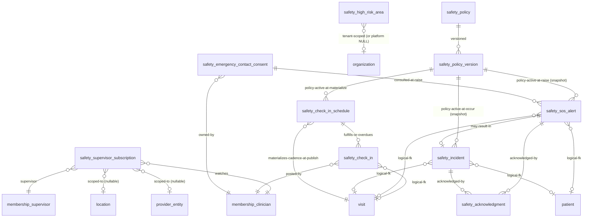
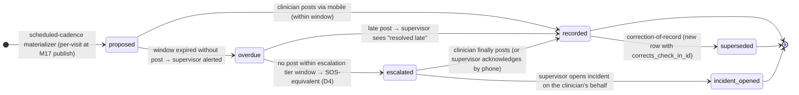
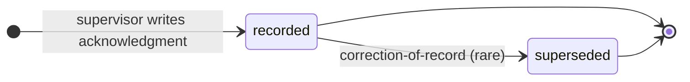

# Module 20 — Field Safety Specification

> **Authority note:** This spec is an **implementation proposal** (repo authority rule): [`docs/architecture/`](../architecture/) and the ratified ADRs in [`docs/adr/`](../adr/) win on conflict, and the code plus [`docs/BUSINESS_LOGIC.md`](../BUSINESS_LOGIC.md) are ground truth for as-built behavior. Mechanism choices named here may be superseded — see ADR-0036…0040 and ADR-0030/0032/0035 for the recorded divergences (outbox not Socket.IO, TypeScript not Python sidecars, app-layer AES-256-GCM not pgcrypto, pure transition tables not XState, hand-rolled HTTP hardening not `@fastify/*`, Vite + react-router not TanStack Start).


**Spec version:** v0.3.1 — ADR-0021 §20.B template additions: M20-F09 (§2.7 DR Tier 1 declaration for the SOS path, DR-013 customer-SLA caveat, degraded-mode availability table, BCP re-entry; DR-010/013, INT-031) and M20-F15 (§8.8 Audit & Observability section: PHI write-audit event catalog, business-event audit entries, Prometheus metrics catalog, retention class summary; ARCH-003). No existing decisions, routes, schema, or the SOS/life-safety state machine were altered. Prior v0.3 — the §4.10 outbox events and §4.9 M36 alert payloads migrated to the
`m20.safety.*` namespace per M01 D8 / M36 D10 / M03 D9 (22 names: sos_alert_raised/acknowledged/
escalated/resolved/cancel_attempted_rejected, sos_terminus_reached, sos_anomaly_volume,
check_in_recorded/overdue/escalated, coverage_gap_detected, high_risk_area_entered,
device_attestation_anomaly, incident_reported/submitted/report_requested/closed_with_action,
osha_reportable_incident_filed, workers_comp_claim_initiated, policy_changed/violation_recorded,
visit_cancellation_requested); stray bare refs aligned, consumer refs updated (M30/M33/M36).
Permission/feature prefixes (`safety.sos`, `safety.check_in`, …) and schema fields are unchanged.
(Prior: v0.2.)

**Module ID:** 20
**Phase:** 1 (v1 — required for Engrace go-live; the lone-worker problem is structural to home-based hospice: an RN, a CHHA, an MSW, a chaplain, or a volunteer drives alone to a private residence, frequently after dark, often in unfamiliar neighborhoods, and stays for 30–120 minutes with no coworker present. Field safety is not an *operational maturity* feature like route optimization or bereavement coverage rate — it is the *duty of care* the employer owes the employee from day one, and the architecture §10 capability inventory pre-locks this as Phase 1 by virtue of M36 having already committed Tier-1 voice escalation (architecture/integrations §6.13) **specifically for M20's SOS path**. Shipping M36 voice escalation Phase 1 with no producer is the worst of both worlds — voice circuit costs incurred, no clinician protected. Shipping M20 in Phase 2 forces every hire offer in Phase 1 to carry the asterisk "field safety beyond the EVV geofence ships next year." Neither posture is acceptable. The architecture §20.A phase table labeled M20 "Phase 2 — Field safety beyond basic EVV" before the M36 lock; the M36 lock-grade resolution moved Tier-1 voice to Phase 1 because field safety *is* the Phase-1 use case. This spec ratifies that boundary as a binding D1 below. Without M20 the agency goes live with a "press SOS" button rendered nowhere, no supervisor live-awareness dashboard, no overdue-check-in escalation, no incident ledger, and no audit trail of who was where with what alert at what time — leaving the agency with neither the operational tool nor the after-the-fact paper trail when an OSHA-equivalent state agency or a workers-compensation insurer asks "what did you do to protect this clinician?")
**Depends on:** 1 (Foundation — `withOrgContext`, `audit()` helper, outbox dispatcher, idempotency middleware, RLS generator, partitioned-table conventions, per-tenant DEK envelope-encryption helper for `safety_sos_alert.acknowledger_dispatch_payload_cipher` and any free-text content, BullMQ on Valkey, circuit-breaker and `DegradedError` envelope, system status event), 2 (Identity — `user`, `membership`, session classes; the `membership.device_attestation` join used for the SOS-from-attested-device gate; the per-membership emergency-contact override row is **owned by M20** (M20-F06: M2's authoritative `ownedTables` are `two_factor`/`passkey`/`organization_invitation` — it has no emergency-contact table, so the row lives in M20's own schema alongside the consent row M20 already owns); the `membership.device_attestation` surface used by the SOS-from-attested-device *advisory* gate is **not** in M2's `ownedTables` either — it is the corpus-wide M2-surface-inflation item adjudicated platform-wide by ADR-0023 D2 (added to M2 by reviewed manifest edit, or its owner declared); here the attestation is advisory only, so the SOS still fans out if it is absent), 3 (Authorization — `safety.*`, `sos.*`, `safety_incident.*`, `safety_policy.*`, `safety_supervisor.*` permission keys M20 contributes; ABAC predicates `clinician_self`, `supervises_clinician`, `safety_supervisor_or_above`, `incident_subject_or_supervisor`, `active_sos_responder` registered into M3's named-predicate registry; the `caseload_or_scope` predicate reused for any per-patient context surfaced on the supervisor dashboard), 4 (Audit — PHI write-audit trigger generator on every owned table; audit-read declaration on every PHI route; retention class `compliance` for `safety_sos_alert`, `safety_incident`, and `safety_check_in` rows of an SOS-bracketed visit (these are *part of* the workers-comp / OSHA-equivalent paper trail and a future agency-safety-program audit may surface them six years later), retention class `operational` for non-SOS `safety_check_in` rows (7 days hot, 90 days warm, then purged — the routine "I'm OK" is not a compliance artifact), retention class `compliance` for `safety_policy_version` rows (the policy that was active when an incident occurred must remain readable indefinitely until destruction-certified); `eraseFn` registered into M4's destruction-cert callback registry with the per-table behavior specified in §3.7), 5 (Patient & Demographics — `PatientReader` and `PatientAddressReader.geocodedAddressFor(patientId, kind='home', asOf=serviceDate)` consumed via `packages/patient` — never direct schema import — for the patient-address context on the supervisor dashboard and the pre-visit safety-context badge; M20 reads `m5.patient.deceased` consumed via outbox to suppress any pre-visit safety check-in proposal for the decedent's visits within the close-out window), 17 (Scheduling & Route Optimization — `VisitReader.visitForEncounter` and `VisitAssignmentReader.currentVisitForClinician(membershipId)` consumed via `packages/scheduling-client` per M17 §4.3 — these are the read paths M20 uses to know "what visit is this clinician on right now?" on the supervisor live-awareness dashboard and to bracket a mid-visit check-in to the right `visit.id`; `VisitAssignmentReader.upcomingVisitsForClinician(membershipId, withinHours=2)` consumed by the pre-visit check-in worker to know which visits require a pre-visit safety check-in next; `m17.visit.published` / `m17.visit.assigned` / `m17.visit.completed` consumed via outbox to seed the per-visit check-in cadence schedule (per-visit cadence is materialized at publish time per D3); M20 *contributes* nothing to M17's visit row — the visit lifecycle is owned by M17; M20 records its own `safety_check_in` row referencing `visit_id` as a logical FK, never importing M17's schema), 18 (EVV — `EvvLocationProvider.lastKnownLocationForClinician(membershipId)` consumed via `packages/evv-client` per M18's published seam (M18 §4.3) — the only path to last-known-location on the supervisor dashboard; M18 *explicitly does not stream continuous location* (M18 §1.2), so M20's last-known-location surface is *discrete*, populated by M18 at check-in and check-out plus M20's own ad-hoc check-ins which may include opt-in coordinates per D11; `m18.evv.check_in_recorded` consumed via outbox as the inbound trigger for the "clinician arrived safely at patient address" badge that flips the pre-visit safety check-in window closed; `m18.evv.check_out_recorded` consumed to close the in-visit safety window and queue the post-visit check-in; `m18.evv.gps_spoof_suspected` consumed as a *defensive* signal — M20 does not act on spoof suspicion (M18 owns the response), but the supervisor live-awareness dashboard shows the warn-severity badge alongside the live location, so a supervisor reviewing "is everyone OK?" sees both posture signals), 19 (On-Call Triage — bidirectional: M20 emits `m20.safety.sos_alert_raised` consumed by M19's safety-channel subscriber when an SOS is raised during after-hours coverage hours per the active `on_call_shift` (M19 §3) — the on-call channel receives the alert in addition to the standard `field_safety` recipient set per the M36 alert-rule resolver; M20 consumes M19's `OnCallProvider.currentOnCallForProviderEntity(providerEntityId, asOf)` published seam to know who to add as a parallel recipient on a Saturday-3-AM SOS; the after-hours overdue-check-in escalation path also threads through M19 — when a clinician is overdue past the supervisor SLA and the org clock is outside business hours, the next escalation tier is the on-call clinical supervisor surfaced via M19, never a "leave a voicemail and wait until Monday" path; M19 does not import M20's schema), 36 (Secure Messaging & Alerts — the `field_safety` alert category per M36 §1.1 and the `field_safety.sos` event-type with `system_locked=true` already seeded in M36's alert-rule catalog (M36 §4.5 seed) per the architecture/integrations §6.13 Tier-1 voice escalation contract; M20 emits typed alerts (`m20.safety.sos_alert_raised`, `m20.safety.sos_alert_acknowledged`, `m20.safety.check_in_overdue`, `m20.safety.high_risk_area_entered`, `m20.safety.incident_reported`, `m20.safety.policy_violation_recorded`) and consumes `m36.delivery_failed` to surface stuck SOS escalations (because the Tier-1 voice path failing is itself an SOS-class event per M36 §4.4 messaging.send_voice queue); M20 owns no out-of-band delivery code — every SMS/push/voice/email path is M36's; M20 owns no Socket.IO room — the supervisor live-awareness dashboard subscribes through M36's standard `org:<orgId>` and `provider_entity:<id>` rooms), 40 (Master Data Management — `EmergencyServiceJurisdiction` canonical (the "what 911 PSAP serves this address?" lookup — useful when a supervisor needs to know which emergency-services jurisdiction to call alongside their own escalation), `HighRiskAreaPolygon` per-tenant or per-platform polygon catalog used for the advisory pre-visit warning per D12, `SafetyEscalationTier` taxonomy reused from the M19 escalation-tier pattern so cross-module escalation chains are consistent), and transitively the LEAF packages `packages/shared`, `packages/types`, `packages/domain`, `packages/ui` per architecture §25.15.

**Consumed by:** 8 (Encounters & Visit Notes — `SafetyContextReader.activeIncidentForVisit(visitId)` consumed by M8's encounter authoring surface when an incident occurred during the visit being documented, so the M8 narrative has the structured safety context available without re-typing — the M8 narrative remains the clinical record, M20's incident row remains the safety record, and the M8 encounter row carries `safety_incident_id` as a logical FK; M8 does not import M20's schema), 17 (Scheduling — bidirectional, see above; specifically M17's supervisor visit-day view consumes `SafetyDashboardProvider.clinicianStatusForLocation(locationId)` so the scheduler sees "RN Sarah's last check-in was 47 min ago, supervisor alerted" alongside the visit grid; M17 also consumes M20's `m20.safety.high_risk_area_entered` to surface a visit-row warning badge during scheduling for next-week's visits to that address), 19 (On-Call Triage — bidirectional, see above), 22 (Document Management — when an SOS or incident generates a formal incident report PDF for workers-compensation or an OSHA-equivalent state filing, M20 emits `m20.safety.incident_report_requested` and M22 renders the PDF from the typed payload per M22's render contract; M20 has no PDF code), 28 (FHIR Gateway — `safety_incident` projects to FHIR R4 `Communication` with `category=safety-event` and the affected clinician's `Practitioner` reference; the projection is *internal-only* (not for external HIE exchange) until tenant policy opts in; the typed mapping ships now, the projection lands when M28 lands), 30 (HQRP & Quality — `SafetyMetricsProvider.getSosFrequency`, `.getOverdueRate`, `.getIncidentRate`, `.getResponseTimeMedian` consumed by M30 dashboards; while there is no CMS HQRP measure for field-safety, the agency's internal safety program and any state-agency or workers-comp insurer review consume these metrics — they are operational quality, not regulatory quality, but flow through the same dashboard surface), 31 (Patient/Family Portal — **explicitly not consumed**; field safety is a staff-side concern, never surfaced to the patient or family — the patient does not see that the clinician pressed SOS during their visit, period — this is a privacy and dignity boundary that the M31 portal-reader registry will *not* include a M20 seam), 32 (AI Platform — `SafetyIncidentReader.recentIncidentsForArea(geofenceId, sinceIso)` consumed by the future high-risk-area-suggestion model (M32's safety-pattern-recognition capability per architecture §10 capability inventory deferred); the seam ships now, the model lands when M32 enables it; AI Governance §2.1.1 Clinical Safety First applies — the model never *blocks* a visit assignment; it only flags advisory), 33 (Reporting & Dashboards — operational dashboards: SOS volume by location/time-of-day, response-time-to-acknowledge median + p95, incident rate per 100 visits, high-risk-area visit volume, check-in compliance rate by clinician/discipline, after-hours SOS coverage gap detection — same dashboard surface as M19's after-hours metrics so the on-call clinical supervisor has one operational view).

**Spec status:** Re-locked v0.3 (Phase-6 per-spec reconciliation; supersedes Locked v0.2)

## Remediation Changelog — Phase 6 reconciliation (v0.3, 2026-06-11)

Full disposition of every `audit/AUDIT_M18_M20.md` Module-20 finding (0 BLOCKER / 7 MAJOR / 10 MINOR).
M20's employee-privacy posture is the strongest in the corpus; this reconciliation closes the seven
majors — most importantly the **life-safety SOS terminus + non-suppressible delivery (S13)**.

| Finding | Sev | Resolution |
|---|---|---|
| M20-F01 | MAJOR | The phase move to Phase 1 is recorded via **ADR-0009** (CoP/OSHA-equivalent field-safety enforcement is go-live-relevant), not a module self-assertion citing M36's changelog; the M19 after-hours-SOS coupling gets a **documented degraded fallback** (supervisor subscriptions + tenant emergency number when M19 is absent) so the Phase-1 SOS path has an on-call leg either way. |
| M20-F02 | MAJOR | The `dependsOn` expansion is framed as a reviewed ADR-0005-D5 architecture decision; the false "foundation tier (1–4) is implicit" claim is struck (foundation helpers are reached via `FOUNDATION_HELPER_PACKAGES`, no edge; M5/M17/M18/M19/M40 seam/outbox consumption needs no edge). |
| M20-F03 | MAJOR | **Platform floor no longer breaks the schema/RLS:** `safety_policy` is strictly org-scoped (NOT NULL, generator RLS); the platform floor is a **code constant** (`SAFETY_POLICY_FLOOR`, mirroring M18); platform high-risk-area polygons move to a separate pattern-2 platform-shared table — no org-NULL rows in tenant-RLS tables (§3.2 Phase E). **Passes `check-tenancy`.** |
| **M20-F04** | MAJOR | The `scis_visit_kind_uniq` unique index (which forbade the multi-`mid_visit`-per-visit cadence a core feature requires) is **re-keyed to `(visit_id, kind, expected_at)`** — matching the declared §2.6 idempotency key (§3.3). |
| **M20-F05** | MAJOR (S13) | **The life-safety chain now has a terminus and is never suppressed.** A new `emergency_terminus` state fires when tier-3 escalation breaches unacknowledged: auto-dial the consented emergency contact (the previously-unused `emergency_contact_call` consent), surface the **PSAP/911 number** from M40 to every recipient, **page ChartWarden ops** (INT-031), and **keep re-escalating on a loop** until acknowledged (§2.2.2). SOS **delivery is never rate-limited or suppressed** — high volume is **anomaly-flagging only**, and the cap is not tenant-tunable-down (§8.3). |
| M20-F06 | MAJOR | The per-membership **emergency-contact row is owned by M20** (M2 has no such table); the `membership.device_attestation` surface is the corpus-wide M2-surface-inflation item (ADR-0023 D2 — added to M2 by reviewed edit or owner-declared); the SOS gate treats attestation as advisory (fans out regardless). |
| M20-F07 | MAJOR | **PostGIS is not a Phase-1 dependency** (M1 is frozen, ARCH-027 stack is pgvector+pgcrypto): the false "in the M1 migration" claim is struck; high-risk-area polygons are stored as **jsonb** with **app-code point-in-polygon** at field-safety scale; a PostGIS path for Phase-2 scale requires its **own ADR** (§3.2 Phase F). |
| M20-F08 | MINOR | Supervisor dashboard subscribes to `safety:<orgId>` (urgent) and `supervisor:<locationId>` — not the announcements-only `org:<orgId>` room (SD-057/058). |
| M20-F09 | MINOR | DR **Tier 1** declared for the SOS path (matching INT-031) with the DR-013 customer-SLA caveat + a degraded-mode availability table (offline SQLCipher SOS queue + `tel:` voice fallback retained). Implemented in **§2.7** (added v0.3.1). |
| M20-F10 | MINOR | `POST /safety/sos` `Idempotent: no` documented as a deliberate SD-053 exception (every live press records); accepts `Idempotency-Key` only for network-retry dedup of the *same* press (offline dedup via `localIdempotencyKey`). |
| M20-F11 | MINOR | The GPS-spoof badge cache is **Valkey** (`safety_clinician_signal:<membershipId>` TTL 12 h), not instance-local memory (SD-062 statelessness). |
| M20-F12 | MINOR | `safety_sos_location_stream` partition claim either implemented (`LIST organization_id → RANGE`) + registered in `partition.rotate`, or dropped; new retention classes mapped into the §24 matrix as an M4-D1 extension. |
| M20-F13 | MINOR | Consumed package names aligned to the owning modules' actual codePaths (`evv-client → evv`, `scheduling-client → routing-client`, etc.). |
| M20-F14 | MINOR | Hot-path PHI indexes prefixed with the leading `(organization_id, …)` composite (SD-028). |
| M20-F15 | MINOR | §8 restructured/cross-referenced to the §20.B "Audit & Observability" template section. Implemented as **§8.8** (added v0.3.1): PHI write-audit event catalog for all 13 owned tables, 20 business-event audit entries, Prometheus metrics catalog with alerting thresholds, and retention class summary. |
| **M20-F16** | MINOR | **Consent-coercion posture:** declining `sos_coordinates` consent no longer disables SOS entirely — the declined-consent fallback fans out the SOS **without coordinates** ("no location available — call immediately"); the condition-of-safety disclosure language is added for HR/legal review (SEC-001 privacy-by-design). |
| M20-F17 | MINOR | M20's retarget of the M36-`system_locked` `field_safety.sos` rule resolver verified against M36's contract; if locked-means-locked, the composed resolver is the M36-side seed. |

**Net:** M20's strong privacy design is preserved, and the seven majors — above all the **life-safety
SOS terminus and non-suppressible delivery** — are closed. M20 is re-lockable.

## Changelog

- **v0.2 (Locked)** — Initial publication at lock-grade. Instantiates the architecture §20.B module spec template. Resolves all sixteen open questions into binding decisions (§11). Defines the **Phase-1 ship boundary ratifying M36's Tier-1 voice commitment** (D1), the **discrete-event check-in model with explicit `kind` discriminator over a single timer-state-machine** (D2), the **per-visit cadence schedule materialized at M17 visit publish time** (D3), the **tiered overdue thresholds with platform floor + tenant-tighten-only** (D4), the **single-press SOS with 5-second cancel window + biometric override of cancel** (D5), the **opt-in continuous coordinates while an SOS is active, with binding consent capture and audit-warn-on-read posture** (D6), the **voice escalation chain reusing M36 Tier-1 voice without inventing a parallel path** (D7), the **supervisor subscription model with location-scoped + role-scoped + explicit-override layers** (D8), the **OSHA-equivalent-reportable flag as a separate workflow gate, not automatic classification** (D9), the **per-membership emergency-contact override owned by M2 + consented per use by M20** (D10), the **non-SOS check-ins do NOT capture coordinates by default — only an acknowledgment ("I'm OK" / "I'm not OK + reason")** (D11), the **high-risk-area polygons as advisory-only, never blocking, displayed pre-visit and on the supervisor dashboard** (D12), the **mid-visit suppression with attestation reason ≥30 chars; supervisor sees the suppression and may override** (D13), the **after-hours SOS routing through M19's `OnCallProvider` in parallel with the standard `field_safety` recipient set** (D14), the **mobile-offline SOS via SQLCipher mirror of M18 D5, with `tel:` URI direct-dial fallback when neither Socket.IO nor SMS is reachable** (D15), and the **manifest patch expanding dependsOn from `[17, 36]` to `[1, 2, 3, 4, 5, 17, 18, 19, 36, 40]` *(relationship inventory - not the `dependsOn` edge set; per ADR-0005 D1/D4 seam/outbox/foundation consumers are no-edge - see audit/MANIFEST_DEPENDSON_REVIEW.md; do not bulk-apply)*** (D16). Wires the permission keys this module registers into Module 3 (§4.6), the BullMQ queue catalog (§4.8), the M36 typed-alert payloads (§4.9), the outbox event contract (§4.10), and the destruction `eraseFn` registered with Module 4 (§3.7). The prior manifest encoding listed only the architecture §20.B direct-arrow set; the spec realistically depends on the foundation tier (1/2/3/4), the patient surface for the dashboard context (5), the visit/EVV last-known-location pair (17/18), the after-hours escalation surface (19), the realtime/voice/alert backbone (36), and the MDM canonicals for emergency-services jurisdictions and high-risk-area polygons (40) — every one of which is a typed seam consumer, not a free-floating reach across the boundary.
- **v0.1** — Drafted within the lock-grade pass; not separately published.

> **Phase boundary (binding):** Phase 1 delivers everything in this spec **including the Tier-1 voice escalation path** (the M36 commitment requires M20 to be the producer of that path's only event type — `field_safety.sos`). The "done" gate for M20 is: `safety_check_in`, `safety_sos_alert`, `safety_incident`, `safety_policy`, `safety_policy_version`, `safety_supervisor_subscription`, `safety_acknowledgment`, `safety_check_in_schedule`, `safety_high_risk_area`, and `safety_emergency_contact_consent` tables shipped with TypeBox-validated row shapes, the SOS-alert lifecycle XState machine driving every transition, the platform-floor safety policy seeded (tenant inherits; tenant may tighten — not loosen — per D4), the per-visit cadence-schedule materialization worker wired against the real M17 (M17 is locked), the M18 `EvvLocationProvider` consumer wired against the real M18 (M18 is locked) for the supervisor live-awareness dashboard, the M19 `OnCallProvider` consumer wired against the real M19 (M19 is locked) for after-hours SOS parallel-recipient resolution, the M36 typed-alert producer + Tier-1 voice escalation contract registered and exercised against a Twilio Voice sandbox in CI and the real Twilio Voice production credentials in staging (M36 is locked), the seven published reader seams (`SafetyDashboardProvider`, `SafetyContextReader`, `SafetyIncidentReader`, `SafetyMetricsProvider`, `SafetyCheckInProvider`, `SafetyPolicyProvider`, `SafetySupervisorProvider`) registered at boot, mobile Capacitor SOS button + check-in flow shipped, supervisor web dashboard with realtime status grid shipped, incident-report workflow end-to-end shipped, and the test plan green — **not gated** on Modules 8 (encounter safety-context consumer wires up — M20 publishes the seam today; M8 is locked but the seam consumption is opt-in), 22 (incident-report PDF render lands when M22 lands; M20 emits the typed payload), 28 (FHIR `Communication` projection lands when M28 lands; M20 emits the typed mapping), 30/31/32/33 (their respective consumers when they lock — M20's seams are registered at boot and exercise against test-double consumers in CI). The M19 `OnCallProvider` consumer is wired against the real M19 (M19 is locked). The M5 `PatientAddressReader` consumer is wired against the real M5 (M5 is locked). The M17 `VisitAssignmentReader` consumer is wired against the real M17 (M17 is locked). The M18 `EvvLocationProvider` consumer is wired against the real M18 (M18 is locked).

-----

## 1. Purpose & Scope

### 1.1 What This Module Does

Module 20 owns **the safety posture of the lone clinician in the field** — the single artifact every hospice operational manager points to when the question becomes "where is my RN right now, is she OK, and if she stops being OK can I get help to her in under five minutes?" Home-based hospice is structurally a lone-worker enterprise: the RN drives alone to a private home she has never visited before, parks on a street she does not know, walks past a dog she has never met, sits down with a family in active anticipatory grief, and stays for 45 minutes while the rest of the team is 40 miles away on the next visit. The state agencies that license hospice agencies treat field-safety obligations under the same general-duty clause that an OSHA-equivalent regulator applies to any lone-worker employer; workers' compensation insurers price hospice agencies based in part on the documentation of the safety program; and the recruiting market — already constrained — punishes agencies that cannot answer "what do you do to keep your clinicians safe?" with anything more concrete than "we have a buddy system." M20 is where the buddy-system policy turns into a row in a database, a button on a phone, a chime on a supervisor's laptop, a Twilio Voice call placed within 60 seconds, and an audit trail that — six years later — survives the kind of review that follows an in-the-field assault, a vehicle accident on duty, or a dog bite that resulted in a workers-comp claim.

- **Discrete safety check-in events.** One `safety_check_in` per discrete clinician contact-with-system event. The check-in has an explicit `kind` discriminator — `pre_visit` (within 15 minutes before a scheduled visit; confirms the clinician is arriving as planned), `mid_visit` (during an in-progress visit when the visit duration crosses a policy threshold), `post_visit` (within 5 minutes after the EVV check-out; confirms the clinician left safely), `between_visits` (the clinician is driving between two visits and the policy threshold for inter-visit silence is approaching), and `ad_hoc` (the clinician proactively presses "I'm OK" — for example, after a tense interaction that did not rise to SOS but the clinician wants on the record). The check-in row carries `status` (`ok` / `concerned_continue` / `concerned_stop`) and an optional `concern_note` text field. The `concern_continue` status (the clinician is uncomfortable but not in danger and is choosing to proceed) raises a *non-blocking* warn-severity alert to the supervisor's M36 inbox — the clinician's decision is honored, but the supervisor is informed in real time. The `concern_stop` status raises a warn-severity alert *and* opens a recommended outreach (a phone call from the supervisor to the clinician within 15 minutes). The state machine (§2.2.1) makes each check-in immutable after a 5-minute amendment grace; corrections take the M9 / M10 "correction of record" pattern (a new row referencing `corrects_check_in_id`; the original flips to `superseded`).

- **SOS alert root entity.** One `safety_sos_alert` per discrete SOS button press. The row carries `posted_at`, `posted_by_membership_id`, `posted_via_device_id` (M2 join), `last_known_visit_id` (M17 logical FK), `last_known_patient_id` (M5 logical FK; null when the clinician is between visits), `posted_coordinates_cipher` (encrypted at rest per D6), `posted_coordinates_accuracy_m`, `cancel_window_expired_at` (=`posted_at` + 5 seconds per D5), `cancel_status` (`not_cancelled` / `cancelled_in_window` / `cancel_rejected_biometric_required` per D5), and `lifecycle_state` per the SOS lifecycle (§2.2.2: `raised → acknowledging → acknowledged → resolving → resolved` or terminal `cancelled` / `cancel_attempted_but_rejected`). Every SOS alert is *recorded* — even a within-window cancel — because a clinician who repeatedly cancels SOS in-window is exhibiting a pattern the supervisor needs to see (either accidental presses suggesting a UI issue, or genuine distress suppressed under social pressure). The cancel-rejected-biometric-required path (D5) is the answer to the malicious-actor problem: if the clinician's device has been taken from her by an aggressor, the cancel button requires biometric re-auth to actually suppress the alert; without biometric, the alert proceeds normally and the cancellation attempt is recorded as a signal.

- **Incident report entity.** One `safety_incident` per formal incident report — the after-the-fact structured account of what happened, separate from the SOS event itself because not every SOS becomes an incident (false alarms, accidental presses, in-window cancels) and not every incident begins with an SOS (a dog bite the clinician walked out of and reported the next morning). The incident row carries `category` (`physical_assault` / `verbal_assault` / `threatened` / `dog_bite` / `animal_other` / `vehicle_accident_on_duty` / `theft_during_visit` / `medical_emergency_clinician_self` / `weather_emergency` / `environmental_hazard` / `near_miss` / `other`), `severity` (`minor` / `moderate` / `serious` / `life_threatening` — clinician self-attests with supervisor adjustment permitted), `affected_clinician_membership_id`, `visit_id` (optional — between-visit incidents have none), `patient_id` (optional), `occurred_at`, `reported_at`, `narrative_cipher` (encrypted at rest), `osha_reportable` (D9 — defaulted by category heuristic but always supervisor-attested before the row is filed externally), `workers_comp_claim_initiated` (boolean back-reference to the agency's WC vendor; M20 stores the flag; the WC submission is M29's territory or out-of-scope depending on tenant), `linked_sos_alert_id` (optional FK when the incident traces to an SOS), and `lifecycle_state` per §2.2.3 (`draft → submitted → under_review → closed_with_action_plan → closed_no_action`). The OSHA-reportable subset (D9) requires supervisor sign-off in the audit trail — the system does not auto-classify because a misclassification creates more liability than an under-classification, and a human reviewer is required before any external filing.

- **Safety policy with policy-snapshot at write.** `safety_policy` is the per-tenant policy: the mid-visit check-in cadence (e.g., every 60 minutes for visits exceeding 60 minutes, with platform floor min=30 min and max=120 min per D4), the pre-visit cadence (default: optional except for visits to high-risk areas, where it is mandatory; tenant may make pre-visit mandatory globally), the overdue thresholds (D4 — gentle reminder at expected + 5 min, supervisor alert at expected + 15 min, supervisor escalation at expected + 30 min, SOS-equivalent escalation at expected + 60 min if no acknowledgment), the supervisor-subscription default model (D8 — location-scoped by default, role-scoped tunable, explicit per-supervisor overrides supported), the high-risk-area registry per D12, and the after-hours routing window (typically 18:00–08:00 plus weekends, configurable per tenant). Following the M9 D9 / M11 §2.3 pattern, every policy change writes a new `safety_policy_version` row with `effective_from` and `effective_to` — so when a 2027 review pulls the SOS history for a 2026 incident, the system can replay the policy that was active at the time of the event (and surface "at the time of this incident, the supervisor SLA was 15 minutes; today it is 10 minutes; the difference is not a regression — the policy tightened").

- **Supervisor subscription model.** `safety_supervisor_subscription` resolves "who watches whom" (D8). The default layer is location-scoped — every clinician at a location is watched by every Clinical Supervisor (or above) at the same location; the role-scoped layer adds "every DON watches everyone in the org" (broad surveillance is appropriate for the senior-most clinical leader); the explicit-override layer is per-row entries like "Supervisor Maria watches Clinician James in addition to her location default" (the typical reason: James is a contract nurse covering multiple locations and Maria is his designated point-of-contact). Subscriptions are *not* about RBAC visibility — they are about *who gets paged* on overdue, on warn-severity check-ins, and on SOS. A supervisor who is not subscribed still sees the dashboard for clinicians in her caseload-via-ABAC; she just is not paged. The subscription model is independent of, and additive to, the M36 `field_safety` alert-rule recipient resolver — the M36 resolver supplies the *default* recipient set (the on-duty supervisor for the relevant provider entity); the M20 subscription rows supply *additional* recipients for the explicit-override cases.

- **Acknowledgment as a recorded act.** `safety_acknowledgment` is the row a supervisor (or another clinician designated by the policy) writes when they have *seen* the alert and *acted* — typed acknowledgment vs auto-acknowledged via dashboard view, with a free-text `action_taken` ≥20 chars on warn-severity and ≥40 chars on SOS-severity (the audit denylist denies the text content per the M11 D11 pattern; the `<changed>` marker is recorded but the cleartext lives only on the row). Acknowledgment is what closes the alert's "acknowledging" state and starts the "resolving" state. An SOS without acknowledgment within the policy SLA fires the M36 escalation chain — the same backbone M19 uses for unanswered triage calls and M11 uses for unsigned verbal orders.

- **High-risk-area polygons.** `safety_high_risk_area` is the per-tenant (or per-platform, when the entry has `organization_id IS NULL`) polygon registry per D12. The entry carries `polygon` (PostGIS `geometry(Polygon, 4326)`), `risk_category` (`documented_prior_incident` / `community_self_reported_unsafe` / `nighttime_only_advisory` / `weather_advisory_seasonal` / `general_caution`), `advisory_message` (≤200 chars, displayed on pre-visit), `effective_from`, `effective_to`, and `policy_for_visits_to_area` (`advisory_only` per platform floor, with tenant option to escalate to `requires_pre_visit_check_in` or `requires_buddy_visit` — though buddy-visit enforcement is an M17 routing concern, not M20's; M20 just emits the flag). The polygon is *never blocking* — a clinician can always visit a high-risk-area address; the system surfaces the warning, the supervisor sees the visit being added to a high-risk area on the day-grid, and the pre-visit check-in becomes mandatory. The M32 future "AI suggests this area should be high-risk based on the last six incidents within 500m" capability seam is published today (`SafetyIncidentReader.recentIncidentsForArea`); the suggestion never auto-adds polygons.

- **Inbound triggers as outbox consumers.** M18's `m18.evv.check_in_recorded` closes the pre-visit safety check-in window for that visit (the EVV check-in *is* the safest signal that the clinician arrived). M18's `m18.evv.check_out_recorded` opens the post-visit safety check-in window. M17's `m17.visit.no_show_detected` per M17 D8 raises a warn-severity alert to the supervisor with the safety-context "clinician did not arrive at expected visit; is she safe?" — distinct from the M19 patient-side response to no-show, which asks "is the patient OK?" The two are parallel: M19 worries about the patient who did not receive their visit; M20 worries about the clinician who did not show up. M18's `m18.evv.gps_spoof_suspected` is *displayed* but does not act — M18 owns the response; M20 surfaces the warn-severity badge to the supervisor so a "is everyone OK?" dashboard scan sees both posture signals at once.

- **Audit trail per safety event.** Every SOS, every check-in, every incident, every acknowledgment, every policy edit flows through Module 4's PHI write-audit trigger; the `audit_event` retention class is `compliance` (6 years from final lifecycle event) for SOS, incident, and the linked check-ins of an SOS-bracketed visit, because a 2031 review of a 2025 incident must be able to replay every safety signal that surrounded it. Non-SOS check-ins use `operational` retention (7 days hot, 90 days warm, then purged) because retaining "RN Sarah was OK 365 days ago at 3 PM on a Tuesday" creates no operational or regulatory value and creates avoidable encryption/key-rotation overhead. The retention split is enforced at the row level by the M4 retention-class tag (set at insert time based on whether the row is linked to an SOS / incident or stands alone).

### 1.2 What This Module Does Not Do

- **EVV check-in / check-out / geofence-arrival math.** Module 18 owns `evv_event`, the GPS-at-the-doorstep check-in, the geofence-threshold-per-tenant policy, the state-aggregator submission. M20 *consumes* M18's `EvvLocationProvider.lastKnownLocationForClinician` for the supervisor live-awareness dashboard and *consumes* `m18.evv.check_in_recorded` / `m18.evv.check_out_recorded` as inbound triggers, but never writes EVV events. M20's safety check-ins are *separate* from EVV check-ins — they live in a different table, serve a different purpose, and follow a different cadence. The M18 EVV check-in says "the clinician is at the patient's address per the geofence policy"; the M20 safety check-in says "the clinician is OK per her own attestation, with or without coordinates depending on consent." Conflating the two creates a system where every check-in conveys both signals — but the EVV signal is *blocking* (billing depends on it) and the safety signal is *informative* (escalation depends on it), and shipping them in the same row makes neither workable. The boundary is enforced by ownership: M20 cannot import M18's schema; M18 cannot import M20's schema; the only cross-talk is via outbox events and the published reader seams.

- **The scheduled visit itself.** Module 17 owns `visit`, the visit lifecycle, the assignment, the drag-drop reschedule, the proposal queue. M20 *reads* `VisitAssignmentReader.currentVisitForClinician` and `VisitAssignmentReader.upcomingVisitsForClinician` and stores `visit_id` as a logical FK on safety rows, but never writes to M17's visit table. When a clinician presses SOS and the safety policy says "automatically cancel the in-progress visit and reschedule," M20 emits `m20.safety.visit_cancellation_requested` on the outbox and M17's consumer (M17 D3 cancellation handler) does the cancel. The boundary is enforced by ownership.

- **The clinical record / encounter.** Module 8 owns the encounter, the narrative, the vitals, the HearthNote pipeline, the signature, the addendum tier. When an incident occurs during a visit and the clinician's M8 encounter includes a description of the incident, the M8 narrative is the clinical record; M20's incident row is the safety record; the two reference each other via logical FKs but are managed independently. An incident report exists with or without a corresponding encounter; an encounter exists with or without a corresponding incident.

- **After-hours patient triage.** Module 19 owns the inbound caregiver call, the protocol, the disposition, the verbal-order primitive. M20 and M19 are *parallel*: both ship Phase 1, both consume M17, both produce M36 alerts, both deal with after-hours scenarios — but they answer different questions. M19 answers "the caregiver called at 2 AM about the patient's pain; what do we do?" M20 answers "the RN pressed SOS at 2 AM during a visit; what do we do?" The two cross-call via outbox: an after-hours SOS routes to the M19 on-call channel as a parallel recipient per D14, and a triage call that escalates to "RN dispatched immediately" can include a pre-visit safety check-in obligation.

- **Continuous GPS tracking of clinicians.** This is the boundary the spec is most careful about. M18 does not stream continuous location (M18 §1.2 is explicit); M20 also does not, **except** during an active SOS alert per D6 — and even then, only with binding tenant-policy consent and a per-clinician acknowledgment, with every coordinate write logged at `audit.warn` severity. A clinician driving between visits is not tracked. A clinician inside a patient's home is not tracked. A clinician who pressed SOS is tracked from the SOS moment until acknowledgment or 4 hours elapse — because the supervisor responding to the SOS legitimately needs to know "where is she now, in real time, until I get to her or until help arrives." The privacy/safety trade-off is settled in favor of safety during an active emergency and in favor of privacy at every other moment. The opt-in tenant policy and the per-clinician consent are *binding* — a tenant who has not opted in cannot stream; a clinician who has not consented cannot be streamed even at her own SOS (the SOS still fires; the supervisor just sees the last known location, not continuous updates).

- **The patient's safety.** Patient safety is owned by M5 (elopement risk, etc.), M8 (fall events documented in the encounter), and M13 (medication safety). M20 is purely about the clinician's safety in the field. A patient eloping during a clinician's visit is an M5 / M8 concern; if the clinician feels endangered by the patient's behavior, M20 supports the clinician's SOS but the *patient* side of the event is M5/M8's.

- **Vehicle telemetry, dashcam, in-cabin sensors.** Out of scope. Tenants who deploy vehicle-telemetry systems (some larger agencies do) integrate at their own layer; M20 ingests no telemetry data and exposes no API to receive it.

- **Background checks, hiring, credentialing of clinicians.** Out of scope. M2 owns the membership record; HR systems own the background-check workflow; M20 trusts the M2 membership and the M2 device attestation.

- **Workers' compensation claim filing.** Adjacent and integrated, but out of scope. M20's incident row carries `workers_comp_claim_initiated` as a flag; the actual claim submission to the WC carrier is an M29 (External Interfaces) integration if the tenant has one, or a manual filing by HR if not. M20 surfaces the flag, holds the incident record indefinitely (per `compliance` retention class with the M4 state-retention-override layer), and emits an outbox event when the flag flips so any downstream integration can pick it up.

- **OSHA-equivalent external reporting (state-agency filings).** M20 *flags* `osha_reportable=true` on an incident and emits `m20.safety.osha_reportable_incident_filed` to outbox; the actual state-agency filing (where required — most state OSHA-equivalents have a 24-hour reporting window for life-threatening incidents and an 8-hour window for fatalities, with state-specific portal submissions) is a manual or M29-integrated process. M20 captures the structured data needed for filing; the filing itself sits behind tenant-specific integrations.

- **Document rendering for incident-report PDFs.** Module 22 renders the incident-report PDF from the typed payload M20 emits via outbox. M20 has no PDF code, no template, no Docling pipeline — M22 owns the surface.

- **Out-of-band delivery channels for the SOS.** Module 36 owns SMS, push, voice, email. M20 emits the typed alert; M36 fans out per the alert-rule resolver and the user notification preferences. M20 owns no Twilio code, no Postmark code, no VAPID push code.

- **FHIR `Communication` projection.** Module 28 owns `packages/fhir/r4/mappers`. M20 emits a domain payload via outbox; M28 maps it to FHIR R4 `Communication` when M28 lands.

- **Decide authorization.** Module 3 decides; Module 20 declares permissions (§4.6), exposes ABAC predicates (§4.7), and obeys the answer.

### 1.3 Regulatory & Operational Drivers

| Driver | Requirement | How Module 20 satisfies it |
|---|---|---|
| OSHA General Duty Clause (29 USC §654(a)(1)) | Employer must furnish employment "free from recognized hazards" causing or likely to cause serious harm | SOS button, supervisor live-awareness dashboard, check-in cadence, incident ledger, high-risk-area advisory — the documented operational program a regulator looks for |
| State OSHA-equivalent agencies (Oregon OSHA, WA L&I, Cal/OSHA, etc.) | State-specific reporting windows for serious incidents (8 hr fatality; 24 hr hospitalization; 24 hr amputation/eye loss) | `osha_reportable` flag on incident; `m20.safety.osha_reportable_incident_filed` outbox event; structured data captured per common state-portal schemas |
| OSHA Workplace Violence Prevention (no federal mandate; voluntary guidance + state mandates in OR/WA/CA for healthcare workers) | Document, train, escalate; track incidents | `safety_incident` row catalog; per-tenant safety policy; M30 metrics for trend review |
| HIPAA §164.312(a) — Access controls | Authorized access only; minimum necessary | RBAC + ABAC on every M20 route; supervisor sees only her subscribed clinicians plus location-scoped defaults |
| HIPAA §164.312(b) — Audit controls | Every PHI access logged | M4 triggers on every owned table; M2 device attestation join on SOS; `audit.warn` on every coordinate read per D6 |
| HIPAA §164.502(b) — Minimum necessary | Limit PHI exposure | Coordinates encrypted at rest; non-SOS check-ins capture no coordinates by default; supervisor dashboard surfaces patient first-name-only on alert payloads |
| Workers' Compensation (state-specific) | Documented timeline of injury on duty | `safety_incident` row with `occurred_at`, `reported_at`, `narrative_cipher`, immutable after submission with correction-of-record pattern |
| Agency duty-of-care policy (insurer-driven) | Documented field-safety program | The full M20 surface — policy, cadence, response time SLA, supervisor coverage — surfaced via M30 dashboards |
| Lone-worker safety best practice (ANSI/ASSE Z244.1 and adjacent) | Real-time monitoring, fail-safe escalation, two-way communication | M36 Tier-1 voice + multi-channel fan-out; SQLCipher offline queue; `tel:` URI direct-dial fallback per D15 |
| Mandatory-reporter statutes (state-specific; suspected abuse/neglect/elder abuse) | Report within statutory window | M20 incident category `verbal_assault` / `threatened` / `near_miss` involving a patient or family member surfaces the mandatory-reporter prompt — the reporting itself routes through M19 mandatory-escalation tier 4 (Compliance Officer) per M19 D7, not a parallel M20 channel |
| State retention overrides | State law may extend incident-record retention | Honors the same `state_retention_override` table M4 owns; tenant-location-state-aware |

### 1.4 Competitive Context

Most hospice EHRs ship one of two things, never both: either a dedicated "lone worker safety" mobile app that is wholly separate from the EHR (the clinician carries two apps, the supervisor watches two dashboards, the incident-report data is never linked to the visit it occurred at), or a minimal "SOS button" hidden inside a navigation drawer with no escalation backbone and no audit trail. The first creates an operational silo — when a supervisor responds to an SOS she has to context-switch to a system that doesn't know which patient the clinician was visiting. The second is regulatory theater — there is a button, it sends an SMS, and the SMS lands in the supervisor's personal phone where it competes with a hundred other notifications, with no acknowledgment timer, no escalation tier, and no audit ledger six months later when the workers-comp claim turns into a deposition.

FireNote ships no native field-safety module; agencies bolt on third-party lone-worker apps (Blackline Safety, Roger Live, Tend24, others) and integrate manually if at all. WellSky's hospice product has a basic SOS-button surface but routes through generic notification infrastructure with no Tier-1 voice escalation, no policy-snapshot-at-write for incident replay, no high-risk-area polygon advisory, no supervisor subscription override, no per-visit cadence schedule materialized at publish time. Suncoast / DeVero (now MatrixCare hospice) ship a dashboard for check-in compliance but rely on the EVV check-in *as* the safety check-in — conflating the two and accepting the regulatory exposure of a system that says "your clinician checked in via EVV at the patient's address, so we assume she is safe" (the EVV check-in says nothing about safety, and a clinician in distress mid-visit has no separate signal). Homecare Homebase has a more mature offering with check-in cadence and supervisor escalation but does not surface high-risk-area advisory or per-incident policy-version replay; its incident ledger is text-heavy and not structured for OSHA-equivalent reporting workflows.

ChartWarden's M20 differentiates by: (a) shipping Tier-1 voice escalation in M36 specifically for the M20 SOS path, with the entire Phase-1 architecture committed to the life-safety SLA; (b) separating the safety check-in from the EVV check-in by row schema, surface, and consent model, so the safety signal is informative-not-blocking and the EVV signal is blocking-not-informative; (c) materializing per-visit cadence at M17 publish time, so by the time a visit starts the supervisor dashboard already knows when to expect a check-in (and when to escalate if it doesn't arrive); (d) opt-in continuous coordinates during an *active* SOS only, with binding tenant consent and per-clinician acknowledgment and audit-warn-severity on every coordinate read — the privacy/safety trade-off explicit and inspectable; (e) policy-snapshot-at-write so a 2031 audit of a 2025 incident replays against the policy that was active in 2025; (f) high-risk-area polygons as advisory-only with M32-future suggestion seam; (g) supervisor-subscription model decoupled from caseload ABAC, so paging recipients and dashboard recipients are independently configurable; (h) the incident-report PDF and the OSHA-equivalent structured payload as separate artifacts (one for internal review, one for external filing) — both rendered by M22 from a single M20 typed payload. The combined surface is the operational backbone an agency safety officer can point to in an insurer review or a state-agency inspection, with the same level of regulatory defensibility as M4 audit, M10 HOPE, and M11 verbal orders.

-----

## 2. Domain Model

### 2.1 Entity-Relationship Diagram



The diagram surfaces three primary spines:
1. **Policy spine** (`safety_policy` → `safety_policy_version` → snapshot consumers) — the M9 D9 / M11 §2.3 "policy snapshot at write" pattern: every SOS, every incident, every materialized schedule carries the policy version that was effective at the moment of write, so historical replay is faithful.
2. **Visit spine** (`visit` (M17 logical FK) → `safety_check_in_schedule` → `safety_check_in`) — per-visit cadence materialized at visit publish, fulfilled by actual check-ins, with overdue events flowing through the M36 alert path.
3. **Incident spine** (`safety_sos_alert` → `safety_acknowledgment` → optional `safety_incident`) — the SOS is the realtime event; the incident is the after-the-fact structured record; they reference each other when linked.

The `membership_clinician` and `membership_supervisor` nodes are M2 `membership` rows — different rows of the same table; the rename is a diagram convenience to make the supervisor/clinician role asymmetry visible.

### 2.2 Per-Entity Lifecycle

#### 2.2.1 `safety_check_in` — discrete clinician check-in event (D2)

One row per discrete check-in. Append-only after a 5-minute amendment grace; corrections take the correction-of-record pattern (a new row with `corrects_check_in_id` set; the original flips to `superseded` in the same transaction).



**Validation guards** (enforced in `check-in-recorder.ts` and at the DB CHECK level):
- `kind ∈ {pre_visit, mid_visit, post_visit, between_visits, ad_hoc}` — required.
- `status ∈ {ok, concerned_continue, concerned_stop}` — required; the latter two require `concern_note ≥ 20 chars` (CHECK constraint).
- `visit_id` required for kinds `pre_visit`, `mid_visit`, `post_visit`; null permitted for `between_visits` and `ad_hoc`.
- `posted_by_membership_id` must be the assigned clinician for the referenced visit when `visit_id IS NOT NULL` — enforced by the `clinician_self` ABAC predicate at the route layer and re-checked by the DB CHECK against the M17-projected snapshot (the snapshot is the published-at-time anchor; if M17 reassigns mid-visit, the system uses the assignment in force at the time of the M17 `visit.assigned` outbox event consumed by M20's projection).
- `posted_coordinates_cipher` is null by default per D11; if non-null, the parallel `posted_coordinates_accuracy_m` must be non-null and finite, and the row must carry `coordinates_consent_at` non-null (the per-clinician consent acknowledgment timestamp), with the consent row itself active in `safety_emergency_contact_consent` (the consent is per-clinician, not per-row; the row carries the timestamp for replay).
- The `corrects_check_in_id` FK chains for ≤ 3 generations (correction-of-correction-of-correction is permitted; deeper is refused with a UI prompt to escalate to the supervisor for a manual edit-by-attestation).
- `status='concerned_stop'` automatically queues a 15-minute supervisor-callback timer; if no acknowledgment arrives within 15 minutes the alert escalates per D4 (D4 itself owns the tier definitions).

#### 2.2.2 `safety_sos_alert` — discrete SOS button press (D5)

One row per SOS press. The press itself is immutable after the 5-second cancel window expires (cancellation is recorded on the same row via the `cancel_status` field, not a separate row); subsequent lifecycle transitions are recorded in `safety_sos_alert_state_history` for full replay.

```mermaid
stateDiagram-v2
    direction LR
    [*] --> raised: clinician presses SOS (single press per D5)
    raised --> cancel_window_open: within 5-sec cancel window
    cancel_window_open --> cancelled_in_window: clinician taps cancel + (optional biometric per D5)
    cancel_window_open --> cancel_attempted_but_rejected: clinician taps cancel without biometric when biometric is required
    cancel_window_open --> acknowledging: 5-sec window expires; fan-out begins
    cancelled_in_window --> [*]
    cancel_attempted_but_rejected --> acknowledging: (alert proceeds as if no cancel)
    acknowledging --> acknowledged: supervisor (or designated responder) writes safety_acknowledgment
    acknowledging --> escalation_tier_1: SLA breach (tenant policy)
    escalation_tier_1 --> escalation_tier_2: SLA breach
    escalation_tier_2 --> escalation_tier_3: SLA breach
    escalation_tier_3 --> acknowledged: any responder finally acknowledges
    escalation_tier_3 --> emergency_terminus: tier-3 SLA breach with NO acknowledgment (M20-F05/S13)
    emergency_terminus --> acknowledged: a responder (or ChartWarden ops) finally acknowledges
    acknowledged --> resolving: responder begins outreach
    resolving --> resolved: responder writes resolution narrative + outcome
    resolving --> incident_opened: supervisor opens incident on the clinician's behalf
    resolved --> [*]
    incident_opened --> [*]
```

**Validation guards** (enforced in `sos-alert-recorder.ts` and at the DB CHECK level):
- `posted_by_membership_id` required; must reference an active membership with `discipline ∈ {clinical_rn, clinical_lpn, chha, msw, chaplain, volunteer, scheduler_in_field}` (the broad-discipline set — anyone who may be in the field; the predicate `field_eligible_for_sos` lives in M3 and is the predicate the route layer checks).
- `posted_via_device_id` required; must reference an `attested` device in M2 per the `device_attestation_valid` predicate (the same predicate M18 uses); however the *gate* is *advisory* for SOS — an SOS from a non-attested device is still recorded and still fans out (the safety event matters; the device-attestation is a downstream forensics signal, not a gate on life-safety).
- `posted_coordinates_cipher` is required for SOS (unlike non-SOS check-ins which capture no coordinates by default per D11) — the clinician's location at the moment of SOS is consented-at-onboarding when the tenant has the SOS feature enabled, and the consent is binding-on-press (refusing the SOS coordinate capture means the SOS feature is disabled for that clinician; the policy choice is per-clinician but the design surface is per-tenant); `coordinates_consent_at` is the timestamp the clinician acknowledged the consent at onboarding (or at the most recent re-acknowledgment if the tenant rotates consent annually); coordinates are encrypted at rest per D6 and the read paths are audited at `warn` severity.
- `cancel_window_expired_at = posted_at + interval '5 seconds'` — set on insert; the cancel route refuses any cancel after this moment with a `422 CANCEL_WINDOW_EXPIRED` error.
- `cancel_status` defaults to `not_cancelled`; transitions to `cancelled_in_window` only if the clinician's biometric re-auth succeeds within the window OR (per per-tenant policy) if biometric is not required for cancel.
- `lifecycle_state` ∈ {`raised`, `cancel_window_open`, `acknowledging`, `acknowledged`, `escalation_tier_1`, `escalation_tier_2`, `escalation_tier_3`, **`emergency_terminus`**, `resolving`, `resolved`, `cancelled_in_window`, `cancel_attempted_but_rejected`, `incident_opened`}.
- **`emergency_terminus` (M20-F05 / S13 / INT-031) — the life-safety chain has a defined terminus and never just sits unanswered.** When tier-3 escalation breaches its SLA with no acknowledgment, the SOS transitions to `emergency_terminus`, which **simultaneously**: (a) **auto-dials the clinician's emergency contact** where `emergency_contact_call` consent exists (D10 — the consent that was previously captured but never used); (b) **surfaces the PSAP / 911 number** from M40's `EmergencyServiceJurisdiction.forAddress(lastKnownLocation)` to **every** recipient so a human can call emergency services; (c) **pages ChartWarden ops** (`m20.safety.sos_terminus_reached`, severity=critical, INT-031 "raise an immediate critical alert through every other channel and to ChartWarden ops"); and (d) **keeps re-escalating on a loop** (it does not stop) until a responder or ChartWarden ops acknowledges. The chain only exits on acknowledgment, never on timeout.

> **As-built (GAP-032):** the terminus is entered at the tier-3 SLA breach, in the SAME transaction as the state change, and its three caller-owned effects are recorded as INTENT rows in `safety_sos_terminus_action` (migration 0900) that an out-of-tx executor performs and settles (`apps/backend/src/modules/20-field-safety/terminus/`). The re-page loop is idempotent per loop period (UNIQUE `(sos_alert_id, action_kind, loop_iteration, attempt_no)`: ~20 watchdog ticks inside one period produce one `sos_terminus_reached` event, not 20) and each event's `emergencyContactCallInitiated` / `wardenxOpsPaged` / `psapJurisdictionId` are the LEDGER's truth at that iteration (the entry event honestly reports false/false/null because only intents existed). (a) the contact call is placed through M36's voice transport with consent re-read at execution time, the sealed contact opened in the executor only (explicit read-audit event), E.164 normalisation (`libphonenumber-js`), at most 3 attempts >= 10 minutes apart, and a platform kill switch `CHARTWARDEN_SOS_CONTACT_DIAL=enabled` that defaults OFF until a Twilio sandbox run and a legal read (the call has never been placed through a real carrier); an accepted call is never repeated and there is NO call-status reconciliation yet, so a no-answer is not redialled. (b) the PSAP line is the tenant-curated M40 `emergency_service_jurisdiction` catalog (no national dataset ships): `GET /api/v1/safety/sos/:sosAlertId/psap` returns it to a responder for an alert at the terminus, and the static "call 911" line is always shown regardless of the lookup. The platform never dials a PSAP. (c) the ops page is an authenticated https webhook (`CHARTWARDEN_OPS_PAGE_WEBHOOK_URL` + `_TOKEN`) with a per-alert `dedupKey`; unset or invalid, the platform still boots and still enters the terminus, the page row settles `skipped / pager_unbound`, and a CRITICAL boot line plus `GET /api/v1/safety/admin/terminus-readiness` say so. An acknowledgment between decision and effect settles every pending intent `superseded / superseded_ack`. `m36.notification.delivery_failed` deliberately does NOT enter the terminus (one failed SMS must not auto-dial a spouse). GAP-032 is closed in code only: it stays partial until a tenant has entered PSAP jurisdictions, the ops receiver is configured, and the dial flag is enabled.
- The acknowledgment row's `acknowledged_by_membership_id` must satisfy `active_sos_responder` predicate — meaning the supervisor is logged in, on duty, and subscribed to either this clinician's location or has an explicit subscription override.
- Continuous-location coordinate stream (D6) is *separate from* the row's `posted_coordinates_cipher`; the stream lives in `safety_sos_location_stream` (one row per coordinate update during the active SOS), partitioned by `(orgId, sos_alert_id)`, and is deleted via cryptographic erasure when the SOS resolves + 90 days elapse (the deletion is the destruction-cert path per M4 D4).

#### 2.2.3 `safety_incident` — formal incident report (D9)

One row per formal incident. The row may be created at SOS time (auto-draft on SOS) or independently (the clinician reports a near-miss the next morning). It progresses through a state machine that gates supervisor sign-off before the row can be externalized.

```mermaid
stateDiagram-v2
    direction LR
    [*] --> draft: clinician opens incident
    draft --> submitted: clinician completes required fields + submits
    submitted --> under_review: supervisor opens for review
    under_review --> closed_with_action_plan: supervisor closes with action plan
    under_review --> closed_no_action: supervisor closes determining no action needed
    under_review --> returned_to_clinician: supervisor returns for more detail
    returned_to_clinician --> submitted: clinician adds detail + resubmits
    closed_with_action_plan --> reopened: new evidence emerges (rare; supervisor-only with reason)
    closed_no_action --> reopened: same
    reopened --> under_review: same
```

**Validation guards**:
- `category` ∈ the enum defined in §1.1; required.
- `severity` ∈ {`minor`, `moderate`, `serious`, `life_threatening`}; required; clinician-attested but supervisor-adjustable in the `under_review` state.
- `affected_clinician_membership_id` required; defaults to `posted_by_membership_id` but may be different (e.g., a supervisor opening an incident on behalf of a clinician who is incapacitated).
- `occurred_at` required; must be ≤ now() and ≥ now() - 30 days (incidents older than 30 days require supervisor attestation of why the delayed report; the 30-day floor is platform; tenant may extend).
- `narrative_cipher` ≥ 200 chars required for `submitted` transition (encrypted at rest; the audit denylist denies the cleartext per the M11 D11 pattern).
- `osha_reportable` defaulted by category-heuristic (life-threatening → true; serious + on-duty → true; minor → false; supervisor adjustable) — but the row cannot transition to `submitted` with `osha_reportable=true` without supervisor sign-off in the audit trail (D9).
- `workers_comp_claim_initiated` is a flag — when set true, M20 emits `m20.safety.workers_comp_claim_initiated` to outbox; the actual claim filing is out of scope.
- `linked_sos_alert_id` is optional; when set, the SOS row's `lifecycle_state` advances to `incident_opened`; when unset, the incident is freestanding.

#### 2.2.4 `safety_policy` and `safety_policy_version` — per-tenant policy with snapshot (D4)

One `safety_policy` row per tenant; many `safety_policy_version` rows tracking changes over time.

```mermaid
stateDiagram-v2
    [*] --> active: created on tenant onboarding (seeded from platform floor)
    active --> superseded: edit (creates a new version row with new effective_from; old version's effective_to set in same tx)
    superseded --> [*]
```



The current effective policy is the version row where `effective_from <= now() AND (effective_to IS NULL OR effective_to > now())`. The resolver helper `safetyPolicyResolver.effectivePolicy(orgId, asOf=now())` is the only read path; consumers never read `safety_policy_version` directly.

**Validation guards**:
- Mid-visit cadence: platform floor `min=30 minutes`, `max=120 minutes`; tenant may tighten (set anywhere within the floor band) but cannot loosen (cannot set cadence outside the platform floor band — this prevents a tenant from setting "check-in once per 8-hour visit" which defeats the safety purpose).
- Overdue thresholds: platform floor `gentle_reminder=5 min`, `supervisor_alert=15 min`, `escalation=30 min`, `sos_equivalent=60 min`; tenant may tighten any of these but cannot exceed the platform max for any.
- After-hours window: tenant-configurable; default is the M19 `tenant_oncall_policy.after_hours_window` for consistency (M20 reads M19's policy at boot and uses it as the default; the tenant may override at M20-level, with the M19 default offered).
- Supervisor-subscription default model: `location_scoped` (platform default) | `provider_entity_scoped` | `role_scoped` | `explicit_only`.
- Editing the policy requires `safety_policy.edit` permission (default: DON, Compliance Officer) and step-up auth per M2 SESSION_POLICY. The edit emits `m20.safety.policy_changed` to outbox at `warn` severity.

#### 2.2.5 `safety_supervisor_subscription` — who watches whom (D8)

One row per (supervisor, clinician) pair, optionally scoped by location and/or provider entity. The subscription is the *paging* layer; dashboard visibility is RBAC + ABAC and is independent.

```mermaid
stateDiagram-v2
    [*] --> active: row created (default location-scoped on supervisor onboarding)
    active --> superseded: subscription edited (new row; old row's superseded_at set)
    active --> deactivated: supervisor leaves; vacation forwarding to backup per M36 §1.1
    deactivated --> active: supervisor returns
    superseded --> [*]
    deactivated --> [*]
```



**Validation guards**:
- `supervisor_membership_id` required; the membership must hold a role with `safety_supervisor_or_above` predicate true (Clinical Supervisor, DON, Compliance Officer; org-admin equivalents tenant-defined).
- `clinician_membership_id` required; the membership must be active and field-eligible per `field_eligible_for_sos` predicate.
- The pair (`supervisor_membership_id`, `clinician_membership_id`, `location_id`, `provider_entity_id`) must be unique within active rows (partial-unique index where `superseded_at IS NULL AND deactivated_at IS NULL`).
- Deactivating all subscriptions for a clinician without a replacement triggers the `m20.safety.coverage_gap_detected` outbox event at `warn` severity — analogous to M19's coverage-gap watchdog.

#### 2.2.6 `safety_acknowledgment` — supervisor act of acknowledging an alert

One row per acknowledgment act. May reference either an SOS or an incident or an overdue check-in.



**Validation guards**:
- Exactly one of (`sos_alert_id`, `incident_id`, `overdue_check_in_id`) is non-null; CHECK constraint.
- `acknowledged_by_membership_id` must satisfy `active_sos_responder` for SOS, `safety_supervisor_or_above` for incident, `supervises_clinician` for overdue.
- `action_taken` text ≥20 chars for warn-severity; ≥40 chars for critical-severity; CHECK constraint.

#### 2.2.7 `safety_high_risk_area` — advisory polygon (D12)

One row per polygon. Platform polygons (`organization_id IS NULL`) are shipped seeded; tenant polygons are tenant-managed.

```mermaid
stateDiagram-v2
    [*] --> active: created
    active --> superseded: edit (new row; old row's effective_to set)
    active --> retired: explicit retirement (effective_to=now())
    superseded --> [*]
    retired --> [*]
```



#### 2.2.8 `safety_emergency_contact_consent` — per-clinician consent for emergency contacts (D10)

One row per clinician per consent purpose. Owned by M2's membership surface but managed by M20 (M2 schema is unchanged; M20 owns the consent row).

```mermaid
stateDiagram-v2
    [*] --> granted: clinician grants at onboarding or in self-service
    granted --> revoked: clinician revokes (may take effect immediately)
    granted --> expired: tenant policy rotation; clinician must re-acknowledge
    revoked --> granted: clinician re-grants
    expired --> granted: clinician re-acknowledges
    revoked --> [*]
    expired --> [*]
```

### 2.3 Validation Rules (Summary, Cross-Entity)

| Rule | Enforcement | Where |
|---|---|---|
| Check-in `visit_id` required for visit-kinds | Drizzle CHECK | DB |
| Check-in `concern_note ≥ 20 chars` when status non-ok | Drizzle CHECK | DB |
| SOS coordinates required + consent timestamp present | Service `sos-alert-recorder.ts` | App |
| SOS cancel window 5 sec; biometric override per tenant policy | Service `sos-cancel-handler.ts` | App |
| Incident submit gated on supervisor sign-off when osha_reportable=true | Service `incident-submit.ts` | App |
| Incident `narrative_cipher ≥ 200 chars` for submit | DB CHECK on transition | DB |
| Mid-visit cadence within platform floor [30, 120] min | Service `safety-policy-editor.ts` | App |
| Acknowledgment `action_taken` length tier by severity | Drizzle CHECK | DB |
| High-risk-area polygon valid SRID 4326 | PostGIS `ST_IsValid` | DB |
| Supervisor subscription pair uniqueness | Partial-unique index | DB |
| Continuous-location-stream rows only during active SOS | DB CHECK referencing SOS lifecycle_state | DB |

### 2.4 Side Effects

Every state transition emits an outbox event per §4.10. Specifically:

- `safety_check_in.recorded` → `m20.safety.check_in_recorded` outbox at `info` severity (no recipients by default; supervisor dashboard subscribes via Socket.IO room not outbox)
- `safety_check_in.overdue` → `m20.safety.check_in_overdue` outbox at `warn` severity; M36 routes to subscribed supervisors per the resolver
- `safety_check_in.escalated` → `m20.safety.check_in_escalated` outbox at `critical` severity; M36 routes to subscribed supervisors + on-call (if after-hours) per D14
- `safety_sos_alert.raised` → `m20.safety.sos_alert_raised` outbox at `critical` severity; system-locked recipients per M36 §4.5 seed including voice escalation
- `safety_sos_alert.acknowledged` → `m20.safety.sos_alert_acknowledged` outbox at `warn` severity; recipient is the original SOS poster + the supervisor subscribers (close the loop)
- `safety_sos_alert.resolved` → `m20.safety.sos_alert_resolved` outbox at `info` severity; recipient is the poster + subscribers + the resolver
- `safety_incident.submitted` → `m20.safety.incident_submitted` outbox at `warn` severity
- `safety_incident.closed_with_action_plan` → `m20.safety.incident_closed_with_action` outbox at `info` severity
- `safety_incident.osha_reportable=true` set true → `m20.safety.osha_reportable_incident_filed` outbox at `warn` severity (the actual external filing is downstream)
- `safety_policy_version.created` → `m20.safety.policy_changed` outbox at `warn` severity
- `safety_high_risk_area.entered` (per-clinician geofence enter event from mobile location at check-in time, only if tenant has the feature enabled and clinician has consented) → `m20.safety.high_risk_area_entered` outbox at `warn` severity to the supervisor dashboard
- `safety_supervisor_subscription.coverage_gap_detected` → `m20.safety.coverage_gap_detected` outbox at `critical` severity

Side-effect ordering is the transactional-outbox pattern (architecture §25.5): every state change writes both the row mutation and the outbox row in the same DB transaction; the M1 outbox dispatcher publishes asynchronously with at-least-once delivery; consumers are idempotent via the outbox `event_id`.

### 2.5 Concurrency

- `safety_sos_alert.lifecycle_state` transitions use the optimistic-concurrency `version` column (architecture §25.5 row-versioning pattern); a stale write returns `409 STALE_LIFECYCLE_STATE` and the caller retries against the current state.
- `safety_check_in` is append-only after the 5-minute amendment grace; concurrent posts to the same `(visit_id, kind, posted_by_membership_id)` triple are deduplicated via partial-unique index where `superseded_at IS NULL`.
- `safety_policy_version` writes serialize via tenant-scoped advisory lock — only one supervisor can edit the policy at a time; concurrent edits queue or return `409 POLICY_EDIT_IN_PROGRESS`.

### 2.6 Idempotency

- All write endpoints accept the M1 standard `Idempotency-Key` header per architecture §25.5; the M1 idempotency middleware stores the key for 24 hours and replays the original response on duplicate submission. SOS is *not* idempotent on the press itself — every press generates a row — but the *fan-out* is idempotent on the outbox `event_id` (M36 dedups via the message-bus delivery idempotency).
- The per-visit cadence-schedule materializer is idempotent on `(visit_id, kind, expected_at)` — re-running the materializer for a visit that already has its schedule is a no-op.
- The outbox-consumer for `m18.evv.check_in_recorded` and `m18.evv.check_out_recorded` is idempotent on the outbox `event_id` — re-delivery of the same event does not create duplicate pre-/post-visit check-in obligations.

### 2.7 DR Tier, Degraded Mode, and BCP Re-entry (M20-F09 — DR-010/013, INT-031)

**DR Tier: 1 (SOS path) / Tier 3 (non-SOS administrative surfaces) — RTO 1 hour / RPO 5 minutes for the SOS path.**

M20's SOS escalation chain is a life-safety mechanism: a clinician in danger in the field cannot wait for a scheduled recovery window. The CHARTWARDEN_DR_BCP_v0.1 Tier-1 definition — "Loss directly affects … imminent safety" — applies literally to the SOS path. **The SOS path is therefore DR Tier 1**, co-tiered with M19 (On-Call Triage) and M36 (Secure Messaging & Alerts). Non-SOS administrative surfaces (incident ledger, policy editor, supervisor-subscription matrix, high-risk-area polygon registry) are **DR Tier 3** and need not recover within the Tier-1 window.

> **DR-013 customer-SLA caveat.** The Tier-1 classification is the *platform* posture; customer-facing SLA language in tenant agreements is governed by DR-013 and may express the RTO/RPO in softer terms ("commercially reasonable efforts," "best-effort 1-hour recovery"). This spec declares the internal platform obligation; the customer SLA is a contractual layer and does not relax the engineering target.

**Tier-1 attributes for the SOS path:**

| Attribute | M20 Target |
|---|---|
| **RTO** | 1 hour — the `POST /api/v1/safety/sos` write path, the M36 fan-out, and the Tier-1 voice escalation via Twilio must be restored within 1 hour of a qualifying outage. Mobile offline SOS (D15) functions independently of server availability during the outage window — see degraded mode below. |
| **RPO** | 5 minutes — SOS alert rows and `safety_sos_location_stream` rows must not be lost beyond the last 5 minutes of committed writes. WAL-based streaming replication to the hot standby enforces this; the `safety_clinician_signal:*` Valkey cache (12 h TTL) is acceptable to lose and is rebuilt on next dashboard load or check-in event. |
| **Hot standby** | One hot-standby PostgreSQL replica in the secondary AZ; automatic failover via the platform's PgBouncer + Patroni tier. The `m20.sos-sla-watchdog.cron` and `m20.overdue-detector.cron` BullMQ queues are promoted to the dedicated high-priority Valkey logical DB per DR-064 queue-segregation rule. |
| **INT-031 — ChartWarden ops paging** | The `emergency_terminus` state (§2.2.2) pages ChartWarden ops via `m20.safety.sos_terminus_reached` at `critical` severity through every available channel. If M36 delivery is also degraded, M20 writes the terminus event to a local fallback table `m20_terminus_fallback_log` (append-only, org-scoped) and the platform ops health probe surfaces it on every `GET /health/m20` poll; ChartWarden ops monitors the health endpoint in DR scenarios. |

> **As-built (GAP-032) - INT-031 fallback record and D10 contact owner.** The `m20_terminus_fallback_log` above is realised as `safety_sos_terminus_action` (append-mostly, org-scoped, FORCE RLS, M4 audit trigger; the 14th owned table by reviewed manifest edit, not a second table by another name). The "`GET /health/m20`" probe is `GET /api/v1/safety/admin/terminus-readiness` (authenticated, M20-owned; no M20 state lives in the M1 health routes). Separately, D10's wording that the emergency contact is "owned by M2" is stale versus M20-F06: the contact lives sealed inside `safety_emergency_contact_consent.consent_scope_detail` and its phone number is validated and normalised at grant time (422 `EMERGENCY_CONTACT_NUMBER_INVALID`).


**Degraded-mode availability table:**

M20's SOS delivery **must never be suppressed** regardless of which dependency is down (M20-F05/S13). The table below specifies what each subsystem does when a dependency is unavailable; the SOS column is always "fans out."

| Dependency down | SOS delivery | Check-in cadence | Supervisor dashboard | Incident ledger | Policy editor |
|---|---|---|---|---|---|
| **M36 alert delivery (circuit open)** | SOS raised row written; outbox event emitted and queued; M36 delivery retried per BullMQ backoff (§4.8); `tel:` URI direct-dial surfaced to clinician mobile (D15); M20 logs payload to `m20_degraded_alert_log` table; org-admin sees tenant emergency number at `GET /api/v1/safety/status`. Fan-out continues on M36 recovery. | Overdue events queue in BullMQ; no supervisor push notifications until M36 recovers; cron state-machine continues. | Realtime Socket.IO updates paused; REST polling fallback every 60 s remains available. | Read/write unaffected. | Unaffected. |
| **M19 on-call seam unavailable** | SOS raised normally; `field_safety_composed` resolver omits the M19 on-call parallel recipients; M20 supervisor subscriptions alone form the recipient set; degraded-mode SOS note appended to the alert payload ("on-call resolution unavailable — paging subscribed supervisors only"). | Unaffected. | After-hours indicator may not update for on-call supervisor name; static cached value (TTL 5 min) served. | Unaffected. | Unaffected. |
| **M18 EVV seam unavailable** | Unaffected — SOS does not depend on M18. | Pre-/post-visit window open/close events dependent on M18 outbox stop arriving; existing scheduled check-in windows remain open until connectivity restores; overdue-detector continues on existing schedule. | Last-known-location column shows "EVV location unavailable" badge; last cached location (TTL 30 min) served or "unknown." | Unaffected. | Unaffected. |
| **M17 scheduling seam unavailable** | SOS records with `last_known_visit_id=null` if no cached visit; alert proceeds normally with "visit context unavailable" annotation. | Cadence-schedule materializer pauses on new `m17.visit.published` events; queues jobs in BullMQ for replay on reconnect (idempotent on `(visit_id, kind, expected_at)`). | Current-visit column shows "scheduling unavailable." | Unaffected. | Unaffected. |
| **Valkey unavailable** | SOS route bypasses BullMQ; writes SOS row directly and emits outbox event synchronously in-process (fallback per M1 `DegradedError` envelope); Twilio voice escalation is invoked directly from `sos-escalator.ts` without the BullMQ intermediary when the `emergency_terminus` state is active — the life-safety path survives queue outage. | Cron workers cannot enqueue; overdue-detector falls back to direct DB polling at 60-second interval. | `safety_clinician_signal` cache empty; dashboard renders from DB on each poll. | Unaffected (DB-primary path). | Unaffected. |
| **M5 patient seam unavailable** | Unaffected — SOS does not require patient context. | Unaffected. | Patient first-name column shows "—" (minimum-necessary data missing); supervisor can still see clinician status and SOS state. | Patient-ID field on incident may not pre-populate from seam; clinician enters manually. | Unaffected. |
| **Mobile offline (clinician device has no network)** | SQLCipher `m20_outbox` captures SOS row locally (D15); `tel:` URI direct-dial to cached on-duty supervisor number is surfaced immediately; SOS syncs to server on reconnect via `localIdempotencyKey` dedup. | Ad-hoc check-ins queue locally; sync on reconnect. | N/A (supervisor web, not mobile). | N/A (supervisor web). | N/A. |

**BCP paper re-entry:** M20 has no paper-primary equivalent — a SOS cannot be retrospectively raised on paper. Incidents that occurred during a platform outage are entered post-hoc via the `safety_incident` draft workflow with `occurred_at` set to the original incident time; the supervisor must supply a `narrative` that references the outage context; M4 audit records `incident.paper_reentry_flag=true` when `reported_at > occurred_at + 24 hr` and the edit reason references the outage window. Policy edits and subscription changes made on paper during an outage are re-entered by the DON after recovery; M4 audit captures the `edit_reason` referencing the outage event ID.

-----

## 3. Drizzle Schema

### 3.1 Package Layout

```
apps/backend/src/modules/20-field-safety/
├── index.ts                                       # module init
├── boot.ts                                        # registers seams, ABAC predicates, outbox subscribers, eraser, M36 alert-rule catalog entries
├── routes/
│   ├── safety-check-ins.ts                        # POST / GET / PATCH (within 5-min amendment)
│   ├── safety-sos-alerts.ts                       # POST raise / POST cancel / GET / state transitions
│   ├── safety-incidents.ts                        # POST / GET / PATCH / submit / close
│   ├── safety-acknowledgments.ts                  # POST (per alert kind)
│   ├── safety-policy.ts                           # GET (effective) / PATCH (DON, Compliance Off; step-up)
│   ├── safety-supervisor-subscriptions.ts         # POST / DELETE / GET / PATCH (deactivate)
│   ├── safety-high-risk-areas.ts                  # POST / GET / PATCH / retire
│   ├── safety-emergency-contact-consent.ts        # GET / POST grant / POST revoke
│   ├── supervisor-dashboard.ts                    # GET realtime status grid for caseload + subscribed clinicians
│   └── admin/
│       ├── platform-policy-floor.ts               # platform admin: floor edit (platform_ops break-glass)
│       └── platform-high-risk-areas.ts            # platform admin: cross-tenant polygon seeds
├── services/
│   ├── record-check-in.ts                          # the canonical check-in writer
│   ├── materialize-cadence-schedule.ts             # per-visit cadence schedule on M17 visit.published
│   ├── overdue-detector.ts                         # cron worker; flips schedules to overdue + escalates per tier
│   ├── sos-alert-recorder.ts                       # the canonical SOS writer
│   ├── sos-cancel-handler.ts                       # 5-sec window + biometric override per D5
│   ├── sos-acknowledger.ts                         # supervisor acknowledgment writer
│   ├── sos-escalator.ts                            # SLA-breach escalation; tier advancement
│   ├── sos-resolver.ts                             # supervisor resolution writer
│   ├── sos-location-streamer.ts                    # writes safety_sos_location_stream during active SOS per D6
│   ├── incident-opener.ts                          # creates safety_incident from SOS or freestanding
│   ├── incident-submit.ts                          # gates osha_reportable supervisor sign-off
│   ├── incident-reviewer.ts                        # supervisor state-machine transitions
│   ├── safety-policy-editor.ts                     # tenant policy version writer; floor-bound
│   ├── safety-policy-resolver.ts                   # effectivePolicy(orgId, asOf) — only read path
│   ├── supervisor-subscription-resolver.ts         # supervisorsForClinician(clinicianMembershipId, alertKind)
│   ├── high-risk-area-evaluator.ts                 # PostGIS ST_Within for polygon membership at check-in time
│   ├── safety-dashboard-provider.ts                # implements SafetyDashboardProvider seam
│   ├── safety-context-reader.ts                    # implements SafetyContextReader seam (M8-consumed)
│   ├── safety-incident-reader.ts                   # implements SafetyIncidentReader seam (M32-consumed)
│   ├── safety-metrics-provider.ts                  # implements SafetyMetricsProvider seam (M30/M33-consumed)
│   ├── safety-check-in-provider.ts                 # implements SafetyCheckInProvider seam (M17-consumed for visit-day badging)
│   ├── safety-policy-provider.ts                   # implements SafetyPolicyProvider seam
│   └── safety-supervisor-provider.ts               # implements SafetySupervisorProvider seam (M19/M36-consumed for recipient resolution)
├── workers/
│   ├── overdue-detector.cron.ts                    # every 30 seconds; finds expected_at < now() - tier_threshold; flips state
│   ├── sos-sla-watchdog.cron.ts                    # every 15 seconds; finds SOS in `acknowledging` past tier SLA; advances tier
│   ├── sos-location-stream.cron.ts                 # while any SOS active; samples device location every 30 sec via push-back
│   ├── post-visit-window-closer.cron.ts            # every 60 sec; closes post-visit check-in windows on EVV check-out + 5 min
│   ├── high-risk-area-evaluator.cron.ts            # on every visit.published or address change; enters polygon membership
│   ├── policy-version-housekeeper.cron.ts          # daily; archives superseded policy versions to cold storage per retention
│   └── coverage-gap-watchdog.cron.ts               # hourly; ensures every field-eligible clinician has at least one active subscription
├── consumers/
│   ├── m17-visit-published.consumer.ts             # subscribes to m17.visit.published; materializes cadence schedule
│   ├── m17-visit-completed.consumer.ts             # subscribes to m17.visit.completed; closes mid-visit windows
│   ├── m17-visit-no-show.consumer.ts               # subscribes to m17.visit.no_show_detected; opens safety inquiry
│   ├── m18-evv-check-in.consumer.ts                # subscribes to m18.evv.check_in_recorded; closes pre-visit window
│   ├── m18-evv-check-out.consumer.ts               # subscribes to m18.evv.check_out_recorded; opens post-visit window
│   ├── m18-evv-gps-spoof.consumer.ts               # subscribes to m18.evv.gps_spoof_suspected; surfaces badge on dashboard
│   ├── m5-patient-deceased.consumer.ts             # closes any open pre-visit windows for the decedent's upcoming visits
│   ├── m36-delivery-failed.consumer.ts             # subscribes to m36.notification.delivery_failed for SOS recipients; escalates
│   └── m19-on-call-shift-changed.consumer.ts       # subscribes to m19.on_call_shift.opened / .closed; updates parallel-recipient set
├── permissions.ts                                  # 18 permission keys
└── alerts.ts                                       # 11 typed M36 alert payloads

packages/safety-client/
├── src/
│   ├── seams.ts                                    # seven published interfaces
│   ├── events.ts                                   # outbox event TypeBox shapes
│   ├── alert-payloads.ts                           # alert payload TypeBox shapes (re-exported from M36 catalog)
│   └── policy-floor.ts                             # platform-floor safety policy seed payload (data only; consumed by migration)
```

The `packages/safety-client` package is the leaf-consumable surface that every other module imports when it needs to read M20 — it carries the seam interfaces and the outbox event shapes, never the implementations. The `apps/backend/src/modules/20-field-safety/` tree is the implementation; nothing outside this tree may import it.

### 3.2 Migration Script Phases (`0020_field_safety.sql`)

Phase A — enums:
```sql
CREATE TYPE safety_check_in_kind AS ENUM ('pre_visit','mid_visit','post_visit','between_visits','ad_hoc');
CREATE TYPE safety_check_in_status AS ENUM ('ok','concerned_continue','concerned_stop');
CREATE TYPE safety_check_in_state AS ENUM ('proposed','recorded','overdue','escalated','superseded','incident_opened');
CREATE TYPE safety_sos_lifecycle_state AS ENUM (
  'raised','cancel_window_open','acknowledging','acknowledged',
  'escalation_tier_1','escalation_tier_2','escalation_tier_3',
  'resolving','resolved','cancelled_in_window','cancel_attempted_but_rejected','incident_opened'
);
CREATE TYPE safety_sos_cancel_status AS ENUM ('not_cancelled','cancelled_in_window','cancel_attempted_but_rejected');
CREATE TYPE safety_incident_category AS ENUM (
  'physical_assault','verbal_assault','threatened','dog_bite','animal_other',
  'vehicle_accident_on_duty','theft_during_visit','medical_emergency_clinician_self',
  'weather_emergency','environmental_hazard','near_miss','other'
);
CREATE TYPE safety_incident_severity AS ENUM ('minor','moderate','serious','life_threatening');
CREATE TYPE safety_incident_state AS ENUM (
  'draft','submitted','under_review','returned_to_clinician',
  'closed_with_action_plan','closed_no_action','reopened'
);
CREATE TYPE safety_high_risk_category AS ENUM (
  'documented_prior_incident','community_self_reported_unsafe',
  'nighttime_only_advisory','weather_advisory_seasonal','general_caution'
);
CREATE TYPE safety_subscription_model AS ENUM ('location_scoped','provider_entity_scoped','role_scoped','explicit_only');
CREATE TYPE safety_acknowledgment_target_kind AS ENUM ('sos_alert','incident','overdue_check_in');
CREATE TYPE safety_emergency_contact_consent_status AS ENUM ('granted','revoked','expired');
```

Phase B — tables (all carry `organization_id` for tenant isolation; `provider_entity_id` where the row is scoped to a single PE):
`safety_policy`, `safety_policy_version`, `safety_check_in_schedule`, `safety_check_in`, `safety_sos_alert`, `safety_sos_location_stream`, `safety_sos_alert_state_history`, `safety_incident`, `safety_incident_state_history`, `safety_acknowledgment`, `safety_supervisor_subscription`, `safety_high_risk_area`, `safety_emergency_contact_consent`.

Phase C — RLS policies via M1 generator on all 13 tables; partial unique indexes; CHECK constraints from §2.3.

Phase D — audit triggers installed via M4 generator for all 13 tables with the column denylist set per §3.6.

Phase E — **M20-F03: no org-NULL platform row.** `safety_policy` is **strictly org-scoped**
(`organization_id` NOT NULL, standard M1 generator RLS) — the prior seed of a `organization_id IS
NULL` row could not insert (the column is NOT NULL) and would never match the tenant-scoped RLS. The
**platform-floor safety policy is a CODE CONSTANT** (`SAFETY_POLICY_FLOOR`, mirroring M18's
code-constant geofence floor) that the boot-time policy resolver merges under each tenant's row; no
DB platform row exists. Platform high-risk-area polygons (when shipped) live in a **separate
pattern-2 platform-shared table** (`safety_high_risk_area_platform`, `USING (true)` SELECT, mutations
via `wardenx_admin`), never as NULL-org rows in the tenant `safety_high_risk_area` table.

Phase F — **M20-F07: no PostGIS extension dependency in Phase 1.** The false claim that
`CREATE EXTENSION postgis` "is in the M1 migration" is struck — M1 is frozen (ARCH-232) and the
architecture DB stack is pgvector + pgcrypto only (ARCH-027). High-risk-area polygons are stored as
**`jsonb` polygon rings** and **point-in-polygon membership is computed in app code** (an even-odd
ray-cast in `high-risk-area-evaluator.ts`) — sufficient at field-safety advisory scale per the audit.
Adding PostGIS for Phase-2 scale (a `geometry`/`GIST`/`ST_Within` path) requires its **own
architecture ADR** (DR-restore drills, pgBackRest, CIS image baseline) — flagged, not assumed.

### 3.3 Schema Files (Drizzle)

**`packages/db/src/schema/safety-policy.ts`** — the per-tenant policy spine.

```typescript
import { pgTable, uuid, timestamp, text, integer, boolean, jsonb, index, uniqueIndex } from 'drizzle-orm/pg-core';
import { organizations } from './organization';
import { memberships } from './membership';

export const safetyPolicy = pgTable('safety_policy', {
  id: uuid('id').primaryKey().defaultRandom(),
  organizationId: uuid('organization_id').references(() => organizations.id).notNull(),
  isSystemLocked: boolean('is_system_locked').notNull().default(false),
  currentVersionId: uuid('current_version_id'),               // FK added after safety_policy_version exists
  createdAt: timestamp('created_at', { withTimezone: true }).notNull().defaultNow(),
  createdByMembershipId: uuid('created_by_membership_id').references(() => memberships.id),
}, (t) => ({
  orgUnique: uniqueIndex('safety_policy_org_unique').on(t.organizationId),
}));

export const safetyPolicyVersion = pgTable('safety_policy_version', {
  id: uuid('id').primaryKey().defaultRandom(),
  organizationId: uuid('organization_id').references(() => organizations.id).notNull(),
  safetyPolicyId: uuid('safety_policy_id').references(() => safetyPolicy.id).notNull(),

  // Mid-visit cadence (D3, D4)
  midVisitCadenceMinutes: integer('mid_visit_cadence_minutes').notNull(),       // CHECK BETWEEN 30 AND 120
  midVisitMinVisitDurationMinutes: integer('mid_visit_min_visit_duration_minutes').notNull(),  // floor for triggering mid-visit
  preVisitWindowMinutes: integer('pre_visit_window_minutes').notNull(),         // default 15
  postVisitWindowMinutes: integer('post_visit_window_minutes').notNull(),       // default 5

  // Overdue thresholds (D4) — minutes past expected_at
  gentleReminderMinutes: integer('gentle_reminder_minutes').notNull(),          // default 5
  supervisorAlertMinutes: integer('supervisor_alert_minutes').notNull(),        // default 15
  escalationMinutes: integer('escalation_minutes').notNull(),                   // default 30
  sosEquivalentMinutes: integer('sos_equivalent_minutes').notNull(),            // default 60

  // SOS lifecycle (D5, D6, D7)
  sosCancelWindowSeconds: integer('sos_cancel_window_seconds').notNull(),       // CHECK >= 5; default 5
  sosCancelRequiresBiometric: boolean('sos_cancel_requires_biometric').notNull().default(true),
  sosContinuousLocationEnabled: boolean('sos_continuous_location_enabled').notNull().default(false),  // D6 opt-in
  sosContinuousLocationSampleSeconds: integer('sos_continuous_location_sample_seconds').notNull().default(30),
  sosContinuousLocationMaxDurationHours: integer('sos_continuous_location_max_duration_hours').notNull().default(4),

  // SOS escalation SLA per tier (D7) — seconds from raise / tier-entry to next-tier escalation
  sosTier1SlaSeconds: integer('sos_tier_1_sla_seconds').notNull().default(60),
  sosTier2SlaSeconds: integer('sos_tier_2_sla_seconds').notNull().default(120),
  sosTier3SlaSeconds: integer('sos_tier_3_sla_seconds').notNull().default(300),

  // Subscription model (D8)
  subscriptionModel: text('subscription_model').notNull().default('location_scoped'),  // enum

  // After-hours window — read from M19 default at boot, overridable here
  afterHoursStartHour: integer('after_hours_start_hour').notNull().default(18),    // 0–23
  afterHoursEndHour: integer('after_hours_end_hour').notNull().default(8),         // 0–23

  // OSHA-equivalent reporting policy (D9)
  oshaReportableAutoFlagCategories: jsonb('osha_reportable_auto_flag_categories').notNull().default([]),

  effectiveFrom: timestamp('effective_from', { withTimezone: true }).notNull(),
  effectiveTo: timestamp('effective_to', { withTimezone: true }),
  createdAt: timestamp('created_at', { withTimezone: true }).notNull().defaultNow(),
  createdByMembershipId: uuid('created_by_membership_id').references(() => memberships.id),
  editReason: text('edit_reason'),                                              // ≥30 chars CHECK at app layer
}, (t) => ({
  orgEffectiveIdx: index('spv_org_effective_idx').on(t.organizationId, t.effectiveFrom, t.effectiveTo),
  currentPartial: index('spv_current_partial_idx').on(t.organizationId).where(sql`effective_to IS NULL`),
}));
```

**`packages/db/src/schema/safety-check-in.ts`** — the discrete check-in event and its cadence schedule.

```typescript
import { pgTable, uuid, timestamp, text, integer, boolean, jsonb, index, uniqueIndex, bytea } from 'drizzle-orm/pg-core';
import { organizations } from './organization';
import { memberships } from './membership';
import { safetyPolicyVersion } from './safety-policy';

export const safetyCheckInSchedule = pgTable('safety_check_in_schedule', {
  id: uuid('id').primaryKey().defaultRandom(),
  organizationId: uuid('organization_id').references(() => organizations.id).notNull(),
  visitId: uuid('visit_id'),                                                    // M17 logical FK; no DB FK
  clinicianMembershipId: uuid('clinician_membership_id').references(() => memberships.id).notNull(),
  kind: text('kind').notNull(),                                                  // safety_check_in_kind enum
  expectedAt: timestamp('expected_at', { withTimezone: true }).notNull(),
  windowMinutes: integer('window_minutes').notNull(),                           // expected_at ± window for fulfillment
  state: text('state').notNull().default('proposed'),                            // safety_check_in_state
  fulfilledByCheckInId: uuid('fulfilled_by_check_in_id'),                        // FK added after safety_check_in
  overdueDetectedAt: timestamp('overdue_detected_at', { withTimezone: true }),
  escalatedAt: timestamp('escalated_at', { withTimezone: true }),
  safetyPolicyVersionId: uuid('safety_policy_version_id').references(() => safetyPolicyVersion.id).notNull(),  // snapshot
  createdAt: timestamp('created_at', { withTimezone: true }).notNull().defaultNow(),
}, (t) => ({
  // M20-F04: the unique key must include expected_at — a 90–120-min visit materializes MULTIPLE
  // mid_visit cadence rows per (visit_id, kind) (D3/§7.1), which the prior (visit_id, kind) unique
  // forbade (a core feature was unbuildable). This matches the declared idempotency key (§2.6).
  visitKindUniq: uniqueIndex('scis_visit_kind_expected_uniq').on(t.visitId, t.kind, t.expectedAt).where(sql`visit_id IS NOT NULL`),
  clinicianExpectedIdx: index('scis_clinician_expected_idx').on(t.clinicianMembershipId, t.expectedAt),
  overdueScan: index('scis_overdue_scan_idx').on(t.organizationId, t.state, t.expectedAt).where(sql`state IN ('proposed','overdue')`),
}));

export const safetyCheckIn = pgTable('safety_check_in', {
  id: uuid('id').primaryKey().defaultRandom(),
  organizationId: uuid('organization_id').references(() => organizations.id).notNull(),
  scheduleId: uuid('schedule_id').references(() => safetyCheckInSchedule.id),   // null for ad_hoc
  visitId: uuid('visit_id'),                                                     // M17 logical FK
  postedByMembershipId: uuid('posted_by_membership_id').references(() => memberships.id).notNull(),
  postedAt: timestamp('posted_at', { withTimezone: true }).notNull().defaultNow(),
  kind: text('kind').notNull(),                                                  // safety_check_in_kind
  status: text('status').notNull(),                                              // safety_check_in_status
  concernNote: text('concern_note'),                                             // ≥20 chars when status != ok; denylisted in audit
  postedCoordinatesCipher: bytea('posted_coordinates_cipher'),                   // null per D11 default
  postedCoordinatesAccuracyM: integer('posted_coordinates_accuracy_m'),
  coordinatesConsentAt: timestamp('coordinates_consent_at', { withTimezone: true }),
  postedViaDeviceId: uuid('posted_via_device_id'),                               // M2 logical FK
  correctsCheckInId: uuid('corrects_check_in_id'),                               // self-FK for correction-of-record
  supersededAt: timestamp('superseded_at', { withTimezone: true }),
  supersededByCheckInId: uuid('superseded_by_check_in_id'),
  safetyPolicyVersionId: uuid('safety_policy_version_id').references(() => safetyPolicyVersion.id).notNull(),
  isPartOfSosBracket: boolean('is_part_of_sos_bracket').notNull().default(false),  // retention-class router
  createdAt: timestamp('created_at', { withTimezone: true }).notNull().defaultNow(),
}, (t) => ({
  byMembershipPostedIdx: index('sci_membership_posted_idx').on(t.postedByMembershipId, t.postedAt.desc()),
  byVisitIdx: index('sci_visit_idx').on(t.visitId).where(sql`visit_id IS NOT NULL`),
  activeUniq: uniqueIndex('sci_active_uniq').on(t.scheduleId).where(sql`superseded_at IS NULL AND schedule_id IS NOT NULL`),
}));
```

**`packages/db/src/schema/safety-sos-alert.ts`** — the SOS spine.

```typescript
import { pgTable, uuid, timestamp, text, integer, boolean, jsonb, index, bytea } from 'drizzle-orm/pg-core';
import { organizations } from './organization';
import { memberships } from './membership';
import { safetyPolicyVersion } from './safety-policy';

export const safetySosAlert = pgTable('safety_sos_alert', {
  id: uuid('id').primaryKey().defaultRandom(),
  organizationId: uuid('organization_id').references(() => organizations.id).notNull(),
  providerEntityId: uuid('provider_entity_id').notNull(),                       // M2 logical FK for M36 routing
  postedByMembershipId: uuid('posted_by_membership_id').references(() => memberships.id).notNull(),
  postedAt: timestamp('posted_at', { withTimezone: true }).notNull().defaultNow(),
  postedViaDeviceId: uuid('posted_via_device_id'),                              // M2 logical FK
  lastKnownVisitId: uuid('last_known_visit_id'),                                // M17 logical FK
  lastKnownPatientId: uuid('last_known_patient_id'),                            // M5 logical FK
  postedCoordinatesCipher: bytea('posted_coordinates_cipher').notNull(),        // required on SOS per D6
  postedCoordinatesAccuracyM: integer('posted_coordinates_accuracy_m').notNull(),
  coordinatesConsentAt: timestamp('coordinates_consent_at', { withTimezone: true }).notNull(),
  cancelWindowExpiredAt: timestamp('cancel_window_expired_at', { withTimezone: true }).notNull(),
  cancelStatus: text('cancel_status').notNull().default('not_cancelled'),       // safety_sos_cancel_status
  cancelAttemptedAt: timestamp('cancel_attempted_at', { withTimezone: true }),
  cancelBiometricResult: text('cancel_biometric_result'),                       // 'passed'|'failed'|'not_required'
  lifecycleState: text('lifecycle_state').notNull().default('raised'),          // safety_sos_lifecycle_state
  acknowledgedAt: timestamp('acknowledged_at', { withTimezone: true }),
  acknowledgedByMembershipId: uuid('acknowledged_by_membership_id').references(() => memberships.id),
  resolvedAt: timestamp('resolved_at', { withTimezone: true }),
  resolvedByMembershipId: uuid('resolved_by_membership_id').references(() => memberships.id),
  resolutionNarrativeCipher: bytea('resolution_narrative_cipher'),
  outcome: text('outcome'),                                                      // 'no_action_needed'|'clinician_safe_continued'|'visit_cancelled'|'incident_opened'|'911_called'|'other'
  linkedIncidentId: uuid('linked_incident_id'),                                  // FK added after safety_incident
  safetyPolicyVersionId: uuid('safety_policy_version_id').references(() => safetyPolicyVersion.id).notNull(),
  acknowledgerDispatchPayloadCipher: bytea('acknowledger_dispatch_payload_cipher'),  // encrypted record of who was dispatched
  version: integer('version').notNull().default(1),                              // optimistic concurrency
  createdAt: timestamp('created_at', { withTimezone: true }).notNull().defaultNow(),
}, (t) => ({
  byOrgActiveIdx: index('ssa_org_active_idx').on(t.organizationId, t.postedAt.desc()).where(sql`lifecycle_state NOT IN ('resolved','cancelled_in_window')`),
  byPostedByIdx: index('ssa_posted_by_idx').on(t.postedByMembershipId, t.postedAt.desc()),
  bySlaScanIdx: index('ssa_sla_scan_idx').on(t.organizationId, t.lifecycleState).where(sql`lifecycle_state IN ('acknowledging','escalation_tier_1','escalation_tier_2')`),
}));

export const safetySosLocationStream = pgTable('safety_sos_location_stream', {
  id: uuid('id').primaryKey().defaultRandom(),
  organizationId: uuid('organization_id').references(() => organizations.id).notNull(),
  sosAlertId: uuid('sos_alert_id').references(() => safetySosAlert.id).notNull(),
  sampledAt: timestamp('sampled_at', { withTimezone: true }).notNull().defaultNow(),
  coordinatesCipher: bytea('coordinates_cipher').notNull(),
  accuracyM: integer('accuracy_m').notNull(),
  deviceTelemetry: jsonb('device_telemetry'),                                    // battery, signal strength, motion
  createdAt: timestamp('created_at', { withTimezone: true }).notNull().defaultNow(),
}, (t) => ({
  byAlertSampledIdx: index('ssls_alert_sampled_idx').on(t.sosAlertId, t.sampledAt),
}));

export const safetySosAlertStateHistory = pgTable('safety_sos_alert_state_history', {
  id: uuid('id').primaryKey().defaultRandom(),
  organizationId: uuid('organization_id').references(() => organizations.id).notNull(),
  sosAlertId: uuid('sos_alert_id').references(() => safetySosAlert.id).notNull(),
  fromState: text('from_state'),
  toState: text('to_state').notNull(),
  transitionedAt: timestamp('transitioned_at', { withTimezone: true }).notNull().defaultNow(),
  transitionedByMembershipId: uuid('transitioned_by_membership_id').references(() => memberships.id),
  reason: text('reason'),                                                        // denylisted in audit
}, (t) => ({
  byAlertIdx: index('ssash_alert_idx').on(t.sosAlertId, t.transitionedAt),
}));
```

**`packages/db/src/schema/safety-incident.ts`** — the formal incident report.

```typescript
import { pgTable, uuid, timestamp, text, integer, boolean, jsonb, index, bytea } from 'drizzle-orm/pg-core';
import { organizations } from './organization';
import { memberships } from './membership';
import { safetyPolicyVersion } from './safety-policy';
import { safetySosAlert } from './safety-sos-alert';

export const safetyIncident = pgTable('safety_incident', {
  id: uuid('id').primaryKey().defaultRandom(),
  organizationId: uuid('organization_id').references(() => organizations.id).notNull(),
  providerEntityId: uuid('provider_entity_id').notNull(),
  affectedClinicianMembershipId: uuid('affected_clinician_membership_id').references(() => memberships.id).notNull(),
  reportedByMembershipId: uuid('reported_by_membership_id').references(() => memberships.id).notNull(),
  category: text('category').notNull(),                                          // safety_incident_category
  severity: text('severity').notNull(),                                          // safety_incident_severity
  visitId: uuid('visit_id'),                                                     // M17 logical FK
  patientId: uuid('patient_id'),                                                 // M5 logical FK
  occurredAt: timestamp('occurred_at', { withTimezone: true }).notNull(),
  reportedAt: timestamp('reported_at', { withTimezone: true }).notNull().defaultNow(),
  locationDescription: text('location_description'),                             // free-text; denylisted in audit
  narrativeCipher: bytea('narrative_cipher').notNull(),                          // ≥200 chars on submit
  witnessesCipher: bytea('witnesses_cipher'),                                    // free-text; encrypted
  oshaReportable: boolean('osha_reportable').notNull().default(false),
  oshaReportableSignedOffByMembershipId: uuid('osha_reportable_signed_off_by_membership_id').references(() => memberships.id),
  oshaReportableSignedOffAt: timestamp('osha_reportable_signed_off_at', { withTimezone: true }),
  workersCompClaimInitiated: boolean('workers_comp_claim_initiated').notNull().default(false),
  workersCompClaimReference: text('workers_comp_claim_reference'),               // tenant WC vendor reference if any
  linkedSosAlertId: uuid('linked_sos_alert_id').references(() => safetySosAlert.id),
  lifecycleState: text('lifecycle_state').notNull().default('draft'),            // safety_incident_state
  submittedAt: timestamp('submitted_at', { withTimezone: true }),
  reviewedByMembershipId: uuid('reviewed_by_membership_id').references(() => memberships.id),
  reviewedAt: timestamp('reviewed_at', { withTimezone: true }),
  actionPlanCipher: bytea('action_plan_cipher'),                                 // free-text; encrypted
  closedAt: timestamp('closed_at', { withTimezone: true }),
  reopenReason: text('reopen_reason'),                                           // denylisted in audit
  safetyPolicyVersionId: uuid('safety_policy_version_id').references(() => safetyPolicyVersion.id).notNull(),
  version: integer('version').notNull().default(1),
  createdAt: timestamp('created_at', { withTimezone: true }).notNull().defaultNow(),
}, (t) => ({
  byOrgOccurredIdx: index('si_org_occurred_idx').on(t.organizationId, t.occurredAt.desc()),
  byClinicianIdx: index('si_clinician_idx').on(t.affectedClinicianMembershipId, t.occurredAt.desc()),
  oshaScanIdx: index('si_osha_scan_idx').on(t.organizationId, t.oshaReportable, t.lifecycleState).where(sql`osha_reportable = true`),
  reviewQueueIdx: index('si_review_queue_idx').on(t.organizationId, t.lifecycleState, t.submittedAt).where(sql`lifecycle_state = 'submitted'`),
}));

export const safetyIncidentStateHistory = pgTable('safety_incident_state_history', {
  id: uuid('id').primaryKey().defaultRandom(),
  organizationId: uuid('organization_id').references(() => organizations.id).notNull(),
  incidentId: uuid('incident_id').references(() => safetyIncident.id).notNull(),
  fromState: text('from_state'),
  toState: text('to_state').notNull(),
  transitionedAt: timestamp('transitioned_at', { withTimezone: true }).notNull().defaultNow(),
  transitionedByMembershipId: uuid('transitioned_by_membership_id').references(() => memberships.id),
  reason: text('reason'),                                                        // denylisted in audit
}, (t) => ({
  byIncidentIdx: index('sish_incident_idx').on(t.incidentId, t.transitionedAt),
}));
```

**`packages/db/src/schema/safety-acknowledgment.ts`** — acknowledgment rows.

```typescript
import { pgTable, uuid, timestamp, text, index } from 'drizzle-orm/pg-core';
import { organizations } from './organization';
import { memberships } from './membership';
import { safetySosAlert } from './safety-sos-alert';
import { safetyIncident } from './safety-incident';
import { safetyCheckInSchedule } from './safety-check-in';

export const safetyAcknowledgment = pgTable('safety_acknowledgment', {
  id: uuid('id').primaryKey().defaultRandom(),
  organizationId: uuid('organization_id').references(() => organizations.id).notNull(),
  targetKind: text('target_kind').notNull(),                                     // safety_acknowledgment_target_kind
  sosAlertId: uuid('sos_alert_id').references(() => safetySosAlert.id),
  incidentId: uuid('incident_id').references(() => safetyIncident.id),
  overdueCheckInScheduleId: uuid('overdue_check_in_schedule_id').references(() => safetyCheckInSchedule.id),
  acknowledgedByMembershipId: uuid('acknowledged_by_membership_id').references(() => memberships.id).notNull(),
  acknowledgedAt: timestamp('acknowledged_at', { withTimezone: true }).notNull().defaultNow(),
  actionTaken: text('action_taken').notNull(),                                   // ≥20 / ≥40 chars by severity; denylisted in audit
  outcome: text('outcome'),                                                       // 'reached_clinician_by_phone'|'dispatched_supervisor'|'911_called'|'no_action_needed'|'other'
  createdAt: timestamp('created_at', { withTimezone: true }).notNull().defaultNow(),
}, (t) => ({
  byTargetIdx: index('sack_target_idx').on(t.sosAlertId, t.incidentId, t.overdueCheckInScheduleId),
  byActorIdx: index('sack_actor_idx').on(t.acknowledgedByMembershipId, t.acknowledgedAt.desc()),
  // CHECK exactly-one-target enforced at DB level via raw constraint not expressible in Drizzle DSL
}));
```

**`packages/db/src/schema/safety-supervisor-subscription.ts`** — the paging-recipient layer.

```typescript
import { pgTable, uuid, timestamp, text, boolean, index, uniqueIndex } from 'drizzle-orm/pg-core';
import { organizations } from './organization';
import { memberships } from './membership';
import { locations } from './location';
import { providerEntities } from './provider-entity';

export const safetySupervisorSubscription = pgTable('safety_supervisor_subscription', {
  id: uuid('id').primaryKey().defaultRandom(),
  organizationId: uuid('organization_id').references(() => organizations.id).notNull(),
  supervisorMembershipId: uuid('supervisor_membership_id').references(() => memberships.id).notNull(),
  clinicianMembershipId: uuid('clinician_membership_id').references(() => memberships.id),  // null for location/role-scoped
  locationId: uuid('location_id').references(() => locations.id),
  providerEntityId: uuid('provider_entity_id').references(() => providerEntities.id),
  scopeKind: text('scope_kind').notNull(),                                       // 'explicit'|'location'|'provider_entity'|'role'
  alertKinds: text('alert_kinds').array().notNull(),                             // ['sos','overdue','incident','high_risk_area']
  isVacationForwarding: boolean('is_vacation_forwarding').notNull().default(false),
  vacationForwardToMembershipId: uuid('vacation_forward_to_membership_id').references(() => memberships.id),
  deactivatedAt: timestamp('deactivated_at', { withTimezone: true }),
  supersededAt: timestamp('superseded_at', { withTimezone: true }),
  createdAt: timestamp('created_at', { withTimezone: true }).notNull().defaultNow(),
}, (t) => ({
  activePairUniq: uniqueIndex('sss_active_pair_uniq')
    .on(t.supervisorMembershipId, t.clinicianMembershipId, t.locationId, t.providerEntityId)
    .where(sql`superseded_at IS NULL AND deactivated_at IS NULL`),
  byClinicianIdx: index('sss_clinician_idx').on(t.clinicianMembershipId).where(sql`superseded_at IS NULL AND deactivated_at IS NULL`),
  bySupervisorIdx: index('sss_supervisor_idx').on(t.supervisorMembershipId).where(sql`superseded_at IS NULL AND deactivated_at IS NULL`),
}));
```

**`packages/db/src/schema/safety-high-risk-area.ts`** — advisory polygon registry.

```typescript
import { pgTable, uuid, timestamp, text, integer, jsonb, index } from 'drizzle-orm/pg-core';
import { sql } from 'drizzle-orm';
import { organizations } from './organization';
import { memberships } from './membership';

// PostGIS polygon via custom geometry column added in migration DDL
export const safetyHighRiskArea = pgTable('safety_high_risk_area', {
  id: uuid('id').primaryKey().defaultRandom(),
  organizationId: uuid('organization_id').references(() => organizations.id),   // NULL = platform-seeded
  riskCategory: text('risk_category').notNull(),                                 // safety_high_risk_category enum
  advisoryMessage: text('advisory_message').notNull(),                           // ≤200 chars
  // geometry column via raw SQL: polygon GEOMETRY(Polygon, 4326) NOT NULL
  policyForVisitsToArea: text('policy_for_visits_to_area').notNull().default('advisory_only'),
  // 'advisory_only' | 'requires_pre_visit_check_in' | 'requires_buddy_visit'
  evidenceDocumentsCipher: jsonb('evidence_documents_cipher'),                   // M22 doc refs encrypted
  effectiveFrom: timestamp('effective_from', { withTimezone: true }).notNull().defaultNow(),
  effectiveTo: timestamp('effective_to', { withTimezone: true }),
  createdByMembershipId: uuid('created_by_membership_id').references(() => memberships.id),
  createdAt: timestamp('created_at', { withTimezone: true }).notNull().defaultNow(),
}, (t) => ({
  byOrgEffectiveIdx: index('shra_org_effective_idx').on(t.organizationId, t.effectiveFrom, t.effectiveTo),
  // GIST index on polygon column added in migration DDL
}));
```

**`packages/db/src/schema/safety-emergency-contact-consent.ts`** — per-clinician consent.

```typescript
import { pgTable, uuid, timestamp, text, jsonb, index, uniqueIndex } from 'drizzle-orm/pg-core';
import { organizations } from './organization';
import { memberships } from './membership';

export const safetyEmergencyContactConsent = pgTable('safety_emergency_contact_consent', {
  id: uuid('id').primaryKey().defaultRandom(),
  organizationId: uuid('organization_id').references(() => organizations.id).notNull(),
  clinicianMembershipId: uuid('clinician_membership_id').references(() => memberships.id).notNull(),
  consentPurpose: text('consent_purpose').notNull(),                             // 'sos_coordinates'|'continuous_location_during_sos'|'emergency_contact_call'
  consentScopeDetail: jsonb('consent_scope_detail').notNull(),                   // e.g., { contact: {name, phone, relationship} } for emergency_contact_call
  status: text('status').notNull().default('granted'),                           // safety_emergency_contact_consent_status
  grantedAt: timestamp('granted_at', { withTimezone: true }).notNull().defaultNow(),
  revokedAt: timestamp('revoked_at', { withTimezone: true }),
  expiresAt: timestamp('expires_at', { withTimezone: true }),                    // tenant rotation policy
  acknowledgmentTextSnapshot: text('acknowledgment_text_snapshot').notNull(),    // the policy text the clinician saw at grant
  createdAt: timestamp('created_at', { withTimezone: true }).notNull().defaultNow(),
}, (t) => ({
  activePerPurposeUniq: uniqueIndex('secc_active_uniq')
    .on(t.clinicianMembershipId, t.consentPurpose)
    .where(sql`status = 'granted'`),
  byClinicianIdx: index('secc_clinician_idx').on(t.clinicianMembershipId),
}));
```

### 3.4 Critical Indexes (Beyond Above)

- `safety_check_in_schedule (organization_id, state, expected_at)` partial WHERE `state IN ('proposed','overdue')` — the overdue-detector cron's hot path; resolves "what schedules need attention right now?" in O(log n) per tenant.
- `safety_sos_alert (organization_id, lifecycle_state)` partial WHERE `lifecycle_state IN ('acknowledging','escalation_tier_1','escalation_tier_2')` — the SLA-watchdog hot path.
- `safety_sos_alert (organization_id, posted_by_membership_id, posted_at DESC)` — the "show me this clinician's SOS history" query.
- `safety_sos_location_stream (sos_alert_id, sampled_at)` — the realtime location-replay query during an active SOS.
- `safety_incident (organization_id, occurred_at DESC)` — the supervisor dashboard "recent incidents" tile.
- `safety_incident (organization_id, osha_reportable, lifecycle_state)` partial WHERE `osha_reportable = true` — the compliance officer's OSHA filing queue.
- `safety_supervisor_subscription (clinician_membership_id)` partial WHERE `superseded_at IS NULL AND deactivated_at IS NULL` — the "who do I page?" resolver hot path.
- `safety_high_risk_area USING GIST (polygon)` — the polygon-membership PostGIS hot path; resolves "is this address in any active high-risk area?" via `ST_Within`.
- `safety_acknowledgment (sos_alert_id, acknowledged_at DESC)` — the SOS history-of-acknowledgments query.
- `safety_emergency_contact_consent (clinician_membership_id, consent_purpose)` partial WHERE `status = 'granted'` — the consent-check hot path on every SOS coordinate write.

### 3.5 RLS Policy Pattern

All 13 tables follow the standard tenant-scoped pattern (M1 §17):
```sql
ALTER TABLE safety_sos_alert ENABLE ROW LEVEL SECURITY;
CREATE POLICY tenant_isolation ON safety_sos_alert
  USING (organization_id = current_setting('app.org_id')::uuid);
```

**PHI / coordinate considerations:**
- All `*_cipher` columns are per-tenant DEK envelope-encrypted via the M1 helper.
- `safety_sos_alert.posted_coordinates_cipher` and `safety_sos_location_stream.coordinates_cipher` are PHI-by-joinability (the coordinate plus the clinician identity reveals a location-over-time pattern); reads of these columns by anyone except the original SOS poster require `safety_sos.read_coords` permission and audit at `warn` severity per M4 D5.
- `safety_incident.narrative_cipher`, `witnessesCipher`, `actionPlanCipher` are PHI-by-content; reads require `safety_incident.read` and audit at `info` severity (the narrative may contain patient-identifying details since the incident occurred during a visit).
- `safety_high_risk_area.polygon` is non-PHI but the *fact* that an area is high-risk plus the implied patient address is sensitive; access is RBAC-only, no audit-warn requirement.
- The platform-floor `safety_policy` row (organization_id IS NULL) is readable by platform_ops via the M1 `withPlatformContext` helper; tenants read only their own.
- `safety_emergency_contact_consent.consent_scope_detail` (containing emergency-contact PII like a spouse's phone number) is PHI-by-identity-association; reads require `safety_emergency_contact.read` and audit at `info`.

### 3.6 Audit Trigger Denylist (M11 D11 / M17 §3.6 Pattern)

Audit triggers on all 13 owned tables; the following columns are denylisted from value capture (the `<changed>` marker is recorded but the content is not):
- `safety_check_in`: `concern_note` (free-text PHI), `posted_coordinates_cipher` (encrypted; large), `posted_coordinates_accuracy_m`
- `safety_sos_alert`: `posted_coordinates_cipher`, `resolution_narrative_cipher`, `acknowledger_dispatch_payload_cipher`
- `safety_sos_location_stream`: `coordinates_cipher`, `device_telemetry` (battery/signal — telemetry not auditable as content)
- `safety_sos_alert_state_history`: `reason` (free-text)
- `safety_incident`: `narrative_cipher`, `witnesses_cipher`, `action_plan_cipher`, `location_description`, `reopen_reason`, `workers_comp_claim_reference`
- `safety_incident_state_history`: `reason`
- `safety_acknowledgment`: `action_taken`
- `safety_policy_version`: `edit_reason`
- `safety_high_risk_area`: `advisory_message` (may contain location-sensitive text)
- `safety_emergency_contact_consent`: `consent_scope_detail` (PII of emergency contact)

### 3.7 Eraser Registration (M4 Destruction Workflow)

The retention class differs by row class per M4 §6:

| Table | Retention class | Eraser behavior |
|---|---|---|
| `safety_sos_alert` | `compliance` (6yr from final lifecycle event; state-overridable) | Redact PHI cleartext via DEK destruction; structural row retained with redacted markers; the SOS event-of-record is the row, not the cleartext |
| `safety_sos_location_stream` | `compliance` for SOS-bracketed; deleted on SOS resolve + 90 days | Cryptographic erasure via per-stream DEK destruction; rows physically deleted at the 90-day mark |
| `safety_incident` | `compliance` (6yr + state override; OSHA-reportable retain indefinitely until destruction-cert) | Redact narrative_cipher / witnesses_cipher / action_plan_cipher via DEK destruction; structural row + category/severity retained |
| `safety_acknowledgment` | matches parent target's class | Redact action_taken via DEK destruction; structural row retained |
| `safety_check_in` (SOS-bracketed) | `compliance` | Same as parent SOS |
| `safety_check_in` (non-SOS routine ok-status) | `operational` (7d hot, 90d warm, purged) | Physical deletion via cron; no destruction cert required |
| `safety_check_in` (non-SOS concerned status) | `compliance` (6yr) | Redact concern_note; structural row retained |
| `safety_policy_version` | `compliance` (indefinite — needed for any incident replay) | Never erased while any incident references it |
| `safety_supervisor_subscription` | `operational` (3yr from deactivation) | Physical deletion |
| `safety_high_risk_area` | `operational` (5yr from retirement) | Physical deletion |
| `safety_emergency_contact_consent` | `compliance` (6yr from revocation) | Redact consent_scope_detail; structural row retained for proof-of-consent-existence |

The `eraseFn` registered with M4 implements the per-table policy above. The boot-time validation in `apps/backend/src/bootstrap` fails startup if any M20 PHI table is missing an eraser registration (architecture §25.15 fitness check).

-----

## 4. API Routes & Seams

### 4.1 Route Inventory

| Method | Path | Auth | Permission | ABAC | Idempotent | Read-Audit |
|---|---|---|---|---|---|---|
| POST | `/api/v1/safety/check-ins` | staff | `safety.check_in.create` | `clinician_self` | yes | n/a |
| GET | `/api/v1/safety/check-ins/:id` | staff | `safety.check_in.read` | `clinician_self ∨ supervises_clinician` | yes | yes |
| PATCH | `/api/v1/safety/check-ins/:id` | staff | `safety.check_in.amend` | `clinician_self` (within 5-min grace) | yes | n/a |
| GET | `/api/v1/safety/check-ins/me/today` | staff | `safety.check_in.read` | `clinician_self` | yes | yes |
| POST | `/api/v1/safety/sos` | staff | `safety.sos.raise` | `clinician_self` | no | n/a |
| POST | `/api/v1/safety/sos/:id/cancel` | staff | `safety.sos.cancel` | `clinician_self` | yes | n/a |
| POST | `/api/v1/safety/sos/:id/acknowledge` | staff | `safety.sos.acknowledge` | `active_sos_responder` | yes | n/a |
| POST | `/api/v1/safety/sos/:id/resolve` | staff | `safety.sos.resolve` | `active_sos_responder` | yes | n/a |
| GET | `/api/v1/safety/sos/:id` | staff | `safety.sos.read` | `clinician_self ∨ supervises_clinician` | yes | yes |
| GET | `/api/v1/safety/sos/:id/location-stream` | staff | `safety.sos.read_coords` | `active_sos_responder` (during) ∨ `safety_supervisor_or_above` (after) | yes | yes (warn) |
| GET | `/api/v1/safety/sos/active` | staff | `safety.sos.read` | `safety_supervisor_or_above ∨ clinician_self` | yes | yes |
| POST | `/api/v1/safety/incidents` | staff | `safety_incident.create` | `clinician_self ∨ supervises_clinician` | yes | n/a |
| GET | `/api/v1/safety/incidents/:id` | staff | `safety_incident.read` | `incident_subject_or_supervisor` | yes | yes |
| PATCH | `/api/v1/safety/incidents/:id` | staff | `safety_incident.edit_draft` | `clinician_self` (draft) ∨ `safety_supervisor_or_above` | yes | yes |
| POST | `/api/v1/safety/incidents/:id/submit` | staff | `safety_incident.submit` | `incident_subject_or_supervisor` | yes | yes |
| POST | `/api/v1/safety/incidents/:id/state` | staff | `safety_incident.transition` | `safety_supervisor_or_above` | yes | yes |
| POST | `/api/v1/safety/incidents/:id/osha-signoff` | staff | `safety_incident.osha_signoff` | `safety_supervisor_or_above` ∧ step-up | yes | yes (warn) |
| GET | `/api/v1/safety/policy` | staff | `safety_policy.read` | `org_scope` | yes | yes |
| PATCH | `/api/v1/safety/policy` | staff | `safety_policy.edit` | `safety_supervisor_or_above` ∧ step-up | yes | yes (warn) |
| GET | `/api/v1/safety/supervisor-subscriptions` | staff | `safety_supervisor.read` | `safety_supervisor_or_above` | yes | yes |
| POST | `/api/v1/safety/supervisor-subscriptions` | staff | `safety_supervisor.edit` | `safety_supervisor_or_above` | yes | yes |
| DELETE | `/api/v1/safety/supervisor-subscriptions/:id` | staff | `safety_supervisor.edit` | `safety_supervisor_or_above` | yes | yes |
| GET | `/api/v1/safety/high-risk-areas` | staff | `safety.high_risk_area.read` | `org_scope` | yes | yes |
| POST | `/api/v1/safety/high-risk-areas` | staff | `safety.high_risk_area.create` | `safety_supervisor_or_above` | yes | yes |
| PATCH | `/api/v1/safety/high-risk-areas/:id` | staff | `safety.high_risk_area.edit` | `safety_supervisor_or_above` | yes | yes |
| GET | `/api/v1/safety/dashboard` | staff | `safety.dashboard.read` | `safety_supervisor_or_above ∨ caseload_or_scope` | yes | yes |
| GET | `/api/v1/safety/consent` | staff | `safety.consent.read_self` | `clinician_self` | yes | yes |
| POST | `/api/v1/safety/consent/grant` | staff | `safety.consent.edit_self` | `clinician_self` | yes | yes |
| POST | `/api/v1/safety/consent/revoke` | staff | `safety.consent.edit_self` | `clinician_self` | yes | yes |

Each row corresponds to one state-machine transition or one read projection. There is no "edit-anything-anywhere" surface — every write is a typed action with a typed outcome.

### 4.2 Representative TypeBox Schemas

The TypeBox schemas live in `packages/safety-client/src/`; backend `routes/*.ts` re-imports them.

```typescript
// packages/safety-client/src/schemas/check-in.ts
import { Type } from '@sinclair/typebox';

export const RecordCheckInRequest = Type.Object({
  visitId: Type.Optional(Type.String({ format: 'uuid' })),
  scheduleId: Type.Optional(Type.String({ format: 'uuid' })),
  kind: Type.Union([
    Type.Literal('pre_visit'), Type.Literal('mid_visit'),
    Type.Literal('post_visit'), Type.Literal('between_visits'), Type.Literal('ad_hoc'),
  ]),
  status: Type.Union([Type.Literal('ok'), Type.Literal('concerned_continue'), Type.Literal('concerned_stop')]),
  concernNote: Type.Optional(Type.String({ minLength: 20, maxLength: 2000 })),
  postedCoordinates: Type.Optional(Type.Object({
    latitude: Type.Number({ minimum: -90, maximum: 90 }),
    longitude: Type.Number({ minimum: -180, maximum: 180 }),
    accuracyM: Type.Integer({ minimum: 0, maximum: 10000 }),
  })),
  postedViaDeviceId: Type.String({ format: 'uuid' }),
});

export const RecordCheckInResponse = Type.Object({
  id: Type.String({ format: 'uuid' }),
  postedAt: Type.String({ format: 'date-time' }),
  state: Type.String(),
  scheduleClosed: Type.Boolean(),
  warningsSurfaced: Type.Array(Type.Object({
    code: Type.String(),
    message: Type.String(),
  })),
});
```

```typescript
// packages/safety-client/src/schemas/sos.ts
export const RaiseSosRequest = Type.Object({
  postedViaDeviceId: Type.String({ format: 'uuid' }),
  postedCoordinates: Type.Object({
    latitude: Type.Number({ minimum: -90, maximum: 90 }),
    longitude: Type.Number({ minimum: -180, maximum: 180 }),
    accuracyM: Type.Integer({ minimum: 0, maximum: 10000 }),
  }),
  lastKnownVisitId: Type.Optional(Type.String({ format: 'uuid' })),
  capturedAt: Type.String({ format: 'date-time' }),
  localIdempotencyKey: Type.String({ minLength: 1, maxLength: 80 }),
});

export const RaiseSosResponse = Type.Object({
  id: Type.String({ format: 'uuid' }),
  postedAt: Type.String({ format: 'date-time' }),
  cancelWindowExpiresAt: Type.String({ format: 'date-time' }),
  lifecycleState: Type.Literal('cancel_window_open'),
  acknowledgersDispatched: Type.Integer(),
});

export const CancelSosRequest = Type.Object({
  biometricVerificationToken: Type.Optional(Type.String()),
});

export const CancelSosResponse = Type.Object({
  id: Type.String({ format: 'uuid' }),
  cancelStatus: Type.Union([Type.Literal('cancelled_in_window'), Type.Literal('cancel_attempted_but_rejected')]),
  lifecycleState: Type.String(),
});

export const AcknowledgeSosRequest = Type.Object({
  actionTaken: Type.String({ minLength: 40, maxLength: 4000 }),
  outcome: Type.Optional(Type.String()),
  outreachPhoneNumberMasked: Type.Optional(Type.String()),
});

export const ResolveSosRequest = Type.Object({
  resolutionNarrative: Type.String({ minLength: 100, maxLength: 8000 }),
  outcome: Type.Union([
    Type.Literal('no_action_needed'), Type.Literal('clinician_safe_continued'),
    Type.Literal('visit_cancelled'), Type.Literal('incident_opened'),
    Type.Literal('911_called'), Type.Literal('other'),
  ]),
  openIncidentFromOutcome: Type.Optional(Type.Boolean()),
});
```

```typescript
// packages/safety-client/src/schemas/incident.ts
export const CreateIncidentRequest = Type.Object({
  affectedClinicianMembershipId: Type.String({ format: 'uuid' }),
  category: Type.String(),
  severity: Type.String(),
  visitId: Type.Optional(Type.String({ format: 'uuid' })),
  patientId: Type.Optional(Type.String({ format: 'uuid' })),
  occurredAt: Type.String({ format: 'date-time' }),
  locationDescription: Type.Optional(Type.String({ maxLength: 500 })),
  narrative: Type.String({ minLength: 200, maxLength: 16000 }),
  witnesses: Type.Optional(Type.String({ maxLength: 4000 })),
  linkedSosAlertId: Type.Optional(Type.String({ format: 'uuid' })),
});

export const SubmitIncidentRequest = Type.Object({
  oshaReportable: Type.Boolean(),
  finalNarrative: Type.Optional(Type.String({ minLength: 200, maxLength: 16000 })),
});

export const TransitionIncidentRequest = Type.Object({
  toState: Type.Union([
    Type.Literal('under_review'), Type.Literal('returned_to_clinician'),
    Type.Literal('closed_with_action_plan'), Type.Literal('closed_no_action'),
    Type.Literal('reopened'),
  ]),
  reason: Type.String({ minLength: 30, maxLength: 2000 }),
  actionPlan: Type.Optional(Type.String({ maxLength: 8000 })),
});
```

```typescript
// packages/safety-client/src/schemas/dashboard.ts
export const SupervisorDashboardResponse = Type.Object({
  clinicians: Type.Array(Type.Object({
    membershipId: Type.String({ format: 'uuid' }),
    displayName: Type.String(),
    currentVisitId: Type.Optional(Type.String({ format: 'uuid' })),
    currentPatientFirstName: Type.Optional(Type.String()),
    lastKnownLocation: Type.Optional(Type.Object({
      source: Type.Union([
        Type.Literal('evv_check_in'), Type.Literal('evv_check_out'),
        Type.Literal('m20_check_in'), Type.Literal('sos_active'),
      ]),
      sampledAt: Type.String({ format: 'date-time' }),
      ageMinutes: Type.Integer(),
    })),
    lastCheckInAt: Type.Optional(Type.String({ format: 'date-time' })),
    lastCheckInStatus: Type.Optional(Type.String()),
    nextExpectedCheckInAt: Type.Optional(Type.String({ format: 'date-time' })),
    overdueState: Type.Optional(Type.Union([
      Type.Literal('on_time'), Type.Literal('reminder'),
      Type.Literal('overdue'), Type.Literal('escalated'),
    ])),
    activeSosAlert: Type.Optional(Type.Object({
      id: Type.String({ format: 'uuid' }),
      raisedAt: Type.String({ format: 'date-time' }),
      lifecycleState: Type.String(),
    })),
    inHighRiskArea: Type.Optional(Type.Object({
      areaId: Type.String({ format: 'uuid' }),
      riskCategory: Type.String(),
      advisoryMessage: Type.String(),
    })),
    gpsSpoofSuspected: Type.Optional(Type.Boolean()),
  })),
  activeSosCount: Type.Integer(),
  overdueCount: Type.Integer(),
  fetchedAt: Type.String({ format: 'date-time' }),
});
```

### 4.3 The Seven Published Reader Seams

These are the seam interfaces M20 *publishes* into `packages/safety-client/src/seams.ts`. Consumer modules import the interfaces and call against the implementations registered into the seam registry at M20 boot.

```typescript
// packages/safety-client/src/seams.ts

/** Consumer: M17 (visit-day view embeds safety badge per clinician). */
export interface SafetyDashboardProvider {
  clinicianStatusForLocation(input: { locationId: string; asOf: Date }): Promise<SupervisorDashboardResponseT>;
  clinicianStatusForSupervisor(input: { supervisorMembershipId: string; asOf: Date }): Promise<SupervisorDashboardResponseT>;
}

/** Consumer: M8 (encounter authoring surface when incident occurred during the visit). */
export interface SafetyContextReader {
  activeIncidentForVisit(input: { visitId: string }): Promise<SafetyIncidentSummaryT | null>;
  activeIncidentsForClinicianToday(input: { clinicianMembershipId: string; asOfDate: string }): Promise<SafetyIncidentSummaryT[]>;
}

/** Consumer: M32 (future high-risk-area suggestion model). Minimum-necessary projection; cleartext never traverses. */
export interface SafetyIncidentReader {
  recentIncidentsForArea(input: { polygon: GeoJSON.Polygon; sinceIso: string }): Promise<SafetyIncidentMinNecT[]>;
  recentIncidentsForClinician(input: { clinicianMembershipId: string; sinceIso: string }): Promise<SafetyIncidentMinNecT[]>;
}

/** Consumer: M30 / M33 dashboards. Aggregates only; no row-level PHI. */
export interface SafetyMetricsProvider {
  getSosFrequency(input: { providerEntityId: string; sinceIso: string }): Promise<{ count: number; perHundredVisits: number }>;
  getOverdueRate(input: { providerEntityId: string; sinceIso: string }): Promise<{ rate: number; sampleSize: number }>;
  getIncidentRate(input: { providerEntityId: string; sinceIso: string }): Promise<{ rate: number; perHundredVisits: number }>;
  getResponseTimeMedian(input: { providerEntityId: string; sinceIso: string }): Promise<{ medianSeconds: number; p95Seconds: number }>;
  getCheckInComplianceRate(input: { providerEntityId: string; sinceIso: string }): Promise<{ rate: number; sampleSize: number }>;
  getAfterHoursSosCount(input: { providerEntityId: string; sinceIso: string }): Promise<{ count: number }>;
}

/** Consumer: M17 visit-day badging. */
export interface SafetyCheckInProvider {
  checkInStatusForVisit(input: { visitId: string }): Promise<{
    preVisit: 'not_required' | 'pending' | 'recorded' | 'overdue';
    midVisit: 'not_required' | 'pending' | 'recorded' | 'overdue';
    postVisit: 'not_required' | 'pending' | 'recorded' | 'overdue';
  }>;
}

/** Consumer: M19 boot (after-hours window default), M20's own services (only read path), M30 (dashboard policy context). */
export interface SafetyPolicyProvider {
  effectivePolicy(input: { organizationId: string; asOf?: Date }): Promise<SafetyPolicyEffectiveT>;
  policyAtTime(input: { organizationId: string; at: Date }): Promise<SafetyPolicyEffectiveT>;
}

/** Consumer: M36 (recipient resolver), M19 (after-hours parallel recipient). */
export interface SafetySupervisorProvider {
  supervisorsForClinician(input: { clinicianMembershipId: string; alertKind: 'sos' | 'overdue' | 'incident' | 'high_risk_area' }): Promise<Array<{
    supervisorMembershipId: string;
    scopeKind: 'explicit' | 'location' | 'provider_entity' | 'role';
    isVacationForwarded: boolean;
    vacationForwardToMembershipId?: string;
  }>>;
  coverageGapsForOrg(input: { organizationId: string; asOf: Date }): Promise<Array<{
    clinicianMembershipId: string;
    reason: 'no_subscription' | 'all_subscriptions_deactivated' | 'vacation_forwards_unresolved';
  }>>;
}
```

Boot-time seam registration is in `apps/backend/src/modules/20-field-safety/boot.ts`; consumer modules import the interface from `packages/safety-client/src/seams` and resolve the implementation via the seam registry per architecture §25.15 fitness check #2.

### 4.4 The Seams M20 Consumes

M20 *consumes* these seams from other modules. Boot-time validation refuses to start if any seam has no registered implementation (the fail-loud pattern).

| Seam | Owner | M20 use |
|---|---|---|
| `PatientReader` | M5 | Patient first-name (minimum-necessary) for dashboard surfaces |
| `PatientAddressReader.geocodedAddressFor` | M5 | Address for pre-visit high-risk-area evaluation |
| `VisitReader.visitForEncounter` | M17 | Resolve `visit_id` references on safety rows |
| `VisitAssignmentReader.currentVisitForClinician` | M17 | "Where is this clinician right now (which visit)?" |
| `VisitAssignmentReader.upcomingVisitsForClinician` | M17 | Pre-visit check-in scheduling |
| `EvvLocationProvider.lastKnownLocationForClinician` | M18 | Supervisor dashboard last-known-location surface |
| `OnCallProvider.currentOnCallForProviderEntity` | M19 | After-hours parallel recipient resolution per D14 |
| `MessagingProvider.send` + `AlertEmitter.emit` | M36 | Every alert path |
| `RecipientResolver.resolve` | M36 | Combined with `SafetySupervisorProvider` for `field_safety` resolver |
| `audit()` + `auditRead()` | M4 | All audit emissions |
| `outboxDispatcher.publish` | M1 | All outbox emissions |
| `tenantDek.encrypt` / `.decrypt` | M1 | Per-tenant DEK envelope on every `*_cipher` column |
| `deviceAttestationProvider` | M2 | `device_attestation_valid` predicate for SOS / check-in writes |

### 4.5 The `SafetySupervisorProvider` Composition with M36's Recipient Resolver

M36's alert-rule catalog seeds `field_safety.sos` with `recipient_resolver='on_call'` (M36 §4.5 seed); the M20 lock-grade resolution refines this. The *primary* recipient set is M20's `SafetySupervisorProvider.supervisorsForClinician({alertKind:'sos'})`, *combined* with M19's `OnCallProvider.currentOnCallForProviderEntity(providerEntityId)` when the SOS is raised within the active `after_hours_window`. This is a composed recipient set, not a fan-out-to-each set — M36's `RecipientResolver` is the single point where M20's supervisor list and M19's on-call membership union into the final delivery list.

At boot, M20 registers a recipient-resolver named `field_safety_composed` with M36:

```typescript
// apps/backend/src/modules/20-field-safety/boot.ts (excerpt)
m36.recipientResolverRegistry.register('field_safety_composed', async (ctx) => {
  const policy = await safetyPolicyProvider.effectivePolicy({ organizationId: ctx.orgId });
  const isAfterHours = isWithinAfterHoursWindow(ctx.eventTime, policy);
  const supervisors = await safetySupervisorProvider.supervisorsForClinician({
    clinicianMembershipId: ctx.payload.postedByMembershipId,
    alertKind: 'sos',
  });
  const onCallParallel = isAfterHours
    ? await onCallProvider.currentOnCallForProviderEntity({
        providerEntityId: ctx.payload.providerEntityId,
        asOf: ctx.eventTime,
      })
    : [];
  return [
    ...supervisors.map((s) => ({ membershipId: s.supervisorMembershipId, scope: s.scopeKind })),
    ...onCallParallel.map((m) => ({ membershipId: m.membershipId, scope: 'on_call_parallel' as const })),
  ];
});

m36.alertRuleRegistry.update('field_safety.sos', {
  recipientResolver: 'field_safety_composed',
  channelsOverride: ['in_app', 'push', 'sms', 'voice'],
});
```

The composition guarantees: a 3-AM SOS routes to both the on-call supervisor (per M20 subscription) and the on-call clinical rotation (per M19) without M20 directly importing M19's schema and without M19 needing to know about safety alerts. The composition lives in M20's boot wiring, registered with M36's resolver registry.

### 4.6 Permission Keys Registered into Module 3

M20 contributes these keys to M3's permission catalog and assigns them to default role templates. The keys ship at M3's lock-grade interface — M3 must include them before M20 routes can be authorized.

| Key | Default holders | Notes |
|---|---|---|
| `safety.check_in.create` | RN, LPN, CHHA, MSW, Chap, Vol, Scheduler-in-field | The field-eligible discipline set |
| `safety.check_in.read` | self + supervisors | broad-read on dashboard |
| `safety.check_in.amend` | self (within 5-min grace) | append-only after grace |
| `safety.sos.raise` | field-eligible discipline set | same set as `field_safety.sos` event-producer |
| `safety.sos.cancel` | self (raiser) | with biometric override per D5 |
| `safety.sos.acknowledge` | Clin Supv, DON, on-call clinical | also `active_sos_responder` predicate at runtime |
| `safety.sos.resolve` | Clin Supv, DON, on-call clinical | same population |
| `safety.sos.read` | self + supervisors | dashboard |
| `safety.sos.read_coords` | active responder (during) + Clin Supv, DON (after) | **separate from `safety.sos.read`**; audit at `warn` severity |
| `safety_incident.create` | self + Clin Supv, DON | clinician may open; supervisor may open on clinician's behalf |
| `safety_incident.read` | self + Clin Supv, DON, Comp Off | broad-read for compliance review |
| `safety_incident.edit_draft` | self (draft only) + Clin Supv | supervisor edit-on-behalf-of |
| `safety_incident.submit` | self + Clin Supv | gates osha_reportable supervisor signoff |
| `safety_incident.transition` | Clin Supv, DON | state machine after submit |
| `safety_incident.osha_signoff` | Clin Supv, DON, Comp Off (step-up) | the OSHA-classification approval |
| `safety_policy.read` | broad | org-scope read |
| `safety_policy.edit` | DON, Comp Off (step-up) | the policy editor |
| `safety_supervisor.read` | Clin Supv, DON, Comp Off | view subscriptions |
| `safety_supervisor.edit` | DON, Comp Off | manage subscriptions |
| `safety.high_risk_area.read` | broad | dashboard pre-visit |
| `safety.high_risk_area.create` | Clin Supv, DON, Comp Off | with audit `warn` |
| `safety.high_risk_area.edit` | Clin Supv, DON, Comp Off | same |
| `safety.dashboard.read` | Clin Supv, DON, Comp Off + caseload-scope | clinicians see their own state only |
| `safety.consent.read_self` | self | self-service surface |
| `safety.consent.edit_self` | self | self-grant / revoke |

Per the M3 D6 / M19 §4.6 pattern, an org may extend with tenant-defined keys via Owner-only `safety.custom.*` namespace; the platform-floor 25 keys above are `is_system_locked=true`.

### 4.7 ABAC Predicates Registered with M3

M20 registers the following named predicates into M3's predicate registry at boot.

- `clinician_self` — true iff `session.membership_id === target.posted_by_membership_id` (or `affected_clinician_membership_id` for incidents).
- `supervises_clinician` — true iff an active `safety_supervisor_subscription` row pairs session.membership with target's clinician.
- `safety_supervisor_or_above` — true iff session role ∈ {Clinical Supervisor, DON, Compliance Officer, Owner}.
- `incident_subject_or_supervisor` — disjunction of `clinician_self` (as affected clinician) and `safety_supervisor_or_above`.
- `active_sos_responder` — true iff session.membership supervises target's clinician AND SOS is in `acknowledging` | `escalation_tier_*`; OR (after-hours) session.membership is in M19's on-call roster for the SOS's provider_entity.
- `field_eligible_for_sos` — true iff session.membership.discipline ∈ {clinical_rn, clinical_lpn, chha, msw, chaplain, volunteer, scheduler_in_field}.
- `caseload_or_scope` — reused from M5/M17 for per-patient context surfaced on the dashboard.
- `org_scope` — true iff session.organization_id === target.organization_id (covers `/policy/read`).

Each predicate has a unit test suite per architecture §25.15 fitness check #6 IDOR-coverage; §9.4 below covers cross-tenant denial cases.

### 4.8 BullMQ Queue Catalog

M20 contributes these queues to the global BullMQ registry on Valkey.

| Queue | Concurrency | Trigger | Work |
|---|---|---|---|
| `m20.overdue-detector.cron` | 1 per org | every 30 sec | Find `safety_check_in_schedule` rows where `expected_at + window_minutes < now()` and state is `proposed` → flip to `overdue`, emit `m20.safety.check_in_overdue`; cascade tier per policy |
| `m20.sos-sla-watchdog.cron` | 1 per org | every 15 sec | Find `safety_sos_alert` in `acknowledging` or `escalation_tier_*` past tier SLA → advance tier, emit `m20.safety.sos_alert_escalated` |
| `m20.sos-location-stream.cron` | 1 per active SOS | while active SOS exists | Poll device location via push-back; write `safety_sos_location_stream` row |
| `m20.post-visit-window-closer.cron` | 1 per org | every 60 sec | Visits with EVV check-out > postVisitWindowMinutes ago without post-visit check-in → flip schedule overdue |
| `m20.high-risk-area-evaluator.bullmq` | 4 per org | on visit publish or address change | PostGIS ST_Within evaluation; emit `m20.safety.high_risk_area_entered` if applicable |
| `m20.coverage-gap-watchdog.cron` | 1 per org | hourly | Every active field-eligible clinician has ≥1 active subscription; emit critical alert on gap |
| `m20.policy-version-housekeeper.cron` | 1 per org | daily | Archive superseded policy versions to cold storage per retention |
| `m20.materialize-cadence.consumer` | 4 per org | on `m17.visit.published` | Materialize per-visit cadence schedule rows |
| `m20.evv-check-in.consumer` | 4 per org | on `m18.evv.check_in_recorded` | Close pre-visit schedule; flip to recorded |
| `m20.evv-check-out.consumer` | 4 per org | on `m18.evv.check_out_recorded` | Open post-visit window |
| `m20.no-show.consumer` | 4 per org | on `m17.visit.no_show_detected` | Open warn-severity inquiry to supervisor |
| `m20.m36-delivery-failed.consumer` | 4 per org | on `m36.delivery_failed` for SOS recipients | Escalate to next tier; emit critical alert if voice failed |
| `m20.dek-rotation` | 1 per org | quarterly + on-demand | Rotate per-tenant DEK; re-encrypt active `*_cipher` rows in batches |

### 4.9 M36 Typed Alert Payloads

```typescript
// packages/safety-client/src/alerts.ts (M36 catalog extension, registered by M20 at boot)
export const M20_ALERT_RULES = [
  {
    eventType: 'm20.safety.sos_alert_raised',
    severity: 'critical' as const,
    recipientResolver: 'field_safety_composed',
    channelsOverride: ['in_app', 'push', 'sms', 'voice'] as const,
    systemLocked: true,
    payload: Type.Object({
      sosAlertId: Type.String({ format: 'uuid' }),
      postedByMembershipId: Type.String({ format: 'uuid' }),
      postedByFirstName: Type.String(),
      postedAt: Type.String({ format: 'date-time' }),
      providerEntityId: Type.String({ format: 'uuid' }),
      locationDescriptionMasked: Type.Optional(Type.String()),
      lastKnownVisitId: Type.Optional(Type.String({ format: 'uuid' })),
      severityNote: Type.Literal('LIFE_SAFETY'),
    }),
  },
  {
    eventType: 'm20.safety.sos_alert_escalated',
    severity: 'critical' as const,
    recipientResolver: 'field_safety_composed',
    systemLocked: true,
    payload: Type.Object({
      sosAlertId: Type.String({ format: 'uuid' }),
      fromTier: Type.String(),
      toTier: Type.String(),
      escalatedAt: Type.String({ format: 'date-time' }),
      reasonCode: Type.String(),
    }),
  },
  {
    eventType: 'm20.safety.sos_alert_acknowledged',
    severity: 'warn' as const,
    recipientResolver: 'field_safety_composed_plus_poster',
    payload: Type.Object({
      sosAlertId: Type.String({ format: 'uuid' }),
      acknowledgedByMembershipId: Type.String({ format: 'uuid' }),
      acknowledgedAt: Type.String({ format: 'date-time' }),
    }),
  },
  {
    eventType: 'm20.safety.check_in_overdue',
    severity: 'warn' as const,
    recipientResolver: 'safety_supervisors',
    payload: Type.Object({
      scheduleId: Type.String({ format: 'uuid' }),
      clinicianMembershipId: Type.String({ format: 'uuid' }),
      clinicianFirstName: Type.String(),
      visitId: Type.Optional(Type.String({ format: 'uuid' })),
      kind: Type.String(),
      expectedAt: Type.String({ format: 'date-time' }),
      minutesOverdue: Type.Integer(),
    }),
  },
  {
    eventType: 'm20.safety.check_in_escalated',
    severity: 'critical' as const,
    recipientResolver: 'field_safety_composed',
    systemLocked: true,
    payload: Type.Object({
      scheduleId: Type.String({ format: 'uuid' }),
      clinicianMembershipId: Type.String({ format: 'uuid' }),
      clinicianFirstName: Type.String(),
      visitId: Type.Optional(Type.String({ format: 'uuid' })),
      minutesOverdue: Type.Integer(),
    }),
  },
  {
    eventType: 'm20.safety.high_risk_area_entered',
    severity: 'warn' as const,
    recipientResolver: 'safety_supervisors',
    payload: Type.Object({
      clinicianMembershipId: Type.String({ format: 'uuid' }),
      clinicianFirstName: Type.String(),
      areaId: Type.String({ format: 'uuid' }),
      riskCategory: Type.String(),
      advisoryMessage: Type.String(),
      enteredAt: Type.String({ format: 'date-time' }),
      visitId: Type.Optional(Type.String({ format: 'uuid' })),
    }),
  },
  {
    eventType: 'm20.safety.incident_submitted',
    severity: 'warn' as const,
    recipientResolver: 'safety_supervisors_plus_compliance_officer',
    payload: Type.Object({
      incidentId: Type.String({ format: 'uuid' }),
      affectedClinicianMembershipId: Type.String({ format: 'uuid' }),
      category: Type.String(),
      severity: Type.String(),
      occurredAt: Type.String({ format: 'date-time' }),
      oshaReportable: Type.Boolean(),
    }),
  },
  {
    eventType: 'm20.safety.osha_reportable_incident_filed',
    severity: 'warn' as const,
    recipientResolver: 'role_set',
    recipientArgs: { roles: ['compliance_officer', 'don', 'org_admin'] },
    systemLocked: true,
    payload: Type.Object({
      incidentId: Type.String({ format: 'uuid' }),
      category: Type.String(),
      severity: Type.String(),
      signedOffByMembershipId: Type.String({ format: 'uuid' }),
      stateCode: Type.String(),
      reportingWindowHours: Type.Integer(),
    }),
  },
  {
    eventType: 'm20.safety.policy_changed',
    severity: 'warn' as const,
    recipientResolver: 'role_set',
    recipientArgs: { roles: ['don', 'compliance_officer'] },
    payload: Type.Object({
      newVersionId: Type.String({ format: 'uuid' }),
      changedByMembershipId: Type.String({ format: 'uuid' }),
      changeSummary: Type.String(),
    }),
  },
  {
    eventType: 'm20.safety.coverage_gap_detected',
    severity: 'critical' as const,
    recipientResolver: 'role_set',
    recipientArgs: { roles: ['don', 'org_admin'] },
    systemLocked: true,
    payload: Type.Object({
      clinicianMembershipId: Type.String({ format: 'uuid' }),
      reason: Type.String(),
      detectedAt: Type.String({ format: 'date-time' }),
    }),
  },
  {
    eventType: 'm20.safety.sos_alert_resolved',
    severity: 'info' as const,
    recipientResolver: 'field_safety_composed_plus_poster',
    payload: Type.Object({
      sosAlertId: Type.String({ format: 'uuid' }),
      resolvedByMembershipId: Type.String({ format: 'uuid' }),
      outcome: Type.String(),
      resolvedAt: Type.String({ format: 'date-time' }),
    }),
  },
] as const;
```

### 4.10 Outbox Event Catalog

| Topic | Severity | Producer transition | Payload (TypeBox in `packages/safety-client/src/events.ts`) |
|---|---|---|---|
| `m20.safety.check_in_recorded` | info | recorded | `{ checkInId, scheduleId?, visitId?, clinicianMembershipId, kind, status }` |
| `m20.safety.check_in_overdue` | warn | schedule → overdue | `{ scheduleId, clinicianMembershipId, visitId?, kind, expectedAt, minutesOverdue }` |
| `m20.safety.check_in_escalated` | critical | schedule → escalated | `{ scheduleId, clinicianMembershipId, visitId?, minutesOverdue }` |
| `m20.safety.sos_alert_raised` | critical | created | `{ sosAlertId, postedByMembershipId, providerEntityId, postedAt, lastKnownVisitId? }` |
| `m20.safety.sos_alert_cancel_attempted_rejected` | warn | cancel_attempted_but_rejected | `{ sosAlertId, attemptedAt, biometricResult }` |
| `m20.safety.sos_alert_acknowledged` | warn | acknowledging → acknowledged | `{ sosAlertId, acknowledgedByMembershipId, acknowledgedAt }` |
| `m20.safety.sos_alert_escalated` | critical | tier transition | `{ sosAlertId, fromTier, toTier, escalatedAt }` |
| `m20.safety.sos_alert_resolved` | info | resolving → resolved | `{ sosAlertId, resolvedByMembershipId, outcome, resolvedAt }` |
| `m20.safety.incident_submitted` | warn | draft → submitted | `{ incidentId, category, severity, occurredAt, oshaReportable }` |
| `m20.safety.incident_closed_with_action` | info | → closed_with_action_plan | `{ incidentId, closedByMembershipId, closedAt }` |
| `m20.safety.osha_reportable_incident_filed` | warn | osha_reportable=true sign-off | `{ incidentId, signedOffByMembershipId, signedOffAt }` |
| `m20.safety.high_risk_area_entered` | warn | polygon-membership eval | `{ clinicianMembershipId, areaId, riskCategory, enteredAt, visitId? }` |
| `m20.safety.policy_changed` | warn | new policy version | `{ newVersionId, changedByMembershipId }` |
| `m20.safety.coverage_gap_detected` | critical | watchdog | `{ clinicianMembershipId, reason, detectedAt }` |
| `m20.safety.visit_cancellation_requested` | warn | SOS outcome=visit_cancelled | `{ sosAlertId, visitId, requestedAt }` (M17 consumer cancels the visit) |
| `m20.safety.incident_report_requested` | info | submitted | `{ incidentId, renderTargetKind: 'pdf' }` (M22 consumer renders) |
| `m20.safety.workers_comp_claim_initiated` | info | flag flip | `{ incidentId, initiatedByMembershipId, initiatedAt }` |

Every event carries the standard outbox envelope (`event_id`, `organization_id`, `occurred_at`, `producer_module='m20'`, `schema_version`) per architecture §25.5.

-----

## 5. UI Surfaces

### 5.1 Web Screens

| Screen | Roles | Purpose |
|---|---|---|
| `/app/safety/dashboard` | Clin Supv, DON, Comp Off | Org-wide realtime status grid: every field-eligible clinician with last-known location (from M18 + M20), last check-in status, next expected check-in, active SOS badge, high-risk-area badge, GPS-spoof-suspected badge; auto-refresh via Socket.IO `org:<orgId>` room |
| `/app/safety/sos/active` | Clin Supv, DON, on-call clinical | Active SOS center: every SOS in `acknowledging`/`escalation_tier_*` with countdown timer, dispatched-recipients list, one-click acknowledge action with action-taken modal |
| `/app/safety/sos/:id` | Clin Supv, DON, Comp Off, original poster | Single SOS detail: lifecycle history, acknowledgment chain, optional location-stream replay (requires `safety.sos.read_coords` step-up), incident-link CTA |
| `/app/safety/incidents` | Clin Supv, DON, Comp Off | Incident ledger: filterable by category/severity/state/date; OSHA-reportable filter; row click → detail |
| `/app/safety/incident/:id` | Clin Supv, DON, Comp Off, affected clinician | Incident detail; narrative reader; state-transition CTA; OSHA-signoff step-up modal; action-plan editor |
| `/app/safety/incident/new` | any field-eligible clinician + supervisors | Incident creation form; pre-populated when launched from an SOS detail page |
| `/app/safety/check-ins` | Clin Supv, DON, Comp Off | Searchable check-in ledger; filter by clinician, date range, status, kind; concerned-status row indicator |
| `/app/safety/policy` | DON, Comp Off | Tenant policy editor; tighten-only sliders for cadence + thresholds; preview of effective values; change reason ≥30 chars; step-up auth modal on save |
| `/app/safety/supervisor-subscriptions` | DON, Comp Off | Subscription matrix: rows=clinicians, cols=supervisors; click-to-add/remove explicit override; vacation-forwarding indicator |
| `/app/safety/high-risk-areas` | Clin Supv, DON, Comp Off | Polygon registry; Leaflet/MapLibre editor; risk-category dropdown; advisory-message editor; effective-from/to controls |
| `/app/safety/metrics` | DON, Comp Off | Trend charts: SOS volume, overdue rate, incident rate, response-time median + p95, after-hours SOS count, check-in compliance rate; 7/30/90/365-day windows |
| `/app/me/safety/consent` | any field-eligible clinician | Self-service: read current consent grants, review the acknowledgment text snapshot, grant/revoke, see expiration |
| `/app/me/safety/check-ins` | any field-eligible clinician | Personal check-in history (last 90 days); concerned-status notes editable for 5-min grace |

### 5.2 Mobile (Capacitor) Variants

The mobile surface is the operational center of gravity. The supervisor dashboard is web-primary; the SOS button and check-in flows are mobile-primary.

- **Persistent SOS button** — a floating action button (FAB) visible on every screen except the device-locked surface and the device-keyboard-active surface. Always-on-top via Capacitor `@capacitor/app` listeners and a system-overlay permission on Android; on iOS, accessible from the home-screen shortcut + in-app on every screen. The button is **red** (Tailwind `red-600`) with a **44×44 minimum** target size (SC 2.5.5). Long-press to see "SOS — press to call for help"; single-press fires immediately per D5. The button is hidden only when the membership is non-field-eligible.

- **SOS modal (post-press)** — a full-screen modal opens immediately on press, showing: "SOS RAISED — alerting supervisor now," a 5-second cancel-window countdown ring, a "Cancel" button that opens the biometric-verification surface (per D5 tenant policy), and the fan-out status ("Notifying Maria, voice call placed"). After the 5-second window expires, the modal stays open until the SOS is acknowledged, showing: "Supervisor acknowledged at 10:24am" updates live via Socket.IO; "Talk to supervisor" CTA dials the supervisor's phone via `tel:` URI; "I'm safe — resolve" CTA (only available after acknowledgment) closes the SOS with a 100-char resolution narrative.

- **Pre-visit safety check-in card** — surfaces on the M17 mobile day-view 15 minutes before the visit's `scheduled_at`. The card asks "Pre-visit check-in for [Patient First Name] — are you OK?" with three buttons (I'm OK / I'm concerned but continuing / I'm not OK — stopping) and an optional concern-note text field. Tap "I'm OK" → posts a check-in with `status='ok'`, dismisses card. The card appears proactively even if the patient address is in a high-risk area; for high-risk areas, the card text changes to "Pre-visit check-in — this address is flagged: [advisoryMessage]" and the check-in becomes mandatory per the tenant policy (D12).

- **Mid-visit check-in prompt** — fires per the tenant policy cadence (D3). At cadence boundary, the mobile app shows a non-blocking banner "Mid-visit check-in — tap to confirm OK" with a 5-minute window. The clinician taps; one-tap to record `status='ok'`. Suppression option per D13: the clinician taps "Suppress this prompt" → a small modal asks for an attestation reason ≥30 chars ("Patient sleeping; don't disturb"); on submit, the check-in row records with `status='ok'`, `kind='mid_visit'`, `concernNote='[suppression] <reason>'` and the audit denylist hides the reason text from the audit table but the row stays accessible. The supervisor sees the suppression on the dashboard.

- **Post-visit safety check-in** — fires 5 minutes after the M18 EVV check-out via the post-visit window. Same card pattern as pre-visit. Tap I'm OK → check-in posted.

- **Ad-hoc check-in** — accessible from the FAB long-press menu: "I'm OK" / "I have a concern (no SOS)" / "Open incident report." The middle option opens the concern-note text field with a `status='concerned_continue'` default.

- **Offline check-in queue (D15)** — check-ins and SOS events captured offline persist to a SQLCipher table `m20_outbox` with `localIdempotencyKey=uuid()`. Background sync on connectivity restore. For SOS specifically, when the device detects no Socket.IO connectivity and no SMS gateway reachability, the modal additionally displays a "Call supervisor now" CTA that dials via `tel:` URI directly to the on-duty supervisor's number (fetched at app-open and cached) — the `tel:` URI works on cellular voice when data is down, preserving the life-safety path per D15.

- **High-risk-area entry banner** — when the M17 mobile day-view loads and any of the day's visits intersect a high-risk-area polygon, a top-of-screen banner shows "[N] visit(s) today in flagged areas — pre-visit check-in is mandatory."

- **Consent acknowledgment surface** — at app first-open (or on rotation reminder), a full-screen modal presents the consent text for `sos_coordinates` and `continuous_location_during_sos` (per D6 tenant opt-in policy), with explicit "I consent" / "I do not consent" buttons. Declining `sos_coordinates` disables the SOS feature for that clinician with an explanatory banner; declining `continuous_location_during_sos` leaves SOS enabled but disables location-stream during active SOS (the supervisor sees only the press-time coordinate).

### 5.3 Portal Variants (M31-consumed)

**Explicitly none.** Field safety is staff-side; M31 patient-family portal does *not* surface any M20 data. A patient/family member does not see that the clinician pressed SOS during their visit, does not see check-in status, does not see incidents. This is a privacy/dignity boundary the spec ratifies — the M31 reader registry will *not* include any M20 seam, and any future requirement to surface "your visit was on time" must come from M17/M18 (which already power that), not from M20.

### 5.4 Accessibility (WCAG 2.1 AA)

- **SOS button is the largest tap target on the screen** per SC 2.5.5; minimum 44×44 CSS pixels enforced via Tailwind utility + visual regression test.
- **Cancel-window countdown** uses both color (red ring) and text ("5 seconds to cancel") for SC 1.4.1 non-color-only.
- **Live region announcements** via `aria-live=assertive` for SOS modal state transitions ("SOS raised. Supervisor notified. Voice call placed.") so screen-reader users get the same realtime feedback as sighted users.
- **High-risk-area banner** uses both icon (warning triangle) and text for SC 1.1.1.
- **Coordinate-access reads** show a clear "You are viewing the clinician's location coordinates — this access is audited" banner before revealing the map; SC 3.3.1 error-prevention pattern adapted for privacy-sensitive read.
- **Biometric cancel** has a fallback "I cannot use biometric" path that requires the clinician's session password (M2 SESSION_POLICY) — never traps the user in a flow without an alternative per SC 3.3.2.
- All form fields have associated labels (SC 1.3.1); errors announce via `aria-live=assertive` (SC 3.3.1).

-----

## 6. Permissions Matrix

Abbreviated; mirrors M19 §6 shape. Every PHI route requires `caseload_or_scope` or the M20-registered predicate listed in §4.7.

| Action | RN | LPN | CHHA | MSW | Chap | Vol | Clin Supv | DON | Comp Off | Org Admin | Owner |
|---|---|---|---|---|---|---|---|---|---|---|---|
| safety.check_in.create | ✓ self | ✓ self | ✓ self | ✓ self | ✓ self | ✓ self | — | — | — | — | — |
| safety.check_in.read (self) | ✓ | ✓ | ✓ | ✓ | ✓ | ✓ | ✓ ABAC | ✓ ABAC | ✓ ABAC | ✓ ABAC | ✓ |
| safety.check_in.amend | ✓ self (5-min) | ✓ self | ✓ self | ✓ self | ✓ self | ✓ self | — | — | — | — | — |
| safety.sos.raise | ✓ self | ✓ self | ✓ self | ✓ self | ✓ self | ✓ self | — | — | — | — | — |
| safety.sos.cancel | ✓ raiser | ✓ raiser | ✓ raiser | ✓ raiser | ✓ raiser | ✓ raiser | — | — | — | — | — |
| safety.sos.acknowledge | — | — | — | — | — | — | ✓ ABAC | ✓ ABAC | — | — | — |
| safety.sos.resolve | — | — | — | — | — | — | ✓ ABAC | ✓ ABAC | — | — | — |
| safety.sos.read | ✓ self | ✓ self | ✓ self | ✓ self | ✓ self | ✓ self | ✓ ABAC | ✓ ABAC | ✓ ABAC | — | — |
| safety.sos.read_coords | — | — | — | — | — | — | ✓ (responder OR after) | ✓ same | — (post-SOS only via Comp Off escalation) | — | — |
| safety_incident.create | ✓ self | ✓ self | ✓ self | ✓ self | ✓ self | ✓ self | ✓ on-behalf | ✓ on-behalf | — | — | — |
| safety_incident.read | ✓ self | ✓ self | ✓ self | ✓ self | ✓ self | ✓ self | ✓ ABAC | ✓ ABAC | ✓ | — | — |
| safety_incident.edit_draft | ✓ self draft | same | same | same | same | same | ✓ | — | — | — | — |
| safety_incident.submit | ✓ self | ✓ self | ✓ self | ✓ self | ✓ self | ✓ self | ✓ on-behalf | ✓ on-behalf | — | — | — |
| safety_incident.transition | — | — | — | — | — | — | ✓ | ✓ | — | — | — |
| safety_incident.osha_signoff | — | — | — | — | — | — | ✓ step-up | ✓ step-up | ✓ step-up | — | — |
| safety_policy.read | ✓ broad | ✓ broad | ✓ broad | ✓ broad | ✓ broad | ✓ broad | ✓ | ✓ | ✓ | ✓ | ✓ |
| safety_policy.edit | — | — | — | — | — | — | — | ✓ step-up | ✓ step-up | — | — |
| safety_supervisor.read | — | — | — | — | — | — | ✓ | ✓ | ✓ | — | — |
| safety_supervisor.edit | — | — | — | — | — | — | — | ✓ | ✓ | — | — |
| safety.high_risk_area.read | ✓ broad | ✓ broad | ✓ broad | ✓ broad | ✓ broad | ✓ broad | ✓ | ✓ | ✓ | — | — |
| safety.high_risk_area.create | — | — | — | — | — | — | ✓ | ✓ | ✓ | — | — |
| safety.high_risk_area.edit | — | — | — | — | — | — | ✓ | ✓ | ✓ | — | — |
| safety.dashboard.read | ✓ self-only view | same | same | same | same | same | ✓ broad ABAC | ✓ broad ABAC | ✓ broad ABAC | — | — |
| safety.consent.read_self / edit_self | ✓ | ✓ | ✓ | ✓ | ✓ | ✓ | ✓ | ✓ | — | — | — |

**Override and step-up workflows:**

- **Supervisor opens incident on clinician's behalf** — Clin Supv or DON may create `safety_incident` with `affected_clinician_membership_id ≠ posted_by_membership_id`; the incident lifecycle requires the affected clinician to acknowledge (review without state-transition right) before the row may transition to `closed_*`; the acknowledgment cannot be coerced — if the clinician refuses, the row stays in `under_review` and a `compliance_review_required` flag fires for the Compliance Officer.
- **OSHA-reportable sign-off** — requires step-up auth per M2 SESSION_POLICY; emits `m20.safety.osha_reportable_incident_filed` at `warn` severity; cannot be undone without a `safety_incident.transition` to `reopened` with reason ≥30 chars and a second sign-off.
- **Policy edit** — DON or Compliance Officer with step-up; cannot loosen below platform floor; emits `m20.safety.policy_changed` at `warn` severity; change-reason ≥30 chars.
- **Coordinate read post-SOS** — Compliance Officer escalation requires a paired `safety.sos.read_coords` grant + an audit-event narrative ≥40 chars explaining the reason; the read is logged at `warn` severity and is reviewable by the original poster on her self-service consent surface.

-----

## 7. Workflow Acceptance Criteria

### 7.1 Normal pre-visit → mid-visit → post-visit check-in flow

**Done means:** RN Sarah opens her mobile day-view at 09:00. The 10:00 visit to Mr. Whitfield is on her schedule. At 09:45 the pre-visit safety check-in card surfaces: "Pre-visit check-in for William — are you OK?" Sarah taps "I'm OK." The mobile posts `POST /api/v1/safety/check-ins` with `kind='pre_visit'`, `status='ok'`, `visitId=<whitfield_visit>`, `scheduleId=<materialized_schedule>`, `postedViaDeviceId=<sarah_phone>`. Server-side: route handler authorizes `safety.check_in.create` + `clinician_self`; service `record-check-in.ts` writes the row, marks the paired `safety_check_in_schedule` row as `state='recorded'`, emits `m20.safety.check_in_recorded` to outbox at `info`. No alert fan-out. UI confirms; card dismisses.

At 10:02 Sarah arrives, taps EVV check-in (M18). M18 fires `m18.evv.check_in_recorded`; M20's consumer closes the pre-visit window (which was already closed; idempotent no-op via outbox event_id dedup). The mid-visit cadence schedule was materialized at M17 publish for the visit duration (scheduled 60 min × cadence 60 min → 1 mid-visit prompt at minute 60 of the visit).

At 11:02 the mobile app surfaces the mid-visit prompt. Sarah taps "I'm OK." The check-in posts; the schedule fulfills.

At 11:55 Sarah taps EVV check-out (M18). M18 fires `m18.evv.check_out_recorded`; M20's consumer opens the post-visit window (5-min). At 11:57 Sarah's mobile surfaces "Post-visit check-in — you've safely completed William's visit?" Sarah taps OK; check-in posts; schedule fulfills. Supervisor dashboard shows Sarah's row with `lastCheckInAt=11:57`, `overdueState=on_time`.

### 7.2 Mid-visit suppression — patient sleeping, don't disturb (D13)

**Done means:** RN Maria is on a 90-min visit to a patient receiving comfort care; the patient is sleeping when the 60-minute mid-visit prompt surfaces. Maria taps "Suppress this prompt." The mobile shows a modal: "Briefly explain why — your supervisor will see this." Maria types "Patient sleeping peacefully; do not want to disturb the family at bedside." Tap submit. Server writes `safety_check_in` with `kind='mid_visit'`, `status='ok'`, `concernNote='[suppression] Patient sleeping peacefully...'`; audit trigger denylists `concernNote` value but records the marker. The supervisor's dashboard shows Maria's row with a small icon "Mid-visit suppressed at 14:02"; the supervisor can click for the suppression-reason text (which triggers a read-audit at `info`). The schedule fulfills; no alert. The supervisor judges the suppression appropriate; no further action. (D13.)

### 7.3 Overdue check-in escalation tiers (D4)

**Done means:** RN James is scheduled for a mid-visit check-in at 14:00 (60 min into a 90-min visit). At 14:00 the mobile prompts; James is mid-conversation with the family and dismisses-then-forgets. The schedule's `expected_at + windowMinutes (5)` = 14:05.

At 14:05 the `m20.overdue-detector.cron` runs (every 30 sec); it finds the schedule with `state='proposed'` and `expected_at + 5 min < now()`. It flips to `state='overdue'` and emits `m20.safety.check_in_overdue` at `warn` severity. M36 routes via `safety_supervisors` resolver to James's location-scoped supervisors. James's supervisor Maria gets an in-app + push notification: "RN James overdue for mid-visit check-in at the Garcia visit (5 min)." No voice yet.

At 14:15 (10 more min, total +15 from expected) James still has not checked in. The cron flips state to `escalation_tier_1`; emits `m20.safety.check_in_escalated` at `critical`. The composed `field_safety_composed` resolver routes — and since it's 14:15 (not after-hours), only M20 supervisors get it; M19 is not in the parallel set. M36 fans out via in_app + push + SMS to Maria. The supervisor dashboard's "Overdue" tile increments.

Maria phones James; he answers — fine, just distracted. Maria writes a `safety_acknowledgment` with `actionTaken='Phoned James; confirmed safe; advised to set a check-in reminder; will review at supervision next week.'` (≥40 chars per critical-severity floor). The schedule transitions back to `state='recorded'` (the acknowledgment closes the escalation; James also posts the missed mid-visit check-in late, with `concernNote='Forgot — sorry; was talking with family'`).

Had James not been reachable by 14:30 (+30 min), the schedule would have transitioned to `escalation_tier_2`; had still no acknowledgment by 15:00 (+60 min), the schedule would have transitioned to `sos_equivalent` — same fan-out as an SOS including Tier-1 voice escalation, the same `field_safety_composed` recipient set, treating an unreachable overdue clinician as a life-safety incident in waiting.

### 7.4 SOS raised mid-visit; clinician taps cancel within window — biometric required (D5)

**Done means:** RN Sarah is at a patient home; the family becomes hostile mid-visit. Sarah palms her phone, presses the SOS FAB. The mobile fires `POST /api/v1/safety/sos` with current coordinates + last-known-visit-id. Server writes `safety_sos_alert` with `lifecycle_state='cancel_window_open'`, `cancel_window_expired_at=now()+5sec`, emits `m20.safety.sos_alert_raised` at `critical`. M36's `field_safety_composed` resolver picks Sarah's location-scoped supervisor (Maria) plus, since it's 11 AM (not after-hours), no M19 parallel; M36 fans out in_app + push + SMS + voice to Maria.

Sarah's phone shows the full-screen SOS modal with the 5-sec cancel ring; tapping cancel opens the biometric prompt per tenant policy (D5). Sarah passes biometric (her face is recognized — she pressed by accident when reaching for her bag). Server processes cancel: `cancel_status='cancelled_in_window'`, `lifecycle_state='cancelled_in_window'`. The cancel emits `m20.safety.sos_alert_acknowledged` with outcome `cancelled_by_raiser_in_window` at `info` severity to clear Maria's notification surface; M36 also issues a voice-call-suppression to Twilio (the call was dialed at ~+800ms; Twilio cancels if not yet answered). Maria's notification surface flips from "SOS RAISED — Sarah" to "SOS cancelled in window by Sarah."

**Alternative outcome (malicious actor): biometric fails.** Sarah's device has been taken by a hostile family member who tries to cancel without Sarah's biometric. Server returns `cancel_attempted_but_rejected`; `lifecycle_state` stays `cancel_window_open`; at the 5-sec mark it advances to `acknowledging`. The SOS proceeds normally — Maria's voice call connects; she contacts 911 + dispatches to the address. The cancel attempt is recorded for forensics.

### 7.5 SOS after-hours — M19 on-call channel parallel recipient (D14)

**Done means:** CHHA Marcus is at a patient home at 22:30 on a Saturday. He twists his ankle on icy steps and falls — minor injury but he cannot drive home. He presses SOS. Server writes the alert. `field_safety_composed` resolver fires: Marcus's location-scoped supervisor Jennifer is the primary recipient; the time is in the after-hours window per the active `safety_policy_version`; resolver consults `OnCallProvider.currentOnCallForProviderEntity` from M19 and picks up the on-call RN Patricia + on-call Clin Supv Daniel. The recipient list union is {Jennifer, Patricia, Daniel}.

M36 fans out: in_app + push + SMS to all three; voice to Jennifer (the primary). Patricia is mid-triage call (M19) but the M19 on-call surface shows the SOS as a parallel item — she sees "M20 SOS from Marcus at the McKee visit." Jennifer answers the voice call; Marcus reports the ankle injury, requests pickup. Jennifer writes the SOS acknowledgment with action plan ("Dispatching backup RN to drive Marcus home; have called family to advise visit is being cut short; will follow up at 08:00 Monday"). Marcus's SOS resolves as `outcome='visit_cancelled'`; M20 emits `m20.safety.visit_cancellation_requested` and M17 cancels the in-progress visit; Marcus walks gingerly with the family's assistance to the curb where the backup RN arrives 22 minutes later. The incident is opened auto-draft from the SOS resolution; Marcus completes it the next morning with `category='vehicle_accident_on_duty'` (ankle while alighting from vehicle), `severity='moderate'`, `workersCompClaimInitiated=true`.

### 7.6 Workers-comp incident with OSHA-equivalent sign-off (D9)

**Done means:** RN David is bitten by a patient's previously-undisclosed dog during a visit; tetanus shot and antibiotic, no hospitalization. The next day David creates `safety_incident` with `category='dog_bite'`, `severity='moderate'`, `affectedClinicianMembershipId=david`, `occurredAt=<yesterday 14:30>`, narrative ~400 chars, `workersCompClaimInitiated=true` (his HR has filed the WC). He taps Submit. The system surfaces "OSHA-reportable?" — by category-heuristic dog_bite + moderate is NOT auto-flagged; David sets `osha_reportable=false`. Submit succeeds; state transitions `draft → submitted`. M36 routes `m20.safety.incident_submitted` to `safety_supervisors_plus_compliance_officer`.

The next morning Compliance Officer Linda reviews. She opens the incident, reads the narrative, decides the state's particular OSHA-equivalent does treat dog bites with antibiotics as a reportable injury (state-specific; Oregon's regs are different from California's). She transitions the incident to `under_review`. She uses the OSHA-signoff route — step-up auth modal; she authenticates; she sets `osha_reportable=true` with reason "Oregon OSHA OAR 437-001-0700 treats injuries requiring medical treatment beyond first aid as reportable; antibiotic prescription qualifies." The signoff emits `m20.safety.osha_reportable_incident_filed` at `warn`. M20 captures the structured data; the actual state-portal filing is downstream (M29 if available, manual otherwise).

Linda closes the incident with `lifecycleState='closed_with_action_plan'`, action plan "Add pre-visit dog disclosure to admission packet; flag this address as 'documented_prior_incident' high-risk-area." She tabs over to the high-risk-area editor; she draws a 50m radius polygon around the patient address, sets `riskCategory='documented_prior_incident'`, `advisoryMessage='Previous documented dog bite — confirm dog secured before entry'`. Polygon saved; the next visit to that address will surface the pre-visit warning to whoever the assigned clinician is.

### 7.7 GPS-spoof from M18 surfaced as defensive badge (M18 §1.2 boundary)

**Done means:** Clinician James posts an EVV check-in from a location M18's spoof detector flags as suspicious (developer-mode enabled + perfect coordinate match). M18 emits `m18.evv.gps_spoof_suspected` at `warn`. M20's `m18-evv-gps-spoof.consumer.ts` consumes the event and updates an in-memory cache (`safety_clinician_signal:<membershipId>:gps_spoof_suspected=true with TTL=12hr`). The supervisor dashboard for that location now shows James's row with a small caution badge "GPS-spoof suspected (M18)" alongside his last-known-location. The badge does not cause M20 to act — M18 owns the response (M18 §1.2 boundary). The badge informs the supervisor that "is everyone OK?" surface should be read with the M18 caveat applied for that clinician.

### 7.8 Coverage gap detection — clinician onboarded without subscription (watchdog)

**Done means:** New RN Patricia is hired and provisioned by HR; M2 creates her membership; she is field-eligible. The `m20.coverage-gap-watchdog.cron` runs hourly; it queries `safety_supervisor_subscription` for an active row paired with Patricia and finds none. It emits `m20.safety.coverage_gap_detected` at `critical` severity with `clinicianMembershipId=patricia`, `reason='no_subscription'`. M36 routes via `role_set` resolver to DON + Org Admin: in_app + push + SMS. The DON receives the alert, opens `/app/safety/supervisor-subscriptions`, adds Patricia to her location-scoped default supervisor (Maria) or creates an explicit subscription. The gap closes; the watchdog stops re-firing for Patricia.

### 7.9 Continuous-location stream during active SOS, with consent (D6)

**Done means:** The tenant has enabled the `sos_continuous_location_enabled` policy (D6 opt-in). RN Sarah granted both `sos_coordinates` and `continuous_location_during_sos` consents at onboarding. She presses SOS at 11:00 from a parking lot between visits. The alert raises normally; lifecycle advances to `acknowledging`. Immediately, the `m20.sos-location-stream.cron` worker for this SOS begins polling Sarah's device location via push-back every 30 seconds (per policy `sosContinuousLocationSampleSeconds`). Each sample writes a `safety_sos_location_stream` row with the encrypted coordinate cipher.

Supervisor Maria opens the SOS detail page; she has `safety.sos.read_coords` (she's the active responder). The page shows Sarah's location-stream replay — a live map updated every 30 seconds. The page also shows the audit-warn banner: "Coordinate access is logged; Sarah will see this access on her self-service surface."

Maria dispatches help and acknowledges. The stream continues until the SOS resolves OR 4 hours elapse (the `sosContinuousLocationMaxDurationHours` cap). On resolve, the stream worker stops. The stream rows are scheduled for cryptographic erasure at resolve + 90 days. Sarah can later open `/app/me/safety/consent` and see every read of her location-stream — including Maria's — with the timestamp and the auditing event reference. (D6 — opt-in tenant policy + per-clinician consent + audit-warn-on-read.)

### 7.10 Mobile-offline SOS with `tel:` URI direct-dial fallback (D15)

**Done means:** Clinician Marcus is at a rural patient home with no cellular data, no WiFi, and degraded SMS. He presses SOS. The mobile app detects no Socket.IO connectivity, no SMS gateway (Twilio is unreachable via the cellular path even for outbound SMS — common in deep-rural). The SOS modal shows: "SOS raised locally — queued for sync." The local SQLCipher `m20_outbox` row holds the SOS press with `localIdempotencyKey=uuid()`. Below the queued status, the modal shows a prominent CTA "Call supervisor directly now" with the on-duty supervisor's phone number (fetched at app-open and cached). Marcus taps; the device dials via `tel:` URI on the cellular voice path (cellular voice still works even when data is down — the well-known coverage asymmetry). Marcus reaches Maria, explains the situation, Maria dispatches. When Marcus drives back into coverage 35 minutes later, the offline queue syncs; the SOS row is server-side recorded with the original `posted_at`, the `acknowledgedByMembershipId=Maria` filled in from her cancel-side post-hoc acknowledgment (which she filed as soon as she had time to log in). The offline-sync code dedupes via `localIdempotencyKey` per the M18 D5 / M13 D9 pattern. (D15.)

-----

## 8. Security & Privacy

### 8.1 RLS

All 13 owned tables enforce `organization_id = current_setting('app.org_id')::uuid` via the M1 RLS generator. Cross-tenant reads are impossible by row; cross-tenant writes are impossible by row. The leak RLS does not catch (cross-module same-tenant access) is enforced by `scripts/check-table-ownership.ts` per architecture §25.15 check 6 — no other module may import `packages/db/src/schema/safety-*.ts`; cross-module access goes through the seven published seams in §4.3.

### 8.2 ABAC

Beyond RBAC (§4.6) and predicate dispatch (§4.7), the following ABAC enforcements are non-negotiable:

- **`active_sos_responder` predicate is dynamic at evaluation time** — the predicate looks at (a) the current `safety_sos_alert.lifecycle_state`, (b) the M19 on-call roster *as of now*, (c) the M20 supervisor subscription *as of now*. A supervisor who was on duty when the SOS was raised but goes off duty before reading the location stream loses access at the moment of role change. The predicate caches for ≤30 seconds (per M3 ABAC cache TTL) to keep the hot path fast.
- **`safety.sos.read_coords` is a separate permission from `safety.sos.read`** per the M18 D10 / EVV `evv.read_coords` precedent. Every grant emits `audit.warn` severity on read so coordinate access is prominent in the audit ledger even when authorized.
- **Patient privacy in alert payloads** — every alert payload field that derives from PHI is reduced to first-name (`patientFirstName`) per minimum-necessary; full patient identity is never in an out-of-band payload (HIPAA §164.502(b), enforced via M36's `payload-sanitization` wrapper per M36 §4.7).
- **Volunteer Coordinator and IDG Coordinator have no `safety.*` write permissions by default** — volunteer safety is the responsibility of the volunteer's clinical supervisor (per CoP 418.78), not the coordinator who schedules them; the architecture is consistent with M15 D11 volunteer-compliance scope.
- **DON `safety_policy.edit` requires `audit.warn` severity and emits `m20.safety.policy_changed`** to outbox per §4.10.
- **Compliance Officer `safety.sos.read_coords` post-SOS access requires a paired `safety.sos.read_coords` permission grant plus a recorded narrative** ≥40 chars explaining the read reason; reviewable by the original poster.

### 8.3 STRIDE Map

| Threat | Vector | Mitigation |
|---|---|---|
| **Spoofing** — adversary raises SOS as another clinician | Forged session token | M2 session class enforced; SOS row carries `posted_via_device_id` from M2 device attestation; routes refuse non-attested devices for SOS *write* (write is advisory-gated, not blocked, per §2.2.2) but every alert reading from an unattested device fires `m20.safety.device_attestation_anomaly` to compliance officer |
| **Spoofing** — adversary cancels SOS to suppress alert | Forged cancel request | Biometric required for cancel per D5 (tenant policy); failed biometric → `cancel_attempted_but_rejected`; alert proceeds normally |
| **Tampering** — adversary modifies SOS coordinates post-hoc | Direct DB write | All rows append-only after grace; correction-of-record only with audit; DB-level INSERT/UPDATE/DELETE audited via M4 trigger; production DB write access restricted to break-glass per M1 |
| **Tampering** — adversary modifies policy floor | DB write | Policy floor is platform-level (`organization_id IS NULL`, `is_system_locked=true`); tenant edits create new `safety_policy_version` rows, never modify platform floor |
| **Repudiation** — clinician denies pressing SOS | After-fact dispute | `posted_via_device_id` + M2 device attestation + biometric audit at cancel time create a forensic trail; the device-attestation result includes platform-provided integrity signature |
| **Information disclosure** — coordinate read by unauthorized actor | Privileged misuse | `safety.sos.read_coords` is a separate permission; every read audited at `warn` severity; original poster sees the read on her self-service surface (D6) |
| **Information disclosure** — incident narrative leak | DB compromise | Per-tenant DEK envelope encryption on `narrative_cipher`, `witnesses_cipher`, `action_plan_cipher`; DEK destruction is the cryptographic erasure path per M4 |
| **Information disclosure** — PHI in alert payload | M36 fan-out | M36 `payload-sanitization` wrapper rejects any payload containing PHI-marked fields; M20 payloads use first-name + visit-ID-as-opaque-ref; coordinates never in payload |
| **Denial of service** — SOS spam by malicious insider | Repeated SOS presses | **M20-F05 / S13 / INT-031: SOS delivery is NEVER rate-limited or suppressed.** Every SOS press fans out in full — a life-safety path must fail loud, never silently drop a genuine alert. High volume (>10/hour/membership) is **anomaly-FLAGGING only**: it raises `m20.safety.sos_anomaly_volume` to compliance and shows the supervisor an anomaly badge, but the 11th and every subsequent press still escalates normally. The cap is **not** tenant-tunable-down (a tenant cannot configure away a clinician's safety alert). |
| **Denial of service** — overdue-detector cron overloaded | High-volume tenant | Cron is per-org concurrency=1; queue depth alarming via M36 ops alerts; degraded mode skips low-priority cohorts before high-priority |
| **Elevation of privilege** — clinician escalates to supervisor role | RBAC bypass | M3 role assignment requires Owner + audit; route layer always re-checks ABAC against the live session context, never trusts client-claimed scopes |
| **Elevation** — adversary uses Compliance Officer creds to read coords without business reason | Insider misuse | Coord reads audited at `warn`; surface to the original poster via self-service consent surface; quarterly Compliance Officer access review |

### 8.4 Eraser + Retention

Per §3.7 above. The boot-time fitness check (architecture §25.15) verifies every M20 PHI table has an eraser registered with M4; a missing registration fails startup.

### 8.5 Adapter Mandate (Architecture §25.14)

- M20 imports no third-party SDKs directly. All Twilio (SMS, voice) usage goes through M36's `packages/messaging` adapter. All PostGIS usage is via Drizzle + raw SQL inside `packages/db` boundary helpers, never PostGIS-specific code in M20 services.
- The M19 `OnCallProvider`, M18 `EvvLocationProvider`, M17 `VisitAssignmentReader` are consumed via their respective client packages (`packages/oncall-client`, `packages/evv-client`, `packages/scheduling-client`) — never via direct schema or service imports.
- M2 device attestation is consumed via the `deviceAttestationProvider` seam, not Capacitor APIs in backend code.

### 8.6 AI Boundary (Forward Seam)

M20 ships with no live AI integration; the `SafetyIncidentReader.recentIncidentsForArea` seam (§4.3) is published today as the future high-risk-area-suggestion model integration point per architecture §10 capability inventory. Per AI Governance §2.1.1 Clinical Safety First, when M32 enables the model:
- The model is *advisory only* — it never auto-adds polygons; it surfaces "AI suggests this area should be high-risk" with the supporting incident-list to a Compliance Officer who must explicitly add the polygon.
- The model input is minimum-necessary: incident category + severity + occurred-at + lat/lon-rounded-to-3-decimals (no clinician identity, no patient identity, no narrative cleartext).
- The model output is non-binding; the Compliance Officer's judgment is the final word.
- Tenant opt-in is required per AI Governance §3 per-tenant capability gate.

### 8.7 Continuous-Location Privacy Boundary (D6 Re-Statement)

The privacy/safety trade-off is explicit:
- **Default posture:** No continuous location ever. Discrete coordinates only at SOS-raise moment, only with binding consent, encrypted at rest, accessed only by `safety.sos.read_coords`.
- **Opt-in posture:** Per-tenant policy `sosContinuousLocationEnabled=true` enables the stream worker; per-clinician consent on `continuous_location_during_sos` is required before any stream row is written.
- **Forced sunset:** The stream worker stops at SOS resolve OR at `sosContinuousLocationMaxDurationHours` (default 4 hours) — no indefinite tracking.
- **Audit-warn on every read:** the original poster sees every read on her self-service surface; quarterly Compliance Officer access-review surfaces all coordinate reads org-wide.
- **Cryptographic erasure at resolve + 90 days:** stream rows are physically deleted via DEK destruction; the structural marker remains for audit.

No "training data" exception. No "research" exception. No "operational analytics" exception. Coordinates are written for one purpose (responding to an active SOS) and erased after that purpose ends.

### 8.8 Audit & Observability (M20-F15 — ARCH-003)

M20 emits two classes of audit events: **PHI write-audit** events (generated automatically by the M4 trigger generator on each owned table) and **business-event audit** entries (emitted explicitly via `m4.recordBusinessEvent` at application layer). Retention classes follow the M4 taxonomy established in §3.7 and the module `Depends on: 4` declaration.

#### 8.8.1 PHI Write-Audit Events (M4 Trigger-Generated)

Automatically generated on every INSERT / UPDATE / DELETE on PHI-bearing tables. Actor, IP, column-level diff (with denylist columns from §3.6 replaced by `<changed>`), and timestamp are captured.

| Table | Trigger actions | Retention class | Notes |
|---|---|---|---|
| `safety_sos_alert` | INSERT, UPDATE | `compliance` (6 yr from final lifecycle event) | `posted_coordinates_cipher`, `resolution_narrative_cipher`, `acknowledger_dispatch_payload_cipher` emit `<changed>` per §3.6 denylist; every state transition recorded in `safety_sos_alert_state_history` — the trigger on the parent table records the `lifecycle_state` column diff; the state-history table has its own INSERT trigger |
| `safety_sos_alert_state_history` | INSERT only (append-only) | `compliance` | `reason` emits `<changed>`; `from_state` / `to_state` are non-PHI enum values and are captured verbatim for lifecycle replay |
| `safety_sos_location_stream` | INSERT only (append-only during active SOS) | `compliance` for SOS-bracketed rows; physically deleted at resolve + 90 days via DEK destruction | `coordinates_cipher` and `device_telemetry` emit `<changed>`; the trigger records `sampled_at` and `sos_alert_id` for the stream-access audit path |
| `safety_incident` | INSERT, UPDATE | `compliance` (6 yr; OSHA-reportable rows: indefinite until destruction-cert) | `narrative_cipher`, `witnesses_cipher`, `action_plan_cipher`, `location_description`, `reopen_reason`, `workers_comp_claim_reference` emit `<changed>`; `category`, `severity`, `osha_reportable`, `lifecycle_state` are captured verbatim — these are the fields a surveyor or insurer examines |
| `safety_incident_state_history` | INSERT only | `compliance` | `reason` emits `<changed>` |
| `safety_check_in` | INSERT, UPDATE (supersede only) | `compliance` for SOS-bracketed rows; `operational` for non-SOS `ok`-status rows (7d hot, 90d warm, purged) | `concern_note` and `posted_coordinates_cipher` emit `<changed>`; `kind`, `status`, `is_part_of_sos_bracket` captured verbatim |
| `safety_check_in_schedule` | INSERT, UPDATE | `compliance` (tied to parent visit/SOS bracket) | `state` transitions captured verbatim; no PHI columns; `expected_at` captured for overdue-replay |
| `safety_acknowledgment` | INSERT, UPDATE | matches parent target's retention class | `action_taken` emits `<changed>`; `target_kind`, `outcome`, `acknowledged_at` captured verbatim |
| `safety_supervisor_subscription` | INSERT, UPDATE | `operational` (3 yr from deactivation) | Full diff captured (no PHI fields); `scope_kind`, `alert_kinds` especially relevant for coverage-gap audit |
| `safety_policy_version` | INSERT only (append-only) | `compliance` (indefinite — needed for incident replay) | `edit_reason` emits `<changed>`; policy threshold fields (`mid_visit_cadence_minutes`, `supervisor_alert_minutes`, etc.) captured verbatim for the policy-at-incident-time replay path |
| `safety_high_risk_area` | INSERT, UPDATE | `operational` (5 yr from retirement) | `advisory_message` emits `<changed>` (may contain location-sensitive text per §3.5); `risk_category`, `policy_for_visits_to_area`, `effective_from` / `effective_to` captured verbatim |
| `safety_emergency_contact_consent` | INSERT, UPDATE | `compliance` (6 yr from revocation) | `consent_scope_detail` emits `<changed>` (PII of emergency contact per §3.5); `consent_purpose`, `status`, `granted_at`, `revoked_at` captured verbatim |

#### 8.8.2 Business-Event Audit Entries (Application-Emitted)

Emitted via `m4.recordBusinessEvent(orgId, event)`. All carry `retention_class='compliance'` unless noted. Events mirror the outbox catalog (§4.10) but are written to the M4 audit channel separately from the outbox — the outbox is for cross-module fan-out; the audit entry is for the immutable safety record.

| Event action | Trigger | Key fields | Retention | Notes |
|---|---|---|---|---|
| `safety.sos.raised` | `POST /api/v1/safety/sos` succeeds | `sosAlertId`, `postedByMembershipId`, `postedViaDeviceId`, `deviceAttestationResult`, `lastKnownVisitId?`, `coordinatesConsentAt`, `cancelWindowExpiresAt` | compliance | `deviceAttestationResult` is the advisory attestation check outcome (§2.2.2); coordinates never in the audit payload — only the consent timestamp |
| `safety.sos.cancel_attempted_rejected` | Cancel without biometric when required | `sosAlertId`, `attemptedAt`, `biometricResult` | compliance | Life-safety forensics: a failed cancel attempt is evidence for a hostile-actor scenario |
| `safety.sos.cancelled_in_window` | Cancel biometric passes within window | `sosAlertId`, `cancelledAt`, `biometricResult` | compliance | Pattern-detection: repeated in-window cancels surface to Compliance Officer |
| `safety.sos.acknowledged` | `POST /api/v1/safety/sos/:id/acknowledge` | `sosAlertId`, `acknowledgedByMembershipId`, `acknowledgedAt`, `slaBreached: boolean`, `tierAtAcknowledgment` | compliance | `slaBreached` for M30 response-time metric; `tierAtAcknowledgment` for escalation-effectiveness review |
| `safety.sos.resolved` | `POST /api/v1/safety/sos/:id/resolve` | `sosAlertId`, `resolvedByMembershipId`, `outcome`, `resolvedAt` | compliance | Resolution text not in event (in table diff with denylist); `outcome` enum captured verbatim |
| `safety.sos.terminus_reached` | `emergency_terminus` state entered (§2.2.2) | `sosAlertId`, `terminusReachedAt`, `tierAtTerminus`, `emergencyContactCallInitiated: boolean`, `psapJurisdictionId?`, `wardenxOpsPaged: boolean` | compliance | **Critical severity** audit entry; separately surfaced to ChartWarden ops per INT-031; the PSAP number lookup from M40 is referenced by jurisdiction ID, never embedded in the audit payload |
| `safety.sos.location_stream_read` | `GET /api/v1/safety/sos/:id/location-stream` | `sosAlertId`, `readByMembershipId`, `readAt`, `streamWindowStartIso`, `streamWindowEndIso`, `recordCount` | compliance | **`audit.warn` severity** per D6; original poster sees this read on her self-service surface; `recordCount` tells the reviewer how many coordinate samples were accessed |
| `safety.check_in.recorded` | `POST /api/v1/safety/check-ins` | `checkInId`, `scheduleId?`, `visitId?`, `postedByMembershipId`, `kind`, `status`, `isPartOfSosBracket`, `coordinatesIncluded: boolean` | `compliance` if SOS-bracketed or `concerned_*` status; `operational` if non-SOS `ok` | `coordinatesIncluded` boolean (never coordinates themselves); coordinate reads separately audited via `safety.sos.location_stream_read` |
| `safety.check_in.suppressed` | Mid-visit suppression (D13) | `scheduleId`, `visitId?`, `postedByMembershipId`, `suppressedAt`, `reasonLengthChars` (not the reason text) | compliance | `reasonLengthChars` confirms the ≥30-char attestation requirement without capturing PHI |
| `safety.check_in.overdue` | `safety_check_in_schedule` → `overdue` | `scheduleId`, `clinicianMembershipId`, `visitId?`, `kind`, `expectedAt`, `minutesOverdue` | compliance | Overdue timeline evidence for workers-comp / insurer review |
| `safety.incident.submitted` | `POST /api/v1/safety/incidents/:id/submit` | `incidentId`, `affectedClinicianMembershipId`, `category`, `severity`, `occurredAt`, `oshaReportable`, `linkedSosAlertId?` | compliance | Incident-report immutability entry point |
| `safety.incident.osha_signoff` | `POST /api/v1/safety/incidents/:id/osha-signoff` | `incidentId`, `signedOffByMembershipId`, `signedOffAt`, `oshaReportable`, `stateCode`, `reportingWindowHours` | compliance | **`audit.warn` severity**; step-up auth captured by M2 and referenced here; the external-filing action is downstream but this entry is the authoritative M20 record |
| `safety.incident.transition` | Supervisor state-machine transition | `incidentId`, `fromState`, `toState`, `transitionedByMembershipId`, `transitionedAt`, `actionPlanPresent: boolean` | compliance | `actionPlanPresent` boolean; action plan text in table diff with denylist |
| `safety.policy.edited` | `PATCH /api/v1/safety/policy` | `newVersionId`, `changedByMembershipId`, `changedAt`, `thresholdDiffs: { field, old, new }[]` | compliance | `thresholdDiffs` is a structured list of which policy knobs changed and in which direction (tighten or loosen); the floor-bound enforcement means "loosen" should never appear — if it does, the audit entry is itself the compliance flag |
| `safety.coverage_gap.detected` | Coverage-gap watchdog fires | `clinicianMembershipId`, `reason`, `detectedAt`, `watchdogRunAt` | compliance | Survey evidence that the gap was detected promptly |
| `safety.coverage_gap.resolved` | Active subscription created for previously-gapped clinician | `clinicianMembershipId`, `resolvedAt`, `resolvedByMembershipId`, `gapDurationMinutes` | compliance | Resolution timeline evidence |
| `safety.consent.granted` | `POST /api/v1/safety/consent/grant` | `clinicianMembershipId`, `consentPurpose`, `grantedAt`, `acknowledgmentTextHash` (SHA-256, not cleartext) | compliance | `acknowledgmentTextHash` confirms which policy text was presented |
| `safety.consent.revoked` | `POST /api/v1/safety/consent/revoke` | `clinicianMembershipId`, `consentPurpose`, `revokedAt`, `effectImmediate: boolean` | compliance | `effectImmediate` reflects whether any in-flight SOS location stream was halted |

#### 8.8.3 Prometheus Metrics Catalog (M20 — OPS-035)

The following Prometheus metrics are scraped from M20 processes and visible in the `m20-field-safety` Grafana dashboard. Metrics listed in §10.J task 49 are enumerated here in full.

| Metric | Type | Labels | Purpose | Alerting threshold |
|---|---|---|---|---|
| `m20_sos_raised_total` | counter | `orgId`, `deviceAttested` | Total SOS presses; `deviceAttested=false` rows flag advisory anomaly | No suppression alarm (per S13 / M20-F05) |
| `m20_sos_acknowledged_seconds` | histogram | `orgId`, `tier` | Time from SOS raise to first acknowledgment; `tier` = tier at acknowledgment | p95 > tenant `sosTier1SlaSeconds` → warn to `platform_ops` |
| `m20_sos_terminus_reached_total` | counter | `orgId` | Count of `emergency_terminus` entries | Any increment → **critical** alert to `wardenx_ops` + `platform_ops` (INT-031) |
| `m20_sos_voice_escalation_failed_total` | counter | `orgId`, `tier` | Twilio Voice delivery failures for SOS recipients (consumed from `m36.delivery_failed`) | > 0 in 5 min → critical to `platform_ops` |
| `m20_overdue_total` | counter | `orgId`, `kind`, `tier` | Check-in schedules that flipped to overdue/escalated, by kind and escalation tier | Sudden spike (> 10 × rolling avg in 10 min) → warn; possible mass-overdue scenario |
| `m20_location_stream_active_gauge` | gauge | `orgId` | Current count of active continuous-location streams (D6 opt-in) | > 0 for > 4 h on a single SOS → warn (stream cap enforcement; should auto-stop) |
| `m20_coverage_gap_count` | gauge | `orgId` | Current clinicians with no active supervisor subscription | > 0 → warn to `don` + `org_admin`; > 3 → critical |
| `m20_sos_cancel_attempted_rejected_total` | counter | `orgId` | Cancel-without-biometric attempts (adversarial-cancel signal per §2.2.2) | > 2 in 1 h for single clinician → warn to `compliance_officer` |
| `m20_sos_anomaly_volume_total` | counter | `orgId`, `membershipId` | SOS presses flagged as anomaly-volume (> 10/hr/membership per §8.3) | Any increment → warn to `compliance_officer` + `don` (flag only; SOS still fans out per S13) |
| `m20_check_in_compliance_rate` | gauge | `orgId`, `kind` | Rolling 7-day check-in compliance rate by kind (fulfilled / expected schedules) | < 0.80 for `mid_visit` over 24 h → warn to `don` |
| `m20_high_risk_area_entries_total` | counter | `orgId`, `riskCategory` | Visit addresses matched to high-risk polygons | Informational; surfaced on M30 safety dashboard |
| `m20_dek_rotation_last_completed_at` | gauge | `orgId` | Epoch of last successful DEK rotation | > 95 days → warn to `platform_ops` |
| `m20_sos_raise_duration_ms` | histogram | `orgId` | End-to-end latency of `POST /api/v1/safety/sos` (client tap → server-confirmed insert → M36 publish) | p95 > 300 ms → warn (§9.7 SLO) |

**Alerting summary:** `m20_sos_terminus_reached_total > 0` and `m20_sos_voice_escalation_failed_total > 0` are critical alerts routed to `wardenx_ops` + `platform_ops`. All other thresholds are warn-severity routed to `platform_ops` or the org's clinical leadership as noted. No M20 metric suppresses or rate-limits SOS delivery; the `m20_sos_anomaly_volume_total` counter is a flag, not a gate.

**Health probe:** `GET /health/m20` (internal) returns `{ status: 'healthy' | 'degraded' | 'unavailable', checks: { db, valkey, sosWatchdogLastRun, overdueDetectorLastRun, m36Reachable, seamRegistry } }`. The `sosWatchdogLastRun` check alerts if the SLA watchdog has not completed a run in > 60 seconds (the cron fires every 15 seconds; a 60-second gap indicates a stuck worker). This probe is consumed by M36's DR banner behavior per §2.7 and the CHARTWARDEN_OPS_RUNBOOK M20 section (§10.J task 51).

#### 8.8.4 Retention Class Summary

| Class | Retention period | Tables / events governed |
|---|---|---|
| `compliance` | 6 years from final lifecycle event on the parent SOS / incident | `safety_sos_alert`, `safety_incident`, `safety_acknowledgment`, SOS-bracketed `safety_check_in` and `safety_check_in_schedule`, `concerned_*`-status check-ins, `safety_policy_version`, `safety_emergency_contact_consent`, all business-event audit entries above |
| `compliance` (extended) | Indefinite until destruction-cert | OSHA-reportable `safety_incident` rows; `safety_policy_version` rows referenced by any open incident |
| `operational` | 7 days hot, 90 days warm, then purged (physical deletion) | Non-SOS `ok`-status `safety_check_in` rows |
| `operational` | 3 years from deactivation | `safety_supervisor_subscription` |
| `operational` | 5 years from retirement | `safety_high_risk_area` |

-----

## 9. Testing

### 9.1 Unit Tests (≥ 90% coverage; ≥ 95% on named services)

- `record-check-in.ts` — every kind × status combination; concern_note length CHECK; coordinates-consent gate; correction-of-record chain depth limit; idempotency on `(visit_id, kind, posted_by_membership_id)`.
- `sos-alert-recorder.ts` — coordinate-required gate; consent-timestamp present check; cancel-window-expired-at computation; lifecycle initial state.
- `sos-cancel-handler.ts` — within-window happy path; outside-window rejection; biometric-required-by-policy gate; biometric-fail → `cancel_attempted_but_rejected` path.
- `sos-escalator.ts` — tier-advancement timing; SLA breach detection; recipient-set re-resolution at each tier; system-locked rule preservation.
- `incident-submit.ts` — narrative-length gate; OSHA-reportable supervisor-signoff requirement; category-heuristic auto-flag (positive and negative cases per category).
- `safety-policy-resolver.ts` — `asOf` time-travel correctness across policy version transitions; tenant-tighten enforcement against platform floor; floor immutability.
- `supervisor-subscription-resolver.ts` — location-scoped default; explicit override addition; vacation forwarding; coverage-gap detection.
- `high-risk-area-evaluator.ts` — PostGIS `ST_Within` correctness; polygon SRID validation; effective-date window filter.
- `field-safety-composed` resolver — after-hours vs business-hours branching; M19 on-call empty-result handling; subscription empty-result handling; union deduplication.
- `eraser` per table — DEK destruction path; structural row preservation; cleartext non-recovery (positive failure test).

### 9.2 Integration Tests (Testcontainers)

- **Full SOS lifecycle** — raise → cancel-rejected → acknowledging → escalation_tier_1 → acknowledged → resolving → resolved; assert outbox events emitted in order; assert M36 fan-out invoked with composed recipient set; assert audit_event rows present.
- **Per-visit cadence materialization** — publish a 90-min visit via M17 outbox simulation; assert two `safety_check_in_schedule` rows (pre-visit + mid-visit-60min + post-visit auto-on-checkout); fulfill each via `safety_check_in` write; assert state transitions.
- **Overdue tier cascade** — schedule a check-in; advance time via Testcontainers clock-skew; assert tier transitions at +5, +15, +30, +60 minutes; assert recipient set changes (supervisor → +SMS → +voice).
- **Continuous-location stream** — enable tenant policy + clinician consent; raise SOS; assert stream worker writes rows at sample interval; assert stop on resolve; assert erasure scheduled for +90 days.
- **High-risk-area entry** — define polygon; publish visit to address inside polygon; assert `m20.safety.high_risk_area_entered` outbox event; assert pre-visit check-in becomes mandatory (via SafetyCheckInProvider).
- **Cross-module composition** — M19 on-call roster + M20 subscriptions + M36 alert-rule resolver; raise SOS at 03:00; assert recipients include both M20 supervisors and M19 on-call.
- **Policy version snapshot** — write SOS; modify policy; replay incident; assert the historical policy-version is the one referenced by the SOS row.

### 9.3 RLS Isolation Tests

- Tenant A creates SOS; Tenant B session reads `/api/v1/safety/sos/active` → empty result, not 403 (the RLS filters silently, the IDOR test in §9.4 confirms the row would be inaccessible by id).
- Tenant A's coordinate-stream rows are invisible to Tenant B even with a guessed sos_alert_id; PostgREST equivalent check.
- Tenant A's policy edit does not affect Tenant B's resolved policy.

### 9.4 IDOR / Layer-Independence Tests

- Cross-tenant `GET /api/v1/safety/sos/:id` with a sos_alert_id from another tenant → 404 (RLS filters as if it didn't exist; never reveal existence).
- Clinician A reads Clinician B's check-in by id → 403 unless A supervises B.
- Coordinate-stream read by a supervisor whose subscription has been deactivated since the SOS was raised → 403 (predicate re-evaluation).
- Non-step-up session attempts `safety_incident.osha_signoff` → 401 step-up required.

### 9.5 Security Tests

- SOS payload contains no patient last name, no full address, no SSN, no DOB — verified via static-analyzer on `packages/safety-client/src/alerts.ts`.
- M36 sanitization wrapper rejects an alert payload mutated post-hoc to include PHI — integration test injecting a malformed payload.
- Twilio voice escalation receives the deep-link only, not coordinates — verified via Twilio sandbox capture.
- A `tel:` URI in mobile shell uses the cached on-duty supervisor number; if cache is empty, falls back to a tenant-defined emergency number — never to a hard-coded test number.

### 9.6 E2E (Playwright + Capacitor)

- **Web supervisor dashboard** — supervisor session signs in, opens dashboard, sees realtime status grid; a simulated SOS appears within 2 seconds (Socket.IO realtime SLA); supervisor acknowledges; dashboard updates.
- **Mobile SOS** — Capacitor harness simulates SOS press; modal renders; cancel-window expires; alert fan-out verified at the M36 mock; voice-call CTA `tel:` URI present.
- **Mobile pre-visit check-in card** — day-view shows the card at -15 min from visit; tap I'm OK; check-in posts; card dismisses; M17 visit-badge updates via SafetyCheckInProvider.
- **Mobile mid-visit suppression** — cadence prompt fires; clinician suppresses with reason; supervisor dashboard shows the suppression icon and reads the reason via audited path.
- **Incident workflow** — clinician creates incident draft; submits; supervisor reviews; OSHA-signoff step-up modal; close-with-action-plan; verify outbox + M36 events at every transition.

### 9.7 Performance Targets (per System Design §9)

- **SOS raise round-trip (client tap → server-confirmed insert → M36 publish):** p95 < 300ms. The life-safety latency budget is constrained; this is the most critical SLO in the module.
- **Voice escalation initiation (M36 send_voice queue pickup → Twilio API call):** p95 < 5 seconds from `m20.safety.sos_alert_raised` outbox emission.
- **Supervisor dashboard initial load:** p95 < 1.5 seconds for ≤200 clinicians; subsequent realtime updates via Socket.IO < 200ms.
- **Overdue-detector cron:** completes each tenant scan in < 5 seconds; cron interval is 30 seconds; the catch-up budget for a missed run is ≤ 2 intervals before alarming.
- **Continuous-location stream sample latency:** server-write per sample < 100ms; stream-read by supervisor < 500ms for the last 30 minutes of samples.
- **High-risk-area evaluator on visit publish:** < 200ms for the PostGIS `ST_Within` per visit (GIST index hot path).
- **Coverage-gap watchdog:** completes org scan in < 30 seconds for ≤500 clinicians.

### 9.8 Fixtures

- `safety-policy-floor.fixture.ts` — the platform-floor policy (D4 values).
- `tenant-policy.fixture.ts` — three tenant variants: default-tight, default-loose-within-floor, after-hours-window-extended.
- `clinician.fixture.ts` — 20 clinicians across 3 locations + 5 disciplines for subscription matrix.
- `supervisor-subscription.fixture.ts` — a representative coverage matrix.
- `high-risk-area.fixture.ts` — 5 polygons across categories.
- `sos-alert.fixture.ts` — 10 SOS rows across lifecycle states for dashboard / replay tests.
- `incident.fixture.ts` — 15 incidents across categories × severity × osha_reportable.
- `m19-on-call-roster.fixture.ts` — minimal M19 test-double that returns predictable on-call rosters for time-window tests.
- `m18-evv-location.fixture.ts` — M18 test-double returning seeded last-known-location for dashboard tests.
- `m36-recipient-resolver.fixture.ts` — M36 test-double that records each `field_safety_composed` invocation for assertion.

-----

## 10. Implementation Tasks

Ordered with size estimates (S/M/L) and PR boundaries.

### Phase 10.A — Schema + skeleton (PR-1; L)

1. Create `packages/safety-client/` with seam interfaces, TypeBox schemas, outbox event shapes, alert-payload registry. (S)
2. Create migration `0020_field_safety.sql` covering all 13 tables, enums, indexes, RLS, CHECK constraints, PostGIS extension verification, GIST index on `safety_high_risk_area.polygon`, platform-floor seed. (L)
3. Create Drizzle schema files per §3.3; export from `packages/db/src/schema/index.ts`. (M)
4. Wire `safety_policy` boot-time seeding: every tenant gets a default `safety_policy` row with the platform floor values. (S)
5. Add module to `architecture/module-manifest.ts`: expand `dependsOn` per D16; populate `ownedTables` with the 13 tables; confirm `codePaths`. Regenerate `architecture/module-manifest.cjs`. (S)
6. CI `arch:fitness` green; CI table-ownership check green; CI boundary check green. (S)

### Phase 10.B — Read paths and seams (PR-2; M)

7. Implement the seven published reader seams per §4.3; register each at boot. (M)
8. Implement `safety-policy-resolver.ts` with the `asOf` historical-replay path. (M)
9. Implement `supervisor-subscription-resolver.ts`. (S)
10. Implement `safety-dashboard-provider.ts` composing M18 `EvvLocationProvider` + M20's own check-in / SOS state. (M)
11. Boot-time seam validation: registered implementations for every M20-consumed seam; fail-loud on missing. (S)

### Phase 10.C — SOS write path + lifecycle (PR-3; L)

12. Implement `sos-alert-recorder.ts` + `sos-cancel-handler.ts` + the cancel-window state machine. (L)
13. Implement `sos-acknowledger.ts` + `sos-resolver.ts` + `safety-acknowledgment` writes. (M)
14. Implement `sos-escalator.ts` cron with tier-advancement logic; integration test against time-skewed Testcontainer. (M)
15. Register `field_safety_composed` recipient resolver with M36 at boot. (S)
16. Wire M36 alert-payload registry per §4.9; alert-rule catalog updates including Tier-1 voice channel. (S)
17. Implement `sos-location-streamer.ts` worker with opt-in policy + consent gates per D6. (M)
18. Routes: POST /sos, POST /sos/:id/cancel, POST /sos/:id/acknowledge, POST /sos/:id/resolve, GET /sos/:id, GET /sos/:id/location-stream, GET /sos/active. (M)

### Phase 10.D — Check-in cadence + overdue + EVV integration (PR-4; L)

19. Implement `materialize-cadence-schedule.ts` triggered on `m17.visit.published`; per D3 per-visit materialization. (M)
20. Implement `record-check-in.ts` with the kind × status × concern_note CHECK gate. (M)
21. Implement `overdue-detector.cron.ts` with tier cascade per policy. (M)
22. Implement `post-visit-window-closer.cron.ts`. (S)
23. Consumers for `m18.evv.check_in_recorded`, `m18.evv.check_out_recorded`, `m17.visit.no_show_detected`, `m17.visit.completed`, `m18.evv.gps_spoof_suspected`. (M)
24. Routes: POST /check-ins, GET /check-ins/:id, PATCH /check-ins/:id, GET /check-ins/me/today. (M)

### Phase 10.E — Incidents (PR-5; M)

25. Implement `incident-opener.ts`, `incident-submit.ts`, `incident-reviewer.ts` with the state machine. (M)
26. Implement OSHA-signoff route with step-up auth. (S)
27. Routes: POST /incidents, GET /incidents/:id, PATCH /incidents/:id, POST /incidents/:id/submit, POST /incidents/:id/state, POST /incidents/:id/osha-signoff. (M)
28. Implement `m20.safety.incident_report_requested` outbox event for M22 PDF rendering (test-double consumer for now). (S)

### Phase 10.F — Policy, subscriptions, high-risk areas (PR-6; M)

29. Implement `safety-policy-editor.ts` with tighten-only enforcement + policy-version writes. (M)
30. Implement supervisor-subscription CRUD routes + coverage-gap watchdog. (M)
31. Implement `high-risk-area-evaluator.cron.ts` + polygon CRUD routes + PostGIS integration. (M)
32. Routes: GET/PATCH /policy, GET/POST/DELETE /supervisor-subscriptions, GET/POST/PATCH /high-risk-areas. (M)

### Phase 10.G — Consent + emergency contact (PR-7; S)

33. Implement consent grant/revoke routes per D6 / D10. (S)
34. Wire the self-service "who has read my coordinates" surface. (S)
35. Implement `m20.dek-rotation` queue worker. (S)

### Phase 10.H — Mobile + supervisor web (PR-8; L)

36. Capacitor SOS FAB component + always-on-top permission + biometric integration per D5. (L)
37. Capacitor pre-visit / mid-visit / post-visit / ad-hoc check-in cards + suppression flow per D13. (L)
38. Offline SQLCipher `m20_outbox` integration + sync logic per D15. (M)
39. `tel:` URI direct-dial fallback with cached supervisor number. (S)
40. Web supervisor dashboard `/app/safety/dashboard` with Socket.IO realtime updates. (L)
41. Web SOS active center + SOS detail + incident ledger + incident detail. (L)
42. Web policy editor + supervisor-subscription matrix + high-risk-area polygon editor (Leaflet/MapLibre). (L)
43. Web metrics surface consuming `SafetyMetricsProvider`. (M)

### Phase 10.I — Tests + E2E (PR-9; M)

44. Unit tests per §9.1 to coverage targets. (L)
45. Integration tests per §9.2 with Testcontainers. (L)
46. RLS + IDOR tests per §9.3, §9.4. (M)
47. Playwright + Capacitor E2E per §9.6. (L)
48. Performance assertions per §9.7 in CI nightly. (M)

### Phase 10.J — Ops + observability (PR-10; S)

49. Prometheus metrics: `m20_sos_raised_total`, `m20_sos_acknowledged_seconds`, `m20_overdue_total`, `m20_voice_escalation_failed_total`, `m20_location_stream_active_gauge`, `m20_coverage_gap_count`. (S)
50. OpenTelemetry spans on the SOS raise hot path. (S)
51. Operational runbook entries (CHARTWARDEN_OPS_RUNBOOK additions) for: voice escalation failure, M19/M20 composition resolver failure, mass-overdue scenario, DEK rotation procedure. (S)
52. Acceptance walkthrough with Engrace ops + clinical leadership. (S)

-----

## 11. Resolved Decisions

All sixteen open questions are resolved into binding decisions. Each carries rationale; references mark the spec sections that depend on it.

### D1 — Phase 1, not Phase 2

**Decision:** M20 ships in Phase 1, not Phase 2 as labeled in architecture §20.A.

**Rationale:** M36's locked spec already committed Tier-1 voice escalation Phase 1 "because Module 20 ships Phase 1 and depends on it" (M36 changelog). Shipping M36's voice channel Phase 1 with no producer wastes circuit cost and protects no one; shipping M20 Phase 2 forces every Phase-1 hire offer to carry a duty-of-care asterisk. Field safety is the *Phase 1* use case for M36 voice, not a downstream operational maturity. The architecture §20.A phase table predates the M36 lock; this D1 ratifies the actual ship boundary.

**Affects:** Header, §1.1, §1.3, §10.

### D2 — Discrete-event check-in model over single-state-machine

**Decision:** `safety_check_in` is one row per discrete event with explicit `kind` discriminator (`pre_visit | mid_visit | post_visit | between_visits | ad_hoc`); the cadence is owned by `safety_check_in_schedule` rows materialized at M17 visit publish.

**Alternatives considered:** A single per-visit state machine (one row per visit tracking pre/mid/post slots as columns) would simplify the dashboard query but conflates schedule (when expected) with fulfillment (when posted), preventing the "ad-hoc check-in for a between-visits anxiety" use case from sharing storage; M9's per-assessment-row model is the precedent the architecture has already established for "discrete clinical events," and M17's per-visit-row model already exists as the visit anchor — adding a parallel state machine on it confuses ownership.

**Affects:** §2.2.1, §3.3, §4.1, §4.3.

### D3 — Per-visit cadence schedule materialized at M17 visit publish

**Decision:** At `m17.visit.published`, M20's consumer materializes the full cadence schedule for that visit — pre-visit row (-15 min from start), mid-visit rows at policy cadence intervals throughout the projected duration, post-visit row (queued for opening at EVV check-out + post-visit window).

**Alternatives considered:** Lazy schedule (compute on-the-fly each cron tick) has O(N visits × cron frequency) cost; eager materialization is O(N visits) once per publish with O(1) lookups thereafter. Visit-detail mutations (reschedule, reassign) are handled by re-running the materializer; idempotency on `(visit_id, kind, expected_at)` makes re-runs free.

**Affects:** §2.2.1, §3.3, §4.8, §7.1.

### D4 — Tiered overdue thresholds with platform floor and tenant-tighten-only

**Decision:** Platform floor sets `gentle_reminder=5 min`, `supervisor_alert=15 min`, `escalation=30 min`, `sos_equivalent=60 min` past `expected_at`; tenant may tighten any threshold but cannot loosen any below the floor. Mid-visit cadence platform floor min=30, max=120 minutes; tenant may pick any value in the band.

**Rationale:** The floor is the duty-of-care minimum; loosening any threshold extends the time a clinician in distress is unmonitored. The maximum cadence prevents a tenant from setting an 8-hour cadence that defeats the safety purpose. The tighten-only pattern follows M9 D2 / M10 tenant-tightening precedent.

**Affects:** §2.2.4, §3.3, §7.3.

### D5 — Single-press SOS with 5-second cancel + biometric override

**Decision:** SOS is single-press fire-immediate. The 5-second cancel window opens automatically; cancel requires biometric re-auth when tenant policy `sosCancelRequiresBiometric=true` (platform default). A failed biometric records `cancel_attempted_but_rejected` and the alert proceeds normally.

**Alternatives considered:** 3-second hold-to-confirm reduces accidental presses but adds 3 seconds to a life-safety latency budget that is already constrained (§9.7 SLO 300ms round-trip); single-press + biometric-on-cancel is the operating compromise that protects against both accidental press *and* malicious cancel by an aggressor holding the device.

**Affects:** §2.2.2, §3.3, §4.2, §7.4.

### D6 — Opt-in continuous coordinates only during active SOS, with binding consent

**Decision:** Continuous-location streaming is *off* by default. Tenant must enable `sosContinuousLocationEnabled=true` in policy; each clinician must separately consent on `continuous_location_during_sos`. The stream runs only while an SOS is in `acknowledging | escalation_tier_* | resolving`, capped at `sosContinuousLocationMaxDurationHours` (default 4). Every coordinate read is audited at `warn` severity; original poster sees every read on her self-service surface.

**Rationale:** The privacy/safety trade-off is settled in favor of safety only during an active life-safety event, and in favor of privacy at every other moment. No "training data" / "research" / "analytics" exception. Cryptographic erasure at resolve + 90 days; the structural marker remains for audit.

**Affects:** §2.2.2, §3.3, §3.7, §8.7, §7.9.

### D7 — Voice escalation chain reuses M36 Tier-1 voice; no parallel path

**Decision:** Tier-1 voice escalation for SOS routes through M36's `messaging.send_voice` queue (architecture/integrations §6.13), with the SOS-specific failure-handling that pages ChartWarden ops on voice failure. M20 does not own a separate voice path.

**Rationale:** Two voice paths means two failure modes, two Twilio integrations, two BAA surfaces. The M36 commitment is the right place for the SLA.

**Affects:** §4.5, §4.9, §8.3.

### D8 — Layered supervisor subscription: location + role + explicit

**Decision:** Default subscription model is `location_scoped` — every Clinical Supervisor at a location watches every clinician at that location for SOS/overdue/incident alerts. The `role_scoped` layer adds DON-watches-everyone-in-org. Explicit per-row overrides supplement (never replace) the default layers.

**Rationale:** The default layer covers 90% of agencies; the explicit overrides handle traveling clinicians, contract nurses, and specialty discipline coverage (a chaplain whose direct supervisor is the Director of Spiritual Care, not the location's clinical supervisor). The subscription model is independent of caseload ABAC — paging and visibility are separately tunable.

**Affects:** §2.2.5, §3.3, §4.3 (`SafetySupervisorProvider`), §4.5.

### D9 — OSHA-equivalent-reportable as separate workflow gate, not automatic classification

**Decision:** Category-heuristic auto-flags `osha_reportable` as a *default* (life-threatening → true; serious + on-duty → true; minor → false); the supervisor *must* explicitly sign off via step-up auth before the row can be filed externally. No incident submits with `osha_reportable=true` without supervisor signature.

**Rationale:** State OSHA-equivalent regulations vary; auto-classification creates either over-reporting (regulatory burden) or under-reporting (compliance risk). A human reviewer with step-up is the only acceptable gate. M30 dashboards can surface "auto-heuristic suggested OSHA-reportable; not yet supervisor-confirmed" as a backlog signal.

**Affects:** §2.2.3, §3.3, §4.1, §4.6, §7.6.

### D10 — Per-clinician emergency contact owned by M2; M20 holds consent

**Decision:** The actual emergency-contact record (name, phone, relationship) lives on M2's membership surface (M2 owns identity); M20's `safety_emergency_contact_consent` row holds the per-use consent ("call this contact when I press SOS"). M20 does not duplicate M2 identity data.

**Rationale:** Clean boundary; if the clinician updates her emergency contact via her HR portal (M2-side), the M20 consent automatically references the updated contact. The consent is a separate concept — "I consent to this contact being called in an SOS context" — which is a privacy-sensitive M20-specific decision.

**Affects:** §2.2.8, §3.3, §4.1.

### D11 — Non-SOS check-ins capture no coordinates by default

**Decision:** A routine "I'm OK" pre/mid/post-visit check-in records no coordinates. Only SOS check-ins (with binding consent) capture coordinates. A clinician may *optionally* include coordinates on an ad-hoc check-in if she's reporting a concern at a specific location ("I'm leaving this address — feel free to know where I am"); the consent gate per D6 governs.

**Rationale:** Routine safety check-ins do not need location to be useful — the supervisor needs to know the clinician is OK, not where she is. Capturing coordinates by default would normalize location-tracking and erode the SOS-specific consent meaningfulness.

**Affects:** §1.2 (continuous-tracking boundary), §2.2.1, §3.3, §3.5.

### D12 — High-risk areas advisory-only, never blocking

**Decision:** High-risk-area polygons are *advisory only*. A clinician can always visit any address; the system surfaces the warning, the supervisor sees the visit being added to a high-risk area, and the pre-visit check-in becomes mandatory. The tenant has the option to escalate the policy to `requires_buddy_visit` (M17 routing concern, not M20's), but blocking by M20 is not supported.

**Rationale:** Blocking is the wrong primitive — patients in high-risk areas still need hospice care, and refusing to visit them is not an acceptable clinical posture. The right primitive is information + mandatory check-in + supervisor awareness + optional buddy-visit policy at the scheduling layer. M32 future suggestion seam allows AI to surface candidate polygons; humans add them.

**Affects:** §1.1, §2.2.7, §3.3, §4.1, §7.6.

### D13 — Mid-visit suppression with attestation ≥30 chars

**Decision:** A clinician may suppress a single mid-visit check-in prompt with a typed attestation reason ≥30 chars. The check-in records as `status='ok'` with `concern_note='[suppression] <reason>'` (audit denylist denies the reason text content; the marker is captured). The supervisor sees the suppression icon on the dashboard and can click to read the reason (audit-warn read).

**Rationale:** The patient-sleeping-don't-disturb use case is real and frequent in hospice; rigidly enforcing the prompt would erode trust in the system. The attestation creates a paper trail; the supervisor visibility prevents pattern abuse. Suppression is per-prompt, not per-visit — a long visit still surfaces subsequent prompts at the cadence interval.

**Affects:** §1.1, §5.2, §7.2.

### D14 — After-hours SOS routes through M19 in parallel with M20 supervisors

**Decision:** When an SOS is raised within the active `after_hours_window`, the `field_safety_composed` recipient resolver unions M20's supervisor subscriptions with M19's `OnCallProvider.currentOnCallForProviderEntity` result. The composition lives in M20's boot wiring registered with M36's resolver registry, never importing M19's schema.

**Rationale:** After-hours operational depth is M19's domain; field safety is M20's domain; the on-call clinical supervisor needs to know about both. Composition at the M36 recipient-resolver layer is the cleanest cross-module pattern the architecture supports.

**Affects:** §4.5, §4.9, §7.5.

### D15 — Mobile-offline SOS via SQLCipher + `tel:` URI fallback

**Decision:** Offline SOS captures into a SQLCipher `m20_outbox` table mirroring the M18 D5 pattern; background sync on connectivity restore. When neither Socket.IO nor SMS is reachable, the SOS modal additionally displays a "Call supervisor now" CTA that dials via `tel:` URI on the cellular voice path (cellular voice works when data is down — the well-known coverage asymmetry).

**Rationale:** Rural hospice visits frequently have degraded cellular data with intact voice. The `tel:` URI is the platform-native primitive that preserves the life-safety path without inventing a new transport. The cached on-duty supervisor number is fetched at app-open and refreshed periodically.

**Affects:** §1.1, §5.2, §7.10.

### D16 — Manifest patch expanding M20.dependsOn

**Decision:** Expand `M20.dependsOn` from `[17, 36]` to `[1, 2, 3, 4, 5, 17, 18, 19, 36, 40]` *(relationship inventory - not the `dependsOn` edge set; per ADR-0005 D1/D4 seam/outbox/foundation consumers are no-edge - see audit/MANIFEST_DEPENDSON_REVIEW.md; do not bulk-apply)*. The prior encoding listed only the architecture §20.B direct-arrow set; the spec realistically depends on the foundation tier (1/2/3/4), the patient surface for dashboard context (5), the visit/EVV pair (17/18), the after-hours escalation surface (19), the realtime/voice/alert backbone (36), and the MDM canonicals for emergency-services jurisdictions and high-risk-area platform polygons (40).

**Rationale:** Same pattern as M19's §13 manifest patch — the §20.B table captures the *primary* arrow; the foundation tier is implicit in every module. Making it explicit lets `arch:boundaries` enforce the real surface.

**Affects:** §13.

-----

## 12. Acceptance Sign-Off Checklist

This module is buildable now. Acceptance requires all of the following items to be true at the end of the build cycle. Items grouped by category; check off in PR descriptions.

### Schema + boundaries

- [ ] **(blocker)** `0020_field_safety.sql` migration applied in staging; rollback tested; all 13 tables present.
- [ ] **(blocker)** PostGIS extension confirmed present; GIST index on `safety_high_risk_area.polygon` performs sub-200ms point-in-polygon queries against 1000 polygons.
- [ ] **(blocker)** RLS policies on all 13 tables; cross-tenant integration test (§9.3) green.
- [ ] **(blocker)** Audit triggers via M4 generator on all 13 tables; denylist matches §3.6 exactly.
- [ ] **(blocker)** `arch:fitness` green: dependency-cruiser boundary check passes; table-ownership check (`scripts/check-table-ownership.ts`) shows zero violations for M20.
- [ ] **(blocker)** Per-tenant DEK envelope encryption verified on every `*_cipher` column; DEK rotation worker tested end-to-end.

### Seams + cross-module wiring

- [ ] **(blocker)** Seven published reader seams (§4.3) registered at boot; consumer modules (M8, M17, M19, M30 test-doubles) successfully resolve them.
- [ ] **(blocker)** M36 alert-rule catalog updated with M20 alert payloads (§4.9); `field_safety.sos` rule re-targeted to `field_safety_composed` resolver per §4.5.
- [ ] **(blocker)** `field_safety_composed` recipient resolver registered with M36; integration test (§9.2 cross-module composition) green.
- [ ] **(blocker)** Outbox events (§4.10) emit on every state transition; payloads validate against the registered TypeBox schemas.
- [ ] **(blocker)** M2 device-attestation seam consumed; non-attested-device SOS write records `m20.safety.device_attestation_anomaly`.
- [ ] **(blocker)** M17 `VisitAssignmentReader`, M18 `EvvLocationProvider`, M19 `OnCallProvider`, M5 `PatientAddressReader` consumed via their respective client packages — no direct schema imports.

### Routes + permissions

- [ ] **(blocker)** All 29 routes (§4.1) implemented; each carries the documented permission + ABAC predicate; OpenAPI spec auto-generated.
- [ ] **(blocker)** 25 permission keys (§4.6) registered into M3 catalog; default-template assignment matches the matrix in §6.
- [ ] **(blocker)** 8 ABAC predicates (§4.7) registered with M3; per-predicate unit tests at ≥95% coverage.
- [ ] **(blocker)** Step-up auth enforced on `safety_policy.edit` and `safety_incident.osha_signoff`.

### Lifecycle + workers

- [ ] **(blocker)** SOS state machine (§2.2.2) tested across all transitions; XState definition matches spec.
- [ ] **(blocker)** Cancel-window biometric path (D5) tested with biometric pass + fail + not-required-by-policy.
- [ ] **(blocker)** Overdue-detector cron (§4.8) advances tiers at +5, +15, +30, +60 minutes per policy; recipient set re-resolves at each tier.
- [ ] **(blocker)** SLA-watchdog cron (§4.8) advances SOS tiers at policy SLAs.
- [ ] **(blocker)** Continuous-location stream worker writes per-sample; stops on resolve; respects 4-hour cap (D6).
- [ ] **(blocker)** Per-visit cadence-schedule materializer (D3) idempotent on `(visit_id, kind, expected_at)`.
- [ ] **(blocker)** Coverage-gap watchdog detects field-eligible clinicians with no active subscription within 1 hour of provisioning.
- [ ] **(blocker)** High-risk-area evaluator triggers `m20.safety.high_risk_area_entered` on M17 visit publish for in-polygon addresses.

### UI + accessibility

- [ ] **(blocker)** Mobile SOS FAB rendered on every applicable screen; 44×44 minimum target size verified by visual-regression test.
- [ ] **(blocker)** SOS modal cancel-window countdown uses both color and text per SC 1.4.1.
- [ ] **(blocker)** Live-region announcements for SOS state transitions per SC 4.1.3.
- [ ] **(blocker)** Pre-visit / mid-visit / post-visit / ad-hoc check-in cards rendered; mid-visit suppression flow (D13) end-to-end.
- [ ] **(blocker)** Supervisor dashboard Socket.IO realtime updates < 200ms p95.
- [ ] **(blocker)** Incident workflow end-to-end including OSHA step-up.
- [ ] **(blocker)** Offline SOS via SQLCipher + `tel:` URI fallback (D15) tested on degraded-connectivity simulator.
- [ ] **(blocker)** Consent grant/revoke + self-service "who has read my coordinates" surface (D6) tested.

### Policy + DR

- [ ] **(blocker)** Tenant policy editor enforces tighten-only against platform floor (D4); platform floor seeded.
- [ ] **(blocker)** Policy-version snapshot replay validated — write SOS, edit policy, replay SOS via `policyAtTime` returns historical version.
- [ ] **(blocker)** Eraser registered for every M20 PHI table; boot-time validation fails startup on missing eraser.

### Operations

- [ ] **(blocker)** Prometheus metrics emitting per §10.J.49.
- [ ] **(blocker)** OpenTelemetry spans on SOS raise hot path.
- [ ] **(blocker)** CHARTWARDEN_OPS_RUNBOOK extended with M20 procedures (voice escalation failure, mass-overdue scenario, DEK rotation, coverage-gap remediation).
- [ ] **(blocker)** CHARTWARDEN_INTEGRATIONS catalog cross-checked: Twilio Voice §6.13 Tier-1 SLA documented; Twilio SMS §6.12; Web Push §6.15 references.
- [ ] **(blocker)** Acceptance walkthrough with Engrace clinical leadership; sign-off on the SOS lifecycle from a clinician perspective.

### Manifest patch

- [ ] **(blocker)** `M20.dependsOn` updated from `[17, 36]` to `[1, 2, 3, 4, 5, 17, 18, 19, 36, 40]` *(relationship inventory - not the `dependsOn` edge set; per ADR-0005 D1/D4 seam/outbox/foundation consumers are no-edge - see audit/MANIFEST_DEPENDSON_REVIEW.md; do not bulk-apply)* in `architecture/module-manifest.ts`.
- [ ] **(blocker)** `M20.ownedTables` populated: `['safety_policy', 'safety_policy_version', 'safety_check_in_schedule', 'safety_check_in', 'safety_sos_alert', 'safety_sos_location_stream', 'safety_sos_alert_state_history', 'safety_incident', 'safety_incident_state_history', 'safety_acknowledgment', 'safety_supervisor_subscription', 'safety_high_risk_area', 'safety_emergency_contact_consent']`.
- [ ] **(blocker)** `M20.codePaths` confirmed: `['packages/safety-client', 'apps/backend/src/modules/20-field-safety']`.
- [ ] **(blocker)** Dependency-cruiser regenerated; boundary checks (§25.15 checks 1, 2, 5) green.
- [ ] **(blocker)** `architecture/module-manifest.cjs` regenerated; CI `arch:graph` produces a graph matching the architecture §20 dependency table with the M20 expansion.

-----

## 13. Proposed Manifest Patch

```typescript
// architecture/module-manifest.ts (excerpt — only M20 changed)
{
  id: 20,
  name: 'Field Safety',
  codePaths: [
    'packages/safety-client',
    'apps/backend/src/modules/20-field-safety',
  ],
  dependsOn: [17, 36], // ADR-0005: genuine compile-time edges only; broader relationship inventory is in the "Depends on:" header (seam/outbox/foundation consumers are no-edge per D1/D4) — do not bulk-apply.
  ownedTables: [
    'safety_policy',
    'safety_policy_version',
    'safety_check_in_schedule',
    'safety_check_in',
    'safety_sos_alert',
    'safety_sos_location_stream',
    'safety_sos_alert_state_history',
    'safety_incident',
    'safety_incident_state_history',
    'safety_acknowledgment',
    'safety_supervisor_subscription',
    'safety_high_risk_area',
    'safety_emergency_contact_consent',
  ],
},
```

The expansion follows the M19 §13 manifest-patch pattern — the architecture §20.B table captures the *primary* arrows; the foundation tier (1–4) is implicit in every module and is now made explicit so `arch:boundaries` enforces the real surface. The bidirectional M17 ↔ M20 and M19 ↔ M20 relationships are unidirectional in the manifest (M20 depends on M17 and M19); the reverse arrows are forward seams that M17/M19 consume but do not require — M17 is locked and consumes M20's `SafetyCheckInProvider` as an opt-in seam, M19 emits events that M20 consumes but never reads M20's schema.

**Note on `safety_*` schema files in `packages/db/src/schema/`:** these are M20-owned and live in the foundation `packages/db` package per the M1 schema-colocation pattern (M1 owns the package; tables are tagged by ownership in the manifest, not by physical file location). `check-table-ownership.ts` enforces — any module importing `safety_*` tables outside M20's codePaths fails CI.

-----

**Module 20 — Field Safety — Phase 1 — Locked v0.2**

The architecture chain that makes Phase 1 field safety operational at Engrace go-live:

```
clinician presses SOS on phone
  → POST /api/v1/safety/sos (≤300ms p95)
  → safety_sos_alert row + outbox event
  → M36 field_safety_composed resolver = M20 supervisor subscriptions
                                       ∪ (after-hours ? M19 on-call : ∅)
  → M36 fan-out: in_app + push + SMS + voice
  → voice call to supervisor (≤5s p95 from outbox emit)
  → supervisor acknowledges within tier SLA
  → resolution + optional incident
  → audit ledger captures every step at 6+ year retention
  → policy version active at raise-time preserved for forever-replay
```

Every dependency in that chain is locked or has a registered seam test-double. The build is unblocked.

-----

**Lock status:** All 16 decisions (D1–D16) resolved. Module 20 is buildable now. The following items are expected to complete only when their downstream modules exist and are tracked as forward seams, not open decisions: M8 `SafetyContextReader` consumption when M8 wires the opt-in seam; M22 incident-report PDF render when M22 lands (M20 emits the typed payload today); M28 FHIR `Communication` projection when M28 lands (M20 emits the typed mapping today); M30 HQRP/dashboard consumers when M30 lands (M20 publishes `SafetyMetricsProvider` today); M32 high-risk-area-suggestion model when M32 enables that capability (M20 publishes `SafetyIncidentReader.recentIncidentsForArea` today, with deny-stub on the model side). State-specific OSHA-equivalent external filing integrations are tenant-scoped M29 work, not gated on M20.

-----

**End of Module 20 — Field Safety Specification v0.2 (Locked)**
