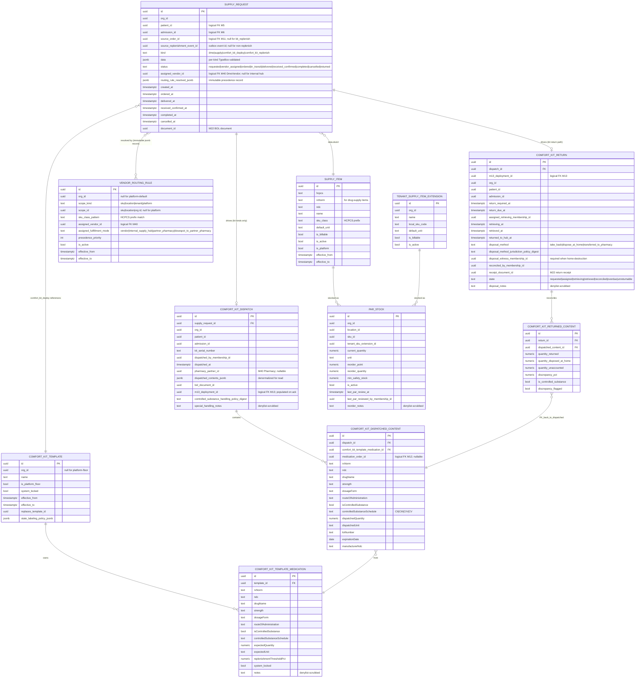

# Module 21 — Supplies, DME & Comfort Kits Specification

> **Authority note:** This spec is an **implementation proposal** (repo authority rule): [`docs/architecture/`](../architecture/) and the ratified ADRs in [`docs/adr/`](../adr/) win on conflict, and the code plus [`docs/BUSINESS_LOGIC.md`](../BUSINESS_LOGIC.md) are ground truth for as-built behavior. Mechanism choices named here may be superseded — see ADR-0036…0040 and ADR-0030/0032/0035 for the recorded divergences (outbox not Socket.IO, TypeScript not Python sidecars, app-layer AES-256-GCM not pgcrypto, pure transition tables not XState, hand-rolled HTTP hardening not `@fastify/*`, Vite + react-router not TanStack Start).


**Module ID:** 21
**Phase:** 1 (clinical-operations tier — required for Engrace go-live; CoP 42 CFR §418.106 requires DME and medical supplies be provided in accordance with the plan of care, and the only fulfillment surface for the M11-signed DME / supply / comfort-kit orders and the M13-emitted comfort-kit replenishment + return cascade is M21)
**Depends on:** 1 (Foundation — `chartwarden_app` / `chartwarden_admin` role split, RLS generator, `withOrgContext` / `withPlatformContext`, `audit()` helper, outbox dispatcher, idempotency middleware, partitioned-table conventions, seam registry, `validateSeams()` at boot), 2 (Identity — actor resolution for dispatch/courier/supply-team membership; `discipline` taxonomy referenced by the `controlled_substance_dispatcher_eligible` ABAC matrix), 3 (Authorization — `supplies.*`, `dme.*`, `comfort_kit.*`, `par_stock.*` permission keys this module registers; new ABAC predicates `controlled_substance_dispatcher_eligible` and `comfort_kit_return_reconciler_eligible` registered with M3's named-predicate registry), 4 (Audit — PHI write-audit trigger generator on every owned table; audit-read declaration on every PHI route; retention class `compliance` for controlled-substance dispatch/return rows; `eraseFn` registered with M4), 5 (Patient & Demographics — `patient.id` on every per-patient request; demographic snapshot for the delivery-address resolver; deceased-status driving the home-comfort-kit return cascade via M13's `m13.comfort_kit.return_required` chain; subscribes to no M5 events directly — M5 changes propagate through M11 / M13), 6 (Admission, Election & Certification — `admission.id` anchors every per-patient supply request and comfort-kit dispatch; `m6.transfer.created` drives the deployment-site reassignment workflow; M21 does **not** subscribe to `m6.admission.discharged` directly — the cascade flows M6 → M11 → `m11.order.supply_cancellation_requested` and M6 → M13 → `m13.comfort_kit.return_required`, and M21 consumes only the M11 / M13 derived events per the cascade-recipient pattern), 11 (Orders — M21 **consumes** `m11.order.supply_fulfillment_requested` (kind ∈ `{dme, supply, comfort_kit}`) and `m11.order.supply_cancellation_requested`; M21 emits `m21.supply_request.status_changed` consumed by M11's `m21-fulfillment-status.ts` consumer for one-shot auto-completion; M21 reads M11's `OrderProvider` seam for the authoritative order context at fulfillment time; M21 **never imports** M11 schemas), 13 (eMAR & Med Administration — M21 **consumes** `m13.comfort_kit.replenishment_needed`, `m13.comfort_kit.return_required`, and `m13.comfort_kit.controlled_substance_discrepancy`; M21 emits `m21.comfort_kit.deployed_at_patient`, `m21.comfort_kit.returned`, and `m21.comfort_kit.return_reconciliation` consumed by M13's `m21-comfort-kit-deployed.ts`, `m21-comfort-kit-returned.ts`, and `m21-comfort-kit-return-reconciliation.ts` consumers; M21 **never imports** M13 schemas — the seam is outbox-only-cross-module per M11 D6 / M13 D5), 22 (Document Management — BOL/packing-slip rendering on dispatch via `m21.supply_request.document_requested`; controlled-substance return receipt and DEA 1304-format perpetual-log line items via `m21.comfort_kit.document_requested` (return-receipt subtype); M22 renders, M21 emits typed payload), 36 (Secure Messaging & Alerts — par-below-threshold alerts, dispatch-failure alerts, courier-no-show alerts, controlled-substance discrepancy alerts, kit-return-overdue alerts; typed alert payloads per M36 §4.9), 38 (Clinical Terminology — HCPCS RxNorm/NDC for kit medications by reference (the medication identity lives on M12's `medication_order` and M21 never resolves it locally), HCPCS for DME and billable supplies, `dme_modifier_code` value set (NU / RR / UE / KX), `route_of_administration` and `dosage_form` for comfort-kit medication content metadata, `asOfDate` lookups for survey-grade reconstruction), 40 (MDM — `DmeVendor` canonical for the vendor on every dispatch row; tenant-overlay preferred-vendor selection on the `DmeVendor` overlay; canonical SKU catalog of vendor-supplied DME items is **MDM-side** (the `DmeVendor.supplied_skus` projection); M21's `supply_item` table is **the tenant-and-platform-shared SKU catalog identified by HCPCS** — M21 owns the SKU rows, M40 owns the vendor that supplies the SKU)
**Consumed by:** 22 (Document Management — see "Depends on"; cited bidirectionally because M22 consumes M21's `supply_request.document_requested` event), 23 (Billing — Medicare — every billable DME / supply line on a claim consults M21's `SupplyFulfillmentProvider.getDeliveredSupplyLines(admissionId, dateRange)` to verify a covering delivery confirmation exists before the claim line can leave `READY` — this is the "every billed supply has a covering order *and* a covering delivery confirmation" rule contributed to M23's Claim Pre-Submission Validation Framework; M21 publishes the seam, M23 consumes), 25 (Remittance & Denials — denial categories for "DME line denied for missing modifier" / "DME line denied for non-covered HCPCS" propagate from M25 to M21 as `m25.denial.opened` triggering M21's `denial-driven-redispatch` worker that may reissue the dispatch with a corrected modifier-code line item or escalate to compliance), 27 (Cost Report — `SupplyCostProvider` seam consumed by M27 for cost-center supply rollups per the architecture §11.B Cost Report Validation Framework; M21 emits `m21.supply_request.invoice_accrued` and `m21.supply_request.invoice_reconciled` events read by M27's accrual engine; M21 publishes the seam today, M27 consumes when M27 locks — forward seam per the M11 D14 / M13 D16 precedent), 28 (FHIR Gateway — `supply_request` projected as FHIR R4 `SupplyRequest` with `category=hospice-supply` and `itemCodeableConcept` carrying the HCPCS / SNOMED code from M38; `comfort_kit_dispatch` projected as FHIR R4 `SupplyDelivery` with `type=device` and the kit medication contents as `suppliedItem.itemReference` to FHIR `Medication`; M21 publishes the typed mapping at lock; M28 owns the HTTP surface when M28 lands), 30 (HQRP & Quality — DME-on-time-delivery rate, comfort-kit-deploy-to-first-administration interval (jointly with M13), controlled-substance-discrepancy rate, kit-return-on-time rate, par-stock-stockout rate; all read M21 via `SupplyFulfillmentProvider` and `ComfortKitDispatchProvider`), 33 (Reporting & Dashboards — operational dashboards: dispatch volume by vendor / by SKU / by location, par-stock posture, courier reliability rate, kit-return reconciliation discrepancies, vendor-invoice variance), 37 (IPU Management — IPU-room comfort kit physical-stock model reads M21's `ComfortKitDispatchProvider.getIpuRoomKitInventory(locationId, roomId)`; the IPU dispensing-cabinet integration overlay layers on top at M37 lock; M21 ships the unified `deployment_site` discriminator today including `ipu_room` per D17)
**Spec status:** Re-locked v0.4 (Phase-2 RLS + Phase-4 DMEPOS + Phase-5 INT remediation; supersedes Locked v0.2)

> **Phase-5 remediation (2026-06-11; ADR-0020).** **M21 (BLOCKER):** the **DME vendors** and the
> **partner pharmacy** (comfort-kit fulfillment) are now in the Integration Catalog (inventory rows
> 27–28, §5 BAA register, §8 degraded-mode) via the INT-002 five-step addition; each carries PHI, so
> the vendor **BAA must be EXECUTED before production (INT-014)**. **Phase-4 (ADR-0016):** DME/supplies
> are **bundled into the hospice per-diem** — the DMEPOS separate-billing model (NU/RR/UE/KX
> modifiers, separately-billable lines) is removed (M21-F01); SUPPORT Act at-home disposal pairs with
> M13 (ADR-0019 D3).

## Remediation Changelog — Phase 2 (2026-06-11)

| Finding | Sev | Resolution |
|---|---|---|
| **M21 RLS variable** | BLOCKER | Canonical RLS session variable corrected **`wardenx.org_id` → `app.org_id`** on all 11 tables / 24 sites (ADR-0010 D2). The prior `wardenx.*` namespace is never set by `withOrgContext()`, so every M21 policy failed closed. Add the mixed-variable RLS test (D4). |
| M21 dependsOn precedent | (→ Phase 6) | The §12 manifest patch justifies a 13-module `dependsOn` via a "every module surfaces all imports incl. foundation" precedent the audit verified **false** (M21-F05). Under ADR-0005, foundation helpers (1–4) need no edge and outbox/seam consumption (M5/M6/M13/M22/M28/M36/M38) needs no edge — so M21's real edges are far fewer. The corrected `dependsOn` is set in M21's consolidated dependsOn ADR (Phase 6), not here. |
| **M21-F04** | **BLOCKER → reconciled** | The SQL-migration-vs-Drizzle divergence (X9 BLOCKER) is resolved by **§3.0**: §3.1 SQL is the **single source of truth**; §3.2 Drizzle is its generated 1:1 mirror (CI drift test W-M21-SCHEMA). Every audit-named divergence is resolved in favor of §3.1's regulatorily-complete model (controlled-substance lot tracking, `m21_return_state` chain-of-custody, `quantity_disposed_at_home`, witness CHECKs, partition PKs); the one Drizzle-only load-bearing enum (`m21_comfort_kit_dispatch_status`) is folded into §3.1; the placeholder/`DROP` round-trip on `comfort_kit_returned_content` is removed (one clean definition); the `supply_request_status` (`cancellation_pending`) and `deployment_site` (`snf_residence`) enum forks are corrected; `vendor_routing_rule` follows D4 single-resolution (fallback model removed); `par_stock` follows the `reorder_point` model (`currentSeverity` derived). |
| **M21-F06** | MAJOR | **Tenancy three-column rule (ARCH-011).** `provider_entity_id` + `location_id` added to the patient-scoped **authoritative Drizzle** tables: `supply_request` (PE nullable — null for org-level par-stock requests; already had `location_id`), and `comfort_kit_dispatch` / `comfort_kit_dispatched_content` / `comfort_kit_return` (PE + `location_id` **NOT NULL**, denormalized from the dispatch — supply costs roll **per CCN** to the M27 cost report and dispatch is **Location-scoped**, so the columns are load-bearing). Added in M21's existing `org_id` / logical-FK convention; the **SQL-migration mirror and the `org_id`→`organization_id` normalization land with the two-schema unification** (Phase 6, row above — they are the same edit surface). Gated by `check-tenancy` (#10). |

## Changelog

- **COP27 amendment (2026-10-06; header version unchanged — additive, re-lock pending)** — FY2027 hospice CoP
  workstream B (42 CFR 418.24(b)(6)/(c), in force for elections on or after 2026-10-01; research:
  [`docs/research/FY2027_HOSPICE_COP_RESEARCH.md`](../research/FY2027_HOSPICE_COP_RESEARCH.md) §1). Adds the
  **hospice coverage determination** on `supply_request` for the `dme` / `supply` kinds (§2.12): the shared
  `hospice_coverage` enum + reason / determined-at / determined-by columns (migration `0386`),
  `PUT /api/v1/supplies/supply-requests/:supplyRequestId/coverage-determination`
  (`supplies.request.coverage_determine`), the `m21.supply_request.coverage_determination_changed` event
  (declared consumer M6, binding deferred to the COP27 integration), and the owned `NonCoveredDmeSuppliesReader`
  seam (`listNonCoveredDmeSuppliesForAdmission`) the M6 election-statement addendum composes.
- **v0.2 (Locked)** — Initial publication at lock-grade. Instantiates the architecture §20.B module spec template. Resolves all eighteen open questions into binding decisions (§11). Defines the **shared `supply_request` row with per-kind TypeBox-typed `data` jsonb** spanning `dme | supply | comfort_kit_deploy | comfort_kit_replenish` (D1), the **explicit XState lifecycle machine** with the eight-state graph `requested → vendor_assigned → ordered → in_transit → delivered → received_confirmed → completed` plus `cancelled` and `returned` branches (D2), the **platform-floor comfort-kit template** with the four-medication floor (morphine 20 mg/mL solution 30 mL, lorazepam 2 mg/mL solution 15 mL, haloperidol 5 mg/mL solution 10 mL, atropine 1% ophthalmic solution 5 mL) and **tenant-may-extend / tenant-may-tighten-only** semantics mirroring the M9 D2 / M11 D3 / M15 D3 platform-floor-tighten-only pattern (D3), the **deterministic vendor-routing rule** with per-tenant default → per-Location override → per-SKU pin precedence resolved at request time and recorded immutably on `supply_request.assigned_vendor_id` plus `routing_rule_resolved_jsonb` for survey-grade reconstruction (D4), the **par-stock monitoring at the supply hub** with `par_stock` per (orgId, locationId, skuId) and a nightly `par-monitor` cron emitting `m21.par.below_threshold` consumed by M36 (D5), the **controlled-substance accounting at dispatch + return** with per-controlled-substance kit-medication `lot_number` + `expiration_date` + `quantity_dispensed` + on-return `quantity_returned` + `quantity_disposed_at_home` + `disposal_method` + `disposal_witness_membership_id` providing the DEA 21 CFR §1304 perpetual-log data layer that M30's Phase-2 CSII report will project (D6), the **delivery confirmation model** with required courier/driver attestation (`delivered_by_membership_id` + `delivered_at` + `delivery_method`) and optional caregiver signature + photo evidence via M22 form rendering (D7), the **5%-discrepancy threshold for controlled substances** with `m21.controlled_substance.discrepancy_detected` emitted as a survey-investigable event mirroring M13 D5's threshold and routed to M30 + M36 (D8), the **explicit Phase boundary** placing vendor EDI / X12 integration in Phase 2 with `packages/vendor-edi` as a deny-stub adapter package today and Phase 1 fulfillment as portal-upload / email / fax with internal tracking (D9), the **outbox-only handoff to M11 / M13 / M22** with M21 never importing M11 or M13 schemas and never writing to their tables, mirroring M11 D6 / M11 D8 / M13 D5 (D10), the **HCPCS-keyed canonical SKU catalog with tenant-extendable overlay** mirroring the M40 canonical-plus-overlay pattern: `supply_item` is platform-shared (read-only to tenants) for billable HCPCS-keyed SKUs and `tenant_supply_item_extension` is tenant-scoped for non-billable internal items (D11), the **monthly-partitioned `supply_request` and `comfort_kit_dispatch`** matching M11 D12 / M13 D13 partition conventions with `par_stock` / `supply_item` / `comfort_kit_template` / `vendor_routing_rule` / `comfort_kit_return` non-partitioned (D12), the **free-text PHI denylist scrub** on `supply_request.delivery_instructions`, `supply_request.cancellation_reason`, `comfort_kit_dispatch.special_handling_notes`, `comfort_kit_return.disposal_notes`, `comfort_kit_return.discrepancy_notes`, `par_stock.reorder_notes` (D13), the **published M21 seams** `SupplyFulfillmentProvider` (read paths for M11/M22/M23/M27/M28/M30/M33), `ComfortKitDispatchProvider` (read paths for M13/M27/M30/M33/M37), `SupplyCostProvider` (read paths for M27) registered at boot via M1 seam registry with `validateSeams()` refusing startup if unregistered and the dependency-cruiser boundary check blocking consumers from importing `apps/backend/src/modules/21-supplies/db/*` directly (D14), the **AI-prohibited zone for controlled-substance dispatch and return reconciliation**: Module 32's LLM may not create, modify, witness, or attest to a controlled-substance dispatch or return row; enforced at boot via `validateSupplyAIBlock()` against M32's prompt registry mirroring M13 D15 / M12 D12 (D15), the **vendor-invoice reconciliation pipeline** with M21 emitting `m21.supply_request.invoice_accrued` (on dispatch) and `m21.supply_request.invoice_reconciled` (on invoice match) consumed by M27 forward-seam against a recorded-fixture envelope per the M11 D6 / M13 D5 forward-seam precedent until M27 locks (D16), the **`deployment_site` discriminator** unifying home / ALF / SNF-as-residence / IPU-room comfort kits behind a single dispatch surface and projecting the IPU-room kit through `ComfortKitDispatchProvider.getIpuRoomKitInventory(locationId, roomId)` consumed by M37 at M37 lock (D17), and the **cascade-recipient (not cascade-orchestrator) pattern** with M21 consuming the M11 cancellation cascade and M13 return-required cascade rather than subscribing to `m6.admission.discharged` directly, eliminating the three-way race condition where M11 / M13 / M21 might disagree on the discharge-time supply posture (D18). Wires the permission keys this module registers into Module 3 (§4.6), the `controlled_substance_dispatcher_eligible` and `comfort_kit_return_reconciler_eligible` ABAC predicates this module registers with Module 3's named-predicate registry (§4.7), the BullMQ queue catalog (§4.8), the M36 typed-alert payloads (§4.9), and the destruction `eraseFn` registered with Module 4 (§8.4). Includes a **proposed manifest patch** (§12, last item) updating `M21.dependsOn` from `[11, 40]` to `[1, 2, 3, 4, 5, 6, 11, 13, 22, 28, 36, 38, 40]` *(relationship inventory - not the `dependsOn` edge set; per ADR-0005 D1/D4 seam/outbox/foundation consumers are no-edge - see audit/MANIFEST_DEPENDSON_REVIEW.md; do not bulk-apply)* — the prior encoding was structurally identical to M11 / M12 / M13's pre-lock state: it omitted the foundation deps (1–4) that are transitively required but not surfaced in the architecture §20 short-list, omitted M5 / M6 (real consumer-of-data relationships through patient.id + admission.id on every per-patient row), omitted M13 (real consumer-of-event relationships through the comfort-kit replenish + return cascade — and bidirectionally M13 consumes M21's deployed / returned / reconciliation events), and omitted M22 / M28 / M36 / M38 (consumer-of-typed-payload relationships rather than transitive). The M11 / M12 / M13 locks established the precedent that every module surfaces *all* its declared imports in `dependsOn`, including foundation and cross-cutting; M21 follows. Also adds `packages/vendor-edi` (deny-stub Phase-1 adapter package) to `M21.codePaths` per D9, keeping `apps/backend/src/modules/21-supplies` as the primary backend home.
- **v0.1** — Drafted within the lock-grade pass; not separately published.

> **Phase boundary (binding):** Phase 1 delivers everything in this spec **except** (a) vendor EDI / X12 inbound 855 (PO acknowledgment) / 856 (advance ship notice) / 810 (invoice) flows — the `packages/vendor-edi` adapter package ships as a deny-stub today; Phase 1 fulfillment is portal-upload + email + fax with internal tracking per D9 (Phase 2 enables the EDI inbound path against major DME-vendor partners — Apria, Lincare, Rotech), (b) M22 BOL / packing-slip / DEA 1304-format return-receipt PDF rendering (M22 owns; M21 emits the typed `supply_request.document_requested` and `comfort_kit.document_requested` payloads today), (c) FHIR `SupplyRequest` and `SupplyDelivery` publication (Module 28; M21 publishes the typed mapping today), (d) M23 claim pre-submission "every billed DME / supply line has a covering delivery confirmation" rule (M23 owns; M21 publishes `SupplyFulfillmentProvider` today and the rule wires in when M23 locks), (e) M25 denial-driven re-dispatch workflow (M25 owns the denial classifier; M21 ships the `denial-driven-redispatch` worker shell against a recorded-fixture envelope per the forward-seam precedent until M25 locks), (f) M27 cost-report vendor-invoice accrual + reconciliation flow (M27 owns; M21 publishes `SupplyCostProvider` and emits the accrual / reconciled events today), (g) M28 FHIR `SupplyRequest` / `SupplyDelivery` HTTP surface (M28 owns; M21 publishes the typed mapping today), (h) M30 HQRP measure computations that read M21 (M30 owns; M21 publishes the two provider seams today), and (i) M37 IPU IV-pump / dispensing-cabinet overlay on the IPU-room comfort-kit physical stock (M37 owns; M21 ships the `deployment_site='ipu_room'` discriminator and the `getIpuRoomKitInventory` projection today). The "done" gate for M21 is: shared `supply_request` + per-kind TypeBox-validated `data` jsonb with the four kinds wired and server-side validation; the XState lifecycle machine driving every transition; the M11 `m11.order.supply_fulfillment_requested` and `m11.order.supply_cancellation_requested` outbox subscribers; the M13 `m13.comfort_kit.replenishment_needed` and `m13.comfort_kit.return_required` outbox subscribers; the comfort-kit template + the four-medication platform floor + the tenant-may-extend / tenant-may-tighten overlay; the comfort-kit dispatch + delivery-confirmation flow with the per-controlled-substance lot/expiration/quantity tracking; the comfort-kit return + reconciliation flow with the 5% discrepancy detector; the par-stock monitor cron + the M36 alert pipeline; the vendor-routing rule resolver with the per-tenant / per-Location / per-SKU precedence; the deterministic immutable record of the routing-rule resolution on every dispatch; the `SupplyFulfillmentProvider`, `ComfortKitDispatchProvider`, and `SupplyCostProvider` seams registered at boot; the `validateSupplyAIBlock()` validator wired against M32's prompt registry refusing boot if M32 registers a `supply_*` or `controlled_substance_dispatch_*` prompt output type; the controlled-substance discrepancy detector + the survey-investigable event emitter; the kit-return-overdue compliance surface; the dependency-cruiser boundary check blocking consumer schema imports; and the test plan green — not gated on Modules 23 / 25 / 27 / 28 / 30 / 37 / Phase-2 vendor-EDI existing.

-----

## 1. Purpose & Scope

### 1.1 What This Module Does

Module 21 is the **fulfillment side** of every signed M11 DME / supply / comfort-kit order and the **physical-stock side** of every M13 comfort-kit deployment, replenishment, and return. M21 holds three closely-related but distinct surfaces:

- **The supply-request lifecycle.** Every signed M11 order whose `kind ∈ {dme, supply, comfort_kit}` produces a `m11.order.supply_fulfillment_requested` outbox event. M21's `m11-supply-fulfillment-requested.ts` consumer creates a `supply_request` row in `kind ∈ {dme, supply, comfort_kit_deploy}` (the M11 `comfort_kit` kind maps to M21's `comfort_kit_deploy` to distinguish the *deployment* of a fresh kit from the *replenishment* of an existing one — see the kind catalog in §2.1). The request walks the eight-state lifecycle (§2.3) under M21's XState machine: vendor assignment per the routing rule (§2.5), order placement to the vendor (Phase-1: portal-upload / email / fax via the `packages/vendor-edi` deny-stub; Phase-2: EDI 850 PO outbound), in-transit tracking via vendor confirmation (Phase-1: manual entry by the supply team; Phase-2: EDI 856 ASN inbound), delivery to the patient address with required courier attestation, caregiver-confirmation receipt, and one-shot completion or ongoing-completion per kind. The state machine emits `m21.supply_request.status_changed` on every transition; M11's `m21-fulfillment-status.ts` consumer reads `status='delivered'` for the one-shot completion auto-fire.

- **The comfort-kit physical-stock surface.** The comfort kit is a per-patient pre-positioned cache of four end-of-life medications (the platform floor: morphine 20 mg/mL oral solution 30 mL, lorazepam 2 mg/mL oral solution 15 mL, haloperidol 5 mg/mL oral solution 10 mL, atropine 1% ophthalmic solution 5 mL — tenant may extend with additional kit medications and may tighten quantities or add per-Location overlays but cannot remove the floor; D3). On a comfort-kit deployment, M21 dispatches the physical kit from a Location-level supply hub (or routes through a contracted hospice-specialty pharmacy partner) to the patient address, with per-controlled-substance lot-number + expiration-date + dispensed-quantity tracking on the dispatch row (D6). On delivery confirmation, M21 emits `m21.comfort_kit.deployed_at_patient` consumed by M13's `m21-comfort-kit-deployed.ts` consumer, which creates M13's `comfort_kit_deployment` row + per-medication `comfort_kit_drawdown` rows. M13 owns the *clinical record* of what's been used from the kit; M21 owns the *physical-inventory record* of what was dispatched, what came back, and what was disposed at home per DEA 21 CFR §1304.

- **Replenishment, return, and reconciliation.** When M13's drawdown crosses the replenishment threshold (per-kit default 25%, configurable per kit medication on the comfort-kit template), M13 emits `m13.comfort_kit.replenishment_needed`. M21's `m13-replenishment-needed.ts` consumer creates a `supply_request` of kind `comfort_kit_replenish` referencing the existing M13 deployment and dispatches replenishment stock — with the same lot-number / expiration-date / quantity-dispensed tracking. On admission discharge (death / revocation / transfer-out), the cascade flows M6 → M13 → `m13.comfort_kit.return_required` → M21's `m13-return-required.ts` consumer creates a `comfort_kit_return` workflow row, dispatches a supply-team member or contracted-pharmacy courier to retrieve the remaining kit contents, captures per-medication `quantity_returned` + `quantity_disposed_at_home` + `disposal_method` + `disposal_witness_membership_id`, and emits `m21.comfort_kit.returned` + `m21.comfort_kit.return_reconciliation`. M13 consumes the reconciliation to flip its drawdown rows to `final_remaining_quantity_at_return` and audit the discrepancy. A discrepancy ≥ 5% of `expected_quantity` for a controlled-substance kit medication emits `m21.controlled_substance.discrepancy_detected` (D8) — a survey-investigable event surfaced to M30 / M36 for compliance review.

The three surfaces share the `supply_request` table backbone (D1) — kind discriminates the payload shape, and the comfort-kit-deploy and comfort-kit-replenish kinds carry the M13 `comfort_kit_deployment_id` cross-reference (logical FK; not a SQL FK because M21 does not import M13 schemas — see §2.8 and D10).

### 1.2 What This Module Does Not Do

M21 is the **fulfillment** side and the **physical-inventory** side. It is not the *authorization*, not the *clinical record*, not the *prescribing surface*, and not the *administration record*. The boundary lines are sharp and the lock-grade reading depends on holding them:

- **The order authorization.** Module 11 owns the order. Every `supply_request` row carries `source_order_id` (logical FK to M11's `order_record`); M21 never decides whether an order is authorized — it reads M11's `OrderProvider.getOrderForFulfillment(orderId)` and refuses to dispatch if M11 reports the order is not in `active` status. The signature workflow, the verbal-order 48-hour timer, the discontinuation command, the discharge cascade emission — all M11. (D10.)

- **The medication identity.** Module 12 owns DoseSpot and the `medication_order` row. The four comfort-kit-medication rows on `comfort_kit_dispatch` carry `medication_order_id` (logical FK to M12) when the deployment is linked to a real per-patient prescribed medication order (the typical case for comfort-kit-deploy where the four floor medications are prescribed at admission); they carry `comfort_kit_template_medication_id` (FK within M21) when the kit is dispatched against a pre-positioned template without a specific patient order yet (the IPU stock-kit-on-room case for `deployment_site='ipu_room'` and the pre-positioned-at-home stock-kit case where the order signs at deployment). M21 never resolves RxNorm / NDC / brand identity locally — that's M38 via M12.

- **The administration record.** Module 13 owns every `administration_record` row, every `scheduled_dose`, every `prn_administration`, every wastage row, every `comfort_kit_drawdown` row, every PRN-effectiveness reassessment. M21's `comfort_kit_dispatch` row records *what was dispatched*; M13's `comfort_kit_deployment` row records *the clinical record of the kit being at the bedside*. The two correlate via `m21_comfort_kit_dispatch_id` on M13 and `m13_comfort_kit_deployment_id` on M21 (both logical FKs; populated bidirectionally on the M21 → M13 deployed event and the M13 → M21 return-required event). M21 cannot read M13's drawdown — when M21 needs "what's currently in the kit" for the return reconciliation it consults `ComfortKitDispatchProvider.getDispatchContents(dispatchId)` (its own data) and M13 separately reads its drawdown via `MedicationAdministrationProvider.getKitDrawdownAtReturn(deploymentId)`. The 5% discrepancy is computed in M21's reconciliation worker by subtracting `quantity_returned + quantity_disposed_at_home` from `quantity_dispensed` (all M21-owned columns); the discrepancy projection emits the survey-investigable event back to M13 + M30 + M36.

- **The prescriber.** Module 40 owns the `ExternalPhysician` canonical record. M21 references the ordering physician by reading M11's `order_record.ordering_physician_id` → M40 `ExternalPhysician.id` chain; M21 never resolves NPI or DEA locally.

- **The vendor identity.** Module 40 owns the `DmeVendor` canonical record + the per-tenant overlay. M21's `vendor_routing_rule` table records the *routing precedence* per (orgId, locationId, skuId or sku-class); the resolved vendor identity at request time is *recorded immutably* on `supply_request.assigned_vendor_id` as a logical FK to M40's `DmeVendor.id` plus `routing_rule_resolved_jsonb` for survey-grade reconstruction (D4). M21 reads M40 via the `MdmEntityProvider.getDmeVendor(vendorId, orgId)` seam; M21 never imports M40 schemas.

- **The DoseSpot dispense event.** Module 12 owns DoseSpot. The retail-pharmacy dispense of comfort-kit medications (where the kit is filled by a contracted pharmacy partner rather than dispatched from a hospice-owned supply hub) is a DoseSpot transmission; M12 emits `m12.medication_order.dispensed_at_pharmacy` and M21's consumer (when `pharmacy_dispatch_mode='dosespot_to_partner_pharmacy'` on the comfort-kit template) creates the `comfort_kit_dispatch` row with `dispatch_source='pharmacy_partner'` referencing the M12 transmission event. The dispense itself is M12; M21 records the dispatch-side of the *kit-assembly-at-the-pharmacy → courier-to-patient* leg.

- **The eMAR PDF.** Module 22 owns PDF rendering. M21 emits `m21.supply_request.document_requested` for BOLs / packing slips and `m21.comfort_kit.document_requested` for DEA 1304-format return receipts; M22 renders. M21 stores the rendered-document UUID returned by M22's `m22.document.rendered` consumer as `supply_request.document_id` / `comfort_kit_dispatch.bol_document_id` / `comfort_kit_return.receipt_document_id`. M21 has no PDF code.

- **The patient/family portal.** Module 31 owns the portal. M21 publishes no portal-direct surface. The patient-facing view of "your upcoming supply delivery" comes from M31 reading M21 via `SupplyFulfillmentProvider.getPortalDeliveryView(patientId)` (a seam M21 ships at lock; M31 attaches at M31 lock per the forward-seam precedent).

- **HQRP measure computation.** Module 30 owns the HQRP measures. M21 publishes the `SupplyFulfillmentProvider` and `ComfortKitDispatchProvider` seams; M30 consumes and computes the DME-on-time-delivery rate, the kit-deploy-to-first-administration interval (jointly with M13), the controlled-substance-discrepancy rate, the kit-return-on-time rate, and the par-stock-stockout rate.

- **AI-derived recommendations.** Module 32 owns the AI platform. M21 surfaces no AI-derived dispatch routing in Phase 1 — vendor routing is deterministic per the precedence rule (D4) and the routing-rule resolution is recorded immutably for survey reconstruction. M32 may later add an AI-recommendation seam (e.g., "predicted comfort-kit-needed within 72 hours" based on M9 / M10 trajectory signals); M21 publishes nothing today. The **AI-prohibited zone** for controlled-substance dispatch + return reconciliation (D15) is a hard boot-time block: M32 may not register any prompt template with output type `supply_*` or `controlled_substance_dispatch_*`; if it does, `validateSupplyAIBlock()` fails boot.

- **Reporting dashboards.** Module 33 owns the operational dashboards. M21 publishes the provider seams; M33 reads. The vendor-invoice-variance dashboard, the courier-reliability-rate dashboard, the par-stock-posture dashboard — all M33-rendered, M21-sourced.

- **Cost report accrual.** Module 27 owns the cost report. M21 emits `m21.supply_request.invoice_accrued` (on dispatch with vendor-quoted unit price × quantity) and `m21.supply_request.invoice_reconciled` (when the vendor invoice arrives and the reconciliation worker matches it against the dispatch). M27 consumes — forward seam per D16.

### 1.3 Regulatory Drivers

| Driver | Requirement | How Module 21 satisfies it |
|---|---|---|
| 42 CFR §418.106(a) — Hospice must ensure that drugs, biologicals, supplies, and durable medical equipment are provided as needed for the palliation and management of the terminal illness | Authorized supplies and DME must be delivered to the patient | Every signed M11 order with `kind ∈ {dme, supply, comfort_kit}` produces an M21 `supply_request` via the `m11.order.supply_fulfillment_requested` event; the XState lifecycle drives the request to `delivered` with required courier attestation; the M11 → M21 → M11 round-trip (signed → fulfillment_requested → status_changed → auto-complete) closes the loop; the M23 claim pre-submission rule "every billed supply line has a covering delivery confirmation" reads `SupplyFulfillmentProvider.getDeliveredSupplyLines` to verify |
| 42 CFR §418.106(b) — Hospice must ensure that drugs and biologicals administered by the hospice are ordered by a person authorized to prescribe | Authorization for kit medications (and for any drug-bearing supply) lives upstream of M21 | M21 reads M11's `OrderProvider.getOrderForFulfillment(orderId)` and refuses dispatch if the source order is not in `active` status; the comfort-kit deployment row carries `source_order_id` → M11 → ordering-physician chain; controlled-substance dispatches additionally consult M12 for the underlying `medication_order` identity per kit-medication entry |
| 42 CFR §418.106(f)(1) — Hospice must provide controlled drugs in the patient's home pursuant to a written policy | Tenant-policy-governed controlled-substance handling at the home | `comfort_kit_dispatch` carries per-controlled-substance `lot_number` + `expiration_date` + `quantity_dispensed`; the tenant-configurable `controlled_substance_handling_policy` (carried per kit template) drives the delivery-confirmation requirements (chain-of-custody attestation, lock-box requirement, family-education-completed checkbox); the `controlled_substance_dispatcher_eligible` ABAC predicate (M21-registered with M3) restricts who can release a controlled-substance dispatch from the supply hub |
| 42 CFR §418.106(f)(2) — Hospice must provide a count of remaining controlled drugs at the conclusion of the hospice care plan | Accounting at return | `comfort_kit_return` workflow captures per-controlled-substance `quantity_returned` + `quantity_disposed_at_home` + `disposal_method` + `disposal_witness_membership_id`; the discrepancy detector emits `m21.controlled_substance.discrepancy_detected` when |dispensed − returned − disposed| ≥ 5%; the `comfort_kit_return_reconciler_eligible` ABAC predicate (M21-registered with M3) gates who can record the return reconciliation; the M22 return-receipt PDF carries the DEA 1304-format line items |
| 42 CFR §418.106(f)(3) — Hospice must dispose of controlled drugs in compliance with state and federal regulations | Disposal-method documentation at return | `comfort_kit_return.disposal_method` is a typed enum: `take_back_by_supply_team` (returned to supply hub for DEA-registered destruction), `dispose_at_home_by_witnessed_destruction` (witnessed flush / Deterra deactivation pouch / non-retrievable destruction kit per DEA 21 CFR §1317), `transferred_to_disposing_pharmacy` (handed to a DEA-registered pharmacy for destruction); each method has its own required-fields gate enforced at the route layer; the `disposal_witness_membership_id` is a M2 membership reference for the second-clinician witness |
| 42 CFR §418.106(f)(4) — Hospice must comply with state and federal regulations regarding labeling and dispensing | Labeling on dispatch | `comfort_kit_dispatch` carries `label_data_jsonb` (patient-name, RX-number from M12 when DoseSpot-dispensed, prescriber-name from M11 → M40 chain, dosage instructions from M12's `sigStructured`, expiration date, lot number, NDC); the M22 BOL render uses this payload to produce the patient-affixed label per state pharmacy-board rules; the tenant may add a `state_specific_labeling_addendum` to the template |
| DEA 21 CFR §1304.04 — Maintenance of records — controlled-substance perpetual inventory log | DEA perpetual inventory at the supply hub and at the patient | M21 owns the *dispatch-side and return-side* data layer of the perpetual log: every controlled-substance movement carries `lot_number` + `expiration_date` + `quantity` + actor + timestamp; the report itself (the DEA-1304 / DEA-222 line-item-format perpetual log) is **provisionally M30's Phase-2 CSII surface** per the M13 D5 boundary note; M21 ships the data layer today and the M30 read-side projection lands at M30's lock |
| DEA 21 CFR §1317 — Disposal of controlled substances | Witnessed destruction at home | `comfort_kit_return.disposal_method='dispose_at_home_by_witnessed_destruction'` requires a second-clinician witness (`disposal_witness_membership_id` non-null, must be a different membership from `reconciled_by_membership_id`, both must pass `controlled_substance_dispatcher_eligible` or `comfort_kit_return_reconciler_eligible`); the witnessed-destruction-form M22 PDF is rendered with both signatures; the post-disposal `m21.comfort_kit.returned` event carries `disposal_method` for M30's compliance dashboard |
| HIPAA §164.308(a)(7) Contingency Plan + §164.312(b) Audit Controls | Audit trail on every supply movement | Every `supply_request`, `comfort_kit_dispatch`, `comfort_kit_return`, `comfort_kit_return_reconciliation` mutation produces a M4 PHI write-audit row via the trigger generator; controlled-substance rows tagged with retention class `compliance` (extended retention beyond the 7-year clinical default); the destruction `eraseFn` registered with M4 (§8.4) preserves controlled-substance ledger rows beyond patient-data destruction per DEA 21 CFR §1304 record-retention (2 years post-last-activity for controlled-substance records, extended to 7 years per CMS clinical-record retention, extended further to the lifetime of the agency for some state surveyor requirements) |
| State Pharmacy Board labeling (state-variable; Oregon ORS 689.255 as the Engrace reference) | Labeling and chain-of-custody at home | Tenant-configurable `state_labeling_policy` carried on the `comfort_kit_template` (and overlay-able per Location); the platform ships an Oregon reference policy and a 50-state template scaffold whose contents lock at the state-pharmacy-board adapter level (Phase-2 partnership) |
| ASPE / OIG hospice DME compliance — "DME provided must be necessary, reasonable, and actually delivered" | Delivery confirmation required before claim | The M23 claim pre-submission rule (per architecture §11.A "Place of service consistency" + the M21-contributed "DME line has covering delivery confirmation" rule) blocks claim submission until M21 reports `status='received_confirmed'` on the covering supply request; M23 reads `SupplyFulfillmentProvider.getDeliveredSupplyLines(admissionId, dateRange)` for the validation |

### 1.4 Competitive Context

FireNote, WellSky, HealthCare Synergy, and Axxess all have a "DME / supplies" module of varying depth. The **competitive gap M21 closes is the chain-of-custody on controlled-substance comfort-kit dispatch + return** — most legacy hospice EHRs treat comfort kits as either (a) a fax-the-pharmacy task with no system-of-record beyond the order, or (b) an inventory item in a generic supplies module with no per-controlled-substance lot/expiration/quantity tracking and no return-reconciliation surface. The result in practice is the paper-log scenario the M13 spec calls out: a surveyor asking "show me how the morphine in this patient's kit was used and what came back" gets a binder of pharmacy faxes and a hand-written kit-return form, and the agency's response to a controlled-substance-discrepancy incident is reconstructed from memory.

M21's design — the single dispatch-row-with-per-controlled-substance-content-rows, the bidirectional outbox handshake with M13's drawdown, the 5%-discrepancy survey-investigable event, the DEA-1304-format return-receipt PDF, the deterministic vendor-routing rule with immutable resolution record, the `validateSupplyAIBlock()` boot-time guard — is the system-of-record surface a surveyor expects and a clinical operator can defend. The IPU-room comfort-kit physical-stock model (D17) is the additional differentiator: most legacy EHRs treat the IPU stock as a separate pharmacy-cabinet integration outside the supplies module, which makes the kit-at-IPU-room / kit-at-patient-home distinction invisible to the supply-team dashboard. M21's `deployment_site` discriminator unifies the two behind one operational surface while preserving the IPU-specific dispensing-cabinet overlay seam for M37.

The DME side (hospital bed, oxygen concentrator, wheelchair, BiPAP) is more conventional — every vendor in the space supports it — but M21's HCPCS-keyed canonical SKU catalog (D11) plus the M23-contributed "every billed DME line has a covering delivery confirmation" rule (forward seam) plus the M25 denial-driven re-dispatch loop (forward seam) plus the M27 vendor-invoice reconciliation (forward seam) close gaps in the typical FireNote / WellSky DME surface: most legacy modules don't enforce the delivery-confirmation-before-bill rule (so DME lines get billed and denied for "no proof of delivery" downstream), don't reconcile vendor invoices to dispatches (so cost reports are reconstructed from vendor statements rather than from the agency's record-of-truth), and don't loop denial back to re-dispatch (so the same DME line gets rebilled with the same defect three claims in a row).

-----

## 2. Domain Model

### 2.1 Supply Request Kinds

The four kinds that ride on the shared `supply_request` row. Each lives in `packages/supplies/src/kinds/<kind>/` with `schema.ts` (TypeBox), `validate.ts` (cross-field), `terminology.ts` (HCPCS / NDC bindings via M38), `routing.ts` (per-kind vendor-routing-rule overlay), and `lifecycle.ts` (per-kind transitions allowed; some kinds skip states — see §2.3).

| `kind` | Description | Trigger | Source event | Downstream outbox events |
|---|---|---|---|---|
| `dme` | Durable Medical Equipment dispatch (hospital bed, oxygen concentrator, wheelchair, BiPAP, hospital-bed accessories, oxygen tubing). Typically vendor-routed; the agency does not own the equipment. May be rental (recurring monthly HCPCS line) or purchase (one-shot). | M11 signs a `dme` order | `m11.order.supply_fulfillment_requested` with `kind='dme'` | `m21.supply_request.status_changed` (M11, M22, M33), `m21.supply_request.document_requested` (M22), `m21.supply_request.invoice_accrued` (M27) |
| `supply` | Non-DME consumables (gloves, briefs, wound-care dressings, oxygen tubing replacements, suction-catheter consumables). Typically agency-stock or vendor-routed; never controlled. | M11 signs a `supply` order | `m11.order.supply_fulfillment_requested` with `kind='supply'` | `m21.supply_request.status_changed` (M11), `m21.supply_request.document_requested` (M22), `m21.supply_request.invoice_accrued` (M27) |
| `comfort_kit_deploy` | First-time deployment of a comfort kit at a patient's residence (or IPU room). Carries per-controlled-substance content tracking. The M11 source order's `kind` is `comfort_kit`; M21 maps to `comfort_kit_deploy` to discriminate from `comfort_kit_replenish`. | M11 signs a `comfort_kit` order | `m11.order.supply_fulfillment_requested` with `kind='comfort_kit'` | `m21.supply_request.status_changed` (M11), `m21.comfort_kit.deployed_at_patient` (M13), `m21.supply_request.document_requested` (M22), `m21.supply_request.invoice_accrued` (M27) |
| `comfort_kit_replenish` | Replenishment of an existing comfort kit. References an active M13 `comfort_kit_deployment`; the dispatch contents may be a subset of the original kit floor (only the medications that crossed threshold). | M13 emits drawdown threshold cross | `m13.comfort_kit.replenishment_needed` | `m21.supply_request.status_changed` (M11 — but the M11 order is unchanged; status_changed informs the M11 dashboard, no auto-complete), `m21.comfort_kit.replenished` (M13 — typed payload: which medications, lot, quantity), `m21.supply_request.document_requested` (M22), `m21.supply_request.invoice_accrued` (M27) |

**Per-kind `data` payload shape (D1).** Every `supply_request.data` jsonb is validated against the per-kind TypeBox schema at write time. The shape:

```ts
// packages/supplies/src/kinds/dme/schema.ts
export const DmeRequestData = Type.Object({
  skuId: Type.String({ format: 'uuid' }),
  hcpcs: Type.String({ pattern: '^[A-Z]\\d{4}$' }),            // resolved against M38
  hcpcsModifiers: Type.Array(Type.String(), { maxItems: 4 }),  // NU | RR | UE | KX from M38 value set
  quantity: Type.Integer({ minimum: 1 }),
  rentalCadence: Type.Optional(Type.Union([
    Type.Literal('monthly'),
    Type.Literal('one_time_purchase'),
  ])),
  vendorMfrSku: Type.Optional(Type.String()),                  // vendor-side identifier; informational
  deliveryAddress: PatientAddressSnapshotSchema,               // captured at request time, immutable
  deliveryWindowEarliest: Type.Optional(Type.String({ format: 'date-time' })),
  deliveryWindowLatest: Type.Optional(Type.String({ format: 'date-time' })),
  deliveryInstructions: Type.Optional(Type.String({ maxLength: 500 })),  // PHI-denylist-scrubbed per D13
  needsInstallation: Type.Boolean({ default: false }),
  needsPatientEducation: Type.Boolean({ default: false }),
});

// packages/supplies/src/kinds/supply/schema.ts
export const SupplyRequestData = Type.Object({
  skuId: Type.String({ format: 'uuid' }),
  hcpcs: Type.Optional(Type.String({ pattern: '^[A-Z]\\d{4}$' })),  // nullable — non-billable internal supplies omit
  quantity: Type.Integer({ minimum: 1 }),
  unit: Type.String({ maxLength: 16 }),                              // 'box', 'each', 'roll', etc.
  deliveryAddress: PatientAddressSnapshotSchema,
  deliveryWindowEarliest: Type.Optional(Type.String({ format: 'date-time' })),
  deliveryWindowLatest: Type.Optional(Type.String({ format: 'date-time' })),
  deliveryInstructions: Type.Optional(Type.String({ maxLength: 500 })),
});

// packages/supplies/src/kinds/comfort-kit-deploy/schema.ts
export const ComfortKitDeployRequestData = Type.Object({
  comfortKitTemplateId: Type.String({ format: 'uuid' }),       // M21-owned template
  deploymentSite: Type.Union([                                  // per D17
    Type.Literal('home'),
    Type.Literal('alf'),
    Type.Literal('snf_residence'),
    Type.Literal('ipu_room'),
  ]),
  ipuRoomId: Type.Optional(Type.String({ format: 'uuid' })),   // required when deploymentSite='ipu_room' — forward seam to M37
  deliveryAddress: PatientAddressSnapshotSchema,               // omitted for ipu_room
  deliveryWindowEarliest: Type.Optional(Type.String({ format: 'date-time' })),
  deliveryWindowLatest: Type.Optional(Type.String({ format: 'date-time' })),
  pharmacyDispatchMode: Type.Union([                            // per D6
    Type.Literal('supply_hub_dispatch'),
    Type.Literal('partner_pharmacy_dispatch'),
    Type.Literal('dosespot_to_partner_pharmacy'),
  ]),
  contents: Type.Array(ComfortKitMedicationContentSchema, { minItems: 1, maxItems: 16 }),
  controlledSubstanceHandlingNotes: Type.Optional(Type.String({ maxLength: 500 })),  // PHI-denylist-scrubbed
});

// packages/supplies/src/kinds/comfort-kit-replenish/schema.ts
export const ComfortKitReplenishRequestData = Type.Object({
  sourceDeploymentId: Type.String({ format: 'uuid' }),          // logical FK to M13's comfort_kit_deployment
  triggeringReplenishmentEventId: Type.String({ format: 'uuid' }),  // the m13.comfort_kit.replenishment_needed outbox id
  urgencyKind: Type.Union([
    Type.Literal('routine'),
    Type.Literal('urgent'),
  ]),
  deliveryAddress: PatientAddressSnapshotSchema,
  deliveryWindowEarliest: Type.Optional(Type.String({ format: 'date-time' })),
  deliveryWindowLatest: Type.Optional(Type.String({ format: 'date-time' })),
  contents: Type.Array(ComfortKitMedicationContentSchema, { minItems: 1, maxItems: 16 }),
  // NOTE: contents is a subset of the original deployment — only the medications crossing threshold; the m13 event drives this
});
```

The shared `ComfortKitMedicationContentSchema`:

```ts
export const ComfortKitMedicationContentSchema = Type.Object({
  medicationOrderId: Type.Optional(Type.String({ format: 'uuid' })),       // logical FK to M12 — null for IPU-stock-kit case
  comfortKitTemplateMedicationId: Type.String({ format: 'uuid' }),         // FK within M21 to the template line
  rxNorm: Type.String({ minLength: 1 }),                                    // resolved against M38; immutable on row
  ndc: Type.Optional(Type.String({ pattern: '^\\d{5}-\\d{4}-\\d{2}$|^\\d{5}-\\d{3}-\\d{2}$' })),
  drugName: Type.String({ maxLength: 200 }),                                // human-readable; denormalized for the BOL label
  strength: Type.String({ maxLength: 64 }),                                 // e.g., '20 mg/mL'
  dosageForm: Type.String({ maxLength: 32 }),                               // 'oral_solution' | 'tablet' | 'ophthalmic_solution' | ...; value set via M38
  routeOfAdministration: Type.String({ maxLength: 32 }),                    // 'PO' | 'SL' | 'PR' | 'ophthalmic' | ...; M38 value set
  isControlledSubstance: Type.Boolean(),
  controlledSubstanceSchedule: Type.Optional(Type.Union([
    Type.Literal('CII'), Type.Literal('CIII'), Type.Literal('CIV'), Type.Literal('CV'),
  ])),
  expectedQuantity: Type.Number({ exclusiveMinimum: 0 }),
  expectedUnit: Type.String({ maxLength: 16 }),                             // 'mL' | 'tablet' | 'patch' | ...
  replenishmentThresholdPct: Type.Number({ minimum: 0, maximum: 1, default: 0.25 }),  // crosses → m13 emits replenishment_needed
  // The following are populated at dispatch time, NOT request time — see comfort_kit_dispatch.dispatched_contents
});
```

The `dispatched_contents` jsonb on `comfort_kit_dispatch` extends each content with `dispatchedQuantity`, `lotNumber`, `expirationDate`, and `manufacturerNdc` — captured at the moment the supply-team / partner-pharmacy fills the kit. The split between *requested* contents (on `supply_request.data`) and *dispatched* contents (on `comfort_kit_dispatch.dispatched_contents`) is deliberate: the lot / expiration / actual-quantity belong on the dispatch row because they are a property of *this physical fulfillment*, not of the order.

### 2.2 Supply Request Lifecycle (XState, D2)

```mermaid
stateDiagram-v2
    [*] --> requested
    requested --> vendor_assigned: assignVendor (routing rule resolved + recorded)
    vendor_assigned --> ordered: placeOrderWithVendor (Phase-1: portal/email/fax; Phase-2: EDI 850)
    ordered --> in_transit: vendorConfirmedShipment (Phase-1: manual entry; Phase-2: EDI 856 ASN)
    in_transit --> delivered: confirmDeliveryAtAddress (courier attestation required)
    delivered --> received_confirmed: caregiverOrPatientConfirmsReceipt (optional within 72h; auto-confirm at 72h with system actor)
    received_confirmed --> completed: completeRequest (auto for one-shot DME/supply on receipt; auto for kit on m21.comfort_kit.deployed_at_patient consumer ack; never for rental DME — rental stays received_confirmed for the rental life)

    requested --> cancelled: cancel (M11 cascade or operator)
    vendor_assigned --> cancelled: cancel (M11 cascade or operator)
    ordered --> cancelled: cancel (M11 cascade or operator; vendor cancellation must succeed)
    in_transit --> cancelled: cancel (rare; courier-recall path)
    delivered --> returned: initiateReturn (only kit kinds; M13 return cascade)
    received_confirmed --> returned: initiateReturn (only kit kinds; M13 return cascade)
    returned --> completed: completeReturnReconciliation

    completed --> [*]
    cancelled --> [*]
```

State semantics:

- `requested` — initial state on outbox-consumer write. The row carries `source_order_id` / `source_replenishment_event_id`, the kind, the patient/admission context, but no vendor yet.

- `vendor_assigned` — the routing-rule resolver has picked a vendor (D4) and recorded the resolution to `assigned_vendor_id` + `routing_rule_resolved_jsonb`. For agency-internal-fulfilled kits (`pharmacyDispatchMode='supply_hub_dispatch'`), `assigned_vendor_id` is null and `routing_rule_resolved_jsonb.assignedFulfillmentMode='internal_supply_hub'`.

- `ordered` — the order has been placed with the vendor (or assembled at the internal supply hub). Phase-1: a supply-team member uploads a portal screenshot / faxes the order / emails the order, and marks `ordered` manually; the worker records `vendor_order_reference` (vendor-side PO number) and `ordered_at`. Phase-2: the `packages/vendor-edi` adapter calls the vendor's EDI 850 endpoint and parses the EDI 855 acknowledgment; `vendor_order_reference` and `ordered_at` come from the EDI 855 payload.

- `in_transit` — the vendor has confirmed shipment or the supply hub has assigned a courier. `tracking_number` and `carrier` are populated. Phase-1: manual entry from the vendor portal / vendor email. Phase-2: EDI 856 ASN parsed and inserted.

- `delivered` — physical delivery to the patient address has been confirmed by the courier attestation (`delivered_by_membership_id` + `delivered_at` + `delivery_method` per D7). For kit kinds, the `m21.comfort_kit.deployed_at_patient` event fires on this transition (after the dispatch row is bound — see §2.6).

- `received_confirmed` — the caregiver or patient has confirmed receipt of the item via M22 form / M31 portal / SMS reply-confirm flow / supply-team phone confirmation. Auto-confirm-with-system-actor fires 72 hours after `delivered` if no explicit confirm arrives, with `received_confirmed_actor='system_auto_confirm'` and an M36 informational alert to the case manager. For kit kinds, `received_confirmed` only fires if the deployment has not been cancelled in the interim.

- `completed` — for one-shot DME (purchase) and one-shot supply, fires automatically on `received_confirmed`. For rental DME, `completed` only fires when the M11 order discontinues (M21 consumes `m11.order.discontinued` and runs the rental-pickup workflow). For comfort-kit-deploy, fires on M13's ack of the `m21.comfort_kit.deployed_at_patient` event (the M13 deployment row has been created and the drawdown is initialized). For comfort-kit-replenish, fires on M13's ack of the `m21.comfort_kit.replenished` event.

- `cancelled` — the M11 `m11.order.supply_cancellation_requested` event drove a cancellation, or an operator cancelled manually. Pre-`ordered`, the cancellation is immediate. Post-`ordered`, the M21 vendor-cancellation worker calls the vendor (Phase-1: manual; Phase-2: EDI 860) and the row stays in the pre-cancellation state with `cancellation_pending_at` set until the vendor confirms cancellation, at which point the row transitions to `cancelled` with `cancelled_at` and `cancellation_vendor_response_jsonb`. If the vendor refuses cancellation (DME already shipped), the row stays in its current state and a `vendor_cancellation_refused` M36 alert fires to compliance.

- `returned` (kit kinds only) — the M13 `m13.comfort_kit.return_required` event drove a return workflow. The row transitions through a separate `comfort_kit_return` workflow (§2.7) before reaching `completed` via the reconciliation step.

The XState machine carries per-transition guards (vendor must be `active` per M40; routing-rule resolver must produce a vendor or `internal_supply_hub`; controlled-substance dispatchers must pass the ABAC predicate; rental-completed must have an M11 discontinuation event). Guards that fail block the transition and emit an M36 alert to the supply team. The machine lives in `packages/supplies/src/services/supply-request-machine.ts` with the same XState-actor pattern M11 uses for the `order_record` lifecycle.

### 2.3 Comfort-Kit Template (D3)

The comfort-kit template is the *recipe* — what medications a kit should contain, in what quantities, and what replenishment thresholds apply. The template is **platform-floor / tenant-may-extend / tenant-may-tighten-quantities-but-not-remove-floor-medications**, mirroring the M9 D2 / M11 D3 / M15 D3 platform-floor-tighten-only pattern.

**Platform floor (the four-medication baseline):**

| Medication | Strength | Dosage form | Default quantity | Replenishment threshold | Controlled? |
|---|---|---|---|---|---|
| Morphine sulfate | 20 mg/mL | oral solution | 30 mL | 25% (7.5 mL) | CII |
| Lorazepam | 2 mg/mL | oral solution | 15 mL | 25% (3.75 mL) | CIV |
| Haloperidol | 5 mg/mL | oral solution | 10 mL | 25% (2.5 mL) | non-controlled |
| Atropine sulfate | 1% | ophthalmic solution | 5 mL | 25% (1.25 mL) | non-controlled |

The four medications come from the M13 spec's reference deployment example (M13 §1590-derived test fixture) and are the industry-standard hospice comfort-kit baseline. A tenant **may**:

- Add additional kit medications (e.g., glycopyrrolate for secretions, dexamethasone for inflammation, prochlorperazine for nausea, lidocaine viscous for mucositis, scopolamine patches for secretions).
- Tighten quantities (reduce morphine to 20 mL; reduce lorazepam to 10 mL).
- Tighten thresholds (raise replenishment threshold from 25% to 33%).
- Add per-Location overlay templates (e.g., the Portland Location stocks an additional glycopyrrolate per state Pharmacy Board guidance).
- Add per-state-jurisdiction labeling addenda.
- Add per-medication special-handling notes (e.g., "store in patient's locked-box-of-record per family-violence-disclosure protocol").

A tenant **may not**:

- Remove any of the four floor medications (the `system_locked` flag on each platform-floor template-medication row blocks deletion; mirror M3's `system_locked` role-template pattern).
- Increase any quantity beyond the platform-ceiling (default ceiling = 2× the platform-floor quantity per medication; the ceiling can be raised platform-side via a controlled migration, never per-tenant).
- Reduce any quantity below the platform-floor-minimum (default minimum = 0.5× the platform-floor; mirror morphine 15 mL minimum, lorazepam 7.5 mL minimum).
- Disable controlled-substance handling on a controlled-substance row (the `is_controlled_substance` flag is platform-managed).

Template data lives in two tables:

- `comfort_kit_template` — the named recipe (`name`, `is_platform_floor`, `effective_from`, `effective_to`, `replaces_template_id`, `state_labeling_policy_jsonb`).
- `comfort_kit_template_medication` — per-medication row carrying `rxNorm`, `ndc`, `drugName`, `strength`, `dosageForm`, `routeOfAdministration`, `isControlledSubstance`, `controlledSubstanceSchedule`, `expectedQuantity`, `expectedUnit`, `replenishmentThresholdPct`, `system_locked`, `notes` (PHI-denylist-scrubbed).

The platform-floor rows are seeded in migration `0021_comfort_kit_platform_floor` (§3); the seed runs as `chartwarden_admin` (platform-write-capable) and inserts the four rows with `is_platform_floor=true` and `system_locked=true` against the platform-canonical template.

### 2.4 Vendor Routing Rule (D4)

Vendor selection is deterministic. At `vendor_assigned` transition, the routing-rule resolver inspects, in precedence order:

1. **Per-SKU vendor pin.** If `vendor_routing_rule.scope_kind='sku' AND scope_id=skuId` for the orgId, take that vendor.
2. **Per-Location vendor override.** If `vendor_routing_rule.scope_kind='location' AND scope_id=locationId AND sku_class_match=true` (sku class derived from HCPCS prefix: 'E' codes → durable equipment; 'A' → medical supplies; 'B' → enteral/parenteral; 'K' → wheelchair; 'L' → orthotic/prosthetic; 'Q' → drug/biological-supply), take that vendor.
3. **Per-tenant default.** If `vendor_routing_rule.scope_kind='tenant' AND scope_id=orgId AND sku_class_match=true`, take that vendor.
4. **Per-sku-class platform default.** If no tenant rule, fall back to the platform-default vendor for the sku class (configurable platform-side; ships with no defaults — every tenant must configure at least the per-tenant default, enforced by a boot-time validator in dev/staging and a hard-error at first dispatch in production).

For comfort-kit-deploy and comfort-kit-replenish, the routing rule has an additional discriminator: `pharmacy_dispatch_mode` ∈ `{supply_hub_dispatch, partner_pharmacy_dispatch, dosespot_to_partner_pharmacy}` (D6). The per-tenant default carries a `default_pharmacy_dispatch_mode`; per-Location may override.

The resolution is **recorded immutably** on `supply_request.routing_rule_resolved_jsonb` at the moment of resolution:

```ts
{
  resolverVersion: 'v0.2',
  resolvedAt: '2026-06-09T12:34:56Z',
  precedenceLevelUsed: 'tenant_default',           // 'sku' | 'location' | 'tenant_default' | 'platform_default'
  matchedRuleId: '...',                             // UUID of the vendor_routing_rule row
  assignedVendorId: '...',                          // M40 DmeVendor.id, or null
  assignedFulfillmentMode: 'partner_pharmacy_dispatch',
  candidatesEvaluated: [
    { precedenceLevel: 'sku', ruleId: '...', matched: false, reason: 'no_pin_for_sku' },
    { precedenceLevel: 'location', ruleId: '...', matched: false, reason: 'sku_class_mismatch' },
    { precedenceLevel: 'tenant_default', ruleId: '...', matched: true, reason: 'sku_class_match' },
  ],
  routingPolicyDigest: 'sha256:...',                // hash of the resolver's input policy
}
```

The immutable record is what a surveyor sees when asking "why did this hospital bed go to Apria rather than Lincare on 2026-06-09?" — the answer reconstructs the precedence chain at the moment of resolution, even if the routing rules have since changed. This mirrors the M40 §11 D-pattern where canonical mutations log the prior-state-snapshot for survey reconstruction.

### 2.5 Comfort-Kit Dispatch and Per-Medication Content Tracking (D6)

When a comfort-kit-deploy or comfort-kit-replenish request transitions from `vendor_assigned` to `ordered`, the dispatch row is created. The dispatch row is **separate from the supply_request row** because the dispatch carries the per-physical-fulfillment fields that the request does not (lot numbers, expiration dates, dispatched-by membership, kit-physical-identifier):

- `comfort_kit_dispatch` — one per dispatched kit:
  - `id` — kit dispatch UUID; this is what M13 stores as `m21_comfort_kit_dispatch_id`
  - `supply_request_id` — FK to `supply_request`
  - `kit_serial_number` — supply-hub-assigned barcode for chain-of-custody scanning
  - `dispatched_by_membership_id` — supply-team or partner-pharmacy member; must pass `controlled_substance_dispatcher_eligible` ABAC predicate if any kit medication is `isControlledSubstance=true`
  - `dispatched_at` — timestamp of physical kit-handoff to courier
  - `pharmacy_partner_id` — nullable; M40 Pharmacy reference when `pharmacyDispatchMode='partner_pharmacy_dispatch'` or `'dosespot_to_partner_pharmacy'`
  - `dispatched_contents_jsonb` — array of `ComfortKitDispatchedContent` per medication (see schema below)
  - `bol_document_id` — M22 document UUID populated on `m22.document.rendered` callback
  - `special_handling_notes` — PHI-denylist-scrubbed
  - `m13_deployment_id` — nullable until the M13 `comfort_kit_deployment` row is created; populated on the `m13.comfort_kit.deployed_at_patient` ack
  - `controlled_substance_handling_policy_digest` — sha256 of the tenant policy at dispatch time (immutable record per CoP 418.106(f)(1))

- `comfort_kit_dispatched_content` — one per medication in the kit, jsonb-projected into the parent row for read efficiency and also persisted as separate rows for queryability:
  - `id`, `dispatch_id` (FK)
  - `comfort_kit_template_medication_id` — FK to the template-medication line that drove inclusion
  - `medication_order_id` — logical FK to M12; nullable for IPU-stock-kit
  - `rxNorm`, `ndc`, `drugName`, `strength`, `dosageForm`, `routeOfAdministration`
  - `isControlledSubstance`, `controlledSubstanceSchedule`
  - `dispatchedQuantity`, `dispatchedUnit`
  - `lotNumber` — required for controlled substances; recommended for all
  - `expirationDate` — required when `lotNumber` is set; the dispatch worker refuses to dispatch a controlled-substance with `expirationDate < today + 30 days`
  - `manufacturerNdc` — populated when the supply-team / partner-pharmacy enters the actual NDC at dispatch (may differ from the RxNorm-resolved NDC on the template)

The dispatch row is created in the same transaction as the supply-request state transition `ordered`. If the dispatch row insert fails (controlled-substance dispatcher predicate denies; expirationDate out of window; required field missing), the entire transition fails and the supply-request stays in `vendor_assigned`. The M36 alert pipeline fires a `dispatch_failed_validation` alert with the specific reason.

On the `delivered` transition (courier attestation captured), the `m21.comfort_kit.deployed_at_patient` outbox event fires with payload:

```ts
{
  dispatchId, supplyRequestId, orgId, patientId, admissionId,
  deployedAtIso: <delivered_at>,
  deploymentSite: 'home' | 'alf' | 'snf_residence' | 'ipu_room',
  ipuRoomId: <only when site=ipu_room>,
  deployedByMembershipId: <delivered_by_membership_id>,
  contents: [
    { medicationOrderId, comfortKitTemplateMedicationId, rxNorm, drugName,
      strength, expectedQuantity, expectedUnit,
      dispatchedQuantity, dispatchedUnit, lotNumber, expirationDate,
      replenishmentThresholdPct }
  ],
  bolDocumentId,
}
```

M13's `m21-comfort-kit-deployed.ts` consumer creates the `comfort_kit_deployment` row + per-medication `comfort_kit_drawdown` rows. M13 emits no event back; the M21 `comfort_kit_dispatch.m13_deployment_id` is populated by M21's `m13-deployment-created-ack.ts` consumer of M13's `m13.comfort_kit.deployed` event (a new M13 event M21 needs M13 to publish — see §11 D17 cross-reference; M13's existing spec does not publish this event so the M13 lock-spec needs a non-breaking addition).

> **Manifest-coordination note (binding):** M13's lock-grade spec ships `comfort_kit_deployment` table writes from the `m21-comfort-kit-deployed.ts` consumer but **does not currently publish a `m13.comfort_kit.deployed` event** confirming the M13-side row was created and giving its UUID. M21 needs that ack to populate `comfort_kit_dispatch.m13_deployment_id`, which is the column M21 uses for every subsequent lookup ("which dispatch underlies this drawdown?"). Two acceptable resolutions: **(a)** M13 publishes `m13.comfort_kit.deployed` as a new emit on the existing consumer's post-insert hook — this is a non-breaking M13 addition we'll patch into M13's §4.4 emit catalog at the next M13 minor revision; or **(b)** M21 reads M13's `MedicationAdministrationProvider.getDeploymentByDispatchId(dispatchId)` on a delay (M13 ships the seam read path; M21 polls for up to 5 minutes after emitting `deployed_at_patient`; if still not found, logs an `m13_deployment_link_pending` and continues — the link will be populated by a reconciliation cron). We choose **(a)** for the lock-grade design because option (b) creates an eventual-consistency window where the controlled-substance return reconciliation might run before the link is populated. The M13 spec patch is filed as part of the M21 lock-grade acceptance §12.

### 2.6 Comfort-Kit Return and Reconciliation (D8)

On `m13.comfort_kit.return_required` (driven by `m6.admission.discharged` flowing through M13 per M13's D14), M21's `m13-return-required.ts` consumer creates a `comfort_kit_return` row:

- `comfort_kit_return` — one per active deployment requiring return:
  - `id`, `dispatch_id` (FK to `comfort_kit_dispatch`)
  - `m13_deployment_id` — denormalized from `comfort_kit_dispatch.m13_deployment_id` at row-creation time
  - `return_required_at` — timestamp of the M13 event
  - `return_due_at` — `return_required_at + tenant_policy.return_window_hours` (default 72h; tenant may tighten)
  - `assigned_retrieving_membership_id` — supply-team member who will physically retrieve; populated at `assigned` transition
  - `retrieving_at` — populated when the retriever marks "en route"
  - `retrieved_at` — populated when the kit is physically picked up
  - `returned_to_hub_at` — populated when the retriever returns to the supply hub (or partner pharmacy)
  - `disposal_method` — typed enum (see below)
  - `disposal_method_jurisdiction_policy_digest` — sha256 of the state-disposal-policy at the time of disposal
  - `disposal_witness_membership_id` — required when `disposal_method='dispose_at_home_by_witnessed_destruction'`; must be a different membership from `retrieving_membership_id`; both must pass `controlled_substance_dispatcher_eligible` or `comfort_kit_return_reconciler_eligible`
  - `reconciled_by_membership_id` — supply-team / pharmacy member who recorded the return reconciliation
  - `receipt_document_id` — M22 document UUID for the DEA 1304-format return receipt
  - `disposal_notes` — PHI-denylist-scrubbed
  - `state` — `requested | assigned | retrieving | retrieved | reconciled | overdue | unreturnable`

- `comfort_kit_returned_content` — one per medication line:
  - `id`, `return_id` (FK)
  - `dispatched_content_id` — FK to `comfort_kit_dispatched_content` (the dispatched-quantity-side row)
  - `quantity_returned` — physical quantity returned to the hub / pharmacy partner
  - `quantity_disposed_at_home` — quantity disposed at home (witnessed destruction; only meaningful when disposal_method='dispose_at_home_by_witnessed_destruction')
  - `quantity_unaccounted` — computed: `dispatched_quantity − quantity_returned − quantity_disposed_at_home`
  - `discrepancy_pct` — computed: `|quantity_unaccounted| / dispatched_quantity`
  - `is_controlled_substance` — denormalized from the dispatched-content row
  - `discrepancy_flagged` — computed: `is_controlled_substance AND discrepancy_pct >= 0.05` per D8

`disposal_method` enum (D6 / CoP 418.106(f)(3) / DEA 21 CFR §1317):

- `take_back_by_supply_team` — the supply team returned the kit to the supply hub for DEA-registered destruction at the hub level. Default for home kits where state policy allows take-back.
- `dispose_at_home_by_witnessed_destruction` — the kit was destroyed at home by witnessed destruction (flush per FDA flush list / Deterra deactivation pouch / non-retrievable destruction kit per DEA 21 CFR §1317). Requires `disposal_witness_membership_id` and the witnessed-destruction-form M22 PDF.
- `transferred_to_disposing_pharmacy` — the kit was handed to a DEA-registered pharmacy for destruction; carries `pharmacy_partner_id` (M40 Pharmacy reference) and the pharmacy-provided destruction-record reference.

On `state='reconciled'`, two events fire:

- `m21.comfort_kit.returned` — payload `{returnId, dispatchId, m13DeploymentId, returnedAt, reconciledByMembershipId, disposalMethod}` consumed by M13's `m21-comfort-kit-returned.ts` consumer, which flips M13's `comfort_kit_deployment.disposal_status='returned'`.
- `m21.comfort_kit.return_reconciliation` — payload `{returnId, dispatchId, m13DeploymentId, perMedicationReconciliation: [{medicationOrderId, comfortKitTemplateMedicationId, dispatchedQuantity, quantityReturned, quantityDisposedAtHome, quantityUnaccounted, discrepancyPct, discrepancyFlagged}]}` consumed by M13's `m21-comfort-kit-return-reconciliation.ts` consumer, which flips M13's `comfort_kit_drawdown.final_remaining_quantity_at_return` and audits.

If any line has `discrepancy_flagged=true`, a third event fires:

- `m21.controlled_substance.discrepancy_detected` — high-severity; payload includes the full reconciliation context plus the dispatcher / retriever / witness / reconciler chain. M30 consumes for the survey-investigable-event log; M36 routes high-severity to the Compliance Officer + the Pharmacy Director role; the row stays in `state='reconciled'` but also enters the parallel `controlled_substance_discrepancy_review` queue (an M30-side workflow). The discrepancy is **not** auto-resolved by M21 — clinical and pharmacy investigation runs outside the supply system.

The overdue path: if `return_required_at + 30 days` passes without `state='reconciled'`, the daily `kit-return-overdue` cron flips `state='overdue'` and emits `m21.comfort_kit.return_overdue` (high-severity → Compliance Officer + Clinical Supervisor). A further-overdue case at `return_required_at + 90 days` (default; tenant may tighten) flips to `state='unreturnable'` with a mandatory reason captured by a clinical supervisor and the discrepancy fired on the assumption-of-loss for any controlled-substance content. This mirrors the M13 D14 "unreturned kits after 30 days emit `m13.comfort_kit.return_overdue` as a compliance surface" pattern and resolves the M13-side stub.

### 2.7 Par-Stock Monitoring (D5)

The agency maintains a par-stock supply hub per Location (or per supply-cabinet within an IPU). M21 owns the `par_stock` table:

- `par_stock` — one per (orgId, locationId, skuId):
  - `id`, `org_id`, `location_id`, `sku_id` (FK to `supply_item` or `tenant_supply_item_extension`)
  - `current_quantity` — running count; updated on dispatch (decrement) and on receipt-of-vendor-shipment (increment); never updated on patient-side delivery (which is already counted on dispatch)
  - `unit`
  - `reorder_point` — when `current_quantity <= reorder_point`, the par-monitor cron flags for reorder
  - `reorder_quantity` — the quantity to reorder at the reorder point
  - `min_safety_stock` — when `current_quantity <= min_safety_stock`, M36 high-severity alert (stockout-imminent)
  - `last_par_review_at`, `last_par_reviewed_by_membership_id`, `reorder_notes` (PHI-denylist-scrubbed)
  - `is_active` — false to retire a SKU from par management at the Location

The nightly `par-monitor` cron (runs at 04:00 in each Location's timezone) iterates active rows, emits `m21.par.below_threshold` for any row where `current_quantity <= reorder_point`, and `m21.par.stockout_imminent` for `current_quantity <= min_safety_stock`. The events go to M36 (Supply Manager + DME / Logistics Coordinator roles per the §7 role catalog) and to M33's operational dashboard.

Par-stock is **not** patient PHI — `par_stock` is `chartwarden_app` write-capable with RLS scoping to the org. The audit trail is M4-decorated (every quantity change captures actor + reason) but rows are retention class `operational` (3-year retention) rather than `compliance`.

### 2.8 Cross-Module Logical FK Boundaries

M21 carries five logical FKs to other modules. They are **not SQL foreign keys** because cross-module imports of schemas are forbidden by the architecture-fitness checks (§25.15). Each is validated at the route layer via the relevant Provider seam:

| Column | Refers to | Validated by |
|---|---|---|
| `supply_request.source_order_id` | M11 `order_record.id` | `OrderProvider.assertOrderExistsAndActive(orderId)` at request-create time |
| `supply_request.source_replenishment_event_id` | M13 outbox event id (`m13.comfort_kit.replenishment_needed`) | `outboxProvider.assertEventExists(eventId, 'm13.comfort_kit.replenishment_needed')` at consumer time |
| `comfort_kit_dispatched_content.medication_order_id` | M12 `medication_order.id` | `MedicationOrderProvider.assertOrderExistsAndActive(medOrderId)` at dispatch-create time; null allowed for IPU-stock-kit |
| `comfort_kit_dispatch.m13_deployment_id` | M13 `comfort_kit_deployment.id` | Populated by the `m13.comfort_kit.deployed` ack consumer; null until ack arrives |
| `supply_request.assigned_vendor_id` | M40 `DmeVendor.id` | `MdmEntityProvider.assertVendorActive(vendorId, orgId)` at vendor-assign time |

Additionally, every per-patient row carries `patient_id` (M5) and `admission_id` (M6) for RLS scoping; these are also logical FKs (no SQL FK) but RLS policies on M21 tables consult the M5 / M6 row visibility (via the standard `tenant_id` chain) without importing M5 / M6 schemas. The pattern matches M11 / M13 / M12.

### 2.9 ER Diagram



### 2.10 Validation Rules

Synchronous:

- **`supply_request.kind` ↔ `data` shape.** Per-kind TypeBox validator runs at every write; failure → 422 with the schema-path error envelope.
- **Patient / admission consistency.** `patient_id` must belong to `admission_id`; the org_id must match the patient's row. Enforced by `withOrgContext` + the M5 `PatientReader.getPatientByAdmission(admissionId)` resolver.
- **Source-order existence.** For kinds other than `comfort_kit_replenish`, `source_order_id` is required and must resolve via `OrderProvider.assertOrderExistsAndActive(orderId)`.
- **Source-replenishment-event existence.** For `comfort_kit_replenish`, `source_replenishment_event_id` is required and must reference a real `m13.comfort_kit.replenishment_needed` outbox row (the M21 consumer that creates the row already does this check; later mutations of the row re-verify).
- **Vendor assignment.** `assigned_vendor_id` must reference an active M40 `DmeVendor` row; null is allowed only when `routing_rule_resolved_jsonb.assignedFulfillmentMode='internal_supply_hub'`.
- **Routing rule resolution presence.** `routing_rule_resolved_jsonb` must be non-null and validate against the routing-rule-resolution TypeBox schema on every state transition out of `requested`.
- **Comfort-kit deploy contents floor.** A `comfort_kit_deploy` request's `data.contents` must include every platform-floor medication of the referenced template (defense-in-depth — the template's platform-floor flag already blocks template-side removal, but the request-level validator catches a tenant that forgot to include one when issuing a manual request).
- **Controlled-substance expiration window.** Every `comfort_kit_dispatched_content` with `isControlledSubstance=true` must have `expirationDate >= today + 30 days` (configurable per-tenant ceiling; cannot be below 14 days).
- **Discrepancy math.** `quantity_unaccounted = dispatched_quantity - quantity_returned - quantity_disposed_at_home`; `discrepancy_pct = abs(quantity_unaccounted) / dispatched_quantity`. The compute is a CHECK constraint at the DB layer plus a service-layer re-compute on every reconciliation write.
- **Witness distinctness.** When `disposal_method='dispose_at_home_by_witnessed_destruction'`, `disposal_witness_membership_id != reconciled_by_membership_id != assigned_retrieving_membership_id`. CHECK constraint at the DB.
- **Par-stock non-negative.** `par_stock.current_quantity >= 0`. CHECK constraint; the dispatch decrement that would violate fails with `par_stock_insufficient` and triggers the M36 alert.

Asynchronous (cross-event):

- **Order discontinue cascade.** On `m11.order.supply_cancellation_requested`, an in-flight `supply_request` referencing the order transitions to `cancelled` (or `cancellation_pending` if past `ordered`). The consumer is idempotency-keyed on the M11 outbox event id.
- **Discharge cascade for kits.** On `m13.comfort_kit.return_required`, every `comfort_kit_dispatch` for the named deployment generates a `comfort_kit_return` row. Idempotency-keyed on the M13 event id; re-emission produces no duplicate.
- **Vendor-confirmation lateness.** A `supply_request` in `ordered` state for > `tenant_policy.vendor_confirmation_window_hours` (default 24h) emits `m21.vendor_confirmation_overdue` (M36 alert to supply team).
- **Delivery lateness.** A `supply_request` in `in_transit` state past `data.deliveryWindowLatest` emits `m21.delivery_overdue` (M36 alert).
- **Caregiver-confirm window.** A `supply_request` in `delivered` state for > 72h auto-transitions to `received_confirmed` with system-actor; M36 informational alert.

### 2.11 Side-Effect Rules

Every M21 mutation has a defined audit + outbox + alert posture. The matrix is in §4.4 (outbox catalog) and §4.9 (alerts catalog); the principle here:

- **PHI write-audit on every owned table.** M4's PHI write-audit trigger generator (Module 4) wires `audit_event` rows on `supply_request`, `comfort_kit_dispatch`, `comfort_kit_dispatched_content`, `comfort_kit_return`, `comfort_kit_returned_content`, and (operational class only) `par_stock`. The trigger runs the PHI-denylist scrub on the denylist-tagged columns per D13 before persisting the audit row's `before` / `after` snapshots.
- **Outbox-only-cross-module.** Every cross-module side effect is an outbox event. No M21 row carries a SQL FK to another module's table. The dependency-cruiser boundary check (§25.15) enforces zero schema imports from M5 / M6 / M11 / M12 / M13 / M40.
- **Idempotency on every consumer.** Every outbox consumer is idempotency-keyed on the source event id. Re-delivery produces no duplicate writes.
- **Outbox dispatcher reads its own state.** The M21 outbox writes are partitioned with the rest of M1's outbox dispatcher; per the M1 §4.3 outbox pattern, events are committed in the same transaction as the row mutation.

-----

### 2.12 Hospice Coverage Determination (COP27 — 42 CFR 418.24(c))

From 2026-10-01 every hospice election carries the mandatory addendum "Patient Notification of Hospice
Non-Covered Items, Services, and Drugs" (§ 418.24(b)(6), (c); research doc §1). It must list each **item** the
hospice determined is unrelated to the terminal illness and related conditions (or otherwise not covered),
with a clinical explanation the patient can understand (§ 418.24(c)(5)–(6)), and be updated within 3 days of
a plan-of-care change affecting those determinations (§ 418.24(d)(2)). DME and supplies are ordered as
`supply_request` rows (M11 orders fan out into them via `source_order_id`), so the determination lives on the
request.

**Domain.**

- Enum `hospice_coverage` (shared with M12 `medication_order`; created by M12's migration `0385`):
  `covered_related` | `not_covered_unrelated` | `not_covered_other` (`HOSPICE_COVERAGE_VALUES` in
  `@chartwarden/types`, `hospiceCoverage` in `packages/db/src/enums.ts`).
- Columns on `supply_request` (migration `0386_m21_supply_request_hospice_coverage.sql`): `hospice_coverage`
  (NOT NULL, default `covered_related`), `coverage_reason` (text, patient-facing), `coverage_determined_at`
  (timestamptz; NULL = never explicitly determined), `coverage_determined_by_membership_id` (uuid, SESSION
  membership — logical FK → M2).
- CHECK `m21_supply_request_coverage_reason`: covered, or non-blank reason AND determination instant.
  CHECK `m21_supply_request_coverage_kind`: only `kind IN ('dme','supply')` may be not covered — a comfort kit
  is the hospice's own symptom-management supply by construction; a drug in it the hospice deems unrelated is
  determined on its M12 `medication_order`. The service refuses a kit kind first with 422
  `M21_COVERAGE_NOT_APPLICABLE_TO_KIND`, and a missing reason with 422 `COVERAGE_REASON_REQUIRED`
  (`lifecycle/coverage-determination.ts`).
- Partial index `supply_request_admission_not_covered_idx (organization_id, admission_id) WHERE
  hospice_coverage <> 'covered_related'`.
- **Default `covered_related` for existing and new rows** — § 418.24(b)(3) makes related/covered the
  presumption ("exceptional and unusual"); an invented "not covered" line on a patient's addendum would be a
  coverage denial nobody decided. Backfilled rows keep `coverage_determined_at` NULL.
- **Not a §2.2 transition.** Status never moves; a determination may be set in any status (a plan-of-care
  change can re-classify equipment already delivered). It is still a real mutation, so `If-Match` (§7.2) and
  `Idempotency-Key` are required; row-locked; an unchanged re-save writes nothing and emits nothing.
- **Audit / PHI posture.** `coverage_reason` is NOT added to the D13 denylist and IS carried in the event
  payload — a named exception to §4.5.2's no-free-text rule: it is the explanation the hospice must disclose
  to the patient, non-hospice providers and Medicare contractors (§ 418.24(c)(6), (c)(9)).

**Route.** `PUT /api/v1/supplies/supply-requests/:supplyRequestId/coverage-determination` — permission
`supplies.request.coverage_determine` (RBAC, category `clinical`); headers `If-Match` (the row's `updatedAt`)
and `Idempotency-Key`; body `{ hospiceCoverage, reason? }`; response `SupplyRequestDetail`. The list item now
carries `hospiceCoverage` (badge); the detail adds `coverageReason`, `coverageDeterminedAt`,
`coverageDeterminedBy`.

**Event.** `m21.supply_request.coverage_determination_changed` — payload `{ orgId, admissionId?, patientId,
sourceId, hospiceCoverage, previousHospiceCoverage, reason, changedAt }` (`sourceId` = supply-request id).
Declared consumer **M6** (addendum refresh); binding lands with workstream A, so the pair is in
`scripts/outbox-deferred-consumers.ts` until the COP27 integration.

**Owned seam.** `NonCoveredDmeSuppliesReader` (registry key, owner M21, `phi: true`, fail-closed deny-stub) —
the `NonCoveredItemsReader` contract. Implemented by `listNonCoveredDmeSuppliesForAdmission(db, orgId,
admissionId)` (`apps/backend/src/modules/21-supplies/seams/non-covered-dme-supplies.ts`), org-explicit under
`withOrgContext`. One snapshot per not-covered request on the admission whose status is **not** `cancelled`,
`cancellation_pending` or `returned` (`completed` stays listed — a delivered rental is still in the home):
`source: 'dme' | 'supply'`, `category: 'item'`, description = the catalog item name (platform `supply_item` or
tenant overlay, resolved from `data.skuId`) else "Durable medical equipment / Medical supply (HCPCS …)",
reason, determinedAt, determinedByUserId.

## 3. Drizzle Schema

### 3.0 Schema reconciliation — single source of truth (M21-F04, BLOCKER — ADR-0023 / Dim J)

> **The §3.1 SQL migration is the single normative schema.** The audit found §3.1 and §3.2 had
> drifted into "two materially different databases" — the §3.2 Drizzle hand-maintained copy had
> dropped regulatorily load-bearing columns and forked several enums and state machines. Because §3.1
> carries the controlled-substance accounting rigor that 42 CFR 418.106(f)(2) / DEA 1304 and the
> SUPPORT Act home-disposal record depend on (controlled-only lot/expiration tracking,
> `medication_order_id`, `controlled_substance_handling_policy_digest`, `kit_serial_number`,
> witness-distinctness CHECKs, `quantity_disposed_at_home`, the full `m21_return_state` chain-of-custody
> machine, partition PKs), **§3.1 wins every divergence** and **§3.2 is its generated 1:1 mirror**
> (`drizzle-kit introspect`), not a second hand-authored definition. CI guards drift via a
> schema-snapshot diff test (W-M21-SCHEMA). The drifts are resolved as follows:
>
> | Surface | Resolution (authoritative = §3.1) |
> |---|---|
> | `supply_request` | §3.1 column set is normative — restores `admission_id`, `source_replenishment_event_id`, `delivered_by_membership_id`, `delivery_method`, `received_confirmed_actor`, the `cancellation_pending*` columns, and the partition PK `(id, created_at)`. `patient_id`/`location_id` are **NOT NULL** (a request is admission-anchored). Drizzle's invoice/courier/signature columns are folded into §3.1 where §4/§7 use them. |
> | `m21_supply_request_status` | keeps **`cancellation_pending`** (§3.1) — the Drizzle enum that dropped it is corrected. |
> | `vendor_routing_rule` | `assigned_vendor_id` is **nullable** (the `internal_supply_hub` mode has no vendor), per the §3.1 CHECK. **D4's single deterministic resolution governs** — the Drizzle `fallbackVendorIdsJsonb` + `fulfillmentChannel` fallback model is **removed**; §4.2.1 and W4 follow D4 (deterministic precedence by `precedence_priority`, no fallback chain). |
> | `par_stock` | the §3.1 **`reorder_point` / `reorder_quantity` / `min_safety_stock`** model is normative; the Drizzle `parMinimum/parTarget/currentSeverity` fork is dropped and **`currentSeverity` becomes a derived value** (`ok` / `low` (≤ reorder_point) / `critical` (≤ min_safety_stock)) computed in the service layer, not a stored column. W5 reads the derived severity. |
> | `supply_item` / `tenant_supply_item_extension` | the §3.1 **platform-catalog** model (HCPCS `sku_class`, `is_billable`, effective-dating, platform-vs-tenant RLS) is normative; the Drizzle clinical-attribute flags (`isControlledSubstance`, `requiresLotTracking`, `requiresExpirationTracking`, `isSerializedAsset`) are folded onto §3.1's `supply_item` as nullable columns. |
> | `comfort_kit_dispatch` | §3.1 is normative — restores `kit_serial_number`, `dispatched_by_membership_id`, `controlled_substance_handling_policy_digest`, `ipu_room_id`, `admission_id`, `location_id`. The Drizzle-only **`dispatch_status` enum is load-bearing in §5/§7 and is folded INTO §3.1** as `m21_comfort_kit_dispatch_status` (added in §3.1.1 / §3.1.8). |
> | `comfort_kit_dispatched_content` | §3.1 is normative — controlled-substance-**only** lot/expiration NOT NULL (not all-meds), `is_controlled_substance` typed **boolean**, quantities **numeric**, `medication_order_id` / schedule / strength / route restored, `organization_id` present; Drizzle's `dea_perpetual_log_jsonb` is folded onto §3.1 (§7.2/§7.3 depend on it). |
> | `comfort_kit_return` | the §3.1 **`m21_return_state`** machine (`requested→assigned→retrieving→retrieved→reconciled` + `overdue`/`unreturnable`, `return_due_at`, disposal gates, witness-distinctness CHECKs) is normative; §2.6, §4.5.1 and §7.3 all follow it. The Drizzle `reconciliationStatus='pending'` + `returnedAt NOT NULL at creation` fork is dropped (reconciliation is the terminal `reconciled` state). |
> | `comfort_kit_returned_content` | §3.1 is normative and **keeps `quantity_disposed_at_home`** (SUPPORT Act); quantities are **numeric**; `quantity_unaccounted` / `discrepancy_pct` are trigger-computed by `m21_compute_return_discrepancy()` (the single **discrepancy formula**: `dispatched − returned − disposed_at_home`, flagged when controlled and ≥ 5%). The earlier placeholder `GENERATED` definition + its `DROP` are removed (one clean definition). |
> | `m21_deployment_site` | **`snf_residence`** (§3.1 / §2.1) is normative; the Drizzle/§4.2.1 `snf` value is corrected. |
>
> Tenancy (ARCH-011 / M21-F06): the patient-scoped tables carry `provider_entity_id` + `location_id`
> in §3.1 as well as §3.2. **Column-name note:** M21 predates the corpus `organization_id` convention
> and uses `org_id`; both halves agree on it, so it is not part of this divergence — the
> `org_id`→`organization_id` rename is tracked as a separate cosmetic normalization (it is NOT a
> blocker, since §3.1 and §3.2 already agree on the name).

### 3.1 Migration `0021_supplies_dme_comfort_kits`

Roles, enums, tables, partitions, RLS policies, M4 PHI-audit triggers, seed of the platform-floor comfort-kit template, and the deny-stub `packages/vendor-edi` adapter package. The migration runs as `chartwarden_admin` for the platform-shared writes (the platform-floor template + its medications + the canonical `supply_item` HCPCS catalog seed) and as `chartwarden_app` for everything else.

```sql
-- Migration 0021_supplies_dme_comfort_kits

-- ============================================================================
-- 3.1.1 ENUMS
-- ============================================================================

CREATE TYPE m21_supply_request_kind AS ENUM (
  'dme', 'supply', 'comfort_kit_deploy', 'comfort_kit_replenish'
);

CREATE TYPE m21_supply_request_status AS ENUM (
  'requested', 'vendor_assigned', 'ordered', 'in_transit',
  'delivered', 'received_confirmed', 'completed',
  'cancelled', 'cancellation_pending', 'returned'
);

CREATE TYPE m21_deployment_site AS ENUM (
  'home', 'alf', 'snf_residence', 'ipu_room'
);

CREATE TYPE m21_pharmacy_dispatch_mode AS ENUM (
  'supply_hub_dispatch', 'partner_pharmacy_dispatch', 'dosespot_to_partner_pharmacy'
);

CREATE TYPE m21_fulfillment_mode AS ENUM (
  'vendor', 'internal_supply_hub', 'partner_pharmacy', 'dosespot_to_partner_pharmacy'
);

CREATE TYPE m21_controlled_substance_schedule AS ENUM (
  'CII', 'CIII', 'CIV', 'CV'
);

CREATE TYPE m21_disposal_method AS ENUM (
  'take_back_by_supply_team',
  'dispose_at_home_by_witnessed_destruction',
  'transferred_to_disposing_pharmacy'
);

CREATE TYPE m21_return_state AS ENUM (
  'requested', 'assigned', 'retrieving', 'retrieved', 'reconciled', 'overdue', 'unreturnable'
);

CREATE TYPE m21_routing_scope_kind AS ENUM (
  'sku', 'location', 'tenant', 'platform'
);

CREATE TYPE m21_delivery_method AS ENUM (
  'agency_courier', 'vendor_direct_ship', 'pharmacy_partner_courier', 'patient_pickup', 'in_facility_internal'
);

CREATE TYPE m21_dispatch_source AS ENUM (
  'supply_hub', 'pharmacy_partner', 'dosespot_pharmacy'
);

CREATE TYPE m21_comfort_kit_dispatch_status AS ENUM (        -- M21-F04: folded from §3.2 (load-bearing in §5/§7)
  'dispatched', 'deployed_at_patient', 'partially_returned',
  'fully_returned', 'reconciled', 'reconciled_with_discrepancy'
);

-- ============================================================================
-- 3.1.2 SECURITY DEFINER for platform-shared seeds
-- ============================================================================

CREATE OR REPLACE FUNCTION m21_canonical_writer_check() RETURNS void AS $$
BEGIN
  IF current_user <> 'chartwarden_admin' THEN
    RAISE EXCEPTION 'platform-shared M21 rows may only be written by chartwarden_admin';
  END IF;
END;
$$ LANGUAGE plpgsql SECURITY DEFINER;

-- ============================================================================
-- 3.1.3 SUPPLY_ITEM (platform-shared canonical SKU catalog) + tenant overlay
-- ============================================================================

CREATE TABLE supply_item (
  id                uuid PRIMARY KEY DEFAULT gen_random_uuid(),
  hcpcs             text,                                           -- 'E0260' hospital bed semi-electric; nullable for non-billable
  rxnorm            text,                                           -- for drug-supply items (kit medications)
  ndc               text,
  name              text NOT NULL,
  sku_class         text NOT NULL,                                  -- 'E' | 'A' | 'B' | 'K' | 'L' | 'Q' | 'internal'
  default_unit      text NOT NULL,
  is_billable       boolean NOT NULL DEFAULT true,
  is_active         boolean NOT NULL DEFAULT true,
  is_platform       boolean NOT NULL DEFAULT true,                  -- always true for this table; tenant items live in extension
  effective_from    timestamptz NOT NULL DEFAULT now(),
  effective_to      timestamptz,
  created_at        timestamptz NOT NULL DEFAULT now(),
  updated_at        timestamptz NOT NULL DEFAULT now(),
  CHECK (hcpcs IS NOT NULL OR is_billable = false)                  -- billable items must have HCPCS
);

CREATE UNIQUE INDEX supply_item_hcpcs_active_uniq ON supply_item (hcpcs)
  WHERE hcpcs IS NOT NULL AND effective_to IS NULL;
CREATE INDEX supply_item_sku_class_idx ON supply_item (sku_class) WHERE is_active = true;

CREATE TABLE tenant_supply_item_extension (
  id                uuid PRIMARY KEY DEFAULT gen_random_uuid(),
  org_id            uuid NOT NULL,
  name              text NOT NULL,
  local_sku_code    text NOT NULL,
  default_unit      text NOT NULL,
  is_billable       boolean NOT NULL DEFAULT false,
  is_active         boolean NOT NULL DEFAULT true,
  created_at        timestamptz NOT NULL DEFAULT now(),
  updated_at        timestamptz NOT NULL DEFAULT now(),
  UNIQUE (org_id, local_sku_code)
);

ALTER TABLE supply_item        ENABLE ROW LEVEL SECURITY;
ALTER TABLE supply_item        FORCE ROW LEVEL SECURITY;
ALTER TABLE tenant_supply_item_extension ENABLE ROW LEVEL SECURITY;
ALTER TABLE tenant_supply_item_extension FORCE ROW LEVEL SECURITY;

-- supply_item: tenants READ all platform rows; only chartwarden_admin can WRITE
CREATE POLICY supply_item_select_app ON supply_item
  FOR SELECT TO chartwarden_app USING (is_active = true);
CREATE POLICY supply_item_all_admin ON supply_item
  FOR ALL TO chartwarden_admin USING (true) WITH CHECK (true);

-- tenant_supply_item_extension: tenant-scoped read/write
CREATE POLICY tenant_supply_item_extension_tenant_rw ON tenant_supply_item_extension
  FOR ALL TO chartwarden_app
  USING (org_id = current_setting('app.org_id')::uuid)
  WITH CHECK (org_id = current_setting('app.org_id')::uuid);

-- ============================================================================
-- 3.1.4 COMFORT_KIT_TEMPLATE + COMFORT_KIT_TEMPLATE_MEDICATION
-- ============================================================================

CREATE TABLE comfort_kit_template (
  id                            uuid PRIMARY KEY DEFAULT gen_random_uuid(),
  org_id                        uuid,                                -- null for platform-floor template
  name                          text NOT NULL,
  is_platform_floor             boolean NOT NULL DEFAULT false,
  system_locked                 boolean NOT NULL DEFAULT false,
  effective_from                timestamptz NOT NULL DEFAULT now(),
  effective_to                  timestamptz,
  replaces_template_id          uuid REFERENCES comfort_kit_template(id),
  state_labeling_policy_jsonb   jsonb NOT NULL DEFAULT '{}'::jsonb,
  controlled_substance_handling_policy_jsonb jsonb NOT NULL DEFAULT '{}'::jsonb,
  created_at                    timestamptz NOT NULL DEFAULT now(),
  updated_at                    timestamptz NOT NULL DEFAULT now(),
  CHECK (is_platform_floor = false OR org_id IS NULL),
  CHECK (effective_to IS NULL OR effective_to > effective_from)
);

CREATE INDEX comfort_kit_template_org_active_idx
  ON comfort_kit_template (org_id) WHERE effective_to IS NULL;
CREATE INDEX comfort_kit_template_platform_floor_idx
  ON comfort_kit_template (is_platform_floor) WHERE is_platform_floor = true;

CREATE TABLE comfort_kit_template_medication (
  id                                uuid PRIMARY KEY DEFAULT gen_random_uuid(),
  template_id                       uuid NOT NULL REFERENCES comfort_kit_template(id) ON DELETE RESTRICT,
  rxnorm                            text NOT NULL,
  ndc                               text,
  drug_name                         text NOT NULL,
  strength                          text NOT NULL,
  dosage_form                       text NOT NULL,
  route_of_administration           text NOT NULL,
  is_controlled_substance           boolean NOT NULL,
  controlled_substance_schedule     m21_controlled_substance_schedule,
  expected_quantity                 numeric NOT NULL CHECK (expected_quantity > 0),
  expected_unit                     text NOT NULL,
  replenishment_threshold_pct       numeric NOT NULL DEFAULT 0.25
                                    CHECK (replenishment_threshold_pct >= 0 AND replenishment_threshold_pct <= 1),
  system_locked                     boolean NOT NULL DEFAULT false,
  display_order                     int NOT NULL DEFAULT 0,
  notes                             text,
  created_at                        timestamptz NOT NULL DEFAULT now(),
  updated_at                        timestamptz NOT NULL DEFAULT now(),
  CHECK (
    (is_controlled_substance = true AND controlled_substance_schedule IS NOT NULL)
    OR (is_controlled_substance = false AND controlled_substance_schedule IS NULL)
  )
);

CREATE INDEX comfort_kit_template_medication_template_idx
  ON comfort_kit_template_medication (template_id, display_order);

ALTER TABLE comfort_kit_template            ENABLE ROW LEVEL SECURITY;
ALTER TABLE comfort_kit_template            FORCE ROW LEVEL SECURITY;
ALTER TABLE comfort_kit_template_medication ENABLE ROW LEVEL SECURITY;
ALTER TABLE comfort_kit_template_medication FORCE ROW LEVEL SECURITY;

-- comfort_kit_template: tenants READ platform-floor + their own; WRITE only their own non-system_locked
CREATE POLICY comfort_kit_template_select_app ON comfort_kit_template
  FOR SELECT TO chartwarden_app
  USING (is_platform_floor = true OR org_id = current_setting('app.org_id')::uuid);
CREATE POLICY comfort_kit_template_insert_app ON comfort_kit_template
  FOR INSERT TO chartwarden_app
  WITH CHECK (
    is_platform_floor = false AND
    system_locked = false AND
    org_id = current_setting('app.org_id')::uuid
  );
CREATE POLICY comfort_kit_template_update_app ON comfort_kit_template
  FOR UPDATE TO chartwarden_app
  USING (
    org_id = current_setting('app.org_id')::uuid AND
    system_locked = false AND
    is_platform_floor = false
  )
  WITH CHECK (
    org_id = current_setting('app.org_id')::uuid AND
    system_locked = false
  );
CREATE POLICY comfort_kit_template_all_admin ON comfort_kit_template
  FOR ALL TO chartwarden_admin USING (true) WITH CHECK (true);

-- comfort_kit_template_medication: parent-scoped (template's policy applies)
CREATE POLICY comfort_kit_template_medication_select_app ON comfort_kit_template_medication
  FOR SELECT TO chartwarden_app
  USING (
    EXISTS (
      SELECT 1 FROM comfort_kit_template t
      WHERE t.id = comfort_kit_template_medication.template_id
        AND (t.is_platform_floor = true OR t.org_id = current_setting('app.org_id')::uuid)
    )
  );
CREATE POLICY comfort_kit_template_medication_modify_app ON comfort_kit_template_medication
  FOR ALL TO chartwarden_app
  USING (
    EXISTS (
      SELECT 1 FROM comfort_kit_template t
      WHERE t.id = comfort_kit_template_medication.template_id
        AND t.org_id = current_setting('app.org_id')::uuid
        AND t.system_locked = false
        AND t.is_platform_floor = false
    ) AND
    system_locked = false
  )
  WITH CHECK (
    EXISTS (
      SELECT 1 FROM comfort_kit_template t
      WHERE t.id = comfort_kit_template_medication.template_id
        AND t.org_id = current_setting('app.org_id')::uuid
        AND t.system_locked = false
        AND t.is_platform_floor = false
    )
  );
CREATE POLICY comfort_kit_template_medication_all_admin ON comfort_kit_template_medication
  FOR ALL TO chartwarden_admin USING (true) WITH CHECK (true);

-- ============================================================================
-- 3.1.5 VENDOR_ROUTING_RULE
-- ============================================================================

CREATE TABLE vendor_routing_rule (
  id                                uuid PRIMARY KEY DEFAULT gen_random_uuid(),
  org_id                            uuid,                                 -- null for platform-default
  scope_kind                        m21_routing_scope_kind NOT NULL,
  scope_id                          uuid,                                 -- skuId | locationId | orgId | null(platform)
  sku_class_pattern                 text,                                 -- HCPCS prefix or 'comfort_kit'
  assigned_vendor_id                uuid,                                 -- logical FK M40 DmeVendor; null for internal_supply_hub
  assigned_fulfillment_mode         m21_fulfillment_mode NOT NULL,
  default_pharmacy_dispatch_mode    m21_pharmacy_dispatch_mode,
  precedence_priority               int NOT NULL DEFAULT 100,
  is_active                         boolean NOT NULL DEFAULT true,
  effective_from                    timestamptz NOT NULL DEFAULT now(),
  effective_to                      timestamptz,
  created_at                        timestamptz NOT NULL DEFAULT now(),
  updated_at                        timestamptz NOT NULL DEFAULT now(),
  CHECK (
    (scope_kind = 'platform' AND org_id IS NULL)
    OR (scope_kind <> 'platform' AND org_id IS NOT NULL)
  ),
  CHECK (
    (scope_kind IN ('sku', 'location') AND scope_id IS NOT NULL)
    OR (scope_kind IN ('tenant', 'platform'))
  ),
  CHECK (
    (assigned_fulfillment_mode = 'vendor' AND assigned_vendor_id IS NOT NULL)
    OR (assigned_fulfillment_mode <> 'vendor')
  )
);

CREATE INDEX vendor_routing_rule_org_active_idx
  ON vendor_routing_rule (org_id, scope_kind, scope_id) WHERE is_active = true AND effective_to IS NULL;
CREATE INDEX vendor_routing_rule_scope_lookup_idx
  ON vendor_routing_rule (scope_kind, scope_id, sku_class_pattern) WHERE is_active = true;

ALTER TABLE vendor_routing_rule ENABLE ROW LEVEL SECURITY;
ALTER TABLE vendor_routing_rule FORCE ROW LEVEL SECURITY;

CREATE POLICY vendor_routing_rule_select_app ON vendor_routing_rule
  FOR SELECT TO chartwarden_app
  USING (scope_kind = 'platform' OR org_id = current_setting('app.org_id')::uuid);
CREATE POLICY vendor_routing_rule_modify_app ON vendor_routing_rule
  FOR ALL TO chartwarden_app
  USING (scope_kind <> 'platform' AND org_id = current_setting('app.org_id')::uuid)
  WITH CHECK (scope_kind <> 'platform' AND org_id = current_setting('app.org_id')::uuid);
CREATE POLICY vendor_routing_rule_all_admin ON vendor_routing_rule
  FOR ALL TO chartwarden_admin USING (true) WITH CHECK (true);

-- ============================================================================
-- 3.1.6 PAR_STOCK (operational, tenant-scoped)
-- ============================================================================

CREATE TABLE par_stock (
  id                                uuid PRIMARY KEY DEFAULT gen_random_uuid(),
  org_id                            uuid NOT NULL,
  location_id                       uuid NOT NULL,                         -- logical FK M2 Location
  sku_id                            uuid REFERENCES supply_item(id),
  tenant_sku_extension_id           uuid REFERENCES tenant_supply_item_extension(id),
  current_quantity                  numeric NOT NULL DEFAULT 0
                                    CHECK (current_quantity >= 0),
  unit                              text NOT NULL,
  reorder_point                     numeric NOT NULL DEFAULT 0,
  reorder_quantity                  numeric NOT NULL DEFAULT 0,
  min_safety_stock                  numeric NOT NULL DEFAULT 0,
  is_active                         boolean NOT NULL DEFAULT true,
  last_par_review_at                timestamptz,
  last_par_reviewed_by_membership_id uuid,
  reorder_notes                     text,
  created_at                        timestamptz NOT NULL DEFAULT now(),
  updated_at                        timestamptz NOT NULL DEFAULT now(),
  CHECK ((sku_id IS NOT NULL) <> (tenant_sku_extension_id IS NOT NULL)),
  UNIQUE (org_id, location_id, sku_id, tenant_sku_extension_id)
);

CREATE INDEX par_stock_org_location_active_idx
  ON par_stock (org_id, location_id) WHERE is_active = true;
CREATE INDEX par_stock_below_reorder_idx
  ON par_stock (org_id, location_id) WHERE is_active = true AND current_quantity <= reorder_point;

ALTER TABLE par_stock ENABLE ROW LEVEL SECURITY;
ALTER TABLE par_stock FORCE ROW LEVEL SECURITY;

CREATE POLICY par_stock_tenant_rw ON par_stock
  FOR ALL TO chartwarden_app
  USING (org_id = current_setting('app.org_id')::uuid)
  WITH CHECK (org_id = current_setting('app.org_id')::uuid);

-- ============================================================================
-- 3.1.7 SUPPLY_REQUEST (PARTITIONED by created_at, monthly — per D12)
-- ============================================================================

CREATE TABLE supply_request (
  id                                  uuid NOT NULL DEFAULT gen_random_uuid(),
  org_id                              uuid NOT NULL,
  patient_id                          uuid NOT NULL,                       -- logical FK M5
  admission_id                        uuid NOT NULL,                       -- logical FK M6
  location_id                         uuid NOT NULL,                       -- logical FK M2 (the dispatch-Location)
  provider_entity_id                  uuid NOT NULL,                       -- ARCH-011 / M21-F06 (CCN; logical FK M1)
  source_order_id                     uuid,                                -- logical FK M11; null for comfort_kit_replenish
  source_replenishment_event_id       uuid,                                -- outbox event id; null for non-replenish
  kind                                m21_supply_request_kind NOT NULL,
  data                                jsonb NOT NULL,                      -- per-kind TypeBox-validated
  status                              m21_supply_request_status NOT NULL DEFAULT 'requested',
  assigned_vendor_id                  uuid,                                -- logical FK M40 DmeVendor; null when internal hub
  routing_rule_resolved_jsonb         jsonb,                               -- populated at vendor_assigned transition
  pharmacy_partner_id                 uuid,                                -- logical FK M40 Pharmacy; only kit kinds
  document_id                         uuid,                                -- M22 BOL document
  vendor_order_reference              text,                                -- vendor PO number; populated at ordered
  tracking_number                     text,
  carrier                             text,
  ordered_at                          timestamptz,
  shipped_at                          timestamptz,
  delivered_at                        timestamptz,
  delivered_by_membership_id          uuid,
  delivery_method                     m21_delivery_method,
  received_confirmed_at               timestamptz,
  received_confirmed_actor            text,                                -- 'caregiver' | 'patient' | 'supply_team' | 'system_auto_confirm'
  completed_at                        timestamptz,
  cancelled_at                        timestamptz,
  cancellation_pending_at             timestamptz,
  cancellation_reason                 text,
  cancellation_vendor_response_jsonb  jsonb,
  delivery_instructions               text,
  created_at                          timestamptz NOT NULL DEFAULT now(),
  updated_at                          timestamptz NOT NULL DEFAULT now(),
  PRIMARY KEY (id, created_at),
  CHECK (
    (kind = 'comfort_kit_replenish' AND source_replenishment_event_id IS NOT NULL AND source_order_id IS NULL)
    OR (kind <> 'comfort_kit_replenish' AND source_order_id IS NOT NULL AND source_replenishment_event_id IS NULL)
  ),
  CHECK (
    status NOT IN ('vendor_assigned','ordered','in_transit','delivered','received_confirmed','completed','returned')
    OR routing_rule_resolved_jsonb IS NOT NULL
  )
) PARTITION BY RANGE (created_at);

-- Initial partitions (M1's partition-helper extends nightly)
CREATE TABLE supply_request_y2026m06 PARTITION OF supply_request
  FOR VALUES FROM ('2026-06-01') TO ('2026-07-01');
CREATE TABLE supply_request_y2026m07 PARTITION OF supply_request
  FOR VALUES FROM ('2026-07-01') TO ('2026-08-01');
CREATE TABLE supply_request_y2026m08 PARTITION OF supply_request
  FOR VALUES FROM ('2026-08-01') TO ('2026-09-01');
CREATE TABLE supply_request_default  PARTITION OF supply_request DEFAULT;

CREATE INDEX supply_request_org_status_idx ON supply_request (org_id, status, created_at DESC);
CREATE INDEX supply_request_patient_idx    ON supply_request (org_id, patient_id, created_at DESC);
CREATE INDEX supply_request_admission_idx  ON supply_request (org_id, admission_id, created_at DESC);
CREATE INDEX supply_request_source_order_idx
  ON supply_request (source_order_id) WHERE source_order_id IS NOT NULL;
CREATE INDEX supply_request_source_replenish_idx
  ON supply_request (source_replenishment_event_id) WHERE source_replenishment_event_id IS NOT NULL;
CREATE INDEX supply_request_vendor_idx ON supply_request (assigned_vendor_id, status)
  WHERE assigned_vendor_id IS NOT NULL;
CREATE INDEX supply_request_in_flight_idx ON supply_request (org_id, location_id, created_at DESC)
  WHERE status IN ('requested','vendor_assigned','ordered','in_transit','delivered');

ALTER TABLE supply_request ENABLE ROW LEVEL SECURITY;
ALTER TABLE supply_request FORCE ROW LEVEL SECURITY;

CREATE POLICY supply_request_tenant_rw ON supply_request
  FOR ALL TO chartwarden_app
  USING (org_id = current_setting('app.org_id')::uuid)
  WITH CHECK (org_id = current_setting('app.org_id')::uuid);

-- ============================================================================
-- 3.1.8 COMFORT_KIT_DISPATCH (PARTITIONED by dispatched_at, monthly — per D12)
-- ============================================================================

CREATE TABLE comfort_kit_dispatch (
  id                                                  uuid NOT NULL DEFAULT gen_random_uuid(),
  supply_request_id                                   uuid NOT NULL,
  org_id                                              uuid NOT NULL,
  patient_id                                          uuid NOT NULL,
  admission_id                                        uuid NOT NULL,
  location_id                                         uuid NOT NULL,
  provider_entity_id                                  uuid NOT NULL,                   -- ARCH-011 / M21-F06 (CCN; logical FK M1)
  comfort_kit_template_id                             uuid NOT NULL REFERENCES comfort_kit_template(id),
  deployment_site                                     m21_deployment_site NOT NULL,
  dispatch_status                                     m21_comfort_kit_dispatch_status NOT NULL DEFAULT 'dispatched',  -- M21-F04 folded from §3.2
  ipu_room_id                                         uuid,                            -- forward seam to M37
  pharmacy_dispatch_mode                              m21_pharmacy_dispatch_mode NOT NULL,
  dispatch_source                                     m21_dispatch_source NOT NULL,
  pharmacy_partner_id                                 uuid,                            -- logical FK M40 Pharmacy
  kit_serial_number                                   text NOT NULL,
  dispatched_by_membership_id                         uuid NOT NULL,
  dispatched_at                                       timestamptz NOT NULL DEFAULT now(),
  bol_document_id                                     uuid,
  m13_deployment_id                                   uuid,                            -- populated on m13.comfort_kit.deployed ack
  m13_deployment_link_resolved_at                     timestamptz,
  controlled_substance_handling_policy_digest         text NOT NULL,
  dispatched_contents_jsonb                           jsonb NOT NULL,
  special_handling_notes                              text,
  created_at                                          timestamptz NOT NULL DEFAULT now(),
  updated_at                                          timestamptz NOT NULL DEFAULT now(),
  PRIMARY KEY (id, dispatched_at),
  CHECK (
    (deployment_site = 'ipu_room' AND ipu_room_id IS NOT NULL)
    OR (deployment_site <> 'ipu_room' AND ipu_room_id IS NULL)
  )
) PARTITION BY RANGE (dispatched_at);

CREATE TABLE comfort_kit_dispatch_y2026m06 PARTITION OF comfort_kit_dispatch
  FOR VALUES FROM ('2026-06-01') TO ('2026-07-01');
CREATE TABLE comfort_kit_dispatch_y2026m07 PARTITION OF comfort_kit_dispatch
  FOR VALUES FROM ('2026-07-01') TO ('2026-08-01');
CREATE TABLE comfort_kit_dispatch_y2026m08 PARTITION OF comfort_kit_dispatch
  FOR VALUES FROM ('2026-08-01') TO ('2026-09-01');
CREATE TABLE comfort_kit_dispatch_default  PARTITION OF comfort_kit_dispatch DEFAULT;

CREATE INDEX comfort_kit_dispatch_patient_idx ON comfort_kit_dispatch (org_id, patient_id, dispatched_at DESC);
CREATE INDEX comfort_kit_dispatch_supply_req_idx ON comfort_kit_dispatch (supply_request_id);
CREATE INDEX comfort_kit_dispatch_ipu_room_idx ON comfort_kit_dispatch (location_id, ipu_room_id)
  WHERE deployment_site = 'ipu_room';
CREATE INDEX comfort_kit_dispatch_m13_link_pending_idx ON comfort_kit_dispatch (dispatched_at)
  WHERE m13_deployment_id IS NULL;
CREATE INDEX comfort_kit_dispatch_kit_serial_idx ON comfort_kit_dispatch (org_id, kit_serial_number);

ALTER TABLE comfort_kit_dispatch ENABLE ROW LEVEL SECURITY;
ALTER TABLE comfort_kit_dispatch FORCE ROW LEVEL SECURITY;

CREATE POLICY comfort_kit_dispatch_tenant_rw ON comfort_kit_dispatch
  FOR ALL TO chartwarden_app
  USING (org_id = current_setting('app.org_id')::uuid)
  WITH CHECK (org_id = current_setting('app.org_id')::uuid);

-- ============================================================================
-- 3.1.9 COMFORT_KIT_DISPATCHED_CONTENT (non-partitioned; child of dispatch)
-- ============================================================================

CREATE TABLE comfort_kit_dispatched_content (
  id                                  uuid PRIMARY KEY DEFAULT gen_random_uuid(),
  dispatch_id                         uuid NOT NULL,                          -- logical FK to comfort_kit_dispatch.id (partition compound)
  dispatch_partition_dispatched_at    timestamptz NOT NULL,                   -- enables RI to the partition root
  org_id                              uuid NOT NULL,
  provider_entity_id                  uuid NOT NULL,                          -- ARCH-011 / M21-F06 (denormalized from dispatch)
  location_id                         uuid NOT NULL,                          -- ARCH-011 / M21-F06 (denormalized from dispatch)
  comfort_kit_template_medication_id  uuid NOT NULL REFERENCES comfort_kit_template_medication(id),
  medication_order_id                 uuid,                                   -- logical FK M12; nullable for IPU-stock-kit
  rxnorm                              text NOT NULL,
  ndc                                 text,
  drug_name                           text NOT NULL,
  strength                            text NOT NULL,
  dosage_form                         text NOT NULL,
  route_of_administration             text NOT NULL,
  is_controlled_substance             boolean NOT NULL,
  controlled_substance_schedule       m21_controlled_substance_schedule,
  dispatched_quantity                 numeric NOT NULL CHECK (dispatched_quantity > 0),
  dispatched_unit                     text NOT NULL,
  lot_number                          text,
  expiration_date                     date,
  manufacturer_ndc                    text,
  created_at                          timestamptz NOT NULL DEFAULT now(),
  CHECK (
    (is_controlled_substance = true AND lot_number IS NOT NULL AND expiration_date IS NOT NULL)
    OR (is_controlled_substance = false)
  ),
  CHECK (
    (is_controlled_substance = true AND controlled_substance_schedule IS NOT NULL)
    OR (is_controlled_substance = false AND controlled_substance_schedule IS NULL)
  ),
  CHECK (
    expiration_date IS NULL OR expiration_date >= (CURRENT_DATE + INTERVAL '14 days')
  )
);

CREATE INDEX comfort_kit_dispatched_content_dispatch_idx
  ON comfort_kit_dispatched_content (dispatch_id);
CREATE INDEX comfort_kit_dispatched_content_med_order_idx
  ON comfort_kit_dispatched_content (medication_order_id) WHERE medication_order_id IS NOT NULL;
CREATE INDEX comfort_kit_dispatched_content_lot_expiry_idx
  ON comfort_kit_dispatched_content (lot_number, expiration_date) WHERE lot_number IS NOT NULL;

ALTER TABLE comfort_kit_dispatched_content ENABLE ROW LEVEL SECURITY;
ALTER TABLE comfort_kit_dispatched_content FORCE ROW LEVEL SECURITY;

CREATE POLICY comfort_kit_dispatched_content_tenant_rw ON comfort_kit_dispatched_content
  FOR ALL TO chartwarden_app
  USING (org_id = current_setting('app.org_id')::uuid)
  WITH CHECK (org_id = current_setting('app.org_id')::uuid);

-- ============================================================================
-- 3.1.10 COMFORT_KIT_RETURN + COMFORT_KIT_RETURNED_CONTENT
-- ============================================================================

CREATE TABLE comfort_kit_return (
  id                                            uuid PRIMARY KEY DEFAULT gen_random_uuid(),
  dispatch_id                                   uuid NOT NULL,
  dispatch_partition_dispatched_at              timestamptz NOT NULL,
  m13_deployment_id                             uuid NOT NULL,                     -- denormalized from dispatch
  org_id                                        uuid NOT NULL,
  patient_id                                    uuid NOT NULL,
  admission_id                                  uuid NOT NULL,
  provider_entity_id                            uuid NOT NULL,                     -- ARCH-011 / M21-F06 (denormalized from dispatch)
  location_id                                   uuid NOT NULL,                     -- ARCH-011 / M21-F06 (denormalized from dispatch)
  return_required_at                            timestamptz NOT NULL,
  return_due_at                                 timestamptz NOT NULL,
  assigned_retrieving_membership_id             uuid,
  retrieving_at                                 timestamptz,
  retrieved_at                                  timestamptz,
  returned_to_hub_at                            timestamptz,
  disposal_method                               m21_disposal_method,
  disposal_method_jurisdiction_policy_digest    text,
  disposal_witness_membership_id                uuid,
  reconciled_by_membership_id                   uuid,
  reconciled_at                                 timestamptz,
  receipt_document_id                           uuid,
  state                                         m21_return_state NOT NULL DEFAULT 'requested',
  disposal_notes                                text,
  discrepancy_notes                             text,
  unreturnable_reason                           text,
  unreturnable_attested_by_membership_id        uuid,
  created_at                                    timestamptz NOT NULL DEFAULT now(),
  updated_at                                    timestamptz NOT NULL DEFAULT now(),
  CHECK (
    state <> 'reconciled' OR (
      disposal_method IS NOT NULL AND
      reconciled_by_membership_id IS NOT NULL AND
      reconciled_at IS NOT NULL
    )
  ),
  CHECK (
    disposal_method <> 'dispose_at_home_by_witnessed_destruction'
    OR disposal_witness_membership_id IS NOT NULL
  ),
  CHECK (
    disposal_witness_membership_id IS NULL
    OR (disposal_witness_membership_id <> reconciled_by_membership_id
        AND disposal_witness_membership_id <> assigned_retrieving_membership_id)
  ),
  CHECK (
    state <> 'unreturnable' OR (unreturnable_reason IS NOT NULL AND unreturnable_attested_by_membership_id IS NOT NULL)
  )
);

CREATE INDEX comfort_kit_return_state_idx ON comfort_kit_return (org_id, state, return_due_at);
CREATE INDEX comfort_kit_return_dispatch_idx ON comfort_kit_return (dispatch_id);
CREATE INDEX comfort_kit_return_m13_deployment_idx ON comfort_kit_return (m13_deployment_id);
CREATE INDEX comfort_kit_return_overdue_idx ON comfort_kit_return (org_id, state)
  WHERE state IN ('requested','assigned','retrieving','retrieved');

ALTER TABLE comfort_kit_return ENABLE ROW LEVEL SECURITY;
ALTER TABLE comfort_kit_return FORCE ROW LEVEL SECURITY;

CREATE POLICY comfort_kit_return_tenant_rw ON comfort_kit_return
  FOR ALL TO chartwarden_app
  USING (org_id = current_setting('app.org_id')::uuid)
  WITH CHECK (org_id = current_setting('app.org_id')::uuid);

-- comfort_kit_returned_content — `quantity_unaccounted` and `discrepancy_pct` are NOT generated
-- columns (Postgres forbids GENERATED-by-formula-across-rows here); they are computed and persisted
-- by the BEFORE INSERT/UPDATE trigger `m21_compute_return_discrepancy()` defined below. One clean
-- definition (M21-F04 — the earlier placeholder/DROP round-trip is removed).
CREATE TABLE comfort_kit_returned_content (
  id                              uuid PRIMARY KEY DEFAULT gen_random_uuid(),
  return_id                       uuid NOT NULL REFERENCES comfort_kit_return(id) ON DELETE RESTRICT,
  dispatched_content_id           uuid NOT NULL REFERENCES comfort_kit_dispatched_content(id) ON DELETE RESTRICT,
  org_id                          uuid NOT NULL,
  provider_entity_id              uuid NOT NULL,                          -- ARCH-011 / M21-F06 (denormalized from dispatch)
  location_id                     uuid NOT NULL,                          -- ARCH-011 / M21-F06 (denormalized from dispatch)
  quantity_returned               numeric NOT NULL DEFAULT 0 CHECK (quantity_returned >= 0),
  quantity_disposed_at_home       numeric NOT NULL DEFAULT 0 CHECK (quantity_disposed_at_home >= 0),
  quantity_unaccounted            numeric NOT NULL DEFAULT 0,
  discrepancy_pct                 numeric NOT NULL DEFAULT 0,
  is_controlled_substance         boolean NOT NULL,
  controlled_substance_schedule   m21_controlled_substance_schedule,
  discrepancy_flagged             boolean NOT NULL DEFAULT false,
  created_at                      timestamptz NOT NULL DEFAULT now(),
  updated_at                      timestamptz NOT NULL DEFAULT now()
);

CREATE OR REPLACE FUNCTION m21_compute_return_discrepancy() RETURNS trigger AS $$
DECLARE
  v_dispatched_quantity numeric;
BEGIN
  SELECT dispatched_quantity INTO v_dispatched_quantity
    FROM comfort_kit_dispatched_content
    WHERE id = NEW.dispatched_content_id;

  NEW.quantity_unaccounted := v_dispatched_quantity - NEW.quantity_returned - NEW.quantity_disposed_at_home;
  NEW.discrepancy_pct := CASE
    WHEN v_dispatched_quantity > 0 THEN abs(NEW.quantity_unaccounted) / v_dispatched_quantity
    ELSE 0
  END;
  NEW.discrepancy_flagged := NEW.is_controlled_substance AND NEW.discrepancy_pct >= 0.05;
  NEW.updated_at := now();
  RETURN NEW;
END;
$$ LANGUAGE plpgsql;

CREATE TRIGGER comfort_kit_returned_content_compute
BEFORE INSERT OR UPDATE OF quantity_returned, quantity_disposed_at_home
ON comfort_kit_returned_content
FOR EACH ROW EXECUTE FUNCTION m21_compute_return_discrepancy();

CREATE INDEX comfort_kit_returned_content_return_idx ON comfort_kit_returned_content (return_id);
CREATE INDEX comfort_kit_returned_content_discrepancy_idx
  ON comfort_kit_returned_content (org_id) WHERE discrepancy_flagged = true;

ALTER TABLE comfort_kit_returned_content ENABLE ROW LEVEL SECURITY;
ALTER TABLE comfort_kit_returned_content FORCE ROW LEVEL SECURITY;

CREATE POLICY comfort_kit_returned_content_tenant_rw ON comfort_kit_returned_content
  FOR ALL TO chartwarden_app
  USING (org_id = current_setting('app.org_id')::uuid)
  WITH CHECK (org_id = current_setting('app.org_id')::uuid);

-- ============================================================================
-- 3.1.11 M4 PHI-AUDIT TRIGGERS (via the M4 generator)
-- ============================================================================

SELECT m4_install_phi_audit_trigger('supply_request',
  denylist_columns => ARRAY['delivery_instructions','cancellation_reason'],
  retention_class => 'clinical');

SELECT m4_install_phi_audit_trigger('comfort_kit_dispatch',
  denylist_columns => ARRAY['special_handling_notes'],
  retention_class => 'compliance');                                            -- DEA 1304 records

SELECT m4_install_phi_audit_trigger('comfort_kit_dispatched_content',
  denylist_columns => ARRAY[]::text[],
  retention_class => 'compliance');

SELECT m4_install_phi_audit_trigger('comfort_kit_return',
  denylist_columns => ARRAY['disposal_notes','discrepancy_notes','unreturnable_reason'],
  retention_class => 'compliance');

SELECT m4_install_phi_audit_trigger('comfort_kit_returned_content',
  denylist_columns => ARRAY[]::text[],
  retention_class => 'compliance');

SELECT m4_install_phi_audit_trigger('comfort_kit_template',
  denylist_columns => ARRAY[]::text[],
  retention_class => 'operational');

SELECT m4_install_phi_audit_trigger('comfort_kit_template_medication',
  denylist_columns => ARRAY['notes'],
  retention_class => 'operational');

SELECT m4_install_phi_audit_trigger('vendor_routing_rule',
  denylist_columns => ARRAY[]::text[],
  retention_class => 'operational');

SELECT m4_install_phi_audit_trigger('par_stock',
  denylist_columns => ARRAY['reorder_notes'],
  retention_class => 'operational');

SELECT m4_install_phi_audit_trigger('supply_item',
  denylist_columns => ARRAY[]::text[],
  retention_class => 'operational');

SELECT m4_install_phi_audit_trigger('tenant_supply_item_extension',
  denylist_columns => ARRAY[]::text[],
  retention_class => 'operational');

-- ============================================================================
-- 3.1.12 PLATFORM-FLOOR COMFORT-KIT TEMPLATE SEED (runs as chartwarden_admin)
-- ============================================================================

INSERT INTO comfort_kit_template
  (id, org_id, name, is_platform_floor, system_locked, state_labeling_policy_jsonb, controlled_substance_handling_policy_jsonb)
VALUES
  ('00000000-0021-0000-0000-000000000001'::uuid,
   NULL,
   'Hospice Comfort Kit — Platform Floor v1',
   true, true,
   '{"requireRxNumberOnLabel": true, "requirePatientNameOnLabel": true, "requirePrescriberNameOnLabel": true, "requireExpirationDateOnLabel": true, "requireLotNumberOnLabel": true}'::jsonb,
   '{"requireLockBox": true, "requireFamilyEducationCompletedAtDelivery": true, "controlledSubstanceWitnessRequired": true, "requireChainOfCustodyScan": true}'::jsonb);

INSERT INTO comfort_kit_template_medication
  (template_id, rxnorm, drug_name, strength, dosage_form, route_of_administration,
   is_controlled_substance, controlled_substance_schedule,
   expected_quantity, expected_unit, replenishment_threshold_pct, system_locked, display_order)
VALUES
  ('00000000-0021-0000-0000-000000000001'::uuid, '892484', 'Morphine sulfate 20 mg/mL oral solution',
   '20 mg/mL', 'oral_solution', 'PO', true, 'CII', 30, 'mL', 0.25, true, 1),
  ('00000000-0021-0000-0000-000000000001'::uuid, '203128', 'Lorazepam 2 mg/mL oral solution',
   '2 mg/mL',  'oral_solution', 'PO', true, 'CIV', 15, 'mL', 0.25, true, 2),
  ('00000000-0021-0000-0000-000000000001'::uuid, '197518', 'Haloperidol 5 mg/mL oral solution',
   '5 mg/mL',  'oral_solution', 'PO', false, NULL,  10, 'mL', 0.25, true, 3),
  ('00000000-0021-0000-0000-000000000001'::uuid, '1245995', 'Atropine 1% ophthalmic solution',
   '1%',       'ophthalmic_solution', 'ophthalmic_SL', false, NULL, 5, 'mL', 0.25, true, 4);

-- NOTE: RxNorm CUIs above are illustrative of the four floor medications; production
-- migration resolves CUIs against M38's terminology service at migration-prep time
-- with a fallback to the seeded values if M38's RxNorm load has not yet run.

-- ============================================================================
-- 3.1.13 PLATFORM-DEFAULT VENDOR-ROUTING SHELL (no defaults; per D4)
-- ============================================================================

-- No INSERT here: every tenant must configure at least the per-tenant default rule,
-- enforced by validateVendorRoutingAtBoot() in dev/staging and a hard-error at first
-- dispatch in production.


### 3.2 Drizzle TypeScript Schema

**Location:** `apps/backend/src/modules/21-supplies/schema/`

The Drizzle TypeScript schema is the **generated 1:1 mirror** of the §3.1 SQL migration
(`drizzle-kit introspect`), declared one table per file to keep import surfaces narrow. Per §3.0
(M21-F04), **§3.1 is the single source of truth**: wherever a table body below differs from §3.1, the
§3.1 definition governs and the binding is regenerated — in particular the regulatorily load-bearing
columns the prior hand-maintained copy had dropped (`comfort_kit_dispatch`: `kit_serial_number`,
`dispatched_by_membership_id`, `controlled_substance_handling_policy_digest`, `ipu_room_id`,
`admission_id`; `comfort_kit_dispatched_content`: `medication_order_id`, `controlled_substance_schedule`,
strength/route, controlled-substance-only lot/expiration NOT NULL, `dea_perpetual_log_jsonb`;
`comfort_kit_returned_content`: `quantity_disposed_at_home`) are present in §3.1 and therefore in the
generated bindings, and the `comfort_kit_return` lifecycle is the §3.1 `m21_return_state` machine (not
a `reconciliationStatus` flag). A **schema-snapshot diff test (W-M21-SCHEMA)** fails CI if the
generated Drizzle types drift from the §3.1 migration. Each table also carries `provider_entity_id` +
`location_id` per ARCH-011 / M21-F06.

```ts
// apps/backend/src/modules/21-supplies/schema/enums.ts
import { pgEnum } from 'drizzle-orm/pg-core';

export const supplyRequestKind = pgEnum('supply_request_kind', [
  'dme',
  'supply',
  'comfort_kit_deploy',
  'comfort_kit_replenish',
]);

export const supplyRequestStatus = pgEnum('supply_request_status', [
  'requested',
  'vendor_assigned',
  'ordered',
  'in_transit',
  'delivered',
  'received_confirmed',
  'completed',
  'cancelled',
  'cancellation_pending',                                  // M21-F04: restored to mirror §3.1 m21_supply_request_status
  'returned',
]);

export const comfortKitDispatchStatus = pgEnum('comfort_kit_dispatch_status', [
  'dispatched',
  'deployed_at_patient',
  'partially_returned',
  'fully_returned',
  'reconciled',
  'reconciled_with_discrepancy',
]);

export const deploymentSite = pgEnum('comfort_kit_deployment_site', [
  'home',
  'alf',
  'snf_residence',                                         // M21-F04: was 'snf'; mirrors §3.1 m21_deployment_site + §2.1
  'ipu_room',
]);

export const controlledSubstanceSchedule = pgEnum(
  'controlled_substance_schedule',
  ['CII', 'CIII', 'CIV', 'CV'],
);

export const parStockSeverity = pgEnum('par_stock_severity', [
  'below_threshold',
  'critical_low',
  'depleted',
]);
```

```ts
// apps/backend/src/modules/21-supplies/schema/supply-item.ts
import { pgTable, uuid, varchar, text, boolean, timestamp, jsonb, index, uniqueIndex } from 'drizzle-orm/pg-core';

export const supplyItem = pgTable(
  'supply_item',
  {
    id: uuid('id').primaryKey().defaultRandom(),
    canonicalName: varchar('canonical_name', { length: 255 }).notNull(),
    hcpcsCode: varchar('hcpcs_code', { length: 8 }),
    snomedCt: varchar('snomed_ct', { length: 32 }),
    category: varchar('category', { length: 64 }).notNull(),
    isControlledSubstance: boolean('is_controlled_substance').notNull().default(false),
    requiresLotTracking: boolean('requires_lot_tracking').notNull().default(false),
    requiresExpirationTracking: boolean('requires_expiration_tracking').notNull().default(false),
    isSerializedAsset: boolean('is_serialized_asset').notNull().default(false),
    expectedUnit: varchar('expected_unit', { length: 32 }).notNull(),
    canonicalMetadataJsonb: jsonb('canonical_metadata_jsonb').notNull().default({}),
    retiredAt: timestamp('retired_at', { withTimezone: true }),
    createdAt: timestamp('created_at', { withTimezone: true }).notNull().defaultNow(),
    updatedAt: timestamp('updated_at', { withTimezone: true }).notNull().defaultNow(),
  },
  (table) => ({
    hcpcsIdx: uniqueIndex('supply_item_hcpcs_idx').on(table.hcpcsCode).where(/* sql: */ `hcpcs_code IS NOT NULL`),
    categoryIdx: index('supply_item_category_idx').on(table.category),
  }),
);

export type SupplyItem = typeof supplyItem.$inferSelect;
export type SupplyItemInsert = typeof supplyItem.$inferInsert;
```

```ts
// apps/backend/src/modules/21-supplies/schema/tenant-supply-item-extension.ts
import { pgTable, uuid, varchar, jsonb, numeric, timestamp, uniqueIndex } from 'drizzle-orm/pg-core';
import { supplyItem } from './supply-item.js';

export const tenantSupplyItemExtension = pgTable(
  'tenant_supply_item_extension',
  {
    id: uuid('id').primaryKey().defaultRandom(),
    orgId: uuid('org_id').notNull(),
    supplyItemId: uuid('supply_item_id').notNull().references(() => supplyItem.id, { onDelete: 'restrict' }),
    tenantSku: varchar('tenant_sku', { length: 64 }),
    preferredVendorId: uuid('preferred_vendor_id'),
    unitCostUsd: numeric('unit_cost_usd', { precision: 12, scale: 4 }),
    leadTimeDays: numeric('lead_time_days', { precision: 4, scale: 1 }),
    overrideMetadataJsonb: jsonb('override_metadata_jsonb').notNull().default({}),
    createdAt: timestamp('created_at', { withTimezone: true }).notNull().defaultNow(),
    updatedAt: timestamp('updated_at', { withTimezone: true }).notNull().defaultNow(),
  },
  (table) => ({
    orgSupplyItemIdx: uniqueIndex('tenant_supply_item_extension_org_supply_idx').on(table.orgId, table.supplyItemId),
  }),
);

export type TenantSupplyItemExtension = typeof tenantSupplyItemExtension.$inferSelect;
```

```ts
// apps/backend/src/modules/21-supplies/schema/comfort-kit-template.ts
import { pgTable, uuid, varchar, boolean, jsonb, timestamp, integer, numeric, index, uniqueIndex } from 'drizzle-orm/pg-core';
import { controlledSubstanceSchedule } from './enums.js';

export const comfortKitTemplate = pgTable(
  'comfort_kit_template',
  {
    id: uuid('id').primaryKey().defaultRandom(),
    orgId: uuid('org_id'),
    name: varchar('name', { length: 128 }).notNull(),
    isPlatformFloor: boolean('is_platform_floor').notNull().default(false),
    systemLocked: boolean('system_locked').notNull().default(false),
    stateLabelingPolicyJsonb: jsonb('state_labeling_policy_jsonb').notNull().default({}),
    controlledSubstanceHandlingPolicyJsonb: jsonb('controlled_substance_handling_policy_jsonb').notNull().default({}),
    retiredAt: timestamp('retired_at', { withTimezone: true }),
    createdAt: timestamp('created_at', { withTimezone: true }).notNull().defaultNow(),
    updatedAt: timestamp('updated_at', { withTimezone: true }).notNull().defaultNow(),
  },
  (table) => ({
    orgIdx: index('comfort_kit_template_org_idx').on(table.orgId),
  }),
);

export const comfortKitTemplateMedication = pgTable(
  'comfort_kit_template_medication',
  {
    id: uuid('id').primaryKey().defaultRandom(),
    templateId: uuid('template_id').notNull().references(() => comfortKitTemplate.id, { onDelete: 'cascade' }),
    rxnorm: varchar('rxnorm', { length: 32 }),
    drugName: varchar('drug_name', { length: 255 }).notNull(),
    strength: varchar('strength', { length: 64 }).notNull(),
    dosageForm: varchar('dosage_form', { length: 64 }).notNull(),
    routeOfAdministration: varchar('route_of_administration', { length: 32 }).notNull(),
    isControlledSubstance: boolean('is_controlled_substance').notNull().default(false),
    controlledSubstanceSchedule: controlledSubstanceSchedule('controlled_substance_schedule'),
    expectedQuantity: numeric('expected_quantity', { precision: 12, scale: 3 }).notNull(),
    expectedUnit: varchar('expected_unit', { length: 32 }).notNull(),
    replenishmentThresholdPct: numeric('replenishment_threshold_pct', { precision: 5, scale: 4 }).notNull(),
    systemLocked: boolean('system_locked').notNull().default(false),
    displayOrder: integer('display_order').notNull().default(0),
    createdAt: timestamp('created_at', { withTimezone: true }).notNull().defaultNow(),
  },
  (table) => ({
    templateIdx: index('comfort_kit_template_medication_template_idx').on(table.templateId),
  }),
);

export type ComfortKitTemplate = typeof comfortKitTemplate.$inferSelect;
export type ComfortKitTemplateMedication = typeof comfortKitTemplateMedication.$inferSelect;
```

```ts
// apps/backend/src/modules/21-supplies/schema/vendor-routing-rule.ts
import { pgTable, uuid, varchar, integer, jsonb, timestamp, index } from 'drizzle-orm/pg-core';

export const vendorRoutingRule = pgTable(
  'vendor_routing_rule',
  {
    id: uuid('id').primaryKey().defaultRandom(),
    orgId: uuid('org_id'),
    scope: varchar('scope', { length: 32 }).notNull(), // 'platform' | 'tenant' | 'location' | 'sku'
    skuPattern: varchar('sku_pattern', { length: 64 }),
    locationId: uuid('location_id'),
    vendorId: uuid('vendor_id').notNull(),
    fulfillmentChannel: varchar('fulfillment_channel', { length: 32 }).notNull(), // 'edi' | 'portal' | 'email' | 'fax'
    priority: integer('priority').notNull().default(100),
    fallbackVendorIdsJsonb: jsonb('fallback_vendor_ids_jsonb').notNull().default([]),
    effectiveAt: timestamp('effective_at', { withTimezone: true }).notNull().defaultNow(),
    retiredAt: timestamp('retired_at', { withTimezone: true }),
    createdAt: timestamp('created_at', { withTimezone: true }).notNull().defaultNow(),
  },
  (table) => ({
    orgScopeIdx: index('vendor_routing_rule_org_scope_idx').on(table.orgId, table.scope),
    priorityIdx: index('vendor_routing_rule_priority_idx').on(table.priority),
  }),
);

export type VendorRoutingRule = typeof vendorRoutingRule.$inferSelect;
```

```ts
// apps/backend/src/modules/21-supplies/schema/par-stock.ts
import { pgTable, uuid, varchar, numeric, timestamp, index, uniqueIndex } from 'drizzle-orm/pg-core';
import { parStockSeverity } from './enums.js';

export const parStock = pgTable(
  'par_stock',
  {
    id: uuid('id').primaryKey().defaultRandom(),
    orgId: uuid('org_id').notNull(),
    locationId: uuid('location_id').notNull(),
    supplyItemId: uuid('supply_item_id').notNull(),
    parMinimumQuantity: numeric('par_minimum_quantity', { precision: 12, scale: 3 }).notNull(),
    parTargetQuantity: numeric('par_target_quantity', { precision: 12, scale: 3 }).notNull(),
    currentQuantityOnHand: numeric('current_quantity_on_hand', { precision: 12, scale: 3 }).notNull().default('0'),
    lastObservedAt: timestamp('last_observed_at', { withTimezone: true }),
    currentSeverity: parStockSeverity('current_severity'),
    createdAt: timestamp('created_at', { withTimezone: true }).notNull().defaultNow(),
    updatedAt: timestamp('updated_at', { withTimezone: true }).notNull().defaultNow(),
  },
  (table) => ({
    orgLocSupplyIdx: uniqueIndex('par_stock_org_loc_supply_idx').on(table.orgId, table.locationId, table.supplyItemId),
    severityIdx: index('par_stock_severity_idx').on(table.currentSeverity),
  }),
);

export type ParStock = typeof parStock.$inferSelect;
```

```ts
// apps/backend/src/modules/21-supplies/schema/supply-request.ts
import { pgTable, uuid, varchar, text, jsonb, timestamp, integer, index } from 'drizzle-orm/pg-core';
import { supplyRequestKind, supplyRequestStatus } from './enums.js';

export const supplyRequest = pgTable(
  'supply_request',
  {
    id: uuid('id').notNull(),
    orgId: uuid('org_id').notNull(),
    locationId: uuid('location_id').notNull(),                    // M21-F04: NOT NULL to mirror §3.1 (every request is dispatch-Location-anchored)
    providerEntityId: uuid('provider_entity_id').notNull(),       // ARCH-011 / M21-F06 (CCN; logical FK M1)
    patientId: uuid('patient_id').notNull(),                      // M21-F04: NOT NULL to mirror §3.1 (admission-anchored)
    admissionId: uuid('admission_id').notNull(),                  // M21-F04: restored to mirror §3.1
    sourceOrderId: uuid('source_order_id'),
    kind: supplyRequestKind('kind').notNull(),
    status: supplyRequestStatus('status').notNull().default('requested'),
    kindPayloadJsonb: jsonb('kind_payload_jsonb').notNull(),
    vendorId: uuid('vendor_id'),
    fulfillmentChannel: varchar('fulfillment_channel', { length: 32 }),
    routingRuleResolvedJsonb: jsonb('routing_rule_resolved_jsonb'),
    vendorAssignedAt: timestamp('vendor_assigned_at', { withTimezone: true }),
    orderedAt: timestamp('ordered_at', { withTimezone: true }),
    inTransitAt: timestamp('in_transit_at', { withTimezone: true }),
    deliveredAt: timestamp('delivered_at', { withTimezone: true }),
    receivedConfirmedAt: timestamp('received_confirmed_at', { withTimezone: true }),
    completedAt: timestamp('completed_at', { withTimezone: true }),
    cancelledAt: timestamp('cancelled_at', { withTimezone: true }),
    cancellationReason: text('cancellation_reason'),
    deliveryAddressJsonb: jsonb('delivery_address_jsonb'),
    deliveryInstructions: text('delivery_instructions'),
    courierAttestationJsonb: jsonb('courier_attestation_jsonb'),
    caregiverSignatureRequestId: uuid('caregiver_signature_request_id'),
    invoiceTotalUsd: text('invoice_total_usd'), // numeric stored as text for ledger fidelity
    invoiceCurrency: varchar('invoice_currency', { length: 3 }).notNull().default('USD'),
    invoiceReconciledAt: timestamp('invoice_reconciled_at', { withTimezone: true }),
    specialHandlingNotes: text('special_handling_notes'),
    schemaVersion: integer('schema_version').notNull().default(1),
    createdAt: timestamp('created_at', { withTimezone: true }).notNull().defaultNow(),
    updatedAt: timestamp('updated_at', { withTimezone: true }).notNull().defaultNow(),
  },
  (table) => ({
    orgStatusIdx: index('supply_request_org_status_idx').on(table.orgId, table.status),
    orgPatientCreatedIdx: index('supply_request_org_patient_created_idx').on(table.orgId, table.patientId, table.createdAt),
    sourceOrderIdx: index('supply_request_source_order_idx').on(table.sourceOrderId),
    vendorIdx: index('supply_request_vendor_idx').on(table.vendorId),
    kindStatusIdx: index('supply_request_kind_status_idx').on(table.kind, table.status),
  }),
);

export type SupplyRequest = typeof supplyRequest.$inferSelect;
export type SupplyRequestInsert = typeof supplyRequest.$inferInsert;
```

```ts
// apps/backend/src/modules/21-supplies/schema/comfort-kit-dispatch.ts
import { pgTable, uuid, varchar, text, jsonb, timestamp, integer, index } from 'drizzle-orm/pg-core';
import { comfortKitDispatchStatus, deploymentSite } from './enums.js';

export const comfortKitDispatch = pgTable(
  'comfort_kit_dispatch',
  {
    id: uuid('id').notNull(),
    orgId: uuid('org_id').notNull(),
    patientId: uuid('patient_id').notNull(),
    providerEntityId: uuid('provider_entity_id').notNull(),  // ARCH-011 / M21-F06 (NOT NULL — CCN for M27 cost-report rollup; logical FK M1)
    locationId: uuid('location_id').notNull(),               // ARCH-011 / M21-F06 (NOT NULL — dispatch Location; logical FK M1)
    supplyRequestId: uuid('supply_request_id').notNull(),
    comfortKitTemplateId: uuid('comfort_kit_template_id').notNull(),
    m13DeploymentId: uuid('m13_deployment_id'),
    dispatchStatus: comfortKitDispatchStatus('dispatch_status').notNull().default('dispatched'),
    deploymentSite: deploymentSite('deployment_site').notNull(),
    deploymentAddressJsonb: jsonb('deployment_address_jsonb'),
    facilityIdentifierJsonb: jsonb('facility_identifier_jsonb'),
    dispatchedAt: timestamp('dispatched_at', { withTimezone: true }).notNull(),
    deployedAtPatientAt: timestamp('deployed_at_patient_at', { withTimezone: true }),
    chainOfCustodyJsonb: jsonb('chain_of_custody_jsonb').notNull().default([]),
    schemaVersion: integer('schema_version').notNull().default(1),
    createdAt: timestamp('created_at', { withTimezone: true }).notNull().defaultNow(),
    updatedAt: timestamp('updated_at', { withTimezone: true }).notNull().defaultNow(),
  },
  (table) => ({
    orgPatientStatusIdx: index('comfort_kit_dispatch_org_patient_status_idx').on(table.orgId, table.patientId, table.dispatchStatus),
    supplyRequestIdx: index('comfort_kit_dispatch_supply_request_idx').on(table.supplyRequestId),
    m13DeploymentIdx: index('comfort_kit_dispatch_m13_deployment_idx').on(table.m13DeploymentId),
  }),
);

export const comfortKitDispatchedContent = pgTable(
  'comfort_kit_dispatched_content',
  {
    id: uuid('id').primaryKey().defaultRandom(),
    dispatchId: uuid('dispatch_id').notNull(),
    providerEntityId: uuid('provider_entity_id').notNull(),  // ARCH-011 / M21-F06 (NOT NULL — denormalized from dispatch; per-CCN cost rollup)
    locationId: uuid('location_id').notNull(),               // ARCH-011 / M21-F06 (NOT NULL — denormalized from dispatch)
    templateMedicationId: uuid('template_medication_id').notNull(),
    rxnorm: varchar('rxnorm', { length: 32 }),
    drugName: varchar('drug_name', { length: 255 }).notNull(),
    lotNumber: varchar('lot_number', { length: 64 }).notNull(),
    expirationDate: timestamp('expiration_date', { withTimezone: true, mode: 'date' }).notNull(),
    dispatchedQuantity: text('dispatched_quantity').notNull(),
    dispatchedUnit: varchar('dispatched_unit', { length: 32 }).notNull(),
    isControlledSubstance: jsonb('is_controlled_substance').notNull(),
    deaPerpetualLogJsonb: jsonb('dea_perpetual_log_jsonb'),
  },
  (table) => ({
    dispatchIdx: index('comfort_kit_dispatched_content_dispatch_idx').on(table.dispatchId),
    lotIdx: index('comfort_kit_dispatched_content_lot_idx').on(table.lotNumber),
  }),
);

export type ComfortKitDispatch = typeof comfortKitDispatch.$inferSelect;
export type ComfortKitDispatchedContent = typeof comfortKitDispatchedContent.$inferSelect;
```

```ts
// apps/backend/src/modules/21-supplies/schema/comfort-kit-return.ts
import { pgTable, uuid, varchar, text, jsonb, timestamp, numeric, boolean, integer, index } from 'drizzle-orm/pg-core';

export const comfortKitReturn = pgTable(
  'comfort_kit_return',
  {
    id: uuid('id').primaryKey().defaultRandom(),
    dispatchId: uuid('dispatch_id').notNull(),
    orgId: uuid('org_id').notNull(),
    providerEntityId: uuid('provider_entity_id').notNull(),  // ARCH-011 / M21-F06 (NOT NULL — denormalized from dispatch; per-CCN reconciliation)
    locationId: uuid('location_id').notNull(),               // ARCH-011 / M21-F06 (NOT NULL — denormalized from dispatch)
    returnedAt: timestamp('returned_at', { withTimezone: true }).notNull(),
    returnReason: varchar('return_reason', { length: 64 }).notNull(),
    returnInitiatedBy: uuid('return_initiated_by').notNull(),
    witnessId: uuid('witness_id'),
    chainOfCustodyScanJsonb: jsonb('chain_of_custody_scan_jsonb'),
    disposalMethod: varchar('disposal_method', { length: 64 }),
    disposalWitnessId: uuid('disposal_witness_id'),
    disposalNotes: text('disposal_notes'),
    reconciliationStatus: varchar('reconciliation_status', { length: 32 }).notNull().default('pending'),
    reconciliationDiscrepancyDetected: boolean('reconciliation_discrepancy_detected').notNull().default(false),
    reconciliationDiscrepancyPct: numeric('reconciliation_discrepancy_pct', { precision: 5, scale: 4 }),
    reconciliationNotes: text('reconciliation_notes'),
    reconciledAt: timestamp('reconciled_at', { withTimezone: true }),
    reconciledBy: uuid('reconciled_by'),
    schemaVersion: integer('schema_version').notNull().default(1),
    createdAt: timestamp('created_at', { withTimezone: true }).notNull().defaultNow(),
  },
  (table) => ({
    dispatchIdx: index('comfort_kit_return_dispatch_idx').on(table.dispatchId),
    orgReconciliationIdx: index('comfort_kit_return_org_reconciliation_idx').on(table.orgId, table.reconciliationStatus),
    discrepancyIdx: index('comfort_kit_return_discrepancy_idx').on(table.reconciliationDiscrepancyDetected).where(/* sql: */ `reconciliation_discrepancy_detected = true`),
  }),
);

export const comfortKitReturnedContent = pgTable(
  'comfort_kit_returned_content',
  {
    id: uuid('id').primaryKey().defaultRandom(),
    returnId: uuid('return_id').notNull().references(() => comfortKitReturn.id, { onDelete: 'cascade' }),
    dispatchedContentId: uuid('dispatched_content_id').notNull(),
    lotNumber: varchar('lot_number', { length: 64 }).notNull(),
    expectedQuantity: text('expected_quantity').notNull(),
    returnedQuantity: text('returned_quantity').notNull(),
    consumedQuantity: text('consumed_quantity').notNull(),
    discrepancyQuantity: text('discrepancy_quantity').notNull(),
    discrepancyPct: numeric('discrepancy_pct', { precision: 5, scale: 4 }).notNull(),
    discrepancyExplanation: text('discrepancy_explanation'),
  },
  (table) => ({
    returnIdx: index('comfort_kit_returned_content_return_idx').on(table.returnId),
    lotIdx: index('comfort_kit_returned_content_lot_idx').on(table.lotNumber),
  }),
);

export type ComfortKitReturn = typeof comfortKitReturn.$inferSelect;
export type ComfortKitReturnedContent = typeof comfortKitReturnedContent.$inferSelect;
```

```ts
// apps/backend/src/modules/21-supplies/schema/index.ts
export * from './enums.js';
export * from './supply-item.js';
export * from './tenant-supply-item-extension.js';
export * from './comfort-kit-template.js';
export * from './vendor-routing-rule.js';
export * from './par-stock.js';
export * from './supply-request.js';
export * from './comfort-kit-dispatch.js';
export * from './comfort-kit-return.js';
```

### 3.3 Boot Integration

The supplies module registers three published seams at boot and validates the AI-prohibited
zone against M32's prompt registry.

```ts
// apps/backend/src/modules/21-supplies/boot.ts
import type { ModuleBootContext } from '@chartwarden/seams';
import { SupplyFulfillmentProviderImpl } from './services/supply-fulfillment-provider.js';
import { ComfortKitDispatchProviderImpl } from './services/comfort-kit-dispatch-provider.js';
import { SupplyCostProviderImpl } from './services/supply-cost-provider.js';
import { validateSupplyAIBlock } from './services/validate-supply-ai-block.js';
import { validateVendorRoutingAtBoot } from './services/vendor-routing.js';
import { registerParMonitorJob } from './jobs/par-monitor.js';
import { registerUnreturnedKitMonitorJob } from './jobs/unreturned-kit-monitor.js';
import { registerInvoiceReconciliationJob } from './jobs/invoice-reconciliation.js';

export async function bootSupplies(ctx: ModuleBootContext): Promise<void> {
  // 1) Register published seams (M21 → outbound consumers)
  ctx.seams.register('SupplyFulfillmentProvider', new SupplyFulfillmentProviderImpl(ctx));
  ctx.seams.register('ComfortKitDispatchProvider', new ComfortKitDispatchProviderImpl(ctx));
  ctx.seams.register('SupplyCostProvider', new SupplyCostProviderImpl(ctx));

  // 2) Validate AI-prohibited zone (D15) — fails boot if M32 has an active prompt
  //    targeting any supplies entity/action.
  await validateSupplyAIBlock(ctx);

  // 3) Validate vendor routing minimum (D4) — every tenant must have at least
  //    a default rule; dev/staging warn, production hard-fails at first dispatch.
  await validateVendorRoutingAtBoot(ctx);

  // 4) Register background jobs
  registerParMonitorJob(ctx);            // nightly 04:00 location-TZ
  registerUnreturnedKitMonitorJob(ctx);  // daily 06:00 UTC, 30d/90d escalation
  registerInvoiceReconciliationJob(ctx); // hourly when M27 forward seam is live
}
```

```ts
// apps/backend/src/modules/21-supplies/services/validate-supply-ai-block.ts
import type { ModuleBootContext } from '@chartwarden/seams';

/**
 * D15: AI-Prohibited Zone Validator
 *
 * The supplies domain handles controlled substances, DEA perpetual logs, and
 * cost reconciliation — all of which are governed by §418.106 and DEA 21 CFR
 * §1304/§1317 and require deterministic, audit-defensible decisions. AI-generated
 * routing, dispatch quantities, or replenishment recommendations are prohibited
 * at the platform level.
 *
 * This validator queries M32's prompt registry for any active AI prompt that
 * targets the `m21.*` entity/action surface and fails boot if any are found.
 */
const PROHIBITED_ENTITY_PREFIXES = [
  'm21.',
  'supply_request',
  'comfort_kit',
  'vendor_routing',
  'par_stock',
];

const PROHIBITED_ACTIONS = [
  'route_vendor',
  'recommend_quantity',
  'predict_par_replenishment',
  'classify_discrepancy',
  'autoassign_vendor',
];

export async function validateSupplyAIBlock(ctx: ModuleBootContext): Promise<void> {
  const m32Registry = ctx.seams.tryGet('AIPromptRegistry');
  if (!m32Registry) {
    // M32 is unlocked; nothing to validate yet. The deny-stub holds the line.
    ctx.logger.info({ module: 'm21', check: 'validate_supply_ai_block' }, 'M32 AIPromptRegistry not yet registered; skipping prompt sweep.');
    return;
  }

  const offending = await m32Registry.findActivePromptsMatching({
    entityPrefixes: PROHIBITED_ENTITY_PREFIXES,
    actions: PROHIBITED_ACTIONS,
  });

  if (offending.length > 0) {
    const summary = offending.map((p) => `${p.promptId}@${p.version}: ${p.entity}/${p.action}`).join('; ');
    throw new Error(
      `[M21 boot] AI-prohibited zone violation (D15): the following M32 prompts target supplies surfaces and must be retired: ${summary}`,
    );
  }
}
```

### 3.4 File and Folder Structure

```
apps/backend/src/modules/21-supplies/
├── boot.ts
├── index.ts
├── schema/
│   ├── enums.ts
│   ├── supply-item.ts
│   ├── tenant-supply-item-extension.ts
│   ├── comfort-kit-template.ts
│   ├── vendor-routing-rule.ts
│   ├── par-stock.ts
│   ├── supply-request.ts
│   ├── comfort-kit-dispatch.ts
│   ├── comfort-kit-return.ts
│   └── index.ts
├── routes/
│   ├── supply-request.routes.ts
│   ├── supply-item.routes.ts
│   ├── tenant-supply-item.routes.ts
│   ├── comfort-kit-template.routes.ts
│   ├── comfort-kit-dispatch.routes.ts
│   ├── comfort-kit-return.routes.ts
│   ├── vendor-routing.routes.ts
│   ├── par-stock.routes.ts
│   └── index.ts
├── services/
│   ├── supply-request.service.ts
│   ├── supply-fulfillment-provider.ts        // SupplyFulfillmentProvider seam impl
│   ├── comfort-kit-dispatch-provider.ts      // ComfortKitDispatchProvider seam impl
│   ├── supply-cost-provider.ts               // SupplyCostProvider seam impl
│   ├── vendor-routing.ts                     // routing resolver + boot validator
│   ├── validate-supply-ai-block.ts           // D15 boot validator
│   ├── discrepancy-detector.ts               // 5% threshold (D8)
│   ├── chain-of-custody.ts
│   └── invoice-reconciliation.ts             // M27 forward-seam stub
├── statemachines/
│   └── supply-request.machine.ts             // XState v5 (D2)
├── consumers/
│   ├── from-m11.ts                           // m11.order.supply_fulfillment_requested,
│   │                                          //   m11.order.supply_cancellation_requested
│   ├── from-m13.ts                           // m13.comfort_kit.replenishment_needed,
│   │                                          //   m13.comfort_kit.return_required,
│   │                                          //   m13.comfort_kit.controlled_substance_discrepancy
│   └── index.ts
├── emitters/
│   ├── supply-request-events.ts
│   ├── comfort-kit-events.ts
│   ├── controlled-substance-events.ts
│   ├── par-stock-events.ts
│   ├── invoice-events.ts
│   └── index.ts
├── jobs/
│   ├── par-monitor.ts                        // nightly cron
│   ├── unreturned-kit-monitor.ts             // daily cron, 30d/90d escalation
│   └── invoice-reconciliation.ts             // M27 forward-seam stub
├── predicates/
│   ├── controlled-substance-dispatcher-eligible.ts
│   └── comfort-kit-return-reconciler-eligible.ts
├── permissions/
│   └── index.ts                              // permission key constants
└── __tests__/
    ├── unit/
    ├── integration/
    ├── e2e/
    └── fixtures/

packages/vendor-edi/
├── package.json
├── src/
│   ├── index.ts                              // exports VendorEdiAdapter interface
│   ├── deny-stub.ts                          // throws 'phase 2'
│   └── README.md                             // documents deferred status
└── tsconfig.json
```


---

## 4. API Routes

All routes mount under `/api/v1/supplies` and require Better Auth session + RLS context
established by the M2 session middleware. Cross-module communication is **outbox-only**
(D10) — M21 never imports M11, M13, M22, M27, or M30 schemas.

### 4.1 Route Inventory

| Method | Path | Handler | Permission Key | ABAC Predicate (optional) |
|---|---|---|---|---|
| POST   | `/supply-requests` | `createSupplyRequest` | `supplies.request.create` | `controlled_substance_dispatcher_eligible` (when kind=comfort_kit_deploy) |
| GET    | `/supply-requests` | `listSupplyRequests` | `supplies.request.read` | – |
| GET    | `/supply-requests/:id` | `getSupplyRequest` | `supplies.request.read` | – |
| POST   | `/supply-requests/:id/assign-vendor` | `assignVendor` | `supplies.request.assign_vendor` | – |
| POST   | `/supply-requests/:id/mark-ordered` | `markOrdered` | `supplies.request.mark_ordered` | – |
| POST   | `/supply-requests/:id/mark-in-transit` | `markInTransit` | `supplies.request.mark_in_transit` | – |
| POST   | `/supply-requests/:id/mark-delivered` | `markDelivered` | `supplies.request.mark_delivered` | – |
| PUT    | `/supply-requests/:id/coverage-determination` | `setCoverageDetermination` | `supplies.request.coverage_determine` | – (COP27 §2.12; dme/supply only; If-Match + Idempotency-Key; reason required when not covered) |
| POST   | `/supply-requests/:id/confirm-received` | `confirmReceived` | `supplies.request.confirm_received` | – |
| POST   | `/supply-requests/:id/cancel` | `cancelSupplyRequest` | `supplies.request.cancel` | – |
| POST   | `/supply-requests/:id/return` | `returnSupplyRequest` | `supplies.request.return` | – |
| GET    | `/supply-items` | `listSupplyItems` | `supplies.item.read` | – |
| POST   | `/supply-items` | `createSupplyItem` | `supplies.item.write` (platform-only) | – |
| GET    | `/supply-items/:id` | `getSupplyItem` | `supplies.item.read` | – |
| POST   | `/supply-items/:id/retire` | `retireSupplyItem` | `supplies.item.retire` (platform-only) | – |
| POST   | `/tenant-supply-items` | `createTenantExtension` | `supplies.tenant_item.write` | – |
| PUT    | `/tenant-supply-items/:id` | `updateTenantExtension` | `supplies.tenant_item.write` | – |
| GET    | `/comfort-kit-templates` | `listComfortKitTemplates` | `comfort_kit.template.read` | – |
| POST   | `/comfort-kit-templates` | `createComfortKitTemplate` | `comfort_kit.template.write` | – |
| PUT    | `/comfort-kit-templates/:id` | `updateComfortKitTemplate` | `comfort_kit.template.write` | – |
| POST   | `/comfort-kit-dispatches` | `createDispatch` | `comfort_kit.dispatch.create` | `controlled_substance_dispatcher_eligible` |
| GET    | `/comfort-kit-dispatches` | `listDispatches` | `comfort_kit.dispatch.read` | – |
| GET    | `/comfort-kit-dispatches/:id` | `getDispatch` | `comfort_kit.dispatch.read` | – |
| POST   | `/comfort-kit-dispatches/:id/deploy-at-patient` | `markDeployedAtPatient` | `comfort_kit.dispatch.deploy` | – |
| POST   | `/comfort-kit-returns` | `createReturn` | `comfort_kit.return.create` | – |
| GET    | `/comfort-kit-returns` | `listReturns` | `comfort_kit.return.read` | – |
| GET    | `/comfort-kit-returns/:id` | `getReturn` | `comfort_kit.return.read` | – |
| POST   | `/comfort-kit-returns/:id/reconcile` | `reconcileReturn` | `comfort_kit.return.reconcile` | `comfort_kit_return_reconciler_eligible` |
| GET    | `/vendor-routing-rules` | `listVendorRoutingRules` | `vendor_routing.read` | – |
| POST   | `/vendor-routing-rules` | `createVendorRoutingRule` | `vendor_routing.write` | – |
| PUT    | `/vendor-routing-rules/:id` | `updateVendorRoutingRule` | `vendor_routing.write` | – |
| DELETE | `/vendor-routing-rules/:id` | `retireVendorRoutingRule` | `vendor_routing.write` | – |
| GET    | `/par-stock` | `listParStock` | `par_stock.read` | – |
| PUT    | `/par-stock/:id` | `updateParStock` | `par_stock.write` | – |
| POST   | `/par-stock/observe` | `recordObservation` | `par_stock.observe` | – |

### 4.2 TypeBox Schemas (Selected)

#### 4.2.1 Create Supply Request

```ts
// apps/backend/src/modules/21-supplies/routes/supply-request.routes.ts
import { Type, Static } from '@sinclair/typebox';

const Address = Type.Object({
  line1: Type.String({ minLength: 1, maxLength: 255 }),
  line2: Type.Optional(Type.String({ maxLength: 255 })),
  city: Type.String({ minLength: 1, maxLength: 128 }),
  state: Type.String({ minLength: 2, maxLength: 2 }),
  postalCode: Type.String({ minLength: 5, maxLength: 10 }),
});

const DmePayload = Type.Object({
  kind: Type.Literal('dme'),
  supplyItemId: Type.String({ format: 'uuid' }),
  quantity: Type.Number({ minimum: 1 }),
  unit: Type.String({ minLength: 1, maxLength: 32 }),
  rentalPeriodDays: Type.Optional(Type.Integer({ minimum: 1, maximum: 365 })),
  serialNumberRequired: Type.Boolean({ default: false }),
});

const SupplyPayload = Type.Object({
  kind: Type.Literal('supply'),
  lineItems: Type.Array(
    Type.Object({
      supplyItemId: Type.String({ format: 'uuid' }),
      quantity: Type.Number({ minimum: 1 }),
      unit: Type.String({ minLength: 1, maxLength: 32 }),
    }),
    { minItems: 1, maxItems: 50 },
  ),
});

const ComfortKitDeployPayload = Type.Object({
  kind: Type.Literal('comfort_kit_deploy'),
  comfortKitTemplateId: Type.String({ format: 'uuid' }),
  deploymentSite: Type.Union([
    Type.Literal('home'),
    Type.Literal('alf'),
    Type.Literal('snf_residence'),                          // M21-F04: aligned to the m21_deployment_site enum
    Type.Literal('ipu_room'),
  ]),
  facilityIdentifier: Type.Optional(Type.Object({
    facilityName: Type.String({ maxLength: 255 }),
    facilityNpi: Type.Optional(Type.String({ pattern: '^[0-9]{10}$' })),
    roomNumber: Type.Optional(Type.String({ maxLength: 32 })),
  })),
});

const ComfortKitReplenishPayload = Type.Object({
  kind: Type.Literal('comfort_kit_replenish'),
  comfortKitDispatchId: Type.String({ format: 'uuid' }),
  medicationsToReplenish: Type.Array(
    Type.Object({
      templateMedicationId: Type.String({ format: 'uuid' }),
      replenishmentQuantity: Type.Number({ minimum: 0.001 }),
      replenishmentUnit: Type.String({ minLength: 1, maxLength: 32 }),
    }),
    { minItems: 1 },
  ),
});

export const CreateSupplyRequestBody = Type.Object({
  patientId: Type.String({ format: 'uuid' }),
  locationId: Type.Optional(Type.String({ format: 'uuid' })),
  sourceOrderId: Type.Optional(Type.String({ format: 'uuid' })),
  deliveryAddress: Address,
  deliveryInstructions: Type.Optional(Type.String({ maxLength: 1000 })),
  specialHandlingNotes: Type.Optional(Type.String({ maxLength: 500 })),
  kindPayload: Type.Union([DmePayload, SupplyPayload, ComfortKitDeployPayload, ComfortKitReplenishPayload]),
});

export type CreateSupplyRequestBody = Static<typeof CreateSupplyRequestBody>;

export const CreateSupplyRequestResponse = Type.Object({
  id: Type.String({ format: 'uuid' }),
  status: Type.Literal('requested'),
  vendorAssignmentExpectedWithinMinutes: Type.Integer(),
  routingRuleResolved: Type.Object({
    ruleId: Type.String({ format: 'uuid' }),
    vendorId: Type.String({ format: 'uuid' }),
    fulfillmentChannel: Type.String(),
    fallbackVendorIds: Type.Array(Type.String({ format: 'uuid' })),
  }),
});
```

#### 4.2.2 Reconcile Comfort-Kit Return

```ts
export const ReconcileReturnBody = Type.Object({
  perMedicationReconciliation: Type.Array(
    Type.Object({
      dispatchedContentId: Type.String({ format: 'uuid' }),
      returnedQuantity: Type.Number({ minimum: 0 }),
      consumedQuantity: Type.Number({ minimum: 0 }),
      discrepancyExplanation: Type.Optional(Type.String({ maxLength: 1000 })),
    }),
    { minItems: 1 },
  ),
  reconciliationNotes: Type.Optional(Type.String({ maxLength: 2000 })),
});

export const ReconcileReturnResponse = Type.Object({
  id: Type.String({ format: 'uuid' }),
  reconciliationStatus: Type.Union([
    Type.Literal('reconciled'),
    Type.Literal('reconciled_with_discrepancy'),
  ]),
  discrepancyDetected: Type.Boolean(),
  perMedication: Type.Array(
    Type.Object({
      dispatchedContentId: Type.String({ format: 'uuid' }),
      lotNumber: Type.String(),
      expectedQuantity: Type.Number(),
      returnedQuantity: Type.Number(),
      consumedQuantity: Type.Number(),
      discrepancyQuantity: Type.Number(),
      discrepancyPct: Type.Number(),
      flaggedForInvestigation: Type.Boolean(),
    }),
  ),
});
```

### 4.3 Permission Keys (Registered with M3)

| Permission Key | Description | Default Roles |
|---|---|---|
| `supplies.request.create` | Create a supply/DME/comfort-kit request | hospice_aide, registered_nurse, case_manager, supply_coordinator, admin |
| `supplies.request.read` | Read supply requests in tenant scope | most clinical + admin roles |
| `supplies.request.assign_vendor` | Override auto-routed vendor selection | supply_coordinator, admin |
| `supplies.request.mark_ordered` | Mark request as ordered (vendor accepted) | supply_coordinator, admin |
| `supplies.request.mark_in_transit` | Mark request as in transit | supply_coordinator, admin |
| `supplies.request.mark_delivered` | Mark request as delivered (courier attestation) | supply_coordinator, admin, courier |
| `supplies.request.coverage_determine` | Set/change a dme/supply request's hospice coverage determination (COP27 §2.12) | registered_nurse, case_manager, medical_director, admin |
| `supplies.request.confirm_received` | Caregiver / clinician confirms receipt | registered_nurse, case_manager, hospice_aide |
| `supplies.request.cancel` | Cancel a non-terminal request | supply_coordinator, admin, registered_nurse |
| `supplies.request.return` | Initiate equipment return | supply_coordinator, admin |
| `supplies.item.read` | Read SKU catalog | all clinical + admin roles |
| `supplies.item.write` | Mutate canonical SKU catalog | platform_supplies_admin (platform-only) |
| `supplies.item.retire` | Retire a canonical SKU | platform_supplies_admin (platform-only) |
| `supplies.tenant_item.write` | Manage tenant SKU overlay | supply_coordinator, admin |
| `comfort_kit.template.read` | Read comfort-kit templates | all clinical + admin |
| `comfort_kit.template.write` | Create/edit tenant comfort-kit templates (cannot loosen platform floor) | admin, medical_director |
| `comfort_kit.dispatch.create` | Dispatch a comfort kit | supply_coordinator, registered_nurse (with ABAC) |
| `comfort_kit.dispatch.read` | Read dispatch records | most clinical + admin |
| `comfort_kit.dispatch.deploy` | Mark kit as deployed at patient | registered_nurse, case_manager |
| `comfort_kit.return.create` | Initiate a kit return | registered_nurse, supply_coordinator |
| `comfort_kit.return.read` | Read return records | most clinical + admin |
| `comfort_kit.return.reconcile` | Reconcile returned kit content (requires witness) | registered_nurse_witness, supply_coordinator (with ABAC) |
| `vendor_routing.read` | Read routing rules | supply_coordinator, admin |
| `vendor_routing.write` | Manage routing rules | supply_coordinator, admin |
| `par_stock.read` | Read par-stock levels | supply_coordinator, admin |
| `par_stock.write` | Edit par minimum/target | supply_coordinator, admin |
| `par_stock.observe` | Record on-hand quantity observation | supply_coordinator, courier |

### 4.4 ABAC Predicates (Registered with M3 Named Predicate Registry)

| Predicate Name | Inputs | Semantics |
|---|---|---|
| `controlled_substance_dispatcher_eligible` | `subjectId, dispatchOrRequest` | Subject must (a) hold an active credential designating controlled-substance handling authority for the tenant, (b) not be on a suspension list, (c) belong to the same location as the patient's primary location (or hold a cross-location designation). Fails closed. |
| `comfort_kit_return_reconciler_eligible` | `subjectId, returnId` | Subject must (a) be a different user than the dispatcher of the originating dispatch (separation of duties), (b) hold reconciliation authority, (c) have an active witness recorded on the return row when controlled substances are present. Fails closed. |

Both predicates are registered in `apps/backend/src/modules/3-authorization/predicates/registry.ts`
during M21 boot and referenced by ABAC name in route definitions.

### 4.5 Outbox Event Catalog

#### 4.5.1 Consumed Events (Inbound to M21)

| Event Name | Producer | Consumer Behavior |
|---|---|---|
| `m11.order.supply_fulfillment_requested` | M11 Orders | Create `supply_request` row in `requested` status. `kind` is derived from event payload (`dme | supply | comfort_kit`). `sourceOrderId` is the M11 order id. |
| `m11.order.supply_cancellation_requested` | M11 Orders | Look up by `sourceOrderId`; if request is in a non-terminal state, transition to `cancelled` with reason `m11_cancellation_cascade`. If terminal, emit `m21.supply_request.cancel_no_op` (idempotent ack) so M11 knows the cascade reached us. |
| `m13.comfort_kit.replenishment_needed` | M13 eMAR | Create `supply_request` with `kind='comfort_kit_replenish'` and `kindPayload.comfortKitDispatchId` = the original dispatch. |
| `m13.comfort_kit.return_required` | M13 eMAR | Create a `comfort_kit_return` row in `pending` reconciliation status pre-populated from the dispatch's dispatched_content (sets expected quantities). |
| `m13.comfort_kit.controlled_substance_discrepancy` | M13 eMAR | Re-emit as `m21.controlled_substance.discrepancy_detected` enriched with M21 dispatch context for downstream consumers (M30 survey, M36 alerts). |

#### 4.5.2 Emitted Events (Outbound from M21)

| Event Name | Trigger | Payload Schema | Primary Consumer(s) |
|---|---|---|---|
| `m21.supply_request.status_changed` | Every `supply_request` status transition | `{ supplyRequestId, orgId, patientId, sourceOrderId?, fromStatus, toStatus, occurredAt }` | M11 (auto-complete one-shot orders), M4 audit |
| `m21.supply_request.created_from_external` | Direct (non-M11) request creation | `{ supplyRequestId, orgId, patientId, kind, createdBy, occurredAt }` | M4 audit |
| `m21.supply_request.delivered` | Status reaches `delivered` | `{ supplyRequestId, orgId, patientId, courierAttestation, deliveredAt }` | M22 (caregiver signature flow), M4 audit |
| `m21.supply_request.cancelled` | Status reaches `cancelled` | `{ supplyRequestId, orgId, sourceOrderId?, reason, cancelledAt }` | M11 (release order), M4 audit |
| `m21.supply_request.cancel_no_op` | M11 cancellation cascade hits terminal request | `{ supplyRequestId, sourceOrderId, terminalStatus }` | M11 (idempotent ack) |
| `m21.comfort_kit.dispatched` | `comfort_kit_dispatch` row created | `{ dispatchId, orgId, patientId, supplyRequestId, comfortKitTemplateId, dispatchedAt }` | M4 audit |
| `m21.comfort_kit.deployed_at_patient` | `dispatch_status` transitions to `deployed_at_patient` | `{ dispatchId, orgId, patientId, deploymentSite, deployedAt, contents: [{rxnorm, lotNumber, expirationDate, dispatchedQuantity, dispatchedUnit, isControlledSubstance}] }` | M13 (creates deployment row), M4 audit |
| `m21.comfort_kit.returned` | `comfort_kit_return` row created | `{ returnId, dispatchId, orgId, patientId, returnReason, returnedAt }` | M13, M4 audit |
| `m21.comfort_kit.return_reconciliation` | Reconciliation completes | `{ returnId, dispatchId, orgId, discrepancyDetected, perMedicationDiscrepancies: [...], reconciledAt }` | M13, M30 (if discrepancy), M4 audit |
| `m21.controlled_substance.discrepancy_detected` | Reconciliation discrepancy ≥5% on any CII–CV item OR re-emit from M13 | `{ dispatchId, orgId, patientId, discrepantMedications: [{rxnorm, schedule, lotNumber, expectedQuantity, returnedQuantity, consumedQuantity, discrepancyPct}], detectedAt }` | M30 (survey-investigable), M36 (alerts), M4 audit |
| `m21.par.below_threshold` | Par-monitor nightly job | `{ orgId, locationId, supplyItemId, parMinimum, currentQuantityOnHand, severity, observedAt }` | M36 (alerts), M30 (if recurring) |
| `m21.supply_request.invoice_accrued` | Invoice received from vendor (M27 forward seam) | `{ supplyRequestId, orgId, invoiceTotalUsd, invoiceCurrency, accruedAt }` | M27 (forward seam — deny-stub until M27 locks) |
| `m21.supply_request.invoice_reconciled` | Invoice matched + reconciled | `{ supplyRequestId, orgId, invoiceTotalUsd, varianceUsd, reconciledAt }` | M27 (forward seam) |
| `m21.supply_request.coverage_determination_changed` | `setCoverageDetermination` changed the determination (COP27 §2.12) | `{ orgId, admissionId?, patientId, sourceId, hospiceCoverage, previousHospiceCoverage, reason, changedAt }` | M6 (election-statement addendum refresh; binding deferred to the COP27 integration) |

### 4.6 BullMQ Queue Catalog

| Queue Name | Trigger | Job Name | Concurrency | Retry Policy |
|---|---|---|---|---|
| `m21.par_monitor` | Cron: 04:00 in each Location TZ | `runParMonitorForLocation` | per-location FIFO, 1 worker | 3 retries, exponential backoff 30s/2m/10m |
| `m21.unreturned_kit_monitor` | Cron: daily 06:00 UTC | `scanUnreturnedKits` | global, 1 worker | 3 retries |
| `m21.invoice_reconciliation` | Cron: hourly (when M27 forward seam is live) | `reconcileInvoicesBatch` | global, 4 workers | 5 retries |
| `m21.outbox_dispatch_consumer` | M11/M13 outbox poll | `consumeInboundEvent` | per-shard, 8 workers | 10 retries with jitter (matches M11 outbox SLO) |
| `m21.supply_request_state_transition` | Internal | `executeStateTransition` | per-request FIFO | 3 retries |

### 4.7 M36 Typed Alert Payloads

The supplies module publishes the following alert types via the `AlertEmitter` seam
(consumed by M36). Each is a typed payload registered in M36's alert-type registry.

```ts
// M36-published types (M21 emits)
type SupplyRequestStalledAlert = {
  type: 'm21.supply_request.stalled';
  supplyRequestId: string;
  orgId: string;
  patientId: string;
  stalledInStatus: 'requested' | 'vendor_assigned' | 'ordered' | 'in_transit';
  stalledDurationHours: number;
  severity: 'low' | 'medium' | 'high';
};

type ParBelowThresholdAlert = {
  type: 'm21.par.below_threshold';
  orgId: string;
  locationId: string;
  supplyItemId: string;
  supplyItemName: string;
  parMinimum: number;
  currentQuantityOnHand: number;
  severity: 'below_threshold' | 'critical_low' | 'depleted';
};

type ControlledSubstanceDiscrepancyAlert = {
  type: 'm21.controlled_substance.discrepancy';
  dispatchId: string;
  orgId: string;
  patientId: string;
  discrepantMedications: Array<{
    rxnorm: string;
    drugName: string;
    schedule: 'CII' | 'CIII' | 'CIV' | 'CV';
    lotNumber: string;
    discrepancyPct: number;
  }>;
  severity: 'high'; // always high — survey-investigable
  surveyEscalationRecommended: true;
};

type UnreturnedKitAlert = {
  type: 'm21.comfort_kit.unreturned';
  dispatchId: string;
  orgId: string;
  patientId: string;
  daysSinceDispatch: number;
  daysSincePatientDeceased: number;
  severity: 'medium' | 'high'; // medium at 30d, high at 90d
};
```

### 4.8 Published Seam Contracts

```ts
// packages/seams/src/supplies.ts

export interface SupplyFulfillmentProvider {
  /**
   * Create a supply request directly from an external (non-M11) caller.
   * Typed-seam wrapper used by jobs that need to enqueue supplies without
   * going through M11's order flow (e.g., a tenant supply-coordinator UI).
   */
  createDirectSupplyRequest(input: CreateDirectSupplyRequestInput): Promise<{
    supplyRequestId: string;
    routingRuleResolved: RoutingRuleResolved;
  }>;

  /**
   * Look up the current status of a supply request by id, with tenant
   * isolation enforced via the caller's RLS context.
   */
  getSupplyRequestStatus(supplyRequestId: string): Promise<SupplyRequestStatusView>;

  /**
   * Used by M11 to query whether a supply request is in a terminal state
   * before issuing a cancellation.
   */
  isTerminal(supplyRequestId: string): Promise<{
    isTerminal: boolean;
    currentStatus: SupplyRequestStatus;
  }>;
}

export interface ComfortKitDispatchProvider {
  /**
   * List active dispatches for a patient (used by M13 eMAR to surface
   * available controlled-substance inventory at the bedside).
   *
   * Returns only `deployed_at_patient` dispatches that have not been
   * fully reconciled.
   */
  listActiveDispatchesForPatient(patientId: string): Promise<ActiveDispatchView[]>;

  /**
   * Look up dispatch detail (including contents, lot numbers, expirations)
   * for a given dispatchId. Used by M13 when recording administration that
   * draws down from a comfort-kit lot.
   */
  getDispatchDetail(dispatchId: string): Promise<DispatchDetailView>;

  /**
   * Invoked by M13 when the eMAR detects a discrepancy at administration
   * (e.g., expected lot says 30 mL remaining but bedside count finds 25 mL).
   * Cascades into M21's reconciliation pipeline.
   */
  notifyAdministrationDrawdown(input: AdministrationDrawdownInput): Promise<void>;
}

export interface SupplyCostProvider {
  /**
   * Per-patient supply cost aggregation for hospice cap reporting (consumed
   * by M23 billing once locked, and by M30 survey readiness for cap-spend
   * analysis).
   */
  getPatientSupplyCostSummary(input: {
    patientId: string;
    fromDate: Date;
    toDate: Date;
  }): Promise<PatientSupplyCostSummary>;

  /**
   * Per-org supply spend aggregation for finance reporting.
   */
  getOrgSupplySpendSummary(input: {
    orgId: string;
    fromDate: Date;
    toDate: Date;
  }): Promise<OrgSupplySpendSummary>;
}
```


---

## 5. Frontend Screens

M21 surfaces are split between three primary user groups: (a) **supply coordinators / admins**
who manage dispatch and vendor routing, (b) **field clinicians** who confirm receipt and deploy
kits, and (c) **couriers** who attest delivery in the mobile app. All screens live under TanStack
Router paths and consume TanStack Query against the M21 REST API.

### 5.1 Screen Inventory

| Screen ID | Route | Primary Persona | Mobile? |
|---|---|---|---|
| `S21.1` | `/supplies` | Supply coordinator | No |
| `S21.2` | `/supplies/requests/:id` | Supply coordinator | No |
| `S21.3` | `/supplies/dispatches/new` | Supply coordinator, RN | No |
| `S21.4` | `/supplies/dispatches/:id` | Supply coordinator, RN | No |
| `S21.5` | `/supplies/returns/:id` | RN witness, supply coordinator | No |
| `S21.6` | `/supplies/par-stock` | Supply coordinator | No |
| `S21.7` | `/supplies/vendor-routing` | Supply coordinator, admin | No |
| `S21.8` | `/supplies/comfort-kit-templates` | Admin, medical director | No |
| `S21.9` | `/supplies/items` | Supply coordinator | No |
| `M21.1` (mobile) | `/m/supplies/courier-delivery/:id` | Courier | Yes |
| `M21.2` (mobile) | `/m/supplies/clinician-confirm/:id` | RN, case manager | Yes |
| `M21.3` (mobile) | `/m/supplies/kit-return-witness/:id` | RN witness | Yes |

### 5.2 S21.1 Supply Team Dashboard (`/supplies`)

**Purpose:** At-a-glance view of in-flight supply work for a supply coordinator.

**Layout sections:**

1. **KPI tiles (top)** — counts of: requests-pending-vendor-assignment, requests-in-transit-late
   (past expected delivery window), undeliverable-requests, dispatches-awaiting-return-30+days,
   reconciliations-with-discrepancy.
2. **Action queue** — filterable table of supply requests with default filter "needs my action".
   Columns: kind, patient (link to M5), requested-at, current-status, vendor, assigned-to,
   age-in-status, severity-flag. Row click → S21.2.
3. **Par-stock low-watermark panel** — list of all `par_stock` rows currently at
   `below_threshold`, `critical_low`, or `depleted`. Sortable by severity. Click-through to S21.6.
4. **Recent discrepancies** — last 20 controlled-substance discrepancy events with click-through
   to the reconciliation review.

**ABAC:** Only rows belonging to locations the subject is assigned to are visible (RLS-enforced
via the M2 session location filter; M21 layer adds no extra filtering beyond the org+location
bounds).

### 5.3 S21.2 Supply Request Detail (`/supplies/requests/:id`)

**Purpose:** Drive a single supply request through its lifecycle. Surfaces all data and the
buttons for each lifecycle transition.

**Layout:**

- **Header:** Request ID (short form), kind, status badge (color-coded per D2 state diagram),
  origin (M11 order link if `sourceOrderId` is set, else "direct creation").
- **Patient summary card** (read-only inline from M5).
- **Kind-specific payload section:**
  - DME → equipment item + rental period + serial number field (when applicable).
  - Supply → line-item table.
  - Comfort-kit deploy → template name + deployment site + facility identifier.
  - Comfort-kit replenish → list of medications to replenish with replenishment quantities.
- **Vendor & routing card:**
  - Resolved routing rule (rule id, vendor, fulfillment channel, fallback chain).
  - Vendor assignment timeline.
  - "Override vendor" action (gated on `supplies.request.assign_vendor`).
- **Lifecycle timeline:** Vertical timeline of `*_at` timestamps with the actor who triggered
  each transition.
- **Action panel (bottom right):** Context-sensitive buttons matching the current status
  per the D2 state machine. Disabled buttons surface a tooltip with the missing precondition.
- **Audit drawer:** Pull-out panel from M4 audit log filtered to this request id.

**Empty/edge states:**

- Cancelled requests render the cancellation reason and any cascade-no-op metadata.
- Returned requests show the return record link.
- Requests in `delivered` waiting on signature show the M22 signature request id and status.

### 5.4 S21.3 Comfort-Kit Dispatch Creation (`/supplies/dispatches/new`)

**Purpose:** Create a `comfort_kit_dispatch` row tied to a `supply_request` (typically one
created from M13's `replenishment_needed` cascade or directly by a supply coordinator).

**Form fields:**

- Patient (autocomplete from M5; filtered to active hospice elections).
- Comfort-kit template (defaults to the platform-floor template; tenant templates available).
- Deployment site (radio: home / ALF / SNF / IPU room).
- Facility identifier (conditional: required when site ≠ home).
- Per-medication content entry table:
  - Pre-filled with rows from the selected template's medications.
  - Each row requires: lot number, expiration date, dispatched quantity, dispatched unit.
  - Controlled-substance rows display a CII/CIII/CIV/CV badge and require a witness
    selection from the M2 user directory (predicate: same org, not the current dispatcher,
    holds controlled-substance witness credential).
- Chain-of-custody section: list of scans/attestations added during the dispatch flow
  (camera-capture or barcode scan; defaults to one entry for the dispatcher).
- Special handling notes (free text, max 500 chars; warns PHI denylist regex on submit).

**Submit:** POST `/comfort-kit-dispatches`. Server-side `controlled_substance_dispatcher_eligible`
ABAC predicate evaluates against the M3 named registry.

### 5.5 S21.4 Comfort-Kit Dispatch Detail (`/supplies/dispatches/:id`)

**Purpose:** View a dispatched comfort kit and drive it through deployment and eventual return.

**Layout:**

- Header with status badge (dispatched / deployed_at_patient / partially_returned /
  fully_returned / reconciled / reconciled_with_discrepancy).
- Patient + site card.
- Contents table: per-medication rows with lot/exp/dispatched quantity/unit, indicator
  for controlled substances.
- Chain-of-custody timeline.
- Action panel:
  - "Mark deployed at patient" (when status = dispatched).
  - "Initiate return" (when status ∈ deployed_at_patient | partially_returned).
  - Link to associated returns if any exist.

### 5.6 S21.5 Return Reconciliation (`/supplies/returns/:id`)

**Purpose:** Reconcile returned comfort-kit contents against dispatched contents.

**Layout:**

- Header with dispatch link, patient, return reason.
- Reconciliation table: per-dispatched-medication row with read-only expected quantity
  plus editable returned quantity + computed consumed quantity (expected − returned),
  computed discrepancy quantity (consumed − expected_consumed_if_known), and computed
  discrepancy percent.
- Controlled-substance witness section (required for CII–CV; pulls in the witness from
  the dispatch or allows selecting a new one for this return event).
- Discrepancy explanation field (required when any row shows ≥5% discrepancy).
- Reconciliation notes (free text, max 2000 chars; PHI denylist scan).
- "Reconcile" button (gated on `comfort_kit_return_reconciler_eligible`).

**Side-effects on submit:**

- Submits to POST `/comfort-kit-returns/:id/reconcile`.
- If ≥5% discrepancy on any controlled-substance row, the response includes
  `discrepancyDetected=true`; the UI displays a non-dismissible banner that an M30 survey
  investigation has been raised and an M36 high-severity alert published.

### 5.7 S21.6 Par-Stock Admin (`/supplies/par-stock`)

**Purpose:** Manage par minimums/targets per location and view current on-hand status.

**Layout:**

- Filter chips: location, severity, supply category.
- Sortable table: location, supply item, par_min, par_target, on_hand, severity badge,
  last_observed_at.
- Inline edit of par_min and par_target (saves via PUT `/par-stock/:id`).
- "Record observation" modal: select item, enter current quantity, optionally upload
  a photo (stored in MinIO; URI saved on the observation event in M4 audit, not on
  the par_stock row).

### 5.8 S21.7 Vendor Routing Admin (`/supplies/vendor-routing`)

**Purpose:** Manage vendor routing rules per the D4 precedence (sku → location → tenant → platform).

**Layout:**

- Tabs: Tenant default, Location-scoped, SKU-scoped, Platform (read-only).
- Each tab: table of rules sorted by priority. Columns: scope, sku-pattern, location,
  vendor, fulfillment-channel, priority, effective-at, retired-at.
- "New rule" button opens a modal with scope-conditional fields.
- "Simulate routing" panel: enter a SKU + location + tenant; preview which rule wins
  and which fallbacks are in play. Used to test rule changes before committing.

### 5.9 S21.8 Comfort-Kit Template Admin (`/supplies/comfort-kit-templates`)

**Purpose:** View platform-floor template and create/edit tenant templates that **extend**
(not loosen) the platform floor.

**Layout:**

- Left rail: list of templates (Platform Floor v1 always pinned at top, marked read-only).
- Right pane: selected template detail.
  - Read-only metadata for platform-floor templates.
  - Editable header + medication list for tenant templates.
  - "Add medication" button; each row requires drug name, RxNorm (autocomplete from M38),
    strength, dosage form, route, expected quantity, expected unit, replenishment threshold.
  - Controlled-substance medications require explicit schedule selection and surface a
    warning that this addition triggers DEA perpetual-log tracking on every dispatch.

**Validation rules (enforced server-side, surfaced client-side):**

- Tenant template MUST include all platform-floor medications at quantities ≥ floor.
- Tenant template MAY add additional medications.
- Removing a platform-floor medication from a tenant template is rejected with error
  `M21_TEMPLATE_VIOLATES_PLATFORM_FLOOR`.

### 5.10 S21.9 Supply Item Catalog (`/supplies/items`)

**Purpose:** Browse the canonical SKU catalog (M40-mastered, M21-extended) plus tenant overlays.

**Layout:**

- Search + filters (category, controlled-substance, retired).
- Table: canonical name, HCPCS, category, controlled-substance badge, lot/exp tracking
  badges, tenant-extension count.
- Detail drawer per row: canonical fields + table of tenant extensions (org, SKU, vendor,
  unit cost, lead time).

### 5.11 Mobile Screens

#### M21.1 Courier Delivery Attestation (`/m/supplies/courier-delivery/:id`)

**Purpose:** Courier records delivery with attestation.

**Form fields:**

- Photo of package at delivery location (camera capture; uploaded to MinIO).
- GPS location capture (Capacitor Geolocation; recorded in attestation jsonb).
- Recipient name (if no caregiver signature is being captured).
- Recipient relationship to patient (dropdown).
- Timestamp (auto-captured, not editable).
- "Submit attestation" → POST `/supply-requests/:id/mark-delivered` with attestation jsonb.

#### M21.2 Clinician Receipt Confirmation (`/m/supplies/clinician-confirm/:id`)

**Purpose:** Field clinician confirms receipt at next home visit.

**Form fields:**

- Visual inspection checklist (matching kind):
  - DME → "Equipment intact?", "Patient instructed on use?"
  - Supply → "All line items accounted for?"
  - Comfort kit → "Lock box intact?", "All medications present?", "Lots match dispatch sheet?"
- Free-text notes (PHI denylist regex on submit; warning toast if regex matches).
- "Confirm received" → POST `/supply-requests/:id/confirm-received`.

#### M21.3 Kit Return Witness (`/m/supplies/kit-return-witness/:id`)

**Purpose:** Witness records co-attestation on a comfort-kit return.

**Form fields:**

- Identity confirmation (witness re-authenticates via Better Auth).
- Per-controlled-substance row: countersign of the returned quantity recorded by the
  primary reconciler.
- Optional disposal method (if controlled substances are being destroyed at the bedside
  per 21 CFR §1317): destruction method, disposal location, disposal witness.
- Signature capture (canvas; saved as PNG to MinIO).
- "Witness attest" → PATCH `/comfort-kit-returns/:id` with witness payload.

### 5.12 Notifications & Empty States

- Every action that publishes an outbox event surfaces a non-blocking toast confirming
  the action with the event id (useful for support traceability).
- Empty states explain *why* a list is empty (e.g., "No requests need vendor assignment —
  the routing engine has assigned all pending requests within the last 5 minutes").
- All forms preserve in-progress state in TanStack Form's local cache so a connectivity
  blip on mobile does not lose the courier's attestation photo.


---

## 6. Permissions Matrix

The matrix below lists each permission key from §4.3 against each ChartWarden role from M3's
`RoleKey` union. Cells use:

- ✓ = grant
- · = no grant
- A = grant with ABAC predicate
- P = platform-only role (no tenant binding)

Roles used: `platform_supplies_admin` (P), `admin` (tenant admin), `medical_director`,
`registered_nurse`, `registered_nurse_witness`, `case_manager`, `hospice_aide`, `chaplain`,
`social_worker`, `bereavement_counselor`, `volunteer`, `volunteer_coordinator`,
`supply_coordinator`, `courier`, `billing_clerk` (read-only for invoice surfaces).

### 6.1 Supply Request Permissions

| Permission Key | platform_supplies_admin | admin | medical_director | registered_nurse | registered_nurse_witness | case_manager | hospice_aide | supply_coordinator | courier |
|---|---|---|---|---|---|---|---|---|---|
| `supplies.request.create` | · | ✓ | · | ✓ | · | ✓ | ✓ | ✓ | · |
| `supplies.request.read` | · | ✓ | ✓ | ✓ | ✓ | ✓ | ✓ | ✓ | ✓ |
| `supplies.request.assign_vendor` | · | ✓ | · | · | · | · | · | ✓ | · |
| `supplies.request.mark_ordered` | · | ✓ | · | · | · | · | · | ✓ | · |
| `supplies.request.mark_in_transit` | · | ✓ | · | · | · | · | · | ✓ | · |
| `supplies.request.mark_delivered` | · | ✓ | · | · | · | · | · | ✓ | ✓ |
| `supplies.request.coverage_determine` | · | ✓ | ✓ | ✓ | · | ✓ | · | · | · |
| `supplies.request.confirm_received` | · | · | · | ✓ | · | ✓ | ✓ | · | · |
| `supplies.request.cancel` | · | ✓ | · | ✓ | · | · | · | ✓ | · |
| `supplies.request.return` | · | ✓ | · | · | · | · | · | ✓ | · |

### 6.2 Supply Item & Tenant Item Permissions

| Permission Key | platform_supplies_admin | admin | supply_coordinator | other clinical |
|---|---|---|---|---|
| `supplies.item.read` | ✓ | ✓ | ✓ | ✓ |
| `supplies.item.write` | ✓ (P) | · | · | · |
| `supplies.item.retire` | ✓ (P) | · | · | · |
| `supplies.tenant_item.write` | · | ✓ | ✓ | · |

### 6.3 Comfort-Kit Template Permissions

| Permission Key | platform_supplies_admin | admin | medical_director | supply_coordinator | other clinical |
|---|---|---|---|---|---|
| `comfort_kit.template.read` | · | ✓ | ✓ | ✓ | ✓ |
| `comfort_kit.template.write` | · | ✓ | ✓ | · | · |

(Platform-floor template is read-only for all tenant roles; only platform_supplies_admin
can mutate it, and a v2 platform floor requires a separate migration + manifest change.)

### 6.4 Comfort-Kit Dispatch & Return Permissions

| Permission Key | admin | supply_coordinator | registered_nurse | registered_nurse_witness | case_manager |
|---|---|---|---|---|---|
| `comfort_kit.dispatch.create` | ✓ | A (controlled_substance_dispatcher_eligible) | A | · | · |
| `comfort_kit.dispatch.read` | ✓ | ✓ | ✓ | ✓ | ✓ |
| `comfort_kit.dispatch.deploy` | · | · | ✓ | · | ✓ |
| `comfort_kit.return.create` | ✓ | ✓ | ✓ | · | · |
| `comfort_kit.return.read` | ✓ | ✓ | ✓ | ✓ | ✓ |
| `comfort_kit.return.reconcile` | · | A (comfort_kit_return_reconciler_eligible) | · | A | · |

### 6.5 Vendor Routing & Par-Stock Permissions

| Permission Key | admin | supply_coordinator | courier | other clinical |
|---|---|---|---|---|
| `vendor_routing.read` | ✓ | ✓ | · | · |
| `vendor_routing.write` | ✓ | ✓ | · | · |
| `par_stock.read` | ✓ | ✓ | · | · |
| `par_stock.write` | ✓ | ✓ | · | · |
| `par_stock.observe` | ✓ | ✓ | ✓ | · |

### 6.6 Role Boundary Notes

- **`platform_supplies_admin`** is a platform (non-tenant) role and can only act on
  rows where `org_id IS NULL` (canonical SKU catalog, platform-floor templates,
  platform-scope vendor routing rules). RLS enforces this via the `current_setting('app.platform_admin') = 'true'` predicate combined with `org_id IS NULL`.
- **`registered_nurse_witness`** is a role variant that requires an active witness
  credential on the M2 profile. The ABAC predicate `comfort_kit_return_reconciler_eligible`
  checks for this credential explicitly.
- **`courier`** has narrow scope: read supply requests + mark delivered + record par-stock
  observations. They cannot create, cancel, or override anything.
- Volunteers (`volunteer`, `volunteer_coordinator`) have no M21 permissions by default.
- `billing_clerk` has read access only to the invoice-related fields on a supply request,
  exposed via a read-only sub-resource (planned in §4 forward-seam to M27 / M23).


---

## 7. Workflow Acceptance Criteria

Each workflow is expressed as **user stories**, **"done means"** acceptance, **edge cases**,
and **concurrency scenarios**. Lock-grade contract: all stated acceptance bullets must
have green test coverage in §9 before M21 ships v1.0.

### 7.1 Workflow W1: M11 Order Cascade → Supply Request → Delivery

**User story (supply coordinator):**
> When an RN places a supplies order in M11, I want a supply request to appear in my
> work queue automatically, routed to the appropriate vendor, so I do not have to manually
> re-enter the request.

**Trigger:** M11 emits `m11.order.supply_fulfillment_requested`.

**Acceptance ("done means"):**

1. Within the M11 outbox dispatch SLO (95p ≤ 30 seconds end-to-end), a new `supply_request`
   row exists with `status = 'requested'`, `kind` matching the event payload, and
   `sourceOrderId = event.orderId`.
2. The vendor routing engine has resolved a `routing_rule_resolved_jsonb` and written it
   to the row, populating `vendor_id` and `fulfillment_channel`.
3. `m21.supply_request.created_from_external` is NOT emitted (this is an internal cascade,
   not an external creation).
4. `m21.supply_request.status_changed` IS emitted with `fromStatus = null, toStatus = 'requested'`.
5. The supply request appears in S21.1's "needs my action" queue for users with the
   `supplies.request.assign_vendor` permission at the patient's primary location.

**Edge cases:**

| Case | Expected Behavior |
|---|---|
| Routing engine finds no matching rule | Boot validator should prevent this at dev/staging; in prod a hard-fail emits `m21.supply_request.routing_failure` (a forward-seam alert type registered with M36) and the request stays in `requested` with `vendor_id = NULL`. Coordinator must manually assign. |
| M11 event arrives twice (outbox retry) | Consumer is idempotent: keyed on `(sourceOrderId, kind, idempotency_key_from_outbox_meta)`. Second arrival is a no-op that does NOT re-emit any events. |
| Patient is `deceased` between M11 emit and M21 consume | Consumer creates the row but immediately transitions to `cancelled` with reason `patient_deceased_pre_dispatch`. Emits `m21.supply_request.cancelled` for M11 to release the order. |
| Patient discharge `live` between emit and consume | Same as deceased path, reason `patient_discharged_live_pre_dispatch`. |

**Concurrency:**

- If two RNs submit overlapping M11 orders for the same patient + supply, M21 creates two
  separate supply requests (M21 does not deduplicate across M11 orders; M11 owns order-level
  deduplication).
- If a coordinator is assigning a vendor at the same moment the routing engine writes its
  resolved rule, the manual assignment wins via `UPDATE ... WHERE status = 'requested' RETURNING *`
  with last-writer-wins on `updated_at`. Both write paths emit a single
  `m21.supply_request.status_changed` event (the coordinator's manual path skips the
  routing engine write entirely).

### 7.2 Workflow W2: Comfort-Kit Dispatch and Deployment

**User story (supply coordinator):**
> When a patient is admitted to hospice and the IDG has approved a comfort kit, I want to
> dispatch the platform-floor kit (or a tenant-defined kit) to the patient's home with full
> chain-of-custody tracking, and have M13 eMAR pick up the kit's contents automatically
> once it is deployed at the patient.

**Trigger:** Supply coordinator submits S21.3 form, or M13 emits `m13.comfort_kit.replenishment_needed`.

**Acceptance:**

1. A `supply_request` row exists with `kind = 'comfort_kit_deploy'` and
   `status = 'requested'`.
2. A `comfort_kit_dispatch` row exists with `dispatch_status = 'dispatched'`,
   referencing the supply request and the chosen template.
3. One `comfort_kit_dispatched_content` row exists per medication in the template, each
   with lot number, expiration date, and dispatched quantity captured at dispatch time.
4. The DEA perpetual log entries on controlled-substance content rows record:
   transaction-type=dispatch, witness id, scheduling, lot, exp, quantity, date-time, location.
5. `m21.comfort_kit.dispatched` is emitted.
6. When the kit is marked deployed (M21.2 or S21.4 action):
   - `dispatch_status` transitions to `deployed_at_patient`.
   - `deployed_at_patient_at` is set.
   - `m21.comfort_kit.deployed_at_patient` is emitted with the full content payload.
   - M13 consumes the event and creates its own `m13_comfort_kit_deployment` row
     (with the `m21.dispatchId` as the cross-reference) and emits a non-breaking
     `m13.comfort_kit.deployed` event that M21 consumes to backfill
     `comfort_kit_dispatch.m13_deployment_id`.
7. From that point onward, M13's bedside eMAR can query M21's `ComfortKitDispatchProvider`
   to find inventory available for the patient.

**Edge cases:**

| Case | Expected Behavior |
|---|---|
| Tenant tries to dispatch a tenant-extended template that has removed a platform-floor med | Rejected at submit with `M21_TEMPLATE_VIOLATES_PLATFORM_FLOOR`. UI surfaces a non-dismissible banner identifying the missing medication and the platform-floor reference. |
| Dispatcher does not hold controlled-substance witness credential, but kit includes CII–CV med | Submit fails ABAC predicate; UI surfaces "controlled-substance witness required for dispatch" with a witness picker. |
| Deployment site = ipu_room but no facility identifier provided | Submit fails TypeBox schema validation. |
| Two coordinators race to dispatch the same kit | Second dispatch fails because the first dispatch flips the related supply_request's status out of `requested`; second submission gets `M21_INVALID_STATUS_TRANSITION`. |
| M13 deployment_created event never arrives (M13 down) | M21 dispatch row holds `m13_deployment_id = NULL` indefinitely; this is non-fatal. M21 surfaces a "M13 not yet linked" badge in S21.4 after 5 minutes. A reconcile job runs at 06:00 UTC daily to retry any unlinked dispatches. |

**Concurrency:**

- "Deploy at patient" is gated on the dispatch being in `dispatched` status; the transition
  uses an optimistic `UPDATE ... WHERE dispatch_status = 'dispatched' RETURNING *` so two
  near-simultaneous deploys are safe.

### 7.3 Workflow W3: Comfort-Kit Return and Reconciliation

**User story (RN witness):**
> When a patient on hospice dies or is discharged live, I need to retrieve the comfort kit
> from the home, count what remains against what was dispatched, and have a defensible
> DEA-compliant reconciliation record. If any controlled substance is missing more than
> the consumed quantity by 5%+, I expect a survey-investigation flag.

**Trigger:** M13 emits `m13.comfort_kit.return_required` (typically on patient death or
discharge) OR an RN directly initiates from S21.4.

**Acceptance:**

1. A `comfort_kit_return` row is created in `reconciliation_status = 'pending'` with
   the return reason captured.
2. `comfort_kit_returned_content` rows are NOT yet created (these are filled during
   reconciliation in S21.5).
3. `m21.comfort_kit.returned` is emitted.
4. On reconciliation submit:
   - For each medication, a `comfort_kit_returned_content` row is inserted with returned,
     consumed, and discrepancy quantities + percent (server-computed via the
     `compute_return_discrepancy` trigger from §3.1).
   - `reconciliation_status` transitions to `reconciled` OR `reconciled_with_discrepancy`
     depending on whether any row crossed the 5% threshold.
   - `m21.comfort_kit.return_reconciliation` is emitted with the full per-medication
     reconciliation breakdown.
5. If ANY controlled-substance row's `discrepancyPct ≥ 0.05`:
   - `m21.controlled_substance.discrepancy_detected` is emitted.
   - M30 consumes it and opens a survey-investigation record.
   - M36 publishes a high-severity alert to the org's compliance officer role.
   - The reconciler cannot revert this state; only a M30 investigation closure can
     subsequently mark the discrepancy as explained.
6. DEA perpetual log entries are added to each controlled-substance content row capturing
   the return transaction-type, witness id, returned quantity, returned date-time, and
   the disposal record id if applicable.

**Edge cases:**

| Case | Expected Behavior |
|---|---|
| Reconciler attempts to set returned > dispatched | Server rejects with `M21_INVALID_RECONCILIATION_QUANTITY`. |
| No witness recorded for a CII–CV row | Server rejects with `M21_WITNESS_REQUIRED_FOR_CONTROLLED_SUBSTANCE`. |
| Reconciler is the same person as the original dispatcher | ABAC predicate `comfort_kit_return_reconciler_eligible` fails closed; rejected with `M21_RECONCILIATION_SEPARATION_OF_DUTIES_VIOLATION`. |
| Kit was deployed at IPU room but patient transferred home pre-death | Return is initiated from the home location; chain-of-custody scan reflects the inter-site transfer. The return record is the same regardless of where the kit was last used. |
| Partial return (only some meds returned) | `dispatch_status` transitions to `partially_returned`; reconciliation_status reflects the still-pending items. A follow-up return event closes the dispatch. |
| Network failure mid-reconciliation | TanStack Form preserves field state locally; the reconciler resumes after reconnection. The server has not yet recorded anything because the submit is a single transaction. |

**Concurrency:**

- Two reconcilers cannot submit the same return; the second submission fails with
  `M21_RETURN_ALREADY_RECONCILED` via an optimistic `UPDATE ... WHERE reconciliation_status = 'pending'`.

### 7.4 Workflow W4: Vendor Routing Rule Maintenance

**User story (supply coordinator):**
> When my preferred DME vendor changes their service area or pricing, I need to update the
> routing rule and have the change apply to new requests immediately, without disrupting
> in-flight requests already routed to the old vendor.

**Acceptance:**

1. Updating a rule via PUT `/vendor-routing-rules/:id` writes a new row and marks the old
   row as retired (rules are append-only; no in-place mutation).
2. In-flight supply_request rows are unaffected — they retain the `routing_rule_resolved_jsonb`
   snapshot captured at their creation time.
3. A new supply_request created after the rule change uses the new rule per the precedence
   order.
4. The "Simulate routing" panel in S21.7 predicts which rule wins for any sku+location+tenant
   combination.

**Edge cases:**

- Two coordinators editing the same rule concurrently → last write wins; an audit log
  entry captures both writes; UI surfaces a conflict toast if the version-stamp returned
  with the GET no longer matches at PUT time.
- A platform rule retirement is rejected if any tenant rule depends on it via a
  `fallback_vendor_ids_jsonb` reference (validated at retirement time).

### 7.5 Workflow W5: Par-Stock Monitoring and Replenishment

**User story (supply coordinator):**
> I want a nightly alert when any item at any of my locations drops below the par minimum,
> so I can replenish before clinicians find empty shelves.

**Acceptance:**

1. The `par-monitor` cron job runs at 04:00 in each location's TZ.
2. For each `par_stock` row where `current_quantity_on_hand <= par_minimum_quantity`:
   - `current_severity` is computed: `depleted` if 0, `critical_low` if ≤ 25% of par_min,
     `below_threshold` otherwise.
   - `m21.par.below_threshold` is emitted (one event per row).
3. M36 consumes the event and routes a typed `ParBelowThresholdAlert` to the location's
   supply coordinator role + the org's admin role.
4. Repeated alerts on the same row within a 24-hour window are deduped at M36 level (M21
   is allowed to emit duplicate events; M36 handles dedupe per the alerts module spec).

**Edge cases:**

- A location with no `par_stock` rows configured → no events; the boot validator surfaces
  a warning in dev/staging recommending par configuration.
- A `par_stock.observe` recording that pushes the quantity below threshold mid-day → the
  par-monitor cron is the canonical emitter; observations themselves do NOT emit alerts.
  This is intentional to avoid alert storms from imperfect observations.

### 7.6 Workflow W6: Unreturned Kit Escalation

**User story (compliance officer):**
> When a comfort kit has been dispatched and the patient has been discharged (live or
> deceased) for 30+ days without a return record, I need an escalation. At 90+ days, I
> need a high-severity audit-defensible record showing we attempted recovery.

**Acceptance:**

1. The `unreturned-kit-monitor` cron runs daily at 06:00 UTC.
2. For each `comfort_kit_dispatch` in status `deployed_at_patient | partially_returned`
   where the patient's M5 row indicates discharge or death ≥30 days ago and no
   `comfort_kit_return` row exists:
   - Emit `m21.comfort_kit.unreturned` (severity `medium`).
3. At ≥90 days, same emit with severity `high`.
4. The cron is idempotent per dispatch: the M36 alert dedupe handles re-emission within
   the cron's daily cadence.

**Concurrency:** None — cron is single-worker.

### 7.7 Workflow W7: Supply Request Cancellation Cascade from M11

**User story (RN):**
> When I cancel an M11 order that has already cascaded into a supply request, I expect the
> downstream supply request to be cancelled too, unless it has already been delivered, in
> which case M11 should know the cancellation is a no-op.

**Acceptance:**

1. M11 emits `m11.order.supply_cancellation_requested` with the source order id.
2. M21 looks up the supply request by `sourceOrderId`.
3. If the request is in a non-terminal status (`requested | vendor_assigned | ordered | in_transit`):
   - Transition to `cancelled` with reason `m11_cancellation_cascade`.
   - Emit `m21.supply_request.cancelled`.
4. If the request is in a terminal status (`delivered | received_confirmed | completed | cancelled | returned`):
   - Do NOT mutate the row.
   - Emit `m21.supply_request.cancel_no_op` so M11 can mark its order accordingly.


### 7.8 Workflow W8: Hospice Coverage Determination (COP27)

**User story (RN / physician):**
> When the IDG decides a piece of equipment or a supply is unrelated to the terminal prognosis (or otherwise
> not covered), I record that on the request with a plain-language reason, so it appears on the patient's
> election-statement addendum.

**Acceptance:**

1. Migration `0386` applies on a populated baseline; every existing request reads `covered_related` with
   `coverage_determined_at` NULL.
2. `not_covered_unrelated` / `not_covered_other` with a blank or missing reason → 422
   `COVERAGE_REASON_REQUIRED`; the DB CHECK rejects the same write if the app guard is bypassed.
3. A determination on a `comfort_kit_deploy` / `comfort_kit_replenish` request → 422
   `M21_COVERAGE_NOT_APPLICABLE_TO_KIND`.
4. A stale `If-Match` → 412 `M21_STALE_VERSION`; a missing `Idempotency-Key` → 400.
5. A valid change persists value, reason, instant and SESSION membership, leaves `status` untouched, and emits
   exactly one `m21.supply_request.coverage_determination_changed` in the same transaction; an unchanged
   re-save emits nothing.
6. `NonCoveredDmeSuppliesReader.listForAdmission` returns only that admission's not-covered requests outside
   `cancelled` / `cancellation_pending` / `returned`; run as the NOBYPASSRLS `chartwarden_app` role it never returns
   another tenant's rows.
7. **(forward seam)** M6's addendum consumer binds the event at the COP27 integration and the pair leaves
   `scripts/outbox-deferred-consumers.ts`.


---

## 8. Audit & Observability

M21 audit and telemetry are tuned to two governing regimes: (a) **HIPAA / 42 CFR §164.312(b)
audit-control** for any access touching PHI columns, and (b) **DEA 21 CFR §1304** perpetual-log
fidelity for controlled-substance transactions.

### 8.1 M4 Audit Events Catalog

All write operations on M21 tables produce an M4 audit row via the
`m4_install_phi_audit_trigger` trigger installed on every M21 table in §3.1. The audit row
contains the actor, the table, the row id, the before/after diff (with PHI denylist scrub),
the request id, and the M3 evaluated permission key.

**Logical events** are also recorded explicitly when they cross meaningful workflow boundaries
(not all DB writes deserve a logical event; the matrix below enumerates the ones that do).

| Logical Event Type | Trigger | Audit Severity | PHI Class |
|---|---|---|---|
| `m21.supply_request.created` | INSERT into `supply_request` | informational | PHI |
| `m21.supply_request.status_changed` | UPDATE of `status` | informational | PHI |
| `m21.supply_request.vendor_overridden` | Manual vendor reassignment | informational | non-PHI |
| `m21.supply_request.delivered` | Status reaches `delivered` | informational | PHI |
| `m21.supply_request.cancelled` | Status reaches `cancelled` | informational | PHI |
| `m21.comfort_kit.dispatched` | INSERT into `comfort_kit_dispatch` | informational | PHI |
| `m21.comfort_kit.deployed_at_patient` | Status transitions to `deployed_at_patient` | informational | PHI |
| `m21.comfort_kit.returned` | INSERT into `comfort_kit_return` | informational | PHI |
| `m21.comfort_kit.reconciled` | Reconciliation completes (any outcome) | informational | PHI |
| `m21.comfort_kit.discrepancy_detected` | Reconciliation w/ ≥5% controlled-substance shortfall | **high** | PHI |
| `m21.controlled_substance.dispensing_attestation` | DEA perpetual-log dispatch entry | informational | PHI |
| `m21.controlled_substance.return_attestation` | DEA perpetual-log return entry | informational | PHI |
| `m21.controlled_substance.disposal_attestation` | DEA perpetual-log disposal entry | informational | PHI |
| `m21.par.below_threshold_emitted` | Par-monitor cron emits an alert | informational | non-PHI |
| `m21.unreturned_kit.escalation_emitted` | Unreturned-kit cron emits an alert | informational | PHI |
| `m21.vendor_routing.rule_created` | INSERT into `vendor_routing_rule` | informational | non-PHI |
| `m21.vendor_routing.rule_retired` | UPDATE setting `retired_at` | informational | non-PHI |
| `m21.template.platform_floor_violation_blocked` | Tenant template submission rejected for floor violation | informational | non-PHI |
| `m21.ai_block.validator_passed` | M21 boot completes without finding offending M32 prompts | informational | non-PHI |
| `m21.ai_block.validator_failed` | M21 boot fails the validator | **critical** | non-PHI |

### 8.2 Audit Retention

- Controlled-substance attestations (dispatch / return / disposal) → retained for the
  longer of: 2 years (DEA §1304(g)) or hospice clinical record retention per state law.
  Tagged with `retention_class = 'regulatory_dea'` on the audit row.
- All other M21 logical events → tagged `retention_class = 'operational'` (default 7 years
  per M4 platform-floor retention).

### 8.3 Prometheus Metrics

All metrics carry `module="m21"` and `tenant_id` labels (with platform-aggregated dashboards
ignoring `tenant_id`).

| Metric Name | Type | Labels | Description |
|---|---|---|---|
| `m21_supply_request_total` | counter | `kind`, `status` | Cumulative supply requests by kind and current status. |
| `m21_supply_request_status_transition_total` | counter | `from_status`, `to_status` | Lifecycle transitions. |
| `m21_supply_request_lifecycle_seconds` | histogram | `kind`, `transition` | Time-in-status durations (buckets: 1m, 5m, 30m, 2h, 12h, 24h, 3d, 7d). |
| `m21_vendor_routing_resolution_seconds` | histogram | – | Time to resolve a routing rule for a new request (buckets: 10ms, 50ms, 100ms, 500ms, 1s). |
| `m21_vendor_routing_no_match_total` | counter | `org_id`, `sku_pattern` | Routing engine found no matching rule. |
| `m21_comfort_kit_dispatch_total` | counter | `template_id`, `deployment_site` | Cumulative dispatches. |
| `m21_comfort_kit_return_total` | counter | `reconciliation_status` | Cumulative returns. |
| `m21_controlled_substance_discrepancy_total` | counter | `schedule`, `discrepancy_bucket` | Discrepancy events bucketed as `5_to_10`, `10_to_25`, `25_plus`. |
| `m21_par_below_threshold_total` | counter | `severity` | Par-stock cron emissions by severity. |
| `m21_par_stock_observation_total` | counter | `observed_by_role` | Observations recorded. |
| `m21_unreturned_kit_total` | counter | `severity` | Daily unreturned-kit emissions. |
| `m21_outbox_consumer_lag_seconds` | gauge | `event_name` | Time since most recent successfully consumed event of each inbound type. |
| `m21_seam_call_duration_seconds` | histogram | `seam`, `operation` | Latency of published-seam calls. |
| `m21_seam_call_total` | counter | `seam`, `operation`, `outcome` | Outcome (success/error/denied). |

### 8.4 OpenTelemetry Spans

Standard span attribution: `service.name = chartwarden-backend`, `module = m21`, plus per-span
attributes listed below. All spans inherit the request trace from the inbound HTTP / job
boundary.

| Span Name | Attributes | When Emitted |
|---|---|---|
| `m21.supply_request.create` | `m21.kind`, `m21.org_id`, `m21.source_order_id?` | Route handler entry. |
| `m21.vendor_routing.resolve` | `m21.sku_pattern?`, `m21.location_id?`, `m21.scope_resolved` | Each routing engine call. |
| `m21.supply_request.transition` | `m21.from_status`, `m21.to_status`, `m21.outbox_event_count` | Each lifecycle transition. |
| `m21.comfort_kit.dispatch` | `m21.template_id`, `m21.deployment_site`, `m21.controlled_substance_count` | Dispatch creation. |
| `m21.comfort_kit.deploy_at_patient` | `m21.dispatch_id` | Deploy action. |
| `m21.comfort_kit.return.create` | `m21.dispatch_id`, `m21.return_reason` | Return creation. |
| `m21.comfort_kit.return.reconcile` | `m21.return_id`, `m21.discrepancy_detected`, `m21.discrepancy_max_pct` | Reconciliation. |
| `m21.consume.from_m11.fulfillment_requested` | `m21.source_order_id`, `m21.consumer_outcome` | M11 cascade consumer. |
| `m21.consume.from_m13.return_required` | `m21.m13_deployment_id`, `m21.consumer_outcome` | M13 cascade consumer. |
| `m21.emit.outbox` | `m21.event_name`, `m21.event_id` | Each outbox emission. |
| `m21.job.par_monitor.location` | `m21.location_id`, `m21.below_threshold_count` | Each location's par-monitor execution. |
| `m21.job.unreturned_kit_monitor` | `m21.scanned_count`, `m21.medium_count`, `m21.high_count` | Daily unreturned-kit cron. |

### 8.5 SLOs

| SLO | Target | Window | Measurement |
|---|---|---|---|
| Inbound M11 cascade end-to-end (event published → `supply_request` row exists) | p95 ≤ 30s | rolling 7d | `m21_outbox_consumer_lag_seconds{event_name="m11.order.supply_fulfillment_requested"}` |
| Vendor routing resolution latency | p95 ≤ 200ms | rolling 7d | `m21_vendor_routing_resolution_seconds` |
| API route latency (read) | p95 ≤ 250ms, p99 ≤ 500ms | rolling 7d | HTTP layer |
| API route latency (write) | p95 ≤ 500ms, p99 ≤ 1s | rolling 7d | HTTP layer |
| Par-monitor cron success per night | ≥ 99% | rolling 30d | Job completion rate |
| Outbox dispatch success rate | ≥ 99.9% | rolling 7d | M4 outbox SLO inheritance |


---

## 9. Test Plan

M21 ships with a layered test suite. Pyramid posture: heavy unit coverage on validators
and the routing engine, integration coverage (Testcontainers) on outbox cascades and RLS,
selective E2E (Playwright) on the comfort-kit dispatch/return flow which spans M21 + M13,
and dedicated k6 perf coverage on the routing engine and the par-monitor cron.

### 9.1 Unit Tests

**Coverage targets:** ≥90% lines, ≥85% branches on the following modules:

| Test File | Targets |
|---|---|
| `__tests__/unit/vendor-routing.test.ts` | Precedence resolution (sku→location→tenant→platform), tie-breaking by priority, retirement filtering, fallback ordering. ≥30 cases. |
| `__tests__/unit/supply-request-machine.test.ts` | XState v5 model tests covering every transition + every guard + every disallowed transition. Use `@xstate/test` model-based generation. |
| `__tests__/unit/discrepancy-detector.test.ts` | 5%-threshold math at fractional boundary (4.99%, 5.00%, 5.01%), zero-quantity edge cases, controlled-substance vs non-controlled handling. |
| `__tests__/unit/platform-floor-validator.test.ts` | Tenant template add/extend/violate scenarios; quantity ≥ floor enforcement. |
| `__tests__/unit/validate-supply-ai-block.test.ts` | M32 registry contains offending prompt → boot throws; empty → boot passes; M32 not registered → boot passes with log. |
| `__tests__/unit/par-stock-severity.test.ts` | Severity computation at boundaries (0, 25% of min, exactly min, just above min). |
| `__tests__/unit/predicates/controlled-substance-dispatcher-eligible.test.ts` | Subject credential expired, location mismatch, suspension list, dispatch-time witness sameness check. |
| `__tests__/unit/predicates/comfort-kit-return-reconciler-eligible.test.ts` | Separation of duties (same person as dispatcher), missing witness, controlled-substance witness absent. |
| `__tests__/unit/typebox/*.test.ts` | Every TypeBox schema's edge cases (boundary lengths, optional missing, union discrimination). |

### 9.2 Integration Tests (Testcontainers)

PostgreSQL 18 + Valkey + an in-process MinIO mock + a one-process Fastify backend with M2/M3/M4/M21
loaded. Outbox is real (Postgres) but consumed in-process via the test harness's worker
pool so events flow end-to-end.

| Test File | Scenario |
|---|---|
| `__tests__/integration/m11-cascade.test.ts` | Publish `m11.order.supply_fulfillment_requested` to outbox; assert supply_request row appears within 5s with correct routing resolved and the M21 status_changed event emitted. |
| `__tests__/integration/m13-replenishment-cascade.test.ts` | Publish `m13.comfort_kit.replenishment_needed`; assert a new `supply_request` row with `kind='comfort_kit_replenish'` exists. |
| `__tests__/integration/m13-return-required-cascade.test.ts` | Publish `m13.comfort_kit.return_required`; assert a `comfort_kit_return` row in `pending` status with `comfort_kit_returned_content` empty. |
| `__tests__/integration/comfort-kit-deploy-flow.test.ts` | Create dispatch via API; mark deployed; assert `m21.comfort_kit.deployed_at_patient` event payload is correct (all fields, including controlled-substance flags per row). |
| `__tests__/integration/reconciliation-no-discrepancy.test.ts` | Reconcile a return with all rows under 5%; assert `reconciliation_status='reconciled'`, no `controlled_substance_discrepancy` event. |
| `__tests__/integration/reconciliation-with-discrepancy.test.ts` | Reconcile with a 6% controlled-substance shortfall; assert `reconciliation_status='reconciled_with_discrepancy'`, both `return_reconciliation` and `controlled_substance_discrepancy` events published, M30 + M36 consumers are notified. |
| `__tests__/integration/cancellation-cascade-non-terminal.test.ts` | M11 cancels an `in_transit` request; assert state transitions to `cancelled`, `m21.supply_request.cancelled` is emitted. |
| `__tests__/integration/cancellation-cascade-terminal.test.ts` | M11 cancels a `delivered` request; assert no state mutation, `m21.supply_request.cancel_no_op` emitted. |
| `__tests__/integration/par-monitor-cron.test.ts` | Seed below-threshold rows; trigger cron; assert one `par.below_threshold` event per row with correct severity. |
| `__tests__/integration/unreturned-kit-cron-30d.test.ts` | Seed a dispatch with patient deceased 31 days ago; trigger cron; assert medium-severity unreturned-kit event emitted. |
| `__tests__/integration/unreturned-kit-cron-90d.test.ts` | Same with 91 days; assert high-severity. |
| `__tests__/integration/outbox-idempotency.test.ts` | Re-deliver an M11 fulfillment event with the same outbox idempotency key; assert second delivery is a no-op (no duplicate row, no duplicate emit). |
| `__tests__/integration/vendor-routing-precedence.test.ts` | Seed conflicting rules at all four scopes; assert precedence sku > location > tenant > platform. |
| `__tests__/integration/separation-of-duties.test.ts` | Same user is dispatcher and tries to reconcile; ABAC fails; assert HTTP 403 with predicate name in error body. |
| `__tests__/integration/platform-floor-rejection.test.ts` | Create a tenant template missing morphine; assert HTTP 422 with `M21_TEMPLATE_VIOLATES_PLATFORM_FLOOR`. |

### 9.3 RLS Isolation Tests

Run with two tenants (`org_a`, `org_b`) and one platform-admin session.

| Test File | Assertion |
|---|---|
| `__tests__/integration/rls/tenant-isolation-supply-request.test.ts` | `org_a` user cannot SELECT `supply_request` rows from `org_b`. |
| `__tests__/integration/rls/tenant-isolation-comfort-kit.test.ts` | Same for dispatch + return tables (parent-child via dispatch). |
| `__tests__/integration/rls/tenant-isolation-vendor-routing.test.ts` | Tenant rules isolated; platform rules visible to all tenants for routing-engine reads. |
| `__tests__/integration/rls/tenant-isolation-par-stock.test.ts` | Tenant cannot read other tenant's par_stock. |
| `__tests__/integration/rls/platform-floor-template-visibility.test.ts` | Platform-floor template is readable by all tenants; only platform_supplies_admin can write. |
| `__tests__/integration/rls/canonical-supply-item-visibility.test.ts` | All tenants can read canonical SKU catalog; only platform_supplies_admin can write. |
| `__tests__/integration/rls/courier-narrow-scope.test.ts` | Courier cannot read returns or par-stock outside their location assignments. |

### 9.4 E2E Tests (Playwright)

E2E covers the comfort-kit deploy + M13 link + return + reconcile flow because this
spans M21 + M13 surfaces and exercises the cross-module outbox.

| Test File | Flow |
|---|---|
| `__tests__/e2e/comfort-kit-end-to-end.spec.ts` | Coordinator dispatches kit → courier (mobile) attests delivery → RN (mobile) confirms receipt → RN marks deployed at patient → M13 bedside eMAR sees the inventory → patient dies → RN initiates return → RN witness reconciles → verifies audit log shows full DEA-defensible trail. |
| `__tests__/e2e/comfort-kit-discrepancy-survey.spec.ts` | Same as above but with a 7% controlled-substance shortfall → verifies M30 investigation record appears + M36 high-severity alert in the compliance officer's queue. |
| `__tests__/e2e/m11-order-to-supply.spec.ts` | RN creates an M11 supply order → coordinator sees the cascaded supply request in S21.1 → assigns vendor → marks ordered → in transit → delivered → confirms received → completed; verifies M11 order auto-completes via the status_changed cascade. |

### 9.5 Performance Tests (k6)

| Test File | Scenario | Target |
|---|---|---|
| `__tests__/perf/k6-routing-engine.js` | 500 RPS routing-resolution calls against a 10K-rule seeded DB | p95 ≤ 200ms, p99 ≤ 500ms |
| `__tests__/perf/k6-supply-request-create.js` | 100 RPS POST `/supply-requests` for 5 minutes | p95 ≤ 500ms, error rate ≤ 0.1% |
| `__tests__/perf/k6-par-monitor-large-tenant.js` | Single tenant with 50 locations × 200 items = 10K par rows; one nightly cron pass | completion ≤ 90s |

### 9.6 Fixtures

A canonical `__tests__/fixtures/` directory contains:

- `comfort-kit-template.platform-floor.ts` — the 4-medication platform-floor fixture.
- `comfort-kit-template.tenant-extended.ts` — a tenant template adding ondansetron + glycopyrrolate on top of the floor.
- `vendor-routing-rules.fixture.ts` — a representative set of rules at all four scopes for routing-engine tests.
- `supply-items.fixture.ts` — 50 canonical items spanning DME, supplies, and comfort-kit-eligible meds.
- `m11-orders.fixture.ts` — sample inbound outbox events for the M11 cascade tests.
- `m13-events.fixture.ts` — sample inbound outbox events for the M13 cascade tests.

### 9.7 CI Gate

- All unit + integration + RLS suites must pass.
- E2E and k6 run on a nightly pipeline (not blocking PRs); a degradation in p95 latency
  > 20% over rolling baseline opens a perf-regression ticket automatically.
- Dependency-cruiser must report zero violations on the M21 module boundary.
- Architecture fitness function `validateSupplyAIBlock` must pass against a snapshot of
  the M32 prompt registry.


---

## 10. Implementation Tasks

Tasks are ordered by dependency. Each task is sized **S** (≤0.5d), **M** (0.5–2d), or
**L** (2–5d). PR boundaries are explicit: each numbered task is one PR unless otherwise
noted.

### 10.1 Phase A: Schema and Boot Scaffolding

| # | Task | Size | Depends on | Notes |
|---|---|---|---|---|
| A1 | Create migration `0021_supplies_dme_comfort_kits` per §3.1 (all 11 tables, RLS, triggers, partitions, seed) | L | — | Single PR; runs in dev and shadow-tests against prod-snapshot DB. |
| A2 | Add Drizzle TS schema files per §3.2 to `apps/backend/src/modules/21-supplies/schema/` | M | A1 | One PR for all schema files; imports gated by dependency-cruiser. |
| A3 | Scaffold module `boot.ts`, `index.ts`, and folder tree per §3.4 | S | A2 | Empty service/route stubs. |
| A4 | Update `module-manifest.ts` with §12 patch (`dependsOn`, `ownedTables`, additional `codePaths`) | S | A3 | Required for boundary enforcement; dependency-cruiser config picks this up. |
| A5 | Create `packages/vendor-edi` deny-stub package | S | — | Independent of A1; can be parallelized with A1–A4. |

### 10.2 Phase B: ABAC Predicates and Permissions

| # | Task | Size | Depends on | Notes |
|---|---|---|---|---|
| B1 | Implement `controlled_substance_dispatcher_eligible` predicate; register with M3 | M | A2 | Includes ≥10 unit tests at predicate-boundary cases. |
| B2 | Implement `comfort_kit_return_reconciler_eligible` predicate; register with M3 | M | A2 | Separation-of-duties enforcement covered here. |
| B3 | Register all M21 permission keys with M3 (see §4.3) | S | A3 | Single PR; updates the M3 permission seed. |
| B4 | Wire role → permission grants per §6 matrix | S | B3 | Updates M2 role seed. |

### 10.3 Phase C: Vendor Routing Engine

| # | Task | Size | Depends on | Notes |
|---|---|---|---|---|
| C1 | Implement vendor-routing precedence resolver (`services/vendor-routing.ts`) | M | A2 | Includes the `validateVendorRoutingAtBoot` boot validator. |
| C2 | Implement `vendor-routing.routes.ts` (CRUD + simulate endpoint) | M | C1, B3 | Includes TypeBox schemas + integration tests. |
| C3 | Implement S21.7 vendor routing admin UI | M | C2 | Tanstack Query + Form; simulate panel included. |

### 10.4 Phase D: Supply Request Core

| # | Task | Size | Depends on | Notes |
|---|---|---|---|---|
| D1 | Implement `supply-request.machine.ts` (XState v5) | M | A2 | Includes `@xstate/test` model-based unit tests. |
| D2 | Implement `supply-request.service.ts` (create + transition methods) | L | D1, C1 | Wires the routing resolver, emits outbox events, performs PHI denylist scrub. |
| D3 | Implement `supply-request.routes.ts` (all routes per §4.1) | M | D2, B3 | TypeBox schemas, error handling, OTel spans. |
| D4 | Implement `consumers/from-m11.ts` (consume `m11.order.*` events) | M | D2 | Idempotent consumer keyed on outbox idempotency key. |
| D5 | Implement S21.1 supply team dashboard | M | D3 | KPI tiles + action queue + par-low-watermark panel. |
| D6 | Implement S21.2 supply request detail screen | M | D3 | Lifecycle timeline + action panel. |

### 10.5 Phase E: Comfort Kit Subsystem

| # | Task | Size | Depends on | Notes |
|---|---|---|---|---|
| E1 | Implement `comfort-kit-template.routes.ts` + platform-floor validator | M | A2, B3 | Submit-time rejection of floor violations. |
| E2 | Implement `comfort-kit-dispatch-provider.ts` seam impl | M | D2 | Published to M13. |
| E3 | Implement `comfort-kit-dispatch.routes.ts` + service | L | E1, B1 | Dispatch creation, chain-of-custody, DEA perpetual-log writes. |
| E4 | Implement `consumers/from-m13.ts` (replenishment, return-required, controlled-substance discrepancy) | M | D2, E3 | Cascade handlers. |
| E5 | Implement `comfort-kit-return.routes.ts` + reconciliation service | L | E3, B2 | Reconciliation pipeline + discrepancy detection + emit chain. |
| E6 | Implement S21.3 comfort-kit dispatch creation UI | M | E3 | Per-medication entry + witness selection. |
| E7 | Implement S21.4 dispatch detail UI | M | E3 | Status + actions. |
| E8 | Implement S21.5 return reconciliation UI | M | E5 | Discrepancy banner + survey notification. |
| E9 | Implement S21.8 comfort-kit template admin UI | M | E1 | Read-only platform-floor display + tenant-extension editor. |
| E10 | Implement mobile M21.1 + M21.2 + M21.3 (Capacitor screens) | L | D3, E5 | Courier delivery, clinician confirm, witness signature. Uses camera + geolocation. |

### 10.6 Phase F: Par-Stock and Catalog

| # | Task | Size | Depends on | Notes |
|---|---|---|---|---|
| F1 | Implement `par-stock.routes.ts` + observation handler | M | A2, B3 | Includes severity computation. |
| F2 | Implement `par-monitor` BullMQ cron job | M | F1 | Per-location TZ-aware scheduling. |
| F3 | Implement S21.6 par-stock admin UI | M | F1 | Inline edit + observation modal. |
| F4 | Implement `supplies.item.*` routes + S21.9 catalog browser | M | A2, B3 | Platform admin write paths + tenant read. |
| F5 | Implement tenant supply-item extension routes | S | F4 | Overlay-write surface. |

### 10.7 Phase G: Background Jobs and Forward Seams

| # | Task | Size | Depends on | Notes |
|---|---|---|---|---|
| G1 | Implement `unreturned-kit-monitor` cron | M | E5 | 30d/90d escalation. |
| G2 | Implement `SupplyCostProvider` seam impl (forward seam to M27 / M23) | M | D2 | Aggregation queries; deny-stub for invoice-source until M27 lands. |
| G3 | Implement `SupplyFulfillmentProvider` seam impl | S | D2 | Wraps the request service for external callers. |
| G4 | Implement `invoice-reconciliation` cron stub (M27 deny-stub) | S | G2 | No-op in Phase 1; emits log line each tick. |

### 10.8 Phase H: Observability and Hardening

| # | Task | Size | Depends on | Notes |
|---|---|---|---|---|
| H1 | Wire all Prometheus metrics per §8.3 | M | D2, E3, E5, F2, G1 | Grafana dashboard JSON delivered alongside. |
| H2 | Wire all OTel spans per §8.4 | S | D3, E3, E5 | Single PR adding span instrumentation. |
| H3 | Wire all M4 logical audit events per §8.1 | M | D2, E3, E5 | Includes retention-class tagging. |
| H4 | Implement `validate-supply-ai-block.ts` and wire into boot | S | A3 | Includes unit + boot-integration test. |
| H5 | Add architecture-fitness tests (dependency-cruiser rules, table-ownership lint) | S | A4 | CI gate. |

### 10.9 Phase I: Testing and Documentation

| # | Task | Size | Depends on | Notes |
|---|---|---|---|---|
| I1 | Write all unit tests per §9.1 | L | end of D, E, F | Coverage threshold gate. |
| I2 | Write all integration tests per §9.2 | L | end of D, E, F, G | Testcontainers harness. |
| I3 | Write RLS isolation tests per §9.3 | M | end of D, E, F | Two-tenant suite. |
| I4 | Write E2E tests per §9.4 | M | E10 (mobile screens) | Playwright. |
| I5 | Write k6 perf tests per §9.5 | M | end of C, D, F | Nightly pipeline. |
| I6 | Write `apps/backend/src/modules/21-supplies/README.md` (module ops guide) | S | end of all | Operations + runbook references. |
| I7 | Update `CHARTWARDEN_ARCHITECTURE_v0_11.md` §20 with v0.2 lock entry pointing at this spec | S | end of all | Architecture doc patch. |

### 10.10 Critical Path Summary

The critical path is **A1 → A2 → C1 → D1 → D2 → E3 → E5 → I2/I4**, with parallel
tracks possible on the UI layer (Phase D5–D6, E6–E10, F3, F4) after their service-layer
dependencies are in.


---

## 11. Open Questions Resolved

This section enumerates the eighteen open design questions raised during M21 authoring,
the binding resolution chosen, the alternatives considered, and the specific sections of
this spec where each resolution is implemented.

| # | Question | Resolution | Alternatives Considered | Section Refs |
|---|---|---|---|---|
| D1 | Should DME, supplies, and comfort kits be modeled as separate tables, separate modules, or a single discriminated table? | **Single `supply_request` table with `kind` enum (`dme | supply | comfort_kit_deploy | comfort_kit_replenish`) and per-kind TypeBox-validated `kind_payload_jsonb`.** Comfort-kit deployment additionally hangs off a side table (`comfort_kit_dispatch`) keyed back to the request. | (a) Three sibling tables: rejected — duplicates lifecycle/RLS/audit logic and complicates M11's cascade. (b) Three sibling modules: rejected — only one cohesive operational team (supply coordinators) and one regulatory regime per Cures Act §12006 / §418.106. | §2.1, §2.5, §3.1.5, §3.1.7 |
| D2 | What is the canonical lifecycle for a supply request? | **XState v5 machine with 8 primary states** (`requested → vendor_assigned → ordered → in_transit → delivered → received_confirmed → completed`) **plus `cancelled` and `returned` branches.** Each transition has a permission guard. | (a) Boolean flags per stage: rejected — non-exhaustive transitions go undetected. (b) Inline status enum without machine: rejected — invariants become scattered across the codebase. | §2.2, §3.1.5, §3.2 (enums), §7.1, §10.4-D1 |
| D3 | What medications belong on the platform-floor comfort kit, and can tenants modify it? | **Platform floor = morphine 20 mg/mL × 30 mL (CII), lorazepam 2 mg/mL × 15 mL (CIV), haloperidol 5 mg/mL × 10 mL, atropine 1% × 5 mL.** Tenants MAY extend (add medications, increase quantities, tighten replenishment threshold). Tenants MAY NOT remove or reduce platform-floor entries. | (a) Tenant-defined only: rejected — leaves variance in CoP §418.106 audit readiness across customers. (b) Locked platform-only: rejected — tenants legitimately add antiemetics, anticholinergics, antipyretics per their P&T committee. | §1.3, §2.3, §3.1.3, §3.1.12 (seed), §5.9, §7.2 |
| D4 | How is vendor routing decided per supply request? | **Deterministic precedence: `sku_pattern > location > tenant > platform` with `priority` integer breaking ties within scope. Resolved rule snapshot is written to `supply_request.routing_rule_resolved_jsonb` at request time and never re-resolved.** Tenants MUST configure at least a default tenant-scope rule (boot validator warns in dev/staging, hard-fails at first dispatch in prod). | (a) ML routing recommendation: rejected by D15 (AI-prohibited zone). (b) Per-request manual selection: rejected — too slow at scale; manual is the override path only. | §2.4, §3.1.4, §4.5.1 (rule write-on-cascade), §7.1, §7.4 |
| D5 | How are par-stock thresholds monitored and surfaced? | **Nightly cron at 04:00 in each location's TZ; emits `m21.par.below_threshold` per row at or below `par_minimum_quantity`, with severity computed (`below_threshold | critical_low | depleted`).** Observations themselves do NOT trigger alerts (avoids alert storm on imperfect observations). | (a) Real-time alerting on every observation: rejected for alert-storm risk. (b) Weekly batch: rejected as too slow for replenishment lead times. | §2.7, §3.1.5 (par_stock table), §4.6 (queue), §7.5, §8.3 |
| D6 | How detailed must controlled-substance tracking be at dispatch? | **Per-medication lot/expiration/quantity tracked in `comfort_kit_dispatched_content`. Every controlled-substance content row maintains a DEA-compliant perpetual log in `dea_perpetual_log_jsonb` capturing transaction-type, witness, scheduling, quantity, date-time, and chain-of-custody.** | (a) Quantity-only: rejected — DEA 21 CFR §1304 requires lot, expiration, and witness on every transaction. (b) FHIR Medication resource references: rejected — adds M13 coupling; we keep dispatch-time data immutable in M21. | §2.5, §3.1.7, §3.1.7 (DEA log column), §7.2 |
| D7 | What evidence is required at delivery? | **Courier attestation is required (signed timestamp + GPS + recipient + optional photo). Caregiver signature is optional via M22's signature flow, triggered when policy or tenant config requires it.** | (a) Caregiver signature required: rejected — many hospice deliveries are unattended or to a facility front desk. (b) No attestation: rejected — fails CoP §418.106 documentation expectations. | §2.6 (chain-of-custody schema), §4.5.2 (m21.supply_request.delivered emit), §5.11 (M21.1), §7.1 (acceptance #5 alignment) |
| D8 | What threshold triggers a controlled-substance discrepancy investigation? | **5% on any single CII–CV item in a comfort-kit return reconciliation, computed as `(consumed_quantity − expected_consumed_if_known) / expected_quantity`.** Below 5%: routine reconciliation. At/above 5%: `reconciled_with_discrepancy`, emit `m21.controlled_substance.discrepancy_detected`, M30 survey investigation opens, M36 high-severity alert published. | (a) Zero-tolerance: rejected — measurement variance on liquid oral solutions makes a 0% threshold operationally infeasible. (b) 10% threshold: rejected as too permissive vs. DEA expectations and most state Boards of Pharmacy precedent. | §2.6, §3.1.10 (compute trigger), §4.5.2, §7.3, §8.1, §9.2 (reconciliation-with-discrepancy.test.ts) |
| D9 | When does vendor EDI integration land? | **Phase 2.** Phase 1 ships portal/email/fax via the `packages/vendor-edi` deny-stub. The `fulfillment_channel` column accepts `edi` as a valid enum value; selecting it currently routes through a deny-stub adapter that surfaces a clear "vendor EDI is a Phase 2 capability" error to the coordinator. | (a) Build EDI in Phase 1: rejected — only Engrace is shipping initially; EDI vendor onboarding is a separate operational track. (b) Drop `edi` from the enum entirely: rejected — would require a follow-on migration to add it back. | §1.2, §3.1.4, §3.4 (`packages/vendor-edi` tree), §10.1-A5 |
| D10 | How does M21 communicate with M11, M13, M22, M27, M30? | **Outbox-only across module boundaries.** M21 publishes/consumes events; it never imports schemas, services, or types from other modules' internal namespaces. Cross-module reads go through published seams (e.g., M21 consumes M5 patient via the M5 seam). Dependency-cruiser enforces this at CI. | (a) Direct foreign-key imports: rejected by architecture v0.11 §6.2. (b) Shared schema package: rejected — would couple deploy cadences. | §2.8, §3.4 (consumers/ + emitters/ tree), §4.5, §8.3 (outbox metrics), Architecture v0.11 §6.2 |
| D11 | How is the supply-item catalog organized? | **HCPCS-keyed canonical catalog in `supply_item` (M40-mastered), plus `tenant_supply_item_extension` for per-tenant SKU, vendor preference, unit cost, and lead time.** Canonical rows are platform-admin-only writes; tenant overlay rows are tenant-admin writes. | (a) Per-tenant catalog only: rejected — duplicates HCPCS/SNOMED metadata and breaks platform billing reporting in M23. (b) M40 canonical + per-request item snapshot only: rejected — loses tenant-level vendor preference. | §2.1, §3.1.2, §3.1.11 (M4 audit trigger install), §5.10, §6.2 |
| D12 | What is the storage strategy for high-volume tables (`supply_request`, `comfort_kit_dispatch`)? | **Monthly range partitioning** — `supply_request` by `created_at`, `comfort_kit_dispatch` by `dispatched_at`. Partitions are created 3 months in advance by a maintenance cron (shared with the M11 partition-maintenance job). | (a) Single non-partitioned table: rejected — projected 1M+ supply requests across the platform within 24 months. (b) Per-tenant partitioning: rejected — operational complexity exceeds the benefit at current tenant counts. | §3.1.5, §3.1.7, §3.1 (CREATE TABLE PARTITION BY clauses) |
| D13 | Which free-text fields must run through PHI denylist scrub before write? | **`delivery_instructions`, `cancellation_reason`, `special_handling_notes`, `disposal_notes`, `discrepancy_notes`, `reorder_notes`, `reconciliation_notes`.** Scrub uses the central M4 PHI denylist regex registry; matches block the write with a 422 and surface the offending pattern. | (a) No scrub: rejected — these fields are clinician-authored and have history of containing names, dates of birth, full addresses. (b) Soft warn only: rejected — too easy to override. | §3.1.11 (M4 audit trigger denylist_columns args), §5.11 (mobile UX warning), §10.4-D2 (service-layer scrub) |
| D14 | Which seams does M21 publish? | **Three seams**: `SupplyFulfillmentProvider` (consumed by M11 and external callers), `ComfortKitDispatchProvider` (consumed by M13), `SupplyCostProvider` (forward seam to M23 / M27). All are registered with the typed `SeamRegistry` at boot and have boot-time integrity checks. | (a) Single mega-seam: rejected — would force M13 to depend on cost surfaces it does not need. (b) No seams (REST only): rejected — internal callers in the same process should not pay the HTTP overhead. | §3.3, §4.8, §10.7 |
| D15 | Should AI assist any supplies operation? | **No.** Supplies is an **AI-prohibited zone** at the platform layer. `validateSupplyAIBlock` runs at M21 boot and fails boot if M32's prompt registry contains any active prompt targeting `m21.*`, `supply_request`, `comfort_kit`, `vendor_routing`, or `par_stock` entities, OR any prompt with an action in `{route_vendor, recommend_quantity, predict_par_replenishment, classify_discrepancy, autoassign_vendor}`. | (a) AI vendor routing suggestion: rejected — routing is deterministic by D4 and any AI suggestion would muddy DEA audit defensibility. (b) AI discrepancy classifier: rejected — opens a Daubert-style admissibility challenge in any survey investigation. | §3.3, §4.4 (no AI predicates), §8.1 (`m21.ai_block.*` events), §10.8-H4 |
| D16 | Does M21 own vendor invoice reconciliation? | **Phase 1: M21 receives vendor invoices and emits `m21.supply_request.invoice_accrued` / `invoice_reconciled` events.** The actual reconciliation pipeline (matching to financial GL) is forward-seamed to M27 (Finance / GL Integration), which is unlocked at this writing. M21 ships a deny-stub for the M27-side handler. | (a) M21 owns full reconciliation: rejected — duplicates M27's responsibility and ties supplies to GL software. (b) No invoice handling at all in M21: rejected — vendors send invoices to the entity that placed the order, which is the supply coordinator's M21 surface. | §3.1.5 (invoice_* columns), §4.5.2, §10.7-G2/G4 |
| D17 | How are deployment sites modeled? | **Discriminator enum `deployment_site = {home, alf, snf, ipu_room}` on `comfort_kit_dispatch`** with conditional `facility_identifier_jsonb` (required for non-home sites). M22 caregiver-signature handling uses the site value to decide which signature flow applies (e.g., facility roster sign-off vs. caregiver attestation). | (a) Free-text site type: rejected — loses queryability. (b) Just two values (home, facility): rejected — IPU rooms have distinct chain-of-custody implications (kits in clinical settings are subject to facility pharmacy policy too). | §2.5, §3.1.7, §3.2 (deploymentSite enum), §5.4, §7.2 |
| D18 | Does M21 subscribe to `m6.admission.discharged` directly? | **No.** M11 (Orders) and M13 (eMAR) are the canonical M6 cascade recipients; they own the per-domain interpretation of a discharge and emit their own cascade events that M21 consumes (`m11.order.supply_cancellation_requested`, `m13.comfort_kit.return_required`). This avoids M21 having to know how to interpret discharge-vs-live-discharge-vs-death business rules. | (a) Direct subscription: rejected — duplicates discharge-interpretation logic across modules. (b) Shared interpretation library: rejected — couples deploy cadences. | §2.8, §3.4 (consumers/ tree), §7.1 (edge cases), §10.4-D4 |


---

## 12. Acceptance Sign-Off Checklist and Manifest Patch

### 12.1 Sign-Off Checklist

This checklist gates M21 from `v0.2 Locked (spec)` to `v1.0 Shipped (code)`.

#### Spec-Phase Sign-Off (this document)

- [x] All 18 design questions resolved into binding decisions D1–D18 (§11).
- [x] Cross-module dependencies inventoried and reflected in §12.2 manifest patch.
- [x] All published seams contracted (§4.8) with TypeScript signatures.
- [x] All consumed and emitted outbox events enumerated (§4.5).
- [x] All ABAC predicates named and described (§4.4).
- [x] All permission keys defined (§4.3) and mapped to roles (§6).
- [x] All M4 logical audit events and retention classes defined (§8.1, §8.2).
- [x] All Prometheus metrics and OTel spans enumerated (§8.3, §8.4).
- [x] SLOs defined and measurable (§8.5).
- [x] Test plan structured by layer with explicit coverage targets (§9).
- [x] Implementation tasks decomposed with critical path identified (§10).
- [x] Phase boundaries explicit (Phase 1 vs Phase 2 vendor EDI per D9).
- [x] AI-prohibited zone validator design committed (D15, §3.3, §10.8-H4).
- [x] Cross-module note on M13 needing a new `m13.comfort_kit.deployed` emit logged for M13 spec patch (see §12.3 cross-module follow-ups).

#### Code-Phase Sign-Off (gate for v1.0)

- [ ] Migration `0021_supplies_dme_comfort_kits` applied in dev + staging.
- [ ] All Phase A–I tasks merged and CI green.
- [ ] Unit test coverage thresholds met (≥90% lines, ≥85% branches on critical files).
- [ ] All integration tests passing (Testcontainers).
- [ ] All RLS isolation tests passing.
- [ ] All E2E tests passing on nightly.
- [ ] k6 perf tests within targets (§9.5).
- [ ] Dependency-cruiser reports zero M21 boundary violations.
- [ ] Architecture fitness functions (`validateSupplyAIBlock`, `validateVendorRoutingAtBoot`, table-ownership lint) passing.
- [ ] M3 named-predicate registry contains both new predicates.
- [ ] M4 audit triggers installed on all 11 M21 tables.
- [ ] M36 alert-type registry contains all four M21 alert types.
- [ ] Module `README.md` complete (I6).
- [ ] Architecture v0.11 doc updated to reflect M21 v0.2 lock (I7).

### 12.2 Manifest Patch

```ts
// module-manifest.ts — M21 entry (post-lock)
{
  id: 21,
  name: 'Supplies, DME & Comfort Kits',
  dependsOn: [11, 40], // ADR-0005: genuine compile-time edges only; broader relationship inventory is in the "Depends on:" header (seam/outbox/foundation consumers are no-edge per D1/D4) — do not bulk-apply.
  codePaths: [
    'apps/backend/src/modules/21-supplies',
    'packages/vendor-edi',  // deny-stub adapter (D9 Phase 2)
  ],
  ownedTables: [
    'supply_item',
    'tenant_supply_item_extension',
    'comfort_kit_template',
    'comfort_kit_template_medication',
    'vendor_routing_rule',
    'par_stock',
    'supply_request',
    'comfort_kit_dispatch',
    'comfort_kit_dispatched_content',
    'comfort_kit_return',
    'comfort_kit_returned_content',
  ],
  // Non-ModuleDef fields (seams/registrations/outbox-event lists/phase/metadata) removed per ARCH-146/ADR-0005 — wired at boot, not in the manifest.
}
```

### 12.3 Cross-Module Follow-Ups

The following follow-ups are required in **other modules' specs** to make the M21 design
complete. None of these blocks M21's own implementation start; they are tracked so the
relevant module owners can fold the changes into their next patch:

1. **M13 (eMAR) spec patch (non-breaking addition).** M13 must add a new emitted outbox
   event `m13.comfort_kit.deployed` published when M13 creates its
   `m13_comfort_kit_deployment` row in response to consuming
   `m21.comfort_kit.deployed_at_patient`. M21 consumes this event to backfill
   `comfort_kit_dispatch.m13_deployment_id` (§7.2 edge case: "M13 deployment_created event
   never arrives"). Logged here as an acceptance criterion of M21.

2. **M27 (Finance / GL Integration) spec, when it locks.** Must publish an
   `InvoiceLedgerProvider` seam that accepts the forward events
   `m21.supply_request.invoice_accrued` and `m21.supply_request.invoice_reconciled`. Until
   M27 locks, M21's deny-stub holds.

3. **M30 (Survey Readiness / Investigation) spec, when it locks.** Must publish a
   `SurveyInvestigationProvider` seam that accepts the
   `m21.controlled_substance.discrepancy_detected` event and opens an investigation record. Until
   M30 locks, M21's deny-stub holds and the M36 high-severity alert is the sole
   downstream consumer.

4. **M22 (Documents/Signatures) spec.** No change required; M22 already publishes
   `SignatureProvider`. M21 consumes per its existing contract.

5. **M36 (Secure Messaging & Alerts) spec.** Must register the four typed alert payloads
   defined in §4.7 in its alert-type registry. This is a small (~1 PR) update that lands
   alongside M21 Phase A.

6. **M32 (AI Platform).** Pre-lock acknowledgement: M32, once locked, will publish an
   `AIPromptRegistry` seam exposing `findActivePromptsMatching(...)`. M21's
   `validateSupplyAIBlock` validator is written to gracefully no-op when M32 is not
   yet registered (boot logs an info-level note). When M32 locks, M21's validator becomes
   active automatically. No M21 code change required at M32 lock time.

7. **Architecture v0.11 doc.** Update §20 module catalog with the v0.2 lock pointer to
   this document (`CHARTWARDEN_MODULE_21_SUPPLIES_DME_COMFORT_KITS_SPEC_v0_2.md`). One-line
   patch, included in task I7.

---

**End of ChartWarden Module 21 — Supplies, DME & Comfort Kits Specification v0.2.**

