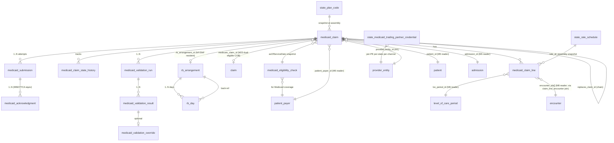

# ChartWarden — Module 24: Billing — Medicaid — Specification

> **Authority note:** This spec is an **implementation proposal** (repo authority rule): [`docs/architecture/`](../architecture/) and the ratified ADRs in [`docs/adr/`](../adr/) win on conflict, and the code plus [`docs/BUSINESS_LOGIC.md`](../BUSINESS_LOGIC.md) are ground truth for as-built behavior. Mechanism choices named here may be superseded — see ADR-0036…0040 and ADR-0030/0032/0035 for the recorded divergences (outbox not Socket.IO, TypeScript not Python sidecars, app-layer AES-256-GCM not pgcrypto, pure transition tables not XState, hand-rolled HTTP hardening not `@fastify/*`, Vite + react-router not TanStack Start).


**Version:** 0.2.1
**Status:** Locked
**Owner:** Fabrice V. Adjam (ChartWarden)
**Dependencies (manifest):** M1 Foundation, M2 Identity, M3 Authorization, M4 Audit, M5 Patient, M6 Admission/Election/Cert, M8 Encounters, M18 EVV, M22 Documents, M23 Billing — Medicare, M26 Cap (deny-stub at this lock), M28 FHIR Gateway (forward-seam), M36 Messaging, M38 Terminology, M40 MDM
**Source documents:** Architecture v0.11 §11.E + §13 (State-Pluggable Medicaid Framework), System Design v0.3, Security Hardening v0.2 §12, AI Governance v0.2, DR/BCP v0.1 §10.4.5, Ops Runbook v0.1 §9, Integrations v0.1 §6.5
**Sibling specs read into context:** M5 v0.2, M6 v0.2, M8 v0.2, M18 v0.2, M22 v0.2, M23 v0.2, M36 v0.2, M38 v0.2, M40 v0.2

> **Phase-2 remediation (2026-06-11) — Version 0.2.2.** **RLS permissive-OR fixed (ADR-0010 D3, S5):**
> `medicaid_claim` had two PERMISSIVE `FOR ALL` policies (org-isolation + provider_entity_scope) that
> Postgres ORs together, so a stale `app.provider_entity_ids` could surface cross-tenant rows. RLS now
> enforces the **org boundary only** (single policy, `chartwarden_app`, `app.org_id`, USING + WITH CHECK);
> provider-entity narrowing moves to the M3 `provider_entity_scope` **ABAC** predicate per the
> ARCH-067 decision order (§3.5). EVV-on-Medicaid applicability follows ADR-0008.
>
> **Tenancy three-column sweep (M24-F21, MINOR — ARCH-011).** The five primary patient-billing PHI
> tables now carry all three columns: `medicaid_claim` + `rb_arrangement` already had
> `provider_entity_id` and gain `location_id`; `medicaid_claim_line` gains **NOT NULL**
> `provider_entity_id` (also its F12 partition key) + `location_id`; `rb_day` gains NOT NULL
> `provider_entity_id` (from the R&B arrangement) + `location_id`; `medicaid_eligibility_check` gains
> both **nullable** (an eligibility probe may precede admission/PE assignment). `location_id` is
> nullable throughout — Medicaid billing rows are PE-scoped, not location-scoped. The claim-subtree
> children (`medicaid_claim_line_encounter`, `…_state_history`, `medicaid_submission`,
> `medicaid_acknowledgment`, the three `medicaid_validation_*` rows) inherit PE/org scope from the
> **PE-scoped root claim** (the finding endorses "PE on the root is right"); the two config catalogs
> (`medicaid_validation_rule_config`, `state_medicaid_trading_partner_credential`) are org/PE-level
> config, not patient PHI. Now gated by `check-tenancy` (fitness #10). See §3.3.

> **Phase-4 remediation (2026-06-11; ADR-0003/0017) — Version 0.2.3.**
> - **M24-F02:** Medicaid hospice **R&B at ≥95% of the state NF rate**, revenue code **0658** (not
>   0294); the fabricated authority **"42 CFR §418.318" is struck** (real basis 418.302/418.310).
> - **M24-F04:** the resident's **patient liability / share-of-cost subtracts from the R&B payment**.
> - **M24-F05/F06:** **TPL** (Medicaid payer of last resort), **crossover** for dual-eligibles,
>   **retro-eligibility**, and **state timely-filing** encoded as pre-submission rules.
> - **M24-F08:** Medicaid payments do **NOT** accrue to the **Medicare aggregate cap** (the cap is on
>   Medicare payments only); any state Medicaid limit is tracked separately.

-----

## Changelog

|Version|Date      |Author |Notes                                                                                                                                                                                                                                                                                                                                                                                                                                                                                                                                                                                                                                                                                                                                                                                                                                                                                                                                                                                                                                                                                                                                                                                                                                                                                                                                                                                                                                                                                                                                                                                                                                                                                                                                                                                                                                                                                                                                                                                                                                                                                                                                                                                                                                                                                                                                                                                                                                                                                                                                                                                                                                                                                                                                                  |
|-------|----------|-------|---------------------------------------------------------------------------------------------------------------------------------------------------------------------------------------------------------------------------------------------------------------------------------------------------------------------------------------------------------------------------------------------------------------------------------------------------------------------------------------------------------------------------------------------------------------------------------------------------------------------------------------------------------------------------------------------------------------------------------------------------------------------------------------------------------------------------------------------------------------------------------------------------------------------------------------------------------------------------------------------------------------------------------------------------------------------------------------------------------------------------------------------------------------------------------------------------------------------------------------------------------------------------------------------------------------------------------------------------------------------------------------------------------------------------------------------------------------------------------------------------------------------------------------------------------------------------------------------------------------------------------------------------------------------------------------------------------------------------------------------------------------------------------------------------------------------------------------------------------------------------------------------------------------------------------------------------------------------------------------------------------------------------------------------------------------------------------------------------------------------------------------------------------------------------------------------------------------------------------------------------------------------------------------------------------------------------------------------------------------------------------------------------------------------------------------------------------------------------------------------------------------------------------------------------------------------------------------------------------------------------------------------------------------------------------------------------------------------------------------------------|
|0.2.1  |2026-06-10|Claude |Patch: (1) duplicate `state` column in `medicaid_claim`/`medicaid_submission`/`medicaid_eligibility_check`/`state_medicaid_trading_partner_credential` renamed to `service_state` (US state); lifecycle `state` column retained on `medicaid_claim` only; unique indexes updated. (2) §2.1 owned-table count text cleaned (14 enumerated). (3) §4.3 header corrected to "Eight Published Reader Seams." (4) `medicaid_claim_line` service-date-within-claim constraint converted from cross-table CHECK to a documented BEFORE-trigger. (5) §9.7 corrected: Oregon eligibility is OHA MMIS 270/271, not "HETS-equivalent" (HETS is Medicare). (6) §3.1 Oregon CCO file enumeration replaced with M40-catalog-driven `_registry.ts` pattern (16 CCOs as of 2026 per OHA CCO 3.0; PacificSource → Trillium Lane County transition early 2026 noted as effective-dated M40 row, not code change). (7) Retention class reconciled to `billing_record` (shared with M23) with M4 `state_retention_override` for jurisdictions exceeding the 7-year federal floor. (8) §13 follow-ons expanded with M40 next-revision tasks (publish `state_medicaid_program`/`state_medicaid_mco`/`state_rate_schedule`) and M23 next-revision tasks (document M24 as confirmed subscriber to `m23.claim.*`).|
|0.2    |2026-06-10|Claude |Initial lock. State-pluggable adapter pattern (D1). M23-layered architecture: reuses §11.A validation framework, control-number derivation, replacement chain, AI block (D2). Outbox-only per-state submission (D3). State-namespaced control number (D4). COB flow for dual-eligibles via M23's `medicareSecondaryContext` seam (D5). Room & Board first-class for NF/SNF residents (D6). State-specific eligibility cache (D7). State plan codes + rate schedules as M40 platform-shared reference (D8). EVV-gate tighter than M23 — federal Cures Act enforcement for Medicaid (D9). Validation registry shared via type-import; M24 owns its own rule overlay (D10). Per-state remittance parsing via adapter (D11). AI block absolute (D12). Replacement chain mirrors M23 with per-state TOB variations (D13). Phase-1 ship = Oregon adapter only; WA/ID/CA/NV deny-stubbed (D14). Patient state at service date is routing key (D15). Manifest patch `M24.dependsOn = [1, 2, 3, 4, 5, 6, 8, 18, 22, 23, 26, 28, 36, 38, 40]`, +`packages/medicaid-adapters` codePath, 14 owned tables (D16).|

-----

## 1. Purpose & Scope

### 1.1 What This Module Does

Module 24 owns **the assembly, validation, submission, and acknowledgment of state Medicaid hospice claims — including the Room & Board (R&B) per-diem flow for hospice patients residing in a nursing facility — across a pluggable per-state adapter registry that lets a new state's MMIS join the platform as a new `MedicaidAdapter` implementation rather than a code change to M24 itself.** Where M23 owns the Medicare Part A claim, M24 owns everything that is not Medicare Part A primary and reaches a state Medicaid agency or its contracted Managed Care Organization (MCO/CCO). M24 reuses M23's substrate without duplicating it — the §11.A validation framework, the deterministic-control-number pattern, the outbox-only submission discipline, the replacement/void chain semantics, the absolute AI block — and layers state-specific concerns on top through the adapter pattern that has been the architecture's commitment from v0.1 (`packages/medicaid-adapters/` per ARCH §11.E / §13 / INTEGRATIONS §6.5).

- **The per-state adapter registry (D1).** `packages/medicaid-adapters/` houses one subpackage per state (`oregon/`, `washington/`, `idaho/`, `california/`, `nevada/`, …) each implementing the `MedicaidAdapter` interface in `packages/medicaid-adapters/src/interface.ts`. The interface — `eligibilityCheck()`, `assembleClaim()`, `submit()`, `parseRemittance()`, `rateLookup()`, optional `capCalculation()`, optional `acceptsDocumentedMissingEvv` — is the architecture's commitment to multi-state expansion: a new state's adoption is a new subpackage + an M40 master entry + a new `CHARTWARDEN_INTEGRATIONS` §6.5.x sub-entry, never an M24 source change. Adapter selection happens **per claim** by reading the patient's `state` (M5, asOf service-date) and looking up the registered adapter in `MedicaidAdapterRegistry.adapterForState(stateCode)`; the registry is constructed from M40 master records at boot and validated by `validateSeams()`.
- **M24 ships Phase 1 with Oregon as the reference adapter; WA, ID, CA, NV are deny-stub adapters.** Engrace Hospice (Pendleton OR, CCN 381588) is the founding customer and Oregon Health Plan (OHP) — administered by the Oregon Health Authority (OHA) through its Division of Medical Assistance Programs (DMAP) and routed via Coordinated Care Organizations (CCOs) for managed-care-enrolled members — is the Phase 1 production target. The other Phase 1-named states have their subpackages scaffolded (folder + a stub adapter that throws on every method with a structured error pointing ops to the adapter's wire-up doc) so the registry's existence proof is testable without committing to a specific state's wire format until a paying customer in that state lands. Per ARCH §14 the broader state expansion is Phase 4 (v2).
- **Claim assembly is server-authoritative, reusing M23's substrate.** A `medicaid_claim` row groups one or more `medicaid_claim_line` rows under a per-state TOB (the standard 811/812/813/814 for combined hospice + R&B claims in most states; 817/818 for replacement/void; some states have an additional `kind='rb'` separation flag for R&B-only claims), bound to one `patient`, one `provider_entity` (CCN), one `patient_payer` snapshot (the active Medicaid row at service-date), one `state_plan_code` from M40, the matched-and-snapshotted `state_rate_schedule_id`, the relevant election period sequence range, optional `rb_arrangement_id` for NF/SNF residents, an optional `medicare_claim_id` FK for dual-eligible Medicare-primary cases, the full set of ICD-10 codes with sequence positions, and any state-specific modifier codes the adapter requires. The route accepts the from-through range and the assembly service walks the M6 / M8 / M18 / M40 readers and the M23 `ClaimReader.medicareSecondaryContext` seam (when applicable) and the state's selected adapter's transformation step to produce every line, every code, every modifier. The client never posts a fully-formed claim; just as in M23, the server is the only authority.
- **Room & Board (R&B) for nursing-facility-resident hospice patients (D6).** The dominant Medicaid hospice billing pattern in Oregon and most states is the dual-eligible NF/SNF-resident patient: Medicare Part A pays the hospice per-diem (RHC/CHC/IRC/GIP) via the M23 pipeline; Medicaid pays a separate R&B per-diem to the hospice agency (95% of the contracted NF/SNF Medicaid rate in Oregon, per 42 CFR §418.318); the hospice agency then pays the NF/SNF its contracted pass-through portion. M24 owns `rb_arrangement` (the per-patient-per-NF-stay contract instance carrying the NF facility id, the contract effective dates, the NF per-diem dollar rate by LOC, the pass-through and retention percentages, the contract document reference for M22) and `rb_day` (per patient per service date, flagged for the LOC-of-the-day; the day's R&B status is `pending` / `billable` / `excluded` / `voided`). R&B days are excluded from `billable` on respite (M5/M40 facility-of-respite differs from the NF/SNF residence) and on GIP (the hospice IPU is the place-of-service, not the NF). The R&B claim path may be **combined** (single 837I with both hospice and R&B revenue codes in the same claim — Oregon's path) or **separate** (two 837I claims — some states' path); the adapter's `assembleClaim()` returns the assembled-form list, and M24's transactor decides one-claim-or-two on the basis of the adapter's `combinesHospiceAndRb` declaration.
- **Eligibility (state 270/271 or portal) and MCO assignment (D7).** Before claim submission the `medicaid_eligibility_check` cache is consulted. The 30-day-freshness rule mirrors M23. The state-Medicaid-equivalent of the MBI is the **state Recipient ID** (called by different names in different states: in Oregon it is the OHP Member ID); M5 publishes a new `MedicaidIdUnlockReader` seam (mirroring `MbiUnlockReader`) that returns the decrypted ID for the duration of the request only. The eligibility response also carries the patient's **MCO/CCO assignment** when present — for Oregon, the OHP member may be CCO-enrolled (CareOregon, PacificSource Community Solutions, Trillium Community Health Plan, Eastern Oregon CCO, Yamhill CCO, etc.) or Open Card (FFS); the assignment determines the submission channel — CCO claims route to the CCO's clearinghouse, FFS claims route to OHA's MMIS directly. The cache stores `outcome` (`active` / `inactive` / `unknown` / `mco_assignment`), the MCO id when assigned, and the as-of date, but never the Recipient ID digits themselves.
- **Coordination of Benefits (COB) for dual-eligibles (D5).** For patients with both Medicare Part A and Medicaid (Engrace's typical Medicaid patient is dual-eligible), the Medicaid R&B claim attaches the Medicare-primary EOB context to the 837I COB segments. M24 reads M23's `ClaimReader.medicareSecondaryContext(orgId, patientId, range)` for the Medicare-paid amount, the sequestration applied, the contractual adjustments, the patient-responsibility amount. M24 cannot submit a Medicaid R&B claim referencing a Medicare-primary claim until the Medicare-primary claim is in `ACK_ACCEPTED` state or further (preferably `PAID` once M25 has posted the 835); the `medicare_primary_required_for_dual` rule enforces. Single-source-of-truth-for-Medicare lives in M23.
- **Outbox-only state-Medicaid submission via per-state adapter (D3).** A claim leaves M24's process boundary only through the `m24.medicaid_claim.submit_requested` outbox event, drained by the `medicaid-claim.submit` BullMQ worker, which resolves the `MedicaidAdapter` from the registry by the claim's state, calls `adapter.submit({body, idempotencyKey, credentials})`, receives the adapter's response (`accepted` / `pending_async` / `rejected` / `transport_failure`), records the result as a `medicaid_submission` row, and transitions the claim accordingly. The claim's `medicaid_claim_control_number` is deterministic per `(provider_entity_id, state, claim.id, attempt_index)` and is the idempotency key both internally and at the state aggregator/clearinghouse/portal. Adapters with async responses (some states' MMIS portals batch processing) get a `pending_async` result and the `medicaid-claim.poll` BullMQ worker polls `adapter.poll(transactionId)` at the next-poll-at interval until terminal.
- **Acknowledgment parsing per-state (D11).** Some states return X12 999 + 277CA + 835 just like the MAC pipeline (which the adapter delegates to `packages/x12-worker-client/` reusing M23's substrate); some states return proprietary acknowledgment / remittance files that require adapter-specific parsing. The adapter's `parseAcknowledgment()` and the M25-owned `parseRemittance()` consumption pattern make the wire format opaque to M24's core. M24 owns the acknowledgment-row writes (`medicaid_acknowledgment`) and the corresponding state transitions (`ACK_PENDING → ACK_ACCEPTED | ACK_REJECTED | ACK_PARTIAL`); M25 owns the downstream 835/remittance posting and the consequent `PAID`/`DENIED` transitions, via the `MedicaidClaimReader.claimByControlNumber` seam M24 publishes.
- **State plan codes and state rate schedules as M40 platform-shared reference (D8).** Mirroring M23's `wage_index_factor` pattern, `state_plan_code` (the per-state catalog of program codes — Oregon's "OHP Plus" / "OHP Standard" / "OHP CHIP" / "Long-Term Care Medicaid" / etc.) and `state_rate_schedule` (the per-state per-LOC per-county per-effective-date rate table — Oregon's hospice per-diem table published annually by OHA) have no `organization_id` column, are loaded by the platform-loader role on annual state-rate-publication cutover, and are snapshotted into `medicaid_claim_line.rate_at_assembly_cents` at claim assembly so historic claim math is reproducible.
- **The Medicaid validation rule registry shares M23's typed registry types and adds Medicaid-specific rules (D10).** Rule types (`ValidationRule`, `ValidationResult`, `ValidationContext`, `OverrideRoleRequired`) live in `packages/billing/src/rules/types.ts` (M23-owned, M24 imports via manifest dependency on M23). M24's rule predicates live in `packages/medicaid-adapters/src/rules/` and register into a parallel `medicaidRuleRegistry` frozen at boot. The 13 default Medicaid rules cover: state eligibility freshness, MCO assignment routes correctly, R&B arrangement required for NF-resident patients, state-specific documentation requirements, Medicare-primary required for dual-eligible, rate-schedule present for service date, state-specific modifier codes valid, recipient-ID present and well-formed, R&B day exclusions correct, NF/SNF level-of-care coherence, R&B contract effective on every service date, state-Medicaid EVV bracket coherence (tighter than M23 — D9), and the M23-paired `medicare_primary_required_for_dual`. Rules tagged `regulatoryRequired=true` cannot be disabled (federal Cures Act items, federal §418 items, state-specific items where the state regulation cites a federal floor); state-specific rules are tagged `applicable_states=['OR','WA',...]` and the executor short-circuits for non-applicable states.
- **The EVV-gate is tighter for Medicaid than for Medicare (D9).** Federal Cures Act §12006 makes EVV non-negotiable for state Medicaid personal-care and home-health claims; M23's posture of "documented_missing passes with attestation" does not survive the Medicaid lift. The `medicaid_evv_bracket_coherence` rule blocks on `unresolved_missing` AND on `documented_missing` for state Medicaid claims **unless** the state's adapter declares `acceptsDocumentedMissingEvv: true` in its adapter metadata — and as a Phase-1 policy decision every active state adapter (Oregon at v0.2) declares `false`. The rule is `regulatoryRequired=true` and `compliance_officer` override role; the override path remains available for one-off edge cases (a device fault during a documented home-care visit on a state Medicaid claim — exceedingly rare in practice given the dominance of R&B-only claims, where the visit is in a NF/SNF with provider-side time clock).
- **MAC-equivalent: per-ProviderEntity per-state trading partner credentials (D8 extended).** `state_medicaid_trading_partner_credential` is M24's per-PE per-state credential record (mirrors M23's `mac_submitter_credential`). One row per (provider_entity_id, state, channel) where `channel ∈ {direct_mmis, cco_clearinghouse, sftp, portal}`. The `client_secret_cipher` is encrypted under the per-tenant DEK per M1 §6; reads pass through the `MedicaidTradingPartnerAdmin` seam for M34's setup wizard.
- **The TOB lifecycle and replacement chain mirrors M23 but is per-state (D13).** Most states' Medicaid 837I uses the same TOB codes (817 = replacement, 818 = void). Adapter publishes `replacementTob(originalTob)` and `voidTob(originalTob)` so a state with proprietary correction codes (rare) can render the right wire form. M24's internal state machine is identical to M23's: `DRAFT → VALIDATING → READY → SUBMITTED → ACK_PENDING → ACK_ACCEPTED | ACK_REJECTED | ACK_PARTIAL → PAID | DENIED → REPLACED | VOIDED`. The `replaces_claim_id` FK is preserved indefinitely; the chain is the audit narrative.
- **AI block on M24 is absolute, mirrors M23 D13 / M18 D13 / M19 D11 / M13 D15 (D12).** Boot validator iterates M32 prompt templates and fails boot on `outputType` match against M24-owned tables; dependency-cruiser blocks `packages/ai-platform/*` imports from M24 paths; per-route guard rejects `actor_kind='ai_*'` headers. The only AI-related surface is an optional read-only `medicaid_validation_ai_advisory` projection M32 may write (advisory remediation hints for failed rules — "your Medicaid recipient ID format looks like it's missing the check digit; verify with the patient's OHP card") that M24 reads via a typed `AiAdvisoryReader` seam; the advisory never gates a rule outcome, never transitions a claim, never appears on `medicaid_claim` or any override row. Every advisory display is audit-captured to the M4 AI-governance channel (separate from operational audit).

### 1.2 What This Module Does Not Do

- **Own the clinical record, the election state, the encounter, the EVV event, the physician identity, the terminology version, or the cap calculation.** Every one of these is a separate module (M5, M6, M8, M18, M40, M38, M26). M24 reads them all via typed reader seams.
- **Submit Medicare Part A claims.** That is M23 Billing — Medicare. M24 reads M23 via `ClaimReader.medicareSecondaryContext` only — for the COB context on dual-eligible Medicaid R&B claims. The Medicare 837I, the MAC submitter pipeline, the NOE/NOTR fast-path, the HIPPS/SIA calculators, the sequestration policy, the wage-index factor — all are M23's domain and M24 does not duplicate them. When a Medicare-primary claim is rejected or denied, M24's pending Medicaid R&B claim that depends on it transitions to a holding state (`AWAITING_MEDICARE_PRIMARY`) and is unblocked on M23's `m23.claim.acknowledged` / `m23.claim.paid` outbox arrival.
- **Process Medicare or Medicaid remittance (835).** That is M25 Remittance & Denials. M24 publishes `MedicaidClaimSubmissionReader.acceptedSubmissionsInWindow` so M25's 835-posting worker can match remittance line items back to originating Medicaid claims, but the 835 parsing, the CARC/RARC categorization, the denial-aging workflow, and the appeal-case lifecycle are M25's. M24 owns the *claim-acknowledgment* row (999/277CA-equivalent — was the claim accepted at the state's edits?) but not the *remittance* row.
- **Calculate the aggregate cap or the IPU cap.** Those are M26 Cap Management's responsibility — the cap is calculated per Medicare beneficiary per cap year regardless of payer mix, so the cap projection is Medicare-paid-and-Medicaid-paid in aggregate per beneficiary. M24 reads M26 via `CapProjectionProvider` to drive the `medicaid_cap_coherence` rule. M24 publishes `MedicaidClaimDayProjectionProvider` for M26 to consume — the Medicaid day-by-LOC aggregation M26 needs as input for the dual-eligible per-patient cap math; M26 reconciles with M23's parallel provider before computing.
- **Render any PDF, letter, or printable artifact.** The Medicaid claim acknowledgment letter for the patient's chart, the R&B contract summary for the NF/SNF, the remittance summary, the denial-appeal cover letter all emit `m24.medicaid_billing.document_render_requested` for M22 to render from a typed payload. M24 has zero PDF code.
- **Speak HL7 v2 or the iQIES batch format or CMS-1984-14 cost report.** M29 (External Interfaces) owns inbound/outbound HL7. M10 (HOPE Engine) owns iQIES submission. M27 (Cost Report) owns CMS-1984-14. M24 publishes `MedicaidClaimReader` for M27's Worksheet D apportionment (Medicare/Medicaid/other patient days) and S-3 statistical data, but does not produce those wire formats.
- **Make autonomous billing decisions through AI.** Per M24 D12 the AI block is absolute. M32 may surface advisory remediation hints on the Medicaid validation worklist UI through the `medicaid_validation_ai_advisory` read-only projection, but every rule pass/fail, every override, every claim transition is an actor decision recorded by an elevated approver. State Medicaid agencies and state Medicaid Fraud Control Units (MFCUs) are program-integrity surfaces; AI-driven billing on Medicaid claims is a state fraud risk per state-specific False Claims Act statutes.
- **Speak the state portal HTML or the CCO clearinghouse's vendor SDK.** Every wire-format and vendor-SDK interaction is confined to the per-state adapter package (`packages/medicaid-adapters/<state>/`). M24's core consumes only the `MedicaidAdapter` interface. Adding a state-specific SDK or HTTP client is an adapter-internal change subject to the adapter-mandate boundary (Architecture §25.14).
- **Maintain the master directory of state Medicaid agencies, their CCOs/MCOs, their submission channels, or their operating models.** That is M40 Master Data Management. M40 publishes `MdmEntityProvider` against the `state_medicaid_program`, `state_medicaid_mco`, and `state_medicaid_channel` master records; M24 reads at boot to construct the adapter registry. Adding a new state's MCO list is an M40 master-data change + an adapter update, not an M24 core change.
- **Submit out-of-state Medicaid for resident-of-another-state patients (the snowbird / cross-state emergency case).** Phase 1 scope: only the patient's resident-state Medicaid program. The `OUT_OF_STATE_MEDICAID` route-level rejection directs ops to handle the rare cross-state case manually. Phase 4 may add cross-state coordination.

### 1.3 Regulatory & Operational Drivers

|Regulation / Standard                                                                       |Requirement                                                                                                                              |M24 realization                                                                                                                                                                                                                                                |
|--------------------------------------------------------------------------------------------|-----------------------------------------------------------------------------------------------------------------------------------------|---------------------------------------------------------------------------------------------------------------------------------------------------------------------------------------------------------------------------------------------------------------|
|**42 CFR §418.318** — Medicaid hospice payment, R&B per-diem                                |Hospice provider receives 95% of NF/SNF Medicaid per-diem rate for hospice patient residing in NF/SNF; remits residual to NF/SNF or retains per contract|`rb_arrangement` schema with pass-through and retention percentages; `rb_day` per-patient-per-service-date with LOC-flagged exclusion logic; the `rb_arrangement_required_for_nf_resident` rule; the rate schedule snapshot from M40                            |
|**42 CFR §455.20 + §456** — State Medicaid program integrity                                |State Medicaid Fraud Control Unit oversight; recipient-eligibility verified before submission; no provider self-referral                  |The `medicaid_eligibility_check` cache with state-specific freshness rule; the `medicaid_recipient_id_format` validity rule per state adapter; the M3 ABAC predicate denying biller-self-treats-self in scope                                                  |
|**21st Century Cures Act §12006** — EVV federal mandate                                     |Electronic verification (six data elements) for Medicaid personal-care and home-health visits — federal floor; no clinician self-attestation accepted absent state opt-in|The `medicaid_evv_bracket_coherence` rule is tighter than M23's — blocks on `documented_missing` unless adapter declares `acceptsDocumentedMissingEvv`; every Phase-1 adapter declares `false`                                                                 |
|**State-specific Medicaid statutes**                                                        |Each state's Medicaid hospice rules: rate schedule, MCO assignment routing, R&B contracting rules, claim documentation, modifier codes   |Encoded in each adapter package; per-state rules applicable_states-tagged in the rule registry; per-state TOB variations in `adapter.replacementTob()` / `adapter.voidTob()`                                                                                    |
|**Oregon OHA OAR Chapter 410 Division 142** — Hospice services                              |Oregon hospice per-diem schedule; CCO routing for CCO-enrolled members; R&B at 95% of NF/SNF rate; long-term care Medicaid distinct from OHP+|Oregon adapter implements: per-CCO routing driven by the M40 `state_medicaid_mco` catalog (16 CCOs as of 2026 per OHA CCO 3.0; PacificSource exiting Lane County early 2026 with Trillium absorbing those members — both transitions handled by effective-dated M40 rows, no code change); the OHP-Standard / OHP-Plus / OHP-CHIP / LTC-Medicaid plan codes; the OHA-published rate table loaded annually by platform-loader; the CCO-routing decision tree in `oregon-router.ts`|
|**HIPAA §162** — HHS-adopted code sets                                                      |ICD-10-CM/PCS, HCPCS, NDC, CARC/RARC used in transactions                                                                                |M24 reads codes through `TerminologyProvider` (M38); ICD-10 sequencing is asOfDate-bound to the claim's `service_from`                                                                                                                                         |
|**CMS X12 Trading Partner Standard** — 837 / 999 / 277CA / 835 / 270/271                    |Where the state uses standard X12, conformance is per CMS schemas                                                                        |Adapter delegates 837I generation, 999/277CA parsing, 270/271 eligibility, 835 parsing to `packages/x12-worker-client/` (M23-owned, M24 reuses via dependency on M23). State-proprietary formats are adapter-internal.                                          |
|**CMS Coordination of Benefits — Medicaid Secondary**                                       |When Medicare is primary, Medicare-paid amount + adjustments attached to Medicaid 837I COB segments                                      |`ClaimReader.medicareSecondaryContext` (M23-published) consumed at assembly; the `medicare_primary_required_for_dual` rule blocks until Medicare-primary is at least ACK_ACCEPTED                                                                              |
|**CMS retention** — 7 years past final claim action                                         |Claim records, acknowledgments, R&B records retained 7 years past final action                                                           |Retention class `compliance` on every owned PHI/billing table; M4 retention policy; MinIO object lock on `medicaid_claims/` bucket for the same 7 years                                                                                                         |
|**State retention overrides**                                                               |Some states require longer (10 years in some jurisdictions); state-pluggable                                                             |M4 `state_retention_override` rows per state per table; the M40 state catalog flags states whose retention exceeds federal floor                                                                                                                                |
|**OIG Workplan + MFCU — hospice billing fraud**                                             |OIG audits Medicaid hospice for false claims, ineligible elections, GIP/IPU overuse, R&B double-dipping                                  |Every claim assembly reads M18 EVV state; every LOC period read from M6 is immutable post-attestation; R&B days flagged for IPU cap projection per M26; every override carries an elevated-approver audit; the M40 `state_mfcu_engagement` catalog tracks per-state MFCU contact|

### 1.4 Competitive Context

- **The per-state adapter pattern is a multi-tenant differentiator that competing single-state EHRs structurally cannot match.** Industry-typical hospice EHRs that started single-state (the dominant pattern in hospice software) carry their original state's Medicaid logic as ad-hoc branches deep in the claim-submission code, surfacing as "this product is great in Texas, has gaps in Oregon" customer feedback. ChartWarden's adapter registry makes the state boundary explicit and verifiable — `bun run arch:fitness` enforces that no state-specific code leaks outside its `packages/medicaid-adapters/<state>/` subpackage; a state's adoption is a single PR per state, not a destabilizing fork. The differentiation is not a sales claim, it is an architectural property.
- **R&B is first-class with explicit contract semantics, not an off-claim addendum.** Industry-typical EHRs treat R&B as either "the same claim as the hospice claim, billed combined per state, math optional" or "a separate billing process altogether outside the EHR, handled in the agency's accounting software" — both leak. ChartWarden models the R&B arrangement (`rb_arrangement`) and per-day flag (`rb_day`) as first-class entities with FK-enforced LOC-coherence (no R&B day on a GIP-LOC day, no R&B day on a respite day from a different facility), per-effective-date contract terms, and the surveyor-defensible reconciliation between hospice LOC-of-record and R&B billing day. When a UPIC auditor or state MFCU asks "show me the R&B days you billed against this patient's three-month NF stay with two GIP transfers," the answer is a `rb_day` projection with explicit hospice-LOC-of-the-day join, not a spreadsheet built ad hoc.
- **MCO routing is explicit, audit-prominent, and survives MCO churn.** Each state's Medicaid managed-care landscape changes annually (CCOs reorganize, contracts shift, members get auto-assigned to new plans). The Oregon CCO transition of 2025 (the CCO 3.0 reset) demonstrated the cost of EHRs that hardcoded MCO routing: months of denials while billers manually rebuilt routing tables. ChartWarden's M40 state-MCO master catalog with effective-dated routing rows means the next CCO transition is a master-data update + an `m40.state_mco.*` outbox event, not a code change; M24's claim assembly reads M40 at assembly time and routes correctly through the transition.
- **The COB pattern survives the dual-eligible audit narrative.** When a state Medicaid MFCU asks "this is a dual-eligible R&B claim — show me the Medicare-primary payment and the secondary Medicaid responsibility," ChartWarden's `medicare_claim_id` FK + the snapshotted Medicare EOB context on the Medicaid claim form provides the exact trail. Competing EHRs typically lose the Medicare-side context on the Medicaid claim because the two pipelines are separate systems with no FK; reconciliation falls on the biller's manual spreadsheet.
- **The validation framework is shared with M23 — the platform learns across payer types.** When a state Medicaid MFCU rejects a claim with a code ChartWarden didn't catch, the rule library's denial-feedback path proposes a new default rule across BOTH M23 (Medicare) and M24 (Medicaid) when the underlying clinical signal is payer-agnostic (e.g., a missing CTI signature is bad on either Medicare or Medicaid); when the signal is payer-specific (e.g., the state's specific Medicaid recipient ID check digit format), the new rule lands only in M24. The shared substrate means platform tightening compounds.
- **AI block absolute on Medicaid is a state-fraud-prevention posture.** Several states' False Claims Acts attach strict liability to "knowingly false" claim submission with civil triple-damages provisions. AI auto-correction of a Medicaid claim that lands wrong is a multiplied liability vector. ChartWarden's absolute block — boot validator + dependency-cruiser + per-route guard — converts that liability surface to zero; the read-only advisory projection lets the platform compete on AI-assistance UX without compromising the audit narrative.

-----

## 2. Domain Model

### 2.1 Entity-Relationship Diagram



The schema decomposes the Medicaid-claim domain into 13 owned tables:

1. **`medicaid_claim`** — the claim root: per-patient, per-PE, per-state, per-payer-snapshot, per-from-through range. Optional FK to M23 `claim` for dual-eligible COB; optional FK to `rb_arrangement` for NF/SNF residents.
2. **`medicaid_claim_line`** — service-date-grained line items with LOC, revenue code, state-specific modifiers, snapshot rate, units, charges, and the backing encounter set via the `medicaid_claim_line_encounter` join.
3. **`medicaid_claim_line_encounter`** — many-to-many between claim lines and the M8 encounters they bill (logical FK to M8, written by assembly service only).
4. **`medicaid_claim_state_history`** — append-only state transition log; one row per state change with actor + reason + occurred_at.
5. **`medicaid_submission`** — per-attempt submission records; `(provider_entity_id, service_state, medicaid_claim_control_number, attempt_index)` unique.
6. **`medicaid_acknowledgment`** — 999/277CA-equivalent acknowledgment records; one row per ack received per submission.
7. **`medicaid_validation_run`** — one row per validation cycle; bound to a claim; carries the rule-registry version pin.
8. **`medicaid_validation_result`** — one row per rule per run.
9. **`medicaid_validation_override`** — one row per overridden failed result; carries actor, role applied, reason ≥40 chars.
10. **`medicaid_validation_rule_config`** — per-tenant overlay; non-regulatory rules can be disabled; custom rules can be added.
11. **`medicaid_eligibility_check`** — per-patient-per-asOfServiceDate cache; carries outcome, MCO assignment, staleAt.
12. **`rb_arrangement`** — per-patient-per-NF-stay R&B contract instance; carries NF facility id, contract document ref, rate by LOC, pass-through and retention percentages, effective dates.
13. **`rb_day`** — per-patient-per-service-date R&B billing day; FK to `rb_arrangement`; LOC-of-the-day flag; status (`pending` / `billable` / `excluded` / `voided` / `billed`); medicaid_claim_line_id FK once billed.

Plus three M40-shared (platform-only, no `organization_id`) reference tables M24 reads through `MdmEntityProvider` but **does not own**:

- `state_medicaid_program` — per-state agency master with operating model, plan codes, retention overrides
- `state_medicaid_mco` — per-state MCO/CCO catalog with effective dates and routing channels
- `state_rate_schedule` — per-state per-LOC per-county per-effective-date rate table

And one tenant-scope credential table M24 owns:

14. **`state_medicaid_trading_partner_credential`** — per-PE per-state per-channel credentials; `client_secret_cipher` KMS-wrapped.

**Total M24-owned tables: 14.** The full set:

1. `medicaid_claim`
2. `medicaid_claim_line`
3. `medicaid_claim_line_encounter` (join table)
4. `medicaid_claim_state_history`
5. `medicaid_submission`
6. `medicaid_acknowledgment`
7. `medicaid_validation_run`
8. `medicaid_validation_result`
9. `medicaid_validation_override`
10. `medicaid_validation_rule_config`
11. `medicaid_eligibility_check`
12. `rb_arrangement`
13. `rb_day`
14. `state_medicaid_trading_partner_credential`

The manifest patch in §13 enumerates all 14.

### 2.2 Per-Entity Lifecycle

#### `medicaid_claim` state machine (XState v5)

```
DRAFT
  ├─[user clicks Validate]→ VALIDATING
  │                           ├─[all rules pass]→ READY
  │                           ├─[has failures, no override]→ FAILED_VALIDATION
  │                           └─[failed but all overridden]→ READY
  ├─[user deletes draft]→ (gone — DRAFT-only delete)
  └─[user assembles into the wrong state's pipe]→ (rejected at route; no row written)

FAILED_VALIDATION
  ├─[user edits upstream then re-validates]→ VALIDATING
  ├─[approver applies override]→ VALIDATING (re-runs to confirm only that rule was the blocker)
  └─[user deletes draft]→ (gone)

READY
  ├─[Medicare-primary not yet ACK_ACCEPTED]→ AWAITING_MEDICARE_PRIMARY
  ├─[user clicks Submit + step-up auth]→ SUBMITTED (via outbox + worker)
  └─[upstream change triggers re-validate]→ VALIDATING

AWAITING_MEDICARE_PRIMARY
  └─[m23.claim.acknowledged for medicare_claim_id]→ READY (auto-transition)
  └─[m23.claim.rejected for medicare_claim_id]→ FAILED_MEDICARE_PRIMARY (terminal-until-resolved)

SUBMITTED
  ├─[adapter returns accepted-sync]→ ACK_PENDING (still waits state's 277CA-equiv)
  ├─[adapter returns pending_async]→ POLLING
  ├─[adapter returns rejected]→ ACK_REJECTED
  └─[adapter returns transport_failure]→ SUBMITTED (retry worker)

POLLING
  └─[poll worker iterates adapter.poll() until terminal]
     ├─[accepted]→ ACK_ACCEPTED
     ├─[rejected]→ ACK_REJECTED
     └─[timeout]→ ACK_TIMEOUT (manual ops resolution)

ACK_PENDING
  ├─[ack accepted (state 277CA equiv)]→ ACK_ACCEPTED
  ├─[ack rejected]→ ACK_REJECTED
  └─[ack partial]→ ACK_PARTIAL

ACK_ACCEPTED
  ├─[M25 posts remittance with payment]→ PAID
  ├─[M25 posts remittance with denial]→ DENIED
  ├─[user builds TOB 817 replacement; replacement ACK_ACCEPTED]→ REPLACED
  └─[user builds TOB 818 void; void ACK_ACCEPTED]→ VOIDED

ACK_REJECTED
  ├─[user edits and re-validates]→ VALIDATING (new submission attempt; same claim id)
  └─[user gives up; archives]→ ABANDONED

ACK_PARTIAL
  └─[user resubmits with TOB 817 for rejected lines]→ (new claim, replaces this one's rejected portion)

PAID
  ├─[user discovers post-pay error, builds TOB 817]→ REPLACED-after-payment
  └─[user discovers should-not-have-billed, builds TOB 818]→ VOIDED-after-payment

REPLACED → terminal (chain head moved to replacement; original preserved)
VOIDED → terminal (zeroed; chain preserved)
DENIED → terminal-until-appeal (M25 owns the appeal flow)
ABANDONED → terminal (kept for retention)
FAILED_MEDICARE_PRIMARY → resolves when M23 primary repaired
```

#### `noe_record` / `notr_record` — **not owned by M24**

Per architecture §11.E and ARCH §13: NOE/NOTR are Medicare-specific concepts (the 42 CFR §418.24 and §418.26 5-day windows are Medicare regulatory). State Medicaid does not generally have an analogous "Notice of Election" filing requirement separate from the claim. The few states with state-specific elections (e.g., state-pluggable; not Oregon) handle them via adapter-internal logic, not as M24-owned entities. **M24 does not have an NOE/NOTR equivalent at the platform level.**

#### `rb_arrangement` lifecycle

```
DRAFT (user is filling in NF contract details)
  └─[user signs the contract and uploads to M22; user marks effective]→ ACTIVE

ACTIVE
  ├─[contract end date arrives]→ EXPIRED
  ├─[NF/SNF contract terminates early]→ TERMINATED (with reason + effective date)
  └─[contract renews; new arrangement supersedes]→ SUPERSEDED (preserved indefinitely)

EXPIRED → terminal (preserved; no new rb_day rows may be created against it after expiry)
TERMINATED → terminal
SUPERSEDED → terminal (chain via supersedes_arrangement_id)
```

#### `rb_day` lifecycle

```
pending (created by daily-r-and-b-sweep cron when patient is NF-resident on that date)
  ├─[user excludes the day with reason]→ excluded
  ├─[LOC-of-day is GIP or respite-elsewhere — system auto-excludes]→ excluded
  └─[day's LOC-of-day is hospice routine in NF/SNF and within active rb_arrangement]→ billable

billable
  └─[assembly includes the day on a medicaid_claim_line]→ billed (medicaid_claim_line_id FK set)

billed
  ├─[the claim is voided/replaced]→ billable (returns to billable; the new claim line picks up)
  └─[the rb_arrangement is corrected → re-evaluation cron flips the day]→ excluded + audit marker

excluded → terminal-until-corrected (manual revert with reason allowed by Billing Manager)
voided → terminal (set when the underlying patient day is voided in M5 deceased / discharge correction)
```

### 2.3 Validation Rules

(Per-row, beyond the registry-driven §11.A rules in §4.5; these are the structural rules at row-write time.)

- **`medicaid_claim`** — `service_from <= service_to`; `tob ∈ adapter.supportedTobs()`; `patient_payer_id` resolves to a Medicaid payer-kind at service-date (per M5 `PatientPayerReader.coverageKindOn()`); `state` matches `patient.state_at(service_date)` from M5; `medicare_claim_id` set requires `patient_payer.medicare_primary=true` on the period; `rb_arrangement_id` set requires `rb_arrangement.effective_from <= service_from AND (rb_arrangement.effective_to IS NULL OR rb_arrangement.effective_to >= service_to)`; `replaces_claim_id` set requires `tob ∈ {817, 818}` and the referenced row is ACK_ACCEPTED or PAID.
- **`medicaid_claim_line`** — `service_date BETWEEN claim.service_from AND claim.service_to`; `revenue_code` valid via M38 `terminology.is_member_of(systemId='cms-revenue', code, valueSetId='vs.cms-hospice-revenue', asOfDate=service_date)`; `q_code` valid via M38 `terminology.is_member_of(systemId='hcpcs', code, valueSetId='vs.cms-hospice-q-codes', asOfDate=service_date)`; `level_of_care ∈ {RHC, CHC, IRC, GIP, NF_RB}`; `rate_at_assembly_cents > 0` (snapshot from `state_rate_schedule` at assembly); `units > 0`.
- **`medicaid_submission`** — `medicaid_claim_control_number` matches the deterministic format per §4.X; `attempt_index >= 0`; `state` matches `claim.state`; `channel ∈ {direct_mmis, cco_clearinghouse, sftp, portal}` and matches the routing decision (M40 `state_medicaid_mco.routing_channel` for the patient's MCO).
- **`medicaid_acknowledgment`** — bound to a `medicaid_submission_id`; `kind ∈ {sync_999, sync_277ca, async_state_specific}`; `outcome ∈ {accepted, rejected, partial}`; `error_codes` (jsonb array) populated when rejected/partial.
- **`medicaid_validation_run`** — `rule_registry_version` snapshot pinned at run-time; `triggered_by ∈ {user, assembly, upstream_change, scheduled}`; `claim_state_at_trigger` snapshot of the claim state.
- **`medicaid_validation_result`** — `rule_key` registered in `medicaidRuleRegistry`; `outcome ∈ {pass, fail, warn, info, skip_not_applicable}`; for `skip_not_applicable` the `applicable_states_check` field is populated with the rule's applicable_states and the claim.state.
- **`medicaid_validation_override`** — `override_role` matches the rule's `override_role_required` (via M3 ABAC predicate `medicaid_override_role_eligible`); `reason` ≥ 40 chars; `actor_membership_id` is a member of the org with the role; `step_up_auth_completed_at` within last 5 minutes per M2 step-up policy.
- **`medicaid_eligibility_check`** — `as_of_service_date` is a real date in past or current; `outcome ∈ {active, inactive, unknown, mco_assignment}`; if `outcome='mco_assignment'` then `mco_id` set to a valid M40 `state_medicaid_mco.id`; `checked_at <= NOW()`; `stale_at = checked_at + INTERVAL '30 days'`.
- **`rb_arrangement`** — `effective_from <= effective_to`; `effective_to IS NULL` (open-ended) allowed; `pass_through_pct + retention_pct = 100`; both percentages ∈ [0, 100]; `nf_facility_mdm_id` resolves to an M40 facility with `kind ∈ {nursing_facility, skilled_nursing_facility, hospital_swing_bed}`; `contract_document_id` (M22 logical FK) set in ACTIVE; `nf_per_diem_cents_routine`, `nf_per_diem_cents_resp`, `nf_per_diem_cents_gip` ≥ 0.
- **`rb_day`** — exactly one row per `(patient_id, service_date)` in active rb_arrangement window (unique partial index); `loc_of_day` matches M6 `LevelOfCareReader.locOnDate(patientId, service_date)`; `status` lifecycle per §2.2; `medicaid_claim_line_id IS NULL` if status ∈ {pending, billable, excluded}, NOT NULL if status='billed'.
- **`state_medicaid_trading_partner_credential`** — `client_id` not null; `client_secret_cipher` encrypted by KMS-wrapped per-tenant DEK; `state` matches the registered adapter set; `channel` matches `state_medicaid_program.channel_options[]` from M40; `active_from <= active_to OR active_to IS NULL`.

### 2.4 Side Effects

Mutations on M24 entities emit the following side effects, all through the outbox-in-same-transaction discipline per ARCH §25.7 / M1 §6:

|Mutation                                                |Outbox emit(s)                                                                                                        |Sync side effects                                                                            |
|--------------------------------------------------------|----------------------------------------------------------------------------------------------------------------------|---------------------------------------------------------------------------------------------|
|`medicaid_claim` insert (DRAFT)                         |`m24.medicaid_claim.draft_created`                                                                                    |Eligibility check freshness re-evaluated                                                     |
|`medicaid_claim` → VALIDATING                           |`m24.medicaid_claim.validation_started`                                                                               |`medicaid_validation_run` row created; rule registry executes async                          |
|`medicaid_claim` → FAILED_VALIDATION                    |`m24.medicaid_claim.validation_failed`                                                                                |Worklist UI updates; M36 alert to assigned biller                                            |
|`medicaid_claim` → READY                                |`m24.medicaid_claim.ready_for_submission`                                                                             |Submit button enabled in UI                                                                  |
|`medicaid_claim` → AWAITING_MEDICARE_PRIMARY            |`m24.medicaid_claim.awaiting_medicare_primary`                                                                        |Listener subscribed to `m23.claim.acknowledged` for the medicare_claim_id                    |
|`medicaid_claim` → SUBMITTED                            |`m24.medicaid_claim.submit_requested` (drives worker) → `m24.medicaid_claim.submitted` (when worker completes)        |`medicaid_submission` row inserted; X12 file or adapter-specific payload generated           |
|`medicaid_claim` → ACK_ACCEPTED                         |`m24.medicaid_claim.acknowledged`                                                                                     |Document render request to M22; AR dashboard updates                                         |
|`medicaid_claim` → ACK_REJECTED                         |`m24.medicaid_claim.rejected`                                                                                         |M36 alert critical; biller assigned                                                          |
|`medicaid_claim` → PAID                                 |(driven by M25 `m25.remittance.claim_paid` consumer)                                                                           |AR dashboard updates; cap projection refreshed                                               |
|`medicaid_claim` → REPLACED / VOIDED                    |`m24.medicaid_claim.replaced` / `.voided`                                                                             |Chain head moves; M26 cap projection invalidated                                             |
|`medicaid_validation_override` insert                   |`m24.medicaid_claim.override_applied`                                                                                 |M4 audit-event chain extended; surveyor read-view reflects                                   |
|`rb_arrangement` → ACTIVE                               |`m24.rb_arrangement.activated`                                                                                        |Daily sweep starts producing `rb_day` rows for the patient in the date range                 |
|`rb_arrangement` → EXPIRED/TERMINATED/SUPERSEDED        |`m24.rb_arrangement.ended`                                                                                            |Sweep stops; pending rb_days resolve                                                         |
|`rb_day` → billed                                       |(no outbox; internal)                                                                                                 |`medicaid_claim_line_id` FK set                                                              |
|`medicaid_eligibility_check` insert                     |`m24.medicaid_eligibility.checked`                                                                                    |Stale-watch cron updates the staleAt index                                                   |
|`state_medicaid_trading_partner_credential` upsert      |`m24.medicaid_trading_partner.updated`                                                                                |M34 wizard completion signal; integration health surface refreshes                           |

### 2.5 Concurrency

Optimistic concurrency control with the `version` column on every mutable entity (`medicaid_claim`, `medicaid_validation_rule_config`, `medicaid_eligibility_check`, `rb_arrangement`, `rb_day`, `state_medicaid_trading_partner_credential`). The `If-Match` header is required on every PATCH; mismatch returns `412 PRECONDITION_FAILED`. The `medicaid_claim_state_history`, `medicaid_submission`, `medicaid_acknowledgment`, `medicaid_validation_run`, `medicaid_validation_result`, `medicaid_validation_override`, `medicaid_claim_line`, `medicaid_claim_line_encounter` tables are append-only after creation (no version column; immutable post-insert).

Race-condition scenarios specifically tested:
- Two billers click Submit on the same claim within the same second — `(provider_entity_id, service_state, medicaid_claim_control_number, attempt_index)` unique index makes one succeed and one fail at the database layer; the rejected biller sees a 409 with the winning attempt's details
- Re-validate triggered by upstream change (m6 LOC change) coincides with manual re-validate — `medicaid_validation_run.idempotency_key` makes the second a no-op (idempotency key includes the trigger source + the upstream change id)
- Two billers edit the same DRAFT claim — `version` column enforces; second editor gets 412 and refresh prompt
- R&B day status flip during claim assembly — assembly takes a SELECT FOR UPDATE on the candidate `rb_day` rows for the claim's date range; concurrent rb_day-corrector waits

### 2.6 Idempotency

All mutation routes accept the `Idempotency-Key` header per M1 idempotency middleware. The `medicaid_claim_control_number` is the second-layer idempotency key for the adapter call (state aggregator / clearinghouse will refuse a re-submitted same-control-number per the per-state contract; the registry's `adapter.submit()` is called with the same key on retry; retries are no-ops at the state side).

Specific idempotency rules:
- **Eligibility refresh** — keyed on `(patient_id, as_of_service_date)` with a 5-minute deduplication window; a second refresh within 5 minutes returns the cached result (`from_cache=true` flag)
- **Validation run** — keyed on `(claim_id, trigger_source, trigger_signal_id, rule_registry_version)` 
- **R&B day creation** — keyed on `(patient_id, service_date)`; the daily sweep is idempotent
- **Trading partner credential upsert** — keyed on `(provider_entity_id, state, channel)` with `Idempotency-Key`
- **Adapter submit call** — keyed on `medicaid_claim_control_number`; retries reuse the same control number; the unique index on `medicaid_submission(provider_entity_id, service_state, medicaid_claim_control_number, attempt_index)` prevents double-row

-----

## 3. Drizzle Schema

### 3.1 Package Layout

```
apps/backend/src/modules/24-billing-medicaid/
├── index.ts                                       # module init
├── boot.ts                                        # registers seams, ABAC predicates, outbox subscribers, eraser
├── routes/
│   ├── medicaid-claims.ts                         # POST / GET / PATCH; state transitions
│   ├── medicaid-claim-lines.ts                    # GET (read-only after claim leaves DRAFT)
│   ├── medicaid-submissions.ts                    # POST submit (action, step-up), GET per-claim attempts
│   ├── medicaid-acknowledgments.ts                # GET (read-only — written by worker)
│   ├── medicaid-validation-runs.ts                # POST /medicaid-claims/:id/re-validate; GET per-claim
│   ├── medicaid-validation-overrides.ts           # POST (apply override, step-up); GET worklist
│   ├── medicaid-validation-rule-config.ts         # GET / PATCH (tenant overlay editing; org-admin)
│   ├── medicaid-eligibility-checks.ts             # POST refresh; GET per-patient
│   ├── rb-arrangements.ts                         # POST / GET / PATCH / activate / terminate
│   ├── rb-days.ts                                 # GET; PATCH for status override (Billing Manager)
│   ├── state-trading-partner-credentials.ts       # POST upsert (M34 wizard, step-up); GET per-PE (admin-only)
│   ├── medicaid-ar-dashboard.ts                   # GET aggregate metrics for the Medicaid AR view
│   └── admin/
│       ├── platform-medicaid-rules.ts             # platform admin: regulatory_required Medicaid rule registry write
│       └── state-rate-schedule-loader.ts          # platform admin: annual per-state rate-schedule load (calls M40 admin route)
├── services/
│   ├── medicaid-claim-assembly.ts                 # walks readers; resolves adapter; produces claim + lines (+ R&B lines if applicable)
│   ├── medicaid-claim-state-service.ts            # XState + transition writes; emits outbox
│   ├── medicaid-claim-validation-service.ts       # executes the rule registry against a claim; writes runs + results
│   ├── medicaid-claim-submission-service.ts       # builds the outbox payload for the worker
│   ├── medicaid-claim-acknowledgment-service.ts   # ack parser dispatcher (delegates to adapter.parseAcknowledgment())
│   ├── medicaid-claim-replacement-service.ts      # builds TOB 817/818 with replaces_claim_id and corrected lines
│   ├── medicaid-eligibility-service.ts            # state-Medicaid eligibility cache + refresh path (calls adapter.eligibilityCheck())
│   ├── medicaid-override-service.ts               # apply override with elevated-approver predicate check
│   ├── rb-arrangement-service.ts                  # arrangement lifecycle; effective-date contract validation
│   ├── rb-day-derivation-service.ts               # daily sweep that produces rb_day rows for active arrangements
│   ├── state-trading-partner-credential-service.ts # MedicaidTradingPartnerAdmin seam impl; KMS-wrapped client_secret persist
│   └── seam/
│       ├── medicaid-claim-reader.ts               # MedicaidClaimReader seam impl (consumed by M25/M27/M28/M30/M33)
│       ├── medicaid-claim-day-projection-provider.ts # consumed by M26/M27
│       ├── medicaid-claim-metrics-provider.ts     # consumed by M33
│       ├── medicaid-claim-submission-reader.ts    # consumed by M25
│       ├── medicaid-eligibility-reader.ts         # consumed by M5/M6 (MCO assignment surface)
│       ├── state-rate-schedule-reader.ts          # consumed by M27/M33
│       ├── room-and-board-reader.ts               # consumed by M27/M33/M37
│       └── medicaid-trading-partner-admin.ts      # consumed by M34
├── workers/
│   ├── medicaid-claim-submit.bullmq.ts            # drains m24.medicaid_claim.submit_requested; calls adapter.submit()
│   ├── medicaid-claim-submit-retry.bullmq.ts      # transport-failure retry handler
│   ├── medicaid-claim-poll.bullmq.ts              # polls adapter.poll() for async-response adapters
│   ├── medicaid-ack-pull.cron.ts                  # per-state per-channel; pulls + parses ack files via adapter
│   ├── medicaid-eligibility-stale-watchdog.cron.ts # daily; flags rows past 30d freshness
│   ├── rb-day-daily-sweep.cron.ts                 # nightly; produces rb_day rows for active arrangements
│   ├── re-validate-on-upstream-change.bullmq.ts   # consumes m5/m6/m8/m18/m23/m40 outbox events that mutate facts
│   └── state-channel-health.cron.ts               # every 15 min per state per channel; probes availability
├── consumers/
│   ├── m5-patient-payer-changed.consumer.ts       # invalidates Medicaid eligibility cache
│   ├── m5-patient-deceased.consumer.ts            # triggers final R&B day finalization
│   ├── m5-patient-residence-changed.consumer.ts   # invalidates rb_arrangement match
│   ├── m6-loc-changed.consumer.ts                 # triggers rb_day re-evaluation + re-validate
│   ├── m6-election-signed.consumer.ts             # no NOE-equivalent at the platform; adapter-internal if state requires
│   ├── m8-encounter-signed.consumer.ts            # daily claim-eligibility recompute trigger
│   ├── m18-evv-late-resolved.consumer.ts          # triggers re-validate
│   ├── m23-claim-acknowledged.consumer.ts         # unblocks AWAITING_MEDICARE_PRIMARY → READY
│   ├── m23-claim-rejected.consumer.ts             # transitions AWAITING_MEDICARE_PRIMARY → FAILED_MEDICARE_PRIMARY
│   ├── m23-claim-replaced.consumer.ts             # if Medicare-primary is replaced, our COB context invalidates
│   ├── m25-remit-posted.consumer.ts               # transitions claim to PAID/DENIED
│   ├── m26-cap-projection-changed.consumer.ts     # triggers re-validate on any claim depending on the projection
│   ├── m40-state-mco-changed.consumer.ts          # invalidates cached MCO assignment; re-routes pending claims
│   ├── m40-state-rate-schedule-loaded.consumer.ts # re-validates open claims affected by the new schedule
│   └── m22-document-rendered.consumer.ts          # updates back-ref document_id on R&B/claim row
├── permissions.ts                                 # 26 permission keys
└── alerts.ts                                      # 10 typed M36 alert payloads

packages/medicaid-adapters/
├── src/
│   ├── interface.ts                               # MedicaidAdapter interface (D1)
│   ├── registry.ts                                # MedicaidAdapterRegistry, byState resolution
│   ├── events.ts                                  # outbox event TypeBox shapes
│   ├── control-number.ts                          # deterministic medicaid_claim_control_number derivation (D4)
│   ├── tob/
│   │   └── derivation.ts                          # TOB selection per state per claim cadence
│   ├── rules/                                     # the Medicaid-specific rule registry
│   │   ├── _registry.ts                           # central registration; rule version + regulatory_required tag
│   │   ├── medicaid-eligibility-freshness.ts
│   │   ├── medicaid-recipient-id-format.ts
│   │   ├── medicaid-mco-assignment-routes.ts
│   │   ├── medicaid-rb-arrangement-required.ts
│   │   ├── medicaid-rb-day-loc-coherence.ts
│   │   ├── medicaid-medicare-primary-required-for-dual.ts
│   │   ├── medicaid-rate-schedule-present.ts
│   │   ├── medicaid-state-specific-modifiers.ts
│   │   ├── medicaid-state-specific-documentation.ts
│   │   ├── medicaid-nf-snf-loc-coherence.ts
│   │   ├── medicaid-rb-contract-effective.ts
│   │   ├── medicaid-evv-bracket-coherence.ts      # tighter than M23 per D9
│   │   └── medicaid-cap-coherence.ts              # consumes M26 CapProjectionProvider
│   ├── oregon/                                    # Reference implementation
│   │   ├── index.ts                               # OregonMedicaidAdapter implements MedicaidAdapter
│   │   ├── eligibility.ts                         # OHA MMIS 270/271 + CCO lookup
│   │   ├── assembly.ts                            # 837I generation (delegates to x12-worker-client)
│   │   ├── submit-oha.ts                          # OHA direct MMIS submission
│   │   ├── submit-cco/                            # one file per active Oregon CCO; the file set is M40-catalog-driven, NOT hardcoded.
│   │   │   ├── _base.ts                           # shared CcoSubmitter base class (HTTP client, idempotency, retry)
│   │   │   ├── _registry.ts                       # maps M40 mco_id → CcoSubmitter; deny-stub for any CCO without a current file
│   │   │   ├── care-oregon.ts                     # one file per published CCO submit spec; add as each CCO publishes
│   │   │   └── ...                                # (Oregon's CCO roster is 16 as of 2026, in flux per OHA CCO 3.0 transitions;
│   │   │                                          #  PacificSource exits Lane County early 2026 with Trillium absorbing those members.
│   │   │                                          #  Per D14, files land per published-spec availability, not by enumeration in this spec.)
│   │   ├── parse-ack.ts                           # OHA / CCO acknowledgment parsing
│   │   ├── parse-remittance.ts                    # consumed by M25 via OregonRemittanceParser export
│   │   ├── rate-lookup.ts                         # reads state_rate_schedule via M40
│   │   ├── tob-codes.ts                           # Oregon-specific TOB mappings (standard CMS)
│   │   ├── metadata.ts                            # adapter.acceptsDocumentedMissingEvv = false; .combinesHospiceAndRb = true; etc.
│   │   └── router.ts                              # OHA vs CCO routing decision per claim
│   ├── washington/
│   │   └── index.ts                               # WashingtonMedicaidAdapter — Phase 1 deny-stub
│   ├── idaho/
│   │   └── index.ts                               # IdahoMedicaidAdapter — Phase 1 deny-stub
│   ├── california/
│   │   └── index.ts                               # CaliforniaMedicaidAdapter — Phase 1 deny-stub
│   ├── nevada/
│   │   └── index.ts                               # NevadaMedicaidAdapter — Phase 1 deny-stub
│   └── deny-stub.ts                               # shared deny-stub helper for non-implemented adapters
```

Following M18's `packages/evv-aggregators/` pattern exactly. The split: pure types and the adapter interface and the rule registry in `packages/medicaid-adapters/`; per-state implementations in `packages/medicaid-adapters/<state>/`; the route handlers + services + workers + consumers in the backend module dir. The `packages/medicaid-adapters/` is the **only** dependency-cruiser-enforced boundary for state-Medicaid wire-format work — no other package may speak HTTP to a state portal or instantiate a state-vendor SDK. M24 reuses `packages/x12-worker-client/` (M23-owned) for X12 wire-format work, accessed via dependency on M23.

### 3.2 Migration Script Phases (`0024_billing_medicaid.sql`)

The migration is sequenced to land cleanly under the existing M23 substrate and M5/M6/M18 dependency surfaces.

1. **Reference / catalog rows** — none owned by M24; M40 owns `state_medicaid_program`, `state_medicaid_mco`, `state_rate_schedule`. These are seeded by separate M40 platform-loader migrations.
2. **Core claim tables** — `medicaid_claim`, `medicaid_claim_line`, `medicaid_claim_line_encounter`, `medicaid_claim_state_history` with FKs, CHECK constraints, partial unique indexes (control-number uniqueness, control-number replacement-FK-required, etc.).
3. **Submission and acknowledgment tables** — `medicaid_submission`, `medicaid_acknowledgment` with FKs.
4. **Validation tables** — `medicaid_validation_run`, `medicaid_validation_result`, `medicaid_validation_override`, `medicaid_validation_rule_config` with the regulatory-required CHECK constraint.
5. **R&B tables** — `rb_arrangement`, `rb_day` with FKs and partial unique indexes.
6. **Cache and credential tables** — `medicaid_eligibility_check`, `state_medicaid_trading_partner_credential`.
7. **Partitioning** — `medicaid_claim` quarterly by `provider_entity_id` + `created_at`; `medicaid_claim_line` quarterly by `provider_entity_id` + `service_date`; `medicaid_claim_state_history` / `medicaid_validation_run` / `medicaid_validation_result` monthly by `organization_id` + `at`; `rb_day` quarterly by `organization_id` + `service_date`.
8. **RLS policies** per §3.5; **audit triggers** per M4 with §3.6 denylist; **eraser registration** per §3.7.
9. **Seed data** — none in this migration; the Oregon adapter's metadata is code-side; rate schedules are loaded by `state-rate-schedule-loader.ts` admin route from OHA-published PDFs.

### 3.3 Schema Files (Drizzle)

> **Tenancy three-column rule (M24-F21 / ADR-0010 D1 / ARCH-011).** Medicaid billing is **per-CCN
> (ProviderEntity)** by construction, so the tenancy spine resolves at the **PE-scoped root claim** and
> the claim subtree inherits it. The three columns are materialized on the five primary
> patient-billing tables: `medicaid_claim` (PE NOT NULL, `location_id` nullable), `medicaid_claim_line`
> (PE NOT NULL — also the F12 partition key — `location_id` nullable), `rb_arrangement` (PE NOT NULL,
> `location_id` nullable), `rb_day` (PE NOT NULL from the arrangement, `location_id` nullable), and
> `medicaid_eligibility_check` (both **nullable** — an eligibility probe may run before admission and
> before a CCN is assigned). `location_id` is nullable everywhere because a Medicaid claim is attributed
> to a CCN, not to a delivery Location; it is carried for state programs that require site-of-service
> and for location-scoped dashboards. **Carve-outs:** the claim-lifecycle children
> (`medicaid_claim_line_encounter`, `medicaid_claim_state_history`, `medicaid_submission`,
> `medicaid_acknowledgment`, `medicaid_validation_run` / `_result` / `_override`) inherit PE/org scope
> from the root claim via their NOT NULL `medicaid_claim_id` FK; `medicaid_validation_rule_config` and
> `state_medicaid_trading_partner_credential` are **org/PE-level configuration**, not patient PHI. RLS
> is the org-only policy (per the Phase-2 F11 fix) with PE narrowing in M3 ABAC. Satisfies
> `check-tenancy` (fitness #10); `location` added to the shared `@chartwarden/db/schema` import.

```typescript
// apps/backend/src/modules/24-billing-medicaid/schema/medicaid-claim.ts
import { pgTable, uuid, timestamp, text, integer, jsonb, pgEnum, varchar, boolean, check } from 'drizzle-orm/pg-core'
import { sql } from 'drizzle-orm'
import { organization, providerEntity, location, patient, patientPayer, admission } from '@chartwarden/db/schema'  // location added — ARCH-011 (M24-F21)
import { claim as medicareClaim } from '../../23-billing-medicare/schema/claim'   // boundary: M23 dependency edge per manifest

export const medicaidClaimStateEnum = pgEnum('medicaid_claim_state', [
  'DRAFT', 'VALIDATING', 'FAILED_VALIDATION', 'READY',
  'AWAITING_MEDICARE_PRIMARY', 'FAILED_MEDICARE_PRIMARY',
  'SUBMITTED', 'POLLING', 'ACK_PENDING', 'ACK_TIMEOUT',
  'ACK_ACCEPTED', 'ACK_REJECTED', 'ACK_PARTIAL',
  'PAID', 'DENIED', 'REPLACED', 'VOIDED', 'ABANDONED',
])

export const medicaidClaimKindEnum = pgEnum('medicaid_claim_kind', [
  'combined_hospice_rb',   // single 837I with hospice + R&B lines (Oregon path)
  'hospice_only',          // hospice-only claim (no NF residence)
  'rb_only',               // R&B-only on a separate claim (some states' path)
])

export const medicaidClaim = pgTable('medicaid_claim', {
  id: uuid('id').primaryKey().defaultRandom(),
  organizationId: uuid('organization_id').notNull().references(() => organization.id),
  providerEntityId: uuid('provider_entity_id').notNull().references(() => providerEntity.id),
  locationId: uuid('location_id').references(() => location.id),   // ARCH-011 / M24-F21 (nullable — claim is PE-scoped; see §3.3)
  patientId: uuid('patient_id').notNull(),                    // logical FK to M5
  patientPayerId: uuid('patient_payer_id').notNull(),         // logical FK to M5
  admissionId: uuid('admission_id').notNull(),                // logical FK to M6

  serviceState: varchar('service_state', { length: 2 }).notNull(),  // 'OR' | 'WA' | ... — the US state the service was delivered in
  kind: medicaidClaimKindEnum('kind').notNull(),
  tob: varchar('tob', { length: 4 }).notNull(),               // '811' | '812' | '813' | '814' | '817' | '818'

  serviceFrom: timestamp('service_from', { withTimezone: true, mode: 'date' }).notNull(),
  serviceTo: timestamp('service_to', { withTimezone: true, mode: 'date' }).notNull(),

  // State-snapshotted catalog references (M40-shared reference data)
  statePlanCodeId: uuid('state_plan_code_id').notNull(),       // logical FK to M40 state_plan_code
  statePlanCodeSnapshot: varchar('state_plan_code_snapshot', { length: 32 }).notNull(),

  // MCO routing (resolved at assembly time, snapshotted)
  mcoId: uuid('mco_id'),                                       // null = FFS / Open Card
  mcoSnapshot: jsonb('mco_snapshot'),                          // { name, channel, contact_at_assembly } for audit

  // COB hand-off to M23 (dual-eligible patients)
  medicareClaimId: uuid('medicare_claim_id').references(() => medicareClaim.id),
  medicareSecondaryContextSnapshot: jsonb('medicare_secondary_context_snapshot'),  // { paid_amount_cents, seq_pct, adjustments, eob_doc_id } at assembly

  // R&B
  rbArrangementId: uuid('rb_arrangement_id'),                  // FK below
  rbDayCountSnapshot: integer('rb_day_count_snapshot'),

  // Replacement chain
  replacesClaimId: uuid('replaces_claim_id'),                  // self-FK for chain
  replacedByClaimId: uuid('replaced_by_claim_id'),             // populated on the original when REPLACED/VOIDED

  // Control number per D4
  medicaidClaimControlNumber: varchar('medicaid_claim_control_number', { length: 32 }).notNull(),

  // State machine
  state: medicaidClaimStateEnum('state').notNull().default('DRAFT'),

  // Concurrency
  version: integer('version').notNull().default(1),

  // Eligibility snapshot
  eligibilityCheckId: uuid('eligibility_check_id'),            // FK to medicaid_eligibility_check
  eligibilityOutcomeSnapshot: varchar('eligibility_outcome_snapshot', { length: 32 }),
  eligibilityCheckedAtSnapshot: timestamp('eligibility_checked_at_snapshot', { withTimezone: true }),

  // Validation run pinned
  validationRunIdLatest: uuid('validation_run_id_latest'),

  // Audit hooks
  createdAt: timestamp('created_at', { withTimezone: true }).notNull().defaultNow(),
  updatedAt: timestamp('updated_at', { withTimezone: true }).notNull().defaultNow(),
  createdByMembershipId: uuid('created_by_membership_id').notNull(),
  updatedByMembershipId: uuid('updated_by_membership_id').notNull(),
}, (t) => ({
  // Unique control number per (PE, state, attempt-coverage)
  uniqueControlPerPeState: sql`CREATE UNIQUE INDEX medicaid_claim_control_per_pe_state ON ${t} (provider_entity_id, service_state, medicaid_claim_control_number)`,

  // Replacement requires predecessor
  replacementRequiresPredecessor: check('medicaid_claim_replacement_requires_predecessor', sql`
    (tob IN ('817','818') AND replaces_claim_id IS NOT NULL) OR
    (tob NOT IN ('817','818') AND replaces_claim_id IS NULL)
  `),

  // Dual-eligible coherence
  medicareSecondaryRequiresMedicareFk: check('medicare_secondary_requires_medicare_fk', sql`
    (medicare_secondary_context_snapshot IS NULL AND medicare_claim_id IS NULL) OR
    (medicare_secondary_context_snapshot IS NOT NULL AND medicare_claim_id IS NOT NULL)
  `),

  // Service-from <= service-to
  serviceRangeValid: check('medicaid_claim_service_range_valid', sql`service_from <= service_to`),

  // Partitioning declared in migration (quarterly by PE + created_at)
}))
```

```typescript
// apps/backend/src/modules/24-billing-medicaid/schema/medicaid-claim-line.ts
export const medicaidClaimLineLocEnum = pgEnum('medicaid_claim_line_loc', [
  'RHC', 'CHC', 'IRC', 'GIP', 'NF_RB',
])

export const medicaidClaimLine = pgTable('medicaid_claim_line', {
  id: uuid('id').primaryKey().defaultRandom(),
  organizationId: uuid('organization_id').notNull().references(() => organization.id),
  providerEntityId: uuid('provider_entity_id').notNull().references(() => providerEntity.id),  // ARCH-011 / M24-F21 + F12 partition key (NOT NULL — from parent claim)
  locationId: uuid('location_id').references(() => location.id),                                // ARCH-011 / M24-F21 (nullable — see §3.3)
  medicaidClaimId: uuid('medicaid_claim_id').notNull().references(() => medicaidClaim.id),

  lineNumber: integer('line_number').notNull(),                // 1-based per claim
  serviceDate: timestamp('service_date', { withTimezone: true, mode: 'date' }).notNull(),

  revenueCode: varchar('revenue_code', { length: 4 }).notNull(),    // CMS revenue code
  qCode: varchar('q_code', { length: 8 }).notNull(),                // HCPCS Q-code
  hcpcsModifier1: varchar('hcpcs_modifier_1', { length: 2 }),       // state-specific
  hcpcsModifier2: varchar('hcpcs_modifier_2', { length: 2 }),
  hcpcsModifier3: varchar('hcpcs_modifier_3', { length: 2 }),
  hcpcsModifier4: varchar('hcpcs_modifier_4', { length: 2 }),

  levelOfCare: medicaidClaimLineLocEnum('level_of_care').notNull(),
  locPeriodId: uuid('loc_period_id').notNull(),                     // logical FK to M6
  units: integer('units').notNull(),

  rateAtAssemblyCents: integer('rate_at_assembly_cents').notNull(), // snapshotted from M40 state_rate_schedule
  stateRateScheduleIdSnapshot: uuid('state_rate_schedule_id_snapshot').notNull(),  // logical FK to M40

  chargesCents: integer('charges_cents').notNull(),                 // line gross
  cobPaidCents: integer('cob_paid_cents'),                          // Medicare-primary paid amount apportioned to this line (dual-eligible)
  patientResponsibilityCents: integer('patient_responsibility_cents'),

  isRb: boolean('is_rb').notNull().default(false),                  // R&B line flag (level_of_care='NF_RB' coincides)
  rbDayId: uuid('rb_day_id'),                                       // FK to rb_day; only set when is_rb=true

  createdAt: timestamp('created_at', { withTimezone: true }).notNull().defaultNow(),
}, (t) => ({
  uniqueLineNumberPerClaim: sql`CREATE UNIQUE INDEX medicaid_claim_line_unique_per_claim ON ${t} (medicaid_claim_id, line_number)`,
  // service_date must fall within parent claim's [service_from, service_to].
  // PG CHECK cannot reference another table; this constraint is enforced by trigger
  // `trg_medicaid_claim_line_service_date_within_claim` defined in `0024_billing_medicaid.sql`
  // (BEFORE INSERT OR UPDATE; SELECT 1 FROM medicaid_claim ... ; RAISE EXCEPTION on miss).
  rbLineRequiresRbDay: check('medicaid_claim_line_rb_requires_rb_day', sql`
    (is_rb = false) OR (is_rb = true AND rb_day_id IS NOT NULL)
  `),
  unitsPositive: check('medicaid_claim_line_units_positive', sql`units > 0`),
  ratePositive: check('medicaid_claim_line_rate_positive', sql`rate_at_assembly_cents > 0`),
}))

export const medicaidClaimLineEncounter = pgTable('medicaid_claim_line_encounter', {
  medicaidClaimLineId: uuid('medicaid_claim_line_id').notNull().references(() => medicaidClaimLine.id),
  encounterId: uuid('encounter_id').notNull(),                      // logical FK to M8
  organizationId: uuid('organization_id').notNull().references(() => organization.id),
}, (t) => ({
  uniquePair: sql`CREATE UNIQUE INDEX medicaid_claim_line_encounter_unique ON ${t} (medicaid_claim_line_id, encounter_id)`,
}))
```

```typescript
// apps/backend/src/modules/24-billing-medicaid/schema/medicaid-claim-state-history.ts
export const medicaidClaimStateHistory = pgTable('medicaid_claim_state_history', {
  id: uuid('id').primaryKey().defaultRandom(),
  organizationId: uuid('organization_id').notNull().references(() => organization.id),
  medicaidClaimId: uuid('medicaid_claim_id').notNull().references(() => medicaidClaim.id),
  fromState: medicaidClaimStateEnum('from_state'),                  // null on initial DRAFT
  toState: medicaidClaimStateEnum('to_state').notNull(),
  reason: text('reason'),
  triggerSource: varchar('trigger_source', { length: 32 }).notNull(),  // 'user' | 'worker' | 'consumer' | 'cron'
  actorMembershipId: uuid('actor_membership_id'),                   // null when worker/cron
  at: timestamp('at', { withTimezone: true }).notNull().defaultNow(),
}, (t) => ({
  byClaimAt: sql`CREATE INDEX medicaid_claim_state_history_by_claim_at ON ${t} (medicaid_claim_id, at DESC)`,
}))
```

```typescript
// apps/backend/src/modules/24-billing-medicaid/schema/medicaid-submission.ts
export const medicaidSubmissionResultEnum = pgEnum('medicaid_submission_result', [
  'pending', 'accepted_sync', 'pending_async', 'rejected_sync', 'transport_failure', 'timeout', 'cancelled',
])

export const medicaidSubmission = pgTable('medicaid_submission', {
  id: uuid('id').primaryKey().defaultRandom(),
  organizationId: uuid('organization_id').notNull().references(() => organization.id),
  medicaidClaimId: uuid('medicaid_claim_id').notNull().references(() => medicaidClaim.id),
  providerEntityId: uuid('provider_entity_id').notNull().references(() => providerEntity.id),

  serviceState: varchar('service_state', { length: 2 }).notNull(),
  channel: varchar('channel', { length: 32 }).notNull(),            // 'direct_mmis' | 'cco_clearinghouse' | 'sftp' | 'portal' | state-proprietary
  mcoIdSnapshot: uuid('mco_id_snapshot'),                           // null = FFS

  medicaidClaimControlNumber: varchar('medicaid_claim_control_number', { length: 32 }).notNull(),
  attemptIndex: integer('attempt_index').notNull().default(0),

  adapterVendor: varchar('adapter_vendor', { length: 64 }).notNull(),   // 'oregon-oha-direct' | 'oregon-cco-care-oregon' | ...
  adapterVersion: varchar('adapter_version', { length: 16 }).notNull(),

  result: medicaidSubmissionResultEnum('result').notNull().default('pending'),
  vendorTransactionId: varchar('vendor_transaction_id', { length: 64 }),
  vendorPayloadCipher: text('vendor_payload_cipher'),                // KMS-wrapped per-tenant DEK; the 837I bytes or proprietary file
  vendorPayloadHash: varchar('vendor_payload_hash', { length: 64 }), // SHA-256 of plaintext for collision-detection
  errorMessage: text('error_message'),
  errorCode: varchar('error_code', { length: 64 }),
  nextPollAt: timestamp('next_poll_at', { withTimezone: true }),     // for async-response adapters

  submittedAt: timestamp('submitted_at', { withTimezone: true }),
  terminalAt: timestamp('terminal_at', { withTimezone: true }),
  createdAt: timestamp('created_at', { withTimezone: true }).notNull().defaultNow(),
  createdByMembershipId: uuid('created_by_membership_id'),           // null on retry-worker
}, (t) => ({
  // The D4 unique-control-number-per-state-per-PE-per-attempt
  uniqueControlPerAttempt: sql`CREATE UNIQUE INDEX medicaid_submission_unique_attempt ON ${t} (provider_entity_id, service_state, medicaid_claim_control_number, attempt_index)`,
  byClaimCreated: sql`CREATE INDEX medicaid_submission_by_claim_created ON ${t} (medicaid_claim_id, created_at DESC)`,
  byNextPoll: sql`CREATE INDEX medicaid_submission_by_next_poll ON ${t} (next_poll_at) WHERE result = 'pending_async'`,
}))
```

```typescript
// apps/backend/src/modules/24-billing-medicaid/schema/medicaid-acknowledgment.ts
export const medicaidAcknowledgmentKindEnum = pgEnum('medicaid_acknowledgment_kind', [
  'sync_999',           // X12 999 (functional ack — file syntax)
  'sync_277ca',         // X12 277CA (claim-level ack)
  'async_state_specific', // proprietary state ack file
])

export const medicaidAcknowledgmentOutcomeEnum = pgEnum('medicaid_acknowledgment_outcome', [
  'accepted', 'rejected', 'partial',
])

export const medicaidAcknowledgment = pgTable('medicaid_acknowledgment', {
  id: uuid('id').primaryKey().defaultRandom(),
  organizationId: uuid('organization_id').notNull().references(() => organization.id),
  medicaidClaimId: uuid('medicaid_claim_id').notNull().references(() => medicaidClaim.id),
  medicaidSubmissionId: uuid('medicaid_submission_id').notNull().references(() => medicaidSubmission.id),

  kind: medicaidAcknowledgmentKindEnum('kind').notNull(),
  outcome: medicaidAcknowledgmentOutcomeEnum('outcome').notNull(),
  payerClaimControlNumber: varchar('payer_claim_control_number', { length: 32 }),  // some states return their own ICN
  acceptedLineNumbers: jsonb('accepted_line_numbers'),                              // int[] for partial
  rejectedLineNumbers: jsonb('rejected_line_numbers'),                              // int[] for partial / rejected
  errorCodes: jsonb('error_codes'),                                                  // [{ code, message, lineNumber? }]

  rawPayloadCipher: text('raw_payload_cipher'),                                     // KMS-wrapped; the ack file as received
  receivedAt: timestamp('received_at', { withTimezone: true }).notNull().defaultNow(),
}, (t) => ({
  bySubmissionReceived: sql`CREATE INDEX medicaid_acknowledgment_by_submission_received ON ${t} (medicaid_submission_id, received_at DESC)`,
  byClaimReceived: sql`CREATE INDEX medicaid_acknowledgment_by_claim_received ON ${t} (medicaid_claim_id, received_at DESC)`,
}))
```

```typescript
// apps/backend/src/modules/24-billing-medicaid/schema/medicaid-validation.ts
export const medicaidValidationOutcomeEnum = pgEnum('medicaid_validation_outcome', [
  'pass', 'fail', 'warn', 'info', 'skip_not_applicable',
])

export const medicaidValidationRun = pgTable('medicaid_validation_run', {
  id: uuid('id').primaryKey().defaultRandom(),
  organizationId: uuid('organization_id').notNull().references(() => organization.id),
  medicaidClaimId: uuid('medicaid_claim_id').notNull().references(() => medicaidClaim.id),
  ruleRegistryVersion: varchar('rule_registry_version', { length: 16 }).notNull(),
  triggeredBy: varchar('triggered_by', { length: 32 }).notNull(),                   // 'user' | 'assembly' | 'upstream_change' | 'scheduled'
  triggerSignalId: varchar('trigger_signal_id', { length: 128 }),                   // outbox event id for upstream_change
  claimStateAtTrigger: medicaidClaimStateEnum('claim_state_at_trigger').notNull(),
  idempotencyKey: varchar('idempotency_key', { length: 200 }).notNull(),
  at: timestamp('at', { withTimezone: true }).notNull().defaultNow(),
  actorMembershipId: uuid('actor_membership_id'),
  completedAt: timestamp('completed_at', { withTimezone: true }),
  totalResults: integer('total_results').notNull().default(0),
  failedResults: integer('failed_results').notNull().default(0),
  warnedResults: integer('warned_results').notNull().default(0),
}, (t) => ({
  uniqueIdempotency: sql`CREATE UNIQUE INDEX medicaid_validation_run_unique_idempotency ON ${t} (medicaid_claim_id, idempotency_key)`,
  byClaimAt: sql`CREATE INDEX medicaid_validation_run_by_claim_at ON ${t} (medicaid_claim_id, at DESC)`,
}))

export const medicaidValidationResult = pgTable('medicaid_validation_result', {
  id: uuid('id').primaryKey().defaultRandom(),
  organizationId: uuid('organization_id').notNull().references(() => organization.id),
  medicaidValidationRunId: uuid('medicaid_validation_run_id').notNull().references(() => medicaidValidationRun.id),
  ruleKey: varchar('rule_key', { length: 96 }).notNull(),
  ruleVersion: integer('rule_version').notNull(),
  applicableStatesCheck: jsonb('applicable_states_check'),                          // { rule_states, claim_state } for skip_not_applicable
  outcome: medicaidValidationOutcomeEnum('outcome').notNull(),
  remediationSummary: text('remediation_summary'),
  remediationBlameTarget: varchar('remediation_blame_target', { length: 32 }),
  remediationBlameTargetId: uuid('remediation_blame_target_id'),
  remediationFixAction: varchar('remediation_fix_action', { length: 64 }),
  remediationFixDeepLink: text('remediation_fix_deep_link'),
  detailsJson: jsonb('details_json'),                                               // rule-specific evidence
  at: timestamp('at', { withTimezone: true }).notNull().defaultNow(),
}, (t) => ({
  uniqueRulePerRun: sql`CREATE UNIQUE INDEX medicaid_validation_result_unique_per_run ON ${t} (medicaid_validation_run_id, rule_key)`,
  byRunOutcome: sql`CREATE INDEX medicaid_validation_result_by_run_outcome ON ${t} (medicaid_validation_run_id, outcome)`,
}))

export const medicaidValidationOverride = pgTable('medicaid_validation_override', {
  id: uuid('id').primaryKey().defaultRandom(),
  organizationId: uuid('organization_id').notNull().references(() => organization.id),
  medicaidValidationResultId: uuid('medicaid_validation_result_id').notNull().references(() => medicaidValidationResult.id),
  medicaidClaimId: uuid('medicaid_claim_id').notNull().references(() => medicaidClaim.id),
  ruleKey: varchar('rule_key', { length: 96 }).notNull(),
  overrideRoleApplied: varchar('override_role_applied', { length: 32 }).notNull(),  // 'billing_manager' | 'compliance_officer' | 'medical_director' | 'org_admin'
  reason: text('reason').notNull(),                                                  // CHECK length >= 40
  stepUpAuthTokenAt: timestamp('step_up_auth_token_at', { withTimezone: true }).notNull(),
  actorMembershipId: uuid('actor_membership_id').notNull(),
  at: timestamp('at', { withTimezone: true }).notNull().defaultNow(),
}, (t) => ({
  reasonLength: check('medicaid_validation_override_reason_length', sql`length(reason) >= 40`),
  stepUpFresh: check('medicaid_validation_override_step_up_fresh', sql`step_up_auth_token_at > at - INTERVAL '5 minutes'`),
  uniquePerResult: sql`CREATE UNIQUE INDEX medicaid_validation_override_unique_per_result ON ${t} (medicaid_validation_result_id)`,
}))

export const medicaidValidationRuleConfig = pgTable('medicaid_validation_rule_config', {
  id: uuid('id').primaryKey().defaultRandom(),
  organizationId: uuid('organization_id').notNull().references(() => organization.id),
  ruleKey: varchar('rule_key', { length: 96 }).notNull(),
  enabled: boolean('enabled').notNull().default(true),
  parametersOverlay: jsonb('parameters_overlay'),                                   // tenant-specific parameter overrides
  isCustom: boolean('is_custom').notNull().default(false),
  customPredicateDsl: jsonb('custom_predicate_dsl'),                                // DSL for custom rules (D10-shared with M23 DSL)
  customSeverity: varchar('custom_severity', { length: 16 }),                       // 'error' | 'warn' | 'info' (for is_custom only)
  customOverrideRole: varchar('custom_override_role', { length: 32 }),
  regulatoryRequiredSnapshot: boolean('regulatory_required_snapshot').notNull(),    // CHECK: D5 platform-floor protection
  version: integer('version').notNull().default(1),
  updatedAt: timestamp('updated_at', { withTimezone: true }).notNull().defaultNow(),
  updatedByMembershipId: uuid('updated_by_membership_id').notNull(),
}, (t) => ({
  uniquePerOrg: sql`CREATE UNIQUE INDEX medicaid_validation_rule_config_unique_per_org ON ${t} (organization_id, rule_key)`,
  // D5 platform-floor protection: regulatory-required rules cannot be disabled
  regulatoryRequiredNotDisabled: check('medicaid_validation_rule_config_regulatory_required_not_disabled', sql`
    NOT (regulatory_required_snapshot = true AND enabled = false)
  `),
  customRequiresDsl: check('medicaid_validation_rule_config_custom_requires_dsl', sql`
    (is_custom = false) OR (is_custom = true AND custom_predicate_dsl IS NOT NULL AND custom_severity IS NOT NULL)
  `),
}))
```

```typescript
// apps/backend/src/modules/24-billing-medicaid/schema/medicaid-eligibility-check.ts
export const medicaidEligibilityOutcomeEnum = pgEnum('medicaid_eligibility_outcome', [
  'active', 'inactive', 'unknown', 'mco_assignment', 'error',
])

export const medicaidEligibilityCheck = pgTable('medicaid_eligibility_check', {
  id: uuid('id').primaryKey().defaultRandom(),
  organizationId: uuid('organization_id').notNull().references(() => organization.id),
  providerEntityId: uuid('provider_entity_id').references(() => providerEntity.id),  // ARCH-011 / M24-F21 (nullable — eligibility may precede admission/PE assignment)
  locationId: uuid('location_id').references(() => location.id),                     // ARCH-011 / M24-F21 (nullable — see §3.3)
  patientId: uuid('patient_id').notNull(),                                          // logical FK to M5
  patientPayerId: uuid('patient_payer_id').notNull(),                               // logical FK to M5
  serviceState: varchar('service_state', { length: 2 }).notNull(),
  asOfServiceDate: timestamp('as_of_service_date', { withTimezone: true, mode: 'date' }).notNull(),
  outcome: medicaidEligibilityOutcomeEnum('outcome').notNull(),
  mcoId: uuid('mco_id'),                                                            // logical FK to M40 state_medicaid_mco
  mcoSnapshot: jsonb('mco_snapshot'),                                                // { name, channel } at check time
  recipientIdMaskedAtCheck: varchar('recipient_id_masked_at_check', { length: 32 }), // last 4 only
  rawResponseCipher: text('raw_response_cipher'),                                    // KMS-wrapped; 271 or proprietary body
  vendorTransactionId: varchar('vendor_transaction_id', { length: 64 }),
  checkedAt: timestamp('checked_at', { withTimezone: true }).notNull().defaultNow(),
  staleAt: timestamp('stale_at', { withTimezone: true }).notNull(),                  // checked_at + 30 days
  errorMessage: text('error_message'),
}, (t) => ({
  byPatientAsOf: sql`CREATE INDEX medicaid_eligibility_check_by_patient_asof ON ${t} (patient_id, as_of_service_date DESC, checked_at DESC)`,
  byStaleAt: sql`CREATE INDEX medicaid_eligibility_check_by_stale_at ON ${t} (stale_at) WHERE outcome IN ('active','mco_assignment')`,
}))
```

```typescript
// apps/backend/src/modules/24-billing-medicaid/schema/rb-arrangement.ts
export const rbArrangementStateEnum = pgEnum('rb_arrangement_state', [
  'DRAFT', 'ACTIVE', 'EXPIRED', 'TERMINATED', 'SUPERSEDED',
])

export const rbArrangement = pgTable('rb_arrangement', {
  id: uuid('id').primaryKey().defaultRandom(),
  organizationId: uuid('organization_id').notNull().references(() => organization.id),
  patientId: uuid('patient_id').notNull(),                                          // logical FK to M5
  providerEntityId: uuid('provider_entity_id').notNull().references(() => providerEntity.id),
  locationId: uuid('location_id').references(() => location.id),                                // ARCH-011 / M24-F21 (nullable — see §3.3)

  nfFacilityMdmId: uuid('nf_facility_mdm_id').notNull(),                            // logical FK to M40 facility entity (kind in {nursing_facility, skilled_nursing_facility, hospital_swing_bed})
  nfFacilityNameSnapshot: varchar('nf_facility_name_snapshot', { length: 200 }).notNull(),

  effectiveFrom: timestamp('effective_from', { withTimezone: true, mode: 'date' }).notNull(),
  effectiveTo: timestamp('effective_to', { withTimezone: true, mode: 'date' }),     // null = open-ended

  nfPerDiemRoutineCents: integer('nf_per_diem_routine_cents').notNull(),
  nfPerDiemRespCents: integer('nf_per_diem_resp_cents').notNull(),
  nfPerDiemGipCents: integer('nf_per_diem_gip_cents').notNull(),                    // unused — GIP is hospice IPU, excluded — but stored for audit

  passThroughPct: integer('pass_through_pct').notNull(),                            // 0..100
  retentionPct: integer('retention_pct').notNull(),                                  // 0..100; must sum to 100

  contractDocumentId: uuid('contract_document_id'),                                  // logical FK to M22
  contractStartedAt: timestamp('contract_started_at', { withTimezone: true }),
  contractTerminatedAt: timestamp('contract_terminated_at', { withTimezone: true }),
  terminationReason: text('termination_reason'),
  supersedesArrangementId: uuid('supersedes_arrangement_id'),                        // self-FK for chain

  state: rbArrangementStateEnum('state').notNull().default('DRAFT'),
  version: integer('version').notNull().default(1),

  createdAt: timestamp('created_at', { withTimezone: true }).notNull().defaultNow(),
  updatedAt: timestamp('updated_at', { withTimezone: true }).notNull().defaultNow(),
  createdByMembershipId: uuid('created_by_membership_id').notNull(),
  updatedByMembershipId: uuid('updated_by_membership_id').notNull(),
}, (t) => ({
  pctSum: check('rb_arrangement_pct_sum', sql`pass_through_pct + retention_pct = 100`),
  pctRange: check('rb_arrangement_pct_range', sql`
    pass_through_pct >= 0 AND pass_through_pct <= 100 AND
    retention_pct >= 0 AND retention_pct <= 100
  `),
  effectiveRange: check('rb_arrangement_effective_range', sql`effective_to IS NULL OR effective_from <= effective_to`),
  ratesPositive: check('rb_arrangement_rates_positive', sql`
    nf_per_diem_routine_cents >= 0 AND nf_per_diem_resp_cents >= 0 AND nf_per_diem_gip_cents >= 0
  `),
  // Per-patient effective-period uniqueness: no two ACTIVE arrangements overlap for the same patient
  noOverlappingActive: sql`CREATE UNIQUE INDEX rb_arrangement_no_overlap_active ON ${t} USING gist
    (patient_id, daterange(effective_from, COALESCE(effective_to, '9999-12-31'::date), '[]'))
    WHERE state = 'ACTIVE'`,
}))

export const rbDayStatusEnum = pgEnum('rb_day_status', [
  'pending', 'billable', 'excluded', 'voided', 'billed',
])

export const rbDay = pgTable('rb_day', {
  id: uuid('id').primaryKey().defaultRandom(),
  organizationId: uuid('organization_id').notNull().references(() => organization.id),
  providerEntityId: uuid('provider_entity_id').notNull().references(() => providerEntity.id),  // ARCH-011 / M24-F21 (NOT NULL — from rb_arrangement/admission)
  locationId: uuid('location_id').references(() => location.id),                                // ARCH-011 / M24-F21 (nullable — see §3.3)
  patientId: uuid('patient_id').notNull(),                                          // logical FK to M5
  rbArrangementId: uuid('rb_arrangement_id').notNull().references(() => rbArrangement.id),
  serviceDate: timestamp('service_date', { withTimezone: true, mode: 'date' }).notNull(),

  locOfDay: medicaidClaimLineLocEnum('loc_of_day').notNull(),                       // snapshotted from M6 at sweep
  locPeriodIdSnapshot: uuid('loc_period_id_snapshot').notNull(),                    // logical FK to M6
  perDiemCentsSnapshot: integer('per_diem_cents_snapshot').notNull(),                // snapshotted from arrangement

  status: rbDayStatusEnum('status').notNull().default('pending'),
  exclusionReason: text('exclusion_reason'),                                         // populated when status='excluded'

  medicaidClaimLineId: uuid('medicaid_claim_line_id'),                              // set when status='billed'

  version: integer('version').notNull().default(1),

  createdAt: timestamp('created_at', { withTimezone: true }).notNull().defaultNow(),
  updatedAt: timestamp('updated_at', { withTimezone: true }).notNull().defaultNow(),
}, (t) => ({
  uniquePerPatientServiceDate: sql`CREATE UNIQUE INDEX rb_day_unique_per_patient_service_date ON ${t} (patient_id, service_date)
    WHERE status != 'voided'`,
  byArrangementDate: sql`CREATE INDEX rb_day_by_arrangement_date ON ${t} (rb_arrangement_id, service_date)`,
  billedRequiresClaimLine: check('rb_day_billed_requires_claim_line', sql`
    (status != 'billed') OR (status = 'billed' AND medicaid_claim_line_id IS NOT NULL)
  `),
}))
```

```typescript
// apps/backend/src/modules/24-billing-medicaid/schema/state-medicaid-trading-partner-credential.ts
export const stateMedicaidChannelEnum = pgEnum('state_medicaid_channel', [
  'direct_mmis', 'cco_clearinghouse', 'sftp', 'portal', 'state_proprietary',
])

export const stateMedicaidTradingPartnerCredential = pgTable('state_medicaid_trading_partner_credential', {
  id: uuid('id').primaryKey().defaultRandom(),
  organizationId: uuid('organization_id').notNull().references(() => organization.id),
  providerEntityId: uuid('provider_entity_id').notNull().references(() => providerEntity.id),
  serviceState: varchar('service_state', { length: 2 }).notNull(),
  channel: stateMedicaidChannelEnum('channel').notNull(),
  mcoId: uuid('mco_id'),                                                            // when channel='cco_clearinghouse', the specific MCO

  tradingPartnerId: varchar('trading_partner_id', { length: 64 }).notNull(),        // state-assigned submitter ID
  clientId: varchar('client_id', { length: 128 }),                                   // for portal/API channels
  clientSecretCipher: text('client_secret_cipher'),                                  // KMS-wrapped per-tenant DEK; nullable for SFTP-key channels
  sftpHost: varchar('sftp_host', { length: 200 }),
  sftpUser: varchar('sftp_user', { length: 64 }),
  sftpKeyCipher: text('sftp_key_cipher'),                                            // KMS-wrapped
  portalUrl: text('portal_url'),
  additionalConfigCipher: text('additional_config_cipher'),                          // KMS-wrapped JSON for adapter-specific config

  activeFrom: timestamp('active_from', { withTimezone: true, mode: 'date' }).notNull(),
  activeTo: timestamp('active_to', { withTimezone: true, mode: 'date' }),

  lastSandboxTestAt: timestamp('last_sandbox_test_at', { withTimezone: true }),
  lastSandboxTestResult: varchar('last_sandbox_test_result', { length: 32 }),
  lastSandboxTestError: text('last_sandbox_test_error'),

  version: integer('version').notNull().default(1),
  createdAt: timestamp('created_at', { withTimezone: true }).notNull().defaultNow(),
  updatedAt: timestamp('updated_at', { withTimezone: true }).notNull().defaultNow(),
  createdByMembershipId: uuid('created_by_membership_id').notNull(),
  updatedByMembershipId: uuid('updated_by_membership_id').notNull(),
}, (t) => ({
  uniquePerPeStateChannelMco: sql`CREATE UNIQUE INDEX state_medicaid_tp_unique ON ${t} (provider_entity_id, service_state, channel, COALESCE(mco_id, '00000000-0000-0000-0000-000000000000'::uuid))`,
  activeRange: check('state_medicaid_tp_active_range', sql`active_to IS NULL OR active_from <= active_to`),
}))
```

### 3.4 Critical Indexes (Beyond Above)

- `medicaid_claim(organization_id, state, ACK_PENDING)` partial index for the per-state pending-ack worker queue
- `medicaid_claim(organization_id, state, AWAITING_MEDICARE_PRIMARY, medicare_claim_id)` partial index for the M23 outbox consumer's lookup
- `medicaid_claim(replaces_claim_id)` for replacement-chain traversal
- `medicaid_claim_line(medicaid_claim_id, line_number)` already unique above; `(organization_id, service_date)` for per-day queries
- `medicaid_acknowledgment(medicaid_claim_id, outcome, received_at DESC)` for the "latest ack per outcome" reader
- `medicaid_validation_run(medicaid_claim_id, at DESC) WHERE completed_at IS NULL` for the in-flight validation surface
- `rb_arrangement(patient_id, state)` for the active-arrangement-for-patient sweep
- `rb_day(patient_id, status) WHERE status IN ('pending','billable')` for the daily sweep + assembly read

### 3.5 RLS Policy Pattern

Every M24-owned table carries the standard RLS pattern from M1 §6 / M5 §3.5:

```sql
-- M24 RLS fix (ADR-0010 D3): a SINGLE org-isolation policy is the tenant gate. The prior spec had
-- TWO PERMISSIVE `FOR ALL` policies (org-isolation + provider_entity_scope) which Postgres ORs
-- together — so a row in a DIFFERENT org whose provider_entity_id happened to match a STALE
-- `app.provider_entity_ids` session var would pass (cross-tenant leak). Per ARCH-067, RLS enforces
-- the ORG boundary only; provider-entity/location narrowing is ABAC (M3's `provider_entity_scope`
-- predicate at the handler), NOT a second permissive RLS policy.
CREATE POLICY medicaid_claim_tenant_isolation ON medicaid_claim
  FOR ALL TO chartwarden_app
  USING (organization_id = current_setting('app.org_id', true)::uuid)
  WITH CHECK (organization_id = current_setting('app.org_id', true)::uuid);
-- provider_entity scoping is enforced by the M3 ABAC predicate `provider_entity_scope` on every
-- read/write route (decision order RLS → RBAC → ABAC), not by an OR-ing RLS policy.
```

The platform-shared M40 reference tables (`state_medicaid_program`, `state_medicaid_mco`, `state_rate_schedule`) follow the M40-published pattern: `USING (organization_id IS NULL OR organization_id = current_setting('app.org_id', true)::uuid)` — readable by every tenant when null, writable only by platform-loader role.

The trading-partner-credential table carries an additional ABAC layer in the application: `state_trading_partner_credential_admin` ABAC predicate gates the route's write surface even when RLS permits.

### 3.6 Audit Trigger Denylist (M11 D11 / M17 §3.6 / M23 §3.6 Pattern)

The M4 audit trigger fires `AFTER INSERT OR UPDATE OR DELETE` on every M24 table, but the **value-capture denylist** prevents these specific column values from landing in `audit_event.old_data` / `new_data`:

|Table                                            |Column                                  |Reason                                                                            |
|-------------------------------------------------|----------------------------------------|----------------------------------------------------------------------------------|
|`medicaid_eligibility_check`                     |`raw_response_cipher`                   |Ciphertext blob; the audit captures the row event but not the encrypted blob value|
|`medicaid_eligibility_check`                     |`recipient_id_masked_at_check`          |Already masked but the audit captures the *operation*, not the masked value      |
|`medicaid_submission`                            |`vendor_payload_cipher`                 |Ciphertext blob                                                                   |
|`medicaid_acknowledgment`                        |`raw_payload_cipher`                    |Ciphertext blob                                                                   |
|`state_medicaid_trading_partner_credential`      |`client_secret_cipher`                  |Credential ciphertext — never in audit                                            |
|`state_medicaid_trading_partner_credential`      |`sftp_key_cipher`                       |Credential ciphertext                                                             |
|`state_medicaid_trading_partner_credential`      |`additional_config_cipher`              |Credential ciphertext                                                             |
|`medicaid_validation_rule_config`                |`custom_predicate_dsl`                  |Tenant-authored DSL; captured at the application audit level, not as DB-row blob |
|`medicaid_claim`                                 |`medicare_secondary_context_snapshot.*` (jsonb path)|Selectively — paid_amount_cents and adjustments OK; the patient-identifying fields denylisted|

The state Medicaid Recipient ID is **globally denylisted from audit value-capture** at the M4 audit trigger level via the platform-wide MBI-equivalent denylist mechanism: any column with name matching `recipient_id`, `medicaid_id`, `mco_member_id`, `state_member_id` is excluded from value-capture in `old_data` / `new_data` across the platform. The regression test `fx-recipient-id-denylist-regression` scans 100+ eligibility checks across 50 patients and asserts zero recipient-ID digit-pattern matches in `audit_event.old_data` or `audit_event.new_data` or `medicaid_eligibility_check.raw_response_cipher` plaintext after KMS-decrypt (validating the denylist is sufficient and the eligibility blob is correctly encrypted-at-rest).

### 3.7 Eraser Registration (M4 Destruction Workflow)

M24 registers a single eraser with M4 under retention class `billing_record` (7 years; matches M23):

```typescript
// apps/backend/src/modules/24-billing-medicaid/services/eraser.ts
export const medicaidBillingEraser: ModuleEraser = {
  retentionClass: 'billing_record',
  module: 'm24',
  describeAffectedTables(): string[] {
    return [
      'medicaid_claim', 'medicaid_claim_line', 'medicaid_claim_line_encounter', 'medicaid_claim_state_history',
      'medicaid_submission', 'medicaid_acknowledgment',
      'medicaid_validation_run', 'medicaid_validation_result', 'medicaid_validation_override', 'medicaid_validation_rule_config',
      'medicaid_eligibility_check', 'rb_arrangement', 'rb_day',
      'state_medicaid_trading_partner_credential',
    ]
  },
  async eligibleRowsForDestruction(args: EraseEligibilityQuery): Promise<EraseEligibilityReport> {
    // 7-year retention from terminal-claim-action (PAID/DENIED/REPLACED/VOIDED/ABANDONED)
    // rb_day rows follow the parent rb_arrangement's last activity
    // medicaid_eligibility_check follows the claim that consumed it (if no claim consumed it, 7y from check date)
    // trading-partner credentials destroyed at org-destruction time only (no per-claim retention)
  },
  async eraseRows(args: EraseExecution): Promise<EraseExecutionReport> {
    // PHI-bearing free-text fields cryptographically shredded:
    //   - medicaid_validation_override.reason → 'ERASED'
    //   - rb_arrangement.termination_reason → 'ERASED'
    //   - rb_day.exclusion_reason → 'ERASED'
    //   - medicaid_submission.error_message → 'ERASED'
    //   - medicaid_acknowledgment.error_codes (jsonb messages stripped) → '[]'
    // Ciphertext blobs zeroed (cryptographic shred via KMS-key-version rotation):
    //   - medicaid_submission.vendor_payload_cipher
    //   - medicaid_acknowledgment.raw_payload_cipher
    //   - medicaid_eligibility_check.raw_response_cipher
    //   - state_medicaid_trading_partner_credential.*_cipher (on org-destruction only)
    // FKs preserved (the chain stays intact for the surveyor read-view); attribute values redacted.
    // M22 contract documents (rb_arrangement.contract_document_id) are NOT erased by M24's eraser —
    // M22 owns its own eraser registered for `document` retention class; M24's eraser nulls the FK only.
  },
  produceDestructionCertificate(args: EraseExecution): DestructionCertificate {
    // Per-table row count, cryptographic shred attestation, key-version rotation log.
  },
}
```

The M4 destruction-cert workflow includes M24 in the per-tenant destruction sweep; tenant offboarding includes a full M24 eraser run with affected-row reporting.

-----

## 4. API Routes & Seams

### 4.1 Route Inventory

|#  |Method|Path                                                       |Description                                                                       |Permission                                   |ABAC                                         |Step-up|Optimistic|
|---|------|-----------------------------------------------------------|----------------------------------------------------------------------------------|---------------------------------------------|---------------------------------------------|-------|----------|
|1  |POST  |`/medicaid-claims`                                         |Assemble new claim from from-through range + patient + admission                  |`medicaid.claim.assemble`                    |`provider_entity_medicaid_billing_scope`     |—      |—         |
|2  |GET   |`/medicaid-claims`                                         |List with filters (state, kind, mco, age-bucket, status, patient, period)         |`medicaid.claim.read`                        |`provider_entity_medicaid_billing_scope`     |—      |—         |
|3  |GET   |`/medicaid-claims/:id`                                     |Read one claim with lines, history, validation runs, R&B context                  |`medicaid.claim.read`                        |`medicaid_claim_in_billing_manager_caseload` |—      |—         |
|4  |PATCH |`/medicaid-claims/:id`                                     |Update DRAFT claim (ICD reordering, line edits, modifier corrections)             |`medicaid.claim.update_draft`                |`medicaid_claim_in_billing_manager_caseload` |—      |If-Match  |
|5  |DELETE|`/medicaid-claims/:id`                                     |Delete a DRAFT claim                                                              |`medicaid.claim.delete_draft`                |`medicaid_claim_in_billing_manager_caseload` |—      |If-Match  |
|6  |POST  |`/medicaid-claims/:id/validate`                            |Trigger manual re-validate                                                        |`medicaid.validation.run`                    |`medicaid_claim_in_billing_manager_caseload` |—      |—         |
|7  |POST  |`/medicaid-claims/:id/submit`                              |Transition READY → SUBMITTED (drives outbox + worker)                             |`medicaid.claim.submit`                      |`medicaid_claim_in_billing_manager_caseload` |Yes    |If-Match  |
|8  |POST  |`/medicaid-claims/:id/replace`                             |Build a TOB 817 replacement claim                                                 |`medicaid.claim.replace`                     |`medicaid_claim_in_billing_manager_caseload` |Yes    |If-Match  |
|9  |POST  |`/medicaid-claims/:id/void`                                |Build a TOB 818 void                                                              |`medicaid.claim.void`                        |`medicaid_claim_in_billing_manager_caseload` |Yes    |If-Match  |
|10 |POST  |`/medicaid-claims/:id/abandon`                             |Mark ACK_REJECTED claim as ABANDONED                                              |`medicaid.claim.update_draft`                |`medicaid_claim_in_billing_manager_caseload` |—      |If-Match  |
|11 |GET   |`/medicaid-claims/:id/lines`                               |Read claim lines (read-only post-DRAFT)                                           |`medicaid.claim.read`                        |`medicaid_claim_in_billing_manager_caseload` |—      |—         |
|12 |GET   |`/medicaid-claims/:id/submissions`                         |Read submission attempts for a claim                                              |`medicaid.claim.read`                        |`medicaid_claim_in_billing_manager_caseload` |—      |—         |
|13 |GET   |`/medicaid-claims/:id/acknowledgments`                     |Read ack history for a claim                                                      |`medicaid.claim.read`                        |`medicaid_claim_in_billing_manager_caseload` |—      |—         |
|14 |GET   |`/medicaid-validation-runs/:id`                            |Read one validation run with results                                              |`medicaid.validation.read_run`               |`medicaid_claim_in_billing_manager_caseload` |—      |—         |
|15 |GET   |`/medicaid-claims/:id/validation-runs`                     |Read all runs for a claim                                                         |`medicaid.validation.read_run`               |`medicaid_claim_in_billing_manager_caseload` |—      |—         |
|16 |POST  |`/medicaid-validation-results/:id/override`                |Apply override on failed result; step-up                                          |`medicaid.validation.override`               |`medicaid_override_role_eligible`            |Yes    |—         |
|17 |GET   |`/medicaid-validation-overrides`                           |Read org-wide override audit view                                                 |`medicaid.validation.read_override`          |`provider_entity_medicaid_billing_scope`     |—      |—         |
|18 |GET   |`/medicaid-rule-config`                                    |Read rule overlay + platform registry                                             |`medicaid.rule_config.read`                  |—                                            |—      |—         |
|19 |PATCH |`/medicaid-rule-config/:ruleKey`                           |Edit tenant overlay on non-regulatory rules                                       |`medicaid.rule_config.edit`                  |`regulatory_required_rule_protected_medicaid`|—      |If-Match  |
|20 |POST  |`/medicaid-rule-config/custom`                             |Create custom rule via DSL                                                        |`medicaid.rule_config.edit`                  |—                                            |—      |—         |
|21 |DELETE|`/medicaid-rule-config/:ruleKey`                           |Delete custom rule (non-regulatory only)                                          |`medicaid.rule_config.edit`                  |`regulatory_required_rule_protected_medicaid`|—      |If-Match  |
|22 |POST  |`/medicaid-eligibility-checks`                             |Force fresh state-eligibility round-trip                                          |`medicaid.eligibility.check`                 |`provider_entity_medicaid_billing_scope`     |—      |—         |
|23 |GET   |`/medicaid-eligibility-checks`                             |Read per-patient eligibility history with MCO assignments                         |`medicaid.eligibility.read`                  |`provider_entity_medicaid_billing_scope`     |—      |—         |
|24 |POST  |`/rb-arrangements`                                         |Create DRAFT R&B arrangement                                                      |`medicaid.rb_arrangement.create`             |`rb_arrangement_visible_in_scope`            |—      |—         |
|25 |GET   |`/rb-arrangements`                                         |List R&B arrangements (patient, NF, state, status filters)                        |`medicaid.rb_arrangement.read`               |`rb_arrangement_visible_in_scope`            |—      |—         |
|26 |GET   |`/rb-arrangements/:id`                                     |Read one R&B arrangement with day history                                         |`medicaid.rb_arrangement.read`               |`rb_arrangement_visible_in_scope`            |—      |—         |
|27 |PATCH |`/rb-arrangements/:id`                                     |Edit DRAFT arrangement                                                            |`medicaid.rb_arrangement.edit`               |`rb_arrangement_visible_in_scope`            |—      |If-Match  |
|28 |POST  |`/rb-arrangements/:id/activate`                            |Transition DRAFT → ACTIVE                                                         |`medicaid.rb_arrangement.activate`           |`rb_arrangement_visible_in_scope`            |Yes    |If-Match  |
|29 |POST  |`/rb-arrangements/:id/terminate`                           |Transition ACTIVE → TERMINATED                                                    |`medicaid.rb_arrangement.activate`           |`rb_arrangement_visible_in_scope`            |Yes    |If-Match  |
|30 |GET   |`/rb-days`                                                 |List rb_days (patient, arrangement, status, date-range filters)                   |`medicaid.rb_arrangement.read`               |`rb_arrangement_visible_in_scope`            |—      |—         |
|31 |PATCH |`/rb-days/:id`                                             |Override day status with reason (Billing Manager)                                 |`medicaid.rb_day.override`                   |`rb_arrangement_visible_in_scope`            |—      |If-Match  |
|32 |GET   |`/state-medicaid-trading-partner-credentials`              |List credentials per PE (admin; secrets masked)                                   |`medicaid.trading_partner.read`              |`state_trading_partner_credential_admin`     |—      |—         |
|33 |POST  |`/state-medicaid-trading-partner-credentials`              |Upsert credentials (M34 wizard)                                                   |`medicaid.trading_partner.admin`             |`state_trading_partner_credential_admin`     |Yes    |If-Match  |
|34 |POST  |`/state-medicaid-trading-partner-credentials/:id/test`     |Round-trip a sandbox test eligibility check                                       |`medicaid.trading_partner.admin`             |`state_trading_partner_credential_admin`     |—      |—         |
|35 |GET   |`/medicaid-ar-dashboard`                                   |Medicaid AR aging dashboard                                                       |`medicaid.claim.read_ar_dashboard`           |`provider_entity_medicaid_billing_scope`     |—      |—         |
|36 |GET   |`/medicaid-ar-dashboard/metrics`                           |M33-feeding metrics (denial rate, aging, MCO breakdown)                           |`medicaid.claim.read_metrics`                |`provider_entity_medicaid_billing_scope`     |—      |—         |
|37 |POST  |`/admin/platform-medicaid-rules`                           |Platform-only: register a platform-default Medicaid rule                          |`medicaid.rule_config.platform_admin`        |—                                            |Yes    |—         |
|38 |POST  |`/admin/state-rate-schedule-load`                          |Platform-only: trigger annual per-state rate-schedule load (delegates to M40)     |`medicaid.rate_schedule.platform_admin`      |—                                            |Yes    |—         |

**38 routes total.** None accept `actor_kind='ai_*'` in the M2 session context per D12.

### 4.2 Representative TypeBox Schemas

```typescript
// apps/backend/src/modules/24-billing-medicaid/schemas/medicaid-claim.ts
import { Type, Static } from '@sinclair/typebox'

export const AssembleMedicaidClaimBodyT = Type.Object({
  patientId: Type.String({ format: 'uuid' }),
  admissionId: Type.String({ format: 'uuid' }),
  providerEntityId: Type.String({ format: 'uuid' }),
  serviceFrom: Type.String({ format: 'date' }),
  serviceTo: Type.String({ format: 'date' }),
  kind: Type.Union([Type.Literal('combined_hospice_rb'), Type.Literal('hospice_only'), Type.Literal('rb_only')]),
  rbArrangementId: Type.Optional(Type.String({ format: 'uuid' })),    // required when kind ∈ {combined_hospice_rb, rb_only}
  medicareClaimId: Type.Optional(Type.String({ format: 'uuid' })),    // required when dual-eligible
})
export type AssembleMedicaidClaimBody = Static<typeof AssembleMedicaidClaimBodyT>

export const AssembleMedicaidClaimResponseT = Type.Object({
  id: Type.String({ format: 'uuid' }),
  state: Type.Literal('DRAFT'),
  medicaidClaimControlNumber: Type.String(),
  lineCount: Type.Integer(),
  totalChargesCents: Type.Integer(),
  rbDayCount: Type.Optional(Type.Integer()),
  medicareSecondaryContextSnapshot: Type.Optional(Type.Object({
    paidAmountCents: Type.Integer(),
    sequestrationAppliedPct: Type.Number(),
    adjustmentsCents: Type.Integer(),
  })),
})

export const AssembleMedicaidClaimErrorT = Type.Union([
  Type.Object({ code: Type.Literal('NON_MEDICAID_PRIMARY_PAYER'), patientPayerKind: Type.String(), redirectModule: Type.String() }),
  Type.Object({ code: Type.Literal('OUT_OF_STATE_MEDICAID'), patientState: Type.String(), claimRequestedState: Type.String() }),
  Type.Object({ code: Type.Literal('UNSUPPORTED_STATE'), state: Type.String() }),                           // adapter deny-stubbed
  Type.Object({ code: Type.Literal('RB_KIND_REQUIRES_ARRANGEMENT'), kind: Type.String() }),
  Type.Object({ code: Type.Literal('RB_ARRANGEMENT_NOT_ACTIVE_FOR_RANGE'), arrangementId: Type.String() }),
  Type.Object({ code: Type.Literal('DUAL_ELIGIBLE_REQUIRES_MEDICARE_CLAIM_ID'), patientId: Type.String() }),
  Type.Object({ code: Type.Literal('MEDICARE_CLAIM_NOT_YET_ACCEPTED'), medicareClaimId: Type.String(), medicareClaimState: Type.String() }),
])

export const SubmitMedicaidClaimBodyT = Type.Object({
  channelHint: Type.Optional(Type.Union([Type.Literal('direct_mmis'), Type.Literal('cco_clearinghouse'), Type.Literal('sftp'), Type.Literal('portal')])),
  stepUpAuthTokenId: Type.String(),
})

export const ApplyMedicaidValidationOverrideBodyT = Type.Object({
  reason: Type.String({ minLength: 40 }),
  overrideRoleClaimed: Type.Union([Type.Literal('billing_manager'), Type.Literal('compliance_officer'), Type.Literal('medical_director'), Type.Literal('org_admin')]),
  stepUpAuthTokenId: Type.String(),
})

export const CreateRbArrangementBodyT = Type.Object({
  patientId: Type.String({ format: 'uuid' }),
  providerEntityId: Type.String({ format: 'uuid' }),
  nfFacilityMdmId: Type.String({ format: 'uuid' }),
  effectiveFrom: Type.String({ format: 'date' }),
  effectiveTo: Type.Optional(Type.String({ format: 'date' })),
  nfPerDiemRoutineCents: Type.Integer({ minimum: 0 }),
  nfPerDiemRespCents: Type.Integer({ minimum: 0 }),
  nfPerDiemGipCents: Type.Integer({ minimum: 0 }),
  passThroughPct: Type.Integer({ minimum: 0, maximum: 100 }),
  retentionPct: Type.Integer({ minimum: 0, maximum: 100 }),
  contractDocumentId: Type.Optional(Type.String({ format: 'uuid' })),
})

export const RefreshMedicaidEligibilityBodyT = Type.Object({
  patientId: Type.String({ format: 'uuid' }),
  patientPayerId: Type.String({ format: 'uuid' }),
  asOfServiceDate: Type.String({ format: 'date' }),
})
```

### 4.3 The Eight Published Reader Seams

```typescript
// packages/medicaid-adapters/src/seams.ts
import type {
  OrgId, ProviderEntityId, PatientId, MembershipId, MedicaidClaimId,
  RbArrangementId, IsoDate, IsoDateTime, StateCode, CapYear,
} from '@chartwarden/domain/ids'

export interface MedicaidClaimReader {
  // M28 FHIR Gateway projection (R4 Claim/ClaimResponse/EOB per US Core hospice for Medicaid)
  fhirProjection(orgId: OrgId, claimId: MedicaidClaimId): Promise<MedicaidClaimFhirProjectionDto | null>

  // M30 HQRP — Medicaid feature inputs per measurement period
  measureFeatureSetForPatient(
    orgId: OrgId, patientId: PatientId, measurementPeriod: { from: IsoDate; to: IsoDate },
  ): Promise<MedicaidMeasureFeatureSetDto>

  // M37 IPU — GIP day count on Medicaid claims
  gipDaysForPatientInPeriod(
    orgId: OrgId, patientId: PatientId, range: { from: IsoDate; to: IsoDate },
  ): Promise<{ gipDays: number; chgipTransitionCount: number }>

  // Single-claim accessors
  claimById(orgId: OrgId, claimId: MedicaidClaimId): Promise<MedicaidClaimSummaryDto | null>
  claimByControlNumber(orgId: OrgId, state: StateCode, controlNumber: string): Promise<MedicaidClaimSummaryDto | null>

  // M27 cost report Worksheet D apportionment
  medicaidDaysByLocInFiscalYear(orgId: OrgId, providerEntityId: ProviderEntityId, fyEnd: IsoDate): Promise<DaysByLevelOfCareDto>
}

export interface MedicaidClaimDayProjectionProvider {
  // M26 cap projection — Medicaid days by LOC within cap year
  daysForPatientInCapYear(orgId: OrgId, patientId: PatientId, capYear: CapYear): Promise<DaysByLevelOfCareDto>
  aggregateForOrgInCapYear(orgId: OrgId, providerEntityId: ProviderEntityId, capYear: CapYear): Promise<OrgCapAccrualDto>
  aggregateForOrgInFiscalYear(orgId: OrgId, providerEntityId: ProviderEntityId, fyEnd: IsoDate): Promise<OrgFyDaysDto>
}

export interface MedicaidClaimSubmissionReader {
  // M25 — match state Medicaid remittance back to originating claims
  acceptedSubmissionsInWindow(
    orgId: OrgId, providerEntityId: ProviderEntityId, state: StateCode,
    windowIso: { from: IsoDateTime; to: IsoDateTime },
  ): Promise<AcceptedMedicaidSubmissionDto[]>
  submissionByControlNumber(orgId: OrgId, state: StateCode, controlNumber: string): Promise<MedicaidSubmissionDto | null>
}

export interface MedicaidClaimMetricsProvider {
  // M33 dashboards
  windowAggregate(
    orgId: OrgId, providerEntityId: ProviderEntityId | 'all',
    windowIso: { from: IsoDateTime; to: IsoDateTime },
    dim: 'state' | 'mco' | 'channel' | 'tob' | 'denial_reason' | 'rule_failure' | 'override_role',
  ): Promise<MetricsBucket[]>
  arAgingBuckets(orgId: OrgId, providerEntityId: ProviderEntityId | 'all'): Promise<MedicaidArAgingDto>
  denialRateForWindow(orgId: OrgId, windowIso: { from: IsoDateTime; to: IsoDateTime }): Promise<number>
  rbBillingRateRolling(orgId: OrgId, providerEntityId: ProviderEntityId): Promise<RbBillingRateDto>
  stateChannelAvailabilityRolling(orgId: OrgId, providerEntityId: ProviderEntityId, state: StateCode): Promise<StateChannelAvailabilityDto>
}

export interface MedicaidEligibilityReader {
  // M5 / M6 — active Medicaid + MCO assignment per patient
  latestActiveEligibilityForPatient(orgId: OrgId, patientId: PatientId, asOfServiceDate: IsoDate): Promise<MedicaidEligibilitySnapshotDto | null>
  // Bulk surface for M5 patient header projections
  activeEligibilityByPatientBulk(orgId: OrgId, patientIds: readonly PatientId[], asOfServiceDate: IsoDate): Promise<Map<PatientId, MedicaidEligibilitySnapshotDto>>
}

export interface StateRateScheduleReader {
  // M27 / M33 — per-state per-LOC rates
  rateForLocOnDate(
    state: StateCode, county: string | null, loc: 'RHC' | 'CHC' | 'IRC' | 'GIP' | 'NF_RB', serviceDate: IsoDate,
  ): Promise<{ rateCents: number; scheduleId: string; effectiveFrom: IsoDate; effectiveTo: IsoDate | null } | null>
  scheduleTimelineForState(state: StateCode): Promise<StateRateScheduleTimelineDto>
}

export interface RoomAndBoardReader {
  // M27 cost report — R&B days by FY
  rbDaysForOrgInFiscalYear(
    orgId: OrgId, providerEntityId: ProviderEntityId, fyEnd: IsoDate,
  ): Promise<{ totalRbDays: number; byNfFacility: Array<{ nfFacilityMdmId: string; days: number }> }>
  // M33 dashboards
  rbDayHistoryForPatient(orgId: OrgId, patientId: PatientId, range: { from: IsoDate; to: IsoDate }): Promise<RbDayHistoryDto[]>
  // M37 IPU — exclude NF-resident patients from IPU census
  activeRbArrangementsForPatient(orgId: OrgId, patientId: PatientId, asOf: IsoDate): Promise<ActiveRbArrangementDto[]>
}

export interface MedicaidTradingPartnerAdmin {
  // M34 setup wizard
  listForOrg(orgId: OrgId): Promise<MedicaidTradingPartnerSummaryDto[]>
  upsertCredentials(
    orgId: OrgId, providerEntityId: ProviderEntityId, state: StateCode, channel: string,
    payload: UpsertMedicaidTradingPartnerCredentialsDto, actorId: MembershipId,
  ): Promise<MedicaidTradingPartnerSummaryDto>
  testAgainstSandbox(orgId: OrgId, credentialId: string, actorId: MembershipId): Promise<{ ok: boolean; lastSandboxTestAt: IsoDateTime; errorMessage?: string }>
}

// Registered at boot via M1 seam registry:
export function setMedicaidClaimReader(p: MedicaidClaimReader): void
export function setMedicaidClaimDayProjectionProvider(p: MedicaidClaimDayProjectionProvider): void
export function setMedicaidClaimSubmissionReader(p: MedicaidClaimSubmissionReader): void
export function setMedicaidClaimMetricsProvider(p: MedicaidClaimMetricsProvider): void
export function setMedicaidEligibilityReader(p: MedicaidEligibilityReader): void
export function setStateRateScheduleReader(p: StateRateScheduleReader): void
export function setRoomAndBoardReader(p: RoomAndBoardReader): void
export function setMedicaidTradingPartnerAdmin(p: MedicaidTradingPartnerAdmin): void
```

**Boot validation.** `apps/backend/src/bootstrap/seams.ts` (M1) calls `validateSeams()` which refuses to start if any required seam is unregistered. M24's boot module registers all eight.

### 4.4 The Seams M24 Consumes

```typescript
// Consumed at boot — registered by their owning modules; verified by validateSeams()
import type { PatientReader, PatientPayerReader } from '@chartwarden/patient/seams'                          // M5
import type { MedicaidIdUnlockReader } from '@chartwarden/patient/seams'                                     // M5 (new seam introduced by M24)
import type { CaseloadProvider } from '@chartwarden/identity/seams'                                          // M5/M17
import type {
  ElectionPeriodReader, AdmissionStatusReader, CertificationReader,
  FaceToFaceReader, LevelOfCareReader,
} from '@chartwarden/admission/seams'                                                                        // M6
import type { BillableEncounterReader, SignedEncountersReader } from '@chartwarden/encounters/seams'        // M8
import type { EvvComplianceReader } from '@chartwarden/evv/seams'                                            // M18
import type { ClaimReader } from '@chartwarden/billing/seams'                                                // M23 (for medicareSecondaryContext)
import type { CapProjectionProvider } from '@chartwarden/cap/seams'                                            // M26 (deny-stub until M26 lands)
import type { MessagingProvider, AlertEmitter } from '@chartwarden/messaging/seams'                         // M36
import type { TerminologyProvider } from '@chartwarden/terminology/seams'                                   // M38
import type { MdmEntityProvider } from '@chartwarden/mdm'                                                    // M40
import type { MembershipReader, CredentialReader } from '@chartwarden/identity/seams'                       // M2
import type { X12WorkerClient } from '@chartwarden/x12-worker-client'                                        // M23-owned vendor adapter
import type { DocumentRenderer } from '@chartwarden/forms/seams'                                            // M22
```

At M24 init:

```typescript
// apps/backend/src/modules/24-billing-medicaid/boot.ts
export function initM24(reg: SeamRegistry): void {
  // Required upstream seams
  reg.require<MembershipReader>('m2.membership-reader')
  reg.require<CredentialReader>('m2.credential-reader')
  reg.require<PatientReader>('m5.patient-reader')
  reg.require<PatientPayerReader>('m5.patient-payer-reader')
  reg.require<MedicaidIdUnlockReader>('m5.medicaid-id-unlock-reader')   // M24-only consumer; M5 publishes on a later revision
  reg.require<CaseloadProvider>('m5.caseload-provider')
  reg.require<ElectionPeriodReader>('m6.election-period-reader')
  reg.require<AdmissionStatusReader>('m6.admission-status-reader')
  reg.require<CertificationReader>('m6.certification-reader')
  reg.require<FaceToFaceReader>('m6.face-to-face-reader')
  reg.require<LevelOfCareReader>('m6.level-of-care-reader')
  reg.require<BillableEncounterReader>('m8.billable-encounter')
  reg.require<SignedEncountersReader>('m8.signed-encounters')
  reg.require<EvvComplianceReader>('m18.evv-compliance-reader')
  reg.require<ClaimReader>('m23.claim-reader')                          // for medicareSecondaryContext
  reg.require<MessagingProvider>('m36.messaging-provider')
  reg.require<AlertEmitter>('m36.alert-emitter')'
  reg.require<TerminologyProvider>('m38.terminology')
  reg.require<MdmEntityProvider>('m40.entity-provider')
  reg.require<DocumentRenderer>('m22.document-renderer')
  reg.require<X12WorkerClient>('m23.x12-worker-client')                  // shared with M23

  // Optional with deny-stubs (registered by their owning modules when they land):
  reg.optional<CapProjectionProvider>('m26.cap-projection-reader', denyStubCapProjection)

  // Publish M24's eight seams
  reg.publish<MedicaidClaimReader>('m24.medicaid-claim-reader', realMedicaidClaimReader)
  reg.publish<MedicaidClaimDayProjectionProvider>('m24.medicaid-claim-day-projection-provider', realMedicaidClaimDayProjectionProvider)
  reg.publish<MedicaidClaimSubmissionReader>('m24.medicaid-claim-submission-reader', realMedicaidClaimSubmissionReader)
  reg.publish<MedicaidClaimMetricsProvider>('m24.medicaid-claim-metrics-provider', realMedicaidClaimMetricsProvider)
  reg.publish<MedicaidEligibilityReader>('m24.medicaid-eligibility-reader', realMedicaidEligibilityReader)
  reg.publish<StateRateScheduleReader>('m24.state-rate-schedule-reader', realStateRateScheduleReader)
  reg.publish<RoomAndBoardReader>('m24.room-and-board-reader', realRoomAndBoardReader)
  reg.publish<MedicaidTradingPartnerAdmin>('m24.medicaid-trading-partner-admin', realMedicaidTradingPartnerAdmin)

  // Build the MedicaidAdapterRegistry from M40 master records
  medicaidAdapterRegistry.initFromMdm(mdm.listStateMedicaidPrograms())

  // Register ABAC predicates with M3
  m3.predicateRegistry.register(providerEntityMedicaidBillingScope)
  m3.predicateRegistry.register(medicaidClaimInBillingManagerCaseload)
  m3.predicateRegistry.register(medicaidOverrideRoleEligible)
  m3.predicateRegistry.register(regulatoryRequiredRuleProtectedMedicaid)
  m3.predicateRegistry.register(rbArrangementVisibleInScope)
  m3.predicateRegistry.register(stateTradingPartnerCredentialAdmin)

  // Register erasers with M4
  m4.eraserRegistry.register('billing_record', medicaidBillingEraser)

  // Freeze the Medicaid rule registry
  medicaidRuleRegistry.freeze()

  // AI-block boot validation (D12) — refuse start if M32 has any prompt template whose output type
  // would mutate a medicaid_* / rb_* / state_medicaid_* row. Mirrors M23 D13 / M18 D13.
  validateAiBlockForMedicaid()
}
```

> **`MedicaidIdUnlockReader` is a new M5 seam introduced by M24's needs.** Mirrors M23's `MbiUnlockReader` exactly: takes `(orgId, patientPayerId)`, returns the decrypted state Medicaid Recipient ID as a `string` for the duration of the request only — the caller is contractually obligated not to persist it. The state-eligibility-270 adapter call is the only place this string is held in memory; it is zeroed after the request envelope is built. M5 publishes this seam at M5 lock revision (post-M24 lock since this is M24-only consumption); deny-stub until then.

### 4.5 The `MedicaidAdapter` Seam (D1 — Implementation Shape)

The adapter interface — the architectural commitment from ARCH §11.E and §13:

```typescript
// packages/medicaid-adapters/src/interface.ts
import type { OrgId, PatientId, MedicaidClaimId, StateCode, IsoDate } from '@chartwarden/domain/ids'
import type { TradingPartnerCredentials } from './credentials'

export interface MedicaidAdapter {
  /** Identifier for ops dashboards and the per-state registry */
  readonly state: StateCode
  readonly vendor: string                                                  // e.g. 'oregon-oha-direct' | 'oregon-cco-care-oregon'
  readonly version: string                                                 // semver; ops dashboard surfaces

  /** Declarative metadata that gates downstream rule behavior */
  readonly metadata: {
    /** Whether EVV "documented_missing" bracket state is acceptable for this state — Phase 1 default for every adapter: false */
    readonly acceptsDocumentedMissingEvv: boolean
    /** Whether hospice claim and R&B claim are combined into one 837I or two separate */
    readonly combinesHospiceAndRb: boolean
    /** Whether this state uses NOE-equivalent filing (rare); Phase 1: all false */
    readonly hasNoeEquivalent: boolean
    /** Channels this adapter supports submission over */
    readonly supportedChannels: ReadonlyArray<'direct_mmis' | 'cco_clearinghouse' | 'sftp' | 'portal' | 'state_proprietary'>
    /** Whether the adapter returns acknowledgments synchronously (sync_999/277CA) or asynchronously (poll) */
    readonly ackMode: 'sync' | 'async_poll'
    /** Supported TOB codes; some states use only a subset */
    readonly supportedTobs: ReadonlyArray<'811' | '812' | '813' | '814' | '817' | '818' | string>
  }

  /** Adapter-supplied replacement TOB given the original */
  replacementTob(originalTob: string): string
  /** Adapter-supplied void TOB given the original */
  voidTob(originalTob: string): string

  /** Eligibility round-trip — 270 or proprietary */
  eligibilityCheck(args: {
    orgId: OrgId
    patientId: PatientId
    asOfServiceDate: IsoDate
    recipientIdPlain: string                                               // unlocked via M5 MedicaidIdUnlockReader at call site only
    credentials: TradingPartnerCredentials
  }): Promise<EligibilityResult>

  /** Build the submission payload (the 837I bytes, or proprietary file body) */
  assembleSubmissionPayload(args: {
    orgId: OrgId
    claimId: MedicaidClaimId
    claimSnapshot: MedicaidClaimSnapshot                                   // already includes line items, COB context, R&B context
    credentials: TradingPartnerCredentials
  }): Promise<{ body: Buffer; idempotencyKey: string; channel: string; mcoId: string | null }>

  /** Submit. Returns adapter-specific result + next-action */
  submit(args: {
    body: Buffer
    idempotencyKey: string
    channel: string
    credentials: TradingPartnerCredentials
  }): Promise<
    | { result: 'accepted_sync'; vendorTransactionId: string; ack999?: AckParsedDto; ack277ca?: AckParsedDto }
    | { result: 'pending_async'; vendorTransactionId: string; nextPollAt: string }
    | { result: 'rejected_sync'; rejectionCode: string; rejectionReason: string; vendorTransactionId: string | null }
    | { result: 'transport_failure'; nextRetryAt: string }
  >

  /** Poll for adapters with async ack mode */
  poll(args: {
    vendorTransactionId: string
    credentials: TradingPartnerCredentials
  }): Promise<
    | { result: 'accepted'; ack: AckParsedDto }
    | { result: 'still_pending'; nextPollAt: string }
    | { result: 'rejected'; rejectionCode: string; rejectionReason: string }
    | { result: 'timeout' }
  >

  /** Parse a state-specific acknowledgment file (proprietary) — adapter-owned */
  parseAcknowledgment(args: { rawPayload: Buffer; expectedKind: string }): Promise<AckParsedDto>

  /** Parse a state-specific remittance file (proprietary) — called by M25, not M24, via the M25-consumed registry */
  parseRemittance(args: { rawPayload: Buffer; credentials: TradingPartnerCredentials }): Promise<RemittanceParsedDto>

  /** Per-state rate lookup; reads M40 state_rate_schedule via the StateRateScheduleReader seam */
  rateLookup(args: {
    serviceDate: IsoDate; loc: 'RHC' | 'CHC' | 'IRC' | 'GIP' | 'NF_RB'; county: string | null
  }): Promise<{ rateCents: number; scheduleId: string }>

  /** Optional: state-specific cap calculation; null = state does not impose a Medicaid-side cap distinct from federal */
  capCalculation?(args: { orgId: OrgId; patientId: PatientId; capYear: number }): Promise<CapResult | null>

  /** Health probe for the ops dashboard */
  healthy(): Promise<{ ok: boolean; lastChecked: string; latencyMs: number; channelStatus: Record<string, 'up' | 'degraded' | 'down'> }>
}
```

The registry:

```typescript
// packages/medicaid-adapters/src/registry.ts
import type { MedicaidAdapter } from './interface'
import { OregonMedicaidAdapter } from './oregon'
import { WashingtonMedicaidAdapter } from './washington'        // Phase-1 deny-stub
import { IdahoMedicaidAdapter } from './idaho'                  // Phase-1 deny-stub
import { CaliforniaMedicaidAdapter } from './california'        // Phase-1 deny-stub
import { NevadaMedicaidAdapter } from './nevada'                // Phase-1 deny-stub
import { denyStubAdapter } from './deny-stub'

export class MedicaidAdapterRegistry {
  private readonly byState = new Map<StateCode, MedicaidAdapter>()
  private readonly byVendor = new Map<string, MedicaidAdapter>()

  constructor(mdmStatePrograms: ReadonlyArray<{
    stateCode: StateCode
    active: boolean
    adapterVendor: string
    operatingModel: 'ffs_only' | 'mco_only' | 'hybrid'
  }>) {
    // Always register the active reference adapter
    this.register(new OregonMedicaidAdapter())

    // Register Phase-1 deny-stubs (so the registry's existence proof is testable)
    this.register(new WashingtonMedicaidAdapter())
    this.register(new IdahoMedicaidAdapter())
    this.register(new CaliforniaMedicaidAdapter())
    this.register(new NevadaMedicaidAdapter())

    // Validate the M40 catalog references adapters that exist
    for (const cfg of mdmStatePrograms.filter((c) => c.active)) {
      if (!this.byVendor.has(cfg.adapterVendor)) {
        throw new Error(
          `M40 catalog references active adapter vendor "${cfg.adapterVendor}" for state ${cfg.stateCode} but no such adapter is registered. ` +
          `Either disable the state in M40 or implement and register the adapter.`,
        )
      }
    }
  }

  private register(a: MedicaidAdapter): void {
    this.byVendor.set(a.vendor, a)
    this.byState.set(a.state, a)
  }

  adapterForState(stateCode: StateCode): MedicaidAdapter | null {
    return this.byState.get(stateCode) ?? null
  }

  isPhaseOneDenyStub(stateCode: StateCode): boolean {
    const a = this.byState.get(stateCode)
    if (!a) return true
    return a.vendor.endsWith('-deny-stub')
  }
}

export const medicaidAdapterRegistry = new MedicaidAdapterRegistry([])
```

The dependency-cruiser mandate (Architecture §25.14) forbids any module outside `packages/medicaid-adapters/` from importing a specific state's vendor SDK or hitting a state URL directly; M24 backend code consumes only the `MedicaidAdapter` interface plus the eight reader seams above.

### 4.6 The Medicaid Validation Rule Registry (D10 — Implementation Shape)

```typescript
// packages/medicaid-adapters/src/rules/types.ts
import type {
  ValidationRule, ValidationContext, ValidationResultPayload, ValidationSeverity,
} from '@chartwarden/billing/rules/types'        // imported from M23 per manifest dep
import type { MedicaidClaimReader, MedicaidEligibilityReader, RoomAndBoardReader, StateRateScheduleReader } from '../seams'
import type { ClaimReader } from '@chartwarden/billing/seams'                          // M23

export interface MedicaidValidationContext extends ValidationContext {
  // Inherits everything from the M23 ValidationContext, plus M24-specific:
  medicaidEligibility: MedicaidEligibilityReader
  rb: RoomAndBoardReader
  rateSchedule: StateRateScheduleReader
  medicareClaim: ClaimReader                                                       // for COB read-back
  stateAdapter: MedicaidAdapter                                                    // resolved at run init by claim.state
}

export interface MedicaidValidationRule extends ValidationRule {
  /** Applicable states; empty array = all states. Rule executor skip_not_applicable if claim.state ∉ this list */
  readonly applicableStates: ReadonlyArray<StateCode>
  readonly check: (
    claim: MedicaidClaimSnapshot, ctx: MedicaidValidationContext, params: Record<string, unknown>,
  ) => Promise<ValidationResultPayload>
}
```

The 13 default rule categories (each one rule, registered in `_registry.ts`):

|Category    |Rule key                                            |Severity                              |Reg-required|Override role     |Applicable states|Brief                                                                                                                                                                                                                                                |
|------------|----------------------------------------------------|--------------------------------------|------------|------------------|-----------------|-----------------------------------------------------------------------------------------------------------------------------------------------------------------------------------------------------------------------------------------------------|
|Eligibility |`medicaid_eligibility_active`                       |error                                 |✓           |billing_manager   |all              |`MedicaidEligibilityReader.latestActiveEligibilityForPatient` returns `active` or `mco_assignment`; `inactive` blocks                                                                                                                                |
|Eligibility |`medicaid_eligibility_freshness_30d`                |warn                                  |—           |billing_manager   |all              |Most-recent check is within 30 days of submission (mirrors M23 `eligibility_check_freshness_30d`)                                                                                                                                                    |
|Eligibility |`medicaid_recipient_id_format`                      |error                                 |✓           |billing_manager   |per-state        |State-specific recipient-ID format (Oregon: 8-digit OHP Member ID with mod-10 check digit); adapter-driven validation                                                                                                                                |
|MCO         |`medicaid_mco_assignment_routes`                    |error                                 |✓           |billing_manager   |all (where MCO)  |If eligibility outcome is `mco_assignment`, the resolved channel from M40 `state_medicaid_mco.routing_channel` matches a credential row; the credential row is active for the service date                                                            |
|R&B         |`medicaid_rb_arrangement_required_for_nf_resident`  |error                                 |✓           |billing_manager   |all              |If patient is NF/SNF-resident on any service date in claim's range (per M5 residence reader + M40 facility kind), `rb_arrangement_id` is set and active on every NF-resident day; the inverse blocks RB-line-without-arrangement                       |
|R&B         |`medicaid_rb_day_loc_coherence`                     |error                                 |✓           |billing_manager   |all              |Every R&B line's `rb_day.loc_of_day` matches the M6 LOC-of-day for that service date; no R&B day on a GIP day or respite-elsewhere day                                                                                                               |
|R&B         |`medicaid_rb_contract_effective_for_service_date`   |error                                 |✓           |billing_manager   |all              |The `rb_arrangement` is in ACTIVE state with `effective_from <= service_date <= COALESCE(effective_to, '9999-12-31')` for every R&B day in the claim                                                                                                  |
|COB         |`medicare_primary_required_for_dual`                |error                                 |✓           |billing_manager   |all              |For dual-eligible patients (Medicare + Medicaid), the associated `medicareClaimId` references a claim in `ACK_ACCEPTED` or further; the snapshotted EOB context is non-null                                                                          |
|Rate        |`medicaid_rate_schedule_present_for_service_date`   |error                                 |✓           |billing_manager   |all              |For every claim line, `rateSchedule.rateForLocOnDate(state, county, loc, service_date)` returns a non-null rate; the snapshotted rate matches the rate-schedule lookup                                                                               |
|Modifiers   |`medicaid_state_specific_modifiers_valid`           |error                                 |✓           |billing_manager   |per-state        |State-specific HCPCS modifiers required on certain LOC/revenue-code combos (e.g., Oregon CCO claims require the CCO-specific modifier in position 1); adapter publishes the requirement                                                              |
|Documentation|`medicaid_state_specific_documentation`             |error                                 |✓           |billing_manager   |per-state        |State-specific documentation requirements (e.g., Oregon requires the patient's CCO assignment letter attached for CCO claims via M22 doc ref); adapter publishes the requirement set                                                                  |
|EVV (D9)    |`medicaid_evv_bracket_coherence`                    |error                                 |✓           |compliance_officer|all              |Every claim_line's backing encounters: bracket state ∈ {`compliant`,`not_required`}; `documented_missing` blocks unless `adapter.metadata.acceptsDocumentedMissingEvv` (every Phase-1 adapter: false); `unresolved_missing` always blocks            |
|Cap         |`medicaid_cap_coherence`                            |warn (until M26 locks; tightens to error)|✓        |compliance_officer|all              |`CapProjectionProvider.projectionForPatient` is below the cap (per-beneficiary cap is payer-agnostic; Medicaid claims contribute too)                                                                                                                  |

The 13 above are all `regulatoryRequired: true`. State-specific rules (`applicableStates: ['OR']`) execute only on Oregon claims; for non-applicable states the rule returns `skip_not_applicable`.

**Tenant custom rules** register at the per-tenant overlay via `medicaid_validation_rule_config.is_custom=true` with a `custom_predicate_dsl` JSON-DSL evaluated by the shared rule-executor DSL interpreter from M23 — the DSL syntax is identical and the additional reader calls available in M24's context are `medicaidEligibility.latestActiveEligibilityForPatient(asOfDate)`, `rb.activeRbArrangementsForPatient(asOf)`, `rateSchedule.rateForLocOnDate(state, county, loc, date)`.

### 4.7 Permission Keys Registered into Module 3

```typescript
// packages/auth/src/permissions/catalog-medicaid-billing.ts
export const M24_PERMISSION_KEYS = [
  { key: 'medicaid.claim.assemble', category: 'medicaid_billing', description: 'Assemble a Medicaid claim from clinical artifacts' },
  { key: 'medicaid.claim.read', category: 'medicaid_billing', description: 'Read claims + lines + history within PE scope' },
  { key: 'medicaid.claim.update_draft', category: 'medicaid_billing', description: 'Edit a DRAFT Medicaid claim' },
  { key: 'medicaid.claim.delete_draft', category: 'medicaid_billing', description: 'Delete a DRAFT Medicaid claim' },
  { key: 'medicaid.claim.submit', category: 'medicaid_billing', description: 'Submit a READY claim to the state (step-up)' },
  { key: 'medicaid.claim.replace', category: 'medicaid_billing', description: 'Build a TOB 817 replacement' },
  { key: 'medicaid.claim.void', category: 'medicaid_billing', description: 'Build a TOB 818 void' },
  { key: 'medicaid.claim.read_ar_dashboard', category: 'medicaid_billing', description: 'Read the Medicaid AR aging dashboard' },
  { key: 'medicaid.claim.read_metrics', category: 'medicaid_billing', description: 'Read M33-feeding metrics' },
  { key: 'medicaid.validation.read_run', category: 'medicaid_billing', description: 'Read validation runs and results' },
  { key: 'medicaid.validation.run', category: 'medicaid_billing', description: 'Trigger a manual re-validate' },
  { key: 'medicaid.validation.override', category: 'medicaid_billing', description: 'Apply an override on a failed result' },
  { key: 'medicaid.validation.read_override', category: 'medicaid_billing', description: 'Read the org-wide override audit view' },
  { key: 'medicaid.rule_config.read', category: 'medicaid_billing', description: 'Read the rule overlay + platform registry' },
  { key: 'medicaid.rule_config.edit', category: 'medicaid_billing', description: 'Edit tenant overlay on non-regulatory rules' },
  { key: 'medicaid.rule_config.platform_admin', category: 'medicaid_billing', description: 'Platform-only: register platform rules' },
  { key: 'medicaid.eligibility.check', category: 'medicaid_billing', description: 'Force a fresh state-Medicaid eligibility round-trip' },
  { key: 'medicaid.eligibility.read', category: 'medicaid_billing', description: 'Read eligibility-check history' },
  { key: 'medicaid.rb_arrangement.read', category: 'medicaid_billing', description: 'Read R&B arrangements + days' },
  { key: 'medicaid.rb_arrangement.create', category: 'medicaid_billing', description: 'Create DRAFT R&B arrangement' },
  { key: 'medicaid.rb_arrangement.edit', category: 'medicaid_billing', description: 'Edit DRAFT R&B arrangement' },
  { key: 'medicaid.rb_arrangement.activate', category: 'medicaid_billing', description: 'Activate or terminate R&B arrangement (step-up)' },
  { key: 'medicaid.rb_day.override', category: 'medicaid_billing', description: 'Override rb_day status with reason' },
  { key: 'medicaid.trading_partner.read', category: 'medicaid_billing', description: 'Read per-PE trading partner credentials (secrets masked)' },
  { key: 'medicaid.trading_partner.admin', category: 'medicaid_billing', description: 'Upsert per-PE trading partner credentials (step-up)' },
  { key: 'medicaid.rate_schedule.platform_admin', category: 'medicaid_billing', description: 'Platform-only: load annual per-state rate schedule' },
] as const
```

**Default role-template assignments** (per M3 §7):

- **Biller**: `medicaid.claim.assemble`, `medicaid.claim.read`, `medicaid.claim.update_draft`, `medicaid.claim.delete_draft`, `medicaid.validation.read_run`, `medicaid.validation.run`, `medicaid.rule_config.read`, `medicaid.eligibility.check`, `medicaid.eligibility.read`, `medicaid.rb_arrangement.read`, `medicaid.trading_partner.read`, `medicaid.claim.read_ar_dashboard`
- **Billing Manager**: above + `medicaid.claim.submit`, `medicaid.claim.replace`, `medicaid.claim.void`, `medicaid.validation.override` (`billing_manager`-required rules only), `medicaid.claim.read_metrics`, `medicaid.rb_arrangement.create`, `medicaid.rb_arrangement.edit`, `medicaid.rb_arrangement.activate`, `medicaid.rb_day.override`, `medicaid.trading_partner.admin`
- **Coder**: `medicaid.claim.read`, `medicaid.claim.update_draft` (ICD-only edits), `medicaid.validation.read_run`, `medicaid.rule_config.read`
- **Accounts Receivable**: `medicaid.claim.read`, `medicaid.claim.read_ar_dashboard`, `medicaid.eligibility.read`, `medicaid.validation.read_run`, `medicaid.rb_arrangement.read`
- **Compliance Officer**: `medicaid.claim.read` (broad), `medicaid.claim.read_ar_dashboard`, `medicaid.validation.read_run`, `medicaid.validation.read_override`, `medicaid.validation.override` (`compliance_officer`-required rules), `medicaid.rule_config.read`, `medicaid.rule_config.edit` (non-regulatory), `medicaid.rb_arrangement.read`
- **Medical Director**: `medicaid.validation.override` (`medical_director`-required rules only — ICD-related), `medicaid.claim.read`, `medicaid.validation.read_run`
- **Org Admin**: all of the above + `medicaid.rule_config.edit` (full tenant scope; still gated by `regulatory_required_rule_protected_medicaid`)
- **Platform Admin**: `medicaid.rule_config.platform_admin`, `medicaid.rate_schedule.platform_admin` only
- **Surveyor**: `medicaid.claim.read`, `medicaid.validation.read_run`, `medicaid.validation.read_override`, `medicaid.rb_arrangement.read`, `medicaid.claim.read_ar_dashboard` — read-only, scoped by engagement per M3 auditor-engagement pattern

### 4.8 ABAC Predicates Registered with M3

```typescript
// packages/auth/src/abac/predicates-medicaid.ts
export const providerEntityMedicaidBillingScope: AbacPredicate = {
  key: 'provider_entity_medicaid_billing_scope',
  appliesTo: ['medicaid.claim.*', 'medicaid.eligibility.*', 'medicaid.claim.read_ar_dashboard', 'medicaid.claim.read_metrics', 'medicaid.rb_arrangement.*', 'medicaid.rb_day.*'],
  evaluate: ({ actor, resource }) =>
    actor.providerEntityIds.includes(resource.providerEntityId),
}

export const medicaidClaimInBillingManagerCaseload: AbacPredicate = {
  key: 'medicaid_claim_in_billing_manager_caseload',
  appliesTo: ['medicaid.claim.read', 'medicaid.claim.update_draft', 'medicaid.claim.delete_draft',
              'medicaid.claim.submit', 'medicaid.claim.replace', 'medicaid.claim.void',
              'medicaid.validation.run', 'medicaid.validation.read_run'],
  evaluate: async ({ actor, resource, ctx }) => {
    if (actor.hasOrgWideBillingScope) return true
    const caseload = await ctx.caseload.patientsForActor(actor.membershipId)
    return caseload.includes(resource.patientId)
  },
}

export const medicaidOverrideRoleEligible: AbacPredicate = {
  key: 'medicaid_override_role_eligible',
  appliesTo: ['medicaid.validation.override'],
  evaluate: async ({ actor, resource, ctx }) => {
    const result = await ctx.medicaidValidationResult(resource.resultId)
    const rule = medicaidRuleRegistry.byKey(result.ruleKey)
    const required = rule.overrideRoleRequired
    if (!required) return false                                                    // rule cannot be overridden
    return actor.roles.includes(required)
  },
}

export const regulatoryRequiredRuleProtectedMedicaid: AbacPredicate = {
  key: 'regulatory_required_rule_protected_medicaid',
  appliesTo: ['medicaid.rule_config.edit'],
  evaluate: async ({ resource, ctx }) => {
    if (resource.ruleKey === undefined) return true                                // bulk view; per-rule check happens at item level
    const rule = medicaidRuleRegistry.byKey(resource.ruleKey)
    return !rule.regulatoryRequired
  },
}

export const rbArrangementVisibleInScope: AbacPredicate = {
  key: 'rb_arrangement_visible_in_scope',
  appliesTo: ['medicaid.rb_arrangement.*', 'medicaid.rb_day.*'],
  evaluate: ({ actor, resource }) =>
    actor.providerEntityIds.includes(resource.providerEntityId),
}

export const stateTradingPartnerCredentialAdmin: AbacPredicate = {
  key: 'state_trading_partner_credential_admin',
  appliesTo: ['medicaid.trading_partner.read', 'medicaid.trading_partner.admin'],
  evaluate: ({ actor, resource }) => {
    if (!actor.providerEntityIds.includes(resource.providerEntityId)) return false
    return actor.roles.includes('billing_manager') || actor.roles.includes('org_admin')
  },
}
```

Missing-binding = deny per M3 §5.

### 4.9 BullMQ Queue Catalog

|Queue                            |Concurrency|Producer                                        |Consumer                                  |Retry policy                                                                  |Dead-letter                  |
|---------------------------------|-----------|------------------------------------------------|------------------------------------------|------------------------------------------------------------------------------|-----------------------------|
|`medicaid-claim.submit`          |8 per state|outbox `m24.medicaid_claim.submit_requested`    |`medicaid-claim-submit.bullmq.ts`         |exponential 30s/2m/10m/30m/2h; max 8 attempts                                 |dead-letter → ops alert      |
|`medicaid-claim.submit.retry`    |4 per state|`medicaid-claim.submit` portal-failure result   |`medicaid-claim-submit-retry.bullmq.ts`   |same as above                                                                 |dead-letter → ops alert      |
|`medicaid-claim.poll`            |16         |submission result `pending_async`               |`medicaid-claim-poll.bullmq.ts`           |fixed nextPollAt cadence from adapter; max 7 days before timeout              |dead-letter → ops alert      |
|`medicaid-revalidate`            |16         |outbox `m5/m6/m8/m18/m23/m40` upstream changes  |`re-validate-on-upstream-change.bullmq.ts`|exponential 10s/30s/2m; max 5 attempts                                        |dead-letter → ops alert      |

Cron jobs (registered via M1 cron scheduler):

|Cron                                   |Schedule              |Worker                                                  |
|---------------------------------------|----------------------|--------------------------------------------------------|
|`medicaid-ack-pull`                    |every 15 min per state per channel|`medicaid-ack-pull.cron.ts`                |
|`medicaid-eligibility-stale-watchdog`  |daily 02:00 local      |`medicaid-eligibility-stale-watchdog.cron.ts`          |
|`rb-day-daily-sweep`                   |daily 01:30 local      |`rb-day-daily-sweep.cron.ts`                            |
|`state-channel-health`                 |every 15 min per state per channel|`state-channel-health.cron.ts`              |

### 4.10 M36 Typed Alert Payloads

```typescript
// apps/backend/src/modules/24-billing-medicaid/alerts.ts
export const M24_ALERTS = {
  'medicaid.claim.validation_failed': {
    severity: 'warn',
    audience: ['billing_manager_for_pe', 'biller_for_pe'],
    payload: T.Object({ claimId: T.String(), validationRunId: T.String(), failedRuleKeys: T.Array(T.String()), serviceFrom: T.String(), serviceTo: T.String(), patientId: T.String() }),
  },
  'medicaid.claim.submitted': {
    severity: 'info',
    audience: ['billing_manager_for_pe'],
    payload: T.Object({ claimId: T.String(), submissionId: T.String(), controlNumber: T.String(), channel: T.String() }),
  },
  'medicaid.claim.rejected': {
    severity: 'critical',
    audience: ['billing_manager_for_pe', 'biller_for_pe'],
    payload: T.Object({ claimId: T.String(), acknowledgmentId: T.String(), rejectionStage: T.String(), rejectionCodes: T.Array(T.String()) }),
  },
  'medicaid.claim.submission_stalled': {
    severity: 'critical',
    audience: ['billing_manager_for_pe', 'org_admin'],
    payload: T.Object({ claimId: T.String(), submissionId: T.String(), attemptIndex: T.Integer(), reason: T.String() }),
  },
  'medicaid.claim.awaiting_medicare_primary_stuck': {
    severity: 'warn',
    audience: ['billing_manager_for_pe'],
    payload: T.Object({ claimId: T.String(), medicareClaimId: T.String(), medicareClaimState: T.String(), waitingSince: T.String() }),
  },
  'medicaid.eligibility.stale_at_assembly': {
    severity: 'warn',
    audience: ['biller_for_pe'],
    payload: T.Object({ patientId: T.String(), lastCheckedAt: T.String() }),
  },
  'medicaid.eligibility.mco_assignment_changed': {
    severity: 'info',
    audience: ['biller_for_pe'],
    payload: T.Object({ patientId: T.String(), previousMcoId: T.String(), currentMcoId: T.String(), changedAt: T.String() }),
  },
  'medicaid.rb_arrangement.expiring_soon': {
    severity: 'warn',
    audience: ['billing_manager_for_pe'],
    payload: T.Object({ rbArrangementId: T.String(), patientId: T.String(), nfFacilityName: T.String(), effectiveTo: T.String() }),
  },
  'medicaid.state_channel.unavailable': {
    severity: 'critical',
    audience: ['ops', 'billing_manager_for_pe'],
    payload: T.Object({ state: T.String(), channel: T.String(), lastSeenUpAt: T.String(), downedAt: T.String() }),
  },
  'medicaid.state_channel.recovered': {
    severity: 'info',
    audience: ['ops'],
    payload: T.Object({ state: T.String(), channel: T.String(), downedAt: T.String(), recoveredAt: T.String() }),
  },
} as const
```

### 4.11 Outbox Event Catalog

|Topic                                                |Severity|Producer transition                                              |Payload                                                                                                       |Consumers                       |
|-----------------------------------------------------|--------|-----------------------------------------------------------------|--------------------------------------------------------------------------------------------------------------|--------------------------------|
|`m24.medicaid_claim.draft_created`                   |info    |created                                                          |`{ claimId, providerEntityId, patientId, admissionId, state, kind, tob, serviceFrom, serviceTo }`             |M33                             |
|`m24.medicaid_claim.validation_started`              |info    |DRAFT → VALIDATING                                               |`{ claimId, validationRunId, trigger }`                                                                       |M33                             |
|`m24.medicaid_claim.validation_failed`               |warn    |validation with failures                                         |`{ claimId, validationRunId, failedRuleKeys }`                                                                |M36, M33                        |
|`m24.medicaid_claim.ready_for_submission`            |info    |VALIDATING → READY                                               |`{ claimId, validationRunId }`                                                                                |M33, M36                        |
|`m24.medicaid_claim.awaiting_medicare_primary`       |info    |READY → AWAITING_MEDICARE_PRIMARY                                |`{ claimId, medicareClaimId, medicareClaimState }`                                                            |M33                             |
|`m24.medicaid_claim.medicare_primary_resolved`       |info    |AWAITING_MEDICARE_PRIMARY → READY                                |`{ claimId, medicareClaimId, medicareClaimState }`                                                            |M33                             |
|`m24.medicaid_claim.submit_requested`                |info    |user clicks Submit (drives worker)                               |`{ claimId, submissionId, medicaidClaimControlNumber, attemptIndex, channel, mcoId }`                         |M24 self (worker)               |
|`m24.medicaid_claim.submitted`                       |info    |READY → SUBMITTED                                                |`{ claimId, submissionId, medicaidClaimControlNumber, state, channel, mcoId, submittedAt }`                   |M22, M25, M33, M36              |
|`m24.medicaid_claim.submission_failed`               |warn    |worker reports transport failure                                 |`{ claimId, submissionId, attemptIndex, reason }`                                                             |M24 self (retry), M33           |
|`m24.medicaid_claim.submission_stalled`              |critical|retry worker exhausts                                            |`{ claimId, submissionId, attemptIndex, reason }`                                                             |M36, M33                        |
|`m24.medicaid_claim.acknowledged`                    |info    |ACK_PENDING → ACK_ACCEPTED                                       |`{ claimId, acknowledgmentId, payerClaimControlNumber }`                                                      |M22, M25, M26, M33, M36         |
|`m24.medicaid_claim.acknowledgment_partial`          |warn    |ACK_PENDING → ACK_PARTIAL                                        |`{ claimId, acknowledgmentId, acceptedLineNumbers, rejectedLineNumbers, errorCodes }`                         |M25, M33, M36                   |
|`m24.medicaid_claim.rejected`                        |critical|SUBMITTED → ACK_REJECTED or ACK_PENDING → ACK_REJECTED            |`{ claimId, acknowledgmentId, rejectionStage, rejectionCodes }`                                               |M22, M25, M33, M36              |
|`m24.medicaid_claim.poll_timeout`                    |warn    |POLLING → ACK_TIMEOUT                                            |`{ claimId, submissionId, lastPolledAt }`                                                                     |M36, M33                        |
|`m24.medicaid_claim.paid`                            |info    |ACK_ACCEPTED → PAID (driven by m25.remittance.claim_paid)                 |`{ claimId, remittanceAdviceId, paidAmountCents, paidAt }`                                                    |M26, M27, M33                   |
|`m24.medicaid_claim.denied`                          |warn    |ACK_ACCEPTED → DENIED (driven by M25)                            |`{ claimId, remittanceAdviceId, denialCodes }`                                                                |M25, M33, M36                   |
|`m24.medicaid_claim.replaced`                        |info    |ACK_ACCEPTED → REPLACED (TOB 817 acceptance)                     |`{ originalClaimId, replacementClaimId, reason }`                                                             |M26, M27, M33                   |
|`m24.medicaid_claim.voided`                          |info    |ACK_ACCEPTED → VOIDED (TOB 818 acceptance)                       |`{ originalClaimId, voidClaimId, reason }`                                                                    |M26, M27, M33                   |
|`m24.medicaid_claim.override_applied`                |info    |medicaid_validation_override inserted                            |`{ claimId, validationRunId, resultId, overrideId, ruleKey, overrideRoleApplied }`                            |M33, M4 (surveyor mode reflect) |
|`m24.medicaid_eligibility.refresh_requested`         |info    |route 22 (or assembly auto-trigger when stale)                   |`{ patientId, patientPayerId, asOfServiceDate }`                                                              |M24 self (worker)               |
|`m24.medicaid_eligibility.checked`                   |info    |eligibility row inserted                                         |`{ checkId, patientId, asOfServiceDate, outcome, mcoId, checkedAt, staleAt }`                                 |M33, M5 (patient header refresh)|
|`m24.medicaid_eligibility.mco_assignment_changed`    |info    |MCO assignment differs from previous active check                 |`{ patientId, previousMcoId, currentMcoId, changedAt }`                                                       |M36, M33                        |
|`m24.rb_arrangement.activated`                       |info    |DRAFT → ACTIVE                                                   |`{ rbArrangementId, patientId, nfFacilityMdmId, effectiveFrom, effectiveTo }`                                 |M33                             |
|`m24.rb_arrangement.ended`                           |info    |ACTIVE → {EXPIRED, TERMINATED, SUPERSEDED}                       |`{ rbArrangementId, endedState, endedAt, reason }`                                                            |M33                             |
|`m24.medicaid_trading_partner.updated`               |info    |credential upsert                                                |`{ providerEntityId, state, channel, mcoId, version }`                                                        |M34 (wizard completion), M33    |
|`m24.medicaid_state_channel.unavailable`             |critical|health cron transition to down                                   |`{ state, channel, lastSeenUpAt, downedAt }`                                                                  |M36, M33, M1 system_status      |
|`m24.medicaid_state_channel.recovered`               |info    |health cron transition back up                                   |`{ state, channel, downedAt, recoveredAt }`                                                                   |M36, M33, M1 system_status      |
|`m24.medicaid_billing.document_render_requested`     |info    |claim acknowledged / R&B activated / remittance posted           |`{ kind, aggregateId, payload }` (typed per kind)                                                             |M22                             |

> **Subscription contract.** Every M5/M6/M8/M18/M22/M25/M26/M28/M30/M33/M34/M36/M37 module documents which `m24.*` topics it subscribes to in its own spec; M24 ships the typed payloads at lock time so subscribers wire against stable contracts.

-----

## 5. UI Surfaces

### 5.1 Web Screens

|Screen                                            |Path                                                           |Primary actor          |Purpose                                                                                                                                                            |
|--------------------------------------------------|---------------------------------------------------------------|-----------------------|-------------------------------------------------------------------------------------------------------------------------------------------------------------------|
|Medicaid AR Dashboard                             |`/medicaid/billing/ar-dashboard`                               |Billing Manager        |Aging buckets by state and MCO, denial rate rolling, R&B billing rate, AR balance by patient                                                                       |
|Medicaid Claim Workbench                          |`/medicaid/billing/claims`                                     |Biller                 |Filterable list of claims by state, MCO, status, kind, age, patient; bulk actions limited to validate-now and abandon                                              |
|Medicaid Claim Editor                             |`/medicaid/billing/claims/:id`                                 |Biller                 |Single-claim editor with line-by-line view, validation results panel, R&B context panel, COB context panel (when dual-eligible), submission timeline, ack timeline |
|Medicaid Assembly Wizard                          |`/medicaid/billing/claims/new`                                 |Biller                 |Stepped wizard: patient + range → kind selection (combined/hospice-only/rb-only) → MCO routing preview → COB confirmation (if dual) → assemble                     |
|Medicaid Validation Worklist                      |`/medicaid/billing/validation-worklist`                        |Biller / Compliance    |Org-wide view of FAILED_VALIDATION + ACK_PARTIAL claims grouped by rule-key with remediation deep-links                                                            |
|Medicaid Override Modal                           |(modal inside Claim Editor)                                    |Compliance / Manager   |Apply override on a failed rule; step-up auth required; reason ≥40 chars; role-eligibility check inline                                                            |
|Medicaid Submission Confirmation                  |(modal inside Claim Editor)                                    |Billing Manager        |Pre-submit summary with channel + MCO + control-number preview; step-up auth at submit                                                                             |
|Medicaid Submissions Timeline                     |(panel inside Claim Editor)                                    |Biller                 |Every submission attempt with adapter vendor, result, retry history                                                                                                |
|Medicaid Acknowledgments Timeline                 |(panel inside Claim Editor)                                    |Biller                 |Every ack received per submission with outcome + error codes                                                                                                       |
|Medicaid Replacement / Void Builder               |(modal inside Claim Editor)                                    |Billing Manager        |Build TOB 817/818 with line-by-line correction preview                                                                                                             |
|R&B Arrangements List                             |`/medicaid/billing/rb-arrangements`                            |Billing Manager        |Per-patient active arrangements with NF facility, effective dates, day counts                                                                                      |
|R&B Arrangement Detail                            |`/medicaid/billing/rb-arrangements/:id`                        |Billing Manager        |Single arrangement editor with contract document upload, day-by-day status table, activate/terminate actions                                                       |
|R&B Day Override View                             |(modal inside R&B Arrangement Detail)                         |Billing Manager        |Status flip with reason on a single rb_day                                                                                                                         |
|Medicaid Validation Rule Config                   |`/medicaid/billing/rule-config`                                |Compliance / Org Admin |Per-tenant rule overlay editor; regulatory-required rules display lock icon; custom-rule DSL editor                                                                |
|Medicaid Eligibility Center                       |`/medicaid/billing/eligibility`                                |Biller                 |Per-patient eligibility history with MCO assignment timeline; refresh action                                                                                       |
|State Trading Partner Credentials                 |`/medicaid/billing/trading-partner-credentials`                |Org Admin              |Per-PE per-state credential management with sandbox test action                                                                                                    |
|Override Audit View                               |`/medicaid/billing/override-audit`                             |Compliance / Surveyor  |Org-wide override history with actor, role, reason, ruleKey, claim reference                                                                                       |
|Metrics Surface (M33-fed)                         |`/medicaid/billing/metrics`                                    |Billing Manager        |Denial rate, AR aging, MCO breakdown, state channel availability                                                                                                   |
|Surveyor Read View                                |`/auditor/medicaid-billing/:engagementId/claims/:id`           |Surveyor               |Read-only claim with rule outcomes, override history, R&B chain, COB chain — engagement-scoped per M3                                                              |

### 5.2 Mobile (Capacitor) Variants

**M24 has no mobile surface.** All M24 routes are denied to `apps/web/src/capacitor/*` by dependency-cruiser (mirror of M23 §5.2). The justification is identical: Medicaid claim assembly, submission, validation override, and R&B contract management are administrative billing-office workflows that take place at a workstation, not in the field. The clinician's mobile app interacts with M8 (encounters), M17 (visits), M18 (EVV); the M24 surfaces a clinician would encounter (an EVV-blocked claim) are surfaced upstream in M18's mobile surface and the clinician resolves at M8/M18, not M24.

### 5.3 Portal Variants (M31-consumed)

**M24 has no patient/family portal surface.** Billing artifacts (claims, R&B contracts, MCO assignments) are not patient-facing per HIPAA minimum-necessary and per the architecture's portal scope (M31 surfaces patient + family + caregiver views of *care*, not of *billing*). The patient's right to receive their billing information is satisfied via the existing M22 document-render path for the patient-facing remittance summary (when applicable per state law) and via M5's patient profile that lists their active payers.

### 5.4 Accessibility (WCAG 2.1 AA)

Every screen in §5.1 satisfies the platform's WCAG 2.1 AA baseline per Architecture §17.A:

- **Keyboard navigation**: all interactive elements reachable via Tab; logical focus order; no keyboard traps; Esc closes modals
- **Color contrast**: 4.5:1 for text; 3:1 for large text and UI components; rule-failure red and rule-pass green pair with iconography (not color-alone)
- **Screen reader support**: every form field labeled; validation errors associated with their fields via `aria-describedby`; the validation results panel uses `role=list` with `aria-busy` during runs
- **Skip links** on long pages (AR Dashboard, Validation Worklist)
- **Touch targets**: 44×44px minimum (relevant on tablet workstations even though no Capacitor surface ships)
- **No autoplay**, no audio cues; the only animations are <500ms transitions that respect `prefers-reduced-motion`
- **Time limits**: the M2 idle-session-timeout is communicated via a 1-minute warning with extend-session affordance; no involuntary submission timeouts
- **Form errors**: every error is shown inline near the failing field with text alternative; the validation worklist surfaces each rule's `remediation.summary` as the screen-reader-readable error text

axe-core scan green is a sign-off criterion per §12.

-----

## 6. Permissions Matrix

|Role             |Assemble|Read|Update DRAFT|Submit|Replace/Void|Override (billing_manager)|Override (compliance_officer)|Override (medical_director)|Rule Config Edit|Trading Partner Admin|RB Arrangement|RB Day Override|Read AR Dashboard|Read Metrics|Read Override Audit|
|-----------------|--------|----|-----------|------|------------|--------------------------|-----------------------------|---------------------------|----------------|--------------------|--------------|---------------|----------------|------------|------------------|
|Biller           |✓       |✓   |✓          |—     |—           |—                         |—                            |—                          |—               |—                   |Read          |—              |✓               |—           |—                 |
|Billing Manager  |✓       |✓   |✓          |✓     |✓           |✓                         |—                            |—                          |—               |✓                   |Create/Edit/Act|✓             |✓               |✓           |—                 |
|Coder            |—       |✓   |ICD-only   |—     |—           |—                         |—                            |—                          |—               |—                   |Read          |—              |—               |—           |—                 |
|AR               |—       |✓   |—          |—     |—           |—                         |—                            |—                          |—               |—                   |Read          |—              |✓               |—           |—                 |
|Compliance Officer|—      |✓   |—          |—     |—           |—                         |✓                            |—                          |Non-regulatory  |—                   |Read          |—              |✓               |—           |✓                 |
|Medical Director |—       |✓   |—          |—     |—           |—                         |—                            |✓                          |—               |—                   |—             |—              |—               |—           |—                 |
|Org Admin        |✓       |✓   |✓          |✓     |✓           |✓                         |✓                            |✓                          |Full (non-regulatory only)|✓        |Create/Edit/Act|✓             |✓               |✓           |✓                 |
|Platform Admin   |—       |—   |—          |—     |—           |—                         |—                            |—                          |Platform        |—                   |—             |—              |—               |—           |—                 |
|Surveyor         |—       |✓   |—          |—     |—           |—                         |—                            |—                          |—               |—                   |Read          |—              |✓               |—           |✓                 |

ABAC layers on top of every cell: `provider_entity_medicaid_billing_scope` for PE-scoped surfaces; `medicaid_claim_in_billing_manager_caseload` for claim-detail surfaces; `medicaid_override_role_eligible` per-rule for override surfaces; `regulatory_required_rule_protected_medicaid` for rule-config edits; `rb_arrangement_visible_in_scope` for R&B surfaces; `state_trading_partner_credential_admin` for credential management. Step-up auth required on every Submit, Replace, Void, Activate, Terminate, Override, Trading Partner Admin action.

-----

## 7. Workflow Acceptance Criteria

### 7.1 Happy path — Oregon FFS combined hospice + R&B claim, NF-resident dual-eligible patient

Biller assembles a TOB 812 first-interim claim for an OHP Standard dual-eligible patient residing in a NF for a full month. Assembly walks M5 (patient, payer = Medicaid-secondary; primary = Medicare-FFS), M6 (election active, period 1 CTI signed, LOC = RHC every day), M8 (signed encounters), M18 (every encounter `compliant` or `not_required`), M23 (`medicareSecondaryContext` returns the corresponding Medicare claim's EOB context), M40 (Oregon OHA program, OHP Standard plan code, OHA-direct routing for FFS, 2026 rate schedule), and the `rb_arrangement` for the patient's NF stay. The Oregon adapter produces a combined 837I with hospice lines (revenue 0651/RHC) + R&B lines (revenue 0658/NF_RB) and the COB segments populated from the Medicare EOB. Validation runs all 13 default rules + the inherited M23 substrate rules where applicable; all pass. State READY. Billing Manager clicks Submit with step-up; the outbox + worker call the Oregon adapter's `submit()` against the OHA direct-MMIS channel; OHA returns sync 999 accepted + sync 277CA accepted; state ACK_ACCEPTED. M22 renders the patient-chart acknowledgment letter.

### 7.2 Validation failure — `medicaid_rb_arrangement_required_for_nf_resident` blocks a claim missing the arrangement

Biller assembles a claim for an NF-resident patient (per M5 residence on the service date range) but `rb_arrangement_id` is null because the contract was not yet entered into M24. The rule fires at validation; the claim transitions to FAILED_VALIDATION; the worklist surfaces with remediation pointing to "create R&B arrangement for this patient + facility" with deep-link to the R&B arrangement create form. After arrangement creation and activation, the re-validate flips to READY.

### 7.3 Validation failure — `medicare_primary_required_for_dual` blocks dual-eligible without Medicare claim

Biller assembles a Medicaid R&B claim for a dual-eligible patient but does not provide `medicareClaimId`. Route 1 rejects with `DUAL_ELIGIBLE_REQUIRES_MEDICARE_CLAIM_ID`. Biller adds the Medicare claim id, retries; route 1 accepts but assembly returns assembled state DRAFT + the rule `medicare_primary_required_for_dual` fires `error` because the Medicare claim is still in DRAFT. Biller waits for M23 to advance the Medicare claim; on `m23.claim.acknowledged` the M24 consumer triggers re-validate; the rule passes; state READY.

### 7.4 AWAITING_MEDICARE_PRIMARY → READY automatic transition

Biller assembles a dual-eligible Medicaid claim while the Medicare claim is in VALIDATING. M24 transitions the claim to AWAITING_MEDICARE_PRIMARY at READY-attempt time. Two hours later M23 transitions the Medicare claim to ACK_ACCEPTED; M23 emits `m23.claim.acknowledged`; M24's consumer reads the Medicare-secondary-context, snapshots it onto the Medicaid claim, transitions AWAITING_MEDICARE_PRIMARY → READY, emits `m24.medicaid_claim.medicare_primary_resolved`. Biller receives no manual prompt; the claim becomes submittable.

### 7.5 EVV-gate failure — `medicaid_evv_bracket_coherence` blocks documented_missing

Biller assembles a Medicaid R&B claim that includes a routine home visit (rare in NF-resident path, but possible for a respite-week excursion); the M8 encounter is signed with `evv_present=false` + `evv_missing_reason='device crashed'`. M18's `EvvComplianceReader.bracketStateForVisit` returns `documented_missing`. The `medicaid_evv_bracket_coherence` rule fires `error` (because Oregon adapter declares `acceptsDocumentedMissingEvv=false`). Claim FAILED_VALIDATION. Compliance Officer applies override with step-up and 60-char reason; re-validate moves to READY (with override audit row preserved).

### 7.6 MCO routing — patient with CCO assignment routes to the CCO clearinghouse

Biller assembles for an OHP-Plus patient who is CCO-enrolled in CareOregon. Eligibility check returns `mco_assignment` with `mcoId` pointing to CareOregon's M40 master record; assembly snapshots the MCO; the Oregon adapter's `assembleSubmissionPayload()` returns `channel='cco_clearinghouse'` and `mcoId=<careOregon>`. Submission goes to CareOregon's clearinghouse, not OHA direct.

### 7.7 MCO assignment change between eligibility check and submission

Biller checks eligibility on 2026-06-01 → CareOregon. Claim assembled. Submission attempted on 2026-06-15. The pre-submission eligibility freshness rule passes (< 30 days). After submission, the state returns a `mco_assignment_changed` rejection in 277CA — the patient was reassigned to PacificSource effective 2026-06-08. The acknowledgment-parsing service detects the specific rejection code, transitions claim to ACK_REJECTED, emits `m24.medicaid_claim.rejected` with the MCO-changed code, and emits `m24.medicaid_eligibility.mco_assignment_changed` to refresh the cache. Biller rebuilds the claim with the new MCO; it routes correctly.

### 7.8 Adapter portal outage — state channel unavailable

The Oregon CCO clearinghouse goes down (the `state-channel-health` cron detects three consecutive failed health probes); M24 emits `m24.medicaid_state_channel.unavailable`; M36 alerts ops; the submission worker continues to queue claims; on health recovery the queue drains automatically. No claim loss; the submission worker honors the adapter's `nextRetryAt` backoff.

### 7.9 Replacement chain — paid claim discovered to be wrong, TOB 817 replacement

A paid Medicaid claim is discovered to have included an extra R&B day that should have been excluded (the patient was on respite at a different facility for one day mid-month, captured after the fact). Billing Manager clicks Replace on the paid claim; a new TOB 817 is built with the correction (one R&B day removed) and `replaces_claim_id` pointing to the original. The replacement goes through validation + submission; on its ACK_ACCEPTED, the original transitions PAID → REPLACED via the self-consumer; the chain is audit-preserved.

### 7.10 Async-poll adapter outcome

A hypothetical future state adapter declares `ackMode: 'async_poll'`. The submission worker's `submit()` returns `pending_async` with a `nextPollAt` 30 minutes out. The `medicaid-claim.poll` worker picks it up at nextPollAt; first poll returns `still_pending` with another nextPollAt; second poll returns `accepted`; the claim transitions POLLING → ACK_ACCEPTED. Maximum 7-day timeout; the rare `timeout` resolution surfaces an `m24.medicaid_claim.poll_timeout` alert for ops review.

### 7.11 R&B arrangement activation with M22 contract document

Billing Manager creates a DRAFT R&B arrangement for a new NF stay. The form requires a contract PDF upload (M22 logical FK); the document is rendered + stored via M22. The Billing Manager clicks Activate with step-up; the arrangement transitions DRAFT → ACTIVE. The daily rb-day sweep begins producing `rb_day` rows for the patient from `effective_from` onward.

### 7.12 R&B day exclusion — patient on respite at different facility

The rb-day sweep on 2026-06-15 detects that the patient's LOC-of-day from M6 is IRC (respite) at a different facility (per M5 patient location reader); the rb_day for that date is auto-created with status `excluded` and `exclusion_reason='respite at non-arranged facility'`. The claim assembled for the month skips this day in R&B lines.

### 7.13 Override audit visibility to surveyor

A surveyor (state Medicaid program-integrity reviewer) engages with the org via M3 auditor-engagement. The surveyor can read the override audit view (route 17) and the per-claim override history; can read the M22 contract document that backed the R&B arrangement; cannot edit, cannot submit, cannot override. The engagement is time-bound per M3.

### 7.14 OUT_OF_STATE_MEDICAID rejection

Biller attempts to assemble a Medicaid claim for a patient whose M5 residence on the service date is California, but the claim is requested for Oregon. Route 1 rejects with `OUT_OF_STATE_MEDICAID`. The biller sees a structured error directing to ops for cross-state coordination.

### 7.15 UNSUPPORTED_STATE rejection

Biller attempts to assemble for a Wyoming-resident patient; Wyoming's adapter is not registered (no `WyomingMedicaidAdapter` exists in the registry, and M40 catalog has no `wyoming` row marked active). Route 1 rejects with `UNSUPPORTED_STATE`. The error surfaces the platform-team contact for adapter expansion.

-----

## 8. Security & Privacy

### 8.1 RLS

Every M24-owned table has the standard `organization_id = current_setting('app.org_id')` policy plus the `provider_entity_id IN current_setting('app.provider_entity_ids')` policy on the provider-entity-scoped tables (medicaid_claim, medicaid_submission, rb_arrangement, state_medicaid_trading_partner_credential). The platform-shared M40 reference tables M24 reads (`state_medicaid_program`, `state_medicaid_mco`, `state_rate_schedule`) have the M40-published `USING (organization_id IS NULL OR organization_id = current_setting('app.org_id'))` allowing platform-loaded null-org rows to be readable by every tenant.

### 8.2 ABAC

Six predicates registered into M3 (§4.8). Missing-binding = deny. The `regulatory_required_rule_protected_medicaid` predicate is the application-level second layer over the database CHECK constraint per D5.

### 8.3 STRIDE Map

|Threat                                                                                     |Mitigation                                                                                                                                                                                                          |
|-------------------------------------------------------------------------------------------|-----------------------------------------------------------------------------------------------------------------------------------------------------------------------------------------------------------------|
|**S** — Adapter impersonates state aggregator                                              |Trading partner credentials KMS-wrapped per-tenant; sandbox test required before activation; the M40 catalog locks the expected channel/endpoint                                                                  |
|**S** — Forged Medicaid claim from non-clinician actor                                     |All M24 mutation routes require M2 authenticated session + RBAC + ABAC; step-up on submit; `actor_kind='ai_*'` blocked per D12                                                                                     |
|**T** — Modification of submitted claim post-submit                                        |Append-only state history; claims after DRAFT are immutable except via TOB 817/818 replacement chain                                                                                                              |
|**T** — Tampering with R&B day to fabricate billable days                                  |`rb_day` lifecycle gated by sweep cron + Billing Manager override (with reason + audit); LOC-of-day snapshotted from M6 immutable post-attestation                                                                |
|**T** — Tampering with rate-schedule snapshot                                              |Rate-schedule snapshot column on `medicaid_claim_line`; M40 platform-loader is the only writer; snapshotted into the line so post-hoc M40 changes don't propagate                                                |
|**R** — Biller denies submission action                                                    |Every state transition writes `medicaid_claim_state_history` with actor + reason; M4 audit-event chain; M2 step-up token recorded                                                                                  |
|**I** — Recipient ID disclosure                                                            |Recipient ID never logged; KMS-wrapped at rest in `medicaid_eligibility_check.raw_response_cipher`; globally denylisted from audit value-capture per §3.6                                                          |
|**I** — Adapter credential disclosure                                                      |KMS-wrapped at rest in `state_medicaid_trading_partner_credential.client_secret_cipher`; never in logs; never in audit; never in test fixtures (fixtures use sandbox creds rotated quarterly)                      |
|**I** — Patient ID disclosure via control number                                          |Control number is deterministic but opaque (base36 of UUID prefix); does not encode patient_id; per-CCN-per-state namespace                                                                                       |
|**I** — Inter-tenant cross-read                                                            |RLS on every table; integration tests assert cross-tenant denial; the platform-shared M40 tables have no org-bearing PHI                                                                                          |
|**I** — Medicare EOB context disclosure on Medicaid claim                                  |COB snapshot includes only the financial fields (paid amount, sequestration, adjustments); patient-identifying fields denylisted per §3.6                                                                          |
|**D** — Overwhelming the validation engine                                                  |Per-route rate limits per M1; validation runs are queued via BullMQ with concurrency caps; the rule registry is frozen at boot (no dynamic registration) so the executor is bounded                              |
|**D** — Adapter resource exhaustion                                                        |Per-adapter circuit breaker in `packages/medicaid-adapters/<state>/`; health probe detects degraded; queue drains paused with auto-resume                                                                          |
|**E** — Privilege escalation via override                                                  |Override role-eligibility checked at route via `medicaid_override_role_eligible` predicate; the rule's `overrideRoleRequired` is platform-locked; step-up auth proves actor identity at moment of override        |
|**E** — Disabling regulatory rule via overlay edit                                         |Application guard (route 19) + database CHECK constraint (§3.3) + ABAC predicate (`regulatory_required_rule_protected_medicaid`) — three-layered                                                                  |
|**E** — Bypassing adapter mandate via direct HTTP                                          |Dependency-cruiser asserts no `apps/backend/src/modules/24-billing-medicaid/*` imports a state SDK or hits a state URL outside the adapter package; CI green required                                            |

### 8.4 Eraser + Retention

Retention class `billing_record` (7 years from terminal claim action); §3.7 registers the eraser. State-specific retention overrides via M4 `state_retention_override` rows handle longer retention requirements (e.g., some states require 10 years for Medicaid records). MinIO object lock on `medicaid_claims/` bucket for matching duration.

### 8.5 Adapter Mandate (Architecture §25.14)

`packages/medicaid-adapters/` is the only path to state Medicaid endpoints; dependency-cruiser enforces. State-vendor SDKs (when applicable) and direct HTTP clients are confined to `packages/medicaid-adapters/<state>/*` per `VENDOR_ADAPTERS` mapping in `module-manifest.ts`. M24 reuses `packages/x12-worker-client/` (M23-owned) for X12 wire-format work via the manifest dependency on M23.

### 8.6 AI Boundary Enforcement (D12)

Three layers, mirror of M23 D13 / M18 D13:

1. **Boot validator** — `validateAiBlockForMedicaid()` iterates M32 prompt templates and refuses boot if any `outputType` matches `medicaid_*` or `rb_*` or `state_medicaid_*` table names.
2. **Dependency-cruiser rule** — blocks `packages/ai-platform/*` imports from `apps/backend/src/modules/24-billing-medicaid/*` and `packages/medicaid-adapters/*`. CI green required for merge.
3. **Per-route guard** — every M24 route reads the M2 session context's `actor_kind`; if `actor_kind` matches `ai_*` regex, returns `403 AI_BLOCKED_FOR_MEDICAID_BILLING`.

The only AI surface admitted is the read-only `medicaid_validation_ai_advisory` projection M32 writes (no FK from `medicaid_validation_result` or any other M24 table) and M24 reads via the `AiAdvisoryReader` seam (which itself denylists writes to anything in M24's owned-table set). Advisory displays are audited to the M4 AI-governance channel exclusively, not the operational audit stream.

### 8.7 Recipient ID and Adapter Secret Handling — M24-Specific Patterns

- **Recipient ID** is encrypted at rest via per-tenant DEK envelope encryption on `patient_payer.member_id_cipher` (the storage column is M5-owned; M24 reads via `MedicaidIdUnlockReader.unlockForRequest(patientPayerId)` which returns the plaintext for the request lifetime only)
- The plaintext is held in memory only during the eligibility-270 envelope build inside the per-state adapter; zeroed via `Buffer.fill(0)` after envelope sealed
- The 271 response cipher is KMS-wrapped on `medicaid_eligibility_check.raw_response_cipher`; not decrypted at rest; decrypted in process memory only at parse time
- `recipient_id_masked_at_check` stores last 4 digits only for the per-patient eligibility history UI
- Global denylist on `recipient_id`/`medicaid_id`/`mco_member_id` column-name patterns blocks audit value-capture
- Regression test `fx-recipient-id-denylist-regression` (§9.5) asserts zero recipient-ID digit-pattern matches across 100+ eligibility checks
- **Adapter credentials** (`client_secret_cipher`, `sftp_key_cipher`) are KMS-wrapped per-tenant; reads pass through `MedicaidTradingPartnerAdmin.upsertCredentials()` only; the route handler returns masked values to the UI; never in logs; never in audit value-capture

-----

## 9. Testing

### 9.1 Unit Tests (≥ 90% coverage; ≥ 95% on named services)

Named services (≥ 95% coverage floor):
- `medicaid-claim-assembly.ts` — every assembly path: combined / hospice-only / rb-only / dual-eligible-COB / non-dual / multi-CCO-month / MCO-changed-mid-month
- `medicaid-claim-validation-service.ts` — every rule executes; `skip_not_applicable` honored; rule version pinned
- `medicaid-eligibility-service.ts` — cache hit, cache miss, MCO change detection, stale flag
- `rb-day-derivation-service.ts` — every LOC-of-day mapping; respite-elsewhere exclusion; GIP exclusion
- `rb-arrangement-service.ts` — lifecycle transitions; effective-date overlap detection; supersession chain
- `medicaid-claim-state-service.ts` — every XState transition; reject invalid transition with `409 INVALID_TRANSITION`
- `medicaid-claim-replacement-service.ts` — TOB 817/818 chain construction; original-replacement back-ref
- `medicaid-claim-submission-service.ts` — outbox payload construction; adapter resolution; channel selection
- `medicaid-override-service.ts` — role-eligibility check; reason-length enforcement; step-up-freshness check
- All 13 default rule predicates — each rule's pass/fail/warn paths with ≥ 5 fixture cases per rule

General coverage floor (≥ 90%):
- Every route handler, every consumer, every worker
- The Oregon adapter's every method
- The deny-stub adapters' refusal patterns

Property-based tests:
- Control-number collision-freedom across 10K random (provider_entity_id, state, claim.id, attempt_index) tuples
- R&B day exclusion logic across 1K random LOC patterns

### 9.2 Integration Tests (Testcontainers)

- Full claim lifecycle: DRAFT → VALIDATING → READY → SUBMITTED → ACK_ACCEPTED → PAID (with mock Oregon adapter sandbox)
- Dual-eligible claim: assemble M23 Medicare claim → wait → assemble M24 Medicaid R&B → AWAITING_MEDICARE_PRIMARY → resolve via M23 ack consumer → READY → SUBMITTED → ACK_ACCEPTED
- Replacement chain: PAID → build TOB 817 → REPLACED on acceptance; chain integrity asserted across 3 generations
- MCO transition mid-month: eligibility check 1 returns CareOregon; claim built; ack rejects with MCO changed; refresh returns PacificSource; rebuild routes to PacificSource clearinghouse
- R&B sweep: 30-day patient stay with mid-month respite-elsewhere and an end-of-month GIP transfer — rb_day grid has correct status distribution
- Override audit: failed rule → override applied → audit row + outbox event → surveyor read-view reflects within 5 seconds
- Validation re-runs on upstream change: M6 LOC-of-day update fires `m6.loc-changed` → `re-validate-on-upstream-change` worker re-runs every open claim covering that period

### 9.3 RLS Isolation Tests

- Two tenants each with an OR-Medicaid claim. Tenant A's session cannot read tenant B's claim, line, submission, ack, validation run, override, eligibility, rb_arrangement, rb_day, trading-partner credential. Cross-tenant queries return zero rows; direct ID lookup returns 404 (not 403) to avoid information disclosure
- M40 platform-shared tables: tenant A reads `state_medicaid_program` rows (org_id IS NULL); tenant A cannot write
- Provider-entity scoping: a Billing Manager in PE-1 cannot read PE-2's claims even within same org

### 9.4 IDOR / Layer-Independence Tests

- Direct route hit on `/medicaid-claims/:id` with a known UUID from another org returns 404
- Direct route hit on `/rb-arrangements/:id` with another org's arrangement returns 404
- Direct route hit on `/state-medicaid-trading-partner-credentials/:id` with another org's credential returns 404
- API consumer with M23 permissions but not M24 permissions cannot read M24 routes (returns 403)
- The MedicaidClaimReader seam returns claim summaries only for the seam-caller's tenant scope (cross-tenant FHIR projection denied)

### 9.5 Security Tests

- **`fx-recipient-id-denylist-regression`** — 100+ eligibility checks across 50 patients; recipient-ID digit-pattern (per Oregon: 8-digit followed by check) is searched for in `audit_event.old_data`, `audit_event.new_data`, application logs, Sentry events, and the un-encrypted view of `medicaid_eligibility_check`; zero matches required
- **`fx-trading-partner-credential-secret-handling`** — credential upsert + read paths exercised; raw secret never appears in logs, audit, or fixture-recorded HTTP responses
- **`fx-ai-actor-block`** — M2 session crafted with `actor_kind='ai_billing_assistant'` exercised against every M24 mutation route; every response is 403
- **`fx-dependency-cruiser-medicaid-adapters`** — CI-level dependency-cruiser run asserts no imports from outside `packages/medicaid-adapters/<state>/` to state-vendor SDKs or state URLs
- **`fx-regulatory-rule-protection-multilayer`** — both bypass paths attempted: (1) crafted SQL bypassing the application route — CHECK constraint denies; (2) crafted route bypassing the application guard via stale token — guard denies; (3) ABAC predicate denies overlay-edit on regulatory rule
- **`fx-step-up-replay`** — captured step-up token from 6 minutes earlier rejected at submit/override; fresh token required

### 9.6 E2E (Playwright)

- Biller assembles a combined Oregon claim end-to-end through the Assembly Wizard
- Billing Manager submits with step-up; the Submission Confirmation modal shows channel + MCO + control number; the action completes; the claim card refreshes to SUBMITTED
- Compliance Officer applies an override on a failed `medicaid_evv_bracket_coherence` rule; the Override Modal enforces 60-char reason; step-up succeeds; the validation worklist reflects
- Billing Manager creates an R&B arrangement with contract upload; activates; the arrangement detail shows the day-by-day grid populated by the sweep
- Surveyor reads override audit through engagement-scoped surveyor view; read-only enforced; engagement expiry forces re-login

### 9.7 Performance Targets (per System Design §9)

- **Assembly** p95 < 800ms (mirror of M23; a combined claim with 30 lines including R&B days)
- **Submit** p95 < 250ms (route returns; worker async)
- **Ack-pull** p95 < 8s (per per-state per-channel cron)
- **AR Dashboard** p95 < 600ms for 5,000 active Medicaid claims
- **Eligibility refresh** p95 < 3s (state adapter dependent; Oregon OHA MMIS 270/271 round-trip ~1.5s typical)
- **Validation run** p95 < 1.5s for 13 rules + custom rules under 5
- **R&B daily sweep** completes within 60 minutes for 1,000-patient agency
- **Adapter health probe** p95 < 2s

### 9.8 Fixtures

- `fx-oregon-ohp-standard-ff-only` — single OHP Standard FFS dual-eligible patient, 1-month NF stay, combined hospice + R&B claim
- `fx-oregon-ohp-plus-care-oregon-cco` — OHP Plus patient assigned to CareOregon, hospice-only home-care claim (no R&B; uncommon but tested)
- `fx-oregon-multi-cco-month` — patient with CCO change mid-month; two claims (one per MCO)
- `fx-oregon-dual-respite-mid-month` — NF-resident patient with one mid-month respite week at a different facility
- `fx-oregon-multi-gip-month` — NF-resident patient with two GIP transitions
- `fx-oregon-replacement-chain` — paid claim → TOB 817 replacement → paid replacement → second TOB 817 (three-generation chain)
- `fx-oregon-medicare-rejected-cob` — dual-eligible where Medicare-primary is rejected; Medicaid claim transitions to FAILED_MEDICARE_PRIMARY
- `fx-async-adapter-poll` — hypothetical async-poll adapter (test-only) exercises the polling worker
- `fx-state-channel-outage-recovery` — Oregon CCO clearinghouse marked down by health cron; claims queue; recovery drains queue
- `fx-out-of-state-rejection` — California-resident patient, Oregon claim requested; route rejects with structured error

-----

## 10. Implementation Tasks

The implementation is sequenced into 11 work blocks; the per-block task counts reflect the lock-grade decomposition.

### Block A — Schema + Boot (Tasks 1–10)

1. Create migration `0024_billing_medicaid.sql` with all 14 owned tables, partitioning, CHECK constraints, partial unique indexes per §3.3.
2. Wire Drizzle schema files per §3.3.
3. Register RLS policies per §3.5.
4. Register M4 audit triggers with §3.6 denylist (recipient-ID and adapter-secret denylist).
5. Register the M24 eraser with M4 per §3.7.
6. Wire `apps/backend/src/modules/24-billing-medicaid/index.ts` and `boot.ts`.
7. Register the eight published seams; wire `validateSeams()` requirements.
8. Build the deterministic control-number derivation (`packages/medicaid-adapters/src/control-number.ts`) per D4.
9. Build `validateAiBlockForMedicaid()` per D12 / §8.6.
10. Apply manifest patch per §13; run `bun run arch:fitness`; resolve any new dep-cruiser failures.

### Block B — `MedicaidAdapter` Interface + Registry (Tasks 11–17)

11. Implement `packages/medicaid-adapters/src/interface.ts` with the full `MedicaidAdapter` shape per §4.5.
12. Implement `MedicaidAdapterRegistry` per §4.5 with M40 catalog integration.
13. Build `deny-stub.ts` shared helper.
14. Stub `washington/`, `idaho/`, `california/`, `nevada/` adapters (deny-stub returning structured error pointing ops to adapter wire-up doc).
15. Wire dependency-cruiser to prohibit out-of-adapter imports per §8.5.
16. Boot-test: registry validates M40 catalog against registered adapters; throws on mismatch.
17. Integration test: `adapterForState('OR')` returns OregonMedicaidAdapter; `adapterForState('WY')` returns null.

### Block C — Validation Rule Registry (Tasks 18–32)

18. Implement `packages/medicaid-adapters/src/rules/types.ts` extending M23's `ValidationRule` per §4.6.
19. Implement `_registry.ts` with `medicaidRuleRegistry.freeze()` boot call.
20. Implement `medicaid_eligibility_active` rule.
21. Implement `medicaid_eligibility_freshness_30d` rule.
22. Implement `medicaid_recipient_id_format` rule (adapter-driven format check).
23. Implement `medicaid_mco_assignment_routes` rule.
24. Implement `medicaid_rb_arrangement_required_for_nf_resident` rule.
25. Implement `medicaid_rb_day_loc_coherence` rule.
26. Implement `medicaid_rb_contract_effective_for_service_date` rule.
27. Implement `medicare_primary_required_for_dual` rule.
28. Implement `medicaid_rate_schedule_present_for_service_date` rule.
29. Implement `medicaid_state_specific_modifiers_valid` rule (Oregon CCO modifier set).
30. Implement `medicaid_state_specific_documentation` rule.
31. Implement `medicaid_nf_snf_loc_coherence` rule.
32. Implement `medicaid_evv_bracket_coherence` rule per D9; `medicaid_cap_coherence` rule with M26 deny-stub degrade-to-warn behavior.

### Block D — Oregon Adapter (Tasks 33–47)

33. Implement `oregon/eligibility.ts` — 270/271 round-trip against OHA MMIS through `packages/x12-worker-client/eligibility-270.ts`.
34. Implement Oregon CCO lookup logic (`oregon/router.ts`).
35. Implement `oregon/assembly.ts` — 837I generation with COB segments.
36. Implement `oregon/submit-oha.ts` — direct MMIS file drop.
37. Implement CCO submit-adapters (`oregon/submit-cco/*.ts`) keyed on M40 `state_medicaid_mco.id`; share a common `CcoSubmitter` base class; the `_registry.ts` maps M40 mco_id to submitter; deny-stub for any CCO without a current published spec. Active set follows OHA CCO 3.0 (16 CCOs as of 2026; PacificSource Lane Co → Trillium transition early 2026 handled via effective-dated M40 rows).
38. Implement `oregon/parse-ack.ts` — OHA + CCO 999 + 277CA parsing.
39. Implement `oregon/parse-remittance.ts` — exported for M25 consumption.
40. Implement `oregon/rate-lookup.ts` reading M40 `state_rate_schedule`.
41. Implement `oregon/tob-codes.ts`, `oregon/metadata.ts`.
42. Adapter health probe — multi-channel status surface.
43. Adapter sandbox tests with synthetic claims against OHA test environment.
44. Adapter integration tests against `fx-oregon-*` fixtures.
45. Wire the Oregon adapter into the registry.
46. Verify `adapter.metadata.acceptsDocumentedMissingEvv=false`, `combinesHospiceAndRb=true`, `hasNoeEquivalent=false`.
47. Document the per-CCO routing in `CHARTWARDEN_INTEGRATIONS_v0_1.md` §6.5.1 (Oregon addendum).

### Block E — Claim Assembly + State Service (Tasks 48–58)

48. Implement `services/medicaid-claim-assembly.ts` walking M5/M6/M8/M18/M23/M40 readers.
49. Implement R&B-day inclusion logic in assembly (consumes `rb_day` rows).
50. Implement COB context snapshot logic (consumes M23 `ClaimReader.medicareSecondaryContext`).
51. Implement `services/medicaid-claim-state-service.ts` with XState v5 graph per §2.2.
52. Implement state-transition outbox emissions per §4.11.
53. Implement `services/medicaid-claim-replacement-service.ts` per D13.
54. Implement `services/medicaid-claim-submission-service.ts` — outbox payload + worker handoff.
55. Implement `services/medicaid-claim-acknowledgment-service.ts` — dispatches to adapter.
56. Implement `services/medicaid-override-service.ts` per §4.7 with role-eligibility check.
57. Implement `services/medicaid-claim-validation-service.ts` executing the rule registry.
58. Wire all assembly error responses per §4.2 `AssembleMedicaidClaimErrorT`.

### Block F — Eligibility + R&B (Tasks 59–68)

59. Implement `services/medicaid-eligibility-service.ts` — cache + refresh.
60. Implement `services/rb-arrangement-service.ts` — lifecycle.
61. Implement `services/rb-day-derivation-service.ts` — daily sweep logic.
62. Wire `workers/rb-day-daily-sweep.cron.ts` per §4.9.
63. Wire `workers/medicaid-eligibility-stale-watchdog.cron.ts`.
64. Implement R&B day status flip logic (`PATCH /rb-days/:id`).
65. Implement R&B arrangement supersession chain.
66. Boot-test: rb-day sweep runs and produces expected rows for a 30-day-stay fixture.
67. Integration test: arrangement creation → activation → sweep produces days → claim consumes.
68. UI: R&B arrangement list + detail screens per §5.1.

### Block G — Workers + Cron (Tasks 69–78)

69. Implement `workers/medicaid-claim-submit.bullmq.ts` — drains outbox, calls adapter.
70. Implement `workers/medicaid-claim-submit-retry.bullmq.ts` — exponential backoff per §4.9.
71. Implement `workers/medicaid-claim-poll.bullmq.ts` — async-response polling.
72. Implement `workers/medicaid-ack-pull.cron.ts` — per-state per-channel pull.
73. Implement `workers/re-validate-on-upstream-change.bullmq.ts` consuming M5/M6/M8/M18/M23/M40 outbox.
74. Implement `workers/state-channel-health.cron.ts` — adapter health probes.
75. Implement consumer `m23-claim-acknowledged.consumer.ts` for AWAITING_MEDICARE_PRIMARY unblock.
76. Implement consumer `m23-claim-rejected.consumer.ts` for FAILED_MEDICARE_PRIMARY.
77. Implement remaining consumers per §3.1 (m5, m6, m8, m18, m25, m26, m40, m22).
78. Integration test: full happy-path with workers + crons exercising every queue.

### Block H — Routes + UI (Tasks 79–94)

79. Implement routes 1–10 (medicaid-claims CRUD + lifecycle actions).
80. Implement routes 11–13 (lines, submissions, acknowledgments read).
81. Implement routes 14–17 (validation runs + overrides).
82. Implement routes 18–21 (rule config).
83. Implement routes 22–23 (eligibility).
84. Implement routes 24–31 (R&B arrangements + days).
85. Implement routes 32–34 (trading partner credentials).
86. Implement routes 35–36 (AR dashboard + metrics).
87. Implement routes 37–38 (platform admin).
88. UI: Medicaid AR Dashboard screen.
89. UI: Medicaid Claim Workbench + Editor + Assembly Wizard.
90. UI: Medicaid Validation Worklist + Override Modal.
91. UI: R&B Arrangements list + detail + day grid.
92. UI: Eligibility Center + Trading Partner Credentials.
93. UI: Override Audit View + Surveyor Read View.
94. axe-core scan against every screen.

### Block I — Permissions + ABAC (Tasks 95–101)

95. Register `M24_PERMISSION_KEYS` with M3 per §4.7.
96. Wire default role-template assignments per §4.7.
97. Register six ABAC predicates with M3 per §4.8.
98. Verify missing-binding-deny on every M24 route via integration tests.
99. Step-up auth wiring on every step-up route (submit, replace, void, activate, terminate, override, credential admin, platform admin).
100. Boot validation: permission catalog completeness check.
101. Boot validation: ABAC predicate completeness check.

### Block J — AI Block + Observability (Tasks 102–110)

102. Implement `validateAiBlockForMedicaid()` boot validator per §8.6.
103. Add dependency-cruiser rules blocking `packages/ai-platform/*` imports from M24 paths.
104. Per-route `actor_kind='ai_*'` guard via middleware.
105. `medicaid_validation_ai_advisory` projection read-only seam (no write).
106. AI-governance audit channel separation — advisory displays captured to M4 AI channel only.
107. Wire OTLP metrics per Ops Runbook §9 (claim-assemble-latency, claim-submit-latency, ack-pull-latency, AR-dashboard-latency, denial-rate-rolling, rb-billing-rate-rolling, state-channel-availability-rolling, validation-rule-failure-frequency-by-key, override-rate-by-rule, eligibility-staleness-rate, MCO-assignment-change-rate).
108. Grafana dashboards per Ops Runbook §9.
109. Sentry instrumentation with PHI scrubbing.
110. Smoke-test the metrics surface against `fx-oregon-*` fixtures.

### Block K — Acceptance, DR, Final (Tasks 111–120)

111. Run §9.7 performance targets against load fixtures; tune indexes if any p95 missed.
112. DR/BCP test: state channel outage Tier-3 per `CHARTWARDEN_DR_BCP_v0_1.md` §10.4.5; queue + recovery verified.
113. Integration test against the OHA test environment with synthetic claims (no real PHI).
114. Coordinate with M25 lock plan: provide `MedicaidClaimSubmissionReader` mock for their development.
115. Coordinate with M28 lock plan: provide `MedicaidClaimReader.fhirProjection` mock for their development.
116. Add M24's outbox topic schemas to the platform topic registry per ARCH §25.7.
117. Confirm the `billing_record` retention class (shared with M23) is wired for M24's eraser at M4; M4's `state_retention_override` rows handle states whose Medicaid retention exceeds the federal 7-year floor.
118. Update `CHARTWARDEN_INTEGRATIONS_v0_1.md` with §6.5.1 Oregon Medicaid sub-entry.
119. Update `CHARTWARDEN_ARCHITECTURE_v0_11.md` §11.E entry to reflect locked v0.2.
120. Lock-grade sign-off review against §12 checklist.

-----

## 11. Resolved Decisions

All structural and policy decisions for Module 24 are resolved at lock time. The table records the binding choice, rationale, rejected alternatives, and the section of the spec where the decision is realized. No decision below is open or deferred.

|ID |Decision|Rationale|Rejected alternatives|Realized in|
|---|--------|---------|---------------------|-----------|
|D1 |**The `MedicaidAdapter` per-state plugin pattern.** `packages/medicaid-adapters/` houses one subpackage per state, each implementing `MedicaidAdapter` (eligibility, claim assembly, submit, parse-ack, parse-remittance, rate-lookup, optional cap-calc, metadata flags). Selected per-claim via patient's state + M40 catalog. The interface is locked at M24 lock; adding a new state = new subpackage + M40 master entry + INTEGRATIONS §6.5.x entry, never an M24 source change.|The architecture's commitment from v0.1 (ARCH §11.E + §13). Multi-state Medicaid is structurally untenable as ad-hoc branches in claim-submission code (the industry default that produces "great in Texas, gaps in Oregon" outcomes). The plug-in registry makes the state boundary explicit and verifiable; `bun run arch:fitness` enforces no state-specific code outside its subpackage. Mirrors M18's `EvvAggregatorAdapter` pattern exactly — proven topology.|(a) State branches inline in M24 services — destabilizing fork as states accrete. (b) Single-state-at-a-time (Oregon-only) v1 — kills multi-state expansion narrative; later refactor cost > forward investment. (c) Adapter loading via Lambda-style state-keyed function dispatcher — loses TypeScript typing of the interface; harder to test in isolation. (d) Adapter pattern but each adapter forks the entire claim-state-machine — duplicates the assembly/state/replacement substrate; the substrate belongs in M24 core with adapter calls at the wire-format boundary.|§1.1 (adapter registry), §3.1 (package layout), §4.5 (interface + registry), §10 Block B|
|D2 |**M24 is layered on M23, not a parallel pipe.** M24 reuses M23's: validation rule registry types (`packages/billing/src/rules/types.ts` imported via manifest dep), control-number derivation pattern, replacement chain (TOB 817/818), AI block, X12 worker client. M24 reads M23 via published seams (`ClaimReader.medicareSecondaryContext` for COB). M24 does NOT duplicate the claim or submission tables; M24 has its own `medicaid_claim` + `medicaid_claim_line` schema referencing an originating Medicare claim via `medicare_claim_id` FK for COB/secondary cases.|Substrate duplication = future drift between Medicare and Medicaid pipelines for things that should stay in lock-step (e.g., new rule-registry capabilities, control-number format changes, AI block additions). The M23-layered pattern: rule registry types and X12 substrate stay singular; M24 imports as a downstream package consumer. The COB hand-off seam (M23-published) is the single source of truth for Medicare-side context on a Medicaid claim — no copy-and-paste duplication. The `medicare_claim_id` FK preserves the surveyor narrative.|(a) M24 forks M23's entire substrate — drift cost; doubles maintenance. (b) M24 shares M23's claim/claim_line tables with a payer discriminator — tangles ownership; per-table RLS becomes hellish. (c) M24 ignores M23 and builds COB context from scratch — wastes M23's `medicareSecondaryContext` seam; reinvents EOB-context computation; risk of divergent CMS-rule interpretation. (d) M24 imports M23 services directly — boundary violation; manifest dep is for type-level imports only via `packages/billing`.|§1.1 (M23-layered architecture), §3.3 (`medicare_claim_id` FK), §4.6 (rule types from M23), §4.4 (M23 ClaimReader consumed)|
|D3 |**Outbox-only state-Medicaid submission via per-state adapter.** A claim leaves M24's process boundary only through `m24.medicaid_claim.submit_requested` outbox, drained by `medicaid-claim.submit` BullMQ worker, which resolves the adapter via registry by claim.state, calls `adapter.submit({body, idempotencyKey, channel, credentials})`, records the result on `medicaid_submission`, transitions accordingly. Adapter step-up token re-validation at dispatch time per M2 5-min step-up policy.|Identical reasoning to M23 D2: a non-outbox path couples claim state to portal availability; an outage either blocks the state transition or leaves the system inconsistent. The outbox pattern is the architecture's standard for cross-perimeter dispatch (INTEGRATIONS §3.2); using it for Medicaid is consistency-by-default. The control-number idempotency promise (D4) makes retries no-ops at the state. The step-up re-validation matches M23's posture.|(a) Route handler dispatches directly to adapter — couples claim state to channel availability. (b) Worker generates control number itself — UI lag returning the control number to the caller. (c) Worker is responsible for state transitions too — loses strong-consistency between claim row and submission row. (d) No outbox; synchronous adapter call — every state outage cascades into 504s at the API.|§1.1 (outbox-only), §2.4 (side effects), §2.6 (idempotency), §3.3 (`medicaid_submission` schema), §4.9 (BullMQ queue)|
|D4 |**State-namespaced control number is deterministic from `(provider_entity_id, state, medicaid_claim.id, attempt_index)`.** Format: `{state}-{ccn-suffix6}-{yymmdd}-{base36(claim_id_prefix)}-{attempt:02d}`. Idempotency key both internally (via `(provider_entity_id, service_state, medicaid_claim_control_number, attempt_index)` unique index) and at the adapter's state-side endpoint. TOB 817/818 use new control numbers with `replaces_claim_id` set.|Mirrors M23 D4 reasoning with state added to the namespace because: (a) different states use different control-number field widths; (b) some states' channel resets per-state per-day; (c) collision-freedom test must be per-state. The CCN-suffix-6 (last six digits of the 6-digit CCN) keeps total length under most states' 32-char limit. Per-CCN-per-state-per-month namespace with opaque base36 of claim UUID prefix preserves un-correlatability.|(a) Reuse M23's exact format — drops state prefix; loses per-state namespace; some states' fields too narrow. (b) Random per-claim control number — loses audit traceability between internal claim_id and external state reference. (c) Sequential per-PE-per-state counter — leaks volume to portal observers; ambiguous reset semantics. (d) UUID directly — exceeds most states' field width.|§1.1 (control-number-keyed idempotency), §2.6 (idempotency), §3.3 (`medicaid_claim`, `medicaid_submission` unique indexes), §10 task 8|
|D5 |**Coordination of Benefits (COB) flow for dual-eligibles via M23's `medicareSecondaryContext` seam.** For dual-eligible patients, the Medicaid R&B claim attaches the Medicare-primary EOB context to the 837I COB segments. M24 reads `ClaimReader.medicareSecondaryContext(orgId, patientId, range)`; snapshots paid_amount, sequestration, adjustments onto `medicaid_claim.medicare_secondary_context_snapshot`. The `medicare_primary_required_for_dual` rule blocks until the Medicare claim reaches `ACK_ACCEPTED`. The `AWAITING_MEDICARE_PRIMARY` state machine + the `m23.claim.acknowledged` consumer auto-unblock the Medicaid claim.|The Medicare-primary EOB context is the surveyor narrative for dual-eligible R&B claims — the state Medicaid agency needs to see the Medicare-paid amount to assess the secondary responsibility. M23 publishes the seam at M23 lock specifically for M24 consumption (M23 §4.3); the seam is the single-source-of-truth. The auto-unblock pattern via state machine + consumer is the architecture's standard for cross-module dependency resolution (mirrors M23 D3's NOE-pattern around m6 election signals).|(a) Wait for Medicare claim manually — biller lift; cycle time. (b) Submit Medicaid R&B without Medicare context — state Medicaid rejects with COB-missing code; rework cost. (c) Compute COB context M24-side from raw 835 — duplicates M23's parsing; risk of divergent EOB interpretation. (d) Skip the AWAITING_MEDICARE_PRIMARY state and let the rule fail — degrades UX; biller doesn't know what to do.|§1.1 (COB flow), §2.2 (state machine), §3.3 (`medicare_claim_id` FK + snapshot), §4.6 (`medicare_primary_required_for_dual` rule), §7.3 / §7.4 (workflows)|
|D6 |**Room & Board (R&B) is a first-class M24 domain with `rb_arrangement` + `rb_day` schemas.** Per-patient-per-NF contract instance with effective dates, NF per-diem by LOC, pass-through and retention percentages, M22 contract document reference. Per-patient-per-service-date day rows with LOC-of-day snapshot from M6, status lifecycle, auto-derivation cron, billing-line FK. R&B excluded on respite-elsewhere and on GIP days.|R&B is the dominant Medicaid hospice billing pattern for dual-eligible patients in Oregon and most states (42 CFR §418.318 95%-of-NF-per-diem flow). Industry-typical EHRs treat R&B as either an off-claim spreadsheet or a tangled-in-the-hospice-claim afterthought; both leak. First-class entities with FK-enforced LOC coherence, contract-effective-date semantics, and the surveyor-defensible day-by-day reconciliation produce a durable answer to UPIC/MFCU R&B audits. The per-day grain enables exclusion logic for the architecturally complex respite-elsewhere and mid-month GIP transition cases.|(a) R&B as off-claim ledger entries — invisible to the surveyor narrative. (b) R&B inline on `medicaid_claim_line` only — loses the contract context (rate, pass-through, NF facility); reconciliation by hand. (c) R&B as a claim-line discriminator without per-day rows — every day's LOC must be inferred at every report time; expensive. (d) R&B at month-grain not day-grain — fails the mid-month GIP / respite-elsewhere exclusion cases.|§1.1 (R&B first-class), §2.1 (ERD), §2.2 (lifecycles), §3.3 (`rb_arrangement`, `rb_day` schemas), §4.6 (R&B rules), §7.1 / §7.11 / §7.12 (workflows)|
|D7 |**State-specific eligibility (state 270/271 or portal) with MCO/CCO assignment surfaced.** Eligibility cache `medicaid_eligibility_check` mirrors M23's pattern; 30-day-freshness rule. State Medicaid Recipient ID (state-equivalent of MBI) consumed via new M5 `MedicaidIdUnlockReader` seam published by M5 at later revision. Eligibility response carries MCO assignment (e.g., Oregon CCO); routing channel determined by M40 `state_medicaid_mco.routing_channel`. The MCO change between checks triggers a re-route signal.|State Medicaid eligibility differs in two key ways from Medicare: (1) the recipient identifier is state-specific (not the universal MBI); (2) most states route managed-care members through MCOs/CCOs that are distinct submission endpoints. The combined eligibility-plus-MCO-assignment outcome is the routing key; modeling them on the same check row (vs. separate "eligibility" and "MCO" lookups) reflects the wire reality — both come back in the 271 response in one trip. The new M5 `MedicaidIdUnlockReader` keeps the per-tenant DEK encryption posture identical to MBI.|(a) Reuse M23's `MbiUnlockReader` for Medicaid — different identifier shape; conflated audit trail. (b) Separate eligibility-check and MCO-lookup calls — duplicates the wire trip; risks divergence. (c) MCO assignment without effective dates — can't track MCO transitions. (d) No cache; always refresh — adapter latency on every assembly; brittle.|§1.1 (eligibility + MCO), §3.3 (`medicaid_eligibility_check` schema), §4.4 (M5 `MedicaidIdUnlockReader` consumed), §4.6 (eligibility rules), §7.6 / §7.7 (workflows)|
|D8 |**State plan codes + state rate schedules are M40 platform-shared reference data; per-PE per-state trading partner credentials are M24-owned tenant-scoped.** `state_plan_code`, `state_medicaid_program`, `state_medicaid_mco`, `state_rate_schedule` are M40-owned, no `organization_id` column, loaded by platform-loader on annual cutover; M24 reads via `MdmEntityProvider` and snapshots into claim rows for audit reproducibility. `state_medicaid_trading_partner_credential` is M24-owned per-PE per-state per-channel with KMS-wrapped secrets; admin via `MedicaidTradingPartnerAdmin` seam consumed by M34.|Mirrors M23 D11 (sequestration platform-shared) + D12 (wage-index platform-shared) + M23's `mac_submitter_credential` (per-PE tenant-scoped) pattern. Rate schedules and plan codes are public state-published reference files; per-tenant copies create per-tenant divergence and redundant loads. Trading partner credentials are per-tenant secrets — KMS-wrapped with the per-tenant DEK; the M34 wizard surface is the single management path.|(a) Per-tenant rate schedules — divergence; redundant loads from OHA. (b) Tenant-editable rate schedules — billing fraud risk (a tenant editing historical Medicaid rates). (c) Platform-owned credentials — tenants would share secrets; multi-tenant security failure. (d) Credentials per state without per-channel granularity — Oregon's OHA-direct vs CCO clearinghouse channels need separate credentials.|§1.1 (M40 catalog + per-PE credentials), §3.3 (`state_medicaid_trading_partner_credential` schema), §4.3 (`StateRateScheduleReader` seam), §4.5 (registry built from M40 catalog), §10 Block A|
|D9 |**The EVV-gate is tighter for Medicaid than for Medicare.** The `medicaid_evv_bracket_coherence` rule blocks on `unresolved_missing` AND on `documented_missing` for state Medicaid claims unless `adapter.metadata.acceptsDocumentedMissingEvv=true`. Phase 1 default for every adapter: `false`. The rule is `regulatoryRequired=true` with `compliance_officer` override role.|Federal Cures Act §12006 makes EVV federally non-negotiable for Medicaid personal-care and home-health visits — the six data elements must be electronically captured. M23's posture of allowing `documented_missing` with clinician self-attestation works for Medicare (CMS guidance treats EVV as survey-defensibility signal not federal mandate); the Medicaid floor is tighter (federal mandate). The per-adapter declarative metadata flag preserves the rare state-specific opt-in for documented-missing as a future change without M24-core refactor.|(a) Same EVV posture as M23 — allows documented-missing on Medicaid; federal regulatory failure. (b) Block on every EVV variation — denies the `compliant`/`not_required` happy paths. (c) Hardcode "documented-missing always blocks" without adapter override — loses the per-state opt-in escape hatch. (d) M24 owns its own EVV gate without consuming M18's seam — duplicates M18's bracket-state logic; boundary violation.|§1.1 (EVV-gate tighter), §4.4 (M18 `EvvComplianceReader` consumed), §4.5 (`adapter.metadata.acceptsDocumentedMissingEvv`), §4.6 (`medicaid_evv_bracket_coherence` rule), §7.5 (workflow)|
|D10|**Validation registry shared with M23 at the type level; M24 owns its own rule set + overlay table.** Rule types (`ValidationRule`, `ValidationContext`, etc.) live in `packages/billing/src/rules/types.ts` (M23-owned); M24 imports via manifest dep on M23. M24's rule predicates live in `packages/medicaid-adapters/src/rules/`; registered into `medicaidRuleRegistry` frozen at boot. `medicaid_validation_rule_config` is M24-owned tenant overlay parallel to M23's `validation_rule_config`. The shared DSL interpreter for custom rules is M23-published; M24 contributes additional reader-method access.|The rule-engine substrate (types, executor, DSL) belongs in one place to avoid drift; M23 originated it so M23 owns it. M24 contributing rule predicates as a downstream consumer is the manifest-dep pattern. Separate overlay tables per module reflect the reality that a tenant might enable a rule on Medicare claims but not Medicaid (or vice versa) for legitimate reasons — separate per-module overlay rows enable independent control. The shared DSL surface keeps custom-rule authoring uniform across the platform.|(a) M24 forks the entire rule engine — drift; doubles maintenance. (b) Shared rule registry with applicability filters — tangles ownership; per-rule registration ambiguous. (c) Same overlay table for both M23 and M24 — confuses tenant editing UX (the same rule key would have two enablement states across payers). (d) Different DSLs for M23 and M24 custom rules — tenant authoring drift.|§1.1 (validation framework), §3.3 (`medicaid_validation_rule_config` schema), §4.6 (rule registry shape + 13 default rules), §7.2 / §7.3 (override workflows)|
|D11|**Per-state remittance parsing via adapter.** Adapter publishes `parseRemittance(payload)` returning a `RemittanceParsedDto`. M24 does NOT post the remittance itself — that's M25's responsibility via the `MedicaidClaimSubmissionReader.submissionByControlNumber` and `MedicaidClaimReader.claimByControlNumber` seams M24 publishes. The Oregon adapter delegates to standard X12 835 parsing via `packages/x12-worker-client/`; future state adapters with proprietary remittance formats handle parsing in-adapter.|Remittance posting is M25's domain (architecture §11.E). M24's responsibility ends at acknowledgment (999/277CA-equivalent — was the claim accepted at the state's edits?); the downstream remittance flow belongs to M25. The adapter publishes the parser exported function for M25 to import via the registry — the parsing logic is adapter-internal because the state defines the wire format; the posting workflow is platform-uniform per M25.|(a) M24 parses and posts remittance — owns M25's domain; tangles boundaries. (b) M25 parses remittance directly — would need to import state-specific code outside the adapter package; boundary violation. (c) M25 parses generically (X12 835 only) — ignores states with proprietary remittance formats. (d) Single parser per adapter for both ack and remittance — conflates two distinct workflows.|§1.1 (M25 owns remittance), §1.2 (M24 does not process remittance), §4.3 (`MedicaidClaimReader` for M25 match-back), §4.5 (`adapter.parseRemittance`), Oregon §10 Block D task 39|
|D12|**The AI block on M24 is absolute and identical-in-shape to M23 D13 / M18 D13 / M19 D11 / M13 D15.** Boot validator iterates M32 prompt templates and fails boot on `outputType` match against M24 owned tables; dependency-cruiser blocks `packages/ai-platform/*` imports from M24 paths; per-route guard rejects `actor_kind='ai_*'` headers. The only AI surface admitted is the read-only `medicaid_validation_ai_advisory` projection M32 may write (advisory remediation hints) which M24 reads via the `AiAdvisoryReader` seam — never gating a rule outcome, never transitioning a claim, never appearing on `medicaid_claim` rows; advisory displays captured to M4 AI-governance audit channel.|State Medicaid claims are a state-fraud surface with state False Claims Act civil triple-damages provisions plus MFCU criminal liability; AI-driven decisions on Medicaid claims multiply that liability. The absolute block ensures every override, every transition, every submission is a human action with a clear audit trail. The advisory read-only surface preserves a competitive UX without compromising the audit narrative; the AI-governance audit channel separation lets an auditor review the AI footprint independently of the operational claim flow.|(a) Allow AI overrides — state fraud liability multiplier. (b) Allow AI auto-correct on Medicaid claim — state-MFCU criminal vector. (c) Allow AI advisories in operational audit channel — pollutes the operational audit. (d) No AI surface at all — competitive UX gap; the read-only advisory is the right balance.|§1.2 (no AI surface in state changes), §3 (no AI in schema), §4.6 (no AI in rule registry), §8.6 (boundary enforcement), §10 Block J|
|D13|**TOB 817 / 818 replacement chain for Medicaid mirrors M23 but is per-state.** Adapter publishes `replacementTob(originalTob)` and `voidTob(originalTob)` so states with proprietary codes render the correct wire form (Phase 1: every adapter returns standard '817'/'818'). M24's internal state machine: DRAFT → VALIDATING → READY → SUBMITTED → ACK_PENDING → ACK_ACCEPTED → REPLACED/VOIDED. The chain via `replaces_claim_id` is preserved indefinitely (7-year retention).|Identical reasoning to M23 D14: the replacement chain is the audit narrative. Survey reviewers (state MFCU, federal OIG) want the chain-with-original-preserved pattern, not edit-in-place. The per-adapter TOB rendering preserves future flexibility without restructuring M24 core. The internal state machine identical to M23 keeps cross-module patterns uniform for ops dashboards and surveyor read-views.|(a) Edit-in-place on PAID claim — destroys audit narrative. (b) Adapter has its own state machine for replacements — duplicates the substrate; complicates the workbench UI. (c) No replacement chain; treat TOB 817 as a brand-new claim — loses the audit narrative. (d) Garbage-collect replaced claims after N years — violates 7-year retention; loses chain.|§1.1 (TOB lifecycle), §2.2 (state machine), §3.3 (`replaces_claim_id` FK + CHECK), §4.5 (`adapter.replacementTob`), §7.9 (workflow)|
|D14|**Phase 1 ship = Oregon adapter only; WA/ID/CA/NV adapters deny-stubbed.** The M40 state catalog lists all 50 + DC + PR + territories but only OR is `active=true` for v0.2. The Phase-1-named states have their subpackages scaffolded with deny-stub adapters that throw on every method with a structured error pointing ops to the adapter wire-up doc.|Engrace (Pendleton OR) is the founding customer and the Phase-1 production target. Building OR alone is the minimum viable lock; building the architecture (registry, interface, scaffolded deny-stubs for 4 more states) is the strategic investment that proves multi-state expansion is structurally ready. Per ARCH §14 Phase 4 (v2): additional state adapters per customer demand. The deny-stub pattern lets the registry's existence proof be testable.|(a) Build all 50 states at v0.2 — wasted investment until customers materialize. (b) Build only OR with no other scaffolding — proves nothing about multi-state readiness; "Oregon-only" criticism lands. (c) Build OR + 1 other state — arbitrary; no customer signal. (d) Build no adapter and ship a generic 837I builder — fails the per-state routing requirement.|§1.1 (Phase 1 scope), §3.1 (oregon/ + 4 deny-stubs), §4.5 (registry), §10 Block B + D|
|D15|**Patient state at service date is the routing key, not patient's mailing-state or agency's state.** A patient's M5 `state` (asOf service-date) determines the adapter. Cross-state Medicaid (out-of-state Medicaid emergency provisions, snowbird patients) is out of scope for v0.2; the `OUT_OF_STATE_MEDICAID` route-level rejection directs ops to handle manually. Unsupported states (no active adapter) reject with `UNSUPPORTED_STATE`.|The patient's residence at service date is the policy-correct routing key per state Medicaid program rules — the state where the service is delivered, billed to that state's program. Mailing address vs residence vs agency-of-service can diverge for snowbirds and cross-state residents; M5 owns the canonical residence-at-date reader. Cross-state Medicaid coordination is a Phase-4 expansion; v0.2 keeps scope tight.|(a) Mailing-state routing — misroutes snowbirds. (b) Agency-state routing — misroutes patients whose agency operates near state lines and serves cross-state residents. (c) Patient self-selects state at claim time — bypasses the policy-correct rule. (d) Build cross-state coordination at v0.2 — explodes scope; complex state-pair logic.|§1.1 (state routing), §2.3 (validation rules), §4.2 (`OUT_OF_STATE_MEDICAID`, `UNSUPPORTED_STATE` error codes), §7.14 / §7.15 (workflows)|
|D16|**Proposed manifest patch:** `M24.dependsOn = [1, 2, 3, 4, 5, 6, 8, 18, 22, 23, 26, 28, 36, 38, 40]` (expanded from `[23, 40]`); `M24.codePaths = ["packages/medicaid-adapters", "apps/backend/src/modules/24-billing-medicaid"]` (confirmed); `M24.ownedTables = [14 tables]` per §13. Forward-seam dep on M28 (FHIR) for future projection; deny-stub on M26 (cap) until M26 locks.|The original manifest encoding listed only the §20.B direct-arrow set (`[23, 40]`); the spec realistically depends on every module whose typed seam M24 consumes at boot. Architecture's `validateSeams()` discipline means every seam consumed must appear in `dependsOn`; the dependency-cruiser boundary check enforces the import surface; the manifest patch is the deliberate-edit-of-a-reviewed-boundary per ARCH §25.15.|(a) Keep the smaller `[23, 40]` — fails `validateSeams()` at boot for missing M5/M6/M8/M18/M22/M26/M28/M36/M38 seams. (b) Include M25/M27/M30/M33 — those consume from M24, not the other way; would invert direction. (c) Skip M26 deny-stub — `medicaid_cap_coherence` rule has nothing to read; rule fires structural-fail not warn.|§13 (manifest patch diff)|

-----

## 12. Acceptance Sign-Off Checklist

Lock-grade sign-off requires every item below to be green. Each item is verifiable from CI or runtime check.

- [ ] **D1 `MedicaidAdapter` interface + registry:** interface frozen at boot; OregonMedicaidAdapter registered; 4 Phase-1 deny-stub adapters registered; M40 catalog validation throws on missing adapter; `bun run arch:fitness` green for `packages/medicaid-adapters/` boundary.
- [ ] **D2 M23-layered architecture:** rule types imported from `packages/billing/src/rules/types.ts`; `x12-worker-client` consumed via M23 dep; no duplication of M23 substrate; manifest dep on M23 in place.
- [ ] **D3 outbox-only state-Medicaid submission:** `medicaid-claim.submit` worker is the sole producer of adapter `.submit()` calls; route handler emits the outbox event only; step-up token re-validation at dispatch tested; portal-failure retry with exponential backoff tested; max-attempts exhaustion emits the `submission_stalled` alert.
- [ ] **D4 state-namespaced control-number idempotency:** deterministic derivation per `(provider_entity_id, state, claim.id, attempt_index)`; collision-freedom property test ≥10K tuples per-state; resubmission requires explicit TOB 817/818 with `replaces_claim_id`; CHECK constraint `medicaid_claim_replacement_requires_predecessor` asserted.
- [ ] **D5 COB flow:** `ClaimReader.medicareSecondaryContext` consumed at assembly for dual-eligibles; `medicare_primary_required_for_dual` rule fires when Medicare claim < ACK_ACCEPTED; AWAITING_MEDICARE_PRIMARY auto-resolves on `m23.claim.acknowledged`; `medicare_secondary_context_snapshot` captured.
- [ ] **D6 R&B first-class:** `rb_arrangement` + `rb_day` schemas with FK enforcement; daily sweep produces `rb_day` rows for active arrangements; LOC-of-day matches M6; respite-elsewhere + GIP exclusion logic tested; R&B contract document FK to M22; supersession chain preserved indefinitely.
- [ ] **D7 state-specific eligibility:** `medicaid_eligibility_check` cache with 30-day freshness rule; MCO assignment recorded; `MedicaidIdUnlockReader` seam declared as required from M5 (M5 publishes on later revision; deny-stub today); recipient ID never in logs; recipient ID globally denylisted from audit value-capture (regression test green).
- [ ] **D8 M40 platform-shared rates + per-PE credentials:** `state_plan_code`, `state_medicaid_program`, `state_medicaid_mco`, `state_rate_schedule` read from M40; `state_medicaid_trading_partner_credential` per-PE per-state per-channel; KMS-wrapped secrets; sandbox test path validated.
- [ ] **D9 EVV-gate tighter:** `medicaid_evv_bracket_coherence` rule blocks `unresolved_missing` AND `documented_missing` unless `adapter.metadata.acceptsDocumentedMissingEvv`; every Phase-1 adapter declares `false`; `compliance_officer` override path tested.
- [ ] **D10 validation registry shared at type level:** rule types imported from `packages/billing/src/rules/types.ts`; `medicaidRuleRegistry` frozen at boot; 13 default rules registered; `medicaid_validation_rule_config` overlay tested with regulatory + non-regulatory rules; custom-rule DSL exercised.
- [ ] **D11 per-state remittance parsing via adapter:** `adapter.parseRemittance()` exported for M25; `MedicaidClaimReader.claimByControlNumber` published; M25 lock-coordination tasks 114 green.
- [ ] **D12 AI block absolute:** `validateAiBlockForMedicaid()` boot validator implemented; dependency-cruiser rules block `packages/ai-platform/*` imports from M24; per-route `actor_kind='ai_*'` guard rejects; `medicaid_validation_ai_advisory` read-only projection landed as deny-stub today; AI-governance audit channel separation tested.
- [ ] **D13 replacement / void chain:** TOB 817 + 818 first-class transitions; `replaces_claim_id` FK + `replaced_by_claim_id` back-ref populated on acceptance; original transitions to REPLACED/VOIDED via self-consumer; chain breadcrumb computable on Claim Editor; per-adapter TOB rendering via `adapter.replacementTob()`.
- [ ] **D14 Phase 1 = Oregon only:** OregonMedicaidAdapter implements every interface method; CCO submit-adapters land per published spec keyed on M40 `state_medicaid_mco` rows (16 CCOs in the Oregon catalog as of 2026 per OHA CCO 3.0; deny-stub for any CCO without a current published spec); the PacificSource→Trillium Lane County transition early 2026 verified via effective-dated M40 row test; WA/ID/CA/NV adapters throw structured error on every method call; integration test against `fx-oregon-*` fixtures green.
- [ ] **D15 patient state at service date is routing key:** M5 `state_at_date(patientId, serviceDate)` consumed at assembly; `OUT_OF_STATE_MEDICAID` route rejection tested; `UNSUPPORTED_STATE` route rejection tested.
- [ ] **D16 manifest patch applied:** `M24.dependsOn = [1, 2, 3, 4, 5, 6, 8, 18, 22, 23, 26, 28, 36, 38, 40]`; `M24.ownedTables` covers all 14 owned tables; `bun run arch:fitness` green.
- [ ] **Schema:** 14 owned tables (`medicaid_claim`, `medicaid_claim_line`, `medicaid_claim_line_encounter`, `medicaid_claim_state_history`, `medicaid_submission`, `medicaid_acknowledgment`, `medicaid_validation_run`, `medicaid_validation_result`, `medicaid_validation_override`, `medicaid_validation_rule_config`, `medicaid_eligibility_check`, `rb_arrangement`, `rb_day`, `state_medicaid_trading_partner_credential`) created; partitioning per §3.2; M4 audit triggers + denylists per §3.6; recipient ID + adapter secrets globally denylisted from value-capture.
- [ ] **Permission keys** (26 keys per §4.7) registered with M3's catalog; default role-template assignments per §4.7 applied; boot validation enforces presence.
- [ ] **ABAC predicates** (6 per §4.8: `provider_entity_medicaid_billing_scope`, `medicaid_claim_in_billing_manager_caseload`, `medicaid_override_role_eligible`, `regulatory_required_rule_protected_medicaid`, `rb_arrangement_visible_in_scope`, `state_trading_partner_credential_admin`) registered with M3; missing-binding = deny.
- [ ] **Optimistic concurrency:** every PATCH / POST mutation route enforces `If-Match`; 412 on stale; concurrent-edit races tested on `medicaid_claim`, `rb_arrangement`, `rb_day`, `medicaid_validation_rule_config`, `state_medicaid_trading_partner_credential`.
- [ ] **Outbox events** (28 topics per §4.11) emitted per catalog; dispatcher delivers; M5/M6/M22/M23/M25/M26/M28/M30/M33/M34/M36/M37 can subscribe via documented topics with stable typed payloads.
- [ ] **Reader seams** (`MedicaidClaimReader`, `MedicaidClaimDayProjectionProvider`, `MedicaidClaimSubmissionReader`, `MedicaidClaimMetricsProvider`, `MedicaidEligibilityReader`, `StateRateScheduleReader`, `RoomAndBoardReader`, `MedicaidTradingPartnerAdmin`) published in `packages/medicaid-adapters/src/seams.ts`; registered at boot; `validateSeams()` refuses to start if any consumer references a missing implementation.
- [ ] **Consumed seams** (`PatientReader`, `PatientPayerReader`, `MedicaidIdUnlockReader` deny-stub, `CaseloadProvider`, `ElectionPeriodReader`, `AdmissionStatusReader`, `CertificationReader`, `FaceToFaceReader`, `LevelOfCareReader`, `BillableEncounterReader`, `SignedEncountersReader`, `EvvComplianceReader`, `ClaimReader` from M23, `CapProjectionProvider` deny-stub, `MessagingProvider`, `AlertEmitter`, `TerminologyProvider`, `MdmEntityProvider`, `MembershipReader`, `CredentialReader`, `X12WorkerClient`, `DocumentRenderer`) all wired at boot.
- [ ] **Recipient ID globally denylisted from audit value-capture** — regression test `fx-recipient-id-denylist-regression` scans 100+ eligibility checks; zero recipient-ID digit-pattern matches.
- [ ] **Trading partner secrets never logged or in audit** — regression test `fx-trading-partner-credential-secret-handling` green.
- [ ] **AI actor block** — `fx-ai-actor-block` test asserts 403 on every M24 mutation route for any `actor_kind='ai_*'` session.
- [ ] **AI governance audit channel separate** from operational audit; advisory-display events captured exclusively to M4 AI-governance stream.
- [ ] **Adapter mandate:** `packages/medicaid-adapters/` is the only path to state Medicaid endpoints; per-state subpackages enforced; dependency-cruiser CI green.
- [ ] **Metrics scraped** (claim-assemble-latency, claim-submit-latency, ack-pull-latency, AR-dashboard-latency, denial-rate-rolling, rb-billing-rate-rolling, state-channel-availability-rolling, validation-rule-failure-frequency-by-key, override-rate-by-rule, eligibility-staleness-rate, MCO-assignment-change-rate) + Grafana dashboards per Ops Runbook §9.
- [ ] **WCAG 2.1 AA** verified on every screen in §5.1: Medicaid AR Dashboard, Claim Workbench, Claim Editor, Assembly Wizard, Validation Worklist, Override Modal, Submission Confirmation, Submissions Timeline, Acknowledgments Timeline, Replacement/Void Builder, R&B Arrangements List + Detail, R&B Day Override, Validation Rule Config, Eligibility Center, Trading Partner Credentials, Override Audit View, Metrics Surface, Surveyor Read View. axe-core scan green.
- [ ] **No mobile / no portal surface** — dependency-cruiser asserts no `apps/web/src/modules/24-billing-medicaid/` import from `apps/web/src/capacitor/*` or `apps/portal/*`.
- [ ] **Eraser** registered with M4 destruction-cert workflow under retention class `billing_record`; 7-year retention enforced at partition-rotation + MinIO object-lock layers; state retention overrides for jurisdictions exceeding federal floor; PHI-bearing free-text fields cryptographically shredded; trading partner credential ciphers cryptographically shredded at org-destruction; destruction-cert records affected-row counts per table.
- [ ] **Performance targets** in §9.7 met under load-test fixtures (assemble p95 < 800ms; submit p95 < 250ms; ack-pull p95 < 8s; AR Dashboard p95 < 600ms for 5,000 active claims; eligibility refresh p95 < 3s; validation run p95 < 1.5s for 13 rules + custom rules under 5; R&B daily sweep < 60min for 1,000-patient agency).
- [ ] **DR/BCP scenarios** per `CHARTWARDEN_DR_BCP_v0_1.md` §10.4.5 (state channel outage Tier-3) tested: claims queue, channel recovery, auto-resume; no claim loss; no manual intervention required for outages under 5 days.
- [ ] **Architecture fitness** — `bun run arch:fitness` green; dependency-cruiser boundary check green; `check-table-ownership` green for all 14 owned tables; vendor adapter mandate green for `medicaid-adapters` + per-state subpackages.
- [ ] **Validate seams at boot** — `validateSeams()` green; every consumed seam has a real or deny-stubbed implementation; every published seam is registered exactly once.

-----

## 13. Proposed Manifest Patch (D16)

```typescript
// module-manifest.ts — M24 entry
{ id: 24, name: "Billing — Medicaid",
  codePaths: ["packages/medicaid-adapters", "apps/backend/src/modules/24-billing-medicaid"],
  dependsOn: [23, 40], // ADR-0005: genuine compile-time edges only; broader relationship inventory is in the "Depends on:" header (seam/outbox/foundation consumers are no-edge per D1/D4) — do not bulk-apply.
  ownedTables: [
    "medicaid_claim",
    "medicaid_claim_line",
    "medicaid_claim_line_encounter",
    "medicaid_claim_state_history",
    "medicaid_submission",
    "medicaid_acknowledgment",
    "medicaid_validation_run",
    "medicaid_validation_result",
    "medicaid_validation_override",
    "medicaid_validation_rule_config",
    "medicaid_eligibility_check",
    "rb_arrangement",
    "rb_day",
    "state_medicaid_trading_partner_credential",
  ],
},
```

**Diff against current manifest (M24 entry, line 177–178):**

```diff
-  { id: 24, name: "Billing — Medicaid",
-    codePaths: ["packages/medicaid-adapters", "apps/backend/src/modules/24-billing-medicaid"], dependsOn: [23, 40], ownedTables: [] },
+  { id: 24, name: "Billing — Medicaid",
+    codePaths: ["packages/medicaid-adapters", "apps/backend/src/modules/24-billing-medicaid"],
+    dependsOn: [23, 40], // ADR-0005: genuine compile-time edges only; broader relationship inventory is in the "Depends on:" header / D16 (seam/outbox/foundation consumers are no-edge per D1/D4) — do not bulk-apply.
+    ownedTables: [
+      "medicaid_claim", "medicaid_claim_line", "medicaid_claim_line_encounter",
+      "medicaid_claim_state_history", "medicaid_submission", "medicaid_acknowledgment",
+      "medicaid_validation_run", "medicaid_validation_result", "medicaid_validation_override",
+      "medicaid_validation_rule_config", "medicaid_eligibility_check",
+      "rb_arrangement", "rb_day", "state_medicaid_trading_partner_credential",
+    ],
+  },
```

**Side effects of the patch:**

- `dependency-cruiser` boundary check will allow imports from M1/M2/M3/M4/M5/M6/M8/M18/M22/M23/M26/M28/M36/M38/M40 code paths into M24 paths (and forbids any path not in this set).
- `check-table-ownership` script will assert that the 14 listed tables are written to only by M24's code paths (no other module may direct-write); M4 helpers (`audit_event`, `outbox_event`, `idempotency_key`) remain helper-only as the platform-wide convention.
- The new manifest dep on M23 unlocks M24's import of `@chartwarden/billing/seams` for `ClaimReader.medicareSecondaryContext` and `@chartwarden/billing/rules/types` for the shared `ValidationRule` types per D2/D10.
- The new manifest dep on M26 reflects the `CapProjectionProvider` consumed seam — deny-stubbed at M24 lock because M26 has not yet locked; the dep-cruiser allowance is set up so that when M26 publishes the real reader, no manifest churn is required at M24's side.
- The new manifest dep on M28 reflects M24's forward-seam consumption — M28 will read `MedicaidClaimReader.fhirProjection` when M28 locks; M24's published seam is ready today.

**Required follow-on changes outside the manifest:**

- `CHARTWARDEN_ARCHITECTURE_v0_11.md` §11.E Module 24 entry updated to reflect locked v0.2 specifics (R&B first-class, MCO routing, COB flow via M23 seam).
- `CHARTWARDEN_INTEGRATIONS_v0_1.md` §6.5 expanded with §6.5.1 Oregon Medicaid sub-entry (OHA direct MMIS + the per-CCO clearinghouse channels driven by the M40 state-MCO catalog; sandbox; CCO 3.0 transitions handled via effective-dated M40 rows).
- `CHARTWARDEN_SECURITY_HARDENING_v0_2.md` §12 expanded with recipient-ID handling (mirror of MBI handling) and per-state trading partner credential rotation policy.
- `CHARTWARDEN_DR_BCP_v0_1.md` §10.4.5 expanded with the per-state-per-channel outage scenario.
- `CHARTWARDEN_OPS_RUNBOOK_v0_1.md` §9 expanded with the 11 M24 metrics + Grafana dashboard definitions.
- M5's spec at next revision: publish `MedicaidIdUnlockReader` seam and add the corresponding row to its consumed-seams catalog as M24's consumer.
- M40's spec at next revision: add `state_medicaid_program`, `state_medicaid_mco`, and `state_rate_schedule` to its `ownedTables`; publish them via `MdmEntityProvider` with the entity-kind enumeration M24's `MedicaidAdapterRegistry.initFromMdm()` consumes at boot per §4.5; add the platform-loader admin route for annual state-rate-schedule loading and the effective-dated per-MCO routing rows (used for transitions like the Oregon CCO 3.0 PacificSource→Trillium Lane County hand-off in early 2026).
- M23's spec at next revision: add M24 to the subscriber list for `m23.claim.acknowledged` / `m23.claim.rejected` / `m23.claim.replaced` (M24 consumes these for the AWAITING_MEDICARE_PRIMARY auto-resolution and COB-snapshot invalidation per D5). No M23 schema or seam changes required — only documentation of M24 as a confirmed subscriber.

-----

**End of M24 lock-grade specification, v0.2.**
