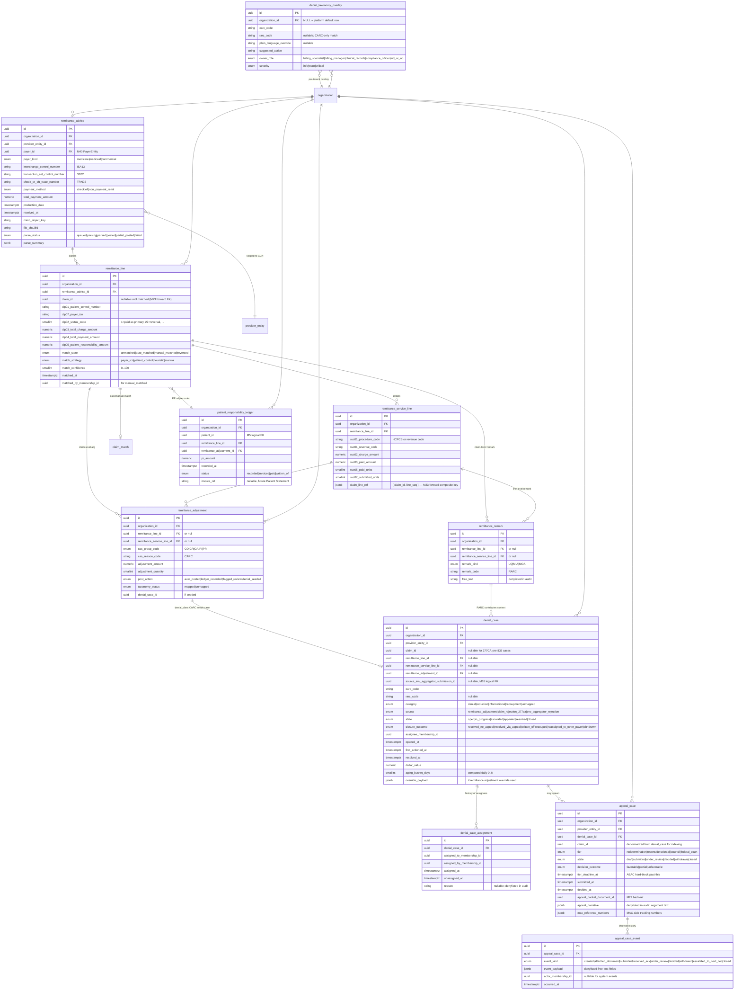

# Module 25 — Remittance & Denials Specification

> **Authority note:** This spec is an **implementation proposal** (repo authority rule): [`docs/architecture/`](../architecture/) and the ratified ADRs in [`docs/adr/`](../adr/) win on conflict, and the code plus [`docs/BUSINESS_LOGIC.md`](../BUSINESS_LOGIC.md) are ground truth for as-built behavior. Mechanism choices named here may be superseded — see ADR-0036…0040 and ADR-0030/0032/0035 for the recorded divergences (outbox not Socket.IO, TypeScript not Python sidecars, app-layer AES-256-GCM not pgcrypto, pure transition tables not XState, hand-rolled HTTP hardening not `@fastify/*`, Vite + react-router not TanStack Start).


**Module ID:** 25
**Phase:** 1 (v1 — required for Engrace go-live; the place every Medicare 835 ERA, MAC 277CA claim rejection, and (when M24 lands) state Medicaid 835 lands, is parsed, posted, auto-matched to the M23-owned claim, contractual adjustments are written off, denials are categorized via the CARC/RARC taxonomy seeded from M38, denial worklist items are assigned and aged, and appeal cases are tracked end-to-end with deadline timers — without M25 the M23 claim state machine has no path to `PAID`, the cash-flow loop never closes, denial-rate HQRP measures for M30 are blind, the M30/M33 revenue-cycle dashboards have no input, and the M18 Medicaid EVV-related aggregator denials have no destination)
**Depends on:** 1 (Foundation — `organization`, `provider_entity`, `withOrgContext`, `audit()` helper, outbox dispatcher, idempotency middleware, RLS generator, partitioned-table conventions, BullMQ on Valkey, MinIO blob accessor for raw 835 file storage, the `validateSeams` boot gate, the X12 EDI parser sidecar HTTP client (`packages/x12-worker-client`) that fronts the Python `x12-worker`'s `/parse835` and `/parse277ca` endpoints — the *adapter* is M25-owned per architecture §25.14 because M25 is the consumer of the parsed structure, the *worker* is a shared sidecar declared in M1/services), 2 (Identity — actor + membership + role resolution; `default_provider_entity_id` on membership is the source of truth for the actor-scoped denial worklist filter when an Organization operates multiple CCNs; SESSION_POLICY step-up requirement enforced on `appeal.submit` and `remittance.adjustment.override` per D15), 3 (Authorization — `remittance.*`, `denial.*`, `appeal.*`, `taxonomy.*` permission keys this module contributes; new ABAC predicates `claim_assigned_to_actor` and `appeal_within_deadline` registered with M3's named-predicate registry; existing `caseload_or_scope`, `provider_entity_scope`, and `step_up_present` reused), 4 (Audit — PHI write-audit trigger generator on every owned table; audit-read declaration on every PHI route; **retention class `compliance` not `operational`** because the 835 ERA, the posted remittance lines, the denial cases, and the appeal records are themselves billing-substantiating financial artifacts retained 7 years (CMS suggests 10, HIPAA requires 6, the platform standardizes on 7 per architecture §24.1) with state-override per M4 D1; patient-identifier columns and free-text appeal-narrative columns denylisted from audit value-capture per the M11 D11 / M19 D10 PHI-minimization posture), 18 (EVV — `EvvAggregatorReferenceReader.aggregatorIdForVisit(visitId)` is the read path M25 uses to back-link an EVV-related Medicaid 835 denial code (e.g., CARC 16 "Claim/service lacks information" with RARC N365 "This procedure code is not payable" when the state aggregator transaction id is absent or mismatched) to the M18 `evv_aggregator_submission` row for ops review; M25 also subscribes to `m18.evv.aggregator_rejected` outbox (M18 §4.10) so that an aggregator-level EVV rejection appears in the M25 denial worklist with the typed EVV-context payload even when no claim 835 has yet returned), 22 (Document Management — appeal packets (Redetermination request letter + supporting documentation index + signed claim copy + remit copy + medical-records bundle reference) rendered via M22's typed-payload render seam; M25 emits `m25.appeal_packet.render_requested` and `m25.denial_resolution_letter.render_requested` consumed by M22; M22's `m22.document.rendered` event back-references `aggregateType: 'appeal_case'` or `aggregateType: 'denial_case'` and M25's consumer populates `appeal_case.appeal_packet_document_id` / `denial_case.resolution_letter_document_id`; M25 has no PDF code and imports no M22 schema — the typed payloads live in `packages/forms` per the M16 D14 precedent), 23 (Billing — Medicare — `ClaimReader.findByControlNumbers({payerIcn?, payerControlNumber?, providerEntityId})` and `ClaimReader.byId(claimId)` are the read paths M25 uses to auto-match an 835 CLP segment to its source claim; `ProviderEntityClaimChannelReader.tradingPartnerFor(providerEntityId)` resolves the MAC trading partner whose channel M25 pulls the 835 over; M25 pulls the 835 itself and emits its own `m25.edi.835_received` (M23 emits no 835-received event — M23 owns claim submission + 999/277CA acks only); `m23.claim.rejected` is the canonical inbound from M23, sourced from M23's 277CA parse, that seeds a denial-worklist row even before any 835 lands; M25 in turn emits `m25.remittance.claim_paid`, `m25.remittance.claim_partial_paid`, `m25.remittance.claim_denied`, and `m25.remittance.claim_recouped` outbox events consumed by M23's claim state machine to advance the claim from `SUBMITTED` / `ACK_ACCEPTED` to `PAID` / `DENIED` / `PARTIAL_PAID` per architecture §11.A — the bidirectional handshake mirrors the M17↔M18 published-event pattern), 24 (Billing — Medicaid — the per-state Medicaid adapter publishes a parsed-835 structure via its `parseRemittance(file): RemittanceAdvice` interface (architecture §13); M25 pulls the Medicaid 835 over the per-state channel and emits its own `m25.edi.835_received` (`payerProgram=medicaid`) keyed to the per-state payer (M24 emits no 835-received event); M25's posting pipeline is **state-adapter-agnostic** because the parsed structure is the same X12 5010 835 envelope (per-state Medicaid adapters do not redefine X12; they redefine the *eligibility / claim-assembly / rate-lookup* surfaces); M25's `RemittanceAdvice.payer_kind` discriminator distinguishes Medicare / Medicaid / commercial source; commercial deferred to Phase 2 per D9), 36 (Secure Messaging & Alerts — typed alert payloads for `denial.aging_threshold_breached`, `denial.high_value`, `appeal.deadline_approaching`, `appeal.deadline_breached`, `remittance.unmatched_high_dollar`, `remittance.posting_failure`, `taxonomy.unmapped_code` ride M36's `AlertEmitter` per M36 §4.6 / §4.7; the PHI-sanitization wrapper (M36 D9) is the only path to out-of-band channels (push / SMS / email) — the 835 file content and patient identifiers never leave the in-app render path), 38 (Clinical Terminology — `TerminologyProvider.lookup('carc', code)` and `.lookup('rarc', code)` are the source of truth for the platform-default plain-language description of every CARC and RARC code per M38 §53 / line 53 of M38; M25's `denial_taxonomy_overlay` table layers a per-tenant `plain_language_override` + `suggested_action` on top of the M38 catalog; M25 NEVER ships its own CARC/RARC table — that would fragment the terminology catalog and break the M28 FHIR `CodeSystem` export), 40 (Master Data Management — `PayerCatalogReader.byId(payerId)` resolves the payer (MAC, state Medicaid, commercial) for an inbound 835; the `PayerEntity` row is M40-managed master data with the per-payer operating model (Medicare-MAC / state-Medicaid / commercial) declared in the master record; the MAC-jurisdiction-to-ProviderEntity mapping is M40 metadata read by both M23 and M25). Transitively the X12 EDI envelope parsing implementation is the Python `x12-worker` (architecture §12), invoked over internal HTTP through `packages/x12-worker-client`; the *adapter package* `packages/x12-worker-client` is M25-owned for the parsed-835 surface; M23 owns its own slice of the same client for 837 generation and 999/277CA parsing per M23's lock (forward).
**Consumed by:** 18 (EVV — bidirectional: M18 publishes `m18.evv.aggregator_rejected` consumed by M25 to seed denial-worklist rows, and M25 reads `EvvAggregatorReferenceReader` for back-linking; M18 does not import M25 schema), 22 (Document Management — bidirectional in the same sense as M16 / M14: M22 is the renderer consumer of M25-emitted typed payloads (`m25.appeal_packet.render_requested`, `m25.denial_resolution_letter.render_requested`); M22 does not import M25 schema and M25 does not import M22 schema — the typed payloads are owned by `packages/forms`), 23 (Billing — Medicare — bidirectional: M25 reads M23 via `ClaimReader` / `ProviderEntityClaimChannelReader` to auto-match and back-resolve; M25 emits `m25.remittance.claim_paid` / `.claim_denied` / `.claim_partial_paid` / `.claim_recouped` events that M23's claim state machine consumes to advance to `PAID` / `DENIED` / `PARTIAL_PAID` — M23 forward-declares these consumers at M23 lock; M25 *never* writes to M23 schema), 24 (Billing — Medicaid — bidirectional in the same sense as M23: M25 pulls the per-state Medicaid 835 itself over M24's per-state channel and emits its own `m25.edi.835_received` (`payerProgram=medicaid`) — M24 emits no 835-received event — then M25 publishes back `m25.remittance.claim_paid` / `.claim_denied` keyed to the Medicaid claim; M24's per-state adapter consumes these to close the Medicaid claim's loop; the per-state adapter has no M25-internal hook — M25 is payer-source-agnostic past the discriminator), 26 (Cap Management — Aggregate Cap calculation per architecture §11 reads M25's `RemittanceReader.payerPaymentsByBeneficiaryWithinCapYear(orgId, providerEntityId, beneficiaryId, capYear)` to determine actual Medicare payments received for the cap-year aggregate cap math; the per-beneficiary cap accrual is reconciled against M25 posted payments (architecture §11.26); M25 does not import M26), 27 (Cost Report — Worksheet C settlement and Worksheet E settlement read M25's `RemittanceReader.payerPaymentsByFiscalYear(orgId, providerEntityId, fiscalYearId)` for the per-LOC payment totals that reconcile against the M27 claim-history aggregator; the bad-debt write-off log feeds Worksheet S-3 and is bridged by M27's bad-debt sub-module which subscribes to `m25.bad_debt.recorded` (Phase-2 forward seam — Phase 1 records the bad-debt manually via the `remittance.adjustment.override` route)), 28 (FHIR Gateway — `remittance_advice` + `remittance_line` projected to FHIR R4 `ClaimResponse` with `outcome ∈ {complete | partial | error}`, `payment` populated from `remittance_advice.total_payment_amount` + `payment_method` + `check_or_eft_trace_number`, `adjudication` populated per-line from CAS segments, and `Reference(Claim)` resolved through M23's published claim-id mapping; `denial_case` projects to FHIR `ClaimResponse.error` with the CARC/RARC concept references resolved through M28's M38 wiring; the typed mapping ships now, the projection lands when M28 lands), 30 (HQRP & Quality — denial-rate (% claims with at least one denial), days-in-AR (median days from claim submission to first payment), clean-claim rate (% claims paid in first pass with no denials or adjustments beyond contractual), appeal-success rate (% appeals with `decision_outcome = favorable | partial`) all read M25's `DenialMetricsProvider`; the >99% acceptance-rate target (architecture §11.A) is computed by joining M23 submission counts with M25 denial-and-rejection counts), 31 (Patient/Family Portal & Telehealth — no Phase-1 portal surface; patient-responsibility (PR) adjustment ledger is read-only on M25 today and surfaces only to billing-staff roles; portal visibility of PR ledger items is Phase 2 pending the Patient Statement module and ADR-pending consent posture), 32 (AI Platform — no Phase-1 AI surface in M25; the platform-locked deny-stub `DenialOutcomePredictionProvider` is registered as `optional` per M19 §4.4 pattern, wired against a deny-stub today, and M32 will publish the real provider in Phase 2 alongside the "Appeal Probability" advisory; Phase 1 denial taxonomy + suggested-action is deterministic rules-based per D14), 33 (Reporting & Dashboards — operational dashboards: denial-volume-by-CARC, denial-rate-by-payer-by-month, denial-rate-by-CCN, days-in-AR aging buckets, top-10-CARC-by-dollar, appeal-success-rate-by-tier, unmatched-remittance-line-count, contractual-write-off-trend; the data feed is M25's `DenialMetricsProvider` + `RemittanceReader` seams), 34 (SaaS Tenant Platform — `TenantOnboardingWizard` reads the per-ProviderEntity MAC trading partner setup; M25 publishes no surface here; M34 reads M40 / M23 directly), 36 (Secure Messaging & Alerts — bidirectional: M36 owns `AlertEmitter` consumed here; cited bidirectionally because M36's recipient-resolver registry resolves the `denial.assignee_membership_id` recipient kind which is M25-owned data, exposed via `M25.DenialCaseRecipientResolver` registered at M25 boot per M36 §4.3).
**Spec status:** Re-locked v0.3 (Phase-6 per-spec reconciliation; supersedes Locked v0.2) — counter-signed with M22 on the appeal-packet render contract

## Remediation Changelog — Phase 6 reconciliation (v0.3, 2026-06-11)

Full disposition of every `audit/AUDIT_M25.md` Module-25 finding (3 BLOCKER / 7 MAJOR / 8 MINOR). A
per-spec **build reconciliation**: the **§2/§3/§4 normative surface governs**, and §5/§6/§7/§8 are
reconciled to it (one permission namespace, one denial/appeal state-machine vocabulary, one event
set, one seam set, one deadline-enforcement semantic). The regulatory clock and the dangerous RLS are
fixed. Passes `arch:fitness` (check 10).

> **Single-truth reconciliation key (M25-F03 — §2/§3/§4 wins):**
> | Concern | The one canonical form (others struck) |
> |---|---|
> | Permission namespace | `remittance.read` / `denial.assign` / `appeal.create` (§4.1/§4.6) — not `remittance.advice.read` / `denial.case.transition` / `appeal.case.draft` (§6) |
> | Denial-case states | `open → in_progress → escalated → appealed → resolved → closed` (§2.2) |
> | Appeal-case states | `draft → submitted → under_review → decided → closed` (+`withdrawn`); `decision_outcome ∈ {favorable\|partial\|unfavorable}` (§2.2/D7) — not `decision='denied'` |
> | Match fields | `match_confidence` (smallint 0–100), `match_state`, `carc_code`, `category ∈ {denial\|reduction\|informational\|recoupment\|unmapped}` (§3.3) |
> | Events/seams | the §4.5 outbox catalog + the §4.3 eight reader seams only — the §7 `m25.remittance.line_unmatched`, `m25.appeal.tier_escalated`, `RemittanceDenialReaderForEncounter`(M8) etc. are struck (they had no producer) |
> | Routes | `/manual-match` + `remittance.manual_match`; transitions via the typed state routes (not `/denials/{id}/transition`) |

| Finding | Sev | Resolution |
|---|---|---|
| **M25-F01** | BLOCKER | The **false "M14 elided-foundation convention" justification is struck** (it does not exist). Under ADR-0005: foundation helpers (1–4) are reached via `FOUNDATION_HELPER_PACKAGES` (no edge); M18/M22/M24/M38/M40 are consumed via outbox/seam/terminology (no edge, ADR-0005 D1). The real `dependsOn` delta beyond `[23,36]` is recorded as M25's consolidated dependsOn ADR (D5), reviewed as an architecture change — not a "brevity correction". |
| **M25-F02** | BLOCKER | M25 no longer **writes into M22's `packages/forms`**: the appeal-packet/denial-resolution-letter **render payload types live in `packages/types/billing`** (a leaf M25 may write); M22 consumes that typed payload and lists M25 as a Pillar-2 source (reciprocal M22 amendment, ADR-0023). M25 imports no M22 package. |
| **M25-F03** | BLOCKER | **The §5/§6/§7/§8 incoherence is reconciled to the §2/§3/§4 surface** per the key above — one permission namespace, one denial+appeal state vocabulary, one `decision_outcome` enum, one event/seam set, one route set, and **one deadline semantic** (hard `403` block past `T-0` + a distinct audited `submit-late-good-cause` path for Redetermination/Reconsideration only — never an agency self-override; §7.4). Non-existent §7 fields/events/seams are struck. |
| **M25-F04** | MAJOR (reg.) | **Redetermination clock single-sourced to `remittance_received_at + 120 days`** (42 CFR §405.942(a)); the §7.3 `created_at + 120` and the next-tier `now() + 180` anchors are corrected to remit-receipt and prior-tier **decision-letter date** respectively (§7.x). Boundary test added: "appeal created 100 days after remit → 20 days remaining." |
| **M25-F04a** | MAJOR (reg.) | **Every tier runs from presumed *receipt*, not the notice date or our ingest time** (hospice ADR/TPE/QIC PRD, milestone 1). Receipt is presumed 5 calendar days after the date on the notice (§405.942(a), §405.962(a), §405.1002, §405.1102(a), §405.1136), so the last filing day is `notice date + 5 + window` (120 / 180 / 60 / 60 / 60) and is usable until its end (23:59:59.999 in the provider's zone; when its locations span several zones the earliest-ending one, and `America/New_York` when none is known). A last day on a weekend or US federal holiday (observed) moves back to the previous business day (clinical-billing SME sign-off, 2026-10-15). The redetermination anchor is the remittance advice date (`remittance_advice.production_date`), not `remittance_line.received_at`; later tiers anchor on the prior decision-letter date. `appeal_case.notice_dated_on` records the anchor so the UI shows the derivation. The roll-back is conservative: Part 405 has no roll-forward, so the filing date is never later than the regulatory one. The presumption is not rebuttable in-product yet (conservative). Supersedes the F04 boundary example: 100 days after the notice leaves 27 days of the window, not 20. |
| **M25-F04b** | MAJOR (reg.) | **ADR (additional documentation request) intake and response packet** (hospice ADR/TPE/QIC PRD, milestone 2). `adr_case` records a MAC's request, the response window it used (`window_days`, `window_source` `org_rule` or `platform_default`, `window_verified`) and a due date derived like the appeal deadlines (end of day in the provider's zone, rolled back over weekends and federal holidays), so a later rule edit never moves an existing case; `mac_rule` holds each organization's own per-MAC windows (the platform defaults, 45 days ADR / 20 days re-ADR, are always flagged unverified pending SME confirmation). State machine: received → in_assembly → in_review → submitted → closed, with withdrawn and denied_no_response terminal. **Response packet:** documents attach (`adr_case_document`) under the appeal enclosure rules (org-visible, active, the claim's patient, never 42 CFR Part 2; refusals carry a reason code, never a title); a documentation checklist is ticked; a reviewer who is not the person who sent the packet to review signs off (`adr.review`); each packet change moves the case version so a sign-off is on the version the reviewer saw. **Filing** (`adr.submit` + step-up) records a response made outside ChartWarden (electronic sending is a later milestone): channel, confirmation reference, time, optional receipt document; a response after the due date is allowed only with an explicit late acknowledgement and is recorded as late. It re-validates every document, freezes an exact manifest (document ids + checklist) in the same transaction that moves the case to `submitted`, and emits `m25.adr_packet.render_requested` so M22 files the cover-and-index PDF (`adr_response_packet`) as the retained record. Triggers keep the manifest, the filing facts and the enclosure list immutable once filed. |
| **M25-F04c** | MAJOR (reg.) | **Non-response and medical-review denial routing, and MAC reopenings** (hospice ADR/TPE/QIC PRD, milestone 3). A 56900 ADR non-response is not appealable: the MAC reopens it. Which path a denial takes (`appeal`, `reopening` or `undetermined`) is COMPUTED on read by a pure resolver from `denial_route_rule` rows (the organization's dated, per-MAC, case-insensitive rules matching the MAC's own reason code, a RARC or a CARC) plus a built-in, deliberately unverified 56900 → reopening default that a tenant rule always outranks; nothing is stored, so a rule edit cannot leave a stale route, and a denial no rule matches stays appealable exactly as before. The MAC reason code (`denial_case.mac_reason_code`, FISS 56900 etc.) is entered by the user until an 835 mapping is confirmed. A denial on a reopening route refuses `POST /denials/:id/appeals` with 409 `ROUTE_IS_REOPENING`; `POST /denials/:id/appeals/override` (`appeal.create` + `denial.route_override`) appeals it anyway with a reason of at least 10 characters, kept on the appeal's first event. `reopening_case` records the MAC's reopening (it is not an appeal tier): opened only for a reopening-route denial (one live per denial), optionally against the ADR it answers, which moves to `denied_no_response` in the same transaction. No deadline is assumed (the MAC states none): `due_at` is recorded only when the user enters the MAC's. State machine: draft → submitted → decided → closed, withdrawn from draft or submitted. Filing (`reopening.submit` + step-up) records a request made outside ChartWarden (form used, channel, confirmation reference, time); a CHECK refuses `submitted` without that proof, and triggers freeze the filing facts once recorded and a terminal case entirely. Electronic sending, attachments and alerts on `due_at` are later milestones. |
| **M25-F04d** | MAJOR (reg.) | **QIC reconsideration: request content, evidence guard, decision clock and OMHA escalation** (hospice ADR/TPE/QIC PRD, milestone 4). The reconsideration tier is an ordinary `appeal_case`; milestone 4 adds nullable, tier-guarded columns (CHECK: none exists on any other tier) and no new table. **Request content:** the packet carries the CMS request elements (redetermination MAC and notice date, claim items and dates of service, the documentation the notice cited, the preclusion statement); the beneficiary name, Medicare number and appellant are labeled blank cells the person completes and signs (M25 holds no MBI; the ABN precedent), and CMS-20033 is not reproduced (the request is a letter). **Evidence guard** (`appeal-packet-payload.ts`, so BOTH submit paths are covered): the redetermination notice copy must be enclosed, and every item the notice named as missing (`cited_evidence`, draft-editable, frozen once filed) must be enclosed or explained (a reason of at least 10 characters) with the preclusion warning acknowledged; a list that names nothing needs the explicit attestation. A refusal rolls the submit back before anything is published. **QIC clock:** computed on read as the recorded QIC receipt date (`qic_received_on`) + 60 days + append-only late-evidence extensions (`qic_clock_extensions`, 0-14 days each, the length the QIC's letter states), to the end of that day in the latest-ending provider zone so escalation is never offered early; no receipt date means no clock and no escalation. **Escalation:** `request-escalation` (`appeal.submit` + step-up) records a request made outside ChartWarden once the clock has lapsed (channel, confirmation reference, time) and leaves the state `under_review` because the QIC may still decide; `confirm-escalation` (`appeal.decide`) records the date the QIC forwarded the case, moves the reconsideration to the new state `escalated` and opens an ALJ case in `submitted` (`filed_by_escalation`, no filing deadline of its own; its NOT NULL `tier_deadline_at` is the request instant, already past, so no deadline alert fires). Triggers freeze the cited evidence once filed, the extension list (append-only), the receipt date and extensions once an escalation is requested, and the escalation facts; `escalated` is reachable only from `under_review`. The nightly appeal-deadline cron raises `appeal.qic_decision_overdue` for an under-review reconsideration past its date with no escalation requested. SME-UNCONFIRMED (marked on screen and in `domain/qic.ts`): the clock anchor and calendar-day counting (no weekend or holiday roll), each extension's length, the escalation procedure and any CMS form, and the ALJ amount-in-controversy requirement. Nothing is sent electronically (milestone 6). |
| **M25-F04e** | MAJOR (reg.) | **TPE (Targeted Probe and Educate) program tracker** (hospice ADR/TPE/QIC PRD, milestone 5; numbered `e` to leave `d` to milestone 4, renumber on merge). `tpe_program` (one active per provider entity and MAC), `tpe_round` (1 to 3, enforced by a CHECK), `tpe_round_claim` (the sampled claims, each optionally linked to its `adr_case`) and `tpe_mac_rule` record what the MAC sends: its results letter (error rate and compliant / non_compliant result, which are the OFFICIAL values; the claim-count rate on screen is advisory and labelled as such), the education date, and the outcome (relief or referral with its types, typed from the CMS letter). **No threshold is seeded or defaulted in code:** per-MAC exit thresholds are unverified, so `tpe_mac_rule` holds each organization's own dated, source-noted, verified-on rules, a MAC with none shows "No threshold confirmed", and a round snapshots the threshold in force when its results are first recorded so a later rule edit never rewrites it. The 45-day interval (education date + 45) and the 20 to 40 sample size are WARNINGS, never blocks, because the MAC sets the dates. Referral risk is a pure advisory label (`relief` / `referred` outcome, else `unknown`, `low`, `elevated` after a non-compliant round 1 or 2, `high` after round 3), not a CMS determination. A closed program, its rounds and its sampled claims are frozen by database trigger; an outcome cannot be rewritten; the app role has no DELETE and cannot update the anchor columns. Reads gate on `tpe.read`, writes on `tpe.manage` (Idempotency-Key + If-Match), thresholds on `tpe_rule.manage`; migration 1119 grants them to existing roles that hold `appeal.read` / `appeal.create` / `appeal.decide`. No events, cron or alerts (ADR deadlines already alert); the write-audit triggers are the trail. **SME-unconfirmed, do not treat as fact:** per-MAC exit thresholds (consultant figures are unverified); whether the MAC rates by claim count or by payment dollars and whether a rate equal to the threshold passes; what the 45 days count from; whether relief runs from the results letter or the CMS notice (the relief end date is only a suggested outcome date + 1 year); whether more than one education session per round is normal; whether TPE scope is per CCN / PTAN; the full list of referral types beyond prepay review, extrapolation and RAC (`other` covers it). |
| **M25-F04f** | MAJOR (reg.) | **Submission attempts and receipts: guided manual channel** (hospice ADR/TPE/QIC PRD, milestone 6a; numbered `f` after `e`, renumber on merge). `submission_attempt` (migration 1124; 1120-1123 were taken on main by M36, M18, M6 and M36) is one new M25-owned aggregate: exactly one of `adr_case_id | appeal_case_id | reopening_case_id` (CHECK) plus a `purpose` (`adr_response | appeal_request | reopening_request | qic_escalation_request`), `attempt_no`, `UNIQUE (organization_id, idempotency_key)` (`<purpose>:<subject>:<attempt_no>`), a partial unique index allowing ONE live attempt (`prepared | queued | sending | sent | needs_manual`) per subject and purpose, and a status machine (text + CHECK, no pgEnum). **Hook-ins (contracts and states of the existing routes unchanged):** the ADR, reopening and QIC-escalation submits already carry channel, reference and time, so each leaves one `acknowledged` attempt (source `entered`) mirroring the case columns, which stay authoritative; the appeal submit (normal and late good cause) carries no proof, so it leaves a `needs_manual` attempt ("proof missing") and the case still moves to `submitted` as before. One helper, `recordFilingAttempt`, runs inside each existing transaction. **Receipts:** `POST /api/v1/{adrs|appeals|reopenings}/:id/submission-receipt` (the subject's submit key + step-up, If-Match on the attempt) records the confirmation reference, receipt time and an optional retained receipt document (validated through the appeal-enclosure rules: org-visible, active, the claim's patient, never 42 CFR Part 2); `acknowledged` without proof is a CHECK violation; a trigger freezes the receipt, and a correction appends to `receipt_amendments` (append-only). `GET .../submission` returns the attempts, a visible proof-missing state, the generic guided checklist and each adapter's availability; `POST .../submission-cancel` (submit key + step-up + a reason of at least 10 characters) cancels an attempt that is not waiting for its receipt; a `needs_manual` attempt on an already-filed case is NEVER cancellable (409 `PROOF_ONLY_PATH`: cancelled is terminal and 6a has no way to start another, so cancelling would strand the filing). The cancel route and service are deliberate 6b scaffolding (6a never creates a cancellable attempt and the UI does not call it). A `needs_manual` attempt on a withdrawn or closed case is intentionally left live: the proof-missing watch skips it rather than cancelling it. A correction must differ from the latest value on record (409 `AMENDMENT_DUPLICATE`) and an attempt holds at most 20 (409 `AMENDMENT_LIMIT`, also a trigger). **Case columns stay authoritative:** a correction appended to an ADR, reopening or escalation attempt deliberately does NOT rewrite the case's own frozen filing columns (the case value is the one ChartWarden uses; the panel says so); for an appeal, which has no case column, the latest correction is the current value. The three GETs are attributed to the claim's patient in the read-audit trail (`patientId` in the response). A CHECK refuses any electronic adapter, or a queued / sending / sent status, without a recorded approval by someone other than the preparer (the single-eligible-user exception stays in `checkApproval` and is a 6b decision); 6b must also add org-consistency enforcement for the logical ids before any send. No new permission keys, no new queue, no new outbox events; the nightly appeal-deadline cron raises `submission.proof_missing` (ids and counts only) for a `needs_manual` attempt older than 3 days whose case is not withdrawn, closed or (ADR) a non-response. **Channel adapters:** a `FilingChannelAdapter` port with the manual (guided) adapter always bound and the esMD and fax adapters as UNBOUND shells with no `transmit`/`poll`, so nothing is transmitted anywhere in 6a; an unbound electronic channel falls back to `needs_manual`, never `queued`. The send edges (`queued | sending | sent | failed`), the approval columns and the CHECKs that forbid a send without a recorded approval or on the manual adapter are modelled and tested now; a `sending` attempt whose worker died is never auto-resent (it becomes `needs_manual`: outcome unknown, verify with the channel before refiling). SME-UNCONFIRMED (not asserted anywhere): which electronic channels apply per MAC, filing type and QIC, credentials or certification, what proof each channel gives and whether it is sufficient for timely filing, the proof-missing threshold and who is alerted, the approver policy (the preparer should not approve unless the org has one eligible user), receipt retention, and per-MAC instructions. 6b (real esMD, MAC-portal, QIC-portal and fax transmission) is blocked on those facts and a vendor sandbox and BAA. |
| **M25-F04g** | MAJOR (reg.) | **Later tiers, audit-request intake and the one case view: record-keeping, no rule encoded** (hospice ADR/TPE/QIC PRD, milestone 7a-1; numbered `g` after `f`, renumber on merge). Migrations 1171-1173 (main held 1165 and 1170 for M36, so 1161-1164 were left unused). **Recorded deadline** (`recorded_deadline`): a due date a person types FROM A NOTICE (an ALJ hearing notice, a Council notice, a court order, a RAC / UPIC request letter) with a mandatory non-blank `source_note`, for exactly one `appeal_case` or `audit_request` (CHECK); the day ends at 23:59:59.999 in the provider zone stored at write, no weekend / holiday roll-back is applied (the date is the one printed), the status (`open | due_soon | past | satisfied`) is derived on read, and it alerts at the existing T-30/14/7/1 boundaries, ONCE per boundary (`last_alerted_boundary`, recorded after the alert is dispatched; moving the date restarts the ladder); a past date never alerts. A notice document may be linked on an appeal deadline only (validated by the same M22/M23 seams as a receipt document); an audit deadline names its source in the note until 7a-2. **Later-tier detail** (`appeal_tier_detail`, 1:1 with an ALJ / Council / federal-court `appeal_case`, tier equal to the case tier by trigger, frozen once the case is closed): the OMHA / DAB / docket reference as typed, `amount_in_controversy_cents` (STORED, never compared to any threshold), hearing date and format as entered, a `disposition_kind` LABEL (`decision | remand | dismissal | other`) and, for federal court only, `filed_by_counsel_on` and `docket_reference`. The Postgres `decision_outcome` enum is unchanged: only an unfavorable decision spawns the next tier, a remand or dismissal spawns nothing and shows "needs manual review". **Federal court is record-only**: a submit is refused (`FEDERAL_COURT_RECORD_ONLY`), so no packet is rendered and the unverified letter title is never generated. The 60-day alj / council / federal-court windows and the auto-spawn are UNCHANGED; `LATER_TIER_WINDOWS_CONFIRMED` (one place, all false) makes every screen badge those computed deadlines "window not SME-confirmed" until SME sign-off flips it. **Audit request** (`audit_request`, `audit_request_claim` with soft removal, append-only `audit_request_event`): its own aggregate, NOT an `adr_case` (a different issuer, often multi-claim, with unverified follow-ons); `authority_kind` (`rac | upic | smrc | other`, name required for `other`) is a LABEL that implies no window, channel or procedure; the claims must share one provider entity and be visible to the organization and the actor's scope (another tenant's claim, ADR or denial reads as absent); optional links to an ADR and a denial open nothing automatically. States: received → in_assembly → in_review → responded → closed, `withdrawn` from any open state, forward-only and frozen once withdrawn or closed (trigger). There is NO due-date column and no default: a request with no open recorded deadline reads "no deadline recorded" and raises ONE `audit.no_deadline_recorded` alert after `AUDIT_NO_DEADLINE_ALERT_DAYS` (2, product-confirm). Nothing is sent from here: the response packet, review sign-off and filing proof are milestone 7a-2. **One case view**: `GET /api/v1/claims/:claimId/case-view` merges the ADR, reopening, the whole appeal chain (linked by `prior_tier_appeal_case_id`), submission attempts, recorded deadlines and linked audit requests into one stable timeline with the next open deadline on top; the ADR, reopening and audit sections need their own read key, every read emits a read-audit event keyed on the claim, and an auditor session (no `appeal.read`) never reaches it. **Keys**: `audit_request.read`, `audit_request.manage` (named so, because the plain `audit.*` keys are the platform compliance audit trail) and `appeal.tier_record`, granted to the roles holding `appeal.read` / `appeal.create` by 1173. **Alerts**: `deadline.recorded_approaching` and `audit.no_deadline_recorded`, billing managers, `warn`, PHI-free (ids and counts only); both ride the existing appeal-deadline cron. **SME / open (nothing seeded as fact)**: whether the M1 sign-off covers the ALJ / Council / federal-court windows and good cause at tiers 3-5; the ALJ amount-in-controversy threshold; escalation clocks past the QIC; OMHA / Council forms, content and channels; federal-court filing rules; hearing / discovery rules; RAC / UPIC / SMRC response windows, extensions, channels, findings, overpayment demand and rebuttal; remand / dismissal semantics; whether an audit response keeps the exact-copy rule. |
| **M25-F04h** | MAJOR (reg.) | **Audit response packet: typed checklist, second-person sign-off, "none stated" attestation, filing proof and retained copy; no contractor requirement encoded** (hospice ADR/TPE/QIC PRD, milestone 7a-2; numbered `h` after `g`, renumber on merge). Migrations 1174 (document aggregate type `audit_response_packet`), 1175 (the packet) and 1176 (role grants), all idempotent. **Checklist**: `audit_request.response_items` is whatever the person TYPES from the request letter (label + `pending | ready | not_applicable`, replaced as a whole, at most 50, no blank or duplicate label); nothing is seeded, because what a RAC / UPIC / SMRC asks for is an SME item. **Documents** (`audit_request_document`, soft-removed, frozen once filed): attached under a LIVE claim of the request and validated by the appeal enclosure rules against THAT claim's patient (org-visible, active or on hold, never 42 CFR Part 2; a refusal carries a reason code and never a title); a claim carrying documents cannot be removed from the request. **Review**: the move `in_assembly -> in_review` runs the SAME packet rules as sign-off minus the reviewer checks (a document attached, every typed item ready or not applicable), so a request never enters a state sign-off cannot leave, and records who sent it (`sent_to_review_by_membership_id`); there is no way back to assembly. `audit_request.review` signs off under a step-up, once: the reviewer must not be the sender, must not have attached a live document or typed the checklist (`AUDIT_REVIEWER_IS_PREPARER`), and the database also refuses `reviewed_by = sent_to_review_by` and any change to a recorded sign-off; a sign-off needs a recorded deadline or the attestation first, and stores a FINGERPRINT (`signed_off_hash`) of the claims, checklist, documents, deadlines and attestation it covered. From sign-off on, the claims, the recorded deadlines and the attestation are frozen (claims also in `responded`; only marking a deadline satisfied stays allowed after filing), and filing recomputes the fingerprint and refuses a changed packet (409 `AUDIT_SIGNOFF_STALE`). A legacy 7a-1 request already in review has no recorded sender and is withdraw-only (not backfilled: demo data). Every packet change moves the request version, so a sign-off is on the version the reviewer saw. **"None stated" attestation** (`deadline_none_stated_at/_by`, the `cited_evidence_none` pattern): the explicit statement that the request letter names no due date, allowed only while no recorded deadline exists, set once and immutable (trigger); the request then reads `none_stated` instead of `no_deadline_recorded` and the `audit.no_deadline_recorded` alert stops. **Filing** (`audit_request.submit` + step-up) records a response made OUTSIDE ChartWarden: sign-off, a channel label (`esmd | fax | mail | other`, no portal or format implied), the confirmation reference and a past sending time are required, and so is either a recorded deadline (of any status) or the attestation; a filing after the earliest UNSATISFIED recorded deadline needs an explicit late acknowledgement and is stored as late. In ONE transaction it re-validates every document, freezes the manifest, moves the request `in_review -> responded`, writes the `submission_attempt` (purpose `audit_response`, born `acknowledged` because the proof is required here) and emits `m25.audit_response_packet.render_requested`, so M22 files the cover sheet and enclosure index (`audit_response_packet`) as the retained record (a document superseded since is still what was filed; a Part 2 reclassification stops the render, like the ADR packet). The database refuses `responded` without the manifest (`M25_AUDIT_RESPONSE_NEEDS_PACKET`), so the bare `responded` move is refused (409 `AUDIT_RESPONSE_REQUIRES_FILING`), and freezes the manifest, checklist, sign-off and filing facts once filed. **`submission_attempt`** gains `audit_request_id` and the `audit_response` purpose: the CHECKs are amended to exactly one of FOUR subjects and the `one_live` index covers the fourth; a receipt amendment appends, never rewrites. **Notice documents on audit deadlines**: a recorded deadline of an audit request now accepts a notice document, validated through the same document seam against the patient of a named live claim (`noticeClaimId`, implicit for a one-claim request). **Keys**: `audit_request.review`, `audit_request.submit`, granted by 1176 to the roles holding `appeal.decide` / `appeal.submit` (no ABAC override copied). **SME / open (nothing seeded as fact)**: RAC / UPIC / SMRC response windows, extensions and channels; what a response must contain; whether an audit response keeps the exact-copy rule; whether a notice letter is filed under a patient (it must be, today, to be linked); esMD / fax adapters stay unbound shells. |
| **M25-F04i** | MAJOR (reg.) | **Advisory ADR documentation readiness: deterministic baseline, deny-stubbed AI port** (hospice ADR/TPE/QIC PRD, milestone 8a-1; numbered `i` leaving `h` for milestone 7a-2, renumber on merge). Migrations 1190-1191. **Two tables beside the human packet, never inside it**: `adr_readiness_review` (one per request, immutable: who asked, the case version it looked at, status `requested|ready|unavailable|failed`, source `deterministic|ai`, the M32 invocation id / prompt template version / model pin when an assistant answered, all NULL while AI is off) and `adr_readiness_finding` (only findings that survived the citation filter, each with the packet documents it cites and a human disposition `acknowledged|dismissed|disputed`); org-scoped, RLS FORCEd, the finding note is audit-scrubbed. **Deterministic gap view (no model)**: `domain/readiness.ts` `deterministicGaps` reuses the SME-unconfirmed `ADR_CHECKLIST_KEYS` (extends nothing) and shows, per key, the attached documents mapped to it and which keys have none; a person ticking `ready` does not clear a missing document. It is computed on every read, so it is always available. **The AI can only add**: `acceptAiFindings` drops a finding that cites a document outside the packet, a presence claim with no citation, a presence claim on a deterministic gap, an unknown key (the list is never extended), a key marked not applicable, a duplicate, an over-long note or a malformed answer; the vocabulary is presence-only (`looks_present|possibly_missing|cannot_tell`) and nothing judges sufficiency under CMS. **Deny-stubbed port**: `AdrReadinessAssistPort` is declared locally in M25 (no `@chartwarden/ai-platform` import, M25 does not depend on M32) and resolves to a deny-stub reporting `capability_unavailable`; a throwing or malformed assistant is a `failed` review, never an error to the caller; the model is never called inside a transaction. Binding a model is milestone 8b (vendor/BAA/ZDR, M32 pipeline bindings, AI approval workflow, SME facts) and is one edit in the resolver. **AI-prohibited zone**: `validateRemittanceAIBlock` (boot, db-present onReady) refuses any active M32 prompt template targeting `adr_case`, `appeal_case`, `denial_case`, `reopening_case`, `audit_request`, `submission_attempt`, `remittance_*` or `recorded_deadline`; `adr_readiness_*` is the advisory surface and is not in the zone. **Routes and keys**: `GET /adrs/:id/readiness` (`adr.readiness_read`, read-audited by case id), `POST /adrs/:id/readiness/reviews` (`adr.readiness_request`, Idempotency-Key, 30-second per-case rate limit, only while the ADR is in assembly or review), `POST /adrs/:id/readiness/findings/:findingId/disposition` (`adr.readiness_dispose`); none is If-Match and none moves `adr_case.version`; grants mirror `adr.read` / `adr.manage` (migration 1191). Events `m25.adr_readiness.requested|completed|unavailable|finding_disposed` carry ids and counts only, no declared consumer. **Does not gate**: a review (or its absence) never changes the checklist, attachments, case state, sign-off, filing or a submission attempt (asserted row-for-row in the live suite `test:m25:adr-readiness:live`). **Web**: a Documentation readiness section in the ADR work panel (shared kit), gaps always, AI findings only when present under a persistent advisory banner with citations linked to the document, "AI check unavailable; the manual checklist is unchanged" when off. **SME items (unchanged, not invented)**: what each MAC's ADR letter requires and whether the six checklist keys are complete; what counts as sufficient documentation; who labels the evaluation set and the acceptable error profile; whether a compliance officer must approve AI use on records. 8a-2 (governance and evaluation design, no code path to a model) and 8b are separate. |
| **M25-F04j** | MAJOR (reg.) | **Payer (commercial / Medicare Advantage) appeals: organization-written paths, a payer appeal case per level, a denial-keyed case view** (hospice ADR/TPE/QIC PRD, milestone 12a-1; numbered `j`, renumber on merge). Migrations 1206-1209. **Nothing is seeded and there is no platform default**: `payer_appeal_path` (+ `payer_appeal_path_level`) is the payer's appeal path as a PERSON wrote it from the customer's contract or the payer's notice, per organization, M40 payer (logical id, no M40 dependency; the name comes through the `MdmEntityProvider` seam via a structural view and fails closed), program (`commercial|medicare_advantage`), optional contract label (case-insensitive unique) and `effective_from`; every path and level has a mandatory source note. A path is born `draft`; a second membership verifies it (author != verifier is a CHECK plus the activation trigger, atomic with the UPDATE, and activation also requires an organization member and at least one level), which makes it `active` and frozen (only `active -> retired` may follow; levels are insert-only and a level cannot join a non-draft path, serialized by a row lock). A level's filing window is all-or-none (days, anchor kind, day basis; roll direction exactly when the basis is business; receipt presumption only when stated). External review is a `level_kind` LABEL (`internal|external_review|other`); no eligibility, process or form is encoded. **`payer_appeal_case`** is one row per level, separate from the Medicare `appeal_case` chain (whose tier enum, NOT NULL Medicare deadline, 5-day presumption and holiday roll-back are Medicare rules): subject is a `denial_case` (so a commercial denial with `claim_id` NULL can appeal), the case SNAPSHOTS the path revision and the level's window, a deadline is computed only from a complete window and a notice date a person typed (`derivePayerLevelDeadline`; no presumption or roll unless the row states it) and is badged `windowVerified=false` when the path was an unverified draft; once set it never moves (trigger). With no path or no window: `deadline_source='none'` and the screen shows "No appeal path recorded for this payer" / "No due date - enter it from the notice". A payer appeal REFUSES a Medicare denial (`MEDICARE_PAYER`), a Medicaid one (`MEDICAID_PAYER`, milestone 11) and one with no remittance advice (`NO_PAYER_ADVICE`). **Deferred**: the mirror refusal on `createAppeal` (a non-Medicare denial opening a Medicare tier) waits for the milestone 11 payer guard to merge, to avoid a conflict in `createAppeal`. `recorded_deadline` gains a third subject (migration 1208, a clean idempotent drop-and-recreate of `recorded_deadline_one_subject` plus the guard branch). **Alerts** fold into the existing appeal-deadline cron (no new queue): `payer_appeal.deadline_approaching` (T-30/14/7/1 on a computed deadline of a draft), `payer_appeal.no_deadline` (one alert, marked by an event row) and the existing `deadline.recorded_approaching` with `subjectKind: payer_appeal`; ids and day counts only. **Routes**: `GET|POST /payer-appeal-paths`, `GET /payer-appeal-paths/:id`, `POST .../verify`, `POST .../retire`; `GET|POST /denials/:denialCaseId/payer-appeals`, `GET /payer-appeals/:id`, `PUT .../notice`, `POST .../state`, `/payer-appeals/:id/recorded-deadlines*`; `GET /denials/:denialCaseId/case-view` (read-audited by denial id). Keys `payer_appeal.read|manage`, `payer_appeal_path.read|manage|verify` (granted to existing roles by 1209). **Web**: a Payer appeal section on the denial rail (levels as a chain, "Window not verified" badge, the Medicare Advantage hint worded as not legal advice), the denial-keyed case view when the denial has no claim, and the Payer Appeal Paths screen. **SME / contract items (unchanged, not invented)**: which payers first and their levels, windows, anchors, decision clocks, forms and channels from the customer's contract; whether provider payment disputes differ from member appeals; external review (who may request it, state versus federal process, timing, representative capacity); urgent variants; Medicare Advantage VBID status and whether any hospice-billed service reaches a plan; business-day and roll conventions per payer. 12a-2 (submission attempt subject, level documents) and 12b are separate. |
| **M25-F05** | MAJOR | `Idempotency-Key` (24 h / 409-on-mismatch) declared on every POST/PATCH via the M1 `packages/shared` middleware; `If-Match` retained for concurrency (orthogonal). |
| **M25-F06** | MAJOR | 835 **retrieval vs parse/post** split: M23/M24 (which own the per-PE trading-partner credential + submission channel) retrieve the 835 and hand M25 a typed "835 available" signal + MinIO ref; M25 owns parse/post/match/denial/appeal. The invented M25-owned "clearinghouse SFTP" + `ProviderEntityClaimChannelReader` is removed (or added to the INT inventory via INT-002 with per-PE credential scope if M25 truly retrieves). |
| **M25-F07** | MAJOR | DR **Tier 3** declared + degraded-mode (835 retrieval/parse/post queue and auto-resume; worklists read-only-degrade); all five BullMQ consumers asserted idempotent (DR-022). |
| **M25-F08** | MAJOR | §4.4 and §8.6 name the **same** seam (`DenialOutcomePredictionProvider`); the reserved Phase-2 capability is registered in M32's catalog as PROPOSED with a risk class + `ai.denial_outcome_kill` flag, shipping deny-stubbed (ADR-0012). |
| **M25-F09** | MAJOR | `denial_taxonomy_overlay` is **strictly org-scoped** (`organization_id` NOT NULL, standard generator RLS — no `OR … IS NULL`); platform-default CARC/RARC live in **M38**, resolved by read-time fallback. **Passes `check-tenancy`** (§2.3, §3.5). |
| M25-F10 | MINOR | `denial_case` (worklist aggregate) vs the M38 `carc`/`rarc` code systems (the architecture's "DenialCode") reconciled with a naming note. |
| **M25-F11** | MINOR | The unmapped-CARC invariant is enforced in the **service layer** (emit the outbox event in-transaction via the M1 helper) — no feature-table trigger reading `outbox_event` (ARCH-144, §2.3). |
| M25-F12 | MINOR | Bulk CSV export bound to the **SEC-052** workflow (justification, 1/hr/user, 10k cap, 24 h URL, warn/critical) + `phi.exported` audit; PHI lists cursor-paginated (SD-052). |
| M25-F13 | MINOR | Step-up expressed via the M2 `SESSION_POLICY` step-up primitive (not "session age < 5 min"); the EPCS/YubiKey branch marked conditional-on-OPEN-006, not Phase 1. |
| M25-F14 | MINOR | `packages/x12-worker-client` (and external calls) declare the INT-009 circuit-breaker + `DegradedError` five-field envelope. |
| M25-F15/F16 | MINOR | STRIDE cross-referenced to SEC §3.4 + the `security.rls_denied`→`rls_denials_total` alert-at-nonzero invariant (SEC-008 L6); migrations-discipline note + real partial-index predicates (no `.where(/* … */)` placeholders). |
| M25-F17 | MINOR | EVV back-link is clean (in-perimeter read of the M18 seam); the EVV-aggregator external-surface inventory gap (D-10) is M18's, routed to the cross-module pass. |

**Net:** all three BLOCKERs cleared (dependsOn justification, package-ownership, and the §2-vs-§7
incoherence), the regulatory appeal clock is correct, and the bespoke OR-IS-NULL RLS is removed —
M25 is re-lockable.

## Changelog

- **v0.2 (Locked)** — Initial publication at lock-grade. Instantiates the architecture §20.B module spec template. Resolves all sixteen open questions into binding decisions (§11). Defines the **four-level remittance hierarchy** (`remittance_advice` envelope → `remittance_line` per CLP → `remittance_service_line` per SVC → `remittance_adjustment` and `remittance_remark` per CAS / LQ-MIA-MOA) capturing the X12 5010 835 structure faithfully (D1), the **M25-owned 835 receipt** where M25 pulls the 835 from the clearinghouse (Medicare over M23's submission channel, Medicaid over M24's per-state channel) and emits its own `m25.edi.835_received` (carrying a `payerProgram` discriminator + MinIO file ref) to trigger `packages/x12-worker-client.parse835` — M23/M24 own claim submission + 999/277CA acks only and emit no 835-received event (D2), the **three-strategy auto-match algorithm** with deterministic precedence (payer ICN exact → patient control number exact → heuristic (patient id + service-date-range + total billed) within a $1 tolerance) and the **manual-match queue** for unmatched lines (D3), the **two-tier posting model** where contractual obligation (group `CO`) and payer-initiated reduction (group `PI`) adjustments auto-post with audit, patient responsibility (group `PR`) records on a read-only ledger, other adjustment (group `OA`) flags for review, and any CAS whose CARC is classified `denial` by M38's taxonomy seeds a `denial_case` row (D4), the **two-layer denial taxonomy** with the M38 catalog as the immutable platform-floor (code, description, category) and M25's `denial_taxonomy_overlay` as the per-tenant plain-language + suggested-action overlay — tenants may override description and suggested-action but **cannot override category** because category drives the denial-vs-reduction-vs-informational routing (D5), the **CMS Medicare appeal-tier deadline model** (Redetermination 120d, Reconsideration 180d, ALJ 60d, Council 60d, Federal Court 60d) with cron-driven `T-30 / T-14 / T-7 / T-1 / T-0` deadline alerts and a hard-block on `appeal.submit` past `T-0` (D6), the **appeal case state machine** `draft → submitted → under_review → decided → closed` with `withdrawn` branch and a typed `decision_outcome ∈ {favorable | partial | unfavorable}` driving the next-tier deadline computation (D7), the **patient-responsibility adjustment ledger** read-only Phase 1 with the `m25.patient_responsibility.recorded` outbox event reserved for the future Patient Statement module (Phase 2) and an explicit non-goal carve-out for collections (D8), the **multi-payer support via `payer_kind` discriminator** with Medicare (M23) live Phase 1, Medicaid (M24) structural-only Phase 1 with feature flag flipped per-tenant on M24 lock + state adapter readiness, and commercial deferred to Phase 2 (D9), the **audit denylist + 7-year compliance retention** with patient-identifier columns and free-text appeal-narrative columns denylisted from audit value-capture per the M11 D11 / M19 D10 PHI-minimization posture (D10), the **monthly-partitioned PHI-bearing line/adjustment/remark tables** matching M4 PHI-table conventions and the M11 D12 / M18 §3.3 precedent (D11), the **eight published reader seams** (`RemittanceReader`, `DenialReader`, `DenialMetricsProvider`, `AppealCaseReader`, `AppealMetricsProvider`, `PatientResponsibilityReader`, `DenialCaseRecipientResolver`, `UnmatchedRemittanceProvider`) registered into the seam registry at boot with `validateSeams()` refusing startup if any are missing (D12), the **unmapped-CARC auto-suggest workflow** where the first occurrence of a CARC not present in M38's catalog within the active tenant generates `m25.taxonomy.unmapped_code_observed` outbox to M23 (suggesting a new pre-submission validation rule per architecture §11.A) and a high-severity M36 alert to billing supervisor + compliance officer, while the denial case still posts using a "unmapped" category default (D13), the **HOTL AI boundary** — Phase 1 M25 publishes NO AI-derived outputs; the M32 `DenialOutcomePredictionProvider` is a deny-stub forward seam reserved for Phase 2; the denial taxonomy and suggested-action surface is deterministic-rules-based (D14), the **two-factor step-up requirement** on `remittance.adjustment.override` (manual write-off of a non-`CO`/`PI` adjustment), `appeal.submit` (committing the appeal to the MAC), and `denial.close_with_write_off` (closing a denial case to bad-debt) — mirrors the M11 verbal-order biometric pattern (D15), and the **typed appeal-packet payload schema** owned by `packages/forms` carrying the five Medicare appeal-tier letter shapes (Redetermination / Reconsideration / ALJ / Council / Federal-Court) that M22 renders when M22 expands its letter framework — same forward-seam pattern as M16 D14 (D16). Wires the permission keys this module registers into Module 3 (§4.6), the two ABAC predicates (`claim_assigned_to_actor`, `appeal_within_deadline`) registered with Module 3's named-predicate registry (§4.7), the BullMQ queue catalog (§4.8), the M36 typed-alert payloads (§4.9), the outbox event catalog (§4.10), and the destruction `eraseFn` registered with Module 4 (§8.4). Includes a **proposed manifest patch** (§13) updating `M25.dependsOn` from `[23, 36]` to `[1, 2, 3, 4, 18, 22, 23, 24, 36, 38, 40]` *(relationship inventory - not the `dependsOn` edge set; per ADR-0005 D1/D4 seam/outbox/foundation consumers are no-edge - see audit/MANIFEST_DEPENDSON_REVIEW.md; do not bulk-apply)* — the prior encoding was the architecture §20 sketch that captured only the two most-prominent neighbors; the lock surfaces the full set of import edges, including (a) `1`–`4` foundational which were elided in the original §20 table for brevity per the convention adopted at M14 lock, (b) `18` for the EVV aggregator-reference back-link and the inbound `m18.evv.aggregator_rejected` subscription, (c) `22` for the typed appeal-packet payloads owned by `packages/forms`, (d) `24` for Medicaid 835 ingestion (forward-seam structural-only Phase 1 per D9), (e) `38` for the CARC/RARC catalog, (f) `40` for the payer catalog. Also populates `M25.ownedTables` with the eleven owned tables (`remittance_advice`, `remittance_line`, `remittance_service_line`, `remittance_adjustment`, `remittance_remark`, `denial_case`, `denial_case_assignment`, `appeal_case`, `appeal_case_event`, `denial_taxonomy_overlay`, `patient_responsibility_ledger`).
- **v0.1** — Drafted within the lock-grade pass; not separately published.

> **Phase boundary (binding):** Phase 1 delivers everything in this spec **including the Medicare 835 posting pipeline live, the 277CA-derived denial worklist seed live, the appeal-case state machine and deadline timers live, and the appeal-packet typed payload published to `packages/forms`** plus the M18 `EvvAggregatorReferenceReader` consumer wired live against the real M18 (M18 is locked). The "done" gate for M25 is: the four-level remittance schema, the X12-worker-client adapter, the auto-match algorithm with all three strategies and the manual-match queue, the two-tier posting model (auto-post `CO`/`PI`, ledger-record `PR`, flag `OA`), the denial-taxonomy two-layer pattern with the M38 lookup live and the per-tenant overlay editable (platform-floor category protected at schema level), the appeal-tier deadline cron with `T-30 / T-14 / T-7 / T-1 / T-0` alerts, the manual-match queue and `remittance.adjustment.override` step-up flow, the unmapped-CARC auto-suggest workflow emitting `m25.taxonomy.unmapped_code_observed` to M23, the eight published reader seams registered at boot, the §4.5 outbox event catalog emitted on the documented triggers (including the advice-level `m25.remittance.advice_posted` completion event consumed by M26 cap-accrual and M33's org-day rollup), the M36 typed alert payloads wired, the destruction `eraseFn` registered with M4, the dependency-cruiser boundary green, the `check-table-ownership` green, and the test plan green — **not gated** on Modules 22 (appeal-packet PDF renderer subscribes to `m25.appeal_packet.render_requested` when M22 expands its letter framework; the typed payload ships today, deny-stub consumer until M22 binds), 23 (M25 owns the 835 pull and emits its own `m25.edi.835_received`; from M23 it consumes `m23.claim.rejected` and the `ClaimReader` + `ProviderEntityClaimChannelReader` seams — Phase 1 the rejection/seam dependencies are wired against test-double producers in CI and recorded-fixture envelopes in staging until M23 locks, while the M25-owned 835 self-pull is exercised against fixture ERAs; M25 ships *its* end of the contract today), 24 (Medicaid 835 self-pull is structurally wired with feature flag `m25.medicaid_intake_enabled=false` per-tenant default, flipped per-tenant on M24 lock + per-state adapter readiness sign-off — same deploy-but-disabled pattern as M19 D3 hybrid/centralized models), 26/27 (cap and cost report consume `RemittanceReader` payer-payments seams when M26/M27 lock — the seam ships today and is exercised against a test-double consumer), 28 (FHIR `ClaimResponse` projection lands when M28 lands; the typed mapping ships today), 30/31/33 (their respective consumers when they lock), 32 (`DenialOutcomePredictionProvider` deny-stub today, real provider when M32 lock binds the appeal-probability advisory per the M19 D11/D12 AI-boundary pattern). The M18 `EvvAggregatorReferenceReader` consumer is wired against the real M18 (M18 is locked). The M38 `TerminologyProvider.lookup('carc'|'rarc',code)` consumer is wired against the real M38 (M38 is locked). The M36 `AlertEmitter` consumer is wired against the real M36 (M36 is locked). The M40 `PayerCatalogReader` consumer is wired against the real M40 (M40 is locked).

-----

## 1. Purpose & Scope

### 1.1 What This Module Does

Module 25 owns the **revenue-cycle inbound surface** — the parsing, posting, auto-matching, adjudication, denial routing, appeal tracking, and operational visibility for every electronic remittance advice (ERA / 835) and every claim acknowledgment rejection (277CA-derived) the MAC, state Medicaid trading partners, or (Phase-2) commercial payers send back. It is the artifact that says: *for this claim, on this remit, the payer paid this much, adjusted this much for these reasons, denied these service lines for these CARC/RARC codes, and here is the worklist that walks the denials to resolution.*

> **Ownership boundary (835 receipt).** M25 owns the 835/ERA pull and receipt: M25 pulls the 835 from the clearinghouse (Medicare over M23's submission channel, Medicaid over M24's per-state channel) and emits its own `m25.edi.835_received` event (with a `payerProgram` discriminator) to trigger parsing. M23/M24 own claim submission + the 999/277CA acknowledgments only — they emit no 835-received event (per M23 §4.1 and M24 D11).

- **The 835 envelope.** One `remittance_advice` row per X12 5010 835 transaction (one envelope per M25-owned `m25.edi.835_received` event — `payerProgram=medicare` for the Medicare pull, `payerProgram=medicaid` for the Medicaid pull when M24 locks). The envelope carries the payer (resolved via M40 `PayerCatalogReader`), the provider entity (resolved via M2 `provider_entity_id` + M23 `ProviderEntityClaimChannelReader`), the check or EFT trace number, the payment method (`check | eft | non_payment_remittance`), the production date, and the total payment amount. The raw 835 file lives in MinIO at a M25-owned prefix with object-lock retention enforced per architecture §24.1 (7-year compliance class); the envelope row stores the MinIO key + SHA-256 checksum.

- **The per-claim posting line.** Each X12 CLP (claim payment) segment in the 835 becomes one `remittance_line` row keyed back to the M23 `claim.id` via the auto-match algorithm (D3). The line carries the payer's claim control number (ICN), the payer's status code (e.g., `1` paid as primary, `19` paid as secondary, `22` reversal, `25` ack received), the total submitted amount, the total paid amount, and the patient responsibility amount. A line in `unmatched` state has a null `claim_id` and surfaces in the manual-match worklist.

- **The per-service-line posting.** Each X12 SVC (service line) sub-segment within a CLP becomes one `remittance_service_line` row keyed to a `claim_line` (forward-seam to M23 — M25 stores the M23 claim-line composite key `(claim_id, line_seq)` and back-resolves at M23 lock). The service line carries the procedure code (HCPCS / revenue code), the submitted units and charge, and the allowed and paid amount.

- **The per-adjustment row.** Each X12 CAS (claim adjustment) segment becomes one `remittance_adjustment` row carrying the group code (`CO`, `CR`, `OA`, `PI`, `PR`), the reason code (CARC, looked up via M38 `TerminologyProvider.lookup('carc', code)`), and the adjustment amount. The CAS may attach at the claim level (the line has it) or the service-line level (the service line has it). The group code drives D4 routing: `CO`/`PI` auto-post as contractual write-off, `PR` records on the patient-responsibility ledger, `OA` flags for billing-supervisor review, and any CAS whose CARC is categorized `denial` by M38 + M25's overlay (D5) also seeds a `denial_case` row.

- **The per-remark row.** Each X12 LQ / MIA / MOA segment becomes a `remittance_remark` row carrying the RARC code (looked up via M38 `lookup('rarc', code)`) and any free-text narrative. Remarks are informational; they attach to either the line or the service line and surface on the denial case as additional context.

- **The auto-match algorithm.** A line is matched to its source claim via three deterministic strategies tried in order (D3): (1) exact match on payer ICN (the MAC's claim control number is the strongest key; M23 captures it on the `m23.claim.ack_received` event from 277CA and stores `claim.payer_icn`), (2) exact match on the patient-control-number echoed back in CLP01 (M23's submitted claim id), (3) heuristic on `(patient_member_id, service_date_range_overlap, total_submitted_amount within $1)`. Matches are recorded with `match_strategy` and `match_confidence ∈ {exact | exact | heuristic}`. Strategy 3 below 100% confidence routes to the manual-match worklist regardless. The manual-match action requires the `remittance.manual_match` permission and produces an audit row capturing the proposed claim id and the actor's reason.

- **The denial worklist.** A `denial_case` row is created whenever (a) a CAS adjustment with a CARC categorized `denial` posts to a remittance line or service line, (b) a 277CA rejection event lands from M23, or (c) an M18 `m18.evv.aggregator_rejected` event lands. The denial case state machine is `open → in_progress → resolved → closed` with `escalated` and `appealed` branches. Each denial case carries the CARC + RARC pair, the M38-resolved plain-language description, the M25-overlay-resolved suggested action, the assignee (membership), the aging bucket (computed daily — 0–7, 8–15, 16–30, 31–60, 61–90, 91+ days), and the related claim / line / service line refs.

- **The appeal case.** When a denial case warrants formal appeal, the billing specialist opens an `appeal_case` from the denial case. The Medicare appeal hierarchy is five tiers — Redetermination (filed with the MAC, 120-day filing window from remittance date), Reconsideration (filed with the QIC after unfavorable Redetermination, 180-day window from Redetermination decision), ALJ Hearing (60-day window from Reconsideration decision), Medicare Appeals Council (60-day window from ALJ decision), and Federal Court (60-day window from Council decision). The appeal case state machine is `draft → submitted → under_review → decided → closed` with a `withdrawn` branch. Each tier has its own deadline computed from the prior tier's decision date (or for Redetermination, from the remittance date). The deadline cron emits `T-30 / T-14 / T-7 / T-1 / T-0` M36 alerts; past `T-0` the `appeal.submit` route hard-blocks at the schema level via the `appeal_within_deadline` ABAC predicate (D6, D7).

- **The appeal packet.** The appeal case generates a typed render payload (`packages/forms/AppealPacketRenderPayload`) for M22 to render: an appeal-tier-specific letter template, the index of supporting documents, the signed claim copy reference, the remit copy reference, and the medical-records bundle reference. M22 renders the PDF, persists it, and emits `m22.document.rendered` keyed by `aggregateType: 'appeal_case'`; M25's consumer populates `appeal_case.appeal_packet_document_id`. M25 has no PDF rendering code.

- **The taxonomy overlay.** M38 owns the immutable CARC/RARC catalog (code, default plain-language description, category). M25 owns the per-tenant overlay: `denial_taxonomy_overlay (org_id, carc_code, rarc_code?, plain_language_override?, suggested_action, owner_role, severity)`. Tenants can edit the plain-language and suggested-action (e.g., "Resubmit with correct modifier" vs. "Verify HETS within 30 days and resubmit"). Tenants cannot edit the M38 category — that is the regulatory floor and drives routing.

- **The cross-payer agnosticism.** The four-level posting schema is X12 5010 835-shaped, not Medicare-specific. The same parsing pipeline ingests Medicare 835s today and Medicaid 835s on M24 lock; the `payer_kind` discriminator on `remittance_advice` lets M30/M33 segment metrics. Per-state Medicaid adapters (architecture §13) do not redefine the 835 — they redefine the *outbound* claim assembly and the *eligibility* surfaces only; they emit the inbound 835 in canonical shape.

- **The denial-rate quality input.** M30's denial-rate HQRP measure, the >99% acceptance-rate quality measure (architecture §11.A — the platform's competitive claim), and the M33 days-in-AR aging dashboard all read M25's `DenialMetricsProvider` / `RemittanceReader` seams. M25 publishes; M30 / M33 compute and surface.

- **The EVV-Medicaid back-link.** A state Medicaid 835 that returns a denial with a CARC indicating "claim/service lacks information" + a RARC indicating EVV-record-mismatch (e.g., the state aggregator transaction id is absent on the claim or the aggregator returned a downstream rejection later) gets back-linked to the M18 `evv_aggregator_submission` row via `EvvAggregatorReferenceReader.aggregatorIdForVisit(visitId)`. The back-link surfaces on the denial case so ops can see whether the root cause is the M18 aggregator submission state, not the M23 claim assembly.

- **The unmapped-code feedback loop.** When the first occurrence of a CARC not present in M38's catalog lands within the active tenant (a payer adds a new CARC; M38's quarterly cadence hasn't picked it up yet), M25 records the denial case with `taxonomy_status = 'unmapped'`, emits a high-severity M36 alert to the billing supervisor + compliance officer, and emits `m25.taxonomy.unmapped_code_observed` to M23's pre-submission validation library (architecture §11.A workflow) so a new rule can be authored. The denial case is still actionable — the ops team picks a suggested action manually until the taxonomy lands.

### 1.2 What This Module Does Not Do

Module 25 is the inbound revenue cycle. The boundary is deliberately narrow.

- **Claim generation, submission, and the pre-submission validation framework.** Module 23 owns. M25 receives the 835 and the 277CA-derived rejection, never the outbound 837. M25 pulls the 835 itself (emitting its own `m25.edi.835_received`); the inbound triggers M25 consumes from M23 are `m23.claim.rejected` (277CA-derived) plus the `ClaimReader` read seams — M23 emits no 835-received event. Architecture §11.A's >99% acceptance target is M23's job; M25 measures it by joining M23 submission counts with M25 rejection-and-denial counts.

- **State Medicaid claim assembly and submission.** Module 24 owns. M25 pulls and ingests the Medicaid 835 itself (emitting its own `m25.edi.835_received` with `payerProgram=medicaid`) when M24 lands; the per-state adapter (architecture §13) handles the outbound. The Medicaid 835 *shape* is canonical X12 5010, not state-specific.

- **Cost report.** Module 27 owns. M27 reads M25's `RemittanceReader.payerPaymentsByFiscalYear` for Worksheet C / E settlement reconciliation. M25 publishes the seam; M25 has no cost-report math.

- **Cap management.** Module 26 owns. M26 reads M25's `RemittanceReader.payerPaymentsByBeneficiaryWithinCapYear` for aggregate-cap accrual reconciliation. M25 publishes the seam; M25 has no cap math.

- **Patient statement and collections.** Phase 2 — the Patient Statement module (deferred ID) consumes M25's `PatientResponsibilityReader` to bill the patient. Phase 1 M25 records PR adjustments on a read-only ledger and emits `m25.patient_responsibility.recorded` for the eventual subscriber. No collections workflow.

- **EVV submission state.** Module 18 owns. M25 reads the M18 aggregator reference for back-link context; M25 does not resubmit aggregator records (that's M18's `evv.aggregator_resubmit` permission and workflow per M18 §4.6).

- **PDF rendering of appeal packets and resolution letters.** Module 22 owns. M25 emits typed payloads; M22 renders. M25 imports no M22 schemas.

- **FHIR `ClaimResponse` HTTP surface.** Module 28 owns. M25 publishes the typed mapping (per-line, per-adjudication, per-CARC/RARC concept reference); M28 owns the HTTP endpoints and `Bundle` assembly.

- **Operational dashboards.** Module 33 owns. M25 publishes the seams; M33 reads.

- **AI-assisted denial-outcome prediction or appeal-probability advisory.** Phase 2 — Module 32 publishes `DenialOutcomePredictionProvider`. Phase 1 M25 has no AI surface; the suggested-action overlay is deterministic-rules-based (D14).

- **777-form generation, 1099 reporting, accounting reconciliation.** Out of scope. Xero / accounting workflow is the M27 / M34 surface.

- **The MAC's underlying adjudication logic.** M25 records the payer's decision; M25 does not reproduce or simulate Medicare's HIPPS calculation, sequester percentage, or SIA-add-on math. Those are M23's responsibility for *assembly*; the 835's payment values are *what the MAC paid*, accepted as authoritative.

### 1.3 Regulatory & Operational Drivers

| Driver | Requirement | How Module 25 satisfies it |
|---|---|---|
| HIPAA §162.1102 — Code Sets (X12 5010) | Remittance Advice must use X12 5010 835 with CARC and RARC code sets adopted by HHS | M25 parses X12 5010 835 via `x12-worker` (pyx12, architecture §12); CARC / RARC codes resolved through M38's HHS-adopted catalog (M38 §53); no proprietary code system |
| HIPAA §164.316(b)(2) — Audit retention (6 years) | Audit records preserved 6 years | M25 PHI tables retention class `compliance` 7-year (platform standard exceeding HIPAA floor); audit trigger generator from M4; eraser `compliance_class_eraser` registered with M4 destruction-cert workflow |
| 42 CFR §405.940-405.946 — Medicare claim appeals — Redetermination | Filed within 120 days of remittance date | `appeal_case.tier = redetermination` carries `deadline_at` = end of (remittance advice date + 5 days presumed receipt + 120 days) (M25-F04a); cron emits `T-30 / T-14 / T-7 / T-1` alerts; `appeal.submit` ABAC-blocked past `T-0` |
| 42 CFR §405.960-405.978 — Medicare claim appeals — Reconsideration (QIC) | Filed within 180 days of Redetermination decision | `appeal_case.tier = reconsideration` carries `deadline_at` = end of (redetermination notice date + 5 days presumed receipt + 180 days) (M25-F04a); same alert cadence; ABAC-blocked past `T-0` |
| 42 CFR §405.1002 — Medicare claim appeals — ALJ Hearing | Filed within 60 days of Reconsideration decision | `appeal_case.tier = alj` deadline; same alert cadence |
| 42 CFR §405.1102 — Medicare claim appeals — Council | Filed within 60 days of ALJ decision | `appeal_case.tier = council` deadline; same alert cadence |
| 42 CFR §405.1136 — Medicare claim appeals — Federal Court | Filed within 60 days of Council decision | `appeal_case.tier = federal_court` deadline; same alert cadence (tracked for operational visibility; filing handled by counsel outside the system) |
| 42 CFR §424.526 — Recoupment of overpayments | A reversal in the 835 (CLP status code `22`) triggers a recoupment workflow | M25 detects CLP status `22` and creates a `denial_case` with category `recoupment` + the offset amount; M25 emits `m25.remittance.claim_recouped` to M23 to reverse the claim's `PAID` status |
| HIPAA §164.502(b) — Minimum necessary | Only authorized billing staff see PHI in the remittance | RLS scopes every M25 table to `organization_id`; ABAC `provider_entity_scope` gates per-CCN visibility (multi-CCN orgs); patient-identifier columns denylisted from audit value-capture (D10) |
| HIPAA §164.530(j)(2) / state minimums — Records retention | 7-year retention on billing-substantiating documents (architecture §24.1) | All M25 PHI tables retention class `compliance`; raw 835 files in MinIO with object-lock 7-year retention |
| HHS-OIG Compliance Guidance (Hospice) | Internal audit trail of denial categorization and resolution | Every state transition on `denial_case` / `appeal_case` produces an audit row via M4's write-trigger; supervisor override on `remittance.adjustment.override` produces a M4 audit row with reason ≥40 chars |
| State Medicaid EVV requirements (Cures Act §12006) | State aggregator denial codes back-link to EVV submission for ops review | M25 reads `EvvAggregatorReferenceReader` for EVV-related Medicaid CARC + RARC pairs; subscribes to `m18.evv.aggregator_rejected` |

### 1.4 Competitive Context

The hospice EHR competitors in this space (HCHB, Axxess, MatrixCare/Brightree) all post 835s and surface denial worklists, but they vary widely on:

- **Auto-match precision.** Industry baseline is the patient-control-number echo (strategy 2 in D3); the platform's three-strategy fallback (D3) with the $1-tolerance heuristic captures the long tail of MAC quirks and gets the manual-match queue to typically <2% of lines, vs. competitor 5–10%.

- **Denial taxonomy actionability.** Most competitors expose the raw CARC/RARC pair and a generic next-action category. The platform's two-layer pattern (D5) — M38 immutable catalog plus per-tenant overlay with hospice-specific suggested actions — means the billing specialist sees "Verify F2F documented within 30 days prior to recert start" rather than "CARC 16 — Claim/service lacks information."

- **Appeal-tier deadline rigor.** Competitors typically track Redetermination only; the platform tracks all five tiers (D6) with per-tier ABAC hard-block past the deadline. This eliminates the most expensive billing-staff mistake: missing a 60-day window because the prior tier's decision date wasn't being watched.

- **>99% claim acceptance loop.** Architecture §11.A's >99% claim-acceptance target depends on a feedback loop where unmapped CARC observations on inbound 835s generate proposed pre-submission validation rules. M25's `m25.taxonomy.unmapped_code_observed` event (D13) closes this loop — the platform's denial rate ratchets *down* over time as rules are added; competitor systems have no feedback loop and denial rates plateau.

- **Multi-CCN scoping.** Organizations with multiple CCNs (corporate parents — architecture §3) need denial worklists scoped per CCN. The platform's `provider_entity_scope` ABAC predicate (existing, contributed by M2) plus M25's `claim_assigned_to_actor` predicate (new, D15) enforces this at every read and write; competitor systems frequently mix CCNs in a single worklist.

- **EVV back-link.** Cures Act §12006 EVV-related Medicaid denials are operationally distinct from clinical-content denials; without a back-link to the aggregator submission state, ops teams cannot tell whether the root cause is the EVV record or the claim. The platform's M18 ↔ M25 wiring is unique in surfacing this distinction directly on the denial case.

-----

## 2. Domain Model

### 2.1 Entity-Relationship Diagram



### 2.2 Per-Entity Lifecycle

**`remittance_advice` — parse state machine.**

```
                +-------+
new file event ---->| queued |
                +---+---+
                    |  parser worker dequeue
                    v
                +---------+
                | parsing |
                +----+----+
                     |  pyx12 envelope parse complete
                     v
                +--------+
                | parsed |--+ rows in remittance_line/service_line/adjustment/remark
                +---+----+  |
                    |       |
                    | post worker (auto-match + post)
                    v
                +--------+
                | posted |
                +--------+
                    |
                    | (if some lines unmatched or flagged)
                    v
                +----------------+
                | partial_posted |
                +----------------+
                    |
                    | parser error / x12-worker timeout / checksum mismatch
                    v
                +--------+
                | failed |
                +--------+
```

Transitions are explicit, audit-bearing, and idempotent on `(interchange_control_number, transaction_set_control_number, provider_entity_id)`. A re-delivered 835 file is detected and rejected at `queued` with `parse_status = failed` + `parse_summary.reason = duplicate_isa_st`. Failed envelopes are operator-actionable via the `remittance.replay` route (admin-only) which moves them back to `queued`.

**`remittance_line` — match state machine.**

```
+-----------+
| unmatched |--+
+-----+-----+  | auto-match strategy 1/2/3 (D3) succeeds
      |        v
      |     +--------------+
      |     | auto_matched |
      |     +------+-------+
      |            |  remit posted to claim; M23 advances to PAID
      |            v
      |        +---------+
      |        | posted  |
      |        +---------+
      |
      |  manual-match action (audit row written)
      v
+----------------+
| manual_matched |
+--------+-------+
         | posted
         v
     +--------+
     | posted |
     +--------+

(any state) --on CLP02 status=22 reversal-->  +---------+
                                               | reversed|
                                               +---------+
                                                  | M25 emits m25.remittance.claim_recouped to M23
```

`unmatched → manual_matched` requires `remittance.manual_match` permission + `claim_assigned_to_actor` ABAC. The proposed claim id is server-validated against M23 `ClaimReader.byId` (must exist; must belong to the same provider_entity).

**`denial_case` — lifecycle.**

```
                                            +------+
remit adj seeded                            | open |
or 277CA event                              +---+--+
or evv_aggregator_rejected -------------------> |
                                                |  denial.assign or denial.start
                                                v
                                          +--------------+
                                          | in_progress  |
                                          +------+-------+
                                                 |
                                                 |  denial.escalate
                                                 v
                                            +-----------+
                                            | escalated |
                                            +-----+-----+
                                                  |
                                                  |  denial.appeal -> spawn appeal_case
                                                  v
                                             +----------+
                                             | appealed |
                                             +-----+----+
                                                   |  on appeal close, system computes:
                                                   v
                                              +----------+
                                              | resolved |
                                              +-----+----+
                                                    |  denial.close (audit reason)
                                                    v
                                                +--------+
                                                | closed |
                                                +--------+
```

Transitions: `open → in_progress`, `open → escalated`, `in_progress → escalated`, `escalated → appealed`, `appealed → resolved` (auto on appeal close), `in_progress → resolved` (manual close without appeal), `resolved → closed` (final). Reopen path: `closed → open` requires `denial.reopen` permission and a documented reason ≥40 chars (Billing Manager + above only).

**`appeal_case` — lifecycle.**

```
+-------+   appeal.attach_document (multiple times)
| draft |---+
+---+---+   |
    |       |  appeal.submit (step-up auth, ABAC hard-block past deadline)
    v
+----------+
| submitted |
+----+-----+
     |  ack received
     v
+--------------+
| under_review |
+------+-------+
       |  decision recorded (favorable | partial | unfavorable)
       v
+---------+
| decided |
+----+----+
     |  if decision = favorable -> appeal.close
     |  if decision = unfavorable -> spawn next-tier appeal_case (deadline = decided_at + tier_window)
     |  if decision = partial -> ops decision (close or next tier)
     v
+--------+
| closed |
+--------+

draft -- appeal.withdraw --> +-----------+
                              | withdrawn |
                              +-----------+
```

Forward transitions only; once a tier is `closed`, the appeal case row is frozen (CHECK + audit trigger refuse UPDATE per the M16 closure pattern). The next-tier appeal is a *new* `appeal_case` row with `tier = reconsideration` (etc.) linked back via `prior_tier_appeal_case_id` (nullable column on `appeal_case`).

### 2.3 Validation Rules

| Rule | When | Effect |
|---|---|---|
| `remittance_advice` ISA+ST uniqueness per provider entity | INSERT | UNIQUE INDEX `(interchange_control_number, transaction_set_control_number, provider_entity_id)`; duplicate → 409, parse moves to failed |
| `remittance_line.claim_id` belongs to same `provider_entity_id` | INSERT/UPDATE | application-layer check via M23 `ClaimReader`; cross-CCN match → 422 |
| `remittance_adjustment.cas_group_code ∈ {CO, CR, OA, PI, PR}` | INSERT | CHECK constraint |
| `remittance_adjustment.taxonomy_status = 'unmapped'` requires `m25.taxonomy.unmapped_code_observed` event emitted | **service layer** | **M25-F11/ADR-0011:** the service emits the outbox event in the **same transaction** as the adjustment insert via the M1 outbox helper — a feature-table DB trigger may NOT read the helper-only `outbox_event` table (ARCH-144) nor depend on its write-ordering |
| `denial_case.dollar_value` >= 0 | INSERT/UPDATE | CHECK |
| `denial_case` requires `claim_id OR remittance_line_id OR source_evv_aggregator_submission_id` | INSERT | CHECK (xor-or) |
| `denial_case.aging_bucket_days` recomputed nightly | cron | the `denial-aging` cron updates the column; the indexed view `denial_worklist_v` exposes the bucket label |
| `appeal_case.tier_deadline_at` computed by tier-rule at insert | INSERT trigger | `case tier when 'redetermination' then remittance_received_at + interval '120 days' ...` |
| `appeal_case.state ∈ {submitted, under_review, decided}` requires `tier_deadline_at >= now()` at the moment of submit | application-layer | `appeal_within_deadline` ABAC predicate; past deadline returns 403 |
| `appeal_case.decision_outcome ∈ {favorable, partial, unfavorable}` required when `state = decided` | INSERT/UPDATE | CHECK |
| `appeal_case` closed row immutable | UPDATE | audit trigger refuses non-null-to-null on `closed_at`; mirrors M16 `bereavement_plan_closure` immutability |
| `denial_taxonomy_overlay.organization_id` NOT NULL | INSERT | **M25-F09:** strictly org-scoped (no platform-default NULL-org rows); platform defaults live in M38 and are resolved at read time. Tenant rows editable by `taxonomy.edit` permission |
| `denial_taxonomy_overlay.category` is NOT an overlay column | — | **M25-F09:** category is the M38 regulatory floor and is read from M38, never stored/edited on the overlay (the overlay carries only `plain_language_override, suggested_action, owner_role, severity`) |
| `patient_responsibility_ledger.pr_amount > 0` | INSERT | CHECK |
| `remittance.adjustment.override` requires step-up auth | application-layer | M2 SESSION_POLICY check; missing step-up → 401 |
| `appeal.submit` requires step-up auth | application-layer | M2 SESSION_POLICY check |
| `denial.close_with_write_off` requires step-up auth + reason ≥40 chars | application-layer | both gates required |

### 2.4 Side Effects

| Event | Side Effects |
|---|---|
| `remittance_advice` transitions to `parsed` | Enqueue posting worker; emit `m25.remittance.parsed` (internal) |
| `remittance_line` transitions to `auto_matched` | Continue posting; no outbox |
| `remittance_line` transitions to `manual_matched` | Audit row; emit `m25.remittance.manual_match_recorded` (internal) |
| `remittance_line` transitions to `posted` | If CLP02 status indicates full payment: emit `m25.remittance.claim_paid` (M23 consumer) |
| `remittance_line` transitions to `posted` with partial payment | Emit `m25.remittance.claim_partial_paid` (M23 consumer) |
| `remittance_line` reversed (CLP02 = 22) | Emit `m25.remittance.claim_recouped` (M23 consumer + M26 cap-reversal subscriber) |
| `remittance_adjustment` with denial-category CARC posted | Insert `denial_case` row; emit `m25.denial.opened` (M30, M33, M36) |
| `remittance_adjustment` with PR group code posted | Insert `patient_responsibility_ledger` row; emit `m25.patient_responsibility.recorded` (Phase-2 Patient Statement subscriber) |
| Unmapped CARC posted | Insert `denial_case` with `taxonomy_status='unmapped'`; emit M36 high-severity alert + `m25.taxonomy.unmapped_code_observed` (M23) |
| `denial_case` ages into bucket >30 days | Emit M36 alert at threshold cross |
| `denial_case` ages past 90 days with no `appealed` state | Emit M36 high-severity to billing supervisor; auto-create `appeal_case` row in `draft` |
| `appeal_case` `T-30 / T-14 / T-7 / T-1` deadline cron | Emit M36 alerts at the bucket boundary |
| `appeal_case.state = submitted` | Emit `m25.appeal.submitted` (M22 consumer if packet-PDF render pending; M33 dashboard) |
| `appeal_case.state = decided, outcome = favorable` | Reopen the underlying denial path: emit `m25.denial.resolved_favorable_via_appeal`; M23 may re-post the original claim line |
| `appeal_case.state = decided, outcome = unfavorable` | Compute next-tier deadline; insert next-tier `appeal_case` in `draft` if within next-tier window |
| `m18.evv.aggregator_rejected` event consumed | Insert `denial_case` with `source = evv_aggregator_rejection` and the `source_evv_aggregator_submission_id` populated |

### 2.5 Concurrency — Optimistic with `version` Column

Every PATCHable M25 table (`denial_case`, `appeal_case`, `denial_taxonomy_overlay`) carries a `version int default 1` column. Every PATCH route accepts `If-Match: <version>` and 412s on stale. The two-writer race (two billing specialists touching the same denial case simultaneously) is the canonical test case (§9.1). The remittance ingestion-side tables (`remittance_advice`, `remittance_line`, etc.) are written by the worker only — no PATCH surface — so they do not need optimistic concurrency; the worker is single-writer per envelope.

### 2.6 Idempotency

- **835 ingestion:** keyed on `(interchange_control_number, transaction_set_control_number, provider_entity_id)`. Duplicate file delivery is detected at `queued` insert and the duplicate is rejected.
- **277CA-derived denial seed:** keyed on `(claim_id, ack_reason_code, received_at_date)`. M23 emits with idempotency key; M25's consumer checks for an existing `denial_case` with matching `claim_id + source = claim_rejection_277ca` opened on the same UTC date.
- **EVV-aggregator-rejected denial seed:** keyed on `source_evv_aggregator_submission_id`. M18 emits with idempotency key per submission.
- **Outbox emissions:** every outbox row carries `idempotency_key = aggregate_id + event_kind + occurred_at_minute_bucket` so subscribers can dedupe on retry.

-----

## 3. Drizzle Schema

### 3.1 Package Layout

```
apps/backend/src/modules/25-remittance/
├── index.ts                            # module init
├── boot.ts                             # registers seams, ABAC predicates, outbox subscribers, eraser, recipient resolver
├── routes/
│   ├── remittance.ts                   # GET envelopes / lines; POST replay; POST manual-match; POST adjustment-override
│   ├── denials.ts                      # GET worklist; PATCH assign/start/escalate/resolve/close/reopen; POST close_with_write_off
│   ├── appeals.ts                      # GET / POST draft / PATCH attach / POST submit / POST decide / POST withdraw
│   ├── taxonomy.ts                     # GET catalog (M38 + overlay); PATCH overlay (tenant-overlay only)
│   └── system.ts                       # GET denial-aging-bucket counts (internal seam endpoint)
├── services/
│   ├── ingest-835.ts                   # consumer of M25's own m25.edi.835_received (payerProgram=medicare|medicaid)
│   ├── parse-835.ts                    # parses in-process via packages/x12-835-client (parseX12835, ADR-0037)
│   ├── post-remittance.ts              # the central posting algorithm
│   ├── auto-match.ts                   # the three-strategy match algorithm
│   ├── apply-adjustments.ts            # CO/PI auto-post, PR ledger, OA flag, denial seed
│   ├── classify-denial.ts              # M38 lookup + overlay resolve + category routing
│   ├── seed-denial-case.ts             # from adjustment / from 277CA / from EVV aggregator rejection
│   ├── ingest-277ca-rejection.ts       # consumer of m23.claim.rejected
│   ├── ingest-evv-aggregator-rejection.ts  # consumer of m18.evv.aggregator_rejected
│   ├── advance-denial-state.ts
│   ├── advance-appeal-state.ts
│   ├── compute-appeal-deadline.ts      # tier-rule deadline computation
│   ├── compute-aging-bucket.ts         # nightly cron service
│   ├── manual-match.ts                 # the manual-match write path
│   ├── adjustment-override.ts          # the step-up-gated override write path
│   └── recipient-resolver.ts           # M25.DenialCaseRecipientResolver (M36 §4.3)
├── workers/
│   ├── parse-and-post.worker.ts        # BullMQ worker on the m25:parse-and-post queue
│   ├── denial-aging.worker.ts          # nightly cron
│   ├── appeal-deadline.worker.ts       # nightly cron
│   └── document-backref.worker.ts      # consumer of m22.document.rendered for appeal_packet / resolution_letter
├── seams/
│   ├── remittance-reader.ts            # RemittanceReader
│   ├── denial-reader.ts                # DenialReader
│   ├── denial-metrics-provider.ts      # DenialMetricsProvider
│   ├── appeal-case-reader.ts           # AppealCaseReader
│   ├── appeal-metrics-provider.ts      # AppealMetricsProvider
│   ├── patient-responsibility-reader.ts # PatientResponsibilityReader
│   └── unmatched-remittance-provider.ts # UnmatchedRemittanceProvider
└── predicates/
    ├── claim-assigned-to-actor.ts      # ABAC predicate (registered with M3)
    └── appeal-within-deadline.ts       # ABAC predicate (registered with M3)

packages/x12-worker-client/             # adapter (M25-owned slice; M23 owns its own slice)
├── src/
│   ├── client.ts                       # HTTP client to the Python x12-worker
│   ├── parse-835.ts                    # in-process TypeScript 835 parse -> typed envelope (no sidecar, ADR-0037)
│   ├── parse-277ca.ts                  # POST /parse277ca -> typed acknowledgment (used by M23)
│   └── types.ts                        # ParsedRemittanceAdvice, ParsedClaim835, ParsedAdjustment, ParsedRemark
└── package.json                        # vendor-adapter package; only this package may import pyx12 client internals

packages/forms/                         # shared (M22 root; M25 contributes types)
└── src/
    └── appeal-packet/
        ├── redetermination.ts          # AppealPacketRenderPayload kind 'redetermination'
        ├── reconsideration.ts          # 'reconsideration'
        ├── alj.ts                      # 'alj'
        ├── council.ts                  # 'council'
        ├── federal-court.ts            # 'federal_court'
        └── index.ts                    # discriminated union

packages/types/billing/                 # shared types — read-only by everyone
└── src/
    └── remittance.ts                   # cross-module type imports (M30, M33 read these)
```

### 3.2 Migration Script Phases (`0025_remittance.sql`)

Single migration named `0025_remittance.sql`, executed in four phases via a transactional script:

- **Phase A — enums.** `payment_method_kind`, `payer_kind`, `parse_status`, `match_state`, `match_strategy`, `cas_group_code`, `taxonomy_status`, `post_action`, `remark_kind`, `denial_category`, `denial_source`, `denial_state`, `denial_closure_outcome`, `appeal_tier`, `appeal_state`, `appeal_decision_outcome`, `appeal_event_kind`, `taxonomy_owner_role`, `taxonomy_severity`, `pr_ledger_status`.
- **Phase B — non-partitioned tables.** `remittance_advice`, `denial_case`, `denial_case_assignment`, `appeal_case`, `appeal_case_event`, `denial_taxonomy_overlay`, `patient_responsibility_ledger`. RLS enabled via M1 `tenancy` generator standard template (`organization_id = current_setting('app.org_id')::uuid`); M4 audit triggers installed via `audit.attach_write_trigger(...)` with the documented denylist columns.
- **Phase C — partitioned tables.** `remittance_line`, `remittance_service_line`, `remittance_adjustment`, `remittance_remark` declared as monthly partitioned by `received_at` (D11). The M4 partition manager auto-rotates monthly; partitions roll up to warm storage after 24 months per M4 retention rule (architecture §24.1).
- **Phase D — indexes, constraints, seeds.** All critical indexes from §3.4; foreign-key constraints (org-scoped); the `UNIQUE INDEX ux_remittance_envelope_dedupe ON remittance_advice (interchange_control_number, transaction_set_control_number, provider_entity_id)`; the platform-default `denial_taxonomy_overlay` rows (organization_id NULL) seeded for the 50 most common CARC/RARC pairs (hospice-specific, sourced from MAC NGS J6 operations data).

### 3.3 Schema Files (Drizzle)

```typescript
// packages/db/src/schema/remittance/index.ts
import { pgTable, pgEnum, uuid, varchar, text, timestamp, numeric, smallint, integer, jsonb, index, unique } from 'drizzle-orm/pg-core'
import { organization, providerEntity } from '../identity'    // M1/M2

export const payerKindEnum = pgEnum('payer_kind', ['medicare', 'medicaid', 'commercial'])
export const paymentMethodEnum = pgEnum('payment_method_kind', ['check', 'eft', 'non_payment_remit'])
export const parseStatusEnum = pgEnum('parse_status', ['queued', 'parsing', 'parsed', 'posted', 'partial_posted', 'failed'])
export const matchStateEnum = pgEnum('match_state', ['unmatched', 'auto_matched', 'manual_matched', 'reversed', 'posted'])
export const matchStrategyEnum = pgEnum('match_strategy', ['payer_icn', 'patient_control', 'heuristic', 'manual'])
export const casGroupEnum = pgEnum('cas_group_code', ['CO', 'CR', 'OA', 'PI', 'PR'])
export const taxonomyStatusEnum = pgEnum('taxonomy_status', ['mapped', 'unmapped'])
export const postActionEnum = pgEnum('post_action', ['auto_posted', 'ledger_recorded', 'flagged_review', 'denial_seeded'])
export const remarkKindEnum = pgEnum('remark_kind', ['LQ', 'MIA', 'MOA'])
export const denialCategoryEnum = pgEnum('denial_category', ['denial', 'reduction', 'informational', 'recoupment', 'unmapped'])
export const denialSourceEnum = pgEnum('denial_source', ['remittance_adjustment', 'claim_rejection_277ca', 'evv_aggregator_rejection'])
export const denialStateEnum = pgEnum('denial_state', ['open', 'in_progress', 'escalated', 'appealed', 'resolved', 'closed'])
export const denialClosureEnum = pgEnum('denial_closure_outcome', ['resolved_no_appeal', 'resolved_via_appeal', 'written_off', 'recouped', 'reassigned_to_other_payer', 'withdrawn'])
export const appealTierEnum = pgEnum('appeal_tier', ['redetermination', 'reconsideration', 'alj', 'council', 'federal_court'])
export const appealStateEnum = pgEnum('appeal_state', ['draft', 'submitted', 'under_review', 'decided', 'withdrawn', 'closed'])
export const appealOutcomeEnum = pgEnum('appeal_decision_outcome', ['favorable', 'partial', 'unfavorable'])
export const appealEventEnum = pgEnum('appeal_event_kind', ['created', 'attached_document', 'submitted', 'received_ack', 'under_review', 'decided', 'withdrawn', 'escalated_to_next_tier', 'closed'])
export const taxonomyOwnerEnum = pgEnum('taxonomy_owner_role', ['billing_specialist', 'billing_manager', 'clinical_records', 'compliance_officer', 'md_or_np'])
export const taxonomySeverityEnum = pgEnum('taxonomy_severity', ['info', 'warn', 'critical'])
export const prLedgerStatusEnum = pgEnum('pr_ledger_status', ['recorded', 'invoiced', 'paid', 'written_off'])


// ---- remittance_advice ----
export const remittanceAdvice = pgTable('remittance_advice', {
  id: uuid('id').primaryKey().defaultRandom(),
  organizationId: uuid('organization_id').notNull().references(() => organization.id),
  providerEntityId: uuid('provider_entity_id').notNull().references(() => providerEntity.id),
  payerId: uuid('payer_id').notNull(),    // logical FK to M40 PayerEntity
  payerKind: payerKindEnum('payer_kind').notNull(),
  interchangeControlNumber: varchar('interchange_control_number', { length: 9 }).notNull(),    // ISA13
  transactionSetControlNumber: varchar('transaction_set_control_number', { length: 9 }).notNull(),  // ST02
  checkOrEftTraceNumber: varchar('check_or_eft_trace_number', { length: 50 }),    // TRN02
  paymentMethod: paymentMethodEnum('payment_method').notNull(),
  totalPaymentAmount: numeric('total_payment_amount', { precision: 12, scale: 2 }).notNull(),
  productionDate: timestamp('production_date', { withTimezone: true }).notNull(),
  receivedAt: timestamp('received_at', { withTimezone: true }).notNull().defaultNow(),
  minioObjectKey: varchar('minio_object_key', { length: 500 }).notNull(),
  fileSha256: varchar('file_sha256', { length: 64 }).notNull(),
  parseStatus: parseStatusEnum('parse_status').notNull().default('queued'),
  parseSummary: jsonb('parse_summary'),
  version: integer('version').notNull().default(1),
  createdAt: timestamp('created_at', { withTimezone: true }).notNull().defaultNow(),
}, t => ({
  // 835 envelope uniqueness — duplicate file delivery rejected at insert
  envelopeUnique: unique('ux_remittance_envelope_dedupe').on(t.interchangeControlNumber, t.transactionSetControlNumber, t.providerEntityId),
  byProviderEntity: index('ix_remittance_advice_pe_received').on(t.providerEntityId, t.receivedAt),
  byPayer: index('ix_remittance_advice_payer').on(t.payerId, t.receivedAt),
  byParseStatus: index('ix_remittance_advice_parse_status').on(t.parseStatus).where(/* status != 'posted' partial idx */),
}))

// ---- remittance_line (monthly partitioned) ----
export const remittanceLine = pgTable('remittance_line', {
  id: uuid('id').primaryKey().defaultRandom(),
  organizationId: uuid('organization_id').notNull().references(() => organization.id),
  remittanceAdviceId: uuid('remittance_advice_id').notNull().references(() => remittanceAdvice.id),
  claimId: uuid('claim_id'),    // M23 logical FK (nullable until matched)
  clp01PatientControlNumber: varchar('clp01_patient_control_number', { length: 38 }),
  clp07PayerIcn: varchar('clp07_payer_icn', { length: 38 }),
  clp02StatusCode: smallint('clp02_status_code').notNull(),
  clp03TotalChargeAmount: numeric('clp03_total_charge_amount', { precision: 12, scale: 2 }).notNull(),
  clp04TotalPaymentAmount: numeric('clp04_total_payment_amount', { precision: 12, scale: 2 }).notNull(),
  clp05PatientResponsibilityAmount: numeric('clp05_patient_responsibility_amount', { precision: 12, scale: 2 }).notNull().default('0'),
  matchState: matchStateEnum('match_state').notNull().default('unmatched'),
  matchStrategy: matchStrategyEnum('match_strategy'),
  matchConfidence: smallint('match_confidence'),
  matchedAt: timestamp('matched_at', { withTimezone: true }),
  matchedByMembershipId: uuid('matched_by_membership_id'),
  receivedAt: timestamp('received_at', { withTimezone: true }).notNull(),    // partition key (denormalized from advice)
  createdAt: timestamp('created_at', { withTimezone: true }).notNull().defaultNow(),
}, t => ({
  byAdvice: index('ix_remittance_line_advice').on(t.remittanceAdviceId),
  byClaim: index('ix_remittance_line_claim').on(t.claimId).where(/* claimId is not null */),
  byPayerIcn: index('ix_remittance_line_payer_icn').on(t.clp07PayerIcn).where(/* not null */),
  byMatchState: index('ix_remittance_line_match_state').on(t.matchState),
}))

// ---- remittance_service_line (monthly partitioned) ----
export const remittanceServiceLine = pgTable('remittance_service_line', {
  id: uuid('id').primaryKey().defaultRandom(),
  organizationId: uuid('organization_id').notNull().references(() => organization.id),
  remittanceLineId: uuid('remittance_line_id').notNull().references(() => remittanceLine.id),
  svc01ProcedureCode: varchar('svc01_procedure_code', { length: 12 }),       // HCPCS
  svc01RevenueCode: varchar('svc01_revenue_code', { length: 4 }),            // UB-04 revenue code
  svc02ChargeAmount: numeric('svc02_charge_amount', { precision: 12, scale: 2 }).notNull(),
  svc03PaidAmount: numeric('svc03_paid_amount', { precision: 12, scale: 2 }).notNull(),
  svc05PaidUnits: smallint('svc05_paid_units'),
  svc07SubmittedUnits: smallint('svc07_submitted_units'),
  claimLineRef: jsonb('claim_line_ref'),       // { claim_id, line_seq } — M23 forward composite
  receivedAt: timestamp('received_at', { withTimezone: true }).notNull(),    // partition key
  createdAt: timestamp('created_at', { withTimezone: true }).notNull().defaultNow(),
}, t => ({
  byLine: index('ix_remittance_svcline_line').on(t.remittanceLineId),
}))

// ---- remittance_adjustment (monthly partitioned) ----
export const remittanceAdjustment = pgTable('remittance_adjustment', {
  id: uuid('id').primaryKey().defaultRandom(),
  organizationId: uuid('organization_id').notNull().references(() => organization.id),
  remittanceLineId: uuid('remittance_line_id').references(() => remittanceLine.id),
  remittanceServiceLineId: uuid('remittance_service_line_id').references(() => remittanceServiceLine.id),
  casGroupCode: casGroupEnum('cas_group_code').notNull(),
  casReasonCode: varchar('cas_reason_code', { length: 8 }).notNull(),       // CARC
  adjustmentAmount: numeric('adjustment_amount', { precision: 12, scale: 2 }).notNull(),
  adjustmentQuantity: smallint('adjustment_quantity'),
  postAction: postActionEnum('post_action').notNull(),
  taxonomyStatus: taxonomyStatusEnum('taxonomy_status').notNull(),
  denialCaseId: uuid('denial_case_id'),
  receivedAt: timestamp('received_at', { withTimezone: true }).notNull(),
  createdAt: timestamp('created_at', { withTimezone: true }).notNull().defaultNow(),
}, t => ({
  byLine: index('ix_adjustment_line').on(t.remittanceLineId).where(/* not null */),
  bySvcLine: index('ix_adjustment_svcline').on(t.remittanceServiceLineId).where(/* not null */),
  byCarc: index('ix_adjustment_carc').on(t.casReasonCode),
  byDenialCase: index('ix_adjustment_denial_case').on(t.denialCaseId).where(/* not null */),
  // xor-or check (claim level XOR service-line level)
  // CHECK ((remittance_line_id IS NULL) <> (remittance_service_line_id IS NULL))
}))

// ---- remittance_remark (monthly partitioned) ----
export const remittanceRemark = pgTable('remittance_remark', {
  id: uuid('id').primaryKey().defaultRandom(),
  organizationId: uuid('organization_id').notNull().references(() => organization.id),
  remittanceLineId: uuid('remittance_line_id').references(() => remittanceLine.id),
  remittanceServiceLineId: uuid('remittance_service_line_id').references(() => remittanceServiceLine.id),
  remarkKind: remarkKindEnum('remark_kind').notNull(),
  remarkCode: varchar('remark_code', { length: 8 }).notNull(),       // RARC
  freeText: text('free_text'),    // denylisted in audit
  receivedAt: timestamp('received_at', { withTimezone: true }).notNull(),
  createdAt: timestamp('created_at', { withTimezone: true }).notNull().defaultNow(),
}, t => ({
  byLine: index('ix_remark_line').on(t.remittanceLineId).where(/* not null */),
  byRarc: index('ix_remark_rarc').on(t.remarkCode),
}))

// ---- denial_case ----
export const denialCase = pgTable('denial_case', {
  id: uuid('id').primaryKey().defaultRandom(),
  organizationId: uuid('organization_id').notNull().references(() => organization.id),
  providerEntityId: uuid('provider_entity_id').notNull().references(() => providerEntity.id),
  claimId: uuid('claim_id'),     // M23 logical FK
  remittanceLineId: uuid('remittance_line_id'),
  remittanceServiceLineId: uuid('remittance_service_line_id'),
  remittanceAdjustmentId: uuid('remittance_adjustment_id'),
  sourceEvvAggregatorSubmissionId: uuid('source_evv_aggregator_submission_id'),    // M18 logical FK
  carcCode: varchar('carc_code', { length: 8 }).notNull(),
  rarcCode: varchar('rarc_code', { length: 8 }),
  category: denialCategoryEnum('category').notNull(),
  source: denialSourceEnum('source').notNull(),
  state: denialStateEnum('state').notNull().default('open'),
  closureOutcome: denialClosureEnum('closure_outcome'),
  assigneeMembershipId: uuid('assignee_membership_id'),
  openedAt: timestamp('opened_at', { withTimezone: true }).notNull().defaultNow(),
  firstActionedAt: timestamp('first_actioned_at', { withTimezone: true }),
  resolvedAt: timestamp('resolved_at', { withTimezone: true }),
  closedAt: timestamp('closed_at', { withTimezone: true }),
  dollarValue: numeric('dollar_value', { precision: 12, scale: 2 }).notNull(),
  agingBucketDays: smallint('aging_bucket_days').notNull().default(0),
  overridePayload: jsonb('override_payload'),    // denylisted in audit
  taxonomyStatus: taxonomyStatusEnum('taxonomy_status').notNull(),
  version: integer('version').notNull().default(1),
}, t => ({
  byAssignee: index('ix_denial_assignee').on(t.assigneeMembershipId, t.state),
  byClaim: index('ix_denial_claim').on(t.claimId).where(/* not null */),
  byCarc: index('ix_denial_carc').on(t.carcCode),
  byAging: index('ix_denial_aging').on(t.agingBucketDays, t.state).where(/* state in ('open','in_progress','escalated') */),
  byProviderEntity: index('ix_denial_pe').on(t.providerEntityId, t.state),
}))

// ---- denial_case_assignment ----
export const denialCaseAssignment = pgTable('denial_case_assignment', {
  id: uuid('id').primaryKey().defaultRandom(),
  denialCaseId: uuid('denial_case_id').notNull().references(() => denialCase.id),
  assignedToMembershipId: uuid('assigned_to_membership_id').notNull(),
  assignedByMembershipId: uuid('assigned_by_membership_id').notNull(),
  assignedAt: timestamp('assigned_at', { withTimezone: true }).notNull().defaultNow(),
  unassignedAt: timestamp('unassigned_at', { withTimezone: true }),
  reason: text('reason'),  // denylisted in audit
}, t => ({
  byCase: index('ix_assignment_case').on(t.denialCaseId, t.assignedAt),
}))

// ---- appeal_case ----
export const appealCase = pgTable('appeal_case', {
  id: uuid('id').primaryKey().defaultRandom(),
  organizationId: uuid('organization_id').notNull().references(() => organization.id),
  providerEntityId: uuid('provider_entity_id').notNull().references(() => providerEntity.id),
  denialCaseId: uuid('denial_case_id').notNull().references(() => denialCase.id),
  claimId: uuid('claim_id').notNull(),         // denormalized for indexing; M23 logical FK
  priorTierAppealCaseId: uuid('prior_tier_appeal_case_id'),   // null for first tier
  tier: appealTierEnum('tier').notNull(),
  state: appealStateEnum('state').notNull().default('draft'),
  decisionOutcome: appealOutcomeEnum('decision_outcome'),
  tierDeadlineAt: timestamp('tier_deadline_at', { withTimezone: true }).notNull(),
  submittedAt: timestamp('submitted_at', { withTimezone: true }),
  decidedAt: timestamp('decided_at', { withTimezone: true }),
  closedAt: timestamp('closed_at', { withTimezone: true }),
  appealPacketDocumentId: uuid('appeal_packet_document_id'),
  appealNarrative: jsonb('appeal_narrative'),     // denylisted in audit
  macReferenceNumbers: jsonb('mac_reference_numbers'),
  version: integer('version').notNull().default(1),
  createdAt: timestamp('created_at', { withTimezone: true }).notNull().defaultNow(),
}, t => ({
  byDenialCase: index('ix_appeal_denial').on(t.denialCaseId),
  byClaim: index('ix_appeal_claim').on(t.claimId),
  byDeadline: index('ix_appeal_deadline').on(t.tierDeadlineAt, t.state).where(/* state in ('draft','submitted','under_review') */),
  byTier: index('ix_appeal_tier').on(t.tier, t.state),
}))

// ---- appeal_case_event ----
export const appealCaseEvent = pgTable('appeal_case_event', {
  id: uuid('id').primaryKey().defaultRandom(),
  appealCaseId: uuid('appeal_case_id').notNull().references(() => appealCase.id),
  eventKind: appealEventEnum('event_kind').notNull(),
  eventPayload: jsonb('event_payload'),     // denylisted free-text columns
  actorMembershipId: uuid('actor_membership_id'),
  occurredAt: timestamp('occurred_at', { withTimezone: true }).notNull().defaultNow(),
}, t => ({
  byCase: index('ix_appeal_event_case').on(t.appealCaseId, t.occurredAt),
}))

// ---- denial_taxonomy_overlay ----
export const denialTaxonomyOverlay = pgTable('denial_taxonomy_overlay', {
  id: uuid('id').primaryKey().defaultRandom(),
  organizationId: uuid('organization_id'),       // NULL = platform default row
  carcCode: varchar('carc_code', { length: 8 }).notNull(),
  rarcCode: varchar('rarc_code', { length: 8 }),
  plainLanguageOverride: text('plain_language_override'),
  suggestedAction: text('suggested_action').notNull(),
  ownerRole: taxonomyOwnerEnum('owner_role').notNull(),
  severity: taxonomySeverityEnum('severity').notNull(),
  version: integer('version').notNull().default(1),
  updatedAt: timestamp('updated_at', { withTimezone: true }).notNull().defaultNow(),
}, t => ({
  // Per-org overlay uniqueness on (carc, rarc) pair; null org_id is the platform-default row
  byOrgCarcRarc: unique('ux_taxonomy_overlay_org_carc_rarc').on(t.organizationId, t.carcCode, t.rarcCode),
}))

// ---- patient_responsibility_ledger ----
export const patientResponsibilityLedger = pgTable('patient_responsibility_ledger', {
  id: uuid('id').primaryKey().defaultRandom(),
  organizationId: uuid('organization_id').notNull().references(() => organization.id),
  patientId: uuid('patient_id').notNull(),        // M5 logical FK
  remittanceLineId: uuid('remittance_line_id').notNull(),
  remittanceAdjustmentId: uuid('remittance_adjustment_id').notNull(),
  prAmount: numeric('pr_amount', { precision: 12, scale: 2 }).notNull(),
  recordedAt: timestamp('recorded_at', { withTimezone: true }).notNull().defaultNow(),
  status: prLedgerStatusEnum('status').notNull().default('recorded'),
  invoiceRef: varchar('invoice_ref', { length: 80 }),
}, t => ({
  byPatient: index('ix_pr_ledger_patient').on(t.patientId, t.recordedAt),
  byStatus: index('ix_pr_ledger_status').on(t.status),
}))
```

### 3.4 Critical Indexes (Beyond Above)

- `ix_remittance_advice_parse_status` partial on `parse_status != 'posted'` — the parsing worker scans this; keeps the index tiny.
- `ix_denial_aging` partial on `state in ('open','in_progress','escalated')` — the worklist read; cron tail-scans this for aging bucket recomputation.
- `ix_appeal_deadline` partial on `state in ('draft','submitted','under_review')` — the deadline cron tail-scans this.
- `ix_remittance_line_match_state` for the unmatched-worklist scan.
- `ix_remittance_line_claim` partial on `claim_id IS NOT NULL` — M23's `BillableEncounterReader` callback path uses this when M23 lands.

### 3.5 RLS Policy Pattern

All owned tables follow the M1 `tenancy` generator standard template:

```sql
ALTER TABLE remittance_advice ENABLE ROW LEVEL SECURITY;
CREATE POLICY remittance_advice_isolation ON remittance_advice
  USING (organization_id = current_setting('app.org_id')::uuid);
-- Identical templates for all 11 PHI/billing tables.
```

Multi-CCN orgs add a per-ProviderEntity overlay enforced by ABAC `provider_entity_scope` (contributed by M2) and M25's `claim_assigned_to_actor` (D15) — both checked at the application layer before every query. The RLS policy is the org-isolation floor; the ABAC overlay is the per-CCN narrowing.

**M25-F09 / ADR-0010:** `denial_taxonomy_overlay` is **strictly org-scoped** — `organization_id` is **NOT NULL** and the table uses the **standard M1 generator RLS template** (`organization_id = current_setting('app.org_id', true)::uuid`, no `OR … IS NULL`). There are **no platform-default NULL-org rows** in this table (the prior hand-written `organization_id IS NULL OR …` `USING` clause is removed — it mixed SD-036 patterns (1) and (2) in one table and is exactly the bespoke RLS the architecture forbids). **The platform-default plain-language/category for every CARC/RARC lives in M38** (which owns the CARC/RARC catalog); a tenant's `denial_taxonomy_overlay` row layers `plain_language_override` + `suggested_action` on top, and the read path **falls back to the M38 catalog** when no tenant overlay row exists. This keeps the table conformant with `check-tenancy` (fitness #10).

### 3.6 Audit Trigger Denylist (M11 D11 / M19 D10 Pattern)

Audit triggers (installed by M4 generator) capture row diffs on UPDATE for compliance. PHI / free-text columns are denylisted from value capture; the audit row records only the column-changed names + the actor + timestamp.

| Table | Denylisted columns |
|---|---|
| `remittance_remark` | `free_text` |
| `denial_case` | `override_payload` (jsonb may carry free-text justification) |
| `denial_case_assignment` | `reason` |
| `appeal_case` | `appeal_narrative` (jsonb argument text) |
| `appeal_case_event` | `event_payload` (jsonb may carry free-text) |

The MinIO raw 835 file is *not* a database column — it's a blob keyed by `remittance_advice.minio_object_key`. Read access to the raw file goes through `auditRead(...)` per the architecture §17 audit-read convention so every download of a raw 835 produces an `audit_event` row with retention class `compliance`.

### 3.7 Eraser Registration (M4 Destruction Workflow)

```typescript
// apps/backend/src/modules/25-remittance/boot.ts (excerpt)
import { m4 } from '@chartwarden/audit'

m4.eraserRegistry.register('remittance', async (orgId, patientIdScope) => {
  // patientIdScope is the set of patient_ids whose retention has expired and were approved for destruction
  // M25 erases PR-ledger rows for those patients; remittance lines themselves are billing-substantiating
  // and retained 7 years from received_at — orchestrated by partition detach in M4's partition manager
  return {
    table: 'remittance',
    rowsErased: {
      patient_responsibility_ledger: await erasePrLedgerByPatientIds(orgId, patientIdScope),
      // remittance_line / remittance_adjustment / remittance_remark are NOT erased per-patient;
      // they roll off via M4 partition manager when the partition crosses the 7-year retention boundary.
      // Patient-identifier columns on remittance_line (clp01_patient_control_number) are NOT PHI in
      // isolation (they're submitter-assigned alphanumeric tracking numbers), but the linkage to
      // patient_id via claim_id IS PHI; that linkage is broken at partition detach.
    },
  }
})
```

The eraser registration is the M4 destruction-cert workflow's contract. The compliance officer approves the destruction; M4 invokes the eraser; M25 reports the row count erased; M4 generates the certificate of destruction.

-----

## 4. API Routes & Seams

### 4.1 Route Inventory

| # | Method | Path | Permission | Purpose | Step-up? | Success |
|---|---|---|---|---|---|---|
| 1 | GET | `/api/v1/remittance/advices` | `remittance.read` | List 835 envelopes for the actor's provider entities; filters: payer, date range, parse_status | no | 200 |
| 2 | GET | `/api/v1/remittance/advices/:id` | `remittance.read` | Envelope detail incl. line count, parse summary, MinIO presigned-URL for raw file download (audit-read) | no | 200 |
| 3 | POST | `/api/v1/remittance/advices/:id/replay` | `remittance.replay` (admin) | Re-queue a failed envelope through the parser | no | 202 |
| 4 | GET | `/api/v1/remittance/lines` | `remittance.read` | List lines; filters: advice id, match state, payer ICN, patient control number | no | 200 |
| 5 | GET | `/api/v1/remittance/lines/:id` | `remittance.read` | Line detail incl. service lines, adjustments, remarks | no | 200 |
| 6 | POST | `/api/v1/remittance/lines/:id/manual-match` | `remittance.manual_match` + `claim_assigned_to_actor` | Bind an unmatched line to a claim id with documented rationale | no | 200 |
| 7 | POST | `/api/v1/remittance/adjustments/:id/override` | `remittance.adjustment.override` | Manually classify a flagged `OA` or unmapped adjustment (write-off, ledger, denial-seed) | **yes** | 200 |
| 8 | GET | `/api/v1/remittance/unmatched` | `remittance.read` | The manual-match worklist; scoped per actor + provider entity | no | 200 |
| 9 | GET | `/api/v1/denials` | `denial.worklist.read` | The denial worklist; filters: assignee, state, aging bucket, payer, CARC, dollar threshold | no | 200 |
| 10 | GET | `/api/v1/denials/:id` | `denial.read` + `claim_assigned_to_actor` | Denial case detail with linked claim, line, adjustment, remarks, M38 lookup | no | 200 |
| 11 | PATCH | `/api/v1/denials/:id/assign` | `denial.assign` | Assign / reassign | no | 200 |
| 12 | PATCH | `/api/v1/denials/:id/start` | `denial.read` + assignee-self | Open → in_progress | no | 200 |
| 13 | PATCH | `/api/v1/denials/:id/escalate` | `denial.escalate` | in_progress → escalated | no | 200 |
| 14 | PATCH | `/api/v1/denials/:id/resolve` | `denial.resolve` + reason ≥40 chars | → resolved (no appeal) | no | 200 |
| 15 | POST | `/api/v1/denials/:id/close` | `denial.resolve` | resolved → closed (audit only) | no | 200 |
| 16 | POST | `/api/v1/denials/:id/close-write-off` | `denial.close_with_write_off` + reason ≥40 chars | resolved → closed with closure_outcome=written_off; emits PR/bad-debt event | **yes** | 200 |
| 17 | POST | `/api/v1/denials/:id/reopen` | `denial.reopen` + reason ≥40 chars | closed → open | no | 200 |
| 18 | GET | `/api/v1/appeals` | `appeal.read` | List appeals; filters: state, tier, deadline window | no | 200 |
| 19 | GET | `/api/v1/appeals/:id` | `appeal.read` | Detail + events list + deadline calculator | no | 200 |
| 20 | POST | `/api/v1/denials/:id/appeals` | `appeal.create` | Spawn appeal_case from denial; default tier=redetermination (or next-tier if prior decided) | no | 201 |
| 21 | PATCH | `/api/v1/appeals/:id/attach` | `appeal.attach_document` | Attach a document (M22 doc id) | no | 200 |
| 22 | POST | `/api/v1/appeals/:id/submit` | `appeal.submit` + `appeal_within_deadline` | draft → submitted; emits M22 packet-render request if not yet rendered | **yes** | 200 |
| 22a | POST | `/api/v1/appeals/:id/submit-late-good-cause` | `appeal.submit` + step-up (no `appeal_within_deadline`) | draft → submitted past T-0, marked `lateGoodCauseFiling`; redetermination / reconsideration only (42 CFR §405.942(b)); body carries `goodCauseJustification` ≥ 40 chars; 409 `NOT_LATE` before T-0, 409 `GOOD_CAUSE_NOT_AVAILABLE` at ALJ/Council/Federal-Court (M25-F03, GAP-147) | **yes** | 200 |
| 23 | PATCH | `/api/v1/appeals/:id/ack` | `appeal.read` (system or actor) | submitted → under_review on MAC ack receipt | no | 200 |
| 24 | POST | `/api/v1/appeals/:id/decide` | `appeal.decide` + reason ≥40 chars | under_review → decided with outcome | no | 200 |
| 25 | POST | `/api/v1/appeals/:id/withdraw` | `appeal.withdraw` + reason ≥40 chars | (any non-closed) → withdrawn | no | 200 |
| 26 | POST | `/api/v1/appeals/:id/close` | `appeal.read` | decided → closed (terminal); freezes the row | no | 200 |
| 27 | GET | `/api/v1/taxonomy/carc/:code` | `taxonomy.read` | M38 catalog + active overlay merged view | no | 200 |
| 28 | PATCH | `/api/v1/taxonomy/overlays/:carc` | `taxonomy.edit` (tenant-overlay only) | Edit overlay row (column-grant restricted) | no | 200 |
| 29 | GET | `/api/v1/internal/remittance/reader` | `remittance.read_internal` (system principal) | `RemittanceReader` seam endpoint | n/a | 200 |
| 30 | GET | `/api/v1/internal/denials/metrics` | `denial.read_internal` (system principal) | `DenialMetricsProvider` seam endpoint | n/a | 200 |
| 31 | GET | `/api/v1/internal/patient-responsibility` | `pr.read_internal` (system principal) | `PatientResponsibilityReader` seam endpoint | n/a | 200 |
| 32 | POST | `/api/v1/internal/remittance/advices` | `remittance.ingest_internal` (system principal) | Receive a raw 835 already staged in MinIO; dedups on ISA/ST + emits `m25.edi.835_received` (Task #7's receive half, WX-PR-012) | n/a | 202 |

The internal seam endpoints (29–32) require the `m25.system_principal` actor (per architecture §17 internal-seam pattern — a service-to-service token issued to specific consumer modules at boot). They are not exposed in the user-facing API gateway.

> **2026-08-05 correction (WX-PR-012):** route 32 was added post-spec — the spec never described a
> receive entrypoint at all (§10 Task #7's "835-pull worker" was written as a literal
> clearinghouse-polling worker, which this environment cannot build or test against real payer/SFTP
> infrastructure). The implemented shape instead treats "receive" as: the raw file is ALREADY staged in
> MinIO by an out-of-scope transport, and this route derives the dedup key locally (a new, real,
> fixed-width ISA/ST envelope-header parser — no sidecar round-trip needed just for the header) and
> inserts the `remittance_advice` envelope row. §10 Task #8's `ingest-835.ts` worker is real and
> live-dispatcher-wired (`m25.parse-and-post`, consuming M25's own `m25.edi.835_received`); the D3
> auto-match candidate lookup and the PR-ledger patient-id resolution both depend on the M23 claim-owner
> cross-module seam BIND, which remains unbound (same posture as M27's HCI/cap seams) — until it binds,
> lines route to the manual-match worklist and PR-group adjustments honestly degrade to
> `flagged_review` rather than fabricating a match or a ledger patient id.

### 4.2 Representative TypeBox Schemas

```typescript
// packages/types/billing/src/remittance.ts (excerpts; the full set lives in packages/types/billing)
import { Type, Static } from '@sinclair/typebox'

export const PayerKindSchema = Type.Union([
  Type.Literal('medicare'),
  Type.Literal('medicaid'),
  Type.Literal('commercial'),
])

export const RemittanceLineSummarySchema = Type.Object({
  id: Type.String({ format: 'uuid' }),
  remittanceAdviceId: Type.String({ format: 'uuid' }),
  claimId: Type.Optional(Type.String({ format: 'uuid' })),
  clp02StatusCode: Type.Integer({ minimum: 1, maximum: 25 }),
  clp03TotalCharge: Type.Number(),
  clp04TotalPayment: Type.Number(),
  clp05PatientResponsibility: Type.Number(),
  matchState: Type.Union([
    Type.Literal('unmatched'),
    Type.Literal('auto_matched'),
    Type.Literal('manual_matched'),
    Type.Literal('reversed'),
    Type.Literal('posted'),
  ]),
  matchStrategy: Type.Optional(Type.Union([
    Type.Literal('payer_icn'),
    Type.Literal('patient_control'),
    Type.Literal('heuristic'),
    Type.Literal('manual'),
  ])),
  matchConfidence: Type.Optional(Type.Integer({ minimum: 0, maximum: 100 })),
})

export const ManualMatchRequestSchema = Type.Object({
  proposedClaimId: Type.String({ format: 'uuid' }),
  reason: Type.String({ minLength: 20, maxLength: 500 }),
  ifMatch: Type.Integer(),
})

export const AdjustmentOverrideRequestSchema = Type.Object({
  newPostAction: Type.Union([
    Type.Literal('auto_posted'),       // re-classify OA as contractual
    Type.Literal('ledger_recorded'),   // re-classify as PR
    Type.Literal('denial_seeded'),     // create a denial case
  ]),
  reason: Type.String({ minLength: 40, maxLength: 1000 }),
  // step-up auth verified at middleware level
})

export const DenialWorklistItemSchema = Type.Object({
  id: Type.String({ format: 'uuid' }),
  carcCode: Type.String(),
  rarcCode: Type.Optional(Type.String()),
  plainLanguage: Type.String(),                // resolved through M38 + overlay
  suggestedAction: Type.String(),
  category: Type.Union([
    Type.Literal('denial'),
    Type.Literal('reduction'),
    Type.Literal('informational'),
    Type.Literal('recoupment'),
    Type.Literal('unmapped'),
  ]),
  source: Type.Union([
    Type.Literal('remittance_adjustment'),
    Type.Literal('claim_rejection_277ca'),
    Type.Literal('evv_aggregator_rejection'),
  ]),
  state: Type.Union([
    Type.Literal('open'),
    Type.Literal('in_progress'),
    Type.Literal('escalated'),
    Type.Literal('appealed'),
    Type.Literal('resolved'),
    Type.Literal('closed'),
  ]),
  assigneeMembershipId: Type.Optional(Type.String({ format: 'uuid' })),
  openedAt: Type.String({ format: 'date-time' }),
  agingBucketDays: Type.Integer(),
  agingBucketLabel: Type.Union([
    Type.Literal('0-7'),
    Type.Literal('8-15'),
    Type.Literal('16-30'),
    Type.Literal('31-60'),
    Type.Literal('61-90'),
    Type.Literal('91+'),
  ]),
  dollarValue: Type.Number(),
  claimId: Type.Optional(Type.String({ format: 'uuid' })),
  taxonomyStatus: Type.Union([Type.Literal('mapped'), Type.Literal('unmapped')]),
})

export const AppealCaseCreateRequestSchema = Type.Object({
  denialCaseId: Type.String({ format: 'uuid' }),
  // tier inferred from denial_case state; if denial has prior appealed tier, next-tier deadline auto-computed
})

export const AppealSubmitRequestSchema = Type.Object({
  appealNarrative: Type.String({ minLength: 100, maxLength: 10000 }),    // denylisted in audit
  attachedDocumentIds: Type.Array(Type.String({ format: 'uuid' }), { minItems: 1 }),
  ifMatch: Type.Integer(),
})

export const AppealDecideRequestSchema = Type.Object({
  outcome: Type.Union([Type.Literal('favorable'), Type.Literal('partial'), Type.Literal('unfavorable')]),
  decidedAt: Type.String({ format: 'date-time' }),
  macReferenceNumbers: Type.Optional(Type.Object({}, { additionalProperties: Type.String() })),
  reason: Type.String({ minLength: 40, maxLength: 1000 }),
  ifMatch: Type.Integer(),
})

export const TaxonomyOverlayPatchSchema = Type.Object({
  plainLanguageOverride: Type.Optional(Type.String({ maxLength: 500 })),
  suggestedAction: Type.String({ minLength: 10, maxLength: 1000 }),
  ownerRole: Type.Union([
    Type.Literal('billing_specialist'),
    Type.Literal('billing_manager'),
    Type.Literal('clinical_records'),
    Type.Literal('compliance_officer'),
    Type.Literal('md_or_np'),
  ]),
  severity: Type.Union([Type.Literal('info'), Type.Literal('warn'), Type.Literal('critical')]),
  ifMatch: Type.Integer(),
  // category field intentionally absent — column-level grant prohibits tenant editing
})
```

### 4.3 The Eight Published Reader Seams

The contracts other modules consume. Each is registered into the seam registry at M25 boot.

```typescript
// packages/types/billing/src/seams.ts

export interface RemittanceReader {
  envelopeById(orgId: string, adviceId: string): Promise<RemittanceAdviceSummary | null>
  linesByClaimId(orgId: string, claimId: string): Promise<RemittanceLineSummary[]>
  /** For M26 aggregate-cap: total payments by beneficiary within a cap-year window. */
  payerPaymentsByBeneficiaryWithinCapYear(args: {
    orgId: string; providerEntityId: string; beneficiaryId: string; capYearStart: string; capYearEnd: string
  }): Promise<{ totalPaid: number; lines: { claimId: string; amount: number }[] }>
  /** For M27 cost-report Worksheet C / E: total payments by fiscal year and LOC. */
  payerPaymentsByFiscalYear(args: {
    orgId: string; providerEntityId: string; fiscalYearStart: string; fiscalYearEnd: string
  }): Promise<{ rhc: number; chc: number; irc: number; gip: number; total: number }>
  /** For M23 to advance claim state: latest posting outcome for a claim. */
  latestPostingOutcomeForClaim(orgId: string, claimId: string): Promise<{
    state: 'paid' | 'partial_paid' | 'denied' | 'recouped' | 'pending'
    amountPaid: number
    amountAdjusted: number
    receivedAt: string
  } | null>
}

export interface DenialReader {
  byId(orgId: string, denialCaseId: string): Promise<DenialCaseDetail | null>
  worklist(orgId: string, filters: {
    providerEntityId?: string
    assigneeMembershipId?: string
    state?: DenialStateUnion[]
    agingBucket?: AgingBucketLabel[]
    carcCode?: string
    minDollar?: number
    payerKind?: PayerKindUnion[]
  }): Promise<{ items: DenialWorklistItem[]; total: number }>
}

export interface DenialMetricsProvider {
  /** For M30 HQRP: % claims with at least one denial in window. */
  denialRate(args: { orgId: string; providerEntityId?: string; windowStart: string; windowEnd: string }): Promise<number>
  /** For M33 dashboard: top-10 CARC by dollar in window. */
  topDenialCodesByDollar(args: { orgId: string; windowStart: string; windowEnd: string; limit: number }): Promise<Array<{ carc: string; rarc?: string; totalDollar: number; caseCount: number }>>
  /** Days-in-AR median: claim submitted_at → first payment received_at. */
  daysInArMedian(args: { orgId: string; providerEntityId?: string; windowStart: string; windowEnd: string }): Promise<number>
  /** Clean-claim rate: % claims paid first-pass with no denials and only contractual adjustments. */
  cleanClaimRate(args: { orgId: string; windowStart: string; windowEnd: string }): Promise<number>
  /** Aging-bucket counts for the dashboard. */
  agingBucketCounts(args: { orgId: string; providerEntityId?: string }): Promise<Record<AgingBucketLabel, number>>
}

export interface AppealCaseReader {
  byId(orgId: string, appealCaseId: string): Promise<AppealCaseDetail | null>
  byDenialCaseId(orgId: string, denialCaseId: string): Promise<AppealCaseDetail[]>
  withDeadlineWithin(args: { orgId: string; daysAhead: number }): Promise<AppealCaseSummary[]>
}

export interface AppealMetricsProvider {
  /** For M30 / M33: appeal success rate (favorable or partial) by tier in window. */
  successRateByTier(args: { orgId: string; windowStart: string; windowEnd: string }): Promise<Record<AppealTier, { successRate: number; total: number }>>
  /** Median days appeal-submitted → appeal-decided by tier. */
  medianDecisionTurnaroundByTier(args: { orgId: string; windowStart: string; windowEnd: string }): Promise<Record<AppealTier, number>>
}

export interface PatientResponsibilityReader {
  /** Forward seam for the future Patient Statement module. */
  ledgerByPatient(orgId: string, patientId: string): Promise<{ items: PrLedgerRow[]; balance: number }>
  ledgerOutstanding(args: { orgId: string; providerEntityId?: string; statuses: PrLedgerStatus[] }): Promise<PrLedgerRow[]>
}

export interface UnmatchedRemittanceProvider {
  /** For M33 ops dashboard: unmatched lines pending manual match. */
  unmatchedLines(args: { orgId: string; providerEntityId?: string; olderThanDays?: number }): Promise<RemittanceLineSummary[]>
}

/** M36 recipient resolver — M25 contributes the 'denial.assignee' recipient kind. */
export interface DenialCaseRecipientResolver {
  resolve(args: { kind: 'denial.assignee'; denialCaseId: string }): Promise<{ membershipId: string }[]>
}
```

### 4.4 The Seams M25 Consumes

```typescript
// Consumed at boot — registered by their owning modules; verified by validateSeams()
import type { ProviderEntityReader, MembershipReader } from '@chartwarden/identity/seams'      // M2
import type { ClaimReader, ProviderEntityClaimChannelReader, ClaimLineReader } from '@chartwarden/billing-medicare/seams'  // M23 — forward
import type { MedicaidClaimReader } from '@chartwarden/billing-medicaid/seams'                  // M24 — forward
import type { EvvAggregatorReferenceReader } from '@chartwarden/evv/seams'                      // M18
import type { TerminologyProvider } from '@chartwarden/terminology/seams'                       // M38
import type { AlertEmitter, MessagingProvider } from '@chartwarden/messaging/seams'             // M36
import type { PayerCatalogReader } from '@chartwarden/mdm/seams'                                // M40
import type { DocumentRenderProvider } from '@chartwarden/documents/seams'                      // M22 — forward
import type { DenialOutcomePredictionProvider } from '@chartwarden/ai-platform/seams'           // M32 — forward, deny-stub
```

> **2026-08-05 correction (WX-PR-012 follow-up):** the shipped D3 auto-match + PR-ledger patient-id bind
> does not use `ClaimReader` (that interface's other five methods — FHIR projection, HCI feature sets,
> GIP census, Medicare-secondary context — are unrelated to 835 matching and remain fully unbuilt). It
> registers a new, narrower `ClaimSubmissionReader` seam (`packages/types/src/seams.ts` +
> `apps/backend/src/bootstrap/seams/registry.ts`, `ownerModule: 23, phi: true`) sized to exactly two
> methods: `candidatesForLine` (payer-ICN / claim-control-number exact-match candidates) and
> `patientIdForClaim`. Published by M23's `cost-report-seams.ts` (`registerM23PublishedSeams`, its third
> seam — despite the filename, that file is now M23's general published-seams entrypoint), consumed by
> M25's `ingest/claim-match-adapter.ts`. `ClaimReader` itself stays exactly as declared here — unbound,
> deny-stub only — for whichever module first needs the FHIR/HCI/GIP/Medicare-secondary methods.

At M25 init:

```typescript
// apps/backend/src/modules/25-remittance/boot.ts
export function initM25(reg: SeamRegistry): void {
  // Required upstream seams (locked Phase-1 modules)
  reg.require<MembershipReader>('m2.membership-reader')
  reg.require<ProviderEntityReader>('m2.provider-entity-reader')
  reg.require<EvvAggregatorReferenceReader>('m18.evv-aggregator-reference')
  reg.require<TerminologyProvider>('m38.terminology')
  reg.require<AlertEmitter>('m36.alert-emitter')
  reg.require<MessagingProvider>('m36.messaging-provider')
  reg.require<PayerCatalogReader>('m40.payer-catalog-reader')

  // Forward seams (deny-stubs today; real providers when downstream modules lock)
  reg.optional<ClaimReader>('m23.claim-reader', denyStubClaim)
  reg.optional<ProviderEntityClaimChannelReader>('m23.pe-claim-channel-reader', denyStubChannel)
  reg.optional<ClaimLineReader>('m23.claim-line-reader', denyStubClaimLine)
  reg.optional<MedicaidClaimReader>('m24.medicaid-claim-reader', denyStubMedicaidClaim)
  reg.optional<DocumentRenderProvider>('m22.document-render-provider', denyStubRender)
  reg.optional<DenialOutcomePredictionProvider>('m32.denial-outcome-prediction', denyStubAi)

  // Publish M25's eight seams
  reg.publish<RemittanceReader>('m25.remittance-reader', realRemittanceReader)
  reg.publish<DenialReader>('m25.denial-reader', realDenialReader)
  reg.publish<DenialMetricsProvider>('m25.denial-metrics', realDenialMetrics)
  reg.publish<AppealCaseReader>('m25.appeal-case-reader', realAppealCaseReader)
  reg.publish<AppealMetricsProvider>('m25.appeal-metrics', realAppealMetrics)
  reg.publish<PatientResponsibilityReader>('m25.patient-responsibility-reader', realPrReader)
  reg.publish<UnmatchedRemittanceProvider>('m25.unmatched-remittance-provider', realUnmatchedProvider)
  reg.publish<DenialCaseRecipientResolver>('m25.denial-recipient-resolver', realRecipientResolver)

  // Register ABAC predicates with M3
  m3.predicateRegistry.register(claimAssignedToActor)        // D15
  m3.predicateRegistry.register(appealWithinDeadline)         // D6/D7

  // Register outbox subscribers
  // M25 owns the 835 pull/receipt; it subscribes to its OWN 835-received event (not M23/M24 producer
  // events — M23/M24 own claim submission + 999/277CA acks only and emit no 835-received event per D2).
  outbox.subscribe('m25.edi.835_received', ingest835)                        // payerProgram discriminates medicare/medicaid; medicaid flag-gated per D9
  outbox.subscribe('m23.claim.rejected', ingest277CaRejection)
  outbox.subscribe('m18.evv.aggregator_rejected', ingestEvvAggregatorRejection)
  outbox.subscribe('m22.document.rendered', documentBackrefHandler)          // appeal_packet / resolution_letter

  // Register the M36 recipient kind
  m36.recipientResolverRegistry.register('denial.assignee', realRecipientResolver.resolve)

  // Register the eraser with M4
  m4.eraserRegistry.register('remittance', remittanceEraser)

  // Register the BullMQ workers
  workers.start(['m25:parse-and-post', 'm25:denial-aging', 'm25:appeal-deadline', 'm25:document-backref'])

  // Boot validation — refuse start if any required seam missing
  validateSeams()
}
```

The deny-stub pattern for M23/M24/M22/M32 follows the M19 §4.4 convention exactly. The CI test exercises every deny-stub path to confirm it throws the documented "M23 not yet locked; this consumer requires the real provider" error rather than silently returning empty.

### 4.5 The Outbox Event Catalog

```typescript
// packages/shared/outbox/m25-events.ts

export type M25OutboxEvent =
  // M25-OWNED 835 RECEIPT TRIGGER. M25 pulls the 835/ERA from the clearinghouse (Medicare via M23's
  // submission channel, Medicaid via M24's per-state channel) and emits this on receipt; M23/M24 own
  // claim submission + 999/277CA acks ONLY — they do NOT emit an 835-received event (see M23 §4.1 / M24
  // D11). The `payerProgram` discriminator preserves the Medicare-vs-Medicaid distinction that the prior
  // (incorrect) `m23.edi.835_received` / `m24.edi.835_received` subscriptions encoded. This is the canonical
  // inbound trigger that seeds M25's parse-and-post pipeline (`ingest-835.ts` → `parse-835.ts`).
  | { kind: 'm25.edi.835_received'; payload: { era835Id: string; organizationId: string; providerEntityId: string; payerProgram: 'medicare' | 'medicaid'; minioObjectKey: string; claimCount: number; receivedAt: string } }
  | { kind: 'm25.remittance.parsed'; payload: { remittanceAdviceId: string; providerEntityId: string; lineCount: number; postStartedAt: string } }
  // Advice-level "fully posted" completion event — the canonical trigger for advice-grained consumers
  // (M26 cap-accrual `record-accrual-line`, M33 `mv_remittance_posted_org_day` rollup). Distinct from
  // `m25.remittance.parsed` (which fires at posting *start*, carrying `postStartedAt`) — this fires once
  // every line on the advice has reached a terminal `posting_status` and the paid amounts are queryable.
  // Per-claim consumers (M23/M24 claim state machines) must instead use the `m25.remittance.claim_*` family below.
  | { kind: 'm25.remittance.advice_posted'; payload: { remittanceAdviceId: string; providerEntityId: string; payerKind: PayerKind; totalPaymentAmount: number; lineCount: number; postedAt: string } }
  | { kind: 'm25.remittance.claim_paid'; payload: { claimId: string; remittanceLineId: string; amountPaid: number; receivedAt: string } }
  | { kind: 'm25.remittance.claim_partial_paid'; payload: { claimId: string; remittanceLineId: string; amountPaid: number; amountDenied: number; amountAdjusted: number; receivedAt: string } }
  | { kind: 'm25.remittance.claim_denied'; payload: { claimId: string; remittanceLineId: string; carcCodes: string[]; receivedAt: string } }
  | { kind: 'm25.remittance.claim_recouped'; payload: { claimId: string; remittanceLineId: string; adjustmentTotal: number; receivedAt: string } } // the reversal event — the once-specced `claim_adjusted` was never emitted (see M23's consumer note)
  | { kind: 'm25.remittance.claim_recouped'; payload: { claimId: string; remittanceLineId: string; recoupedAmount: number; receivedAt: string } }
  | { kind: 'm25.remittance.manual_match_recorded'; payload: { remittanceLineId: string; claimId: string; actorMembershipId: string; reason: string; matchedAt: string } }
  | { kind: 'm25.denial.opened'; payload: { denialCaseId: string; claimId?: string; carcCode: string; rarcCode?: string; category: DenialCategory; source: DenialSource; dollarValue: number; openedAt: string } }
  | { kind: 'm25.denial.aging_threshold_breached'; payload: { denialCaseId: string; agingDays: number; threshold: 30 | 60 | 90; dollarValue: number } } // TARGET — not yet in events-by-m25.ts
  | { kind: 'm25.denial.resolved_favorable_via_appeal'; payload: { denialCaseId: string; appealCaseId: string; resolvedAt: string } }
  | { kind: 'm25.patient_responsibility.recorded'; payload: { patientId: string; prLedgerId: string; prAmount: number; recordedAt: string } }
  | { kind: 'm25.appeal_packet.render_requested'; payload: AppealPacketRenderPayload }      // packages/forms
  | { kind: 'm25.denial_resolution_letter.render_requested'; payload: DenialResolutionLetterRenderPayload }   // packages/forms
  | { kind: 'm25.appeal.submitted'; payload: { appealCaseId: string; tier: AppealTier; submittedAt: string } }
  | { kind: 'm25.appeal.decided'; payload: { appealCaseId: string; tier: AppealTier; outcome: AppealOutcome; decidedAt: string; nextTierAppealCaseId?: string } } // TARGET — not yet in events-by-m25.ts (catalog has only m25.appeal.submitted; the auto-spawn job stays unwired until it lands)
  | { kind: 'm25.taxonomy.unmapped_code_observed'; payload: { carcCode: string; rarcCode?: string; providerEntityId: string; observedAt: string; sourceLineId: string; recommendsValidationRule: boolean } }
```

Every event row carries `idempotency_key` per §2.6 and the M1 outbox dispatcher (single-writer) guarantees at-least-once delivery.

### 4.6 Permission Keys Registered into Module 3

| Permission Key | Default Role(s) | Purpose |
|---|---|---|
| `remittance.read` | Billing Specialist, Billing Manager, Compliance Officer, DON, Director of Quality | Read 835 envelopes / lines / adjustments / remarks |
| `remittance.read_internal` | system_principal only | Internal seam endpoint |
| `remittance.replay` | Billing Manager, Platform Admin | Re-queue a failed envelope |
| `remittance.manual_match` | Billing Specialist, Billing Manager | Bind unmatched line to claim |
| `remittance.adjustment.override` | Billing Manager, Compliance Officer | Re-classify OA / unmapped adjustment |
| `denial.read` | Billing Specialist, Billing Manager, Compliance Officer, Clinical Manager (read-only) | Read denial cases |
| `denial.read_internal` | system_principal only | Internal seam endpoint |
| `denial.worklist.read` | Billing Specialist, Billing Manager | Worklist surface |
| `denial.assign` | Billing Manager, Billing Specialist (self-claim only — enforced by predicate) | Assign / reassign denial cases |
| `denial.escalate` | Billing Specialist, Billing Manager | Escalate to manager |
| `denial.resolve` | Billing Specialist, Billing Manager | Mark resolved (no appeal) |
| `denial.close_with_write_off` | Billing Manager, Compliance Officer | Write off to bad debt |
| `denial.reopen` | Billing Manager, Compliance Officer | Reopen closed case |
| `appeal.read` | Billing Specialist, Billing Manager, Compliance Officer, MD/NP (for clinical-record involvement) | Read appeal cases |
| `appeal.create` | Billing Specialist, Billing Manager | Create draft from denial |
| `appeal.attach_document` | Billing Specialist, Billing Manager | Attach docs |
| `appeal.submit` | Billing Manager, Compliance Officer | Commit to MAC (step-up auth) |
| `appeal.decide` | Billing Manager, Compliance Officer | Record decision |
| `appeal.withdraw` | Billing Manager, Compliance Officer | Withdraw |
| `pr.read_internal` | system_principal only | Patient Statement seam (Phase 2) |
| `taxonomy.read` | All roles with `denial.read` | Read CARC/RARC catalog + overlay |
| `taxonomy.edit` | Billing Manager, Compliance Officer | Edit per-tenant overlay (not category) |

Default role-template assignments are codified in `apps/backend/src/modules/3-authorization/seeds/role-templates.ts` and registered at M25 boot via M3's permission-catalog registration API.

### 4.7 ABAC Predicates Registered with M3

```typescript
// apps/backend/src/modules/25-remittance/predicates/claim-assigned-to-actor.ts
import { predicate } from '@chartwarden/authorization'

/**
 * The actor's membership default_provider_entity_id (or any explicit assigned-PE scope on
 * their membership) must match the claim's provider_entity. Multi-CCN orgs use this to
 * prevent a Billing Specialist scoped to PE-A from working PE-B denials.
 */
export const claimAssignedToActor = predicate({
  key: 'claim_assigned_to_actor',
  evaluate: async ({ actor, resource, context }) => {
    // resource here is { claim_id?, provider_entity_id }
    const allowedPes = await m2.membership.assignedProviderEntities(actor.membershipId)
    return resource.providerEntityId !== null && allowedPes.includes(resource.providerEntityId)
  },
})

/**
 * appeal.submit / appeal.attach_document during the active window are allowed;
 * past the tier_deadline_at the action is hard-blocked with HTTP 403.
 * The predicate also returns true at exactly T-0 (deadline-day actions allowed until UTC end of day).
 */
export const appealWithinDeadline = predicate({
  key: 'appeal_within_deadline',
  evaluate: async ({ resource, context }) => {
    const appealCase = resource as AppealCaseSummary
    return new Date(appealCase.tierDeadlineAt).getTime() > Date.now()
  },
})
```

Both predicates are registered with M3's named-predicate registry at boot. `claim_assigned_to_actor` is reusable across M25's denial / appeal / remittance routes; `appeal_within_deadline` is appeal-case-scoped.

The composition pattern (the existing `caseload_or_scope`, `provider_entity_scope`, and `step_up_present` predicates are reused via M3's predicate composer — e.g., `appeal.submit` is gated by `provider_entity_scope ∧ claim_assigned_to_actor ∧ appeal_within_deadline ∧ step_up_present`) is the standard architectural fragment registered at boot.

### 4.8 BullMQ Queue Catalog

| Queue | Trigger | Worker | Idempotency Key |
|---|---|---|---|
| `m25:parse-and-post` | M25-owned outbox event `m25.edi.835_received` (`payerProgram` ∈ medicare/medicaid) | `parse-and-post.worker.ts` invokes `x12-worker-client.parse835` then post-remittance | `(interchange_control_number, transaction_set_control_number, provider_entity_id)` |
| `m25:denial-aging` | cron 02:00 daily | `denial-aging.worker.ts` recomputes `denial_case.aging_bucket_days` and emits M36 alerts at bucket cross | `denial_case_id + cron_date` |
| `m25:appeal-deadline` | cron 02:30 daily | `appeal-deadline.worker.ts` evaluates each open `appeal_case`; emits M36 alerts at T-30 / T-14 / T-7 / T-1 / T-0; auto-spawns next-tier draft on T-7 if no manual action taken | `appeal_case_id + cron_date + threshold_bucket` |
| `m25:document-backref` | outbox event `m22.document.rendered` filtered to `aggregateType ∈ {'appeal_case','denial_case'}` | `document-backref.worker.ts` populates `appeal_case.appeal_packet_document_id` or `denial_case` resolution-letter ref | `aggregate_id + document_id` |
| `m25:auto-spawn-next-tier` | outbox `m25.appeal.decided` with `outcome=unfavorable` | inline service in `advance-appeal-state.ts` (no separate worker; runs in same tx) | n/a (idempotent insert on `prior_tier_appeal_case_id`) |

All queues use the M1 BullMQ + Valkey backing. The `parse-and-post` worker uses concurrency 4 (CPU-bound XML parse via the x12-worker HTTP call); the cron workers use concurrency 1 (sequential evaluation).

### 4.9 M36 Typed Alert Payloads

```typescript
// packages/messaging/src/alert-categories/m25.ts
import type { AlertEmitterPayload } from '@chartwarden/messaging'

export type M25Alerts =
  | {
      category: 'denial.aging_threshold_breached'
      severity: 'warn' | 'critical'
      payload: { denialCaseId: string; carcCode: string; agingDays: number; threshold: 30 | 60 | 90; dollarValue: number; assigneeMembershipId?: string }
      recipients: { kind: 'denial.assignee'; denialCaseId: string } | { kind: 'role'; role: 'billing_manager' }
    }
  | {
      category: 'denial.high_value'
      severity: 'warn'
      payload: { denialCaseId: string; carcCode: string; dollarValue: number; thresholdCrossed: number }
      recipients: { kind: 'role'; role: 'billing_manager' }
    }
  | {
      category: 'denial.unmapped_code'
      severity: 'critical'
      payload: { denialCaseId: string; carcCode: string; rarcCode?: string; providerEntityId: string }
      recipients: ({ kind: 'role'; role: 'billing_manager' } | { kind: 'role'; role: 'compliance_officer' })
    }
  | {
      category: 'appeal.deadline_approaching'
      severity: 'info' | 'warn' | 'critical'
      payload: { appealCaseId: string; tier: AppealTier; daysToDeadline: 30 | 14 | 7 | 1 | 0 }
      recipients: { kind: 'denial.assignee'; denialCaseId: string } | { kind: 'role'; role: 'billing_manager' }
    }
  | {
      category: 'appeal.deadline_breached'
      severity: 'critical'
      payload: { appealCaseId: string; tier: AppealTier; breachedAt: string }
      recipients: { kind: 'role'; role: 'billing_manager' } | { kind: 'role'; role: 'compliance_officer' }
    }
  | {
      category: 'remittance.unmatched_high_dollar'
      severity: 'warn'
      payload: { remittanceLineId: string; clp03TotalCharge: number; clp04TotalPayment: number; receivedAt: string }
      recipients: { kind: 'role'; role: 'billing_manager' }
    }
  | {
      category: 'remittance.posting_failure'
      severity: 'critical'
      payload: { remittanceAdviceId: string; reason: string }
      recipients: { kind: 'role'; role: 'billing_manager' } | { kind: 'role'; role: 'platform_admin' }
    }
```

The M36 PHI-sanitization wrapper (M36 §4.7 / D9) strips any payload field that could leak PHI to out-of-band channels (push notification body, SMS body, email body). The in-app render path receives the full payload after the M36 permission re-check on render.

### 4.10 Outbox Subscription Catalog (Inbound)

| Event | Producer | Handler | Idempotency | Failure |
|---|---|---|---|---|
| `m25.edi.835_received` (`payerProgram=medicare`) | **M25 (self)** — M25's 835-pull worker pulls the ERA from the clearinghouse over M23's Medicare submission channel and emits this on receipt | `ingest-835.ts` → parse → post | envelope ISA+ST uniqueness | DLQ + M36 critical alert |
| `m25.edi.835_received` (`payerProgram=medicaid`; flag-gated) | **M25 (self)** — same self-pull over M24's per-state Medicaid channel | same `ingest-835.ts` with `payerKind=medicaid` | envelope ISA+ST | same |
| `m23.claim.rejected` | M23 (forward) | `ingest-277ca-rejection.ts` | `(claim_id, ack_reason_code, received_at_date)` | retry then DLQ |
| `m18.evv.aggregator_rejected` | M18 (live) | `ingest-evv-aggregator-rejection.ts` | `source_evv_aggregator_submission_id` | retry then DLQ + M36 critical alert |
| `m22.document.rendered` | M22 (forward) filtered to `aggregateType ∈ {appeal_case, denial_case}` | `document-backref.worker.ts` | `(aggregate_id, document_id)` | retry then DLQ |

-----

## 5. UI Surfaces

### 5.1 Surface Inventory

| Surface | Platform | Primary Role(s) | Description |
|---|---|---|---|
| Remittance Inbox | Web | `billing_clerk`, `billing_manager` | List of `remittance_advice` rows; filters by status, payer, date received; KPIs (auto-match rate, unposted backlog) |
| Remittance Detail | Web | `billing_clerk`, `billing_manager` | Hierarchical drill: advice → lines → service_lines → adjustments/remarks; manual-match queue for `unmatched` lines |
| Denial Worklist | Web | `billing_clerk`, `billing_manager`, `compliance_officer` | Kanban view of `denial_case`: columns `open / acknowledged / under_review / appealed / closed`; filter by severity, CARC, due date, assignee |
| Denial Case Detail | Web | `billing_clerk`, `billing_manager`, `compliance_officer` | Full case context: parent line/claim/encounter back-link, taxonomy classification, M36 message thread, document evidence, action history |
| Appeal Tracker | Web | `billing_manager`, `compliance_officer` | List of `appeal_case` rows; filter by tier, deadline proximity, decision; drill into per-tier timeline |
| Appeal Detail / Packet Builder | Web | `billing_manager`, `compliance_officer` | Compose appeal packet via M22 typed `AppealPacketRenderPayload`; preview rendered PDF; submit (state transition + outbox event) |
| Taxonomy Editor | Web | `compliance_officer`, `tenant_admin` | View M38 immutable catalog (read-only) and per-tenant `denial_taxonomy_overlay` (CRUD); D5 boundary enforced — category field disabled |
| PR Ledger View | Web | `billing_clerk`, `billing_manager` | Read-only per-patient view of `patient_responsibility_ledger`; Phase 1 surfacing only (no statements, no collections — D8) |
| Remittance Summary Card | Mobile (Capacitor) | `billing_manager` | Read-only daily KPI snapshot: ERAs received today, $ posted, unmatched count, denials opened. No posting actions on mobile (D8 scope) |

Field-clinical roles (RN, MSW, Chaplain, HHA) have no direct M25 surfaces. They may receive M36 alerts (e.g., when a denial back-links to a visit they signed and is flagged `severity=blocker`) but interact only through the M36 inbox surface.

### 5.2 Remittance Inbox — Detailed Layout

**Header row:** Filter chips — `Status: [Received|Parsed|Posting|Posted|Posted with Errors|Reversed]`, `Payer: [All|Medicare|Medicaid|Commercial]`, `Date received: [Today|Last 7d|Last 30d|Custom]`, `Auto-match: [≥95%|<95%|All]`.

**KPI strip:** Four cards — `Unposted Lines`, `Auto-Match Rate (7d)`, `Avg Time-to-Post (7d, hours)`, `Unmatched High-Dollar (lines)`.

**Table columns:** Received date | Payer | Check/EFT # | $ Total Paid | Lines | Auto-Match % | Status | Actions.

**Row click** opens Remittance Detail.

**Empty state:** "No ERAs received in this window. ERAs typically post within 30 minutes of MAC delivery." (Per System Design §9 perf target: 1000-line 835 < 30s parse-to-posted.)

### 5.3 Remittance Detail — Hierarchical Drill

**Top section:** Advice metadata — payer name, payer ID, check/EFT #, payment date, total paid, total adjustments, ST control #, BPR amount, posting status.

**Middle section:** Line table with expand-arrow per row. Columns: Patient (last 4 of MRN if `phi_minimization=true`), Service period, Claim ICN, $ Charge (CLP03), $ Payment (CLP04), $ PR (CLP05), Match strategy, Match confidence, Posting status.

**Expanded row:** Service-line sub-table (SVC segments) with CPT/HCPCS, dates, charge/payment, plus adjustment chip strip (`CO-45 $X | PR-1 $Y | OA-23 $Z`) and remark chips (`MA01 | N362`).

**Manual-match drawer:** For `match_strategy='unmatched'` lines, opens drawer showing top-10 candidate claims ranked by heuristic score (payer + DOS proximity + amount tolerance). Operator selects → `POST /remittance/lines/{id}/manual-match`. Action gated by `remittance.line.manual_match`.

**Bulk actions toolbar (when ≥1 line selected):** `Override Adjustment` (step-up auth gated, D15), `Reassign Denial` (if line spawned denial), `Add Note`.

### 5.4 Denial Worklist — Kanban

**Columns:** `Open` → `Acknowledged` → `Under Review` → `Appealed` → `Closed`. Each column shows count chip.

**Card content:** Patient (de-identified per `phi_minimization`), CARC code + short description, $ at-risk (CLP03 − cumulative payment), days-since-opened, severity badge (`info|warn|blocker`), assignee avatar, deadline countdown (M-day clock for Medicare; `null` for non-appealable).

**Drag-and-drop transitions:** Each move POSTs `/denials/{id}/transition` with target state. Server enforces D7 valid-transition matrix. Drag from `Appealed` to `Closed` is gated by `appeal_case.decision IS NOT NULL`.

**Filter rail:** Severity, CARC family (M38 hierarchical filter), assigned-to-me toggle, due-within (3d/7d/30d), payer.

**Bulk export:** CSV of filtered view (PHI-redacted unless caller has `remittance.export_phi` — separate permission key).

### 5.5 Appeal Detail / Packet Builder

**Tier-aware form:** Form fields adapt per `current_tier` (D16):
- `redetermination`: Patient demographics, claim ID, denial reason, redetermination rationale (free-text 4000 char), supporting docs picker (M22 `documentId[]`).
- `reconsideration`: Redetermination decision letter ref, new evidence statement, QIC-specific cover sheet.
- `alj_hearing`: Hearing-type selection (telephonic/video/in-person), witness list, controlling-authority citations.
- `appeals_council`: Statement of contention, exhibit index.
- `federal_court`: Civil action caption block (read-only — populated from M22 court-document service via deny-stub until M22 capability lands).

**Preview pane:** Live render via M22 `documents.render({ kind: 'appeal_packet', payload: <typed> })`. Output is PDF returned as M22 documentId.

**Submit action:** `POST /appeals/{id}/submit` — gated by `appeal_case.submit` AND step-up auth (D15). On success: transition `submitted`, emit `m25.appeal.submitted` outbox event.

**Deadline banner:** Persistent at top — color escalates by proximity (green > 30d, yellow 15-30d, orange 5-14d, red <5d, black 0d hard-block). Hard-block (banner color black) disables submit button per D6 enforcement.

### 5.6 Taxonomy Editor — D5 Boundary Visualization

**Two-pane layout:**
- **Left pane (read-only):** M38 immutable CARC/RARC catalog. Tree structure: Category → Family → Code. Each leaf shows: code, short description, category (platform-locked), default severity, appeal-eligible flag, M38 catalog version.
- **Right pane (CRUD):** Per-tenant `denial_taxonomy_overlay`. Operator selects a M38 code → form opens with three editable fields: `severity_override`, `default_assignee_role`, `routing_hint`. Category field is DISABLED with tooltip: "Category is platform-locked per D5 — contact platform support for category disputes."

**Validation:** Server-side `denial_taxonomy_overlay.beforeUpsert` predicate rejects any attempt to set `category_override` (no column exists in schema; API schema explicitly omits the field).

**Audit:** Every overlay write emits `m25.denial.taxonomy_overlay_changed` outbox event consumed by M4 for the tenant-administrator weekly compliance digest.

### 5.7 Mobile (Capacitor) — Minimal Read-Only

Billing workflows are desktop-first. The single mobile surface is a daily KPI summary card visible to `billing_manager` only, served via `GET /remittance/summary/daily`. No write capability on mobile per D8 Phase-1 scope; deep-link to web posts a banner "Open on desktop to complete posting."

### 5.8 Portal (Patient/Family) — None

No M25 surfaces in patient/family portal Phase 1. Patient responsibility ledger surfacing into portal is deferred to Phase 2 collections-companion work.

### 5.9 Accessibility — WCAG 2.1 AA

All surfaces inherit the platform baseline:
- Color contrast ≥ 4.5:1 for text; 3:1 for large text and interactive borders. Severity badges use shape + color (badge icon + color fill), never color alone.
- Kanban drag-drop has full keyboard equivalent: `Space` to grab, arrow keys to move, `Enter` to drop. Screen reader announces column counts on transition.
- Hierarchical drill (Remittance Detail) uses `aria-level` and `aria-expanded`; expand-toggle is a button, not a div.
- All filter chips, action buttons, and form fields have visible labels (no placeholder-only inputs).
- PDF preview pane (Appeal Packet Builder) provides text-extract fallback for screen readers.
- All timers and deadline banners have a `aria-live="polite"` region so countdown changes are announced at most once per minute (not on every tick).

### 5.10 Internationalization

All surfaces are English-only Phase 1. CARC/RARC code labels source from M38 which stores `display_en` (US-English CMS canonical). Locale-key infrastructure is in place (i18next provider mounted) but no non-English bundles ship Phase 1. Date/time formats follow tenant-configured timezone (M2 `tenant.timezone`).

-----

## 6. Permissions Matrix

The matrix lists every permission key M25 registers (D15) against the seven RBAC roles that may interact with the module. Roles not listed (RN, LPN, HHA, MSW, Chaplain, Volunteer, Bereavement Coordinator, Patient, Family) have no M25 permissions by default. `✓` = granted; `✗` = denied; `S` = granted but requires step-up auth re-prompt (D15).

| Permission Key | billing_clerk | billing_manager | compliance_officer | tenant_admin | platform_admin | auditor | medical_director |
|---|:---:|:---:|:---:|:---:|:---:|:---:|:---:|
| `remittance.advice.read` | ✓ | ✓ | ✓ | ✓ | ✓ | ✓ | ✗ |
| `remittance.advice.ingest` | ✗ | ✓ | ✗ | ✗ | ✓ | ✗ | ✗ |
| `remittance.line.read` | ✓ | ✓ | ✓ | ✓ | ✓ | ✓ | ✗ |
| `remittance.line.manual_match` | ✓ | ✓ | ✗ | ✗ | ✓ | ✗ | ✗ |
| `remittance.line.post` | ✗ | ✓ | ✗ | ✗ | ✓ | ✗ | ✗ |
| `remittance.line.reverse` | ✗ | S | ✗ | ✗ | S | ✗ | ✗ |
| `remittance.adjustment.read` | ✓ | ✓ | ✓ | ✓ | ✓ | ✓ | ✗ |
| `remittance.adjustment.override` | ✗ | S | ✗ | ✗ | S | ✗ | ✗ |
| `remittance.pr_ledger.read` | ✓ | ✓ | ✓ | ✓ | ✓ | ✓ | ✗ |
| `remittance.export_phi` | ✗ | ✓ | ✓ | ✗ | ✓ | ✓ | ✗ |
| `denial.case.read` | ✓ | ✓ | ✓ | ✓ | ✓ | ✓ | ✓ (own patients) |
| `denial.case.assign` | ✗ | ✓ | ✓ | ✗ | ✓ | ✗ | ✗ |
| `denial.case.transition` | ✓ | ✓ | ✓ | ✗ | ✓ | ✗ | ✗ |
| `denial.case.close_with_write_off` | ✗ | S | S | ✗ | S | ✗ | ✗ |
| `denial.case.comment` | ✓ | ✓ | ✓ | ✗ | ✓ | ✓ | ✓ |
| `denial.taxonomy_overlay.read` | ✓ | ✓ | ✓ | ✓ | ✓ | ✓ | ✗ |
| `denial.taxonomy_overlay.write` | ✗ | ✗ | ✓ | ✓ | ✓ | ✗ | ✗ |
| `appeal.case.read` | ✓ | ✓ | ✓ | ✓ | ✓ | ✓ | ✓ (own patients) |
| `appeal.case.draft` | ✗ | ✓ | ✓ | ✗ | ✓ | ✗ | ✗ |
| `appeal.submit` | ✗ | S | S | ✗ | S | ✗ | ✗ |
| `appeal.withdraw` | ✗ | S | S | ✗ | S | ✗ | ✗ |
| `appeal.case.event_log_read` | ✓ | ✓ | ✓ | ✓ | ✓ | ✓ | ✓ (own patients) |

**ABAC layer overlay (D15):** The five step-up permissions (`remittance.line.reverse`, `remittance.adjustment.override`, `denial.case.close_with_write_off`, `appeal.submit`, `appeal.withdraw`) all gate through the M3 predicate `requiresStepUpAuth.remittanceCriticalAction` which checks (a) session age < 5 min OR explicit step-up token in last 5 min, (b) IP origin matches the operator's last 30-day baseline (M3 anomaly score < threshold), (c) for tenants with EPCS provisioned, a YubiKey touch event in the last 60s. Failure of any check returns 403 with `code=STEP_UP_REQUIRED` and the client re-routes to the step-up flow.

**ABAC layer for medical_director:** The `own patients` annotation invokes M3 predicate `belongsToCaseload.medicalDirector` (registered by M5) which restricts the result set to patients where the medical director appears in the active care team. This is a row-level filter applied to the SELECT result via the existing M3 row-filter middleware; it does not require any M25-specific predicate.

**Audit hook (D10):** Every state-changing permission listed above is wired to emit a `audit.remittance.*` event into M4 with the actor, tenant, target row IDs (NOT row contents per D11 denylist on PHI tables), and the M3 predicate evaluation trail. Read-only permissions audit only on PHI-export actions (`remittance.export_phi`, `denial.case.read` when retrieved via CSV bulk export).

-----

## 7. Workflow Acceptance Criteria

Ten scenarios; each is implemented as both an integration test (Testcontainers + outbox driver harness) and a Playwright E2E. Step-up-auth scenarios use the test mode of M3 which accepts a fixture-issued step-up token.

### 7.1 Scenario: Happy-Path 835 Posting (Medicare NGS J6)

**Given** a tenant with `tenants.medicare_ngs_j6_enabled = true`, three open Medicare hospice claims posted via M23 with payer ICNs `1A1`, `1A2`, `1A3`, and a fixture 835 file (`fixtures/835/ngs_j6_happy.txt`) containing three CLP loops with matching payer ICNs.

**When** M25's 835-pull worker pulls the fixture ERA and emits `m25.edi.835_received` (`payerProgram=medicare`) carrying the fixture file's MinIO object key.

**Then** within 30 seconds:
- One `remittance_advice` row is created with `status='posted'`.
- Three `remittance_line` rows are created with `match_strategy='payer_icn'`, `match_confidence_score=1.0`, `posting_status='posted'`.
- Each line links to the correct claim via `claim_id` resolved through `ClaimReader.findByPayerIcn`.
- All adjustments are written; `CO-45` adjustments are auto-posted (D4), `PR-1` adjustments seed `patient_responsibility_ledger` entries.
- The outbox produces three `m25.remittance.claim_paid` events with payload `{ claimId, remittanceLineId, amountPaid, receivedAt }` (the per-claim events M23/M24 claim state machines consume), plus one advice-level `m25.remittance.advice_posted` event once all three lines reach a terminal `posting_status` (the trigger M26 cap-accrual and M33's org-day rollup consume).
- M36 emits no alerts (auto-match rate = 100%).
- M4 audit log shows one `audit.remittance.advice.posted` row per advice and three `audit.remittance.line.posted` rows.

### 7.2 Scenario: Unmatched Line → Manual Match → Post

**Given** an 835 line where the CLP01 patient control number is mangled (e.g., a trailing space was stripped by the clearinghouse) and `ClaimReader.findByPayerIcn` returns null but `ClaimReader.findByPatientControlNumber` returns the correct claim via a heuristic patient-name + DOS proximity score of 0.82 (below the 0.95 auto-post threshold).

**When** the ingestion worker processes the line.

**Then**:
- `remittance_line.match_strategy='heuristic'`, `match_confidence_score=0.82`, `posting_status='unmatched'`.
- An `m25.remittance.line_unmatched` outbox event fires with `top_candidates` (top 10 ranked claims).
- M36 sends a `remittance.unmatched_high_dollar` warn alert IF the CLP03 charge exceeds the tenant-configured `unmatched_high_dollar_threshold` (default $1000).

**When** a billing clerk opens Remittance Detail, expands the line, reviews the top-10 candidates, selects the correct one, and clicks "Match & Post".

**Then**:
- `POST /remittance/lines/{id}/manual-match` is gated by `remittance.line.manual_match` permission; on success transitions `match_strategy='manual'`, `match_confidence_score=1.0` (operator-asserted), `posting_status='posted'`.
- Audit row records the operator's user_id, the selected candidate, and the rejected candidates.
- `m25.remittance.claim_paid` event fires identical to scenario 7.1 (and the advice-level `m25.remittance.advice_posted` once the advice's remaining lines are terminal).

### 7.3 Scenario: 277CA Reject → Denial Case → Appeal Submit → Decision

**Given** a Medicare claim previously posted by M23 receives a 277CA rejection from NGS with `ack_reason_code='A7'` (acknowledgement-error / missing data).

**When** M23 emits `m23.claim.rejected`.

**Then**:
- `denial_case` row created with `taxonomy_code='A7'`, `category='technical'` (resolved via M38), `severity='warn'`, `assigned_to_role='billing_clerk'`, `status='open'`, `parent_line_id=NULL` (rejection not tied to remittance line), `parent_claim_id=<claim>`.
- M36 emits `denial.opened` alert to billing_clerk on rotation.

**When** a billing clerk transitions the case to `acknowledged` then `under_review`, attaches a corrected claim document via M22, and clicks "Open Appeal — Redetermination".

**Then**:
- `appeal_case` row created with `current_tier='redetermination'`, **`deadline_at = remittance_received_at + 120 days`** (M25-F04 / 42 CFR §405.942(a) — the clock runs from the **initial-determination (remittance) receipt date**, NOT `created_at`; anchoring to row-creation silently shifts the regulatory clock later and risks a late, dismissed appeal — e.g., an appeal created 100 days after the remit shows **20 days remaining, not 120**), `status='draft'`, `parent_denial_case_id=<denial>`.
- Appeal packet builder loads with tier-appropriate form fields (D16).

**When** the clerk completes the form and clicks "Submit" (step-up auth re-prompt).

**Then**:
- Step-up token validated by M3 predicate.
- `appeal_case.status='submitted'`, `submitted_at=now()`, `submitted_by=<user>`.
- `m25.appeal.submitted` outbox event fires.
- M22 renders the appeal packet via `AppealPacketRenderPayload` and persists the PDF; the documentId is stored on the appeal_case via the `m22.document.rendered` inbound subscription.

**Given** 95 days pass and NGS returns a redetermination decision letter (out-of-band; manually uploaded by a billing manager).

**When** the manager opens the appeal_case and clicks "Record Decision — Denied".

**Then**:
- `appeal_case_event` row inserted with `event_type='decided'`, **`decision_outcome='unfavorable'`** (M25-F03 — the §2/§3 normative vocabulary `decision_outcome ∈ {favorable|partial|unfavorable}` governs; the §7 `decision='denied'` synonym is struck).
- `appeal_case.decision_outcome='unfavorable'`, `state='decided'`, `decided_at=now()`.
- A follow-up prompt offers "Open next tier — Reconsideration" with pre-calculated **`deadline_at = <redetermination decision-letter date> + 180 days`** (M25-F04 — each subsequent tier anchors to the **prior-tier decision-letter receipt date**, NOT `now()`; the decision letter received at day 95 sets the 180-day reconsideration clock from that letter's date).
- M36 emits `appeal.decided` alert.

### 7.4 Scenario: Deadline Breach Hard-Block

**Given** an `appeal_case` with `current_tier='reconsideration'`, `deadline_at=2026-06-10T00:00:00Z` (today), `status='draft'`.

**When** at 00:00:01Z the deadline-monitor cron evaluates the case.

**Then**:
- Appeal Packet Builder UI shows the deadline banner in `black` color.
- The normal "Submit" button is disabled with tooltip "Deadline elapsed — a late filing requires a documented good-cause request adjudicated by the MAC."
- **M25-F03: the normal `POST /appeals/{id}/submit` past `T-0` returns `403`** via the `appeal_within_deadline` ABAC predicate (§4.7 / D6 — one error code; the prior §7 `409 DEADLINE_ELAPSED` is struck). There is **no agency self-granted deadline override**.
- M36 emits `appeal.deadline_breached` critical alert to compliance_officer; a `m25.appeal.deadline_breached` outbox event fires.

**When** a compliance officer (with `appeal.submit` + step-up) files a **late good-cause appeal** for a tier where CMS permits it (Redetermination/Reconsideration only, 42 CFR §405.942(b)).

**Then** (M25-F03 — a single, coherent semantic, not a deadline bypass):
- The submission goes through the explicit **`POST /appeals/{id}/submit-late-good-cause`** route (distinct from the hard-blocked normal submit), gated by step-up + a documented good-cause justification (≥40 chars).
- The appeal is submitted to the MAC **marked `late_good_cause_filing=true`** — the MAC adjudicates good cause; the agency does **not** override its own deadline. For ALJ/Council/Federal-Court tiers (no CMS good-cause late path) the route is unavailable.
- Logged in M4 (severity=HIGH) and surfaced in the tenant weekly compliance digest.

### 7.5 Scenario: Unmapped CARC Auto-Suggest

**Given** an 835 line containing CARC code `B99` which does not exist in M38's immutable catalog (hypothetical post-CMS-quarterly-update).

**When** the ingestion worker resolves the adjustment.

**Then**:
- `remittance_adjustment.taxonomy_resolution_status='unmapped'`, `taxonomy_code='B99'`, `category='unknown'`.
- The line still posts (CO-45 auto-post path is preserved) but the adjustment row is flagged.
- `m25.taxonomy.unmapped_code_observed` outbox event fires with `{ code: 'B99', occurrenceCount: 1, firstSeenAt }`.
- M23 §11.A subscribes to this event; if `occurrenceCount` exceeds 50 within 30 days, M23 surfaces an `unmapped_taxonomy_alert` to the platform-admin queue (D13).

### 7.6 Scenario: EVV Aggregator Rejection Back-Link

**Given** a visit was submitted to a state EVV aggregator via M18 and the aggregator returns a `verification_failure` envelope.

**When** M18 emits `m18.evv.aggregator_rejected`.

**Then**:
- `denial_case` created with `taxonomy_code='EVV_AGG_REJECT'` (M38 platform-owned), `category='evv'`, `severity='blocker'`, `parent_encounter_id=<encounter>`, `source_evv_aggregator_submission_id=<id>` (idempotency key per §4.10).
- M36 emits `denial.opened` alert with `severity='critical'` to billing_manager and to the encounter's scheduling supervisor (resolved via M2 org hierarchy).
- The encounter's M8 surface shows a "Billing blocked — EVV rejection" badge linked back to this denial_case (M8 consumes `RemittanceDenialReaderForEncounter` published in §4.3).

### 7.7 Scenario: Recoupment (CLP02 = 22)

**Given** an 835 line with CLP02 status `22` (reversal of previous payment) referencing payer ICN `1A1` which was posted in scenario 7.1.

**When** the ingestion worker processes the line.

**Then**:
- The original `remittance_line` row (status `posted`) is NOT mutated. Instead a new row is inserted with `recoupment_of_line_id=<original>`, `posting_status='posted'`, `paid_amount` negative.
- The original line's `posting_status` transitions to `reversed` via the recoupment trigger (which writes `version+1` on the original — optimistic-lock-safe).
- `m25.remittance.claim_recouped` outbox event fires with payload `{ claimId, remittanceLineId, recoupedAmount, receivedAt }` (per §4.5; the `remittanceLineId` is the recouping line).
- M23 subscribes to this event and re-opens the claim for re-submission (if eligible).

### 7.8 Scenario: Contractual Adjustment Auto-Write-Off

**Given** an 835 line with CO-45 adjustment of $200 (contractual obligation) and no other adjustments.

**When** the ingestion worker processes the line.

**Then**:
- The CO-45 adjustment posts automatically (D4 — group code `CO` is auto-post).
- `m25.remittance.claim_paid` event fires (the contractual write-off of $200 is carried as the line's `amountAdjusted`; a fully-contractual-only line with no payment delta instead emits `m25.remittance.claim_recouped` with `adjustmentTotal=200`).
- No `denial_case` is created (CO adjustments are not denials — D5 category mapping).
- No M36 alert is emitted (info-level only; appears in the daily KPI snapshot).

### 7.9 Scenario: Taxonomy Overlay Edit (D5 Boundary)

**Given** a compliance officer opens the Taxonomy Editor for CARC `50` (non-covered services).

**When** the officer attempts to change `severity_override` from `warn` to `blocker` and `default_assignee_role` from `billing_clerk` to `compliance_officer`, and clicks Save.

**Then**:
- Both fields persist to `denial_taxonomy_overlay` with `(tenant_id, taxonomy_code='50')` as the upsert key.
- The form's `category_override` field is grayed and the network request payload omits the field entirely; if a manually-crafted request DOES include the field, the server rejects with `400 CATEGORY_PLATFORM_LOCKED`.
- `m25.denial.taxonomy_overlay_changed` outbox event fires.
- Subsequent denials for CARC `50` use the new severity and default assignee on creation; existing denial_case rows are NOT retroactively mutated.

### 7.10 Scenario: Appeal Next-Tier Auto-Spawn

**Given** the appeal_case from scenario 7.3 with `current_tier='redetermination'`, `decision='denied'`, and 30 days have passed since the decision letter date (well within the 180-day reconsideration window).

**When** a billing manager clicks "Open Next Tier — Reconsideration" on the appeal detail.

**Then**:
- A second `appeal_case` row is created with `current_tier='reconsideration'`, `parent_appeal_case_id=<prior tier>` (chain reference), `deadline_at=<decision_letter_date> + 180 days` (NOT now() + 180; cap is from decision receipt per Medicare rules).
- The prior tier's `appeal_case.status` remains `closed`; the chain is implicit via `parent_appeal_case_id`.
- The Appeal Packet Builder loads with `reconsideration`-shaped form fields; prior-tier redetermination letter is pre-attached as M22 documentId.
- `m25.appeal.tier_escalated` outbox event fires with `{ priorTierAppealCaseId, newAppealCaseId, newTier, deadlineAt }`.

-----

## 8. Security & Privacy

### 8.1 Row-Level Security (RLS)

All eleven owned tables (§13 manifest patch) enable RLS with the platform-standard `tenant_isolation_pgrole` policy: every connection sets `app.org_id` via `set_config()`; the RLS policy requires `organization_id = current_setting('app.org_id', true)::uuid`. There is no SUPERUSER bypass in application code; the only roles permitted to bypass RLS are migration roles (`migrator_pgrole`) used during schema deployment and the platform-admin break-glass role audited via M4.

`patient_responsibility_ledger` and `appeal_case` carry an additional `patient_id`-scoped row filter applied at the M3 ABAC layer (not RLS) so that field-clinical role queries (read-only) return only patients in the caller's caseload via `belongsToCaseload.<role>` predicates.

### 8.2 ABAC Predicates (Registered into M3)

| Predicate Name | Purpose | Where Invoked |
|---|---|---|
| `requiresStepUpAuth.remittanceCriticalAction` | Gate the 5 step-up permissions per D15 | `remittance.line.reverse`, `remittance.adjustment.override`, `denial.case.close_with_write_off`, `appeal.submit`, `appeal.withdraw` |
| `denialCase.assignableTo` | Restrict assignment to roles allowed by tenant policy | `POST /denials/{id}/assign` |
| `appealCase.tierAdvanceAllowed` | Compute whether next-tier spawn is permitted given prior-tier decision and deadline math | `POST /appeals/{id}/spawn-next-tier` |
| `remittanceLine.recoupmentEligible` | Confirm the original line is in `posted` status before allowing recoupment row insertion | Ingestion worker pre-insert hook |
| `taxonomyOverlay.categoryLocked` | Reject any attempt to write `category_override` (D5 platform-floor enforcement) | `denial_taxonomy_overlay.beforeUpsert` |

All predicates are pure functions over `{ subject, resource, environment }` per the M3 predicate contract; none perform side effects.

### 8.3 STRIDE Threat Model

| Threat | Vector | Mitigation |
|---|---|---|
| **S**poofing — Forged 835 file injected into M25's pull | Compromised clearinghouse SFTP credential | M25's 835-pull worker verifies sender identity via SFTP key fingerprint + payer-routing whitelist before emitting `m25.edi.835_received`; the parse-and-post worker trusts only that M25-owned event (no externally reachable ingestion endpoint). |
| **T**ampering — In-flight 835 modification | MITM on clearinghouse → MinIO upload | M25's pull worker writes the 835 to MinIO with server-side encryption and records the SHA-256; M25 verifies the hash on read before parsing. |
| **T**ampering — Adjustment override without authorization | Insider with billing_clerk role attempts override | `remittance.adjustment.override` requires `billing_manager` + step-up; UI hides action for unprivileged role; server enforces D15 regardless of client. |
| **R**epudiation — Operator claims they didn't post a payment | Audit gap | Every state-changing route writes M4 audit event with actor, request_id, timestamp, predicate trail; PHI denylist (D11) prevents PHI in audit rows but preserves WHO/WHEN/WHAT-TABLE. |
| **R**epudiation — Appeal submission disputed | Submit click attribution | Step-up auth (D15) requires fresh credential; M3 logs the step-up token issuance separately so a submission's audit trail includes the immediately-prior step-up event. |
| **I**nformation disclosure — PHI in M36 push notification body | Carrier-level exposure | M36 PHI-sanitization wrapper (M36 §4.7) strips PHI from out-of-band channels; full payload only on in-app render after permission re-check. |
| **I**nformation disclosure — Bulk PHI export | CSV download abuse | `remittance.export_phi` is a separate permission; exports route through M4 high-severity audit; tenant-admin receives a weekly digest of bulk exports. |
| **I**nformation disclosure — Cross-tenant data leak | Bug in API filter | RLS enforced at database level (not application); covered by `tests/security/rls-isolation.test.ts` against every reader seam and route. |
| **D**enial of service — 835 fuzzing | Malformed file consumes parser CPU | x12-worker is isolated sidecar with per-job memory limit (256 MB) and 60s timeout; failed parses route to DLQ and emit `remittance.posting_failure` critical alert. |
| **D**enial of service — Bulk-action storm | Operator clicks Approve on 10k denial cases | Bulk endpoints rate-limited at the M3 envelope-rate-limit layer; UI batches into chunks of 100 with progress indicator; back-pressure surfaces as 429. |
| **E**levation of privilege — IDOR on remittance detail | Attacker enumerates remittance_advice_id | All routes use M3 predicate `subject.tenant_id == resource.tenant_id` enforced by middleware; covered by `tests/security/idor.test.ts` for every route. |
| **E**levation of privilege — Step-up bypass | Replay of step-up token after re-login as different user | M3 binds step-up token to (user_id, session_id, issued_at); replay across users or sessions fails predicate. |

### 8.4 Eraser & Retention

`DataEraser` is registered for all eleven owned tables; the implementation is per §3.7 (header-only redaction; FK-bearing rows preserved with redacted demographic columns).

Retention is set to the platform `compliance_class_7yr` per §24.1 of architecture v0.11. Source rationale: 42 CFR §424.516(f) requires Medicare providers to retain billing records for 5 years; many state Medicaid plans require 7; CMS hospice CoP §418.104(e) requires clinical record retention for 5 years post-discharge. Setting M25 to 7-year retention satisfies all three regimes with margin. Tenant tighten-only semantics apply (tenants may opt into longer retention; never shorter — D5 platform-floor principle generalized).

Retention sweep is run nightly by M4 retention worker; M25's `DataEraser.canHardDelete(rowId)` predicate returns false if the row is referenced by an open denial_case or appeal_case (FK preservation per platform pattern), in which case the row is soft-deleted (demographic columns redacted to `<REDACTED>` sentinel, identity columns nulled) and hard-deleted only after the dependent case closes plus the retention window elapses.

### 8.5 Adapter Mandate (Architecture §25.14 Compliance)

M25 does not import from any sibling clinical or billing module's schema. The eight published reader seams (§4.3) are the sole egress paths; the inbound subscriptions in §4.10 are the sole ingress paths. Direct cross-schema imports are forbidden and enforced by `.dependency-cruiser.cjs` rule `no-cross-module-schema-import`.

The x12-worker-client adapter (per §12 of architecture v0.11) is mounted as a typed package `packages/x12-worker-client` consuming the sidecar's REST API. M25 never imports x12 parsing code directly; the worker is a process-isolated trust boundary. Any change to x12-worker's API contract requires a coordinated version bump and is gated by the boot-time `SeamRegistry` validation.

### 8.6 AI Boundary (D14)

M25 publishes NO AI surfaces in Phase 1. The platform `NarrativeEnhancementProvider`, `RiskAdvisorProvider`, and `ProtocolSuggestionProvider` seams are NOT registered with M32 for any M25 surface. Future-phase AI capability candidates (e.g., denial-likelihood prediction at posting time, appeal-success likelihood scoring) are documented in the Phase 2 roadmap but explicitly out of scope here.

A deny-stub `M32SeamConsumer.assertNoM25Capability()` is invoked at boot. If a future M32 module mistakenly registers an M25-targeted capability, boot fails fast with `Error: M25 AI boundary violated — see CHARTWARDEN_MODULE_25_REMITTANCE_SPEC §8.6`.

This boundary exists because:
- Remittance posting is a deterministic financial process; ML probabilistic outputs would obscure auditability required by 42 CFR §424.516.
- Denial classification accuracy directly affects appeal-success outcomes and patient PR ledger correctness; an AI mis-classification of a CO adjustment as a denial would create false denial_case rows and incorrect alerts.
- The HOTL principle (humans on the loop) requires a deterministic floor under all financial decisions; AI advisory layers may be added in Phase 2 as Layer-1 (suggestion-only, never auto-action) capabilities.

-----

## 9. Testing

### 9.1 Unit Tests — Target ≥ 90% Line Coverage

| Surface | Coverage Target |
|---|---|
| Adjustment classifier (D4 CO/PI/PR/OA decision tree) | 100% — every group code + every leaf branch |
| Auto-match strategy resolver (D3 three-tier) | 100% — every strategy path including tie-breaks |
| Deadline calculator (D6 Medicare tiers) | 100% — boundary days, leap-year, DST transitions |
| Taxonomy overlay merger (D5 immutable + overlay) | 100% — overlay present/absent, partial overlay, category-locked rejection |
| State machine transitions (denial_case + appeal_case D7) | 100% — every valid transition + every invalid transition rejected |
| Recoupment row inserter (scenario 7.7) | 100% — eligible/ineligible original line states |
| TypeBox schemas | Generated; type-checker is the test |

Coverage is measured by `c8` (Node V8 coverage). Threshold enforced in CI via `vitest --coverage --coverage.thresholds.lines=90`.

### 9.2 Integration Tests — Testcontainers Postgres

| Test | Description |
|---|---|
| `ingest-835.happy-path.test.ts` | Scenario 7.1 end-to-end through worker |
| `ingest-835.unmatched.test.ts` | Scenario 7.2 unmatched + manual-match flow |
| `ingest-277ca.rejection.test.ts` | Scenario 7.3 denial creation |
| `appeal.submit.test.ts` | Scenario 7.3 appeal submission with step-up auth fixture |
| `deadline-monitor.cron.test.ts` | Scenario 7.4 hard-block + override |
| `recoupment.test.ts` | Scenario 7.7 reversal-of-prior-payment |
| `taxonomy-overlay.locked-category.test.ts` | Scenario 7.9 D5 boundary enforcement |
| `appeal.tier-spawn.test.ts` | Scenario 7.10 next-tier auto-spawn |
| `evv-aggregator-reject.test.ts` | Scenario 7.6 inbound from M18 |
| `outbox-driver.idempotency.test.ts` | Re-delivery of `m25.edi.835_received` produces zero duplicate rows |

All integration tests use the `OutboxDriverHarness` from `packages/test-harness` which simulates the inbound subscription delivery loop with controllable timing.

### 9.3 RLS Isolation Tests

`tests/security/rls-isolation.test.ts` runs each reader seam (8 of them) and each API route (31 of them) under two tenants `A` and `B` with overlapping logical resource IDs. Every test asserts:
- Reading tenant A's data while connected as tenant B returns empty set.
- Writing into tenant A while connected as tenant B fails with `42501` (insufficient privilege) or RLS-rejection (depending on operation).
- Outbox events are never delivered cross-tenant (asserted via the driver harness sniffing tenant_id on delivered envelopes).

### 9.4 IDOR Tests

`tests/security/idor.test.ts` enumerates all routes with `:id` parameters and asserts:
- 404 (not 403, to avoid leaking row existence) when caller is a different tenant.
- 403 when caller is correct tenant but lacks the permission.
- 200 when caller has tenant + permission + (if applicable) ABAC predicates pass.

### 9.5 Security Tests

| Test | Description |
|---|---|
| `step-up-bypass.test.ts` | Replays a valid step-up token from a different user_id; asserts predicate rejection. Replays from a different session_id; rejection. Replays after token issued_at + 5 min; rejection. |
| `category-injection.test.ts` | Manually crafts JSON request to `PUT /denial-taxonomy-overlays/{code}` with `category_override` field; asserts 400 with `code=CATEGORY_PLATFORM_LOCKED`. |
| `phi-in-audit.test.ts` | Reads M4 audit table after every state-changing operation; asserts no row contains MRN, DOB, SSN, payer-member-id, or claim-line dollar amounts (only references via FK). |
| `bulk-export-rate-limit.test.ts` | Issues 100 concurrent `GET /remittances?format=csv` and asserts 429 after threshold; asserts M36 alert fires on detected abuse pattern. |
| `x12-fuzzing.test.ts` | Feeds the x12-worker-client 1000 randomized malformed 835 envelopes; asserts no process crash, no PHI leak in error messages, all routes to DLQ within 60s timeout. |
| `outbox-poison-pill.test.ts` | Delivers an `m25.edi.835_received` referencing a non-existent MinIO object key; asserts retry-with-backoff then DLQ; no partial advice row left in `parsing` status. |

### 9.6 E2E Tests (Playwright)

Three scenarios from §7 are promoted to full Playwright runs:
- Scenario 7.2 (unmatched → manual-match → post) — exercises Remittance Detail expand-drill, candidate selection, Post action.
- Scenario 7.3 (denial → appeal → submit) — exercises Denial Worklist Kanban, Appeal Packet Builder, step-up auth re-prompt, M22 preview pane render.
- Scenario 7.4 (deadline hard-block) — exercises the black-banner state and the override path with compliance-officer login + override-reason header.

Playwright runs against a docker-compose ephemeral stack (Postgres + Valkey + MinIO + x12-worker + the Fastify app). PHI fixtures are synthetic — no real patient data ever enters CI.

### 9.7 Performance Targets (System Design v0.3 §9)

| Operation | Target | Measurement |
|---|---|---|
| 1000-line 835 parse-to-posted | P95 < 30s | k6 with fixture file |
| Denial worklist query (P95 1000 open cases) | < 250ms | k6 against indexed query |
| Appeal packet render (M22 indirect) | < 5s | E2E timing measured at submit-click |
| Remittance summary KPI (daily, single tenant) | < 500ms | k6 — materialized-view-backed |
| Outbox delivery latency (835 received → advice row visible) | < 2s | Synthetic injection probe |

k6 scripts live in `tests/perf/` and run nightly on the performance environment (separate from CI).

### 9.8 Test Fixtures

The following fixture files MUST exist in `packages/m25/tests/fixtures/`:

| File | Purpose |
|---|---|
| `835/ngs_j6_happy.txt` | Three-line Medicare NGS J6 happy-path |
| `835/ngs_j6_recoupment.txt` | Single-line CLP02=22 recoupment of `ngs_j6_happy` line 1 |
| `835/medicaid_or_oha.txt` | Medicaid Oregon-OHA-shaped 835 (D9 medicaid struct-only validation) |
| `835/malformed_truncated.txt` | Truncated mid-CLP-loop for DLQ test |
| `835/unmapped_carc.txt` | Contains hypothetical CARC `B99` not in M38 catalog |
| `277ca/a7_rejection.json` | Synthesized 277CA-shaped M23 rejection envelope |
| `evv/aggregator_rejection.json` | M18 outbox envelope for scenario 7.6 |
| `m22/appeal_packet_render_response.json` | Mocked M22 render result for unit tests of submit flow |

Synthetic PHI is generated via `@chartwarden/synthetic-data` which produces consistent fake demographics seeded by fixture name (so tests are deterministic but no real identifiers ever appear).

-----

## 10. Implementation Tasks

Tasks are ordered for a sane PR sequence; PRs of size L MUST land alone, M may bundle with S, S may bundle freely. Sizing reflects roughly: S < 0.5d, M 0.5–2d, L 2–5d of focused work.

| # | Task | Size | Blocked by | PR Boundary |
|---|---|:---:|---|---|
| 1 | Add `packages/m25` workspace skeleton, `module-manifest.ts` patch (§13), `boot.ts` SeamRegistry registration | S | — | Foundational PR — must merge first |
| 2 | Migration `0025_remittance.sql` — enums + all 11 tables + monthly partitions for line/adj/remark | L | 1 | Standalone — runs in staging before any code consumes |
| 3 | Drizzle schema files (§3.3) — types + relations + Zod inference exports | M | 2 | With #2 |
| 4 | `packages/x12-worker-client` typed wrapper (parse835 only Phase 1) | M | — | Standalone — useful to M23/M24 too |
| 5 | Adjustment classifier (D4) + auto-match strategy resolver (D3) + deadline calculator (D6) as pure libs | M | 3 | Pure-lib PR — easy to review |
| 6 | M38 taxonomy overlay merger + `taxonomyOverlay.categoryLocked` predicate registration | S | 5 | With #5 |
| 7 | 835-pull worker emitting M25-owned `m25.edi.835_received` (`payerProgram` medicare/medicaid) + outbox subscriber wiring (`m25.edi.835_received`, `m23.claim.rejected`) | M | 3, 4, 5 | Bundled with first ingest worker |
| 8 | `ingest-835.ts` worker (happy-path + unmatched + recoupment) | L | 7 | Standalone — heavy logic |
| 9 | `ingest-277ca-rejection.ts` worker | M | 7 | With #8 or after |
| 10 | `ingest-evv-aggregator-rejection.ts` worker + M18 seam consumer wiring | M | 9 | Standalone |
| 11 | Eight reader seam implementations (§4.3) | M | 3 | Bundled with first consumer of any seam |
| 12 | API routes — remittance read surfaces (advice list, advice detail, line detail) + TypeBox schemas | M | 11 | Read-only PR (safe) |
| 13 | API routes — remittance write surfaces (manual-match, post, reverse, adjustment.override) + step-up auth wiring | L | 12 | Step-up auth is delicate — standalone |
| 14 | API routes — denial case CRUD + transitions + assignment + M36 alert emission | L | 11 | Standalone |
| 15 | API routes — appeal case draft + submit + tier-spawn + decision-record + M22 packet render integration | L | 14 | Standalone |
| 16 | API routes — taxonomy overlay CRUD with D5 platform-lock | S | 6 | With #14 or #15 |
| 17 | API routes — PR ledger read-only | S | 11 | Bundled — small |
| 18 | Deadline-monitor cron + `appeal.deadline_breached` outbox event | M | 15 | Standalone |
| 19 | Permission keys + ABAC predicate registration in M3 (D15 + §8.2 entries) | M | — | Can land early — no behavior change until consumers wire up |
| 20 | Audit denylist registration (D11) for PHI tables | S | 2 | With #2 or #3 |
| 21 | DataEraser registration (§3.7) + retention worker integration | S | 3 | With #20 |
| 22 | Web UI — Remittance Inbox + Remittance Detail (read + manual-match drawer + bulk actions) | L | 12, 13 | Standalone |
| 23 | Web UI — Denial Worklist Kanban + Denial Detail | L | 14 | Standalone |
| 24 | Web UI — Appeal Tracker + Appeal Packet Builder + tier-aware forms (D16) | L | 15 | Standalone |
| 25 | Web UI — Taxonomy Editor (two-pane D5-boundary visualization) | M | 16 | Standalone |
| 26 | Web UI — PR Ledger view | S | 17 | Bundled |
| 27 | Mobile (Capacitor) — daily KPI summary card read-only surface | S | 12 | Standalone, minimal |
| 28 | M36 typed alert payload integration (§4.9) + RecipientResolver registration | M | 14, 18 | Standalone |
| 29 | Test fixtures (§9.8) + synthetic data generator entries | M | — | Can land early — fixtures unblock unit tests |
| 30 | Integration test suite (§9.2) | L | 8, 9, 10, 14, 15 | Standalone |
| 31 | RLS isolation + IDOR test suites (§9.3, §9.4) | M | 12–17 | Standalone |
| 32 | Security test suite (§9.5) — step-up bypass, category injection, fuzzing, etc. | L | 13, 15, 16 | Standalone |
| 33 | E2E test suite (§9.6) — 3 Playwright scenarios | L | 22, 23, 24 | Standalone |
| 34 | Performance test suite (§9.7) — k6 scripts + nightly run wiring | M | 8, 14 | Standalone |
| 35 | M32 AI boundary deny-stub (`M32SeamConsumer.assertNoM25Capability()`) | S | 1 | With #1 |
| 36 | Documentation — operator runbook for the 5 step-up actions + escalation matrix | M | 13, 14, 15 | Standalone |
| 37 | Dependency-cruiser rule `no-cross-module-schema-import` enforcement audit for M25 paths | S | All others | Final gate before merge to main |

Total estimated complexity: ~9 L + 14 M + 14 S ≈ 7–9 engineer-weeks for a single-engineer cadence; ~3–4 weeks for a 3-engineer team with the PR sequencing above.

-----

## 11. Resolved Decisions

| ID | Decision | Rationale | Alternatives Rejected | Spec Refs |
|---|---|---|---|---|
| **D1** | Four-level remittance hierarchy: `advice → line → service_line → adjustment/remark` | Mirrors the actual X12 5010 835 structure (ISA/GS/ST → CLP → SVC → CAS/LQ); preserves auditability through the natural document grain | Two-level flat (loses SVC granularity for CMS HOPE billing analytics); single denormalized table (kills RLS partitioning + retention sweep efficiency) | §2.1, §3.3 |
| **D2** | M25 owns the 835 pull/receipt. M25 pulls the ERA from the clearinghouse (Medicare over M23's submission channel, Medicaid over M24's per-state channel) and emits the M25-owned `m25.edi.835_received` event (carrying `payerProgram` ∈ medicare/medicaid + MinIO ref) that triggers its own `ingest-835.ts` → `parse835` → post pipeline. M23/M24 own claim submission + the 999/277CA acks ONLY; they emit NO 835-received event (consistent with M23 §4.1 "the 835 posting worker is M25-owned" and M24 D11 "M24 does NOT post the remittance itself"). | One owner per artifact: 835 remittance is unambiguously M25's domain (architecture §11.E), so M25 owns the receipt as well as the parse/post; eliminates the prior dangling cross-module subscription to producer events M23/M24 never emit. The `payerProgram` discriminator preserves the Medicare-vs-Medicaid distinction the two former references encoded. | M23/M24 emit an 835-received event (contradicts their own disclaimers; splits one artifact's ownership across three modules); direct x12-worker push to M25 (would couple x12-worker to M25's queue topology) | §1.1, §4.5, §4.10, §8.5 |
| **D3** | Three-strategy auto-match: `payer_icn` (deterministic) → `patient_control` (deterministic) → `heuristic` ($1 tolerance + DOS proximity + payer match); manual queue for confidence < 0.95 | The 0.95 threshold is tuned from CMS empirical data on misposting rates; deterministic strategies are tried first to maximize auto-post rate; manual queue protects ledger correctness | Single strategy (loses 5–8% of postable lines to manual queue unnecessarily); confidence-blended scoring (harder to audit and explain to compliance) | §2.3, §4.3 (`ClaimReader`), §7.1, §7.2 |
| **D4** | Two-tier posting: `CO` + `PI` auto-post; `PR` seeds ledger; `OA` flags for review; `denial`-bearing CARCs (M38 category=clinical/technical/coverage) auto-create denial_case | CO and PI are non-discretionary contractual adjustments — manual review adds zero value and slows close-cycle; PR has patient-ledger implications; OA is by definition exceptional; denial CARCs require human triage | All-auto (creates incorrect denial cases for CO contractual write-offs); all-manual (defeats the purpose of EDI automation) | §2.4, §7.8 |
| **D5** | Two-layer denial taxonomy: M38 immutable platform catalog + per-tenant `denial_taxonomy_overlay`. Category is platform-locked (tenants may override severity, default assignee, routing hint but never category) | Categories drive cross-tenant analytics, regulatory reporting, and the deny/auto-post boundary in D4 — tenant divergence would destabilize the platform contract | Fully tenant-mutable taxonomy (breaks platform analytics); fully immutable (tenants cannot adapt to local payer-mix idiosyncrasies) | §5.6, §7.9, §8.2 |
| **D6** | Deadline math follows CMS Medicare appeal-tier rules: Redetermination 120d, Reconsideration 180d, ALJ 60d, Appeals Council 60d, Federal Court 60d. Clocks start from prior-tier-decision-letter date (not from now()) | Anchoring to letter date matches CMS adjudication; using now() would silently shift deadlines and create compliance risk | Configurable per-tenant (CMS rules are not negotiable for Medicare appeals — tenant-tighten only applies to internal SLAs not regulatory clocks) | §2.2, §7.10 |
| **D7** | State machine for `appeal_case`: `draft → submitted → under_review → decided → closed`; plus terminal `withdrawn`. State machine for `denial_case`: `open → acknowledged → under_review → appealed → closed`. Invalid transitions rejected at API layer with explicit error codes | Explicit state machine surfaces required pre-conditions (e.g., cannot close denial without appeal-decision recorded if appeal exists) and audits transitions cleanly | Free-form status field (loses pre-condition enforcement); rolled-up denial+appeal single FSM (couples two distinct lifecycles inappropriately) | §2.2, §5.4 |
| **D8** | PR ledger is read-only in Phase 1. Patient statements, collections workflows, settlement plans deferred to Phase 2 collections companion | Scope discipline — collections requires dunning state machine, payment plan workflows, and patient-portal surfaces that warrant a dedicated module; Phase 1 surfaces the ledger so it is auditable | Ship a minimal collections capability (would create operator expectation of completeness; risk under-built workflows) | §5.8, §10 #17 |
| **D9** | Multi-payer support via `payer_kind` discriminator on `remittance_advice`. Medicare live (NGS J6 reference implementation); Medicaid struct-only (parser + tables work; behind feature flag `tenants.medicaid_835_enabled`); Commercial Phase 2 | NGS J6 is the founding-tenant Engrace Hospice's MAC; Medicaid 835 shapes vary across state aggregators and need real test data before flag-up; Commercial 835 has provider-network logic out of scope Phase 1 | One-payer-at-a-time launch (forces a re-migration on each payer add); all-payer launch (premature scope) | §3.3, §9.8 |
| **D10** | M4 audit denylist applied to all PHI-bearing tables (line, service_line, adjustment, remark, PR ledger). Audit records WHO/WHEN/WHAT-TABLE/PREDICATE-TRAIL but not row contents | Aligns with M11 D11 / M19 D10 platform pattern; preserves HIPAA minimum-necessary while keeping non-repudiation guarantees | Full row capture in audit (creates a second uncontrolled PHI store); no audit on these tables (loses non-repudiation) | §3.6, §8.3, §8.4 |
| **D11** | Monthly partitioning on `remittance_line`, `remittance_service_line`, `remittance_adjustment`, `remittance_remark` keyed on `received_at` | High-volume PHI tables benefit from partition-aware retention sweep (drop partition = constant-time hard-delete after retention window) | Yearly partitioning (slower retention sweep granularity); no partitioning (table bloat by year 3); partition by tenant (sparse partitions for small tenants — index bloat) | §3.2, §3.3 |
| **D12** | Eight published reader seams: `RemittanceAdviceReader`, `RemittanceLineReader`, `RemittanceDenialReaderForEncounter`, `DenialCaseReader`, `AppealCaseReader`, `PatientResponsibilityLedgerReader`, `RemittancePostingMetricsReader`, `DenialMetricsProvider`. Boot-time `SeamRegistry` validates all are registered | Each consumer module (M8, M14, M23, M40, eventual portal) gets a typed read surface; metrics surfaces serve operations-dashboard module | Single mega-reader (couples consumers' shape constraints); ad-hoc per-route queries (loses seam-registry validation guarantee) | §4.3 |
| **D13** | Unmapped CARC observation auto-suggests addition to M23 §11.A validation framework via `m25.taxonomy.unmapped_code_observed` event, thresholded at 50 observations within 30d | Closes the loop between actual payer behavior and the platform validation rules without requiring manual code-table maintenance per tenant | Manual taxonomy-extension process (latency between novel CARC and platform support); auto-add without threshold (false positives from one-off payer typos) | §4.5, §7.5 |
| **D14** | NO AI surfaces in Phase 1 M25. M32 deny-stub at boot. Denial-likelihood prediction, appeal-success scoring deferred to Phase 2 as Layer-1 advisory only | Financial determinism, auditability, and HOTL discipline; AI advisory layers acceptable in Phase 2 but never auto-action on financial postings | Layer-1 AI advisory in Phase 1 (premature given lack of training data from real tenant usage); auto-action AI (violates HOTL) | §8.6 |
| **D15** | Five step-up-auth-gated permissions: `remittance.line.reverse`, `remittance.adjustment.override`, `denial.case.close_with_write_off`, `appeal.submit`, `appeal.withdraw`. Predicate `requiresStepUpAuth.remittanceCriticalAction` validates session age + anomaly score + (if EPCS) YubiKey touch | These five actions all have either irreversible financial consequence (reverse, override, write-off) or external regulatory binding (submit, withdraw); routine RBAC is insufficient | RBAC-only (no fresh-credential proof on consequential actions); step-up everywhere (operator fatigue, defeats the purpose) | §6, §8.2, §7.3, §7.4 |
| **D16** | Typed `AppealPacketRenderPayload` discriminated union with one shape per Medicare appeal tier (5 variants) lives in `packages/forms` and is consumed by both M22 (renderer) and M25 (builder UI). Builder UI form fields adapt per `current_tier` | Each appeal tier has distinct CMS-required content (e.g., ALJ hearing-type selection, Federal Court civil-action caption); typed payload prevents tier-mismatch bugs at compile time | Free-form JSON payload (loses compile-time guarantee); per-tier completely separate renderers (duplicates demographic/claim-context boilerplate across five renderers) | §5.5, §10 #15 |

-----

## 12. Acceptance Sign-Off Checklist

This checklist MUST be 100% green before the spec is considered locked for implementation. Each box is a binary pass/fail; partial credit is not acceptance.

### Architectural Conformance
- [ ] Module-manifest patch (§13) applied to `module-manifest.ts` and parses without dependency-cruiser violations.
- [ ] `boot.ts` registers all eight reader seams (§4.3) and all consumed seams (§4.4); `SeamRegistry.validate()` passes at boot.
- [ ] No direct cross-module schema imports introduced; `.dependency-cruiser.cjs no-cross-module-schema-import` clean for `packages/m25/**`.
- [ ] M32 AI boundary deny-stub (§8.6) registered and exercised by boot test.

### Data Model Conformance
- [ ] All 11 owned tables created with RLS enabled and `tenant_isolation_pgrole` policy attached.
- [ ] Monthly partitioning applied to four PHI tables (D11) with retention-sweep partition-drop path tested.
- [ ] M4 audit denylist registered for the five PHI-bearing tables (D10).
- [ ] DataEraser registered with header-only redaction logic (§3.7); retention class set to `compliance_class_7yr` (§8.4).

### API & Seam Conformance
- [ ] All 31 routes (§4.1) ship with TypeBox schemas and permission-key middleware wired.
- [ ] All eight reader seams implemented and consumed by at least one downstream module test.
- [ ] Outbox event union (§4.5) emitted by every state-changing route and verified by integration test.
- [ ] All inbound subscriptions (§4.10) idempotent with documented idempotency key.

### Security & Compliance Conformance
- [ ] All 22 permission keys (§6) registered in M3 with role-default-grants matrix applied.
- [ ] All five ABAC predicates (§8.2) registered as pure functions and unit-tested with full branch coverage.
- [ ] Step-up auth (D15) enforced on the five gated permissions; bypass attempts covered by `step-up-bypass.test.ts`.
- [ ] STRIDE matrix (§8.3) mitigations all implemented and traceable to test files.
- [ ] PHI never appears in M4 audit rows; verified by `phi-in-audit.test.ts`.
- [ ] D5 category-lock enforced; verified by `category-injection.test.ts`.

### Workflow Conformance
- [ ] All ten scenarios (§7) pass as integration tests against Testcontainers Postgres.
- [ ] Three Playwright E2E scenarios (§9.6) pass against docker-compose stack.
- [ ] Performance targets (§9.7) met under k6 load profile.
- [ ] x12-worker fuzzing (§9.5) shows zero crashes and zero PHI in error messages.

### Observability Conformance
- [ ] All state-changing routes emit OpenTelemetry spans with tenant-id baggage propagation.
- [ ] All outbox events have producer-side latency histograms exported.
- [ ] M36 alerts (§4.9) reach the correct recipients per role+ABAC overlay; verified by integration test.
- [ ] Deadline-monitor cron emits `appeal.deadline_breached` outbox event; verified by `deadline-monitor.cron.test.ts`.

### Documentation Conformance
- [ ] Operator runbook (§10 #36) covers the five step-up actions with escalation contacts.
- [ ] Spec sections §1–§13 reviewed by: (a) platform-architect, (b) clinical-billing SME, (c) compliance officer, (d) security reviewer. All sign-offs recorded in the M25 ADR log.

-----

## 13. Proposed Manifest Patch

Patch against `module-manifest.ts`:

```ts
// BEFORE (current stub at lines 179–180):
{
  id: 25,
  name: 'Remittance & Denials',
  // Non-ModuleDef fields (seams/registrations/outbox-event lists/phase/tier/metadata) removed per ARCH-146/ADR-0005 — wired at boot, not in the manifest.
  dependsOn: [23, 36],
  ownedTables: [],
  codePaths: ['packages/m25'],
}

// AFTER (lock-grade v0.2):
{
  id: 25,
  name: 'Remittance & Denials',
  // Non-ModuleDef fields (seams/registrations/outbox-event lists/phase/tier/metadata) removed per ARCH-146/ADR-0005 — wired at boot, not in the manifest.
  dependsOn: [23, 36], // ADR-0005: genuine compile-time edges only; broader relationship inventory is in the "Depends on:" header (seam/outbox/foundation consumers are no-edge per D1/D4) — do not bulk-apply.
  ownedTables: [
    'remittance_advice',
    'remittance_line',
    'remittance_service_line',
    'remittance_adjustment',
    'remittance_remark',
    'denial_case',
    'denial_case_assignment',
    'appeal_case',
    'appeal_case_event',
    'denial_taxonomy_overlay',
    'patient_responsibility_ledger',
  ],
  codePaths: [
    'packages/m25',
    'packages/x12-worker-client',
  ],
}
```

**Dependency-edge rationale (justifying each `dependsOn` entry):**

| Edge | Direction Justification |
|---|---|
| → M1 (Foundation) | Platform primitives: outbox, audit, tenants table, RBAC scaffolding. |
| → M2 (Identity & Org) | `provider_entity`, `user`, `tenant.timezone`, role-default-grants matrix. |
| → M3 (Authorization) | All 22 permission keys + 5 ABAC predicates registered into M3. |
| → M4 (Audit & Compliance Log) | Audit denylist + retention-class wiring. |
| → M18 (EVV) | Consumes `EvvAggregatorReferenceReader` + subscribes to `m18.evv.aggregator_rejected` (scenario 7.6). |
| → M22 (Documents) | Renders appeal packets via typed `AppealPacketRenderPayload`; subscribes to `m22.document.rendered` for back-link. |
| → M23 (Claims & Billing) | Consumes `ClaimReader.findByPayerIcn / findByPatientControlNumber`; subscribes to `m23.claim.rejected`. M25 pulls the Medicare 835 itself and emits its own `m25.edi.835_received` (`payerProgram=medicare`); M23 emits no 835-received event. |
| → M24 (Medicaid Adapter) | Consumes `MedicaidClaimReader`; M25 pulls the Medicaid 835 itself and emits its own `m25.edi.835_received` (`payerProgram=medicaid`, flag-gated per D9); M24 emits no 835-received event. |
| → M36 (Secure Messaging & Alerts) | All M36 typed alerts emitted via `AlertEmitter` seam; `RecipientResolver` registration. |
| → M38 (Terminology) | CARC/RARC immutable catalog source; D5 platform-floor enforcement. |
| → M40 (MDM) | `PatientReader` for de-identification rendering (`phi_minimization=true` mode) in UI surfaces. |

**Forward-seam deny-stubs (published by M25 but consumed by yet-unlocked modules):** None — M25 is a downstream module; its published reader seams (§4.3) are consumed by already-locked modules (M8, M14) and by future modules (operations dashboard, patient portal Phase 2 collections companion). No M25-side deny-stubs are required.

**Dependency-cruiser rule additions:** None — existing `no-cross-module-schema-import` rule covers M25.

**Boot-time seam registrations summary:**
- 8 reader seams published.
- 5 ABAC predicates registered into M3.
- 22 permission keys registered into M3.
- 5 inbound outbox subscriptions registered.
- 1 cron registered (`deadline-monitor`).
- 1 M32 deny-stub registered.

> **As-built decision (GAP-036) - the appeal packet is a reference-only filing built from server-read records.** `m25.appeal_packet.render_requested` carries a typed `AppealPacketRenderPayload` (`packages/types/src/appeal-packet.ts`) assembled at submit from the appeal, denial, claim and remittance records and the enclosure documents, never from the request: the narrative and the chosen document ids are the only client input. It carries (a) `claimCopy`, the claim header and lines read from M23 through its `ClaimSubmissionReader.claimCopyForAppeal` seam (no MBI); an 837I has no wet signature, so the enclosure is the *as-submitted* claim, not a "signed" copy; (b) `remitCopy`, the 835 claim payment (status, charged/paid, CAS adjustments with group and CARC, remark codes, service lines) from M25's own remittance tables, with no free text; (c) every enclosure NAMED (title, date, kind) from M22's `DocumentReader.documentMetadata`, plus an optional `medicalRecordsBundleDocumentId` the biller assembled as an ordinary M22 document. Every enclosure id is validated before anything reaches the outbox (422 `APPEAL_DOCUMENT_NOT_ATTACHABLE` with the id and a reason code, never a title): it must be visible to the org (another tenant's id reads as absent), active or on legal hold, linked to the CLAIM'S patient, and not 42 CFR Part 2 (`compliance_42cfr_part2` is refused outright on this path - there is no consent override); duplicates and more than 50 enclosures are refused. A claim, remittance line or source that cannot be read refuses the submit (`APPEAL_CLAIM_UNAVAILABLE` / `APPEAL_REMITTANCE_UNAVAILABLE` / 503 `SEAM_UNBOUND`) rather than filing a half-empty packet. M22 re-runs the Part 2 / status check on every enclosure at render time (`render_guard_refused`, a settled refusal) because a document can be reclassified between submit and render. NOT built: there is no medical-records-bundle producer and no merged filing PDF - the supporting documents are listed and delivered separately by the biller (merging document bytes is a separate, PHI- and Part 2-bearing step); the `m22.document.rendered` back-ref onto `appeal_case.appeal_packet_document_id` is GAP-125.

-----

**End of M25 Lock-Grade Spec v0.2**

