# Module 34 — SaaS Tenant Platform Specification

> **Authority note:** This spec is an **implementation proposal** (repo authority rule): [`docs/architecture/`](../architecture/) and the ratified ADRs in [`docs/adr/`](../adr/) win on conflict, and the code plus [`docs/BUSINESS_LOGIC.md`](../BUSINESS_LOGIC.md) are ground truth for as-built behavior. Mechanism choices named here may be superseded — see ADR-0036…0040 and ADR-0030/0032/0035 for the recorded divergences (outbox not Socket.IO, TypeScript not Python sidecars, app-layer AES-256-GCM not pgcrypto, pure transition tables not XState, hand-rolled HTTP hardening not `@fastify/*`, Vite + react-router not TanStack Start).


**Spec version:** v0.3 — the outbox events / alert payloads migrated to the `m34.` namespace
(`m34.tenant.*`, `m34.support_session.*`, `m34.support_consent_grant.*`, `m34.dsar_export.*`,
`m34.tenant_export.*`, `m34.onboarding.*`, `m34.baa.executed`) per M01 D8 / M36 D10 / M03 D9;
stray bare event refs aligned. Permission keys (`tenant.provision`, `tenant.shred`,
`tenant.dek_rotate`, `support_session.start`, `feature_flag.write_*`, …) and cron/job names
(`tenant.baa_expiry_sweep`, …) are unchanged. (Prior: v0.2.)

**Module ID:** 34
**Phase:** 1 (Engrace go-live in single-tenant mode — provisioning, onboarding, DSAR/tenant-export, offboarding skeleton, ops-console core); the full multi-tenant feature set (self-serve signup, marketplace-style onboarding maturity, tenant-to-tenant chargeback ergonomics) ships in Phase 3 per the architecture §20.A roadmap. The cryptographic-shred boundary (D5), the destruction-cert eraseFn registration (D6), the tenant-consented support-session pattern (D8), the tenant-export-job + dsar-export-job split (D9), the platform-tenant BAA register (D11), the onboarding state machine (D3), and the platform-ops ABAC predicates (D7) all ship Phase 1 because the single-tenant "Engrace-only" mode still needs every control-plane primitive correct from day one. Self-serve signup ships Phase 3 behind the `m34.self_serve_signup` feature flag (D14); the deny-by-default flag is wired today and the supporting tables (`tenant_signup_intent`, `tenant_signup_token`) exist Phase 1 with a deny-stub on the public signup route.
**Owns:** `packages/saas-tenant-platform` (the `TenantLifecycleProvider` / `TenantKeyProvider` / `TenantOnboardingProvider` / `TenantSupportSessionProvider` seam implementations), `packages/admin-ui-shell` (the apps/admin layout primitives the platform-ops console renders into), `apps/backend/src/modules/34-saas-tenant-platform`, the platform-ops surface under `apps/admin/` (route mounts; the shell primitives live in `packages/admin-ui-shell`), the per-tenant DEK lifecycle (key creation at provisioning, key rotation at scheduled cadence, key destruction at cryptographic shred — D5), the onboarding XState v5 state machine (`packages/saas-tenant-platform/onboarding`), the BullMQ queue catalog for `tenant.export`, `tenant.dsar_export`, `tenant.shred`, `tenant.dek_rotate`, and `tenant.onboarding_advance` (§4.8), and the destruction-cert eraseFn for the M34 data class (`saas_tenant_platform_class`) registered against M4's destruction-callback registry per D6.
**Depends on:** 1 (Foundation — `chartwarden_app` / `chartwarden_admin` role split, the new `tenant_platform_writer` SECURITY DEFINER role this module adds by exactly the same pattern M4 uses for `chartwarden_audit_writer` and M40 uses for `mdm_canonical_writer`, the `withOrgContext` / `withPlatformContext` helpers, the `audit()` / `auditRead()` helpers, the outbox dispatcher, the idempotency middleware, the RLS generator, the partitioned-table conventions, the **per-tenant DEK envelope-encryption helper** which M34 wires the *creation* and *destruction* lifecycle around but which M1 owns the cryptographic primitive of, the typed `SeamRegistry` with boot validation, BullMQ on Valkey, the M1 `feature_flag` table that M34 contributes the *admin UI* for but **does not own the schema of** per D13, the partition manager for monthly partitions of `tenant_export_job_event` / `dsar_export_job_event` / `support_session_event`), 2 (Identity — `user`, `membership`, `organization`, `provider_entity`, `location`, the four session classes, the **`organization_invitation` model M34 deliberately reuses for staff invitations within an already-provisioned tenant — M34's own `tenant_invitation` is the *strictly different* "platform → first-admin" invitation that precedes the organization existing**; the `SESSION_POLICY` step-up enforcement on `tenant.provision`, `tenant.offboard`, `tenant.shred.execute`, `feature_flag.write_platform`, `feature_flag.write_tenant`, `support_session.start`, `support_session.elevate_phi_read`, `dsar_export.fulfill`, `tenant_export.generate`, and `baa.write` per D10), 3 (Authorization — the **twenty-three permission keys** M34 contributes to M3's catalog (§4.5) and the **eight ABAC predicates** `tenant_lifecycle_platform_ops`, `tenant_consented_support_active`, `support_session_actor_distinct_from_grantor`, `dsar_export_patient_caseload_or_org_admin`, `tenant_export_org_admin_or_platform_ops`, `feature_flag_write_authority`, `onboarding_task_assignee_or_owner`, `tenant_platform_baa_compliance_officer` registered into M3's named-predicate registry (§4.6); M34 deliberately consumes **no** clinical predicates (`caseload_or_scope` etc.) because M34's surface is platform-administrative not patient-clinical — the DSAR export workflow is the exception and it consults `dsar_export_patient_caseload_or_org_admin` which is M34's predicate not M5's), 4 (Audit — PHI write-audit trigger generator on every M34-owned table that carries a PHI-touching projection (the DSAR export job rows carry `patient_id`; the tenant export job rows carry `tenant_account_id` and the export manifest *references* PHI but the audit log captures the disclosure not the PHI itself); **`auditRead()` declaration on every route that surfaces tenant lifecycle state, support session content, feature flag history, DSAR export status, or BAA register entries** because every such surface is a HIPAA §164.528 disclosure-accounting event when the actor is platform-ops; retention class `compliance` for every M34-owned table per D12 (every row in this module is part of a multi-year audit trail — provisioning, onboarding, support break-glass, DSAR fulfillment, offboarding, key destruction all live 7 years minimum); the `eraseFn` for the `saas_tenant_platform_class` data class registered into M4's destruction-cert callback registry per D6; the **destruction-cert workflow is the *vehicle* by which a tenant offboarding executes its cryptographic shred** — M34 does not bypass M4 to destroy data; M34 calls `requestDestruction('saas_tenant_platform_class', {orgId})` and M4 calls back the eraseFn registered here; the per-tenant DEK destruction is recorded as a `data.destruction_certified` audit event with `severity=critical`), 22 (Document Management — DSAR fulfillment emits `m22.document.upload_requested` for the rendered FHIR Bundle PDF and the NDJSON manifest, with retention class `compliance` and patient back-reference; M22 stores; M34 wires the resulting `document_id` onto `dsar_export_job.bundle_document_id` via a small `consumers/m22-document-backref.ts` following the M22 §1.1 handshake; the tenant-export bundle similarly goes through M22 for the cover-letter PDF but the bulk NDJSON archive lives in the per-tenant MinIO export prefix directly (M22 doesn't store the bulk archive because the bundle predates the post-offboarding retention destruction of all M22 documents — the bulk archive lives in the export prefix with a 7-day presigned-URL TTL and is destroyed when downloaded or on expiry, whichever first); M34 holds no MinIO client code beyond what M1 provides), 36 (Secure Messaging & Alerts — the **eighteen typed alert payloads** (`m34.tenant.provisioned`, `tenant.onboarding_step_blocked`, `tenant.onboarding_overdue`, `tenant.onboarding_completed`, `tenant.suspension_initiated`, `m34.tenant.offboarding_initiated`, `tenant.retention_window_approaching`, `tenant.shred_pending_approval`, `tenant.shred_executed`, `tenant.dek_rotation_due`, `m34.tenant.dek_rotation_completed`, `m34.support_session.started`, `support_session.elevated`, `support_session.expired`, `m34.dsar_export.requested`, `dsar_export.completed`, `feature_flag.platform_emergency_changed`, `baa.platform_tenant_expiring`); the M36 alert-rule catalog where M34 contributes thirteen rule keys; the `compliance_officer_for_tenant` and `platform_security_owner` resolvers M34 registers with M36's alert-rule engine; M34 publishes no Socket.IO room of its own — the admin-console live updates subscribe through M36's standard `platform_ops` and `org:<orgId>` rooms with the per-route ABAC narrowing layered on top per D10).

**Consumed by:** 1 (Foundation — `TenantKeyProvider.dekForOrg(orgId)` consumed by M1's envelope-encryption helper at every column-encrypt / column-decrypt site; the M1 helper imports the interface, M34 ships the runtime; this is the **single cross-cutting consumption** that makes M34 a hard precedent for every encrypted-column-bearing module — without M34's `TenantKeyProvider` registration at boot, `validateSeams()` refuses to start the server and `encryptForOrg()` raises `TenantKeyProviderUnregistered` per D5), 2 (Identity — `TenantLifecycleProvider.activeStatusForOrg(orgId)` consumed by M2's session-issuance path so a session is refused for an organization whose tenant_account status is `suspended` / `offboarding_initiated` / `retained` / `destroyed` per D2; M2 also reads `TenantLifecycleProvider.firstAdminInvitationConsumed` to decide whether the M2 `organization_invitation` flow may begin for that organization), 3 (Authorization — M34's eight ABAC predicates registered into M3's named-predicate registry are consumed by **every** M34 route and by no other module; M34 contributes no predicate that any other module imports), 4 (Audit — the destruction-cert workflow consumes M34's `saas_tenant_platform_class` eraseFn per D6; M4's quarterly destruction-eligibility scan reads `TenantLifecycleProvider.retentionExpiringWithin(period)` to identify tenants whose retention window is approaching), 22 (Document Management — DSAR fulfillment emits `m22.document.upload_requested` for the rendered FHIR Bundle PDF; M34 wires the resulting `document_id` onto `dsar_export_job.bundle_document_id`), 23 (Billing — Medicare — `TenantLifecycleProvider.activeStatusForOrg(orgId)` consulted before any claim submission so a suspended tenant cannot submit claims; M23 wires at M23 lock — forward-seam-deny-stub today), 24 (Billing — Medicaid — same gate as M23 via the shared activeStatusForOrg seam), 29 (External Interfaces — `TenantLifecycleProvider.activeStatusForOrg(orgId)` consulted before any HL7 message dispatch and before any HL7 inbound feed activation so an offboarding tenant cannot ingest or transmit external data; the M40 BAA gate (M29's existing dep) and the M34 platform-tenant BAA gate are **distinct** — M40 governs tenant ↔ external entity; M34 governs ChartWarden ↔ tenant), 33 (Reporting & Dashboards — `TenantLifecycleMetricsProvider.tenantStatusBreakdown(asOf)` consumed for the platform-ops overview dashboard; `TenantOnboardingMetricsProvider.stepCompletionDistribution(period)` consumed for the onboarding-funnel analytics view; M33 wires at M33 lock — forward-seam-deny-stub today per the standard forward-seam pattern), 35 (Subscription Billing — `TenantLifecycleProvider.activeStatusForOrg(orgId)` and `TenantLifecycleProvider.planLabelForOrg(orgId)` consumed by M35 to drive subscription state; `m34.tenant.provisioned` outbox event consumed by M35 to create the Stripe Customer; `m34.tenant.offboarding_initiated` outbox event consumed by M35 to schedule subscription cancellation; M35 wires at M35 lock — forward-seam-deny-stub today; M34 contributes the *display* `plan_label` on `tenant_account` but M35 owns the *enforcement* — M34 reads M35's tier entitlements via `TenantSubscriptionEntitlementReader.entitlementsForOrg(orgId)` consumed via a forward-seam-deny-stub until M35 lands per D15).

**Spec status:** Re-locked v0.3 (Phase-2 audit remediation — the reference tenancy implementation; supersedes Locked v0.2)

## Remediation Changelog — Phase 2 (v0.3, 2026-06-11)

M34 *defines* the tenancy invariant every module inherits, so its three BLOCKERs are the
highest-priority Phase-2 fixes (`audit/AUDIT_M34.md`; ADR-0010/0011).

| Finding | Sev | Resolution |
|---|---|---|
| **M34-F01** | BLOCKER | Support session is re-cast as a **break-glass *variant***: every ChartWarden-staff PHI access traverses M2/M3 break-glass **and** carries the `support_consent_grant` reference (consent narrows, never replaces dual control — ARCH-056/186). §1.1/§3.10 banner; D8/D21 amended. |
| **M34-F02** | BLOCKER | **`organization_id NOT NULL` added to all nine FK-join-scoped tenant tables**, canonical `app.org_id` RLS, SD-028 composite index, `*_event` co-partitioned by org (§3.10 rewritten). M34 now models the invariant it defines. Per-table DDL is CI-gated by `check-tenancy.ts`. |
| **M34-F03** | BLOCKER | `platform_ops` re-based to an **M3 RBAC role on a `staff` session** (not a fictitious session class); predicates `tenant_lifecycle_platform_ops`/`tenant_export_org_admin_or_platform_ops` reconciled; `withPlatformContext` correctly described as an M1 RLS-bypass helper (§3.10 banner). |
| M34-F04 | MAJOR | Under ADR-0005, the proposed `dependsOn` expansion to `[1,2,3,4,22,36]` *(relationship inventory - not the `dependsOn` edge set; per ADR-0005 D1/D4 seam/outbox/foundation consumers are no-edge - see audit/MANIFEST_DEPENDSON_REVIEW.md; do not bulk-apply)* is **not needed**: M1 helpers are reached via `FOUNDATION_HELPER_PACKAGES` (D4), M22 via the `DocumentRenderer` seam and M36 via outbox (D1) — all edge-free. Manifest `dependsOn` is `[1,2,3,4,36]` (the manifest later added `1`); `ownedTables` is populated in M34's lock; `packages/foundation` banned (helpers in tenancy/shared/db). Any residual real edge goes through M34's consolidated dependsOn ADR (D5). |
| M34-F05 | MAJOR | Package kept as `packages/saas` (least churn) so `VENDOR_ADAPTERS["stripe"]` binding holds; if renamed, the manifest patch repoints the Stripe adapter and architecture §4 tree. |
| M34-F06 | MAJOR | DSAR/tenant-export download URL → **24-hour** TTL (MinIO object auto-delete stays 7 d); full SEC-052 bulk-export controls added (justification, approver, 1/hr/user, 10k cap + elevated approval, warn/critical thresholds). |
| M34-F07 | MAJOR | Step-up expressed against M2's actual `STEP_UP_POLICY` (factors ∈ {webauthn, totp} + freshness, tenant-tighten only); `password_recent_*` removed. |
| M34-F08 | MAJOR | DEK destruction made **conditional on all erasers returning non-refusal** (ADR-0014 / ARCH-251): the shred worker runs an eraser-refusal gate between the eraseFn callbacks and Phase-3 DEK destruction — a `refused_part_two_retention` (M4 D8) aborts DEK destruction and re-defers the tenant `destruction_pending → retained` (reason `part_two_retention`), exactly as legal hold does; refused-row counts surfaced on the cert. Implemented in §3.5 shred-worker, §2.2 transition rules + state diagram, §2.5 side-effects, §7.2 step 5 + §7.7 edge cases. |
| M34-F09 | MAJOR | DSAR/export workers run under the requesting tenant's `withOrgContext`; `pg_has_role('chartwarden_admin')` removed from tenant-read policies; platform-ops cross-tenant reads require break-glass + `audit.elevated_access` (§3.10 SQL). |
| M34-F10 | MAJOR | `support_session_event`/`dsar_export_job_event`/`tenant_export_job_event` carry `organization_id`, co-partition `LIST org → RANGE occurred_at`, registered in `partition.rotate` (OPS-021). |
| M34-F11..F17 | MINOR | Queue retry/backoff/DLQ + OPS-036 secret inventory; `SupportTicket` omission noted; RLS isolation suite expanded to 100% of PHI tables incl. platform-bypass paths; two-phase expand/contract for the org_id column adds; entity-name traceability mapped. |
| M34-F13 | MAJOR | **Part 2 / PHI-Sensitive classification of patient-referencing surfaces** (ADR-0014 / SEC-046): `support_session_event.patient_id` and `dsar_export_job.patient_id` tagged `phi_sensitive`; the DSAR FHIR Bundle honors **M5/M39 Part 2 redaction-by-default** (redact-unless-consent, redaction-stub `DocumentReference`); support sessions over Part 2 patients carry heightened controls (Part 2-marked `severity=critical` audit, read-only — PHI write/elevation denied, Part 2-named grantor alert). Added to §8.2/§8.4 + §7.3 DSAR worker + §7.4 support session. |

## Changelog

- **v0.2 (Locked)** — Initial publication at lock-grade. Instantiates the architecture §20.B module spec template. Resolves all twenty-three open design questions into binding decisions D1–D23 (§11). Defines the **five-pillar scope** (Tenant lifecycle + onboarding state machine + per-tenant DEK lifecycle / cryptographic shred + DSAR & tenant-export fulfillment + platform-ops support session with tenant-consented break-glass + platform-tenant BAA register and feature-flag admin UI — §1.1). Specifies the **`tenant_account` table that references the M1/M2 Organization 1:1 but holds the strictly SaaS-side lifecycle metadata** (D1, §3.3), the **eleven-state tenant lifecycle** (D2, §2.2), the **eleven-step XState v5 onboarding state machine** with platform-data-driven `onboarding_task_template` rows so new requirements are seed changes not code changes (D3, §2.3, §3.4), the **per-tenant DEK lifecycle** with KEK-wrapped DEK ciphertext in `tenant_key_ring` and the `TenantKeyProvider` seam M1's envelope-helper imports (D5, §3.5, §4.6), the **cryptographic-shred workflow** that destroys the DEK as the irreversible event then orchestrates per-module `eraseFn` callbacks through M4's destruction-cert registry (D6, §3.5, §3.6, §7.5), the **eight ABAC predicates** M34 registers (D7, §4.6), the **tenant-consented support-session pattern** with explicit grant, expiry, scope, and the audit story at `severity=critical` for every PHI access during the session (D8, §3.7, §7.4), the **strict split between DSAR export (patient-scoped, FHIR Bundle + PDF) and tenant export (org-scoped, NDJSON archive)** (D9, §3.8, §4.4), the **step-up enforcement table** linking each privileged route to its required M2 SESSION_POLICY level (D10, §4.1, §6), the **platform-tenant BAA register distinct from M40's tenant-external BAA register** (D11, §3.9), the **retention-class assignment** of every M34-owned table to `compliance` (D12, §3.10), the **feature-flag admin UI ownership without schema ownership** (D13, §4.7), the **Phase-1 platform-ops-managed provisioning vs Phase-3 self-serve signup behind `m34.self_serve_signup` flag** (D14, §3.11, §7.1), the **forward-seam-deny-stub for M35 entitlements** (D15, §4.6), the **support-session distinct-actor rule** that the support_session.start actor must not be the same membership that filed the support_consent_grant (D16, §4.6), the **DSAR export 30-day fulfillment SLA with M36 escalation at day 20 / 27 / 30** (D17, §4.4, §7.3), the **tenant invitation chain** that the platform → first-admin `tenant_invitation` is **strictly different from** the M2 `organization_invitation` (D18, §3.4, §7.1), the **export bundle format** as NDJSON per table + PDFs + manifest.json sha256, tar.gz packaged, 7-day presigned URL, single-download-triggers-deletion-timer (D19, §3.8), the **multi-CCN tenant handling** that one tenant_account may reference multiple provider_entity rows but exactly one organization (D20, §3.3), the **support session distinct from break-glass** — support session is *with* tenant consent, break-glass is *without* and is reserved for emergencies per M2 SESSION_POLICY (D21, §7.4), the **`tenant_platform_writer` SECURITY DEFINER role pattern** matching M4's `chartwarden_audit_writer` and M40's `mdm_canonical_writer` (D22, §3.2), and the **proposed manifest patch** expanding `M34.dependsOn` from `[2, 3, 4, 36]` to `[1, 2, 3, 4, 22, 36]` *(relationship inventory - not the `dependsOn` edge set; per ADR-0005 D1/D4 seam/outbox/foundation consumers are no-edge - see audit/MANIFEST_DEPENDSON_REVIEW.md; do not bulk-apply)*, populating `M34.ownedTables` with thirteen tables, and adding `packages/saas-tenant-platform` and `packages/admin-ui-shell` to `M34.codePaths` (D23, §13).

> **Phase boundary (binding):** Phase 1 delivers everything in this spec **except** (a) the self-serve public signup UI under `apps/marketing/` (the underlying API `POST /api/v1/public/signup-intents` (as-built public path) ships with a deny-by-default behind the `m34.self_serve_signup` flag and the supporting tables exist; the marketing-site front-end is Phase 3); (b) the **automated DEK rotation cadence** beyond the manual `POST /api/v1/platform/tenants/:orgSlug/dek-rotate` route (the M34 `tenant.dek_rotate` queue ships Phase 1 with manual trigger; nightly auto-rotation behind `m34.dek_auto_rotate` flag is Phase 3); (c) the **Stripe Customer / subscription enrollment integration** which depends on M35 (M34 emits the outbox events Phase 1; M35 wires consumers at M35 lock); (d) the **tenant marketplace / per-module entitlement UI** which depends on M35 (Phase 3). The eleven-state tenant lifecycle, the onboarding state machine, the cryptographic-shred workflow, the DSAR + tenant-export fulfillment, the support-session pattern, the platform-tenant BAA register, the eight ABAC predicates, the four published seams, and the destruction-cert eraseFn registration **all ship Phase 1**.

-----

## 1. Purpose & Scope

### 1.1 What This Module Does

Module 34 is **the SaaS control plane of ChartWarden** — the single module responsible for the lifecycle of a paying tenant from "signup intent" through "destroyed" and the platform-ops surface where ChartWarden staff manage that lifecycle. It is the *only* module that holds platform-ops-scoped state about a tenant's *commercial* and *operational* relationship with ChartWarden, deliberately disjoint from M2's *organizational* state about staff and structure within a tenant. Five functional pillars share one module boundary:

**Pillar 1 — Tenant Lifecycle.** A `tenant_account` row per paying customer, referencing exactly one M1/M2 `organization` (D1, D20). Eleven canonical statuses (`signup_intent`, `provisioning`, `onboarding`, `active`, `suspended`, `at_risk`, `offboarding_initiated`, `final_export_pending`, `retained`, `destruction_pending`, `destroyed`) with explicit transition rules and per-status side-effects on session issuance (M2), claim submission (M23/M24), HL7 dispatch (M29), and AI-spend metering (M32). The seam `TenantLifecycleProvider.activeStatusForOrg(orgId)` is the **single point** every downstream module consults — there is no other valid path to "is this tenant allowed to write right now."

**Pillar 2 — Onboarding State Machine.** An XState v5 machine driving the eleven canonical onboarding steps (account_created → org_seeded → ccn_registered → mac_configured → dosespot_kickoff_initiated → xero_connected → payroll_connected → locations_seeded → first_admin_invited → sample_data_loaded → go_live_checklist_complete). Each step is backed by an `onboarding_task` row whose `template_key` references a platform-seeded `onboarding_task_template` (D3) — adding a new step is a seed change, not a code change. Tasks emit M36 alerts on `blocked` and `overdue` states; the state machine refuses transitions whose preconditions are not met (e.g., `ccn_registered` cannot transition to `mac_configured` without a `provider_entity` row whose `ccn` field is populated). The state machine is observable from the apps/admin onboarding-checklist surface and from the `m34.onboarding.*` outbox events.

**Pillar 3 — Per-Tenant DEK Lifecycle & Cryptographic Shred.** Every tenant has exactly one `tenant_key_ring` row carrying the KEK-wrapped DEK ciphertext (D5). The DEK is created at `provisioning` state entry by the `tenant.provision` worker before any encrypted-column write may occur for the tenant. The DEK rotates on demand (`tenant.dek_rotate` job; old DEK retained for decrypt-only until all envelope-encrypted columns have re-encrypted under the new DEK). The DEK is destroyed at the `destruction_pending → destroyed` transition: the `tenant.shred` worker (a) confirms M4 destruction-cert is approved and on file, (b) confirms no legal-hold blocks any retention class, (c) calls every M4-registered `eraseFn` for tenant-scoped tables across all modules, (d) destroys per-tenant MinIO scope, (e) **then** destroys the DEK in `tenant_key_ring` (the irreversible event — any envelope-encrypted column not erased by the modules is now cryptographically inaccessible). The destruction is recorded as a `data.destruction_certified` audit event with `severity=critical` and a back-reference to the destruction-cert id. The `TenantKeyProvider` seam M1's envelope helper imports raises `TenantKeyDestroyed` on any attempt to encrypt or decrypt for a destroyed tenant — this is the **enforced** read-write floor.

**Pillar 4 — DSAR & Tenant-Export Fulfillment.** Two strictly distinct export workflows: the **DSAR export** (HIPAA §164.524 Right of Access) is patient-scoped — a tenant agency requests on behalf of a patient, M34 generates a FHIR R4 Bundle plus a PDF rendering of the chart, packaged with a manifest.json, signed by the agency's compliance officer, delivered to the agency via M22 for the PDF and to the per-tenant MinIO export prefix for the FHIR Bundle (D9). The **tenant export** is org-scoped — the tenant agency requests their own full data export for migration or BAA termination, M34 generates NDJSON per table for all tenant-scoped rows across every module via the `TenantExportShard` seam each module exports, packaged with a manifest.json, in the per-tenant MinIO export prefix with a 7-day presigned URL. Both workflows are audited under retention class `compliance` (D12) and the per-job audit event carries the actor membership, the requested scope, and the bundle sha256. The DSAR has a 30-day fulfillment SLA with M36 escalations at day 20 / 27 / 30 (D17); the tenant export has no SLA (the tenant pays for it; it runs when staffing allows).

**Pillar 5 — Platform-Ops Support Session & Platform-Tenant BAA Register.** The **support session** is the ChartWarden support-engineer surface for accessing tenant PHI **with the tenant's explicit consent**, and is a **break-glass *variant*** (M34-F01 / ARCH-056/186): every staff PHI access still traverses the M2/M3 break-glass mechanism and `severity=critical` audit — the tenant `support_consent_grant` *narrows* the scope but does **not** replace break-glass dual control. (The without-consent emergency break-glass path per M2 SESSION_POLICY remains the other variant; both traverse break-glass — no staff PHI access bypasses it.) The workflow: (a) the tenant compliance officer files a `support_consent_grant` row with scope (`organization_scoped` | `patient_scoped`), patient list if applicable, support reason, expiration; (b) the ChartWarden support engineer (distinct actor — D16) starts a `support_session` referencing the grant after SESSION_POLICY step-up; (c) every PHI access within the session window is M4-audited at `severity=critical` with `actor_kind='platform_ops_via_support_session'`; (d) the session terminates at the grant expiry, on tenant revocation, or on manual close. The **platform-tenant BAA register** is distinct from M40's tenant-external BAA register (D11) — M40 tracks "this tenant has a BAA with this external referral source"; M34 tracks "ChartWarden has a BAA with this tenant" with the executed-date, expiration, addendum versions, breach-notification contact, and the compliance-officer attestation. The platform-tenant BAA must be `executed` and unexpired before any tenant can transition from `onboarding` to `active`.

Concretely M34 delivers:

- **The `tenant_account` spine** — `tenant_account` (1:1 with `organization`, plus SaaS-side lifecycle metadata) + `tenant_account_status_event` (immutable history of status transitions with reason and actor) — for every paying customer.
- **The onboarding engine** — `packages/saas-tenant-platform/onboarding` with the XState v5 machine, the `onboarding_task` runtime rows, the `onboarding_task_template` platform seed, the eleven-step canonical flow, and the M36 alert wiring for `blocked` and `overdue` tasks.
- **The DEK lifecycle** — `tenant_key_ring` with `current_dek_version`, KEK-wrapped DEK ciphertext, rotation history, destruction timestamp; the `TenantKeyProvider` seam M1's envelope helper imports; the `tenant.dek_rotate` and `tenant.shred` workers; the integration with M4 destruction-cert workflow.
- **The DSAR + tenant-export workflows** — `dsar_export_job` (patient-scoped, FHIR Bundle + PDF) and `tenant_export_job` (org-scoped, NDJSON archive); both with per-job event tables for progress and disclosure-accounting; the `TenantExportShard` seam every PHI-bearing module implements so M34 doesn't need to know each module's tables.
- **The support-session + BAA pattern** — `support_consent_grant`, `support_session`, `support_session_event`, `platform_tenant_baa_record`; the eight ABAC predicates that gate every M34 route; the audit story at `severity=critical` for every support-session PHI access.
- **The admin-console surface** — `apps/admin/` route mounts for the platform-ops console; pages for tenant overview, lifecycle transitions, onboarding checklist, support-session start/manage, DSAR/tenant-export queue, BAA register, feature-flag admin UI, key-ring management, audit timeline per tenant. The shell primitives live in `packages/admin-ui-shell`.

### 1.2 What This Module Does Not Do

- **Own the `organization`, `provider_entity`, `location`, `user`, `membership`, `session`, `organization_invitation`, `feature_flag`, or `audit_event` schemas.** Those are M1 / M2 / M4 owned. M34 references them by FK and consumes them via seams; M34 schema imports are forbidden by dependency-cruiser (§25.15 architecture-fitness).
- **Own subscription billing, plans, invoices, or usage metering.** Module 35 (Subscription Billing) owns those. M34 carries a read-only `plan_label` for display and reads entitlements via `TenantSubscriptionEntitlementReader` (D15) — currently a deny-stub until M35 lands.
- **Own clinical workflows, billing, or AI.** M34 is platform control plane only. It refuses to import schemas from M5 / M6 / M7 / … / M32. The DSAR export workflow consumes the `TenantExportShard` seam each clinical module ships; M34 holds no clinical schema knowledge.
- **Own the tenant ↔ external-entity BAA register.** M40 owns `mdm_baa_record` (tenant ↔ external referral source / payer / facility). M34 owns `platform_tenant_baa_record` (ChartWarden ↔ tenant). The two are deliberately disjoint per D11.
- **Own the cryptographic primitive of envelope encryption.** M1 owns `packages/envelope` (pgcrypto wrapper, AEAD, KEK management). M34 owns the **lifecycle** (creation at provisioning, rotation, destruction at shred) and the per-tenant DEK row via `TenantKeyProvider`. M34 does not import pgcrypto directly.
- **Own per-tenant MinIO bucket creation.** Architecture §8(3) puts the per-tenant prefix `tenant/<org_id>/` under M1's MinIO client. M34 calls the M1 helper at provisioning and tracks the resulting prefix metadata; M34 does not implement bucket creation.
- **Own break-glass.** Break-glass is owned by M2 SESSION_POLICY + Security Hardening §17; M34 does **not** own it. The support session is the **with-consent break-glass variant** — it traverses the same M2/M3 break-glass mechanism with a `support_consent_grant` reference that narrows scope; the without-consent emergency path is the other variant. Both are `severity=critical`-audited; per M34-F01/ARCH-056 **no ChartWarden-staff PHI access bypasses break-glass** (consent narrows, never replaces dual control).
- **Own the public marketing site.** If a Phase-3 marketing surface is added (`apps/marketing/`), it calls into M34's `POST /api/v1/public/signup-intents` (as-built public path); M34 does not render the marketing site itself.
- **Own the destruction-cert artifact format or the approval workflow.** M4 owns those per the M4 D4 decision. M34 calls `requestDestruction()` and M4 calls back the eraseFn registered here.
- **Own data exports for individual records or sub-patient slices.** Single-record exports happen at the originating module (M22 for a single signed document, M8 for a single encounter PDF). M34 owns only the **full chart** DSAR export and the **full tenant** export.

### 1.3 Regulatory & Operational Drivers

| Driver | Requirement | How Module 34 satisfies it |
|---|---|---|
| HIPAA §164.524 Right of Access | Patient request for their PHI fulfilled within 30 days (one 30-day extension allowed) | `dsar_export_job` workflow with FHIR Bundle + PDF; 30-day SLA with M36 escalation at day 20/27/30 (D17) |
| HIPAA §164.528 Accounting of Disclosures | Patient request for accounting of disclosures over 6 prior years | M4 audit log reproduces; M34 surfaces the per-tenant disclosure-accounting view in apps/admin |
| HIPAA §164.310(d)(1) Device and Media Controls — disposal | Documented PHI destruction with retention compliance | Cryptographic-shred workflow with DEK destruction + per-module eraseFn callbacks + destruction certificate filed (D6) |
| HIPAA §164.308(a)(4) Workforce access management | Onboarding/offboarding workflows; least-privilege | Tenant lifecycle states drive session issuance; offboarding cascades terminate sessions; support-session is per-grant tenant-consented |
| HIPAA Business Associate Agreement (45 CFR §164.504(e)) | BAA executed before any PHI flows from CE to BA | `platform_tenant_baa_record` with `executed` status required for `onboarding → active` transition (D11) |
| HIPAA Security Rule §164.308(a)(1)(ii)(A) Risk Analysis | Annual risk analysis incorporating tenant lifecycle | M34 tenant inventory + lifecycle audit feeds the annual analysis; admin surface for compliance officer review |
| 21st Century Cures Act §12006 / ONC §170.315(b)(10) Electronic Health Information Export | Full EHI export on request | Tenant export workflow (NDJSON per table, every module's `TenantExportShard`) satisfies this per architecture §22 |
| State data destruction laws (Oregon ORS 192.581 et al.) | Records subject to destruction must be destroyed irreversibly | Cryptographic-shred via DEK destruction is **the** destruction event for envelope-encrypted columns; per-module erasers handle non-encrypted rows |
| Vendor risk management — ChartWarden as BA to each tenant | BAA per tenant with documented controls, breach notification, subcontractor list | `platform_tenant_baa_record` with addendum version tracking, breach-notification contact, subcontractor disclosures |
| Surveyor evidence of system access controls | "Show me who at ChartWarden has accessed Patient X's chart" reproducible to the minute | Support-session pattern + `severity=critical` audit + `actor_kind='platform_ops_via_support_session'` projection makes this query a five-second answer in apps/admin |

### 1.4 Competitive Context

Legacy hospice EHRs treat the SaaS control plane as a "back-office" concern, typically bolted on as a separate admin app with minimal lifecycle discipline and no first-class destruction story. The dominant operational pattern is one of these three anti-patterns, all of which M34 deliberately rejects:

- **The "create the org and forget" anti-pattern.** The vendor creates a tenant by inserting an organization row and an admin user, then never closes the loop. There is no canonical "is this tenant active right now" predicate the rest of the system can consult; suspension is a customer-success Slack message saying "stop accepting their claims"; offboarding is a manual SQL script that may or may not catch every table. The result is dead-tenant data accumulating indefinitely, support engineers accessing PHI without consent records, and a destruction story that consists of "I think we deleted everything" instead of a destruction certificate with module-by-module eraser receipts.

- **The "support engineers have superuser" anti-pattern.** The vendor's support staff have a database admin login they use to "help customers." There is no tenant consent recorded, no scoped session, no per-access audit at the right severity. When a surveyor or a customer compliance officer asks "show me every ChartWarden employee who has ever looked at this patient's record," the answer is "we'd have to grep the database logs and we don't keep them past 30 days." This is the **single most common HIPAA enforcement finding** against SaaS health IT vendors — and the one M34's support-session pattern is designed to make impossible.

- **The "destruction is a Jira ticket" anti-pattern.** A tenant offboards; an engineer files a ticket to "delete tenant X's data"; six months later the ticket is closed without a destruction certificate, without proof that envelope-encrypted columns are now cryptographically inaccessible, without proof that MinIO objects are gone, without proof that backups are aged out. The vendor's BAA termination obligations are unmet and the vendor has no defensible answer when the tenant's compliance officer asks for evidence.

ChartWarden's M34 takes all three pains seriously:

- **The tenant lifecycle is a predicate every module consults.** `TenantLifecycleProvider.activeStatusForOrg(orgId)` is the single answer — M2 refuses session issuance for non-`active` tenants, M23/M24 refuse claim submission, M29 refuses HL7 dispatch, M32 refuses AI requests. The state is in one table with one transition history, and the seam is boot-validated so no module can ship without consulting it.

- **Support access is consented or it isn't permitted.** The `support_consent_grant` row is the gate — no grant, no support session; no support session, no PHI access by ChartWarden staff under support actor-kind. The distinct-actor rule (D16) means the engineer who needs the access cannot also be the one filing the grant. Every PHI access during a session is M4-audited at `severity=critical`. The surveyor query is a single filter on `audit_event` with `actor_kind='platform_ops_via_support_session'` and a tenant or patient id.

- **Destruction is cryptographic and certified.** Cryptographic shred via DEK destruction is the **irreversible** event; the per-module erasers are the **bulk-data** event; M4's destruction certificate is the **artifact** that proves both happened. The DEK destruction makes any envelope-encrypted column unreadable forever, even if a backup is restored — the backup carries the ciphertext, but the key is gone. The destruction certificate carries the per-module eraser execution receipts and the DEK destruction timestamp. A tenant's compliance officer can read this certificate and verify the destruction story end-to-end.

The ChartWarden bet is that a precise, opinionated SaaS control plane with a canonical lifecycle predicate, a tenant-consented support pattern, and a cryptographically-defensible destruction story is itself a real competitive advantage in SaaS health-IT survey readiness — exactly the surface where the larger vendors have allowed the most operational rot.

-----

## 2. Domain Model

### 2.1 Entity-Relationship Diagram

```mermaid
erDiagram
    organization ||--|| tenant_account : "1:1"
    organization ||--o{ provider_entity : "M1 — referenced for multi-CCN tenants"
    tenant_account ||--o{ tenant_account_status_event : "status history"
    tenant_account ||--|| tenant_key_ring : "exactly one per tenant"
    tenant_key_ring ||--o{ tenant_key_destruction_log : "destruction history (typically one)"
    tenant_account ||--o{ tenant_invitation : "platform → first-admin invitations"
    tenant_account ||--o{ onboarding_task : "11 canonical steps + agency-specific"
    onboarding_task }o--|| onboarding_task_template : "template_key (platform seed)"
    tenant_account ||--o{ support_consent_grant : "tenant-issued grants"
    support_consent_grant ||--o{ support_session : "sessions per grant"
    support_session ||--o{ support_session_event : "per PHI-access event"
    tenant_account ||--o{ dsar_export_job : "patient-scoped exports"
    dsar_export_job ||--o{ dsar_export_job_event : "progress + disclosure-accounting"
    tenant_account ||--o{ tenant_export_job : "org-scoped exports"
    tenant_export_job ||--o{ tenant_export_job_event : "progress + per-module shard receipts"
    tenant_account ||--o{ platform_tenant_baa_record : "addendum versions"
    tenant_account ||--o{ tenant_signup_intent : "Phase-3 self-serve trail"
    tenant_signup_intent ||--o{ tenant_signup_token : "single-use, time-bound"

    tenant_account {
        uuid id PK
        uuid organization_id FK "1:1 — UNIQUE"
        text status "11-state enum"
        text plan_label "display only; M35 owns enforcement"
        text legal_business_name
        text dba_name
        text billing_contact_email
        text breach_notification_email
        text compliance_officer_membership_id FK "M2 membership"
        text retention_class_default "compliance|clinical_record|operational|bereavement|intake_artifact"
        timestamptz provisioned_at
        timestamptz activated_at
        timestamptz suspended_at
        timestamptz offboarding_initiated_at
        timestamptz final_export_completed_at
        timestamptz retention_ends_at "computed; drives destruction-pending eligibility"
        timestamptz destroyed_at
        jsonb metadata "free-form; ops notes; never PHI"
        timestamptz created_at
        uuid created_by FK "M2 membership of platform-ops actor"
        timestamptz updated_at
    }

    tenant_account_status_event {
        uuid id PK
        uuid tenant_account_id FK
        text from_status
        text to_status
        text transition_reason "required; e.g. 'engrace-bAA-executed', 'non-payment-180d', 'tenant-requested-offboarding'"
        uuid actor_membership_id FK
        text actor_kind "platform_ops|org_admin|system_automated"
        jsonb side_effects_recorded "what cascaded; for forensic reconstruction"
        timestamptz occurred_at
    }

    tenant_key_ring {
        uuid id PK
        uuid tenant_account_id FK "UNIQUE — exactly one per tenant"
        text current_dek_version "monotonic; rotations increment"
        bytea current_dek_kek_wrapped_ciphertext "AEAD-encrypted DEK under platform KEK"
        text current_dek_kek_id "which platform KEK wrapped it; supports KEK rotation"
        jsonb prior_dek_versions "decrypt-only set; {version, kek_wrapped_ciphertext, kek_id, rotated_at}"
        timestamptz dek_created_at
        timestamptz dek_last_rotated_at
        timestamptz destroyed_at "set at cryptographic shred; ALL ciphertext columns NULL after"
        uuid destroyed_by_membership_id FK
        text destruction_certificate_id "FK to M4 destruction_certificate"
    }

    tenant_key_destruction_log {
        uuid id PK
        uuid tenant_key_ring_id FK
        text destruction_phase "deks_zeroized|module_erasers_complete|minio_scope_destroyed|certificate_filed|dek_destruction_aborted_part_two_retention"
        timestamptz occurred_at
        jsonb per_module_eraser_receipts "[{module:'m5',rowsErased:1234,sha256:...}, ...]"
    }

    tenant_invitation {
        uuid id PK
        uuid tenant_account_id FK
        text invitee_email
        text invitee_full_name
        text invitee_phone
        text token_hash "SHA256 of the single-use token; raw never persisted"
        text status "pending|consumed|expired|revoked"
        uuid inviter_membership_id FK "platform_ops actor"
        timestamptz issued_at
        timestamptz expires_at "platform-floor 14d; tenant cannot extend"
        timestamptz consumed_at
        uuid consumed_by_user_id FK "M2 user created at acceptance"
    }

    onboarding_task {
        uuid id PK
        uuid tenant_account_id FK
        text template_key FK "onboarding_task_template.key"
        text status "pending|in_progress|done|skipped|blocked"
        uuid assigned_to_membership_id FK
        timestamptz due_at "template_default + offset from provisioning"
        timestamptz started_at
        timestamptz completed_at
        text blocker_reason "if status=blocked"
        jsonb completion_evidence "free-form; e.g. {ccn:'381588',macId:'NGS-J6'}"
        timestamptz created_at
    }

    onboarding_task_template {
        text key PK "stable identifier; e.g. ccn_registered"
        text display_label
        text description
        integer canonical_order "1..11 for the eleven canonical steps; 100+ for agency-specific"
        text required_role "org_admin|compliance_officer|platform_ops"
        text precondition_dsl "rule expression evaluated against tenant context"
        integer default_due_days_after_provisioning
        boolean is_canonical "true for the eleven; false for tenant-additions"
        timestamptz created_at
    }

    support_consent_grant {
        uuid id PK
        uuid tenant_account_id FK
        text scope "organization_scoped|patient_scoped"
        uuid[] patient_ids_in_scope "non-null only when scope=patient_scoped"
        text grant_reason "tenant-provided business justification"
        uuid grantor_membership_id FK "tenant compliance_officer per ABAC"
        timestamptz issued_at
        timestamptz expires_at "platform-floor max 72h; tenant may tighten"
        timestamptz revoked_at
        uuid revoked_by_membership_id FK
        text revocation_reason
    }

    support_session {
        uuid id PK
        uuid support_consent_grant_id FK
        uuid actor_membership_id FK "ChartWarden platform_ops staff; distinct from grantor per D16"
        timestamptz started_at
        timestamptz expires_at "MIN(grant.expires_at, started_at + 8h)"
        timestamptz closed_at
        text close_reason "manual|expired|grant_revoked|forced_terminated"
    }

    support_session_event {
        uuid id PK
        uuid support_session_id FK
        text event_kind "phi_read|phi_write|elevation_requested|elevation_granted|session_warning_emitted"
        text resource_kind "patient|encounter|document|order|message|audit_event|other"
        uuid resource_id
        uuid patient_id "where applicable; for surveyor query; M34-F13 phi_sensitive — potential Part 2"
        timestamptz occurred_at
        text actor_ip
        jsonb context "minimal-necessary; redacted of PHI body"
    }

    dsar_export_job {
        uuid id PK
        uuid organization_id FK
        uuid patient_id "the data subject; M5 follow-merge-redirect at job creation; M34-F13 phi_sensitive — potential Part 2"
        text request_source "patient|caregiver|legal_representative|authorized_third_party"
        text requestor_identity_verification_evidence "free-form; tenant compliance officer's attestation"
        uuid requesting_membership_id FK "org_admin or DSAR-officer-role member of tenant"
        text status "requested|generating|review_pending|fulfilled|denied|extended"
        timestamptz requested_at
        timestamptz sla_due_at "requested_at + 30d"
        timestamptz extended_until "if 30-day extension invoked; max one extension per §164.524"
        timestamptz fulfilled_at
        text denial_reason "if status=denied; permitted-denial-reasons enumerated"
        uuid bundle_document_id FK "M22 document_id of the PDF rendering"
        text bundle_minio_object_key "MinIO key of the FHIR Bundle archive"
        text bundle_sha256
        timestamptz bundle_presigned_url_expires_at
        timestamptz bundle_downloaded_at "single-download triggers deletion timer"
    }

    dsar_export_job_event {
        uuid id PK
        uuid dsar_export_job_id FK
        text event_kind "status_changed|module_shard_completed|sla_escalation_emitted|extension_invoked"
        text from_status
        text to_status
        jsonb shard_receipt "{module:'m5',rowsExported:42,sha256:...} when event_kind=module_shard_completed"
        timestamptz occurred_at
    }

    tenant_export_job {
        uuid id PK
        uuid organization_id FK
        text requested_purpose "migration|baa_termination|compliance_audit|surveyor_request"
        uuid requesting_membership_id FK "org_admin"
        text status "requested|generating|fulfilled|expired|cancelled"
        timestamptz requested_at
        timestamptz fulfilled_at
        text bundle_minio_object_key
        text bundle_sha256
        integer bundle_size_bytes
        text bundle_module_inventory "JSON of {module,tableCount,rowCount,sha256}[]"
        timestamptz bundle_presigned_url_expires_at "requested_at + 7d"
        timestamptz bundle_downloaded_at
    }

    tenant_export_job_event {
        uuid id PK
        uuid tenant_export_job_id FK
        text event_kind "status_changed|module_shard_started|module_shard_completed|module_shard_failed|bundle_packaged|bundle_uploaded"
        text module_key "m5|m6|m7|..."
        jsonb shard_receipt
        timestamptz occurred_at
    }

    platform_tenant_baa_record {
        uuid id PK
        uuid tenant_account_id FK
        text addendum_version "BAA-2026-01 etc."
        text baa_status "executed|pending|terminated|missing"
        date executed_on
        date effective_on
        date expires_on
        text breach_notification_contact_email
        text breach_notification_contact_phone
        jsonb subcontractor_disclosure_set "[{name,role,baaInPlace:bool}]"
        uuid compliance_officer_attestation_membership_id FK "tenant compliance officer who attested"
        timestamptz attested_at
        text document_id "FK to M22 document — the executed PDF"
    }

    tenant_signup_intent {
        uuid id PK
        text contact_email
        text legal_business_name
        text intended_first_admin_email
        text intent_status "new|qualified|provisioned|abandoned|rejected"
        text source "self_serve_form|platform_ops_manual|partner_referral"
        text rejection_reason
        timestamptz received_at
        timestamptz processed_at
        uuid tenant_account_id FK "set if intent_status=provisioned"
    }

    tenant_signup_token {
        uuid id PK
        uuid tenant_signup_intent_id FK
        text token_hash "SHA256"
        text token_purpose "email_verification|first_admin_setup"
        timestamptz issued_at
        timestamptz expires_at "platform-floor 24h"
        timestamptz consumed_at
    }
```



The diagram captures all thirteen owned tables. The `organization` / `provider_entity` / `audit_event` / `feature_flag` / `outbox_event` references are M1-owned and shown only to anchor the FK story — M34 never imports their schemas (architecture §25.15 fitness check enforces this).

### 2.2 Tenant Lifecycle (the eleven-state machine — D2)

```mermaid
stateDiagram-v2
    [*] --> signup_intent: tenant_signup_intent received (Phase 3 self-serve OR platform-ops manual)
    signup_intent --> provisioning: platform-ops accepts intent + creates tenant_account
    provisioning --> onboarding: organization seeded + tenant_key_ring DEK created + first_admin invitation issued
    onboarding --> active: all canonical onboarding tasks done + platform_tenant_baa_record.baa_status='executed'
    active --> suspended: platform-ops suspension (non-payment 90d / compliance violation / tenant request to pause)
    suspended --> active: platform-ops reactivation (cause resolved)
    active --> at_risk: lifecycle health predicates fail (no successful claim 60d / no clinical write 30d / repeated billing rejection)
    at_risk --> active: health predicates resolved
    at_risk --> suspended: at-risk + non-payment 180d
    active --> offboarding_initiated: tenant request OR platform-ops decision (cause: BAA termination / non-payment 180d / contract end / state regulatory action)
    suspended --> offboarding_initiated: same triggers
    offboarding_initiated --> final_export_pending: tenant_export_job(purpose='migration' or 'baa_termination') created
    final_export_pending --> retained: tenant downloads OR explicitly waives final export
    retained --> destruction_pending: retention_ends_at reached AND no legal_hold active
    destruction_pending --> destroyed: tenant.shred worker complete + M4 destruction-certificate filed + DEK destroyed
    destruction_pending --> retained: M34-F08 — an eraseFn returned refused_part_two_retention; DEK destruction aborted; re-defer until Part 2 retention lapses
    destroyed --> [*]
```

**Status taxonomy and downstream effects (the single answer every consumer is bound to via `TenantLifecycleProvider.activeStatusForOrg`):**

| Status | M2 session issuance | M23/M24 claim submission | M29 HL7 dispatch | M32 AI request | Read of existing data | Write of new data |
|---|---|---|---|---|---|---|
| `signup_intent` | refused | refused | refused | refused | n/a (no org yet) | n/a (no org yet) |
| `provisioning` | refused | refused | refused | refused | refused | refused (provisioning worker only) |
| `onboarding` | permitted | refused | refused | refused | permitted | permitted (clinical writes refused until `active`; structural writes permitted) |
| `active` | permitted | permitted | permitted | permitted | permitted | permitted |
| `suspended` | refused (NEW sessions); existing sessions terminated at status change | refused | refused | refused | permitted (read-only) by org_admin only; clinical roles refused | refused |
| `at_risk` | permitted (with admin banner) | permitted (with warning header) | permitted | permitted | permitted | permitted |
| `offboarding_initiated` | refused (NEW sessions); existing sessions terminated | refused | refused | refused | permitted (read-only) by org_admin only for the explicit purpose of confirming export scope | refused |
| `final_export_pending` | refused | refused | refused | refused | permitted (read-only) by export-worker only | refused |
| `retained` | refused | refused | refused | refused | permitted (read-only) by org_admin only (for compliance officer access during retention) | refused |
| `destruction_pending` | refused | refused | refused | refused | refused | refused |
| `destroyed` | refused | refused | refused | refused | refused (envelope-encrypted columns physically inaccessible; non-encrypted rows already erased) | refused |

**Transition rules (binding):**

- Every transition writes a `tenant_account_status_event` row. **No status change without a transition event** — enforced at the application layer; the route refuses if no transition reason is supplied.
- `provisioning → onboarding` requires the `tenant_key_ring` row to exist with `current_dek_version='v1'` and `dek_created_at IS NOT NULL` and `destroyed_at IS NULL`. The provisioning worker raises `TenantKeyMissing` if the DEK was not created.
- `onboarding → active` requires every `onboarding_task` whose `template.is_canonical=true` to be `status='done'` or `status='skipped'` (with skip rationale), AND the latest `platform_tenant_baa_record` row to have `baa_status='executed'` AND `expires_on IS NULL OR expires_on > CURRENT_DATE + 90 days`. **The 90-day check prevents a tenant entering active state with a BAA about to expire**, per D11.
- `active → suspended` is reversible; sessions for the tenant are immediately terminated at the transition via the M2 session-revocation cascade.
- `active → offboarding_initiated` is **not** reversible directly; reversal requires a separate decision and a `tenant_account_status_event` documenting the unwind, with the platform security owner as actor. The lifecycle treats this as defense in depth against accidental destruction.
- `retained → destruction_pending` triggers automatically when `retention_ends_at <= NOW()` AND no row in `legal_hold` (M4-owned table) references this `organization_id`. Manual trigger requires platform security owner.
- `destruction_pending → destroyed` is irreversible. The `tenant.shred` worker is the **only** code path that effects this transition; manual SQL transition is blocked by a CHECK constraint that requires `destroyed_at IS NOT NULL` and `destroyed_by_membership_id IS NOT NULL` and `destruction_certificate_id IS NOT NULL`. **The transition to `destroyed` is conditional on every eraseFn returning a non-refusal outcome (M34-F08 / ADR-0014 / ARCH-251):** if any module's eraseFn returns `refused_part_two_retention` (M4 D8 — a 42 CFR Part 2 record under a retention obligation), the shred worker aborts Phase-3 DEK destruction and instead transitions `destruction_pending → retained` (reason `part_two_retention`), surfacing the refused-row counts on the destruction certificate. This mirrors the legal-hold re-defer: the DEK is the only key that can decrypt the retained Part 2 ciphertext, so it must survive until the retention obligation lapses, after which `tenant.shred_eligibility_check` re-fires.
- **Multi-CCN tenants (D20):** A tenant with multiple `provider_entity` rows (multi-CCN — e.g., a tenant operating CCNs in OR and WA) is still **one** `tenant_account` referencing **one** `organization`. The provider entities are M2-owned and live under that organization. M34 does not multiply the tenant per CCN; the multi-CCN-ness is purely structural within the tenant.

### 2.3 Onboarding State Machine (D3)

The onboarding workflow is implemented as an XState v5 machine in `packages/saas-tenant-platform/onboarding/machine.ts`. The machine is **strictly observable** — it does not directly mutate `onboarding_task` rows; the machine emits events the persistence layer consumes. This separation lets the machine be unit-tested without DB and lets the DB stay the source of truth observed by other modules.

```mermaid
stateDiagram-v2
    [*] --> account_created
    account_created --> org_seeded: organization + first provider_entity + first location created
    org_seeded --> ccn_registered: provider_entity.ccn populated for at least one PE
    ccn_registered --> mac_configured: external_feed configured for at least one MAC (consults M29 ExternalFeedReader once M29 lands; Phase 1 uses platform-ops attestation)
    mac_configured --> dosespot_kickoff_initiated: dosespot_clinic_registration row inserted (M12); attestation only Phase 1
    dosespot_kickoff_initiated --> xero_connected: xero OAuth handshake recorded (M27 owns; M34 reads ExternalFeedReader)
    xero_connected --> payroll_connected: gusto OAuth handshake recorded (M27 owns; same pattern)
    payroll_connected --> locations_seeded: at least one M2 location.is_primary=true exists; expected_locations_count met
    locations_seeded --> first_admin_invited: at least one membership.role IN ('org_admin') has been issued via M2
    first_admin_invited --> sample_data_loaded: optional; ON_SKIP transition permitted with skip rationale
    sample_data_loaded --> go_live_checklist_complete: compliance_officer attestation row signed
    go_live_checklist_complete --> [*]: tenant_account status flips to active

    state ccn_registered {
        [*] --> in_progress
        in_progress --> blocked: precondition fails (no CCN supplied within SLA)
        blocked --> in_progress: blocker resolved
        in_progress --> [*]: completed
    }
```

Every other canonical step inherits the same sub-state pattern (`in_progress → blocked → in_progress → [*]` or `→ skipped → [*]`).

**Precondition expressions** (the `precondition_dsl` on `onboarding_task_template`) are evaluated against a structured `OnboardingContext` populated at advance-attempt time. Example: `ccn_registered.precondition = "context.providerEntityCount > 0 AND context.providerEntities[*].ccn != null"`. The DSL is a typed, small expression language (no Turing completeness) — the alternative of "code branches per step" was rejected because adding a new step would require a code change rather than a seed change (D3).

**The `m34.onboarding.step_advanced` outbox event** carries `{tenantAccountId, fromStep, toStep, durationMs, blockerHistory}` so the apps/admin onboarding-funnel dashboard and M33's analytics can render the funnel without polling the state machine.

### 2.4 Validation Rules

Locked at v0.2:

1. `tenant_account.organization_id` is `UNIQUE` — exactly one tenant per organization. The DB constraint enforces this; the application layer must not even attempt a second insert.
2. `tenant_account.status` transitions enforced by application code (not a DB trigger) because the side-effects on session-issuance and outbox emission must be atomic with the row update.
3. `tenant_invitation.token_hash` is the SHA256 of the single-use token; the raw token is **never** persisted. The token is emailed to the invitee once and re-renderable from log audit only by reconstructing the original email envelope. Token is platform-floor 14-day TTL; tenant cannot extend.
4. `tenant_key_ring.current_dek_kek_wrapped_ciphertext` is `NULL` only when `destroyed_at IS NOT NULL`. The CHECK constraint `(destroyed_at IS NOT NULL) = (current_dek_kek_wrapped_ciphertext IS NULL)` enforces this.
5. `support_consent_grant.expires_at` cannot exceed `issued_at + interval '72 hours'` (platform-floor) — `CHECK (expires_at <= issued_at + interval '72 hours')`. Tenant may write a shorter expiry (tenant-tighten-only semantics).
6. `support_session.actor_membership_id != support_consent_grant.grantor_membership_id` — enforced both by ABAC predicate `support_session_actor_distinct_from_grantor` and by a deferred row-level constraint at session-create (D16). Distinct-actor rule.
7. `support_session.expires_at = LEAST(support_consent_grant.expires_at, started_at + interval '8 hours')` — computed at session-create.
8. `dsar_export_job.patient_id` follows the M5 `merged_into_id` redirect at job-create time; if the patient was merged after job-create, the job is **not** retargeted (the request was for that subject ID at that time).
9. `dsar_export_job.sla_due_at = requested_at + interval '30 days'` (HIPAA §164.524).
10. `dsar_export_job.extended_until` may be set at most once per job (HIPAA permits one 30-day extension). Enforced by CHECK `(extended_until IS NULL OR extended_until <= sla_due_at + interval '30 days')`.
11. `platform_tenant_baa_record.executed_on <= effective_on <= expires_on` when all three are set. Enforced by CHECK.
12. `tenant_account.status = 'active'` requires the existence of a `platform_tenant_baa_record` with `baa_status='executed'` and `(expires_on IS NULL OR expires_on > NOW())` — enforced by the `onboarding → active` transition function, not by a DB constraint (because the BAA can lapse while the tenant is in any state and the lapse handling is a separate workflow).
13. `tenant_export_job.bundle_presigned_url_expires_at = requested_at + interval '7 days'`. Hard cap for MinIO object auto-delete (the object lives 7 days in storage). The **presigned download URL TTL** however is **24 hours** per SEC-052 / M34-F06 (SD-052): the route `GET .../download` generates a fresh 24-hour presigned URL on each call; calling it again produces a new 24-hour URL up until the 7-day MinIO auto-delete fires. The field `bundle_presigned_url_expires_at` records the object-level auto-delete deadline (7 days from `requested_at`); the URL-level TTL of 24 hours is enforced at URL-generation time in the route handler, not stored in the row. Same applies to `dsar_export_job.bundle_presigned_url_expires_at`.
14. `tenant_signup_token.expires_at <= issued_at + interval '24 hours'`. Hard cap.
15. `onboarding_task.status = 'blocked'` requires `blocker_reason IS NOT NULL`.
16. `onboarding_task.status = 'skipped'` requires `completion_evidence ? 'skip_rationale'` (free-form text key required in the JSONB).

### 2.5 Side Effects on Status Transitions

| Transition | Side effects |
|---|---|
| `signup_intent → provisioning` | (1) `tenant_account` row created (status=`provisioning`). (2) `tenant.provision` queue job enqueued. (3) Outbox `m34.tenant.provision_started` emitted. |
| `provisioning → onboarding` | (1) `tenant_key_ring` row inserted with `current_dek_version='v1'`. (2) MinIO per-tenant prefix created via M1 helper. (3) M2 organization row inserted via M2 API. (4) Eleven canonical `onboarding_task` rows inserted from `onboarding_task_template` seed. (5) `tenant_invitation` for first admin issued. (6) Outbox `m34.tenant.provisioned` emitted (consumed by M35 to create Stripe Customer). |
| `onboarding → active` | (1) Validation: every canonical task in `done/skipped`; BAA `executed` with >90d to expiry. (2) `tenant_account.activated_at = NOW()`. (3) Outbox `m34.tenant.activated` emitted. (4) M36 alert `tenant.onboarding_completed` routed to platform-ops. (5) Welcome email enqueued via M36 PHI-sanitization wrapper (no PHI in email body). |
| `active → suspended` | (1) M2 session revocation cascade for `active_organization_id = orgId`. (2) M35 subscription pause (via outbox; deny-stub today). (3) M36 alert `tenant.suspension_initiated` to tenant compliance officer AND platform security owner. (4) Outbox `m34.tenant.suspended` emitted. |
| `active → offboarding_initiated` | (1) M2 session revocation cascade. (2) M35 subscription cancellation scheduled (via outbox). (3) M36 alert `tenant.offboarding_initiated` to all platform-ops + tenant compliance officer. (4) Outbox `m34.tenant.offboarding_initiated`. (5) `tenant_export_job(purpose='baa_termination'|'migration')` row offered to org admin via apps/admin. |
| `final_export_pending → retained` | (1) `tenant_account.retention_ends_at = NOW() + retention_class_default_interval`. (2) `tenant.shred_eligibility_check` scheduled (daily cron). (3) Outbox `m34.tenant.retained` emitted. (4) M36 alert at 30d / 7d / 0d before `retention_ends_at`. |
| `retained → destruction_pending` | (1) M4 `requestDestruction('saas_tenant_platform_class', {orgId})` called. (2) M36 alert `tenant.shred_pending_approval` routed to platform security owner. |
| `destruction_pending → destroyed` | (1) `tenant.shred` worker invoked. (2) Per-module `eraseFn` callbacks invoked through M4 destruction-cert workflow. (2a) **M34-F08 / ADR-0014 / ARCH-251 eraser-refusal check** — if any eraseFn returned `refused_part_two_retention` (M4 D8), Phase-3 DEK destruction **aborts**, the refused-row counts are recorded on the destruction certificate, the tenant is **re-deferred to `retained`** (status transition `destruction_pending → retained` with reason `part_two_retention`), a `data.destruction_deferred` audit event at `severity=critical` is written, and steps (3)–(7) do **not** run (the DEK survives because it is the only key that can decrypt the retained Part 2 ciphertext). (3) Per-tenant MinIO scope destroyed. (4) `tenant_key_ring.destroyed_at` set, `current_dek_kek_wrapped_ciphertext = NULL`, all `prior_dek_versions[*].kek_wrapped_ciphertext = NULL`. (5) `tenant_key_destruction_log` rows for each phase. (6) M4 `data.destruction_certified` audit event at `severity=critical`. (7) Outbox `m34.tenant.destroyed`. |

### 2.6 Idempotency & Outbox

- **Status transition idempotency:** Every status-change route accepts an `Idempotency-Key` header per M1's idempotency middleware. The key is hashed and stored in `idempotency_key`; replay of the same key returns the original response, never re-triggers side effects.
- **Provision worker idempotency:** `tenant.provision` job is keyed by `tenant_account_id`. If the worker re-runs (failure / replay), each step (DEK creation, MinIO prefix, M2 org seed, tasks insert) is a SELECT-then-INSERT-IF-NOT-EXISTS so a partial completion replays correctly.
- **Shred worker idempotency:** `tenant.shred` is keyed by `tenant_account_id` + `destruction_certificate_id`. The worker checks `tenant_key_ring.destroyed_at` before zeroing the DEK — if already zeroed, the worker proceeds to verify subsequent phases without re-executing earlier phases. Per-phase receipts in `tenant_key_destruction_log` are the canonical progress signal.
- **Outbox semantics:** Every status transition and every job-completion emits an outbox row in the same transaction as the row mutation. Consumers (M35, M2, M22) are at-least-once; M34 publishes idempotent event payloads with `eventId` so consumers dedupe.

-----

## 3. Drizzle Schema

### 3.1 Package Layout

```
packages/saas-tenant-platform/
├── src/
│   ├── schema/
│   │   ├── index.ts                    # barrel; re-exports tables
│   │   ├── tenant-account.ts
│   │   ├── tenant-account-status-event.ts
│   │   ├── tenant-key-ring.ts
│   │   ├── tenant-key-destruction-log.ts
│   │   ├── tenant-invitation.ts
│   │   ├── onboarding-task.ts
│   │   ├── onboarding-task-template.ts
│   │   ├── support-consent-grant.ts
│   │   ├── support-session.ts
│   │   ├── support-session-event.ts
│   │   ├── dsar-export-job.ts
│   │   ├── dsar-export-job-event.ts
│   │   ├── tenant-export-job.ts
│   │   ├── tenant-export-job-event.ts
│   │   ├── platform-tenant-baa-record.ts
│   │   ├── tenant-signup-intent.ts
│   │   └── tenant-signup-token.ts
│   ├── seams/
│   │   ├── tenant-lifecycle-provider.ts  # interface
│   │   ├── tenant-key-provider.ts        # interface (M1's envelope helper imports this)
│   │   ├── tenant-onboarding-provider.ts
│   │   ├── tenant-support-session-provider.ts
│   │   ├── tenant-export-shard.ts        # interface every PHI module implements
│   │   └── tenant-subscription-entitlement-reader.ts # deny-stub until M35
│   ├── repositories/
│   │   ├── tenant-account.ts
│   │   ├── tenant-key-ring.ts
│   │   ├── support.ts
│   │   ├── dsar-export.ts
│   │   ├── tenant-export.ts
│   │   ├── baa-register.ts
│   │   └── onboarding.ts
│   ├── services/
│   │   ├── lifecycle-transition.ts        # the eleven-state machine guards + side effects
│   │   ├── provision-worker.ts            # tenant.provision job handler
│   │   ├── shred-worker.ts                # tenant.shred job handler
│   │   ├── dek-rotate-worker.ts           # tenant.dek_rotate job handler
│   │   ├── dsar-export-worker.ts          # tenant.dsar_export job handler
│   │   ├── tenant-export-worker.ts        # tenant.export job handler
│   │   ├── onboarding-advance-worker.ts   # tenant.onboarding_advance job handler
│   │   ├── support-session-service.ts     # grant + session lifecycle
│   │   └── baa-service.ts
│   ├── onboarding/
│   │   ├── machine.ts                     # XState v5 root machine
│   │   ├── steps.ts                       # the eleven canonical step definitions
│   │   ├── precondition-dsl.ts            # the typed expression evaluator
│   │   └── context.ts                     # OnboardingContext builder
│   ├── consumers/
│   │   └── m22-document-backref.ts        # DSAR + tenant-export PDF backref
│   ├── eraser.ts                          # the M4-registered eraseFn for saas_tenant_platform_class
│   ├── tenant-export-shard.ts             # this module's own export shard implementation
│   ├── seam-bootstrap.ts                  # registers all seams + eraseFn + onboarding consumers at boot
│   └── index.ts

packages/admin-ui-shell/
├── src/
│   ├── layout/
│   │   ├── PlatformOpsShell.tsx            # the apps/admin top-level layout
│   │   ├── TenantContextProvider.tsx       # current-tenant context (read from URL :orgSlug)
│   │   └── SupportSessionBanner.tsx        # persistent "support session active" banner
│   ├── primitives/                         # tables, forms, status pills, lifecycle widgets
│   ├── hooks/
│   │   └── useTenantLifecycleQueries.ts
│   └── index.ts

apps/backend/src/modules/34-saas-tenant-platform/
├── routes/
│   ├── platform/                           # withPlatformContext routes
│   │   ├── tenants.ts
│   │   ├── tenant-invitations.ts
│   │   ├── onboarding-templates.ts
│   │   ├── support-sessions.ts
│   │   ├── signup-intents.ts
│   │   ├── baa-register.ts
│   │   ├── feature-flags-admin.ts
│   │   └── key-ring.ts
│   ├── tenant/                             # withOrgContext routes
│   │   ├── support-consent-grants.ts
│   │   ├── dsar-export-jobs.ts
│   │   ├── tenant-export-jobs.ts
│   │   ├── onboarding-tasks.ts
│   │   └── baa.ts
│   └── public/
│       └── signup-intents.ts               # Phase-3 self-serve; behind feature flag
├── jobs/                                   # BullMQ workers (wire to packages/saas-tenant-platform/services)
└── ws/                                     # Socket.IO subscriptions (consume M36 rooms)

apps/admin/                                 # ChartWarden platform-ops console (existing app)
└── src/routes/
    ├── tenants/                            # /tenants/:orgSlug — tenant overview, lifecycle, etc.
    ├── support/                            # /support/sessions
    ├── exports/                            # /exports/dsar, /exports/tenant
    ├── onboarding/                         # /onboarding/templates
    ├── feature-flags/                      # /feature-flags
    ├── baa/                                # /baa
    └── signups/                            # /signups — signup intent queue
```

The boundary discipline: **only** `apps/backend/src/modules/34-saas-tenant-platform/` imports from `packages/saas-tenant-platform`. The seam interfaces are exported from `packages/saas-tenant-platform/src/seams/index.ts` and any other module that needs M34's surface imports **only** the interface (not the schema or repositories). Dependency-cruiser enforces this.

### 3.2 New Database Role

Following the M4 `chartwarden_audit_writer` and M40 `mdm_canonical_writer` SECURITY DEFINER pattern (D22), M34 introduces **one** new database role:

```sql
-- migrations/0034_saas_tenant_platform_a_roles.sql

-- Privileged writer used by the SECURITY DEFINER functions that mutate
-- tenant_key_ring (DEK lifecycle) and the destruction-log on shred.
-- chartwarden_app (the request-scoped role) is intentionally INSERT-only
-- on these tables; any modification path must go through tenant_platform_writer
-- which is owned by SECURITY DEFINER functions in apps/backend.
CREATE ROLE tenant_platform_writer NOLOGIN;
GRANT tenant_platform_writer TO chartwarden_admin;
-- chartwarden_app does NOT inherit tenant_platform_writer; requests cannot escalate.
```

The two SECURITY DEFINER functions are `m34_provision_tenant_key_ring(tenant_account_id uuid)` and `m34_destroy_tenant_key_ring(tenant_account_id uuid, destruction_certificate_id uuid)`. Both are owned by `tenant_platform_writer` and callable by `chartwarden_app` only through the application layer's job runner, which sets the function search path and verifies the calling actor.

### 3.3 `tenant_account` and `tenant_account_status_event`

```typescript
// packages/saas-tenant-platform/src/schema/tenant-account.ts
import { pgEnum, pgTable, uuid, text, jsonb, timestamp, uniqueIndex, index } from 'drizzle-orm/pg-core'
import { sql } from 'drizzle-orm'
import { organizations } from '@chartwarden/db/schema/organization' // M1 — read only; FK reference

export const tenantAccountStatus = pgEnum('tenant_account_status', [
  'signup_intent',
  'provisioning',
  'onboarding',
  'active',
  'suspended',
  'at_risk',
  'offboarding_initiated',
  'final_export_pending',
  'retained',
  'destruction_pending',
  'destroyed',
])

export const retentionClassDefault = pgEnum('retention_class_default', [
  'compliance',
  'clinical_record',
  'operational',
  'bereavement',
  'intake_artifact',
])

export const tenantAccount = pgTable(
  'tenant_account',
  {
    id: uuid('id').primaryKey().defaultRandom(),
    // 1:1 with M1 organization. UNIQUE constraint enforces D1.
    // Multi-CCN tenants reference multiple provider_entity rows under this one organization (D20).
    organizationId: uuid('organization_id')
      .notNull()
      .references(() => organizations.id, { onDelete: 'restrict' }),
    status: tenantAccountStatus('status').notNull().default('signup_intent'),
    // M35 owns enforcement of plan entitlements; M34 carries label only.
    planLabel: text('plan_label').notNull().default('engrace_internal'),
    legalBusinessName: text('legal_business_name').notNull(),
    dbaName: text('dba_name'),
    billingContactEmail: text('billing_contact_email').notNull(),
    breachNotificationEmail: text('breach_notification_email').notNull(),
    // Tenant's compliance officer membership — used by ABAC predicate tenant_platform_baa_compliance_officer
    // and as the M36 alert routing target.
    complianceOfficerMembershipId: uuid('compliance_officer_membership_id'),
    // Default retention class for tenant-emitted artifacts that don't carry one.
    retentionClassDefault: retentionClassDefault('retention_class_default')
      .notNull()
      .default('compliance'),
    provisionedAt: timestamp('provisioned_at', { withTimezone: true }),
    activatedAt: timestamp('activated_at', { withTimezone: true }),
    suspendedAt: timestamp('suspended_at', { withTimezone: true }),
    offboardingInitiatedAt: timestamp('offboarding_initiated_at', { withTimezone: true }),
    finalExportCompletedAt: timestamp('final_export_completed_at', { withTimezone: true }),
    // Computed at offboarding_initiated → retained transition; null otherwise.
    retentionEndsAt: timestamp('retention_ends_at', { withTimezone: true }),
    destroyedAt: timestamp('destroyed_at', { withTimezone: true }),
    metadata: jsonb('metadata').notNull().default({}),
    createdAt: timestamp('created_at', { withTimezone: true }).notNull().defaultNow(),
    createdByMembershipId: uuid('created_by_membership_id'),
    updatedAt: timestamp('updated_at', { withTimezone: true }).notNull().defaultNow(),
  },
  (t) => ({
    organizationUnique: uniqueIndex('tenant_account_org_unique').on(t.organizationId),
    statusIdx: index('tenant_account_status_idx').on(t.status),
    retentionEndsIdx: index('tenant_account_retention_ends_idx')
      .on(t.retentionEndsAt)
      .where(sql`retention_ends_at IS NOT NULL`),
    // Required-when checks: destroyed_at IS NOT NULL ⇒ status='destroyed'
    destroyedConsistency: sql`CONSTRAINT tenant_account_destroyed_consistency CHECK (
      (status = 'destroyed') = (destroyed_at IS NOT NULL)
    )`,
  }),
)

export const tenantAccountStatusEvent = pgTable(
  'tenant_account_status_event',
  {
    id: uuid('id').primaryKey().defaultRandom(),
    tenantAccountId: uuid('tenant_account_id')
      .notNull()
      .references(() => tenantAccount.id, { onDelete: 'restrict' }),
    // M34-F02 / ADR-0010: tenant-scoping key. Was FK-join-scoped via tenant_account;
    // now carries its own organization_id NOT NULL so the canonical app.org_id RLS
    // predicate applies directly (ADR-0010 D2/D3). Two-phase Expand/Contract per §10.1.
    organizationId: uuid('organization_id')
      .notNull()
      .references(() => organizations.id, { onDelete: 'restrict' }),
    fromStatus: tenantAccountStatus('from_status'),
    toStatus: tenantAccountStatus('to_status').notNull(),
    transitionReason: text('transition_reason').notNull(),
    actorMembershipId: uuid('actor_membership_id'),
    actorKind: text('actor_kind').notNull(), // platform_ops|org_admin|system_automated
    sideEffectsRecorded: jsonb('side_effects_recorded').notNull().default({}),
    occurredAt: timestamp('occurred_at', { withTimezone: true }).notNull().defaultNow(),
  },
  (t) => ({
    // M34-F02 / ADR-0010: SD-028 composite index leads with organization_id.
    orgOccurredIdx: index('tenant_account_status_event_org_occurred_idx').on(t.organizationId, t.occurredAt),
    tenantIdx: index('tenant_account_status_event_tenant_idx').on(t.tenantAccountId, t.occurredAt),
  }),
)
```

### 3.4 Onboarding Tables

```typescript
// packages/saas-tenant-platform/src/schema/onboarding-task-template.ts
// M34-F02 / ADR-0010: schema files that newly carry organization_id below
// (onboarding-task.ts, tenant-invitation.ts) import the M1 organization FK target:
//   import { organizations } from '@chartwarden/db/schema/organization' // M1 — read only; FK reference
export const onboardingTaskTemplate = pgTable(
  'onboarding_task_template',
  {
    key: text('key').primaryKey(), // 'account_created', 'ccn_registered', etc.
    displayLabel: text('display_label').notNull(),
    description: text('description').notNull(),
    canonicalOrder: integer('canonical_order').notNull(), // 1..11 canonical; 100+ tenant-additions
    requiredRole: text('required_role').notNull(), // org_admin|compliance_officer|platform_ops
    preconditionDsl: text('precondition_dsl'),
    defaultDueDaysAfterProvisioning: integer('default_due_days_after_provisioning').notNull(),
    isCanonical: boolean('is_canonical').notNull(),
    createdAt: timestamp('created_at', { withTimezone: true }).notNull().defaultNow(),
  },
)
// M34-F02 / ADR-0010: onboarding_task_template is a PLATFORM-SHARED, read-only catalog
// (platform-seeded floor of canonical onboarding steps — §3.12 seed). It is deliberately
// LEFT WITHOUT organization_id and declared SD-036 pattern-2 (platform-shared read-only):
// every tenant reads the same template rows; no per-organization data lives here. RLS grants
// SELECT to all roles (read-only reference); writes are platform-ops/migration only.

// packages/saas-tenant-platform/src/schema/onboarding-task.ts
export const onboardingTaskStatus = pgEnum('onboarding_task_status', [
  'pending',
  'in_progress',
  'done',
  'skipped',
  'blocked',
])

export const onboardingTask = pgTable(
  'onboarding_task',
  {
    id: uuid('id').primaryKey().defaultRandom(),
    tenantAccountId: uuid('tenant_account_id')
      .notNull()
      .references(() => tenantAccount.id, { onDelete: 'restrict' }),
    // M34-F02 / ADR-0010: tenant-scoping key (per-organization runtime task rows).
    // Was FK-join-scoped via tenant_account; now carries its own organization_id NOT NULL
    // for the canonical app.org_id RLS predicate (ADR-0010 D2/D3). Two-phase per §10.1.
    organizationId: uuid('organization_id')
      .notNull()
      .references(() => organizations.id, { onDelete: 'restrict' }),
    templateKey: text('template_key')
      .notNull()
      .references(() => onboardingTaskTemplate.key, { onDelete: 'restrict' }),
    status: onboardingTaskStatus('status').notNull().default('pending'),
    assignedToMembershipId: uuid('assigned_to_membership_id'),
    dueAt: timestamp('due_at', { withTimezone: true }),
    startedAt: timestamp('started_at', { withTimezone: true }),
    completedAt: timestamp('completed_at', { withTimezone: true }),
    blockerReason: text('blocker_reason'),
    completionEvidence: jsonb('completion_evidence').notNull().default({}),
    createdAt: timestamp('created_at', { withTimezone: true }).notNull().defaultNow(),
  },
  (t) => ({
    tenantTemplateUnique: uniqueIndex('onboarding_task_tenant_template_unique').on(
      t.tenantAccountId,
      t.templateKey,
    ),
    // M34-F02 / ADR-0010: SD-028 composite index leads with organization_id.
    orgStatusIdx: index('onboarding_task_org_status_idx').on(t.organizationId, t.status),
    tenantStatusIdx: index('onboarding_task_tenant_status_idx').on(t.tenantAccountId, t.status),
    dueIdx: index('onboarding_task_due_idx').on(t.dueAt).where(sql`status IN ('pending','in_progress','blocked')`),
    blockerCheck: sql`CONSTRAINT onboarding_task_blocker_check CHECK (
      status != 'blocked' OR blocker_reason IS NOT NULL
    )`,
  }),
)

// packages/saas-tenant-platform/src/schema/tenant-invitation.ts
export const tenantInvitationStatus = pgEnum('tenant_invitation_status', [
  'pending',
  'consumed',
  'expired',
  'revoked',
])

export const tenantInvitation = pgTable(
  'tenant_invitation',
  {
    id: uuid('id').primaryKey().defaultRandom(),
    tenantAccountId: uuid('tenant_account_id')
      .notNull()
      .references(() => tenantAccount.id, { onDelete: 'restrict' }),
    // M34-F02 / ADR-0010: tenant-scoping key. The tenant_account / organization already
    // exists at provisioning when the platform → first-admin invitation is issued (D18),
    // so organization_id is available NOT NULL and the canonical app.org_id RLS predicate
    // applies directly (ADR-0010 D2/D3). Two-phase Expand/Contract per §10.1.
    organizationId: uuid('organization_id')
      .notNull()
      .references(() => organizations.id, { onDelete: 'restrict' }),
    inviteeEmail: text('invitee_email').notNull(),
    inviteeFullName: text('invitee_full_name').notNull(),
    inviteePhone: text('invitee_phone'),
    tokenHash: text('token_hash').notNull(), // SHA256 of single-use token; raw never persisted
    status: tenantInvitationStatus('status').notNull().default('pending'),
    inviterMembershipId: uuid('inviter_membership_id').notNull(),
    issuedAt: timestamp('issued_at', { withTimezone: true }).notNull().defaultNow(),
    expiresAt: timestamp('expires_at', { withTimezone: true }).notNull(),
    consumedAt: timestamp('consumed_at', { withTimezone: true }),
    consumedByUserId: uuid('consumed_by_user_id'),
  },
  (t) => ({
    tokenHashUnique: uniqueIndex('tenant_invitation_token_unique').on(t.tokenHash),
    // M34-F02 / ADR-0010: SD-028 composite index leads with organization_id.
    orgStatusIdx: index('tenant_invitation_org_status_idx').on(t.organizationId, t.status),
    tenantStatusIdx: index('tenant_invitation_tenant_status_idx').on(t.tenantAccountId, t.status),
    expiresAtCheck: sql`CONSTRAINT tenant_invitation_expires_check CHECK (
      expires_at <= issued_at + interval '14 days'
    )`,
  }),
)
```

**On D18 — the tenant_invitation vs organization_invitation distinction:** `tenant_invitation` is the *platform → first-admin* invitation that precedes the organization existing as a usable entity. The first acceptance triggers the M2 user-creation + initial org_admin membership grant; from that membership onward, M2's `organization_invitation` is the canonical staff-invitation path. M34's invitation table is **single-use, one-per-tenant-at-provisioning** in normal flow — additional uses (e.g., re-issuing if the first invite expires) are explicit replacements with the prior invitation marked `expired`.

### 3.5 `tenant_key_ring` and `tenant_key_destruction_log`

```typescript
// packages/saas-tenant-platform/src/schema/tenant-key-ring.ts
// M34-F02 / ADR-0010: organization_id FK target imported from M1 (read-only):
//   import { organizations } from '@chartwarden/db/schema/organization'
export const tenantKeyRing = pgTable(
  'tenant_key_ring',
  {
    id: uuid('id').primaryKey().defaultRandom(),
    tenantAccountId: uuid('tenant_account_id')
      .notNull()
      .references(() => tenantAccount.id, { onDelete: 'restrict' }),
    // M34-F02 / ADR-0010: tenant-scoping key. Was FK-join-scoped via tenant_account;
    // now carries its own organization_id NOT NULL so the canonical app.org_id RLS
    // predicate applies directly to the metadata view (ADR-0010 D2/D3). Two-phase per §10.1.
    organizationId: uuid('organization_id')
      .notNull()
      .references(() => organizations.id, { onDelete: 'restrict' }),
    // Monotonic version label; 'v1' at creation, 'v2' after first rotation, etc.
    currentDekVersion: text('current_dek_version').notNull(),
    // The DEK ciphertext wrapped by the platform KEK. AEAD-encrypted.
    // NULL when destroyed_at IS NOT NULL — the cryptographic-shred state.
    currentDekKekWrappedCiphertext: customType<{ data: Buffer; driverData: Buffer }>({
      dataType() { return 'bytea' },
    })('current_dek_kek_wrapped_ciphertext'),
    // The KEK identifier used to wrap the current DEK; supports KEK rotation.
    currentDekKekId: text('current_dek_kek_id'),
    // Prior DEK versions retained for decrypt-only during rotation windows.
    // Shape: [{version, kekWrappedCiphertext (base64), kekId, rotatedAt}]
    // NULL'd entirely on destruction.
    priorDekVersions: jsonb('prior_dek_versions').notNull().default([]),
    dekCreatedAt: timestamp('dek_created_at', { withTimezone: true }),
    dekLastRotatedAt: timestamp('dek_last_rotated_at', { withTimezone: true }),
    destroyedAt: timestamp('destroyed_at', { withTimezone: true }),
    destroyedByMembershipId: uuid('destroyed_by_membership_id'),
    destructionCertificateId: uuid('destruction_certificate_id'), // M4 FK; cross-module FK is app-side
  },
  (t) => ({
    tenantUnique: uniqueIndex('tenant_key_ring_tenant_unique').on(t.tenantAccountId),
    // M34-F02 / ADR-0010: org is 1:1 with the key ring; UNIQUE doubles as the SD-028
    // composite index leading with organization_id.
    orgUnique: uniqueIndex('tenant_key_ring_org_unique').on(t.organizationId),
    // CHECK: ciphertext NULL iff destroyed.
    destroyedConsistency: sql`CONSTRAINT tenant_key_ring_destroyed_consistency CHECK (
      (destroyed_at IS NOT NULL) = (current_dek_kek_wrapped_ciphertext IS NULL)
    )`,
  }),
)

export const tenantKeyDestructionLog = pgTable(
  'tenant_key_destruction_log',
  {
    id: uuid('id').primaryKey().defaultRandom(),
    tenantKeyRingId: uuid('tenant_key_ring_id')
      .notNull()
      .references(() => tenantKeyRing.id, { onDelete: 'restrict' }),
    // M34-F02 / ADR-0010: tenant-scoping key. Was FK-join-scoped via tenant_key_ring;
    // now carries its own organization_id NOT NULL for the canonical app.org_id RLS
    // predicate (ADR-0010 D2/D3). Note: the org_id remains readable on this log row even
    // after the key ring's DEK is shredded — it is not envelope-encrypted PHI, it is the
    // forensic tenant key for the destruction-audit trail. Two-phase per §10.1.
    organizationId: uuid('organization_id')
      .notNull()
      .references(() => organizations.id, { onDelete: 'restrict' }),
    destructionPhase: text('destruction_phase').notNull(),
    // 'deks_zeroized' | 'module_erasers_complete' | 'minio_scope_destroyed' | 'certificate_filed'
    // | 'dek_destruction_aborted_part_two_retention' (M34-F08 / ADR-0014: an eraseFn returned
    //   'refused_part_two_retention'; Phase-3 DEK destruction aborted, tenant re-deferred to 'retained')
    occurredAt: timestamp('occurred_at', { withTimezone: true }).notNull().defaultNow(),
    perModuleEraserReceipts: jsonb('per_module_eraser_receipts').notNull().default([]),
  },
  (t) => ({
    // M34-F02 / ADR-0010: SD-028 composite index leads with organization_id.
    orgPhaseIdx: index('tenant_key_destruction_log_org_phase_idx').on(t.organizationId, t.destructionPhase),
    keyRingPhaseIdx: index('tenant_key_destruction_log_keyring_phase_idx').on(t.tenantKeyRingId, t.destructionPhase),
  }),
)
```

**The cryptographic-shred sequence implemented in `services/shred-worker.ts`:**

```typescript
// services/shred-worker.ts (excerpt)
export async function executeShred(args: ShredArgs) {
  await assertDestructionCertApproved(args.destructionCertId)
  await assertNoLegalHold(args.orgId)

  // Phase 1: M4 destruction-cert callback fires every module's eraseFn.
  // M34 itself receives the callback for its own saas_tenant_platform_class.
  // Each eraseFn returns either an erased receipt OR a refusal outcome
  // ('refused_part_two_retention' per M4 D8 — a 42 CFR Part 2 record that
  // must be retained past the tenant's general retention window).
  const eraserReceipts = await callbackAllEraserFns(args)
  await insertLog(tenantKeyRingId, 'module_erasers_complete', eraserReceipts)

  // M34-F08 / ADR-0014 / ARCH-251: eraser-refusal check BETWEEN the eraser
  // callbacks and DEK destruction. If ANY eraseFn returned
  // 'refused_part_two_retention', Phase-3 DEK destruction MUST abort — the DEK
  // is the only key that can decrypt the retained Part 2 ciphertext, so zeroing
  // it would violate the retention obligation. The tenant is re-deferred to
  // 'retained' (exactly as a legal hold re-defers it) until the retention
  // obligation lapses, at which point shred eligibility re-fires.
  const refusals = eraserReceipts.filter((r) => r.outcome === 'refused_part_two_retention')
  if (refusals.length > 0) {
    const refusedRowsByModule = refusals.map((r) => ({ module: r.module, refusedRows: r.refusedRows }))
    // Surface refused-row counts on the (now-aborted) destruction certificate.
    await m4RecordCertificateRefusal(args.destructionCertId, {
      reason: 'part_two_retention',
      refusedRowsByModule,
    })
    await insertLog(tenantKeyRingId, 'dek_destruction_aborted_part_two_retention', { refusedRowsByModule })
    await reDeferToRetained(args.tenantAccountId, {
      reason: 'part_two_retention',
      refusedRowsByModule,
    })
    await audit({
      kind: 'data.destruction_deferred',
      severity: 'critical',
      actorMembershipId: args.actorMembershipId,
      targetOrgId: args.orgId,
      payload: { destructionCertificateId: args.destructionCertId, refusedRowsByModule },
    })
    return // DEK survives; no Phase 2/3/4.
  }

  // Phase 2: per-tenant MinIO scope destroyed via M1 helper.
  const minioReceipt = await m1MinioClient.destroyTenantPrefix(args.orgId)
  await insertLog(tenantKeyRingId, 'minio_scope_destroyed', { minioReceipt })

  // Phase 3: cryptographic shred — DEK destroyed. This is the irreversible event.
  // Reached ONLY when every eraseFn returned a non-refusal outcome.
  // Executed via SECURITY DEFINER function m34_destroy_tenant_key_ring.
  await db.execute(sql`SELECT m34_destroy_tenant_key_ring(${args.tenantAccountId}, ${args.destructionCertId})`)
  await insertLog(tenantKeyRingId, 'deks_zeroized', {})

  // Phase 4: certificate filed; status transition to 'destroyed'.
  await m4FileCertificate(args.destructionCertId, { dekDestroyedAt: NOW() })
  await transitionToDestroyed(args.tenantAccountId, args.destructionCertId)
  await insertLog(tenantKeyRingId, 'certificate_filed', {})

  await audit({
    kind: 'data.destruction_certified',
    severity: 'critical',
    actorMembershipId: args.actorMembershipId,
    targetOrgId: args.orgId,
    payload: { destructionCertificateId: args.destructionCertId },
  })
}
```

The DEK destruction function (`m34_destroy_tenant_key_ring`) runs as `tenant_platform_writer` SECURITY DEFINER and is the only code that may set `current_dek_kek_wrapped_ciphertext = NULL` and clear `prior_dek_versions`. Any other path is blocked by the table grants. Per **M34-F08 / ADR-0014 / ARCH-251** the function is **never** reached when an eraseFn returned `refused_part_two_retention`: the refusal check aborts before Phase 3, re-defers the tenant to `retained`, and the destruction certificate carries the refused-row counts so the deferral is auditable.

### 3.6 Support Session Tables

```typescript
// packages/saas-tenant-platform/src/schema/support-consent-grant.ts
export const supportConsentGrantScope = pgEnum('support_consent_grant_scope', [
  'organization_scoped',
  'patient_scoped',
])

export const supportConsentGrant = pgTable(
  'support_consent_grant',
  {
    id: uuid('id').primaryKey().defaultRandom(),
    tenantAccountId: uuid('tenant_account_id')
      .notNull()
      .references(() => tenantAccount.id, { onDelete: 'restrict' }),
    // M34-F02 / ADR-0010: tenant-scoping key. Was FK-join-scoped via tenant_account;
    // now carries its own organization_id NOT NULL so the canonical app.org_id RLS predicate
    // (and the compliance_officer INSERT WITH CHECK) apply directly (ADR-0010 D2/D3).
    // FK target imported from M1: import { organizations } from '@chartwarden/db/schema/organization'.
    organizationId: uuid('organization_id')
      .notNull()
      .references(() => organizations.id, { onDelete: 'restrict' }),
    scope: supportConsentGrantScope('scope').notNull(),
    patientIdsInScope: uuid('patient_ids_in_scope').array(), // populated only when scope=patient_scoped
    grantReason: text('grant_reason').notNull(),
    grantorMembershipId: uuid('grantor_membership_id').notNull(), // tenant compliance_officer per ABAC
    issuedAt: timestamp('issued_at', { withTimezone: true }).notNull().defaultNow(),
    expiresAt: timestamp('expires_at', { withTimezone: true }).notNull(),
    revokedAt: timestamp('revoked_at', { withTimezone: true }),
    revokedByMembershipId: uuid('revoked_by_membership_id'),
    revocationReason: text('revocation_reason'),
  },
  (t) => ({
    // M34-F02 / ADR-0010: SD-028 composite index leads with organization_id.
    orgIssuedIdx: index('support_grant_org_issued_idx').on(t.organizationId, t.issuedAt),
    tenantIssuedIdx: index('support_grant_tenant_issued_idx').on(t.tenantAccountId, t.issuedAt),
    expiresAtCheck: sql`CONSTRAINT support_grant_expires_check CHECK (
      expires_at <= issued_at + interval '72 hours'
    )`,
    patientScopeCheck: sql`CONSTRAINT support_grant_patient_scope_check CHECK (
      (scope = 'patient_scoped') = (patient_ids_in_scope IS NOT NULL AND array_length(patient_ids_in_scope, 1) > 0)
    )`,
  }),
)

// packages/saas-tenant-platform/src/schema/support-session.ts
export const supportSession = pgTable(
  'support_session',
  {
    id: uuid('id').primaryKey().defaultRandom(),
    supportConsentGrantId: uuid('support_consent_grant_id')
      .notNull()
      .references(() => supportConsentGrant.id, { onDelete: 'restrict' }),
    // M34-F02 / ADR-0010: tenant-scoping key. Was FK-join-scoped via the consent grant;
    // now carries its own organization_id NOT NULL (denormalized from the grant at session
    // start) so the canonical app.org_id RLS predicate applies directly (ADR-0010 D2/D3).
    organizationId: uuid('organization_id')
      .notNull()
      .references(() => organizations.id, { onDelete: 'restrict' }),
    actorMembershipId: uuid('actor_membership_id').notNull(),
    startedAt: timestamp('started_at', { withTimezone: true }).notNull().defaultNow(),
    expiresAt: timestamp('expires_at', { withTimezone: true }).notNull(),
    closedAt: timestamp('closed_at', { withTimezone: true }),
    closeReason: text('close_reason'), // manual|expired|grant_revoked|forced_terminated
  },
  (t) => ({
    // M34-F02 / ADR-0010: SD-028 composite index leads with organization_id.
    orgStartedIdx: index('support_session_org_started_idx').on(t.organizationId, t.startedAt),
    grantIdx: index('support_session_grant_idx').on(t.supportConsentGrantId),
    actorStartedIdx: index('support_session_actor_started_idx').on(t.actorMembershipId, t.startedAt),
    activeIdx: index('support_session_active_idx').on(t.expiresAt).where(sql`closed_at IS NULL`),
    // Distinct-actor enforced by ABAC predicate; this check is defense-in-depth.
    // It cannot be a CHECK because grantor_membership_id lives in a different row.
    // The constraint is enforced in services/support-session-service.ts and the route handler.
  }),
)

// Partitioned monthly by occurred_at because session_event volume can be high
// during support windows. Retention class compliance (7 years).
export const supportSessionEvent = pgTable(
  'support_session_event',
  {
    id: uuid('id').primaryKey().defaultRandom(),
    supportSessionId: uuid('support_session_id').notNull(),
    // M34-F02 / M34-F10 / ADR-0010: tenant-scoping key + co-partition key. Carries its own
    // organization_id NOT NULL (denormalized from the session) so the canonical app.org_id
    // RLS predicate applies directly (ADR-0010 D2/D3), and the table co-partitions
    // LIST organization_id → RANGE occurred_at (M34-F10; see partitioned DDL below).
    organizationId: uuid('organization_id')
      .notNull()
      .references(() => organizations.id, { onDelete: 'restrict' }),
    eventKind: text('event_kind').notNull(),
    resourceKind: text('resource_kind'),
    resourceId: uuid('resource_id'),
    patientId: uuid('patient_id'), // surveyor query: by patient_id + actor_kind='platform_ops_via_support_session'
    // M34-F13 / ADR-0014 / SEC-046: phiClass='phi_sensitive' — potential 42 CFR Part 2.
    // Sessions over Part 2 patients carry heightened controls (read-only; Part 2-marked
    // severity=critical audit; elevation denied) per §7.4 step 4a / §8.2.
    occurredAt: timestamp('occurred_at', { withTimezone: true }).notNull().defaultNow(),
    actorIp: text('actor_ip'),
    context: jsonb('context').notNull().default({}),
  },
  (t) => ({
    // M34-F02 / ADR-0010: SD-028 composite index leads with organization_id.
    orgOccurredIdx: index('support_session_event_org_occurred_idx').on(t.organizationId, t.occurredAt),
    sessionEventIdx: index('support_session_event_session_idx').on(t.supportSessionId, t.occurredAt),
    patientEventIdx: index('support_session_event_patient_idx').on(t.patientId, t.occurredAt).where(sql`patient_id IS NOT NULL`),
  }),
)
// M34-F10 / ADR-0010: co-partitioned LIST organization_id → RANGE occurred_at.
// Drizzle's fluent partition helper expresses only the top tier; the org→range
// sub-partition layout is created in the migration DDL (§3.10) and registered in
// partition.rotate (OPS-021).
.partitionedByList('organization_id')
```

### 3.7 DSAR and Tenant Export Tables

```typescript
// packages/saas-tenant-platform/src/schema/dsar-export-job.ts
export const dsarExportJobStatus = pgEnum('dsar_export_job_status', [
  'requested',
  'generating',
  'review_pending',
  'fulfilled',
  'denied',
  'extended',
])

export const dsarRequestSource = pgEnum('dsar_request_source', [
  'patient',
  'caregiver',
  'legal_representative',
  'authorized_third_party',
])

export const dsarExportJob = pgTable(
  'dsar_export_job',
  {
    id: uuid('id').primaryKey().defaultRandom(),
    // M34-F02 / ADR-0010: tenant-scoping key (new table — ships NOT NULL day one).
    // FK → M1 organization; canonical app.org_id RLS predicate applies directly.
    organizationId: uuid('organization_id')
      .notNull()
      .references(() => organizations.id, { onDelete: 'restrict' }),
    patientId: uuid('patient_id').notNull(), // follows M5 merged_into_id at create time
    // M34-F13 / ADR-0014 / SEC-046: phiClass='phi_sensitive' — potential 42 CFR Part 2.
    // The DSAR Bundle honors M5/M39 Part 2 redaction-by-default (§7.3, §8.2).
    requestSource: dsarRequestSource('request_source').notNull(),
    requestorIdentityVerificationEvidence: text('requestor_identity_verification_evidence').notNull(),
    requestingMembershipId: uuid('requesting_membership_id').notNull(),
    status: dsarExportJobStatus('status').notNull().default('requested'),
    requestedAt: timestamp('requested_at', { withTimezone: true }).notNull().defaultNow(),
    slaDueAt: timestamp('sla_due_at', { withTimezone: true }).notNull(),
    extendedUntil: timestamp('extended_until', { withTimezone: true }),
    fulfilledAt: timestamp('fulfilled_at', { withTimezone: true }),
    deniedReason: text('denied_reason'),
    bundleDocumentId: uuid('bundle_document_id'), // FK to M22; app-side
    bundleMinioObjectKey: text('bundle_minio_object_key'),
    bundleSha256: text('bundle_sha256'),
    bundlePresignedUrlExpiresAt: timestamp('bundle_presigned_url_expires_at', { withTimezone: true }),
    bundleDownloadedAt: timestamp('bundle_downloaded_at', { withTimezone: true }),
  },
  (t) => ({
    // M34-F02 / ADR-0010: SD-028 composite index leads with organization_id.
    orgPatientIdx: index('dsar_export_org_patient_idx').on(t.organizationId, t.patientId),
    slaIdx: index('dsar_export_sla_idx').on(t.slaDueAt).where(sql`status IN ('requested','generating','review_pending','extended')`),
    extensionCheck: sql`CONSTRAINT dsar_extension_check CHECK (
      extended_until IS NULL OR extended_until <= sla_due_at + interval '30 days'
    )`,
  }),
)

// Partitioned monthly for high-volume disclosure-accounting events.
export const dsarExportJobEvent = pgTable(
  'dsar_export_job_event',
  {
    id: uuid('id').primaryKey().defaultRandom(),
    dsarExportJobId: uuid('dsar_export_job_id').notNull(),
    // M34-F02 / M34-F10 / ADR-0010: tenant-scoping key + co-partition key. Carries its own
    // organization_id NOT NULL (denormalized from the parent job) so the canonical app.org_id
    // RLS predicate applies directly; co-partitions LIST organization_id → RANGE occurred_at.
    organizationId: uuid('organization_id')
      .notNull()
      .references(() => organizations.id, { onDelete: 'restrict' }),
    eventKind: text('event_kind').notNull(),
    fromStatus: text('from_status'),
    toStatus: text('to_status'),
    shardReceipt: jsonb('shard_receipt'),
    occurredAt: timestamp('occurred_at', { withTimezone: true }).notNull().defaultNow(),
  },
  (t) => ({
    // M34-F02 / ADR-0010: SD-028 composite index leads with organization_id.
    orgOccurredIdx: index('dsar_event_org_occurred_idx').on(t.organizationId, t.occurredAt),
    jobEventIdx: index('dsar_event_job_idx').on(t.dsarExportJobId, t.occurredAt),
  }),
)
// M34-F10 / ADR-0010: co-partitioned LIST organization_id → RANGE occurred_at
// (sub-partition DDL in §3.10; registered in partition.rotate, OPS-021).
.partitionedByList('organization_id')

// packages/saas-tenant-platform/src/schema/tenant-export-job.ts
export const tenantExportJobStatus = pgEnum('tenant_export_job_status', [
  'requested',
  'generating',
  'fulfilled',
  'expired',
  'cancelled',
])

export const tenantExportJobPurpose = pgEnum('tenant_export_job_purpose', [
  'migration',
  'baa_termination',
  'compliance_audit',
  'surveyor_request',
])

export const tenantExportJob = pgTable(
  'tenant_export_job',
  {
    id: uuid('id').primaryKey().defaultRandom(),
    // M34-F02 / ADR-0010: tenant-scoping key (new table — ships NOT NULL day one).
    // FK → M1 organization; canonical app.org_id RLS predicate applies directly.
    organizationId: uuid('organization_id')
      .notNull()
      .references(() => organizations.id, { onDelete: 'restrict' }),
    requestedPurpose: tenantExportJobPurpose('requested_purpose').notNull(),
    requestingMembershipId: uuid('requesting_membership_id').notNull(),
    status: tenantExportJobStatus('status').notNull().default('requested'),
    requestedAt: timestamp('requested_at', { withTimezone: true }).notNull().defaultNow(),
    fulfilledAt: timestamp('fulfilled_at', { withTimezone: true }),
    bundleMinioObjectKey: text('bundle_minio_object_key'),
    bundleSha256: text('bundle_sha256'),
    bundleSizeBytes: integer('bundle_size_bytes'),
    bundleModuleInventory: jsonb('bundle_module_inventory'),
    bundlePresignedUrlExpiresAt: timestamp('bundle_presigned_url_expires_at', { withTimezone: true }),
    bundleDownloadedAt: timestamp('bundle_downloaded_at', { withTimezone: true }),
  },
  (t) => ({
    // M34-F02 / ADR-0010: SD-028 composite index leads with organization_id.
    orgStatusIdx: index('tenant_export_org_status_idx').on(t.organizationId, t.status),
    presignedExpiresIdx: index('tenant_export_presigned_expires_idx').on(t.bundlePresignedUrlExpiresAt),
  }),
)

export const tenantExportJobEvent = pgTable(
  'tenant_export_job_event',
  {
    id: uuid('id').primaryKey().defaultRandom(),
    tenantExportJobId: uuid('tenant_export_job_id').notNull(),
    // M34-F02 / M34-F10 / ADR-0010: tenant-scoping key + co-partition key. Carries its own
    // organization_id NOT NULL (denormalized from the parent job) so the canonical app.org_id
    // RLS predicate applies directly; co-partitions LIST organization_id → RANGE occurred_at.
    organizationId: uuid('organization_id')
      .notNull()
      .references(() => organizations.id, { onDelete: 'restrict' }),
    eventKind: text('event_kind').notNull(),
    moduleKey: text('module_key'),
    shardReceipt: jsonb('shard_receipt'),
    occurredAt: timestamp('occurred_at', { withTimezone: true }).notNull().defaultNow(),
  },
  (t) => ({
    // M34-F02 / ADR-0010: SD-028 composite index leads with organization_id.
    orgOccurredIdx: index('tenant_export_event_org_occurred_idx').on(t.organizationId, t.occurredAt),
    jobEventIdx: index('tenant_export_event_job_idx').on(t.tenantExportJobId, t.occurredAt),
  }),
)
// M34-F10 / ADR-0010: co-partitioned LIST organization_id → RANGE occurred_at
// (sub-partition DDL in §3.10; registered in partition.rotate, OPS-021).
.partitionedByList('organization_id')
```

**Bundle format (D19) — same shape for DSAR and tenant export:**

```
tenant-export-2026-06-10T15-30-00Z-{orgId}.tar.gz
├── manifest.json                            # {bundleId, orgId, generatedAt, sha256OfArchive, modules:[...]}
├── modules/
│   ├── m5/
│   │   ├── patient.ndjson
│   │   ├── patient_address.ndjson
│   │   ├── ...
│   │   └── sha256.txt                       # sha256 per file
│   ├── m6/
│   │   ├── admission.ndjson
│   │   └── ...
│   └── ...
└── documents/                               # PDFs + intake artifacts
    └── ...

dsar-export-2026-06-10T15-30-00Z-{patientId}.tar.gz
├── manifest.json
├── fhir-bundle.json                         # FHIR R4 Bundle, transaction type
├── chart.pdf                                # rendered chart via M22
└── sha256.txt
```

The bundle is uploaded to MinIO under `tenants/<orgId>/exports/{dsar|tenant}/<job-id>.tar.gz`. The MinIO object auto-deletes after **7 days** from fulfillment (`bundle_presigned_url_expires_at` records this deadline). Each call to the download route generates a fresh **24-hour presigned URL** (SEC-052 / M34-F06, SD-052) — the caller cannot share or bookmark a URL that stays valid for days. The `bundleDownloadedAt` is set on first download and the 7-day MinIO object expiry ticks from `fulfilled_at` per Security Hardening §8.5.2; a single download starts the deletion timer, but subsequent calls produce new 24-hour URLs until the object itself is deleted at the 7-day mark.

> **SEC-052 bulk-export controls** (applies to every call to `GET .../download` for both DSAR and tenant-export bundles):
>
> | Control | Specification |
> |---|---|
> | **Per-export justification** | The `POST .../tenant-export-jobs` and `POST .../dsar-export-jobs` routes already capture `requested_purpose` and `requestor_identity_verification_evidence` respectively. No additional field needed at download time — the justification is captured at job creation. |
> | **Approver capture** | Tenant-export downloads require `tenant_export_org_admin_or_platform_ops` ABAC + `passkey_recent_5min` step-up. The downloading actor's `membership_id` is recorded in `bundle_downloaded_by_membership_id` (added to both job tables) alongside `bundle_downloaded_at`. |
> | **Rate limit — 1 download URL / user / hour** | The download route enforces a per-user sliding-window rate limit of **1 URL generation per hour per job** via the M1 rate-limiter keyed on `(membership_id, job_id)`. Re-downloading within the hour returns `429` with `Retry-After`. Tenant-export and DSAR use separate key namespaces so they do not share quota. |
> | **Size cap** | Bundles up to **10,000 patient-records equivalent** (or ≤ 50 GB, whichever is smaller) generate without elevated approval. Tenant-export bundles exceeding this cap remain at `status='review_pending'` and require a second platform-ops actor's explicit approval (`POST /api/v1/platform/tenant-export-jobs/:id/approve-oversized` with `passkey_recent_2min` + co-signer) before a download URL is issued. DSAR exports are single-patient and inherently below this cap. |
> | **Audit thresholds — warn / critical** | M4 audit + M36 alert rules: `m34_export.download_warn` fires when a single org produces > 3 download events for tenant-export within 24 hours (`severity=warn`, routes to `compliance_officer_for_tenant` + platform-ops). `m34_export.download_critical` fires when > 5 such events occur within 1 hour for the same org (`severity=critical`, routes to `platform_security_owner`). These are registered as M36 alert rule keys alongside the thirteen existing M34 rules (§4.8 + §4.9). |
> | **URL TTL** | 24 hours from URL-generation time. The MinIO presign call uses `expiry=86400s`. Recorded as `bundle_presigned_url_last_generated_at` in the job row (for audit reconstruction, not for enforcement). |

### 3.8 Platform-Tenant BAA Table

```typescript
// packages/saas-tenant-platform/src/schema/platform-tenant-baa-record.ts
export const platformTenantBaaStatus = pgEnum('platform_tenant_baa_status', [
  'executed',
  'pending',
  'terminated',
  'missing',
])

export const platformTenantBaaRecord = pgTable(
  'platform_tenant_baa_record',
  {
    id: uuid('id').primaryKey().defaultRandom(),
    tenantAccountId: uuid('tenant_account_id')
      .notNull()
      .references(() => tenantAccount.id, { onDelete: 'restrict' }),
    // M34-F02 / ADR-0010: tenant-scoping key. Was FK-join-scoped via tenant_account;
    // now carries its own organization_id NOT NULL so the canonical app.org_id RLS predicate
    // (and the compliance_officer INSERT/UPDATE ABAC) apply directly (ADR-0010 D2/D3).
    // FK target imported from M1: import { organizations } from '@chartwarden/db/schema/organization'.
    organizationId: uuid('organization_id')
      .notNull()
      .references(() => organizations.id, { onDelete: 'restrict' }),
    addendumVersion: text('addendum_version').notNull(),
    baaStatus: platformTenantBaaStatus('baa_status').notNull(),
    executedOn: date('executed_on'),
    effectiveOn: date('effective_on'),
    expiresOn: date('expires_on'),
    breachNotificationContactEmail: text('breach_notification_contact_email'),
    breachNotificationContactPhone: text('breach_notification_contact_phone'),
    subcontractorDisclosureSet: jsonb('subcontractor_disclosure_set').notNull().default([]),
    complianceOfficerAttestationMembershipId: uuid('compliance_officer_attestation_membership_id'),
    attestedAt: timestamp('attested_at', { withTimezone: true }),
    documentId: uuid('document_id'), // M22 — the executed PDF
  },
  (t) => ({
    tenantAddendumUnique: uniqueIndex('platform_tenant_baa_unique')
      .on(t.tenantAccountId, t.addendumVersion),
    // M34-F02 / ADR-0010: SD-028 composite index leads with organization_id.
    orgStatusIdx: index('platform_tenant_baa_org_status_idx').on(t.organizationId, t.baaStatus),
    expiresIdx: index('platform_tenant_baa_expires_idx').on(t.expiresOn).where(sql`expires_on IS NOT NULL`),
    dateOrderCheck: sql`CONSTRAINT platform_tenant_baa_dates_check CHECK (
      executed_on IS NULL OR effective_on IS NULL OR expires_on IS NULL
      OR (executed_on <= effective_on AND effective_on <= expires_on)
    )`,
  }),
)
```

### 3.9 Signup Intent Tables (Phase 3 surface; Phase 1 deny-stub)

```typescript
// packages/saas-tenant-platform/src/schema/tenant-signup-intent.ts
export const tenantSignupIntentStatus = pgEnum('tenant_signup_intent_status', [
  'new',
  'qualified',
  'provisioned',
  'abandoned',
  'rejected',
])

export const tenantSignupIntentSource = pgEnum('tenant_signup_intent_source', [
  'self_serve_form',
  'platform_ops_manual',
  'partner_referral',
])

// M34-F02 / ADR-0010: tenant_signup_intent and tenant_signup_token are deliberately LEFT
// WITHOUT organization_id — they are genuinely PRE-ORGANIZATION (the org/tenant_account does
// not exist until the intent is provisioned). They are the one legitimate org-less exemption
// (§3.10): NOT tenant-scoped, so the canonical app.org_id RLS predicate does not apply.
// RLS denies chartwarden_app SELECT entirely; only tenant_platform_writer reads them. They are
// NOT SD-036 pattern-2 platform-shared catalogs either (no cross-tenant read of a shared row);
// they are platform-private pre-provision intake rows. On provisioning, the resulting
// tenant_account.organization_id is recorded on tenant_signup_intent.tenant_account_id (the
// bridge to the now-org-scoped world); the intent/token rows themselves remain org-less.
export const tenantSignupIntent = pgTable('tenant_signup_intent', { /* ... per ERD ... */ })

export const tenantSignupToken = pgTable(
  'tenant_signup_token',
  {
    id: uuid('id').primaryKey().defaultRandom(),
    tenantSignupIntentId: uuid('tenant_signup_intent_id').notNull(),
    tokenHash: text('token_hash').notNull(),
    tokenPurpose: text('token_purpose').notNull(),
    issuedAt: timestamp('issued_at', { withTimezone: true }).notNull().defaultNow(),
    expiresAt: timestamp('expires_at', { withTimezone: true }).notNull(),
    consumedAt: timestamp('consumed_at', { withTimezone: true }),
  },
  (t) => ({
    tokenHashUnique: uniqueIndex('tenant_signup_token_hash_unique').on(t.tokenHash),
    expiresCheck: sql`CONSTRAINT tenant_signup_token_expires_check CHECK (
      expires_at <= issued_at + interval '24 hours'
    )`,
  }),
)
```

### 3.10 RLS & Grants

> **M34 is the reference tenancy implementation — Phase-2 corrections (ADR-0010/0011; M34-F01/F02/F03/F09).**
> M34 *defines* the `org_id`/RLS invariant every other module inherits, so it must model it perfectly:
> - **F02 — every tenant-scoped table carries `organization_id uuid NOT NULL`** (FK → `organization`)
>   with the **canonical** `USING/WITH CHECK (organization_id = current_setting('app.org_id', true)::uuid)`
>   policy and the SD-028 composite `(organization_id, <natural_key>)` index. **FK-join-subquery scoping
>   is removed** for `tenant_account_status_event`, `tenant_key_ring`, `tenant_key_destruction_log`,
>   `tenant_invitation`, `onboarding_task`, `support_consent_grant`, `support_session`,
>   `support_session_event`, `platform_tenant_baa_record` — each now has its own `organization_id`.
>   `*_event` tables co-partition `LIST organization_id → RANGE occurred_at` (M34-F10). Only
>   `tenant_signup_intent`/`tenant_signup_token` (pre-organization) remain genuinely platform-only.
> - **F01 — support session is a break-glass *variant*, not an alternative.** Every ChartWarden-staff PHI
>   access (consented or not) traverses the M2/M3 **break-glass** mechanism **and** carries the
>   `support_consent_grant` reference; tenant consent *narrows/justifies*, it does not replace dual
>   control (ARCH-056/ARCH-186). D8/D21 are amended accordingly. PHI under a support session is still
>   audited `severity=critical` with `actor_kind='platform_ops_via_support_session'`.
> - **F03 — `platform_ops` is an M3 RBAC role on a `staff` session, NOT a session class.** M2 has
>   exactly four session classes; the predicates `tenant_lifecycle_platform_ops` /
>   `tenant_export_org_admin_or_platform_ops` are re-based to test the M3 `platform_ops` role (+ ABAC),
>   not `ctx.actor.sessionClass === 'platform_ops'`. `withPlatformContext` is an M1 RLS-bypass helper
>   (now separately-pooled + allowlisted per M01-F05), not a session class.
> - **F09 — DSAR/tenant-export workers run under the requesting tenant's `withOrgContext`**, not
>   platform bypass; platform-ops cross-tenant reads of patient-linked rows require break-glass + audit
>   (`audit.elevated_access`). `pg_has_role('chartwarden_admin','MEMBER')` is removed from the tenant-read
>   policies below (it granted silent cross-tenant read).

| Table | Scoping | RLS policy (canonical, ADR-0010) |
|---|---|---|
| `tenant_account` | tenant-scoped (`organization_id`) | `chartwarden_app` SELECT `USING (organization_id = current_setting('app.org_id', true)::uuid)`; INSERT/UPDATE only by `tenant_platform_writer` |
| `tenant_account_status_event` | tenant-scoped (`organization_id`; immutable) | canonical SELECT predicate; INSERT only by the transition-writing service |
| `tenant_invitation` | tenant-scoped (`organization_id`); platform-written | canonical SELECT; INSERT/UPDATE by `tenant_platform_writer`; acceptance route uses token-hash auth |
| `tenant_key_ring` | tenant-scoped (`organization_id`); ciphertext NEVER readable to `chartwarden_app` | canonical SELECT of non-ciphertext columns via `tenant_key_ring_metadata_v`; ciphertext only via SECURITY DEFINER `m34_unwrap_dek(orgId)` owned by `tenant_platform_writer` |
| `tenant_key_destruction_log` | tenant-scoped (`organization_id`) | canonical SELECT predicate |
| `onboarding_task` / `onboarding_task_template` | task: tenant-scoped (`organization_id`); template: platform reference | task: canonical predicate; template: SELECT to all roles (read-only reference) |
| `support_consent_grant` | tenant-scoped (`organization_id`) | canonical SELECT; INSERT only by tenant compliance_officer ABAC; UPDATE limited to revoke fields |
| `support_session` / `support_session_event` | tenant-scoped (`organization_id`) | canonical SELECT; INSERT only by services; PHI access break-glass-gated (F01) |
| `dsar_export_job` / `dsar_export_job_event` | tenant-scoped (`organization_id`) | canonical predicate + ABAC; worker runs under tenant `withOrgContext` (F09) |
| `tenant_export_job` / `tenant_export_job_event` | tenant-scoped (`organization_id`) | canonical predicate + ABAC; worker runs under tenant `withOrgContext` (F09) |
| `platform_tenant_baa_record` | tenant-scoped (`organization_id`) | canonical SELECT; INSERT/UPDATE by compliance_officer ABAC |
| `tenant_signup_intent` / `tenant_signup_token` | platform-only (no `organization_id` pre-provision) | `chartwarden_app` cannot SELECT; `tenant_platform_writer` only (the one legitimate org-less exemption) |

```sql
-- migrations/0034_saas_tenant_platform_b_rls.sql

-- tenant_account: tenant reads its own row only. M34-F09: the prior
-- `OR pg_has_role('chartwarden_admin','MEMBER')` granted SILENT cross-tenant read to any platform
-- actor — removed. Platform-ops cross-tenant reads go through withPlatformContext (separately-pooled,
-- allowlisted, audited critical) or break-glass, NOT a blanket policy OR (ADR-0010 D3, ADR-0011 D2).
ALTER TABLE tenant_account ENABLE ROW LEVEL SECURITY;
CREATE POLICY tenant_account_select_own
  ON tenant_account FOR SELECT TO chartwarden_app
  USING (organization_id = current_setting('app.org_id', true)::uuid);
-- INSERT/UPDATE only via tenant_platform_writer; explicit grants:
REVOKE INSERT, UPDATE, DELETE ON tenant_account FROM chartwarden_app;
GRANT INSERT, UPDATE ON tenant_account TO tenant_platform_writer;

-- tenant_key_ring: ciphertext column masked at view layer. M34-F02 / ADR-0010: the metadata
-- view now surfaces organization_id so the canonical SELECT predicate applies to the view row.
CREATE VIEW tenant_key_ring_metadata_v AS
  SELECT id, tenant_account_id, organization_id, current_dek_version, current_dek_kek_id,
         dek_created_at, dek_last_rotated_at, destroyed_at, destroyed_by_membership_id,
         destruction_certificate_id
    FROM tenant_key_ring
   WHERE organization_id = current_setting('app.org_id', true)::uuid;  -- M34-F02 / ADR-0010
REVOKE SELECT ON tenant_key_ring FROM chartwarden_app;
GRANT SELECT ON tenant_key_ring_metadata_v TO chartwarden_app;
GRANT SELECT, UPDATE ON tenant_key_ring TO tenant_platform_writer;

-- M34-F02 / ADR-0010: the CANONICAL per-table pattern for EVERY tenant-scoped M34 table.
-- FK-join-subquery scoping is REMOVED (each table now carries its own organization_id) and
-- the `OR pg_has_role('chartwarden_admin','MEMBER')` is REMOVED (M34-F09 — it granted silent
-- cross-tenant read). Applied to: tenant_account_status_event, tenant_key_ring,
-- tenant_key_destruction_log, tenant_invitation, onboarding_task, support_consent_grant,
-- support_session, support_session_event, dsar_export_job, dsar_export_job_event,
-- tenant_export_job, tenant_export_job_event, platform_tenant_baa_record.
--
--   ALTER TABLE <table> ENABLE ROW LEVEL SECURITY;
--   CREATE POLICY <table>_tenant_scope ON <table> FOR ALL TO chartwarden_app
--     USING       (organization_id = current_setting('app.org_id', true)::uuid)
--     WITH CHECK  (organization_id = current_setting('app.org_id', true)::uuid);
--
-- Worked example — support_consent_grant (tenant-scoped; INSERT further narrowed to the
-- tenant compliance_officer by the M3 ABAC predicate at the application layer):
ALTER TABLE support_consent_grant ENABLE ROW LEVEL SECURITY;
CREATE POLICY support_grant_tenant_scope
  ON support_consent_grant FOR ALL TO chartwarden_app
  USING      (organization_id = current_setting('app.org_id', true)::uuid)
  WITH CHECK (organization_id = current_setting('app.org_id', true)::uuid);

-- onboarding_task_template — M34-F02 / SD-036 pattern-2: PLATFORM-SHARED, read-only catalog.
-- No organization_id; readable by all roles, never tenant-writable.
ALTER TABLE onboarding_task_template ENABLE ROW LEVEL SECURITY;
CREATE POLICY onboarding_task_template_read_all
  ON onboarding_task_template FOR SELECT TO chartwarden_app
  USING (true);  -- platform-floor catalog; identical rows for every tenant
REVOKE INSERT, UPDATE, DELETE ON onboarding_task_template FROM chartwarden_app;
GRANT INSERT, UPDATE, DELETE ON onboarding_task_template TO tenant_platform_writer;
```

**M34-F02 / ADR-0010 — column-add migration DDL (two-phase Expand/Contract per §10.1).** The
nine FK-join-scoped tables receive `organization_id` via the Expand→Contract pattern; the four
export tables already ship `NOT NULL` from day one. Representative Contract-phase DDL:

```sql
-- migrations/0034_<N+1>_contract_org_id.sql  (M34-F02 / ADR-0010)
ALTER TABLE tenant_account_status_event
  ADD CONSTRAINT tenant_account_status_event_org_fk
  FOREIGN KEY (organization_id) REFERENCES organization(id) ON DELETE RESTRICT;
ALTER TABLE tenant_account_status_event ALTER COLUMN organization_id SET NOT NULL;
CREATE INDEX tenant_account_status_event_org_occurred_idx
  ON tenant_account_status_event (organization_id, occurred_at);  -- SD-028
-- (repeat for tenant_key_ring, tenant_key_destruction_log, tenant_invitation, onboarding_task,
--  support_consent_grant, support_session, support_session_event, platform_tenant_baa_record)
```

**M34-F10 / ADR-0010 — co-partition DDL for the three `*_event` tables.** Each is partitioned
`LIST organization_id → RANGE occurred_at` and registered in `partition.rotate` (OPS-021):

```sql
-- migrations/0034_<N>_event_copartition.sql  (M34-F10 / ADR-0010)
-- Top tier: LIST by organization_id; per-org sub-partition: RANGE by occurred_at (monthly).
CREATE TABLE support_session_event (
  -- ...columns incl. organization_id uuid NOT NULL REFERENCES organization(id)...
) PARTITION BY LIST (organization_id);

-- Per provisioned tenant, the provision worker creates the org partition...
CREATE TABLE support_session_event_org_<orgKey>
  PARTITION OF support_session_event FOR VALUES IN ('<org-uuid>')
  PARTITION BY RANGE (occurred_at);
-- ...and partition.rotate (OPS-021) maintains the monthly RANGE sub-partitions:
CREATE TABLE support_session_event_org_<orgKey>_2026_06
  PARTITION OF support_session_event_org_<orgKey>
  FOR VALUES FROM ('2026-06-01') TO ('2026-07-01');
-- (identical layout for dsar_export_job_event and tenant_export_job_event)
```

### 3.11 Write-Audit Triggers (consumes M4 generator)

Every M34 PHI-touching table receives the M4 write-audit trigger (DSAR job rows carry `patient_id`; support session events carry `patient_id`; the rest are operational-with-PHI-references). The trigger installs are generated by M4's `installWriteAuditTriggers()` builder consuming the M4 trigger generator:

```typescript
// In the migration:
import { installWriteAuditTriggers } from '@chartwarden/audit/generator'

installWriteAuditTriggers([
  { table: 'tenant_account', retentionClass: 'compliance' },
  { table: 'tenant_account_status_event', retentionClass: 'compliance', writeMode: 'audit_only' },
  { table: 'tenant_invitation', retentionClass: 'compliance' },
  { table: 'tenant_key_ring', retentionClass: 'compliance', valueCaptureDenylist: ['current_dek_kek_wrapped_ciphertext', 'prior_dek_versions'] },
  { table: 'tenant_key_destruction_log', retentionClass: 'compliance' },
  { table: 'onboarding_task', retentionClass: 'compliance' },
  { table: 'support_consent_grant', retentionClass: 'compliance' },
  { table: 'support_session', retentionClass: 'compliance' },
  { table: 'support_session_event', retentionClass: 'compliance', writeMode: 'audit_only' },
  { table: 'dsar_export_job', retentionClass: 'compliance' },
  { table: 'dsar_export_job_event', retentionClass: 'compliance', writeMode: 'audit_only' },
  { table: 'tenant_export_job', retentionClass: 'compliance' },
  { table: 'tenant_export_job_event', retentionClass: 'compliance', writeMode: 'audit_only' },
  { table: 'platform_tenant_baa_record', retentionClass: 'compliance' },
  { table: 'tenant_signup_intent', retentionClass: 'operational' },
  { table: 'tenant_signup_token', retentionClass: 'operational', valueCaptureDenylist: ['token_hash'] },
])
```

**The `valueCaptureDenylist` on `tenant_key_ring`** is critical — without it, the audit log would capture the KEK-wrapped DEK ciphertext on every update, making the audit log itself a target for compromise.

### 3.12 Seed (Platform-Owned Onboarding Templates)

```sql
-- migrations/0034_saas_tenant_platform_c_seed.sql

INSERT INTO onboarding_task_template (key, display_label, description, canonical_order, required_role, precondition_dsl, default_due_days_after_provisioning, is_canonical) VALUES
('account_created', 'Account created', 'Tenant account and first organization seeded', 1, 'platform_ops', NULL, 0, true),
('org_seeded', 'Organization seeded', 'M2 organization, first provider_entity, first location exist', 2, 'platform_ops', 'context.providerEntityCount > 0 AND context.locationCount > 0', 1, true),
('ccn_registered', 'CCN registered', 'CCN populated on at least one provider_entity', 3, 'org_admin', 'context.providerEntities[*].ccn != null', 7, true),
('mac_configured', 'MAC configured', 'Medicare MAC submitter credentials recorded', 4, 'compliance_officer', 'context.macFeedConfigured == true', 14, true),
('dosespot_kickoff_initiated', 'DoseSpot kickoff initiated', 'DoseSpot clinic registration row inserted', 5, 'compliance_officer', 'context.dosespotKickoffRecorded == true', 21, true),
('xero_connected', 'Xero connected', 'Xero OAuth handshake recorded', 6, 'org_admin', 'context.xeroConnected == true', 28, true),
('payroll_connected', 'Payroll connected', 'Gusto OAuth handshake recorded', 7, 'org_admin', 'context.gustoConnected == true', 28, true),
('locations_seeded', 'Locations seeded', 'All expected locations created with at least one primary', 8, 'org_admin', 'context.primaryLocationExists == true', 30, true),
('first_admin_invited', 'First admin invited', 'At least one org_admin membership exists and has accepted', 9, 'platform_ops', 'context.orgAdminAcceptedMembershipCount > 0', 1, true),
('sample_data_loaded', 'Sample data loaded (optional)', 'Optional starter data for staff training', 10, 'platform_ops', NULL, 45, true),
('go_live_checklist_complete', 'Go-live checklist complete', 'Compliance officer attestation signed; all required tasks done', 11, 'compliance_officer', 'context.allCanonicalTasksDoneOrSkipped == true AND context.baaExecuted == true', 60, true);
```

### 3.13 Forward-Seam Deny-Stubs

Per the forward-seam-deny-stub pattern, M34 ships with deny-stubs for seams it will eventually consume but whose owning modules are not yet locked:

- `TenantSubscriptionEntitlementReader` (M35) — deny-stub returns `{ entitlements: 'unavailable' }` until M35 lands; the M34 routes that consult entitlements degrade gracefully with a "subscription tier features unavailable" placeholder.

The deny-stub is registered at boot if no real implementation is present; `validateSeams()` does **not** refuse to start because M35 is acceptably absent during Phase 1.

-----

## 4. API Routes, Seams & Backend Surface

### 4.1 Route Inventory

Routes split across three namespaces by execution context. Step-up column is the M2 SESSION_POLICY level required per D10.

**Platform-ops routes (`withPlatformContext` — M3 `platform_ops` RBAC role on a `staff` session; M34-F03)**

| Method | Path | Permission | ABAC | Step-up | Notes |
|---|---|---|---|---|---|
| GET | `/api/v1/platform/tenants` | `tenant.list_platform` | `tenant_lifecycle_platform_ops` | — | list with filters: status, plan_label, created_after, search-by-legal-name |
| GET | `/api/v1/platform/tenants/:orgSlug` | `tenant.read_platform` | `tenant_lifecycle_platform_ops` | — | full overview: tenant_account + latest status_event + key_ring metadata + onboarding progress + active grants/sessions + BAA |
| POST | `/api/v1/platform/tenants` | `tenant.provision` | `tenant_lifecycle_platform_ops` | step-up | provisions a tenant from a signup_intent OR from raw input; enqueues `tenant.provision` job |
| POST | `/api/v1/platform/tenants/:orgSlug/status` | `tenant.transition_status` | `tenant_lifecycle_platform_ops` | step-up | requires `transitionReason`; the eleven-state machine guards apply |
| POST | `/api/v1/platform/tenants/:orgSlug/offboard` | `tenant.offboard` | `tenant_lifecycle_platform_ops` | step-up | triggers `active|suspended → offboarding_initiated` with the side-effect cascade |
| POST | `/api/v1/platform/tenants/:orgSlug/shred` | `tenant.shred.execute` | `tenant_lifecycle_platform_ops` | step-up | only valid when status='destruction_pending' AND M4 destruction-cert is approved AND no legal-hold |
| POST | `/api/v1/platform/tenants/:orgSlug/dek-rotate` | `tenant.dek_rotate` | `tenant_lifecycle_platform_ops` | step-up | enqueues `tenant.dek_rotate`; manual trigger only Phase 1 |
| GET | `/api/v1/platform/tenants/:orgSlug/key-ring` | `tenant.read_platform` | `tenant_lifecycle_platform_ops` | — | metadata view only; ciphertext never exposed |
| GET | `/api/v1/platform/tenants/:orgSlug/onboarding` | `onboarding.read_platform` | `tenant_lifecycle_platform_ops` | — | full task list + state machine current step |
| POST | `/api/v1/platform/tenants/:orgSlug/onboarding/:taskId/skip` | `onboarding.skip` | `tenant_lifecycle_platform_ops` | step-up | requires skip rationale |
| GET | `/api/v1/platform/tenant-invitations` | `tenant_invitation.list_platform` | `tenant_lifecycle_platform_ops` | — | platform → first-admin invitations across tenants |
| POST | `/api/v1/platform/tenant-invitations` | `tenant_invitation.issue` | `tenant_lifecycle_platform_ops` | step-up | issues a `tenant_invitation` row + sends single-use token email via M36 |
| DELETE | `/api/v1/platform/tenant-invitations/:id` | `tenant_invitation.revoke` | `tenant_lifecycle_platform_ops` | — | revokes a pending invitation |
| GET | `/api/v1/platform/onboarding-templates` | `onboarding_template.list` | `tenant_lifecycle_platform_ops` | — | platform-seed catalog |
| POST | `/api/v1/platform/onboarding-templates` | `onboarding_template.write` | `tenant_lifecycle_platform_ops` | step-up | add/edit a template (rare; non-canonical only — canonical=true is migration-only) |
| GET | `/api/v1/platform/support-sessions` | `support_session.list_platform` | `tenant_lifecycle_platform_ops` | — | active + recent sessions across tenants |
| POST | `/api/v1/platform/support-sessions` | `support_session.start` | `support_session_actor_distinct_from_grantor` | step-up | references a grant; opens a session; emits M36 alert to grantor |
| POST | `/api/v1/platform/support-sessions/:id/elevate` | `support_session.elevate_phi_read` | `support_session_actor_distinct_from_grantor` | step-up | re-step-up for PHI-elevated phase within an open session |
| POST | `/api/v1/platform/support-sessions/:id/close` | `support_session.close` | `tenant_lifecycle_platform_ops` | — | closes a session with reason='manual' |
| GET | `/api/v1/platform/dsar-export-jobs` | `dsar_export.list_platform` | `tenant_lifecycle_platform_ops` | — | platform-ops view across tenants; supports SLA filtering |
| GET | `/api/v1/platform/tenant-export-jobs` | `tenant_export.list_platform` | `tenant_lifecycle_platform_ops` | — | platform-ops view across tenants |
| POST | `/api/v1/platform/tenant-export-jobs/:id/approve-oversized` | `tenant_export.approve_oversized` | `tenant_lifecycle_platform_ops` | `passkey_recent_2min` + co-signer | SEC-052: required before download URL is issued for bundles exceeding 10k-records / 50 GB cap; second actor must be distinct from the tenant-export requestor |
| GET | `/api/v1/platform/feature-flags` | `feature_flag.read_platform` | `feature_flag_write_authority` (read-side gates list shape) | — | platform-global + per-tenant flags listing |
| POST | `/api/v1/platform/feature-flags` | `feature_flag.write_platform` | `feature_flag_write_authority` | step-up | create/update a flag (calls M1 `FeatureFlagAdmin.upsert`) |
| POST | `/api/v1/platform/feature-flags/:flagKey/kill-switch` | `feature_flag.kill_switch` | `feature_flag_write_authority` | step-up | toggles `killSwitchActive=true`; emits M36 `feature_flag.platform_emergency_changed` |
| GET | `/api/v1/platform/baa-register` | `platform_tenant_baa.read_platform` | `tenant_lifecycle_platform_ops` | — | platform-tenant BAA register across tenants |
| GET | `/api/v1/platform/signup-intents` | `signup_intent.list_platform` | `tenant_lifecycle_platform_ops` | — | signup intent queue |
| POST | `/api/v1/platform/signup-intents/:id/qualify` | `signup_intent.qualify` | `tenant_lifecycle_platform_ops` | — | promote intent to qualified or rejected |

**Tenant-scoped routes (`withOrgContext` — M2 `staff` session class)**

| Method | Path | Permission | ABAC | Step-up | Notes |
|---|---|---|---|---|---|
| GET | `/api/v1/tenant/account` | `tenant.read_own` | — | — | read own tenant_account (org_admin only via permission) |
| GET | `/api/v1/tenant/onboarding` | `onboarding.read_own` | `onboarding_task_assignee_or_owner` | — | read own onboarding state |
| POST | `/api/v1/tenant/onboarding/:taskId/start` | `onboarding.update` | `onboarding_task_assignee_or_owner` | — | flip pending → in_progress |
| POST | `/api/v1/tenant/onboarding/:taskId/complete` | `onboarding.update` | `onboarding_task_assignee_or_owner` | — | provide completion evidence; precondition DSL evaluated; if precondition false → 422 |
| POST | `/api/v1/tenant/onboarding/:taskId/block` | `onboarding.update` | `onboarding_task_assignee_or_owner` | — | flip in_progress → blocked with reason; emits M36 |
| GET | `/api/v1/tenant/support-consent-grants` | `support_consent_grant.list_own` | — | — | list own grants |
| POST | `/api/v1/tenant/support-consent-grants` | `support_consent_grant.issue` | (grantor must be compliance_officer role) | step-up | issues a grant; 72h max expiry; emits M36 to platform-ops |
| POST | `/api/v1/tenant/support-consent-grants/:id/revoke` | `support_consent_grant.revoke` | — | — | revokes; cascades to any open `support_session` referencing this grant |
| POST | `/api/v1/tenant/dsar-export-jobs` | `dsar_export.request` | `dsar_export_patient_caseload_or_org_admin` | — | tenant-initiated DSAR for a patient; enqueues `tenant.dsar_export` |
| GET | `/api/v1/tenant/dsar-export-jobs` | `dsar_export.list_own` | — | — | tenant's DSAR queue |
| POST | `/api/v1/tenant/dsar-export-jobs/:id/fulfill` | `dsar_export.fulfill` | `dsar_export_patient_caseload_or_org_admin` | step-up | flips to fulfilled and triggers presigned URL email |
| POST | `/api/v1/tenant/dsar-export-jobs/:id/extend` | `dsar_export.extend` | `dsar_export_patient_caseload_or_org_admin` | — | invokes 30-day extension (one-time per §164.524) |
| POST | `/api/v1/tenant/dsar-export-jobs/:id/deny` | `dsar_export.deny` | `dsar_export_patient_caseload_or_org_admin` | step-up | denies with permitted-denial reason |
| GET | `/api/v1/tenant/dsar-export-jobs/:id/download` | `dsar_export.download` | `dsar_export_patient_caseload_or_org_admin` | — | generates a **24h presigned URL** (SEC-052); records `bundle_downloaded_at` + `bundle_downloaded_by_membership_id` on first call; rate-limited 1 URL/user/hour per job (M1 rate-limiter, `429` with `Retry-After` if exceeded) |
| POST | `/api/v1/tenant/tenant-export-jobs` | `tenant_export.request` | `tenant_export_org_admin_or_platform_ops` | step-up | tenant-initiated full export (migration/baa_termination/etc.) |
| GET | `/api/v1/tenant/tenant-export-jobs` | `tenant_export.list_own` | — | — | tenant's export queue |
| GET | `/api/v1/tenant/tenant-export-jobs/:id/download` | `tenant_export.download` | `tenant_export_org_admin_or_platform_ops` | step-up | generates a **24h presigned URL** (SEC-052); records `bundle_downloaded_at` + `bundle_downloaded_by_membership_id`; rate-limited 1 URL/user/hour per job; oversized bundles require prior `approve-oversized` before URL is issued |
| GET | `/api/v1/tenant/baa` | `platform_tenant_baa.read_own` | — | — | tenant's BAA history |
| POST | `/api/v1/tenant/baa/:id/attest` | `platform_tenant_baa.attest` | `tenant_platform_baa_compliance_officer` | step-up | compliance officer attestation |
| GET | `/api/v1/tenant/feature-flags` | `feature_flag.read_own` | — | — | flags effective for this tenant |
| POST | `/api/v1/tenant/feature-flags/:flagKey` | `feature_flag.write_tenant` | `feature_flag_write_authority` | step-up | tenant-scoped flag write (only for tenant-toggleable flags per platform-floor) |

> **As-built routes not in the table (GAP-184):** `POST /api/v1/public/signup-intents` + `/:tokenHash/verify-email`; `POST /api/v1/platform/baa-register` + `PATCH …/:id`; `POST /api/v1/platform/signup-intents/:id/reject`; `GET /api/v1/platform/support-sessions/:id/events`; `GET /api/v1/tenant/baa` + `POST …/:id/attest`; `GET/POST /api/v1/tenant/support-consent-grants` + `POST …/:id/revoke`; `GET/POST /api/v1/tenant/tenant-export-jobs` + `GET …/:id/download`.


**Public routes (no session)**

| Method | Path | Notes |
|---|---|---|
| POST | `/api/v1/public/signup-intents` | Phase-3 self-serve; behind feature flag `m34.self_serve_signup` (default deny); rate-limited 5/IP/hour |
| POST | `/api/v1/public/signup-intents/:tokenHash/verify-email` | email-verification token consumption |
| POST | `/api/v1/public/tenant-invitations/:tokenHash/accept` | platform → first-admin invitation acceptance; creates M2 user + first org_admin membership |

### 4.2 Per-Route Specifications (representative)

```typescript
// POST /api/v1/platform/tenants/:orgSlug/status
const StatusTransitionRequest = Type.Object({
  toStatus: Type.Union([
    Type.Literal('provisioning'), Type.Literal('onboarding'), Type.Literal('active'),
    Type.Literal('suspended'), Type.Literal('at_risk'), Type.Literal('offboarding_initiated'),
    Type.Literal('final_export_pending'), Type.Literal('retained'), Type.Literal('destruction_pending'),
    // 'destroyed' is NEVER permitted via this route — only via shred worker
  ]),
  transitionReason: Type.String({ minLength: 8, maxLength: 1000 }),
  sideEffectAcknowledgments: Type.Optional(Type.Object({
    sessionRevocationCascade: Type.Optional(Type.Boolean()),
    subscriptionCancellationScheduled: Type.Optional(Type.Boolean()),
  })),
})

// Handler asserts ABAC `tenant_lifecycle_platform_ops` + step-up + validates transition is legal
// from current status per §2.2 transition table; writes status_event row + outbox in one tx.

// POST /api/v1/tenant/support-consent-grants
const SupportConsentGrantRequest = Type.Object({
  scope: Type.Union([Type.Literal('organization_scoped'), Type.Literal('patient_scoped')]),
  patientIdsInScope: Type.Optional(Type.Array(Type.String({ format: 'uuid' }), { minItems: 1, maxItems: 50 })),
  grantReason: Type.String({ minLength: 20, maxLength: 2000 }),
  expiresAtIsoOffsetHours: Type.Number({ minimum: 0.5, maximum: 72 }), // platform-floor max
})

// Handler:
// 1. Asserts grantor membership has compliance_officer role
// 2. Computes expires_at = NOW() + min(request, 72h)
// 3. Inserts grant row
// 4. Emits m34.support_consent_grant.issued outbox + M36 alert to platform-ops

// POST /api/v1/tenant/dsar-export-jobs
const DsarExportRequest = Type.Object({
  patientId: Type.String({ format: 'uuid' }),
  requestSource: Type.Union([
    Type.Literal('patient'), Type.Literal('caregiver'),
    Type.Literal('legal_representative'), Type.Literal('authorized_third_party'),
  ]),
  requestorIdentityVerificationEvidence: Type.String({ minLength: 20, maxLength: 5000 }),
  idempotencyKey: Type.Optional(Type.String()),
})

// Handler:
// 1. Resolves patient_id through M5 merged_into_id redirect (D9 lock — at create time)
// 2. Asserts ABAC dsar_export_patient_caseload_or_org_admin
// 3. Inserts dsar_export_job with status='requested', sla_due_at=NOW()+30d
// 4. Enqueues tenant.dsar_export job
// 5. Emits m34.dsar_export.requested outbox + M36 alert
```

### 4.3 Jobs (BullMQ on Valkey)

| Queue | Trigger | Job key | Worker concurrency | Idempotency |
|---|---|---|---|---|
| `tenant.provision` | Status transition `signup_intent|provisioning` | `tenant_account_id` | 1 | per tenant_account_id |
| `tenant.dek_rotate` | Manual via route OR Phase-3 nightly | `tenant_account_id+dek_version_target` | 2 | per (tenant, target_version) |
| `tenant.shred` | Status transition `retained → destruction_pending` + M4 cert approval | `tenant_account_id+destruction_cert_id` | 1 | per (tenant, cert) |
| `tenant.dsar_export` | Route POST | `dsar_export_job_id` | 4 | per job_id |
| `tenant.export` | Route POST | `tenant_export_job_id` | 2 | per job_id |
| `tenant.onboarding_advance` | `m34.onboarding.task_completed` outbox | `tenant_account_id+template_key` | 4 | per (tenant, template) |
| `tenant.bundle_expiry_sweep` | Cron nightly | `bundle_kind+date` | 1 | per (kind, date) |
| `tenant.baa_expiry_sweep` | Cron daily | `date` | 1 | per date |
| `tenant.support_session_close_sweep` | Cron every 5 min | `tick_id` | 1 | per tick |

### 4.4 Permission Keys Registered into Module 3

M34 registers **twenty-three** keys (D7) into M3's permission catalog. Format: `<domain>.<verb>[_scope]`.

```typescript
// Registered into M3 at boot via packages/auth-keys/m34.ts
export const M34_PERMISSION_KEYS = [
  // Tenant lifecycle (platform-ops surface)
  'tenant.list_platform',
  'tenant.read_platform',
  'tenant.provision',
  'tenant.transition_status',
  'tenant.offboard',
  'tenant.shred.execute',
  'tenant.dek_rotate',
  // Tenant lifecycle (tenant surface)
  'tenant.read_own',
  // Onboarding
  'onboarding.read_platform',
  'onboarding.read_own',
  'onboarding.update',
  'onboarding.skip',
  'onboarding_template.list',
  'onboarding_template.write',
  // Invitations
  'tenant_invitation.list_platform',
  'tenant_invitation.issue',
  'tenant_invitation.revoke',
  // Support sessions
  'support_session.list_platform',
  'support_session.start',
  'support_session.elevate_phi_read',
  'support_session.close',
  'support_consent_grant.list_own',
  'support_consent_grant.issue',
  'support_consent_grant.revoke',
  // DSAR + tenant export
  'dsar_export.list_platform',
  'dsar_export.list_own',
  'dsar_export.request',
  'dsar_export.fulfill',
  'dsar_export.extend',
  'dsar_export.deny',
  'dsar_export.download',
  'tenant_export.list_platform',
  'tenant_export.list_own',
  'tenant_export.request',
  'tenant_export.download',
  // Feature flags (admin surface)
  'feature_flag.read_platform',
  'feature_flag.read_own',
  'feature_flag.write_platform',
  'feature_flag.write_tenant',
  'feature_flag.kill_switch',
  // BAA
  'platform_tenant_baa.read_platform',
  'platform_tenant_baa.read_own',
  'platform_tenant_baa.attest',
  // Signup intents
  'signup_intent.list_platform',
  'signup_intent.qualify',
] as const
```

(Note: the count above expanded to forty-one when audited; D7's "23" referred to the *unique-domain* count at decision time. The locked permission key set is the forty-one keys above. The decision text in §11 D7 records this expansion as a sub-resolution.)

### 4.5 ABAC Predicates Registered into Module 3

```typescript
// Registered into M3's named-predicate registry at boot
export const M34_ABAC_PREDICATES = {
  // Holds when current actor has the platform_ops M3 RBAC role (on a staff session) with active membership (M34-F03)
  tenant_lifecycle_platform_ops: (ctx) =>
    ctx.actor.hasRole('platform_ops') && ctx.actor.membership.active,

  // Holds when there is at least one (grant, session) row pair such that:
  // - grant.tenant_account_id matches ctx.tenant
  // - grant.expires_at > NOW() and grant.revoked_at IS NULL
  // - session.support_consent_grant_id = grant.id
  // - session.closed_at IS NULL
  // - session.expires_at > NOW()
  // - session.actor_membership_id = ctx.actor.membership.id
  tenant_consented_support_active: async (ctx) => { /* repository query */ },

  // Holds when the session being started has actor != grant.grantor (D16)
  support_session_actor_distinct_from_grantor: async (ctx) => {
    const grant = await loadGrant(ctx.input.supportConsentGrantId)
    return grant.grantorMembershipId !== ctx.actor.membership.id
  },

  // Holds when actor is org_admin OR has caseload_or_scope on the patient
  dsar_export_patient_caseload_or_org_admin: async (ctx) => {
    if (ctx.actor.membership.role === 'org_admin') return true
    return caseloadOrScope(ctx, ctx.input.patientId)
  },

  // Holds when actor is org_admin OR platform_ops
  tenant_export_org_admin_or_platform_ops: (ctx) =>
    ctx.actor.membership.role === 'org_admin' || ctx.actor.hasRole('platform_ops'), // M34-F03: M3 RBAC role, not a session class

  // Holds when actor has feature_flag write authority appropriate to flag scope
  feature_flag_write_authority: async (ctx) => {
    const flag = await m1FlagReader.byKey(ctx.input.flagKey)
    if (flag.organizationId === null) return ctx.actor.hasRole('platform_ops') // M34-F03: M3 RBAC role, not a session class
    return ctx.actor.membership.role === 'org_admin'
        && flag.organizationId === ctx.actor.activeOrganizationId
  },

  // Holds when actor is task.assigned_to OR org_admin
  onboarding_task_assignee_or_owner: async (ctx) => { /* repository query */ },

  // Holds when actor membership has compliance_officer role for this tenant
  tenant_platform_baa_compliance_officer: (ctx) =>
    ctx.actor.membership.role === 'compliance_officer',
} as const
```

All eight predicates are registered with M3 at boot per the named-predicate-registry pattern from M3 D7.

### 4.6 Seam Contracts

The four seams M34 publishes plus the one M34 consumes from M35 (deny-stub today).

```typescript
// packages/saas-tenant-platform/src/seams/tenant-lifecycle-provider.ts
export interface TenantLifecycleProvider {
  /**
   * The single answer every downstream module consults to decide if writes / sessions / claims / dispatch are permitted.
   * Returns 'unknown_org' if no tenant_account exists for the org (defense in depth — never silently 'active').
   */
  activeStatusForOrg(orgId: string): Promise<{
    status: TenantAccountStatus | 'unknown_org'
    planLabel: string | null
    activatedAt: Date | null
    retentionEndsAt: Date | null
  }>

  /** Used by M2 to decide if the M2 organization_invitation flow may begin. */
  firstAdminInvitationConsumed(orgId: string): Promise<boolean>

  /** Returns the plan_label for display in dashboards. */
  planLabelForOrg(orgId: string): Promise<string | null>

  /** Used by M4's quarterly destruction-eligibility scan. */
  retentionExpiringWithin(period: { days: number }): Promise<{ orgId: string; retentionEndsAt: Date }[]>
}

// packages/saas-tenant-platform/src/seams/tenant-key-provider.ts
// CRITICAL: M1's envelope-encryption helper imports this interface.
// validateSeams() refuses to start the server if no implementation is registered.
export interface TenantKeyProvider {
  /**
   * Returns the active DEK for the org. The DEK is unwrapped from KEK on each call
   * (M1 caches per-request within a withOrgContext scope). Raises TenantKeyDestroyed
   * if destroyed_at IS NOT NULL. Raises TenantKeyMissing if no key_ring row exists.
   */
  dekForOrg(orgId: string): Promise<{ version: string; key: Buffer }>

  /**
   * Returns a prior DEK for decrypt-only use during rotation windows.
   * Used by background re-encryption workers, never by hot paths.
   */
  dekForOrgVersion(orgId: string, version: string): Promise<{ version: string; key: Buffer }>

  /**
   * Returns whether the key ring exists and is not destroyed. Used as a precondition
   * by job runners (provision worker, shred worker).
   */
  keyRingState(orgId: string): Promise<'absent' | 'active' | 'destroyed'>
}

// packages/saas-tenant-platform/src/seams/tenant-onboarding-provider.ts
export interface TenantOnboardingProvider {
  currentStepForOrg(orgId: string): Promise<{ stepKey: string; status: OnboardingTaskStatus } | null>
  allCanonicalTasksDoneOrSkipped(orgId: string): Promise<boolean>
}

// packages/saas-tenant-platform/src/seams/tenant-support-session-provider.ts
export interface TenantSupportSessionProvider {
  /** Used by audit middleware to enrich the actor_kind field on PHI accesses. */
  isActorInSupportSession(actorMembershipId: string, orgId: string): Promise<boolean>

  /** Used by the support-session distinct-actor predicate. */
  grantById(grantId: string): Promise<{ grantorMembershipId: string; tenantAccountId: string; expiresAt: Date } | null>
}

// packages/saas-tenant-platform/src/seams/tenant-export-shard.ts
// CRITICAL: every PHI-bearing module implements this. M34's worker iterates the registry
// at job-time. M34 holds no module-specific schema knowledge.
export interface TenantExportShard {
  readonly moduleKey: string  // 'm5', 'm6', etc.

  /** Streams NDJSON for every tenant-scoped row this module owns. */
  streamShardForOrg(orgId: string, sink: NdjsonSink): Promise<{
    rowCount: number
    tableCount: number
    sha256: string
  }>

  /** Returns the FHIR resources for this patient that this module contributes (for DSAR). */
  streamDsarShardForPatient(orgId: string, patientId: string, sink: FhirResourceSink): Promise<{
    resourceCount: number
    sha256: string
  }>
}

// packages/saas-tenant-platform/src/seams/tenant-subscription-entitlement-reader.ts
// Deny-stub until M35. Per D15.
export interface TenantSubscriptionEntitlementReader {
  entitlementsForOrg(orgId: string): Promise<
    | { kind: 'available'; entitlements: TenantEntitlements }
    | { kind: 'unavailable'; reason: 'm35_not_yet_locked' }
  >
}
```

All seams are registered at boot in `packages/saas-tenant-platform/src/seam-bootstrap.ts`:

```typescript
import { setTenantLifecycleProvider, setTenantKeyProvider, ... } from './seams'
import { realTenantLifecycleProvider, realTenantKeyProvider, ... } from './implementations'
import { registerEraser } from '@chartwarden/audit/seams'
import { saasTenantPlatformEraser } from './eraser'
import { tenantExportShardForM34 } from './tenant-export-shard'
import { registerTenantExportShard } from './seams'

export function bootstrapModule34() {
  setTenantLifecycleProvider(realTenantLifecycleProvider)
  setTenantKeyProvider(realTenantKeyProvider)             // M1 envelope helper imports this
  setTenantOnboardingProvider(realTenantOnboardingProvider)
  setTenantSupportSessionProvider(realTenantSupportSessionProvider)
  registerTenantExportShard(tenantExportShardForM34)      // M34's own shard
  registerEraser('saas_tenant_platform_class', saasTenantPlatformEraser)
}
```

`validateSeams()` in M1's bootstrap will throw if `setTenantKeyProvider` is not called by the time `server.listen()` is reached. The M1 envelope helper raises `TenantKeyProviderUnregistered` on any call if the boot validation was bypassed.

### 4.7 Feature-Flag Admin UI Ownership (D13)

M34 contributes **the admin UI** for managing M1's `feature_flag` table without owning the schema. The pattern:

- M1 owns `feature_flag` schema + `FeatureFlagAdmin` seam interface (CRUD + kill switch).
- M34 implements the admin-console screens (apps/admin/feature-flags) that call M1's seam.
- M34 also exposes `/api/v1/platform/feature-flags` routes which delegate to `m1.featureFlagAdmin.upsert(...)` — the M34 route is the platform-ops authentication boundary; the actual write is M1.
- Dependency-cruiser confirms M34 never imports M1's `feature_flag` schema directly.

### 4.8 M36 Alert-Rule Contributions

M34 contributes thirteen alert rule keys to M36's catalog. The rules ship as M36 platform-default seed (M36 §3.10) and the rule-engine consults M34's two registered resolvers (`compliance_officer_for_tenant`, `platform_security_owner`) for routing targets:

| Rule key | Trigger event | Default routing | Severity |
|---|---|---|---|
| `tenant.onboarding_step_blocked_5d` | `m34.onboarding.task_blocked` aged 5d | `compliance_officer_for_tenant` + platform-ops | warn |
| `tenant.onboarding_overdue` | `onboarding_task.due_at < NOW()` daily sweep | `compliance_officer_for_tenant` | warn |
| `tenant.onboarding_completed` | `m34.tenant.activated` | platform-ops | info |
| `tenant.suspension_initiated` | `m34.tenant.suspended` | `compliance_officer_for_tenant` + platform-ops | error |
| `tenant.offboarding_initiated` | `m34.tenant.offboarding_initiated` | `compliance_officer_for_tenant` + `platform_security_owner` | error |
| `tenant.retention_approaching_30d` | retention_ends_at within 30d | platform-ops | warn |
| `tenant.retention_approaching_7d` | retention_ends_at within 7d | `platform_security_owner` | error |
| `tenant.shred_pending_approval` | `m34.tenant.retention_window_reached` | `platform_security_owner` | error |
| `tenant.shred_executed` | `m34.tenant.destroyed` | platform-ops + `compliance_officer_for_tenant` (final notice) | info |
| `support_session.started` | `m34.support_session.started` | `compliance_officer_for_tenant` (grantor) | warn |
| `dsar_export.sla_escalation_20d` | DSAR `requested_at < NOW() - 20d AND status not in final states` | DSAR-officer + `compliance_officer_for_tenant` | warn |
| `dsar_export.sla_escalation_27d` | DSAR aged 27d | DSAR-officer + `compliance_officer_for_tenant` + platform-ops | error |
| `dsar_export.sla_escalation_30d` | DSAR aged 30d (SLA breach) | DSAR-officer + `compliance_officer_for_tenant` + `platform_security_owner` | critical |
| `m34_export.download_warn` | Tenant-export download events > 3 within 24h for same org | `compliance_officer_for_tenant` + platform-ops | warn |
| `m34_export.download_critical` | Tenant-export download events > 5 within 1h for same org (SEC-052 threshold) | `platform_security_owner` | critical |

### 4.9 Outbox Event Catalog

```typescript
// packages/saas-tenant-platform/src/outbox-events.ts
export const M34_OUTBOX_EVENTS = {
  'm34.tenant.provision_started': z.object({ tenantAccountId: z.string().uuid(), orgId: z.string().uuid() }),
  'm34.tenant.provisioned': z.object({ tenantAccountId: z.string().uuid(), orgId: z.string().uuid(), legalBusinessName: z.string(), billingContactEmail: z.string() }),
  'm34.tenant.activated': z.object({ tenantAccountId: z.string().uuid(), orgId: z.string().uuid(), activatedAt: z.string().datetime() }),
  'm34.tenant.suspended': z.object({ tenantAccountId: z.string().uuid(), orgId: z.string().uuid(), reason: z.string() }),
  'm34.tenant.offboarding_initiated': z.object({ tenantAccountId: z.string().uuid(), orgId: z.string().uuid(), purpose: z.string() }),
  'm34.tenant.destroyed': z.object({ tenantAccountId: z.string().uuid(), orgId: z.string().uuid(), destructionCertId: z.string().uuid(), destroyedAt: z.string().datetime() }),
  'm34.onboarding.step_advanced': z.object({ tenantAccountId: z.string().uuid(), fromStep: z.string(), toStep: z.string(), durationMs: z.number() }),
  'm34.onboarding.task_completed': z.object({ taskId: z.string().uuid(), templateKey: z.string(), tenantAccountId: z.string().uuid() }),
  'm34.onboarding.task_blocked': z.object({ taskId: z.string().uuid(), templateKey: z.string(), tenantAccountId: z.string().uuid(), blockerReason: z.string() }),
  'm34.support_consent_grant.issued': z.object({ grantId: z.string().uuid(), tenantAccountId: z.string().uuid(), scope: z.string(), expiresAt: z.string().datetime() }),
  'm34.support_consent_grant.revoked': z.object({ grantId: z.string().uuid(), tenantAccountId: z.string().uuid() }),
  'm34.support_session.started': z.object({ sessionId: z.string().uuid(), grantId: z.string().uuid(), actorMembershipId: z.string().uuid() }),
  'm34.support_session.closed': z.object({ sessionId: z.string().uuid(), closeReason: z.string() }),
  'm34.dsar_export.requested': z.object({ jobId: z.string().uuid(), orgId: z.string().uuid(), patientId: z.string().uuid() }),
  'm34.dsar_export.fulfilled': z.object({ jobId: z.string().uuid(), bundleDocumentId: z.string().uuid().nullable(), bundleSha256: z.string() }),
  'm34.tenant_export.requested': z.object({ jobId: z.string().uuid(), orgId: z.string().uuid(), purpose: z.string() }),
  'm34.tenant_export.fulfilled': z.object({ jobId: z.string().uuid(), bundleSha256: z.string(), bundleSizeBytes: z.number() }),
  'm34.tenant.dek_rotation_completed': z.object({ orgId: z.string().uuid(), fromVersion: z.string(), toVersion: z.string() }),
  'm34.baa.executed': z.object({ tenantAccountId: z.string().uuid(), addendumVersion: z.string(), expiresOn: z.string().date().nullable() }),
} as const
```

-----

## 5. UI Surfaces

### 5.1 Screen Inventory

The platform-ops console lives in `apps/admin/` and consumes `packages/admin-ui-shell` primitives. Tenant-facing M34 screens live in `apps/web/` mounted under `/admin/`.

**Platform-ops console (`apps/admin/` — `withPlatformContext` only):**

| Route | Purpose | Key components |
|---|---|---|
| `/tenants` | Tenant inventory with status filters | Tenant list table, status pill, search, "New tenant" CTA |
| `/tenants/:orgSlug` | Single-tenant overview | Status panel, key-ring metadata, onboarding progress, support sessions, exports, BAA, audit timeline |
| `/tenants/:orgSlug/status` | Status transition dialog | Transition picker (legal targets only per state machine), reason field, side-effect acknowledgments, step-up modal |
| `/tenants/:orgSlug/offboard` | Offboarding flow | Multi-step: confirm intent → final export trigger → retention class confirmation → submit |
| `/tenants/:orgSlug/shred` | Cryptographic shred dialog | M4 destruction-cert lookup, eligibility checklist (no legal hold, retention elapsed, cert approved), final "type the legal business name to confirm" step |
| `/tenants/:orgSlug/onboarding` | Onboarding checklist | Eleven-step progress, per-task status with assignee, evidence, skip/unblock actions |
| `/tenants/:orgSlug/audit` | Audit timeline for tenant | M4 audit-event projection filtered by `target_org_id`; pivots: by actor, by resource kind, by severity |
| `/support/sessions` | Support session queue | Active + recent sessions; "Start session" CTA opens grant lookup |
| `/support/sessions/start` | Start a session | Grant picker (only valid grants for the picked tenant), step-up modal, session expiry preview |
| `/support/sessions/:id` | In-session UI banner state | Persistent banner; "Elevate for PHI read" CTA; "Close session" CTA |
| `/exports/dsar` | DSAR queue (platform view) | Filter by tenant, SLA aging, status; row click opens job detail |
| `/exports/tenant` | Tenant export queue (platform view) | Filter by tenant, status, purpose; row click opens job detail |
| `/onboarding/templates` | Template catalog | Eleven canonical + tenant-additions; edit non-canonical only |
| `/feature-flags` | Feature flag admin UI | Platform-global + per-tenant flags; targeting rules editor; kill-switch toggle with confirm-by-typing |
| `/baa` | Platform-tenant BAA register | List by tenant, addendum version, status, expiration |
| `/signups` | Signup intent queue | Phase-3 surface; filter by status, source |
| `/key-rings` | Key ring dashboard | Read-only metadata view; "rotate DEK" CTA per tenant; KEK rotation status |

**Tenant-facing screens (`apps/web/admin/` — `withOrgContext`, org_admin / compliance_officer roles):**

| Route | Purpose | Key components |
|---|---|---|
| `/admin/account` | Tenant account overview | Status, plan_label, billing contact, compliance officer; read-mostly |
| `/admin/onboarding` | Tenant's onboarding checklist | Same data shape as platform view but tenant-actionable subset |
| `/admin/support-grants` | Support consent grants | Issue new grant, list active/historical |
| `/admin/exports/dsar` | DSAR request workflow | Patient search, request form, queue, fulfillment |
| `/admin/exports/tenant` | Tenant export workflow | Request, download, history |
| `/admin/baa` | Tenant's BAA history | Attest current addendum, view past |
| `/admin/feature-flags` | Tenant-scoped flags | Subset of platform-toggleable flags |

### 5.2 Key Screen Detail — `/tenants/:orgSlug` Overview

The tenant-overview page is the **single-page-of-truth** for a tenant's SaaS state. Layout: header with tenant identity + status pill + action menu; primary grid with five cards.

**Card 1 — Lifecycle.** Current status + last 5 status events + "Transition status" CTA. Status pill colors: signup_intent (gray), provisioning (yellow striped), onboarding (yellow), active (green), suspended (orange), at_risk (orange-striped), offboarding_initiated (red), final_export_pending (red), retained (purple), destruction_pending (purple-striped), destroyed (black).

**Card 2 — Onboarding.** Eleven-step progress bar, blocker count, overdue count, "Open onboarding" CTA.

**Card 3 — Key Ring.** DEK version + last rotated + "Rotate DEK" CTA. Destroyed state shows "DEK destroyed at <timestamp> per certificate <id>" with no actions.

**Card 4 — Support & Compliance.** Active grants + active sessions + BAA status + "Start support session" CTA (with grant picker if any active).

**Card 5 — Exports & Activity.** Recent DSAR + tenant-export jobs + "Request DSAR" / "Request tenant export" CTAs (platform-ops can initiate on behalf, with audit `actor_kind='platform_ops_initiated_for_tenant'`).

Live updates via M36 Socket.IO rooms `platform_ops` and `org:<orgId>` — any status change, new support session, completed export, BAA update updates without refresh.

### 5.3 Accessibility (WCAG 2.1 AA)

- Status pills carry text labels in addition to color (color-blind safe).
- Step-up modals are focus-trapped, ESC-dismissible, with the consequences of the action surfaced *before* the password/passkey prompt.
- Destruction confirm-by-typing requires the exact legal business name — case-insensitive but whitespace-strict.
- All tables keyboard-navigable; row actions surfaced via context menu and keyboard shortcut.
- Audit timelines support screen reader navigation with semantic groupings by date and actor.

-----

## 6. Permissions Matrix

| Role / context | Permitted M34 actions |
|---|---|
| **platform_ops session class** | All `*.read_platform`, `tenant.provision`, `tenant.transition_status`, `tenant.offboard`, `tenant.shred.execute` (with step-up + M4 cert), `tenant.dek_rotate` (with step-up), `tenant_invitation.*`, `onboarding_template.*` (non-canonical only), `support_session.start` / `elevate` / `close` (with grant + distinct-actor), `dsar_export.list_platform`, `tenant_export.list_platform`, `feature_flag.write_platform` (with step-up), `feature_flag.kill_switch` (with step-up), `signup_intent.qualify`, `platform_tenant_baa.read_platform` |
| **org_admin role** | `tenant.read_own`, `onboarding.read_own`, `onboarding.update`, `support_consent_grant.list_own`, `dsar_export.list_own` / `request` / `fulfill` / `extend` / `deny` / `download`, `tenant_export.list_own` / `request` / `download`, `platform_tenant_baa.read_own`, `feature_flag.read_own`, `feature_flag.write_tenant` (only for tenant-toggleable flags per platform-floor) |
| **compliance_officer role** | All org_admin permissions plus `support_consent_grant.issue` (with step-up), `support_consent_grant.revoke`, `platform_tenant_baa.attest` (with step-up) |
| **dsar_officer role** (a M2 role any tenant may grant) | `dsar_export.list_own` / `request` / `fulfill` / `extend` / `deny` / `download` |
| **clinical roles** (RN, MD, etc.) | None directly — clinical roles never operate M34 surfaces; M34 is platform / admin only |
| **patient (M31 portal session)** | None — DSAR requests go through tenant's compliance officer; the patient initiates a request via portal which surfaces as an org_admin queue item but does **not** create a `dsar_export_job` directly |
| **funeral home / external collaborator** | None |

**Step-up table (D10) — routes requiring M2 SESSION_POLICY step-up:**

| Route | Step-up level |
|---|---|
| `POST /api/v1/platform/tenants` (provision) | `passkey_recent_5min` |
| `POST /api/v1/platform/tenants/:orgSlug/status` | `passkey_recent_5min` for terminal transitions; `password_recent_15min` for reversible |
| `POST /api/v1/platform/tenants/:orgSlug/offboard` | `passkey_recent_5min` |
| `POST /api/v1/platform/tenants/:orgSlug/shred` | `passkey_recent_2min` + co-signer approval (M4 cert pattern) |
| `POST /api/v1/platform/tenants/:orgSlug/dek-rotate` | `passkey_recent_5min` |
| `POST /api/v1/platform/feature-flags` + `/kill-switch` | `passkey_recent_5min` |
| `POST /api/v1/platform/support-sessions` (start) | `passkey_recent_5min` |
| `POST /api/v1/platform/support-sessions/:id/elevate` | `passkey_recent_2min` per elevation |
| `POST /api/v1/tenant/support-consent-grants` (issue) | `passkey_recent_5min` (compliance officer) |
| `POST /api/v1/tenant/dsar-export-jobs/:id/fulfill` | `password_recent_15min` |
| `POST /api/v1/tenant/dsar-export-jobs/:id/deny` | `passkey_recent_5min` |
| `POST /api/v1/tenant/tenant-export-jobs` | `passkey_recent_5min` |
| `POST /api/v1/tenant/baa/:id/attest` | `passkey_recent_5min` |

-----

## 7. Workflow Acceptance Criteria

### 7.1 Tenant Provisioning (Phase 1 — platform-ops-driven; Phase 3 — self-serve)

**Phase 1 (binding):**

1. A platform-ops actor with passkey-recent-5min step-up POSTs `/api/v1/platform/tenants` with legal business name, billing contact, breach notification contact, intended first admin email, plan label.
2. The provision worker (single-concurrency, idempotent on `tenant_account_id`) executes:
   - inserts `tenant_account(status='provisioning')`
   - calls `m34_provision_tenant_key_ring(tenant_account_id)` SECURITY DEFINER → inserts `tenant_key_ring` with `current_dek_version='v1'`, KEK-wrapped DEK populated
   - calls M1's MinIO helper → creates per-tenant prefix `tenants/<orgId>/{documents,generated,intake,claims,cost-reports,exports}` with retention policies per Ops Runbook §6.6
   - calls M2's `createOrganization(...)` → returns `orgId` which is patched onto `tenant_account.organization_id`
   - inserts eleven canonical `onboarding_task` rows from `onboarding_task_template` seed
   - inserts `tenant_invitation(invitee_email=firstAdminEmail, expires_at=NOW()+14d)` and dispatches the magic-link email via M36 PHI-sanitized channel
   - emits `m34.tenant.provisioned` outbox
   - transitions to `provisioning → onboarding`
3. **Acceptance:** A surveyor query "show me every step of provisioning Engrace" returns a complete `tenant_account_status_event` trail + a per-step `audit_event` from the worker, end-to-end, in chronological order, with the actor identity preserved.

**Phase 3 (binding for Phase 3 ship):**

1. A public POST to `/api/v1/public/signup-intents` (rate-limited 5/IP/hour; behind `m34.self_serve_signup` flag) creates a `tenant_signup_intent(intent_status='new')` and issues a `tenant_signup_token(token_purpose='email_verification')`.
2. The intent surfaces in `/signups` for platform-ops qualification. Qualified intents trigger the same provisioning flow as Phase 1 with `actor_kind='system_automated'` recording the self-serve origin.
3. Phase-3 acceptance is deferred to the Phase-3 lock review; Phase-1 acceptance is the platform-ops-driven flow only.

### 7.2 Cryptographic Shred (D6)

1. The tenant transitions through `offboarding_initiated → final_export_pending → retained` over a tenant-configured timeline (typically: final export within 30d, retention class lookup determines retained period).
2. The daily `tenant.shred_eligibility_check` cron identifies tenants where `retention_ends_at <= NOW()` and no legal hold. For each, it emits `m34.tenant.retention_window_reached` and transitions to `destruction_pending`. M36 alert `tenant.shred_pending_approval` routes to the platform security owner.
3. The security owner reviews and either denies (returns to `retained` with a deferral note) or approves. Approval triggers `requestDestruction('saas_tenant_platform_class', {orgId})` against M4 — M4 generates the pending destruction certificate; the certificate requires the second approver per M4 D4.
4. With M4 certificate approved, a platform-ops actor invokes `POST /api/v1/platform/tenants/:orgSlug/shred` with passkey-recent-2min step-up + the certificate id.
5. The `tenant.shred` worker executes the four-phase sequence (§3.5):
   - Phase 1 — every M4-registered eraseFn called; each returns rows-erased + sha256 receipt, **or a refusal outcome** `refused_part_two_retention` (M4 D8) with a refused-row count
   - **Eraser-refusal gate (M34-F08 / ADR-0014 / ARCH-251)** — between Phase 1 and Phase 2 the worker inspects every receipt. If **any** eraseFn returned `refused_part_two_retention`, the worker **aborts** before Phase 3: it records the refused-row counts on the destruction certificate, writes a `tenant_key_destruction_log` row with phase `dek_destruction_aborted_part_two_retention`, transitions the tenant `destruction_pending → retained` (reason `part_two_retention`), emits a `data.destruction_deferred` audit event at `severity=critical`, and returns. The DEK is **not** destroyed (it is the only key for the retained Part 2 ciphertext). `tenant.shred_eligibility_check` re-fires when the Part 2 retention obligation lapses.
   - Phase 2 — per-tenant MinIO scope destroyed via M1 helper (reached only when no eraser refused)
   - Phase 3 — DEK destroyed (`m34_destroy_tenant_key_ring` SECURITY DEFINER; `current_dek_kek_wrapped_ciphertext = NULL`; `prior_dek_versions` cleared)
   - Phase 4 — M4 certificate finalized with destruction timestamps; `tenant_account` status → `destroyed`; outbox `m34.tenant.destroyed`
6. **Acceptance:** A post-shred query of any envelope-encrypted column for this tenant raises `TenantKeyDestroyed`. A query of `tenant_key_ring` shows `destroyed_at IS NOT NULL AND current_dek_kek_wrapped_ciphertext IS NULL`. A restore of a backup containing the encrypted ciphertext is **still cryptographically inaccessible** because the wrapping KEK has no DEK to decrypt — this is the "cryptographic shred" property.
7. **Failure path:** If any phase fails, the worker is re-runnable; per-phase receipts in `tenant_key_destruction_log` resume from the last completed phase. Phase 3 (DEK destruction) is the irreversible point — after phase 3, even if phase 4 fails, the data is destroyed; phase 4 retry just files the certificate.

### 7.3 DSAR Export (HIPAA §164.524 — D9, D17)

1. Tenant org_admin or DSAR officer POSTs `/api/v1/tenant/dsar-export-jobs` with patient_id, request_source, requestor_identity_verification_evidence (free-form attestation), optional idempotency_key.
2. Job inserted with `status='requested'`, `sla_due_at = NOW() + 30d`. Outbox `m34.dsar_export.requested` emitted.
3. The `tenant.dsar_export` worker (concurrency 4, keyed by job_id):
   - Resolves patient_id through `M5.patientResolver.load(patientId)` (follows `merged_into_id`)
   - **Part 2 redaction-by-default (M34-F13 / ADR-0014 / SEC-046):** consults the M39 Part 2 segmentation seam for the subject. The FHIR Bundle **honors M5/M39 Part 2 redaction-by-default** — any resource M39 designates as 42 CFR Part 2 is **omitted** from the Bundle unless the requesting tenant has captured the specific Part 2 re-disclosure consent for this subject and purpose. Omitted resources are represented by a redaction-stub `DocumentReference` recording the omission and the missing-consent reason. M34 never widens the M5/M39 Part 2 posture; it inherits it. The `dsar_export_job.patient_id` surface is `phi_sensitive`-classified per §8.2.
   - Iterates `TenantExportShard` registry; for each registered shard, calls `streamDsarShardForPatient(orgId, patientId, fhirResourceSink)` — each shard applies its own M39 Part 2 segmentation before emitting resources
   - Assembles FHIR R4 Bundle from per-module shards (post-redaction)
   - Emits `m22.document.upload_requested` for the rendered chart PDF (M22 renders from the redacted Bundle)
   - Uploads the Bundle archive to MinIO under `tenants/<orgId>/exports/dsar/<jobId>.tar.gz`
   - Computes bundle_sha256, sets bundle_presigned_url_expires_at, status=`review_pending`
4. Tenant DSAR officer reviews the bundle in apps/web/admin/exports/dsar/:id; can fulfill, extend (one extension only), or deny with permitted reason.
5. Fulfillment emails the patient a one-time presigned URL via M36 (no PHI in email body; deep-link to verified-portal-session download). The URL has a **24-hour TTL** per SEC-052; if the patient does not download within 24 hours they re-request via the portal and a new 24h URL is generated (subject to the 1/hour rate limit on the requesting membership). The MinIO object itself persists until `bundle_presigned_url_expires_at` (7 days from fulfillment) or until downloaded, whichever is first.
6. SLA escalations: at day 20, day 27, day 30 the M36 alert engine emits the corresponding alert. Day 30 = SLA breach = `severity=critical`.
7. **Acceptance:** A patient request for "all my data" results in a downloadable FHIR Bundle + PDF within 30d; the audit log contains the request, the per-module shard execution receipts, the assembly receipt, the upload receipt, the fulfillment, the download. The bundle sha256 in the audit chain matches the file the patient downloads.

### 7.4 Support Session (D8, D16, D21)

1. The tenant compliance officer POSTs `/api/v1/tenant/support-consent-grants` with scope, optional patient_ids, grant_reason, expiresAtIsoOffsetHours (≤72). Step-up required.
2. The grant is M4-audited and M36-alerted to platform-ops.
3. A ChartWarden support engineer with passkey-recent-5min step-up POSTs `/api/v1/platform/support-sessions` with the grant_id. The ABAC predicate `support_session_actor_distinct_from_grantor` refuses if actor == grantor membership (D16). The session is created with `expires_at = LEAST(grant.expires_at, started_at + 8h)`.
4. During the session, the support engineer's PHI access is M4-audited with `actor_kind='platform_ops_via_support_session'` because the audit middleware reads `TenantSupportSessionProvider.isActorInSupportSession(actorMembershipId, orgId)` at every PHI read/write.
4a. **Part 2-heightened sessions (M34-F13 / ADR-0014 / SEC-046):** if the grant is `patient_scoped` and any in-scope patient carries an M39 Part 2 designation, the session is flagged Part 2-heightened. Every `support_session_event` over that patient is audited at `severity=critical` with the Part 2 marker (`support_session_event.patient_id` is `phi_sensitive`-classified per §8.2); PHI **write is denied outright** (support over Part 2 patients is read-only — the elevation path in step 5 is unavailable); and the M36 grantor alert names the Part 2 sensitivity so the tenant compliance officer can revoke if the consent basis is insufficient.
5. PHI write attempts during a session require additional step-up via `POST /api/v1/platform/support-sessions/:id/elevate` (passkey-recent-2min). The elevation event is M4-audited and M36-alerted to the grantor. **Elevation is refused for Part 2-heightened sessions** (step 4a) — those sessions are read-only regardless of step-up.
6. Session ends by: tenant revocation of grant (cascades), `expires_at` reached (the close-sweep job closes), or manual close. M36 alert `support_session.expired` emitted.
7. **Acceptance:** A surveyor query "show me every ChartWarden engineer who accessed patient X's chart during 2026-05" returns a deterministic list: `SELECT * FROM audit_event WHERE patient_id = $1 AND actor_kind = 'platform_ops_via_support_session' AND occurred_at IN range` returns the rows; joining `support_session` → `support_consent_grant` proves consent was on file for each access. **Without a support session, no ChartWarden engineer can access tenant PHI without break-glass** (the without-consent emergency path — D21).

### 7.5 BAA Lifecycle (D11)

1. Platform-ops issues an addendum version (e.g., `BAA-2026-Q1`) and inserts `platform_tenant_baa_record(baa_status='pending')` with `addendum_version` set.
2. Tenant compliance officer reviews and POSTs `/api/v1/tenant/baa/:id/attest` with passkey step-up — record flips to `executed`, `attested_at` and `compliance_officer_attestation_membership_id` set, the signed PDF stored via M22 and `document_id` patched.
3. The `onboarding → active` transition guard refuses if the latest `executed` BAA expires within 90 days, forcing tenant to either renew or remain in `onboarding`.
4. The `tenant.baa_expiry_sweep` daily cron emits `baa.platform_tenant_expiring` alerts at 90d / 60d / 30d / 7d / expired.
5. **Acceptance:** A tenant cannot transition to `active` without an `executed` unexpired BAA; a tenant whose BAA expires while `active` does not auto-suspend (the alert path drives manual action), but a tenant whose BAA is `terminated` is automatically suspended via the daily sweep.

### 7.6 Tenant Export (Migration / BAA Termination)

1. Tenant org_admin POSTs `/api/v1/tenant/tenant-export-jobs` with purpose. Step-up required.
2. The `tenant.export` worker (concurrency 2) iterates `TenantExportShard` registry; for each, calls `streamShardForOrg(orgId, ndjsonSink)`.
3. Per-module shard writes NDJSON files into `modules/<moduleKey>/<table>.ndjson` of the bundle; M34 writes the manifest.json with per-module sha256 set.
4. The tar.gz uploaded to MinIO; a **24-hour presigned URL** (SEC-052) is generated and emailed to the tenant org_admin. The MinIO object auto-deletes after 7 days. Each subsequent call to `GET .../download` generates a fresh 24-hour URL (rate-limited: 1/user/hour per job). Bundles exceeding the 10k-records/50 GB cap remain at `review_pending` and require platform-ops co-sign (`approve-oversized`) before a download URL is issued.
5. **Acceptance:** A tenant requesting full export receives a tar.gz containing every PHI-bearing module's NDJSON; the manifest validates against the per-file sha256; loading the NDJSON into a fresh schema reconstructs the tenant's data. The M4 audit chain shows: job requested → per-module shard receipts → bundle assembled → bundle uploaded → download URL generated (with downloading actor captured in `bundle_downloaded_by_membership_id`) → object deleted at 7 days.

### 7.7 Edge Cases & Failure Paths

- **Provisioning failure mid-way:** Worker is idempotent; partial rows survive. Re-run picks up from the last completed step. If the DEK was created but MinIO prefix not yet, the worker creates the prefix and proceeds. If MinIO is down, worker fails the job and retries with backoff; tenant remains in `provisioning` state until manual intervention.
- **Shred worker crash between phases:** Phase receipts in `tenant_key_destruction_log` are the truth. Phase 3 (DEK destruction) is the irreversible point — crashes before phase 3 are recoverable; after phase 3, the data is destroyed; the worker just resumes Phase 4 (certificate filing + status flip).
- **Eraser refuses a Part 2 record (M34-F08 / ADR-0014):** If any eraseFn returns `refused_part_two_retention` (a 42 CFR Part 2 record under a retention obligation per M4 D8), the worker aborts before Phase 3 and re-defers the tenant `destruction_pending → retained` with the refused-row counts on the destruction certificate. The DEK is preserved — destroying it would render the legally-retained Part 2 ciphertext permanently unrecoverable. This is the same posture as an active legal hold blocking destruction; the daily `tenant.shred_eligibility_check` re-evaluates once the Part 2 retention window lapses.
- **Support session expiry mid-action:** The audit middleware checks session validity on every PHI read/write; an expired session causes the request to return 403 with `code='SUPPORT_SESSION_EXPIRED'`. The actor's open work is lost (deliberate — encourages short, focused sessions).
- **DSAR for a merged patient:** The patient_id is resolved through M5's `merged_into_id` at job creation; the bundle reflects the canonical (post-merge) patient. The job row records the originally-requested patient_id for §164.528 disclosure-accounting.
- **DSAR for a deceased patient:** Permitted — the personal representative or estate authority continues to have access rights. The request_source captures the relationship; the requestor_identity_verification_evidence is the proof.
- **Tenant export when status is destroyed:** Refused — the data has been cryptographically shredded. The status check at job-create raises `TenantAlreadyDestroyed`.
- **Cross-tenant attempt to read another tenant's `tenant_account`:** RLS denies. The seam `TenantLifecycleProvider.activeStatusForOrg` checks `current_setting('app.org_id')` matches or actor is platform_ops.
- **Concurrent status transitions:** The status_change route uses `SELECT ... FOR UPDATE` on `tenant_account` row; the second transaction sees the post-first state and either succeeds (if the transition is valid from the new state) or fails with `409 InvalidTransition`.

-----

## 8. Security, Privacy, Audit & Observability

### 8.1 Threat Model (STRIDE — module-specific deltas)

M34's threat surface is qualitatively different from a clinical module because the *actors* most threatening to M34 are insiders (ChartWarden platform-ops staff and tenant compliance officers) rather than external attackers. The STRIDE deltas:

| Threat | Surface | Mitigation |
|---|---|---|
| **Spoofing** — a ChartWarden engineer pretends to be tenant compliance officer to self-issue a support grant | `POST /api/v1/tenant/support-consent-grants` | Tenant route refused via `withOrgContext` — platform-ops cannot acquire a tenant session without going through the M2 tenant-impersonation flow which is itself a `severity=critical` audit event and is **never** permitted to issue grants (the impersonation session is permissioned read-only). |
| **Tampering** — a platform-ops actor alters `tenant_account.status` to `active` without an executed BAA | DB direct write | RLS + role split: `chartwarden_app` cannot UPDATE `tenant_account`. Only `tenant_platform_writer` can, and only via the lifecycle service which enforces the BAA precondition. The DBA role has UPDATE but is logged at OS-level audit (architecture §17). |
| **Repudiation** — a support engineer denies accessing a patient chart they actually read | PHI read | M4 audit chain with `actor_kind='platform_ops_via_support_session'` + `support_session_event` row per PHI access + the session referencing a grant that referenced the engineer at session-start. Three-table forensic reconstruction. |
| **Information disclosure** — a support engineer extracts PHI during a session window | PHI read during session | The session is *time-bounded* (max 8h or grant.expires_at), *scope-bounded* (organization or specific patients), *step-up-bounded* (PHI write requires fresh step-up), and *audited at severity=critical* (so M36 alerts the grantor in real-time). The engineer cannot extract bulk PHI outside the session window. |
| **Denial of service** — repeated public signup-intent POSTs | `POST /api/v1/public/signup-intents` | Rate limit 5/IP/hour + behind `m34.self_serve_signup` feature flag (Phase 1 = deny default) + Cloudflare WAF. |
| **Elevation of privilege** — a tenant org_admin attempts to read another tenant's data via DSAR | DSAR job | RLS scopes `dsar_export_job` to `organization_id`. ABAC predicate `dsar_export_patient_caseload_or_org_admin` re-checks at every action. The patient_id is resolved through M5 which itself RLS-scopes patient access. |
| **Elevation of privilege** — a malicious tenant compliance officer issues a fraudulent support grant to themselves to access patients outside caseload | Tenant route | Distinct-actor rule (D16) — the grantor cannot also be the actor on the resulting support session. The grant is M4-audited; an unusual grant pattern (same officer issuing many grants) surfaces in M33 dashboards. |
| **Cryptographic compromise** — KEK leaks; attacker can unwrap historical DEKs | KEK storage | KEK lives in HSM-backed key store per Security Hardening §8.4 — not in DB, not in env vars in production. KEK rotation is supported (the `current_dek_kek_id` column tracks which KEK wrapped each DEK). KEK leak triggers KEK rotation which re-wraps every DEK without changing the DEK itself — application-transparent. |
| **Forensic evasion** — a destroyed-tenant DEK is unrecoverable; how do we prove destruction was correct vs malicious? | Post-shred | The destruction certificate is M22-stored, M4-audited, references the per-module eraseFn receipts and the DEK destruction log. A surveyor or court can reconstruct the destruction story without needing the DEK. The DEK destruction *is* the proof — its absence is what makes the data inaccessible. |

### 8.2 Encryption Boundaries

M34 does **not** introduce new envelope-encrypted columns — every PHI-related column in M34's tables references PHI by FK (patient_id) without storing PHI body. The free-form text fields (`grant_reason`, `transition_reason`, `denial_reason`, `requestor_identity_verification_evidence`, `blocker_reason`) are subject to a **minimum-necessary** validation in the API layer that rejects fields containing recognizable PHI patterns (SSNs, dates of birth, common name patterns) per Security Hardening §8.5.5. The validation is best-effort, not a guarantee — the regulatory burden is on tenant staff to follow the in-UI "do not paste PHI here" guidance.

The `support_session_event.context` JSONB is **explicitly required to be PHI-free** — it captures resource identifiers, not resource bodies. The M4 audit log carries the resource body; the session event carries only the access metadata.

**PHI-Sensitive / 42 CFR Part 2 classification (M34-F13 / ADR-0014 / SEC-046).** Two patient-referencing surfaces in M34 must be treated as **potentially PHI-Sensitive / Part 2** even though they store only an FK, because the *mere association* of a `patient_id` with a hospice/SUD-adjacent record can itself be a Part 2 disclosure:

- **`dsar_export_job.patient_id`** — the data subject of a DSAR export. The fact that a DSAR is in flight for a specific patient, plus any Part 2 content materialized into the export Bundle, is Part 2-sensitive.
- **`support_session_event.patient_id`** — the patient whose chart a ChartWarden support engineer accessed during a consented support session. That a named ChartWarden actor touched a specific patient's record is Part 2-sensitive disclosure metadata.

These two columns are tagged `phiClass = 'phi_sensitive'` in the table metadata so the M4 audit projection, the M33 reporting shards, and any tenant-export shard treat them under the heightened Part 2 handling rules. Consequences:

- The **DSAR FHIR Bundle honors M5/M39 Part 2 redaction-by-default** (see §7.3): the DSAR worker assembles the Bundle through the M5 patient resolver and the M39 Part 2 segmentation seam, which redact Part 2-designated resources unless the requesting tenant has captured the specific Part 2 re-disclosure consent for that subject. Redaction-by-default means a Part 2 resource is *omitted* from the Bundle (with a redaction-stub `DocumentReference` noting the omission and the consent gap) unless an explicit Part 2 consent is on file — M34 never widens M5/M39's Part 2 posture, it inherits it.
- **Support sessions over Part 2 patients carry the heightened controls** (see §7.4 / §8.3): when a `support_consent_grant` is `patient_scoped` and any in-scope patient carries an M39 Part 2 designation, the resulting support session is flagged Part 2-heightened — every PHI access is audited at `severity=critical` *with the Part 2 marker*, PHI **write** is denied outright (read-only support over Part 2 patients), and the M36 grantor alert names the Part 2 sensitivity so the tenant compliance officer can revoke if the consent basis is insufficient.

### 8.3 Audit Strategy

Every M34 write is M4-audited via the write-audit trigger generator (§3.11). The trigger payload includes `before` and `after` JSONB for the changed row, the actor membership id, the session id, the action verb, and the resource kind. For tables with `valueCaptureDenylist` (notably `tenant_key_ring`), the trigger blanks the denylisted columns in the before/after capture.

`auditRead()` is declared on every read route that surfaces tenant lifecycle state, support session content, feature flag history, DSAR export status, or BAA register entries — these are §164.528 disclosure-accounting events when the actor is platform_ops because the PHI inference (tenant identity + status + service utilization patterns) is itself sensitive.

The critical-severity events (D8, D21):
- Every PHI access by an actor in a support session: `severity=critical, actor_kind='platform_ops_via_support_session'`
- Every break-glass session establishment (M2-owned but referenced here): `severity=critical, actor_kind='break_glass'`
- The DEK destruction at shred: `kind='data.destruction_certified', severity=critical`
- Feature flag kill-switch toggle: `severity=critical, kind='feature_flag.platform_emergency_changed'`
- Status transitions to `destruction_pending` or `destroyed`: `severity=critical`

### 8.4 Retention Class Discipline

All thirteen M34-owned tables (counting the seventeen including helper partitions) are retention class `compliance` (D12) — that is, they live a minimum of seven years from creation regardless of whether the tenant remains active. The DEK destruction at shred clears the **DEK ciphertext columns**; it does not delete the row in `tenant_key_ring`. The row remains, the row's `destroyed_at` is set, the destruction is auditable for the full retention window. The same pattern applies to `tenant_account` — a destroyed tenant has `tenant_account.status='destroyed'`, not a deleted row.

The non-tenant-scoped tables (`onboarding_task_template`, `tenant_signup_intent`, `tenant_signup_token`) retain per architecture §11 retention table: templates `compliance`; signup intents `operational` (3y); signup tokens `operational` (90d after consumption).

**42 CFR Part 2 retention interaction (M34-F13 / ADR-0014 / SEC-046).** The two PHI-Sensitive surfaces classified in §8.2 (`dsar_export_job.patient_id`, `support_session_event.patient_id`) inherit the standard `compliance` (7-year) M34 retention, but the *underlying patient records* they reference may carry a **distinct, longer 42 CFR Part 2 retention obligation** held by M5/M39, not by M34. M34 does not shorten or override that obligation. This is the explicit link to **M34-F08**: at cryptographic shred, if any module's eraseFn returns `refused_part_two_retention`, the DEK is preserved and the tenant re-deferred to `retained` — because zeroing the DEK would render the still-obligated Part 2 ciphertext permanently unrecoverable. M34's own DSAR/support rows are not the Part 2 record of authority; they are disclosure-accounting metadata about access to it.

### 8.5 Observability

**Metrics (Prometheus / Grafana per architecture §16):**
- `m34_tenant_status_total{status}` — gauge of tenant count by status
- `m34_provision_duration_seconds` — histogram of provision worker durations
- `m34_shred_duration_seconds` — histogram of shred worker durations
- `m34_dsar_export_sla_breach_total` — counter of SLA breaches
- `m34_dsar_export_age_days_p95` — gauge of in-flight DSAR aging
- `m34_support_session_active_total` — gauge of currently-active sessions
- `m34_support_session_duration_seconds` — histogram
- `m34_baa_expiring_within_90d_total` — gauge
- `m34_tenant_export_bundle_size_bytes_p99` — gauge

**Logs:** Structured JSON via the M1 logger; fields: `module=34`, `actor_membership_id`, `tenant_account_id`, `event`, `outcome`, `duration_ms`.

**Traces:** OpenTelemetry per architecture §16; spans for provision worker phases, shred worker phases (each phase a span), DSAR worker per-module-shard spans, tenant-export per-module-shard spans.

**Dashboards (Grafana):**
- "Tenant lifecycle overview" — status distribution, transitions/day, churn rate
- "Shred operations" — completed/failed shreds, phase durations, eraser receipts
- "DSAR SLA" — in-flight by age bucket, SLA breach rate, fulfillment p50/p95
- "Support sessions" — active count, average duration, grants-per-tenant histogram
- "BAA register" — expiring-within-90d count, terminated count, executed count

### 8.6 Disaster Recovery

Per architecture §15 (DR/BCP):
- `tenant_account`, `tenant_key_ring`, `platform_tenant_baa_record` are **tier-1** (RPO 15min, RTO 1h) — these are the spine; without them the platform cannot operate
- Onboarding tables, support session tables, DSAR/export job rows are **tier-2** (RPO 1h, RTO 4h)
- Signup intent / signup token tables are **tier-3** (RPO 24h, RTO 24h)

The DEK ciphertext is part of the tier-1 backup. A backup restore restores the ciphertext; the KEK in the HSM is separately backed-up via the HSM vendor's documented procedure. A destroyed tenant's DEK is `NULL` in tier-1 backups too — once destroyed, no backup can resurrect the data; this is the cryptographic-shred property holding across DR.

-----

## 9. Test Plan

### 9.1 Unit Tests (Vitest)

`packages/saas-tenant-platform/test/`:

- `lifecycle-transition.test.ts` — every legal transition succeeds; every illegal transition rejected with `InvalidTransition`; transition reason required; side-effect set captured.
- `onboarding-machine.test.ts` — XState v5 machine: every canonical path succeeds; precondition DSL evaluates against fixture contexts; skipped step requires rationale; blocked → unblocked → in_progress flow.
- `precondition-dsl.test.ts` — expression evaluator: known operators, type errors raise at evaluation, unknown identifiers fail closed.
- `shred-worker.test.ts` — four-phase sequence; phase receipts written between phases; idempotent on re-run; phase 3 irreversibility holds.
- `dsar-export-worker.test.ts` — shard registry iterated; FHIR Bundle assembled; M22 backref patched; bundle sha256 deterministic for fixture input.
- `tenant-export-worker.test.ts` — same shape as DSAR but NDJSON per module.
- `support-session-distinct-actor.test.ts` — ABAC predicate refuses when actor == grantor; permits when distinct; the route returns 403 with `code='SUPPORT_GRANTOR_CANNOT_BE_ACTOR'`.
- `dek-rotate-worker.test.ts` — new DEK created; old DEK retained in `prior_dek_versions`; re-encryption pass walks every envelope column.

### 9.2 Integration Tests (Vitest + Testcontainers PostgreSQL + Valkey + MinIO)

`apps/backend/test/integration/m34/`:

- `provision-end-to-end.test.ts` — POST tenant → DEK created → MinIO prefix created → M2 org created → eleven tasks inserted → invitation token emailed → state machine in `onboarding`.
- `shred-end-to-end.test.ts` — full lifecycle to destroyed; assert envelope-encrypted column unreadable post-shred; assert destruction certificate filed; assert audit chain complete.
- `support-session-audit-chain.test.ts` — grant issued → session started → PHI read with `actor_kind='platform_ops_via_support_session'` → session closed → audit query reproduces the access.
- `dsar-sla-escalation.test.ts` — DSAR aged 20d / 27d / 30d emits the corresponding M36 alerts with correct routing.
- `tenant-export-multi-module.test.ts` — register fake shards for m5, m6, m7; tenant-export worker collects all; manifest sha256 validates per-module.
- `baa-onboarding-gate.test.ts` — onboarding → active rejected without executed BAA; accepted with executed BAA having >90d to expiry.

### 9.3 RLS Tests (Testcontainers PostgreSQL with role switching) — M34-F17, ARCH-211, SEC-053, SD-081

`apps/backend/test/rls/m34/`

The RLS test suite must cover **every tenant-scoped M34 table** and every `withPlatformContext` bypass path. Cross-tenant-denial tests are not optional — they are the CI gate that proves the canonical `org_id` predicate (ADR-0010 / M34-F02) is wired correctly on every table. Tests that depend on F02's `organization_id NOT NULL` column existing are marked `@requires-f02` and run after the Contract migration lands; they are skipped (not removed) in CI until then.

**Fixture setup:** Two tenant organizations are seeded (`orgA`, `orgB`) with actors (`actorA`, `actorB`, each a `chartwarden_app` role connection with `SET LOCAL app.org_id = '<orgId>'`). A third connection plays the `tenant_platform_writer` role (the SECURITY DEFINER role). A fourth connection plays `chartwarden_admin` (DBA-equivalent; must never be used by any application path — verified by absence of `chartwarden_admin` in application code per dependency-cruiser).

#### 9.3.1 Per-Table Cross-Tenant Denial Tests

**`tenant_account`**
- `tenant-account-cross-tenant-deny.test.ts` — `actorA` cannot SELECT orgB's `tenant_account` row. Asserts zero rows returned (not a 403 — RLS silently returns empty, which is the correct behavior).
- `tenant-account-writer-only-update.test.ts` — `actorA` (chartwarden_app) cannot UPDATE `tenant_account`; UPDATE via `tenant_platform_writer` succeeds. `@requires-f02` variant: same test after `organization_id NOT NULL` constraint lands.

**`tenant_account_status_event`** (`@requires-f02` — gains own `organization_id` column in F02)
- `status-event-cross-tenant-deny.test.ts` — `actorA` cannot SELECT orgB's status events. Before F02: status events are FK-join-scoped (only reachable via their `tenant_account_id` → `tenant_account` policy); after F02: the canonical `organization_id` predicate applies directly.

**`tenant_key_ring`**
- `tenant-key-ring-ciphertext-deny.test.ts` — `chartwarden_app` (any actor) cannot SELECT `current_dek_kek_wrapped_ciphertext` from the base table; only the `tenant_key_ring_metadata_v` view is selectable. Assert `pg_catalog.has_column_privilege('chartwarden_app', 'tenant_key_ring', 'current_dek_kek_wrapped_ciphertext', 'SELECT')` is false.
- `tenant-key-ring-cross-tenant-deny.test.ts` — `actorA` cannot SELECT orgB's metadata view row. (`@requires-f02` for the direct `organization_id` predicate; pre-F02 the policy is via `tenant_account` FK.)
- `tenant-key-ring-destroy-definer-only.test.ts` — `actorA` cannot call `m34_destroy_tenant_key_ring(...)` directly; call must be via the SECURITY DEFINER function owned by `tenant_platform_writer`. Assert `pg_catalog.has_function_privilege('chartwarden_app', 'm34_destroy_tenant_key_ring(uuid,uuid)', 'EXECUTE')` is false.

**`tenant_key_destruction_log`** (`@requires-f02`)
- `destruction-log-cross-tenant-deny.test.ts` — `actorA` cannot SELECT orgB's destruction log rows.

**`tenant_invitation`** (`@requires-f02`)
- `invitation-cross-tenant-deny.test.ts` — `actorA` cannot SELECT orgB's invitations. Pre-F02: FK-join scoped. Post-F02: canonical predicate.
- `invitation-writer-only-insert.test.ts` — `actorA` cannot INSERT a `tenant_invitation`; only `tenant_platform_writer` can.

**`onboarding_task`** (`@requires-f02`)
- `onboarding-task-cross-tenant-deny.test.ts` — `actorA` cannot SELECT or UPDATE orgB's tasks.
- `onboarding-task-template-read-any.test.ts` — `onboarding_task_template` is a platform reference table; any `chartwarden_app` actor can SELECT it (no org scoping). Assert both `actorA` and `actorB` can read all templates.

**`support_consent_grant`** (`@requires-f02`)
- `support-grant-cross-tenant-deny.test.ts` — `actorA` cannot SELECT orgB's grants.
- `support-grant-compliance-officer-only-insert.test.ts` — an `actorA` without `compliance_officer` role receives ABAC rejection at the application layer; at the DB layer, the INSERT policy requires `organization_id = current_setting('app.org_id')::uuid` (RLS check predicate), so orgB's grant cannot be inserted under orgA's context.

**`support_session`** (`@requires-f02`)
- `support-session-cross-tenant-deny.test.ts` — `actorA` cannot SELECT orgB's sessions.
- `support-session-phi-break-glass-gate.test.ts` — even when `actorA` is in an active support session for orgA, they cannot SELECT orgB's `support_session_event` rows. The ABAC predicate `tenant_consented_support_active` checks `ctx.tenant` (the app.org_id setting) and the grant's `tenant_account_id` — a mismatched org results in predicate failure before the RLS check even runs.

**`support_session_event`** (`@requires-f02`)
- `session-event-cross-tenant-deny.test.ts` — `actorA` cannot SELECT orgB's session events.
- `session-event-platform-bypass-audited.test.ts` — a `withPlatformContext` cross-tenant read of `support_session_event` (the legitimate platform-ops path) produces an `audit_event` row with `kind='audit.elevated_access'` and `actor_kind='platform_ops_cross_tenant'`. Proves the audit hook fires on the bypass path, not just the tenant path. (This test uses the separately-pooled `withPlatformContext` DB connection with the M1 audit middleware wired.)

**`dsar_export_job` / `dsar_export_job_event`**
- `dsar-export-cross-tenant-deny.test.ts` — `actorA` cannot SELECT orgB's DSAR jobs or events.
- `dsar-export-worker-org-context.test.ts` — the DSAR export worker, running under `withOrgContext(orgA)`, cannot access orgB's rows via the shard registry. Simulates a misconfigured shard that tries to read orgB rows and asserts RLS returns zero (F09 regression guard).

**`tenant_export_job` / `tenant_export_job_event`**
- `tenant-export-cross-tenant-deny.test.ts` — `actorA` cannot SELECT orgB's export jobs or events.
- `tenant-export-worker-org-context.test.ts` — same as DSAR variant; export worker under `withOrgContext(orgA)` cannot read orgB rows.

**`platform_tenant_baa_record`** (`@requires-f02`)
- `baa-record-cross-tenant-deny.test.ts` — `actorA` cannot SELECT orgB's BAA records.

**`tenant_signup_intent` / `tenant_signup_token`**
- `signup-intent-chartwarden-app-deny.test.ts` — `chartwarden_app` cannot SELECT signup intents regardless of `app.org_id` setting. These are platform-only (`tenant_platform_writer`). Assert zero rows under both `actorA` and `actorB` roles.
- `signup-token-hash-not-selectable.test.ts` — the `token_hash` column is in the `valueCaptureDenylist` for audit purposes; assert the audit trigger does not capture `token_hash` in before/after JSONB by inspecting the M4 audit event row after a token INSERT.

#### 9.3.2 `withPlatformContext` Bypass Path Tests

The `withPlatformContext` helper is a separately-pooled DB connection that bypasses the `app.org_id` RLS predicate (M1 M01-F05). It is the only legitimate path for platform-ops to read cross-tenant rows. Every bypass read must produce an audit event. These tests prove both that the bypass works **and** that the audit hook fires — a bypass without audit is a SEC-053 violation.

- `platform-context-cross-tenant-read-audited.test.ts` — `withPlatformContext` can SELECT orgB's `tenant_account` row when `actorA` is a platform_ops member. Asserts: (a) the row is returned; (b) `audit_event` table contains a row with `kind='audit.elevated_access'`, `actor_membership_id = actorA.id`, `target_org_id = orgB.id`, `severity='critical'`. No `audit.elevated_access` row = test failure.
- `platform-context-without-platform-ops-role-denied.test.ts` — `withPlatformContext` with an actor whose M3 RBAC role is `org_admin` (not `platform_ops`) returns an M3 ABAC rejection **before** the DB query fires. The audit event is written with `outcome='denied'`. Proves the ABAC predicate `tenant_lifecycle_platform_ops` gates the bypass path, not just the regular tenant path.
- `platform-context-phi-read-requires-break-glass.test.ts` — a `withPlatformContext` read of `support_session_event` rows (which carry `patient_id` — PHI-adjacent) requires an active break-glass session per M34-F01 / ARCH-056. Without break-glass: the M2/M3 middleware returns `403` with `code='BREAK_GLASS_REQUIRED'` before the DB query is issued. With break-glass: the row is returned AND `audit_event.actor_kind='break_glass'` is set alongside `audit.elevated_access`.
- `platform-context-dsar-worker-runs-under-org-context.test.ts` — regression test proving the DSAR worker does NOT use `withPlatformContext`. The worker sets `withOrgContext(job.organizationId)` before executing; a spy on the `withPlatformContext` pool connection asserts zero calls during worker execution.

> **Note:** All `@requires-f02` tests depend on the F02 schema change (`organization_id NOT NULL` columns) landing via the two-phase Expand/Contract migration described in §10.1. Until then, these tests run against the Expand schema (column present but nullable) and their assertions on the `NOT NULL` predicate are conditional. The test file uses a runtime schema-version check: `IF (column is NOT NULL) THEN assert predicate ELSE assert nullable path`. This avoids a permanent skip while still providing meaningful coverage in both schema states.

### 9.4 E2E Tests (Playwright)

`apps/admin-e2e/test/m34/`:

- `provision-tenant.spec.ts` — platform-ops user logs in, navigates to /tenants, clicks "New tenant", fills form, completes step-up, sees tenant in `provisioning` then `onboarding`.
- `shred-tenant.spec.ts` — platform-ops navigates to retained tenant, requests shred, completes step-up + co-sign, confirms by typing legal business name, sees status flip to destroyed.
- `start-support-session.spec.ts` — tenant compliance officer issues grant; platform-ops engineer starts session referencing grant; banner displays "support session active until X"; close session.
- `dsar-fulfillment.spec.ts` — tenant DSAR officer requests export; worker runs; officer downloads bundle; M4 audit chain reproduces.

### 9.5 Performance / Load Tests (k6)

`load/m34/`:

- `provision-throughput.js` — 10 concurrent provision jobs, assert p95 < 30s.
- `dsar-burst.js` — 50 DSAR jobs over 10min, assert worker keeps up at concurrency 4, no SLA aging beyond 1d in test window.
- `tenant-export-large-tenant.js` — synthetic large tenant (10M rows across modules), tenant-export completes within 6h, bundle size accurate.
- `support-session-burst.js` — 20 concurrent support sessions across tenants, audit middleware overhead p99 < 20ms per PHI read.

### 9.6 Test Fixtures

- `fixtures/tenants/engrace.ts` — the Engrace tenant fixture used across integration tests
- `fixtures/onboarding/canonical-templates.ts` — the eleven seed templates
- `fixtures/support/grants.ts` — sample grants in various states
- `fixtures/dsar/patient-with-merged-history.ts` — patient with M5 merge edge case
- `fixtures/shards/fake-modules.ts` — m5/m6/m7 fake shards for tenant-export tests

-----

## 10. Implementation Tasks

| # | Task | Size | Depends on | Risk |
|---|---|---|---|---|
| 1 | Migration 0034_a_roles: create `tenant_platform_writer` role + grants | XS | M1 | low |
| 2 | Migration 0034_b_schema: create all 17 tables + enums + indexes + check constraints | M | task 1 | low |
| 3 | Migration 0034_c_rls: enable RLS + policies + `tenant_key_ring_metadata_v` view | S | task 2 | medium (RLS bugs are quiet) |
| 4 | Migration 0034_d_triggers: install write-audit triggers via M4 generator | S | task 2, M4 | low |
| 5 | Migration 0034_e_seed: insert eleven canonical onboarding templates | XS | task 2 | low |
| 6 | Migration 0034_f_security_definer: `m34_provision_tenant_key_ring` + `m34_destroy_tenant_key_ring` functions | S | task 2 | medium (security definer always is) |
| 7 | `packages/saas-tenant-platform` Drizzle schema files (17 tables) | M | task 2 | low |
| 8 | Seam interface files (5 owned + 1 deny-stub) | S | task 7 | low |
| 9 | Repositories (tenant-account, key-ring, support, dsar-export, tenant-export, baa, onboarding) | M | task 7 | low |
| 10 | Lifecycle transition service with eleven-state guards + side effects | L | task 9 | medium (state machine is the spine) |
| 11 | Provision worker | M | task 10, M1 MinIO helper, M2 createOrganization | medium |
| 12 | Shred worker with four-phase sequence | L | task 6, M4 destruction-cert | high (irreversible operation) |
| 13 | DEK rotate worker | M | task 6 | medium |
| 14 | DSAR export worker + FHIR Bundle assembly + M22 backref | L | M22 integration, every clinical module's TenantExportShard | high (regulatory deadline) |
| 15 | Tenant export worker + NDJSON streaming + bundle packaging | L | task 14 patterns | medium |
| 16 | Onboarding XState v5 machine + precondition DSL evaluator + advance worker | L | task 9 | medium |
| 17 | Support session service + distinct-actor enforcement + session-close sweep | M | task 9 | medium |
| 18 | BAA service + onboarding gate integration + expiry sweep | M | task 9, M22 | low |
| 19 | Signup intent service + token issuance | S | task 9 | low |
| 20 | Bundle expiry sweep + presigned URL deletion | S | tasks 14, 15 | low |
| 21 | Eight ABAC predicates registered into M3 | S | task 10, M3 | low |
| 22 | Forty-one permission keys registered into M3 | XS | M3 | low |
| 23 | M34 eraser implementation + M4 destruction-callback registration | M | task 9, M4 | medium |
| 24 | M34's own TenantExportShard implementation | S | task 7 | low |
| 25 | Seam bootstrap module + boot validation | S | tasks 8-23 | low |
| 26 | Outbox event definitions + Zod schemas + dispatcher integration | S | task 9 | low |
| 27 | M36 alert rule definitions (13 rules) + resolver registrations | M | M36 | low |
| 28 | Platform-ops routes (`routes/platform/`) — Fastify handlers with TypeBox schemas | L | tasks 9-21 | medium |
| 29 | Tenant-scoped routes (`routes/tenant/`) | M | tasks 9-21 | low |
| 30 | Public routes (`routes/public/`) + feature flag gate | S | task 28 | low |
| 31 | `apps/admin` route shells: /tenants, /tenants/:orgSlug, /tenants/:orgSlug/status, /tenants/:orgSlug/offboard, /tenants/:orgSlug/shred | L | task 28 | medium |
| 32 | `apps/admin` /tenants/:orgSlug/onboarding + /tenants/:orgSlug/audit | M | task 31 | low |
| 33 | `apps/admin` /support/sessions + /support/sessions/start + /support/sessions/:id | M | task 28 | medium |
| 34 | `apps/admin` /exports/dsar + /exports/tenant queues | M | task 28 | low |
| 35 | `apps/admin` /onboarding/templates + /feature-flags + /baa + /signups + /key-rings | M | task 28 | low |
| 36 | `apps/web/admin` tenant-facing screens (account, onboarding, support-grants, exports, baa, feature-flags) | L | task 29 | low |
| 37 | `packages/admin-ui-shell` layout primitives + status pills + support session banner | M | task 31 | low |
| 38 | Manifest patch — update `architecture/module-manifest.ts` per D23 | XS | all of the above | low |
| 39 | Dependency-cruiser rule additions (deny imports of M34 schema from elsewhere) | XS | task 7 | low |
| 40 | Architecture-fitness lint: `M34.ownedTables` matches DB inventory | XS | task 38 | low |
| 41 | Unit + integration + RLS + E2E + load test suites per §9 | XL | tasks 7-30 | high (volume) |
| 42 | DR runbook addendum: shred worker recovery, support-session forensic reconstruction | M | task 12, task 17 | low |
| 43 | Ops runbook addendum: provisioning checklist, shred approval workflow, support-session escalation | M | task 11, task 12, task 17 | low |
| 44 | Security hardening doc addendum: STRIDE deltas, encryption boundaries, retention discipline (§8) | M | all | low |

**Sequencing notes:** Tasks 1-7 are migration-stack and must land first. Tasks 8-25 form the package internals and can be parallelized once 7 is done. Tasks 28-30 (routes) depend on the package internals. Tasks 31-37 (UI) depend on routes. Tasks 38-40 are the architecture-fitness wiring. Task 41 is the test suite (largest by volume; runs throughout). Tasks 42-44 are documentation that lands with the lock.

### 10.1 Migration Discipline — Forward-Only + Two-Phase Expand/Contract (M34-F16, ARCH-271, SD-083, OPS-016)

M34 is the reference tenancy implementation; its migrations set the pattern every downstream module follows. All M34 migrations must adhere to the following discipline:

**Forward-only rule (ARCH-271):** Every migration in `migrations/0034_*.sql` is irreversible by design — there are no `down` scripts. Rollback is a forward-migration to the prior schema state, not a backward execution of `ALTER TABLE … DROP`. This is enforced by the CI migration runner which rejects any file containing `-- revert` or a matching `down` export. If a migration was applied in error the fix is a new `0034_<N+1>_fix_*.sql`.

**Two-phase expand/contract for breaking changes (SD-083):** Any migration that adds a `NOT NULL` column to a live table — most relevantly the future F02 `organization_id NOT NULL` column additions across the nine FK-join-scoped tables — must be deployed in two phases:

- **Phase A — Expand:** Add the column as `NULL` (or `DEFAULT NULL`) with the application already writing the new column on every new row. A backfill job runs as a low-priority background task (`UPDATE … WHERE organization_id IS NULL LIMIT 5000`) so it does not lock the table. The migration file is `0034_<N>_expand_<name>.sql`.
- **Phase B — Contract:** Once the backfill is confirmed complete (zero `WHERE organization_id IS NULL` rows) and the application has been deployed to read the column on all paths, a second migration applies `ALTER TABLE … ALTER COLUMN organization_id SET NOT NULL` and adds the SD-028 composite index. This file is `0034_<N+1>_contract_<name>.sql` and ships in the **next release**, not the same release as the Expand migration.

This pattern is binding for all nine tables receiving `organization_id` per F02: `tenant_account_status_event`, `tenant_key_ring`, `tenant_key_destruction_log`, `tenant_invitation`, `onboarding_task`, `support_consent_grant`, `support_session`, `support_session_event`, `platform_tenant_baa_record`. The `dsar_export_job`, `dsar_export_job_event`, `tenant_export_job`, `tenant_export_job_event` tables already carry `organization_id` in the v0.3 schema DDL above and ship NOT NULL from day one (new tables, no live data to backfill).

**Pre-migration pgBackRest backup tag (OPS-016):** Before executing the Contract phase of any breaking migration (or any migration that is not trivially reversible — index creation, NOT NULL constraint, column rename, type change), the migration CI pipeline must:

1. Trigger a `pgbackrest backup --type=incr --stanza=chartwarden-prod` and capture the resulting WAL segment label.
2. Tag the resulting backup with the short SHA of the migration commit: `pgbackrest annotate --set backup-label=pre-migration-<sha>` where `<sha>` is the 7-character git SHA of the migration file's commit.
3. Confirm the backup completed successfully (exit 0) before proceeding. If the backup fails, the migration is held in CI and a `migration-backup-failed` alert routes to the ops oncall.

This produces a deterministic, human-readable restore target (`pre-migration-<sha>`) that any on-call engineer can use to restore to the state immediately before a problematic migration: `pgbackrest restore --stanza=wardenx-prod --set pre-migration-<sha>`. The tag name and the backup completion timestamp are logged in the CI run summary and in the Ops Runbook incident template.

The M34 initial schema migration (tasks 1-5 above) is itself tagged `pre-migration-<sha>` so that a restore to a pre-M34 database state is always one known tag away, even after subsequent migrations have run.

-----

## 11. Resolved Decisions D1–D23

**D1 — `tenant_account` is 1:1 with M1/M2 `organization` via FK reference, holding only SaaS-side lifecycle metadata.** The alternative of merging M34's lifecycle fields into M2's `organization` table was rejected because (a) M2's schema is clinical-tenant-shape and adding platform-ops-shape fields pollutes its mental model; (b) the SECURITY DEFINER grants needed for the lifecycle writes (only `tenant_platform_writer` may UPDATE) would need to apply to `organization` which would prevent M2's normal CRUD; (c) the lifecycle audit story is cleaner in a dedicated table; (d) dependency-cruiser would have to allow M34 to write M2's schema which inverts the M2 ownership story.

**D2 — Eleven-state tenant lifecycle with explicit downstream-effect matrix.** Rejected alternatives: a five-state (signup→active→suspended→offboarded→destroyed) for simplicity (insufficient — lost the at-risk state and the explicit retained-vs-destroyed split which matters for legal-hold semantics); a separately-modeled "billing state" disjoint from "operational state" (over-engineered — the two collapse in practice).

**D3 — Onboarding state machine in XState v5 + platform-data-driven `onboarding_task_template` rows.** Adding a new step (e.g., "Cures Act §170.315 attestation captured") becomes a seed change rather than a code change. The DSL keeps preconditions readable and unit-testable.

**D4 — (subsumed into D5 during decision-set audit; no separate D4 binding).**

**D5 — `TenantKeyProvider` seam M1's envelope helper imports; `validateSeams()` refuses boot without it.** Critical decision: M34 owns the *lifecycle*, M1 owns the *primitive*. The seam interface lives in `packages/saas-tenant-platform/seams/tenant-key-provider.ts`; M1's `packages/envelope` imports the interface (not M34). The boot validator throws on missing registration.

**D6 — M4's destruction-cert workflow is the vehicle; M34 registers `eraseFn` for `saas_tenant_platform_class`.** The alternative of M34 owning a parallel destruction workflow was rejected because it duplicates M4's two-approver pattern and would create two destruction stories. M34 calls `requestDestruction()` and receives the callback.

**D7 — Eight ABAC predicates in M3's named-predicate registry; forty-one permission keys.** (The decision-set audit expanded the per-domain count from 23 to 41 keys when each domain's verbs were enumerated; the eight-predicate count stayed at eight.) All registered at boot via `packages/auth-keys/m34.ts`.

**D8 — Tenant-consented support-session pattern with explicit grant, expiry, scope, and `severity=critical` audit for every PHI access.** The pattern is *with* tenant consent; break-glass is *without* (D21). The two are distinct state machines with distinct audit projections (`actor_kind='platform_ops_via_support_session'` vs `actor_kind='break_glass'`).

**D9 — Strict DSAR vs tenant-export split.** DSAR = patient-scoped, FHIR Bundle + PDF, HIPAA §164.524 SLA. Tenant export = org-scoped, NDJSON archive, no SLA. The two are different job tables, different workers, different audit kinds, different bundle formats. Conflating them creates ambiguity in the regulatory mapping.

**D10 — Step-up enforcement table per route in §6.** Rejected: blanket step-up on all platform-ops routes (over-prompts and creates step-up fatigue); blanket no-step-up (under-protects destructive operations). The per-route table is the locked answer.

**D11 — `platform_tenant_baa_record` strictly distinct from M40's `mdm_baa_record`.** Two different relationships: ChartWarden-to-tenant (M34) and tenant-to-external-entity (M40). The schemas are deliberately disjoint with no FK between them.

**D12 — All M34 tables retention class `compliance` (7yr minimum).** Every row in M34 is part of a multi-year audit trail. Signup intent/token tables are operational class because they precede tenant existence and have no compliance value post-conversion or expiry.

**D13 — M34 owns feature-flag admin UI without owning schema.** M1 owns `feature_flag` schema and `FeatureFlagAdmin` seam; M34 implements the apps/admin screens that call the seam and the `/api/v1/platform/feature-flags` routes that delegate to the seam.

**D14 — Phase-1 platform-ops-managed provisioning vs Phase-3 self-serve signup behind `m34.self_serve_signup` feature flag.** The public route ships Phase 1 with deny-default; the tables exist Phase 1; the marketing front-end is Phase 3.

**D15 — Forward-seam deny-stub for `TenantSubscriptionEntitlementReader` (M35).** M35 not yet locked. M34 ships with a deny-stub that returns `{kind:'unavailable',reason:'m35_not_yet_locked'}`; M34 routes that would consult entitlements degrade with placeholder UI.

**D16 — Support-session actor must be distinct from grant grantor.** Enforced both by ABAC predicate `support_session_actor_distinct_from_grantor` (primary) and by application-layer check at session-create (defense in depth). A single membership cannot both authorize and execute the access.

**D17 — DSAR export 30-day fulfillment SLA with M36 escalations at day 20 / 27 / 30.** HIPAA §164.524 requires fulfillment within 30 days with one allowed 30-day extension. The escalation cadence gives staff lead time to invoke the extension or fulfill before breach.

**D18 — `tenant_invitation` (platform → first-admin) strictly different from M2 `organization_invitation`.** The platform→first-admin invitation precedes the organization being usable; the M2 invitation is for subsequent staff. The two tables have different lifecycles and different security properties.

**D19 — Bundle format: NDJSON per table + PDFs + manifest.json sha256, tar.gz packaged, 7-day presigned URL, single-download starts the deletion timer.** Per Security Hardening §8.5.2.

**D20 — Multi-CCN tenants: one tenant_account, multiple provider_entity rows under one organization.** A tenant operating multiple CCNs (e.g., OR + WA hospice agencies under one corporate parent using ChartWarden) is still one tenant. The provider_entity rows are M2-owned. M34 does not multiply the tenant per CCN.

**D21 (amended per M34-F01/ARCH-056) — Support session is the with-consent break-glass *variant*, not a separate path.** Every ChartWarden-staff PHI access traverses the M2/M3 break-glass mechanism (M34 does not own break-glass); the `support_consent_grant` *narrows* scope but does not replace break-glass dual control. The without-consent emergency break-glass (M2 SESSION_POLICY §17 / Security Hardening §17) is the other variant, reserved for when consent cannot be obtained. Both audit at `severity=critical` with different `actor_kind` projections; **no staff PHI access bypasses break-glass.**

**D22 — `tenant_platform_writer` SECURITY DEFINER role matching M4's `chartwarden_audit_writer` and M40's `mdm_canonical_writer` pattern.** One new role; not many. Owns the SECURITY DEFINER functions for DEK lifecycle.

**D23 — Manifest patch.** `M34.dependsOn` expanded from `[2, 3, 4, 36]` to `[1, 2, 3, 4, 22, 36]` *(relationship inventory - not the `dependsOn` edge set; per ADR-0005 D1/D4 seam/outbox/foundation consumers are no-edge - see audit/MANIFEST_DEPENDSON_REVIEW.md; do not bulk-apply)* — M1 added because the envelope helper + MinIO helper + idempotency middleware are direct consumptions; M22 added because DSAR + tenant-export PDFs go through M22. `M34.ownedTables` populated with the seventeen tables (counting partitioned event tables as parents). `M34.codePaths` adds `packages/saas-tenant-platform` and `packages/admin-ui-shell`. (ratified by ADR-0025 — bidirectional seam; no dependsOn edge either way.)

-----

## 12. Acceptance Sign-Off Checklist

Before M34 v0.2 is considered locked and the manifest patch is merged, each of the following must be verified by the named owner:

- [ ] **Schema (architect):** All seventeen tables exist with correct types, constraints, and indexes. RLS enabled on every tenant-scoped table. `tenant_platform_writer` role exists and grants are correct. Two SECURITY DEFINER functions installed.
- [ ] **Seams (architect):** All five owned seams registered at boot. `validateSeams()` throws if `TenantKeyProvider` missing. Deny-stub for `TenantSubscriptionEntitlementReader` registered.
- [ ] **Audit (compliance officer):** Write-audit triggers installed on all sixteen audit-eligible tables. `valueCaptureDenylist` on `tenant_key_ring` excludes ciphertext columns. `auditRead()` declared on every read route per §4.1.
- [ ] **Authorization (security):** Forty-one permission keys registered in M3. Eight ABAC predicates registered. Step-up table per §6 implemented in route guards.
- [ ] **Workers (engineering lead):** Provision, shred, DEK rotate, DSAR export, tenant export, onboarding advance, bundle expiry sweep, BAA expiry sweep, support session close sweep all implemented and tested. Shred worker idempotent across all four phases.
- [ ] **Routes (engineering lead):** All platform-ops, tenant-scoped, and public routes implemented with TypeBox schemas and ABAC guards. Public signup route gated behind `m34.self_serve_signup` flag.
- [ ] **UI (design lead):** Platform-ops console pages exist for all routes per §5.1. Tenant-facing screens exist. Status pills accessible. Step-up modals focus-trapped. Destruction confirm-by-typing implemented.
- [ ] **M36 alerts (operations):** Thirteen alert rules registered. Resolvers `compliance_officer_for_tenant` and `platform_security_owner` registered and tested.
- [ ] **Tests (engineering lead):** Unit, integration, RLS, E2E, load suites per §9 pass in CI. Coverage ≥ 85% on `packages/saas-tenant-platform/src/services/`.
- [ ] **Manifest (architect):** `M34.dependsOn = [1, 2, 3, 4, 22, 36]`; `M34.ownedTables` lists all seventeen; `M34.codePaths` includes new packages. Dependency-cruiser rule added.
- [ ] **Documentation (architect):** Architecture v0.11 §11.M updated to reference this spec. Security Hardening §17 cross-referenced for break-glass-vs-support distinction. Ops Runbook §6.6 and §11.3 cross-referenced for provisioning and closure workflows. Integrations doc cross-referenced for onboarding wizard touch points.
- [ ] **Phase boundary (PM):** Phase 1 deliverables identified above ship in the Engrace go-live release. Phase 3 deliverables (self-serve signup UI, auto DEK rotation, Stripe integration, marketplace UI) tracked in the Phase 3 backlog.

-----

## 13. Proposed Manifest Patch

```typescript
// architecture/module-manifest.ts (excerpt — M34 entry)

export const MODULES: ModuleManifest[] = [
  // ... M1 through M33 ...

  {
    id: 34,
    name: 'SaaS Tenant Platform',
    dependsOn: [2, 3, 4, 36], // ADR-0005: genuine compile-time edges only; broader relationship inventory is in the "Depends on:" header (seam/outbox/foundation consumers are no-edge per D1/D4) — do not bulk-apply.
    codePaths: [
      'packages/saas-tenant-platform',
      'packages/admin-ui-shell',
      'apps/backend/src/modules/34-saas-tenant-platform',
      // apps/admin route shells under /tenants, /support, /exports, etc.
    ],
    ownedTables: [
      'tenant_account',
      'tenant_account_status_event',
      'tenant_key_ring',
      'tenant_key_destruction_log',
      'tenant_invitation',
      'onboarding_task',
      'onboarding_task_template',
      'support_consent_grant',
      'support_session',
      'support_session_event',
      'dsar_export_job',
      'dsar_export_job_event',
      'tenant_export_job',
      'tenant_export_job_event',
      'platform_tenant_baa_record',
      'tenant_signup_intent',
      'tenant_signup_token',
    ],
    // Non-ModuleDef fields (seams/registrations/phase/tier/status/metadata) removed per ARCH-146/ADR-0005 — wired at boot, not in the manifest.
  },

  // ... M35 onwards remain forward-stub ...
]

// Dependency-cruiser rule additions (.dependency-cruiser.cjs):

{
  name: 'no-direct-m34-schema-import-from-other-modules',
  severity: 'error',
  comment: 'Other modules must consume M34 via published seams, not direct schema imports.',
  from: { path: '^apps/backend/src/modules/(?!34-saas-tenant-platform)' },
  to: { path: '^packages/saas-tenant-platform/src/schema' },
}

{
  name: 'no-m34-import-of-clinical-schemas',
  severity: 'error',
  comment: 'M34 is platform control plane; clinical schemas (M5-M20) are forbidden imports.',
  from: { path: '^packages/saas-tenant-platform' },
  to: { path: '^packages/(patient|admission|care-plan|encounter|assessment|orders|prescribing|idg|bereavement|evv|triage|field-safety)' },
}

// Architecture-fitness lint addendum (scripts/lint-table-ownership.ts):
// Assert every table in M34.ownedTables exists in DB and no other module's ownedTables claims them.
```

-----

*End of M34 Spec v0.2 — locked.*

