# Module 40 — Master Data Management Specification

> **Authority note:** This spec is an **implementation proposal** (repo authority rule): [`docs/architecture/`](../architecture/) and the ratified ADRs in [`docs/adr/`](../adr/) win on conflict, and the code plus [`docs/BUSINESS_LOGIC.md`](../BUSINESS_LOGIC.md) are ground truth for as-built behavior. Mechanism choices named here may be superseded — see ADR-0036…0040 and ADR-0030/0032/0035 for the recorded divergences (outbox not Socket.IO, TypeScript not Python sidecars, app-layer AES-256-GCM not pgcrypto, pure transition tables not XState, hand-rolled HTTP hardening not `@fastify/*`, Vite + react-router not TanStack Start).


**Module ID:** 40
**Phase:** 1 (foundation tier — lands immediately after Modules 1–4 and 36, before Module 5 and every clinical/billing/interop consumer)
**Depends on:** 1 (Foundation — `wardenx_app`/`wardenx_admin` role split, RLS generator, `withOrgContext`/`withPlatformContext`, `audit()` helper, outbox dispatcher, idempotency middleware, partitioned-table conventions), 2 (Identity — actor resolution for admin merge/approval; org/membership scoping for overlays), 3 (Authorization — every MDM mutation is permissioned; merge approval and platform-canonical writes are gated keys; `BaaStatusProvider` seam REQUIRED by M3's boot-gate), 4 (Audit — every canonical write, every merge, every NPPES delta is audited; canonical write-audit triggers use the M4 generator), 29 *(relationship inventory only — NOT a manifest edge; manifest M40.dependsOn=[1,2,3,4], and a 29 edge would close the illegal 29↔40 cycle, M40-F03)* (External Interfaces — `m29.nppes.provider_synced`, `m29.nppes.provider_deactivated`, and `m29.nppes_sync_run.completed` outbox events consumed for platform-deduplicated NPPES sync)
**Consumed by:** 5 (Patient — `attending_physician_id` → ExternalPhysician), 6 (Admission — F2F physician eligibility, ordering/certifying physician), 11/12 (Orders/DoseSpot — ordering ExternalPhysician, dispensing Pharmacy), 17 (Scheduling — referral source), 21 (Supplies/DME — DmeVendor), 22 (Documents — recipient routing to MDM entities; BAA gate via `MdmEntityProvider.baaStatus`), 23/24 (Billing Medicare/Medicaid — Payer hierarchy, payer-keyed rates), 27 (Cost Report — Payer rate schedules), 28 (FHIR Gateway — Practitioner/Organization resource mapping; BAA gate), 29 (External Interfaces — HL7 ADT sender facilities; inbound BAA gate via `BaaStatusProvider.baaStatusBySendingFacility`, outbound BAA gate via `BaaStatusProvider.baaStatusByMdmEntity`), 33 (Reporting — read-side cross-tenant analytics over canonical), 37 (IPU — FuneralHome for body release)
**Owns:** `apps/backend/src/modules/40-mdm` (+ `packages/mdm`), the canonical/overlay tables — as-built: 3 canonical (`external_physician`, `facility`, `payer`) + 1 overlay + 7 supporting = the manifest's 11 `ownedTables`, not the once-planned seven-canonical set — the omnibus `MdmEntityProvider` seam, the focused `BaaStatusProvider` seam, the MDM destruction `eraseFn`.
**Spec status:** Re-locked v0.5 (Phase-2 remediation; supersedes Locked v0.4)

> **Phase-2 remediation (2026-06-11).** **M40-F01 (BLOCKER, ADR-0011 D1):** the
> `m29.nppes.provider_synced` consumer no longer reads M29's `nppes_provider` table via raw SQL (a
> cross-module table access evading the ownership checker). It maps from the event payload's NPPES
> snapshot, falling back to M29's published `NppesProviderReader.byNpi()` seam — never the table. The
> proposed `sharedReaders` manifest concept is rejected in favor of the seam.

## Changelog

- **v0.4 (Consolidated)** — Rolls the v0.2 base and v0.3 delta into a single self-contained specification. No scope change; no decision reversals.
- **v0.3 (Locked)** — Closed the last remaining M29 forward-stub consumer arms (T-29.09 NPPES sync; T-29.08 BAA gate signature refinement) and published the focused `BaaStatusProvider` seam that M29's inbound listener and outbound dispatcher consume. Published the focused `BaaStatusProvider` seam alongside the omnibus `MdmEntityProvider`, with two methods — `baaStatusBySendingFacility` (the inbound-from-MSH-4 lookup that T-29.04 needs) and `baaStatusByMdmEntity` (the outbound-by-UUID lookup with `asOf` time-travel that T-29.08 needs); the omnibus `MdmEntityProvider.baaStatus` is aliased as `mdmEntityProvider.baaStatus = baaStatusProvider.baaStatusByMdmEntity(..., asOf: now)`. Began consuming two M29 events — `m29.nppes.provider_synced` (cross-tenant NPPES sync from the T-29.09 platform job; M40 mirrors the relevant fields onto `external_physician` canonical) and `m29.nppes.provider_deactivated` (deactivation detected; M40 flips canonical `status='deactivated'` and emits `mdm.physician_deactivated`). Made M29's T-29.09 platform job the primary NPPES update vector (deduplicates NPI calls across tenants; respects platform rate-limit budget) and reconditioned M40's nightly job to run only when M29's last sync completed more than 25 hours ago (failover safety). Added schema (`nppes_provenance` JSONB on `external_physician`, `sending_facility_codes` JSONB on `facility`, `nppes_sync_coordination` single-row table; migration `0038_m40_v03_seams.sql`), decisions D9–D12, workflow acceptance criteria W-M40-10 through W-M40-13, and implementation tasks T-M40-29 through T-M40-32.
- **v0.2 (Locked)** — Resolved all eight open questions into binding decisions (§11). Wrote full Drizzle for all seven canonical tables, all seven overlay tables, `entity_relationship`, `merge_request`, `nppes_sync_log`, `mdm_provisional`. Expanded §3 to complete migration DDL (`0040_mdm`: roles, `mdm_canonical_writer` SECURITY DEFINER pattern, all tables, RLS for the two-table-per-entity pattern, seed). Added complete per-route TypeBox schemas (§4.2), the exact permission-key set this module registers into Module 3 (§4.4), and the `MdmEntityProvider` seam contract (§4.5). The destruction `eraseFn` for MDM (D7) is defined — overlays erase; canonical persists. Phase boundary fixed: state-medical-board license verification adapters are post-Phase-1 each; manual entry + expiration alerts ship in Phase 1.
- **v0.1** — Initial draft. Defines the **third RLS pattern** (canonical platform-shared + tenant-scoped overlay) and the seven master entity types (architecture §11.R / Module 40): ExternalPhysician (NPI), Facility (CCN/NPI/address), Pharmacy (DoseSpot-linked), ReferralSource (physician or facility or individual), Payer (hierarchical), DmeVendor, FuneralHome. Ships the deduplication + merge workflow with `merged_into_id` transparent redirect, NPPES nightly sync, hierarchies, tenant-overlay preferences, and the typed entity-resolution surface every consumer imports.

> **Phase boundary (binding):** Phase 1 delivers everything in this spec **except** state-medical-board license-verification adapters (§3.x license_verification table ships; the adapters are added per state as needed, gated by `mdm_license_verification_enabled` flag, default off). Per-state board APIs vary too much to commit a uniform Phase-1 adapter; manual entry + Module-36 expiration alerts cover the Phase-1 obligation. The `mdm_entity_provider` seam, the `MdmEntityProvider` interface, the seven canonical/overlay table pairs, NPPES sync, dedup/merge, and reference re-pointing all ship Phase 1.

-----

## 1. Purpose & Scope

### 1.1 What This Module Does

Foundation (Module 1) and the three tenant-scoped RLS patterns it ships only know how to keep one tenant's data away from another. Module 40 introduces and owns the **third data-scoping pattern** in ChartWarden (System Design §4.6): **platform-shared canonical records with tenant-scoped overlays** — the only correct shape for external entities that many tenants reference but no tenant owns:

- **Canonical entity catalog.** One row per real-world entity at the platform level — Dr. Sarah Smith with NPI `1234567890` is one row, not N copies — for the seven master kinds the system needs (ExternalPhysician, Facility, Pharmacy, ReferralSource, Payer, DmeVendor, FuneralHome). Canonical is **readable by every tenant**, **writable only by platform jobs** (NPPES sync, admin merge, provisional promotion).
- **Tenant overlays.** Per-tenant fields about a canonical entity — preferred contact phone, relationship notes, `do_not_refer` flag, contract terms, `is_preferred` — live in a separate table per entity kind, RLS-scoped to the tenant. Two-table-per-entity is non-negotiable; co-mingling tenant fields into the canonical row is exactly the dedup leak this module exists to prevent.
- **Deduplication + merge workflow.** NPI/CCN where available; fuzzy (pg_trgm + Levenshtein on name + address-line1 + zip) where not. Suspected duplicates surface to a platform admin via `merge_request`; on approval, references re-point to the canonical and the duplicate is retained with `merged_into_id` (the service layer follows the redirect transparently — every consumer keeps working without code changes).
- **NPPES sync (platform job).** Nightly delta over previously-known NPIs (Tier-4 integration §6.20); on-demand single-NPI lookup; deactivation alerting through Module 36 to any tenant whose preferred/attending physician's NPI flipped inactive.
- **Hierarchies.** `entity_relationship` is the single mechanism for parent/child structure across Facility (system → location → unit), Payer (BCBS → BCBS of Oregon → specific plan), and Pharmacy (chain → location). One table, one shape, three uses — not three bespoke schemas.
- **Tenant preferences & contracts.** Top-of-list ordering, "do not refer", per-Payer contract terms, per-DmeVendor SLAs, per-Pharmacy default preferences per Location — all overlay fields, never canonical.
- **The typed entity-resolution surface every consumer imports.** `MdmEntityProvider` — a seam interface (`packages/mdm`) with one method per kind (`resolvePhysician`, `resolveFacility`, …) that returns the canonical-plus-this-tenant's-overlay shape. Consumer modules import the interface and never join the two tables themselves; the merge redirect, the overlay join, and the cache live behind it.
- **Focused BAA-status seam for HL7 gating paths.** M29's inbound listener (T-29.04) refuses MSH frame ACK when the sending facility's BAA is inactive; M29's outbound dispatcher (T-29.08) refuses TLS handshake when the recipient facility's BAA is inactive. Both call paths need a fast, narrowly-typed seam — they don't need the omnibus resolver's full chart-load semantics. M40 publishes `BaaStatusProvider` with two methods explicitly shaped for the inbound-by-MSH-4-code and outbound-by-UUID-with-asOf cases. The omnibus `MdmEntityProvider.baaStatus` remains for chart-load callers (M22/M28 documents) and is aliased internally to the new focused method.
- **NPPES sync as a consumer-of-events module, with M40-nightly as fallback.** M29's T-29.09 platform job is the primary update vector for physician canonicals (it deduplicates NPI calls across tenants and respects the platform rate-limit budget). M40 consumes the per-provider events M29 emits and updates the canonical accordingly. The M40 nightly job continues to run as a failover: if no `m29.nppes_sync_run.completed` event has been received in 25 hours, M40 falls back to its own delta against the public API.

### 1.2 What This Module Does Not Do

- **Define `withPlatformContext` or the role split.** Module 1 owns `wardenx_app`/`wardenx_admin` and the helper. M40 introduces one further DB role — `mdm_canonical_writer` (SECURITY DEFINER, INSERT/UPDATE on canonical only) — by exactly the same pattern Module 4 uses for `wardenx_audit_writer`.
- **Own internal staff identity.** Module 2 owns internal users, memberships, and credentials. An ExternalPhysician is a **non-staff** physician our system references. A hospice-employed physician is a Module 2 `user` with a credential; F2F eligibility logic (Module 6) consults both sources via the M40 provider.
- **Own consent for disclosing data to a referral source.** Module 39 owns patient consent. MDM provides the *recipient* identity; consent gates whether a disclosure may flow to that recipient.
- **Own clinical terminology.** Module 38 owns code systems (ICD-10, SNOMED, LOINC, RxNorm) and value sets. The two modules are siblings, not nested: a Pharmacy NCPDP ID is MDM; an RxNorm RxCUI is Terminology.
- **Talk to DoseSpot.** Module 12 owns DoseSpot. MDM stores the canonical Pharmacy (with the DoseSpot pharmacy ID where one exists) and the per-Location preferred-pharmacy overlay; Module 12 dispatches through DoseSpot using those identifiers.
- **Decide rates.** Module 23 owns Medicare rate calculation; Module 24 owns Medicaid (state-pluggable framework). M40's Payer entity carries contract terms (overlay) and payer hierarchy; the math lives with the billing modules.
- **Validate physician credentials at sign time.** Module 12 (EPCS architecture) and the M28 FHIR Practitioner export consume M40's canonical record; the **act** of verifying credentials at order/sign time is the consuming module's responsibility.
- **Provide read-side cross-tenant analytics.** Module 33 reads canonical via `withPlatformContext` for cross-tenant rollups; M40 owns the data and the access pattern, M33 owns the dashboard.
- **Make clinical decisions, store PHI, or let tenants write canonicals.** M40 doesn't make clinical decisions; tenants don't write canonicals; M40 doesn't store PHI.

### 1.3 Regulatory & Operational Drivers

| Driver | Requirement | How Module 40 satisfies it |
|---|---|---|
| HIPAA §164.514 minimum-necessary | Disclose only to verified, identified recipients | Canonical recipient records with verified identifiers (NPI/CCN); BAA tracking per entity (§3.x) where PHI flows |
| 42 CFR §418.114 personnel qualifications | Document attending-physician identity & credentials | `external_physician.credentials`, `npi`, `license_states`; NPPES freshness on canonical |
| Conditions of Participation — referral relationships | Track referral sources for analytics & required disclosures | `referral_source` canonical + tenant-scoped referral counters (read from Module 17) |
| Hospice F2F (§418.22(a)(4)) | F2F by hospice-employed physician/NP, or a referring NP designated | Canonical ExternalPhysician with `is_np` flag consulted by Module 6 F2F rule |
| Medicare claims — attending NPI on claim | Valid, NPPES-active attending NPI per claim | Canonical NPI status; M23 §11.A physician-credentials rule queries M40 |
| Cross-tenant data quality | Avoid N copies of "Dr. Smith"; one source of truth for cross-tenant rollups | The whole point of canonical + overlay; merge workflow |
| HIPAA §164.310(d)(2)(i) — Media disposal | Documented PHI destruction on tenant offboarding | M40 `eraseFn` (D7) erases this tenant's overlays only; canonical persists (other tenants reference it) |
| Vendor risk management (BAA per PHI-exchanging entity) | Track BAA status per disclosing recipient | `mdm_baa_record` per (org, canonical entity) where the tenant has executed a BAA with the entity |

### 1.4 Competitive Context

Most hospice EHRs let each tenant create its own "Dr. Smith" rows; cross-tenant analytics break, NPPES deactivations get missed because nobody owns the canonical, and "preferred pharmacy" overlays nine inconsistent copies of the same pharmacy. ChartWarden's differentiators are: **one canonical record per real-world entity** (no duplicate Dr. Smiths across the platform), **a transparent merge redirect** (no downstream module needs to know a merge happened), **NPPES freshness as a platform-paid concern** (one nightly job for everyone, not N forgotten cron jobs), and a **typed `MdmEntityProvider`** that means a clinical module never reaches into either table directly — making future entity additions (e.g. a `Coroner` kind) a one-package change, not a 20-module refactor.

-----

## 2. Domain Model

### 2.1 Resolution Architecture

One read path, one write path. Consumers never touch the tables.

```mermaid
flowchart TD
    subgraph Consumers["Consumers (M5/M6/M11/M12/M17/M21/M22/M23/M24/M27/M28/M29/M37)"]
      C1[Resolve physician for patient]
      C2[Resolve facility for ADT sender]
      C3[Resolve pharmacy for dispense]
    end
    subgraph M40["packages/mdm (MdmEntityProvider seam)"]
      P[MdmEntityProvider\nresolveX / search / getOrCreate]
      P --> R{merged_into_id?}
      R -->|yes| FOLLOW[follow redirect]
      R -->|no| JOIN[join canonical + this-tenant overlay]
      FOLLOW --> JOIN
    end
    subgraph DB["PostgreSQL"]
      CAN[(canonical tables\n7 kinds — RLS USING(true) for SELECT;\nNO write grant to wardenx_app)]
      OVL[(overlay tables\n7 kinds — RLS USING(org_id = current))]
      REL[(entity_relationship)]
      MR[(merge_request)]
      NSL[(nppes_sync_log)]
    end
    Consumers --> P
    JOIN --> CAN
    JOIN --> OVL
    JOIN --> REL

    subgraph Platform["Platform-only writers"]
      NPPES[NPPES nightly sync\nwithPlatformContext]
      MERGE[Admin merge approval]
      PROV[Provisional → canonical promotion]
      MIG[Reference re-pointing job]
    end
    NPPES -->|writes via mdm_canonical_writer| CAN
    MERGE -->|writes via mdm_canonical_writer| CAN
    MERGE --> MR
    PROV -->|writes via mdm_canonical_writer| CAN
    MIG -->|background, batched per consumer table| Consumers
    NPPES --> NSL
```

Two principles drive the picture:

1. **Tenants never write to canonical.** Not even "their own" provisional row. A tenant can *request* a new canonical entity (via `provisional`) but the row only enters canonical when an automated identifier match (NPPES hit) or a platform admin promotes it. Without this, canonical drifts and merge volume explodes.
2. **The merge redirect is invisible to consumers.** Service-layer queries follow `merged_into_id` automatically. A foreign key from `patient.attending_physician_id` to a now-merged ExternalPhysician keeps resolving correctly forever; the background re-pointing job catches up at its own pace.

### 2.2 Entity-Relationship Diagram

Seven canonical/overlay pairs, plus the three cross-cutting tables.

```mermaid
erDiagram
    organization ||--o{ external_physician_tenant_overlay : "scopes"
    organization ||--o{ facility_tenant_overlay : "scopes"
    organization ||--o{ pharmacy_tenant_overlay : "scopes"
    organization ||--o{ referral_source_tenant_overlay : "scopes"
    organization ||--o{ payer_tenant_overlay : "scopes"
    organization ||--o{ dme_vendor_tenant_overlay : "scopes"
    organization ||--o{ funeral_home_tenant_overlay : "scopes"
    organization ||--o{ mdm_baa_record : "files"
    organization ||--o{ mdm_provisional : "proposes"

    external_physician ||--o{ external_physician_tenant_overlay : "overlay 1:N"
    external_physician ||--o{ entity_relationship : "src/dst"
    external_physician ||--o| external_physician : "merged_into"
    facility ||--o{ facility_tenant_overlay : "overlay 1:N"
    facility ||--o{ entity_relationship : "src/dst"
    facility ||--o| facility : "merged_into"
    pharmacy ||--o{ pharmacy_tenant_overlay : "overlay 1:N"
    pharmacy ||--o| pharmacy : "merged_into"
    referral_source ||--o{ referral_source_tenant_overlay : "overlay 1:N"
    referral_source ||--o| referral_source : "merged_into"
    payer ||--o{ payer_tenant_overlay : "overlay 1:N"
    payer ||--o{ entity_relationship : "src/dst"
    payer ||--o| payer : "merged_into"
    dme_vendor ||--o{ dme_vendor_tenant_overlay : "overlay 1:N"
    dme_vendor ||--o| dme_vendor : "merged_into"
    funeral_home ||--o{ funeral_home_tenant_overlay : "overlay 1:N"
    funeral_home ||--o| funeral_home : "merged_into"

    external_physician {
        uuid id PK
        text npi "UNIQUE; nullable for provisional/non-NPI"
        text first_name
        text last_name
        text credentials "MD,DO,NP,PA-C..."
        bool is_np
        text specialty_taxonomy
        text[] license_states
        jsonb primary_address
        jsonb contact_methods
        text status "active|deactivated|merged|provisional"
        uuid merged_into_id FK "nullable"
        timestamptz nppes_last_synced_at
        jsonb nppes_provenance "which sync source last updated the row + fields changed"
        timestamptz created_at
        timestamptz updated_at
    }
    external_physician_tenant_overlay {
        uuid id PK
        uuid external_physician_id FK
        uuid organization_id FK
        text preferred_contact_phone
        text preferred_contact_email
        text relationship_notes
        bool do_not_refer
        bool is_preferred
        jsonb contract_terms
        uuid created_by FK
        timestamptz created_at
        timestamptz updated_at
    }
    facility {
        uuid id PK
        text ccn "UNIQUE where present; nullable"
        text npi "UNIQUE where present; nullable"
        text kind "hospital|alf|snf|ipu|clinic|other"
        text name
        jsonb primary_address
        jsonb sending_facility_codes "MSH-4 codes mapping to this facility"
        text status "active|deactivated|merged|provisional"
        uuid merged_into_id FK
        timestamptz created_at
        timestamptz updated_at
    }
    payer {
        uuid id PK
        text kind "medicare|medicaid|medicare_advantage|commercial|other"
        text state_code "nullable; for Medicaid"
        text payer_id "X12 5010 payer id; nullable"
        text name
        text status
        uuid merged_into_id FK
        timestamptz created_at
        timestamptz updated_at
    }
    entity_relationship {
        uuid id PK
        text entity_kind "physician|facility|payer|pharmacy"
        uuid src_id "FK to that kind's canonical table"
        uuid dst_id
        text relationship "parent|chain|plan_under_payer|subordinate_facility"
        timestamptz created_at
    }
    merge_request {
        uuid id PK
        text entity_kind
        uuid canonical_id "the row to keep"
        uuid duplicate_id "the row to merge into canonical"
        text proposed_by "nppes|admin|tenant|fuzzy_job"
        jsonb evidence "signals: shared NPI, name+addr similarity, etc."
        text status "pending|approved|rejected|executed"
        uuid approved_by FK
        timestamptz approved_at
        timestamptz executed_at
        timestamptz created_at
    }
    nppes_sync_log {
        uuid id PK
        timestamptz run_at
        text mode "nightly_delta|weekly_full|on_demand"
        int looked_up
        int changed
        int deactivated
        int errors
        text outcome "success|partial|failed"
        jsonb error_summary
    }
    nppes_sync_coordination {
        int id PK "single row, id=1"
        timestamptz last_m29_sync_completed_at
        text last_m29_sync_run_id
        timestamptz last_m40_legacy_run_completed_at
        timestamptz updated_at
    }
    mdm_provisional {
        uuid id PK
        uuid organization_id FK
        text entity_kind
        jsonb proposed_fields
        text resolution "pending|promoted|merged|rejected"
        uuid promoted_canonical_id "nullable"
        uuid proposed_by FK
        text reason
        timestamptz created_at
        timestamptz resolved_at
    }
    mdm_baa_record {
        uuid id PK
        uuid organization_id FK
        text entity_kind
        uuid canonical_id
        text baa_status "executed|pending|n_a"
        date executed_on
        date expires_on
        uuid document_ref "M22 doc id"
        timestamptz updated_at
    }
```



Pharmacy/ReferralSource/DmeVendor/FuneralHome canonical tables follow the ExternalPhysician shape (omitted from the diagram for compactness; full Drizzle in §3).

### 2.3 What Is Canonical vs Overlay (the dividing line)

The single hardest design call in MDM is "which field goes where." The rule: **anything observable from a public registry or invariant about the entity itself is canonical; anything that is this-tenant's-opinion-about-the-entity is overlay.** A field that drifts based on who you ask is by definition not canonical.

| Field class | Example | Canonical or Overlay | Why |
|---|---|---|---|
| Public identifier | NPI, CCN, NCPDP, X12 payer id | **Canonical** | Identity. The reason the row exists. |
| Demographic & registry attribute | name, credentials, specialty taxonomy, license_states, primary_address | **Canonical** | Sourced from NPPES / public filings; same answer for everyone. |
| Operational status | active / deactivated | **Canonical** | Comes from the registry; affects every tenant. |
| Hierarchy parent | facility parent, payer parent | **Canonical** (`entity_relationship`) | Reflects real-world structure. |
| Preferred contact phone / email | the number this tenant actually uses to reach them | **Overlay** | Tenants have different preferred phones; the registry's number is often wrong. |
| Relationship rating / notes | "great communicator", "always late on F2F" | **Overlay** | Tenant opinion. |
| `do_not_refer` | this tenant won't send patients to this physician | **Overlay** | Tenant policy. |
| `is_preferred` / preferred-list ordering | top referral targets | **Overlay** | Tenant relationship. |
| Contract terms / rates (Payer, DmeVendor) | per-tenant negotiated price/SLA | **Overlay** | Each tenant's contract is its own. |
| Per-Location preferred Pharmacy | location-specific defaults | **Overlay** (overlay row references `location_id`) | Tenant operational layout. |
| BAA execution state | tenant has a BAA with this entity | **Overlay** (`mdm_baa_record`) | Per-tenant relationship. |

When in doubt, **overlay** — moving a field from overlay to canonical later is a platform-admin reconciliation; moving canonical to overlay is a destructive splay across tenants.

### 2.4 Entity Lifecycle States

#### 2.4.1 Canonical entity status

```mermaid
stateDiagram-v2
    [*] --> provisional: tenant proposes; no identifier match yet
    provisional --> active: NPPES (or other registry) hit promotes; admin promotes manually
    provisional --> merged: dedup job / admin matches to existing canonical
    provisional --> rejected: admin rejects (spam, malformed, can't verify)
    [*] --> active: NPPES nightly created a new row
    active --> deactivated: NPPES (or CCN registry) marks inactive
    active --> merged: admin merge approved
    deactivated --> active: NPPES re-activates (rare)
    merged --> [*]
    rejected --> [*]
```



#### 2.4.2 Merge request

```mermaid
stateDiagram-v2
    [*] --> pending: proposed by NPPES/fuzzy job/admin/tenant
    pending --> approved: admin approves; locks canonical_id + duplicate_id
    pending --> rejected: admin rejects (false match)
    approved --> executed: duplicate flipped to merged; re-pointing job enqueued
    executed --> [*]
    rejected --> [*]
```

#### 2.4.3 Provisional entity

```mermaid
stateDiagram-v2
    [*] --> pending: getOrCreate found no match; provisional row written
    pending --> promoted: NPPES enrichment succeeds or admin promotes
    pending --> merged: dedup finds match; provisional merged into canonical
    pending --> rejected: admin rejects
    promoted --> [*]
    merged --> [*]
    rejected --> [*]
```



### 2.5 Validation Rules

| Rule | Type | Detail |
|---|---|---|
| Canonical write-grant locked | infra (GRANT) | `wardenx_app` has only SELECT on the seven canonical tables; INSERT/UPDATE only via `mdm_canonical_writer` SECURITY DEFINER paths (NPPES sync, admin merge, provisional promotion) |
| Overlay tenant-scoped | infra (RLS) | every overlay table RLS-isolates on `organization_id` (USING + WITH CHECK) |
| One overlay per (canonical, org) | sync (UNIQUE) | UNIQUE (`<entity>_id`, `organization_id`) on every overlay table |
| NPI format valid | sync (CHECK) | `npi ~ '^[0-9]{10}$'` with Luhn check (mod-10 with weights) where NPI is non-null |
| CCN format valid | sync (CHECK) | `ccn ~ '^[0-9A-Z]{6,10}$'` where non-null (hospice / hospital CCN ranges) |
| Status valid | enum | one of `active`/`deactivated`/`merged`/`provisional` |
| `merged_into_id` only when merged | sync (CHECK) | `(status = 'merged') = (merged_into_id IS NOT NULL)` |
| Merge cannot cross kinds | sync (FK) | `merge_request.canonical_id` and `.duplicate_id` reference the same kind's table |
| Merge cannot chain | sync (CHECK) | `merge_request.canonical_id`'s row must itself have `merged_into_id IS NULL` (no merging into a merged row) |
| Entity relationships intra-kind | sync (CHECK) | `entity_relationship.entity_kind` constrains src/dst to the same canonical table |
| Provisional must be tenant-scoped | sync (NOT NULL) | `mdm_provisional.organization_id NOT NULL` — only canonical is org-less |
| BAA required where PHI flows (Payer, ReferralSource, certain Facility) | sync (deny-on-disclose hook) | M22/M28/M29 disclosures consult `mdm_baa_record` and refuse where required and missing |
| Reference re-point is eventually total | invariant | for every `merged` canonical row, every consumer FK eventually points at the canonical (background job; service-layer resolves redirect in the interim) |

### 2.6 Side Effects

| Trigger | Side effect |
|---|---|
| NPPES nightly sync detects deactivation on a tenant-preferred NPI | `mdm.physician_deactivated` outbox event → Module 36 alert in tenant's morning brief |
| Canonical row written/updated (any kind) | M4 audit trigger inserts `<kind>.created/updated/deleted` with scrubbed diff |
| Overlay row written | M4 audit trigger inserts `<kind>_overlay.created/updated/deleted` (tenant-scoped audit) |
| Merge request approved | enqueue `mdm.execute_merge` job → duplicate row flipped to `merged` + reference re-pointing job enqueued per consumer table |
| Merge executed | `mdm.merge_executed` outbox event; provenance recorded on canonical (`merged_from` array) |
| Provisional promoted to canonical | `mdm.provisional_promoted` event; tenant alerted |
| Fuzzy match candidate scored above threshold | `merge_request` row written (pending), `mdm.duplicate_suspected` event to platform-ops alert |
| Tenant offboarding (D7) | M40 `eraseFn` deletes this tenant's seven overlay tables + provisional + BAA records; **canonical retained** (other tenants reference it); destruction certificate filed |
| BAA expiration approaching (90 / 30 / 0 days) | `mdm.baa_expiring` outbox event → Module 36 alert to Compliance Officer |
| BAA status transition (executed / renewed-to-active / suspended) on a `mdm_baa_record` | `mdm.baa_status_changed` outbox event with `{ oldStatus, newStatus }` → M29 re-evaluates the outbound-HL7 gate and requeues DLQ'd order events |
| License expiration approaching on `external_physician.license_states` entry | `mdm.license_expiring` event → tenant alert (Phase 1: from manual entry; Phase 2: from state-board adapter where enabled) |
| M29 emits `m29.nppes.provider_synced` | M40's `provider_synced` consumer mirrors changed fields onto `external_physician` canonical; emits `mdm.canonical_updated` |
| M29 emits `m29.nppes.provider_deactivated` | M40's `provider_deactivated` consumer flips canonical `status='deactivated'`; emits `mdm.physician_deactivated` with `affectedOrgs` |
| M29 emits `m29.nppes_sync_run.completed` | M40's coordination stamper updates `nppes_sync_coordination.last_m29_sync_completed_at` |

-----

## 3. Drizzle Schema

### 3.1 Package Layout

```
packages/mdm/
├── src/
│   ├── interfaces/
│   │   ├── entity-provider.ts     # MdmEntityProvider seam (the contract every consumer imports)
│   │   └── kinds.ts               # exported entity kind union + per-kind result shapes
│   ├── resolve/
│   │   ├── follow-merge.ts        # transparent merged_into_id chase
│   │   ├── overlay-join.ts        # canonical + this-tenant overlay shape
│   │   └── cache.ts               # short-TTL Valkey cache keyed by (kind, id, org)
│   ├── dedup/
│   │   ├── npi-luhn.ts            # NPI validation + check digit
│   │   ├── fuzzy.ts               # pg_trgm + Levenshtein candidate scoring
│   │   └── propose-merge.ts       # writes merge_request rows
│   ├── merge/
│   │   ├── execute.ts             # flip duplicate → merged; enqueue re-pointing
│   │   └── repoint.ts             # per-consumer-table batched FK update
│   ├── nppes/
│   │   ├── client.ts              # public NPPES API adapter (packages/nppes-client)
│   │   ├── sync-nightly.ts        # delta over known NPIs
│   │   └── sync-on-demand.ts      # single-NPI lookup
│   ├── provisional/
│   │   ├── get-or-create.ts       # ID match → canonical; else write provisional
│   │   └── promote.ts             # admin promotion
│   ├── baa/                       # mdm_baa_record CRUD + expiration scan
│   ├── license/                   # manual entry + expiration scan; per-state adapters (Phase 2 each)
│   └── destruction/
│       └── eraseFn.ts             # registered with M4 destruction registry
packages/db/src/schema/
├── mdm/
│   ├── external-physicians.ts
│   ├── external-physicians-overlay.ts
│   ├── facilities.ts
│   ├── facilities-overlay.ts
│   ├── pharmacies.ts
│   ├── pharmacies-overlay.ts
│   ├── referral-sources.ts
│   ├── referral-sources-overlay.ts
│   ├── payers.ts
│   ├── payers-overlay.ts
│   ├── dme-vendors.ts
│   ├── dme-vendors-overlay.ts
│   ├── funeral-homes.ts
│   ├── funeral-homes-overlay.ts
│   ├── entity-relationships.ts
│   ├── merge-requests.ts
│   ├── nppes-sync-log.ts
│   ├── nppes-sync-coordination.ts
│   ├── mdm-provisional.ts
│   └── mdm-baa-records.ts
packages/nppes-client/             # adapter package (architecture §25.14)
```

### 3.2 Enums

```typescript
// packages/db/src/enums.ts (additions)
export const mdmEntityStatus = pgEnum('mdm_entity_status',
  ['active','deactivated','merged','provisional'])
export const mdmEntityKind = pgEnum('mdm_entity_kind',
  ['physician','facility','pharmacy','referral_source','payer','dme_vendor','funeral_home'])
export const mdmMergeStatus = pgEnum('mdm_merge_status',
  ['pending','approved','rejected','executed'])
export const mdmMergeProposer = pgEnum('mdm_merge_proposer',
  ['nppes','admin','tenant','fuzzy_job'])
export const mdmProvisionalStatus = pgEnum('mdm_provisional_status',
  ['pending','promoted','merged','rejected'])
export const mdmNppesSyncMode = pgEnum('mdm_nppes_sync_mode',
  ['nightly_delta','weekly_full','on_demand'])
export const mdmBaaStatus = pgEnum('mdm_baa_status',
  ['executed','pending','n_a'])
export const facilityKind = pgEnum('facility_kind',
  ['hospital','alf','snf','ipu','clinic','other'])
export const payerKind = pgEnum('payer_kind',
  ['medicare','medicaid','medicare_advantage','commercial','other'])
```

### 3.3 Canonical Tables (representative — ExternalPhysician, Facility, Payer)

```typescript
// external-physicians.ts (canonical — no organization_id)
export const externalPhysicians = pgTable('external_physician', {
  id: uuid('id').primaryKey().defaultRandom(),
  npi: text('npi'),                                  // UNIQUE where non-null; nullable for provisional
  firstName: text('first_name').notNull(),
  lastName: text('last_name').notNull(),
  credentials: text('credentials'),                  // 'MD' | 'DO' | 'NP' | 'PA-C' | ...
  isNp: boolean('is_np').notNull().default(false),
  specialtyTaxonomy: text('specialty_taxonomy'),     // NUCC taxonomy
  licenseStates: text('license_states').array(),     // ['OR','WA']
  primaryAddress: jsonb('primary_address'),
  contactMethods: jsonb('contact_methods').notNull().default({}),
  status: mdmEntityStatus('status').notNull().default('active'),
  mergedIntoId: uuid('merged_into_id')
    .references((): any => externalPhysicians.id, { onDelete: 'restrict' }),
  mergedFrom: uuid('merged_from').array().notNull().default(sql`'{}'::uuid[]`),
  nppesLastSyncedAt: timestamp('nppes_last_synced_at', { withTimezone: true }),
  nppesProvenance: jsonb('nppes_provenance').$type<{
    lastSyncedAt: string
    lastSyncSource: 'm29_platform_sync' | 'm40_legacy_nightly' | 'm40_on_demand_lookup'
    lastSyncRunId?: string
    lastChangedFields: readonly string[]
    deactivationSource?: 'm29_platform_sync_nppes' | 'm40_legacy_nightly' | 'admin'
  }>(),
  createdAt: timestamp('created_at', { withTimezone: true }).notNull().defaultNow(),
  updatedAt: timestamp('updated_at', { withTimezone: true }).notNull().defaultNow(),
}, (t) => ({
  npiUniqueIdx: uniqueIndex('external_physician_npi_idx')
    .on(t.npi).where(sql`npi IS NOT NULL`),
  nameTrgmIdx: index('external_physician_name_trgm_idx')
    .using('gin', sql`(first_name || ' ' || last_name) gin_trgm_ops`),
  statusIdx: index('external_physician_status_idx').on(t.status),
  mergedIdx: index('external_physician_merged_idx').on(t.mergedIntoId)
    .where(sql`merged_into_id IS NOT NULL`),
  provenanceSourceIdx: index('idx_external_physician_nppes_provenance_source')
    .on(sql`(nppes_provenance->>'lastSyncSource')`).where(sql`nppes_provenance IS NOT NULL`),
  npiFormat: check('external_physician_npi_format',
    sql`npi IS NULL OR npi ~ '^[0-9]{10}$'`),
  mergedConsistency: check('external_physician_merged_consistency',
    sql`(status = 'merged') = (merged_into_id IS NOT NULL)`),
}))

// facilities.ts (canonical)
export const facilities = pgTable('facility', {
  id: uuid('id').primaryKey().defaultRandom(),
  ccn: text('ccn'),                                  // UNIQUE where non-null
  npi: text('npi'),                                  // UNIQUE where non-null
  kind: facilityKind('kind').notNull(),
  name: text('name').notNull(),
  primaryAddress: jsonb('primary_address'),
  sendingFacilityCodes: jsonb('sending_facility_codes').$type<readonly string[]>().notNull().default([]),
  status: mdmEntityStatus('status').notNull().default('active'),
  mergedIntoId: uuid('merged_into_id')
    .references((): any => facilities.id, { onDelete: 'restrict' }),
  mergedFrom: uuid('merged_from').array().notNull().default(sql`'{}'::uuid[]`),
  createdAt: timestamp('created_at', { withTimezone: true }).notNull().defaultNow(),
  updatedAt: timestamp('updated_at', { withTimezone: true }).notNull().defaultNow(),
}, (t) => ({
  ccnUniqueIdx: uniqueIndex('facility_ccn_idx').on(t.ccn).where(sql`ccn IS NOT NULL`),
  npiUniqueIdx: uniqueIndex('facility_npi_idx').on(t.npi).where(sql`npi IS NOT NULL`),
  nameTrgmIdx: index('facility_name_trgm_idx')
    .using('gin', sql`name gin_trgm_ops`),
  addrTrgmIdx: index('facility_addr_trgm_idx')
    .using('gin', sql`(primary_address->>'line1') gin_trgm_ops`),
  sendingCodesGinIdx: index('idx_facility_sending_facility_codes_gin')
    .using('gin', t.sendingFacilityCodes),
  ccnFormat: check('facility_ccn_format',
    sql`ccn IS NULL OR ccn ~ '^[0-9A-Z]{6,10}$'`),
  mergedConsistency: check('facility_merged_consistency',
    sql`(status = 'merged') = (merged_into_id IS NOT NULL)`),
}))

// payers.ts (canonical)
export const payers = pgTable('payer', {
  id: uuid('id').primaryKey().defaultRandom(),
  kind: payerKind('kind').notNull(),
  stateCode: text('state_code'),                     // for Medicaid
  payerId: text('payer_id'),                         // X12 5010 id
  name: text('name').notNull(),
  status: mdmEntityStatus('status').notNull().default('active'),
  mergedIntoId: uuid('merged_into_id')
    .references((): any => payers.id, { onDelete: 'restrict' }),
  mergedFrom: uuid('merged_from').array().notNull().default(sql`'{}'::uuid[]`),
  createdAt: timestamp('created_at', { withTimezone: true }).notNull().defaultNow(),
  updatedAt: timestamp('updated_at', { withTimezone: true }).notNull().defaultNow(),
}, (t) => ({
  payerIdIdx: uniqueIndex('payer_x12_idx').on(t.payerId).where(sql`payer_id IS NOT NULL`),
  nameTrgmIdx: index('payer_name_trgm_idx')
    .using('gin', sql`name gin_trgm_ops`),
  kindStateIdx: index('payer_kind_state_idx').on(t.kind, t.stateCode),
  mergedConsistency: check('payer_merged_consistency',
    sql`(status = 'merged') = (merged_into_id IS NOT NULL)`),
}))
```

Pharmacy/ReferralSource/DmeVendor/FuneralHome canonical tables follow the same shape with kind-specific identifiers (Pharmacy: NCPDP + DoseSpot pharmacy id; ReferralSource: source-kind discriminator `physician`/`facility`/`individual`; DmeVendor: tax id; FuneralHome: license number where applicable). Full module shipments in `packages/db/src/schema/mdm/`.

### 3.4 Overlay Tables (representative — ExternalPhysician overlay)

```typescript
// external-physicians-overlay.ts
export const externalPhysicianOverlay = pgTable('external_physician_tenant_overlay', {
  id: uuid('id').primaryKey().defaultRandom(),
  externalPhysicianId: uuid('external_physician_id').notNull()
    .references(() => externalPhysicians.id, { onDelete: 'restrict' }),
  organizationId: uuid('organization_id').notNull()
    .references(() => organizations.id, { onDelete: 'cascade' }),
  preferredContactPhone: text('preferred_contact_phone'),
  preferredContactEmail: text('preferred_contact_email'),
  relationshipNotes: text('relationship_notes'),
  doNotRefer: boolean('do_not_refer').notNull().default(false),
  isPreferred: boolean('is_preferred').notNull().default(false),
  preferredRank: integer('preferred_rank'),
  contractTerms: jsonb('contract_terms'),
  createdBy: uuid('created_by').references(() => users.id),
  createdAt: timestamp('created_at', { withTimezone: true }).notNull().defaultNow(),
  updatedAt: timestamp('updated_at', { withTimezone: true }).notNull().defaultNow(),
}, (t) => ({
  oneOverlayPerOrg: uniqueIndex('external_physician_overlay_unique')
    .on(t.externalPhysicianId, t.organizationId),
  orgIdx: index('external_physician_overlay_org_idx').on(t.organizationId),
}))
```

The other six overlay tables follow this exact shape with kind-specific fields:
- **Pharmacy overlay** adds `location_id` (per-Location preferred), `dispense_default` boolean.
- **Facility overlay** adds `is_preferred`, `relationship_notes`, `do_not_send` (do-not-discharge-to).
- **ReferralSource overlay** adds `last_referral_at`, `referral_count` (denormalized from M17), `relationship_rating`.
- **Payer overlay** adds `contract_terms` (per-tenant negotiated rates), `auth_required` flags.
- **DmeVendor overlay** adds `sla_terms`, `preferred_for_categories`.
- **FuneralHome overlay** adds `coverage_area`, `default_for_location_id`.

### 3.5 Cross-Cutting Tables

```typescript
// entity-relationships.ts
export const entityRelationships = pgTable('entity_relationship', {
  id: uuid('id').primaryKey().defaultRandom(),
  entityKind: mdmEntityKind('entity_kind').notNull(),  // 'physician'|'facility'|'payer'|'pharmacy'
  srcId: uuid('src_id').notNull(),                     // FK enforced application-side (kind-switched)
  dstId: uuid('dst_id').notNull(),
  relationship: text('relationship').notNull(),       // 'parent'|'chain'|'plan_under_payer'|...
  createdAt: timestamp('created_at', { withTimezone: true }).notNull().defaultNow(),
}, (t) => ({
  srcIdx: index('entity_relationship_src_idx').on(t.entityKind, t.srcId),
  dstIdx: index('entity_relationship_dst_idx').on(t.entityKind, t.dstId),
  notSelf: check('entity_relationship_not_self', sql`src_id <> dst_id`),
}))

// merge-requests.ts
export const mergeRequests = pgTable('merge_request', {
  id: uuid('id').primaryKey().defaultRandom(),
  entityKind: mdmEntityKind('entity_kind').notNull(),
  canonicalId: uuid('canonical_id').notNull(),         // kind-switched FK app-side
  duplicateId: uuid('duplicate_id').notNull(),
  proposedBy: mdmMergeProposer('proposed_by').notNull(),
  evidence: jsonb('evidence').notNull(),               // {npiMatch?, nameScore?, addressScore?, ...}
  status: mdmMergeStatus('status').notNull().default('pending'),
  approvedBy: uuid('approved_by').references(() => users.id),
  approvedAt: timestamp('approved_at', { withTimezone: true }),
  executedAt: timestamp('executed_at', { withTimezone: true }),
  rejectionReason: text('rejection_reason'),
  createdAt: timestamp('created_at', { withTimezone: true }).notNull().defaultNow(),
}, (t) => ({
  statusIdx: index('merge_request_status_idx').on(t.status),
  pairIdx: uniqueIndex('merge_request_unique_pair')
    .on(t.entityKind, t.canonicalId, t.duplicateId)
    .where(sql`status IN ('pending','approved')`),
  notSelf: check('merge_request_not_self', sql`canonical_id <> duplicate_id`),
}))

// nppes-sync-log.ts
export const nppesSyncLog = pgTable('nppes_sync_log', {
  id: uuid('id').primaryKey().defaultRandom(),
  runAt: timestamp('run_at', { withTimezone: true }).notNull().defaultNow(),
  mode: mdmNppesSyncMode('mode').notNull(),
  lookedUp: integer('looked_up').notNull().default(0),
  changed: integer('changed').notNull().default(0),
  deactivated: integer('deactivated').notNull().default(0),
  errors: integer('errors').notNull().default(0),
  outcome: text('outcome').notNull(),                  // 'success'|'partial'|'failed'
  errorSummary: jsonb('error_summary'),
}, (t) => ({
  runAtIdx: index('nppes_sync_log_run_at_idx').on(t.runAt),
}))

// nppes-sync-coordination.ts (single-row table)
export const nppesSyncCoordination = pgTable('nppes_sync_coordination', {
  id: integer('id').primaryKey().default(1),
  lastM29SyncCompletedAt: timestamp('last_m29_sync_completed_at'),
  lastM29SyncRunId: text('last_m29_sync_run_id'),
  lastM40LegacyRunCompletedAt: timestamp('last_m40_legacy_run_completed_at'),
  updatedAt: timestamp('updated_at').notNull().defaultNow(),
})

// mdm-provisional.ts
export const mdmProvisional = pgTable('mdm_provisional', {
  id: uuid('id').primaryKey().defaultRandom(),
  organizationId: uuid('organization_id').notNull()
    .references(() => organizations.id, { onDelete: 'cascade' }),
  entityKind: mdmEntityKind('entity_kind').notNull(),
  proposedFields: jsonb('proposed_fields').notNull(),
  resolution: mdmProvisionalStatus('resolution').notNull().default('pending'),
  promotedCanonicalId: uuid('promoted_canonical_id'),  // kind-switched FK app-side
  proposedBy: uuid('proposed_by').references(() => users.id),
  reason: text('reason'),
  createdAt: timestamp('created_at', { withTimezone: true }).notNull().defaultNow(),
  resolvedAt: timestamp('resolved_at', { withTimezone: true }),
}, (t) => ({
  orgKindIdx: index('mdm_provisional_org_kind_idx').on(t.organizationId, t.entityKind),
  resolutionIdx: index('mdm_provisional_resolution_idx').on(t.resolution),
}))

// mdm-baa-records.ts
export const mdmBaaRecords = pgTable('mdm_baa_record', {
  id: uuid('id').primaryKey().defaultRandom(),
  organizationId: uuid('organization_id').notNull()
    .references(() => organizations.id, { onDelete: 'cascade' }),
  entityKind: mdmEntityKind('entity_kind').notNull(),
  canonicalId: uuid('canonical_id').notNull(),
  baaStatus: mdmBaaStatus('baa_status').notNull(),
  executedOn: date('executed_on'),
  expiresOn: date('expires_on'),
  documentRef: uuid('document_ref'),                   // M22 doc id
  updatedAt: timestamp('updated_at', { withTimezone: true }).notNull().defaultNow(),
}, (t) => ({
  uniquePerOrgEntity: uniqueIndex('mdm_baa_unique')
    .on(t.organizationId, t.entityKind, t.canonicalId),
  expiresIdx: index('mdm_baa_expires_idx').on(t.expiresOn).where(sql`expires_on IS NOT NULL`),
}))

// mdm-baa-required.ts — per-tenant "is a BAA required?" config (D8)
// Keyed by (org, entity kind). Seeded with HIPAA defaults; Compliance tunes per tenant.
export const mdmBaaRequired = pgTable('mdm_baa_required', {
  id: uuid('id').primaryKey().defaultRandom(),
  organizationId: uuid('organization_id').notNull()
    .references(() => organizations.id, { onDelete: 'cascade' }),
  kind: mdmEntityKind('kind').notNull(),
  required: boolean('required').notNull(),
  updatedAt: timestamp('updated_at', { withTimezone: true }).notNull().defaultNow(),
}, (t) => ({
  uniquePerOrgKind: uniqueIndex('mdm_baa_required_unique').on(t.organizationId, t.kind),
}))
```

### 3.6 RLS & Grants (the two-table pattern, locked)

```sql
-- ============================================================================
-- Migration 0040_mdm — RLS for the canonical/overlay pattern (the third pattern)
-- ============================================================================

-- enable pg_trgm (used by fuzzy match)
CREATE EXTENSION IF NOT EXISTS pg_trgm;

-- canonical writer role: INSERT/UPDATE only, owned by mdm SECURITY DEFINER fns
CREATE ROLE mdm_canonical_writer NOLOGIN;

-- ------- canonical: visible to everyone, writable only via SECURITY DEFINER --
DO $$
DECLARE t TEXT;
BEGIN
  FOREACH t IN ARRAY ARRAY[
    'external_physician','facility','pharmacy','referral_source',
    'payer','dme_vendor','funeral_home'
  ] LOOP
    EXECUTE format('ALTER TABLE %I ENABLE ROW LEVEL SECURITY', t);
    EXECUTE format('CREATE POLICY %I_read ON %I FOR SELECT TO wardenx_app USING (true)', t, t);
    EXECUTE format('GRANT SELECT ON %I TO wardenx_app', t);
    EXECUTE format('GRANT SELECT, INSERT, UPDATE ON %I TO mdm_canonical_writer', t);
    EXECUTE format('GRANT ALL ON %I TO wardenx_admin', t);
  END LOOP;
END $$;

-- ------- overlay: tenant-scoped RLS, full CRUD for wardenx_app ----------------
DO $$
DECLARE t TEXT;
BEGIN
  FOREACH t IN ARRAY ARRAY[
    'external_physician_tenant_overlay','facility_tenant_overlay',
    'pharmacy_tenant_overlay','referral_source_tenant_overlay',
    'payer_tenant_overlay','dme_vendor_tenant_overlay','funeral_home_tenant_overlay'
  ] LOOP
    EXECUTE format('ALTER TABLE %I ENABLE ROW LEVEL SECURITY', t);
    EXECUTE format($p$CREATE POLICY %I_org_isolation ON %I
                     FOR ALL TO wardenx_app
                     USING (organization_id = current_setting('app.org_id', true)::uuid)
                     WITH CHECK (organization_id = current_setting('app.org_id', true)::uuid)$p$, t, t);
    EXECUTE format('GRANT SELECT, INSERT, UPDATE, DELETE ON %I TO wardenx_app', t);
  END LOOP;
END $$;

-- ------- cross-cutting tables ------------------------------------------------
-- entity_relationship: SELECT public (canonical-shape data); writes via mdm_canonical_writer
ALTER TABLE entity_relationship ENABLE ROW LEVEL SECURITY;
CREATE POLICY entity_relationship_read ON entity_relationship FOR SELECT TO wardenx_app USING (true);
GRANT SELECT ON entity_relationship TO wardenx_app;
GRANT SELECT, INSERT, UPDATE, DELETE ON entity_relationship TO mdm_canonical_writer;

-- merge_request: visible to wardenx_admin only (platform-ops surface)
ALTER TABLE merge_request ENABLE ROW LEVEL SECURITY;
GRANT ALL ON merge_request TO wardenx_admin;
-- no wardenx_app grant: merge surfaces exposed only to platform_ops via M3 break-glass

-- nppes_sync_log: visible to wardenx_admin only
ALTER TABLE nppes_sync_log ENABLE ROW LEVEL SECURITY;
GRANT ALL ON nppes_sync_log TO wardenx_admin;

-- mdm_provisional: tenant-scoped (tenant proposed it)
ALTER TABLE mdm_provisional ENABLE ROW LEVEL SECURITY;
CREATE POLICY mdm_provisional_org ON mdm_provisional
  FOR ALL TO wardenx_app
  USING (organization_id = current_setting('app.org_id', true)::uuid)
  WITH CHECK (organization_id = current_setting('app.org_id', true)::uuid);
GRANT SELECT, INSERT ON mdm_provisional TO wardenx_app;
GRANT ALL ON mdm_provisional TO wardenx_admin;
-- promotion path is wardenx_admin; tenant insert is the only app-role mutation

-- mdm_baa_record: tenant-scoped (their BAA, their org)
ALTER TABLE mdm_baa_record ENABLE ROW LEVEL SECURITY;
CREATE POLICY mdm_baa_org ON mdm_baa_record
  FOR ALL TO wardenx_app
  USING (organization_id = current_setting('app.org_id', true)::uuid)
  WITH CHECK (organization_id = current_setting('app.org_id', true)::uuid);
GRANT SELECT, INSERT, UPDATE, DELETE ON mdm_baa_record TO wardenx_app;

-- mdm_baa_required (BAA-gate config, D8) is created with its RLS in
-- migration 0038_m40_v03_seams.sql (§3.9 Phase D), alongside the BAA seam it supports.

COMMENT ON ROLE mdm_canonical_writer IS
  'Owns canonical-table INSERT/UPDATE. Granted to SECURITY DEFINER functions in packages/mdm only. wardenx_app NEVER writes canonical.';
```

> **Why a separate `mdm_canonical_writer`:** identical pattern to Module 4's `wardenx_audit_writer`. Canonical writes must always succeed from the NPPES sync job and admin-merge job even though `wardenx_app`'s own grants are read-only on canonical. SECURITY DEFINER functions in `packages/mdm/src/{nppes,merge,provisional}` own the grant; the app role never has the capability to corrupt canonical, even buggy code can't.

### 3.7 Write-Audit Triggers (consumes M4 generator)

Every canonical and overlay table installs the M4 `generateAuditTrigger` in `0040_mdm`. Denylists are minimal because MDM data is non-PHI by definition (it's directory-style data about external entities) — the diff carries full before/after on canonical changes, which is the point: every NPPES delta, every admin merge, every provisional promotion is fully auditable.

```typescript
// in 0040_mdm migration
import { generateAuditTrigger } from '@chartwarden/audit/triggers'

const canonicalTables = [
  ['external_physician','physician'],
  ['facility','facility'],
  ['pharmacy','pharmacy'],
  ['referral_source','referral_source'],
  ['payer','payer'],
  ['dme_vendor','dme_vendor'],
  ['funeral_home','funeral_home'],
] as const

for (const [table, kind] of canonicalTables) {
  await db.execute(sql.raw(generateAuditTrigger({
    table, resourceKind: kind, denylist: [], retentionClass: 'compliance',
  })))
  await db.execute(sql.raw(generateAuditTrigger({
    table: `${table}_tenant_overlay`,
    resourceKind: `${kind}_overlay`,
    denylist: ['contract_terms'],   // commercial terms — change-marker only
    retentionClass: 'compliance',
  })))
}
```

### 3.8 Seed (platform-owned reference data)

```sql
-- payer: seed Medicare + per-state Medicaid placeholders
INSERT INTO payer (kind, name, status) VALUES ('medicare', 'Medicare', 'active');

-- entity_relationship will be populated on demand;
-- mdm_baa_record left empty (tenants populate as they execute BAAs)

-- one provisional fixture for dev tests
-- (none in prod seed)
```

### 3.9 Migration `0038_m40_v03_seams.sql`

```sql
-- Migration 0038_m40_v03_seams.sql

-- Phase A: nppes_provenance JSONB on external_physician
ALTER TABLE external_physician
  ADD COLUMN nppes_provenance JSONB;

-- Typed shape:
--   {
--     lastSyncedAt: string (ISO timestamptz),
--     lastSyncSource: 'm29_platform_sync' | 'm40_legacy_nightly' | 'm40_on_demand_lookup',
--     lastSyncRunId: string,             -- M29 syncRunId when source='m29_platform_sync'
--     lastChangedFields: string[],
--     deactivationSource?: 'm29_platform_sync_nppes' | 'm40_legacy_nightly' | 'admin'
--   }

CREATE INDEX idx_external_physician_nppes_provenance_source
  ON external_physician ((nppes_provenance->>'lastSyncSource'))
  WHERE nppes_provenance IS NOT NULL;

-- Phase B: sending_facility_codes JSONB on facility canonical
-- For T-29.04 inbound BAA lookup — maps free-text MSH-4 codes to M40 facility canonicals.
-- A single facility may have multiple sending codes if the partner facility uses
-- different MSH-4 values across feeds (e.g., 'ST_ANTHONY' and 'STANTHONY_LAB').
ALTER TABLE facility
  ADD COLUMN sending_facility_codes JSONB NOT NULL DEFAULT '[]'::jsonb;
  -- Shape: string[] e.g. ['ST_ANTHONY', 'STANTHONY_LAB']

CREATE INDEX idx_facility_sending_facility_codes_gin
  ON facility USING GIN (sending_facility_codes);

-- Phase C: last_m29_nppes_sync_completed_at (platform-singleton, lives on a 1-row
-- nppes_sync_coordination table since M40's nppes_sync_log is per-run, not a
-- coordination cursor)
CREATE TABLE nppes_sync_coordination (
  id INTEGER PRIMARY KEY DEFAULT 1,
  last_m29_sync_completed_at TIMESTAMPTZ,
  last_m29_sync_run_id TEXT,
  last_m40_legacy_run_completed_at TIMESTAMPTZ,
  updated_at TIMESTAMPTZ NOT NULL DEFAULT NOW(),
  CONSTRAINT only_one_row CHECK (id = 1)
);
INSERT INTO nppes_sync_coordination (id) VALUES (1) ON CONFLICT DO NOTHING;

-- Phase D: mdm_baa_required — per-tenant BAA-gate config (D8)
-- The BAA seam (§4.6) consults this to answer "is a BAA required for (org, kind)?"
-- before checking the BAA register. When no row exists for a (org, kind), the seam
-- falls back to its code-level default (defaultRequired(kind)); Compliance overrides
-- per tenant by writing rows here. Seeded per-tenant with HIPAA defaults on org setup.
CREATE TABLE mdm_baa_required (
  id UUID PRIMARY KEY DEFAULT gen_random_uuid(),
  organization_id UUID NOT NULL REFERENCES organizations(id) ON DELETE CASCADE,
  kind mdm_entity_kind NOT NULL,
  required BOOLEAN NOT NULL,
  updated_at TIMESTAMPTZ NOT NULL DEFAULT NOW(),
  CONSTRAINT mdm_baa_required_unique UNIQUE (organization_id, kind)
);

ALTER TABLE mdm_baa_required ENABLE ROW LEVEL SECURITY;
CREATE POLICY mdm_baa_required_org ON mdm_baa_required
  FOR ALL TO wardenx_app
  USING (organization_id = current_setting('app.org_id', true)::uuid)
  WITH CHECK (organization_id = current_setting('app.org_id', true)::uuid);
GRANT SELECT, INSERT, UPDATE, DELETE ON mdm_baa_required TO wardenx_app;
```

The `nppes_provenance` and `sending_facility_codes` columns and the `nppes_sync_coordination` and `mdm_baa_required` tables are entirely additive. No table renames, no column type changes, no index drops.

-----

## 4. API Routes & Seam

### 4.1 Route Inventory

| Method | Path | Auth | Permission key | Purpose |
|---|---|---|---|---|
| GET | `/api/v1/mdm/:kind/search` | session | `mdm.<kind>.read` | faceted search (canonical + this-tenant overlay merged) |
| GET | `/api/v1/mdm/:kind/:id` | session | `mdm.<kind>.read` | resolve one (follows `merged_into_id` transparently) |
| POST | `/api/v1/mdm/:kind/get-or-create` | session | `mdm.<kind>.propose` | match by identifier; write provisional if no match |
| PATCH | `/api/v1/mdm/:kind/:id/overlay` | session | `mdm.<kind>.overlay` | upsert this tenant's overlay fields for a canonical row |
| GET | `/api/v1/mdm/:kind/:id/relationships` | session | `mdm.<kind>.read` | parent/child for the entity (canonical, public) |
| GET | `/api/v1/mdm/baa` | session | `mdm.baa.read` | tenant's BAA register across MDM entities |
| POST | `/api/v1/mdm/baa` | session | `mdm.baa.manage` | record/update BAA execution + expiration |
| POST | `/api/v1/mdm/license/manual` | session | `mdm.license.manage` | enter/update license + expiration (Phase 1 manual) |
| GET | `/api/v1/admin/mdm/merge-requests` | session | `mdm.merge.read` | platform-ops surface: pending merges |
| POST | `/api/v1/admin/mdm/merge-requests/:id/approve` | session + step-up | `mdm.merge.approve` | approve a merge (re-auth required) |
| POST | `/api/v1/admin/mdm/merge-requests/:id/reject` | session | `mdm.merge.approve` | reject a merge with reason |
| POST | `/api/v1/admin/mdm/provisional/:id/promote` | session | `mdm.canonical.write` | admin promotes a provisional to canonical |
| POST | `/api/v1/admin/mdm/nppes/lookup` | session | `mdm.canonical.write` | on-demand single-NPI sync |
| GET | `/api/v1/admin/mdm/nppes/sync-log` | session | `mdm.merge.read` | recent NPPES sync outcomes |

> All `/api/v1/admin/mdm/*` routes are platform-ops only and audited as `audit.elevated_access` per M4 §6.

### 4.2 Per-Route Specifications

**GET /api/v1/mdm/:kind/search** — `mdm.<kind>.read`
```typescript
// Params { kind: Type.Enum(MdmEntityKind) }
// Query { q?: Type.String({maxLength:120}),
//         npi?: Type.String({pattern:'^[0-9]{10}$'}),
//         ccn?: Type.String(),
//         payerId?: Type.String(),
//         isPreferred?: Type.Boolean(),
//         status?: Type.Union([Type.Literal('active'),Type.Literal('deactivated')]),
//         cursor?: Type.String(), limit?: Type.Integer({minimum:1,maximum:100,default:25}) }
// 200 -> Cursor(MdmResolved<kind>)   — canonical fields + this tenant's overlay (may be null)
// Behavior: identifier match short-circuits (NPI/CCN/payerId exact); else trigram on name/address;
//           always excludes status='merged' (caller resolves via /:id which follows redirect).
```

**GET /api/v1/mdm/:kind/:id** — `mdm.<kind>.read`
```typescript
// Params { kind, id: Type.String({format:'uuid'}) }
// 200 -> MdmResolved<kind>  — if requested id is merged, response follows redirect and includes
//                              { resolvedFrom: '<originalId>' } so the caller can update its FK lazily.
// 404 NOT_FOUND if no row at all (or row is 'rejected' provisional).
```

**POST /api/v1/mdm/:kind/get-or-create** — `mdm.<kind>.propose`
```typescript
// Body Type.Union([
//   Type.Object({ kind: Type.Literal('physician'),
//                 npi: Type.Optional(Type.String({pattern:'^[0-9]{10}$'})),
//                 firstName: Type.String(), lastName: Type.String(),
//                 credentials: Type.Optional(Type.String()),
//                 primaryAddress: Type.Optional(AddressSchema) }),
//   Type.Object({ kind: Type.Literal('facility'),
//                 ccn: Type.Optional(Type.String()),
//                 npi: Type.Optional(Type.String({pattern:'^[0-9]{10}$'})),
//                 facilityKind: FacilityKindSchema,
//                 name: Type.String(), primaryAddress: AddressSchema }),
//   ... per kind ...
// ])
// 200 -> { kind: 'matched_canonical', entity: MdmResolved }
//      | { kind: 'created_provisional', provisionalId: string }
//      | { kind: 'fuzzy_candidates', candidates: MdmResolved[], provisionalId: string }
//          // when no identifier match but fuzzy score crosses suggestion threshold;
//          // caller picks one (returns matched_canonical via /admin/promote) or keeps provisional.
// 409 IDEMPOTENCY_CONFLICT (per M1 middleware) if Idempotency-Key repeated with different body.
```

**PATCH /api/v1/mdm/:kind/:id/overlay** — `mdm.<kind>.overlay`
```typescript
// Params { kind, id }  Body PartialOverlay<kind>
// 200 -> MdmResolved<kind>     // includes the now-current overlay
// 422 OVERLAY_FIELD_NOT_ALLOWED — caller attempted to set a canonical-only field via overlay
// 404 if canonical id not found
```

**POST /api/v1/admin/mdm/merge-requests/:id/approve** — `mdm.merge.approve` *(step-up re-auth)*
```typescript
// Params { id }  Body { reauthToken: Type.String() }
// 200 -> { mergeRequestId, canonicalId, duplicateId, status: 'approved' }
//        -> enqueues mdm.execute_merge
// 401 REAUTH_REQUIRED if step-up token missing/expired
// 409 CONFLICTING_MERGE if either id is part of another pending/approved merge
// 422 CANONICAL_IS_MERGED if the chosen canonical_id already has merged_into_id set
//     (merging into a merged row is forbidden — see §2.5)
```

**POST /api/v1/admin/mdm/nppes/lookup** — `mdm.canonical.write`
```typescript
// Body { npi: Type.String({pattern:'^[0-9]{10}$'}) }
// 200 -> { kind: 'updated', physician: MdmResolvedPhysician }
//      | { kind: 'created', physician: MdmResolvedPhysician }
//      | { kind: 'not_found_in_nppes' }
// 503 NPPES_UNAVAILABLE — circuit breaker open; returns cached canonical if any
```

### 4.3 Jobs (BullMQ on Valkey)

| Queue | Trigger | Work |
|---|---|---|
| `mdm.nppes_nightly_delta` | scheduled (02:00 local), fallback-only | runs only when M29's last sync completed > 25h ago; delta over previously-known NPIs; update canonical via `mdm_canonical_writer`; log to `nppes_sync_log`; emit deactivation alerts |
| `mdm.nppes_weekly_full` | scheduled (Sun 03:00) | full sweep over all canonical physician NPIs; reconciles drift |
| `mdm.fuzzy_dedup_scan` | scheduled (daily) | trigram + Levenshtein candidate pairs across canonical name/address; emit `merge_request` rows |
| `mdm.execute_merge` | on merge approval | flip duplicate → merged; record `merged_from`; enqueue `mdm.repoint_*` per consumer table |
| `mdm.repoint_<consumer>` | on merge execute | batched FK update across consumer table (e.g. `patient.attending_physician_id`); 1k rows per batch, paced |
| `mdm.baa_expiration_scan` | scheduled (daily) | 90/30/0-day BAA expiration alerts via Module 36 |
| `mdm.license_expiration_scan` | scheduled (daily) | physician/credential license expiration alerts |
| `mdm.provisional_aging_scan` | scheduled (weekly) | provisional rows pending > 14 days → escalate to platform-ops |

### 4.4 Permission Keys Registered into Module 3

Module 40 contributes the following keys to Module 3's permission catalog (`packages/auth/src/permissions/catalog.ts`) and assigns them to default templates in `packages/auth/src/roles/templates.ts`. **Binding cross-module handshake: M3 must include these before M40 routes can be authorized.**

| Key | Resource.action | Default roles | ABAC |
|---|---|---|---|
| `mdm.physician.read` | physician.read | clinical_* (read where relevant), org_admin, Compliance | `none` (canonical public; overlay org-scoped via RLS) |
| `mdm.physician.propose` | physician.propose | intake_coordinator, clinical_rn, org_admin | `none` |
| `mdm.physician.overlay` | physician.overlay | org_admin, clinical_lead, intake_coordinator | `none` |
| `mdm.facility.read` | facility.read | clinical_*, intake_coordinator, billing_*, org_admin | `none` |
| `mdm.facility.propose` | facility.propose | intake_coordinator, org_admin | `none` |
| `mdm.facility.overlay` | facility.overlay | org_admin, intake_coordinator | `none` |
| `mdm.pharmacy.read` | pharmacy.read | clinical_*, prescribing_*, org_admin | `none` |
| `mdm.pharmacy.propose` | pharmacy.propose | prescribing_*, org_admin | `none` |
| `mdm.pharmacy.overlay` | pharmacy.overlay | org_admin, prescribing_lead | `none` |
| `mdm.referral_source.read` | referral_source.read | intake_*, org_admin | `none` |
| `mdm.referral_source.propose` | referral_source.propose | intake_*, org_admin | `none` |
| `mdm.referral_source.overlay` | referral_source.overlay | org_admin, intake_lead | `none` |
| `mdm.payer.read` | payer.read | billing_*, org_admin, Compliance | `none` |
| `mdm.payer.propose` | payer.propose | billing_lead, org_admin | `none` |
| `mdm.payer.overlay` | payer.overlay | billing_lead, org_admin | `none` |
| `mdm.grief_resource.read` | grief_resource.read | bereavement_*, msw, org_admin, Compliance | `none` |
| `mdm.grief_resource.manage` | grief_resource.manage | org_admin, Compliance | `none` |
| `mdm.dme_vendor.read` | dme_vendor.read | clinical_*, supplies_*, org_admin | `none` |
| `mdm.dme_vendor.propose` | dme_vendor.propose | supplies_lead, org_admin | `none` |
| `mdm.dme_vendor.overlay` | dme_vendor.overlay | supplies_lead, org_admin | `none` |
| `mdm.funeral_home.read` | funeral_home.read | bereavement_*, ipu_*, org_admin | `none` |
| `mdm.funeral_home.propose` | funeral_home.propose | ipu_*, bereavement_lead, org_admin | `none` |
| `mdm.funeral_home.overlay` | funeral_home.overlay | ipu_lead, bereavement_lead, org_admin | `none` |
| `mdm.baa.read` | baa.read | Compliance Officer, Privacy Officer, org_admin | `none` |
| `mdm.baa.manage` | baa.manage | Compliance Officer, org_admin | `none` |
| `mdm.license.manage` | license.manage | org_admin, Compliance Officer | `none` |
| `mdm.canonical.write` | canonical.write | platform_ops | **platform-only** — never granted to tenant roles |
| `mdm.merge.read` | merge.read | platform_ops | **platform-only** |
| `mdm.merge.approve` | merge.approve | platform_ops | **platform-only** (step-up re-auth at route) |

> **Why three keys per entity kind, not one:** read/propose/overlay are different blast radii. Read is broad; propose creates a provisional that will become canonical (touches global state); overlay edits this-tenant's-opinion. Collapsing them would make "anyone who can read can propose" — which is the dedup-spam vector this module is built to prevent.

> **As-built (GAP-032) - `emergency_service_jurisdiction`.** M20's spec cites an M40 `EmergencyServiceJurisdiction` canonical that this spec never defined. It is now a TENANT-CURATED table (migration 0901; `external_grief_resource` precedent): per tenant, a drawn polygon, a per-location default or one org default, each with the PSAP administrative line (E.164), `verified_at` / `verify_every_days` (a stale row is still returned but flagged) and `source` (`platform_seed` reserved for a future licensed dataset - none ships). Keys `mdm.psap_jurisdiction.read|manage`; routes `/api/v1/mdm/psap-jurisdictions` (list, create, patch, verify, deactivate, reactivate; an edit of the number or its coverage clears the verification). Seam `EmergencyServiceJurisdictionReader` (`forSosAlert` three-valued: resolved / none / unavailable; `byId`), resolved by M20's SOS terminus in order point-in-polygon (smallest area), location default, org default. There is no admin screen yet and no stale-verification / coverage-gap scan job.

### 4.5 The `MdmEntityProvider` Seam (the contract every consumer imports)

```typescript
// packages/mdm/src/interfaces/entity-provider.ts

export interface MdmResolved<K extends MdmEntityKind> {
  /** canonical id (after merge redirect resolution) */
  id: string
  /** present when the caller's requested id was a merged row; caller may update its FK */
  resolvedFrom?: string
  /** canonical fields per kind */
  canonical: CanonicalFields<K>
  /** this tenant's overlay (null if no overlay row exists) */
  overlay: OverlayFields<K> | null
  /** status post-redirect — always 'active' or 'deactivated' (never 'merged') */
  status: 'active' | 'deactivated' | 'provisional'
}

export interface MdmEntityProvider {
  // resolve one (follows merged_into_id transparently; cached)
  resolvePhysician(orgId: string, id: string): Promise<MdmResolved<'physician'> | null>
  resolveFacility(orgId: string, id: string): Promise<MdmResolved<'facility'> | null>
  resolvePharmacy(orgId: string, id: string): Promise<MdmResolved<'pharmacy'> | null>
  resolveReferralSource(orgId: string, id: string): Promise<MdmResolved<'referral_source'> | null>
  resolvePayer(orgId: string, id: string): Promise<MdmResolved<'payer'> | null>
  resolveDmeVendor(orgId: string, id: string): Promise<MdmResolved<'dme_vendor'> | null>
  resolveFuneralHome(orgId: string, id: string): Promise<MdmResolved<'funeral_home'> | null>

  // batch resolve (the hot path for chart loads, claim lines, encounter lists)
  resolveBatch<K extends MdmEntityKind>(
    orgId: string, kind: K, ids: string[],
  ): Promise<Map<string, MdmResolved<K>>>

  // search / get-or-create (the proposal path)
  search<K extends MdmEntityKind>(orgId: string, kind: K, q: SearchSpec<K>): Promise<MdmResolved<K>[]>
  getOrCreate<K extends MdmEntityKind>(
    orgId: string, kind: K, identifying: IdentifyingFields<K>, actorUserId: string,
  ): Promise<
    | { kind: 'matched_canonical'; entity: MdmResolved<K> }
    | { kind: 'created_provisional'; provisionalId: string }
    | { kind: 'fuzzy_candidates'; candidates: MdmResolved<K>[]; provisionalId: string }
  >

  // hierarchy (canonical-shape; same answer for everyone)
  parentOf<K extends MdmEntityKind>(kind: K, id: string): Promise<MdmResolved<K> | null>
  childrenOf<K extends MdmEntityKind>(kind: K, id: string): Promise<MdmResolved<K>[]>

  // BAA gate (used by M22/M28/M29 before disclosing PHI to an MDM-identified recipient)
  // Implemented as a delegation to BaaStatusProvider.baaStatusByMdmEntity({ ..., asOf: now }).
  baaStatus(orgId: string, kind: MdmEntityKind, id: string): Promise<{
    required: boolean; status: 'executed' | 'pending' | 'n_a' | 'missing';
    expiresOn: string | null;
  }>
}
```

The provider is **registered at boot** via the M1 seam registry (see `boot.ts`):

```typescript
// apps/backend/src/bootstrap/seams.ts
import { setMdmEntityProvider } from './mdm'
import { realMdmEntityProvider } from '@chartwarden/mdm'

setMdmEntityProvider(realMdmEntityProvider)
// validateSeams() will refuse to start the server if no provider is registered.
```

Consumers import only the interface:

```typescript
// e.g. apps/backend/src/modules/05-patient/services/patient.ts
import type { MdmEntityProvider } from '@chartwarden/mdm'

async function loadPatientHeader(p: Patient, mdm: MdmEntityProvider) {
  const physician = p.attendingPhysicianId
    ? await mdm.resolvePhysician(p.organizationId, p.attendingPhysicianId)
    : null
  // physician.resolvedFrom may be set if the FK was to a now-merged row;
  // caller can lazily update p.attendingPhysicianId = physician.id.
  return { ...p, attendingPhysician: physician }
}
```

No consumer ever imports a Drizzle schema from `packages/db/src/schema/mdm/*` — the dependency-cruiser rule (architecture §25.15 check 5) blocks it.

### 4.6 The `BaaStatusProvider` Seam (focused seam for HL7 gating paths)

#### 4.6.1 Interface

```ts
// packages/foundation/src/seams/baa-status-provider.ts

export type BaaStatusKind = 'executed' | 'pending' | 'n_a' | 'missing' | 'expired'

export interface BaaStatusResult {
  /** True when the BAA is currently active for the requested asOf moment AND the recipient kind requires a BAA per policy. */
  readonly isActive: boolean
  readonly status: BaaStatusKind
  readonly expiresOn: string | null            // ISO yyyy-mm-dd
  readonly requiredByPolicy: boolean           // false → recipient kind doesn't need a BAA (e.g. DmeVendor with no PHI flow)
  readonly baaRecordId: string | null          // links to mdm_baa_record row; null when status is 'n_a' or 'missing'
}

export interface BaaStatusProvider {
  /**
   * Inbound case — partner identified by free-text MSH-4 sendingFacility code.
   * Resolves to an M40 facility canonical via `facility.sending_facility_codes` JSONB array.
   * If no facility matches the sendingFacility, returns `{ isActive: false, status: 'missing', ... }`.
   * Consumed by T-29.04 inbound listener.
   */
  baaStatusBySendingFacility(input: {
    orgId: string
    sendingFacility: string
    asOf: Date
  }): Promise<BaaStatusResult>

  /**
   * Outbound case — partner identified by M40 entity (kind + id).
   * Consumed by T-29.08 outbound dispatcher, T-29.10 credential-rotation BAA precheck,
   * M22 document-disclosure paths.
   */
  baaStatusByMdmEntity(input: {
    orgId: string
    kind: 'facility' | 'payer' | 'referral_source' | 'dme_vendor' | 'funeral_home'
    id: string
    asOf: Date
  }): Promise<BaaStatusResult>
}
```

The omnibus `MdmEntityProvider` is for chart-load callers (caller has the entity ID; doesn't care about asOf because it's always "now"). M29's HL7 paths have different needs: T-29.04 has a free-text MSH-4 code with no entity ID, and T-29.08 needs `asOf` for the audit case of "the BAA was active when we attempted transmission yesterday, expired today; the failed-AB-then-failed-now retry should not have happened." The focused seam pins these contracts without bloating the omnibus interface that 25+ chart-load callers depend on. The two seams are registered separately in the `SeamRegistry`; `BaaStatusProvider` is REQUIRED by M3's boot-gate; M29 imports `BaaStatusProvider` only.

#### 4.6.2 Implementation

```ts
// apps/backend/src/modules/40-mdm/seams/baa-status-provider.ts

import { db } from '@chartwarden/db'
import { facility, mdmBaaRecords as mdmBaaRecord, mdmBaaRequired } from '@chartwarden/db/schema/mdm'
import { sql, eq, and, or, gte, isNull } from 'drizzle-orm'
import { withPlatformContext } from '@chartwarden/tenancy'
import type { BaaStatusProvider, BaaStatusResult } from '@chartwarden/foundation/seams'
import type { Logger } from 'pino'

const VALKEY_TTL_SECONDS = 60      // BAA status changes infrequently; short TTL keeps the SLO budget low

export class BaaStatusProviderImpl implements BaaStatusProvider {
  constructor(
    private readonly deps: {
      logger: Logger
      cache: ValkeyClient
    },
  ) {}

  async baaStatusBySendingFacility(input: { orgId: string; sendingFacility: string; asOf: Date }): Promise<BaaStatusResult> {
    const cacheKey = `baa:by_sf:${input.orgId}:${input.sendingFacility.toUpperCase()}:${this.asOfBucket(input.asOf)}`
    const cached = await this.deps.cache.get(cacheKey)
    if (cached) return JSON.parse(cached) as BaaStatusResult

    // Look up the facility canonical by sending_facility_codes membership (case-insensitive)
    const normalizedCode = input.sendingFacility.toUpperCase()
    const [facilityRow] = await withPlatformContext(db, async (tx) =>
      tx
        .select({ id: facility.id, kind: facility.kind })
        .from(facility)
        .where(sql`UPPER(sending_facility_codes::text)::jsonb @> to_jsonb(${normalizedCode}::text)`)
        .limit(1),
    )

    if (!facilityRow) {
      const result: BaaStatusResult = {
        isActive: false,
        status: 'missing',
        expiresOn: null,
        requiredByPolicy: true,         // default conservative: assume required when unknown
        baaRecordId: null,
      }
      await this.deps.cache.setex(cacheKey, VALKEY_TTL_SECONDS, JSON.stringify(result))
      return result
    }

    return this.computeStatus({
      orgId: input.orgId,
      kind: 'facility',
      mdmId: facilityRow.id,
      asOf: input.asOf,
      cacheKey,
    })
  }

  async baaStatusByMdmEntity(input: { orgId: string; kind: any; id: string; asOf: Date }): Promise<BaaStatusResult> {
    const cacheKey = `baa:by_mdm:${input.orgId}:${input.kind}:${input.id}:${this.asOfBucket(input.asOf)}`
    const cached = await this.deps.cache.get(cacheKey)
    if (cached) return JSON.parse(cached) as BaaStatusResult

    return this.computeStatus({
      orgId: input.orgId,
      kind: input.kind,
      mdmId: input.id,
      asOf: input.asOf,
      cacheKey,
    })
  }

  private async computeStatus(input: {
    orgId: string
    kind: string
    mdmId: string
    asOf: Date
    cacheKey: string
  }): Promise<BaaStatusResult> {
    // 1. Is BAA required for this (orgId, kind)?
    const [requiredCfg] = await withPlatformContext(db, async (tx) =>
      tx
        .select({ required: mdmBaaRequired.required })
        .from(mdmBaaRequired)
        .where(and(
          eq(mdmBaaRequired.organizationId, input.orgId),
          eq(mdmBaaRequired.kind, input.kind as any),
        ))
        .limit(1),
    )
    const requiredByPolicy = requiredCfg?.required ?? this.defaultRequired(input.kind)

    if (!requiredByPolicy) {
      const result: BaaStatusResult = {
        isActive: true,                 // "isActive" semantically means "may we disclose?"; n_a is "yes, no BAA needed"
        status: 'n_a',
        expiresOn: null,
        requiredByPolicy: false,
        baaRecordId: null,
      }
      await this.deps.cache.setex(input.cacheKey, VALKEY_TTL_SECONDS, JSON.stringify(result))
      return result
    }

    // 2. Find the BAA record active at asOf
    const [baaRow] = await withPlatformContext(db, async (tx) =>
      tx
        .select()
        .from(mdmBaaRecord)
        .where(and(
          eq(mdmBaaRecord.organizationId, input.orgId),
          eq(mdmBaaRecord.entityKind, input.kind as any),
          eq(mdmBaaRecord.canonicalId, input.mdmId),
          // executedOn <= asOf (the BAA was already signed)
          sql`executed_on <= ${input.asOf}`,
          // expiresOn IS NULL OR expiresOn >= asOf (not yet expired)
          or(isNull(mdmBaaRecord.expiresOn), sql`expires_on >= ${input.asOf}`),
        ))
        .orderBy(sql`executed_on DESC`)
        .limit(1),
    )

    let result: BaaStatusResult
    if (!baaRow) {
      // Could be: never executed, or executed but expired, or pending
      const [latest] = await withPlatformContext(db, async (tx) =>
        tx
          .select({
            id: mdmBaaRecord.id,
            status: mdmBaaRecord.baaStatus,
            expiresOn: mdmBaaRecord.expiresOn,
          })
          .from(mdmBaaRecord)
          .where(and(
            eq(mdmBaaRecord.organizationId, input.orgId),
            eq(mdmBaaRecord.entityKind, input.kind as any),
            eq(mdmBaaRecord.canonicalId, input.mdmId),
          ))
          .orderBy(sql`executed_on DESC NULLS LAST`)
          .limit(1),
      )

      const status: BaaStatusKind = !latest
        ? 'missing'
        : latest.status === 'pending'
          ? 'pending'
          : latest.expiresOn && new Date(latest.expiresOn) < input.asOf
            ? 'expired'
            : 'missing'

      result = {
        isActive: false,
        status,
        expiresOn: latest?.expiresOn ?? null,
        requiredByPolicy: true,
        baaRecordId: latest?.id ?? null,
      }
    } else {
      result = {
        isActive: true,
        status: 'executed',
        expiresOn: baaRow.expiresOn,
        requiredByPolicy: true,
        baaRecordId: baaRow.id,
      }
    }

    await this.deps.cache.setex(input.cacheKey, VALKEY_TTL_SECONDS, JSON.stringify(result))
    return result
  }

  private defaultRequired(kind: string): boolean {
    // Per D8 default-required-where set
    return ['facility', 'payer', 'referral_source'].includes(kind)
  }

  private asOfBucket(asOf: Date): string {
    // Cache key bucket: minute-granularity. Cache misses on minute boundaries
    // are acceptable for BAA semantics; the seam's job is "is the BAA active right
    // now-ish?" not "was it active at this exact microsecond?"
    const d = new Date(asOf)
    d.setSeconds(0, 0)
    return d.toISOString()
  }
}
```

#### 4.6.3 Boot registration

```ts
// apps/backend/src/modules/40-mdm/boot.ts (extension)
import { SeamRegistry } from '@chartwarden/foundation/seams'
import { BaaStatusProviderImpl } from './seams/baa-status-provider'
import { MdmEntityProviderImpl } from './seams/mdm-entity-provider'

export function bootM40Seams(deps: M40BootDeps): void {
  SeamRegistry.register('MdmEntityProvider', new MdmEntityProviderImpl(deps))
  SeamRegistry.register('BaaStatusProvider', new BaaStatusProviderImpl({ logger: deps.logger, cache: deps.cache }))
}
```

M3's `validateSeams` boot gate requires `BaaStatusProvider`. M29 imports `BaaStatusProvider` only — the omnibus `MdmEntityProvider` is for chart-load callers.

#### 4.6.4 Compatibility shim on `MdmEntityProvider.baaStatus`

```ts
// apps/backend/src/modules/40-mdm/seams/mdm-entity-provider.ts

class MdmEntityProviderImpl implements MdmEntityProvider {
  // ... existing methods ...

  // implement baaStatus as a delegation to the BaaStatusProvider
  async baaStatus(orgId: string, kind: MdmEntityKind, id: string): Promise<{
    required: boolean
    status: 'executed' | 'pending' | 'n_a' | 'missing'
    expiresOn: string | null
  }> {
    const baaStatusProvider = SeamRegistry.get('BaaStatusProvider') as BaaStatusProvider
    const result = await baaStatusProvider.baaStatusByMdmEntity({ orgId, kind: kind as any, id, asOf: new Date() })
    return {
      required: result.requiredByPolicy,
      status: result.status === 'expired' ? 'missing' : result.status,  // baaStatus contract doesn't expose 'expired'
      expiresOn: result.expiresOn,
    }
  }
}
```

The `MdmEntityProvider.baaStatus` contract does not expose `expired` as a status value (treating expired as missing for caller simplicity). The wrapper preserves that — chart-load callers see no change in surface area or semantics. M29 callers use `BaaStatusProvider` directly and see the richer `expired` value.

### 4.7 The M29 NPPES Sync Consumers

#### 4.7.1 `m29.nppes.provider_synced` consumer

```ts
// apps/backend/src/modules/40-mdm/outbox-consumers/m29-nppes-provider-synced.ts

import type { Outbox } from '@chartwarden/foundation/outbox'
import { db } from '@chartwarden/db'
import { externalPhysician, nppesSyncCoordination } from '@chartwarden/db/schema/mdm'
import { eq } from 'drizzle-orm'
import { withPlatformContext } from '@chartwarden/tenancy'
import type { Logger } from 'pino'

interface M29NppesProviderSyncedPayload {
  readonly npi: string
  readonly action: 'inserted' | 'updated'
  readonly changedFields: readonly string[]   // T-29.09's diff per ProviderCache.upsert
  readonly lastUpdatedAtSource: string         // NPPES API's last_updated
  readonly syncedAt: string                    // ISO timestamp when M29 synced this record
}

export function registerM29ProviderSyncedConsumer(outbox: Outbox, logger: Logger): void {
  outbox.registerConsumer<M29NppesProviderSyncedPayload>({
    eventName: 'm29.nppes.provider_synced',
    consumerName: 'm40.nppes-provider-synced-applier',
    handler: async ({ payload }) => {
      const result = await applyProviderSynced(payload, logger)
      logger.info(
        { npi: payload.npi, outcome: result.outcome, changedFields: result.changedFields },
        'm40.nppes.provider_synced.applied',
      )
    },
  })
}

async function applyProviderSynced(payload: M29NppesProviderSyncedPayload, logger: Logger): Promise<{
  outcome: 'updated_canonical' | 'no_canonical_skipped' | 'no_op'
  changedFields: readonly string[]
}> {
  return await withPlatformContext(db, async (tx) => {
    // 1. Look up M40 canonical by NPI
    const [canonical] = await tx
      .select()
      .from(externalPhysician)
      .where(eq(externalPhysician.npi, payload.npi))
      .limit(1)

    if (!canonical) {
      // D10: do NOT auto-create canonical from a stand-alone NPPES sync
      return { outcome: 'no_canonical_skipped' as const, changedFields: [] }
    }

    // 2. M40-F01 / ADR-0011 D1: do NOT read M29's `nppes_provider` table via raw SQL — that is a
    //    same-tenant cross-module table access evading the ownership checker. The source-of-truth
    //    NPPES fields arrive ON the `m29.nppes.provider_synced` event payload (M29 is the owner and
    //    publishes the synced snapshot); M40 maps from the payload. If a field M40 needs is not on
    //    the event, M40 calls M29's published `NppesProviderReader.byNpi(npi)` seam (boot-registered)
    //    — never the table. The `sharedReaders` manifest idea is rejected in favor of the seam.
    const nppesRow = payload.provider // the synced NPPES snapshot carried on the event
    if (!nppesRow) {
      logger.warn({ npi: payload.npi }, 'm40.nppes.provider_synced.payload_missing_provider')
      throw new Error('nppes_event_payload_incomplete_will_retry')
    }

    // 3. Apply only the changed fields (per D10) — minimum-update discipline
    const updates: Record<string, unknown> = {}
    const appliedChanges: string[] = []

    if (payload.changedFields.includes('firstName') && canonical.firstName !== nppesRow.first_name) {
      updates.firstName = nppesRow.first_name
      appliedChanges.push('firstName')
    }
    if (payload.changedFields.includes('lastName') && canonical.lastName !== nppesRow.last_name) {
      updates.lastName = nppesRow.last_name
      appliedChanges.push('lastName')
    }
    if (payload.changedFields.includes('credential') && canonical.credential !== nppesRow.credential) {
      updates.credential = nppesRow.credential
      appliedChanges.push('credential')
    }
    if (payload.changedFields.includes('addresses')) {
      updates.addresses = nppesRow.addresses
      appliedChanges.push('addresses')
    }
    if (payload.changedFields.includes('taxonomies')) {
      updates.taxonomies = nppesRow.taxonomies
      appliedChanges.push('taxonomies')
    }
    // ... (status flips are handled by the deactivation consumer; not in the synced path)

    if (appliedChanges.length === 0) {
      return { outcome: 'no_op' as const, changedFields: [] }
    }

    // 4. Write the canonical update via the SECURITY DEFINER path (per D2)
    //    The mdm_canonical_writer role is invoked via the existing service helper.
    updates.nppesProvenance = {
      lastSyncedAt: payload.syncedAt,
      lastSyncSource: 'm29_platform_sync',
      lastSyncRunId: extractSyncRunIdFromPayload(payload),
      lastChangedFields: appliedChanges,
    }
    updates.updatedAt = new Date()

    await invokeCanonicalWriter(tx, externalPhysician, canonical.id, updates)

    // 5. Emit mdm.canonical_updated event
    await emitCanonicalUpdated(tx, {
      kind: 'physician',
      id: canonical.id,
      changedFields: appliedChanges,
    })

    return { outcome: 'updated_canonical' as const, changedFields: appliedChanges }
  })
}
```

#### 4.7.2 `m29.nppes.provider_deactivated` consumer

```ts
// apps/backend/src/modules/40-mdm/outbox-consumers/m29-nppes-provider-deactivated.ts

interface M29NppesProviderDeactivatedPayload {
  readonly npi: string
  readonly deactivationDate: string             // ISO yyyy-mm-dd
  readonly deactivationReason: string
  readonly detectedAt: string
}

export function registerM29ProviderDeactivatedConsumer(outbox: Outbox, logger: Logger): void {
  outbox.registerConsumer<M29NppesProviderDeactivatedPayload>({
    eventName: 'm29.nppes.provider_deactivated',
    consumerName: 'm40.nppes-provider-deactivated-applier',
    handler: async ({ payload }) => {
      const result = await applyProviderDeactivated(payload, logger)
      logger.info({ npi: payload.npi, outcome: result.outcome }, 'm40.nppes.provider_deactivated.applied')
    },
  })
}

async function applyProviderDeactivated(payload: M29NppesProviderDeactivatedPayload, logger: Logger): Promise<{
  outcome: 'deactivated_canonical' | 'no_canonical_observed' | 'already_deactivated'
}> {
  return await withPlatformContext(db, async (tx) => {
    const [canonical] = await tx
      .select()
      .from(externalPhysician)
      .where(eq(externalPhysician.npi, payload.npi))
      .limit(1)

    if (!canonical) {
      // No canonical exists — log only
      await writeAudit(tx, {
        action: 'm40.nppes.deactivation_observed_no_canonical',
        payload: { npi: payload.npi, deactivationReason: payload.deactivationReason },
      })
      return { outcome: 'no_canonical_observed' as const }
    }

    if (canonical.status === 'deactivated') {
      // Already deactivated — no-op (idempotency)
      return { outcome: 'already_deactivated' as const }
    }

    // Find affected orgs via overlay table
    const overlayOrgs = await tx
      .select({ organizationId: externalPhysicianOverlay.organizationId })
      .from(externalPhysicianOverlay)
      .where(eq(externalPhysicianOverlay.externalPhysicianId, canonical.id))

    const affectedOrgs = overlayOrgs.map(r => r.organizationId)

    // Update canonical
    await invokeCanonicalWriter(tx, externalPhysician, canonical.id, {
      status: 'deactivated',
      deactivatedAt: new Date(),
      deactivationReason: payload.deactivationReason,
      nppesProvenance: {
        ...canonical.nppesProvenance,
        deactivationSource: 'm29_platform_sync_nppes',
      },
      updatedAt: new Date(),
    })

    // Emit mdm.physician_deactivated event (with affectedOrgs populated)
    await emitPhysicianDeactivated(tx, {
      id: canonical.id,
      npi: canonical.npi,
      affectedOrgs,
    })

    return { outcome: 'deactivated_canonical' as const }
  })
}
```

#### 4.7.3 NPPES sync coordination

```ts
// apps/backend/src/modules/40-mdm/outbox-consumers/m29-nppes-sync-run-completed.ts

// On m29.nppes_sync_run.completed: stamp the coordination row.
// This is what the M40 legacy nightly worker reads to decide whether to fire.

export function registerM29SyncRunCompletedConsumer(outbox: Outbox, logger: Logger): void {
  outbox.registerConsumer({
    eventName: 'm29.nppes_sync_run.completed',
    consumerName: 'm40.nppes-sync-coordination-stamper',
    handler: async ({ payload }) => {
      await withPlatformContext(db, async (tx) => {
        await tx
          .update(nppesSyncCoordination)
          .set({
            lastM29SyncCompletedAt: new Date((payload as any).completedAt),
            lastM29SyncRunId: (payload as any).syncRunId,
            updatedAt: new Date(),
          })
          .where(eq(nppesSyncCoordination.id, 1))
      })
    },
  })
}
```

#### 4.7.4 M40 legacy nightly job — fallback-only

```ts
// apps/backend/src/modules/40-mdm/workers/legacy-nightly-nppes-delta.worker.ts

const M29_STALENESS_THRESHOLD_HOURS = 25  // D12

export const legacyNightlyNppesDeltaWorker = new Worker(
  'mdm-legacy-nightly-nppes-delta',
  async () => {
    // Check coordination state — only fire if M29's sync is stale
    const [coordination] = await withPlatformContext(db, async (tx) =>
      tx.select().from(nppesSyncCoordination).where(eq(nppesSyncCoordination.id, 1)).limit(1),
    )

    const now = new Date()
    const m29CompletedAt = coordination?.lastM29SyncCompletedAt
    const hoursSinceM29 = m29CompletedAt
      ? (now.getTime() - m29CompletedAt.getTime()) / (60 * 60 * 1000)
      : Infinity

    if (hoursSinceM29 < M29_STALENESS_THRESHOLD_HOURS) {
      logger.info({ hoursSinceM29 }, 'm40.legacy_nightly.skipping_m29_recent')
      return  // M29 sync is recent; skip
    }

    logger.warn({ hoursSinceM29 }, 'm40.legacy_nightly.firing_fallback')

    // ... nightly delta logic (D5) ...

    // Stamp the coordination row
    await withPlatformContext(db, async (tx) => {
      await tx
        .update(nppesSyncCoordination)
        .set({ lastM40LegacyRunCompletedAt: new Date(), updatedAt: new Date() })
        .where(eq(nppesSyncCoordination.id, 1))
    })

    // Emit nppes.sync_completed for M40-source attribution
    await outbox.publish('nppes.sync_completed', {
      mode: 'm40_legacy_fallback',
      hoursSinceM29Sync: hoursSinceM29,
      // ... aggregate counts ...
    })
  },
  { connection: { url: process.env.VALKEY_URL! }, concurrency: 1 },
)
```

### 4.8 Cache & Invalidation

- Resolved-entity cache in Valkey, key `mdm:<kind>:<id>:<orgId>`, TTL 5 min.
- Invalidated on: canonical update (NPPES sync, admin merge, provisional promote) → publishes `mdm.canonical_changed:<kind>:<id>` → every backend instance deletes matching keys for **all orgs** (cheap; cardinality bounded).
- Invalidated on: overlay update → publishes `mdm.overlay_changed:<kind>:<id>:<orgId>` → single-key delete.
- Batch resolve uses Valkey `MGET` then DB-fills misses + writes back in one round trip.
- BAA-status results cached in Valkey with a 60-second TTL, keyed by lookup method, org, entity, and minute-granularity `asOf` bucket (see §4.6.2).

-----

## 5. Frontend Screens

MDM has two distinct UI surfaces: per-tenant overlay management (in the tenant admin app) and platform-ops merge/sync management (in the admin app).

### 5.1 Screen Inventory

| Screen | App | Route | Actor | Purpose |
|---|---|---|---|---|
| Entity directory | `apps/web` | `/admin/mdm/:kind` | org_admin / intake / billing | search/filter canonical + overlay; mark preferred / do-not-refer |
| Entity detail | `apps/web` | `/admin/mdm/:kind/:id` | same | canonical pane (read-only) + overlay pane (editable) + relationship tree + BAA status |
| Propose new | `apps/web` | `/admin/mdm/:kind/new` | role-gated by `propose` | identifier-first form; shows fuzzy candidates inline; writes provisional if no match |
| BAA register | `apps/web` | `/admin/mdm/baa` | Compliance Officer | tenant's BAAs across all MDM kinds; upload document; expiration calendar |
| Provisional queue | `apps/web` | `/admin/mdm/provisional` | org_admin | tenant's pending provisionals + their resolution state |
| Merge requests | `apps/admin` | `/mdm/merges` | platform_ops | every pending merge with evidence; approve (step-up) / reject |
| NPPES sync console | `apps/admin` | `/mdm/nppes` | platform_ops | last 90 days of sync runs, error drill-down, on-demand lookup |
| Provisional review | `apps/admin` | `/mdm/provisional` | platform_ops | provisionals across all tenants; promote / merge / reject |

### 5.2 Key Screen Detail

**Entity detail (tenant)** — left pane is canonical fields rendered read-only with an "as of" timestamp (`nppes_last_synced_at` for physicians). Right pane is the editable overlay form. A footer banner appears when the resolved entity's `resolvedFrom` is set ("this physician was merged into a master record on X"), with a one-click "update my references" button that fires the lazy FK update. Relationship tree on the right shows parent and children with click-through to their canonical pages.

**Propose new (tenant)** — identifier-first design: NPI (physician/facility/pharmacy) or CCN (facility) at the top, with inline validation (Luhn for NPI). On blur, fires `get-or-create`; if matched, the form collapses to "matched existing record" with a CTA to add overlay; if `fuzzy_candidates` returned, shows up to five with similarity scores and lets the user pick one or insist on "this is genuinely new" (provisional). This is the single highest-leverage UI in MDM — it's where dedup discipline is enforced at the point of creation, not retroactively.

**Merge requests (platform-ops)** — every pending row shows the evidence package: NPI/CCN match (binary), name trigram score, address trigram score, last-known activity, and a side-by-side diff of all canonical fields. Approve requires step-up re-auth; the request transitions to `approved` and the `mdm.execute_merge` job runs within 60s.

### 5.3 Accessibility (WCAG 2.1 AA)

- Identifier validation states announced via `aria-live` regions on the propose form.
- Fuzzy candidate scores conveyed as text ("78% match") and visual bar — never color alone.
- Side-by-side merge diffs use `<dl>` with explicit canonical/duplicate labels per row, not column position alone.

-----

## 6. Permissions Matrix

| Action | clinical_* | intake_* | billing_* | org_admin | Compliance | platform_ops | Guard |
|---|---|---|---|---|---|---|---|
| Read canonical (any kind) | ✅ (relevant kinds) | ✅ (physician/facility/referral) | ✅ (payer) | ✅ | ✅ | ✅ | RLS USING(true) on canonical; overlay-join scoped |
| Read overlay (own org) | ✅ | ✅ | ✅ | ✅ | ✅ | ✅ (via break-glass for other orgs) | RLS org-scoped |
| Propose entity (any kind) | ⚠ (kind-scoped) | ✅ (physician/facility/referral) | ⚠ (payer) | ✅ | ❌ | ❌ | writes provisional only |
| Edit overlay (own org) | ❌ | ⚠ (lead) | ⚠ (lead) | ✅ | ❌ | ❌ | RLS org-scoped |
| Manage BAA | ❌ | ❌ | ❌ | ✅ | ✅ | ❌ | per-tenant |
| Manage license (manual entry) | ❌ | ❌ | ❌ | ✅ | ✅ | ❌ | — |
| Approve merge | ❌ | ❌ | ❌ | ❌ | ❌ | ✅ | step-up re-auth; audited |
| Promote provisional | ❌ | ❌ | ❌ | ❌ | ❌ | ✅ | audited as `audit.elevated_access` |
| Write canonical directly | ❌ | ❌ | ❌ | ❌ | ❌ | ✅ (via SECURITY DEFINER fn) | **wardenx_app has no INSERT/UPDATE grant — physically impossible** |
| Trigger NPPES on-demand lookup | ❌ | ❌ | ❌ | ❌ | ❌ | ✅ | rate-limited; audited |

> Cross-tenant overlay reads by platform_ops require Module 3 break-glass and emit `audit.elevated_access` (M4 §6).

-----

## 7. Workflow Acceptance Criteria

### 7.1 One canonical row per real-world entity
**Done means:** an NPI/CCN seen by two tenants resolves to the same canonical id in both; a tenant's `getOrCreate` with an identifier already in canonical returns `matched_canonical` (no provisional written, no duplicate row created); a fuzzy-match candidate above the suggestion threshold returns `fuzzy_candidates` to the user. Proven by a multi-tenant fixture that has two orgs reference the same physician and asserts identical canonical id with distinct overlay rows.

### 7.2 The merge redirect is invisible to consumers
**Done means:** after a merge is executed, every `resolvePhysician(orgId, oldId)` call still returns the resolved entity with `resolvedFrom: oldId`. The lazy FK update path works (caller can patch its FK); consumer FK columns that never get updated continue to resolve correctly forever. A consumer table whose re-pointing job has not yet completed shows no functional difference to the user.

### 7.3 Two-tenant overlay isolation
**Done means:** Tenant A's overlay row for canonical physician X is invisible under Tenant B's `withOrgContext`. Tenant A and Tenant B can both maintain their own `do_not_refer`, `is_preferred`, and `relationship_notes` against the same canonical id without collision. Proven by RLS isolation suite (negative test: Tenant B query returns A's overlay → fails the test).

### 7.4 Tenants cannot write canonical
**Done means:** `wardenx_app` attempting any `INSERT`/`UPDATE`/`DELETE` on any of the seven canonical tables fails with a permission error (no grant exists). Even with the app role's privileges fully open at the app layer, the DB refuses. Same Security Hardening pattern as M4's audit table.

### 7.5 NPPES drift detection
**Done means:** the nightly delta sync catches a deactivated NPI within 24 hours of NPPES publishing the deactivation; the canonical row flips to `deactivated`; tenants with this physician as `is_preferred=true` or attached to any active patient receive an alert via Module 36 within the next morning brief; `nppes_sync_log` records the run with `outcome='success'`.

### 7.6 Merge approval & re-pointing
**Done means:** an admin approves a merge with step-up re-auth → `mdm.execute_merge` job fires within 60s → duplicate's `status` becomes `merged`, `merged_into_id` set, `merged_from` array on canonical updated; per-consumer `mdm.repoint_*` jobs run in the background, batched, paced (1k/batch) without locking; service-layer queries for the duplicate id continue to return the canonical via redirect throughout the re-pointing.

### 7.7 BAA gate on disclosure
**Done means:** M22 (document disclosure to MDM recipient), M28 (FHIR export to external Practitioner), and M29 (HL7 sender) all call the BAA gate before any PHI leaves the perimeter; where `required=true` and `status='missing'` or `'pending'`, the disclosure is refused with a clear error; where `expires_on` is past, treated as `missing` and refused.

### 7.8 Tenant offboarding (D7 destruction eraseFn)
**Done means:** M40's registered `eraseFn` deletes the seven overlay tables' rows for the org, all `mdm_provisional` rows, all `mdm_baa_record` rows; canonical entities are **not touched**; a destruction certificate is filed by M4 with the per-class row counts; `data.destruction_certified` emitted with `dataClass='mdm_tenant_overlays'`.

### 7.9 W-M40-10 — T-29.04 inbound BAA gate via sendingFacility

**Setup:** M40 has a `facility` canonical row for `ST_ANTHONY_HOSPITAL` with `sending_facility_codes=['ST_ANTHONY', 'STANTHONY_LAB']`. The tenant `org_engrace` has an executed BAA expiring 2027-12-31. An ADT^A08 arrives at M29's listener with MSH-4 = `STANTHONY_LAB`. T-29.04's BAA gate calls `BaaStatusProvider.baaStatusBySendingFacility({ orgId: 'org_engrace', sendingFacility: 'STANTHONY_LAB', asOf: new Date() })`.

**Expected:**
- The seam looks up `facility` where `sending_facility_codes` contains `STANTHONY_LAB` (case-insensitive GIN match).
- Resolves to the `ST_ANTHONY_HOSPITAL` canonical.
- Looks up `mdm_baa_record` for `(orgId, kind='facility', canonicalId=ST_ANTHONY_HOSPITAL.id)` — finds an active BAA.
- Returns `{ isActive: true, status: 'executed', expiresOn: '2027-12-31', requiredByPolicy: true, baaRecordId: <baa_uuid> }`.
- T-29.04 proceeds with the ACK + parse.
- Subsequent identical requests within 60s are served from Valkey cache (per §4.6.2 TTL).

### 7.10 W-M40-11 — T-29.08 outbound BAA gate with asOf time-travel

**Setup:** Same `ST_ANTHONY_HOSPITAL` canonical and active BAA. M11 publishes `m11.order.hl7_orm_requested` at 14:32:00. M29's T-29.08 dispatcher picks up the job at 14:32:03; calls `BaaStatusProvider.baaStatusByMdmEntity({ orgId, kind: 'facility', id: ST_ANTHONY_HOSPITAL.id, asOf: new Date('14:32:03Z') })`.

**Expected:**
- Returns `{ isActive: true, status: 'executed', ... }`.
- T-29.08 proceeds with TLS handshake and ORM dispatch.

**Setup variant:** The BAA expired yesterday at 23:59:59. T-29.08 picks up an old ORM job at 00:00:01 today (the job was queued before expiration but is being processed after). The `asOf` is now (post-expiration).

**Expected:**
- Returns `{ isActive: false, status: 'expired', expiresOn: 'yesterday', ... }`.
- T-29.08 refuses transmission per T-29.08 §6 BAA gate; marks `hl7_message_outbound.transmit_state='failed'`, `failure_reason='baa_gate_blocked'`.

### 7.11 W-M40-12 — M29 NPPES sync updates M40 canonical without M40 nightly running

**Setup:** Day 1, M40 has canonical for NPI `1234567893` with `lastName='OLD_NAME'`. M29's T-29.09 platform job runs at 02:30 UTC; NPPES API returns the provider with `lastName='NEW_NAME'`; M29's `ProviderCache.upsert` updates `nppes_provider` and emits `m29.nppes.provider_synced` with `changedFields=['lastName']`.

**Expected:**
- M40's `m40.nppes-provider-synced-applier` consumer runs.
- Looks up `external_physician` by NPI; finds the canonical.
- Reads `nppes_provider` row (platform-shared); finds `last_name='NEW_NAME'`.
- Applies only the `lastName` field (per D10's minimum-update discipline).
- Writes `nppes_provenance = { lastSyncedAt, lastSyncSource: 'm29_platform_sync', lastSyncRunId, lastChangedFields: ['lastName'] }`.
- Emits `mdm.canonical_updated` with `kind='physician'`, `changedFields=['lastName']`.
- Downstream consumers refresh their Valkey caches via the canonical-changed invalidation path.
- M40's legacy nightly worker at 03:00 UTC reads `nppes_sync_coordination.last_m29_sync_completed_at`; finds it recent (~30 minutes ago); skips with audit `m40.legacy_nightly.skipping_m29_recent`.

### 7.12 W-M40-13 — M40 nightly fires as fallback after 25h M29 outage

**Setup:** M29's T-29.09 platform job has been down for 26 hours (the M29 service hit an unexpected crash loop on a recent deploy and rolled back; sync hasn't run since the rollback). `nppes_sync_coordination.last_m29_sync_completed_at` is 26h old.

**Expected:**
- At 03:00 UTC (M40's legacy nightly cron time), the worker reads coordination, computes `hoursSinceM29=26`, exceeds threshold of 25h.
- Logs `m40.legacy_nightly.firing_fallback`.
- Runs the D5 delta logic against the public NPPES API directly.
- On completion, stamps `last_m40_legacy_run_completed_at`.
- Emits `nppes.sync_completed` with `mode='m40_legacy_fallback'`.
- Ops dashboards (M30, M33) show the fallback fired — operational team investigates the M29 outage in parallel.

### 7.13 Edge cases & failure paths

| Case | Expected behavior |
|---|---|
| NPI validation: failed Luhn check | API returns 422 `INVALID_NPI`; nothing written |
| Two orgs race to `get-or-create` the same NPI | both receive `matched_canonical`; canonical row created once (UNIQUE INDEX wins the race) |
| Provisional aged > 14 days unresolved | escalated to platform-ops via `mdm.provisional_aging_scan` |
| NPPES API down at sync time | run marked `partial`; circuit breaker opens; `mdm.physician_deactivated` alerts paused until recovery |
| NPPES on-demand lookup with breaker open | API returns 503 + cached canonical row (if any) |
| Merge approval where canonical_id is itself merged | API returns 422 `CANONICAL_IS_MERGED` (no chained merges) |
| Re-pointing job partially fails mid-batch | resumes from last successful offset; never silent — failure surfaces in metrics + paged at threshold |
| Fuzzy job produces too many candidates for one canonical | merge requests rate-limited per canonical (max 5 pending); excess deferred |
| Overlay write where canonical row was just merged | overlay write redirected to canonical (post-merge); audited |
| Tenant proposes a provisional whose identifier later matches an NPPES record | provisional auto-resolves to `merged` against the now-promoted canonical; tenant notified |
| Consumer module imports `packages/db/src/schema/mdm/*` directly | dependency-cruiser fails CI (architecture §25.15 check 5) |
| `m29.nppes.provider_synced` for an NPI with no M40 canonical | consumer skips (no auto-create per D10); outcome `no_canonical_skipped` |
| `m29.nppes.provider_deactivated` for an NPI with no M40 canonical | low-priority audit `m40.nppes.deactivation_observed_no_canonical`; no cascade |
| `m29.nppes.provider_synced` cache row not visible yet | consumer throws to trigger BullMQ retry |

-----

## 8. Audit & Observability

### 8.1 Events Emitted

| Event | Severity | Payload |
|---|---|---|
| `mdm.canonical_created` | info | `{ kind, id, actor: 'nppes' \| 'admin' \| 'provisional_promotion' }` |
| `mdm.canonical_updated` | info | `{ kind, id, changedFields: string[] }` |
| `mdm.physician_deactivated` | warn | `{ id, npi, affectedOrgs: string[] }` (broadcast to outbox for per-tenant alerts) |
| `mdm.provisional_created` | info | `{ kind, provisionalId, orgId }` |
| `mdm.provisional_promoted` | info | `{ kind, provisionalId, canonicalId }` |
| `mdm.duplicate_suspected` | warn | `{ kind, canonicalId, duplicateId, scores }` |
| `mdm.merge_approved` | warn | `{ mergeRequestId, kind, canonicalId, duplicateId, approvedBy }` |
| `mdm.merge_executed` | warn | `{ mergeRequestId, kind, canonicalId, duplicateId }` |
| `mdm.repoint_completed` | info | `{ mergeRequestId, consumerTable, rowsUpdated }` |
| `mdm.baa_status_changed` | info | `{ orgId, kind, id, oldStatus, newStatus }` (any BAA status transition — executed / renewed-to-active / suspended; consumed by M29 to re-evaluate the outbound-HL7 gate and requeue DLQ'd order events) |
| `mdm.baa_expiring` | warn | `{ orgId, kind, id, daysUntilExpiry }` |
| `mdm.baa_expired` | critical | `{ orgId, kind, id }` |
| `mdm.license_expiring` | warn | `{ physicianId, state, daysUntilExpiry }` |
| `nppes.sync_completed` | info | `{ mode, lookedUp, changed, deactivated, errors }` |
| `nppes.sync_partial` | warn | `{ mode, errorSummary }` |

All canonical/overlay writes also flow through the M4 audit triggers as `<kind>.created/updated/deleted` with full before/after diffs (no PHI redaction needed — MDM data is non-PHI directory-style).

#### 8.1.1 Audit actions

| Action | Retention class | Payload (keys) |
|---|---|---|
| `m40.nppes.provider_synced.applied` | `operational` | `npi, outcome, changedFields, syncRunId` |
| `m40.nppes.deactivation_observed_no_canonical` | `operational` | `npi, deactivationReason` |
| `m40.legacy_nightly.skipping_m29_recent` | `operational` | `hoursSinceM29` |
| `m40.legacy_nightly.firing_fallback` | `operational` | `hoursSinceM29, lastM29SyncRunId` |
| `m40.baa_status.cache_miss` | `operational` | `cacheKey, kind, asOfBucket` |

### 8.2 Metrics (Prometheus)

| Metric | Type | Labels | Purpose |
|---|---|---|---|
| `mdm_resolve_total` | counter | `kind, hit(cache\|db\|miss), followed_merge` | hot-path volume |
| `mdm_resolve_duration_seconds` | histogram | `kind, hit` | p95 < 5ms cache, < 20ms DB join |
| `mdm_canonical_writes_total` | counter | `kind, source(nppes\|admin\|provisional)` | how often canonical changes |
| `mdm_provisional_pending` | gauge | `kind` | provisional backlog |
| `mdm_merge_requests_pending` | gauge | `kind` | merge backlog |
| `mdm_merges_executed_total` | counter | `kind` | merge throughput |
| `mdm_repoint_rows_total` | counter | `consumer_table` | re-pointing progress |
| `mdm_fuzzy_candidates_total` | counter | `kind, decision(merged\|kept_separate)` | dedup recall |
| `nppes_sync_lookups_total` | counter | `mode, outcome` | NPPES call volume |
| `nppes_breaker_state` | gauge | — | 0=closed, 1=half_open, 2=open |
| `mdm_baa_required_missing` | gauge | `org_id` | per-tenant compliance gap |

Additional metrics for the BAA-status seam and the M29 NPPES sync consumers:

```
m40_baa_status_resolution_total           labels: by_method ('sending_facility' | 'mdm_entity'), result ('is_active' | 'expired' | 'missing' | 'pending' | 'n_a')
m40_baa_status_cache_hit_ratio
m40_nppes_provider_synced_applied_total   labels: outcome ('updated_canonical' | 'no_canonical_skipped' | 'no_op')
m40_nppes_provider_deactivated_applied_total  labels: outcome
m40_legacy_nightly_fallback_fired_total
m40_legacy_nightly_skipped_recent_m29_total
```

### 8.3 Spans & Logs

- Spans: `mdm.resolve`, `mdm.resolve_batch`, `mdm.search`, `mdm.get_or_create`, `mdm.execute_merge`, `mdm.repoint.<table>`, `mdm.nppes_sync`, `mdm.fuzzy_scan`.
- Logs are PHI-free by construction (directory-style data). Contract-terms overlay field is redacted in Pino per the standard Module 1 redaction list extension shipped here.

-----

## 9. Test Plan

### 9.1 Unit (target ≥90%; ≥95% on dedup, merge, follow-merge, NPI Luhn)

- **NPI Luhn**: positive + negative + boundary; non-10-digit rejected before checksum.
- **CCN format**: hospice (`33` prefix), hospital (`0001-0879`), edge ranges.
- **Fuzzy scorer**: known close pairs (`John Smith MD` vs `Jon Smyth MD`) score above suggestion threshold; unrelated names below.
- **`follow-merge`**: 1-deep redirect; rejection of chained merges (D3); cycle detection (defensive — should be impossible per CHECK constraint but verified).
- **Overlay merge** on resolved shape: canonical fields override-immune; overlay fields presented as-is.
- **Provider type-narrowing**: TypeScript generics produce correct per-kind result shape (test compiles, not runtime).
- **`BaaStatusProviderImpl.baaStatusBySendingFacility`**: case-insensitive code match; multi-code facility match; no-match returns `missing`; cache hit/miss; `asOf` time-travel.
- **`BaaStatusProviderImpl.baaStatusByMdmEntity`**: required-by-policy=false returns `n_a`; expired BAA returns `expired`; pending BAA returns `pending`; missing returns `missing`.
- **`m29-nppes-provider-synced-applier`**: no-canonical skip; minimum-update discipline (only changedFields applied); race condition (cache row not visible) triggers retry.
- **`m29-nppes-provider-deactivated-applier`**: deactivation flips status; already-deactivated is idempotent; no-canonical logs without cascading.
- **Legacy nightly fallback**: skips when M29 recent; fires when stale; stamps coordination row.

### 9.2 Integration (Testcontainers — PG + Valkey)

- **Canonical write blocked from app role**: `wardenx_app` attempts INSERT on `external_physician` → permission denied (Security Hardening parity test, M4 §9.3 cross-ref).
- **Two-tenant overlay isolation**: Tenant A and Tenant B both maintain overlays for the same canonical id; cross-context read returns only the caller's overlay.
- **`get-or-create` race**: 50 parallel `getOrCreate` calls for the same new NPI → exactly one canonical row created; all 50 callers receive `matched_canonical` with the same id (UNIQUE INDEX guarantee).
- **Merge approval → execution → redirect**: end-to-end. Approve via API → job runs → duplicate flipped → calls to the duplicate id resolve via redirect → `repoint_<consumer>` job updates a fixture consumer table.
- **NPPES sync against mock**: `packages/nppes-client` against an MSW-backed fixture; nightly delta detects fixture deactivations; alert outbox event emitted.
- **BAA gate**: a fixture M22-style disclosure call refuses where `mdm.baaStatus` returns missing/expired; permits where executed.
- **W-M40-10 end-to-end**: M29 inbound listener calls `baaStatusBySendingFacility`; ACK proceeds.
- **W-M40-11 end-to-end**: M29 outbound dispatcher calls `baaStatusByMdmEntity` with both current-time and historical asOf.
- **W-M40-12 end-to-end**: M29 fires `provider_synced` → M40 updates canonical → `mdm.canonical_updated` reaches downstream consumers.
- **W-M40-13 end-to-end**: simulate M29 outage (set coordination row 26h stale); M40 nightly fires.

### 9.3 Boundary & Security

- **Dependency-cruiser** rule: a fixture consumer module that imports `packages/db/src/schema/mdm/external-physicians.ts` directly fails CI (the consumer-must-use-interface rule).
- **Vendor adapter mandate** (architecture §25.15 check 2): a fixture file that does `import 'axios'` or a raw NPPES `fetch()` outside `packages/nppes-client` fails CI.
- **`mdm_canonical_writer` is the only writer**: after migration, `\dp external_physician` confirms `wardenx_app` has SELECT only; all other privileges absent.

### 9.4 RLS Isolation

- Org A cannot see Org B's overlays, provisionals, or BAA records.
- Cross-tenant overlay read by platform_ops without break-glass → denied; with break-glass → allowed and emits `audit.elevated_access`.
- Canonical read by both orgs returns identical rows (positive test for the public-read pattern).

### 9.5 Compatibility & cross-module

- **Compatibility test**: `MdmEntityProvider.baaStatus(orgId, kind, id)` callers see no change in semantics or surface area; the shim correctly maps `expired` → `missing` in the return value.
- **Cross-module assertion test**: M29's T-29.04 listener fixture and T-29.08 dispatcher fixture both successfully resolve BAA status via the `BaaStatusProvider` seam.

### 9.6 E2E (Playwright)

- Intake coordinator proposes a new physician with NPI; system matches existing canonical; overlay-add flow completes.
- Intake coordinator proposes with similar-but-no-identifier name + address; fuzzy candidate list appears; user picks one; provisional is auto-resolved.
- Platform-ops approves a merge with re-auth; verifies the duplicate's previous URL now banners "merged into …".
- Compliance Officer uploads a BAA, sets expiration; expiration alert fires (simulated time).

### 9.7 Performance

- `resolveBatch` for 200 ids: p95 < 50 ms cold, < 10 ms warm.
- `search` with trigram on 100k canonical physicians: p95 < 150 ms.
- Re-pointing 100k rows on a consumer table: completes within 30 minutes; no consumer-table lock held > 50 ms per batch.
- NPPES nightly delta over 10k known NPIs: completes within 2 hours; respects NPPES public-API pacing.

### 9.8 Fixtures

- `seedCanonical(kind, n)` per kind with realistic NPI/CCN distributions.
- `makeProvisional`, `makeMergeRequest`, `makeBaa`.
- Multi-tenant fixture: 3 orgs × 50 physicians × 3 with overlays each — mandatory for isolation suite.
- NPPES mock fixture with deactivation events.

-----

## 10. Implementation Tasks

| # | Task | Size | Depends on |
|---|---|---|---|
| 1 | `0040_mdm` migration: enums, all seven canonical tables, all seven overlays, cross-cutting tables, `mdm_canonical_writer` role, RLS, audit triggers via M4 generator, seed | L | M1, M4 |
| 2 | `MdmEntityProvider` interface + resolved-shape types in `packages/mdm/src/interfaces` | M | 1 |
| 3 | Resolve path: `follow-merge`, `overlay-join`, Valkey cache + invalidation | M | 2 |
| 4 | Search path: trigram queries per kind; identifier short-circuit | M | 2 |
| 5 | Dedup: NPI Luhn, `propose-merge`, fuzzy scorer | M | 2 |
| 6 | `get-or-create` + provisional create/promote | M | 4, 5 |
| 7 | Merge execute + per-consumer-table `repoint` job framework | L | 5 |
| 8 | NPPES adapter `packages/nppes-client` + nightly/weekly/on-demand syncs | M | 1 |
| 9 | BAA register CRUD + expiration scan + alert wiring (M36) | M | 1, M36 |
| 10 | License manual entry + expiration scan | S | 1 |
| 11 | API routes (tenant + admin) to TypeBox schemas in §4.2 | L | 2–9 |
| 12 | Permission keys registered into M3 catalog + assigned to default role templates | S | M3 |
| 13 | Boot wiring: register `realMdmEntityProvider` via M1 seam registry; register `eraseFn` with M4 destruction registry (D7) | S | M1, M4 |
| 14 | Frontend: tenant directory/detail/propose/BAA/provisional screens | L | 11 |
| 15 | Frontend (admin app): merge requests, NPPES console, provisional review | L | 11 |
| 16 | Per-state license verification adapter framework (Phase 2 each) | M | 10 |
| 17 | Test suite (unit + integration + RLS + boundary + E2E + perf) per §9 | L | all |
| **T-M40-29** | Migration `0038_m40_v03_seams.sql` — `nppes_provenance` JSONB on `external_physician`, `sending_facility_codes` JSONB on `facility` with GIN index, `nppes_sync_coordination` single-row table; drizzle updates | M | 1 |
| **T-M40-30** | `BaaStatusProvider` seam interface (foundation) + implementation (M40) + boot registration; compatibility shim on `MdmEntityProvider.baaStatus` | M | T-M40-29 |
| **T-M40-31** | Three M29 outbox consumers (`provider_synced`, `provider_deactivated`, `sync_run.completed` coordination stamper); legacy nightly worker recondition to fallback-only | M | T-M40-29 |
| **T-M40-32** | Tests at lock-grade per §9 — unit (~95% on seam + consumers), integration (W-M40-10 through W-M40-13), compatibility test for `MdmEntityProvider.baaStatus` callers, cross-module assertion test with M29 fixtures | M | T-M40-31 |

**PR boundaries:** (A) 1 schema+RLS; (B) 2–3 interface+resolve; (C) 4–6 search+dedup+proposal; (D) 7 merge+repoint; (E) 8 NPPES; (F) 9–10 BAA+license; (G) 11–12 API+M3 handshake; (H) 13 boot; (I) 14–15 frontend; (J) 17 tests; (Phase 2) 16 per-state adapters.

**v0.3-track sequencing:** T-M40-29 → (T-M40-30, T-M40-31 parallel) → T-M40-32.

-----

## 11. Resolved Decisions

All prior open questions are decided. One carries a *legal-confirmation* note (BAA gate strictness) — the engineering decision is made and built to; counsel may relax which would be a config change, not a redesign.

| # | Decision | Rationale | Status |
|---|---|---|---|
| D1 | **Two tables per entity kind (canonical + overlay), no JSONB co-mingling.** Seven canonical + seven overlay + cross-cutting. | Co-mingling overlay fields into canonical is the exact bug this module exists to prevent: it lets one tenant's preferences leak across tenants on dedup, and turns merge into a destructive splay. System Design §4.6 already commits to this pattern. | **Decided** |
| D2 | **Tenants never write canonical directly; only via `get-or-create` (writes provisional) or platform-admin promotion.** `mdm_canonical_writer` SECURITY DEFINER role owns canonical INSERT/UPDATE. `wardenx_app` has SELECT only on canonical. | Mirrors M4's `wardenx_audit_writer` pattern — least privilege at the DB layer makes a class of bugs impossible regardless of app-layer code quality. | **Decided** |
| D3 | **No chained merges.** `merge_request.canonical_id` must point at a row with `merged_into_id IS NULL`. Service-layer `followMerge` is 1-deep by construction; CHECK constraint + test enforce. | A merge chain would mean an old merged id resolves through N hops; both the data shape and the cache invalidation get pathological. If a previously-canonical row needs to merge into another, the prior canonical is "un-merged" first (admin tool), then re-merged into the new target. | **Decided** |
| D4 | **Fuzzy matching: pg_trgm (GIN index) + Levenshtein normalized to [0,1] on (name, address-line1, zip).** Suggestion threshold 0.75; auto-merge proposal threshold 0.92 with identifier corroboration (matching NPI/CCN). Auto-merge never executes without admin approval — the threshold only controls whether a `merge_request` is auto-created. | pg_trgm is in-DB, fast enough, and zero added dependencies. Thresholds tuned against a NPPES sample at spec time; revisitable as we measure precision/recall. | **Decided** (revisit thresholds post-launch with real metrics) |
| D5 | **NPPES sync cadence: nightly delta over previously-known NPIs, weekly full sweep, on-demand single-NPI lookup.** Full nightly sweep over all of NPPES is unnecessary and rude to a public API. | Slow-changing data; deactivations are the high-value signal and they propagate within 24h. Weekly full sweep catches updates we don't have IDs for yet (newly added physicians). | **Decided** |
| D6 | **Phase-1 license verification = manual entry + expiration alerts via Module 36.** State-medical-board API adapters are post-Phase-1, one per state we operate in, gated by `mdm_license_verification_enabled` flag. | Per-state board APIs have no common shape, many require accounts/fees, and getting one done correctly for our launch state (Oregon) is a project; manual entry is correct and sufficient for Phase 1. The `mdm.license_expiring` event already fires from manual-entry data. | **Decided** |
| D7 | **MDM destruction `eraseFn` (registered with M4 D4): deletes the seven overlay tables + `mdm_provisional` + `mdm_baa_record` for the tenant; canonical retained.** Canonical entities are not the tenant's data — they are shared platform reference data that survive the tenant. | A tenant offboarding cannot remove an external physician other tenants reference. Tenant-attributable data (overlays, provisionals proposed by this tenant, this tenant's BAAs) is fully erased per HIPAA §164.310(d)(2)(i). | **Decided** |
| D8 | **BAA gate is enforced by code in M22/M28/M29 disclosure paths via `mdm.baaStatus()`; required-where = (any disclosure to Payer, ReferralSource, Facility kind in {`hospital`,`alf`,`snf`}), required-not = (DmeVendor where no PHI flows, FuneralHome at body release only).** Required-where set is a config table (`mdm_baa_required`) seeded with defaults; Compliance can adjust per tenant. | Makes the gate auditable and tunable per tenant without code change. Default set matches HIPAA defaults; counsel may relax/tighten. | **Decided** (legal may amend the default required-where set) |
| D9 | **Publish `BaaStatusProvider` as a focused seam separate from `MdmEntityProvider`. The seam exposes exactly two methods: `baaStatusBySendingFacility({ orgId, sendingFacility, asOf })` (looks up by free-text MSH-4 code; resolves to the M40 facility canonical via the existing `facility.sending_facility_codes JSONB` index; checks the BAA register for active status at `asOf`) and `baaStatusByMdmEntity({ orgId, kind, id, asOf })` (looks up by M40 UUID; checks the BAA register for active status at `asOf`). Both methods return `BaaStatusResult { isActive: boolean; status: 'executed' \| 'pending' \| 'n_a' \| 'missing' \| 'expired'; expiresOn: string \| null; requiredByPolicy: boolean; baaRecordId: string \| null }`. The omnibus `MdmEntityProvider.baaStatus(orgId, kind, id)` remains for chart-load callers and is implemented internally as `baaStatusByMdmEntity({ orgId, kind, id, asOf: new Date() })`. The two seams are registered separately in the `SeamRegistry` — `BaaStatusProvider` is REQUIRED by M3's boot-gate; M29 imports `BaaStatusProvider` only.** | The omnibus `MdmEntityProvider` is fine for chart loads (caller has the entity ID; doesn't care about asOf because it's always "now"). But M29's HL7 paths have different needs: T-29.04 has a free-text MSH-4 code with no entity ID, and T-29.08 needs `asOf` for the audit case of "the BAA was active when we attempted transmission yesterday, expired today; the failed-AB-then-failed-now retry should not have happened." The focused seam pins these contracts without bloating the omnibus interface that 25+ chart-load callers depend on. | **Decided** |
| D10 | **`m29.nppes.provider_synced` consumer: looks up M40's `external_physician` by NPI (existing `external_physician_npi_idx`); if found, applies only the fields M29 marked as changed in the event payload (`changedFields: string[]`); writes `nppes_provenance` JSONB to record source='m29_platform_sync', syncedAt, M29 syncRunId; emits `mdm.canonical_updated` with the same changedFields list. If NOT found, the consumer does NOT auto-create an `external_physician` canonical row — M40's auto-promotion path is `mdm.provisional → canonical` (per §2.4), and a NPPES-only NPI without any tenant interest doesn't justify a canonical. Auto-creation is reserved for cases where (a) a tenant has proposed a provisional with this NPI AND (b) M29 sync confirms the NPI is real and active.** | The consumer is narrow on purpose: it doesn't broaden M40's canonical population unilaterally. The invariant — "canonicals exist because a tenant cared enough to propose one" — is preserved. M29's `nppes_provider` cache is what holds all-NPIs-ever-mentioned platform-wide; M40's `external_physician` is the smaller working set of physicians at least one tenant tracks. The two tables serve different purposes. | **Decided** |
| D11 | **`m29.nppes.provider_deactivated` consumer: looks up M40's `external_physician` by NPI; if found, flips `status='deactivated'`, sets `deactivated_at`, writes `deactivation_reason` and `deactivation_source='m29_platform_sync_nppes'`; emits `mdm.physician_deactivated` (the existing event) with `affectedOrgs` populated from the overlay table query. If NOT found, the consumer writes a low-priority audit row `m40.nppes.deactivation_observed_no_canonical` (the NPPES NPI was reported deactivated but no M40 canonical exists; no further action — most likely a physician no tenant tracks). The downstream `mdm.physician_deactivated` event triggers per-tenant alerts via M36 for any tenant with an overlay referencing the now-deactivated canonical.** | Deactivation is high-value signal: it means a physician's NPI was retired (death, fraud, license revocation, etc.). Every tenant currently using that physician as ordering/attending provider needs to know. The existing alert path (via overlays → tenant alerts) is correctly wired; this consumer adds the new source vector. The no-canonical case is logged but doesn't cascade — the absence of a canonical means no tenant was using the NPI. | **Decided** |
| D12 | **NPPES sync coordination: M29's T-29.09 platform job is PRIMARY. It runs at 02:30 UTC nightly, deduplicates NPI calls across tenants (~6× efficiency vs M40's per-tenant nightly was achieving), and emits the per-provider `provider_synced` / `provider_deactivated` events M40 consumes. M40's legacy nightly delta job (D5) is RETAINED but reconditioned to run ONLY when `last_m29_nppes_sync_completed_at < NOW() - INTERVAL '25 hours'` (a 1-hour grace beyond the 24-hour cadence). During Phase-1, the M40 nightly serves as a failsafe — if M29's sync goes down for 2+ days, M40 takes over on day 2.** | The platform efficiency win is real: a 5-tenant Phase-1 deployment with overlapping physician panels was making ~5× the NPI calls under the M40-per-tenant nightly model (each tenant independently looking up the same NPI). The M29 platform sync deduplicates. The 25-hour failover window gives M29 a small grace beyond its 24h cadence without false-positive failovers; under normal operation, M40's nightly never fires. | **Decided** |

-----

## 12. Notes on Refinements

Five spec refinements worth recording:

1. **Focused-seam-vs-omnibus-seam pattern.** The focused `BaaStatusProvider` sits next to the omnibus `MdmEntityProvider`. The boundary distinction is: the omnibus is for chart-load callers (5+ entity kinds in a single page load); the focused seam is for hot-path single-purpose lookups (M29 HL7 gating). More focused seams may be extracted from the omnibus if other hot paths emerge.

2. **`asOf` parameter as a platform-wide pattern.** The `asOf` parameter on the BAA-status methods is a candidate platform-wide pattern. Other time-bounded resolvers (M5 `PatientReader.findByExternalMrn` for prior-MRN-at-date, M40 `MdmEntityProvider.resolveX` for entity-state-at-date) might benefit from the same pattern; adding `asOf` consistently is under consideration.

3. **NPPES sync ownership migration.** M29 is the primary and M40 the fallback. The migration approach — keep the old path running as a fallback during a stability window — is a generally useful pattern for cross-module ownership transfers.

4. **Cross-module read via raw SQL on platform-shared tables.** The `provider_synced` consumer reads `nppes_provider` (M29-owned but platform-shared) via raw SQL within a platform context. This breaks the usual cruiser rule of "no cross-module schema imports" but is acceptable because platform-shared tables exist explicitly to be shared; formalizing the "platform-shared table" concept in the architecture-fitness check — possibly by labeling such tables in the manifest as `sharedReaders: [m40, ...]` — is under consideration.

5. **`affectedOrgs` computation in the deactivation consumer.** `applyProviderDeactivated` queries `externalPhysicianOverlay` for affected orgs. For a popular NPI (say, a regional medical director referenced by 50+ tenant overlays), the affectedOrgs list grows large. Whether to emit a single multi-org event or many per-org events is an open trade-off; today `mdm.physician_deactivated` payload accommodates a large array, but per-org events might map better to M14's notification routing.

-----

## 13. Acceptance Sign-Off Checklist

- [ ] Migration `0040_mdm` applied; `pg_trgm` extension created; `mdm_canonical_writer` role created; all seven canonical + seven overlay + cross-cutting tables live with the two-pattern RLS; audit triggers installed via M4 generator; seed (Medicare payer) loaded
- [ ] **Canonical write-lock proven:** `wardenx_app` cannot INSERT/UPDATE/DELETE any of the seven canonical tables; only `mdm_canonical_writer` SECURITY DEFINER paths in `packages/mdm/{nppes,merge,provisional}` succeed
- [ ] `MdmEntityProvider` interface stable in `packages/mdm/src/interfaces`; `realMdmEntityProvider` registered via M1 seam registry; `validateSeams()` boot-aborts if missing
- [ ] Resolve path follows `merged_into_id` transparently (1-deep, no chains per D3); Valkey cache + invalidation correct; `resolvedFrom` returned to caller for lazy FK update
- [ ] Search per §4.2 working; identifier short-circuit; trigram threshold 0.75/0.92 per D4
- [ ] `get-or-create` writes provisional when no identifier match; fuzzy candidates returned with scores; race condition handled (UNIQUE index)
- [ ] Merge approval (step-up re-auth) → `mdm.execute_merge` job → duplicate flipped → per-consumer `repoint_<table>` jobs run paced/batched
- [ ] **Re-pointing is eventually-total invariant:** test harness simulates a merge, runs queries continuously through the re-pointing, asserts no consumer ever sees a wrong answer
- [ ] NPPES nightly delta against `packages/nppes-client` (fixture); deactivations flow to `mdm.physician_deactivated` outbox events; `nppes_sync_log` records each run; circuit breaker correctly degrades on outage
- [ ] On-demand NPPES lookup returns cached canonical on breaker-open with 503
- [ ] BAA register CRUD + expiration scan (90/30/0 day alerts); `baaStatus()` gate enforced by fixture consumer test
- [ ] License manual entry + expiration scan; state-board adapter framework present but no adapters Phase 1 (D6); flag `mdm_license_verification_enabled` defaults off
- [ ] All §4.2 routes implemented to their TypeBox schemas; admin routes audited as `audit.elevated_access`
- [ ] **Module 3 handshake:** the 27 permission keys in §4.4 are in M3's catalog (`PERMISSIONS`) and assigned to default role templates in `packages/auth/src/roles/templates.ts`
- [ ] **Module 4 handshake (D7):** MDM `eraseFn` registered with M4 destruction registry; tenant offboarding test deletes overlays/provisionals/BAA records and certificate of destruction filed; canonical untouched
- [ ] **Architecture-fitness boundary check 5 green:** no consumer imports `packages/db/src/schema/mdm/*` directly; only the interface
- [ ] **Vendor adapter mandate green:** NPPES calls only go through `packages/nppes-client`; no raw `fetch` against `npiregistry.cms.hhs.gov` anywhere else
- [ ] Frontend: tenant directory/detail/propose/BAA/provisional + admin merge/NPPES/provisional screens shipped; WCAG 2.1 AA pass
- [ ] Multi-tenant RLS isolation test passes (the 3-org × 50-physician × overlays fixture)
- [ ] Metrics scraped; `mdm_resolve_duration_seconds` p95 < 5ms cache / < 20ms DB-join; re-pointing throughput meets target
- [ ] Module manifest entry filled: `ownedTables` lists the 7 canonical + 7 overlay + `entity_relationship` + `merge_request` + `nppes_sync_log` + `mdm_provisional` + `mdm_baa_record` + `mdm_baa_required` + `nppes_sync_coordination`
- [ ] System Design §4.6 cross-ref updated to point at this spec for the canonical example
- [ ] Migration `0038` lands; `nppes_provenance` column; `sending_facility_codes` + GIN index; `nppes_sync_coordination` table seeded with single row
- [ ] `BaaStatusProvider` interface lands in foundation; M40 implementation lands; registered in `SeamRegistry`
- [ ] M3 `validateSeams` boot-gate requires `BaaStatusProvider` (in addition to `MdmEntityProvider`)
- [ ] Compatibility shim on `MdmEntityProvider.baaStatus` preserves chart-load caller semantics (expired → missing mapping verified)
- [ ] Three M29 outbox consumers registered at M40 boot: `provider_synced`, `provider_deactivated`, `sync_run.completed`
- [ ] Legacy nightly NPPES delta worker reconditioned: skips when M29 sync recent; fires when stale
- [ ] M40 emits `mdm.canonical_updated` from the `provider_synced` consumer with correct `changedFields` list
- [ ] M40 emits `mdm.physician_deactivated` from the `provider_deactivated` consumer with `affectedOrgs` populated
- [ ] All §7 workflow tests pass (W-M40-10 through W-M40-13)
- [ ] Compatibility test passes: callers of `MdmEntityProvider.baaStatus` see unchanged semantics
- [ ] Cross-module assertion tests pass with M29's fixtures
- [ ] BAA Valkey cache 60-second TTL respected; minute-granularity asOf bucketing verified
- [ ] Cruiser passes — M40 doesn't import M29 schema directly; consumes M29 events via outbox foundation; does NOT read M29's `nppes_provider` table at all (packages/mdm/src/nppes-consumers/apply.ts — the raw-SQL read described here was removed; see the header remediation banner)
- [ ] **M29 owner** sign-off on the `BaaStatusProvider` contract + the `m29.nppes.provider_synced` payload shape including `changedFields` semantics
- [ ] **M3 owner** sign-off on the seam validation boot-gate extension
- [ ] **M22 owner** sign-off on the compatibility shim (M22's document-disclosure paths call `MdmEntityProvider.baaStatus`)
- [ ] **Compliance officer** sign-off on the `asOf` time-travel semantics — particularly the "BAA was active at job-queue time but expired by job-dispatch time → refuse transmission" case in W-M40-11

**Lock status:** All decisions resolved (§11). Buildable now. The only items that complete *after* downstream modules exist are (a) per-consumer `repoint_<table>` jobs (each consumer adds a one-liner pointing at its own FK column) and (b) per-state license-verification adapters (D6) — both are defined interfaces, not open design.

-----

## Document Footer

**Spec version:** v0.4 (Consolidated)
**Spec author:** Architecture (Fabrice V. Adjam, FabWebDev)
**Date:** 2026-06-10
**Decisions in force:** D1 through D12
**Schema:** 7 canonical + 7 overlay tables; cross-cutting `entity_relationship`, `merge_request`, `nppes_sync_log`, `nppes_sync_coordination`, `mdm_provisional`, `mdm_baa_record`, `mdm_baa_required`; `nppes_provenance` JSONB on `external_physician`; `sending_facility_codes` JSONB (+ GIN index) on `facility`. Migrations `0040_mdm` and `0038_m40_v03_seams.sql`.
**Seams published:** `MdmEntityProvider` (omnibus), `BaaStatusProvider` (focused, with `asOf` time-travel + sendingFacility lookup)
**Outbox consumers:** `m29.nppes.provider_synced`, `m29.nppes.provider_deactivated`, `m29.nppes_sync_run.completed`
**Workflows:** §7.1–§7.8 plus W-M40-10 through W-M40-13
**Implementation tasks:** 1–17 plus T-M40-29 through T-M40-32
**Sign-offs required:** M29 owner, M3 owner, M22 owner, Compliance officer

**End of Module 40 — Master Data Management Specification v0.4 (Consolidated)**
