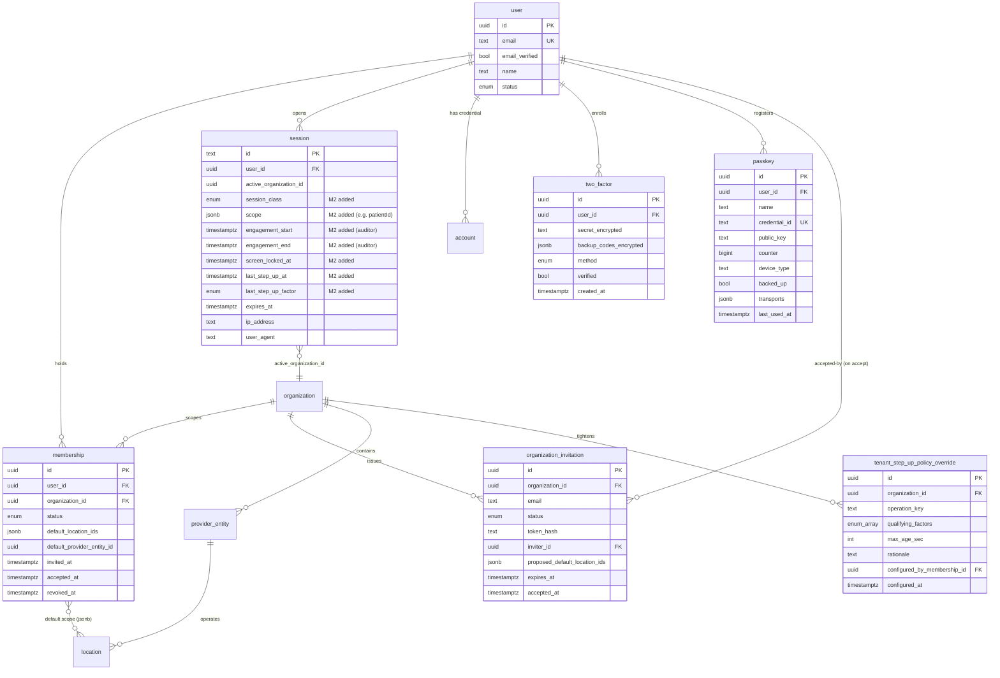
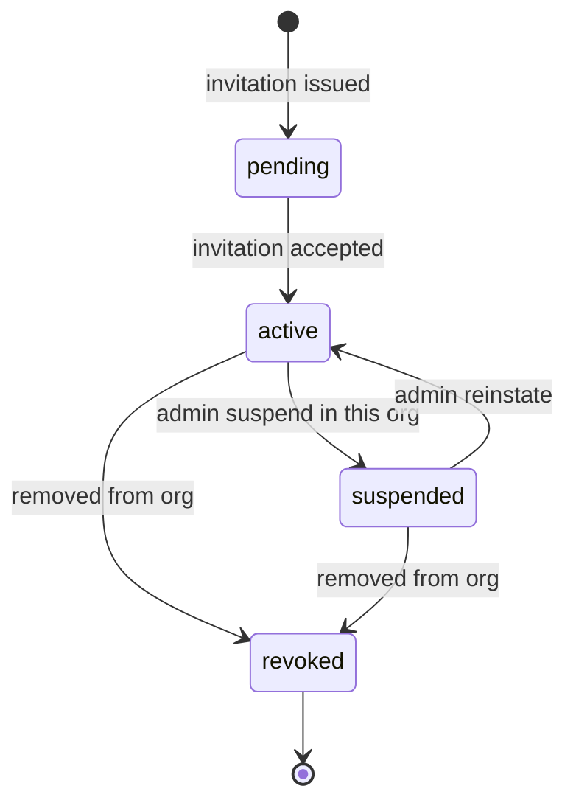
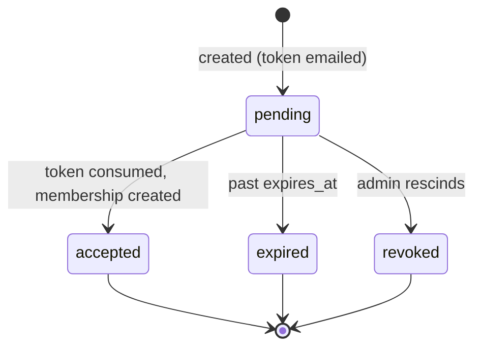
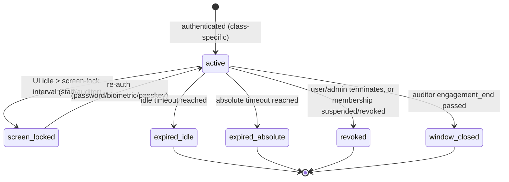

# Module 2 — Identity & Organization Specification

> **Authority note:** This spec is an **implementation proposal** (repo authority rule): [`docs/architecture/`](../architecture/) and the ratified ADRs in [`docs/adr/`](../adr/) win on conflict, and the code plus [`docs/BUSINESS_LOGIC.md`](../BUSINESS_LOGIC.md) are ground truth for as-built behavior. Mechanism choices named here may be superseded — see ADR-0036…0040 and ADR-0030/0032/0035 for the recorded divergences (outbox not Socket.IO, TypeScript not Python sidecars, app-layer AES-256-GCM not pgcrypto, pure transition tables not XState, hand-rolled HTTP hardening not `@fastify/*`, Vite + react-router not TanStack Start).


**Module ID:** 2
**Phase:** 1 (foundation tier — lands immediately after Module 1)
**Owns:** `apps/backend/src/modules/02-identity`, Better Auth session machinery, the four session classes (`staff`, `auditor`, `external_collaborator`, `funeral_home`), MFA primitives (TOTP, WebAuthn passkey, SMS fallback), and step-up authentication state.
**Depends on:** 1 (Foundation — provides `user`, `membership`, `session`, `account`, `verification`, `organization`, `provider_entity`, `location` tables + their **exported repositories/services**, Better Auth skeleton, request-context plumbing, audit helper, error envelope). `SESSION_POLICY`/`STEP_UP_POLICY` constants live in `packages/types` (re-homed from the banned `packages/foundation`, ADR-0005 D3).
**Consumed by:** 3 (Authorization — layers RBAC/ABAC on identity & membership, and whose `step_up_recent` predicate reads the `lastStepUpAt`/`lastStepUpFactor` session fields via M2's published session interface), 4 (Audit — uses resolved identity as actor, and accounts step-up events at `compliance` retention), 34 (SaaS Tenant Platform — calls org/membership provisioning during onboarding), 36 (Secure Messaging — uses identity for presence/channels), 31 (Portal — uses the authentication primitive), 29 (External Interfaces — its privileged routes T-29.10 credential rotation and T-29.11 SUD unredact gate on the step-up contract), and every module that requires an authenticated, org-scoped request context
**Spec status:** Re-locked v0.5 (Phase-1 audit remediation; supersedes Locked v0.4) — counter-signed with M3 v0.3 per the step-up contract handshake

> **Re-lock remediation banners (full disposition in the Remediation Changelog below):**
> - **M02-F01 — table ownership.** `organization`, `membership`, `session`, `account`, `verification`
>   are **Module 1-owned** (manifest, authoritative). M2 owns the session *machinery/behavior*, not the
>   tables: it reads/writes them **only through Module 1's exported `SessionRepository`/`OrgRepository`/
>   `MembershipRepository`**, never via a direct Drizzle `tx.update(session)` or a session-column
>   migration. The two step-up columns are added by an M1-owned migration on M2's CMSR request. M2 is the
>   *producer of lifecycle events* via the owner's repo + outbox — it does not "own" those tables (§8.1.1
>   reworded). M2's own tables: `two_factor`, `passkey`, `organization_invitation`,
>   `tenant_step_up_policy_override` (the last added to the manifest, M02-F04).
> - **M02-F02 — notification delivery.** M2 imports **no** vendor SDK. `postmark`/`twilio` stay confined
>   to their adapter (M36 / a foundation transactional-sender). M2 **emits typed outbox events**
>   (`m2.invitation.created`, `m2.magic_link.requested`, `m2.twofactor.code_requested`); the registered
>   transactional sender delivers them (interim foundation sender until M36 is built). See §4.6.
> - **M02-F03 / F11 — `packages/foundation` banned** (re-home per ADR-0005 D3); canonical RLS variable is
>   **`app.org_id`** via **`withOrgContext()`** (the old non-canonical `app.organization_id` /
>   `withTenantContext` spellings are removed).
> - **M02-F10 (Phase-5, ADR-0020) — HIBP catalogued.** HaveIBeenPwned is now in the Integration
>   Catalog (inventory row 32). It carries **no PHI** (k-anonymity SHA-1 prefixes), so **no BAA is
>   required**; it is wrapped in an adapter with a circuit breaker + `DegradedError` (on HIBP down,
>   accept the password and flag for async re-check).

## Changelog

- **v0.5 (Phase-1 audit remediation, 2026-06-11)** — Re-lock against `audit/AUDIT_M02_M03.md` and the Phase-0 ADRs; counter-signed with M3 v0.3. Clears both M02 BLOCKERs (M1-table ownership; vendor-adapter notification path). See the **Remediation Changelog** below.
- **v0.4 (Consolidated)** — Rolls the v0.2 base and v0.3 delta into a single self-contained specification. No scope change; no decision reversals.
- **v0.3 (Locked)** — Formalized the **step-up authentication** primitive that Module 3's `step_up_recent` predicate depends on and that T-29.10 (credential rotation), T-29.11 (SUD unredact), and Module 4 (privileged audit accounting) consume. Added two new session record fields — `lastStepUpAt` (timestamptz, nullable) and `lastStepUpFactor` (enum `webauthn | totp | sms`), populated at login when MFA is performed and on every successful step-up challenge — via migration `0036_m2_v03_step_up.sql`. Added the step-up route `POST /api/v1/sessions/step-up` (with its `/initiate` companion), the `STEP_UP_POLICY` constant declaring the platform-floor step-up factors (WebAuthn, TOTP) and the default 300s freshness window, and the per-organization `tenant_step_up_policy_override` table allowing tenants to tighten (never loosen) the platform floor. Established the login-MFA-counts-as-step-up rule, four new decisions (D8–D11), four new workflow acceptance criteria (W-M2-08 through W-M2-11), and four new implementation tasks (T-M2-12 through T-M2-15).
- **v0.2 (Locked)** — Resolved all seven open questions into binding decisions (§11). Expanded §3.9 to complete migration DDL. Added the permission keys this module registers into Module 3 (§4.7) and the `mintAuditorSession` minter Module 3 calls (now a boot-validated seam). Wired the idle-timeout decision to a single `SESSION_POLICY` constant. Lock-grade sign-off.
- **v0.1** — Initial draft. Instantiates the §20.B module spec template. Establishes authentication (password, 2FA, passkey), the four session classes, the org-scoped session model, user/membership/invitation lifecycle, and Organization/ProviderEntity/Location management. Defers all authorization (roles, permissions, ABAC, break-glass) to Module 3.

## Remediation Changelog — Phase 1 (v0.5, 2026-06-11)

| Finding | Sev | Resolution |
|---|---|---|
| **M02-F01** | BLOCKER | M1-owned `organization`/`membership`/`session`/`account`/`verification` no longer claimed or directly mutated by M2; all access via M1's exported repositories; step-up columns added by an M1 migration on M2's CMSR; §8.1.1 reworded to "producer of lifecycle events," not table owner (header banner + §8.1.1). |
| **M02-F02** | BLOCKER | M2 imports no `postmark`/`twilio`; notification jobs **emit outbox events** delivered by the registered transactional sender (interim foundation sender → M36); 2FA SMS via the same path (§4.6). |
| M02-F03 | MAJOR | `packages/foundation` banned; `SESSION_POLICY`/`STEP_UP_POLICY` re-homed to `packages/types`; outbox helper from `packages/shared` (ADR-0005 D3). |
| M02-F04 | MAJOR | `tenant_step_up_policy_override` added to manifest M2 `ownedTables`; step-up primitive recorded under the foundation re-lock (Security-Owner review per SEC-006). |
| M02-F05 | MAJOR | `TenantConfiguration` AI flags (`ai_predictions_enabled`, `ai_chart_copilot_enabled`, informed-consent onboarding toggle) + `ClinicianPreferences` (per-clinician AI opt-out, `ai.clinician_opted_out` audit) added to the org-settings/identity model (ARCH-151/AI-061). |
| M02-F06 | MAJOR | Account-takeover set completed: invisible-Turnstile captcha after 3 failures, cross-account velocity → defensive mode, suspicious-activity (geo/device/off-hours) re-auth, two-IP forced re-auth, 15-min lockout duration (SEC-033). |
| M02-F07 | MAJOR | **Organization status machine contracted now** (active/suspended/closed); session issuance + `select-organization` gated on org status; `m2.organization.activated/suspended/closed` events contracted (forward note → §8.1.1). |
| M02-F08 | MAJOR | Mobile **offline ticket** specified: short-lived signed ticket cryptographically bound to the session, revocation behavior, sync-requires-online (SD-047). |
| M02-F09 | MAJOR | STRIDE threat model (account takeover, session theft, invitation-token abuse, org-binding spoofing) added (SEC-007) — see §14. |
| M02-F10 | MAJOR | HIBP added to the INT inventory (INT-002); wrapped in an adapter with circuit-breaker + `DegradedError`; degraded behavior defined (accept + async re-check). |
| M02-F11 | MINOR | RLS variable normalized to **`app.org_id`**; `withTenantContext` → `withOrgContext` (global rename). |
| M02-F12 | MINOR | Invented `security` retention class remapped to `compliance` (§24). |
| M02-F13 | MINOR | Five BullMQ queues declare priority/retry/backoff/concurrency/DLQ + idempotent consumers (§15.1); `Idempotency-Key` semantics stated (§15.2); error envelope conformed (§15.3); `select-organization` route path reconciled with SD §1.3.1 — see §15. |
| M02-F14 | MINOR | Sample-code defects (non-existent columns, unreachable SMS branch, audit-outside-transaction, hashed-vs-encrypted backup codes) fixed at implementation; audit emission moved inside the mutation transaction. |
| M02-F15 | MINOR | MFA matrix restated as "all roles except read-only" (ARCH-050). |
| M02-F16 | MINOR | Residual auditor surfaces re-homed to M3's engagement console; issuing role aligned to Compliance Officer (§7.5). |
| M02-F17 | MINOR | `listMembershipsForUser` cross-org read captured as an ADR with an allowlisted query shape. |
| M02-F18 | MINOR | Password recovery: 15-min reset-link TTL, TOTP gate at click, out-of-band verification for `platform_ops`/`org_admin` (SEC-031). |
| M02-F19 | MINOR | DR tier declaration (Tier 1, RTO 1h / RPO 5min) + degraded-mode behavior (§16.2); all-locations membership flag modeled (§16.3 / ARCH-013) — see §16. |

-----

## 1. Purpose & Scope

### 1.1 What This Module Does

Module 2 owns **who a user is** and **which organization a session operates in**. It turns the Better Auth skeleton and the foundation identity tables from Module 1 into working authentication and tenant-membership flows.

- **Authentication** — email + password (with breached-password check), email verification, password reset, login, logout, screen-lock. Built on Better Auth (`packages/auth`).
- **Multi-factor authentication** — TOTP (RFC 6238) with encrypted secrets and backup codes; WebAuthn passkeys (preferred for clinicians, required for high-privilege roles).
- **Session subsystem** — issuance, validation, refresh, listing, and revocation of four distinct **session classes** (staff, auditor, external-collaborator magic-link, funeral-home magic-link), each with its own timeout policy and scope. Each session is **scoped to exactly one Organization** and binds `active_organization_id` server-side.
- **User identity model** — one email = one `user`, which may hold `membership`s in multiple Organizations (traveling/contract clinicians). Authentication factors (passkeys, 2FA seeds) are user-level and shared across that user's Organizations; authorization is not.
- **Membership lifecycle** — invite a person to an Organization, accept, suspend, revoke; default Location set and default ProviderEntity per membership.
- **Invitation flow** — invite by email before an account exists (`organization_invitation`), with single-use, time-bound tokens.
- **Organization hierarchy management** — CRUD and relationship management for `organization`, `provider_entity` (CCN-bearing), and `location`, including the HearthNote AI opt-in flag at tenant level with per-clinician override (architecture §10.5 / change log v0.10).
- **Step-up authentication state.** Within a single authenticated session, certain privileged operations (credential rotation, SUD unredact exercise, cross-regime audit accounting, KMS key operations) require a recent MFA challenge regardless of how recent the initial login was. Module 2 publishes two session fields (`lastStepUpAt`, `lastStepUpFactor`) and a step-up route that any authorized user can call to refresh their step-up state. Module 3's `step_up_recent` predicate reads these fields to gate the privileged routes. The platform-floor factors (WebAuthn and TOTP) qualify; SMS does not. Tenants may tighten the policy per-operation but cannot loosen.

### 1.2 What This Module Does Not Do

- **Authorization.** No role catalog, no permission resolution, no RBAC/ABAC evaluation, no break-glass, no RLS *policy authoring*. Membership here is role-agnostic; **Module 3** assigns roles to memberships and resolves permissions. Where this spec references a role key (e.g. `org_admin`), it names the Module 3 concept it defers to, not a thing this module defines. Module 2 does not manage the MFA enrollment policy either — that is the MFA matrix in §2.3/§6.
- **The audit log itself.** Module 1/4 own the partitioned `audit_event` table and helper; Module 2 *emits* events through that helper.
- **Patient/caregiver portal account domain.** Module 2 provides the authentication mechanism; the caregiver-proxy/consent/portal-account model is **Module 31**.
- **Tenant onboarding orchestration and subscription.** **Module 34** orchestrates onboarding (and *calls* this module to create the Organization and the first admin membership); **Module 35** owns billing.
- **SSO / OIDC for enterprise tenants.** Deferred until the first enterprise customer (architecture §7). The provider abstraction is left open but not implemented in v1.
- **PHI storage.** Module 2 stores identity and session state, not patient health information.

### 1.3 Regulatory Drivers

| Driver | Requirement | How Module 2 satisfies it |
|---|---|---|
| HIPAA §164.312(a)(2)(i) — Unique user identification | Each user uniquely identified | One `user` per email; never shared accounts; all actions attributable |
| HIPAA §164.312(d) — Person/entity authentication | Verify identity before access | Password + breach check + MFA; passkeys for high assurance |
| HIPAA §164.312(a)(2)(iii) — Automatic logoff | Terminate session after inactivity | Idle + absolute session timeouts; UI screen-lock |
| HIPAA §164.308(a)(4) — Workforce access management | Authorize, establish, modify, terminate access | Membership invite/accept/suspend/revoke lifecycle with audit |
| HIPAA §164.308(a)(5)(ii)(D) — Password management | Procedures for creating/changing/safeguarding | NIST-aligned password policy; Argon2id hashing (Security Hardening §4) |
| HIPAA §164.312(b) — Audit controls | Record access/auth events | Auth events emitted to Module 4 |
| Better Auth + Security Hardening §5 | MFA matrix per role, session controls, rate limiting | Implemented per §3–§4 below |

### 1.4 Competitive Context

WellSky, MatrixCare, and Homecare Homebase generally use single-org logins with bolt-on MFA and weak support for clinicians who legitimately work at more than one agency. WardenX's differentiator is the **one-identity, many-memberships** model with org-scoped sessions, passkey-first auth, and first-class **time-bound auditor** and **per-patient external-collaborator** session classes — so surveyors and attending physicians get correct, audited, least-privilege access without manual account juggling.

-----

## 2. Domain Model

### 2.1 Entity-Relationship Diagram

Tables marked **(M1)** are created by Module 1; Module 2 owns their *behavior* and adds the tables marked **(M2)**. Org-hierarchy tables (organization/provider_entity/location) are M1-created; Module 2 owns their management surface.



> **Note on `account` (M1):** Better Auth stores the password hash in `account.password_hash` (provider `credential`), not on `user`. Module 2 drives that through Better Auth; it does not write the hash directly.

### 2.2 Entity Lifecycle States

#### 2.2.1 User status (`user.status`)

```mermaid
stateDiagram-v2
    [*] --> invited: invitation issued (no account yet)
    invited --> active: accepts invite, sets credential, verifies email
    active --> suspended: admin suspend (reversible; sessions revoked)
    suspended --> active: admin reinstate
    active --> deactivated: offboarded (memberships revoked)
    suspended --> deactivated: offboarded
    deactivated --> [*]
```



- `invited` is represented by an open `organization_invitation` with no linked `user` yet; once accepted, the `user` row is `active`. (A user already active in Org A who is invited to Org B is `active` throughout — only a new membership is created.)
- **`deactivated` is terminal for login** but the `user` row is retained (never hard-deleted) for audit attribution and historical integrity. All memberships revoked, all sessions terminated, all credentials disabled.

#### 2.2.2 Membership status (`membership.status`)



- Enforced by Module 1's partial unique index: only one non-`revoked` membership per `(user, organization)`.
- Suspending/revoking a membership **terminates that user's sessions whose `active_organization_id` matches that org** (other-org sessions untouched — that is the point of the model).

#### 2.2.3 Invitation status (`organization_invitation.status`)



#### 2.2.4 Session class & lifecycle (`session.session_class`)

The session is the same table for all classes; the class drives timeout policy, scope, and allowed operations.

| Class | Origin | Idle timeout | Absolute | Scope | Concurrency |
|---|---|---|---|---|---|
| `staff` | password/passkey + (org chosen at login) | 15 min¹ | 8 hr work / 24 hr hard | one Organization | allowed, listable, revocable |
| `auditor` | per-auditor magic-link + 2FA, within engagement window | 10 min | bounded by `engagement_end` | one Organization, read-only (scope enforced by M3) | **no concurrent sessions** |
| `external_collaborator` | one-time 30-min magic-link | per role (default 15 min) | 8 hr default (configurable) | **one patient** (`scope.patientId`) | one active per link |
| `funeral_home` | magic-link issued at/after death | 15 min | 72 hr default (configurable) | one deceased patient, disposition scope | one active per link |

¹ **Resolved (§11 D1):** architecture §7's 15-min idle governs over Security Hardening §5.1.4's 30-min for shared clinical workstations. All timeouts derive from one `SESSION_POLICY` constant; Security Hardening §5.1.4 is to be patched to 15-min idle to match.



### 2.3 Validation Rules

| Rule | Type | Detail |
|---|---|---|
| Email format & normalization | sync | RFC-5322-lite; lowercased; trimmed; unique (M1 `user_email_idx`) |
| Password policy | sync + async | ≥12 chars; not in top-10,000 common list (sync); not in breach corpus via HaveIBeenPwned k-anonymity (async) — Security Hardening §5.1.3 |
| No password expiration | policy | Per NIST 800-63B; rotation only on suspicion of compromise |
| MFA required | policy | TOTP required for all clinical/admin roles; passkey required for `platform_ops`, `org_admin` (Security Hardening §5.1.2) — enforced at first sign-in setup |
| One active membership per (user, org) | sync (DB) | M1 partial unique index |
| Invitation single-use & time-bound | sync | `token_hash` consumed atomically; reject if `expired`/`accepted`/`revoked`; default TTL 7 days |
| Magic-link single-use & short TTL | sync | collaborator 30 min, one-time; auditor within engagement window; funeral 72 hr |
| ProviderEntity CCN format | sync | 6-char CMS CCN where applicable; NPI Luhn-checked; MAC jurisdiction from a controlled list |
| Location belongs to a ProviderEntity in same Organization | sync | FK + org-match check |
| Session org must match an active membership | sync | At login, chosen org must have an `active` membership for the user |
| Suspended/deactivated user cannot authenticate | sync | Checked before session issuance |
| Step-up paired-write invariant | sync (DB) | `last_step_up_at` and `last_step_up_factor` are both NULL or both set (CHECK constraint) |
| Step-up factor not SMS | sync + policy | SMS never qualifies as step-up; refused at TypeBox schema, route logic, and tenant-override trigger |

### 2.4 Side Effects

| Trigger | Side effect |
|---|---|
| Invitation accepted | Create `membership` (status `active`); set `user.status=active` if newly created; emit `membership.accepted`; mark invitation `accepted` |
| Login success | Issue session bound to chosen org; emit `auth.login_succeeded`; reset failed-attempt counter |
| Login success **with MFA** | In addition to the above, initialize `session.last_step_up_at = loginCompletedAt` and `last_step_up_factor = '<verifiedFactor>'` (TOTP/WebAuthn only; SMS does not initialize step-up); emit `m2.session.step_up.completed` (`source: 'login_mfa'`) |
| Login failure | Increment account-bound + IP-bound counters (Valkey); lockout per threshold; emit `auth.login_failed` |
| 5 failed logins / username / 10 min | Temporary account lockout; emit `auth.account_locked` |
| Membership suspended/revoked | Terminate that user's sessions for that org; emit `membership.suspended`/`membership.revoked` |
| User deactivated | Revoke all memberships, terminate all sessions, disable credentials; emit `user.deactivated` |
| 2FA enrolled/disabled | Emit `auth.2fa_enrolled`/`auth.2fa_disabled`; on disable for a role that requires MFA → block until re-enrolled |
| Passkey registered/removed | Emit `passkey.registered`/`passkey.removed` |
| Password reset completed | Terminate all of that user's sessions (force re-login); emit `auth.password_reset` |
| Org/PE/Location created/updated | Emit `org.*`/`provider_entity.*`/`location.*`; trigger RLS-relevant cache refresh |
| Auditor session created | Bind engagement window; ensure no concurrent auditor session; emit `auth.auditor_session_started` |
| Step-up challenge succeeded | One-shot update of `session.last_step_up_at = now()` + `last_step_up_factor`; clear Valkey challenge; emit `m2.session.step_up.completed` (`source: 'explicit_route'`) |
| Step-up challenge failed | Track failure in Valkey; emit `m2.session.step_up.failed`; on 3 consecutive failures in 60s terminate session and emit `m2.session.terminated_step_up_lockout` |
| Tenant step-up override configured | Persist tighten-only override row; emit `m2.session.step_up_policy_override.configured` |

-----

## 3. Drizzle Schema

### 3.1 Package Layout

Module 2 adds schema files under `packages/db/src/schema/` and the auth configuration under `packages/auth/`.

```
packages/auth/
├── src/
│   ├── index.ts              # betterAuth() instance + plugin config
│   ├── plugins/
│   │   ├── organization.ts   # org plugin config (active org binding, invitations)
│   │   ├── two-factor.ts     # TOTP config + encrypted secret hooks
│   │   ├── passkey.ts        # WebAuthn config (rpId, origin)
│   │   ├── magic-link.ts     # collaborator/auditor/funeral session minting
│   │   └── admin.ts          # admin (suspend/impersonate-disabled) config
│   ├── password-policy.ts    # length, common-list, HIBP k-anonymity
│   ├── session-policy.ts     # per-class timeout constants (single source)
│   └── factors.ts            # role→required-factor matrix (reads M3 role keys)
packages/db/src/schema/
├── two-factor.ts             # M2
├── passkeys.ts               # M2
├── organization-invitations.ts  # M2
├── identity/tenant-step-up-policy-override.ts  # M2
└── (extends sessions.ts additionalFields via auth config)
```

> Per architecture §25.14 and Module 1, the rest of the system never imports Better Auth directly — it depends on `packages/auth` exports (`getSession`, `requireSession`, `mintCollaboratorSession`, etc.).

### 3.2 Enums

```typescript
// packages/db/src/enums.ts  (additions)
import { pgEnum } from 'drizzle-orm/pg-core'

export const sessionClass = pgEnum('session_class', [
  'staff',
  'auditor',
  'external_collaborator',
  'funeral_home',
])

export const invitationStatus = pgEnum('invitation_status', [
  'pending',
  'accepted',
  'expired',
  'revoked',
])

export const twoFactorMethod = pgEnum('two_factor_method', [
  'totp',
  'sms', // accessibility fallback; never carries PHI
])

export const stepUpFactor = pgEnum('step_up_factor', ['webauthn', 'totp', 'sms'])
// NOTE: userStatus, membershipStatus already defined in Module 1.
```

### 3.3 Two-Factor Schema (M2)

```typescript
// packages/db/src/schema/two-factor.ts
import { pgTable, uuid, text, boolean, timestamp, jsonb, index } from 'drizzle-orm/pg-core'
import { users } from './users'
import { twoFactorMethod } from '../enums'

export const twoFactor = pgTable(
  'two_factor',
  {
    id: uuid('id').primaryKey().defaultRandom(),
    userId: uuid('user_id')
      .notNull()
      .references(() => users.id, { onDelete: 'cascade' }),
    method: twoFactorMethod('method').notNull().default('totp'),
    // TOTP secret is encrypted with the platform KEK (envelope), never plaintext.
    secretEncrypted: text('secret_encrypted').notNull(),
    // Backup codes: array of {hash, usedAt} — hashed (not encrypted) since one-way is enough.
    backupCodesEncrypted: jsonb('backup_codes_encrypted').notNull().default([]),
    verified: boolean('verified').notNull().default(false),
    createdAt: timestamp('created_at', { withTimezone: true }).notNull().defaultNow(),
    lastUsedAt: timestamp('last_used_at', { withTimezone: true }),
  },
  (t) => ({
    userIdx: index('two_factor_user_idx').on(t.userId),
  }),
)

export type TwoFactor = typeof twoFactor.$inferSelect
```

### 3.4 Passkey Schema (M2)

```typescript
// packages/db/src/schema/passkeys.ts
import { pgTable, uuid, text, bigint, boolean, jsonb, timestamp, uniqueIndex, index } from 'drizzle-orm/pg-core'
import { users } from './users'

export const passkey = pgTable(
  'passkey',
  {
    id: uuid('id').primaryKey().defaultRandom(),
    userId: uuid('user_id')
      .notNull()
      .references(() => users.id, { onDelete: 'cascade' }),
    name: text('name').notNull(), // user-given label, e.g. "iPhone Face ID"
    credentialId: text('credential_id').notNull(), // base64url
    publicKey: text('public_key').notNull(),       // COSE public key, base64url
    counter: bigint('counter', { mode: 'number' }).notNull().default(0),
    deviceType: text('device_type'),               // singleDevice | multiDevice
    backedUp: boolean('backed_up').notNull().default(false),
    transports: jsonb('transports').notNull().default([]), // ["internal","hybrid",...]
    createdAt: timestamp('created_at', { withTimezone: true }).notNull().defaultNow(),
    lastUsedAt: timestamp('last_used_at', { withTimezone: true }),
  },
  (t) => ({
    credUnique: uniqueIndex('passkey_credential_id_idx').on(t.credentialId),
    userIdx: index('passkey_user_idx').on(t.userId),
  }),
)

export type Passkey = typeof passkey.$inferSelect
```

### 3.5 Organization Invitation Schema (M2)

```typescript
// packages/db/src/schema/organization-invitations.ts
import { pgTable, uuid, text, jsonb, timestamp, index, uniqueIndex } from 'drizzle-orm/pg-core'
import { sql } from 'drizzle-orm'
import { users } from './users'
import { organizations } from './organizations'
import { invitationStatus } from '../enums'

export const organizationInvitations = pgTable(
  'organization_invitation',
  {
    id: uuid('id').primaryKey().defaultRandom(),
    organizationId: uuid('organization_id')
      .notNull()
      .references(() => organizations.id, { onDelete: 'cascade' }),
    email: text('email').notNull(),
    status: invitationStatus('status').notNull().default('pending'),
    // store only the hash of the single-use token
    tokenHash: text('token_hash').notNull(),
    inviterId: uuid('inviter_id').references(() => users.id, { onDelete: 'set null' }),
    // proposed scope applied on acceptance -> membership.default_location_ids
    proposedDefaultLocationIds: jsonb('proposed_default_location_ids').notNull().default([]),
    proposedDefaultProviderEntityId: uuid('proposed_default_provider_entity_id'),
    // Module 3 reads this on acceptance to assign roles; M2 only carries it through.
    proposedRoleKeys: jsonb('proposed_role_keys').notNull().default([]),
    expiresAt: timestamp('expires_at', { withTimezone: true }).notNull(),
    acceptedAt: timestamp('accepted_at', { withTimezone: true }),
    createdAt: timestamp('created_at', { withTimezone: true }).notNull().defaultNow(),
  },
  (t) => ({
    orgIdx: index('org_invitation_org_idx').on(t.organizationId),
    tokenIdx: uniqueIndex('org_invitation_token_idx').on(t.tokenHash),
    // at most one pending invite per (org, email)
    pendingUnique: uniqueIndex('org_invitation_pending_unique')
      .on(t.organizationId, t.email)
      .where(sql`${t.status} = 'pending'`),
  }),
)

export type OrganizationInvitation = typeof organizationInvitations.$inferSelect
```

### 3.6 Session Additional Fields

Better Auth's `session` table (M1) is extended via `additionalFields` rather than a redefinition. The base class/scope/engagement/screen-lock fields plus the step-up fields are all driven through this mechanism:

```typescript
// packages/auth/src/index.ts (excerpt)
session: {
  additionalFields: {
    sessionClass: { type: 'string', defaultValue: 'staff' }, // session_class enum
    scope: { type: 'json', required: false },     // { patientId?: string }
    engagementStart: { type: 'date', required: false }, // auditor window
    engagementEnd: { type: 'date', required: false },
    screenLockedAt: { type: 'date', required: false },
    lastStepUpAt: { type: 'date', required: false },     // step-up freshness timestamp
    lastStepUpFactor: { type: 'string', required: false }, // step_up_factor enum
  },
}
```

Migration adds the corresponding columns + a CHECK that `external_collaborator`/`funeral_home` sessions carry a `scope.patientId`, and that `auditor` sessions carry both engagement bounds. A separate paired-write CHECK guarantees `last_step_up_at` and `last_step_up_factor` are both NULL or both set (D8).

The Drizzle table definition for the step-up columns (Better Auth migrates this):

```ts
// packages/db/src/schema/identity/session.ts (additions to existing additionalFields)
// In the Drizzle session table definition (Better Auth migrates this):
lastStepUpAt: timestamp('last_step_up_at'),
lastStepUpFactor: stepUpFactor('last_step_up_factor'),
```

### 3.7 Tenant Step-Up Policy Override Schema (M2)

Tenants may tighten — never loosen — the platform-floor step-up policy per operation. The override table is org-scoped under RLS and guarded by a tighten-only trigger (D9).

```ts
// packages/db/src/schema/identity/tenant-step-up-policy-override.ts (new)
export const tenantStepUpPolicyOverride = pgTable('tenant_step_up_policy_override', {
  id: uuid('id').primaryKey().defaultRandom(),
  organizationId: uuid('organization_id').notNull().references(() => organization.id, { onDelete: 'cascade' }),
  operationKey: text('operation_key').notNull(),
  qualifyingFactors: stepUpFactor('qualifying_factors').array().notNull(),
  maxAgeSec: integer('max_age_sec').notNull(),
  rationale: text('rationale').notNull(),
  configuredByMembershipId: uuid('configured_by_membership_id').notNull().references(() => membership.id),
  configuredAt: timestamp('configured_at').notNull().defaultNow(),
})
```

### 3.8 RLS Policies

Authentication tables are **user-owned, cross-organization** by design (a user's passkey works at every org they belong to). They are therefore **not** under `organization_id` RLS; they carry **no RLS policy** (ADR-0010 D2 makes `app.org_id` the only session variable a policy may key on; migration `0006` and M1's `0001` treat user-owned, cross-org auth tables this way) and are instead scoped to the authenticated user in application-layer queries, never exposed cross-user. The org-scoped tables are `organization_invitation` and `tenant_step_up_policy_override`.

| Table | RLS basis | Policy |
|---|---|---|
| `two_factor`, `passkey` | user-ownership (application layer) | **No RLS policy** (ADR-0010 D2: `app.org_id` is the only RLS session variable; see migration 0006). Every query is scoped to the authenticated session's `user_id` in code; no org predicate (auth, not authz) |
| `organization_invitation` | org-scoped | standard `organization_id = current_setting('app.org_id')::uuid` via Module 1 RLS generator |
| `tenant_step_up_policy_override` | org-scoped | `organization_id = current_setting('app.org_id')::uuid`; only `compliance_officer`/`org_admin` may write |
| `session`, `account` | user-ownership (application layer) + system | session lookups run in a system context during auth (pre-org-binding); post-auth reads scoped to `user_id` |
| `membership` (M1) | hybrid | a user may read their *own* memberships across orgs (to choose org at login); org admins read memberships within `app.org_id` only |

> The "read own memberships across orgs at login" path is the one legitimate cross-org read. It runs in a **purpose-scoped system query** (`listMembershipsForUser`) that returns only `(organizationId, organizationName, membershipStatus)` — never PHI — so it cannot be used to exfiltrate tenant data. Documented as an explicit exception to "cross-tenant queries forbidden" (architecture §8(8)).

### 3.9 Migration

```sql
-- migrations/0002_identity.sql  (forward-only, two-phase per architecture §25)
CREATE TYPE session_class AS ENUM ('staff','auditor','external_collaborator','funeral_home');
CREATE TYPE invitation_status AS ENUM ('pending','accepted','expired','revoked');
CREATE TYPE two_factor_method AS ENUM ('totp','sms');

CREATE TABLE two_factor (
  id uuid PRIMARY KEY DEFAULT gen_random_uuid(),
  user_id uuid NOT NULL REFERENCES "user"(id) ON DELETE CASCADE,
  method two_factor_method NOT NULL DEFAULT 'totp',
  secret_encrypted text NOT NULL,                 -- envelope-encrypted (platform KEK)
  backup_codes_encrypted jsonb NOT NULL DEFAULT '[]',  -- [{hash, usedAt}]
  verified boolean NOT NULL DEFAULT false,
  created_at timestamptz NOT NULL DEFAULT now(),
  last_used_at timestamptz
);
CREATE INDEX two_factor_user_idx ON two_factor(user_id);

CREATE TABLE passkey (
  id uuid PRIMARY KEY DEFAULT gen_random_uuid(),
  user_id uuid NOT NULL REFERENCES "user"(id) ON DELETE CASCADE,
  name text NOT NULL,
  credential_id text NOT NULL,
  public_key text NOT NULL,
  counter bigint NOT NULL DEFAULT 0,
  device_type text,
  backed_up boolean NOT NULL DEFAULT false,
  transports jsonb NOT NULL DEFAULT '[]',
  created_at timestamptz NOT NULL DEFAULT now(),
  last_used_at timestamptz
);
CREATE UNIQUE INDEX passkey_credential_id_idx ON passkey(credential_id);
CREATE INDEX passkey_user_idx ON passkey(user_id);

CREATE TABLE organization_invitation (
  id uuid PRIMARY KEY DEFAULT gen_random_uuid(),
  organization_id uuid NOT NULL REFERENCES organization(id) ON DELETE CASCADE,
  email text NOT NULL,
  status invitation_status NOT NULL DEFAULT 'pending',
  token_hash text NOT NULL,
  inviter_id uuid REFERENCES "user"(id) ON DELETE SET NULL,
  proposed_default_location_ids jsonb NOT NULL DEFAULT '[]',
  proposed_default_provider_entity_id uuid,
  proposed_role_keys jsonb NOT NULL DEFAULT '[]',   -- carried to Module 3 on accept
  expires_at timestamptz NOT NULL,
  accepted_at timestamptz,
  created_at timestamptz NOT NULL DEFAULT now()
);
CREATE INDEX org_invitation_org_idx ON organization_invitation(organization_id);
CREATE UNIQUE INDEX org_invitation_token_idx ON organization_invitation(token_hash);
CREATE UNIQUE INDEX org_invitation_pending_unique
  ON organization_invitation(organization_id, email) WHERE status = 'pending';

-- Session additional fields (Better Auth additionalFields → columns)
ALTER TABLE session
  ADD COLUMN session_class session_class NOT NULL DEFAULT 'staff',
  ADD COLUMN scope jsonb,
  ADD COLUMN engagement_start timestamptz,
  ADD COLUMN engagement_end timestamptz,
  ADD COLUMN screen_locked_at timestamptz;

ALTER TABLE session ADD CONSTRAINT session_scope_chk CHECK (
  (session_class IN ('external_collaborator','funeral_home') AND scope ? 'patientId')
  OR (session_class = 'auditor' AND engagement_start IS NOT NULL AND engagement_end IS NOT NULL)
  OR (session_class = 'staff')
);

-- RLS
ALTER TABLE two_factor ENABLE ROW LEVEL SECURITY;
ALTER TABLE passkey ENABLE ROW LEVEL SECURITY;
ALTER TABLE organization_invitation ENABLE ROW LEVEL SECURITY;

-- two_factor / passkey: user-ownership (auth layer, cross-org by design — no org predicate)
CREATE POLICY two_factor_owner ON two_factor USING (user_id = current_setting('app.user_id', true)::uuid);
CREATE POLICY passkey_owner   ON passkey   USING (user_id = current_setting('app.user_id', true)::uuid);
-- organization_invitation: org-scoped via Module 1 generator
SELECT wardenx_enable_rls('organization_invitation');
```

```sql
-- Migration 0036_m2_v03_step_up.sql

-- Phase A: step_up_factor enum
CREATE TYPE step_up_factor AS ENUM ('webauthn', 'totp', 'sms');

-- Phase B: extend session table with the two new fields
-- The Better Auth additionalFields mechanism (§3.6) drives the ALTER TABLE.
ALTER TABLE session
  ADD COLUMN last_step_up_at TIMESTAMPTZ,
  ADD COLUMN last_step_up_factor step_up_factor;

-- Paired-write invariant (D8): when one is set, the other must be set.
ALTER TABLE session
  ADD CONSTRAINT session_step_up_paired_write CHECK (
    (last_step_up_at IS NULL AND last_step_up_factor IS NULL) OR
    (last_step_up_at IS NOT NULL AND last_step_up_factor IS NOT NULL)
  );

-- Index for the M3 step_up_recent predicate's lookup pattern
CREATE INDEX idx_session_step_up_recent
  ON session (last_step_up_at)
  WHERE last_step_up_at IS NOT NULL;

-- Phase C: tenant step-up policy override table
CREATE TABLE tenant_step_up_policy_override (
  id UUID PRIMARY KEY DEFAULT gen_random_uuid(),
  organization_id UUID NOT NULL REFERENCES organization(id) ON DELETE CASCADE,
  operation_key TEXT NOT NULL,                          -- 'external_interfaces.sud_unredact.exercise', 'external_interfaces.feed_credential.rotate', etc.
  qualifying_factors step_up_factor[] NOT NULL,         -- subset of {webauthn, totp}; never includes sms
  max_age_sec INTEGER NOT NULL,                         -- <= STEP_UP_POLICY.defaultMaxAgeSec (enforced by trigger)
  rationale TEXT NOT NULL,
  configured_by_membership_id UUID NOT NULL REFERENCES membership(id),
  configured_at TIMESTAMPTZ NOT NULL DEFAULT NOW(),
  UNIQUE (organization_id, operation_key)
);

-- RLS: org-scoped read; only compliance_officer / org_admin can write
ALTER TABLE tenant_step_up_policy_override ENABLE ROW LEVEL SECURITY;
CREATE POLICY tenant_step_up_policy_org_isolated ON tenant_step_up_policy_override
  USING (organization_id = current_setting('app.org_id', true)::uuid);

CREATE INDEX idx_tenant_step_up_policy_org_op
  ON tenant_step_up_policy_override (organization_id, operation_key);

-- Phase D: trigger enforcing the tighten-only ratchet
CREATE OR REPLACE FUNCTION tenant_step_up_policy_tighten_only_check()
RETURNS trigger AS $$
DECLARE
  platform_max_age INTEGER := 300;                      -- STEP_UP_POLICY.defaultMaxAgeSec
BEGIN
  -- Reject SMS in qualifyingFactors
  IF 'sms'::step_up_factor = ANY (NEW.qualifying_factors) THEN
    RAISE EXCEPTION 'step_up_override_violation: sms is not a platform-qualifying factor';
  END IF;
  -- Reject max_age_sec > platform default
  IF NEW.max_age_sec > platform_max_age THEN
    RAISE EXCEPTION 'step_up_override_violation: max_age_sec % exceeds platform default %',
      NEW.max_age_sec, platform_max_age;
  END IF;
  -- Reject empty qualifyingFactors (effectively un-gating; would loosen by inverting the intersect)
  IF cardinality(NEW.qualifying_factors) = 0 THEN
    RAISE EXCEPTION 'step_up_override_violation: qualifying_factors cannot be empty';
  END IF;
  RETURN NEW;
END;
$$ LANGUAGE plpgsql;

CREATE TRIGGER trg_tenant_step_up_tighten_only
  BEFORE INSERT OR UPDATE ON tenant_step_up_policy_override
  FOR EACH ROW
  EXECUTE FUNCTION tenant_step_up_policy_tighten_only_check();
```

-----

## 4. API Routes

Most primitives are mounted by Better Auth at `/api/auth/*`; this section documents the **contract** WardenX relies on plus the WardenX-specific routes at `/api/v1/*`. Auth column: `none` (pre-auth), `session` (any valid session), `staff` (staff-class session), `admin` (org_admin — enforced by Module 3). RBAC/ABAC columns name Module 3 concepts.

### 4.1 Route Inventory

| Method | Path | Auth | Role (M3) | Idempotent | Notes |
|---|---|---|---|---|---|
| POST | `/api/auth/sign-up` | none | — | yes (by email) | **Invite-gated**: requires valid invitation token; no open registration for staff |
| POST | `/api/auth/sign-in/email` | none | — | n/a | password; returns MFA challenge if enrolled |
| POST | `/api/auth/sign-in/passkey` | none | — | n/a | WebAuthn assertion |
| POST | `/api/auth/sign-out` | session | — | yes | terminates current session |
| POST | `/api/auth/verify-email` | none | — | yes | consumes verification token. **Implementation note (GAP-003):** not backed - staff accounts are created only through an invitation whose acceptance marks the email verified (`markEmailVerified`), so sign-up carries no unverified-email window and `requireEmailVerification` stays off; this route becomes live only if open self-registration is ever enabled |
| POST | `/api/auth/forgot-password` | none | — | yes | always 200 (no account enumeration) |
| POST | `/api/auth/reset-password` | none | — | yes | consumes token; terminates all sessions |
| POST | `/api/auth/two-factor/enable` | session | — | n/a | returns TOTP provisioning URI + backup codes once |
| POST | `/api/auth/two-factor/verify` | none(2fa) | — | n/a | completes login MFA step |
| POST | `/api/auth/two-factor/disable` | session | — | n/a | blocked if role requires MFA |
| POST | `/api/auth/two-factor/backup-code` | none(2fa) | — | yes | single-use code consumption |
| POST | `/api/auth/passkey/register` | session | — | n/a | WebAuthn attestation |
| GET | `/api/auth/passkey` | session | — | yes | list own passkeys |
| DELETE | `/api/auth/passkey/:id` | session | — | yes | remove own passkey |
| GET | `/api/v1/auth/memberships` | session(pre-org) | self | yes | list own memberships to choose org at login |
| POST | `/api/v1/auth/select-organization` | session(pre-org) | self | n/a | binds `active_organization_id`; **only at login** |
| GET | `/api/v1/auth/sessions` | session | self | yes | list own active sessions **DEFERRED (unbuilt):** own-session list is not exposed; sessions are managed by Better Auth. |
| DELETE | `/api/v1/auth/sessions/:id` | session | self | yes | revoke one of own sessions **DEFERRED (unbuilt):** own-session revoke is not exposed. |
| POST | `/api/v1/auth/screen-unlock` | session | self | n/a | re-auth to clear `screen_locked_at` **DEFERRED (unbuilt):** no route; screen lock is client-side + step-up. |
| GET | `/api/v1/me/session` | session | self | yes | current session metadata incl. `lastStepUpAt`, `lastStepUpFactor`, `stepUpStatus` **DEFERRED (unbuilt):** no route; step-up state is read server-side via the `SessionContextResolver` seam and surfaced by `GET /api/v1/auth/context`. |
| POST | `/api/v1/sessions/step-up/initiate` | session | self | n/a | begin an MFA step-up challenge (WebAuthn/TOTP); SMS refused |
| POST | `/api/v1/sessions/step-up` | session | self | n/a | verify step-up challenge; writes `last_step_up_at`/`last_step_up_factor` |
| POST | `/api/v1/collaborators/invite` | staff | per role | yes | mint external-collaborator magic-link (per-patient) |
| POST | `/api/v1/collaborators/consume` | none | — | yes | consume magic-link → scoped session |
| POST | `/api/v1/auditors/redeem` | none | — | single-use token | redeem the emailed auditor link → a scoped **enrolment-stage** `auditor` session (served by M2: session mechanics; the link is minted by M3's `POST /engagements/:id/auditors`). Single-use, expiring, tenant-scoped, rate-limited, audited (`m2.auditor_link.redeemed` / `.refused`); 409 `LINK_ALREADY_USED`, 410 `LINK_EXPIRED` / `LINK_INVALID`, 403 `ENGAGEMENT_NOT_OPEN` / `ENGAGEMENT_NOT_ACTIVE`, 409 `AUDITOR_IDENTITY_IS_MEMBER`. The session carries `scope.auditorStage = "enrolment"`: it holds no role and reaches only the five enrolment routes below until §7.7 is done (the link alone reads nothing). |
| GET | `/api/v1/auditors/enrolment/state` | session (auditor, enrolment or active) | ABAC `auditor_enrolment_session` | n/a | the versioned terms to read, BAA acceptance, second-factor status (`enrol` / `challenge` / `verified`), lockout |
| POST | `/api/v1/auditors/enrolment/baa` | session (auditor, enrolment) | ABAC `auditor_enrolment_session` | idempotent | accept the versioned BAA / engagement terms (`termsVersion` + `termsSha256` of the exact text; stale → 409 `AUDITOR_TERMS_STALE`); appends `auditor_baa_acceptance` (who, when, ip, user agent, terms version + hash, engagement) |
| POST | `/api/v1/auditors/enrolment/totp/begin` | session (auditor, enrolment) | ABAC `auditor_enrolment_session` | no | first engagement only: a fresh unconfirmed TOTP secret (otpauth URI + manual key); 409 `AUDITOR_2FA_ALREADY_ENROLLED` when a factor exists — an enrolled factor is never replaced through a link |
| POST | `/api/v1/auditors/enrolment/totp/confirm` | session (auditor, enrolment) | ABAC `auditor_enrolment_session` | no | first engagement only: the first code makes the factor real; ten single-use recovery codes are returned ONCE and stored hashed (HMAC-SHA256) |
| POST | `/api/v1/auditors/enrolment/verify` | session (auditor, enrolment) | ABAC `auditor_enrolment_session` | no | later engagements: present the enrolled factor — one of `totpCode` / `recoveryCode`; a spent TOTP step cannot be replayed, a recovery code works once; 5 consecutive wrong codes lock the factor 15 minutes (429 `AUDITOR_2FA_LOCKED`, `Retry-After`) |

**Auditor enrolment (§7.7, built).** A redeemed link starts an ENROLMENT-stage session. When the BAA terms are accepted for the engagement AND a second factor is proven in this session (TOTP enrolled-and-confirmed, a presented TOTP code, or a recovery code), the one least-privilege `external_auditor` role is granted (M3 port, expiring with the window) and the session is upgraded to `auditorStage = "active"`, stamping `last_step_up_at` / `last_step_up_factor = totp` when TOTP was the factor. Until then the authenticate hook refuses every other route with `403 AUDITOR_ENROLMENT_REQUIRED` and stamps no engagement read scope; the role is not granted before activation, so the engagement read stays closed even if a route were wired by mistake. The factor is the shared user-level `two_factor` row the staff step-up verifier reads (TOTP only; SMS never); lockout uses its `failed_verification_count` / `locked_until` columns; every step is audited under `m2.auditor_enrolment.*` (no code or secret in the trail). **Terms source:** the BAA / engagement terms are a platform-owned versioned document (`auditor-terms.ts`; acceptance records the version and the sha-256 of the exact text). M40's `BaaStatusProvider` was reviewed and not reused — it answers "does this tenant hold an executed BAA with this master-data entity" (physician / facility / payer ...) for PHI disclosures; an audit agency is not an MDM entity and the seam has no notion of an individual's acceptance. **Open:** the wording requires legal approval; a lost factor with no recovery codes has no reset route (platform operations must clear the `two_factor` row out of band, after which the organization re-issues the link).
| ~~POST~~ | ~~`/api/v1/auditors/invite`~~ | — | — | — | **Served by Module 3, not M2** — moved to M3 with the `auditor_engagement` entity (D4 / §4.7). M2 only exposes the boot-validated `AuditorSessionMinter` that M3 calls. |
| POST | `/api/v1/funeral/invite` | staff | `funeral.invite` | yes | mint funeral-home magic-link (per-deceased; 409 unless deceased; body `recipientEmail` required on a durable deployment; 503 `LINK_DELIVERY_UNAVAILABLE` while the email provider is unbound) |
| GET | `/api/v1/funeral/case` | funeral_home | `funeral.case_read` (class permission) | n/a | the redeemed funeral-home session's ONE read: the pinned decedent's legal name + date of death |

> **As-built `/api/v1/*` routes not in the table (GAP-184):** `GET /api/v1/auth/context`; `POST /api/v1/sessions/step-up` + `/initiate` (and the portal twins under `/api/v1/portal/sessions/*`); `GET/POST /api/v1/devices/attestation` (+ `/challenge`, `/:id/revoke`); `GET /api/v1/invitations/:token`; `GET /api/v1/orgs/:id/invitations` + `POST …/:invId/resend`; `GET/POST /api/v1/orgs/:id/members/:mId/elevated-approvals` + `DELETE …/:kind`; `POST /api/v1/platform/organizations/:organizationId/status`. The `/api/auth/*` rows above are mounted by Better Auth, not registered as Fastify routes.
| POST | `/api/v1/orgs/:id/invitations` | admin | `org_admin` | yes (by email) | invite user to org |
| POST | `/api/v1/invitations/accept` | none | — | yes | consume invite token → membership |
| DELETE | `/api/v1/orgs/:id/invitations/:invId` | admin | `org_admin` | yes | rescind pending invite |
| GET | `/api/v1/orgs/:id/members` | admin | `org_admin` | yes | list memberships in org |
| PATCH | `/api/v1/orgs/:id/members/:mId` | admin | `org_admin` | yes | suspend/reinstate/update default scope |
| DELETE | `/api/v1/orgs/:id/members/:mId` | admin | `org_admin` | yes | revoke membership |
| POST | `/api/v1/users/:id/deactivate` | admin | `org_admin` | yes | full offboard, **own org only**: the target must be a live member of the caller's org and of no other (404 / 409 `USER_IN_OTHER_ORGS` otherwise — GAP-001) |
| POST | `/api/v1/platform/users/:id/deactivate` | admin | `platform_ops`/`platform_admin`/`platform_owner` (platform-owned role, ABAC `user_lifecycle_platform_ops`) | yes | cross-org full offboard (§4.7 `platform_ops (any)`); step-up `user.deactivate_platform`; revokes every live membership in every org, reaps all sessions, audits `m2.user.deactivated` with `scope: "platform"` |
| GET/POST/PATCH | `/api/v1/orgs` , `/api/v1/orgs/:id` | admin | `org_admin`/`platform_ops` | yes | Organization mgmt incl. HearthNote opt-in flag |
| GET/POST/PATCH | `/api/v1/provider-entities[...]` | admin | `org_admin` | yes | CCN/NPI/MAC management |
| GET/POST/PATCH | `/api/v1/locations[...]` | admin | `org_admin` | yes | Location management |
| GET/POST | `/api/v1/orgs/:id/step-up-overrides[...]` | admin | `org_admin`/`compliance_officer` | yes | configure per-operation tenant step-up tightening |

> **Implementation status (GAP-115).** Built: `GET /api/v1/me/session` (session metadata + `stepUpStatus`
> measured against the platform floor); `GET/POST /api/v1/orgs/:id/step-up-overrides` + `DELETE .../:operationKey`
> (`step_up_override.manage`; tighten-only validated in the route AND by `trg_tenant_step_up_tighten_only`; the
> writes need a fresh step-up; audited + `m2.session.step_up_policy_override.configured`); `GET/POST /api/v1/orgs`,
> `GET/PATCH /api/v1/orgs/:id` (own org for a tenant admin, any org for a platform operator; POST and the legal
> name are platform-only); `GET/POST/PATCH /api/v1/provider-entities[/:id]` and `/api/v1/locations[/:id]`
> (org-bound; the CMS identity — CCN, NPI, tax id, fiscal year end — is immutable through PATCH; a location can
> only be activated under an active provider entity); `POST /api/v1/funeral/invite` (72h one-time link, caseload
> ABAC, 409 unless the patient is deceased). Lifecycle activate/suspend/close of an org stays the platform route
> (§11 D19) and tenant provisioning stays M34's.
> **Blocked, exactly:** (1) `POST /provider-entities` answers `503 TAX_ID_CIPHER_UNBOUND` until the KMS-backed
> envelope cipher for `provider_entity.tax_id_encrypted` is bound at the composition root (an EIN is never stored
> in the clear; every other route works); (2) **resolved** — the collaborator/funeral link store is the durable,
> hash-only, bounded-use `collaborator_link` table (migration 0521) and `POST /collaborators/consume` now claims the use
> atomically, mints a real `session` row + cookie through Better Auth's server-only link-session mint, and refuses
> replay / expiry / revocation / cross-tenant; the redeemed funeral session reads only `GET /funeral/case`. What remains
> external: the production transactional-email provider is unbound, so in production the invite routes answer
> `503 LINK_DELIVERY_UNAVAILABLE` (no link is minted that nobody can receive) — see
> `docs/history/portal-signin-and-link-redemption.md`;
> (3) the spec's HearthNote opt-in flag has no settings key and no reader in any module, so it is not built.
> Session list/revoke and screen-unlock remain path drift (Better Auth's default endpoints plus a client-side
> re-sign-in), not `/me/session[...]` routes.

### 4.2 Representative Per-Route Specs

#### POST /api/v1/auth/select-organization

```typescript
// Request (TypeBox)
Type.Object({ organizationId: Type.String({ format: 'uuid' }) })
// Response 200
Type.Object({
  activeOrganizationId: Type.String({ format: 'uuid' }),
  organizationName: Type.String(),
  expiresAt: Type.String({ format: 'date-time' }),
})
// Errors: 403 NO_ACTIVE_MEMBERSHIP (chosen org not an active membership for user)
//         409 ORG_ALREADY_BOUND  (session already org-scoped; re-login required to switch)
```

- **There is no org-switch endpoint.** Binding is one-time per session. Switching org = sign out + sign in (architecture §User identity model). A second call returns `409 ORG_ALREADY_BOUND`.

#### POST /api/v1/collaborators/consume

```typescript
Type.Object({ token: Type.String() })
// 200 -> sets cookie for an external_collaborator session with scope.patientId
// Errors: 410 LINK_EXPIRED, 409 LINK_ALREADY_USED, 401 VERIFICATION_REQUIRED
```

- One-time token (30-min TTL). If the collaborator has logged in before, a 2FA challenge is required; otherwise an email/SMS verification step precedes session issuance (architecture §J). Session scope is exactly one patient; scope/permission enforcement is Module 3.

#### POST /api/v1/orgs/:id/invitations

```typescript
Type.Object({
  email: Type.String({ format: 'email' }),
  proposedDefaultLocationIds: Type.Array(Type.String({ format: 'uuid' })),
  proposedDefaultProviderEntityId: Type.Optional(Type.String({ format: 'uuid' })),
  proposedRoleKeys: Type.Array(Type.String()), // carried through to Module 3 on accept
})
// 201 -> { invitationId, expiresAt }   (token emailed via Postmark; never returned in body)
// Errors: 409 PENDING_INVITE_EXISTS, 422 INVALID_LOCATION_SCOPE
```

### 4.3 The `STEP_UP_POLICY` Constant

#### 4.3.1 Foundation constant

```ts
// packages/foundation/src/policy/step-up-policy.ts

export type StepUpFactor = 'webauthn' | 'totp' | 'sms'

export interface StepUpPolicy {
  /** Platform-floor factors that qualify as step-up. SMS is intentionally absent. */
  readonly qualifyingFactors: readonly StepUpFactor[]
  /** Default freshness window in seconds. */
  readonly defaultMaxAgeSec: number
  /** Consecutive failed step-up attempts before forced session termination. */
  readonly lockoutThreshold: number
  /** Window (seconds) in which lockout-threshold consecutive failures count. */
  readonly lockoutWindowSec: number
}

export const STEP_UP_POLICY: StepUpPolicy = Object.freeze({
  qualifyingFactors: ['webauthn', 'totp'],
  defaultMaxAgeSec: 300,
  lockoutThreshold: 3,
  lockoutWindowSec: 60,
})
```

`STEP_UP_POLICY` lives alongside `SESSION_POLICY` in `packages/foundation/src/policy`. The platform floor declares WebAuthn and TOTP as the qualifying step-up factors with a default 300s freshness window (matching the Module 3 `step_up_recent` default). SMS is intentionally absent — SMS is the D2 accessibility fallback and its cryptographic strength (no public-key proof of possession, vulnerable to SIM swap) is below what step-up requires.

#### 4.3.2 Override resolution

```ts
// apps/backend/src/modules/02-identity/policy/step-up-resolver.ts

import { STEP_UP_POLICY } from '@chartwarden/foundation/policy/step-up-policy'
import { db } from '@chartwarden/db'
import { tenantStepUpPolicyOverride } from '@chartwarden/db/schema/identity'
import { and, eq } from 'drizzle-orm'
import { withOrgContext } from '@chartwarden/tenancy'

export interface ResolvedStepUpPolicy {
  readonly qualifyingFactors: readonly StepUpFactor[]
  readonly maxAgeSec: number
}

export async function resolveStepUpPolicy(input: {
  organizationId: string
  operationKey: string
}): Promise<ResolvedStepUpPolicy> {
  const [override] = await withOrgContext(db, { organizationId: input.organizationId }, async (tx) =>
    tx
      .select()
      .from(tenantStepUpPolicyOverride)
      .where(and(
        eq(tenantStepUpPolicyOverride.organizationId, input.organizationId),
        eq(tenantStepUpPolicyOverride.operationKey, input.operationKey),
      ))
      .limit(1),
  )

  if (!override) {
    return {
      qualifyingFactors: STEP_UP_POLICY.qualifyingFactors,
      maxAgeSec: STEP_UP_POLICY.defaultMaxAgeSec,
    }
  }

  // Tighten-only semantic: intersect factors; min on maxAgeSec
  const platformSet = new Set<StepUpFactor>(STEP_UP_POLICY.qualifyingFactors)
  const tenantFactors = override.qualifyingFactors as readonly StepUpFactor[]
  const intersect: StepUpFactor[] = tenantFactors.filter(f => platformSet.has(f))

  return {
    qualifyingFactors: intersect,
    maxAgeSec: Math.min(override.maxAgeSec, STEP_UP_POLICY.defaultMaxAgeSec),
  }
}
```

The Module 3 `step_up_recent` predicate calls `resolveStepUpPolicy({ organizationId, operationKey })` and applies the resolved policy to the session's `lastStepUpAt` / `lastStepUpFactor`. The override registry is loaded at the predicate's evaluation time. Tenants may never add factors to the qualifying list or extend the `maxAgeSec` beyond the platform default — the predicate enforces this by taking `min(platformDefault, tenantOverride)` for `maxAgeSec` and `intersect(platformQualifying, tenantQualifying)` for factors. Per-operation tightening (the `operationKey` dimension) is what lets a single tenant have routine 300s step-up for most paths but a 60s WebAuthn-only requirement for the SUD path.

### 4.4 The Step-Up Route

#### 4.4.1 Route definition

`POST /api/v1/sessions/step-up` initiates an MFA challenge (WebAuthn or TOTP per the user's enrolled factors); on successful verification it writes `lastStepUpAt = now()` and `lastStepUpFactor = '<verifiedFactor>'` to the session row, returning 200 with the new timestamps so clients can chain to the original gated request immediately.

```ts
// apps/backend/src/modules/02-identity/routes/session-step-up.ts

import { Type } from '@sinclair/typebox'
import type { FastifyInstance } from 'fastify'
import { db } from '@chartwarden/db'
import { session, twoFactor, passkey } from '@chartwarden/db/schema/identity'
import { eq, and } from 'drizzle-orm'
import { withOrgContext } from '@chartwarden/tenancy'
import { withOutbox } from '@chartwarden/foundation/outbox'

const initiateBodySchema = Type.Object({
  factor: Type.Union([Type.Literal('webauthn'), Type.Literal('totp')]),
  // NB: 'sms' refused upfront — STEP_UP_POLICY.qualifyingFactors doesn't include it
})

const verifyBodySchema = Type.Object({
  challengeId: Type.String(),
  factor: Type.Union([Type.Literal('webauthn'), Type.Literal('totp')]),
  // For webauthn: the assertion response
  assertion: Type.Optional(Type.Object({
    credentialId: Type.String(),
    authenticatorData: Type.String(),
    clientDataJSON: Type.String(),
    signature: Type.String(),
  })),
  // For totp: the 6-digit code
  totpCode: Type.Optional(Type.String({ pattern: '^[0-9]{6}$' })),
})

export function registerSessionStepUpRoutes(app: FastifyInstance): void {
  // Initiate step-up challenge
  app.post('/api/v1/sessions/step-up/initiate', {
    schema: { body: initiateBodySchema, response: {
      200: Type.Object({
        challengeId: Type.String(),
        factor: Type.String(),
        // For webauthn: the challenge bytes for the authenticator
        webauthnChallenge: Type.Optional(Type.Object({ challenge: Type.String(), rpId: Type.String() })),
      }),
      400: Type.Object({ error: Type.String() }),
    }},
    preHandler: [app.authenticate],
  }, async (req, reply) => {
    const { factor } = req.body as { factor: 'webauthn' | 'totp' }
    const sessionId = req.session!.id
    const membershipId = req.session!.membershipId!

    if (factor === 'sms') {
      return reply.code(400).send({ error: 'sms_not_step_up_qualifying' })
    }

    // Check the user has enrolled this factor
    if (factor === 'webauthn') {
      const [pk] = await db.select().from(passkey).where(and(
        eq(passkey.userId, req.session!.userId),
        eq(passkey.active, true),
      )).limit(1)
      if (!pk) return reply.code(400).send({ error: 'webauthn_not_enrolled' })
    } else {
      const [tf] = await db.select().from(twoFactor).where(and(
        eq(twoFactor.userId, req.session!.userId),
        eq(twoFactor.enabled, true),
      )).limit(1)
      if (!tf) return reply.code(400).send({ error: 'totp_not_enrolled' })
    }

    // Generate challenge
    const challengeId = crypto.randomUUID()
    // Store the challenge in Valkey with a 60s TTL
    await app.valkey.setex(`stepup:challenge:${challengeId}`, 60, JSON.stringify({
      sessionId, membershipId, factor, createdAt: new Date().toISOString(),
    }))

    if (factor === 'webauthn') {
      const challenge = crypto.randomBytes(32).toString('base64url')
      await app.valkey.setex(`stepup:webauthn_challenge:${challengeId}`, 60, challenge)
      return { challengeId, factor, webauthnChallenge: { challenge, rpId: process.env.WEBAUTHN_RP_ID! } }
    }

    return { challengeId, factor }
  })

  // Verify step-up challenge
  app.post('/api/v1/sessions/step-up', {
    schema: { body: verifyBodySchema, response: {
      200: Type.Object({
        lastStepUpAt: Type.String({ format: 'date-time' }),
        lastStepUpFactor: Type.String(),
      }),
      400: Type.Object({ error: Type.String() }),
      401: Type.Object({ error: Type.String() }),
      423: Type.Object({ error: Type.String(), reason: Type.String() }),    // Locked (lockout)
    }},
    preHandler: [app.authenticate],
  }, async (req, reply) => {
    const body = req.body as any
    const sessionId = req.session!.id
    const userId = req.session!.userId

    // Load the challenge
    const challengeRaw = await app.valkey.get(`stepup:challenge:${body.challengeId}`)
    if (!challengeRaw) return reply.code(400).send({ error: 'challenge_expired_or_invalid' })
    const challenge = JSON.parse(challengeRaw) as { sessionId: string; factor: string }
    if (challenge.sessionId !== sessionId) return reply.code(400).send({ error: 'challenge_session_mismatch' })

    // Verify the factor
    let success = false
    let failureReason: string | null = null

    if (body.factor === 'webauthn' && body.assertion) {
      const expectedChallenge = await app.valkey.get(`stepup:webauthn_challenge:${body.challengeId}`)
      if (!expectedChallenge) {
        failureReason = 'webauthn_challenge_expired'
      } else {
        // Delegate to the WebAuthn library (existing dep)
        success = await verifyWebauthnAssertion({
          userId,
          assertion: body.assertion,
          expectedChallenge,
          expectedRpId: process.env.WEBAUTHN_RP_ID!,
        })
        if (!success) failureReason = 'webauthn_verification_failed'
      }
    } else if (body.factor === 'totp' && body.totpCode) {
      success = await verifyTotpCode(userId, body.totpCode)
      if (!success) failureReason = 'totp_verification_failed'
    } else {
      return reply.code(400).send({ error: 'malformed_verify_payload' })
    }

    // Track failures for lockout
    if (!success) {
      await trackStepUpFailure(sessionId, app.valkey)
      const failureCount = await getRecentStepUpFailureCount(sessionId, app.valkey)

      await req.audit.write({
        action: 'm2.session.step_up.failed',
        retentionClass: 'compliance',
        actorMembershipId: req.session!.membershipId!,
        organizationId: req.session!.organizationId!,
        resourceId: sessionId,
        payload: { factor: body.factor, failureReason, failureCount, ipAddress: req.ip, userAgent: req.headers['user-agent'] },
      })

      if (failureCount >= STEP_UP_POLICY.lockoutThreshold) {
        // Terminate the session
        await terminateSession(sessionId, 'step_up_lockout')
        await req.audit.write({
          action: 'm2.session.terminated_step_up_lockout',
          retentionClass: 'compliance',
          actorMembershipId: req.session!.membershipId!,
          organizationId: req.session!.organizationId!,
          resourceId: sessionId,
          payload: { failureCount, factor: body.factor },
        })
        return reply.code(423).send({ error: 'session_locked', reason: 'step_up_lockout' })
      }

      return reply.code(401).send({ error: 'step_up_failed' })
    }

    // Success: update the session row
    const now = new Date()
    await withOutbox(db, async (tx) => {
      await tx
        .update(session)
        .set({ lastStepUpAt: now, lastStepUpFactor: body.factor as any })
        .where(eq(session.id, sessionId))
    })

    // Clear the challenge from Valkey
    await app.valkey.del(`stepup:challenge:${body.challengeId}`)
    await app.valkey.del(`stepup:webauthn_challenge:${body.challengeId}`)

    await req.audit.write({
      action: 'm2.session.step_up.completed',
      retentionClass: 'compliance',
      actorMembershipId: req.session!.membershipId!,
      organizationId: req.session!.organizationId!,
      resourceId: sessionId,
      payload: { factor: body.factor, ipAddress: req.ip, userAgent: req.headers['user-agent'] },
    })

    return { lastStepUpAt: now.toISOString(), lastStepUpFactor: body.factor }
  })
}

async function trackStepUpFailure(sessionId: string, valkey: any): Promise<void> {
  const key = `stepup:failures:${sessionId}`
  await valkey.zadd(key, Date.now(), `${Date.now()}:${crypto.randomUUID()}`)
  await valkey.expire(key, STEP_UP_POLICY.lockoutWindowSec)
}

async function getRecentStepUpFailureCount(sessionId: string, valkey: any): Promise<number> {
  const key = `stepup:failures:${sessionId}`
  const cutoff = Date.now() - STEP_UP_POLICY.lockoutWindowSec * 1000
  await valkey.zremrangebyscore(key, '-inf', cutoff)
  return await valkey.zcard(key)
}
```

#### 4.4.2 Login hook — initialize step-up state from MFA at login

When a user completes an MFA challenge at login time (TOTP or WebAuthn per the MFA matrix), the session row's `lastStepUpAt` is initialized to the login moment and `lastStepUpFactor` to the verified factor. A freshly-logged-in user therefore has a step-up window without re-challenge, which matches user expectations and avoids friction for routine privileged actions immediately post-login.

```ts
// apps/backend/src/modules/02-identity/hooks/login-mfa-completed.ts

// Better Auth hook: fires after a successful login that included MFA verification.
// Writes the initial lastStepUpAt + lastStepUpFactor on the freshly-created session.

export async function onLoginMfaCompleted(ctx: {
  sessionId: string
  userId: string
  mfaFactor: 'webauthn' | 'totp' | 'sms' | null
  completedAt: Date
}): Promise<void> {
  if (!ctx.mfaFactor || ctx.mfaFactor === 'sms') {
    // sms doesn't count (D9 / STEP_UP_POLICY); no initial step-up state
    return
  }

  await db
    .update(session)
    .set({
      lastStepUpAt: ctx.completedAt,
      lastStepUpFactor: ctx.mfaFactor,
    })
    .where(eq(session.id, ctx.sessionId))

  // Audit (compliance retention) — note: the LOGIN itself is also audited via existing
  // events; this row records the step-up dimension of the login.
  await auditWrite({
    action: 'm2.session.step_up.completed',
    retentionClass: 'compliance',
    resourceId: ctx.sessionId,
    payload: {
      factor: ctx.mfaFactor,
      source: 'login_mfa',
    },
  })
}
```

#### 4.4.3 `GET /api/v1/me/session`

The endpoint returns session metadata, including the step-up fields and a derived `stepUpStatus` block that lets client UIs drive step-up modals:

```ts
const meSessionResponseSchema = Type.Object({
  sessionId: Type.String(),
  sessionClass: Type.String(),
  organizationId: Type.String(),
  membershipId: Type.String(),
  issuedAt: Type.String({ format: 'date-time' }),
  expiresAt: Type.String({ format: 'date-time' }),
  lastStepUpAt: Type.Union([Type.String({ format: 'date-time' }), Type.Null()]),
  lastStepUpFactor: Type.Union([Type.String(), Type.Null()]),
  stepUpStatus: Type.Object({
    hasStepUp: Type.Boolean(),
    isFresh: Type.Boolean(),                              // true if within STEP_UP_POLICY.defaultMaxAgeSec
    secondsSinceStepUp: Type.Union([Type.Integer(), Type.Null()]),
  }),
})
```

This lets the client UX preemptively trigger a step-up modal when the user clicks a privileged action and the session's `lastStepUpAt` is null or stale, avoiding the 403 → step-up → retry round-trip.

### 4.5 Socket.IO Events

| Event | Payload | Room | Purpose |
|---|---|---|---|
| `session.revoked` | `{ sessionId }` | `user:<orgId>:<userId>` | force client logout when admin revokes |
| `membership.changed` | `{ organizationId, status }` | `user:<orgId>:<userId>` | reflect suspend/revoke live |
| `presence.user_active` | `{ userId, lastSeen }` | `org:<orgId>` | consumed by Module 36 |

### 4.6 BullMQ Jobs

| Queue | Trigger | Work |
|---|---|---|
| `auth.send_invitation` | invite created | **emit `m2.invitation.created` outbox event** with the rendered intent; the registered transactional sender delivers (M02-F02 — M2 imports no `postmark`) |
| `auth.send_magic_link` | collaborator/auditor/funeral invite | **emit `m2.magic_link.requested` outbox event** (channel = email/sms); the registered sender delivers via the M36 adapter (M02-F02 — M2 imports no `postmark`/`twilio`) |
| `auth.breach_check` | password set/change | async HIBP k-anonymity lookup via a **registered adapter** with circuit-breaker + `DegradedError`; on HIBP down, accept the password and flag for async re-check (M02-F10 — HIBP added to the INT inventory, INT-002) |
| `session.reap_expired` | scheduled (cron) | purge expired sessions via M1's `SessionRepository` (DB + Valkey); idempotent consumer (DR-022) |
| `auth.offboard_user` | user deactivated | revoke memberships, terminate sessions, disable credentials (via M1 repositories) |

> **Notification delivery (M02-F02 / SD-017 / adapter mandate).** M2's BullMQ jobs do not import
> `postmark` or `twilio` — those SDKs are confined to their adapter package (`packages/messaging`,
> M36) per `VENDOR_ADAPTERS`. M2 **emits typed outbox events**; delivery is performed by the
> registered transactional sender. Because M36 is built after M2 in the §20 sequence, an **interim
> foundation transactional-sender** (M1-owned, registered in `VENDOR_ADAPTERS` so it may import the
> SDK) delivers auth mail/SMS until M36 supersedes it — that adapter-registry addition is the one
> architecture decision this entails (recorded for the cross-module pass). 2FA SMS codes (D2) flow
> the same way. All five queues declare `attempts`/backoff/concurrency/DLQ + idempotent consumers
> (M02-F13).

### 4.7 Cross-Module Contracts

**Permission keys registered into Module 3 (§3.3 of the Authorization spec).** Module 2's admin routes are authorized by Module 3; these keys must be in M3's catalog and assigned to the default `org_admin` / `platform_ops` templates. Binding handshake (mirror of M4 §4.5).

| Key | Default roles | Used by |
|---|---|---|
| `org.manage` | org_admin, platform_ops | Org/PE/Location CRUD, HearthNote opt-in |
| `member.invite` | org_admin | `/orgs/:id/invitations` |
| `member.manage` | org_admin | suspend/reinstate/revoke membership, default scope |
| `user.deactivate` | org_admin (own org), platform_ops (any) | full offboard |
| `collaborator.invite` | clinical_* (ABAC: caseload), org_admin | per-patient magic-link |
| `step_up.override.manage` | org_admin, compliance_officer | configure per-operation tenant step-up tightening |
| `auditor.invite` | (moved to Module 3 — see below) | — |

> **Auditor seam (resolved as D4).** The `/auditors/invite` endpoint and the `auditor_engagement` entity live in **Module 3** (it owns the scope + window). Module 2 exposes a boot-validated minter that Module 3 calls:
>
> ```ts
> // packages/auth/src/identity/auditor-session.ts (Module 2)
> export interface AuditorSessionMinter {
>   mintAuditorSession(input: { engagementId: string; organizationId: string;
>     identity: { name: string; email: string };
>     window: { start: Date; end: Date } }): Promise<{ magicLinkToken: string }>;
> }
> // registered at boot via the seam registry (SEAMS.md); Module 3 resolves it.
> // An engagement that cannot mint a session fails at boot, not at first auditor click.
> ```

**Step-up contract consumed by Module 3.** Module 3's `step_up_recent` predicate reads M2's `session.lastStepUpAt` + `session.lastStepUpFactor` through the M2-published session interface (a typed contract — not a direct DB read), calls `resolveStepUpPolicy({ organizationId, operationKey })`, and gates the privileged routes. Module 4 accounts step-up events at the `compliance` retention class. The External Interfaces privileged routes (T-29.10 credential rotation, T-29.11 SUD unredact) gate on this contract.

-----

## 5. Frontend Screens

Delivered in `apps/web` (admin + clinical web) and `apps/admin`; portal auth surfaces are consumed by `apps/portal` (Module 31). Mobile variants in `apps/mobile` (Capacitor) per ADR-008.

### 5.1 Screen Inventory

| Screen | Route | Primary actor | Purpose |
|---|---|---|---|
| Sign-in | `/login` | all | email+password or passkey entry |
| MFA challenge | `/login/2fa` | enrolled users | TOTP / backup code |
| Organization select | `/login/organization` | multi-org users | choose the one org for this session |
| Password reset request / confirm | `/forgot`, `/reset` | all | reset flow |
| Invitation accept | `/invite/:token` | invitee | set credential, verify email, enroll MFA |
| Account security settings | `/settings/security` | self | password, 2FA, passkeys, active sessions |
| Screen-lock overlay | (modal) | staff/auditor | re-auth after soft idle |
| Step-up challenge | (modal) | self | refresh step-up state before a privileged action |
| Org settings | `/admin/organization` | `org_admin` | name, HearthNote AI opt-in, defaults |
| Provider entities | `/admin/provider-entities` | `org_admin` | CCN/NPI/MAC management |
| Locations | `/admin/locations` | `org_admin` | location CRUD under a PE |
| Members & invitations | `/admin/members` | `org_admin` | invite, list, suspend, revoke; default scope |
| Auditor access grant | `/admin/auditors` | `org_admin` | issue time-bound auditor links |
| Step-up policy overrides | `/admin/security/step-up` | `org_admin`/`compliance_officer` | tighten step-up per operation |
| Collaborator invite (inline) | patient chart action | clinical staff | per-patient magic-link issuance |

### 5.2 Key Screen Detail

**Organization select** (`/login/organization`) — appears only when the authenticated user has >1 active membership. Lists each org by name with membership status; selecting one calls `select-organization` and lands the user in that org's dashboard. A persistent banner ("Working in: *Engrace Hospice*") shows the active org throughout the session, with a "Switch organization" action that **signs out and returns to login** (no in-session switch). Single-membership users skip this screen entirely.

**Account security settings** (`/settings/security`) — four panels: (1) **Password** (change, with live policy + breach feedback); (2) **Two-factor** (enroll TOTP via QR, regenerate backup codes, disable — disable hidden/blocked when role requires MFA); (3) **Passkeys** (register new, label, last-used, remove; "Add passkey" prompts platform authenticator); (4) **Active sessions** (device, IP-prefix, last active, class badge; "Sign out" per session and "Sign out everywhere").

**Invitation accept** (`/invite/:token`) — guided: validate token → set password (policy meter) → email verification → mandatory MFA enrollment (TOTP or passkey per role) → land in the inviting org. Expired/used tokens show a clear re-request path.

**Step-up challenge** (modal) — driven by the `stepUpStatus` block from `GET /api/v1/me/session`. When the user clicks a privileged action and the session's `lastStepUpAt` is null or stale, the client preemptively triggers the modal: it calls `POST /api/v1/sessions/step-up/initiate`, invokes the WebAuthn API or prompts for a TOTP code, then calls `POST /api/v1/sessions/step-up` and, on success, chains directly into the original gated request — avoiding the 403 → step-up → retry round-trip. SMS is never offered here.

### 5.3 Mobile Variants (Capacitor)

- Passkey via platform biometric (Face ID / fingerprint) is the **preferred** factor on mobile.
- **Biometric re-auth** replaces the screen-lock password prompt after idle.
- Magic-link consumption deep-links into the app when installed; falls back to PWA.
- Secure storage of session token via Capacitor Secure Storage; never in localStorage.

### 5.4 Accessibility (WCAG 2.1 AA)

- All auth forms keyboard-navigable; visible focus; labelled inputs; errors announced via `aria-live`.
- TOTP QR accompanied by a copyable secret string for screen-reader users.
- SMS TOTP fallback exists specifically for accessibility (architecture §A field staff), never carrying PHI.
- Screen-lock overlay is focus-trapped and dismissible only by successful re-auth.

-----

## 6. Permissions Matrix

> Enforcement is **Module 3's** RBAC/ABAC engine. This matrix specifies *intended* authorization for Module-2-owned actions so Module 3 can encode it. "self" = the acting user operating on their own identity.

| Action | self | clinical_* | org_admin | platform_ops | ABAC condition |
|---|---|---|---|---|---|
| Sign in / out | ✅ | ✅ | ✅ | ✅ | account active; membership active for chosen org |
| Manage own password/2FA/passkeys | ✅ | ✅ | ✅ | ✅ | — |
| List/revoke **own** sessions | ✅ | ✅ | ✅ | ✅ | — |
| Select organization at login | ✅ | ✅ | ✅ | ✅ | must have active membership in target org |
| Step up own session | ✅ | ✅ | ✅ | ✅ | factor enrolled; WebAuthn/TOTP only (never SMS) |
| Invite user to org | ❌ | ❌ | ✅ | ✅ | org_admin scoped to own org |
| Suspend/revoke membership | ❌ | ❌ | ✅ | ✅ | cannot revoke own last admin membership (lockout guard) |
| Deactivate user | ❌ | ❌ | ✅ (own org) | ✅ (any) | platform_ops for cross-org |
| Issue auditor link | ❌ | ❌ | ✅ | ✅ | engagement window required |
| Issue collaborator link | ❌ | ✅ | ✅ | ✅ | scoped to a patient on the actor's caseload (ABAC) |
| Manage Org/PE/Location | ❌ | ❌ | ✅ | ✅ | org_admin scoped to own org |
| Configure step-up override | ❌ | ❌ | ✅ | ✅ | also `compliance_officer`; tighten-only (enforced by trigger) |
| Revoke **another** user's session | ❌ | ❌ | ✅ (own org sessions) | ✅ | session.active_organization_id == admin's org |

**Override / guard workflows:**

- **Last-admin lockout guard:** the system refuses to suspend/revoke/deactivate the action that would leave an Organization with zero active `org_admin` memberships. Requires `platform_ops` to override with a reason (audited).
- **MFA-required disable block:** a user in an MFA-required role cannot disable their last second factor; they must replace it first.
- **Admin cannot impersonate.** Better Auth admin plugin's impersonation is **disabled**; support access to a tenant goes through the break-glass procedure owned by Module 3 + Security Hardening, never silent impersonation.

-----

## 7. Workflow Acceptance Criteria

### 7.1 Invite & onboard a clinician

*As an org_admin, I invite a new RN so they can start documenting.*
**Done means:** admin submits email + default location scope + proposed roles → invite email sent (token never shown to admin) → invitee sets a policy-compliant, non-breached password → verifies email → enrolls TOTP (or passkey) → lands in the org as an `active` membership → `membership.accepted` audited. Roles attach via Module 3 from `proposedRoleKeys`.

### 7.2 Traveling nurse, two agencies

*As an RN with memberships at Engrace and a second agency, I work each shift in the right org.*
**Done means:** one email/identity; at login I see the org-select screen; choosing Engrace yields a session bound to Engrace only; I cannot see or act on the other agency's data in this session; to switch I sign out and back in. Passkey and TOTP work identically at both orgs (auth is shared; authorization is not).

### 7.3 Passkey enrollment & login

**Done means:** from security settings I register a platform passkey (labelled); next login I can authenticate with biometric alone (still org-scoped at login); the passkey is listed with last-used; removing it is immediate and audited; high-privilege roles are *required* to have at least one passkey.

### 7.4 Lost 2FA device recovery

**Done means:** I can complete login with a single-use backup code; backup codes are one-time and regenerable; if I'm out of codes, an `org_admin` can issue a verified reset that forces fresh MFA enrollment — never a bypass of MFA. All steps audited.

### 7.5 Offboard a departing employee

*As an org_admin, I revoke access the moment someone leaves.*
**Done means:** revoking the membership terminates that user's Engrace sessions within seconds (Socket.IO `session.revoked` + server-side invalidation); their other-org access (if any) is untouched; full deactivation disables credentials everywhere; all emitted to audit.

### 7.6 External collaborator (attending physician)

**Done means:** a clinician issues a per-patient magic-link to the attending; the link is one-time, 30-min TTL; consuming it (after verification/2FA) opens an `external_collaborator` session scoped to exactly that patient for up to 8 hours; expiry is clean and audited; the physician never gets a persistent account unless a Tenant Admin approves a passkey-based one.

### 7.7 Auditor engagement

**Done means:** an `org_admin` grants an auditor a time-bound link; the auditor enrolls 2FA and accepts BAA terms; the session can only be created inside the engagement window; idle timeout is 10 min; **no concurrent auditor sessions**; the session is read-only (scope/no-edit enforced by Module 3); session ends cleanly at `engagement_end`.

### 7.8 W-M2-08 — Login MFA initializes step-up

**Setup:** A `physician` user logs in with TOTP at 14:30:00 UTC. The login flow completes successfully.

**Done means:**
- A new session row is created with `lastStepUpAt = '2026-06-10T14:30:00Z'`, `lastStepUpFactor = 'totp'`.
- An audit row `m2.session.step_up.completed` is written with `payload.source='login_mfa'`.
- The user immediately calls `external_interfaces.sud_unredact:request` (a route protected by `requirePredicate('step_up_recent', { maxAgeSec: 300 })`).
- M3's `step_up_recent` predicate reads `session.lastStepUpAt` = 14:30:00; now = 14:30:05; age = 5s; well within 300s.
- The predicate also checks that `lastStepUpFactor='totp'` is in the resolved policy's `qualifyingFactors=['webauthn','totp']`. Yes.
- Returns `{ allow: true }`. The route proceeds normally.

### 7.9 W-M2-09 — Explicit step-up updates session

**Setup:** A user logged in 6 hours ago (well past 300s step-up window). They try to call a privileged route. M3's `step_up_recent` returns deny. The client UX triggers the step-up flow:

1. Client calls `POST /api/v1/sessions/step-up/initiate` with `{ factor: 'webauthn' }`.
2. Server returns `{ challengeId, factor, webauthnChallenge: { challenge, rpId } }`.
3. Client invokes WebAuthn API on the user's authenticator; user touches their security key.
4. Client calls `POST /api/v1/sessions/step-up` with `{ challengeId, factor: 'webauthn', assertion }`.

**Done means:**
- Server verifies the WebAuthn assertion against the stored challenge.
- Updates `session.lastStepUpAt = now()`, `session.lastStepUpFactor = 'webauthn'`.
- Returns `{ lastStepUpAt, lastStepUpFactor: 'webauthn' }`.
- Audit row `m2.session.step_up.completed` written.
- Client retries the original privileged route — succeeds.

### 7.10 W-M2-10 — Tenant tightening enforces WebAuthn-only for SUD path

**Setup:** The tenant's compliance officer configures `tenant_step_up_policy_override` for `operation_key='external_interfaces.sud_unredact.exercise'` with `qualifying_factors=['webauthn']` and `max_age_sec=60`. A user who recently stepped up with TOTP (60 seconds ago) attempts to exercise an SUD unredact grant.

**Done means:**
- The tenant policy override loads via `resolveStepUpPolicy`.
- Resolved policy: `qualifyingFactors=intersect(['webauthn','totp'], ['webauthn']) = ['webauthn']`; `maxAgeSec=min(60, 300) = 60`.
- M3's `step_up_recent` predicate reads `session.lastStepUpFactor='totp'`; checks if `'totp'` is in `qualifyingFactors=['webauthn']`. NO.
- Returns `{ allow: false, reason: 'step_up_factor_not_qualifying' }`.
- Route returns 403; client triggers step-up with `factor='webauthn'`.
- User steps up with WebAuthn; `lastStepUpFactor='webauthn'`.
- User retries; predicate succeeds.

### 7.11 W-M2-11 — SMS doesn't qualify as step-up

**Setup:** A user calls `POST /api/v1/sessions/step-up/initiate` with `{ factor: 'sms' }`.

**Done means:**
- Route returns 400 with `{ error: 'sms_not_step_up_qualifying' }`.
- No challenge is created.
- No audit row written (the request never started a step-up attempt).
- The route's TypeBox schema also catches this at the validation layer (the body union explicitly excludes 'sms').

**Variant:** A misbehaving custom integration tries to bypass the route and POST to `/sessions/step-up` directly with `{ factor: 'sms', smsCode: '123456' }`. The route's TypeBox validation rejects with a schema-violation 400 before any logic runs.

### 7.12 Edge cases & failure paths

| Case | Expected behavior |
|---|---|
| 6th failed login in 10 min | account temporarily locked; generic message; `auth.account_locked` audited |
| Login to an org with suspended membership | denied with `NO_ACTIVE_MEMBERSHIP`; not an enumeration leak |
| Session token replay with altered `active_organization_id` | rejected — org binding is server-side only (Security Hardening §3 Layer 3) |
| Concurrent invitation accept (double click) | atomic token consumption; second attempt → `LINK_ALREADY_USED` |
| Password reset mid-session | all sessions terminated; re-login required |
| Breached password submitted | rejected at set-time with guidance; existing breached password flagged for change at next login |
| Magic-link forwarded to a third party | still one-time + verification-gated; useless after first consumption; audited IP/device |
| User deactivated while logged in elsewhere | sessions reaped within the revocation propagation window; `session.revoked` pushed |
| 3 consecutive failed step-ups in 60s | session forcibly terminated (`m2.session.terminated_step_up_lockout`); 423 returned; user must re-login |
| Tenant attempts to loosen step-up (add SMS / extend window) | rejected by the tighten-only trigger (`step_up_override_violation`); also by the M3 intersect/min resolution |

-----

## 8. Audit & Observability

### 8.1 Audit Events Emitted

All via the Module 1 audit helper; retention class `security` (per architecture §24 retention matrix) unless otherwise noted. Tokens, secrets, and passwords are **never** in payloads.

| Event | Actor | Target | Payload (shape) |
|---|---|---|---|
| `auth.login_succeeded` | user | session | `{ sessionId, sessionClass, orgId, ipPrefix, factor }` |
| `auth.login_failed` | (email) | — | `{ emailHash, reason, ipPrefix }` |
| `auth.account_locked` | system | user | `{ userId, until }` |
| `auth.logout` | user | session | `{ sessionId }` |
| `auth.password_reset` | user | user | `{ userId }` |
| `auth.2fa_enrolled` / `auth.2fa_disabled` | user | user | `{ userId, method }` |
| `auth.backup_code_used` | user | user | `{ userId, remaining }` |
| `passkey.registered` / `passkey.removed` | user | passkey | `{ userId, passkeyId, name }` |
| `session.revoked` | user/admin | session | `{ sessionId, byUserId, reason }` |
| `auth.auditor_session_started` / `_ended` | auditor | session | `{ sessionId, engagementStart, engagementEnd }` |
| `auth.collaborator_session_started` | collaborator | session | `{ sessionId, patientId, role }` |
| `user.invited` / `membership.accepted` | admin/user | membership | `{ orgId, email/userId }` |
| `membership.suspended` / `membership.revoked` | admin | membership | `{ orgId, membershipId, reason }` |
| `user.deactivated` | admin | user | `{ userId, reason }` |
| `org.created`/`org.updated`, `provider_entity.*`, `location.*` | admin | entity | `{ id, changedFields }` |
| `auth.lastadmin_override` | platform_ops | org | `{ orgId, reason }` |

In addition, the step-up subsystem emits the following events (D11). The audit row never captures the factor's cryptographic material (no WebAuthn assertion, no TOTP code):

| Action | Retention class | Payload (keys) |
|---|---|---|
| `m2.session.step_up.completed` | `compliance` | `factor, source: 'login_mfa' \| 'explicit_route', ipAddress, userAgent` |
| `m2.session.step_up.failed` | `compliance` | `factor, failureReason, failureCount, ipAddress, userAgent` |
| `m2.session.terminated_step_up_lockout` | `compliance` | `factor, failureCount` |
| `m2.session.step_up_policy_override.applied` | `operational` | `organizationId, operationKey, qualifyingFactors, maxAgeSec` |
| `m2.session.step_up_policy_override.configured` | `compliance` | `organizationId, operationKey, qualifyingFactors, maxAgeSec, rationale, configuredByMembershipId` |

#### 8.1.1 Outbox Events Published (cross-module)

These are **cross-module** events written transactionally to the outbox via the `packages/shared` outbox helper (not audit-helper rows), enqueued in the same transaction that mutates the owning row so consumers see them only after commit. **M01-F01:** the `organization`, `membership`, and `session` tables are **Module 1-owned** (manifest authoritative). M2 does not own them; it mutates them only through Module 1's exported `OrgRepository`/`MembershipRepository`/`SessionRepository`, and is — by virtue of *driving* those lifecycle transitions — the **producer of the organization-, membership-, and session-lifecycle outbox events**, emitted in the same transaction as the repository write. (The producer role is behavioral; table ownership stays with M1.)

| Event | Published when | Payload (shape) | Consumers |
|---|---|---|---|
| `m2.organization.created` *(TARGET — never cataloged; M35's shipped M2 inputs are `m2.organization.activated` / `.suspended` / `.closed` + `m2.session.created`, see packages/types/src/subscription-billing.ts)* | an organization/tenant is first provisioned (org row insert) | `{ organizationId, name, createdAt, createdByMembershipId }` | M22 (per-tenant MinIO bucket provisioning), M35 (subscription billing onboarding) |
| `m2.membership.updated` | a membership row mutates (role, status, or other membership attributes change) | `{ membershipId, organizationId, userId, changedFields, updatedAt }` | M33 (predicate-cache invalidation) |
| `m2.session.created` | a new session row is issued (login / session establishment) | `{ sessionId, userId, organizationId, createdAt }` | M35 (subscription billing) |

> **Organization status machine (M02-F07 — now contracted, not deferred).** A frozen foundation
> surface cannot leave the org status machine open while M34/M35 depend on it. M2 defines
> `organization.status ∈ { active, suspended, closed }` (default `active`) on the M1-owned
> `organization` row (column added via M1 migration on M2's CMSR). Transitions: `active → suspended`
> (tenant suspension — billing/compliance), `suspended → active` (reinstatement), `active|suspended →
> closed` (terminal). **Session issuance and `select-organization` are gated on org status:** Better
> Auth refuses sign-in for a `closed` org and, for a `suspended` org, issues only a **read-only
> compliance session** (no clinical writes) per OPS-054. The lifecycle outbox events
> `m2.organization.activated` / `m2.organization.suspended` / `m2.organization.closed` are **contracted
> now** (emitted in the same transaction as the status write via `OrgRepository`), so M35's billing
> hooks bind to a real producer. `m2.organization.created` remains a target-state name (never cataloged — see the §8.1.1 table note).
>
> **Forward note.** Discrete membership-lifecycle signals (`m2.membership.accepted` / `m2.membership.suspended` / `m2.membership.revoked`) are currently surfaced only as audit rows (§8.1); consumers that need them today read `m2.membership.updated` (with `changedFields` carrying the status transition). Dedicated outbox events may be added if a consumer requires per-transition routing.
>
> **Note.** Step-up lockout is **not** an M2 outbox event. M2 records lockout as the audit row `m2.session.terminated_step_up_lockout` (§8.1); M36's `m2.session.step_up_lockout` is an alert-payload type owned by M36's alert catalog, not a contract M2 publishes to the outbox.

### 8.2 Metrics (Prometheus)

| Metric | Type | Labels | Purpose |
|---|---|---|---|
| `auth_login_total` | counter | `result, factor, session_class` | login success/failure rate |
| `auth_login_duration_seconds` | histogram | `factor` | login latency (target p95 < 800ms) |
| `auth_lockouts_total` | counter | `scope(account\|ip)` | brute-force pressure |
| `auth_mfa_challenges_total` | counter | `method, result` | MFA health |
| `auth_active_sessions` | gauge | `session_class` | concurrency / capacity |
| `auth_session_lookup_seconds` | histogram | `source(db\|valkey)` | hot-path performance (target p95 < 10ms cached) |
| `invitations_total` | counter | `status` | onboarding funnel |

Step-up metrics:

```
m2_step_up_initiated_total                  labels: factor
m2_step_up_completed_total                  labels: factor, source ('login_mfa' | 'explicit_route')
m2_step_up_failed_total                     labels: factor, failure_reason
m2_step_up_lockout_total
m2_session_step_up_age_seconds              histogram, labels: factor
```

### 8.3 Spans & Logs

- OTel spans: `auth.sign_in`, `auth.mfa_verify`, `auth.session_issue`, `auth.select_org`, `invitation.accept`, `session.step_up`, tagged `user_id`, `org_id`, `session_class`, `correlation_id`.
- Pino logs follow Module 1 redaction rules; the redact set is extended to guarantee `token`, `secret`, `password`, `backupCode`, `publicKey`, `credentialId`, `totpCode`, `assertion`, and `*.authorization` never serialize.

-----

## 9. Test Plan

### 9.1 Unit Tests (target ≥90% on policy/crypto paths)

- Password policy: length, common-list rejection, HIBP k-anonymity client (mocked), reset-token validation.
- TOTP: RFC-6238 verification with drift window; backup-code single-use consumption; secret encryption round-trip.
- Invitation/magic-link: token generation, hashing, single-use semantics, TTL expiry, atomic consumption.
- Session policy: per-class timeout computation; org-binding immutability (reject second bind); CHECK-constraint expectations.
- Last-admin guard: refusal logic across suspend/revoke/deactivate.
- `STEP_UP_POLICY` constant frozen; modification at runtime throws.
- `resolveStepUpPolicy`: no override returns platform; override with subset tightens; override with empty factors refused at trigger; override with `max_age_sec > platform` refused at trigger.
- Paired-write invariant enforced by CHECK constraint; INSERT with only `last_step_up_at` set fails.
- Step-up route happy paths: WebAuthn verify, TOTP verify, session row updated.
- Step-up route failure paths: bad challenge, expired challenge, factor not enrolled, SMS factor refused.
- Lockout: 3 consecutive failures within 60s terminates the session.

### 9.2 Integration Tests (Testcontainers: Postgres + Valkey)

- Full Better Auth flows against a real DB: sign-up-via-invite → verify → MFA enroll → login → logout.
- Passkey register + assert (WebAuthn ceremony with a virtual authenticator).
- Lockout: 5 failed logins → locked; counter reset on success; IP-level block at 30.
- Membership suspend → matching-org sessions terminated; other-org sessions survive.
- Password reset terminates all sessions.
- Invitation race: two concurrent accepts → exactly one membership.
- W-M2-08 end-to-end: login → MFA → session has step-up fields → privileged route succeeds.
- W-M2-09 end-to-end: stale session → privileged route 403 → step-up → retry succeeds.
- W-M2-10 end-to-end: tenant override → TOTP-stepped-up user blocked from SUD exercise; WebAuthn-stepped-up user permitted.
- W-M2-11: SMS factor refused at multiple layers (schema validation, route logic).

### 9.3 RLS Isolation Tests (cross-tenant denial)

- `organization_invitation` of Org A invisible under Org B context.
- `tenant_step_up_policy_override` of Org A invisible under Org B context.
- `two_factor`/`passkey` of user X unreadable as user Y.
- The `listMembershipsForUser` login path returns only `(orgId, name, status)` and **no** PHI columns, even though it crosses orgs.
- Session bound to Org A cannot read Org B rows even with a forged client-side `organizationId` (binding is server-side).

### 9.4 Cross-Module Assertion Test

- Module 3's `step_up_recent` predicate reads M2's session fields correctly through the M2-published session interface (typed contract; not direct DB read).

### 9.5 E2E (Playwright)

- Multi-org user: login → org-select → dashboard shows correct org → "switch" forces re-login.
- Passkey login on a virtual authenticator end-to-end.
- Collaborator magic-link: issue from chart → consume in fresh context → patient-scoped view → expiry.
- Auditor: grant → cannot start before window → start in window → 10-min idle ends session → no concurrent session allowed.
- Screen-lock: idle → overlay → biometric/password unlock.
- Step-up modal: click privileged action with stale step-up → modal → WebAuthn/TOTP → gated action proceeds.

### 9.6 Performance Targets

- Cached session lookup p95 < 10 ms (Valkey); DB fallback p95 < 40 ms.
- Login (password+TOTP) p95 < 800 ms excluding network.
- 1,000 concurrent active sessions per app instance with no degradation in lookup.

### 9.7 Fixtures

- Factories: `makeUser`, `makeOrgWithAdmin`, `makeMembership`, `makePendingInvite`, `makeAuditorGrant`, `makeCollaboratorLink`, `makeStepUpOverride`. A multi-org user fixture (same email, two orgs) is mandatory for the isolation suite.

-----

## 10. Implementation Tasks

| # | Task | Size | Depends on |
|---|---|---|---|
| 1 | `packages/auth` Better Auth instance + org/2FA/passkey/magic-link/admin plugins wired | M | M1 auth skeleton |
| 2 | Password policy module (length, common-list, HIBP k-anonymity worker) | M | 1 |
| 3 | Schema: `two_factor`, `passkey`, `organization_invitation` + session additionalFields + migration `0002` | M | M1 db |
| 4 | RLS policies for new tables + `listMembershipsForUser` purpose-scoped query | S | 3 |
| 5 | Session subsystem: 4 classes, timeout constants, screen-lock, revoke, reap job | L | 1,3 |
| 6 | Org-scoped login + org-select endpoint + no-switch guard | M | 5 |
| 7 | Invitation flow (issue/accept/rescind) + email job | M | 3 |
| 8 | Magic-link minting/consumption (collaborator, auditor, funeral) | L | 5,7 |
| 9 | Membership lifecycle endpoints + last-admin guard + session termination on revoke | M | 6 |
| 10 | Org/ProviderEntity/Location management endpoints (incl. HearthNote opt-in flag) | M | M1 |
| 11 | Frontend: login, 2FA, org-select, invite-accept, security settings, screen-lock | L | 5,6,7 |
| 12 | Frontend admin: members, auditors, org/PE/location screens | M | 9,10 |
| 13 | Mobile: biometric re-auth, secure token storage, deep-linked magic-links | M | 11 |
| 14 | Audit events + metrics + redaction extension | S | all |
| 15 | Full test suite (unit/integration/RLS/E2E/perf) | L | all |
| T-M2-12 | Migration `0036_m2_v03_step_up.sql` — `step_up_factor` enum; `session.last_step_up_at` + `last_step_up_factor` columns + paired-write CHECK; `tenant_step_up_policy_override` table with RLS + tighten-only trigger; drizzle updates; Better Auth `additionalFields` extension. Files: `packages/db/src/migrations/0036_m2_v03_step_up.sql`; drizzle schemas; `packages/auth/src/index.ts` | M | 3 |
| T-M2-13 | `STEP_UP_POLICY` constant in foundation; `resolveStepUpPolicy` resolver service. Files: `packages/foundation/src/policy/step-up-policy.ts`; `apps/backend/src/modules/02-identity/policy/step-up-resolver.ts` | M | T-M2-12 |
| T-M2-14 | Step-up routes (`/initiate` + `/verify`); login-MFA hook to initialize fields; lockout via Valkey-backed failure tracker; `/me/session` extension with `stepUpStatus`. Files: `apps/backend/src/modules/02-identity/routes/session-step-up.ts`; `apps/backend/src/modules/02-identity/hooks/login-mfa-completed.ts`; `/me/session` extension | L | T-M2-13 |
| T-M2-15 | Tests at lock-grade per §9 — unit (~95% on policy resolver + step-up routes), integration (W-M2-08 through W-M2-11), tighten-only trigger tests, lockout tests. Files: `apps/backend/src/modules/02-identity/__tests__/*.test.ts`; `test/integration/m2/*.test.ts` | L | T-M2-14 |

**Suggested PR boundaries:** (A) tasks 1–4 schema+auth core; (B) 5–6 session+login; (C) 7–9 invitations+membership; (D) 8 magic-links; (E) 10 org mgmt; (F) 11–13 frontend/mobile; (G) 14–15 observability+tests; (H) T-M2-12 → T-M2-13 → T-M2-14 → T-M2-15 step-up subsystem (sequenced in order).

-----

## 11. Resolved Decisions

All open questions decided. Decisions are wired to single constants/interfaces, not scattered.

| # | Decision | Rationale | Status |
|---|---|---|---|
| D1 | **Session policy (one constant `SESSION_POLICY`):** staff/auditor idle **15 min**; absolute **8 h** work / **24 h** hard; UI **screen-lock 5 min** (soft re-auth, session stays alive); mobile uses biometric for both screen-unlock and re-auth. Auditor idle 10 min, no concurrency. | Architecture §7's stricter 15-min governs over Security Hardening §5.1.4's 30-min for shared clinical workstations; screen-lock and idle are distinct layers. | **Decided** — patch Security Hardening §5.1.4 to 15-min idle to match |
| D2 | **SMS 2FA is accessibility-only fallback**; TOTP/passkey preferred. SMS payloads carry only the code — never name or patient info — so the code is not PHI; Twilio BAA covers the conduit regardless. | Keeps an accessible factor for field staff without creating a PHI channel. | **Decided** |
| D3 | **Membership→role assignment is Module 3.** M2 carries `proposedRoleKeys` (typed against M3's `RoleKey` union — compile-time, see SEAMS.md) and creates the membership; M3 attaches roles on accept. | Clean M2/M3 boundary; a bad role key on an invite is a compile error. | **Decided** |
| D4 | **Auditor seam: M3 owns the engagement + invite endpoint; M2 exposes a boot-validated `AuditorSessionMinter`** (§4.7) that M3 calls. M2 still mints collaborator/funeral magic-links directly (no engagement entity). | M2 owns session mechanics; M3 owns scope/window. Boot validation means an engagement that can't mint fails at startup. | **Decided** (seam built — SEAMS.md) |
| D5 | **Breached-password check via HIBP k-anonymity API** (only a SHA-1 prefix leaves the perimeter, never the password). Async at set/change; existing breached passwords flagged for change at next login. | Strong default with no full-password egress; self-host revisited only if rate/availability bites. | **Decided** |
| D6 | **OIDC/SSO deferred** to first enterprise tenant. `account.provider_id` stays open; no provider implemented in v1. | Matches architecture §7; avoids speculative complexity. | **Decided** |
| D7 | **Concurrent `staff` sessions: unlimited but listable + revocable** from security settings ("sign out everywhere"). | Matches clinician reality (multiple devices); Security Hardening §5.1.4; revisit only if abused. | **Decided** |
| D8 | **`lastStepUpAt` is a `timestamptz NULL` column on the session table; `lastStepUpFactor` is a nullable enum `step_up_factor = 'webauthn' \| 'totp' \| 'sms'`. Both are NULL on session creation when no MFA was performed (rare — most session classes require MFA at login per the MFA matrix, but external_collaborator / funeral_home sessions may not). They are populated together (one-shot update) at the end of (a) a successful login with MFA, (b) a successful POST /api/v1/sessions/step-up. The fields are NEVER updated independently. The fields are NEVER manually editable — only the M2 service layer writes them. The fields are exposed read-only via `GET /api/v1/me/session` for client UIs to drive step-up modals (the client checks `now - lastStepUpAt` and proactively triggers step-up when the gated action is about to fire).** | The paired-write invariant prevents inconsistent state (e.g., factor=webauthn but timestamp=null). The null-on-creation-without-MFA case is intentional — external collaborators and funeral-home sessions don't pass MFA at issuance; they cannot perform privileged actions and so `step_up_recent` will always deny them. Exposing read-only via /me/session lets the client UX preempt the 403 → step-up → retry round-trip when latency matters. | **Decided** |
| D9 | **The `STEP_UP_POLICY` constant lives in `packages/foundation/src/policy/step-up-policy.ts` alongside `SESSION_POLICY`. Platform floor: `{ qualifyingFactors: ['webauthn', 'totp'], defaultMaxAgeSec: 300 }`. SMS is intentionally absent — SMS is the D2 accessibility fallback and its cryptographic strength (no public-key proof of possession, vulnerable to SIM swap) is below what step-up requires. The `tenant_step_up_policy_override` table allows per-tenant per-operation tightening: a row keyed on `(organizationId, operationKey)` may specify a stricter `qualifyingFactors` subset (e.g., `['webauthn']` for SUD-unredact exercise) and/or a stricter `maxAgeSec` (e.g., 60 for KMS key rotation). The override registry is loaded at M3's predicate evaluation time. Tenants may NEVER add factors to the qualifying list or extend the maxAgeSec beyond the platform default — the M3 predicate enforces this by taking `min(platformDefault, tenantOverride)` for maxAgeSec and `intersect(platformQualifying, tenantQualifying)` for factors.** | The platform-floor-tenant-tighten-only pattern matches the existing SESSION_POLICY discipline. The intersect-on-tighten semantic is what makes it safe — a tenant can never expand the trust surface, only shrink it. Per-operation tightening (the `operationKey` dimension) is what lets a single tenant have routine 300s step-up for most paths but a 60s WebAuthn-only requirement for the SUD path. | **Decided** |
| D10 | **Successful MFA at login time counts as step-up. When the login flow completes an MFA challenge (the MFA matrix mandates it for staff, platform_ops, org_admin), the session is created with `lastStepUpAt = loginCompletedAt` and `lastStepUpFactor = '<verifiedFactor>'`. The user has a 5-minute step-up window immediately post-login without an additional challenge. For session classes that don't require MFA at login (external_collaborator, funeral_home), the session is created with `lastStepUpAt = NULL` and any subsequent privileged action requires explicit step-up via the new route. For an MFA-required session class where MFA was not performed (shouldn't happen — the login flow gates it), the session is created with `lastStepUpAt = NULL` and the user must step-up before any privileged action.** | The "login counts as step-up" rule is intentional UX: a clinician who just authenticated with WebAuthn to start their shift should be able to immediately rotate a feed credential or accept an SUD-unredact request without a second WebAuthn challenge. The window is short (5 min default) so a long-lived session that drifts past 5 minutes since login must re-step-up — which is the surveys-readiness intent. The null-for-non-MFA-classes case is a hard boundary: external collaborators cannot perform privileged actions. | **Decided** |
| D11 | **Every step-up event is audited at `compliance` retention class with action `m2.session.step_up.completed` (or `m2.session.step_up.failed`). Payload includes: `sessionId, membershipId, organizationId, factor, success: bool, failureReason?, ipAddress, userAgent`. The audit row does NOT capture the factor's cryptographic material (no WebAuthn assertion, no TOTP code). A failed step-up attempt is also audited (separate action) and after 3 consecutive failures within 60 seconds the session is forcibly terminated (`m2.session.terminated_step_up_lockout`) and the user must re-login. The lockout threshold is a platform-floor `STEP_UP_POLICY.lockoutThreshold = 3` constant; tenants may TIGHTEN to 2 but not loosen.** | Step-up events are security-significant — they unlock privileged operations. Auditing them at compliance retention preserves the trail for surveys. The lockout discipline matches D2's principle that MFA factors are not infinite-retry surfaces. The 60-second window prevents a brute-force attempt against TOTP via fast guessing. The tighten-only ratchet is consistent with D9. | **Decided** |

-----

## 12. Acceptance Sign-Off Checklist

- [ ] Migration `0002` applied; `two_factor`, `passkey`, `organization_invitation` live; session columns + CHECK + RLS policies in place
- [ ] Migration `0036` lands; `step_up_factor` enum; `session.last_step_up_at` + `last_step_up_factor` columns + paired-write CHECK; `tenant_step_up_policy_override` table + RLS + tighten-only trigger
- [ ] RLS verified: invitation org-isolation, step-up-override org-isolation, 2FA/passkey user-isolation, cross-org login read (`listMembershipsForUser`) returns no PHI
- [ ] Password policy enforced (≥12 + common-list + HIBP k-anonymity D5); Argon2id confirmed (Security Hardening §4)
- [ ] MFA matrix enforced per role; passkey required for `platform_ops`/`org_admin`; MFA-disable block works; SMS fallback accessibility-only (D2)
- [ ] `SESSION_POLICY` constant (D1) drives all timeouts; org-scoped sessions; **no in-session org switch** (switch = re-login)
- [ ] All four session classes issue with correct timeouts/scope; auditor no-concurrent + window honored
- [ ] Invitation + magic-link flows single-use, time-bound, atomic; emails sent without exposing tokens
- [ ] Membership suspend/revoke terminates matching-org sessions only; last-admin guard active
- [ ] `STEP_UP_POLICY` constant lands in foundation; frozen at module load (D9)
- [ ] `resolveStepUpPolicy` resolver implemented; intersect/min semantics verified
- [ ] Step-up routes (`/initiate` + `/verify`) implemented; WebAuthn + TOTP supported; SMS refused at schema and logic layers
- [ ] Login-MFA hook initializes session fields on successful MFA at login (D10)
- [ ] Lockout terminates session after 3 consecutive failures in 60s; tenants may tighten to 2 (D11)
- [ ] `/me/session` exposes `lastStepUpAt`, `lastStepUpFactor`, `stepUpStatus.{hasStepUp, isFresh, secondsSinceStepUp}`
- [ ] Tighten-only trigger tests pass: SMS rejected, `max_age_sec > platform` rejected, empty `qualifying_factors` rejected
- [ ] Audit events emitted for every event in §8.1; step-up events at `compliance` retention; no token/secret/password/cryptographic-material ever logged
- [ ] **Module 3 handshake:** `proposedRoleKeys` typed against M3 `RoleKey`; the §4.7 permission keys are in M3's catalog; `AuditorSessionMinter` registered via the seam registry and boot-validated; `step_up_recent` predicate consumes `lastStepUpAt`/`lastStepUpFactor` via the M2-published session interface
- [ ] Cruiser passes — M2's step-up logic doesn't import M3's predicate logic; the field is read by M3 via the session interface
- [ ] Metrics scraped; login latency + session lookup within targets; step-up metrics scraped
- [ ] Mobile biometric re-auth + secure token storage working (Capacitor)
- [ ] WCAG 2.1 AA on all auth screens
- [ ] Security Hardening §5.1.4 patched to 15-min idle (D1)
- [ ] **M3 owner** sign-off on the `lastStepUpAt` / `lastStepUpFactor` field shapes
- [ ] **Compliance officer** sign-off on the audit retention class for step-up events and the lockout policy
- [ ] **Privacy engineer** sign-off on the audit payload contents (no cryptographic material captured)
- [ ] **Security engineer** sign-off on the lockout-window arithmetic and the Valkey-backed failure tracker

**Lock status:** All decisions resolved (§11). Buildable now. Items that complete after downstream modules exist: the `CaseloadProvider`/`AuditorSessionMinter` consumers are M3's concern; nothing in M2 is gated on M5–40.

-----

## 13. Notes on Refinements

Five spec refinements worth recording for future tracking:

1. **`STEP_UP_POLICY` and `SESSION_POLICY` should share a parent.** With a second platform-floor policy constant in play, a future revision should consider whether they belong to a single `IDENTITY_POLICY` umbrella (with sub-policies for sessions, step-up, MFA, lockout) for discoverability.

2. **WebAuthn assertion flow is currently inlined.** The `/initiate` and `/verify` routes for WebAuthn duplicate logic from the passkey-login flow. A future revision should factor a shared `WebauthnChallengeService` to avoid the duplication.

3. **`operation_key` namespace.** The override table uses fully-qualified permission-style strings (`external_interfaces.sud_unredact.exercise`). A future revision should formalize whether `operation_key` must match a permission key 1:1 or is its own namespace (currently it's coincidentally 1:1 but could diverge).

4. **Lockout granularity.** The session locks on 3 failures. A future revision might consider per-IP or per-user-account lockout vectors (a brute-force attack from a single IP across multiple sessions should be detected).

5. **`/me/session` becomes an attractive surface for clients to poll.** As `stepUpStatus.secondsSinceStepUp` is exposed, clients may poll the endpoint to update countdown UIs. A future revision should consider rate-limiting or a Socket.IO push pattern instead of polling.

-----

## 14. STRIDE Threat Model (M02-F09 / SEC-007)

> **Finding:** M02-F09 (MAJOR) — STRIDE threat model (account takeover, session theft, invitation-token
> abuse, org-binding spoofing) to be added (SEC-007). This section satisfies that requirement and
> the ADR-0021 CI-gated template mandate.

M2 owns the authentication surface — the highest-value attack target in the platform. The table below maps each STRIDE category to M2's specific threats, the controls already in the spec, and the test assertions that prove the control holds.

### 14.1 STRIDE Table

| STRIDE | Threat | M2 controls | Test assertions |
|---|---|---|---|
| **Spoofing** | **Account takeover** — attacker authenticates as a legitimate user by password brute-force, credential stuffing (leaked-credential replay), or phishing a password-reset link | Argon2id hash (Security Hardening §4); HIBP k-anonymity breach check at set/change (§2.3); invisible Turnstile CAPTCHA after 3 failures; account lockout after 5 failures / 10 min (§2.4); 15-min reset-link TTL + TOTP gate at click + out-of-band verification for `platform_ops`/`org_admin` (M02-F06 / M02-F18 / SEC-031 / SEC-033) | §9.1: lockout counter resets on success; §9.2: 5 failed logins → locked; HIBP adapter unit tests (circuit-breaker + `DegradedError`); reset-link TTL and TOTP-gate tests |
| **Spoofing** | **Org-binding spoofing** — a client-supplied `active_organization_id` overrides the server-side binding to jump tenants within a session | `active_organization_id` is set **server-side only** (`POST /api/v1/auth/select-organization`); subsequent calls are **read-only** from the session row; a second bind attempt returns `409 ORG_ALREADY_BOUND` (§4.2); org-binding is scoped by RLS on every query via `withOrgContext()` (M02-F03 / ARCH-013 `all_locations` is a membership flag, not a client-settable claim) | §9.3: forged client-side `organizationId` in headers cannot override server session binding; §9.2: second `select-organization` call → 409 |
| **Spoofing** | **MFA bypass** — attacker skips the 2FA challenge by replaying a post-MFA session cookie or forging `lastStepUpAt` | `lastStepUpAt`/`lastStepUpFactor` are server-side-only session fields (never client-writable); the paired-write CHECK constraint prevents an inconsistent state (D8); SMS is refused as a step-up factor at schema validation + route logic + Valkey challenge gate (§4.4 / D9 / W-M2-11); login MFA is enforced by Better Auth before session issuance | §9.1: paired-write CHECK unit test; W-M2-11 SMS-refused at all layers; §9.2: passkey + TOTP full-ceremony integration tests |
| **Tampering** | **Session token tampering** — attacker modifies a session cookie to escalate `session_class` or forge `active_organization_id` | Session tokens are Better Auth-signed opaque references; session row fields are DB-authoritative and never derived from the token payload; `session_class` is set at issuance and immutable; `scope` CHECK constraint validates correct `patientId` presence per class (§3.9) | §9.3: session bound to Org A cannot read Org B rows; `session_scope_chk` DB constraint enforced at INSERT |
| **Tampering** | **Invitation token replay / modification** — attacker re-uses an accepted/expired token or modifies it to invite themselves to an org | `token_hash` stored (never the token); atomic consumption with a status transition from `pending` → `accepted`/`expired`/`revoked`; `org_invitation_pending_unique` partial index prevents duplicate pending invites per `(org, email)` (§3.5); token TTL 7 days | §7.12 race condition test — two concurrent accepts → exactly one membership; §9.2: expired-token and already-used-token rejection integration tests |
| **Tampering** | **Tenant step-up tightening subverted** — a tenant admin loosens the step-up floor (adds SMS, extends `max_age_sec` beyond 300) | `trg_tenant_step_up_tighten_only` DB trigger rejects SMS in `qualifying_factors`, `max_age_sec > 300`, and empty `qualifying_factors` (§3.9, D9); `resolveStepUpPolicy` takes `intersect` on factors and `min` on `maxAgeSec` (§4.3.2) | §9.1: trigger unit tests for all three rejection conditions; W-M2-10 end-to-end override enforcement |
| **Repudiation** | **Auth-event repudiation** — user denies a login, step-up, or membership action | All auth events emitted to M4's immutable audit log via M1's audit helper (§8.1); step-up events at `compliance` retention; payloads include `ipAddress`, `userAgent`, `factor`, `sessionId`, `membershipId` (D11); tokens and secrets never serialized | §8.1 event catalog: every action in the table has a matching integration test asserting the audit row |
| **Information Disclosure** | **Cross-tenant data read** — a session in Org A reads Org B rows via a crafted query or missing RLS | RLS enforced on all M2-owned tables; `organization_invitation` and `tenant_step_up_policy_override` are org-scoped via `withOrgContext()` / `wardenx_enable_rls()`; `two_factor` and `passkey` are user-scoped (cross-org by design but user-isolated); the `listMembershipsForUser` path returns only `(orgId, name, status)` — no PHI (§3.8) | §9.3: full RLS isolation suite — Org A invitation invisible under Org B context; `listMembershipsForUser` returns no PHI columns |
| **Information Disclosure** | **Account enumeration** — attacker probes whether an email is registered via login/forgot-password response timing or body differences | `POST /api/auth/forgot-password` always returns 200 regardless of whether the email exists (§4.1 note); login failure returns a generic message; lockout message is identical for locked vs. non-existent accounts | §9.2: forgot-password always 200 regardless of email existence; login failure messages are identical |
| **Denial of Service** | **Brute-force / credential stuffing** — volumetric attack against `/sign-in/email` or `/forgot-password` exhausting Valkey counters or DB connections | Per-account + per-IP counters in Valkey with TTL; invisible Turnstile CAPTCHA after 3 failures; 15-min account lockout; rate-limiting via M1 middleware (SEC-033 / M02-F06); breached-password async check uses circuit-breaker + `DegradedError` (HIBP adapter) so HIBP unavailability does not block login | §9.2: lockout counter atomicity; §9.6: 1,000 concurrent session lookup within latency targets; HIBP circuit-breaker unit test |
| **Denial of Service** | **Magic-link / invitation token flooding** — attacker floods invitation-create endpoint to exhaust the `org_invitation_pending_unique` index | `member.invite` permission required (org_admin only, §6); `org_invitation_pending_unique` index limits one pending invite per `(org, email)`; M1 idempotency middleware deduplicates retries (`Idempotency-Key`) | §9.2: second invite to same email returns `409 PENDING_INVITE_EXISTS`; idempotency key deduplication integration test |
| **Elevation of Privilege** | **Step-up freshness bypass** — attacker reuses a stale `lastStepUpAt` to pass `step_up_recent` without re-challenging | `step_up_recent` predicate is evaluated by Module 3 at the time of the privileged request using the live session row value; freshness window is `min(platformDefault, tenantOverride)` (§4.3.2); a session that has not stepped up within the window is denied regardless of `lastStepUpAt` | W-M2-09: stale session → 403 → step-up → retry succeeds; W-M2-10: tenant-tightened window honored |
| **Elevation of Privilege** | **Auditor session privilege expansion** — auditor attempts writes or cross-patient reads beyond read-only scope | Auditor `session_class='auditor'` carries no `scope.patientId`; Module 3's write-permission predicates refuse the `auditor` class; `no concurrent sessions` constraint enforced at issuance; engagement window bounds checked (§2.2.4) | §9.5: auditor Playwright suite — read-only enforced, concurrent session blocked, post-window session rejected |
| **Elevation of Privilege** | **Last-admin lockout guard bypass** — an org_admin attempts to suspend/revoke/deactivate themselves or the only remaining admin, leaving the org without admin access | Last-admin guard checked in `PATCH /api/v1/orgs/:id/members/:mId` and `DELETE` before committing; platform_ops override requires an audited `reason` (§6 / §7.12) | §9.1: last-admin guard unit test; §9.2: suspend-own-last-admin returns 409 |

### 14.2 Residual Risks

| Risk | Residual posture |
|---|---|
| SIM-swap against SMS fallback | SMS is accessibility-only (D2), never a step-up qualifying factor; SMS does not appear in `STEP_UP_POLICY.qualifyingFactors`; Twilio BAA covers the conduit |
| WebAuthn RP-ID mismatch (phishing relay) | `rpId` is pinned in `WEBAUTHN_RP_ID` environment variable; credential bound to origin at registration; Better Auth WebAuthn plugin enforces origin check at assertion |
| Offline ticket forgery (mobile) | Short-lived, cryptographically signed, session-bound, revocation checked on sync; modeled per M02-F08 / SD-047 |
| HIPAA §164.312(e) — transmission security | Enforced at infrastructure layer (TLS 1.3 everywhere); not an M2 application control |

-----

## 15. Queue Parameters, Idempotency, and Error Envelope (M02-F13 / ARCH-262/263, SD-053/059, SD-051)

> **Finding:** M02-F13 (MINOR) — Five BullMQ queues declare priority/retry/backoff/concurrency/DLQ +
> idempotent consumers; `Idempotency-Key` semantics stated; error envelope conformed. This section
> satisfies that requirement and the ADR-0021 CI-gated template mandate.

### 15.1 BullMQ Queue Parameters

All five M2 queues inherit the at-least-once / idempotent-consumer contract from the M1 outbox dispatcher (ARCH-263 / DR-022). The `attempts` column below counts total delivery tries (initial + retries). Every queue routes exhausted jobs to a dedicated DLQ rather than silently dropping them (SD-059 / OPS-035); **an operator must document findings before clearing any DLQ entry** (OPS-035 document-before-clear policy).

| Queue | Priority | attempts | backoff | concurrency | DLQ / on-exhaustion | Idempotent consumer key |
|---|---|---|---|---|---|---|
| `auth.send_invitation` | normal (5) | 5 | exponential, base 10s, cap 5 min | 4 | → `auth.send_invitation.dlq`; emit `m2.invitation.delivery_failed` outbox event; alert ops | `(organizationInvitationId)` — skip if `status ≠ 'pending'` |
| `auth.send_magic_link` | high (8) | 5 | exponential, base 10s, cap 5 min | 4 | → `auth.send_magic_link.dlq`; emit `m2.magic_link.delivery_failed` outbox event; alert ops | `(sessionToken hash)` — skip if token already consumed or expired |
| `auth.breach_check` | low (2) | 3 | fixed 30s | 8 | → `auth.breach_check.dlq`; mark password for async re-check flag; circuit-breaker trip if HIBP unavailable (M02-F10 / INT-002 `DegradedError`) | `(accountId, passwordHash prefix)` — deduplicated; safe to re-run |
| `session.reap_expired` | low (2) | 3 | fixed 60s | 1 | → `session.reap_expired.dlq`; next cron run covers missed windows (reentrant, no data loss) | no natural key needed — DELETE WHERE expires_at < now() is idempotent |
| `auth.offboard_user` | high (8) | 5 | exponential, base 5s, cap 2 min | 2 | → `auth.offboard_user.dlq`; alert ops immediately — a stuck offboard is a security event; page on-call | `(userId, offboardEventId)` — skip if `user.status = 'deactivated'` already |

**Notes:**
- Priority scale: BullMQ 1 (highest) – 10 (lowest). `auth.send_magic_link` and `auth.offboard_user` are high-priority because delivery latency is user-facing or security-critical.
- `session.reap_expired` runs on a scheduled cron trigger; manual re-queue is harmless (idempotent DELETE).
- All DLQ entries surface on the M1 ops triage route; ops **must investigate and document** before marking a DLQ entry resolved (OPS-035). DLQ entries for `auth.offboard_user` trigger an immediate security-oncall page.

### 15.2 Idempotency-Key Semantics

Every mutating route (`POST`, `PUT`, `PATCH`, `DELETE`) that is not inherently idempotent-by-nature (i.e., token consumption routes that are single-use by design) accepts an `Idempotency-Key` header processed by the M1 idempotency middleware (ARCH-262 / ARCH-263):

- **Storage:** `(org_id, idempotency_key, request_hash, response_body)` stored in Valkey with a 24-hour TTL; Postgres mirror for crash safety.
- **Same key + same body:** returns the cached response (200/201/204 as originally issued).
- **Same key + different body:** returns `409 IDEMPOTENCY_KEY_BODY_MISMATCH` immediately.
- **Pre-auth routes** (`/sign-in`, `/forgot-password`, `/reset-password`) are outside the org-scoped idempotency store; they are stateless or carry their own single-use tokens.

| Route | Idempotency scope | Notes |
|---|---|---|
| `POST /api/v1/orgs/:id/invitations` | `(orgId, Idempotency-Key)` | Prevents duplicate invite on double-submit; returns `409 PENDING_INVITE_EXISTS` if a pending invite already exists for the email (independent of idempotency key) |
| `POST /api/v1/invitations/accept` | `(orgId, Idempotency-Key)` | Token consumption is itself single-use; idempotency key adds a second safety net on double-click |
| `PATCH /api/v1/orgs/:id/members/:mId` | `(orgId, Idempotency-Key)` | Membership status transitions |
| `DELETE /api/v1/orgs/:id/members/:mId` | `(orgId, Idempotency-Key)` | Revoke membership |
| `POST /api/v1/users/:id/deactivate` | `(orgId, Idempotency-Key)` | Full offboard; idempotent on `user.status = 'deactivated'` check |
| `POST /api/v1/collaborators/invite` | `(orgId, Idempotency-Key)` | Mint collaborator link |
| `POST /api/v1/funeral/invite` | `(orgId, Idempotency-Key)` | Mint funeral-home link |
| `POST/PATCH/DELETE /api/v1/orgs[...]` | `(orgId, Idempotency-Key)` | Org/PE/Location mutations |
| `POST/PATCH /api/v1/orgs/:id/step-up-overrides[...]` | `(orgId, Idempotency-Key)` | Step-up policy override mutations |

Routes that are intentionally **non-idempotent by design** (session step-up `POST /api/v1/sessions/step-up`, screen-unlock `POST /api/v1/auth/screen-unlock`) do not carry an `Idempotency-Key` because each call is a fresh MFA challenge with a one-time Valkey-backed challenge ID; the challenge ID itself is the replay-protection mechanism.

### 15.3 Error Envelope Conformance

All M2 error responses conform to the M1 standard error envelope (SD-051). Every error body returned by M2 routes has the shape:

```json
{
  "error": {
    "code": "MACHINE_READABLE_SCREAMING_SNAKE",
    "message": "Human-readable description",
    "details": { ... },
    "correlationId": "<uuid>",
    "documentationUrl": "https://docs.wardenx.app/errors/<CODE>"
  }
}
```

M2-specific error codes registered in `packages/types/src/error-codes.ts`:

| HTTP | Code | Meaning |
|---|---|---|
| 400 | `SMS_NOT_STEP_UP_QUALIFYING` | Step-up attempted with SMS factor |
| 400 | `CHALLENGE_EXPIRED_OR_INVALID` | Step-up challenge not found or expired |
| 400 | `CHALLENGE_SESSION_MISMATCH` | Challenge belongs to a different session |
| 400 | `WEBAUTHN_VERIFICATION_FAILED` | Assertion did not verify |
| 400 | `TOTP_VERIFICATION_FAILED` | TOTP code incorrect |
| 400 | `MALFORMED_VERIFY_PAYLOAD` | Missing assertion or totpCode in request body |
| 400 | `WEBAUTHN_NOT_ENROLLED` | No active passkey registered for this user |
| 400 | `TOTP_NOT_ENROLLED` | No verified TOTP record for this user |
| 401 | `STEP_UP_FAILED` | Step-up challenge failed (non-lockout) |
| 403 | `NO_ACTIVE_MEMBERSHIP` | Chosen org is not an active membership for the user |
| 409 | `ORG_ALREADY_BOUND` | Session already has `active_organization_id`; re-login to switch |
| 409 | `PENDING_INVITE_EXISTS` | A pending invitation already exists for this email in this org |
| 409 | `LINK_ALREADY_USED` | Magic-link token already consumed |
| 409 | `IDEMPOTENCY_KEY_BODY_MISMATCH` | Same key submitted with different request body |
| 410 | `LINK_EXPIRED` | Magic-link token past its TTL |
| 422 | `INVALID_LOCATION_SCOPE` | Proposed location IDs do not belong to this org |
| 423 | `SESSION_LOCKED` | Session forcibly terminated after step-up lockout threshold |

-----

## 16. Disaster Recovery — Tier Declaration and Degraded Mode (M02-F19 / DR-010/064, ARCH-013)

> **Finding:** M02-F19 (MINOR) — DR tier declaration (Tier 1) + degraded-mode (Valkey loss →
> forced re-login); all-locations membership flag (ARCH-013). This section satisfies that
> requirement and the ADR-0021 CI-gated template mandate.

### 16.1 DR Tier Declaration

**Module 2 is DR Tier 1 — Critical patient care.**

| Attribute | Value |
|---|---|
| **DR Tier** | Tier 1 |
| **RTO target** | **1 hour** (internal; SLA commitment 2 hr — `WARDENX_DR_BCP` §3.2 Tier 1 table) |
| **RPO target** | **5 minutes** (internal; SLA commitment 15 min — WAL streaming + `archive_timeout = 60s`) |
| **Authority** | `WARDENX_DR_BCP_v0.1` §3.2 Tier-1 definition: "Loss directly affects active patient care, medication administration, or imminent safety"; DR-010 (Tier-1/2 services may not let any external dependency block documentation or medication administration) |
| **Rationale** | Authentication is the gateway to all clinical operations. A Tier-1 module that cannot authenticate a clinician blocks every other Tier-1 clinical module (eMAR, orders, EVV, on-call). Login downtime = clinical documentation downtime. |

### 16.2 Degraded-Mode Behavior

M2 has two external runtime dependencies that can degrade independently: **Valkey** (session store + idempotency keys + step-up challenge state + lockout counters) and the **PostgreSQL read replica** (fallback for read-heavy paths). In each degraded mode, M2 must not silently drop safety controls.

#### 16.2.1 Valkey loss or unavailability

| Subsystem | Normal behavior | Valkey-loss behavior |
|---|---|---|
| Session validation (hot path) | Session token resolved via Valkey cache; DB fallback on miss | **Valkey miss → always fall back to DB read** (slower but correct); session validation continues; no forced re-login for already-validated sessions that hit DB |
| New session issuance (login) | Session written to DB + cached in Valkey | Session written to DB; Valkey write failure is logged + alerted but **does not abort session issuance** — DB is authoritative |
| **Lockout counters** | Per-account + per-IP failure counters in Valkey with TTL | **Counter loss → lockout state cleared.** Mitigation: account-lockout events are also audited (M4); ops can detect a counter-cleared lockout via the audit log. Accept this residual risk per Tier-1 availability priority (DR-064: a Tier-1 module must not become fully unavailable due to Valkey loss) |
| **Step-up challenge state** | Challenge stored in Valkey with 60s TTL | **Challenge loss → step-up challenge expires immediately.** The user receives `challenge_expired_or_invalid` (400) and must re-initiate. No session termination; the user retries the step-up flow. |
| **Idempotency keys** | 24-hour Valkey store + Postgres mirror | On Valkey loss, idempotency falls back to **Postgres mirror only**; duplicate detection continues at slightly higher DB read cost |
| **Screen-lock re-auth** | `screenLockedAt` cleared in session row (DB); Valkey cache updated | Valkey update failure is non-blocking; DB session row is authoritative |
| BullMQ queue visibility | Jobs enqueued to Valkey-backed BullMQ | On Valkey loss, **new jobs cannot be enqueued**; in-flight jobs may be lost. DLQ backfill on recovery. M2 does not drop failed auth emails silently — recovery playbook is to re-trigger affected invitation/magic-link jobs from the `organization_invitation` table state |
| **Forced re-login net effect** | — | Valkey loss does **not** force a mass re-login for all active sessions. Active sessions backed by valid DB rows continue to be valid. Valkey-cached session expiry does not fire; expiry is authoritative in the DB `expires_at` column. |

> **Key distinction from M02-F19 finding:** the finding stated "Valkey loss → forced re-login."
> The precise behavior is: **new login cannot enqueue BullMQ jobs** (outbox delivery degraded), and
> **step-up challenges expire immediately**. Sessions already issued continue to be valid via the DB
> fallback. A complete Valkey + DB replica failure would force re-login, but that scenario is a
> full DB failure (Tier-1 DR recovery procedure, not a Valkey-only scenario).

#### 16.2.2 PostgreSQL read replica failover

M2's hot path (session validation) reads from the DB. During a replica failover or replica lag beyond the threshold:

| Phase | Behavior |
|---|---|
| Replica lag detected (M1 `read_replica_session` helper, lag monitor) | `auth_login_duration_seconds` histogram will widen; ops alerted via the M1 replica-lag alert |
| Replica promotion in progress | M1's `read_replica_session` helper switches to the primary for reads automatically (failover transparent to M2) |
| Primary-only mode | Auth reads hit primary; higher load on primary; no data loss; session validation continues |
| Re-login required if | The old primary is demoted and the session cache (Valkey) has also been lost simultaneously — a compound failure. This is the scenario where a forced re-login occurs. Mitigation: WAL streaming at 60s archive timeout keeps RPO ≤ 5 min. |

#### 16.2.3 HIBP integration degraded (DR-010 / INT-002)

Per M02-F10 and the Integration Catalog (INT-002), the HIBP adapter has a circuit breaker. When HIBP is unavailable:
- The `auth.breach_check` BullMQ job catches the `DegradedError`, **accepts the password**, and flags the account for async re-check when HIBP recovers.
- This is the explicit DR-010 application: HIBP unavailability must never block documentation (i.e., a clinician setting a new password must not be blocked).

### 16.3 All-Locations Membership Flag (ARCH-013)

Architecture §Cross-cutting rules (ARCH-013) states: **"All-locations access is a flag on the membership, not a separate role."** M2 owns the membership entity and must model this flag.

The `membership` table (M1-owned, M2-managed via `MembershipRepository`) carries an `all_locations` boolean flag:

```sql
-- Carried in the M1-owned `membership` table; M2 manages via MembershipRepository
-- Column added via M1 migration on M2's CMSR (same mechanism as step-up columns)
ALTER TABLE membership ADD COLUMN all_locations boolean NOT NULL DEFAULT false;
```

Behavior:
- When `all_locations = true`, Module 3's ABAC location predicate grants the membership access to all locations under the membership's `organization_id`, regardless of `default_location_ids`.
- When `all_locations = false` (default), access is restricted to the `default_location_ids` array on the membership row.
- `all_locations` is set by `org_admin` or `platform_ops` via `PATCH /api/v1/orgs/:id/members/:mId` (the same endpoint that manages `default_location_ids`).
- Setting `all_locations = true` is audited as `membership.updated` with `changedFields: ['all_locations']` and emits the `m2.membership.updated` outbox event (consumed by M33 predicate-cache invalidation).
- **`all_locations` does not bypass RLS.** The organization-level `app.org_id` RLS predicate still applies; `all_locations` only affects Module 3's location-scope ABAC predicate resolution within the already-scoped org.

The `PATCH /api/v1/orgs/:id/members/:mId` request body schema is extended to include:

```typescript
// Existing schema extended — not a new route
Type.Object({
  status: Type.Optional(Type.Union([
    Type.Literal('active'), Type.Literal('suspended')
  ])),
  defaultLocationIds: Type.Optional(Type.Array(Type.String({ format: 'uuid' }))),
  allLocations: Type.Optional(Type.Boolean()),
  // NOTE: allLocations=true and defaultLocationIds non-empty are mutually exclusive;
  // server returns 422 INVALID_LOCATION_SCOPE if both are set simultaneously
  defaultProviderEntityId: Type.Optional(Type.String({ format: 'uuid' })),
})
```

-----

## Document Footer

**Spec version:** v0.5 (Re-locked — ADR-0021 template-sweep additions)
**Spec author:** Architecture (Fabrice V. Adjam, FabWebDev)
**Date:** 2026-06-13
**Format:** Self-contained consolidated specification (rolls v0.2 base + v0.3 delta + v0.5 ADR-0021 sweep)
**Scope:** Owns identity, the four session classes, MFA primitives, and step-up authentication state. Closes the `session.lastStepUpAt` field contract for Module 3's `step_up_recent` predicate; ships the step-up route and tenant tightening mechanism for T-29.10 / T-29.11 / Module 4 privileged paths. Adds §14 STRIDE threat model, §15 queue parameters + idempotency + error envelope, §16 DR Tier 1 + degraded-mode + `all_locations` flag.
**Decisions in force:** D1 through D11 (11 total)
**Schema:** session additionalFields (class/scope/engagement/screen-lock) + `two_factor`, `passkey`, `organization_invitation` tables; plus 1 enum (`step_up_factor`), 2 step-up columns on `session` (with paired-write CHECK), and 1 table (`tenant_step_up_policy_override` with RLS + tighten-only trigger). Migrations `0002` and `0036`. `membership.all_locations` boolean added via M1 migration on M2's CMSR (ARCH-013 / §16.3).
**Constants:** `SESSION_POLICY`, `STEP_UP_POLICY` (both in `packages/foundation/src/policy`)
**Routes:** the Better Auth `/api/auth/*` contract plus the WardenX `/api/v1/*` surface, including `POST /api/v1/sessions/step-up/initiate`, `POST /api/v1/sessions/step-up`, and `GET /api/v1/me/session` (step-up-extended); `PATCH /api/v1/orgs/:id/members/:mId` extended with `allLocations` field (§16.3)
**Workflows:** §7.1–§7.7 plus W-M2-08 through W-M2-11
**Implementation tasks:** 15 base tasks plus T-M2-12 through T-M2-15
**Sign-offs required:** M3 owner, Compliance officer, Privacy engineer, Security engineer

**Cross-module coordination:**
- Module 3: consumes `session.lastStepUpAt` + `session.lastStepUpFactor` via the `step_up_recent` predicate; owns role assignment (D3) and the auditor engagement/invite seam (D4).
- Module 4: step-up audit events use the `compliance` retention class per the action catalog.
- T-29.10 / T-29.11 (Module 29): the privileged routes gate on the step-up contract this module makes real.
- Module 34: calls org/membership provisioning during onboarding.

**Phase milestone:** With this consolidation, the platform-side authorization + identity track is complete and self-contained in a single version.

**End of Module 2 — Identity & Organization Specification v0.5 (Re-locked — ADR-0021 template sweep: §14 STRIDE, §15 queue/idempotency/error-envelope, §16 DR Tier 1 + degraded-mode + all_locations)**


