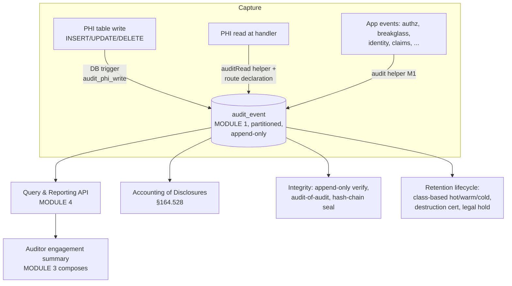
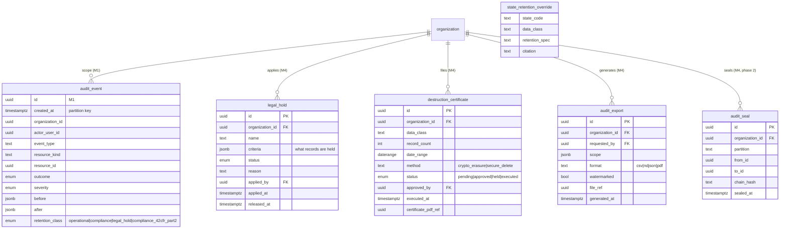
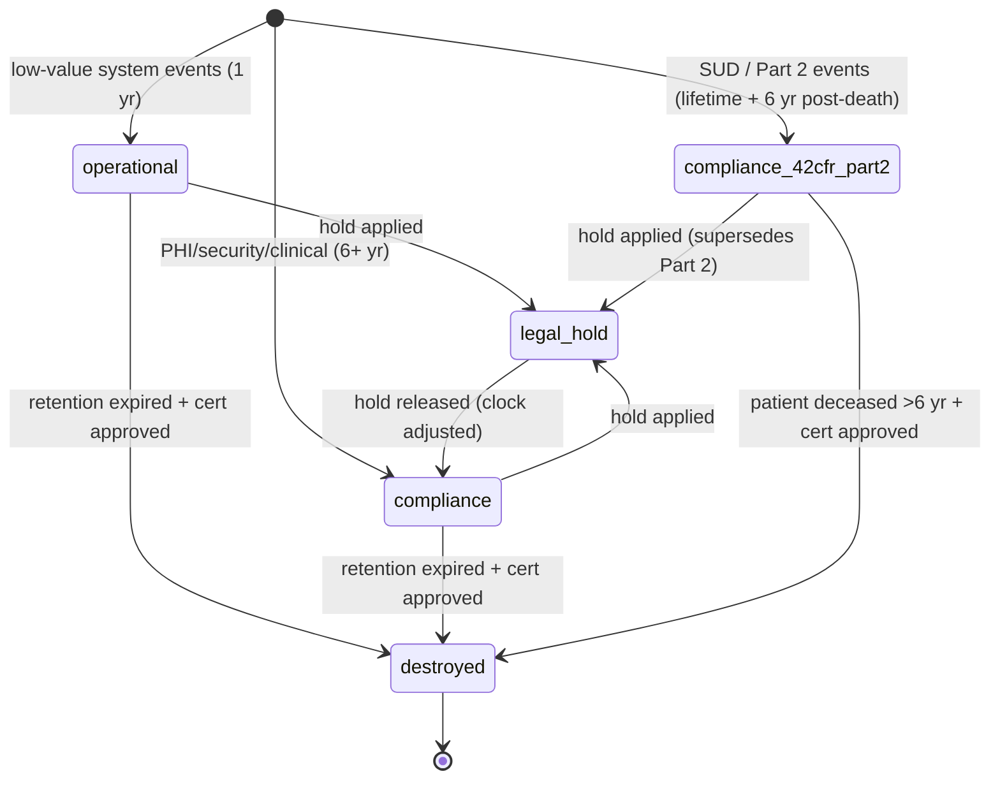
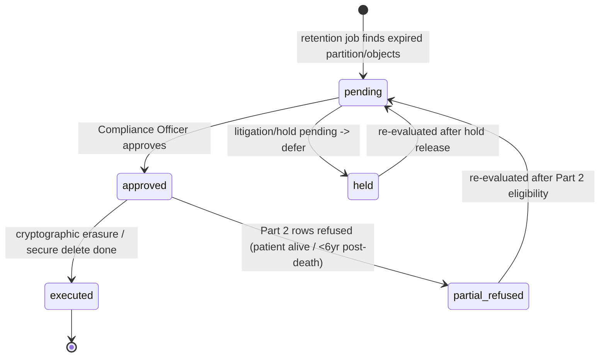
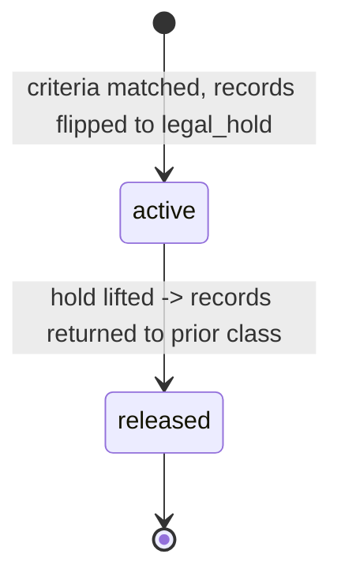

# Module 4 — Audit & Compliance Log Specification

> **Authority note:** This spec is an **implementation proposal** (repo authority rule): [`docs/architecture/`](../architecture/) and the ratified ADRs in [`docs/adr/`](../adr/) win on conflict, and the code plus [`docs/BUSINESS_LOGIC.md`](../BUSINESS_LOGIC.md) are ground truth for as-built behavior. Mechanism choices named here may be superseded — see ADR-0036…0040 and ADR-0030/0032/0035 for the recorded divergences (outbox not Socket.IO, TypeScript not Python sidecars, app-layer AES-256-GCM not pgcrypto, pure transition tables not XState, hand-rolled HTTP hardening not `@fastify/*`, Vite + react-router not TanStack Start).


**Module ID:** 4
**Phase:** 1 (foundation tier — lands immediately after Module 3, before Module 36 and the clinical modules)
**Owns:** `apps/backend/src/modules/04-audit`, `packages/audit`; the **capture/query/lifecycle layers over Module 1's `audit_event` table** (capture layers, query surface, retention/destruction policy — the `audit_event` *table itself* is M1-owned and helper-only, M04-F02), the destruction-certificate workflow, the `audit_denylist_catalog` + `audit_action_catalog` platform-shared tables, and the read-audit `auditRead` config consumed by every PHI route.
**Depends on:** 1 (Foundation — the partitioned `audit_event` table, append-only GRANT model, `audit()` insert helper, partition-rotation worker, RLS generator + `withOrgContext` via `packages/tenancy`, the **seam registry/`validateSeams()` in `apps/backend/src/bootstrap`**), 2 (Identity — actor resolution), 3 (Authorization — authorization decisions are audited; audit-read is itself a permissioned action). **M5/M29/M38/M22 data is consumed via boot-registered seams, NOT `dependsOn` edges** (ADR-0005 D1; M04-F01).
**Consumed by:** every PHI-bearing module (each installs write-audit triggers and declares read-audit on PHI routes). Direct consumers of the *query* surface: 30 (HQRP/Quality — survey readiness, incident review), 3 (auditor engagement summaries query this), 39 (consent — accounting of disclosures intersects), 34 (tenant offboarding destruction). Owner-module action consumers registering into the action catalog: 5 (patient mutator), 6 (admission applier), 11 (orders), 29 (HL7 / SUD hardening), 40 (MDM).
**Spec status:** Re-locked v0.5 (Phase-1 audit remediation; supersedes Locked v0.4)

> **Re-lock remediation banners (full disposition in the Remediation Changelog below):**
> - **M04-F01 — no cyclic reach-through.** The destruction eraser, Part 2 accounting, terminology
>   resolution, and certificate rendering must NOT import M5/M29/M38/M22 (each would create a cycle).
>   They are inverted to **boot-registered seams** whose interface types live in `packages/types` and
>   that M1's `validateSeams()` enforces (ADR-0005 D1; M01 §3.18): `PatientLifecycleProvider`
>   (alive / deceased-date, registered by M5), `SudClassResolver` (M29/M39), `CertificatePdfRenderer`
>   / tagged-PDF (M22), and terminology checks via the table-owning module's `conditional_check`
>   registration (M38). M4 declares **no** dependency on 5/29/38/22.
> - **M04-F05 / F07 — `packages/foundation` banned; no duplicate generators.** M4 logic lives only in
>   `packages/audit` + `apps/backend/src/modules/04-audit`; everywhere v0.4 says
>   `packages/foundation/src/audit-actions/...`, read `packages/audit/src/audit-actions/...`. The
>   trigger generator exists in exactly one place (`packages/audit/src/triggers/generate.ts`); RLS is
>   enabled by **consuming M1's TypeScript `generateRlsPolicy()`** at migration-authoring time — M4
>   does not call a SQL `wardenx_enable_rls()` function that M1's locked spec never ships (M04-F07).

## Changelog

- **v0.5 (Phase-1 audit remediation, 2026-06-11)** — Re-lock against `audit/AUDIT_M01_M04.md` and the Phase-0 ADRs. Clears the M04 BLOCKER (cyclic cross-module reach-through). See the **Remediation Changelog** below.
- **v0.4 (Consolidated)** — Rolls the v0.2 base and v0.3 delta into a single self-contained specification. No scope change; no decision reversals.
- **v0.3 (Locked)** — Consolidated the cross-cutting audit additions from the M29 implementation track and the M5/M6/M11/M40 v0.3 consumer specs. Added four capabilities all driven by upstream specs:
  - **New retention class `compliance_42cfr_part2`** (requested by M29 v0.3 §8.1 / T-29.11). Stricter than HIPAA `compliance` — indefinite during patient lifetime, then lifetime + 6 years from death. The destruction `eraseFn` (D4) refuses erasure during the patient's lifetime even when a destruction certificate is approved. §164.528 accounting surfaces Part 2 disclosures as a separate scope (per 42 CFR §2.13 patient accounting right which is broader than HIPAA's).
  - **Action catalog formalization** — replaced the generic `<resource>.created/updated/deleted` shape plus app-level events with the ratified **`mN.<resource>.<verb>[_from_<source>]`** convention used across M5/M6/M11/M29/M40 v0.3. Module owners register actions only under their `mN.` prefix; M4 boot-validates the namespace at registration time. The audit denylist generator consumes the per-action retention-class declaration.
  - **PHI denylist categories** — replaced the flat column-name denylist per trigger generation with three named categories — `pii_high_sensitivity` (SSN, financial account numbers), `sud_value` (lab_observation_value columns when the parent observation is SUD-class; requested by T-29.11 §8), `narrative_free_text` (clinical notes, rationales, addresses). The trigger generator API gained `denylistCategories: DenylistCategory[]` alongside the existing column-name list.
  - **Patient accounting endpoint differentiation** — split `GET /api/v1/audit/patients/:patientId/accounting` by scope: `?scope=hipaa_528 | part_2_13 | all` with different lookback semantics per scope (HIPAA = 6 years per D7; Part 2 = lifetime, no clamp).
  - **Four new decisions** — D8 (Part 2 retention class), D9 (action namespace convention), D10 (denylist categories), D11 (accounting scope parameter).
  - **Four new workflow acceptance criteria** — W-M4-08 (Part 2 audit row written, retention class enforced), W-M4-09 (eraser refuses Part 2 row during patient lifetime), W-M4-10 (Part 2 accounting returns disclosures lifetime-back), W-M4-11 (denylist category sud_value applied to lab_observation_value triggers).
  - **Four new implementation tasks** — T-M4-08 through T-M4-11. Retention values for `operational`/`compliance` unchanged; hash-chain seal still Phase 2.
- **v0.2 (Locked)** — Resolved all seven open questions into binding decisions (§11). Wrote full Drizzle for `audit_export` and `audit_seal`. Expanded §3.7 to complete migration DDL (`audit_scrub`, `wardenx_audit_writer`, all tables, RLS, seed). Added complete per-route TypeBox schemas (§4.3) and the exact permission-key set this module registers into Module 3 (§4.5). Updated sign-off to lock-grade. Phase boundary fixed: hash-chain seal is Phase 2; everything else is Phase 1.
- **v0.1** — Initial draft. Builds the full audit module on Module 1's `audit_event` foundation: trigger-based PHI **write** capture with before/after diffs, application-layer PHI **read** capture, the audit query/search surface, HIPAA §164.528 Accounting of Disclosures, integrity & tamper-evidence controls (append-only verification, audit-of-audit, optional hash-chain seal), and the retention / destruction-certification / legal-hold lifecycle from architecture §24.

## Remediation Changelog — Phase 1 (v0.5, 2026-06-11)

| Finding | Sev | Resolution |
|---|---|---|
| **M04-F01** | BLOCKER | Cyclic reach-through to M5/M29/M38/M22 **inverted to boot-registered seams** (`PatientLifecycleProvider`, `SudClassResolver`, `CertificatePdfRenderer`; terminology via the owner's `conditional_check`), interface types in `packages/types`, enforced by M1 `validateSeams()`. M4 declares no dependency on 5/29/38/22 (header banner; ADR-0005 D1). |
| M04-F02 | MAJOR | `audit_denylist_catalog` + `audit_action_catalog` added to manifest M4 `ownedTables`; header reworded — M4 owns the capture/query/lifecycle layers **over** M1's `audit_event` (the table stays M1-owned + helper-only). |
| M04-F03 | MAJOR | `eraseFn`/`DataEraser` registry + **boot-time fail-at-startup** specified via M1 §3.18 (`registerEraser`, `validateSeams()` fails if any PHI data class lacks an eraser); legal-hold propagation via a registered `HoldApplier` seam (§4.3, D4). |
| M04-F04 | MAJOR | Bulk-export gains SEC-052 controls: mandatory justification, 1/hr/user rate limit, 10k-record cap (elevated approval beyond), 24-h URL TTL, warn/critical severity + notification, step-up (§4.3 POST /exports). |
| M04-F05 | MAJOR | `packages/foundation` banned; M4 logic only in `packages/audit` + `apps/backend/src/modules/04-audit`; single trigger-generator location; no shadow `packages/db` writer (header banner; ADR-0005 D3). |
| M04-F06 | MAJOR | SECURITY DEFINER trigger: `ALTER FUNCTION … OWNER TO wardenx_audit_writer`, INSERT-only RLS policy for the writer role on `audit_event`, `SET search_path` hardening, SEC-006 review (§3.3 note). |
| M04-F07 | MAJOR | Migration consumes M1's **TypeScript** `generateRlsPolicy()` (emits SQL at authoring time); the spec no longer calls a nonexistent SQL `wardenx_enable_rls()` function (§3.7). |
| M04-F08 | MINOR | `partial_refused` added to the `destruction_status` enum (Drizzle + migration). |
| M04-F09 | MINOR | Part 2 accounting citation corrected to §2.25 / §2.13(d); lifetime-lookback ratified as policy; rationale-retention trade-off flagged to Privacy sign-off. |
| M04-F10 | MINOR | New queues declare retry/backoff/concurrency/DLQ; CMSR filed for `withOrgContext` to set `app.correlation_id`/`app.provider_entity_id`/`app.location_id` (or derive server-side) so the trigger context is not silently NULL. |
| M04-F11 | MINOR | Accounting route wires `state_retention_override` into lookback + honors `from`/`to` clamp; `actor_kind` derived from context, not hardcoded `'user'`. |
| M04-F12 | MINOR | STRIDE threat-model section added (audit log as insider-threat/tamper target); `Idempotency-Key` annotated per mutating route. |

> **Phase boundary (binding):** Phase 1 delivers everything in this spec **except** the hash-chain seal (`audit_seal` table, seal job, seal verification), which is Phase 2 per §14 D2. Per-PHI-table trigger installation happens in each consuming module's build via the generator shipped here; this spec is "done" when the generator, helpers, query/lifecycle/integrity surfaces, schema, and tests below are implemented — not gated on Modules 5–40 existing.

-----

## 1. Purpose & Scope

### 1.1 What This Module Does

Module 1 created the *place* audit lives (the append-only partitioned table and the `audit()` insert helper). Module 4 makes the audit log **complete, queryable, provably intact, and lifecycle-managed**:

- **PHI write capture (triggers).** A generated PostgreSQL trigger on every PHI table records `INSERT`/`UPDATE`/`DELETE` into `audit_event` with a PHI-scrubbed before/after diff. This is the guarantee that *no clinical mutation escapes the log*, even via a code path that forgot to call the helper.
- **PHI read capture (application layer).** DB-level read auditing is too expensive (architecture §7), so reads are captured at the resource handler — a `auditRead()` helper plus a route-level declaration — recording who viewed which patient's which fields, when. This is what powers Accounting of Disclosures.
- **Accounting of Disclosures (HIPAA §164.528).** A patient's right to an accounting of disclosures of their PHI. Module 4 turns the read/disclosure trail into the regulated report.
- **Audit query & reporting surface.** Permissioned search across actor, patient, resource, time, event type, outcome, severity — for Compliance, surveys, and incident investigation. Includes the data behind Module 3's auditor-engagement summaries.
- **Integrity & tamper-evidence.** Verifies the append-only GRANT model holds; emits the **audit-of-audit** meta-event on any elevated read of the audit table; cross-references against backups; provides an optional hash-chain seal (Phase 2) so any post-hoc modification is detectable.
- **Retention, destruction & legal hold.** Enforces the retention matrix (architecture §24) for the audit classes (`operational` 1 yr, `compliance` 6+ yr, `legal_hold` indefinite), drives partition hot→warm→cold tiering, runs the Certificate-of-Destruction workflow (§24.2), and applies/releases legal holds (§24.3) with state-variation overrides (§24.4).
- **42 CFR Part 2 audit retention enforcement.** Audit rows tagged with the `compliance_42cfr_part2` retention class follow stricter rules than HIPAA `compliance`: indefinite retention during patient lifetime, lifetime + 6 years afterward, and erasure refused even with an approved destruction certificate while the patient is alive. The Part 2 patient-accounting right (42 CFR §2.13) is broader than HIPAA's §164.528 — the accounting endpoint serves Part 2 disclosures over the patient's lifetime (no 6-year clamp), and Part 2 accounting requests themselves are audited at `compliance_42cfr_part2`.

### 1.2 What This Module Does Not Do

- **Define `audit_event` or the insert helper.** Module 1 owns the table, the `audit()` function, the append-only GRANT, and the partition-rotation worker *mechanism*. Module 4 owns the *capture layers above it*, the *query surface*, and the *retention/destruction policy* that drives the worker.
- **Decide authorization.** Module 3 decides; Module 4 records the decision. (Reading audit is itself gated by Module 3 permissions.)
- **Own non-audit data destruction.** Clinical-record / document / message destruction is executed by the owning modules (5/22/36) under the same §24 workflow; Module 4 owns the **audit-class** retention plus the *shared Certificate-of-Destruction artifact and approval workflow* those modules invoke.
- **Own consent.** Module 39 owns patient consent; Accounting of Disclosures consults consent context but does not manage it.
- **Scrub logs / metrics.** Pino redaction and OTel attribute filtering are Module 1; Module 4 relies on them and adds the diff-scrubbing for trigger payloads.
- **Store PHI in audit payloads.** Only scrubbed diffs and structured metadata are persisted; Module 4 makes no clinical decisions.

### 1.3 Regulatory Drivers

| Driver | Requirement | How Module 4 satisfies it |
|---|---|---|
| HIPAA §164.312(b) — Audit controls | Record and examine activity in systems with ePHI | Trigger write-capture + app read-capture + query surface |
| HIPAA §164.316(b)(2) — Retention | Retain documentation 6 years | `compliance` retention class, 6+ yr, partition lifecycle |
| HIPAA §164.528 — Accounting of Disclosures | Patient accounting of PHI disclosures | Disclosure report from read/disclosure trail |
| HIPAA §164.308(a)(1)(ii)(D) — Information system activity review | Regular review of audit logs | Compliance console + review workflows + anomaly metrics |
| HIPAA §164.310(d)(2)(i) — Media disposal | Documented PHI destruction | Certificate of Destruction workflow (§24.2) |
| 42 CFR Part 2 §2.13 — Patient accounting right | Patient right to accounting of SUD disclosures (broader than HIPAA) | `compliance_42cfr_part2` retention class + lifetime-lookback Part 2 accounting scope |
| 21 CFR Part 11 (principles, not directly applicable) | Append-only, attributed, timestamped | Append-only GRANT + actor attribution + tamper-evidence |
| State retention law (e.g. ORS 192.553) | Longer retention where required | `state_retention_override` table (§24.4) |
| Litigation hold obligations | Preserve relevant records | Legal-hold class skips destruction (§24.3) |

### 1.4 Competitive Context

Most hospice EHRs log *something* but make it hard to answer the two questions surveyors and patients actually ask: "show me everyone who touched this chart" and "prove this log wasn't altered." WardenX's differentiators are **trigger-enforced write capture** (no missed mutation), **first-class Accounting of Disclosures**, and **provable integrity** (append-only GRANT today, hash-chain seal next) — plus a destruction workflow that produces the documented Certificate of Destruction HIPAA requires, rather than a silent cron delete.

-----

## 2. Domain Model

### 2.1 Capture Architecture

Two capture paths feed the one Module 1 table; Module 4 adds the query, integrity, and lifecycle layers on top.



### 2.2 Entity-Relationship Diagram

`audit_event` is Module 1's. Module 4 adds the lifecycle/integrity tables.



### 2.3 What Gets Captured (the canonical record)

Every event carries (architecture §7 audit log): actor, organization, provider_entity & location (in `context`), action (`event_type`), resource kind & id, before/after diff (scrubbed), source IP, user agent, timestamp, correlation_id. Module 4 standardizes the **`event_type` taxonomy** and the **diff-scrub rules**.

The action taxonomy follows the **`mN.<resource>.<verb>[_from_<source>]`** convention (§14 D9): every module registers its actions under its own `mN.` prefix, the optional `_from_<source>` suffix marks external-event-driven actions, and system actions stay un-prefixed (`audit.*`, `data.*`). M4 boot-validates the namespace and publishes a queryable `ActionCatalog` (§4).

| Capture path | event_type pattern | before/after | retention default |
|---|---|---|---|
| Trigger — write | `<resource>.created/updated/deleted` | scrubbed column diff | compliance |
| App — read | `<resource>.viewed` / `.disclosed` | none (read) — fields list in `context` | compliance |
| App — auth | `auth.*` (Module 2) | none | security→compliance |
| App — authz/break-glass | `authz.*`, `breakglass.*` (Module 3) | none | compliance/critical |
| App — clinical/billing | `encounter.signed`, `claim.submitted`, … | scrubbed where applicable | compliance |
| App — SUD / Part 2 | `sud.*`, `m29.lab_observation.sud_status_changed` | scrubbed (`sud_value`) | compliance_42cfr_part2 |
| System | `audit.partition_*`, `data.destruction_certified`, `data.legal_hold_*` | none | operational/compliance |

**Diff scrubbing:** the trigger writes a column-level diff but replaces the *values* of columns tagged `high_sensitivity` (SSN, narrative free-text, financial account numbers) with a change-marker (`"<changed>"`) — the *fact* of change is audited, the sensitive value is not duplicated into the log. The list of scrubbed columns is declared per table alongside the trigger, expressed through the three named denylist categories (`pii_high_sensitivity`, `sud_value`, `narrative_free_text`) plus any explicit column-name list (§3, §5; §14 D10).

### 2.4 Entity Lifecycle States

#### 2.4.1 Audit event retention class (drives lifecycle, not editability)

The row is **immutable**; only its *retention_class* can be re-pointed by the legal-hold workflow (a class change is itself audited and executed by a privileged path, not the app role).



#### 2.4.2 Destruction certificate



#### 2.4.3 Legal hold



### 2.5 Validation Rules

| Rule | Type | Detail |
|---|---|---|
| Append-only | infra (GRANT) | `wardenx_app` has only INSERT, SELECT on `audit_event`; no UPDATE/DELETE (Security Hardening T6) |
| No PHI value duplication | sync (trigger) | high-sensitivity columns scrubbed to change-markers in diffs |
| Read-audit completeness | build-time lint | every PHI resource route must declare `auditRead` or an explicit `auditRead: none` justification |
| Retention class valid | sync | one of operational/compliance/legal_hold/compliance_42cfr_part2 |
| Destruction requires approval | workflow | no PHI destruction without an `approved` certificate; held if hold active |
| Legal hold supremacy | sync | retention jobs skip `legal_hold` records unconditionally; a legal hold also supersedes Part 2 retention and locks indefinitely |
| Part 2 erasure refusal | sync | `compliance_42cfr_part2` rows are not erased while patient is alive or within 6 years post-death, even with an approved certificate (§14 D8) |
| State override resolution | sync | patient address-state override applies if longer than default (§24.4) |
| Elevated/cross-tenant read logs meta | sync | any platform-role or cross-tenant audit read emits `audit.elevated_access` |
| Accounting completeness | invariant | every PHI read/disclosure of a patient is queryable for that patient's accounting |
| Action namespace ownership | boot-time | a module may register actions only under its own `mN.` prefix; M4 boot refuses cross-module action names (§14 D9) |
| Action registered | runtime | every action used in code must exist in `audit_action_catalog`; unregistered actions fail the audit-write call |

### 2.6 Side Effects

| Trigger | Side effect |
|---|---|
| PHI row written | trigger inserts scrubbed-diff `audit_event` (same transaction → atomic with the change) |
| PHI resource read | `auditRead` records a `.viewed`/`.disclosed` event post-authorization |
| Audit table read by elevated/cross-tenant actor | `audit.elevated_access` meta-event emitted; cross-tenant requires Module 3 break-glass + consent |
| Retention job finds expired data | create `destruction_certificate` (pending); pre-destruction report generated |
| Certificate approved | partition detached + cryptographically erased; `data.destruction_certified` emitted; certificate stored in compliance class |
| Part 2 row reached by destruction batch while patient alive / <6yr post-death | eraser refuses; `audit.destruction_refused_part_two` emitted; certificate moves to `partial_refused` |
| Legal hold applied/released | matching records' retention_class flipped; outbox event `m4.legal_hold.applied`/`m4.legal_hold.released` emitted (audit action: `data.legal_hold_applied`/`_released`) |
| Seal job runs (Phase 2) | compute chain hash over a closed partition; store `audit_seal` checkpoint |
| Accounting requested for a patient | compile disclosure report; emit `disclosure.accounting_generated`; the request itself is audited at the matching retention class (`compliance` for HIPAA scope, `compliance_42cfr_part2` for Part 2 scope) |

-----
## 3. Drizzle Schema

### 3.1 Package Layout

```
packages/audit/
├── src/
│   ├── triggers/
│   │   ├── generate.ts        # emits audit_phi_write trigger DDL for a table + denylist
│   │   └── scrub.ts           # high-sensitivity column denylist resolution
│   ├── read/
│   │   ├── audit-read.ts      # auditRead() helper
│   │   └── require-read-audit.ts  # route declaration + lint hook
│   ├── query/                 # search, filters, pagination, accounting-of-disclosures
│   ├── retention/             # class lifecycle, destruction cert workflow, legal hold, state overrides
│   ├── integrity/             # append-only verify, elevated-access meta, hash-chain seal (phase 2)
│   └── export/                # csv/ndjson/pdf compliance exports
packages/db/src/schema/
├── legal-holds.ts
├── destruction-certificates.ts
├── state-retention-overrides.ts
├── audit-exports.ts
├── audit-seals.ts             # phase 2
└── audit/
    ├── enums.ts               # auditRetentionClass, phiDenylistCategory
    ├── denylist-catalog.ts    # audit_denylist_catalog
    └── action-catalog.ts      # audit_action_catalog
packages/foundation/src/audit-actions/   # per-module action catalog registry (§4)
```

### 3.2 Enums

```typescript
// additions to packages/db/src/enums.ts
export const legalHoldStatus = pgEnum('legal_hold_status', ['active','released'])
export const destructionStatus = pgEnum('destruction_status', ['pending','approved','held','executed','partial_refused']) // M04-F08: partial_refused required by the §2.4.2 state machine / §6 eraser / W-M4-09
export const auditExportFormat = pgEnum('audit_export_format', ['csv','ndjson','pdf'])
// auditRetentionClass (operational|compliance|legal_hold|compliance_42cfr_part2), auditOutcome, auditSeverity,
// auditActorKind: auditRetentionClass's base values + outcome/severity/actorKind defined in Module 1;
// the compliance_42cfr_part2 value is added by migration 0035 (§3.7.1).
```

The audit retention-class enum and the new PHI denylist-category enum are declared in the audit schema package:

```typescript
// packages/db/src/schema/audit/enums.ts (updated)
export const auditRetentionClass = pgEnum('audit_retention_class', [
  'operational', 'compliance', 'legal_hold',
  'compliance_42cfr_part2',
])

export const phiDenylistCategory = pgEnum('phi_denylist_category', [
  'pii_high_sensitivity', 'sud_value', 'narrative_free_text',
])
```

### 3.3 PHI Write-Audit Trigger Generator

The mechanism that guarantees no clinical mutation escapes the log. Every PHI module calls this in its migration, the same way it calls Module 1's RLS generator.

```typescript
// packages/audit/src/triggers/generate.ts
/**
 * Emits a trigger + function that writes a scrubbed before/after diff to audit_event
 * on INSERT/UPDATE/DELETE. `denylist` columns have values replaced with '<changed>'.
 */
export function generateAuditTrigger(opts: {
  table: string
  resourceKind: string            // event_type prefix, e.g. 'encounter'
  denylist: string[]              // high-sensitivity columns: values not copied into diff
  denylistCategories?: ('pii_high_sensitivity' | 'sud_value' | 'narrative_free_text')[]  // named categories resolved per audit_denylist_catalog
  retentionClass?: 'operational' | 'compliance' | 'compliance_42cfr_part2'
}): string
```

```sql
-- generated shape (per PHI table) — runs as table owner, not wardenx_app
CREATE OR REPLACE FUNCTION audit_phi_write_<table>() RETURNS trigger
LANGUAGE plpgsql SECURITY DEFINER AS $$
DECLARE
  v_before jsonb; v_after jsonb;
BEGIN
  v_before := CASE WHEN TG_OP IN ('UPDATE','DELETE')
    THEN audit_scrub(to_jsonb(OLD), '<denylist>'::text[]) ELSE NULL END;
  v_after  := CASE WHEN TG_OP IN ('INSERT','UPDATE')
    THEN audit_scrub(to_jsonb(NEW), '<denylist>'::text[]) ELSE NULL END;
  INSERT INTO audit_event(
    organization_id, actor_user_id, actor_kind, event_type, resource_kind,
    resource_id, correlation_id, outcome, severity, before, after,
    context, retention_class)
  VALUES (
    COALESCE(NEW.organization_id, OLD.organization_id),
    NULLIF(current_setting('app.user_id', true),'')::uuid,
    'user',
    '<resourceKind>.' || lower(TG_OP),
    '<resourceKind>',
    COALESCE(NEW.id, OLD.id),
    COALESCE(current_setting('app.correlation_id', true),'system'),
    'success', 'info', v_before, v_after,
    jsonb_build_object('provider_entity_id', current_setting('app.provider_entity_id', true),
                       'location_id', current_setting('app.location_id', true)),
    '<retentionClass>');
  RETURN COALESCE(NEW, OLD);
END $$;

CREATE TRIGGER trg_audit_<table>
  AFTER INSERT OR UPDATE OR DELETE ON <table>
  FOR EACH ROW EXECUTE FUNCTION audit_phi_write_<table>();
```

> **Why SECURITY DEFINER:** `wardenx_app` cannot INSERT-with-impunity into a foreign partition or bypass the append-only model, but the trigger must always succeed even though the app role's own grants are minimal. The function is owned by a dedicated `wardenx_audit_writer` role with INSERT-only on `audit_event`, and the trigger runs as definer. The app role still has no UPDATE/DELETE anywhere.
>
> **M04-F06 — make the definer machinery actually work (and not over-privileged).** The migration MUST:
> 1. `ALTER FUNCTION <trigger_fn>() OWNER TO wardenx_audit_writer;` — otherwise the function is owned
>    by the migration-runner (`wardenx_admin`) and SECURITY DEFINER executes with **full admin rights**
>    (RLS-bypassing, UPDATE/DELETE-capable) on every PHI write.
> 2. Give `wardenx_audit_writer` an **INSERT-only RLS policy** on `audit_event`
>    (`CREATE POLICY audit_writer_insert ON audit_event FOR INSERT TO wardenx_audit_writer WITH CHECK (true);`)
>    — `audit_event` has RLS enabled (M1) with policies only `TO wardenx_app`, so without this the
>    definer's inserts are **denied**. (No `BYPASSRLS` — the targeted INSERT policy is the least-privilege
>    path; if `BYPASSRLS` is ever used it requires explicit SEC-006 Security-Owner justification.)
> 3. Harden every definer function with `SET search_path = pg_catalog, public` (standard PG
>    SECURITY DEFINER hardening). The same applies to `audit_scrub`.
> 4. Route to Security-Owner review per SEC-006/SEC-056.

The `denylist` baked into a generated trigger is the union of the explicit column-name list and the columns resolved from `denylistCategories` against `audit_denylist_catalog` (§5.1). The `sud_value` category resolves to a **row-conditional** scrub expression rather than a static column (§5.2).

### 3.4 Read-Audit Helper

```typescript
// packages/audit/src/read/audit-read.ts
export async function auditRead(ctx: RequestContext, input: {
  resourceKind: string
  resourceId: string
  patientId?: string            // enables Accounting of Disclosures join
  fields?: string[]             // which fields were surfaced (context only — no values)
  disclosure?: { to: string; purpose: string }  // set when this read is an external disclosure
}): Promise<void>
```

- Called **after** authorization succeeds, in the resource handler / preSerialization hook. Records `<resource>.viewed`, or `<resource>.disclosed` when `disclosure` is present (the §164.528-reportable case).
- For high-volume *list* reads, records one aggregate event (`patient.list_viewed`, count + filter in `context`) rather than one per row; **individual chart opens are always recorded individually** (that is the accounting-relevant access).

### 3.5 Lifecycle, Integrity, and Catalog Tables

```typescript
// legal-holds.ts
export const legalHolds = pgTable('legal_hold', {
  id: uuid('id').primaryKey().defaultRandom(),
  organizationId: uuid('organization_id').notNull().references(() => organizations.id),
  name: text('name').notNull(),
  criteria: jsonb('criteria').notNull(),       // {patientIds?, dateRange?, resourceKinds?, ...}
  status: legalHoldStatus('status').notNull().default('active'),
  reason: text('reason').notNull(),
  appliedBy: uuid('applied_by').references(() => users.id),
  appliedAt: timestamp('applied_at',{withTimezone:true}).notNull().defaultNow(),
  releasedAt: timestamp('released_at',{withTimezone:true}),
}, (t) => ({ orgIdx: index('legal_hold_org_idx').on(t.organizationId) }))

// destruction-certificates.ts
export const destructionCertificates = pgTable('destruction_certificate', {
  id: uuid('id').primaryKey().defaultRandom(),
  organizationId: uuid('organization_id').notNull().references(() => organizations.id),
  dataClass: text('data_class').notNull(),
  recordCount: integer('record_count').notNull(),
  dateRangeStart: timestamp('date_range_start',{withTimezone:true}).notNull(),
  dateRangeEnd: timestamp('date_range_end',{withTimezone:true}).notNull(),
  method: text('method').notNull(),            // crypto_erasure | secure_delete
  status: destructionStatus('status').notNull().default('pending'),
  approvedBy: uuid('approved_by').references(() => users.id),
  executedAt: timestamp('executed_at',{withTimezone:true}),
  certificatePdfRef: uuid('certificate_pdf_ref'),  // MinIO doc id
  createdAt: timestamp('created_at',{withTimezone:true}).notNull().defaultNow(),
}, (t) => ({ orgIdx: index('destruction_cert_org_idx').on(t.organizationId) }))

// state-retention-overrides.ts  (platform reference; no org column)
export const stateRetentionOverrides = pgTable('state_retention_override', {
  stateCode: text('state_code').notNull(),
  dataClass: text('data_class').notNull(),
  retentionSpec: text('retention_spec').notNull(),  // '7y' | 'until_age_21+7' | ...
  citation: text('citation').notNull(),
}, (t) => ({ pk: primaryKey({ columns: [t.stateCode, t.dataClass] }) }))

// audit-exports.ts
export const auditExports = pgTable('audit_export', {
  id: uuid('id').primaryKey().defaultRandom(),
  organizationId: uuid('organization_id').notNull().references(() => organizations.id, { onDelete: 'cascade' }),
  requestedBy: uuid('requested_by').notNull().references(() => users.id, { onDelete: 'set null' }),
  scope: jsonb('scope').notNull(),              // {patientIds?, actorIds?, resourceKinds?, eventTypes?, from, to}
  format: auditExportFormat('format').notNull(),
  watermarked: boolean('watermarked').notNull().default(true),
  fileRef: uuid('file_ref'),                    // MinIO object id (null until job completes)
  recordCount: integer('record_count'),
  status: text('status').notNull().default('pending'), // pending|building|ready|failed
  requestedAt: timestamp('requested_at', { withTimezone: true }).notNull().defaultNow(),
  generatedAt: timestamp('generated_at', { withTimezone: true }),
  expiresAt: timestamp('expires_at', { withTimezone: true }).notNull(), // export artifact TTL (default +7d)
}, (t) => ({
  orgIdx: index('audit_export_org_idx').on(t.organizationId),
  statusIdx: index('audit_export_status_idx').on(t.status),
}))
export type AuditExport = typeof auditExports.$inferSelect

// audit-seals.ts  (Phase 2 — created behind feature flag `audit_hash_chain_enabled`)
export const auditSeals = pgTable('audit_seal', {
  id: uuid('id').primaryKey().defaultRandom(),
  organizationId: uuid('organization_id').references(() => organizations.id, { onDelete: 'restrict' }),
  partition: text('partition').notNull(),       // e.g. 'audit_event_2026_06'
  fromId: uuid('from_id').notNull(),            // first event id covered (inclusive)
  toId: uuid('to_id').notNull(),                // last event id covered (inclusive)
  eventCount: integer('event_count').notNull(),
  prevChainHash: text('prev_chain_hash'),       // links to prior seal (null = genesis)
  chainHash: text('chain_hash').notNull(),      // sha-256 over ordered event hashes + prev_chain_hash
  algorithm: text('algorithm').notNull().default('sha256'),
  sealedAt: timestamp('sealed_at', { withTimezone: true }).notNull().defaultNow(),
}, (t) => ({
  partitionUnique: uniqueIndex('audit_seal_partition_idx').on(t.organizationId, t.partition),
  chainIdx: index('audit_seal_chain_idx').on(t.sealedAt),
}))
export type AuditSeal = typeof auditSeals.$inferSelect

// packages/db/src/schema/audit/denylist-catalog.ts  (platform-shared)
export const auditDenylistCatalog = pgTable('audit_denylist_catalog', {
  id: uuid('id').primaryKey().defaultRandom(),
  tableName: text('table_name').notNull(),
  columnName: text('column_name').notNull(),
  category: phiDenylistCategory('category').notNull(),
  conditionalCheck: text('conditional_check'),
  registeredByModule: text('registered_by_module').notNull(),
  declaredAt: timestamp('declared_at').notNull().defaultNow(),
})

// packages/db/src/schema/audit/action-catalog.ts  (platform-shared)
export const auditActionCatalog = pgTable('audit_action_catalog', {
  action: text('action').primaryKey(),
  moduleOwner: text('module_owner').notNull(),
  defaultRetentionClass: auditRetentionClass('default_retention_class').notNull(),
  description: text('description').notNull(),
  denylistCategories: phiDenylistCategory('denylist_categories').array().notNull().default([]),
  isPartTwoEligible: boolean('is_part_two_eligible').notNull().default(false),
  registeredAt: timestamp('registered_at').notNull().defaultNow(),
})
```

### 3.6 RLS & Grants

| Table | Policy / grant |
|---|---|
| `audit_event` (M1) | append-only: `wardenx_app` = INSERT, SELECT only; trigger writer = INSERT only; **no UPDATE/DELETE anywhere**. RLS scopes SELECT to `app.org_id`. Reading audit requires Module 3 `audit.read`. |
| `legal_hold`, `destruction_certificate`, `audit_export` | org-scoped via generator; managed actions require Compliance permissions |
| `state_retention_override` | platform reference, read-all; write `platform_ops` |
| `audit_denylist_catalog`, `audit_action_catalog` | platform-shared reference, read-all; writes via M4 boot/migration under the platform role |
| Retention class re-point | executed by a privileged migration/worker role, never `wardenx_app`; each change audited |
| Partition detach/erase | executed by partition worker (Module 1 mechanism) under destruction-certificate approval; `compliance_42cfr_part2` rows refused per the eraser (§6) |

### 3.7 Migration

```sql
-- migrations/0004_audit.sql (forward-only, two-phase per architecture §25)

-- 1. Enums
CREATE TYPE legal_hold_status AS ENUM ('active','released');
CREATE TYPE destruction_status AS ENUM ('pending','approved','held','executed','partial_refused'); -- M04-F08
CREATE TYPE audit_export_format AS ENUM ('csv','ndjson','pdf');

-- 2. Dedicated capture role: INSERT-only on audit_event, owns the trigger functions.
CREATE ROLE wardenx_audit_writer NOLOGIN;
GRANT INSERT ON audit_event TO wardenx_audit_writer;
-- (wardenx_app retains only INSERT, SELECT on audit_event from migration 0000; no UPDATE/DELETE anywhere)

-- 3. Scrub helper: replaces denylisted column values with the marker '<changed>'.
CREATE OR REPLACE FUNCTION audit_scrub(doc jsonb, denylist text[])
RETURNS jsonb LANGUAGE sql IMMUTABLE AS $$
  SELECT COALESCE(
    (SELECT jsonb_object_agg(k, CASE WHEN k = ANY(denylist) THEN '"<changed>"'::jsonb ELSE v END)
     FROM jsonb_each(doc) AS e(k, v)),
    '{}'::jsonb);
$$;

-- 4. Lifecycle tables
CREATE TABLE legal_hold (
  id uuid PRIMARY KEY DEFAULT gen_random_uuid(),
  organization_id uuid NOT NULL REFERENCES organization(id) ON DELETE CASCADE,
  name text NOT NULL,
  criteria jsonb NOT NULL,
  status legal_hold_status NOT NULL DEFAULT 'active',
  reason text NOT NULL,
  applied_by uuid REFERENCES "user"(id) ON DELETE SET NULL,
  applied_at timestamptz NOT NULL DEFAULT now(),
  released_at timestamptz
);
CREATE INDEX legal_hold_org_idx ON legal_hold(organization_id);

CREATE TABLE destruction_certificate (
  id uuid PRIMARY KEY DEFAULT gen_random_uuid(),
  organization_id uuid NOT NULL REFERENCES organization(id) ON DELETE RESTRICT,
  data_class text NOT NULL,
  record_count integer NOT NULL,
  date_range_start timestamptz NOT NULL,
  date_range_end timestamptz NOT NULL,
  method text NOT NULL CHECK (method IN ('crypto_erasure','secure_delete')),
  status destruction_status NOT NULL DEFAULT 'pending',
  approved_by uuid REFERENCES "user"(id) ON DELETE SET NULL,
  executed_at timestamptz,
  certificate_pdf_ref uuid,
  created_at timestamptz NOT NULL DEFAULT now()
);
CREATE INDEX destruction_cert_org_idx ON destruction_certificate(organization_id);

CREATE TABLE state_retention_override (
  state_code text NOT NULL,
  data_class text NOT NULL,
  retention_spec text NOT NULL,
  citation text NOT NULL,
  PRIMARY KEY (state_code, data_class)
);

CREATE TABLE audit_export (
  id uuid PRIMARY KEY DEFAULT gen_random_uuid(),
  organization_id uuid NOT NULL REFERENCES organization(id) ON DELETE CASCADE,
  requested_by uuid NOT NULL REFERENCES "user"(id) ON DELETE SET NULL,
  scope jsonb NOT NULL,
  format audit_export_format NOT NULL,
  watermarked boolean NOT NULL DEFAULT true,
  file_ref uuid,
  record_count integer,
  status text NOT NULL DEFAULT 'pending',
  requested_at timestamptz NOT NULL DEFAULT now(),
  generated_at timestamptz,
  expires_at timestamptz NOT NULL
);
CREATE INDEX audit_export_org_idx ON audit_export(organization_id);
CREATE INDEX audit_export_status_idx ON audit_export(status);

-- 5. Phase 2 seal table (created now, written only when audit_hash_chain_enabled)
CREATE TABLE audit_seal (
  id uuid PRIMARY KEY DEFAULT gen_random_uuid(),
  organization_id uuid REFERENCES organization(id) ON DELETE RESTRICT,
  partition text NOT NULL,
  from_id uuid NOT NULL,
  to_id uuid NOT NULL,
  event_count integer NOT NULL,
  prev_chain_hash text,
  chain_hash text NOT NULL,
  algorithm text NOT NULL DEFAULT 'sha256',
  sealed_at timestamptz NOT NULL DEFAULT now()
);
CREATE UNIQUE INDEX audit_seal_partition_idx ON audit_seal(organization_id, partition);
CREATE INDEX audit_seal_chain_idx ON audit_seal(sealed_at);

-- 6. RLS (org-scoped tables) via Module 1's generator.
-- M04-F07: M1 ships a *TypeScript* generator `generateRlsPolicy()` (packages/tenancy) that emits the
-- policy SQL at migration-authoring time — it does NOT ship a SQL function `wardenx_enable_rls()`.
-- These lines are therefore the SQL *emitted by* `generateRlsPolicy('<table>')` and inlined into this
-- migration (same usage as the trigger generator in §3.3), not calls to a nonexistent DB function:
--   generateRlsPolicy('legal_hold'), ('destruction_certificate'), ('audit_export'), ('audit_seal')
-- each expands to `ALTER TABLE … ENABLE ROW LEVEL SECURITY;` + the standard
-- `organization_id = current_setting('app.org_id')::uuid` USING/WITH CHECK policy for wardenx_app.
-- state_retention_override: no RLS (platform reference, read-all; writes restricted by GRANT)
REVOKE INSERT, UPDATE, DELETE ON state_retention_override FROM wardenx_app;

-- 7. Seed state overrides (architecture §24.4; extend per tenant geography)
INSERT INTO state_retention_override (state_code, data_class, retention_spec, citation) VALUES
  ('OR','clinical_record','7y','ORS 192.553'),
  ('TX','clinical_record_minor','until_age_21+7','Tex. Health & Safety Code §241.103');
```

> The per-PHI-table write-audit triggers (§3.3) are **not** in this migration — each consuming module installs its own via `generateAuditTrigger()` in that module's migration, the same way each calls Module 1's RLS generator. `0004` ships the *capability*; installation is distributed.

#### 3.7.1 Migration `0035_m4_v03_part_two_and_catalog.sql`

The Part 2 retention class, the denylist-category registry, and the action catalog land in a later migration:

```sql
-- Migration 0035_m4_v03_part_two_and_catalog.sql

-- Phase A: extend audit_retention_class enum
ALTER TYPE audit_retention_class ADD VALUE 'compliance_42cfr_part2';

-- Phase B: PHI denylist category registry (platform-shared)
CREATE TYPE phi_denylist_category AS ENUM (
  'pii_high_sensitivity', 'sud_value', 'narrative_free_text'
);

CREATE TABLE audit_denylist_catalog (
  id UUID PRIMARY KEY DEFAULT gen_random_uuid(),
  table_name TEXT NOT NULL,
  column_name TEXT NOT NULL,
  category phi_denylist_category NOT NULL,
  conditional_check TEXT,                         -- optional SQL expression evaluated at trigger fire time (for row-conditional categories like sud_value)
  registered_by_module TEXT NOT NULL,             -- 'm5', 'm29', etc.; the module that owns the table
  declared_at TIMESTAMPTZ NOT NULL DEFAULT NOW(),
  UNIQUE (table_name, column_name, category)
);

CREATE INDEX idx_denylist_catalog_table ON audit_denylist_catalog (table_name);

-- Seed the v0.2 implicit denylist (formalizing the existing per-table lists)
-- Each module's migration will INSERT its own rows; the seed below is a baseline
-- for M5 (per D6 — SSN, state_id are envelope-encrypted PII).
INSERT INTO audit_denylist_catalog (table_name, column_name, category, registered_by_module) VALUES
  ('patient_identifier', 'value_encrypted', 'pii_high_sensitivity', 'm5'),
  ('patient', 'ssn_last4', 'pii_high_sensitivity', 'm5'),
  -- M22 narrative columns (referenced in §2.3)
  ('clinical_note', 'narrative_text', 'narrative_free_text', 'm22'),
  -- M11 narrative columns (per D10)
  ('order_record', 'data', 'narrative_free_text', 'm11')
ON CONFLICT (table_name, column_name, category) DO NOTHING;

-- Phase C: Action catalog (platform-shared)
CREATE TABLE audit_action_catalog (
  action TEXT PRIMARY KEY,                        -- 'mN.resource.verb[_from_source]' or 'audit.*' / 'data.*'
  module_owner TEXT NOT NULL,                     -- 'm0' for system actions; 'mN' otherwise
  default_retention_class audit_retention_class NOT NULL,
  description TEXT NOT NULL,
  denylist_categories phi_denylist_category[] NOT NULL DEFAULT '{}'::phi_denylist_category[],
  is_part_two_eligible BOOLEAN NOT NULL DEFAULT FALSE,  -- true → may be tagged compliance_42cfr_part2 at write time
  registered_at TIMESTAMPTZ NOT NULL DEFAULT NOW()
);

CREATE INDEX idx_audit_action_catalog_module ON audit_action_catalog (module_owner);
CREATE INDEX idx_audit_action_catalog_retention ON audit_action_catalog (default_retention_class);

-- Boot validation: every action used in code must be registered in this catalog.
-- The M4 startup sequence loads packages/foundation/src/audit-actions/registry.ts
-- and INSERTs missing entries (idempotent).
```

The existing `audit_event.retention_class` column already permits the new enum value (additive enum extension); there are no structural changes to the partitioned table and no new indexes — the existing partition strategy + `retention_class` filter handles Part 2 queries efficiently. The row-conditional `sud_value` denylist seed for `lab_observation_value` is shown in §5.2.

-----
## 4. API Routes

### 4.1 The Capture Contract (consumed by ALL PHI modules)

Like Module 3's authz contract, Module 4 ships obligations every other module fulfills:

1. **Write capture** — every PHI table's migration calls `generateAuditTrigger({table, resourceKind, denylist, denylistCategories?})`. Verified by an integration test that mutates each PHI table and asserts a matching `audit_event` row.
2. **Read capture** — every PHI resource route declares `auditRead` (or `auditRead:none` with justification). Enforced by a Biome lint rule `require-read-audit`.
3. **Action registration** — every module registers its audit actions in its `packages/foundation/src/audit-actions/mN.ts` catalog file under its own `mN.` prefix (§4.6). M4 boot-validates the namespace and refuses startup on a violation.

```typescript
fastify.route({
  method:'GET', url:'/api/v1/patients/:id',
  preHandler:[authenticate, requirePermission('patient.read'),
              requireAbac('patient.read','caseload_or_scope')],
  config: { auditRead: { resourceKind:'patient', patientIdParam:'id' } }, // Module 4 records post-authz
  handler: (req,reply) => withOrgContext(db, req.context, async (tx)=>{ /* ... */ }),
})
```

### 4.2 Route Inventory

| Method | Path | Permission | Notes |
|---|---|---|---|
| GET | `/api/v1/audit/events` | `audit.read` | search: filters actor/patient/resource/type/outcome/severity/time; cursor-paginated |
| GET | `/api/v1/audit/events/:id` | `audit.read` | single event detail (diff) |
| GET | `/api/v1/audit/patients/:patientId/access` | `audit.read` | who-accessed-this-chart (internal access history) |
| GET | `/api/v1/audit/patients/:patientId/accounting` | `audit.disclosure_report` | **§164.528 / §2.13 Accounting of Disclosures** (`?scope=hipaa_528\|part_2_13\|all`; `all` also requires `audit.disclosure_report_all_scopes`) |
| POST | `/api/v1/audit/exports` | `audit.export` | generate watermarked csv/ndjson/pdf for scope |
| GET | `/api/v1/audit/exports/:id` | `audit.export` | retrieve generated export |
| GET | `/api/v1/legal-holds` | `legalhold.read` | list holds |
| POST | `/api/v1/legal-holds` | `legalhold.manage` | apply hold (criteria, reason) → flips matching records |
| POST | `/api/v1/legal-holds/:id/release` | `legalhold.manage` | release; records return to prior class |
| GET | `/api/v1/destruction-certificates` | `destruction.read` | pending/approved/executed |
| POST | `/api/v1/destruction-certificates/:id/approve` | `destruction.approve` | Compliance approves a pending destruction |
| POST | `/api/v1/destruction-certificates/:id/hold` | `destruction.approve` | defer (litigation) |
| GET | `/api/v1/audit/integrity/report` | `audit.integrity` | append-only verification + (phase 2) seal-chain status |

### 4.3 Complete Route Schemas (TypeBox)

Shared error envelope is Module 1's; every route returns `401` (no session), `403` (RBAC/ABAC deny), and `500` (typed) implicitly. Only route-specific codes are noted. All list endpoints are cursor-paginated: `?cursor=&limit=` → `{ items, nextCursor }`.

```typescript
// Shared
const AuditEvent = Type.Object({
  id: Type.String({format:'uuid'}), createdAt: Type.String({format:'date-time'}),
  organizationId: Type.String({format:'uuid'}),
  actorUserId: Type.Union([Type.String({format:'uuid'}), Type.Null()]),
  actorKind: Type.String(), actorRole: Type.Union([Type.String(), Type.Null()]),
  eventType: Type.String(), resourceKind: Type.String(),
  resourceId: Type.Union([Type.String({format:'uuid'}), Type.Null()]),
  outcome: Type.Union([Type.Literal('success'),Type.Literal('failure'),Type.Literal('denied')]),
  severity: Type.Union([Type.Literal('info'),Type.Literal('warn'),Type.Literal('critical')]),
  before: Type.Union([Type.Record(Type.String(),Type.Unknown()), Type.Null()]),
  after: Type.Union([Type.Record(Type.String(),Type.Unknown()), Type.Null()]),
  context: Type.Record(Type.String(),Type.Unknown()),
  retentionClass: Type.Union([Type.Literal('operational'),Type.Literal('compliance'),Type.Literal('legal_hold'),Type.Literal('compliance_42cfr_part2')]),
})
const Cursor = (item: TSchema) => Type.Object({ items: Type.Array(item), nextCursor: Type.Union([Type.String(),Type.Null()]) })
```

**GET /api/v1/audit/events** — `audit.read`
```typescript
// Query
Type.Object({
  actorUserId: Type.Optional(Type.String({format:'uuid'})),
  patientId: Type.Optional(Type.String({format:'uuid'})),
  resourceKind: Type.Optional(Type.String()),
  eventType: Type.Optional(Type.String()),
  outcome: Type.Optional(Type.String()),
  severity: Type.Optional(Type.String()),
  from: Type.Optional(Type.String({format:'date-time'})),
  to: Type.Optional(Type.String({format:'date-time'})),
  cursor: Type.Optional(Type.String()), limit: Type.Optional(Type.Integer({minimum:1,maximum:200})),
}) // 200 -> Cursor(AuditEvent)
```

**GET /api/v1/audit/events/:id** — `audit.read`
```typescript
// Params {id:uuid}  200 -> AuditEvent   404 EVENT_NOT_FOUND
```

**GET /api/v1/audit/patients/:patientId/access** — `audit.read`
```typescript
// Params {patientId:uuid}  Query {from?,to?,cursor?,limit?}
// 200 -> Cursor(Type.Object({
//   eventId:uuid, at:date-time, actorUserId:uuid|null, actorRole:string|null,
//   eventType:string, fields: string[], viaBreakGlass: boolean }))
```

**GET /api/v1/audit/patients/:patientId/accounting** — `audit.disclosure_report` *(HIPAA §164.528 / 42 CFR §2.13)*
```typescript
// Params {patientId:uuid}
// Query {
//   scope?: 'hipaa_528' | 'part_2_13' | 'all'  (default 'hipaa_528'; 'all' requires audit.disclosure_report_all_scopes),
//   from?, to?  (HIPAA scope clamped to <=6y or state override §14 D7; Part 2 scope = lifetime, no clamp),
//   cursor?, limit?
// }
// 200 -> Type.Object({
//   patientId: Type.String({format:'uuid'}),
//   period: Type.Object({ from: Type.String(), to: Type.String() }),
//   disclosures: Type.Array(Type.Object({
//     date: Type.String({format:'date-time'}), recipient: Type.String(),
//     purpose: Type.String(), description: Type.String(), eventId: Type.String({format:'uuid'}) })),
//   note: Type.String(),  // TPO-exclusion statement per §164.528(a)(1)
// })
```
- For `hipaa_528` scope: built from `*.disclosed` events only (external disclosures), **excluding** routine internal `*.viewed` TPO access, over a 6-year lookback (§14 D7). The `/access` endpoint is the broader internal "who touched this chart" view for Compliance.
- For `part_2_13` scope: lifetime lookback (no clamp), including all disclosures of records whose underlying resource is SUD-class (resolved via the M29 SUD-redaction-status column on `lab_observation`, or via a direct `compliance_42cfr_part2` retention class on the audit row). The returned items include the rationale text on `sud.unredact.exercise` events (not scrubbed for Part 2 per §4.6.4).
- The accounting request itself is audited at the matching retention class: `audit.disclosure_report_generated_hipaa` at `compliance`, `audit.disclosure_report_generated_part_2` at `compliance_42cfr_part2`. See §7 for the route implementation.

**POST /api/v1/audit/exports** — `audit.export` (step-up required; SEC-052 bulk-export controls — M04-F04)
```typescript
// Body
Type.Object({
  scope: Type.Object({
    patientIds: Type.Optional(Type.Array(Type.String({format:'uuid'}))),
    actorIds: Type.Optional(Type.Array(Type.String({format:'uuid'}))),
    resourceKinds: Type.Optional(Type.Array(Type.String())),
    eventTypes: Type.Optional(Type.Array(Type.String())),
    from: Type.String({format:'date-time'}), to: Type.String({format:'date-time'}),
  }),
  justification: Type.String({ minLength: 10 }),   // M04-F04: free-text justification REQUIRED (SEC-052)
  format: Type.Union([Type.Literal('csv'),Type.Literal('ndjson'),Type.Literal('pdf')]),
  watermarked: Type.Optional(Type.Boolean()),  // default true; pdf always watermarked
})
// 202 -> { exportId:uuid, status:'pending' }   (async; enqueues audit.build_export)
// Side effect: audit.export_generated on completion
```

> **Bulk-export controls (M04-F04 / SEC-052 / SEC-038).** Audit events carry patient identifiers and
> access patterns (PHI-adjacent), so an export of >10 records triggers the platform bulk-export
> controls: (1) the **justification** field above is mandatory; (2) **rate limit 1 export/hour/user**;
> (3) **10,000-record default cap**, exceeding it requires elevated (org_admin/Security-Owner)
> approval; (4) the presigned download URL is bounded to **24 hours** (the artifact `expiresAt` stays
> +7 d); (5) `audit.export_generated` severity is **warn** (and **critical** for >1,000 records) with
> org_admin/ops notification — not `info`. Step-up (`requireStepUp('audit.export')`) gates the route.

**GET /api/v1/audit/exports/:id** — `audit.export`
```typescript
// Params {id:uuid}  200 -> { id, status, format, recordCount, downloadUrl?:string, expiresAt }
// downloadUrl is a short-lived presigned MinIO URL; only present when status='ready'. 404 if not owner-org.
```

**GET /api/v1/legal-holds** — `legalhold.read`
```typescript
// Query {status?,cursor?,limit?}  200 -> Cursor(LegalHold)
```

**POST /api/v1/legal-holds** — `legalhold.manage`
```typescript
Type.Object({
  name: Type.String({minLength:1}),
  criteria: Type.Object({
    patientIds: Type.Optional(Type.Array(Type.String({format:'uuid'}))),
    dateRange: Type.Optional(Type.Object({ from:Type.String({format:'date-time'}), to:Type.String({format:'date-time'}) })),
    resourceKinds: Type.Optional(Type.Array(Type.String())),
  }),
  reason: Type.String({minLength:10}),
})
// 201 -> { legalHoldId:uuid, matchedRecordCount:integer }
// Side effects: matching audit_event -> legal_hold class; retention jobs skip them;
//   emits outbox event m4.legal_hold.applied (audit action: m4.data.legal_hold_applied)
// 422 EMPTY_CRITERIA if no selector provided
```

> **Legal-hold propagation contract (M04-F03).** "Owning-module data also flips" needs a defined
> interface — M4 cannot reach into M5/M22/M36 storage. Each data-class owner registers a
> **`HoldApplier` seam** (`applyHold(criteria)` / `releaseHold(criteria)`, interface in
> `packages/types`, registered at boot like the `DataEraser`); M4 emits `m4.legal_hold.applied` /
> `m4.legal_hold.released` and the owners' registered appliers flip their own rows and honor the hold
> in their retention jobs (OPS-057). M4 directly flips only `audit_event`.

**POST /api/v1/legal-holds/:id/release** — `legalhold.manage`
```typescript
// Params {id:uuid}  Body { reason: Type.String({minLength:10}) }
// 200 -> { released:true, restoredRecordCount:integer }   emits outbox event m4.legal_hold.released (audit action: data.legal_hold_released)
```

**GET /api/v1/destruction-certificates** — `destruction.read`
```typescript
// Query {status?,cursor?,limit?}  200 -> Cursor(DestructionCertificate)
```

**POST /api/v1/destruction-certificates/:id/approve** — `destruction.approve` *(step-up re-auth required)*
```typescript
// Params {id:uuid}  Body { reauthToken: Type.String() }
// 200 -> { status:'approved' }  -> enqueues audit.execute_destruction
// 409 HELD_RECORDS_PRESENT if any matched record is under legal hold (carve-out noted on cert)
// 401 REAUTH_REQUIRED if step-up token missing/expired
// Note: compliance_42cfr_part2 rows whose patient is alive or <6yr post-death are refused at execution;
//   the certificate transitions to partial_refused (§6)
```

**POST /api/v1/destruction-certificates/:id/hold** — `destruction.approve`
```typescript
// Params {id:uuid}  Body { reason: Type.String({minLength:10}) }
// 200 -> { status:'held' }
```

**GET /api/v1/audit/integrity/report** — `audit.integrity`
```typescript
// 200 -> Type.Object({
//   appendOnly: Type.Object({ grantsVerified: Type.Boolean(), lastChecked: Type.String() }),
//   backupSampling: Type.Object({ lastRun: Type.String(), sampled: Type.Integer(), mismatches: Type.Integer() }),
//   sealChain: Type.Optional(Type.Object({  // present only if audit_hash_chain_enabled (Phase 2)
//     contiguous: Type.Boolean(), lastSealedPartition: Type.String(), brokenAt: Type.Union([Type.String(),Type.Null()]) })),
// })
```

### 4.4 Jobs

| Queue | Trigger | Work |
|---|---|---|
| `audit.archive` (M1) | scheduled | tier closed partitions hot→warm (MinIO) per class |
| `audit.retention_scan` | scheduled (daily) | find expired partitions/objects by class + state override → create pending destruction certs; skip `legal_hold` and `compliance_42cfr_part2` rows whose patient is alive / <6yr post-death |
| `audit.execute_destruction` | on cert approval | partition detach + cryptographic erasure; emit cert + audit; Part 2 rows refused → `partial_refused` |
| `audit.seal_partition` (phase 2) | on partition close | compute + store chain hash |
| `audit.integrity_sample` | scheduled (quarterly) | sample 100 events vs pgBackRest backup; alert on mismatch (Security Hardening T6 validation) |
| `audit.build_export` | on export request | render watermarked file to MinIO |

### 4.5 Permission Keys Registered into Module 3

Module 4 contributes the following keys to Module 3's permission catalog (§3.3 of the Authorization spec). They are added to `packages/auth/src/permissions/catalog.ts` and assigned to the default Compliance/Privacy/Security roles in `packages/auth/src/roles/templates.ts`. **This is a binding cross-module handshake: Module 3 must include these before Module 4 routes can be authorized.**

| Key | Resource.action | Default roles | ABAC |
|---|---|---|---|
| `audit.read` | audit.read | Compliance Officer, Privacy Officer, Security Officer; org_admin (scoped) | `none` (org-scoped by RLS) |
| `audit.disclosure_report` | audit.disclosure_report | Compliance Officer, Privacy Officer | `none` |
| `audit.disclosure_report_all_scopes` | audit.disclosure_report_all_scopes | Compliance Officer | `audit_accounting_scope_allowed` (required for `?scope=all`) |
| `audit.export` | audit.export | Compliance Officer, Privacy Officer, Security Officer | `none` |
| `audit.integrity` | audit.integrity | Compliance Officer, Security Officer | `none` |
| `legalhold.read` | legalhold.read | Compliance Officer | `none` |
| `legalhold.manage` | legalhold.manage | Compliance Officer, platform_ops | `none` |
| `destruction.read` | destruction.read | Compliance Officer | `none` |
| `destruction.approve` | destruction.approve | Compliance Officer | `none` (step-up re-auth at route) |

> Cross-tenant audit reads by WardenX platform roles do **not** get a standing permission; they flow through Module 3 break-glass + tenant consent and emit `audit.elevated_access` (§6 permissions, §8.1).

### 4.6 Action Catalog

The action taxonomy is a typed, queryable catalog consolidated from every owner module's registration. It makes provenance unambiguous, enables grep-friendly debugging, and lets M4 enforce module-ownership of action names at boot.

#### 4.6.1 Foundation file structure

```
packages/foundation/src/audit-actions/
├── registry.ts          # the main registry; exports the ACTION_CATALOG constant consumed at M4 boot
├── system.ts            # audit.* and data.* system actions (M4-owned)
├── m1.ts                # M1 outbox / event actions
├── m2.ts                # M2 session / identity actions
├── m3.ts                # M3 authorization decision actions
├── m4.ts                # M4 own actions (read audits, destruction, etc.)
├── m5.ts                # M5 patient actions
├── m6.ts                # M6 admission actions
├── m11.ts               # M11 order actions
├── m29.ts               # M29 HL7 actions
├── m40.ts               # M40 MDM actions
└── ...                  # one file per module, alphabetical/numeric
```

Each per-module file exports a `ModuleActionCatalog` typed:

```ts
// packages/foundation/src/audit-actions/types.ts
export interface ActionCatalogEntry {
  readonly action: string                        // canonical name; must start with mN.
  readonly moduleOwner: string                   // 'mN'
  readonly defaultRetentionClass: 'operational' | 'compliance' | 'legal_hold' | 'compliance_42cfr_part2'
  readonly description: string
  readonly denylistCategories: ReadonlyArray<'pii_high_sensitivity' | 'sud_value' | 'narrative_free_text'>
  readonly isPartTwoEligible: boolean             // may be tagged compliance_42cfr_part2 at runtime per row
}

export type ModuleActionCatalog = ReadonlyArray<ActionCatalogEntry>
```

#### 4.6.2 Owner-module actions (M4 boot-validates these at startup)

**M5 actions**

| Action | Retention class | Denylist categories | Part 2 eligible | Description |
|---|---|---|---|---|
| `m5.patient.mutator_applied` | `clinical_record` | `narrative_free_text` | No | Patient row mutation applied via PatientMutator seam (e.g., from M29 proposal accept). Payload: source, sourceRef, appliedFields, strippedFields, addressVersionCreated, externalMrnsAddedCount. |

(Note: M5 §8.1 specifies `clinical_record` retention — which maps to the M4 `compliance` class for clinical records. A separate `clinical_record` enum value may be added later if the operational distinction grows.)

**M6 actions**

| Action | Retention class | Denylist categories | Part 2 eligible | Description |
|---|---|---|---|---|
| `m6.applier.processed` | `compliance` | — | No | M6 AdmissionEventApplier successfully processed an M29 proposal. |
| `m6.applier.idempotent_skip` | `operational` | — | No | Replayed M29 proposal event skipped via idempotency guard. |
| `m6.applier.contract_violation_refused` | `compliance` | — | No | M6 applier refused a malformed proposal payload. |
| `m6.discharge.recorded_external_death` | `compliance` | — | No | Discharge with reason='death' recorded from external HL7 notification. |
| `m6.referral.withdrawn_from_hl7` | `operational` | — | No | Referral marked withdrawn from HL7 cancel-admit. |
| `m6.referral.withdraw_skipped_race` | `operational` | — | No | Cancel-admit raced against operator-accept; race-loss audit row. |

**M11 actions**

| Action | Retention class | Denylist categories | Part 2 eligible | Description |
|---|---|---|---|---|
| `m11.order.transmission_status_changed_from_hl7` | `compliance` | — | No | Order transmission state updated from M29 event. Payload: fromStatus, toStatus, ackCode?, failureReason?, sourceM29OutboundMessageId. |
| `m11.order.results_attached_from_hl7` | `compliance` | — | **Yes** | Lab result attached to order from M29 event. Per-row Part 2 tagging when the observation is SUD-class (per `m11.order.kind='lab'` + M38 LOINC class check). |
| `m11.lab_observation.unmatched_observed` | `operational` | — | No | Informational; an unmatched lab observation was observed by M11 (no state change). |
| `m11.transmission.idempotent_skip` | `operational` | — | No | Replayed M29 transmission event skipped. |

#### 4.6.3 M29 SUD hardening actions (from T-29.11)

| Action | Retention class | Denylist categories | Part 2 eligible | Description |
|---|---|---|---|---|
| `sud.unredact.request` | `compliance_42cfr_part2` | `sud_value` | (always) | SUD unredact grant requested. Audit captures requester, observationId, rationale (note: rationale is `narrative_free_text` but **NOT** scrubbed for Part 2 — the Part 2 §2.13 accounting requirement makes the rationale itself part of the patient's right to know who requested disclosure and why). |
| `sud.unredact.emergency_request` | `compliance_42cfr_part2` | `sud_value` | (always) | §2.51 emergency-basis unredact grant requested. Includes the emergency attestation text. |
| `sud.unredact.approve` | `compliance_42cfr_part2` | `sud_value` | (always) | Dual-approval co-signature. |
| `sud.unredact.exercise` | `compliance_42cfr_part2` | `sud_value` | (always) | Grant exercised; plaintext disclosed ephemerally. Audit row records valueCount, NOT values. |

(Note: these actions don't follow the `mN.` prefix because they're cross-module concerns — `sud.*` is its own reserved domain-level namespace per D9's "system actions stay un-prefixed" extended to include `sud.*` for any module emitting SUD-related actions. M29, M22, M28, and M11 all emit `sud.*` actions when relevant.)

#### 4.6.4 M29 SUD redaction actions

| Action | Retention class | Denylist categories | Part 2 eligible | Description |
|---|---|---|---|---|
| `m29.lab_observation.sud_status_changed` | `compliance_42cfr_part2` | `sud_value` | (always) | SUD redaction status transitioned (e.g., bind-time recheck, back-redaction on consent withdrawal). |

The rationale field on `sud.unredact.*` events is **not** scrubbed for Part 2 actions even though it is `narrative_free_text` — the Part 2 §2.13 accounting right requires the rationale to be patient-accessible (who requested disclosure and why).

#### 4.6.5 M40 actions

| Action | Retention class | Denylist categories | Part 2 eligible | Description |
|---|---|---|---|---|
| `m40.nppes.provider_synced.applied` | `operational` | — | No | M40 canonical updated from M29 NPPES sync event. |
| `m40.nppes.deactivation_observed_no_canonical` | `operational` | — | No | NPPES reported provider deactivated but no M40 canonical exists. |
| `m40.legacy_nightly.skipping_m29_recent` | `operational` | — | No | M40 nightly NPPES delta skipped because M29 sync is recent. |
| `m40.legacy_nightly.firing_fallback` | `operational` | — | No | M40 nightly NPPES delta fired as fallback (M29 sync stale >25h). |
| `m40.baa_status.cache_miss` | `operational` | — | No | BAA status cache miss; hit DB. |

#### 4.6.6 Catalog sample registration code

```ts
// packages/foundation/src/audit-actions/m29.ts
import type { ModuleActionCatalog } from './types'

export const M29_ACTION_CATALOG: ModuleActionCatalog = [
  {
    action: 'sud.unredact.request',
    moduleOwner: 'm29',
    defaultRetentionClass: 'compliance_42cfr_part2',
    description: 'SUD unredact grant requested',
    denylistCategories: ['sud_value'],
    isPartTwoEligible: true,
  },
  {
    action: 'sud.unredact.exercise',
    moduleOwner: 'm29',
    defaultRetentionClass: 'compliance_42cfr_part2',
    description: 'SUD unredact grant exercised; plaintext disclosed ephemerally',
    denylistCategories: ['sud_value'],
    isPartTwoEligible: true,
  },
  {
    action: 'm29.lab_observation.sud_status_changed',
    moduleOwner: 'm29',
    defaultRetentionClass: 'compliance_42cfr_part2',
    description: 'SUD redaction status changed',
    denylistCategories: ['sud_value'],
    isPartTwoEligible: true,
  },
  // ... rest of M29 actions ...
]
```

#### 4.6.7 Boot validation behavior

At M4 boot, the audit-action registry is loaded and INSERTed into `audit_action_catalog` (UPSERT on `action`):

1. **Boot succeeds** if every entry's `moduleOwner` matches the prefix of `action` (e.g., `mN.*` → moduleOwner=`mN`; un-prefixed system actions → moduleOwner=`m0`; `sud.*` → moduleOwner is the registering module's mN identifier).
2. **Boot fails** if any entry's `action` violates D9 namespacing (e.g., an M11 catalog file declares `m6.foo.bar`).
3. **Boot fails** if any application code uses an action not in the catalog. The runtime audit-write call validates the action against the in-memory catalog.

M4 publishes the consolidated `ActionCatalog` as a Compliance reporting surface (which modules emit which actions, at which retention class, with what denylist, and whether they're Part 2 eligible).

-----

## 5. PHI Denylist Category Behavior

### 5.1 Category expansion at trigger generation

The `generateAuditTrigger({ table, resourceKind, denylist })` API gains a `denylistCategories` parameter:

```ts
// packages/db/src/audit/trigger-generator.ts (extension)

export interface GenerateAuditTriggerInput {
  readonly table: string
  readonly resourceKind: string
  readonly denylist: readonly string[]                         // explicit column-name list
  readonly denylistCategories?: readonly PhiDenylistCategory[]  // category-based extension
}

export async function generateAuditTrigger(input: GenerateAuditTriggerInput): Promise<string> {
  // 1. Resolve categories to column names via audit_denylist_catalog
  const categoryColumns: string[] = input.denylistCategories
    ? await resolveCategoriesToColumns(input.table, input.denylistCategories)
    : []

  // 2. Merge with explicit denylist
  const fullDenylist = [...new Set([...input.denylist, ...categoryColumns])]

  // 3. Generate DDL (base logic, with the expanded denylist)
  return generateDdl(input.table, input.resourceKind, fullDenylist)
}

async function resolveCategoriesToColumns(
  tableName: string,
  categories: readonly PhiDenylistCategory[],
): Promise<string[]> {
  const rows = await withPlatformContext(db, async (tx) =>
    tx
      .select({ columnName: auditDenylistCatalog.columnName })
      .from(auditDenylistCatalog)
      .where(and(
        eq(auditDenylistCatalog.tableName, tableName),
        inArray(auditDenylistCatalog.category, categories as any),
      )),
  )
  return rows.map(r => r.columnName)
}
```

The three named categories are: `pii_high_sensitivity` (SSN, financial account numbers, EIN, MBI), `sud_value` (lab_observation_value, observation_text, and any column on a row whose parent observation is SUD-class per M38 terminology lookup), `narrative_free_text` (clinical notes, decision rationales, address line 1, free-text justifications). At trigger generation time, M4 expands the categories to column names per the per-table category registry (`audit_denylist_catalog`).

### 5.2 `sud_value` category — row-conditional scrubbing

The `sud_value` category is row-conditional: whether to scrub depends on whether the parent observation is SUD-class. The trigger generator handles this via the `conditional_check` SQL expression:

```sql
-- In audit_denylist_catalog seed for lab_observation_value:
INSERT INTO audit_denylist_catalog (table_name, column_name, category, conditional_check, registered_by_module) VALUES
  (
    'lab_observation_value', 'observation_value', 'sud_value',
    -- Conditional: scrub when the parent observation is SUD-class
    -- (sud_redaction_status from M29 v0.3 §2)
    'EXISTS (SELECT 1 FROM lab_observation lo WHERE lo.id = NEW.observation_id AND lo.sud_redaction_status != ''not_applicable'')',
    'm29'
  );
```

The generated trigger reads:

```sql
CREATE OR REPLACE FUNCTION audit_phi_write_lab_observation_value() RETURNS trigger AS $$
DECLARE
  scrub_sud_value boolean := false;
BEGIN
  -- row-conditional check for sud_value category
  IF EXISTS (SELECT 1 FROM lab_observation lo
             WHERE lo.id = COALESCE(NEW.observation_id, OLD.observation_id)
               AND lo.sud_redaction_status != 'not_applicable') THEN
    scrub_sud_value := true;
  END IF;

  -- Scrub the diff
  INSERT INTO audit_event (...) VALUES (
    ...,
    audit_scrub(
      to_jsonb(NEW),
      CASE WHEN scrub_sud_value
           THEN ARRAY['observation_value']::text[]
           ELSE ARRAY[]::text[]
      END
    ),
    ...
  );
END;
$$ LANGUAGE plpgsql;
```

The runtime check adds a small overhead (~0.1ms per write) but is correct — Part 2 scrubbing has to be row-aware because the same table column can be Part 2 or not depending on the parent classification.

### 5.3 Defense-in-depth for `compliance_42cfr_part2` actions

Per D10, any audit row written with `retention_class='compliance_42cfr_part2'` is automatically subject to `sud_value` scrubbing of the payload, even if the action's catalog entry didn't declare the category. The M4 audit writer applies this at write time:

```ts
// packages/db/src/audit/writer.ts (extension)

export async function writeAuditEvent(input: WriteAuditEventInput): Promise<void> {
  const catalogEntry = ACTION_CATALOG[input.action]
  if (!catalogEntry) throw new Error(`audit_action_not_registered: ${input.action}`)

  let scrubbedPayload = input.payload
  const effectiveCategories: PhiDenylistCategory[] = [...catalogEntry.denylistCategories]

  // defense in depth — Part 2 retention class implies sud_value scrubbing
  if (input.retentionClass === 'compliance_42cfr_part2' && !effectiveCategories.includes('sud_value')) {
    effectiveCategories.push('sud_value')
  }

  if (effectiveCategories.length > 0) {
    scrubbedPayload = scrubPayloadByCategories(scrubbedPayload, effectiveCategories)
  }

  // ... existing insert ...
}
```

-----

## 6. Eraser Behavior for `compliance_42cfr_part2`

Per D8, the destruction `eraseFn` refuses to erase Part 2 audit rows during patient lifetime. The implementation:

```ts
// apps/backend/src/modules/04-audit/services/eraser.ts (extension)

export interface EraseInput {
  readonly retentionClass: AuditRetentionClass
  readonly resourceKind: string
  readonly resourceId: string
  readonly organizationId: string
  readonly destructionCertificateId: string
}

export type EraseOutcome =
  | { kind: 'erased'; rowsErased: number }
  | { kind: 'refused_part_two_retention'; reason: 'patient_alive' | 'within_6yr_post_death' }
  | { kind: 'refused_legal_hold'; legalHoldId: string }
  | { kind: 'refused_class_not_eligible'; class: string }

export async function eraseAuditRows(input: EraseInput): Promise<EraseOutcome> {
  // 1. Legal hold supremacy (D1)
  const heldRows = await findLegallyHeldRows(input)
  if (heldRows.length > 0) return { kind: 'refused_legal_hold', legalHoldId: heldRows[0].legalHoldId }

  // 2. Part 2 retention check (D8)
  if (input.retentionClass === 'compliance_42cfr_part2') {
    const patientId = extractPatientIdFromResource(input.resourceKind, input.resourceId)
    if (patientId) {
      const patient = await loadPatient(patientId, input.organizationId)
      if (patient?.status === 'active') {
        return { kind: 'refused_part_two_retention', reason: 'patient_alive' }
      }
      if (patient?.status === 'deceased' && patient.deceasedDate) {
        const sixYearsAfterDeath = new Date(patient.deceasedDate)
        sixYearsAfterDeath.setFullYear(sixYearsAfterDeath.getFullYear() + 6)
        if (sixYearsAfterDeath > new Date()) {
          return { kind: 'refused_part_two_retention', reason: 'within_6yr_post_death' }
        }
      }
      // Patient is deceased AND > 6 years post-death — erasure permitted
    }
    // No patient context (shouldn't happen for Part 2 rows; defensive) → refuse
    if (!patientId) {
      return { kind: 'refused_part_two_retention', reason: 'patient_alive' }
    }
  }

  // 3. Standard erase path
  return await performErasure(input)
}
```

When the eraser refuses, the destruction-certificate workflow records the refusal as an audit row (`audit.destruction_refused_part_two`) and the certificate moves to a `partial_refused` state — the certificate doesn't approve erasure of rows it can't erase, but other rows in the same destruction batch can still be erased.

-----

## 7. Patient Accounting — Scope Differentiation

### 7.1 Route signature

```ts
// apps/backend/src/modules/04-audit/routes/patient-accounting.ts

const querySchema = Type.Object({
  scope: Type.Optional(Type.Union([
    Type.Literal('hipaa_528'),
    Type.Literal('part_2_13'),
    Type.Literal('all'),
  ], { default: 'hipaa_528' })),
  from: Type.Optional(Type.String({ format: 'date' })),
  to: Type.Optional(Type.String({ format: 'date' })),
  cursor: Type.Optional(Type.String()),
  limit: Type.Optional(Type.Integer({ minimum: 1, maximum: 200, default: 50 })),
})

app.get(
  '/api/v1/audit/patients/:patientId/accounting',
  {
    schema: { querystring: querySchema, params: Type.Object({ patientId: Type.String() }) },
    preHandler: [
      requirePermissions(['audit.disclosure_report']),
      // 'all' scope requires the additional permission
      requirePredicate('audit_accounting_scope_allowed', {}),
    ],
  },
  async (req, reply) => {
    const { patientId } = req.params as { patientId: string }
    const { scope = 'hipaa_528', from, to, cursor, limit = 50 } = req.query as any

    const lookback = computeLookbackForScope(scope, patientId, req.user!.organizationId)
    const events = await loadDisclosures(patientId, lookback, { cursor, limit })

    // The accounting request itself is audited at the matching retention class
    await req.audit.write({
      action: scope === 'part_2_13' || scope === 'all'
        ? 'audit.disclosure_report_generated_part_2'
        : 'audit.disclosure_report_generated_hipaa',
      retentionClass: scope === 'part_2_13' || scope === 'all'
        ? 'compliance_42cfr_part2'
        : 'compliance',
      resourceId: patientId,
      organizationId: req.user!.organizationId,
      actorMembershipId: req.user!.membershipId,
      payload: { scope, lookbackFrom: lookback.from, lookbackTo: lookback.to, resultCount: events.items.length },
    })

    return events
  },
)

function computeLookbackForScope(
  scope: 'hipaa_528' | 'part_2_13' | 'all',
  patientId: string,
  organizationId: string,
): { from: Date; to: Date } {
  const now = new Date()
  switch (scope) {
    case 'hipaa_528': {
      const from = new Date(now)
      from.setFullYear(from.getFullYear() - 6)
      return { from, to: now }
    }
    case 'part_2_13': {
      // Patient lifetime — no clamp
      return { from: new Date(0), to: now }
    }
    case 'all': {
      return { from: new Date(0), to: now }
    }
  }
}
```

### 7.2 ABAC predicate `audit_accounting_scope_allowed`

```ts
// apps/backend/src/modules/03-authorization/predicates/audit_accounting_scope_allowed.ts

export const auditAccountingScopeAllowed = {
  name: 'audit_accounting_scope_allowed' as const,
  async evaluate(ctx: PredicateContext): Promise<{ allow: boolean; reason?: string }> {
    const scope = (ctx.request?.query as any)?.scope ?? 'hipaa_528'
    if (scope === 'all') {
      // 'all' scope requires the broader permission
      const hasAllScope = ctx.subject.permissions.includes('audit.disclosure_report_all_scopes')
      if (!hasAllScope) return { allow: false, reason: 'all_scope_requires_dedicated_permission' }
    }
    return { allow: true }
  },
} as const
```

This predicate is registered in Module 3 along with M5/M6/M11/M40's new predicates.

-----
## 8. Frontend Screens

The audit log is mostly machinery; the visible surfaces serve Compliance, surveys, and the patient's right of accounting.

### 8.1 Screen Inventory

| Screen | Route | Actor | Purpose |
|---|---|---|---|
| Audit explorer | `/compliance/audit` | Compliance Officer | search/filter events; drill to diff |
| Patient access history | `/compliance/audit/patient/:id` | Compliance Officer | every actor who accessed this chart + when + fields |
| Accounting of Disclosures | `/compliance/disclosures/:id` | Compliance Officer / Privacy Officer | generate the §164.528 / §2.13 report for a patient (printable; HIPAA vs Part 2 scope) |
| Legal holds | `/compliance/legal-holds` | Compliance Officer | apply/release holds; see matched counts |
| Destruction queue | `/compliance/destruction` | Compliance Officer | review pending certs; approve/hold; download certificate |
| Integrity dashboard | `/compliance/audit/integrity` | Compliance / Security Officer | append-only status, sample-vs-backup results, seal chain (phase 2) |
| Audit exports | `/compliance/audit/exports` | Compliance Officer | request/download watermarked exports |

### 8.2 Key Screen Detail

**Audit explorer** — fast faceted search (actor, patient, resource kind, event type, outcome, severity, date range), cursor-paginated over the partitioned table; each row expands to the before/after diff with high-sensitivity values shown as `<changed>` (the value itself never entered the log). Break-glass and elevated-access events are visually flagged. Read-only by construction — there is no edit affordance anywhere, because there is no edit capability anywhere.

**Patient access history** — the "show me everyone who touched this chart" view surveyors ask for: a timeline of `*.viewed`/`*.disclosed`/`*.updated` events for one patient, grouped by actor, with break-glass accesses called out in red. Distinct from the patient-facing Accounting of Disclosures (which excludes routine TPO).

**Accounting of Disclosures** — the scope selector (HIPAA §164.528 vs Part 2 §2.13 vs all) drives the lookback window and disclosure set; the `all` scope is gated by the dedicated `audit.disclosure_report_all_scopes` permission.

**Destruction queue** — each pending certificate shows the pre-destruction report (data class, record count, date range, encryption status, method). Approve requires re-auth; "Hold" defers with a reason. Certificates that touch Part 2 rows whose patients are alive or within 6 years post-death surface a `partial_refused` outcome with the refused-row count. After execution, the signed Certificate of Destruction PDF is downloadable and itself retained 6 years in the compliance class.

### 8.3 Accessibility (WCAG 2.1 AA)

- Audit tables use semantic headers; diffs presented as definition lists, not color-only.
- Integrity status conveyed via text + icon (`role="status"`), never color alone.
- Generated reports are tagged-PDF (accessible) per Module 22.

-----

## 9. Permissions Matrix

> Reading and managing audit is itself permissioned (Module 3). Audit data is **never** writable from the UI by anyone.

| Action | clinical_* | org_admin | Compliance Officer | Privacy Officer | platform_ops | Guard |
|---|---|---|---|---|---|---|
| Read audit events (own org) | ❌ | ⚠ (scoped) | ✅ | ✅ | ✅ (cross-tenant → break-glass) | every elevated/cross-tenant read emits `audit.elevated_access` |
| Patient access history | ❌ | ⚠ | ✅ | ✅ | ⚠ | — |
| Generate Accounting of Disclosures | ❌ | ❌ | ✅ | ✅ | ❌ | §164.528 scoping enforced; `?scope=all` requires `audit.disclosure_report_all_scopes` |
| Apply/release legal hold | ❌ | ❌ | ✅ | ⚠ | ✅ | reason required; audited |
| Approve destruction | ❌ | ❌ | ✅ | ❌ | ⚠ | re-auth; held if litigation; Part 2 rows refused while patient alive / <6yr post-death |
| Export audit | ❌ | ⚠ | ✅ | ✅ | ✅ | watermarked; export itself audited |
| Modify/delete any audit row | ❌ | ❌ | ❌ | ❌ | ❌ | **physically impossible** — no UPDATE/DELETE grant exists |

- **Audit-of-audit:** any read by a platform role or any cross-tenant read writes `audit.elevated_access`; monthly review of those is a Security Hardening control.
- **Cross-tenant audit access** by WardenX requires Module 3 break-glass **and** a tenant consent record, and is double-audited (the access *and* the meta-event).

-----

## 10. Workflow Acceptance Criteria

### 10.1 No mutation escapes the log
**Done means:** for every PHI table, an INSERT/UPDATE/DELETE produces a matching `audit_event` with a scrubbed diff in the *same transaction* — even if the application code path forgot to call the helper. Proven by a generated test that mutates each PHI table and asserts the audit row.

### 10.2 "Who touched this chart?"
**Done means:** Compliance opens a patient's access history and sees every internal access and external disclosure with actor, time, and fields, break-glass flagged — produced in well under a second over years of partitioned data.

### 10.3 Patient Accounting of Disclosures (§164.528)
**Done means:** for a date range up to 6 years, the report lists external disclosures (recipient, date, purpose, description) and correctly **excludes** routine TPO access; it's generated as an accessible PDF and the generation is itself audited.

### 10.4 Tamper attempt fails and is detectable
**Done means:** `wardenx_app` attempting UPDATE/DELETE on `audit_event` fails with a permission error (no grant exists); the quarterly sample-vs-backup job detects any out-of-band modification; elevated reads are logged and monthly-reviewed.

### 10.5 Retention, destruction, and the certificate
**Done means:** the retention scan flags an expired partition, creates a pending certificate with a pre-destruction report; Compliance approves with re-auth; the partition is cryptographically erased; a signed Certificate of Destruction is filed and retained; `data.destruction_certified` is emitted. Nothing in `legal_hold` is ever touched.

### 10.6 Legal hold supremacy
**Done means:** applying a hold flips matching records to `legal_hold`; the next retention scan skips them entirely; releasing the hold returns them to their prior class with an adjusted clock; both transitions audited.

### 10.7 W-M4-08 — Part 2 audit row written with correct retention class

**Setup:** A clinical user invokes the SUD privileged-unredact request route on a SUD-class lab observation per W-XI-08 (T-29.11). M29 writes the audit row via M4's writer with `action='sud.unredact.request'`, `retentionClass='compliance_42cfr_part2'`.

**Expected:**
- The action catalog entry `sud.unredact.request` is found at boot; the action is permitted.
- The audit row lands with `retention_class='compliance_42cfr_part2'`.
- The payload is scrubbed for `sud_value` columns (defense-in-depth from D10).
- The rationale field (`narrative_free_text` by default) is **NOT** scrubbed for Part 2 actions per the special note in §4.6.4 (Part 2 §2.13 requires the rationale to be patient-accessible).
- Metric `m4_audit_event_written_total{retention_class='compliance_42cfr_part2'}` increments.

### 10.8 W-M4-09 — Eraser refuses Part 2 row during patient lifetime

**Setup:** A destruction certificate is approved for a tenant's audit data including SUD audit rows from 8 years ago. The patient associated with those rows is still alive.

**Expected:**
- The destruction job iterates the rows; calls `eraseAuditRows` for each.
- For the `compliance_42cfr_part2` rows, the eraser detects `patient.status='active'` and returns `{ kind: 'refused_part_two_retention', reason: 'patient_alive' }`.
- The destruction certificate transitions to `partial_refused` state.
- An audit row `audit.destruction_refused_part_two` is written with the count of refused rows.
- The non-Part-2 rows in the same batch ARE erased; the certificate notes the partial outcome.
- A compliance officer reviews the certificate; their decision to either retain or appeal is captured in a subsequent audit row.

### 10.9 W-M4-10 — Part 2 accounting returns lifetime disclosures

**Setup:** A patient requests their accounting of disclosures under §2.13. A compliance officer with `audit.disclosure_report` permission queries `GET /api/v1/audit/patients/pt_123/accounting?scope=part_2_13`.

**Expected:**
- The route applies no 6-year clamp; lookback is `{ from: epoch, to: now }`.
- Returns ALL disclosure events involving SUD-class records for the patient, ever.
- The request itself is audited as `audit.disclosure_report_generated_part_2` with `retention_class='compliance_42cfr_part2'`.
- The returned items include the rationale text on `sud.unredact.exercise` events (not scrubbed for Part 2 per §4.6.4).
- A subsequent HIPAA-only request (`?scope=hipaa_528`) returns a subset (only the last 6 years; excludes TPO).
- A request with `?scope=all` requires the `audit.disclosure_report_all_scopes` permission; without it, returns 403 via the ABAC predicate.

### 10.10 W-M4-11 — Denylist category `sud_value` scrubs lab_observation_value triggers

**Setup:** A `lab_observation_value` row is INSERTed with `observation_value='POSITIVE'`. The parent `lab_observation` has `sud_redaction_status='redacted_consent_absent'` (per M29 v0.3 §2.2).

**Expected:**
- The PHI write trigger on `lab_observation_value` fires.
- The trigger's row-conditional check evaluates: `EXISTS(SELECT 1 FROM lab_observation lo WHERE lo.id = NEW.observation_id AND lo.sud_redaction_status != 'not_applicable')` → true.
- The audit row's payload diff has `observation_value` scrubbed to `<changed>`; the fact of the change is recorded but not the value.
- A separate UPDATE on the same row by an unredact-grant exercise (where the row's observation_value is temporarily restored) does NOT produce an audit event with the plaintext (the row isn't UPDATED — the unredact returns plaintext ephemerally per T-29.11 §6).

### 10.11 Edge cases & failure paths

| Case | Expected behavior |
|---|---|
| PHI route ships without `auditRead` | CI fails (`require-read-audit` lint) |
| Trigger insert fails mid-transaction | the whole mutation rolls back — no silent un-audited write |
| Destruction approved while a hold matches the same records | execution skips held records; certificate notes the carve-out |
| State override longer than default | longer retention applied based on patient address-state (§24.4) |
| Cross-tenant audit read without break-glass | denied; attempt audited |
| Accounting requested beyond 6-year right (HIPAA scope) | clamped to 6 years with a note; Part 2 scope is lifetime, no clamp |
| High-volume list view | aggregate event recorded; individual chart opens still individual |
| Partition archived to MinIO then queried | query transparently spans hot + warm tiers |
| Action used in code with no catalog entry | runtime audit-write fails; boot fails if discovered at startup |
| Module registers an action outside its `mN.` prefix | M4 boot refuses startup (namespace violation) |
| Destruction batch reaches a Part 2 row while patient alive | eraser refuses; certificate → `partial_refused`; non-Part-2 rows still erased |

-----

## 11. Audit & Observability (of the audit system itself)

### 11.1 Events Emitted

| Event | Severity | Payload |
|---|---|---|
| `audit.elevated_access` | warn | `{ actor, role, scope, crossTenant }` |
| `disclosure.accounting_generated` | info | `{ patientId, period, byUser }` |
| `m4.legal_hold.applied` / `m4.legal_hold.released` | warn | `{ holdId, matched, reason }` (audit action: `data.legal_hold_applied` / `_released`) |
| `m4.destruction_cert.signed` | warn | `{ certId, dataClass, recordCount, method }` (audit action: `data.destruction_certified`) |
| `audit.destruction_refused_part_two` | warn | `{ certId, refusedCount, reason }` |
| `audit.integrity_mismatch` | critical | `{ partition, sampledId }` (sample-vs-backup failure) |
| `audit.export_generated` | info | `{ exportId, scope, format }` |

### 11.2 Metrics (Prometheus)

| Metric | Type | Labels | Purpose |
|---|---|---|---|
| `audit_events_total` (M1) | counter | `event_type, outcome` | volume |
| `audit_write_latency_seconds` | histogram | `path(trigger\|app)` | capture overhead (trigger target p95 < 2ms added) |
| `audit_query_duration_seconds` | histogram | `kind(search\|access\|accounting)` | console responsiveness |
| `audit_elevated_access_total` | counter | `cross_tenant` | meta-access monitoring |
| `audit_integrity_samples_total` | counter | `result(match\|mismatch)` | tamper detection |
| `destruction_certificates_total` | counter | `status` | retention throughput |
| `legal_holds_active` | gauge | — | open holds |
| `audit_partition_storage_bytes` | gauge | `tier` | hot/warm/cold sizing |
| `m4_audit_event_written_total` | counter | `retention_class, module_owner` | per-class / per-module write volume |
| `m4_audit_action_catalog_violations_total` | counter | `action, violation_type ('unknown_action', 'wrong_namespace')` | catalog enforcement |
| `m4_eraser_outcome_total` | counter | `outcome ('erased', 'refused_part_two', 'refused_legal_hold', 'refused_class_not_eligible')` | erasure outcomes |
| `m4_disclosure_report_generated_total` | counter | `scope ('hipaa_528', 'part_2_13', 'all')` | accounting usage by regime |
| `m4_denylist_category_scrub_applied_total` | counter | `category, table_name` | scrub coverage |

### 11.3 M30 Dashboard Tiles

- **Part 2 audit volume by tenant** — counts of `compliance_42cfr_part2` rows over time
- **Part 2 erasure refusals** — counts of `refused_part_two_retention` outcomes; should be near zero unless tenant offboarding overlaps with active SUD-treatment patients
- **Action catalog completeness** — count of actions in code that have NO catalog entry (should be zero)

### 11.4 Spans & Logs

- Spans: `audit.write` (M1), `audit.read_capture`, `audit.query`, `audit.accounting`, `audit.destruction_execute`, `audit.seal`. Never carry PHI values.
- The audit subsystem's own logs are PHI-free by construction (it logs about events, not their sensitive contents).

-----

## 12. Test Plan

### 12.1 Unit (target ≥90%; ≥95% on triggers/scrub/retention)

- `audit_scrub`: denylist values replaced, structure preserved, nested objects handled.
- Trigger generator: emitted DDL shape per op; correct event_type; org/context resolution; category-to-column expansion; `sud_value` row-conditional branch.
- Retention resolution: default vs state override vs legal-hold supremacy; class re-point logic; Part 2 retention math (patient alive, <6yr post-death, >6yr post-death).
- Accounting §164.528 / §2.13: TPO exclusion correctness; 6-year clamp (HIPAA) vs lifetime (Part 2); disclosure vs view classification.
- Read-audit: list-aggregate vs individual-open distinction.
- Action catalog: namespace validation; UPSERT idempotency; defense-in-depth `sud_value` auto-application.

### 12.2 Integration (Testcontainers)

- **Per-PHI-table capture test (generated):** mutate each table → assert matching `audit_event` with scrubbed diff, same transaction; rollback test proves no un-audited write.
- Read-audit on a representative PHI route records `.viewed`; disclosure path records `.disclosed`.
- Destruction workflow end-to-end: scan → pending cert → approve → erase → cert filed → `data.destruction_certified`; Part 2 batch → `partial_refused`.
- Legal hold: apply → retention scan skips → release → clock adjusted.
- Boot-validation: action with wrong namespace prefix and unregistered action both fail boot.

### 12.3 Immutability & Integrity (security-critical)

- `wardenx_app` UPDATE/DELETE on `audit_event` → permission error (Security Hardening T6 validation, Module 1 §9.3 cross-ref).
- Sample-vs-backup job detects a deliberately altered backup row (negative test).
- Elevated/cross-tenant read emits `audit.elevated_access`.
- (Phase 2) seal chain breaks on any simulated modification.

### 12.4 RLS Isolation

- Org A's audit events invisible under Org B context, including across warm-tier (MinIO) reads.
- Cross-tenant audit read requires break-glass; denied otherwise; denial audited.

### 12.5 E2E (Playwright)

- Compliance searches audit, opens a diff (sensitive value shows `<changed>`).
- Patient access history with break-glass flagged.
- Generate Accounting of Disclosures PDF; verify TPO excluded (HIPAA scope) and lifetime lookback (Part 2 scope).
- Approve a destruction certificate (re-auth) and download the certificate.

### 12.6 Performance

- Trigger overhead p95 < 2 ms added to a write; `sud_value` row-conditional check adds ~0.1ms.
- Patient access-history query p95 < 1 s over 5+ years partitioned.
- Retention scan completes within nightly window for a large tenant.

### 12.7 Fixtures

- `seedAuditHistory(years)`, `makeLegalHold`, `makePendingDestruction`, `makePatientWithDisclosures`, plus a multi-tenant audit fixture mandatory for isolation.

-----

## 13. Implementation Tasks

| # | Task | Size | Depends on |
|---|---|---|---|
| 1 | `audit_scrub` SQL helper + `wardenx_audit_writer` role | S | M1 |
| 2 | Write-audit trigger generator (`packages/audit/triggers`) | M | 1 |
| 3 | Read-audit helper + route `auditRead` config + `require-read-audit` lint | M | M3 |
| 4 | Schema: legal_hold/destruction_certificate/state_retention_override/audit_export + migration `0004` + RLS | M | M1 |
| 5 | Audit query/search API (faceted, cursor-paginated, hot+warm spanning) | L | 4 |
| 6 | Patient access history + Accounting of Disclosures (§164.528) | M | 5 |
| 7 | Retention scan + class lifecycle + state override resolution | M | 4 |
| 8 | Destruction certificate workflow (pending→approve/hold→execute→cert PDF) | L | 7, M22(pdf) |
| 9 | Legal hold apply/release (cross-module flip via shared workflow) | M | 7 |
| 10 | Integrity: append-only verify, audit-of-audit, sample-vs-backup job | M | 4 |
| 11 | Audit exports (csv/ndjson/pdf, watermarked) | M | 5 |
| 12 | Frontend: explorer, access history, accounting, destruction queue, legal holds, integrity | L | 5–10 |
| 13 | Hash-chain seal (Phase 2, flagged) | M | 10 |
| 14 | Full test suite incl. per-PHI-table capture + immutability + RLS | L | all |
| **T-M4-08** | Migration `0035_m4_v03_part_two_and_catalog.sql` — `audit_retention_class` enum extension; `phi_denylist_category` enum; `audit_denylist_catalog` table; `audit_action_catalog` table; seed (`packages/db/src/migrations/0035_m4_v03_part_two_and_catalog.sql`; drizzle additions) | M | 4 |
| **T-M4-09** | Action catalog foundation: per-module catalog files in `packages/foundation/src/audit-actions/`; aggregator; boot-validation logic that UPSERTs into `audit_action_catalog` and refuses startup on namespace violations (`packages/foundation/src/audit-actions/*.ts`; M4 boot extension) | M | T-M4-08 |
| **T-M4-10** | PHI denylist category expansion: `generateAuditTrigger` extended with `denylistCategories`; row-conditional `sud_value` check in generated trigger DDL; `audit_denylist_catalog` seed entries; `scrubPayloadByCategories` helper for runtime writes (`packages/db/src/audit/trigger-generator.ts`; `packages/db/src/audit/writer.ts` extension) | M | T-M4-08 |
| **T-M4-11** | Eraser refusal logic for `compliance_42cfr_part2`; accounting endpoint scope parameter; `audit_accounting_scope_allowed` ABAC predicate (registered in M3); destruction-certificate partial-refused state (`apps/backend/src/modules/04-audit/services/eraser.ts`; `apps/backend/src/modules/04-audit/routes/patient-accounting.ts`; M3 predicate registration) | M | T-M4-10 |

**PR boundaries:** (A) 1–2 trigger capture; (B) 3 read capture; (C) 4–5 schema+query; (D) 6 accounting; (E) 7–9 retention/destruction/holds; (F) 10–11 integrity+export; (G) 12 frontend; (H) 14 tests; (Phase 2) 13.

**v0.3 task sequencing:** T-M4-08 → (T-M4-09, T-M4-10 parallel) → T-M4-11.

-----

## 14. Resolved Decisions

All prior open questions are now decided. Two carry a *legal-confirmation* note — the engineering decision is made and built to; counsel may ratify or relax, which would be a config change, not a redesign.

| # | Decision | Rationale | Status |
|---|---|---|---|
| D1 | **Retention: `operational` 1 yr, `compliance` 7 yr (HIPAA floor 6), `legal_hold` indefinite.** State overrides extend, never shorten. The single constant `AUDIT_RETENTION_YEARS.compliance = 7`. | Satisfies architecture §7's "7-year" statement and exceeds the §164.316(b)(2) 6-year floor; safest default. Architecture §24 to be patched to read "7 yr default (HIPAA floor 6)". | **Decided** (legal may relax to 6) |
| D2 | **Hash-chain seal is Phase 2.** Phase 1 integrity = append-only GRANT + quarterly backup cross-reference + audit-of-audit. `audit_seal` table ships in `0004` behind `audit_hash_chain_enabled` (default off). | Matches Security Hardening T6 (seal named "future"); avoids Phase-1 operational complexity without losing the schema slot. | **Decided** |
| D3 | **Read-audit granularity: aggregate for list views, individual for chart opens and all disclosures.** `patient.list_viewed` carries count+filter; `patient.viewed`/`*.disclosed` are per-resource. | Individual events are the §164.528-relevant ones; list views at row granularity would explode volume with no compliance gain. | **Decided** |
| D4 | **Module 4 owns the shared Certificate-of-Destruction artifact + approval workflow; owning modules execute their own data-class erasure through it.** Interface: a module calls `requestDestruction(dataClass, scope)` → M4 creates the pending cert → on approval M4 calls back the module's registered `eraseFn` → module erases → M4 records execution + files the certificate. M4 directly erases only the **audit-class** partitions. **M04-F03:** the `eraseFn`/`DataEraser` registry and its **boot-time validation** are the M1-owned seam registry (M01 §3.18): owners register via `registerEraser(dataClass, eraser)`, and **`validateSeams()` fails the boot if any PHI data class has no registered `DataEraser`** (the canonical fail-loud example). A refusing eraser returns `partial_refused`; legal-hold/Part 2 propagation uses the `HoldApplier` seam (§4.3). | Keeps one auditable workflow + one certificate format, while each module retains responsibility for its own storage erasure (M5 clinical, M22 documents, M36 messages); a forgotten eraser is a failed boot, never silent data loss. | **Decided** |
| D5 | **`disclosure` classification is inferred from integration egress, with optional manual marking.** Inference rules: any read served through the FHIR Gateway (M28), patient/family portal (M31), external-collaborator session (M2/M3), or funeral-home session is recorded as `*.disclosed` with `{to, purpose}`; internal staff reads are `*.viewed`. A clinician may additionally mark a manual disclosure (e.g. faxed records) via the access UI. | Captures the real §164.528 disclosure surface (data leaving the perimeter) automatically; manual path covers off-system sends. | **Decided** |
| D6 | **Capture path is `wardenx_audit_writer`, INSERT-only, `SECURITY DEFINER`.** `wardenx_app` retains no UPDATE/DELETE anywhere. | Least-privilege capture that still always succeeds; consistent with Security Hardening T6 Layer 1. | **Decided** (ratify in next Security Hardening review) |
| D7 | **Accounting lookback default 6 years (the §164.528 right), extensible per `state_retention_override`.** Requests beyond the effective window are clamped with a note. | Honors the federal right exactly; states with longer obligations extend via the existing override table. | **Decided** |
| D8 | **New retention class `compliance_42cfr_part2`. Retention rules: indefinite while `patient.status='active'`; on death (`patient.deceased_date` set per M5 v0.2 D7), retention extends 6 years past the deceased_date before destruction eligibility. The destruction `eraseFn` (D4) is called with the retention class as a parameter; for `compliance_42cfr_part2`, the eraser refuses (returns `{ outcome: 'refused_part_two_retention', reason: 'patient_alive' | 'within_6yr_post_death' }`) even when the destruction certificate is approved. The retention scan (existing v0.2 worker) skips Part 2 rows entirely during scan. Legal-hold supremacy (D1) still applies — a legal hold supersedes the Part 2 retention rule and locks indefinitely. The class is selectable on any audit action; modules declare it per action in their catalog registration.** | 42 CFR Part 2 doesn't pin a numeric retention period in the regulation, but §2.13 gives patients a right to request accounting that effectively requires lifetime retention. Industry practice for SUD-treatment EHRs is "lifetime + 6 years post-death" to give the patient or their estate a window to request accounting. The 6-year post-death window matches HIPAA's §164.316(b)(2) floor as a reasonable post-mortem floor. The refusal semantic on the eraser is critical: tenant offboarding (per M5 v0.2 D7 deceased-class retention) should not silently erase Part 2 audit data while patients are still alive at the originating tenant. | **Decided** (legal may amend retention math post-launch with real volume) |
| D9 | **Action namespace convention: `mN.<resource>.<verb>[_from_<source>]`. Module `mN` may register actions ONLY under its `mN.` prefix; the M4 boot registration refuses to accept an action that crosses module boundaries (e.g., M11 cannot register a `m6.*` action). Optional `_from_<source>` suffix marks external-event-driven actions (e.g., `m11.order.transmission_status_changed_from_hl7`). The `mN.applier.*` sub-namespace is reserved for outbox-consumer appliers (e.g., M6's `m6.applier.processed`). System actions stay un-prefixed (`audit.partition_created`, `data.destruction_certified`, `data.legal_hold_applied`). M4 publishes an `ActionCatalog` that consolidates all registered actions; the catalog is queryable as a Compliance reporting surface (which modules emit which actions, at which retention class, with what denylist?).** | The generic `<resource>.<verb>` shape worked at lock-grade for a small number of modules. With 40+ planned modules and audit actions multiplying (M11 alone added 4), the catalog needs structure. The prefix convention makes provenance unambiguous, enables grep-friendly debugging, and lets M4 enforce module-ownership of action names at boot. The `_from_<source>` suffix surfaces external-event provenance for compliance reporting — Surveys-readiness wants to distinguish "operator-driven" from "external-event-driven" actions. | **Decided** |
| D10 | **PHI denylist categories: three named categories — `pii_high_sensitivity` (SSN, financial account numbers, EIN, MBI), `sud_value` (lab_observation_value, observation_text, and any column on a row whose parent observation is SUD-class per M38 terminology lookup), `narrative_free_text` (clinical notes, decision rationales, address line 1, free-text justifications). The trigger generator API gains `denylistCategories: DenylistCategory[]` alongside the existing `denylist: string[]` (column-name list). At trigger generation time, M4 expands `categories` to column names per the per-table category registry (`audit_denylist_catalog`). The `sud_value` category is special: it requires a SUD-classification check at trigger fire time (the column-name expansion is dynamic per row — if the row's parent observation is SUD-class, scrub; otherwise, keep). Audit payloads from `compliance_42cfr_part2` actions are automatically subject to `sud_value` scrubbing regardless of explicit declaration.** | The column-name denylist worked but didn't scale: every PHI module had to remember to add SSN to its denylist, and the SUD case (T-29.11) introduced a row-conditional denylist (whether to scrub a lab value depends on whether the observation is SUD-class) that the flat list couldn't express. Categories give us declarative intent ("scrub PII") that the generator translates to concrete columns. Forcing `sud_value` for any `compliance_42cfr_part2` action is defense in depth — even if a module forgets to declare the category, Part 2 actions get the scrub. | **Decided** |
| D11 | **Patient accounting endpoint accepts `?scope=hipaa_528 \| part_2_13 \| all` query parameter. Default scope is `hipaa_528` (preserves existing behavior for existing callers). `hipaa_528` scope: 6-year lookback (D7), excludes TPO disclosures (treatment/payment/operations), excludes internal accesses. `part_2_13` scope: lifetime lookback (no clamp), includes all disclosures of records whose underlying resource is SUD-class (resolved via the M29 SUD-redaction-status column on lab_observation; or via direct Part 2 retention class on the audit row). `all` scope: union of HIPAA and Part 2 — for compliance officer use only (gated by separate permission `audit.disclosure_report_all_scopes`). The accounting request itself is audited at the action's natural retention class — `audit.disclosure_report_generated_hipaa` at `compliance`, `audit.disclosure_report_generated_part_2` at `compliance_42cfr_part2` (the request for Part 2 accounting is itself a Part 2 event).** | The single accounting endpoint conflated two regulatory regimes. HIPAA and Part 2 have different scopes (HIPAA excludes TPO; Part 2 has tighter disclosure tracking), different lookback windows (6yr vs lifetime), and different patient rights (Part 2 patients can demand specific disclosure-recipient lists). Separating by scope parameter keeps backward compatibility while enabling the Part 2 right. Auditing the request itself at the matching retention class is the same principle as D5 inferring disclosure from egress — the metadata about disclosures is itself subject to the regime that governs the disclosures. | **Decided** |

-----

## 15. Acceptance Sign-Off Checklist

- [ ] Migration `0004` applied; `wardenx_audit_writer` role + `audit_scrub` + all five tables live with RLS; state overrides seeded
- [ ] `generateAuditTrigger()` produces correct DDL; capture test fixture (mutate→assert) green; rollback proves no un-audited write
- [ ] `auditRead()` + route `auditRead` config working; `require-read-audit` lint blocks unaudited PHI routes in CI
- [ ] **Immutability proven:** `wardenx_app` cannot UPDATE/DELETE `audit_event`; no grant exists (Security Hardening T6 test)
- [ ] All §4.3 routes implemented to their TypeBox schemas; cursor pagination; RLS isolates per tenant
- [ ] Patient access history accurate; break-glass flagged; distinct from accounting
- [ ] Accounting of Disclosures (§164.528) correct — TPO excluded, disclosure-inference (D5) working, 6-yr/state scope (D7), accessible PDF, generation audited
- [ ] Retention scan honors D1 constants, state overrides, and legal-hold supremacy
- [ ] Destruction workflow per D4: shared cert + approval (step-up) + per-module `eraseFn` callback + `data.destruction_certified`; held records skipped
- [ ] Legal hold apply/release flips classes and adjusts clock; audited
- [ ] Integrity (Phase 1): audit-of-audit on elevated/cross-tenant reads; quarterly sample-vs-backup job running
- [ ] Cross-tenant audit access requires break-glass + consent; double-audited
- [ ] **Module 3 handshake:** the permission keys in §4.5 are in M3's catalog and assigned to default Compliance/Privacy/Security roles
- [ ] `audit_seal` table present behind `audit_hash_chain_enabled` (off); seal job/verify scoped to Phase 2 (D2)
- [ ] Metrics scraped; trigger overhead p95 < 2 ms
- [ ] WCAG 2.1 AA on compliance screens
- [ ] Architecture §24 patched to 7-yr compliance default (D1)
- [ ] Migration `0035` lands; `compliance_42cfr_part2` enum value; `audit_denylist_catalog` + `audit_action_catalog` tables; baseline seed for M5/M11/M22 denylist entries
- [ ] Per-module catalog files land in `packages/foundation/src/audit-actions/`; M4 boot loads + UPSERTs
- [ ] Boot-fail tests pass: action with wrong namespace prefix, unregistered action used in code, both fail boot
- [ ] Trigger generator extended; `sud_value` row-conditional scrubbing verified in W-M4-11
- [ ] Runtime audit writer applies category scrubbing; Part 2 defense-in-depth (auto-applies `sud_value` if not declared) verified
- [ ] Eraser refuses Part 2 rows during patient lifetime per W-M4-09; refuses for 6 years post-death
- [ ] Patient accounting endpoint accepts `scope` query param; HIPAA / Part 2 / all scopes return correct datasets
- [ ] Accounting request itself audited at the matching retention class
- [ ] `audit_accounting_scope_allowed` predicate registered in M3; 'all' scope requires the dedicated permission
- [ ] All §10 workflow tests pass (W-M4-08 through W-M4-11)
- [ ] No regressions on prior W-* workflows
- [ ] Cruiser passes — M4 doesn't import other modules' schemas; only foundation types
- [ ] **M29 owner** sign-off on Part 2 retention class semantics and the `sud.*` action namespace registration
- [ ] **M5 owner** sign-off on the `m5.patient.mutator_applied` catalog entry and the `eraseFn` interaction with Part 2 refusal
- [ ] **M3 owner** sign-off on the new `audit_accounting_scope_allowed` predicate
- [ ] **Compliance officer** sign-off on the Part 2 accounting scope semantics (HIPAA exclusions, Part 2 lifetime lookback)
- [ ] **Privacy engineer** sign-off on the row-conditional `sud_value` trigger and the defense-in-depth auto-application

**Lock status:** All decisions resolved (§14). Buildable now. The only items that complete *after* downstream modules exist are per-PHI-table trigger installs (via the shipped generator) and the per-module `eraseFn` registrations (D4) and action-catalog registrations (D9) — all are defined interfaces, not open design.

-----

## 16. Notes on Refinements

Five spec refinements worth recording for future tracking:

1. **`clinical_record` vs `compliance` retention.** M5 §8.1 declared its mutator action as `clinical_record` retention, which maps to the existing `compliance` class. If M22/M28/other clinical-record modules need a distinct retention math (e.g., shorter than 7 years for some clinical artifacts, longer for others), a separate enum value should be added. For now, `compliance` is the umbrella.

2. **Cross-module schema-request shape.** The same pattern recurs: M29 requested an enum extension on M4 (the Part 2 class); M5 requested a trigger on M1's `organization` table; M40 reads M29-owned `nppes_provider`. Each time the request shape is ad-hoc. M1 should standardize a "cross-module schema request" doc shape (a single JSONB request with module-of-origin, schema-target-module, change-type, motivation, sign-off-required) that the platform team can review consistently.

3. **`isPartTwoEligible` flag vs always-Part-2.** The SUD-related actions are modeled as `isPartTwoEligible: true` (per-row tagging permitted) but the M29 SUD actions are *always* Part 2 in practice. A future refinement might add a third state: `partTwoStatus: 'never' | 'optional' | 'always'`. For now, the per-row tagging path is correct — there are conceivable scenarios (e.g., a metadata-only `m11.lab_observation.unmatched_observed` for a SUD lab) where Part 2 retention isn't required even though the underlying class is SUD.

4. **Row-conditional trigger overhead.** §5.2's `sud_value` row-conditional check adds ~0.1ms per write. For high-volume tables (lab_observation_value can see 100K+ rows/day under HOPE-driven testing), this is non-trivial. A future refinement should benchmark and consider materialized-helper tables if the overhead becomes operational pain.

5. **`sud.*` namespace ownership.** `sud.*` is treated as a domain-level namespace any SUD-related module can emit into. A future refinement should clarify whether (a) a single module owns the namespace (M29? M39?), or (b) the namespace stays cross-cutting with M4 enforcing only the convention. Currently approach (b) is in force.

-----

## Document Footer

**Spec version:** v0.4 (Consolidated)
**Spec author:** Architecture (Fabrice V. Adjam, FabWebDev)
**Date:** 2026-06-10
**Format:** Single self-contained specification (consolidates the v0.2 base and the v0.3 delta)
**Scope:** Trigger-based PHI write capture, application-layer PHI read capture, the audit query/search surface, HIPAA §164.528 + 42 CFR §2.13 Accounting of Disclosures, integrity & tamper-evidence controls, retention/destruction-certification/legal-hold lifecycle, the `compliance_42cfr_part2` retention class, the typed action catalog, the named PHI denylist categories, and the scope-differentiated patient-accounting endpoint.
**Decisions:** D1 through D11 (all decided)
**Schema:** lifecycle/integrity tables (`legal_hold`, `destruction_certificate`, `state_retention_override`, `audit_export`, `audit_seal`) + the `compliance_42cfr_part2` enum value + `phi_denylist_category` enum + 2 platform-shared catalog tables (`audit_denylist_catalog`, `audit_action_catalog`); migrations `0004` and `0035`
**Catalog:** ~20 action entries from M5/M6/M11/M29/M40
**Workflows:** §10.1–10.6 + W-M4-08 through W-M4-11
**Implementation tasks:** 1–14 + T-M4-08 through T-M4-11
**Sign-offs required:** M29 owner, M5 owner, M3 owner, Compliance officer, Privacy engineer

**Cross-module coordination:**
- M3: register the `audit_accounting_scope_allowed` predicate; include the §4.5 permission keys (incl. `audit.disclosure_report_all_scopes`)
- M5: `m5.patient.mutator_applied` catalog entry registered here
- M6: 6 catalog entries (`m6.applier.*`, `m6.discharge.recorded_external_death`, `m6.referral.*_from_hl7`)
- M11: 4 catalog entries
- M29: 5 catalog entries (`sud.*` + `m29.lab_observation.sud_status_changed`)
- M40: 5 catalog entries
- All modules: action namespace convention (D9) is platform-wide; M4 boot-validates at startup; per-PHI-table trigger installs and per-module `eraseFn` registrations are distributed

**Phase milestone:** The cross-cutting audit consolidation for the owner-module track is complete. Compliance reporting can show: which modules emit which actions, at which retention class, with which denylist, and whether they're Part 2 eligible.

**End of Module 4 — Audit & Compliance Log Specification v0.4 (Consolidated)**


