# Module 5 — Patient & Demographics Specification

> **Authority note:** This spec is an **implementation proposal** (repo authority rule): [`docs/architecture/`](../architecture/) and the ratified ADRs in [`docs/adr/`](../adr/) win on conflict, and the code plus [`docs/BUSINESS_LOGIC.md`](../BUSINESS_LOGIC.md) are ground truth for as-built behavior. Mechanism choices named here may be superseded — see ADR-0036…0040 and ADR-0030/0032/0035 for the recorded divergences (outbox not Socket.IO, TypeScript not Python sidecars, app-layer AES-256-GCM not pgcrypto, pure transition tables not XState, hand-rolled HTTP hardening not `@fastify/*`, Vite + react-router not TanStack Start).


**Module ID:** 5
**Phase:** 1 (first clinical module — gates everything in Phases 2–4)
**Owns:** `apps/backend/src/modules/05-patient`, the patient spine schema (16 tables + the v0.3 schema additions), the `CaseloadProvider` seam, the `PatientReader` seam, and the `PatientMutator` seam.
**Depends on:** 1 (Platform Foundation — KEK/DEK envelope-encryption helper, outbox, Pino redaction, `SeamRegistry`, typed `OrganizationSettingsReader`, tenancy/RLS generator), 2 (Identity — `user`, `membership`, session classes), 3 (Authorization — RBAC keys + ABAC predicates + the `CaseloadProvider` seam this module *implements* + the `validateSeams` boot gate that requires `PatientReader` / `PatientMutator`), 4 (Audit — write-trigger generator, `auditRead()`, destruction-certificate workflow + per-module `eraseFn` registration + the `m5.patient.mutator_applied` audit action), 36 (Secure Messaging — privacy-flag alerts, caregiver outreach, SLO-breach operator alerts), 38 (Clinical Terminology — race/ethnicity SNOMED, language ISO‑639, SOGI value-sets, address state codes), 40 (Master Data Management — canonical `Payer`, `ExternalPhysician` for attending, `ReferralSource`)
**Consumed by:** 6 (Admission/Election — every admission attaches to a patient), 11/12/13 (Orders / DoseSpot / eMAR — patient sync + identity), 16 (Bereavement — patient + caregiver records, decedent transition), 17 (Scheduling & Routing — caseload source + address for routing), 18 (EVV — patient address for geofence), 19 (On-Call Triage — patient lookup), 22 (Documents — patient as document subject + extraction chart-writeback target), 23 (Billing Medicare — MBI, address, payer), 24 (Billing Medicaid — state-payer per address state), 28 (FHIR Gateway — `Patient` resource projection), 29 (External Interfaces — ADT/labs/NPPES match; consumes the `PatientReader` seam for its T-29.05 patient-match cascade and publishes `m29.hl7_inbound_proposal.accepted` which this module applies through the `PatientMutator` seam), 31 (Patient/Family Portal — patient/caregiver identity + access scope), 33 (Reporting), 39 (Consent — consents attach to patients; PrivacyFlag snapshot consumer)
**Spec status:** Re-locked v0.6.1 (care-team `rn` role beside the one `primary_rn`; supersedes Re-locked v0.6 — referral-intake MBI recording on the `PatientIntakeResolver` seam; supersedes Re-locked v0.5 — Phase-2 tenancy sweep applied)

> **Phase-2 tenancy three-column sweep (2026-06-11; ADR-0010 D1 / ARCH-011) — M05-F04 closed.** All
> **16 PHI tables** now carry `organization_id` (NOT NULL) + `provider_entity_id` + `location_id`
> (nullable — the patient spine is org-level until admission, then PE/location are denormalized from
> the admission/primary address). The `location_scope` ABAC predicate on patient **reads** evaluates
> against `patient.location_id`; `patient.create` is **org-wide** (GAP-120 — a patient being created has no
> location yet, so there is nothing to scope against; see §3.3). See the §3.3 tenancy note for
> the nullability rationale, SD-028 composite indexes, and the M1 `providerEntities`/`locations`
> imports. This satisfies `check-tenancy` (fitness #10). *(M05's other audited items — F01 SOGI/SSN
> field-gating, F02 the M1 `dependsOn` + the org-table collision-guard trigger, §164.526 amendment
> 30-day extension — remain for M05's full reconciliation; this change is the tenancy sweep only.)*

## Changelog

- **v0.6.1 (Re-locked; 2026-10-07)** — **Additional RNs on the care team.** New `patient_assignment_role` value `rn` (migration `0399_m5_assignment_role_rn.sql`): a visiting/staff RN beside the RN case manager. `primary_rn` stays at most one open per patient (`patient_assignment_primary_rn_unique`); any number of `rn` assignments may be open, subject only to the per-(patient, clinician, role) open-duplicate guard (409 `ASSIGNMENT_ALREADY_OPEN`). `CareTeamProvider.findPrimaryRn` is unchanged — an `rn` is never the RN case manager. Also: the web "Assign care team member" dialog now sends the route's `clinicianUserId` (it sent an unrecognised `clinicianMembershipId`, so every assignment answered 400 `VALIDATION_ERROR`); the unused, drifted `AssignmentBodySchema`/`AssignmentParamsSchema` copies in `patient-typebox.ts` are removed.
- **v0.6 (Re-locked; 2026-10-04)** — Documented the `PatientIntakeResolver` seam M6 consumes (§4.11) and extended it for referral-intake payer numbers: `PatientIntakeSubject.medicareNumberAtReceipt` feeds the deterministic MBI match and `createPatientFromIntake` writes it as the new patient's `mbi` identifier (`issuer='referral_intake'`); new `recordMedicareNumberIfMissing` adds a referral MBI to an existing patient only when the chart has no active MBI (returns `added` / `already_on_chart` / `different_on_chart`; never overwrites — D12). Shared validators in `@chartwarden/types` (`normalizeMedicareNumber` / `isValidMedicareNumber`, the `patient_identifier_mbi_format` rule; `normalizeMedicaidNumber` / `isValidMedicaidNumber`). Medicaid IDs stay on `patient_payer` (§2 "Payers") — no identifier kind added.
- **v0.4 (Consolidated)** — Rolls the v0.2 base and v0.3 delta into a single self-contained specification. No scope change; no decision reversals.
- **v0.3 (Locked)** — Closed the M29 forward-stub gap. v0.2 established the patient spine, the deterministic-first / probabilistic-queued match pipeline, and the `CaseloadProvider` seam; v0.3 shipped the three pieces M29 needs for its inbound ADT pipeline to close end-to-end on the M5 side:
  - **`PatientReader` seam** (published seam) — the typed read interface M29's T-29.05 patient-match cascade consumes (`findByMrn`, `findByExternalMrn`, `findBySsnLast4AndDob`, `findByNameDobSex`, `findByLooseName`, `findById`). M5 already had the underlying data (`patient_identifier` with `value_last4`, `patientResolver` for merge-redirect); the seam packages it as a typed interface, adds two indexes for L2 (external MRN) and L3 (SSN-last4 + DOB) lookup performance, and boot-registers via the `SeamRegistry`.
  - **`PatientMutator` seam** (published seam) — the typed write interface T-29.06's proposal-accepted consumer invokes. Applies field-level diffs to a patient row through M5's existing validation rules and side-effect cascades; addresses follow the **append-only** discipline from D5 (never in-place); SSN / state_id are NEVER mutated through this path (defense in depth — M29 PID-19 carries SSN but the mutator deliberately strips it).
  - **M29 proposal consumer** (outbox subscriber) — the M5-side consumer of `m29.hl7_inbound_proposal.accepted` where `ownerModule='m5'`. Replaced the forward-stub T-29.06 §8 shipped. Handles `patient_demographic_update` (ADT^A08) and `new_patient` (no-match A01/A04/A08) proposal kinds.
  - **Schema additions** — four new indexes (two partial indexes on `patient_identifier` for L2/L3, plus two functional indexes on `patient`: `idx_patient_name_dob_sex` for L4 exact name+DOB+sex and `idx_patient_loose_name` for L5 loose-name lookup), and the `hl7_internal_mrn_authority` convention on `organization.settings` (the convention T-29.05 §2.4 noted, made formal on M5's side).
  - **Four decisions** — D11 (PatientReader contract), D12 (PatientMutator scope + safety rails), D13 (external MRN cascade lookup via `patient_identifier`), D14 (internal MRN authority resolution).
  - **Five workflow acceptance criteria** — W-M5-15 (M29 proposal full accept), W-M5-16 (partial accept), W-M5-17 (defense-in-depth SSN ignore), W-M5-18 (merge-redirect transparency), W-M5-19 (ambiguous SSN-last-4).
  - **Five implementation tasks** — T-M5-11 (schema migration `0035`), T-M5-12 (PatientReader), T-M5-13 (PatientMutator), T-M5-14 (M29 consumer), T-M5-15 (tests at lock-grade).
  - **No new outbox events** — reuses the existing `patient.updated` and `patient.created` events. M29 publishes the proposal-accepted event; M5 emits its own state-change events when the mutator runs.
  - **No D1–D10 reversals; no scope changes.** The four-pillar v0.2 scope and the ten v0.2 decisions stand.
- **v0.2 (Locked)** — Resolved all ten open questions into binding decisions (§11). Defined the full domain schema (16 tables), patient-identifier strategy (MRN, MBI, SSN-encrypted, state ID), and the deterministic-first / probabilistic-queued match pipeline (§2.3). Wrote the complete `CaseloadProvider` seam implementation (§4.1) that Module 3's `caseload_membership` / `caseload_or_scope` predicates resolve through — the seam Module 3 boot-validates. Specified the §164.526 Right to Amend workflow, the merge / unmerge protocol, and the PrivacyFlag snapshot consumer that subscribes to Module 39's `consent.changed`. Wrote per-route TypeBox schemas, the permission-key set this module registers into Module 3 (§4.7), and the `eraseFn` Module 5 registers into Module 4's destruction-cert callback registry. All seams typed and boot-validated.
- **v0.1** — Initial draft. Establishes the patient spine: `patient`, `patient_address`, `patient_phone`, `patient_email`, `patient_identifier`, `patient_name_alias`, `caregiver`, `patient_caregiver`, `emergency_contact`, `patient_payer`, `patient_assignment`, `patient_privacy_flag_snapshot`, `patient_match_review`, `patient_amendment_request`, `patient_merge`. Owns demographics, addresses (with history), payers (referencing M40 canonical Payer), caregivers and emergency contacts, primary care team assignment (the `CaseloadProvider` source-of-truth), the 42 CFR Part 2 PrivacyFlag *snapshot* (Module 39 is source of truth), the §164.526 Right to Amend workflow, and the per-tenant envelope encryption of SSN / state ID via the Module 1 KEK/DEK helper.

> **Buildable now.** This spec depends on Modules 1–4 + 36/38/40 being shipped (per §20 of the architecture). Module 39 (Consent) lands *after* Module 5 — to handle the order-of-build, Module 5 ships with a no-op stub for the PrivacyFlag snapshot subscriber (`deny-by-default`: any consent-gated read returns `deny` until M39 publishes a real consent state). Module 39's spec covers the wire-up.

-----

## 1. Purpose & Scope

### 1.1 What This Module Does

Module 5 is the **patient spine** — the canonical identity of every person receiving (or admitted for) hospice care, the spine every other clinical module hangs off of. It delivers:

- **Patient identity & demographics.** One `patient` row per person per organization, with USCDI‑aligned demographics (legal name, preferred name, pronouns, DOB, sex assigned at birth, gender identity, race, ethnicity, preferred language, communication preferences, marital status). Encrypted handling of SSN / state ID via Module 1's envelope-encryption helper; plaintext for everything else (RLS + ABAC sufficient).
- **Identifiers.** MRN (per-org auto-issued or imported), MBI (Medicare Beneficiary Identifier — format-validated against the CMS spec), prior MRNs from migrations, state-ID, hospice-specific external identifiers. The single FK target every other module joins on.
- **Addresses with history.** Append-only `patient_address` with `effective_from / effective_to / is_primary` and explicit `kind` (`home`, `facility`, `mailing`, `temporary`, `prior`). Primary address determines (a) state for Medicaid eligibility (M24), (b) state retention overrides (M4 §24.4), (c) routing/geofence (M17/M18), and (d) the "place of service" level-of-care signal (M6/M23 RHC vs facility).
- **Payers.** `patient_payer` rows ranked 1=primary, 2=secondary, etc., each pointing at a canonical `payer` row in MDM (M40), with policy number, group, MBI/Medicaid ID, effective dates, and coverage class (Medicare-FFS, Medicare-Advantage, Medicaid, commercial, hospice carve-out).
- **Caregivers, contacts, relationships.** `caregiver`, `patient_caregiver` (with `is_primary`, scope of involvement, contact preferences), `emergency_contact`. Primary caregiver designation drives Module 16 bereavement plan and Module 31 portal access invitations.
- **Privacy flags (snapshot of Module 39 consent state).** `patient_privacy_flag_snapshot` carries the *current effective* set of `PrivacyFlag` types (SUD/Part 2, HIV, mental health, genetic, minor-restricted, abuse-victim). **Module 39 is the source of truth** — Module 5 only caches what Module 39 published, invalidates on every `consent.changed` event, and reads through to M39 when the cache is stale. The flag drives downstream ABAC (M3) and disclosure-redaction (M22, M28).
- **CaseloadProvider seam implementation.** Module 5's `patient_assignment` table is authoritative for "which clinician is on which patient's primary care team." This is the seam Module 3 boot-validates and ABAC predicates `caseload_membership` / `caseload_or_scope` resolve through. Module 17 (Scheduling) contributes additively (session-scoped active visits → on-shift caseload union); the union lives in the seam adapter inside this module.
- **Patient matching — deterministic first, probabilistic queued.** Every create/import runs a deterministic pre-check (exact MBI; SSN+DOB+normalized name; DOB+name+address); on hard-hit, create is blocked with "Duplicate of X" inline. A weighted probabilistic pass (Jaro-Winkler on names, normalized address compare, DOB Levenshtein, phone match) surfaces soft matches into a `patient_match_review` queue for admissions reviewer triage. **Auto-merge is forbidden.** All merges are explicit, recorded in `patient_merge`, and reversible within 30 days.
- **External-system patient resolution.** When an inbound HL7 v2 ADT message arrives at M29 (T-29.04 listener), M29's T-29.05 cascade resolves the message's PID-3 / PID-5 / PID-7 / PID-19 against M5's patient population via the `PatientReader` seam. M5 implements the resolution as a typed read; it does NOT mutate patient state. Proposed mutations land in M29's `hl7_inbound_proposal` row and require explicit clinician accept via M29's review queue (T-29.06); on accept, M29 publishes `m29.hl7_inbound_proposal.accepted` which M5 consumes via the `PatientMutator` seam to apply the diff under M5's normal validation rules. The non-goal is unchanged: M5 doesn't mutate state from external sources without explicit clinician decision; the seam contracts simply name the channel through which external-source mutations flow.
- **§164.526 Right to Amend.** Patient (or personal representative) submits an amendment request via portal or paper-then-uploaded; clinician reviews within the HIPAA 60-day window; accept produces an amendment record + corrected fields with full pre/post audit; deny attaches a statement of disagreement that travels with the record on any subsequent disclosure.
- **Decedent transition.** On death (typically recorded by Module 8 encounter), `patient.status` flips to `deceased`; the record stays in `compliance` retention class; bereavement-window family-portal access is governed by Module 16 (consuming this state).
- **Merge & destruction interfaces.** `mergePatients(sourceId, targetId, reason)` re-points all FK references through an indexed `patient_id_redirect` view (no destructive UPDATE on satellite tables); destruction goes through Module 4's certificate workflow with Module 5 registering its `eraseFn` for the `clinical_record` data class.

### 1.2 What This Module Does Not Do

- **Own admission, election, or certification.** Those are Module 6. Module 5 is *who the person is*; Module 6 is *what happened with them under the hospice benefit*.
- **Own clinical encounters, assessments, orders, meds, or care plans.** Those are Modules 7–13. Module 5 only carries identity, demographics, contacts, and payer coverage.
- **Own consent.** Module 39 is the source of truth for every consent (DPOA, 42 CFR Part 2 release, portal access, research, media, telehealth). Module 5 *consumes* a snapshot for performance (and degrades-deny when the snapshot is stale).
- **Own canonical external entities.** `Payer`, `ExternalPhysician`, `Pharmacy`, `Facility`, `ReferralSource`, `FuneralHome` are Module 40 (MDM). Module 5 references them by FK and writes per-patient overlays only (e.g., `patient_payer.policy_number` is per-patient, not per-canonical-payer).
- **Own scheduling, caseload composition beyond primary assignment.** Module 17 owns shifts, visits, on-call windows. Module 5 owns "Dr. X is RN-Case-Manager for patient P starting 2026-06-12 indefinitely." The seam adapter (this module) composes the two for the `caseload_membership` ABAC question.
- **Own bereavement.** Module 16 owns the 13-month post-death workflow; Module 5 only flips the `deceased` state and emits the event.
- **Own document storage.** Module 22 owns documents. Module 5 stores *references* (e.g., `signed_consent_doc_ref` UUID) and lets M22 handle bytes, retention, watermarking.
- **Own portal authentication.** Module 31 authenticates patients/caregivers; Module 5 stores the *identity* a portal session is bound to.
- **Decide authorization.** Module 3 decides; Module 5 declares permissions (§4.7), exposes ABAC attributes (caseload, privacy-flag), and obeys the answer.

### 1.3 Regulatory Drivers

| Driver | Requirement | How Module 5 satisfies it |
|---|---|---|
| HIPAA §164.514(d) — Minimum necessary | Disclose only what is needed | Field-level RBAC (SSN visible to billing only); SOGI / SUD reads ABAC-gated |
| HIPAA §164.526 — Right to amend | Patient may request amendment; provider has 60 days to accept/deny | `patient_amendment_request` workflow + 60-day SLA alarm + statement of disagreement carry-through |
| HIPAA §164.520 — Notice of Privacy Practices | Acknowledged at admission | NPP acknowledgment field; document ref carried in `patient.npp_acknowledgment_doc_ref` |
| HIPAA §164.530(j)(2) — Records retention | 6 years from last patient contact | `compliance` retention class on patient + child records; state-override hook |
| 42 CFR Part 2 §2.11 / §2.31 / §2.32 | SUD record protection; per-recipient consent; redaction on re-disclosure | PrivacyFlag (SUD) snapshot; ABAC predicate `sud_consent_present`; M22/M28 redact when flag set without consent |
| CMS hospice CoP 418.104 | Clinical record completeness & retention | Patient identity + retention class participates in the per-tenant 6+ yr retention |
| ONC USCDI v6 — Patient Demographics | Race, ethnicity, language, SOGI value-sets, pronouns | USCDI value-sets via Module 38; `patient_demographics` columns aligned to USCDI element names |
| CMS MBI use mandate (since 2020) | All Medicare transactions require MBI | `patient_identifier.kind='mbi'` with format validation; HETS lookup integration (M40-mediated) |
| State Medicaid (multi-state) | Per-state subscriber ID format | `patient_payer.coverage_kind='medicaid_<state>'` with per-state adapter validation (M24) |
| Section 4302 ACA — Race/ethnicity granular categories | OMB minimum + granular subcategories | Race/ethnicity stored as code arrays against USCDI value-sets |
| ADA Title III — Effective communication | Language preference + interpreter need | `patient_communication_preference.language`, `interpreter_needed`, `accessible_format` |

### 1.4 Competitive Context

Legacy hospice EHRs (Homecare Homebase, WellSky Hospice & Palliative, MatrixCare, Axxess, Netsmart MyUnity) all carry a patient spine, but each suffers from one or more of these well-documented operational pains, which Module 5 is explicitly designed to avoid:

- **Duplicate patient records ("Mrs. Smith × 3").** Most vendors run a deterministic-only check at intake — easy to defeat with a nickname or a typo'd DOB — and then put duplicate-cleanup on quarterly admin work. We run **deterministic-first AND a probabilistic surface to a review queue** at every create/import, refuse auto-merge, and keep merges reversible for 30 days. This is the FHIR-aligned EMPI pattern (deterministic pass → probabilistic pass → human review) that the public IIS de-duplication guidance has converged on.
- **Address mutation losing the trail.** Common practice is in-place address UPDATE; the prior address vanishes. We **append-only address history** with `effective_from/to/is_primary` because addresses carry compliance weight (state-Medicaid eligibility, 42 CFR Part 2 state-overlay, "place of service" RHC vs. SNF, M17 routing geofence, §164.514 de-identification).
- **42 CFR Part 2 handled as a checkbox or not at all.** Most vendors expose a "SUD?" checkbox with no enforcement: SUD content still flows into FHIR exports and shared documents. We model SUD as a **derived snapshot of Module 39 consent state**, ABAC-gated at every access, and redacted by default in M22/M28 outbound; explicit per-recipient consent is the only release path.
- **SOGI fields tacked on or absent.** USCDI v3+ requires gender identity, sex assigned at birth, sexual orientation, pronouns; many vendors store the first two and skip the rest. We bind to the Module 38 USCDI value-sets so the data ships interoperably out of FHIR and survives ONC re-orderings (USCDI v3.1 / v6 reshuffles).
- **MBI input free-text → claim rejection.** CMS rejects claims with HICN-formatted IDs since 2020; MBIs are 11 chars from a restricted alphabet (no S, L, O, I, B, Z). We validate at write time, normalize to uppercase, and offer HETS lookup via the MDM/billing path.
- **Caseload "everyone sees everyone."** A routine HIPAA-survey finding at smaller agencies: nurse logs in, sees the entire org census. Our `patient_assignment` table + the `CaseloadProvider` seam mean Module 3's ABAC narrows every list, every search, and every chart open to the requester's actual caseload by default, with break-glass as the documented elevation path (not the routine path).
- **Right-to-Amend lost in email.** §164.526 has a 60-day SLA; vendors typically have no workflow. We carry the full request → review → accept-or-deny → statement-of-disagreement lifecycle with the SLA alarm.

The WardenX bet is that a precise, opinionated patient spine with auditable identity hygiene is a real competitive advantage in survey readiness — exactly where the larger vendors have built fragile.

-----

## 2. Domain Model

### 2.1 Entity-Relationship Diagram

```mermaid
erDiagram
    organization ||--o{ patient : "scope (M1 RLS)"
    patient ||--o{ patient_address : "history (M5)"
    patient ||--o{ patient_phone : "(M5)"
    patient ||--o{ patient_email : "(M5)"
    patient ||--o{ patient_identifier : "MRN/MBI/SSN-enc (M5)"
    patient ||--o{ patient_name_alias : "preferred/AKA (M5)"
    patient ||--o{ patient_payer : "coverage stack (M5)"
    patient ||--o{ patient_caregiver : "(M5)"
    patient ||--o{ emergency_contact : "(M5)"
    patient ||--o{ patient_assignment : "primary care team (M5)"
    patient ||--o| patient_privacy_flag_snapshot : "cached from M39 (M5)"
    patient ||--o{ patient_amendment_request : "§164.526 (M5)"
    patient ||--o{ patient_communication_preference : "(M5)"
    caregiver ||--o{ patient_caregiver : "(M5)"
    payer ||--o{ patient_payer : "M40 canonical -> M5 overlay"
    user ||--o{ patient_assignment : "clinician (M2)"
    user ||--o{ patient_amendment_request : "reviewer (M2)"
    patient ||--o{ patient_merge : "source/target (M5)"
    patient ||--o{ patient_match_review : "soft-match queue (M5)"

    patient {
        uuid id PK
        uuid organization_id FK
        text mrn "per-org unique"
        text legal_first_name
        text legal_middle_name
        text legal_last_name
        text legal_name_suffix
        date dob
        text sex_assigned_at_birth "USCDI value-set"
        text gender_identity_code "USCDI / SNOMED"
        text sexual_orientation_code "USCDI / SNOMED"
        text pronouns_code "LOINC LL5144-2"
        text marital_status_code
        text[] race_codes "USCDI/OMB"
        text[] ethnicity_codes "USCDI/OMB"
        enum status "prospective|active|on_hold|discharged|deceased|merged"
        text deceased_date "date of death (when status=deceased)"
        uuid npp_acknowledgment_doc_ref "M22 doc id"
        uuid merged_into_id "FK self when merged"
        timestamptz created_at
        timestamptz updated_at
    }
    patient_address {
        uuid id PK
        uuid patient_id FK
        enum kind "home|facility|mailing|temporary|prior"
        text line1
        text line2
        text city
        text state "2-letter"
        text postal_code
        text country "ISO 3166-1 alpha-2, default US"
        text county
        bool is_primary
        date effective_from
        date effective_to "null = current"
        text geocode_lat "set by M17 routing on accept"
        text geocode_lng
        uuid facility_id "FK MDM (M40) when kind=facility"
        timestamptz created_at
    }
    patient_identifier {
        uuid id PK
        uuid patient_id FK
        enum kind "mrn|mbi|ssn|state_id|prior_mrn|hospice_external|partner_mrn"
        text value "PLAINTEXT for mrn/mbi/prior_mrn/hospice_external/partner_mrn"
        bytea value_encrypted "ENCRYPTED for ssn/state_id (envelope, per-tenant DEK)"
        text value_last4 "for ssn/state_id display only"
        text issuer "state code, prior org slug, partner assigning-authority, etc"
        date effective_from
        date effective_to
        timestamptz created_at
    }
    patient_payer {
        uuid id PK
        uuid patient_id FK
        uuid payer_id FK "M40 canonical Payer"
        int rank "1=primary, 2=secondary, ..."
        enum coverage_kind "medicare_ffs|medicare_advantage|medicaid|commercial|hospice_carve_out|self_pay"
        text subscriber_id "MBI for medicare_ffs; member ID otherwise"
        text group_number
        text bin_pcn "pharmacy routing"
        date effective_from
        date effective_to
        uuid card_image_doc_ref "M22 doc id"
        timestamptz created_at
    }
    patient_assignment {
        uuid id PK
        uuid patient_id FK
        uuid clinician_user_id FK "M2 user"
        enum role "primary_rn|rn|attending_clinician|case_manager_msw|chaplain|aide|np|md|volunteer|bereavement"
        date assigned_at
        date unassigned_at "null = current"
        text reason
        timestamptz created_at
    }
    patient_caregiver {
        uuid id PK
        uuid patient_id FK
        uuid caregiver_id FK
        enum relationship "spouse|child|parent|sibling|other_family|friend|guardian|paid_caregiver"
        bool is_primary
        bool is_legal_representative
        enum lr_authority "dpoa_healthcare|guardian|next_of_kin|none"
        uuid lr_proof_doc_ref "M22 doc id"
        bool portal_invitation_consented "set when M31 invite issued"
        date involvement_from
        date involvement_to
        text notes
        timestamptz created_at
    }
    patient_privacy_flag_snapshot {
        uuid patient_id PK
        text[] flags "subset of: sud|hiv|mental_health|genetic|minor_restricted|abuse_victim"
        timestamptz captured_at "wall-clock of M39 event"
        uuid source_consent_version "M39 consent set ref at capture"
        timestamptz invalidated_at "null = fresh"
    }
    patient_match_review {
        uuid id PK
        uuid organization_id FK
        uuid candidate_existing_patient_id FK
        jsonb candidate_incoming "the submitted demographics"
        numeric score "0-1 probabilistic score"
        jsonb feature_breakdown "per-field contribution"
        enum status "open|merged|not_a_match|cancelled"
        uuid reviewed_by FK
        timestamptz reviewed_at
        timestamptz created_at
    }
    patient_merge {
        uuid id PK
        uuid organization_id FK
        uuid source_patient_id FK
        uuid target_patient_id FK
        text reason
        jsonb merged_field_diff "what we kept, what we dropped"
        uuid performed_by FK
        timestamptz performed_at
        timestamptz unmerged_at "null unless unmerged"
        uuid unmerged_by FK
    }
    patient_amendment_request {
        uuid id PK
        uuid organization_id FK
        uuid patient_id FK
        uuid requested_by_user_id "patient/rep portal user OR staff entering on paper request"
        text scope "fields[] or 'narrative'"
        jsonb requested_changes "structured change set"
        text rationale
        enum status "pending|accepted|denied|withdrawn"
        uuid reviewer_user_id
        text denial_reason "required when denied"
        text statement_of_disagreement "patient's response on denial"
        timestamptz received_at
        timestamptz decided_at
        timestamptz sla_due_at "received_at + 60 days"
    }
```



(`patient_phone`, `patient_email`, `patient_name_alias`, `caregiver`, `emergency_contact`, `patient_communication_preference` defined in §3 — omitted from the ER for legibility.)

### 2.2 Patient Identifier Strategy

| Identifier | Issued by | Storage | Mutability | Indexed | Notes |
|---|---|---|---|---|---|
| `patient.id` (UUID) | App | plaintext | **immutable forever** | PK | The only thing FKs point to. Never reused. |
| MRN | Tenant org (auto-issued or imported) | plaintext on `patient_identifier(kind='mrn')`, mirrored to `patient.mrn` | **immutable after create** | unique per-org | Per-org sequence (`ORG-NNNNNN`) by default; tenant may configure a prefix; import-with-history allowed at onboarding and never thereafter |
| MBI | CMS | plaintext, `patient_identifier(kind='mbi')` | replaceable (CMS rotates) | unique per-org | Validated against the CMS format (11 chars; 0–9 + A–Z minus S/L/O/I/B/Z); uppercase-normalized at write; HETS lookup via M40 |
| SSN | SSA | **envelope-encrypted**; `value_last4` plaintext for display | replaceable (rare) | **searchable only through an HMAC blind index** (`value_blind_index`, GAP-010 as-built: keyed by an HKDF subkey of the tenant DEK, so a crypto-shred destroys it with the data; never unique); `value_last4` is also indexed for the L3 lookup | Field-level read RBAC: only `phi.read_ssn` permission (billing/admissions) sees full SSN. UI default is `xxx-xx-1234`. |
| State ID | State | envelope-encrypted | replaceable | not indexed (no blind index; no matching rule uses it) | Same handling pattern as SSN; requires the 2-letter issuing state |
| Prior MRN | Predecessor system | plaintext on `patient_identifier(kind='prior_mrn')` with `issuer` | append-only at migration | unique per-org per `issuer` | Searchable so legacy chart numbers find the right WardenX patient. For a tenant's own external-system MRN bridge maintained during a migration import-with-history. |
| Hospice External | Tenant | plaintext, `patient_identifier(kind='hospice_external')` | tenant-managed | unique per-org per `issuer` | For tenants that maintain external-system numbering (e.g. their billing system's patient ID) |
| Partner MRN | Partner facility (via HL7 ADT) | plaintext, `patient_identifier(kind='partner_mrn')` with `issuer`=HL7 PID-3.4 assigning-authority (uppercase-normalized) | append-only via M29 proposal accept | indexed per `(organization_id, issuer, value)` | Partner-facility MRNs received via inbound ADT. Distinct from `hospice_external` (a tenant's own external-system bridge): `partner_mrn` is for MRNs that arrive from an external facility over HL7 v2. Written through the `PatientMutator` seam on M29 proposal acceptance (D13). |

**Why MRN is immutable post-create:** every downstream audit row, claim, encounter, and document is searched by MRN by humans. A mutable MRN breaks audit trails and creates the "what *was* this person's number again?" survey embarrassment. If a tenant truly needs renumbering (M&A, rebrand), they do it through merge (§2.4) — a documented action with an audit record, not an in-place UPDATE.

### 2.3 Patient Matching Pipeline (deterministic-first, probabilistic queued)

Every create / external-ingest path runs this pipeline. Auto-merge is forbidden.

```mermaid
flowchart TD
    IN[incoming patient<br/>create | import | extraction commit] --> NRM[normalize<br/>names upper-case, address USPS,<br/>DOB ISO, MBI/SSN trim]
    NRM --> DET[deterministic pass]
    DET -->|exact MBI hit| HARD[HARD BLOCK<br/>return 409 DUPLICATE_OF<br/>show existing]
    DET -->|exact SSN+DOB hit| HARD
    DET -->|exact DOB + last+first + primary address hit| HARD
    DET -->|no exact hit| PROB[probabilistic pass<br/>JW name 0.4 + addr 0.3<br/>+ DOB Lev 0.2 + phone 0.1]
    PROB -->|score >= 0.92| HARD
    PROB -->|0.75 <= score < 0.92| SOFT[create patient_match_review<br/>row, return 201 + matchReviewIds]
    PROB -->|score < 0.75| OK[create patient,<br/>emit patient.created]
    SOFT --> OK
    HARD --> END[reviewer chooses<br/>merge OR not-a-match in UI]
```

- **Deterministic rules (hard match — any one triggers block):** exact MBI; exact SSN + exact DOB; exact DOB + normalized last+first names + matching primary address line1+city+postal.
- **Probabilistic features and weights:** Jaro-Winkler on `last_name` (0.25), Jaro-Winkler on `first_name` (0.15), normalized address line1+city+postal exact (0.20) or line1 JW > 0.85 (0.10), DOB exact (0.20) or Levenshtein ≤ 1 (0.10), phone last-7 match (0.10), email match (0.05). Final score in [0,1].
- **Thresholds (§11 D2 binding):** `≥ 0.92` hard block; `[0.75, 0.92)` soft — patient is still created but a `patient_match_review` row is opened against each candidate above 0.75 for triage; `< 0.75` quiet create.
- **Reviewer choices:** *merge into existing* (writes `patient_merge`, marks the new patient `merged_into` the existing), *not a match* (closes the review with reason; suppresses the same pairing on the next intake), *cancel* (the new chart was created in error and should be soft-deleted before any clinical activity).
- **What we do NOT do:** auto-merge on any score; bypass the review on a confidence flag; learn from past triage decisions silently (any future ML re-tune is an explicit M32 governance change, not an unannounced threshold drift).
- **Bypass paths:** none for `≥ 0.92` outside the review UI. A `patient.create_bypass_match` permission exists (default off, assigned to no role) for the documented edge case where the same person is recorded twice intentionally (e.g., readmission record-keeping requirement in a specific state); every bypass is a `critical` audit event with co-sign.

### 2.4 Entity Lifecycle States

#### 2.4.1 `patient.status`

```mermaid
stateDiagram-v2
    [*] --> prospective : referral arrives
    prospective --> active : admission approved (M6)
    active --> on_hold : level-of-care change or temporary discharge
    on_hold --> active : resume
    active --> discharged : revoke / discharge for cause / transfer (M6)
    on_hold --> discharged : same
    active --> deceased : death recorded (M8 encounter)
    on_hold --> deceased : same
    discharged --> active : re-admission (new election period; M6)
    deceased --> [*] : retained per §164.530(j)(2); bereavement workflow owned by M16
    prospective --> merged : intake duplicate confirmed
    active --> merged : duplicate found later
    on_hold --> merged : same
    discharged --> merged : same
    merged --> [*] : record retained; FK redirect via patient_merge
```



- **`prospective`** — referral received; nothing clinical committed; can be cancelled without an admission record. Hospice Aide / RN visits not yet permitted; ABAC blocks PHI-write routes on `prospective`.
- **`active`** — admission approved; full chart open; default state across the lifetime of the hospice election.
- **`on_hold`** — election active but care temporarily suspended (e.g., short hospitalization not under hospice benefit). Visits blocked; non-billable; resume returns to `active`.
- **`discharged`** — election ended (revocation, discharge for cause, transfer, GIP-only end). Chart read-only except for bereavement (M16) and amendment (this module). Re-admission opens a new election but reuses the patient (same `patient.id`, same MRN).
- **`deceased`** — death recorded; chart read-only except for bereavement; M16 takes ownership of the 13-month workflow; `deceased_date` carried; `patient_caregiver` rows used by M16 to seed the bereavement plan.
- **`merged`** — soft-merged into another patient via `patient_merge`; this `patient_id` is preserved (for audit referential integrity) but `merged_into_id` is set; reads return a 301-equivalent through the patient resolver.

#### 2.4.2 `patient_amendment_request.status`

`pending → accepted | denied | withdrawn` — with the §164.526 60-day SLA timer; `sla_due_at - now < 7d` raises a Compliance alert via M36; `sla_due_at < now` raises a `critical` Compliance escalation.

### 2.5 Validation Rules

| Field | Rule | When |
|---|---|---|
| `legal_last_name`, `legal_first_name` | non-empty after trim | always |
| `dob` | not in the future; ≥ 1900-01-01 | always |
| `deceased_date` | required when `status='deceased'`; ≥ dob; ≤ today | on transition |
| `sex_assigned_at_birth` | one of USCDI value-set codes | always |
| `gender_identity_code`, `sexual_orientation_code`, `pronouns_code` | optional; if present, must be in USCDI/Module 38 value-set | always |
| `mrn` | non-empty; org-unique; format matches tenant template if configured | on create only |
| `mbi` (`patient_identifier.kind='mbi'.value`) | regex `^[1-9][AC-HJ-NP-RT-Y][0-9AC-HJ-NP-RT-Y]{9}$`; uppercase normalized | on write |
| `ssn` | digits 9, in `bytea value_encrypted` only; `value_last4` is plaintext for display | on write |
| `patient_address.kind='home' AND is_primary=true` | exactly one row per patient at any time | enforced by partial unique index |
| `patient_payer.rank` | sequence starting at 1; unique per patient at a given moment | enforced by partial unique index over `effective_to IS NULL` |
| `patient_caregiver.is_primary=true` | at most one current row per patient | partial unique index |
| Decedent-window changes | after `status='deceased'`, only `patient_caregiver` (bereavement) and `patient_amendment_request` writes permitted | enforced at route layer + DB CHECK on the small subset of columns |
| Duplicate guard | `patient_identifier(kind='mrn',value)` unique per-org via partial index | DB |
| Address state | required when `country='US'`; 2-letter against ISO-3166-2 US subset | always |
| `hl7_internal_mrn_authority` (per-tenant) | must NOT collide with any existing `patient_identifier.issuer` value for the tenant | on `organization.settings` write (trigger-enforced, D14) |

### 2.6 Side Effects

> **Naming note:** the `patient.*` topics below are in-module shorthand; the canonical wire names are the `m5.`-prefixed forms in `apps/backend/src/modules/05-patient/events-by-m5.ts` (e.g. `m5.patient.created`), and the two amendment outcomes are a single `m5.patient.amendment_decided` event.

| When | What | Where consumed |
|---|---|---|
| `patient.created` | outbox event with `{patientId, organizationId, mrn}` | M22 (link any pre-existing extraction job), M17 (geocode primary address), M28 (FHIR Patient projection refresh), M33 |
| `patient.address_changed` (primary changed) | outbox + audit | M17 (re-geocode, recompute route), M24 (re-check state-Medicaid eligibility), M4 (re-evaluate state retention override) |
| `patient.status` → `active` | outbox | M16 (cancel any bereavement seed if previously deceased — rare), M30 (HQRP cohort update) |
| `patient.status` → `deceased` | outbox + audit + M36 alert to Compliance + IDG channel | M16 (seed bereavement plan, schedule 13-month follow-up), M23 (Medicare final claim), M28 (FHIR `Patient.deceasedDateTime` write) |
| `patient.merged` | outbox + audit | All FK-holding modules (resolve any cached lookup via `merged_into_id`); M22 (re-attach documents); M28 (FHIR `Patient.link` write) |
| `patient.privacy_flag_changed` (SUD added) | M36 alert to Compliance + Privacy Officer | M22 (re-evaluate redaction on any pending export), M28 (block FHIR export until consent acquired) |
| `patient.amendment_request.accepted` | audit (with full pre/post diff via M4 trigger) + portal notification (M31) | the corrected field's owning module sees the change via standard write path |
| `patient.amendment_request.denied` | audit + portal notification + Compliance attachment of statement-of-disagreement | M22 (statement stored as compliance-class document) |
| `consent.changed` (from M39) | M5 PrivacyFlag snapshot invalidated, recomputed within 5 s, audited | M3 ABAC predicate `sud_consent_present` re-reads |
| `patient_assignment.created` / `_unassigned` | invalidate `CaseloadProvider` cache for that clinician | M3 ABAC caseload checks |
| `m29.hl7_inbound_proposal.accepted` (from M29, `ownerModule='m5'`) | M5 consumer applies the diff via `PatientMutator.apply`; emits `patient.updated` (or `patient.created` for `new_patient`); writes `m5.patient.mutator_applied` audit | M3 ABAC re-reads; downstream FK-holders see the updated demographics via the standard write path |

-----

## 3. Drizzle Schema

### 3.1 Package Layout

```
apps/backend/src/modules/05-patient/
├── routes/
│   ├── patients.ts          # CRUD + search
│   ├── addresses.ts         # append + close
│   ├── identifiers.ts       # mrn (read-only), mbi, ssn-encrypted, state-id
│   ├── payers.ts            # patient_payer CRUD
│   ├── caregivers.ts        # caregiver + patient_caregiver
│   ├── emergency-contacts.ts
│   ├── assignments.ts       # care-team assignments
│   ├── matches.ts           # patient_match_review triage
│   ├── merges.ts            # mergePatients / unmerge
│   ├── amendments.ts        # §164.526 workflow
│   └── privacy.ts           # snapshot read + admin re-sync
├── seams/
│   ├── patient-reader.ts    # PatientReader seam impl (M29 T-29.05 cascade consumer)
│   └── patient-mutator.ts   # PatientMutator seam impl (M29 proposal-accept apply path)
├── outbox-consumers/
│   └── m29-proposal-accepted.ts  # M29 proposal-accepted consumer (replaces T-29.06 forward-stub)
├── services/
│   ├── matcher.ts           # deterministic + probabilistic
│   ├── caseload-provider.ts # implements M3 CaseloadProvider seam
│   ├── patient-resolver.ts  # follows merged_into_id; returns canonical patient
│   ├── address-history.ts   # append-only mutations + primary swap
│   ├── identifier-encryption.ts # SSN / state-id envelope, calls M1 kek/dek
│   ├── privacy-snapshot.ts  # M39 subscriber; deny-by-default stub when M39 absent
│   ├── eraser.ts            # M4 DataEraser implementation for clinical_record (patient subtree)
│   └── outbox-publisher.ts  # patient.* outbox events
├── jobs/
│   ├── geocode-primary-address.ts   # nightly + on-change; calls M17 routing-client
│   ├── snapshot-rebuild.ts          # quarterly: full PrivacyFlag rebuild from M39 history
│   ├── amendment-sla-tick.ts        # hourly: emit warning at sla_due - 7d; critical at expiry
│   └── nppes-attending-recheck.ts   # weekly: re-validate attending physicians via M40 NPPES sync
└── bootstrap.ts             # registers CaseloadProvider, PatientReader, PatientMutator, DataEraser, privacy subscriber

packages/db/src/schema/
├── patients.ts
├── patient-addresses.ts
├── patient-phones.ts
├── patient-emails.ts
├── patient-name-aliases.ts
├── patient-identifiers.ts
├── patient-payers.ts
├── patient-caregivers.ts
├── caregivers.ts
├── emergency-contacts.ts
├── patient-assignments.ts
├── patient-communication-preferences.ts
├── patient-privacy-flag-snapshots.ts
├── patient-match-reviews.ts
├── patient-merges.ts
└── patient-amendment-requests.ts
```

### 3.2 Enums

```typescript
// additions to packages/db/src/enums.ts
export const patientStatus = pgEnum('patient_status',
  ['prospective','active','on_hold','discharged','deceased','merged'])

export const patientAddressKind = pgEnum('patient_address_kind',
  ['home','facility','mailing','temporary','prior'])

export const patientIdentifierKind = pgEnum('patient_identifier_kind',
  ['mrn','mbi','ssn','state_id','prior_mrn','hospice_external','partner_mrn'])

export const patientPayerCoverageKind = pgEnum('patient_payer_coverage_kind',
  ['medicare_ffs','medicare_advantage','medicaid','commercial','hospice_carve_out','self_pay'])

export const patientCaregiverRelationship = pgEnum('patient_caregiver_relationship',
  ['spouse','child','parent','sibling','other_family','friend','guardian','paid_caregiver'])

export const patientCaregiverLrAuthority = pgEnum('patient_caregiver_lr_authority',
  ['dpoa_healthcare','guardian','next_of_kin','none'])

export const patientAssignmentRole = pgEnum('patient_assignment_role',
  ['primary_rn','rn','attending_clinician','case_manager_msw','chaplain','aide','np','md','volunteer','bereavement'])

export const patientMatchReviewStatus = pgEnum('patient_match_review_status',
  ['open','merged','not_a_match','cancelled'])

export const patientAmendmentStatus = pgEnum('patient_amendment_status',
  ['pending','accepted','denied','withdrawn'])

export const patientPhoneKind = pgEnum('patient_phone_kind',
  ['mobile','home','work','facility'])

// race/ethnicity/language/gender stored as text codes against USCDI value-sets (Module 38);
// not enums because the value-sets are too large and update annually
```

The `partner_mrn` value on `patient_identifier_kind` is added by migration `0035` (§3.8); it is additive and existing rows are unaffected.

### 3.3 Core Tables

> **Tenancy three-column rule (M05-F04 / ADR-0010 D1 / ARCH-011).** Every PHI table in this module
> carries the three tenancy columns: `organization_id` (NOT NULL) and `provider_entity_id` +
> `location_id` (nullable). The latter two are nullable because the **patient spine is org-level until
> admission** — a `prospective`/`referral` patient has no ProviderEntity or service Location yet; they
> are populated (and denormalized onto every patient-scoped child table) when the admission activates,
> from the admission's ProviderEntity and the primary-address-derived Location. Concretely:
> - The `location_scope` ABAC predicate on patient **reads** evaluates against
>   **`patient.location_id`** (previously it had no column to evaluate against — M05-F04).
> - **`patient.create` is org-wide — no `location_scope` (GAP-120).** `POST /patients` carries no `locationId`
>   and `patient.location_id` is NULL until the admission activates, so the predicate has no target to
>   evaluate; binding it would either deny everyone or (as an absent-target fallback) look like a guard while
>   allowing everyone. The control on creation is the RBAC key `patient.create` (§4.7) plus the §2.3 match
>   pipeline; location scoping begins when the admission sites the patient (M6).
> - Every table gets the **SD-028 composite index** `(organization_id, location_id, <natural_key>)`
>   for partition/plan locality; PE-scoped surfaces (admissions, claims) index `(organization_id,
>   provider_entity_id, …)`.
> - These columns satisfy `check-tenancy` (fitness #10). The M1-owned `providerEntities` and
>   `locations` Drizzle schemas are imported alongside `organizations` in each schema file.
> - RLS stays keyed on `organization_id` (the canonical `app.org_id` generator template); PE/location
>   are minimum-necessary **ABAC** narrowing (ARCH-067 decision order), not a second RLS axis.

```typescript
// packages/db/src/schema/patients.ts
export const patients = pgTable('patient', {
  id: uuid('id').primaryKey().defaultRandom(),
  organizationId: uuid('organization_id').notNull().references(() => organizations.id, { onDelete: 'restrict' }),
  providerEntityId: uuid('provider_entity_id').references(() => providerEntities.id, { onDelete: 'restrict' }),  // ARCH-011 / M05-F04 (nullable — see §3.3 tenancy note)
  locationId: uuid('location_id').references(() => locations.id, { onDelete: 'restrict' }),                      // ARCH-011 / M05-F04 (nullable — see §3.3 tenancy note)
  mrn: text('mrn').notNull(),                       // mirrored from patient_identifier(kind='mrn'); kept here for hot-path joins
  legalFirstName: text('legal_first_name').notNull(),
  legalMiddleName: text('legal_middle_name'),
  legalLastName: text('legal_last_name').notNull(),
  legalNameSuffix: text('legal_name_suffix'),       // Jr., III, etc.
  dob: date('dob').notNull(),
  sexAssignedAtBirth: text('sex_assigned_at_birth').notNull(),  // USCDI value-set code (M38)
  genderIdentityCode: text('gender_identity_code'),             // USCDI (SNOMED via M38)
  sexualOrientationCode: text('sexual_orientation_code'),       // USCDI (SNOMED via M38)
  pronounsCode: text('pronouns_code'),                          // LOINC LL5144-2 codes
  maritalStatusCode: text('marital_status_code'),               // HL7 v3 MaritalStatus
  raceCodes: text('race_codes').array(),                        // USCDI (OMB + granular)
  ethnicityCodes: text('ethnicity_codes').array(),              // USCDI (OMB + granular)
  status: patientStatus('status').notNull().default('prospective'),
  deceasedDate: date('deceased_date'),                          // set when status='deceased'
  nppAcknowledgmentDocRef: uuid('npp_acknowledgment_doc_ref'),  // M22 document id
  mergedIntoId: uuid('merged_into_id').references((): AnyPgColumn => patients.id, { onDelete: 'restrict' }),
  createdAt: timestamp('created_at',{withTimezone:true}).notNull().defaultNow(),
  updatedAt: timestamp('updated_at',{withTimezone:true}).notNull().defaultNow(),
}, (t) => ({
  orgIdx: index('patient_org_idx').on(t.organizationId),
  mrnUnique: uniqueIndex('patient_mrn_org_unique').on(t.organizationId, t.mrn),
  nameSearchIdx: index('patient_name_search_idx')
    .using('gin', sql`(lower(${t.legalLastName} || ' ' || ${t.legalFirstName}) gin_trgm_ops)`),
  dobIdx: index('patient_dob_idx').on(t.organizationId, t.dob),
  statusIdx: index('patient_status_idx').on(t.organizationId, t.status),
  deceasedRequiresDate: check('patient_deceased_requires_date',
    sql`(${t.status} <> 'deceased') OR (${t.deceasedDate} IS NOT NULL)`),
  dobNotFuture: check('patient_dob_not_future', sql`${t.dob} <= CURRENT_DATE`),
  mergedRequiresTarget: check('patient_merged_requires_target',
    sql`(${t.status} <> 'merged') OR (${t.mergedIntoId} IS NOT NULL)`),
}))
export type Patient = typeof patients.$inferSelect
```

```typescript
// packages/db/src/schema/patient-addresses.ts
export const patientAddresses = pgTable('patient_address', {
  id: uuid('id').primaryKey().defaultRandom(),
  patientId: uuid('patient_id').notNull().references(() => patients.id, { onDelete: 'restrict' }),
  organizationId: uuid('organization_id').notNull().references(() => organizations.id, { onDelete: 'restrict' }),
  providerEntityId: uuid('provider_entity_id').references(() => providerEntities.id, { onDelete: 'restrict' }),  // ARCH-011 / M05-F04 (nullable — see §3.3 tenancy note)
  locationId: uuid('location_id').references(() => locations.id, { onDelete: 'restrict' }),                      // ARCH-011 / M05-F04 (nullable — see §3.3 tenancy note)
  kind: patientAddressKind('kind').notNull().default('home'),
  line1: text('line1').notNull(),
  line2: text('line2'),
  city: text('city').notNull(),
  state: text('state'),                  // 2-letter; required for country='US'
  postalCode: text('postal_code').notNull(),
  country: text('country').notNull().default('US'),
  county: text('county'),
  isPrimary: boolean('is_primary').notNull().default(false),
  effectiveFrom: date('effective_from').notNull(),
  effectiveTo: date('effective_to'),     // null = current
  geocodeLat: numeric('geocode_lat',{precision:9,scale:6}),
  geocodeLng: numeric('geocode_lng',{precision:9,scale:6}),
  facilityId: uuid('facility_id'),       // MDM Facility (M40) when kind='facility'
  createdAt: timestamp('created_at',{withTimezone:true}).notNull().defaultNow(),
}, (t) => ({
  patientIdx: index('patient_address_patient_idx').on(t.patientId),
  primaryUnique: uniqueIndex('patient_address_primary_unique')
    .on(t.patientId).where(sql`${t.isPrimary} = true AND ${t.effectiveTo} IS NULL`),
  usaStateRequired: check('patient_address_us_state_required',
    sql`(${t.country} <> 'US') OR (${t.state} IS NOT NULL)`),
  fromBeforeTo: check('patient_address_dates',
    sql`${t.effectiveTo} IS NULL OR ${t.effectiveTo} >= ${t.effectiveFrom}`),
}))
```

```typescript
// packages/db/src/schema/patient-identifiers.ts
export const patientIdentifiers = pgTable('patient_identifier', {
  id: uuid('id').primaryKey().defaultRandom(),
  patientId: uuid('patient_id').notNull().references(() => patients.id, { onDelete: 'restrict' }),
  organizationId: uuid('organization_id').notNull().references(() => organizations.id, { onDelete: 'restrict' }),
  providerEntityId: uuid('provider_entity_id').references(() => providerEntities.id, { onDelete: 'restrict' }),  // ARCH-011 / M05-F04 (nullable — see §3.3 tenancy note)
  locationId: uuid('location_id').references(() => locations.id, { onDelete: 'restrict' }),                      // ARCH-011 / M05-F04 (nullable — see §3.3 tenancy note)
  kind: patientIdentifierKind('kind').notNull(),
  value: text('value'),                  // plaintext for mrn/mbi/prior_mrn/hospice_external/partner_mrn
  valueEncrypted: customType<{ data: Buffer; driverData: Buffer }>({ dataType: () => 'bytea' })('value_encrypted'),  // envelope-encrypted for ssn/state_id
  valueLast4: text('value_last4'),       // display tail for ssn/state_id
  issuer: text('issuer'),                // state code, predecessor system slug, partner assigning-authority, etc.
  effectiveFrom: date('effective_from').notNull(),
  effectiveTo: date('effective_to'),
  createdAt: timestamp('created_at',{withTimezone:true}).notNull().defaultNow(),
}, (t) => ({
  patientIdx: index('patient_identifier_patient_idx').on(t.patientId),
  mrnUnique: uniqueIndex('patient_identifier_mrn_unique')
    .on(t.organizationId, t.value).where(sql`${t.kind} = 'mrn'`),
  mbiUnique: uniqueIndex('patient_identifier_mbi_unique')
    .on(t.organizationId, t.value).where(sql`${t.kind} = 'mbi' AND ${t.effectiveTo} IS NULL`),
  priorMrnUnique: uniqueIndex('patient_identifier_prior_mrn_unique')
    .on(t.organizationId, t.issuer, t.value).where(sql`${t.kind} = 'prior_mrn'`),
  ssnStateIdEncrypted: check('patient_identifier_sensitive_encrypted',
    sql`(${t.kind} NOT IN ('ssn','state_id')) OR (${t.valueEncrypted} IS NOT NULL AND ${t.value} IS NULL)`),
  publicKindsPlaintext: check('patient_identifier_public_plaintext',
    sql`(${t.kind} IN ('ssn','state_id')) OR (${t.value} IS NOT NULL)`),
  mbiFormat: check('patient_identifier_mbi_format',
    sql`(${t.kind} <> 'mbi') OR (${t.value} ~ '^[1-9][AC-HJ-NP-RT-Y][0-9AC-HJ-NP-RT-Y]{9}$')`),
}))
```

### 3.4 Coverage, Caregiver, Contact Tables

```typescript
// packages/db/src/schema/patient-payers.ts
export const patientPayers = pgTable('patient_payer', {
  id: uuid('id').primaryKey().defaultRandom(),
  patientId: uuid('patient_id').notNull().references(() => patients.id, { onDelete: 'restrict' }),
  organizationId: uuid('organization_id').notNull().references(() => organizations.id, { onDelete: 'restrict' }),
  providerEntityId: uuid('provider_entity_id').references(() => providerEntities.id, { onDelete: 'restrict' }),  // ARCH-011 / M05-F04 (nullable — see §3.3 tenancy note)
  locationId: uuid('location_id').references(() => locations.id, { onDelete: 'restrict' }),                      // ARCH-011 / M05-F04 (nullable — see §3.3 tenancy note)
  payerId: uuid('payer_id').notNull(),    // M40 canonical Payer (FK validated at runtime; no cross-module FK constraint)
  rank: integer('rank').notNull(),        // 1=primary
  coverageKind: patientPayerCoverageKind('coverage_kind').notNull(),
  subscriberId: text('subscriber_id').notNull(),  // MBI for medicare_ffs
  groupNumber: text('group_number'),
  binPcn: text('bin_pcn'),
  effectiveFrom: date('effective_from').notNull(),
  effectiveTo: date('effective_to'),
  cardImageDocRef: uuid('card_image_doc_ref'),
  createdAt: timestamp('created_at',{withTimezone:true}).notNull().defaultNow(),
}, (t) => ({
  patientIdx: index('patient_payer_patient_idx').on(t.patientId),
  activeRankUnique: uniqueIndex('patient_payer_active_rank_unique')
    .on(t.patientId, t.rank).where(sql`${t.effectiveTo} IS NULL`),
}))

// packages/db/src/schema/caregivers.ts
export const caregivers = pgTable('caregiver', {
  id: uuid('id').primaryKey().defaultRandom(),
  organizationId: uuid('organization_id').notNull().references(() => organizations.id, { onDelete: 'restrict' }),
  providerEntityId: uuid('provider_entity_id').references(() => providerEntities.id, { onDelete: 'restrict' }),  // ARCH-011 / M05-F04 (nullable — see §3.3 tenancy note)
  locationId: uuid('location_id').references(() => locations.id, { onDelete: 'restrict' }),                      // ARCH-011 / M05-F04 (nullable — see §3.3 tenancy note)
  firstName: text('first_name').notNull(),
  lastName: text('last_name').notNull(),
  email: text('email'),
  phone: text('phone'),
  preferredLanguageCode: text('preferred_language_code'),  // ISO-639 via M38
  createdAt: timestamp('created_at',{withTimezone:true}).notNull().defaultNow(),
}, (t) => ({
  orgIdx: index('caregiver_org_idx').on(t.organizationId),
}))

// packages/db/src/schema/patient-caregivers.ts
export const patientCaregivers = pgTable('patient_caregiver', {
  id: uuid('id').primaryKey().defaultRandom(),
  patientId: uuid('patient_id').notNull().references(() => patients.id, { onDelete: 'restrict' }),
  caregiverId: uuid('caregiver_id').notNull().references(() => caregivers.id, { onDelete: 'restrict' }),
  organizationId: uuid('organization_id').notNull().references(() => organizations.id, { onDelete: 'restrict' }),
  providerEntityId: uuid('provider_entity_id').references(() => providerEntities.id, { onDelete: 'restrict' }),  // ARCH-011 / M05-F04 (nullable — see §3.3 tenancy note)
  locationId: uuid('location_id').references(() => locations.id, { onDelete: 'restrict' }),                      // ARCH-011 / M05-F04 (nullable — see §3.3 tenancy note)
  relationship: patientCaregiverRelationship('relationship').notNull(),
  isPrimary: boolean('is_primary').notNull().default(false),
  isLegalRepresentative: boolean('is_legal_representative').notNull().default(false),
  lrAuthority: patientCaregiverLrAuthority('lr_authority').notNull().default('none'),
  lrProofDocRef: uuid('lr_proof_doc_ref'),
  portalInvitationConsented: boolean('portal_invitation_consented').notNull().default(false),
  involvementFrom: date('involvement_from').notNull(),
  involvementTo: date('involvement_to'),
  notes: text('notes'),
  createdAt: timestamp('created_at',{withTimezone:true}).notNull().defaultNow(),
}, (t) => ({
  patientIdx: index('patient_caregiver_patient_idx').on(t.patientId),
  primaryUnique: uniqueIndex('patient_caregiver_primary_unique')
    .on(t.patientId).where(sql`${t.isPrimary} = true AND ${t.involvementTo} IS NULL`),
  lrAuthorityRequiresFlag: check('patient_caregiver_lr_authority_requires_flag',
    sql`(${t.lrAuthority} = 'none') OR (${t.isLegalRepresentative} = true)`),
}))

// packages/db/src/schema/emergency-contacts.ts
export const emergencyContacts = pgTable('emergency_contact', {
  id: uuid('id').primaryKey().defaultRandom(),
  patientId: uuid('patient_id').notNull().references(() => patients.id, { onDelete: 'restrict' }),
  organizationId: uuid('organization_id').notNull().references(() => organizations.id, { onDelete: 'restrict' }),
  providerEntityId: uuid('provider_entity_id').references(() => providerEntities.id, { onDelete: 'restrict' }),  // ARCH-011 / M05-F04 (nullable — see §3.3 tenancy note)
  locationId: uuid('location_id').references(() => locations.id, { onDelete: 'restrict' }),                      // ARCH-011 / M05-F04 (nullable — see §3.3 tenancy note)
  name: text('name').notNull(),
  relationship: text('relationship').notNull(),
  phone: text('phone').notNull(),
  email: text('email'),
  priority: integer('priority').notNull().default(1),  // 1 = first to call
  createdAt: timestamp('created_at',{withTimezone:true}).notNull().defaultNow(),
}, (t) => ({
  patientIdx: index('emergency_contact_patient_idx').on(t.patientId),
}))

// packages/db/src/schema/patient-phones.ts
export const patientPhones = pgTable('patient_phone', {
  id: uuid('id').primaryKey().defaultRandom(),
  patientId: uuid('patient_id').notNull().references(() => patients.id, { onDelete: 'restrict' }),
  organizationId: uuid('organization_id').notNull().references(() => organizations.id, { onDelete: 'restrict' }),
  providerEntityId: uuid('provider_entity_id').references(() => providerEntities.id, { onDelete: 'restrict' }),  // ARCH-011 / M05-F04 (nullable — see §3.3 tenancy note)
  locationId: uuid('location_id').references(() => locations.id, { onDelete: 'restrict' }),                      // ARCH-011 / M05-F04 (nullable — see §3.3 tenancy note)
  kind: patientPhoneKind('kind').notNull().default('home'),
  e164: text('e164').notNull(),          // normalized E.164
  isPrimary: boolean('is_primary').notNull().default(false),
  createdAt: timestamp('created_at',{withTimezone:true}).notNull().defaultNow(),
}, (t) => ({
  patientIdx: index('patient_phone_patient_idx').on(t.patientId),
  primaryUnique: uniqueIndex('patient_phone_primary_unique')
    .on(t.patientId).where(sql`${t.isPrimary} = true`),
}))

// packages/db/src/schema/patient-emails.ts
export const patientEmails = pgTable('patient_email', {
  id: uuid('id').primaryKey().defaultRandom(),
  patientId: uuid('patient_id').notNull().references(() => patients.id, { onDelete: 'restrict' }),
  organizationId: uuid('organization_id').notNull().references(() => organizations.id, { onDelete: 'restrict' }),
  providerEntityId: uuid('provider_entity_id').references(() => providerEntities.id, { onDelete: 'restrict' }),  // ARCH-011 / M05-F04 (nullable — see §3.3 tenancy note)
  locationId: uuid('location_id').references(() => locations.id, { onDelete: 'restrict' }),                      // ARCH-011 / M05-F04 (nullable — see §3.3 tenancy note)
  email: text('email').notNull(),
  isPrimary: boolean('is_primary').notNull().default(false),
  createdAt: timestamp('created_at',{withTimezone:true}).notNull().defaultNow(),
}, (t) => ({
  patientIdx: index('patient_email_patient_idx').on(t.patientId),
}))

// packages/db/src/schema/patient-name-aliases.ts
export const patientNameAliases = pgTable('patient_name_alias', {
  id: uuid('id').primaryKey().defaultRandom(),
  patientId: uuid('patient_id').notNull().references(() => patients.id, { onDelete: 'restrict' }),
  organizationId: uuid('organization_id').notNull().references(() => organizations.id, { onDelete: 'restrict' }),
  providerEntityId: uuid('provider_entity_id').references(() => providerEntities.id, { onDelete: 'restrict' }),  // ARCH-011 / M05-F04 (nullable — see §3.3 tenancy note)
  locationId: uuid('location_id').references(() => locations.id, { onDelete: 'restrict' }),                      // ARCH-011 / M05-F04 (nullable — see §3.3 tenancy note)
  kind: text('kind').notNull(),          // 'preferred', 'maiden', 'aka'
  firstName: text('first_name'),
  middleName: text('middle_name'),
  lastName: text('last_name'),
  fullName: text('full_name'),
  createdAt: timestamp('created_at',{withTimezone:true}).notNull().defaultNow(),
}, (t) => ({
  patientIdx: index('patient_name_alias_patient_idx').on(t.patientId),
}))

// packages/db/src/schema/patient-communication-preferences.ts
export const patientCommunicationPreferences = pgTable('patient_communication_preference', {
  patientId: uuid('patient_id').primaryKey().references(() => patients.id, { onDelete: 'restrict' }),
  organizationId: uuid('organization_id').notNull().references(() => organizations.id, { onDelete: 'restrict' }),
  providerEntityId: uuid('provider_entity_id').references(() => providerEntities.id, { onDelete: 'restrict' }),  // ARCH-011 / M05-F04 (nullable — see §3.3 tenancy note)
  locationId: uuid('location_id').references(() => locations.id, { onDelete: 'restrict' }),                      // ARCH-011 / M05-F04 (nullable — see §3.3 tenancy note)
  preferredLanguageCode: text('preferred_language_code'),   // ISO-639 via M38
  interpreterNeeded: boolean('interpreter_needed').notNull().default(false),
  preferredChannel: text('preferred_channel'),              // 'phone' | 'sms' | 'email' | 'portal'
  accessibleFormat: text('accessible_format'),              // 'large_print' | 'braille' | 'audio' | null
  doNotContact: boolean('do_not_contact').notNull().default(false),
  doNotMailReason: text('do_not_mail_reason'),
  updatedAt: timestamp('updated_at',{withTimezone:true}).notNull().defaultNow(),
})
```

### 3.5 Caseload, Privacy, Match, Merge, Amendment Tables

```typescript
// packages/db/src/schema/patient-assignments.ts
export const patientAssignments = pgTable('patient_assignment', {
  id: uuid('id').primaryKey().defaultRandom(),
  patientId: uuid('patient_id').notNull().references(() => patients.id, { onDelete: 'restrict' }),
  organizationId: uuid('organization_id').notNull().references(() => organizations.id, { onDelete: 'restrict' }),
  providerEntityId: uuid('provider_entity_id').references(() => providerEntities.id, { onDelete: 'restrict' }),  // ARCH-011 / M05-F04 (nullable — see §3.3 tenancy note)
  locationId: uuid('location_id').references(() => locations.id, { onDelete: 'restrict' }),                      // ARCH-011 / M05-F04 (nullable — see §3.3 tenancy note)
  clinicianUserId: uuid('clinician_user_id').notNull().references(() => users.id, { onDelete: 'restrict' }),
  role: patientAssignmentRole('role').notNull(),
  assignedAt: date('assigned_at').notNull(),
  unassignedAt: date('unassigned_at'),
  reason: text('reason'),
  createdAt: timestamp('created_at',{withTimezone:true}).notNull().defaultNow(),
}, (t) => ({
  patientIdx: index('patient_assignment_patient_idx').on(t.patientId),
  clinicianActiveIdx: index('patient_assignment_clinician_active_idx')
    .on(t.clinicianUserId).where(sql`${t.unassignedAt} IS NULL`),
  primaryRnUnique: uniqueIndex('patient_assignment_primary_rn_unique')
    .on(t.patientId, t.role).where(sql`${t.role} = 'primary_rn' AND ${t.unassignedAt} IS NULL`),
}))

// packages/db/src/schema/patient-privacy-flag-snapshots.ts
export const patientPrivacyFlagSnapshots = pgTable('patient_privacy_flag_snapshot', {
  patientId: uuid('patient_id').primaryKey().references(() => patients.id, { onDelete: 'restrict' }),
  organizationId: uuid('organization_id').notNull().references(() => organizations.id, { onDelete: 'restrict' }),
  providerEntityId: uuid('provider_entity_id').references(() => providerEntities.id, { onDelete: 'restrict' }),  // ARCH-011 / M05-F04 (nullable — see §3.3 tenancy note)
  locationId: uuid('location_id').references(() => locations.id, { onDelete: 'restrict' }),                      // ARCH-011 / M05-F04 (nullable — see §3.3 tenancy note)
  flags: text('flags').array().notNull(),  // subset of: sud|hiv|mental_health|genetic|minor_restricted|abuse_victim
  capturedAt: timestamp('captured_at',{withTimezone:true}).notNull().defaultNow(),
  sourceConsentVersion: uuid('source_consent_version'),  // M39 reference; nullable until M39 ships
  invalidatedAt: timestamp('invalidated_at',{withTimezone:true}),
}, (t) => ({
  orgIdx: index('patient_privacy_flag_snapshot_org_idx').on(t.organizationId),
}))

// packages/db/src/schema/patient-match-reviews.ts
export const patientMatchReviews = pgTable('patient_match_review', {
  id: uuid('id').primaryKey().defaultRandom(),
  organizationId: uuid('organization_id').notNull().references(() => organizations.id, { onDelete: 'restrict' }),
  providerEntityId: uuid('provider_entity_id').references(() => providerEntities.id, { onDelete: 'restrict' }),  // ARCH-011 / M05-F04 (nullable — see §3.3 tenancy note)
  locationId: uuid('location_id').references(() => locations.id, { onDelete: 'restrict' }),                      // ARCH-011 / M05-F04 (nullable — see §3.3 tenancy note)
  candidateExistingPatientId: uuid('candidate_existing_patient_id').notNull().references(() => patients.id),
  newPatientId: uuid('new_patient_id').references(() => patients.id),  // null = caller created/imported nothing yet (rare)
  candidateIncoming: jsonb('candidate_incoming').notNull(),
  score: numeric('score',{precision:5,scale:4}).notNull(),
  featureBreakdown: jsonb('feature_breakdown').notNull(),
  status: patientMatchReviewStatus('status').notNull().default('open'),
  reviewedBy: uuid('reviewed_by').references(() => users.id, { onDelete: 'set null' }),
  reviewedAt: timestamp('reviewed_at',{withTimezone:true}),
  reason: text('reason'),
  createdAt: timestamp('created_at',{withTimezone:true}).notNull().defaultNow(),
}, (t) => ({
  orgIdx: index('patient_match_review_org_idx').on(t.organizationId),
  openIdx: index('patient_match_review_open_idx').on(t.organizationId).where(sql`${t.status} = 'open'`),
}))

// packages/db/src/schema/patient-merges.ts
export const patientMerges = pgTable('patient_merge', {
  id: uuid('id').primaryKey().defaultRandom(),
  organizationId: uuid('organization_id').notNull().references(() => organizations.id, { onDelete: 'restrict' }),
  providerEntityId: uuid('provider_entity_id').references(() => providerEntities.id, { onDelete: 'restrict' }),  // ARCH-011 / M05-F04 (nullable — see §3.3 tenancy note)
  locationId: uuid('location_id').references(() => locations.id, { onDelete: 'restrict' }),                      // ARCH-011 / M05-F04 (nullable — see §3.3 tenancy note)
  sourcePatientId: uuid('source_patient_id').notNull().references(() => patients.id),
  targetPatientId: uuid('target_patient_id').notNull().references(() => patients.id),
  reason: text('reason').notNull(),
  mergedFieldDiff: jsonb('merged_field_diff').notNull(),
  performedBy: uuid('performed_by').references(() => users.id, { onDelete: 'set null' }),
  performedAt: timestamp('performed_at',{withTimezone:true}).notNull().defaultNow(),
  unmergedAt: timestamp('unmerged_at',{withTimezone:true}),
  unmergedBy: uuid('unmerged_by').references(() => users.id, { onDelete: 'set null' }),
}, (t) => ({
  orgIdx: index('patient_merge_org_idx').on(t.organizationId),
  sourceIdx: index('patient_merge_source_idx').on(t.sourcePatientId),
  targetIdx: index('patient_merge_target_idx').on(t.targetPatientId),
  noSelfMerge: check('patient_merge_no_self', sql`${t.sourcePatientId} <> ${t.targetPatientId}`),
}))

// packages/db/src/schema/patient-amendment-requests.ts
export const patientAmendmentRequests = pgTable('patient_amendment_request', {
  id: uuid('id').primaryKey().defaultRandom(),
  organizationId: uuid('organization_id').notNull().references(() => organizations.id, { onDelete: 'restrict' }),
  providerEntityId: uuid('provider_entity_id').references(() => providerEntities.id, { onDelete: 'restrict' }),  // ARCH-011 / M05-F04 (nullable — see §3.3 tenancy note)
  locationId: uuid('location_id').references(() => locations.id, { onDelete: 'restrict' }),                      // ARCH-011 / M05-F04 (nullable — see §3.3 tenancy note)
  patientId: uuid('patient_id').notNull().references(() => patients.id, { onDelete: 'restrict' }),
  requestedByUserId: uuid('requested_by_user_id').notNull().references(() => users.id),
  scope: text('scope').notNull(),                          // 'demographic' | 'clinical' | 'narrative'
  requestedChanges: jsonb('requested_changes').notNull(),  // structured: {fieldPath, currentValue, requestedValue, justification}
  rationale: text('rationale').notNull(),
  status: patientAmendmentStatus('status').notNull().default('pending'),
  reviewerUserId: uuid('reviewer_user_id').references(() => users.id, { onDelete: 'set null' }),
  denialReason: text('denial_reason'),
  statementOfDisagreement: text('statement_of_disagreement'),
  receivedAt: timestamp('received_at',{withTimezone:true}).notNull().defaultNow(),
  decidedAt: timestamp('decided_at',{withTimezone:true}),
  slaDueAt: timestamp('sla_due_at',{withTimezone:true}).notNull(),  // received_at + 60 days
}, (t) => ({
  patientIdx: index('patient_amendment_request_patient_idx').on(t.patientId),
  slaIdx: index('patient_amendment_request_sla_idx').on(t.slaDueAt).where(sql`${t.status} = 'pending'`),
  denialReasonRequired: check('patient_amendment_request_denial_reason_required',
    sql`(${t.status} <> 'denied') OR (${t.denialReason} IS NOT NULL)`),
}))
```

### 3.6 RLS & Grants

All Module 5 tables are org-scoped via Module 1's `generateRlsPolicy` helper. Specifics:

| Table | RLS policy | Grants |
|---|---|---|
| `patient` | standard `organization_id = current_setting('app.org_id')` | `wardenx_app` SELECT/INSERT/UPDATE; **no DELETE** (merges and deaths are state changes, not deletes; destruction goes through M4 cert) |
| `patient_address`, `patient_phone`, `patient_email`, `patient_name_alias`, `patient_communication_preference` | standard org-scope | SELECT/INSERT/UPDATE; **no DELETE** (history matters) |
| `patient_identifier` | standard org-scope; **field-level read RBAC** for `kind IN ('ssn','state_id')` via Module 3 `phi.read_ssn` checked at the route layer (RLS doesn't have field-level deny — handled in the resolver) | SELECT/INSERT/UPDATE; no DELETE |
| `patient_payer` | standard org-scope | SELECT/INSERT/UPDATE; no DELETE |
| `caregiver`, `patient_caregiver`, `emergency_contact` | standard org-scope | SELECT/INSERT/UPDATE/DELETE (emergency contact rotation is normal) |
| `patient_assignment` | standard org-scope | SELECT/INSERT/UPDATE; no DELETE (use `unassignedAt`) |
| `patient_privacy_flag_snapshot` | standard org-scope; **read also requires `patient.read`** (it leaks the flag set otherwise) | SELECT/INSERT/UPDATE; the snapshot service runs under `withOrgContext` like everything else |
| `patient_match_review` | standard org-scope; read/write requires `patient.match_review` permission | SELECT/INSERT/UPDATE |
| `patient_merge` | standard org-scope; append-only | SELECT/INSERT; **UPDATE only allowed on `unmerged_at` / `unmerged_by` columns** via column-level grant |
| `patient_amendment_request` | standard org-scope | SELECT/INSERT/UPDATE |

> **Layer-independence (architecture §7.9):** every test in §9.4 must prove the policy in this table blocks cross-tenant reads *even with application authorization stubbed open*. RLS is the backstop; RBAC/ABAC is the application story.

### 3.7 Migration

```sql
-- migrations/0005_patient.sql (forward-only, two-phase per architecture §25)

-- 1. Enums
CREATE TYPE patient_status AS ENUM ('prospective','active','on_hold','discharged','deceased','merged');
CREATE TYPE patient_address_kind AS ENUM ('home','facility','mailing','temporary','prior');
CREATE TYPE patient_identifier_kind AS ENUM ('mrn','mbi','ssn','state_id','prior_mrn','hospice_external');
CREATE TYPE patient_payer_coverage_kind AS ENUM (
  'medicare_ffs','medicare_advantage','medicaid','commercial','hospice_carve_out','self_pay');
CREATE TYPE patient_caregiver_relationship AS ENUM (
  'spouse','child','parent','sibling','other_family','friend','guardian','paid_caregiver');
CREATE TYPE patient_caregiver_lr_authority AS ENUM ('dpoa_healthcare','guardian','next_of_kin','none');
CREATE TYPE patient_assignment_role AS ENUM (
  'primary_rn','rn','attending_clinician','case_manager_msw','chaplain','aide','np','md','volunteer','bereavement');
CREATE TYPE patient_match_review_status AS ENUM ('open','merged','not_a_match','cancelled');
CREATE TYPE patient_amendment_status AS ENUM ('pending','accepted','denied','withdrawn');
CREATE TYPE patient_phone_kind AS ENUM ('mobile','home','work','facility');

-- 2. Tables — patient (the spine)
CREATE TABLE patient (
  id uuid PRIMARY KEY DEFAULT gen_random_uuid(),
  organization_id uuid NOT NULL REFERENCES organization(id) ON DELETE RESTRICT,
  mrn text NOT NULL,
  legal_first_name text NOT NULL,
  legal_middle_name text,
  legal_last_name text NOT NULL,
  legal_name_suffix text,
  dob date NOT NULL,
  sex_assigned_at_birth text NOT NULL,
  gender_identity_code text,
  sexual_orientation_code text,
  pronouns_code text,
  marital_status_code text,
  race_codes text[],
  ethnicity_codes text[],
  status patient_status NOT NULL DEFAULT 'prospective',
  deceased_date date,
  npp_acknowledgment_doc_ref uuid,
  merged_into_id uuid REFERENCES patient(id) ON DELETE RESTRICT,
  created_at timestamptz NOT NULL DEFAULT now(),
  updated_at timestamptz NOT NULL DEFAULT now(),
  CONSTRAINT patient_deceased_requires_date CHECK (status <> 'deceased' OR deceased_date IS NOT NULL),
  CONSTRAINT patient_dob_not_future CHECK (dob <= CURRENT_DATE),
  CONSTRAINT patient_merged_requires_target CHECK (status <> 'merged' OR merged_into_id IS NOT NULL)
);
CREATE INDEX patient_org_idx ON patient(organization_id);
CREATE UNIQUE INDEX patient_mrn_org_unique ON patient(organization_id, mrn);
CREATE INDEX patient_name_search_idx ON patient USING gin
  ((lower(legal_last_name || ' ' || legal_first_name)) gin_trgm_ops);
CREATE INDEX patient_dob_idx ON patient(organization_id, dob);
CREATE INDEX patient_status_idx ON patient(organization_id, status);

-- 3. patient_address — append-only history (no DELETE grant)
CREATE TABLE patient_address (
  id uuid PRIMARY KEY DEFAULT gen_random_uuid(),
  patient_id uuid NOT NULL REFERENCES patient(id) ON DELETE RESTRICT,
  organization_id uuid NOT NULL REFERENCES organization(id) ON DELETE RESTRICT,
  kind patient_address_kind NOT NULL DEFAULT 'home',
  line1 text NOT NULL,
  line2 text,
  city text NOT NULL,
  state text,
  postal_code text NOT NULL,
  country text NOT NULL DEFAULT 'US',
  county text,
  is_primary boolean NOT NULL DEFAULT false,
  effective_from date NOT NULL,
  effective_to date,
  geocode_lat numeric(9,6),
  geocode_lng numeric(9,6),
  facility_id uuid,
  created_at timestamptz NOT NULL DEFAULT now(),
  CONSTRAINT patient_address_us_state_required CHECK (country <> 'US' OR state IS NOT NULL),
  CONSTRAINT patient_address_dates CHECK (effective_to IS NULL OR effective_to >= effective_from)
);
CREATE INDEX patient_address_patient_idx ON patient_address(patient_id);
CREATE UNIQUE INDEX patient_address_primary_unique ON patient_address(patient_id)
  WHERE is_primary = true AND effective_to IS NULL;

-- 4. patient_identifier — MRN/MBI/SSN-encrypted/state_id/prior_mrn/hospice_external
CREATE TABLE patient_identifier (
  id uuid PRIMARY KEY DEFAULT gen_random_uuid(),
  patient_id uuid NOT NULL REFERENCES patient(id) ON DELETE RESTRICT,
  organization_id uuid NOT NULL REFERENCES organization(id) ON DELETE RESTRICT,
  kind patient_identifier_kind NOT NULL,
  value text,
  value_encrypted bytea,
  value_last4 text,
  issuer text,
  effective_from date NOT NULL,
  effective_to date,
  created_at timestamptz NOT NULL DEFAULT now(),
  CONSTRAINT patient_identifier_sensitive_encrypted CHECK (
    kind NOT IN ('ssn','state_id') OR (value_encrypted IS NOT NULL AND value IS NULL)),
  CONSTRAINT patient_identifier_public_plaintext CHECK (
    kind IN ('ssn','state_id') OR value IS NOT NULL),
  CONSTRAINT patient_identifier_mbi_format CHECK (
    kind <> 'mbi' OR value ~ '^[1-9][AC-HJ-NP-RT-Y][0-9AC-HJ-NP-RT-Y]{9}$')
);
CREATE INDEX patient_identifier_patient_idx ON patient_identifier(patient_id);
CREATE UNIQUE INDEX patient_identifier_mrn_unique ON patient_identifier(organization_id, value)
  WHERE kind = 'mrn';
CREATE UNIQUE INDEX patient_identifier_mbi_unique ON patient_identifier(organization_id, value)
  WHERE kind = 'mbi' AND effective_to IS NULL;
CREATE UNIQUE INDEX patient_identifier_prior_mrn_unique ON patient_identifier(organization_id, issuer, value)
  WHERE kind = 'prior_mrn';

-- 5. coverage, caregivers, contacts, communications, etc.  (abbreviated — same shape as §3.4)
-- ... CREATE TABLE patient_payer, caregiver, patient_caregiver, emergency_contact,
--     patient_phone, patient_email, patient_name_alias, patient_communication_preference,
--     patient_assignment, patient_privacy_flag_snapshot, patient_match_review,
--     patient_merge, patient_amendment_request

-- 6. RLS — generated by packages/tenancy.generateRlsPolicy() for all 16 tables.
-- (The generator emits ALTER TABLE ... ENABLE ROW LEVEL SECURITY + CREATE POLICY ... + GRANT
--  per the org-scoped pattern from Module 1 §3.12.)

-- 7. Column-level grants: deny UPDATE on patient_merge except for unmerge columns.
REVOKE UPDATE ON patient_merge FROM wardenx_app;
GRANT UPDATE (unmerged_at, unmerged_by) ON patient_merge TO wardenx_app;

-- 8. Audit triggers — installed via Module 4's generator.
SELECT install_audit_phi_write_trigger('patient', resource_kind => 'patient',
  denylist => ARRAY['legal_first_name','legal_last_name','legal_middle_name'], retention_class => 'compliance');
SELECT install_audit_phi_write_trigger('patient_address', resource_kind => 'patient_address',
  denylist => ARRAY['line1','line2','geocode_lat','geocode_lng'], retention_class => 'compliance');
SELECT install_audit_phi_write_trigger('patient_identifier', resource_kind => 'patient_identifier',
  denylist => ARRAY['value','value_encrypted','value_last4'], retention_class => 'compliance');
SELECT install_audit_phi_write_trigger('patient_payer', resource_kind => 'patient_payer',
  denylist => ARRAY['subscriber_id'], retention_class => 'compliance');
SELECT install_audit_phi_write_trigger('caregiver', resource_kind => 'caregiver',
  denylist => ARRAY[]::text[], retention_class => 'compliance');
SELECT install_audit_phi_write_trigger('patient_caregiver', resource_kind => 'patient_caregiver',
  denylist => ARRAY[]::text[], retention_class => 'compliance');
SELECT install_audit_phi_write_trigger('emergency_contact', resource_kind => 'emergency_contact',
  denylist => ARRAY['phone','email'], retention_class => 'compliance');
SELECT install_audit_phi_write_trigger('patient_phone', resource_kind => 'patient_phone',
  denylist => ARRAY['e164'], retention_class => 'compliance');
SELECT install_audit_phi_write_trigger('patient_email', resource_kind => 'patient_email',
  denylist => ARRAY['email'], retention_class => 'compliance');
SELECT install_audit_phi_write_trigger('patient_name_alias', resource_kind => 'patient_name_alias',
  denylist => ARRAY['first_name','last_name','full_name'], retention_class => 'compliance');
SELECT install_audit_phi_write_trigger('patient_communication_preference', resource_kind => 'patient_communication_preference',
  denylist => ARRAY[]::text[], retention_class => 'compliance');
SELECT install_audit_phi_write_trigger('patient_assignment', resource_kind => 'patient_assignment',
  denylist => ARRAY[]::text[], retention_class => 'compliance');
SELECT install_audit_phi_write_trigger('patient_privacy_flag_snapshot', resource_kind => 'patient_privacy_flag_snapshot',
  denylist => ARRAY[]::text[], retention_class => 'compliance');
SELECT install_audit_phi_write_trigger('patient_match_review', resource_kind => 'patient_match_review',
  denylist => ARRAY['candidate_incoming','feature_breakdown'], retention_class => 'compliance');
SELECT install_audit_phi_write_trigger('patient_merge', resource_kind => 'patient_merge',
  denylist => ARRAY['merged_field_diff'], retention_class => 'compliance');
SELECT install_audit_phi_write_trigger('patient_amendment_request', resource_kind => 'patient_amendment_request',
  denylist => ARRAY['requested_changes','denial_reason','statement_of_disagreement'], retention_class => 'compliance');

-- 9. trigram extension for name search
CREATE EXTENSION IF NOT EXISTS pg_trgm;

-- 10. Seed: zero rows; clinical data is tenant-supplied. Test fixtures live in packages/test-data.
```

### 3.8 Schema Additions for the External-Resolution Seams

The `PatientReader` / `PatientMutator` cascade infrastructure needs no new patient-table columns: `patient.merged_into_id` already exists (per §2.1 ERD and the `patientResolver` reference in §4.2), and all six `PatientReader` read methods compose over existing columns. What it adds is one new `patient_identifier.kind` value (`partner_mrn`), four lookup indexes sized for the T-29.05 cascade SLO, and the D14 collision-guard on the internal MRN authority.

#### 3.8.1 Migration `0035_m5_v03_seams.sql`

```sql
-- Migration 0035_m5_v03_seams.sql

-- Phase A: New patient_identifier.kind value for partner-MRNs received via ADT
ALTER TYPE patient_identifier_kind ADD VALUE 'partner_mrn';

-- Phase B: Indexes for the T-29.05 cascade
-- L2: external MRN lookup by (org, assigning_authority, value)
CREATE INDEX idx_pid_external_mrn_lookup
  ON patient_identifier (organization_id, issuer, value)
  WHERE kind IN ('partner_mrn', 'prior_mrn', 'hospice_external');

-- L3: SSN-last4 + DOB lookup. patient.dob + patient_identifier.value_last4 (joined).
-- We index value_last4 directly; the JOIN at runtime filters by patient.dob.
CREATE INDEX idx_pid_ssn_last4
  ON patient_identifier (organization_id, value_last4)
  WHERE kind = 'ssn' AND value_last4 IS NOT NULL;

-- L4: exact name + DOB + sex (case-insensitive name comparison)
CREATE INDEX idx_patient_name_dob_sex
  ON patient (
    organization_id,
    LOWER(legal_last_name),
    LOWER(legal_first_name),
    dob,
    sex_assigned_at_birth
  );

-- L5: loose name + DOB (last name + first initial + DOB)
CREATE INDEX idx_patient_loose_name
  ON patient (
    organization_id,
    LOWER(legal_last_name),
    SUBSTRING(LOWER(legal_first_name), 1, 1),
    dob
  );

-- Phase C: Collision-guard on the internal MRN authority (D14)
-- Enforced by an INSERT/UPDATE trigger on organization that validates settings.hl7_internal_mrn_authority
-- against the live patient_identifier(issuer) values for the tenant.
CREATE OR REPLACE FUNCTION enforce_internal_mrn_authority_collision_guard()
RETURNS trigger AS $$
BEGIN
  IF NEW.settings ? 'hl7_internal_mrn_authority' THEN
    PERFORM 1 FROM patient_identifier
      WHERE organization_id = NEW.id
        AND UPPER(issuer) = UPPER(NEW.settings->>'hl7_internal_mrn_authority')
        AND kind IN ('partner_mrn', 'prior_mrn', 'hospice_external')
      LIMIT 1;
    IF FOUND THEN
      RAISE EXCEPTION
        'hl7_internal_mrn_authority "%" collides with existing patient_identifier.issuer for organization %',
        NEW.settings->>'hl7_internal_mrn_authority', NEW.id
        USING ERRCODE = 'check_violation';
    END IF;
  END IF;
  RETURN NEW;
END;
$$ LANGUAGE plpgsql;

CREATE TRIGGER organization_internal_mrn_authority_guard
  BEFORE INSERT OR UPDATE ON organization
  FOR EACH ROW
  EXECUTE FUNCTION enforce_internal_mrn_authority_collision_guard();
```

Notes:
- All four indexes are partial / functional and small relative to table size. The cascade's seam SLO (200ms p95 per call) needs them.
- The trigger lives on the `organization` table which M5 does not own. **This is a cross-module schema change owned by M1.** Coordinated with M1's owner in the PR — `enforce_internal_mrn_authority_collision_guard()` lands as part of M1's work; M5 declares the *requirement*. If M1's hosting isn't ready, the guard ships as a M5-owned trigger that reaches into the M1-owned table — flagged as a debt in §10.
- The `partner_mrn` enum value is additive; existing rows are unaffected.

#### 3.8.2 Drizzle additions

```ts
// packages/db/src/schema/patient/enums.ts (updated)
export const patientIdentifierKind = pgEnum('patient_identifier_kind', [
  'mrn', 'mbi', 'ssn', 'state_id', 'prior_mrn', 'hospice_external', 'partner_mrn',  // added
])

// packages/db/src/schema/patient/patient.ts (no column changes, just index annotations)
export const patient = pgTable('patient', { /* unchanged */ }, (t) => ({
  // ... existing ...
  nameDobSexIdx: index('idx_patient_name_dob_sex').on(/* expr-based; ts-side annotation only */),
  looseNameIdx: index('idx_patient_loose_name').on(/* expr-based */),
}))

// packages/db/src/schema/patient/patient-identifier.ts (no column changes, just new indexes)
export const patientIdentifier = pgTable('patient_identifier', { /* unchanged */ }, (t) => ({
  externalMrnLookupIdx: index('idx_pid_external_mrn_lookup').on(t.organizationId, t.issuer, t.value),
  ssnLast4Idx: index('idx_pid_ssn_last4').on(t.organizationId, t.valueLast4),
}))
```

#### 3.8.3 No new tables, no new columns on `patient`

The cascade infrastructure does not need new patient-table columns. `patient.merged_into_id` already exists (per §2.1 ERD and the `patientResolver` reference in §4.2). All six PatientReader read methods compose over existing columns.

-----

## 4. API Routes

### 4.1 The `CaseloadProvider` Seam (consumed by Module 3)

This is the obligation Module 3's authorization spec (`§11 D4`) declared and boot-validates. Module 5 ships the concrete implementation here.

```typescript
// packages/auth/src/abac/caseload.ts   (interface — Module 3 owns this file)
export interface CaseloadProvider {
  /** Is `userId` on `patientId`'s care team right now? */
  isInCaseload(input: { organizationId: string; userId: string; patientId: string }): Promise<boolean>
  /** All patient ids on `userId`'s caseload right now (for list-narrowing in queries). */
  caseloadPatientIds(input: { organizationId: string; userId: string }): Promise<string[]>
}
```

```typescript
// apps/backend/src/modules/05-patient/services/caseload-provider.ts
export const patientCaseloadProvider: CaseloadProvider = {
  async isInCaseload({ organizationId, userId, patientId }) {
    // Union of:
    //   (a) current patient_assignment rows for this user/patient
    //   (b) Module 17 active-shift visit assignments (consumed via its outbox -> Valkey cache)
    // (a) is authoritative; (b) is additive (an aide on a one-off visit today should see that chart today).
    return await withOrgContext(db, { organizationId, userId }, async (tx) => {
      const a = await tx.execute(sql`
        SELECT 1 FROM patient_assignment
        WHERE patient_id = ${patientId}
          AND clinician_user_id = ${userId}
          AND unassigned_at IS NULL
        LIMIT 1`)
      if (a.length > 0) return true
      // (b) — Module 17 publishes 'shift.visit_assigned' to a per-clinician Valkey set TTLed to the shift window
      return await m17ShiftCache.hasPatient(userId, patientId)
    })
  },
  async caseloadPatientIds({ organizationId, userId }) {
    return await withOrgContext(db, { organizationId, userId }, async (tx) => {
      const rows = await tx.execute(sql`
        SELECT DISTINCT patient_id FROM patient_assignment
        WHERE clinician_user_id = ${userId} AND unassigned_at IS NULL`)
      const a = rows.map(r => r.patient_id as string)
      const b = await m17ShiftCache.patientIds(userId)  // empty array if M17 not yet shipped
      return Array.from(new Set([...a, ...b]))
    })
  },
}

// apps/backend/src/modules/05-patient/bootstrap.ts
import { setCaseloadProvider } from "@chartwarden/auth/seams"
import { registerEraser } from "@chartwarden/audit/seams"

export function bootstrapModule5() {
  setCaseloadProvider(patientCaseloadProvider)   // Module 3 boot-validates this
  registerEraser("clinical_record", patientSubtreeEraser)  // Module 4 destruction-cert callback
  subscribeToConsentChanges(privacySnapshotConsumer)  // Module 39 subscriber (deny-by-default stub when M39 absent)
}
```

**Boot validation contract:** `validateSeams()` in Module 1's bootstrap (see `boot.ts`) will *throw* if `setCaseloadProvider` is not called by the time `server.listen()` is reached. Module 3's `caseload_membership` predicate would otherwise resolve to the deny-by-default stub Module 3 ships. The architecture-fitness rule (§25.15) enforces this at startup, not at the first authz check. The same boot gate also requires the `PatientReader` and `PatientMutator` seams (§4.8–§4.9) to be registered — boot fails closed if either is missing.

### 4.2 Capture Contract (consumed by other PHI-reading modules)

Like Modules 3 and 4, this module ships obligations every consuming module must fulfill:

1. **Patient resolution.** No module loads a patient by `id` directly; all loads go through `patientResolver.load(id)`, which follows `merged_into_id` to the canonical patient. Direct `SELECT FROM patient WHERE id = ?` outside the resolver is a lint violation.
2. **Read-audit declared.** Every PHI route that loads a patient declares `auditRead({ resourceKind:'patient', patientIdParam:'id' })` per Module 4's `require-read-audit` lint.
3. **Caseload narrowing in lists.** Every multi-patient list query that runs under a clinical role must pre-filter on `caseloadPatientIds()` *before* hitting the DB; ABAC alone narrows individual reads but lists must not even fetch out-of-caseload rows.
4. **Privacy-flag check before SUD-data access.** Any code path that reads documents/encounters/medications must check the snapshot and, if `'sud' ∈ flags`, gate the read on the `sud_consent_present` ABAC predicate (Module 3 consults Module 39 via the snapshot consumer here).

### 4.3 Route Inventory

| Method | Path | Permission | ABAC | Notes |
|---|---|---|---|---|
| GET | `/api/v1/patients` | `patient.read` | `caseload_or_scope` (narrows list) | search: name/MRN/MBI/DOB; cursor-paginated; returns canonical only (excludes `merged`) |
| GET | `/api/v1/patients/messaging-search` | `patient.read` | `caseload_or_scope` (narrows list) | bounded, read-audited minimum-necessary search for the M36 patient picker; returns only patient id, display name, and MRN |
| GET | `/api/v1/patients/:id` | `patient.read` | `caseload_or_scope` | follows `merged_into_id` and returns 301-like in body for merged |
| POST | `/api/v1/patients` | `patient.create` | none — org-wide (GAP-120; no location exists until admission) | runs match pipeline (§2.3); 409 on hard match; 201 + `matchReviewIds` on soft |
| PATCH | `/api/v1/patients/:id` | `patient.edit` | `caseload_or_scope` | MRN immutable; SSN write requires `phi.write_ssn` (step-up); `status` transitions per §2.4 |
| POST | `/api/v1/patients/:id/status` | `patient.transition_status` | `caseload_or_scope` | enforces state-machine transitions |
| POST | `/api/v1/patients/:id/deceased` | `patient.record_death` | `caseload_or_scope` | sets `status='deceased'`, `deceased_date`; emits cascade |
| GET | `/api/v1/patients/:id/addresses` | `patient.read` | `caseload_or_scope` | history list |
| POST | `/api/v1/patients/:id/addresses` | `patient.edit` | `caseload_or_scope` | append-only; if `is_primary=true`, atomically closes the prior primary |
| GET | `/api/v1/patients/:id/identifiers` | `patient.read` | `caseload_or_scope` | SSN/state-id returned as `last4` unless `phi.read_ssn` |
| POST | `/api/v1/patients/:id/identifiers` | `patient.edit_identifiers` | `caseload_or_scope` | MRN insert blocked once one exists; SSN / state-id write requires `phi.write_ssn` **and a fresh step-up**. **As-built (GAP-010):** `ssn`/`state_id` are sealed under the tenant DEK (AES-256-GCM, AAD bound to org + identifier id + kind), supersede the patient's open row of that kind, and the `201` carries `{id, kind, valueLast4, effectiveFrom}` only; an SSN that equals another patient's SSN + DOB opens a soft `patient_match_review` (`rule: ssn_dob`). No bound tenant key answers `503 IDENTIFIER_CIPHER_UNBOUND`. Admit (`POST /api/v1/patients`) with an `ssn` is the same act: `phi.write_ssn` + step-up stack with the bypass gate; the SSN feeds rule 2 through the blind index. |
| POST | `/api/v1/patients/:id/identifiers/:identifierId/reveal` | `phi.read_ssn` (step-up) | `caseload_or_scope` (404 off-chart) | **As-built (GAP-010; not in the original table):** the only route that returns a decrypted SSN / state id, `Cache-Control: no-store`. The `patient_identifier.reveal` audit event is written in the read's own transaction, so a reveal that cannot be audited returns nothing. A destroyed / unbound key ring is `503`; a shredded row is `404`. |
| GET | `/api/v1/patients/:id/payers` | `patient.read` | `caseload_or_scope` | coverage stack |
| POST | `/api/v1/patients/:id/payers` | `patient.edit_payers` | `caseload_or_scope` | rank-aware insert |
| GET | `/api/v1/patients/:id/caregivers` | `patient.read` | `caseload_or_scope` | **DEFERRED (unbuilt):** no caregivers route; the care team is `GET /api/v1/patients/:id/care-team` + assignments. |
| POST | `/api/v1/patients/:id/caregivers` | `patient.edit` | `caseload_or_scope` | enforces single primary; LR requires authority + proof doc **DEFERRED (unbuilt):** no caregivers route; see the care-team/assignments rows. |
| GET | `/api/v1/patients/:id/assignments` | `patient.read` | `caseload_or_scope` | care-team |
| POST | `/api/v1/patients/:id/assignments` | `patient.assign` | `caseload_or_scope` (assigner must already have access) | invalidates caseload cache |
| POST | `/api/v1/patients/:id/assignments/:assignmentId/end` | `patient.assign` | `caseload_or_scope` | sets `unassignedAt`; cascades cache invalidation + audit |
| GET | `/api/v1/patient-matches` | `patient.match_review` | none (org-scoped) | open queue **DEFERRED (unbuilt):** no review-queue route; the only as-built match surface is `POST /api/v1/referrals/:id/patient-matches` (M6 referral intake). |
| POST | `/api/v1/patient-matches/:id/merge` | `patient.merge` (step-up) | none | confirms merge; writes `patient_merge` **DEFERRED (unbuilt):** no route; merges go through `POST /api/v1/patients/:id/merge`. |
| POST | `/api/v1/patient-matches/:id/not-a-match` | `patient.match_review` | none | closes review; future suppression hint **DEFERRED (unbuilt):** no route (see the match-queue row). |
| POST | `/api/v1/patients/:id/merge` | `patient.merge` (step-up) | `caseload_or_scope` on both source + target | direct merge (admin-initiated, outside queue) |
| POST | `/api/v1/patient-merges/:id/unmerge` | `patient.merge` (step-up; ≤30d) OR `platform_ops` break-glass (>30d) | none | reverses **DEFERRED (unbuilt):** no unmerge route. |
| GET | `/api/v1/patients/:id/privacy-flags` | `patient.read` | `caseload_or_scope` | returns snapshot + `capturedAt` + staleness flag |
| POST | `/api/v1/patients/:id/privacy-flags/resync` | `privacy.admin` | none | force re-read from M39; admin-only |
| GET | `/api/v1/patients/:id/amendments` | `patient.read` | `caseload_or_scope` | list **DEFERRED (unbuilt):** no list route; as-built are `POST /api/v1/patients/:id/amendments`, `POST /api/v1/amendments/:id/{accept,deny}` and the portal `GET /api/v1/portal/amendments` + `POST /api/v1/portal/amendments/submit`. |
| POST | `/api/v1/patients/:id/amendments` | `patient.amend_request_submit` (portal) OR `patient.amend_request_record` (staff entering) | `caseload_or_scope` | `sla_due_at = receivedAt + 60d` |
| POST | `/api/v1/amendments/:id/accept` | `patient.amend_review` | none | applies changes via standard write path with full pre/post audit |
| POST | `/api/v1/amendments/:id/deny` | `patient.amend_review` | none | requires `denial_reason`; opens statement-of-disagreement window |
| POST | `/api/v1/amendments/:id/statement` | `patient.amend_request_submit` | none | patient/rep submits SoD; attached to subsequent disclosures **DEFERRED (unbuilt):** no route; the portal submit route above carries the statement. |

> **As-built `/api/v1/*` routes not in the table (GAP-184):** `GET /api/v1/patients/:id/demographics`, `GET /api/v1/patients/:id/care-team`, `GET /api/v1/patients/:id/allergies` + `POST …/allergies/:allergyId/{verify,entered-in-error}`, `GET /api/v1/patients/:id/privacy`, `GET /api/v1/patients/census-metrics`, `GET /api/v1/privacy/restricted-patients`, `POST /api/v1/privacy/snapshot-rebuild`.


### 4.4 Complete Route Schemas (TypeBox)

Shared error envelope from Module 1; standard `401` (no session), `403` (RBAC/ABAC deny), `500` (typed). List endpoints are cursor-paginated.

```typescript
const Patient = Type.Object({
  id: Type.String({format:'uuid'}),
  mrn: Type.String(),
  legalFirstName: Type.String(),
  legalMiddleName: Type.Union([Type.String(), Type.Null()]),
  legalLastName: Type.String(),
  legalNameSuffix: Type.Union([Type.String(), Type.Null()]),
  preferredName: Type.Union([Type.String(), Type.Null()]),  // from active alias
  dob: Type.String({format:'date'}),
  age: Type.Integer(),  // computed
  sexAssignedAtBirth: Type.String(),
  genderIdentityCode: Type.Union([Type.String(), Type.Null()]),
  pronounsCode: Type.Union([Type.String(), Type.Null()]),
  maritalStatusCode: Type.Union([Type.String(), Type.Null()]),
  raceCodes: Type.Array(Type.String()),
  ethnicityCodes: Type.Array(Type.String()),
  status: Type.Union([
    Type.Literal('prospective'),Type.Literal('active'),Type.Literal('on_hold'),
    Type.Literal('discharged'),Type.Literal('deceased'),Type.Literal('merged')]),
  deceasedDate: Type.Union([Type.String({format:'date'}), Type.Null()]),
  mergedIntoId: Type.Union([Type.String({format:'uuid'}), Type.Null()]),
  privacyFlags: Type.Array(Type.String()),  // computed from snapshot; never null (empty = none)
  privacyFlagsStale: Type.Boolean(),        // true if snapshot.invalidatedAt is set
  createdAt: Type.String({format:'date-time'}),
  updatedAt: Type.String({format:'date-time'}),
})
const Cursor = (item: TSchema) => Type.Object({
  items: Type.Array(item),
  nextCursor: Type.Union([Type.String(),Type.Null()]),
})
```

**GET /api/v1/patients** — `patient.read`
```typescript
// Query
Type.Object({
  q: Type.Optional(Type.String()),               // name/MRN/MBI fuzzy
  dob: Type.Optional(Type.String({format:'date'})),
  status: Type.Optional(Type.String()),
  cursor: Type.Optional(Type.String()),
  limit: Type.Optional(Type.Integer({minimum:1,maximum:100})),
})
// 200 -> Cursor(Patient)   — pre-narrowed to caseload by ABAC
```

**POST /api/v1/patients** — `patient.create`
```typescript
Type.Object({
  legalFirstName: Type.String({minLength:1}),
  legalMiddleName: Type.Optional(Type.String()),
  legalLastName: Type.String({minLength:1}),
  legalNameSuffix: Type.Optional(Type.String()),
  preferredName: Type.Optional(Type.String()),
  dob: Type.String({format:'date'}),
  sexAssignedAtBirth: Type.String(),             // USCDI value-set (M38 validates)
  genderIdentityCode: Type.Optional(Type.String()),
  pronounsCode: Type.Optional(Type.String()),
  raceCodes: Type.Optional(Type.Array(Type.String())),
  ethnicityCodes: Type.Optional(Type.Array(Type.String())),
  primaryAddress: Type.Object({
    line1: Type.String(), line2: Type.Optional(Type.String()),
    city: Type.String(), state: Type.String({minLength:2,maxLength:2}),
    postalCode: Type.String(), country: Type.Optional(Type.String()),
    county: Type.Optional(Type.String()),
    kind: Type.Optional(Type.String()),   // default 'home'
  }),
  identifiers: Type.Optional(Type.Object({
    mbi: Type.Optional(Type.String()),
    ssn: Type.Optional(Type.String()),
    priorMrn: Type.Optional(Type.Object({ value:Type.String(), issuer:Type.String() })),
  })),
  primaryPhone: Type.Optional(Type.String()),    // E.164
  bypassMatchReview: Type.Optional(Type.Boolean()),  // requires patient.create_bypass_match
})
// 201 -> { patient: Patient, matchReviewIds: string[] }   (matchReviewIds[] when soft matches found)
// 409 DUPLICATE_OF -> { existingPatientId: uuid, score: number, matchedOn: string[] }
// 422 VALIDATION_FAILED -> { issues: [{ field, code, message }] }
// 401 REAUTH_REQUIRED -> when bypassMatchReview true without step-up
```

**POST /api/v1/patients/:id/deceased** — `patient.record_death`
```typescript
Type.Object({
  deceasedDate: Type.String({format:'date'}),
  pronouncerUserId: Type.Optional(Type.String({format:'uuid'})),
  reauthToken: Type.String(),     // step-up required (death triggers downstream billing/bereavement)
})
// 200 -> Patient (status=deceased)
// Side effects: patient.deceased outbox event; M16 bereavement plan seeded; M23 final claim eligible;
//   M28 FHIR Patient.deceasedDateTime sync; M36 alert to IDG channel.
// 409 INVALID_TRANSITION if not in {active, on_hold}
```

**POST /api/v1/patients/:id/addresses** — `patient.edit`
```typescript
Type.Object({
  kind: Type.Union([Type.Literal('home'),Type.Literal('facility'),Type.Literal('mailing'),
                    Type.Literal('temporary')]),
  line1: Type.String(), line2: Type.Optional(Type.String()),
  city: Type.String(), state: Type.String({minLength:2,maxLength:2}),
  postalCode: Type.String(), country: Type.Optional(Type.String()),
  county: Type.Optional(Type.String()),
  isPrimary: Type.Optional(Type.Boolean()),
  effectiveFrom: Type.String({format:'date'}),
  facilityId: Type.Optional(Type.String({format:'uuid'})),  // required when kind='facility'
})
// 201 -> Address  (when isPrimary=true, prior primary's effective_to set atomically)
// Side effect: patient.address_changed outbox event (M17 re-geocode; M24 Medicaid state recheck)
```

**POST /api/v1/patients/:id/identifiers** — `patient.edit_identifiers`
```typescript
Type.Object({
  kind: Type.Union([Type.Literal('mbi'),Type.Literal('ssn'),Type.Literal('state_id'),
                    Type.Literal('prior_mrn'),Type.Literal('hospice_external')]),
  value: Type.String({minLength:1}),       // SSN-as-string is encrypted server-side before persist
  issuer: Type.Optional(Type.String()),
  effectiveFrom: Type.Optional(Type.String({format:'date'})),
  reauthToken: Type.Optional(Type.String()),  // required for kind='ssn'
})
// 201 -> { id, kind, valueLast4?:string }   (full SSN never in response)
// 401 REAUTH_REQUIRED for ssn writes
// 409 MBI_INVALID_FORMAT / MBI_ALREADY_ASSIGNED
// 409 MRN_IMMUTABLE if attempting to insert/replace mrn
```

**POST /api/v1/patients/:id/payers** — `patient.edit_payers`
```typescript
Type.Object({
  payerId: Type.String({format:'uuid'}),                   // canonical M40 Payer
  rank: Type.Integer({minimum:1,maximum:5}),
  coverageKind: Type.String(),
  subscriberId: Type.String({minLength:1}),
  groupNumber: Type.Optional(Type.String()),
  binPcn: Type.Optional(Type.String()),
  effectiveFrom: Type.String({format:'date'}),
  cardImageDocRef: Type.Optional(Type.String({format:'uuid'})),
})
// 201 -> PatientPayer
// 409 RANK_TAKEN when rank already active for patient
```

**POST /api/v1/patients/:id/caregivers** — `patient.edit`
```typescript
Type.Object({
  caregiverId: Type.Optional(Type.String({format:'uuid'})),  // null = create new caregiver from fields
  newCaregiver: Type.Optional(Type.Object({
    firstName: Type.String(), lastName: Type.String(),
    email: Type.Optional(Type.String({format:'email'})),
    phone: Type.Optional(Type.String()),
  })),
  relationship: Type.String(),
  isPrimary: Type.Optional(Type.Boolean()),
  isLegalRepresentative: Type.Optional(Type.Boolean()),
  lrAuthority: Type.Optional(Type.String()),  // required when isLegalRepresentative=true
  lrProofDocRef: Type.Optional(Type.String({format:'uuid'})),  // required when isLegalRepresentative=true
  involvementFrom: Type.String({format:'date'}),
})
// 201 -> { caregiver, patientCaregiver }
// 422 LR_AUTHORITY_REQUIRED / LR_PROOF_REQUIRED
```

**POST /api/v1/patients/:id/assignments** — `patient.assign`
```typescript
Type.Object({
  clinicianUserId: Type.String({format:'uuid'}),
  role: Type.String(),               // patientAssignmentRole
  assignedAt: Type.String({format:'date'}),
  reason: Type.Optional(Type.String()),
})
// 201 -> Assignment
// Side effects: caseload cache invalidation for clinicianUserId; patient.assignment_created audit
// 409 PRIMARY_RN_ALREADY_ASSIGNED when role=primary_rn and an active assignment exists
// role=rn (v0.6.1): additional RNs — any number open per patient; 409 ASSIGNMENT_ALREADY_OPEN only for the same clinician
```

**POST /api/v1/patient-matches/:id/merge** — `patient.merge` *(step-up)*
```typescript
Type.Object({
  targetPatientId: Type.String({format:'uuid'}),  // the surviving record (UI defaults to existing candidate)
  fieldResolutions: Type.Record(Type.String(), Type.Object({
    keep: Type.Union([Type.Literal('source'),Type.Literal('target'),Type.Literal('custom')]),
    customValue: Type.Optional(Type.Unknown()),
  })),
  reason: Type.String({minLength:10}),
  reauthToken: Type.String(),
})
// 200 -> { mergeId: uuid, targetPatientId: uuid }
// Side effects: patient_merge written; source.status='merged'; source.merged_into_id=target;
//   patient.merged outbox event; M22 re-attaches documents; M28 FHIR Patient.link write
// 409 ALREADY_MERGED if source already merged elsewhere
```

**POST /api/v1/patient-merges/:id/unmerge** — `patient.merge` *(step-up)*
```typescript
Type.Object({ reason: Type.String({minLength:10}), reauthToken: Type.String() })
// 200 -> { unmergedAt: date-time }
// 409 UNMERGE_WINDOW_EXPIRED if > 30 days and caller is not platform_ops
// 409 DOWNSTREAM_REFS_DIVERGED if records written under target since merge that would be ambiguous
```

**POST /api/v1/patients/:id/amendments** — `patient.amend_request_submit` (portal) OR `patient.amend_request_record` (staff)
```typescript
Type.Object({
  scope: Type.Union([Type.Literal('demographic'),Type.Literal('clinical'),Type.Literal('narrative')]),
  requestedChanges: Type.Array(Type.Object({
    fieldPath: Type.String(),
    currentValue: Type.Unknown(),
    requestedValue: Type.Unknown(),
    justification: Type.Optional(Type.String()),
  })),
  rationale: Type.String({minLength:10}),
})
// 201 -> AmendmentRequest (status=pending, slaDueAt=receivedAt + 60d)
// Side effects: Compliance alert via M36; audit; portal notification on status change
```

**POST /api/v1/amendments/:id/accept** — `patient.amend_review`
```typescript
Type.Object({ acceptedChanges: Type.Array(Type.Object({ fieldPath:Type.String(), value:Type.Unknown() })) })
// 200 -> AmendmentRequest (status=accepted)
// Side effects: changes applied via standard write path -> M4 trigger captures full pre/post diff
```

**POST /api/v1/amendments/:id/deny** — `patient.amend_review`
```typescript
Type.Object({ denialReason: Type.String({minLength:10}) })
// 200 -> AmendmentRequest (status=denied; SoD window now open to requester)
```

### 4.5 Jobs

| Queue | Trigger | Work |
|---|---|---|
| `patient.geocode_address` | on `patient.address_changed` (primary) | call `packages/routing-client` (Mapbox or OSRM per ADR-007); write lat/lng; emit on failure (non-blocking) |
| `patient.snapshot_rebuild` | scheduled (quarterly) + manual via admin route | full rebuild of `patient_privacy_flag_snapshot` from Module 39 history; reconciles any drift |
| `patient.amendment_sla_tick` | scheduled (hourly) | `sla_due_at - now < 7d AND status='pending'` → M36 warn alert; `< now` → M36 critical to Compliance + Privacy Officer |
| `patient.nppes_attending_recheck` | scheduled (weekly) | for each patient with active attending: M40 NPPES sync; alert tenant on attending NPI deactivation |
| `patient.deceased_cascade` | on `patient.status` → `deceased` | M16 bereavement seed; M23 final claim mark eligible; M28 FHIR write; M36 IDG alert |

### 4.6 Outbox Events Published

```typescript
// Topic conventions: <subject>.<verb>; payloads are minimal (id + ids + just-enough context).
type PatientEvents =
  | { type: 'patient.created';        v: 1; patientId: string; organizationId: string; mrn: string }
  | { type: 'patient.updated';        v: 1; patientId: string; organizationId: string; changed: string[] }
  | { type: 'patient.address_changed';v: 1; patientId: string; organizationId: string; primaryChanged: boolean; newState?: string }
  | { type: 'patient.payer_changed';  v: 1; patientId: string; organizationId: string; changedAt: string } // consumer: M12 (DoseSpot patient sync + RxBenefit cache invalidation)
  | { type: 'patient.status_changed'; v: 1; patientId: string; organizationId: string; from: string; to: string }
  | { type: 'patient.deceased';       v: 1; patientId: string; organizationId: string; deceasedDate: string }
  | { type: 'patient.merged';         v: 1; sourcePatientId: string; targetPatientId: string; organizationId: string; mergeId: string }
  | { type: 'patient.unmerged';       v: 1; sourcePatientId: string; targetPatientId: string; organizationId: string; mergeId: string }
  | { type: 'patient.privacy_flag_changed'; v: 1; patientId: string; organizationId: string; flags: string[] }
  | { type: 'patient.amendment_request_received'; v: 1; amendmentId: string; patientId: string; organizationId: string; requestedAt: string } // consumer: M31 (portal amendment-status surface)
  | { type: 'patient.amendment_decided';    v: 1; amendmentId: string; patientId: string; organizationId: string; decision: 'accepted'|'denied' }
  | { type: 'patient.assignment_created' | 'patient.assignment_ended'; v: 1; patientId: string; organizationId: string; clinicianUserId: string; role: string }
  | { type: 'patient.archived';       v: 1; patientId: string; organizationId: string; archivedAt: string; reason: string }
  | { type: 'patient.draft_created_from_extraction'; v: 1; patientId: string; organizationId: string; extractionJobId: string; sourceDocumentId: string }
  | { type: 'patient.bereavement_opt_out_changed';   v: 1; patientId: string; organizationId: string; optedOut: boolean; changedAt: string }
```

All published via Module 1's outbox pattern (single transaction with the state mutation). Subscribers: Modules 6, 12, 16, 17, 22, 23, 24, 28, 29, 31, 33, 36, 39. The `PatientMutator` seam (§4.9) reuses `patient.updated` (and `patient.created` for `new_patient`) when it applies an M29 proposal — no new outbox topics are introduced.

Three of the above topics carry dedicated cross-module consumers (topic name as seen by subscribers is the `m5.`-namespaced form): `patient.archived` (`m5.patient.archived`) → M29 expires related HL7 inbound proposals; `patient.draft_created_from_extraction` (`m5.patient.draft_created_from_extraction`) → M22 (DocLens) consumer `m5-draft-created.ts` applies the demographics writeback target; `patient.bereavement_opt_out_changed` (`m5.patient.bereavement_opt_out_changed`) → M16 bereavement-plan reconciler skips/closes plans per D9.

> **`patient.draft_created_from_extraction` as built (F-235, #248 — decision B, 2026-10-03).** Despite the name, no draft patient is created: M5's `m5.extraction-writeback` consumer applies an M22 DocLens commit (`m22.extraction.commit_requested`) to the intake batch's EXISTING patient — the M29 accept→apply precedent, with the M22 review as the clinician accept step. It writes only the low-risk contact allowlist (`DOCLENS_M5_WRITEBACK_FIELDS`: preferred name alias, home/mobile phone, email, a complete address), every row non-primary and appended (D5), deduplicated by content so a redelivery writes nothing. Legal name, DOB, sex, identifiers and status are never touched. The event carries `{patientId, organizationId, extractionCommitId, fieldOutcomes[], appliedAt}` — per-field `applied | already_present | skipped` with a reason, no values — and is emitted in the same transaction as the chart rows and `patient.updated`.

### 4.7 Permission Keys Registered into Module 3

Module 5 contributes these to Module 3's permission catalog (§3.3 of M3 spec). Added to `packages/auth/src/permissions/catalog.ts` and assigned to default roles in `packages/auth/src/roles/templates.ts`. **Binding cross-module handshake: Module 3 must include these in its next catalog rev before Module 5 routes can be authorized.**

| Key | Default roles | ABAC | Notes |
|---|---|---|---|
| `patient.read` | all internal clinical roles (RN, LPN, Aide, MSW, Chaplain, NP, MD, Pharmacist, Bereavement), org_admin, Compliance/Privacy Officer | `caseload_or_scope` for clinical; `none` for org_admin/Compliance | most-used permission in the system |
| `patient.create` | RN-Case-Manager, Admissions Nurse, MD, NP, org_admin | none (org-wide, GAP-120) | runs match pipeline |
| `patient.create_bypass_match` | (assigned to none by default) | none | step-up + `critical` audit |
| `patient.edit` | RN-Case-Manager, MSW, NP, MD, org_admin | `caseload_or_scope` | demographics, addresses, caregivers |
| `patient.edit_identifiers` | Admissions Nurse, Billing roles, org_admin | `caseload_or_scope` | MRN immutable; SSN requires `phi.write_ssn` |
| `patient.edit_payers` | Admissions Nurse, Billing roles, org_admin | `caseload_or_scope` | |
| `patient.assign` | RN-Case-Manager, org_admin, Scheduling Admin | `caseload_or_scope` | |
| `patient.transition_status` | RN-Case-Manager, MD, NP, org_admin | `caseload_or_scope` | state-machine guarded |
| `patient.record_death` | RN, NP, MD, org_admin | `caseload_or_scope` | step-up; pronouncer per state law |
| `patient.match_review` | Admissions Nurse, Compliance Officer, org_admin | none | triage queue |
| `patient.merge` | Compliance Officer, Privacy Officer, org_admin | `caseload_or_scope` (on both sides) | step-up |
| `patient.amend_request_submit` | Patient/Caregiver portal roles (M31) | n/a (portal session) | |
| `patient.amend_request_record` | Admissions Nurse, MSW, org_admin | `caseload_or_scope` | paper request entry |
| `patient.amend_review` | Compliance Officer, Privacy Officer, Medical Director | none | 60-day SLA |
| `phi.read_ssn` | Billing roles, Admissions Nurse, Compliance Officer | `caseload_or_scope` (billing); `none` (Compliance) | field-level for SSN/state-id |
| `phi.write_ssn` | Billing roles, Admissions Nurse, org_admin | `caseload_or_scope` | step-up |
| `privacy.admin` | Privacy Officer, Compliance Officer | none | resync snapshot, etc. |

### 4.8 The `PatientReader` Seam (consumed by Module 29)

The `PatientReader` seam is the typed read interface M29's T-29.05 patient-match cascade consumes. M5 already holds the underlying data (`patient_identifier` with `value_last4`, `patientResolver` for merge-redirect); this seam packages it as a typed read with merge-redirect transparency and a per-call p95 ≤ 200ms SLO (D11).

#### 4.8.1 Interface

The interface lives in `packages/foundation/src/seams/patient-reader.ts` and matches the contract pinned in T-29.05 §3 of the M29 implementation track. M5 binds the published implementation. The full type signature, repeated here for the M5 spec's authoritative reference:

```ts
// packages/foundation/src/seams/patient-reader.ts
export interface PatientIdentity {
  readonly id: string
  readonly organizationId: string
  readonly mrn: string
  readonly externalMrns: readonly ExternalMrn[]
  readonly lastName: string
  readonly firstName: string
  readonly dateOfBirth: string                 // ISO yyyy-mm-dd
  readonly administrativeSex: 'M' | 'F' | 'U' | 'O' | string
  readonly ssnLast4?: string
  readonly mergedIntoId?: string               // for chain traversal; the SEAM resolves this transparently
}

export interface ExternalMrn {
  readonly assigningAuthority: string
  readonly value: string
}

export interface PatientReader {
  findByMrn(input: { organizationId: string; mrn: string }): Promise<PatientIdentity | null>
  findByExternalMrn(input: { organizationId: string; assigningAuthority: string; value: string }): Promise<PatientIdentity | null>
  findBySsnLast4AndDob(input: { organizationId: string; ssnLast4: string; dateOfBirth: string }): Promise<readonly PatientIdentity[]>
  findByNameDobSex(input: { organizationId: string; lastName: string; firstName: string; dateOfBirth: string; administrativeSex: string }): Promise<readonly PatientIdentity[]>
  findByLooseName(input: { organizationId: string; lastName: string; firstNameInitial?: string; dateOfBirth: string }): Promise<readonly PatientIdentity[]>
  findById(input: { organizationId: string; id: string }): Promise<PatientIdentity | null>
}
```

#### 4.8.2 Implementation

```ts
// apps/backend/src/modules/05-patient/seams/patient-reader.ts
import { db } from '@chartwarden/db'
import { patient, patientIdentifier } from '@chartwarden/db/schema/patient'
import { sql, eq, and } from 'drizzle-orm'
import { withOrgContext } from '@chartwarden/tenancy'
import type { PatientReader, PatientIdentity } from '@chartwarden/foundation/seams'
import type { Logger } from 'pino'

const MAX_MERGE_HOPS = 3
const PER_CALL_SLO_MS = 200  // observability target

export class PatientReaderImpl implements PatientReader {
  constructor(private readonly logger: Logger) {}

  async findByMrn(input: { organizationId: string; mrn: string }): Promise<PatientIdentity | null> {
    return await this.timed('findByMrn', async () =>
      withOrgContext(db, { organizationId: input.organizationId }, async (tx) => {
        const rows = await tx
          .select({
            id: patient.id,
            organizationId: patient.organizationId,
            mrn: patient.mrn,
            lastName: patient.legalLastName,
            firstName: patient.legalFirstName,
            dateOfBirth: patient.dob,
            administrativeSex: patient.sexAssignedAtBirth,
            mergedIntoId: patient.mergedIntoId,
          })
          .from(patient)
          .innerJoin(patientIdentifier, eq(patientIdentifier.patientId, patient.id))
          .where(and(
            eq(patient.organizationId, input.organizationId),
            eq(patientIdentifier.kind, 'mrn'),
            eq(patientIdentifier.value, input.mrn),
          ))
          .limit(1)

        if (rows.length === 0) return null
        return this.resolveAndHydrate(rows[0], input.organizationId, tx)
      }),
    )
  }

  async findByExternalMrn(input: { organizationId: string; assigningAuthority: string; value: string }): Promise<PatientIdentity | null> {
    return await this.timed('findByExternalMrn', async () =>
      withOrgContext(db, { organizationId: input.organizationId }, async (tx) => {
        const normalized = input.assigningAuthority.toUpperCase()
        const rows = await tx
          .select({
            id: patient.id,
            organizationId: patient.organizationId,
            mrn: patient.mrn,
            lastName: patient.legalLastName,
            firstName: patient.legalFirstName,
            dateOfBirth: patient.dob,
            administrativeSex: patient.sexAssignedAtBirth,
            mergedIntoId: patient.mergedIntoId,
          })
          .from(patient)
          .innerJoin(patientIdentifier, eq(patientIdentifier.patientId, patient.id))
          .where(and(
            eq(patient.organizationId, input.organizationId),
            sql`${patientIdentifier.kind} IN ('partner_mrn', 'prior_mrn', 'hospice_external')`,
            sql`UPPER(${patientIdentifier.issuer}) = ${normalized}`,
            eq(patientIdentifier.value, input.value),
          ))
          .limit(1)

        if (rows.length === 0) return null
        return this.resolveAndHydrate(rows[0], input.organizationId, tx)
      }),
    )
  }

  async findBySsnLast4AndDob(input: { organizationId: string; ssnLast4: string; dateOfBirth: string }): Promise<readonly PatientIdentity[]> {
    return await this.timed('findBySsnLast4AndDob', async () =>
      withOrgContext(db, { organizationId: input.organizationId }, async (tx) => {
        const rows = await tx
          .select({
            id: patient.id,
            organizationId: patient.organizationId,
            mrn: patient.mrn,
            lastName: patient.legalLastName,
            firstName: patient.legalFirstName,
            dateOfBirth: patient.dob,
            administrativeSex: patient.sexAssignedAtBirth,
            mergedIntoId: patient.mergedIntoId,
          })
          .from(patient)
          .innerJoin(patientIdentifier, eq(patientIdentifier.patientId, patient.id))
          .where(and(
            eq(patient.organizationId, input.organizationId),
            eq(patientIdentifier.kind, 'ssn'),
            eq(patientIdentifier.valueLast4, input.ssnLast4),
            eq(patient.dob, input.dateOfBirth),
          ))
          .limit(10)  // hard cap; cascade interprets >1 as ambiguous

        const resolved = await Promise.all(rows.map(r => this.resolveAndHydrate(r, input.organizationId, tx)))
        return resolved.filter((r): r is PatientIdentity => r !== null)
      }),
    )
  }

  async findByNameDobSex(input: { organizationId: string; lastName: string; firstName: string; dateOfBirth: string; administrativeSex: string }): Promise<readonly PatientIdentity[]> {
    return await this.timed('findByNameDobSex', async () =>
      withOrgContext(db, { organizationId: input.organizationId }, async (tx) => {
        const rows = await tx
          .select(/* same projection as above */)
          .from(patient)
          .where(and(
            eq(patient.organizationId, input.organizationId),
            sql`LOWER(${patient.legalLastName}) = LOWER(${input.lastName})`,
            sql`LOWER(${patient.legalFirstName}) = LOWER(${input.firstName})`,
            eq(patient.dob, input.dateOfBirth),
            eq(patient.sexAssignedAtBirth, input.administrativeSex),
          ))
          .limit(10)

        const resolved = await Promise.all(rows.map(r => this.resolveAndHydrate(r, input.organizationId, tx)))
        return resolved.filter((r): r is PatientIdentity => r !== null)
      }),
    )
  }

  async findByLooseName(input: { organizationId: string; lastName: string; firstNameInitial?: string; dateOfBirth: string }): Promise<readonly PatientIdentity[]> {
    return await this.timed('findByLooseName', async () =>
      withOrgContext(db, { organizationId: input.organizationId }, async (tx) => {
        const conds = [
          eq(patient.organizationId, input.organizationId),
          sql`LOWER(${patient.legalLastName}) = LOWER(${input.lastName})`,
          eq(patient.dob, input.dateOfBirth),
        ]
        if (input.firstNameInitial) {
          conds.push(sql`SUBSTRING(LOWER(${patient.legalFirstName}), 1, 1) = LOWER(${input.firstNameInitial})`)
        }

        const rows = await tx
          .select(/* same projection */)
          .from(patient)
          .where(and(...conds))
          .limit(10)

        const resolved = await Promise.all(rows.map(r => this.resolveAndHydrate(r, input.organizationId, tx)))
        return resolved.filter((r): r is PatientIdentity => r !== null)
      }),
    )
  }

  async findById(input: { organizationId: string; id: string }): Promise<PatientIdentity | null> {
    return await this.timed('findById', async () =>
      withOrgContext(db, { organizationId: input.organizationId }, async (tx) => {
        const [row] = await tx
          .select(/* projection */)
          .from(patient)
          .where(and(
            eq(patient.organizationId, input.organizationId),
            eq(patient.id, input.id),
          ))
          .limit(1)
        if (!row) return null
        // findById does NOT follow merge-redirect (used internally by the cascade for redirect resolution)
        return this.hydrate(row, input.organizationId, tx)
      }),
    )
  }

  // ─── Merge-resolution helpers (private) ────────────────────────────

  private async resolveAndHydrate(row: any, organizationId: string, tx: any): Promise<PatientIdentity | null> {
    let current = row
    let hops = 0
    while (current?.mergedIntoId && hops < MAX_MERGE_HOPS) {
      hops++
      const [next] = await tx
        .select(/* same projection */)
        .from(patient)
        .where(and(eq(patient.organizationId, organizationId), eq(patient.id, current.mergedIntoId)))
        .limit(1)
      if (!next) {
        this.logger.warn({ startId: row.id, dangling: current.mergedIntoId, hops }, 'seam.patient_reader.merge_dangling')
        return null
      }
      current = next
    }
    if (current?.mergedIntoId && hops >= MAX_MERGE_HOPS) {
      this.logger.warn({ startId: row.id, hops }, 'seam.patient_reader.merge_chain_exceeded')
      return null
    }
    return this.hydrate(current, organizationId, tx)
  }

  private async hydrate(row: any, organizationId: string, tx: any): Promise<PatientIdentity> {
    // Load external MRNs + ssn-last4 via small joined query
    const identifierRows = await tx
      .select({
        kind: patientIdentifier.kind,
        issuer: patientIdentifier.issuer,
        value: patientIdentifier.value,
        valueLast4: patientIdentifier.valueLast4,
      })
      .from(patientIdentifier)
      .where(eq(patientIdentifier.patientId, row.id))

    const externalMrns = identifierRows
      .filter((r: any) => r.kind === 'partner_mrn' || r.kind === 'prior_mrn' || r.kind === 'hospice_external')
      .map((r: any) => ({ assigningAuthority: r.issuer, value: r.value }))

    const ssnLast4 = identifierRows.find((r: any) => r.kind === 'ssn')?.valueLast4 ?? undefined

    return {
      id: row.id,
      organizationId: row.organizationId,
      mrn: row.mrn,
      externalMrns,
      lastName: row.lastName,
      firstName: row.firstName,
      dateOfBirth: row.dateOfBirth,
      administrativeSex: row.administrativeSex,
      ssnLast4,
      mergedIntoId: row.mergedIntoId ?? undefined,
    }
  }

  private async timed<T>(label: string, fn: () => Promise<T>): Promise<T> {
    const start = Date.now()
    try {
      return await fn()
    } finally {
      const elapsedMs = Date.now() - start
      if (elapsedMs > PER_CALL_SLO_MS) {
        this.logger.warn({ method: label, elapsedMs, sloMs: PER_CALL_SLO_MS }, 'seam.patient_reader.slo_breach')
      }
    }
  }
}
```

#### 4.8.3 Boot registration

```ts
// apps/backend/src/modules/05-patient/boot.ts (extension)
import { SeamRegistry } from '@chartwarden/foundation/seams'
import { PatientReaderImpl } from './seams/patient-reader'
import { PatientMutatorImpl } from './seams/patient-mutator'

export function bootM5Seams(deps: M5BootDeps): void {
  // CaseloadProvider (§4.1)
  SeamRegistry.register('CaseloadProvider', new CaseloadProviderImpl(deps))

  // External-resolution seams
  SeamRegistry.register('PatientReader', new PatientReaderImpl(deps.logger))
  SeamRegistry.register('PatientMutator', new PatientMutatorImpl(deps))
}
```

M3's `validateSeams` boot gate enumerates required seams; it includes `PatientReader` and `PatientMutator` — if either isn't registered, boot fails closed.

### 4.9 The `PatientMutator` Seam (M29 proposal-accept apply path)

The `PatientMutator` seam applies a field-level diff from an M29 proposal acceptance through M5's existing validation rules and side-effect cascades. Permitted mutable fields are exactly the demographic and contact set (D12); addresses follow the append-only discipline from D5; SSN / state_id / MRN / status / merge transitions are never mutated through this path (defense in depth — silently stripped even if present in the proposal payload).

#### 4.9.1 Interface

```ts
// packages/foundation/src/seams/patient-mutator.ts

export interface PatientMutationPatch {
  // Demographics (allowed)
  readonly legalFirstName?: string
  readonly legalMiddleName?: string
  readonly legalLastName?: string
  readonly preferredName?: string
  readonly dateOfBirth?: string             // ISO yyyy-mm-dd
  readonly administrativeSex?: 'M' | 'F' | 'U' | 'O' | string
  readonly maritalStatus?: string
  readonly preferredLanguage?: string

  // Contact (allowed; address goes through append-only path)
  readonly address?: {
    line1?: string
    line2?: string
    city?: string
    state?: string
    postal?: string
  }
  readonly phoneHome?: string
  readonly phoneMobile?: string
  readonly email?: string

  // External MRNs (allowed — adds to patient_identifier with kind='partner_mrn')
  readonly externalMrnsToAdd?: ReadonlyArray<{ assigningAuthority: string; value: string }>

  // Forbidden fields appear here as a permitted shape for the caller's convenience,
  // but the mutator silently strips them at apply time. Their presence does NOT cause
  // an error — that would make M29's caller brittle to PID-19 SSN leakage. The audit
  // captures which fields were stripped vs applied.
  readonly mrn?: string                     // STRIPPED — D1 MRN-immutable
  readonly mbi?: string                     // STRIPPED — MBI changes go through M40 HETS lookup, not ADT
  readonly ssn?: string                     // STRIPPED — D12 defense in depth
  readonly stateId?: string                 // STRIPPED — D12 defense in depth
  readonly status?: string                  // STRIPPED — status transitions are M5-internal
  readonly mergedIntoId?: string            // STRIPPED — merges are explicit-only per D8
  readonly id?: string                      // STRIPPED — identity is immutable
  readonly organizationId?: string          // STRIPPED — tenant boundary
}

export interface PatientMutatorInput {
  readonly organizationId: string
  readonly patientId: string
  readonly patch: PatientMutationPatch
  readonly source: 'm29_proposal_accept' | 'amendment_decision' | 'admin_correction'
  readonly sourceRef: { kind: 'hl7_inbound_proposal'; id: string } | { kind: 'patient_amendment_request'; id: string } | { kind: 'admin'; rationale: string }
  readonly actorMembershipId: string
}

export interface PatientMutatorResult {
  readonly patientId: string
  readonly appliedFields: readonly string[]
  readonly strippedFields: readonly string[]    // fields the caller submitted but the mutator stripped per safety rules
  readonly addressVersionCreated: boolean       // true if the patch included an address change
  readonly externalMrnsAddedCount: number
}

export class PatientMutationForbiddenError extends Error {
  constructor(public readonly patientId: string, public readonly forbiddenStatusTransition: string) {
    super(`patient_mutation_forbidden_status_transition_${forbiddenStatusTransition}`)
    this.name = 'PatientMutationForbiddenError'
  }
}

export class PatientNotFoundError extends Error {
  constructor(public readonly patientId: string) {
    super('patient_not_found')
    this.name = 'PatientNotFoundError'
  }
}

export class PatientMergeRedirectError extends Error {
  constructor(public readonly fromId: string, public readonly toId: string) {
    super(`patient_merged_redirect_to_${toId}`)
    this.name = 'PatientMergeRedirectError'
  }
}

export interface PatientMutator {
  apply(input: PatientMutatorInput): Promise<PatientMutatorResult>
}
```

#### 4.9.2 Implementation

```ts
// apps/backend/src/modules/05-patient/seams/patient-mutator.ts
import { db } from '@chartwarden/db'
import { patient, patientIdentifier, patientAddress, patientNameAlias, patientPhone, patientEmail, patientCommunicationPreference } from '@chartwarden/db/schema/patient'
import { eq, and } from 'drizzle-orm'
import { withOrgContext } from '@chartwarden/tenancy'
import { ulid } from 'ulid'
import type { PatientMutator, PatientMutatorInput, PatientMutatorResult } from '@chartwarden/foundation/seams'
import { PatientNotFoundError, PatientMergeRedirectError } from '@chartwarden/foundation/seams'
import type { Outbox } from '@chartwarden/foundation/outbox'
import type { AuditLogger } from '@chartwarden/foundation/seams'
import type { Logger } from 'pino'

const ALLOWED_FIELDS: ReadonlyArray<keyof PatientMutatorInput['patch']> = [
  'legalFirstName', 'legalMiddleName', 'legalLastName', 'preferredName',
  'dateOfBirth', 'administrativeSex', 'maritalStatus', 'preferredLanguage',
  'address', 'phoneHome', 'phoneMobile', 'email', 'externalMrnsToAdd',
]

const FORBIDDEN_FIELDS: ReadonlyArray<string> = [
  'mrn', 'mbi', 'ssn', 'stateId', 'status', 'mergedIntoId', 'id', 'organizationId',
]

export class PatientMutatorImpl implements PatientMutator {
  constructor(
    private readonly deps: {
      logger: Logger
      outbox: Outbox
      audit: AuditLogger
    },
  ) {}

  async apply(input: PatientMutatorInput): Promise<PatientMutatorResult> {
    const { organizationId, patientId, patch, source, sourceRef, actorMembershipId } = input

    // 1. Partition patch into allowed vs forbidden
    const appliedFields: string[] = []
    const strippedFields: string[] = []
    const safePatch: Record<string, unknown> = {}

    for (const key of Object.keys(patch)) {
      if (FORBIDDEN_FIELDS.includes(key)) {
        strippedFields.push(key)
        continue
      }
      if (!ALLOWED_FIELDS.includes(key as any)) {
        // Unknown field — log + strip (forward compatibility)
        strippedFields.push(`${key}:unknown`)
        continue
      }
      const value = (patch as any)[key]
      if (value === undefined || value === null) continue
      safePatch[key] = value
    }

    if (strippedFields.length > 0) {
      this.deps.logger.info(
        { patientId, source, strippedFields },
        'm5.patient_mutator.fields_stripped',
      )
    }

    // 2. Load patient + check merge-redirect refusal
    return await withOrgContext(db, { organizationId }, async (tx) => {
      const [row] = await tx
        .select({ id: patient.id, mergedIntoId: patient.mergedIntoId, status: patient.status })
        .from(patient)
        .where(and(eq(patient.organizationId, organizationId), eq(patient.id, patientId)))
        .limit(1)

      if (!row) throw new PatientNotFoundError(patientId)
      if (row.mergedIntoId) throw new PatientMergeRedirectError(patientId, row.mergedIntoId)

      // 3. Apply column-level updates to the patient row (the demographic columns that live
      //    directly on `patient`). preferredName / preferredLanguage / phone / email do NOT live
      //    on the patient row — they are owned by patient_name_alias / patient_communication_preference /
      //    patient_phone / patient_email respectively and are handled in step 3b.
      //    The columnUpdate keys are canonical Drizzle column properties (see §3.3).
      const columnUpdate: Record<string, unknown> = {}
      let addressVersionCreated = false
      const fieldsApplied: string[] = []

      if (safePatch.legalFirstName !== undefined) { columnUpdate.legalFirstName = safePatch.legalFirstName; fieldsApplied.push('legalFirstName') }
      if (safePatch.legalMiddleName !== undefined) { columnUpdate.legalMiddleName = safePatch.legalMiddleName; fieldsApplied.push('legalMiddleName') }
      if (safePatch.legalLastName !== undefined) { columnUpdate.legalLastName = safePatch.legalLastName; fieldsApplied.push('legalLastName') }
      if (safePatch.dateOfBirth !== undefined) { columnUpdate.dob = safePatch.dateOfBirth; fieldsApplied.push('dateOfBirth') }
      if (safePatch.administrativeSex !== undefined) { columnUpdate.sexAssignedAtBirth = safePatch.administrativeSex; fieldsApplied.push('administrativeSex') }
      if (safePatch.maritalStatus !== undefined) { columnUpdate.maritalStatusCode = safePatch.maritalStatus; fieldsApplied.push('maritalStatus') }

      if (Object.keys(columnUpdate).length > 0) {
        columnUpdate.updatedAt = new Date()
        await tx.update(patient).set(columnUpdate).where(eq(patient.id, patientId))
      }

      // 3b. Side-table demographic/contact fields. These are NOT patient columns (§3.3):
      //     - preferredName    → patient_name_alias (kind='preferred')
      //     - preferredLanguage → patient_communication_preference.preferred_language_code
      //     - phoneHome/Mobile  → patient_phone (kind='home'|'mobile', e164)
      //     - email             → patient_email
      if (safePatch.preferredName !== undefined) {
        await tx
          .insert(patientNameAlias)
          .values({ id: ulid(), patientId, organizationId, kind: 'preferred', fullName: safePatch.preferredName as string })
          .onConflictDoNothing()
        fieldsApplied.push('preferredName')
      }
      if (safePatch.preferredLanguage !== undefined) {
        await tx
          .insert(patientCommunicationPreference)
          .values({ patientId, organizationId, preferredLanguageCode: safePatch.preferredLanguage as string })
          .onConflictDoUpdate({ target: patientCommunicationPreference.patientId, set: { preferredLanguageCode: safePatch.preferredLanguage as string, updatedAt: new Date() } })
        fieldsApplied.push('preferredLanguage')
      }
      for (const [field, kind, value] of [
        ['phoneHome', 'home', safePatch.phoneHome],
        ['phoneMobile', 'mobile', safePatch.phoneMobile],
      ] as const) {
        if (value !== undefined) {
          await tx
            .insert(patientPhone)
            .values({ id: ulid(), patientId, organizationId, kind, e164: value as string })
          fieldsApplied.push(field)
        }
      }
      if (safePatch.email !== undefined) {
        await tx
          .insert(patientEmail)
          .values({ id: ulid(), patientId, organizationId, email: safePatch.email as string })
        fieldsApplied.push('email')
      }

      // 4. Address — append-only per D5
      if (safePatch.address && typeof safePatch.address === 'object') {
        const addr = safePatch.address as Record<string, string | undefined>
        if (Object.values(addr).some(v => v !== undefined)) {
          // Close the prior primary; open a new one
          const now = new Date()
          await tx
            .update(patientAddress)
            .set({ effectiveTo: now })
            .where(and(
              eq(patientAddress.patientId, patientId),
              eq(patientAddress.isPrimary, true),
              eq(patientAddress.kind, 'home'),
            ))

          // Insert new primary
          await tx.insert(patientAddress).values({
            id: ulid(),
            patientId,
            organizationId,
            kind: 'home',
            isPrimary: true,
            line1: addr.line1 ?? '',
            line2: addr.line2 ?? null,
            city: addr.city ?? '',
            state: addr.state ?? '',
            postalCode: addr.postal ?? '',
            effectiveFrom: now,
            effectiveTo: null,
          })
          addressVersionCreated = true
          fieldsApplied.push('address')
        }
      }

      // 5. External MRNs — add to patient_identifier with kind='partner_mrn'
      let externalMrnsAddedCount = 0
      if (Array.isArray(safePatch.externalMrnsToAdd)) {
        for (const ext of safePatch.externalMrnsToAdd) {
          // Idempotency: skip if (org, kind, issuer, value) already exists
          const normalized = (ext as any).assigningAuthority.toUpperCase()
          const [existing] = await tx
            .select({ id: patientIdentifier.id })
            .from(patientIdentifier)
            .where(and(
              eq(patientIdentifier.patientId, patientId),
              eq(patientIdentifier.kind, 'partner_mrn'),
              eq(patientIdentifier.issuer, normalized),
              eq(patientIdentifier.value, (ext as any).value),
            ))
            .limit(1)

          if (existing) continue

          await tx.insert(patientIdentifier).values({
            id: ulid(),
            patientId,
            organizationId,
            kind: 'partner_mrn',
            issuer: normalized,
            value: (ext as any).value,
          })
          externalMrnsAddedCount++
        }

        if (externalMrnsAddedCount > 0) fieldsApplied.push('externalMrns')
      }

      // 6. Audit + outbox emit (single transaction with the writes via outbox-publisher)
      await this.deps.audit.write({
        action: 'm5.patient.mutator_applied',
        organizationId,
        actorMembershipId,
        resourceId: patientId,
        payload: {
          source,
          sourceRef,
          appliedFields: fieldsApplied,
          strippedFields,
          addressVersionCreated,
          externalMrnsAddedCount,
        },
      })

      if (fieldsApplied.length > 0) {
        await this.deps.outbox.publish('patient.updated', {
          patientId,
          organizationId,
          changed: fieldsApplied,
          source,
        })
      }

      return {
        patientId,
        appliedFields: fieldsApplied,
        strippedFields,
        addressVersionCreated,
        externalMrnsAddedCount,
      }
    })
  }
}
```

### 4.10 The M29 Proposal Consumer

#### 4.10.1 Consumer

The M5-side consumer of `m29.hl7_inbound_proposal.accepted` events with `ownerModule='m5'` replaces the T-29.06 §8 forward-stub. It handles `patient_demographic_update` (ADT^A08) and `new_patient` (no-match A01/A04/A08) proposal kinds.

```ts
// apps/backend/src/modules/05-patient/outbox-consumers/m29-proposal-accepted.ts
import type { Outbox, OutboxConsumerHandler } from '@chartwarden/foundation/outbox'
import type { Logger } from 'pino'
import { SeamRegistry } from '@chartwarden/foundation/seams'
import type { PatientMutator, PatientCreator } from '@chartwarden/foundation/seams'

interface ProposalAcceptedPayload {
  readonly proposalId: string
  readonly organizationId: string
  readonly sourceMessageId: string
  readonly resourceKind: 'patient_demographic_update' | 'new_patient' | 'admission_event' | 'discharge_event' | 'cancel_admission'
  readonly ownerModule: 'm5' | 'm6'
  readonly matchedPatientId: string | null
  readonly acceptedAggregateId: string | null
  readonly decidedByMembershipId: string
  readonly decidedAt: string
  readonly decisionRationale: string | null
  readonly appliedFields: readonly string[] | null  // null = full accept; array = partial accept
  readonly proposedPatientCandidate: ProposedPatientCandidate
}

interface ProposedPatientCandidate {
  // The full parsed PID shape from T-29.06's parsed_segments_cipher decryption.
  readonly identifiers?: ReadonlyArray<{ value: string; assigningAuthority: string; kind?: string }>
  readonly names?: ReadonlyArray<{ familyName: string; givenName: string; middleName?: string; nameTypeCode?: string }>
  readonly dateOfBirth?: string
  readonly administrativeSex?: string
  readonly maritalStatus?: string
  readonly preferredLanguage?: string
  readonly addresses?: ReadonlyArray<{
    streetAddress: string
    otherDesignation?: string
    city: string
    stateOrProvince: string
    zipOrPostalCode: string
    addressType?: string
  }>
  readonly phoneNumbers?: ReadonlyArray<{ number: string; useCode?: string; equipmentType?: string }>
  readonly ssnNumber?: string                   // ignored by the mutator per D12
  readonly raceCode?: string
  readonly ethnicityCode?: string
}

export function registerM29ProposalAcceptedConsumer(outbox: Outbox, logger: Logger): void {
  outbox.registerConsumer<ProposalAcceptedPayload>({
    eventName: 'm29.hl7_inbound_proposal.accepted',
    consumerName: 'm5.proposal-applier',
    handler: async ({ payload }) => {
      if (payload.ownerModule !== 'm5') return  // not ours; M6 owns admission_event etc.

      const mutator = SeamRegistry.get('PatientMutator') as PatientMutator

      if (payload.resourceKind === 'new_patient') {
        return handleNewPatient(payload, logger)  // see §4.10.1
      }

      if (payload.resourceKind !== 'patient_demographic_update') {
        logger.warn({ proposalId: payload.proposalId, resourceKind: payload.resourceKind }, 'm5.proposal_accepted.unsupported_kind')
        return
      }

      const matchedPatientId = payload.matchedPatientId ?? payload.acceptedAggregateId
      if (!matchedPatientId) {
        logger.error({ proposalId: payload.proposalId }, 'm5.proposal_accepted.no_target_patient')
        return
      }

      // Project the proposed candidate into the typed PatientMutationPatch.
      // Honor partial-accept: if appliedFields is non-null, only project those fields.
      const patch = projectCandidateToPatch(payload.proposedPatientCandidate, payload.appliedFields)

      try {
        const result = await mutator.apply({
          organizationId: payload.organizationId,
          patientId: matchedPatientId,
          patch,
          source: 'm29_proposal_accept',
          sourceRef: { kind: 'hl7_inbound_proposal', id: payload.proposalId },
          actorMembershipId: payload.decidedByMembershipId,
        })

        logger.info(
          {
            proposalId: payload.proposalId,
            patientId: matchedPatientId,
            applied: result.appliedFields,
            stripped: result.strippedFields,
            addressVersionCreated: result.addressVersionCreated,
            externalMrnsAdded: result.externalMrnsAddedCount,
          },
          'm5.proposal_accepted.applied',
        )
      } catch (err) {
        logger.error({ proposalId: payload.proposalId, err: (err as Error).message }, 'm5.proposal_accepted.apply_failed')
        throw err  // BullMQ retries; if it consistently fails, the outbox eventually dead-letters
      }
    },
  })
}

function projectCandidateToPatch(
  candidate: ProposedPatientCandidate,
  appliedFields: readonly string[] | null,
): PatientMutationPatch {
  const fullPatch: PatientMutationPatch = {
    legalFirstName: candidate.names?.[0]?.givenName,
    legalMiddleName: candidate.names?.[0]?.middleName,
    legalLastName: candidate.names?.[0]?.familyName,
    dateOfBirth: candidate.dateOfBirth,
    administrativeSex: candidate.administrativeSex,
    maritalStatus: candidate.maritalStatus,
    preferredLanguage: candidate.preferredLanguage,
    address: candidate.addresses?.[0] ? {
      line1: candidate.addresses[0].streetAddress,
      line2: candidate.addresses[0].otherDesignation,
      city: candidate.addresses[0].city,
      state: candidate.addresses[0].stateOrProvince,
      postal: candidate.addresses[0].zipOrPostalCode,
    } : undefined,
    phoneHome: candidate.phoneNumbers?.find(p => p.useCode === 'PRN' || p.useCode === 'H')?.number,
    phoneMobile: candidate.phoneNumbers?.find(p => p.useCode === 'PRS' || p.useCode === 'MC')?.number,
    externalMrnsToAdd: candidate.identifiers
      ?.filter(i => i.kind !== 'MR')  // exclude internal MRN
      ?.map(i => ({ assigningAuthority: i.assigningAuthority, value: i.value })) ?? [],
    // NOTE: ssn is omitted from the projection — D12 defense in depth. Even if a PID-19
    // value was present in the parsed payload, the mutator never sees it.
  }

  if (appliedFields === null) return fullPatch  // full accept

  // Partial accept: pick only the fields named in appliedFields
  const partialPatch: PatientMutationPatch = {}
  const fieldMap: Record<string, keyof PatientMutationPatch> = {
    'legalFirstName': 'legalFirstName',
    'legalMiddleName': 'legalMiddleName',
    'legalLastName': 'legalLastName',
    'preferredName': 'preferredName',
    'dateOfBirth': 'dateOfBirth',
    'administrativeSex': 'administrativeSex',
    'maritalStatus': 'maritalStatus',
    'preferredLanguage': 'preferredLanguage',
    'address': 'address',
    'address_line1': 'address',  // tolerate the UI's flatter naming
    'address_city': 'address',
    'address_state': 'address',
    'address_postal': 'address',
    'phoneHome': 'phoneHome',
    'phoneMobile': 'phoneMobile',
    'email': 'email',
    'externalMrns': 'externalMrnsToAdd',
  }

  for (const field of appliedFields) {
    const k = fieldMap[field]
    if (k && (fullPatch as any)[k] !== undefined) {
      ;(partialPatch as any)[k] = (fullPatch as any)[k]
    }
  }
  return partialPatch
}

async function handleNewPatient(payload: ProposalAcceptedPayload, logger: Logger): Promise<void> {
  // For resourceKind='new_patient' the proposal indicates we should create a brand-new M5
  // patient row from the parsed PID. This invokes M5's PatientCreator seam (the same path the
  // create-patient API route takes, with `source` set to 'm29_proposal_accept'). The
  // PatientCreator runs the match pipeline (deterministic checks) — if a hard-match is found
  // at create time despite the cascade returning no_match earlier (data raced), creation is
  // refused and an audit row records the divergence.
  const creator = SeamRegistry.get('PatientCreator') as PatientCreator
  // ... call creator.create({ ... }) with the candidate ...
  // Detailed implementation omitted; same shape as the create-patient route.
  logger.info({ proposalId: payload.proposalId }, 'm5.proposal_accepted.new_patient_create')
}
```

#### 4.10.2 Idempotency

The M29 proposal-accepted outbox event is delivered at-least-once. M29 guarantees that an `accepted` event is published exactly once per proposal (per T-29.06 §5's atomic state-machine), but the consumer is still idempotent for safety. The PatientMutator's external-MRN insertion already dedups; column updates are idempotent by nature; the address append-only path would create a duplicate close-and-open pair on replay. The consumer guard: check whether the most recent `patient.updated` event for this patient cites the same proposal as `sourceRef`. If yes, skip.

```ts
// Inside the handler, before invoking the mutator:
const recentAudit = await deps.audit.findRecent({
  organizationId: payload.organizationId,
  resourceId: matchedPatientId,
  action: 'm5.patient.mutator_applied',
  sinceMs: 24 * 60 * 60 * 1000,
})
if (recentAudit?.some((a: any) => a.payload?.sourceRef?.id === payload.proposalId)) {
  logger.info({ proposalId: payload.proposalId }, 'm5.proposal_accepted.already_applied_skipping')
  return
}
```

-----


### 4.11 The `PatientIntakeResolver` Seam (consumed by Module 6)

M6 orchestrates referrals; M5 stays the patient-identity authority. M6 never writes `patient` or
`patient_identifier` directly — it calls this seam (`packages/types/src/patient.ts`, implemented by
`apps/backend/src/modules/05-patient/seams/patient-intake-resolver.ts`):

| Method | Behavior |
| --- | --- |
| `findPatientCandidates(subject)` | Runs the §2 match pipeline on the referral's name / DOB **and MBI** (`medicareNumberAtReceipt`); an MBI hit is deterministic. |
| `confirmPatient({ patientId })` | Reads the patient M6 is about to link. |
| `createPatientFromIntake(subject)` | Inserts a `prospective` patient + its `mrn`; when the referral carries a valid MBI, also inserts the `mbi` identifier (`issuer='referral_intake'`). |
| `recordMedicareNumberIfMissing({ patientId, medicareNumber })` | Adds a referral MBI to an **existing** patient only when no active `mbi` identifier exists. Returns `added`, `already_on_chart` (same value, or the input is not a valid MBI) or `different_on_chart` (the chart's MBI wins; nothing is written — D12). |

A Medicaid number captured at referral is **not** an identifier: per §2 "Payers" it lives on the
`patient_payer` row with its state payer, so M6's intake Coverage / Payers form pre-fills it for staff to
confirm rather than this seam writing it.
## 5. Frontend Screens

Delivered in `apps/web` (admin + clinical web). Portal-side amendment submission lives in `apps/portal` (Module 31, consumes our routes).

### 5.1 Screen Inventory

| Screen | Route | Primary actor | Purpose |
|---|---|---|---|
| Patient list | `/patients` | clinical staff | search, filter, narrowed to caseload |
| Patient chart — overview | `/patients/:id` | clinical staff | demographics, identifiers, payers, caregivers, assignments, privacy flags |
| Patient creation | `/patients/new` | admissions | guided form; live match pipeline feedback |
| Match review queue | `/patient-matches` | admissions, Compliance | open queue + per-item triage modal |
| Match triage modal | `/patient-matches/:id` | same | side-by-side; merge / not-a-match / cancel |
| Address history | `/patients/:id/addresses` | clinical staff | timeline view; add address |
| Payer stack | `/patients/:id/payers` | admissions, billing | rank-aware; card image upload |
| Caregivers | `/patients/:id/caregivers` | RN, MSW | primary designation; LR proof upload |
| Care-team assignments | `/patients/:id/assignments` | RN-Case-Manager, scheduling | role-based assignment timeline |
| Privacy flags | `/patients/:id/privacy` | Compliance, Privacy Officer | snapshot + resync button + audit trail |
| Amendment requests | `/patients/:id/amendments` | Compliance, Privacy Officer | SLA dashboard + review actions |
| Right-to-Amend submit (portal) | (apps/portal) `/me/amendments/new` | patient, caregiver | guided submission |
| Record death | `/patients/:id/record-death` | RN, MD, NP | confirmation + step-up; cascade preview |
| Merge initiator | `/patients/:id/merge` | Compliance | choose target, field-resolution UI; step-up |

### 5.2 Key Screen Detail

**Patient creation (`/patients/new`)** — three-step wizard with live match pipeline:

1. *Identity*: legal name, preferred, DOB, sex assigned at birth, gender identity / pronouns. As the user types the last name + DOB, a background `POST /api/v1/patients/_match-preview` (**DEFERRED — unbuilt**) (auth-gated; same matcher) shows live "Possible matches in this org" panel; clicking a match opens the existing patient without creating a new one.
2. *Demographics & contact*: race/ethnicity (USCDI value-set autocomplete via Module 38), preferred language, primary address (USPS autocomplete), primary phone (E.164 mask).
3. *Identifiers & payer*: MRN (auto-generated or override), MBI (with format validation), SSN (masked input, encrypted server-side; field-level RBAC), primary payer (search M40 canonical; subscriber ID, effective date).

On submit: 201 with `patient` + zero-or-more `matchReviewIds`; if soft matches were found, the success screen surfaces them with "Open queue" CTA. On 409 hard match: error banner shows existing patient name + last-4 of MBI + DOB and offers "Open existing patient" or "I have authorization to create a duplicate" (the latter requires `patient.create_bypass_match` + step-up).

**Match triage modal (`/patient-matches/:id`)** — side-by-side existing vs incoming, per-field highlight of agreement (green) / disagreement (yellow) / single-source (gray). Three buttons: *Merge into existing* (opens field-resolution sub-step), *Not a match* (requires reason; closes review), *Cancel* (only allowed if no clinical activity yet on the new chart). Merge action requires step-up.

**Amendment review (`/patients/:id/amendments`)** — SLA-sorted list (red = expired, amber = ≤7 days). Each row expands to show requested changes + rationale + diff against current chart. Actions: *Accept* (per-change accept toggles → applies via standard write path), *Deny* (text-required denial reason; opens 30-day window for patient to file Statement of Disagreement).

**Privacy flags (`/patients/:id/privacy`)** — read-only summary of current snapshot + capture time + staleness indicator + "Resync from consent" button (Privacy Officer only). Below: timeline of flag changes drawn from Module 4 audit events (`patient.privacy_flag_changed`).

### 5.3 Accessibility (WCAG 2.1 AA)

- All forms use semantic labels and `aria-describedby` for inline errors.
- The match-preview panel announces match-count via `aria-live="polite"`.
- Privacy flag pills use shape + text + color (never color alone).
- Side-by-side merge view collapses to stacked panes at `<640px`, with explicit `prev/next field` keyboard navigation.
- SSN/MBI masked inputs expose `aria-label` describing format expectation; show/hide toggle is a real `<button>` with `aria-pressed`.
- Date inputs use native `<input type="date">` with text fallback (manual MM/DD/YYYY parser) for screen-reader-friendly entry.

-----

## 6. Permissions Matrix

| Action | Clinical (RN/MSW/Chaplain/Aide etc.) | Admissions | Billing | org_admin | Compliance Officer | Privacy Officer | Guard |
|---|---|---|---|---|---|---|---|
| Read patient (caseload) | ✅ ABAC | ✅ (location) | ⚠ (billing scope) | ✅ | ✅ | ✅ | non-caseload requires break-glass |
| Read SSN/state-id full value | ❌ | ⚠ (admissions need-only) | ✅ | ⚠ | ✅ | ✅ | `phi.read_ssn` + audit per-view |
| Create patient | ⚠ (RN-CM only) | ✅ | ❌ | ✅ | ❌ | ❌ | runs match pipeline |
| Bypass match block | ❌ | ❌ | ❌ | ❌ (default) | ❌ (default) | ❌ (default) | role-assignable per tenant; step-up + critical audit |
| Edit demographics | ⚠ (RN-CM/MSW) | ✅ | ❌ | ✅ | ❌ | ❌ | |
| Write SSN | ❌ | ⚠ | ✅ | ✅ | ❌ | ❌ | step-up |
| Edit payers | ❌ | ✅ | ✅ | ✅ | ❌ | ❌ | |
| Edit caregivers / contacts | ⚠ (RN/MSW) | ✅ | ❌ | ✅ | ❌ | ❌ | |
| Change patient status | ⚠ (RN/MD/NP) | ⚠ | ❌ | ✅ | ❌ | ❌ | state-machine + audit |
| Record death | ⚠ (RN/NP/MD) | ❌ | ❌ | ✅ | ❌ | ❌ | step-up; cascade |
| Triage match review | ❌ | ✅ | ❌ | ✅ | ✅ | ❌ | |
| Merge patients | ❌ | ❌ | ❌ | ⚠ | ✅ | ✅ | step-up |
| Unmerge ≤ 30d | ❌ | ❌ | ❌ | ⚠ | ✅ | ✅ | step-up |
| Unmerge > 30d | ❌ | ❌ | ❌ | ❌ | ❌ | ❌ | `platform_ops` break-glass only |
| Resync privacy flags | ❌ | ❌ | ❌ | ❌ | ✅ | ✅ | |
| Submit amendment (portal) | n/a | n/a | n/a | n/a | n/a | n/a | patient/caregiver session (M31) |
| Record amendment (paper) | ⚠ (MSW) | ✅ | ❌ | ✅ | ⚠ | ⚠ | |
| Review amendment | ❌ | ❌ | ❌ | ⚠ | ✅ | ✅ | 60-day SLA; Medical Director may co-sign |

-----

## 7. Workflow Acceptance Criteria

### 7.1 Admit a new patient with no duplicate
**Done means:** Admissions completes the three-step wizard; live preview shows no matches; submit returns 201; `patient` row created in `prospective`; primary address created with `is_primary=true`; MRN auto-assigned and immutable; `patient.created` outbox event published in the same transaction; M22 attaches any pending extraction job; M17 geocodes the primary address within 30 s; M3 caseload cache invalidates for the creating user.

### 7.2 Block a hard duplicate at intake
**Done means:** Admissions enters a new patient whose MBI matches an existing chart; create returns 409 with `{existingPatientId, matchedOn:['mbi']}`; no `patient` row created; the form surfaces "Open existing patient" CTA; a `patient.duplicate_block` audit event is recorded against the creating user.

### 7.3 Queue a soft duplicate for review
**Done means:** A name/DOB/address fuzzy match scoring 0.83 between submitted Mary Smith and existing Maria Smyth produces 201 + `matchReviewIds: ['…']`; the open queue includes the row; Compliance opens triage, picks "Merge into existing", picks target, resolves field-level conflicts, submits with step-up; `patient_merge` row written, source `status='merged'`, `merged_into_id` set; downstream FK reads transparently follow the redirect via the resolver.

### 7.4 Address change cascades correctly
**Done means:** RN-CM marks a new home address as primary on 2026-07-01; in the same transaction the prior primary's `effective_to` is set to 2026-06-30 (or the explicit overlap-end provided); `patient.address_changed` outbox event published; M17 re-geocodes; M24 re-evaluates Medicaid eligibility for the new state; M4 reconsiders state-retention override.

### 7.5 Caseload narrowing is enforced
**Done means:** an RN with two patients on her caseload sees only those two in `/patients`, even when the tenant has 5,000; the list query SQL contains a `patient_id = ANY(:caseloadIds)` filter; attempting `GET /patients/:id` for a third patient yields 404 with no chart leakage; RLS would still deny if ABAC were bypassed (proven in test §9.4).

### 7.6 SUD flag enforcement
**Done means:** Module 39 publishes `consent.changed` with SUD status added; M5 snapshot updates within 5 s; subsequent FHIR export through M28 redacts SUD-categorized records; M22 redacts SUD-tagged documents on outbound; ABAC `sud_consent_present` returns `false` until a §2.31 consent is on file; resync from Privacy Officer regenerates snapshot from history.

### 7.7 Right-to-Amend in 60 days
**Done means:** patient submits amendment via portal at T0; `slaDueAt = T0 + 60d`; SLA tick job emits warn at `sla_due - 7d`; if not decided by `sla_due`, a `critical` Compliance escalation goes out via M36; Compliance accept applies the change via the standard write path so M4's trigger captures full pre/post; on denial, patient may file Statement of Disagreement, which travels attached to subsequent disclosures (M22, M28).

### 7.8 Record death cascades
**Done means:** RN records death with step-up; `patient.status='deceased'`, `deceased_date` set; M16 bereavement seed created in same outbox-published transaction; M23 final-claim eligible flag flipped; M28 FHIR `Patient.deceasedDateTime` projected; M36 alert to IDG channel; the chart becomes read-only except for M16 and amendment workflows.

### 7.9 Edge cases & failure paths

| Case | Expected behavior |
|---|---|
| MBI fails CMS format regex | 422 MBI_INVALID_FORMAT; not stored |
| Two clinicians edit same caregiver simultaneously | optimistic-concurrency-control on `updated_at`; second write returns 409 STALE_VERSION |
| Caseload cache stale immediately after assignment end | Module 3 falls through to live lookup; never grants on stale TRUE |
| M39 absent at boot (early build) | Snapshot subscriber stub returns deny-by-default; any SUD-gated read returns 403; flagged in `/status` dashboard |
| M40 Payer reference dangling (race) | route returns 422 PAYER_NOT_FOUND; client retries after MDM sync |
| Patient deleted in app code path (should not happen) | impossible: no DELETE grant on `patient`; merges and deaths are state changes |
| Unmerge after 30d by org_admin | 409 UNMERGE_WINDOW_EXPIRED; only `platform_ops` break-glass path |
| Bulk re-import overlaps existing MRN | per-row 409 MRN_TAKEN with redirect-to-existing in the import report |
| Amendment SLA breach during an outage | tick job catches up on resume; lateness recorded in audit; Compliance gets the cumulative warn at recovery |

### 7.10 W-M5-15 — M29 proposal full accept (ADT^A08)

**Setup:** An ADT^A08 frame from `ENGRACE_INTERNAL` arrives at M29 with PID-3 = `MRN-001234`, PID-5 = `DOE^JANE`, PID-7 = `19480322`, PID-8 = `F`, PID-11 (address) = `123 NEW ST^^PORTLAND^OR^97201`. T-29.05 cascade matches L1 confident → T-29.06 creates `hl7_inbound_proposal(status=pending, owner=m5)`. Clinician opens the proposal in the T-29.13 review UI, sees the diff (new address line 1, new city), clicks **"Accept all fields"**, enters rationale.

**Expected:**
- `m29.hl7_inbound_proposal.accepted` outbox event published with `appliedFields=null` (full accept), `ownerModule='m5'`, `proposedPatientCandidate=<full parsed PID>`.
- M5 consumer receives the event.
- `PatientMutator.apply` runs with `source='m29_proposal_accept'`, `sourceRef={kind:'hl7_inbound_proposal', id:<proposalId>}`.
- Mutator strips no fields from the projected patch (PID-19 SSN is not in the projection per D12).
- `patient` row updated with new demographics; `patient_address` rows: previous primary closed (`effective_to=now`), new primary opened (`effective_from=now`).
- `patient.updated` outbox event published with `changed=['legalLastName', 'legalFirstName', 'dateOfBirth', 'administrativeSex', 'address']` (only the fields that actually changed value; fields equal to existing values not in `changed`).
- M4 audit row written with action `m5.patient.mutator_applied`, including `appliedFields`, `strippedFields=[]`, `addressVersionCreated=true`.

### 7.11 W-M5-16 — Partial accept (W-XI-03 completion)

**Setup:** Same proposal as W-M5-15 but clinician picks only address fields. `appliedFields=['address_line1', 'address_city', 'address_state', 'address_postal']`.

**Expected:**
- M5 consumer projects the candidate's address but NOT the demographic fields.
- Mutator applies the address change; `patient.legalLastName` etc. unchanged.
- `patient.updated` event with `changed=['address']` only.
- Audit row reflects the partial-apply with the exact applied-field list.

### 7.12 W-M5-17 — Defense in depth: SSN ignored even if present

**Setup:** ADT^A08 arrives with PID-19 = `123-45-6789` (a partner facility chatty enough to send full SSN; not all do, but some do). The proposal payload's `proposedPatientCandidate.ssnNumber='123456789'`. Clinician accepts the proposal.

**Expected:**
- Mutator receives the patch with `ssn` field present.
- Mutator strips it; `strippedFields` includes `'ssn'`.
- `patient_identifier(kind='ssn')` row is NOT touched (the patient may or may not have an SSN already; the mutator does not write to it from this code path).
- Audit row records the stripped field — operationally useful to identify chatty partners and either configure them to stop or tighten the gateway.

### 7.13 W-M5-18 — Merge-redirect transparency

**Setup:** Patient `pt_old` was merged into `pt_new` two weeks ago via M5's merge workflow. `pt_old.merged_into_id = 'pt_new'`. T-29.05's cascade looks up by `MRN-001234`, which historically belonged to `pt_old`.

**Expected:**
- `PatientReader.findByMrn({ mrn: 'MRN-001234' })` follows the merge redirect.
- Returned `PatientIdentity.id` is `pt_new`, NOT `pt_old`.
- `PatientIdentity.mergedIntoId` is undefined (the seam resolved the chain; callers see only the post-merge identity).
- A subsequent `PatientMutator.apply` against `pt_old` THROWS `PatientMergeRedirectError(pt_old, pt_new)` — the cascade should have resolved to `pt_new` already; if a caller bypasses the seam and writes to a merged row, the mutator catches the bug.
- W-XI-01 in M29's spec passes with the merged target.

### 7.14 W-M5-19 — Ambiguous SSN-last4 (cascade hands back >1)

**Setup:** Two patients in the tenant have the same DOB (`1948-03-22`) AND the same `value_last4 = '6789'` on their SSN. (Real-world: SSN-last4 collisions within a tenant are improbable but possible.)

**Expected:**
- `PatientReader.findBySsnLast4AndDob({ ssnLast4: '6789', dateOfBirth: '1948-03-22' })` returns BOTH `PatientIdentity` rows.
- T-29.05's cascade interprets `length > 1` as L3 ambiguous → falls through to L4.
- If L4 also matches multiple rows, the M29 proposal is created with `match_outcome='matched_ambiguous'` (per T-29.06 §2.1).
- The PatientReader does NOT make the disambiguation decision; it returns the multi-row set.

-----

## 8. Audit & Observability

### 8.1 Events Emitted

| Event | Severity | Payload |
|---|---|---|
| `patient.created` | info | `{patientId, mrn, byUserId, viaMatchBypass:boolean}` |
| `patient.updated` | info | `{patientId, changedFields}` |
| `patient.address_changed` | info | `{patientId, primary:boolean, newState?}` |
| `patient.status_changed` | info / warn (when→deceased) | `{patientId, from, to}` |
| `patient.duplicate_block` | warn | `{candidateMatchScore, matchedOn, attemptingUserId}` |
| `patient.match_review_resolved` | info | `{matchReviewId, decision}` |
| `patient.merged` / `patient.unmerged` | warn | `{mergeId, source, target, byUserId, reason}` |
| `patient.privacy_flag_changed` | warn | `{patientId, flags}` |
| `patient.amendment_request_received` | info | `{amendmentId, patientId}` |
| `patient.amendment_decided` | info | `{amendmentId, decision}` |
| `patient.amendment_sla_warning` / `_breached` | warn / critical | `{amendmentId, slaDueAt}` |
| `patient.create_bypass_match` | critical | `{patientId, byUserId, justification}` |
| `phi.ssn_viewed` | warn | `{patientId, byUserId}` (per-view; not aggregated) |
| `m5.patient.mutator_applied` | info | `{source, sourceRef, appliedFields, strippedFields, addressVersionCreated, externalMrnsAddedCount}` (written by `PatientMutator.apply` per §4.9.2; retention class `clinical_record` per M4 standard for patient-row mutations) |

The `m5.patient.mutator_applied` payload shape:

```ts
{
  source: 'm29_proposal_accept' | 'amendment_decision' | 'admin_correction',
  sourceRef: { kind: 'hl7_inbound_proposal' | 'patient_amendment_request' | 'admin'; id: string; rationale?: string },
  appliedFields: string[],
  strippedFields: string[],
  addressVersionCreated: boolean,
  externalMrnsAddedCount: number,
}
```

All events flow through Module 4's `audit()` helper; PHI mutation events also flow through M4's trigger generator (the trigger fires on the underlying table write — the application event is the *narrative*, the trigger event is the *binding source of truth*).

### 8.2 Metrics (Prometheus)

| Metric | Type | Labels | Purpose |
|---|---|---|---|
| `patient_create_total` | counter | `outcome(success\|duplicate_block\|soft_queued)` | intake health |
| `patient_match_score_bucket` | histogram | — | distribution of match scores per intake |
| `patient_match_review_open` | gauge | — | triage backlog |
| `patient_unmerge_total` | counter | `within_30d(true\|false)` | merge-error rate |
| `patient_amendment_pending_aged_days` | histogram | — | SLA proximity |
| `patient_amendment_sla_breach_total` | counter | — | compliance health |
| `patient_ssn_read_total` | counter | `role` | minimum-necessary review |
| `patient_caseload_lookup_seconds` | histogram | `path(table\|cache)` | seam latency (target p95 < 2 ms) |
| `patient_snapshot_lag_seconds` | gauge | — | M39 → M5 snapshot propagation |
| `patient_geocode_failures_total` | counter | `vendor` | routing degradation |
| `m5_patient_mutator_applied_total` | counter | `source('m29_proposal_accept'\|'amendment_decision'\|'admin_correction')`, `result('applied'\|'skipped_idempotent'\|'merge_redirect'\|'not_found')` | mutator throughput + outcome |
| `m5_patient_reader_per_call_ms` | histogram | `method` | `PatientReader` SLO compliance (p95 ≤ 200 ms per D11) |

### 8.3 SLO breach alert

Per D11 the `PatientReader` pins p95 ≤ 200 ms per call. The implementation logs `seam.patient_reader.slo_breach` on overruns; M36 dispatches a NORMAL-severity operator alert if SLO breach rate exceeds 1% over a 5-minute window.

### 8.4 Spans & Logs

- Spans: `patient.create`, `patient.match.deterministic`, `patient.match.probabilistic`, `patient.merge`, `patient.snapshot.invalidate`, `patient.caseload.lookup`. Never carry PHI values in attributes.
- All logs use Module 1's Pino redaction; patient identifiers in logs are `patient_id` (UUID) only, never names, DOB, SSN, MBI, addresses. `PatientReader` log lines reference `patientId` / `organizationId` only; never `lastName` / `firstName` / `dateOfBirth` / `ssn`.

-----

## 9. Test Plan

### 9.1 Unit (target ≥ 90%; ≥ 95% on matcher, merger, eraser, snapshot, and the `PatientReader` / `PatientMutator` seams)

- **Matcher**: deterministic exact-hit cases (MBI, SSN+DOB, DOB+name+address); probabilistic threshold boundaries (0.74 / 0.75 / 0.91 / 0.92); feature-breakdown stability; normalization (case, whitespace, hyphens in names; USPS address); Jaro-Winkler corner cases (very short strings, transpositions).
- **Patient resolver**: follows single hop, double hop (A→B→C; resolver should resolve A→C); cycle detection (refuse to follow loop, raise).
- **Identifier encryption**: SSN round-trip through DEK; `value_last4` correctly derived; tamper detection on encrypted value.
- **MBI format check**: CMS spec accepted; HICN-like rejected; lowercase normalized to uppercase; embedded space stripped.
- **Address history**: primary swap atomicity; effective_to set on prior primary in same TX; partial unique index enforces single-primary invariant.
- **Caseload provider**: union semantics (table ∪ M17 cache); deduplication; empty M17 returns table-only.
- **Snapshot consumer**: M39 event → invalidate → recompute → audit emitted; deny-by-default when M39 absent.
- **Eraser**: erases patient subtree (addresses/identifiers/payers/caregivers/contacts/assignments/snapshots/amendments) under destruction-cert callback; preserves `patient_merge` (audit) and the `patient` row's `status='merged_or_destroyed'` tombstone for FK integrity.
- **`PatientReaderImpl`**: per method, exercise (a) zero hits, (b) one hit, (c) multiple hits (where applicable), (d) merge-redirect single hop, (e) merge chain of depth 3, (f) merge chain of depth 4 (returns null), (g) dangling merge (returns null), (h) SLO breach logging.
- **`PatientMutatorImpl`**: (a) full-field patch applied, (b) partial patch applied, (c) SSN field stripped, (d) MRN field stripped, (e) address append-only creates new row + closes old, (f) external_mrns dedup, (g) merge-redirect throws, (h) not-found throws.
- **`projectCandidateToPatch`**: (a) full projection, (b) partial-accept projection includes only named fields, (c) address-only partial accept yields only address.

### 9.2 Integration (Testcontainers)

- End-to-end create → match → soft-queue → triage → merge cycle: assert all rows, all FK redirects, all audit events.
- Address change → outbox dispatch → M17 geocode mock invoked → lat/lng written.
- Snapshot subscriber: M39 event → snapshot table updated within SLA; race test (two events in 100 ms keep last-write-wins by `capturedAt`).
- Amendment workflow: receive → SLA tick at sla_due-7d → accept → M4 trigger captures full pre/post diff.
- Record-death cascade: M16/M23/M28/M36 mocks all receive the event.
- HETS lookup (M40): mock NPPES; verify weekly recheck job re-validates attending.
- End-to-end M29 proposal apply: M29 listener receives ADT^A08 → T-29.04 frame handler → T-29.05 cascade → T-29.06 proposal → operator accept → M5 consumer applies → patient row reflects change. Asserts the full chain works. This is the W-XI-01 / W-M5-15 closure test.

### 9.3 Security / Authorization (independence)

- **Layer-independence**: stub Module 3 to allow everything → cross-tenant `SELECT * FROM patient` from Org A under Org B context returns zero rows (RLS backstop).
- **IDOR**: every `:id` route hit with an out-of-org UUID returns 404 (not 403) to avoid existence-leak.
- **SSN field-level RBAC**: clinician without `phi.read_ssn` sees `xxx-xx-1234`; with permission sees full value; per-view audit emitted.
- **Bypass-match permission**: undeclared users get 403; declared user without step-up gets 401 REAUTH_REQUIRED; declared with step-up succeeds + `critical` audit.
- **Merge step-up**: missing reauthToken → 401; expired → 401; valid → 200.
- **Unmerge window**: org_admin at 31d gets 409 UNMERGE_WINDOW_EXPIRED; platform_ops break-glass succeeds with critical audit.
- **Seam tenant isolation**: `PatientReader` called with `organizationId='org_a'` never returns rows from `org_b` even if the MRN matches (RLS belt-and-suspenders).
- **Mutator defense in depth**: a malicious M29 payload with `mergedIntoId='target_id'` in the patch does NOT cause the patient to silently become merged. The mutator strips it.

### 9.4 RLS Isolation

- Org A and Org B fixtures with overlapping MRNs; verify every Module 5 table denies cross-org reads under the wrong `app.org_id`.
- Verify the merger does not bypass RLS (you cannot merge a patient across tenants — should be a 422).
- Verify outbox events carry `organizationId` and that subscribers respect it.

### 9.5 E2E (Playwright)

- Admit a new patient with no match (happy path).
- Trigger soft match and triage it through merge.
- Trigger hard match and use bypass with step-up (with seeded role).
- Record death; verify cascade banners appear in fixture-mocked downstream modules.
- File Right-to-Amend via portal fixture; accept it as Compliance; verify chart change + audit visibility.

### 9.6 Performance

- Patient list (caseload-narrowed) p95 < 200 ms at 100k patients / 10k assignments.
- `isInCaseload` seam p95 < 2 ms (table hit) / < 10 ms (M17 cache hit).
- Match pipeline (det + prob over 100k existing rows) p95 < 150 ms.
- Snapshot propagation lag p95 < 5 s.
- **`PatientReader` SLO regression**: a load test that runs 1000 cascade-equivalent reads against `PatientReader`; asserts p95 < 200 ms per method. Runs in CI on a perf-test stage.

### 9.7 Fixtures

- `seedPatientCohort(n, {withSudFlag, withDuplicates, withMerges, withDeceased, withAmendments})`
- `mockM39Consent({patientId, flags})`
- `mockM17ShiftCache({clinicianId, patientIds})`
- Multi-tenant fixture is mandatory for §9.4.

-----

## 10. Implementation Tasks

| # | Task | Size | Depends on |
|---|---|---|---|
| 1 | Drizzle schema for all 16 tables + enums; migration `0005` | M | M1 |
| 2 | RLS policies via generator; column-level grants for `patient_merge` | S | 1 |
| 3 | Audit triggers installed via M4 generator for all 16 tables | S | M4 |
| 4 | Identifier encryption service (SSN/state-id via M1 KEK/DEK) | M | M1 |
| 5 | Patient resolver (follows `merged_into_id`) + `require-patient-resolver` lint rule | S | 1 |
| 6 | Match service: normalization + deterministic + probabilistic + thresholds | L | 1 |
| 7 | Patient CRUD routes (`/api/v1/patients`, `/:id`, search) | L | 5, 6 |
| 8 | Address routes + primary-swap atomicity + geocode job | M | 7 |
| 9 | Identifier routes (MRN immutable, MBI format check, SSN encrypted, step-up) | M | 4, 7 |
| 10 | Payer routes + M40 reference validation | M | 7 |
| 11 | Caregiver / contact / phone / email routes | M | 7 |
| 12 | Assignment routes + `CaseloadProvider` seam impl + cache invalidation | L | 7 |
| 13 | Match-review queue routes + triage UI backend | M | 6, 7 |
| 14 | Merge / unmerge routes + step-up + 30-day window | L | 7, 12 |
| 15 | Amendment workflow (submit/accept/deny/SoD) + 60-day SLA job | M | 7 |
| 16 | Privacy-flag snapshot table + M39 subscriber (deny-by-default stub) + resync route | M | M36 (alerts), 7 |
| 17 | Eraser implementation registered with M4 `registerEraser('clinical_record', …)` | M | 1, M4 |
| 18 | Outbox events publisher (all `patient.*` topics) | S | 1 |
| 19 | Frontend: patient list, chart overview, creation wizard with live match | L | 7–12 |
| 20 | Frontend: match triage modal, merge/unmerge UI, amendment review | L | 13–15 |
| 21 | Frontend: privacy flags screen + audit timeline | M | 16 |
| 22 | Jobs: geocode, snapshot rebuild, amendment SLA, NPPES recheck | M | 8, 15, 16 |
| 23 | Test suite (unit + integration + RLS + IDOR + E2E + perf) | L | all |
| 24 | Bootstrap wiring (`setCaseloadProvider`, `registerEraser`, subscribe to M39); boot validation green | S | 12, 16, 17 |
| T-M5-11 | Migration `0035_m5_v03_seams.sql` — partial indexes, `partner_mrn` enum value, organization trigger (with M1 coordination per §3.8.1) | M | None (within M5: builds on 1) |
| T-M5-12 | `PatientReader` seam interface (foundation) + implementation (M5) + boot registration + SLO-breach alerting | M | T-M5-11 |
| T-M5-13 | `PatientMutator` seam interface + implementation + boot registration | M | T-M5-11 |
| T-M5-14 | M29 proposal consumer — replaces T-29.06 forward-stub; handles `patient_demographic_update` + `new_patient` resource kinds; idempotency guard via audit lookup | M | T-M5-13 |
| T-M5-15 | Tests at lock-grade per §9 (unit ≥95% on seams, integration W-M5-15 through W-M5-19, security, SLO regression) | L | T-M5-14 |

**PR boundaries:** (A) 1–4 schema+encryption; (B) 5–6 resolver+matcher; (C) 7 core CRUD; (D) 8–11 addresses+identifiers+payers+caregivers; (E) 12 assignments+seam; (F) 13–14 match queue+merge; (G) 15 amendments; (H) 16 privacy snapshot; (I) 17 eraser; (J) 18 outbox; (K) 19–21 frontend; (L) 22 jobs; (M) 23 tests; (N) 24 bootstrap wire-up + boot validation green.

**External-resolution seam sequencing:** T-M5-11 → T-M5-12 (parallel with T-M5-13) → T-M5-13 → T-M5-14 → T-M5-15.

**File targets for the external-resolution seam tasks:**

| Task | Files |
|------|-------|
| T-M5-11 | `packages/db/src/migrations/0035_m5_v03_seams.sql`; Drizzle enum + index updates |
| T-M5-12 | `packages/foundation/src/seams/patient-reader.ts`; `apps/backend/src/modules/05-patient/seams/patient-reader.ts`; `boot.ts` |
| T-M5-13 | `packages/foundation/src/seams/patient-mutator.ts`; `apps/backend/src/modules/05-patient/seams/patient-mutator.ts` |
| T-M5-14 | `apps/backend/src/modules/05-patient/outbox-consumers/m29-proposal-accepted.ts` |
| T-M5-15 | `test/integration/m5/*.test.ts`; `apps/backend/src/modules/05-patient/seams/__tests__/*.test.ts` |

-----

## 11. Resolved Decisions

All prior open questions are decided. Items marked *legal-confirmation* are engineering-decided and built to; counsel may ratify or adjust per tenant, which is a config change, not a redesign.

| # | Decision | Rationale | Status |
|---|---|---|---|
| D1 | **MRN: per-organization auto-issued (`ORG-NNNNNN` template, tenant-configurable prefix), immutable after create; one-time import-with-history accepted at tenant onboarding (Module 34) and never again.** | Survey-grade traceability requires a stable identifier across audit, claims, and clinical records; mutable MRNs fail surveys. Import path covers migrations from FireNote/HCHB/WellSky without losing prior chart numbers (stored as `prior_mrn`). | **Decided** |
| D2 | **Matching: deterministic-first (MBI exact, SSN+DOB exact, DOB+normalized-name+primary-address exact) is a hard block at create; probabilistic pass (JW/Lev weighted to a 0–1 score) opens a `patient_match_review` row for `[0.75, 0.92)`; auto-merge is FORBIDDEN at any score; thresholds tenant-configurable within tight bounds (≥0.85 floor for hard, ≤0.80 ceiling for soft).** | Matches the IIS/EMPI consensus (deterministic + probabilistic + human review); refusing auto-merge avoids the irreversible-merge class of disasters; tenant tuning lets agencies with messy intake adjust without code change. | **Decided** |
| D3 | **PrivacyFlag: snapshot cached in `patient_privacy_flag_snapshot`; Module 39 is the source of truth; every `consent.changed` event invalidates and triggers recompute; reads against a stale snapshot deny-by-default (no fail-open); quarterly full rebuild job reconciles drift.** | Performance (a million reads/day can't hit M39 each time); safety (stale never grants); auditability (every flip is an event, recomputable from M39 history). | **Decided** |
| D4 | **`CaseloadProvider` seam implemented here; sources = `patient_assignment` (authoritative) ∪ Module 17 active-shift visits (additive, cache-fed). Boot-validation (`validateSeams`) refuses to start without this registration once M5 is in `module-manifest`.** | Module 3's ABAC `caseload_membership` needs a real provider; M5 is the only module with the "primary care team" truth; M17 contributes the on-shift reality. Fail-loud at boot, never silent runtime. | **Decided** (seam built — see `boot.ts`) |
| D5 | **Addresses are append-only with `effective_from / effective_to / is_primary`; primary swap is a single transaction (close old, open new); only one primary per `(patient, kind='home')` at any time (partial unique index).** | Compliance weight (state-Medicaid eligibility, 42 CFR Part 2 state-overlay, RHC place-of-service, routing geofence, §164.514 de-identification); in-place UPDATE loses prior-state required for backdated audits. | **Decided** |
| D6 | **Envelope encryption applies to SSN and state-ID only; MBI is plaintext (it's the non-sensitive Medicare surrogate); demographics, contacts, addresses, payer subscriber-IDs are plaintext (RLS + ABAC + audit are sufficient).** | Minimum-necessary encryption surface — encryption overhead applies where the column would otherwise be a privacy-impact magnet; over-encryption breaks search/joins without compensating risk reduction. | **Decided** (ratify in next Security Hardening review) |
| D7 | **Decedent transition: `status='deceased'` is a state, not a deletion; record retained in `compliance` class for 6+ years from last contact (§164.530(j)(2)); bereavement-window family-portal access (13 mo) governed by M16 consuming this state.** | HIPAA retention requirement; M16 owns the workflow but needs the state; deletion is reserved for the destruction-certificate workflow (M4). | **Decided** |
| D8 | **Merge: explicit, recorded in `patient_merge`, reversible within 30 days by Compliance/Privacy Officer; after 30 days, unmerge requires `platform_ops` break-glass; merge re-points all FK references through the `patient_resolver` (no destructive UPDATE on satellite tables); the `patient_merge` row is append-only except for `unmerged_at` / `unmerged_by`.** | Reversibility window matches typical "we just realized" lag; resolver-based redirect preserves audit referential integrity; restricting late unmerge to platform break-glass keeps it from being a routine action. | **Decided** |
| D9 | **§164.526 Right to Amend: `patient_amendment_request` workflow with 60-day SLA from `received_at`; SLA-7d warning to Compliance; SLA breach is a `critical` event with Privacy Officer escalation; statement-of-disagreement on denial is permanently attached to subsequent disclosures (M22, M28).** | The HIPAA right is operational, not aspirational; the SLA alarm is the only way to keep it from quietly slipping; SoD is the deny path's required regulatory artifact. | **Decided** |
| D10 | **SUD detection from documents (M22 DocLens): when extraction identifies SUD content, M22 emits `m22.intake.sud_detected`; M5 subscriber creates an *interim* PrivacyFlag (`sud`) with `source_consent_version=null` (pending); M39 captures the §2.31 consent at a follow-up workflow; until then, ABAC `sud_consent_present` returns `false` and access is denied to the SUD-categorized records.** | The detection should not depend on a clinician noticing; the interim flag is the safe state; M39 closes the loop with the proper consent record. | **Decided** |
| D11 | **The `PatientReader` seam exposes exactly six methods (`findByMrn`, `findByExternalMrn`, `findBySsnLast4AndDob`, `findByNameDobSex`, `findByLooseName`, `findById`) — no others. Every method routes its result through `patientResolver` so merge-redirect is transparent to callers (a `merged_into_id` is followed up to 3 hops, beyond which the seam returns null with a `seam.merge_chain_exceeded` log). Per-call p95 ≤ 200ms is a hard SLO. The seam is registered in `SeamRegistry` at boot; M3's `validateSeams` refuses startup if it isn't.** | T-29.05's cascade pins these exact six methods. Adding extra methods would tempt M29 to do M5-shaped queries directly, which the dependency-cruiser rule forbids. Pinning the SLO at 200ms gives the cascade a 1s total budget at all 5 levels with margin for the rest of the parse+persist+ACK chain. Merge-redirect transparency in the seam (vs the caller resolving it) prevents subtle bugs where a cascade returns the post-merge patient at L1 but the pre-merge patient at L4. | **Decided** |
| D12 | **The `PatientMutator` seam applies a field-level diff from an M29 proposal acceptance. Permitted mutable fields are exactly the patient demographic columns `legal_first_name`, `legal_middle_name`, `legal_last_name`, `dob`, `sex_assigned_at_birth`, `marital_status_code` (all on the `patient` row), plus the side-table demographic/contact fields written to their owning tables (not `patient` columns): preferred name → `patient_name_alias(kind='preferred')`, preferred language → `patient_communication_preference.preferred_language_code`, address (`line1`/`line2`/`city`/`state`/`postal_code`) → `patient_address` via the append-only address pattern from D5, home/mobile phone → `patient_phone(kind, e164)`, email → `patient_email.email`. Forbidden mutable fields (silently dropped if present in the proposal payload): `mrn`, `mbi`, `ssn`, `state_id`, `status`, `merged_into_id`, `patient.id`, `organization_id`. The mutator emits `patient.updated` with `changed: string[]` as the applied-field list.** | The proposal payload from M29 carries the full parsed PID (per T-29.06 §2.3 — to support the proposal-review UI). The mutator is the choke point that enforces "ignore SSN even if the lab sends it" — defense in depth against PID-19 carrying sensitive identifiers from a chatty partner. MRN immutability per D1 prevents an external system from accidentally rewriting M5's canonical identifier. Status / merge transitions remain M5's internal-only API. | **Decided** |
| D13 | **External MRNs (partner-facility numbering) are stored in `patient_identifier(kind='hospice_external'|'prior_mrn')` per §2.2; a new kind `partner_mrn` covers partner-facility MRNs received via ADT, with an index on `(organization_id, issuer, value)` to support T-29.05's L2 cascade in O(log n). M29's cascade passes the partner facility's `assigning_authority` (HL7 PID-3.4) as the `issuer` column value; M5 normalizes assigning-authority strings to uppercase before storage and lookup. An external MRN written via M29 proposal accept lands as `patient_identifier(kind='partner_mrn', issuer=<uppercase auth>, value=<MRN>)`.** | The earlier identifier strategy listed only the migration import-with-history use case via `prior_mrn` and the tenant-managed `hospice_external` bridge; routine ingest of external MRNs from ADT needed its own kind to disambiguate the source. The normalization is critical: partner facilities are inconsistent about case (`ST_ANTHONY` vs `St_Anthony` vs `st_anthony`); we normalize at write so the index is consistent. | **Decided** |
| D14 | **Internal MRN authority is per-tenant configuration stored at `organization.settings.hl7_internal_mrn_authority` (a JSONB key on the existing settings field). M5 exposes a typed getter on `OrganizationSettingsReader` (M5 doesn't own organization, but it consumes the typed settings reader from M1). Default behavior if the key is absent: the cascade skips L1 (per T-29.05 §4.2). M5's PATIENT_CREATE write-path validates that the configured authority does NOT collide with any existing `patient_identifier.issuer` value within the tenant — a collision would make L1 and L2 cascade return ambiguous results.** | T-29.05 §2.4 noted the per-tenant authority convention; this formalizes it on the M5 side. The collision-guard is small but important: if a tenant sets `hl7_internal_mrn_authority = "ST_ANTHONY"` and also has `patient_identifier(issuer='ST_ANTHONY')` rows, the L1 cascade would match the internal lookup AND the L2 cascade would match the external lookup, with potentially different results. The collision-guard refuses the configuration. | **Decided** |

-----

## 12. Acceptance Sign-Off Checklist

- [ ] Migration `0005` applied; all 16 tables live with RLS + column-level grants + audit triggers installed via M4 generator
- [ ] MRN per-org-unique partial index enforced; MRN immutable post-create proven by a generated test
- [ ] MBI CMS-format CHECK rejects HICN-shaped values; uppercase normalization at write
- [ ] SSN / state-ID round-trip through envelope encryption; `value_last4` correctly derived; full value only returned with `phi.read_ssn` + per-view audit
- [ ] **Match pipeline:** deterministic exact-hit cases hard-block 409; probabilistic [0.75, 0.92) opens review rows; ≥ 0.92 hard-blocks; tenant-configurable thresholds within bounds
- [ ] **`CaseloadProvider` seam wired (D4):** `bootstrapModule5()` calls `setCaseloadProvider(patientCaseloadProvider)`; `validateSeams()` in M1 bootstrap passes; Module 3's `caseload_membership` predicate resolves through this; M17 cache union proven; deny-by-default when both empty
- [ ] **Eraser registered (M4 D4):** `registerEraser('clinical_record', patientSubtreeEraser)` called at boot; destruction-cert callback exercises the subtree end-to-end; tombstone preserved for FK integrity
- [ ] **PrivacyFlag snapshot (D3):** M39 event → snapshot updated within 5 s + audit emitted; stale-read returns deny-by-default; quarterly rebuild job reconciles
- [ ] **Address history (D5):** primary swap atomic in single TX; partial unique index enforced; cascade events (M17 geocode, M24 Medicaid recheck, M4 state-override) all fire
- [ ] **Merge / unmerge (D8):** step-up enforced; `patient_merge` append-only except unmerge columns (column-grant proven); 30-day window enforced; > 30d requires `platform_ops`
- [ ] **§164.526 (D9):** workflow operational; 60-day SLA alarms trigger at -7d and breach; SoD attached on denial; verified by E2E
- [ ] **Decedent transition (D7):** state machine prevents writes to closed sections; bereavement, final claim, FHIR, IDG alert cascades all confirmed against fixture mocks
- [ ] **SUD detection (D10):** M22 `m22.intake.sud_detected` → interim flag → ABAC denial until M39 consent recorded
- [ ] All §4.4 routes implemented to TypeBox; cursor pagination; RLS isolates per tenant
- [ ] Layer-independence proven: with M3 stubbed open, RLS denies cross-tenant patient reads (§9.4)
- [ ] IDOR suite green: out-of-org `:id` returns 404 (no existence leak)
- [ ] **Module 3 handshake:** all permission keys in §4.7 are present in M3's catalog and assigned to default roles; ABAC predicates `caseload_or_scope` / `location_scope` / `sud_consent_present` registered
- [ ] **Module 4 handshake:** trigger generator invoked for all 16 tables in migration `0005`; `auditRead({resourceKind:'patient', patientIdParam:'id'})` declared on every PHI GET route; `require-read-audit` lint green; new `m5.patient.mutator_applied` audit action registered
- [ ] **Module 38 handshake:** USCDI value-sets for sex/gender/race/ethnicity/language/pronouns resolved against M38; invalid codes 422 at write
- [ ] **Module 40 handshake:** `patient_payer.payerId` validated against MDM canonical Payer at write; attending-physician NPPES weekly recheck job running
- [ ] **Module 36 handshake:** privacy-flag, amendment-SLA, death-cascade, and `PatientReader` SLO-breach alerts published and received by Compliance/IDG/operator channels
- [ ] **Module 39 handshake (early-build):** deny-by-default stub returns 403 on any SUD-gated read until M39 ships and publishes a real consent state
- [ ] Metrics scraped; `patient_caseload_lookup_seconds` p95 < 2 ms (table) / < 10 ms (cache); `patient_match_score_bucket` populated
- [ ] WCAG 2.1 AA on all `/patients/*` screens
- [ ] Module manifest (`module-manifest.ts`) `ownedTables` for module 5 contains all 16 tables; dependency-cruiser boundary checks green
- [ ] Migration `0035` lands; `partner_mrn` enum added; 4 new indexes created; organization-settings collision-guard trigger registered (coordinated with M1 owner per §3.8.1 / D14)
- [ ] `PatientReader` interface lands in foundation at the exact T-29.05 §3 contract
- [ ] `PatientReaderImpl` registered in `SeamRegistry` at boot; M3 `validateSeams` boot-gate updated to include `PatientReader` as required
- [ ] `PatientMutator` interface lands in foundation
- [ ] `PatientMutatorImpl` registered in `SeamRegistry` at boot; M3 boot-gate includes it
- [ ] M29 proposal-accepted consumer registered in M5 boot; replaces the T-29.06 forward-stub
- [ ] All §7 external-resolution workflow acceptance tests pass (W-M5-15 through W-M5-19)
- [ ] W-XI-01, W-XI-03 (M29) now fully close end-to-end (cascade → proposal → operator accept → M5 patient mutation)
- [ ] `PatientReader` SLO < 200 ms p95 verified in load test
- [ ] PHI denylist: `PatientReader` log lines reference `patientId` / `organizationId` only; never `lastName` / `firstName` / `dateOfBirth` / `ssn`
- [ ] `PatientMutator` strips SSN even when present in patch — test asserts
- [ ] Cruiser passes — M5 imports only foundation seam types; no direct M29 schema imports
- [ ] **M29 owner** sign-off on the consumer payload contract matching T-29.06 §5
- [ ] **M3 owner** sign-off on the seam validation boot-gate extension
- [ ] **M1 owner** sign-off on the cross-module organization-settings trigger (§3.8.1 / D14 collision guard)
- [ ] **M4 owner** sign-off on the new `m5.patient.mutator_applied` audit action

**Lock status:** All decisions resolved (§11). Buildable now. The only items that complete *after* downstream modules exist are:
1. Module 17's shift-cache contribution to the `CaseloadProvider` union — Module 5 ships with the union code working against an empty cache today.
2. Module 39's real consent publishing — Module 5 ships with the deny-by-default subscriber stub today; flipping to live is a 1-line config change at M39 boot.

Both are typed interfaces, not open design.

-----

## 13. Notes on Refinements

These are spec-organization refinements recorded for traceability; none reverse a decision or change scope:

1. **Seam ownership.** `PatientReader` belongs to M5 per the seam-ownership pattern even though T-29.05 declared the interface. The foundation type definition is shared; the implementation, boot registration, and SLO ownership all sit in M5. §4.1, §4.8, §4.9, and §4.10 enumerate the published seams (`CaseloadProvider`, `PatientReader`, `PatientMutator`, and the `PatientCreator` path referenced in §4.10.1) that M5 owns.
2. **`partner_mrn` vs `hospice_external`.** The `partner_mrn` enum value resolves the gap between §2.2's `hospice_external` (a tenant's own external-system MRN bridge) and the external MRN routinely arriving in ADT PID-3 (partner-facility MRNs). The two are different sources; `partner_mrn` disambiguates partner-facility MRNs received via HL7.
3. **Cross-module schema concerns.** The D14 collision guard touches the `organization` table which M1 owns. M5 declares the requirement; the trigger `enforce_internal_mrn_authority_collision_guard()` lands as part of M1's coordinated work (if M1's hosting isn't ready, the guard ships as an M5-owned trigger reaching into the M1-owned table — flagged as debt in §3.8.1). Cross-module ENUM additions and triggers are coordination points (same pattern as M4's audit-retention-class extension for `compliance_42cfr_part2` from T-29.11).
4. **`PatientCreator` seam.** Referenced in §4.10.1 for the `new_patient` resource kind handling. M5's create-patient API route and the `PatientCreator` seam share the same validation path so M29's `new_patient` consumer enforces the same match pipeline as the interactive route.
5. **Defense-in-depth field stripping.** The D12 pattern of stripping forbidden fields silently rather than erroring prevents brittle integration code from hard-failing on chatty partners; erroring would be stricter but breaks the at-least-once outbox-consumer pattern. Worth carrying as a platform-wide convention for other mutators (e.g. M6's admission_event mutator from T-29.06's M6 forward-stub).

-----

**Cross-module coordination:**
- M1: organization-settings collision-guard trigger (D14)
- M3: boot-gate extension to require `PatientReader` and `PatientMutator` registration
- M4: new audit action `m5.patient.mutator_applied`
- M29: consumes `PatientReader` via T-29.05 implementation track; publishes `m29.hl7_inbound_proposal.accepted` consumed by the M5 PatientMutator path

-----

**Spec version:** v0.4 (Consolidated)
**Spec author:** Architecture (Fabrice V. Adjam, FabWebDev)
**Date:** 2026-06-10
**Owned tables (16):** `patient`, `patient_address`, `patient_phone`, `patient_email`, `patient_identifier`, `patient_name_alias`, `caregiver`, `patient_caregiver`, `emergency_contact`, `patient_payer`, `patient_assignment`, `patient_communication_preference`, `patient_privacy_flag_snapshot`, `patient_match_review`, `patient_merge`, `patient_amendment_request`
**Decisions:** D1 through D14 (all Decided; no reversals)
**Published seams:** `CaseloadProvider`, `PatientReader`, `PatientMutator` (+ the `PatientCreator` path)
**Schema:** 16 tables (migration `0005`) + 1 new enum value (`partner_mrn`), 4 new indexes, and 1 cross-module collision-guard trigger (migration `0035`, with M1 coordination)
**Outbox consumers:** M39 `consent.changed`; M22 `m22.intake.sud_detected`; M29 `m29.hl7_inbound_proposal.accepted`
**Workflows:** §7.1–§7.8 base + W-M5-15 through W-M5-19 (5 added; 13 total)
**Implementation tasks:** 1–24 base + T-M5-11 through T-M5-15 (5 added; 29 total)

**End of Module 5 — Patient & Demographics Specification v0.4 (Consolidated)**

---

## As built — patient allergy list (F-238, 2026-10-04)

Architecture §10.6.6 assigns the patient's allergy list to Module 5 ("Allergies → Module 5 → Allergy (linked to Patient)"), and M12 §6 reads "allergies (M5)" for its prescribe-modal banner; this spec had no table for it. Migration 0311 adds the M5-owned **`patient_allergy`** (three-column tenancy, ENABLE + FORCE RLS on `app.org_id`, SELECT/INSERT/UPDATE to `wardenx_app`, never DELETE; M4 write-audit trigger with `allergen_text`, `reaction`, `entered_in_error_reason` denylisted).

- **Columns.** `allergen_text` (as recorded — for a DocLens row the referral-fax line verbatim, reaction included when stated), `allergen_key` (deterministic dedupe key), `reaction` / `severity` (`mild|moderate|severe|unknown`, nullable; only a clinician sets them), `verification_status`, `source` (`intake_extraction|clinician_entry`), provenance (`source_extraction_candidate_id` / `_decision_id` / `_commit_id`, `source_document_id`, `source_page`), `reported_by_membership_id` / `reported_at`, `verified_by_membership_id` / `verified_at`, `entered_in_error_by_membership_id` / `_at` / `_reason`.
- **Lifecycle.** `unverified` → `verified` (clinician) · `unverified|verified` → `entered_in_error` (clinician, reason required). Shape CHECKs tie each status to its attribution; no row is deleted. An `unverified` allergy is returned by the list and shown to prescribers, labelled — hiding an unconfirmed allergy is the unsafe failure.
- **DocLens writeback.** M5's `m5.extraction-allergy-writeback` consumer applies `m22.extraction.allergies_requested` (M22 §7.1, F-238) to the batch's already-resolved patient (never a headless create; merged patient → DLQ), one `unverified` row per approved line, idempotent per source candidate and deduped against the patient's non-entered-in-error allergies (`duplicate`), and replies `m5.patient_allergy.draft_created_from_extraction` in the same transaction.
- **Routes.** `GET /api/v1/patients/:id/allergies` (`patient.read` + `caseload_or_scope`), `POST /api/v1/patients/:id/allergies/:allergyId/verify` and `…/entered-in-error` (`patient.edit` + `caseload_or_scope`; the acting membership is recorded). A dedicated allergy-verification permission and a clinician-entry create route are not built.

## As built — admission clearance and the D10 interim flag (F-238, 2026-10-04)

`evaluatePatientAdmissionClearance` (`admission-clearance-reader.ts`) returns M6 a category-free `restriction`: `INTAKE_DETECTION_UNREVIEWED` only when the D10 interim `sud` flag (`sud_flag_origin = 'm22_intake_unconfirmed'`) is the patient's **only** flag; `CONSENT_REQUIRED` for any other `sud` flag (a confirmed detection, or M39 consent state); `RESTRICTED` otherwise (including an interim flag alongside another flag). By product decision M6 does not block activation on `INTAKE_DETECTION_UNREVIEWED` (M6 §2.3 note). D10 itself is unchanged: the interim flag still denies access to and disclosure of the records until the intake reviewer confirms or rejects it.

## As built — Privacy Officer screen and resync (2026-10-04)

§5.1 "Privacy flags (`/patients/:id/privacy`)" and the §4.2 resync route, which were specified and never built. `privacy.admin` (§4.7) now has holders: it is in the `hipaa_privacy_officer` floor and the `compliance_officer` default grant (`packages/auth/src/roles/templates.ts`; migration 0316 grants it to tenants' existing roles of those keys). `org_admin` does not get it (§6 "Resync privacy flags": org_admin ❌).

- **`GET /api/v1/patients/:id/privacy`** (`privacy.admin`, ABAC none, read-audited as `patient_privacy`). Each snapshot flag with its **origin** — `consent` (M39 holds a Part 2 release that is not in force), `intake_unconfirmed` / `intake_confirmed` (a DocLens W4 detection, D10), or `unattributed` — and since when (from the M4 write-audit trail of the snapshot row, else the capture time); the staleness indicator; M39's Part 2 consent state; the patient's DocLens intake batches that carry a SUD state (ids, `sud_status`, batch status, received time, page count, resolution time — never the evidence or content), each marked as still holding the flag or not (a confirmed detection holds it even if its batch is discarded; a pending one stops holding it when its batch is discarded; a rejection never holds it); the §5.2 timeline of flag changes from the M4 audit events; and drift between the snapshot and its sources.
- **`POST /api/v1/patients/:id/privacy-flags/resync`** (`privacy.admin`, ABAC none). Re-derives `sud` from M39: a release in force lifts it (consent-governed), a release on file but not in force restricts it (consent-governed), and when M39 holds no Part 2 release the DocLens detections still in force are re-applied as the W4 consumer would. A resync **never lifts a DocLens flag** — confirming or rejecting a detection stays the licensed reviewer's act in the intake review (M22 §7.4 step 6); the screen links there. Other categories round-trip untouched; a stale snapshot is cleared. The write runs as the acting officer (the M4 trigger attributes it); `m5.patient.privacy_flag_changed` is emitted only when the flag set changes. No officer override, lift or "reviewed" action exists — the spec defines none.
- **`GET /api/v1/privacy/restricted-patients`** (`privacy.admin`) — the officer's work queue (not in §4.2; added for the screen): patients with a restriction or a stale snapshot, filterable by origin, with per-origin counts. Web: `/compliance/privacy` (under Administration).
- **Cross-module reads are ports bound at the composition root** (M5 has no `dependsOn` edge to 22 or 39): M39 `part2-consent-state-reader.ts`, M22 `extraction/privacy-sud-batches.ts`, and M4's audit query (`AuditEventFilter.resourceId` added for the one-row-per-patient trail).
- The quarterly `patient.snapshot_rebuild` job (§4.5) shares the resync's derivation — see the next section.

## As built — quarterly privacy-snapshot rebuild (2026-10-04)

§4.5 `patient.snapshot_rebuild` ("scheduled (quarterly) + manual via admin route | full rebuild of `patient_privacy_flag_snapshot` from Module 39 history; reconciles any drift") and D3 ("quarterly full rebuild job reconciles drift").

- **One derivation.** `rederivePrivacySnapshot` (`privacy/officer-db.ts`) is the per-patient re-derivation the §4.2 resync and the rebuild share: M39's Part 2 state decides `sud`; with M39 silent the DocLens detections still in force are re-applied and a DocLens flag is never lifted; other categories round-trip; a stale snapshot is cleared; `m5.patient.privacy_flag_changed` only when the flag set changes. The resync always writes; the rebuild writes only when `snapshotNeedsWrite` says the row drifted (flags, `sud` origin, source consent, or stale). A patient with no row and nothing to record keeps no row, because an absent row already means "no flag". So a re-run writes nothing, leaves no M4 audit row and emits nothing.
- **Scope: every patient of the org** ("full rebuild"), not only stale or flagged rows. Drift includes a patient with no row whose `m39.consent.*` delivery was missed.
- **Per org** (`jobs/snapshot-rebuild.ts`, `rebuildPrivacySnapshotsForOrg(db, orgId, deps)`). Org-explicit. Patients are paged by id (200 per read transaction), and each patient's write is its own `withOrgContext` transaction. If a patient fails, the rest still run; the org's failures are re-raised after the pass so BullMQ retries.
- **Schedule** (`jobs/snapshot-rebuild-worker.ts`). Queue `m5.snapshot_rebuild`. Cron `0 3 1 1,4,7,10 *`: 03:00 on 1 Jan/Apr/Jul/Oct (§4.5 says "quarterly" and gives no time). The worker fans out over active orgs through the audited platform enumerator (platform job `m5.snapshot_rebuild`) and runs as the system (`userId` empty; the M4 trigger records no actor). It has DLQ alerts and close hooks and runs in the worker role. The run summary (patients, rewritten, flag changes, stale cleared, unchanged, failed) is **logged as counts only**. The spec asks for no audit/system event beyond the M4 row audit of each write.
- **Manual admin route** — `POST /api/v1/privacy/snapshot-rebuild` (`privacy.admin`, ABAC none; the path is not named in §4.2, which lists only the per-patient resync). It runs the same per-org rebuild synchronously for the caller's org only, as the acting officer (so the M4 trail names them), and returns the counts. The Privacy Officer screen has no button for it yet.

## As built — §4.3 route inventory completion and the soft-duplicate queue (GAP-018 / GAP-019 / GAP-012, 2026-10-06)

The route inventory had 15 rows that were specified and never registered (the status matrix counted only registered routes). Registered now, in `routes/lifecycle-routes.ts` over `PatientLifecyclePort` (`patient-lifecycle.ts`; Drizzle port `patient-lifecycle-db.ts`, bound in `mountPatientRoutes`). No migration: every column already existed.

- **Soft duplicates (§7.3).** `admit` inserts one open `patient_match_review` per soft candidate in the admit transaction (`match-review-db.ts`; highest score first; the snapshot never carries the SSN) and returns the ids in `matchReviewIds`. `GET /patient-matches` (`patient.match_review`, default `open`), `POST /patient-matches/:id/merge` (`patient.merge` + step-up; the new chart folds into the existing one in the SAME transaction as the review close via `mergePatientsInTx`; sibling open reviews of the merged-away chart are cancelled) and `POST /patient-matches/:id/not-a-match`.
- **Unmerge.** `POST /patient-merges/:id/unmerge` (`patient.merge` + step-up) within 30 days; restores the source's pre-merge status (recorded by the merge under `merged_field_diff.__sourcePriorStatus`, fallback `prospective`), reverts the target's resolved fields that nobody has edited since, emits `m5.patient.unmerged`. **Deferred:** the >30-day `platform_ops` break-glass path (409 `UNMERGE_WINDOW_EXPIRED`).
- **Chart writes.** `PATCH /patients/:id` (demographics only; `mrn`/`status`/`ssn` are refused by the schema), `POST /patients/:id/status` (§2.4.1 manual edges: prospective→active, active↔on_hold, active/on_hold→discharged, discharged→active; `deceased` and `merged` are not reachable here), `POST /patients/:id/deceased` (step-up; the same cascade as the M6 death consumer, with the acting user recorded), `POST /patients/:id/identifiers` (`mbi` supersedes the open MBI; `prior_mrn`/`hospice_external`/`partner_mrn`), `GET|POST /patients/:id/caregivers` (single open primary; a legal representative needs an authority and a proof document). **Deferred:** `ssn`/`state_id` writes (422 `SENSITIVE_IDENTIFIER_UNSUPPORTED`) — they need the envelope-encrypted path and the `phi.write_ssn` step-up, which is the same follow-up as SSN storage on admit; the MRN stays immutable (409 `MRN_IMMUTABLE`).
- **Amendments (GAP-012 backend).** `GET /patients/:id/amendments`, the staff inbox `GET /amendments` (`patient.amend_review`, pending first by SLA; not in §4.3, added for the HIPAA privacy work queue) and `POST /amendments/:id/statement` (statement of disagreement, denied amendments only; a second statement is appended, never replaces). `decideAmendment` now records the reviewer and `decided_at`.
- **Still not built:** `POST /patients/:id/privacy-flags/resync` is built elsewhere (Privacy Officer section). `reauthToken` stays retired in favour of `requireStepUp`.

---

## As built - patient wristband (GAP-020, 2026-10-08)

The on-file side of M13's BCMA `wrong_patient` arm. A wristband encodes an OPAQUE random token, never an MRN, name or DOB, so a lost band leaks nothing, a "match" proves possession of this patient's current band (an MRN is guessable), and a merge or identity correction can kill a band without touching the identity.

- **Payload.** `WXB1.<26 Crockford-base32 chars = 128 random bits>.<4 hex CRC-16/CCITT-FALSE>` = 36 ASCII chars, rendered as a QR code plus a Code 128 (bwip-js, MIT, `generic` build) with the typed fallback code under them. The shared pure codec is `@chartwarden/types` `wristband.ts`; a bad checksum is "rescan", not a wrong-patient event. The band prints name/MRN/DOB beside the code and nothing about SUD treatment, diagnosis or payer (42 CFR Part 2: the band must not reveal program participation).
- **Table `patient_wristband`** (migration 0850; owned by M5). One row per GENERATION: `generation`, `payload_digest = hex(sha256("wx.wristband.v1|" || organization_id || "|" || token))` (org-salted, domain-separated; a 128-bit token makes an unkeyed hash non-invertible, so no pepper), `issued_at/by/reason` (`first_issue|reprint_lost|reprint_damaged|reprint_other|identity_correction`), `superseded_at`, `voided_at/by`, `void_reason` (`identity_error|patient_merged|patient_deceased|compromised`). Unique `(org, patient, generation)` and `(org, payload_digest)`; a partial unique index allows at most ONE active (not superseded, not voided) generation per patient. Three-column tenancy, ENABLE + FORCE RLS, SELECT/INSERT/UPDATE for `wardenx_app` (the destruction eraser deletes on the destruction connection), M4 write-audit trigger that scrubs `payload_digest`. The raw token is shown once and is stored/logged/audited/queued nowhere.
- **Routes.** `POST /api/v1/patients/:id/wristbands` (`patient.wristband.issue` + `caseload_or_scope`; body `{ reason, expectedCurrentGeneration }`; 409 on a stale generation, so a double-click or two nurses cannot mint two live bands; locks the patient row `FOR UPDATE`; returns the payload ONCE with `Cache-Control: no-store`). It opts out of `Idempotency-Key` capture (`config.noIdempotencyCapture`) - the shared web client sends a key on every mutation and capturing the response would copy the token into `idempotency_key.response_body`. `GET /api/v1/patients/:id/wristband` (`patient.read`, read-audited with a real resource id) is the chart-badge status and never returns a token or digest. `POST /api/v1/patients/:id/wristbands/:generation/void` (`patient.wristband.void` + step-up; operator reasons `identity_error|compromised`).
- **Rotation.** A print supersedes the previous generation in the same transaction; the old band stops verifying online immediately.
- **Verifier seam `PatientWristbandVerifier`** (registered in `registerPatientSeams`; the deny-stub throws). `verify({ organizationId, patientId, payload|null, asOf, mode })` returns `verified | mismatch | not_presented | not_on_file | superseded | voided | malformed` plus generation, the scanned digest and, for another patient's band, that patient's id (QAPI near miss). An unknown token is never `verified`; a patient unreadable under RLS is `not_on_file`; `offline_sync` mode grants a bounded (72 h) grace for a band that was active at the scan, never for a voided one.
- **Lifecycle.** Merging a patient away voids the source's bands in the merge transaction; recording death voids them in the death transaction; the survivor / a re-registered patient needs a new print. Discharge changes nothing (a scan on a discharged patient already refuses at the order level). The `clinical_record` destruction eraser deletes the rows (`PatientEraseCounts.wristbands`).
- **Rollout.** Existing patients have no band: until one is printed, a BCMA scan for the patient is refused `WRISTBAND_NOT_ON_FILE` (policy `bcma_wristband_required` defaults TRUE in M13). Role grants: migration 0852 grants `patient.wristband.issue` to every role that holds `patient.edit` and `patient.wristband.void` to every role that holds `patient.merge`.
- **Not built.** A thermal band printer (ZPL/EPL) driver, hardware scanner verification, the mobile offline client and its device-side digest cache (`GET .../wristband/check-material`), and admit-time auto-issue (a band needs a physical print; admit only surfaces "no wristband"). Web: a Print/Reprint wristband action in the patient chart header (browser print, `@page` 1in x 11in).
