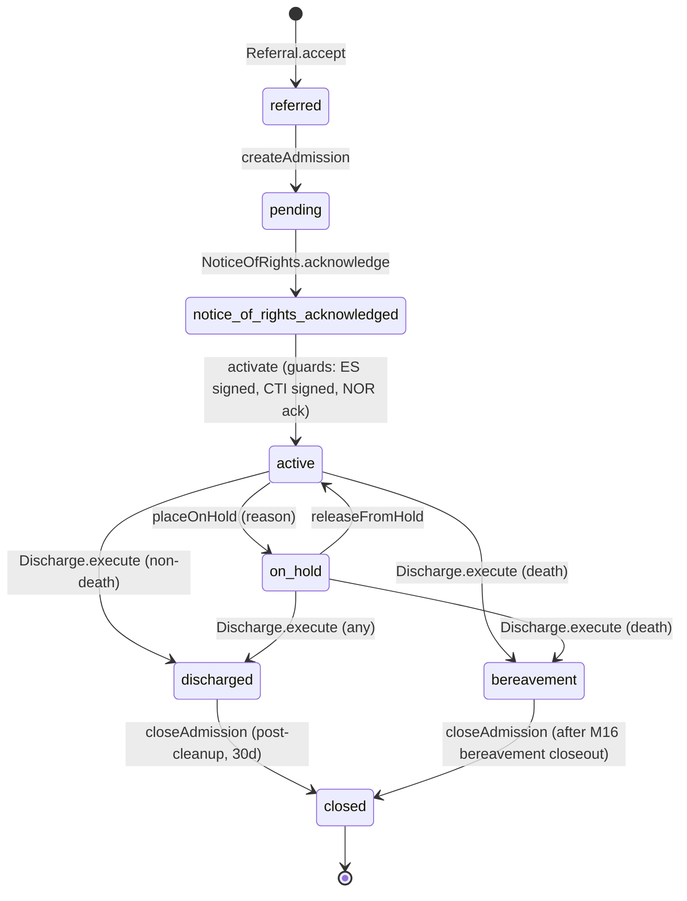
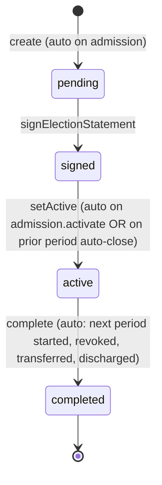
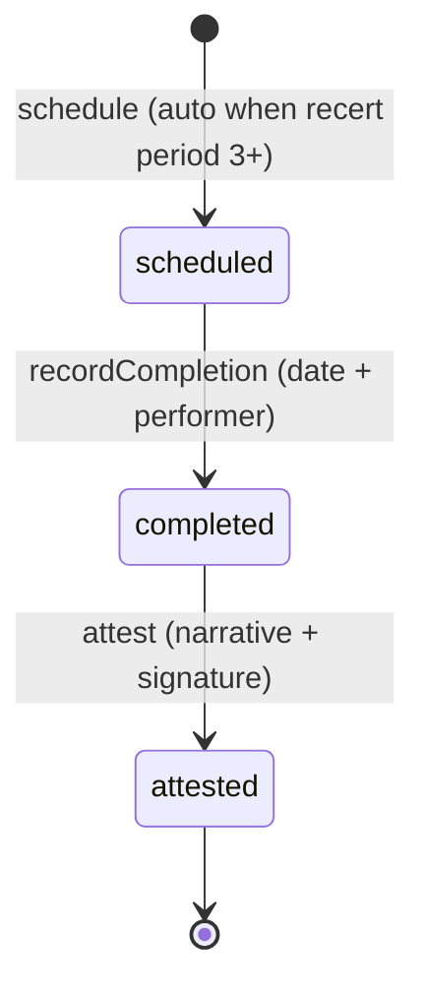

# Module 6 — Admission, Election & Certification Specification

> **Authority note:** This spec is an **implementation proposal** (repo authority rule): [`docs/architecture/`](../architecture/) and the ratified ADRs in [`docs/adr/`](../adr/) win on conflict, and the code plus [`docs/BUSINESS_LOGIC.md`](../BUSINESS_LOGIC.md) are ground truth for as-built behavior. Mechanism choices named here may be superseded — see ADR-0036…0040 and ADR-0030/0032/0035 for the recorded divergences (outbox not Socket.IO, TypeScript not Python sidecars, app-layer AES-256-GCM not pgcrypto, pure transition tables not XState, hand-rolled HTTP hardening not `@fastify/*`, Vite + react-router not TanStack Start).


**Module ID:** 6
**Phase:** 1 (clinical spine — Engrace go-live blocker; lands immediately after Module 5 Patient and Module 39 Consent)
**Depends on:** 1 (Foundation — `packages/db`, `packages/tenancy`, `withOrgContext`, RLS generator, `audit()` helper, outbox helper, idempotency, error envelope), 2 (Identity — session/actor resolution), 3 (Authorization — `requirePermission` / `requireAbac` contract; the catalog this module contributes to), 4 (Audit — write-audit trigger generator, read-audit helper, destruction-cert workflow, retention classes), 5 (Patient & Demographics — `Patient`, `Payer`, `PrivacyFlag`), 29 (External Interfaces — inbound HL7 v2 ADT proposal-accepted outbox events consumed by the `AdmissionEventApplier`), 38 (Terminology — ICD-10 validation, hospice diagnosis value sets, level-of-care revenue/Q-code mapping), 39 (Consent & Authorization Management — election authority verification, DPOA gating for proxy-signed elections, 42 CFR Part 2 redaction), 40 (Master Data Management — `ExternalPhysician` for attending NPIs, `Facility` for transfer/place-of-service references, `ReferralSource`)
**Consumed by:** 7 (Care Plan — initial care plan tied to admission), 8 (Encounters — visit notes scoped to active admission), 11 (Orders — orders gated by active election), 14 (IDG — meeting scope is the active caseload of admitted patients; also consumes `m6.referral.withdrawn` for the cancellation notification template), 16 (Bereavement — listens for `bereavement.eligible`), 22 (Document Management — listens for `election.signed`, `revocation.signed`, `discharge.executed`, `notice_of_rights.required`, `cti.signed` to render and store forms), 23 (Billing — Medicare — reads `ElectionPeriod`, `CertificationOfTerminalIllness`, `FaceToFaceEncounter`, `LevelOfCarePeriod`, `RevocationEvent`, `DischargeEvent`; owns the NOE/NOTR wire artifact and emits acceptance back to M6 via outbox), 26 (Cap Management — reads admission and discharge dates to drive cap accrual), 27 (Cost Report — patient-day census derives from M6), 28 (FHIR Gateway — maps Admission → `Encounter`/`EpisodeOfCare`, CTI → `Condition`/`Composition`), 30 (HQRP & Quality — survey readiness queries the F2F window log and CTI lateness register; also consumes `m6.applier.refused` and the `info`-severity external-signal windows), 33 (Reporting — admission/discharge/recert reports), 36 (Secure Messaging — subscribes to compliance-window outbox events), 37 (Inpatient Unit Management — admission's `LevelOfCarePeriod` drives IPU bed assignment for GIP/IRC)
**Owns:** `apps/backend/src/modules/06-admission` (the admission spine, election periods, CTI/F2F compliance, the `AdmissionEventApplier`), `packages/domain/admission`, and the twelve owned tables (`referral`, `admission`, `election_period`, `election_statement`, `certification_of_terminal_illness`, `face_to_face_encounter`, `level_of_care_period`, `revocation_event`, `transfer_event`, `discharge_event`, `notice_of_rights_acknowledgment`, `compliance_window`, **`election_addendum`** — M06-F02/ADR-0015 D1).
**Spec status:** Re-locked v0.7 (referral intake captures the patient's Medicare (MBI) and Medicaid numbers; supersedes Re-locked v0.6 — attending CTI signature is a billing prerequisite, not an activation gate — D3 amended; supersedes Re-locked v0.5)

> **Phase-4 remediation (2026-06-11; ADR-0015) — 6 BLOCKERs.**
> - **M06-F02:** `election_addendum` entity added (Patient Notification of Non-Covered Items, 418.24(c)) — a **condition of payment**: furnished within 5 days of election (72 h if requested later), signed/dated, versioned, amendable on POC change. The M21 non-covered DME path terminates here.
> - **M06-F03:** certification timing corrected — **verbal cert within 2 calendar days** of period start (if written can't be completed), **written before billing**; recert completed **no more than 15 days before** the period start (was encoded backwards).
> - **M06-F04:** **one signed `election_statement` per election** (election continues across benefit periods until revoked/discharged/transferred) — not one per benefit period.
> - **M06-F05:** the invented agency F2F "override" (which billed uncertified days) is removed; CMS **late-F2F + exceptional-circumstances** logic encoded (F2F within 2 days of admission when admitted <2 days before a 3rd+ period start; else discharge, never bill).
> - **M06-F09:** live discharge requires a **physician discharge order for all reasons** + **NOMNC** for no-longer-terminally-ill / for-cause.
> - **M06-F10:** transfer requires the **418.30 patient-signed statement** (once per benefit period).

## Changelog

- **v0.7 (Re-locked; 2026-10-04)** — Referral intake captures the patient's **Medicare number (MBI)** and **Medicaid number**: two `referral` columns (`medicare_number_at_receipt`, `medicaid_number_at_receipt`) with format CHECKs, added to the referral write-audit denylist (migration `0317_m6_referral_payer_numbers.sql`); `POST`/`PATCH /api/v1/referrals` accept both (normalized server-side; 422 on a malformed value). The MBI is recorded on the patient's chart through M5's `PatientIntakeResolver` (create-from-intake, or `recordMedicareNumberIfMissing` on match / when linked) without ever overwriting a chart MBI; the Medicaid number pre-fills the intake Coverage / Payers form (M5 keeps Medicaid IDs on `patient_payer`). See §2.2 "Payer numbers at intake".
- **v0.6 (Re-locked)** — Aligned the period-1 attending-physician CTI signature with 42 CFR 418.22 and the as-built code. The attending signature is still required on the period-1 CTI when the patient has an attending, but it gates **claim submission** (M23 rule `cti_signed_per_period`, `packages/billing/src/rules/cti-signed.ts`), not admission activation: §418.22(a)(3) requires the written certification before the claim is submitted, not before care starts. `R-CTI-03` now enforces the attending sign on the CTI's `signByAttending` transition (attending NPI match); a period-1 CTI stays `awaiting_attending` — not `signed` — until then. Removed `attending_signed` from the §4.2.2 activate 412 list, the §5.2.3 wizard and §5.2.5 activation checklist, and the §8 `m6_admission_activation_blocked_total` reasons; D3 amended.
- **v0.4 (Consolidated)** — Rolls the v0.2 base and v0.3 delta into a single self-contained specification. No scope change; no decision reversals.
- **v0.3 (Locked)** — Closed the M29 forward-stub gap on the M6 side. Shipped the narrow M29 consumer surface: the `AdmissionEventApplier` service (internal, not a seam) consuming `m29.hl7_inbound_proposal.accepted` for `ownerModule='m6'`, handling three resource kinds (`discharge_event`, `admission_event`, `cancel_admission`); three new informational compliance window types (`concurrent_hospital_admission`, `external_discharge_notice`, `hl7_admission_cancellation`); the new `info` severity level; one new outbox event `m6.referral.withdrawn` (distinct from `m6.referral.declined`); the `m6.applier.refused` event; schema additions (three new `compliance_window_type` enum values, the `info` severity, the `withdrawn` referral status, the `referral.external_message_ref` JSONB column + GIN index, migration `0036_m6_v03_hl7_consumers.sql`); four decisions (D13–D16); five workflow acceptance criteria (W-M6-31 through W-M6-35); and five implementation tasks (T-M6-23 through T-M6-27). M6's state machines remained the only path to active-state mutations; M29 is a workflow-context contributor only.
- **v0.2 (Locked)** — Resolved all twelve open questions into binding decisions (§11). Wrote full Drizzle for all twelve owned tables; complete migration DDL (`0006_admission.sql`) including enums, RLS via M1 generator, write-audit triggers via M4 generator, FK constraints, and partial/btree indexes. Added complete per-route TypeBox schemas (§4.3) and the exact permission-key set this module registers into Module 3 (§4.5). Defined the binding outbox-event contract (§4.4) every downstream consumer (M16, M22, M23, M28, M36, M37) depends on. Wired the F2F window math and benefit-period sequencing as `packages/domain/admission` pure functions, with property-based tests called out in §9. Lock-grade sign-off. Phase boundary: every section of this spec is Phase 1.
- **v0.1** — Initial draft from architecture §11 Module 6 entry and §23.4 CoP traceability. Established the entity inventory (Referral, Admission, ElectionPeriod, ElectionStatement, CertificationOfTerminalIllness, FaceToFaceEncounter, LevelOfCarePeriod, RevocationEvent, TransferEvent, DischargeEvent, NoticeOfRightsAcknowledgment, ComplianceWindow), the seven core state machines, and the cross-module seam shape with M22/M23/M16/M36.

> **Phase boundary (binding):** Every surface in this spec is Phase 1 — admission, election, recert, F2F, revocation, transfer, discharge, bereavement-trigger, and the compliance window engine all ship before Engrace go-live. There are no Phase-2 carveouts in M6 because every one of them is a Medicare hospice election prerequisite. The only items that complete *after* downstream modules exist are (a) M22's actual form-render handlers for the events emitted here (M22 owns the PDF; M6 emits the event), (b) M23's NOE/NOTR submission triggered by `election.activated` / `revocation.signed`, and (c) M16's bereavement-plan creation triggered by `bereavement.eligible`. All three are typed outbox contracts (§4.4), not open design.

-----

## 1. Purpose & Scope

### 1.1 What This Module Does

Module 6 owns the **regulatory state of the hospice relationship** for every patient — the chain of facts that says "this person is, legally and clinically, a Medicare hospice patient of this provider, in benefit period N, certified terminally ill through date D, with the F2F window satisfied (if applicable), and discharged on date X for reason R."

It is the module a CMS surveyor opens first. It is the module the MAC's claim-adjudication engine reconstructs from the wire. It is the module the Compliance Officer queries when an APU reduction risk surfaces. Every dollar Engrace bills, every visit it schedules, and every order it writes is gated on M6 state being correct, complete, and on time.

Concretely M6 delivers:

- **The Referral → Admission funnel.** Inbound referrals from hospitals, SNFs, physicians, families, and self-referrals; evaluation; accept/reject; conversion to Admission. (Pre-admission state — `Patient` may exist as a prospect in M5 but no PHI clinical activity is allowed until M6 transitions the Admission to `active`.)
- **The Admission lifecycle** (`referred → pending → notice_of_rights_acknowledged → active → on_hold → discharged → bereavement → closed`) as the single source of truth for "is this person a hospice patient right now."
- **The Election lifecycle** (`pending → signed → active → completed`) per benefit period, with the CMS benefit-period sequence enforced server-side (two 90-day periods, then unlimited 60-day periods; sequence inherited on transfer-in from prior hospice).
- **The Certification of Terminal Illness (CTI)** lifecycle per period: hospice Medical Director signature required before every period; attending physician co-signature required on the period-1 CTI if the patient has an attending (a claim-submission prerequisite enforced by M23, not an activation gate — §11 D3); narrative attribution; late-signing capture.
- **The Face-to-Face Encounter (F2F)** requirement from the 3rd benefit period onward: window calculation (30 calendar days prior to recert period start), scheduling, attestation, late/missed handling per CMS.
- **The Level-of-Care assignment** per admission (`routine_home_care`, `continuous_home_care`, `inpatient_respite_care`, `general_inpatient_care`) — the clinical assignment that M23 turns into per-diem and per-line revenue codes, and that M37 turns into bed/staffing.
- **Revocation, Transfer, and Discharge** workflows with the signed-form facts, effective dates, reasons, and the cascade into bereavement (for death) or onward-hospice (for transfer-out).
- **The Notice of Rights** acknowledgment as a gate on activation (CoP 418.52).
- **The Compliance Window engine** — the regulatory clocks (48-hour initial assessment, 5-day comprehensive assessment, 15-day care-plan review, 14/7/2-day F2F-window alerts, NOE timeliness signal, recert lookahead) — emitted as outbox events that M36 turns into clinician/admin alerts and that M30/M33 turn into dashboards.
- **External event ingest as workflow context.** When an inbound HL7 v2 ADT message arrives at M29 (T-29.04 listener) for a patient matched by T-29.05's cascade to an M6-tracked patient, M29 creates an `hl7_inbound_proposal` with `ownerModule='m6'`. After human accept in the M29 review queue (T-29.06), M29 publishes `m29.hl7_inbound_proposal.accepted`; M6's `AdmissionEventApplier` consumes it. The applier translates the external event into either (a) a compliance window for human triage (concurrent admission, ambiguous discharge notice, cancellation), or (b) the narrow case of an external death notification that, with preconditions met, records a `discharge_event` with `reason='death'`. **No other state transitions are driven by external HL7 input.** Election sign, CTI sign, F2F attest, LOC change, revocation, transfer remain hospice-clinician decisions made through M6's existing API routes. The external system can only contribute *context* the hospice operations team triages.
- **The outbox-event contract** that drives every downstream module: M22 (form rendering), M23 (NOE/NOTR filing), M16 (bereavement onboarding), M36 (alerts), M37 (IPU placement), M28 (FHIR `EpisodeOfCare` events).

### 1.2 What This Module Does Not Do

This list is binding. Every item here is owned by another module and reached via repository call, outbox event, or the explicit cross-module seams in §4.7.

- **Patient demographics, payers, addresses, caregivers, privacy flags** — Module 5. M6 references `patient.id`; it does not write to M5 tables.
- **DPOA verification, advance-directive content, election-by-proxy authority, 42 CFR Part 2 consent** — Module 39. When an election is signed by a representative rather than the patient, M6 calls M39 to verify the active DPOA-healthcare consent before allowing the signature; the consent is M39's record.
- **The signed-form PDF artifact** (ElectionStatement, Revocation, CTI form, F2F form, Notice of Rights, Discharge Summary, NOMNC) — Module 22. M6 emits a structured event with the data; M22 renders the document from its FormTemplate library, stores it under retention class `compliance`, and back-references the `document_id` on the M6 row.
- **The NOE/NOTR wire artifact submitted to the MAC** — Module 23. M6's `m6.election.signed` / `m6.election.period_started` and `m6.revocation.created` outbox events (the as-built names) are M23's trigger. M23 owns the 5-day timeliness math against the *filing* and the claim-validation gate; M6 owns the underlying *clinical effective date*.
- **The visit note for the F2F encounter** (the narrative, vitals, the clinician's documentation) — Module 8. M6 owns the F2F *attestation* (the cert-gating fact); when a clinical note exists, it lives in M8 and is referenced from M6 via `encounter_id`.
- **The HOPE assessment, PPS/FAST/PAINAD/ESAS, the comprehensive assessment content** — Module 9. M6 holds the compliance clock for the 48-hour initial and 5-day comprehensive assessments; M9 signals completion via outbox `assessment.signed` and M6 closes the corresponding ComplianceWindow.
- **The care plan (IPOC)** — Module 7. The 5-day care-plan gate fires from M6's compliance engine; the plan itself is M7's domain.
- **Bereavement program (13-month) records, contacts, encounters** — Module 16. M6 emits `bereavement.eligible` exactly once when an Admission transitions to `bereavement` state; M16 builds the BereavementPlan from there.
- **Scheduling the F2F visit, EVV, or routing the physician** — Module 17 / 18. M6 raises a "F2F due" surface; the physician/admin schedules through M17.
- **The IPU bed assignment for a GIP/IRC level-of-care period** — Module 37. M6 emits `level_of_care.requires_ipu_bed`; M37 assigns the bed and confirms with `ipu.bed_assigned`.
- **The claim, the HIPPS/SIA calculation, or the per-diem revenue arithmetic** — Module 23. M6 supplies the inputs (period dates, LCP boundaries, F2F dates, CTI signature dates); M23 calculates and submits.
- **Cap accrual or projections** — Module 26. M6 supplies admission/discharge dates; M26 maintains the ledger.
- **The decedent's death certificate, mortuary handoff, or funeral-home portal access** — Modules 22 and 31. M6 records the *fact* of death (date, time, certifier reference); the certificate document and the funeral-home magic-link session are downstream.
- **Parsing inbound HL7 v2 ADT messages, the patient-match cascade, or the discharge-disposition code mapping** — Module 29. M6 does not parse HL7; it consumes the already-parsed `proposedEventContext` shape M29 produces after a human accept, and never signs elections, attests F2Fs, or transitions admission lifecycle states from external messages beyond the narrow D13/D14 rails.

### 1.3 Regulatory Drivers

| Driver | Requirement | How Module 6 satisfies it |
|---|---|---|
| **42 CFR 418.22** — Certification of terminal illness | CTI signed by hospice MD before every benefit period; attending co-sign for period 1 if patient has attending; F2F by hospice MD/NP within 30 days prior to recert period start, from period 3 onward; F2F attestation captured separately | `CertificationOfTerminalIllness` state machine; `FaceToFaceEncounter` + window math; `f2f_window_overridden` audit; recert-claim block until F2F signed |
| **42 CFR 418.24** — Election of hospice care | Patient (or representative under DPOA) signs election statement that includes patient name, hospice name, attending physician identification, acknowledgment of curative-care waiver, effective date, signature | `ElectionStatement` table with required fields; `electionAuthority` resolved via M39 (patient vs DPOA); signature timestamp; immutability post-sign |
| **42 CFR 418.25** — Admission to hospice care | Hospice physician determines terminal illness; admission documented | `Admission` state machine with `admitted_by_physician_id` and the CTI link |
| **42 CFR 418.26** — Discharge from hospice care | Discharge for cause / no-longer-terminal / move-out-of-service-area / patient-revoke / death; discharge summary written; transfer-of-care plan when applicable | `DischargeEvent` enum + workflow; M22 receives `discharge.executed` for the summary |
| **42 CFR 418.28** — Revocation; loss of eligibility; transfer | Patient may revoke at any time in writing; transfer between hospices once per period; benefit periods continue across transfer | `RevocationEvent`, `TransferEvent`; transfer-in inherits `period_sequence_number`; once-per-period guard |
| **42 CFR 418.52** — Patient rights | Written Notice of Rights at admission; acknowledgment captured | `NoticeOfRightsAcknowledgment` as a gate on `admission.activate` |
| **42 CFR 418.54** — Initial and comprehensive assessment | RN initial assessment within 48 hours after the election (418.54(a)); comprehensive interdisciplinary assessment no later than 5 calendar days after the election (418.54(b)). CMS SOM Appendix M (L523) counts the **election date as day 0**: elected Wednesday ⇒ Monday (day 5) is the last timely day, Tuesday (day 6) is late | `ComplianceWindow` records `initial_assessment_48h` (`must_complete_by` = election instant + 48 h) and `comprehensive_assessment_5d` (`must_complete_by` = 23:59:59.999 org-local on election date + 5). `createAdmission` opens them provisionally against the draft; **activation (the election) re-anchors every still-open one** on the activation instant. The readmission plan shows the same dates (`initialAssessmentDueBy` = election + 2, the latest date 48 h reach; `comprehensiveAssessmentDueBy` = election + 5). Single source: `certification/window-math.ts` (`computeAssessmentWindowDeadline`). Gate on activation, alerts at 24h/12h, override path with reason |
| **42 CFR 418.302** — Election to receive hospice care | Election effective on signed statement date | `ElectionPeriod.effective_at` = `ElectionStatement.signed_at` (server-stamped) |
| **42 CFR 418.304** — Filing claim — TOB, NOE, NOTR | NOE within 5 days of admission; NOTR within 5 days of revocation/discharge | M6 emits the event with the precise effective date; M23 owns the 5-day filing timer and submission |
| **HIPAA §164.502(b) Minimum necessary** | PHI access limited to those needing it | RLS scopes M6 rows to tenant; M3 `caseload_or_scope` ABAC narrows to assigned care team; PrivacyFlag (M5) further narrows |
| **HIPAA §164.528 Accounting of disclosures** | Patient may request a list of disclosures | M4 read-audit captures every `admission.viewed` / `*.disclosed`; M6 declares `auditRead` on every PHI route |
| **42 CFR Part 2 §2.13** — SUD record confidentiality | Heightened access; redaction in re-disclosures | M6 reads `patient.privacyFlags` via M5 repository; ABAC consults M39 consent before exposing election-statement narrative that mentions SUD diagnosis |
| **State variation** — Oregon Death With Dignity, state-specific election-form addenda | Per-state add-on; some states require additional fields | `ElectionStatement.state_addendum jsonb`; per-state form-template selection in M22 |

### 1.4 Competitive Context

The legacy hospice EHRs (HCHB, Netsmart Homecare/myUnity, WellSky, MatrixCare) implement admission/election/cert as a clipboard of forms tied loosely to a patient record. Their failure modes are well-documented in CMS surveys and TPE probes:

- **F2F window violations** — the physician completes the F2F a day too late or a day too early; the EHR records the encounter but does not refuse the recert; the claim is later denied. Engrace's predecessor agency hit this exact failure mode.
- **CTI lateness without flagging** — the Medical Director signs after the period starts; the EHR backdates or silently accepts; UPIC review claws back the days.
- **Notice of Rights not acknowledged** — the form is in the chart but no signature is captured; surveyor finding under 418.52.
- **Election by representative without DPOA verification** — anyone signs; later challenged.
- **Benefit-period sequence reset on transfer-in** — system treats the transferred patient as a new admission with period 1; MAC rejects because the patient is mid-benefit-period-3 elsewhere.

FireNote's "31-point claim audit" approach is the closest competitive parity — a pre-submission validation framework that codifies these rules. WardenX matches that at the *claim layer* (Module 23 §11.A) and extends it at the *event layer* in M6: the F2F window is not a claim-time check, it is a state-machine guard at attestation time; CTI lateness is captured as `signed_late=true` at signing time and surfaces in M23 as a regulatory-tagged rule; the period-sequence inheritance on transfer is enforced at admission time, not discovered at billing time. The differentiator is that M6 makes the regulatory state *impossible to enter into a non-compliant configuration*, so M23 has nothing to reject.

-----
## 2. Domain Model

### 2.1 Entity-Relationship Diagram

Tables from Modules 1/2/4/5/22/39/40 are shown for reference; M6 owns the **(M6)** tables. The five `*_event` tables (Revocation, Transfer, Discharge) are not "events" in the outbox sense — they are durable records of a one-time clinical action.

```mermaid
erDiagram
    organization ||--o{ admission : "tenant scope"
    patient ||--o{ referral : "subject of"
    patient ||--o{ admission : "subject of"
    referral_source ||--o{ referral : "originates"
    referral ||--o| admission : "converts to (M6)"

    admission ||--o{ election_period : "has (M6)"
    admission ||--|| notice_of_rights_acknowledgment : "gated by (M6)"
    admission ||--o{ level_of_care_period : "has (M6)"
    admission ||--o{ compliance_window : "raises (M6)"
    admission ||--o| revocation_event : "may have one (M6)"
    admission ||--o| transfer_event : "may have one (M6)"
    admission ||--o| discharge_event : "may have one (M6)"

    election_period ||--|| election_statement : "founded on (M6)"
    election_period ||--|| certification_of_terminal_illness : "certified by (M6)"
    election_period ||--o{ face_to_face_encounter : "may require (M6)"

    external_physician ||--o{ certification_of_terminal_illness : "hospice_md_signed"
    external_physician ||--o{ certification_of_terminal_illness : "attending_signed"
    external_physician ||--o{ face_to_face_encounter : "performed_by"

    document ||--o| election_statement : "rendered as"
    document ||--o| certification_of_terminal_illness : "rendered as"
    document ||--o| revocation_event : "rendered as"
    document ||--o| discharge_event : "rendered as"
    document ||--o| notice_of_rights_acknowledgment : "rendered as"

    consent ||--o| election_statement : "election authority (M39)"

    referral {
        uuid id PK
        uuid organization_id FK
        uuid patient_id FK "nullable until evaluated"
        uuid referral_source_id FK "(M40)"
        text referrer_name "denormalized at receipt"
        text referrer_phone
        text patient_name_at_receipt
        date patient_dob_at_receipt
        text medicare_number_at_receipt "MBI from the referrer; CMS MBI format"
        text medicaid_number_at_receipt "Medicaid ID from the referrer; 1-14 alphanumerics"
        text referring_dx_text "free-form before ICD assignment"
        text icd10_terminal_primary
        text source_channel "phone fax portal walk_in self_referral"
        enum status "received evaluated accepted rejected withdrawn admitted"
        text rejection_reason
        timestamptz received_at
        timestamptz evaluated_at
        uuid evaluated_by FK "(M2 user)"
        timestamptz decided_at
        jsonb external_message_ref "(M29 cancel-admit matching) nullable"
    }
    admission {
        uuid id PK
        uuid organization_id FK
        uuid provider_entity_id FK "the CCN under which admitted"
        uuid location_id FK "default location"
        uuid patient_id FK "(M5)"
        uuid referral_id FK "nullable"
        enum status "referred pending notice_of_rights_acknowledged active on_hold discharged bereavement closed"
        timestamptz admission_at "= first election_period.effective_at"
        timestamptz activated_at
        timestamptz hold_at
        timestamptz released_at
        text hold_reason
        timestamptz discharged_at
        uuid admitted_by_physician_id "(M40 external_physician)"
        uuid attending_physician_id "(M40 external_physician) nullable"
        uuid primary_caregiver_id "(M5 caregiver) nullable at admit"
        boolean transferred_in
        text transferred_in_from_ccn "nullable"
        smallint inherited_period_sequence "nullable"
        bigint version "optimistic lock"
    }
    election_period {
        uuid id PK
        uuid organization_id FK
        uuid admission_id FK
        smallint sequence_number "1, 2, 3, 4, ..."
        text period_kind "ninety_day | sixty_day"
        date effective_at "= election_statement.signed_at (period 1) or recert.effective_at"
        date scheduled_end_at "computed: +90 or +60 days"
        date actual_end_at "nullable; set on revoke/transfer/discharge"
        enum status "pending signed active completed"
        uuid election_statement_id FK
        uuid cti_id FK
        uuid completed_by_event "discriminator: revocation/transfer/discharge/next_period"
        bigint version
    }
    election_statement {
        uuid id PK
        uuid organization_id FK
        uuid election_period_id FK
        uuid patient_id FK
        text signer_kind "patient representative"
        uuid representative_consent_id "(M39) nullable; required if signer_kind=representative"
        text representative_relationship "spouse adult_child dpoa_agent court_appointed_guardian"
        text patient_name_at_signing "snapshot"
        text hospice_name_at_signing "snapshot"
        uuid attending_physician_id "(M40) nullable; required if patient names one"
        boolean curative_care_acknowledgment "must be true"
        date signed_at
        text signature_method "wet_ink_scanned electronic_witnessed"
        uuid document_id "(M22) rendered form back-reference"
        jsonb state_addendum "per-state required fields"
        bigint version
    }
    certification_of_terminal_illness {
        uuid id PK
        uuid organization_id FK
        uuid election_period_id FK
        uuid hospice_md_id "(M40) required"
        timestamptz hospice_md_signed_at
        uuid attending_md_id "(M40); required for period 1 if patient has attending"
        timestamptz attending_md_signed_at
        text terminal_diagnosis_icd10 "primary"
        text[] related_conditions_icd10 "secondary"
        text narrative "physician-attributable; min 200 chars"
        date period_start "= election_period.effective_at"
        date period_end "= election_period.scheduled_end_at"
        boolean signed_late "true if hospice_md_signed_at > period_start"
        text late_reason
        enum status "drafted awaiting_hospice_md awaiting_attending signed voided superseded"
        uuid document_id "(M22)"
        uuid voided_supersedes_id "self-FK; non-null on supersede"
        bigint version
    }
    face_to_face_encounter {
        uuid id PK
        uuid organization_id FK
        uuid election_period_id FK "= the period being RECERTIFIED"
        uuid performed_by_user_id FK "(M2 user) — hospice MD or NP, not attending"
        text performer_role "hospice_md hospice_np"
        date encounter_date
        text encounter_location "patient_home alf snf ipu hospital telehealth"
        boolean within_window "computed: date in [period_start - 30d, period_start]"
        boolean window_override
        text window_override_reason
        uuid window_override_by FK "(M2 user); MUST be Medical Director role"
        timestamptz attestation_signed_at
        text attestation_narrative "min 100 chars; physician-attributable"
        uuid encounter_id "(M8 encounter) nullable; the clinical visit note if present"
        uuid document_id "(M22) rendered F2F form"
        enum status "scheduled completed attested"
        bigint version
    }
    level_of_care_period {
        uuid id PK
        uuid organization_id FK
        uuid admission_id FK
        text level_of_care "routine_home_care continuous_home_care inpatient_respite_care general_inpatient_care"
        timestamptz effective_at
        timestamptz ended_at "nullable while active"
        uuid assigned_by FK "(M2 user)"
        text reason "admission new_setting symptom_crisis caregiver_relief gip_criteria_met"
        text q_code "Q5001..Q5010 — derived from setting (M38)"
        uuid facility_id "(M40) — when LCP is IPU/SNF/ALF"
        uuid ipu_bed_assignment_id "(M37) nullable until M37 confirms"
        bigint version
    }
    revocation_event {
        uuid id PK
        uuid organization_id FK
        uuid admission_id FK
        uuid election_period_id FK "the period being revoked"
        text signer_kind "patient representative"
        uuid representative_consent_id "(M39) nullable"
        date effective_at "patient-stated date; >= signed_at"
        date signed_at
        text revocation_reason "seek_curative_treatment dissatisfaction transferred_out other"
        text narrative
        uuid document_id "(M22)"
        bigint version
    }
    transfer_event {
        uuid id PK
        uuid organization_id FK
        uuid admission_id FK "the FROM admission for transfer_out; the TO admission for transfer_in (created in 06)"
        text direction "out in"
        text receiving_or_sending_ccn
        text receiving_or_sending_name
        uuid receiving_or_sending_facility_id "(M40) nullable"
        date effective_at
        smallint period_sequence_at_transfer "carried across"
        text narrative
        uuid document_id "(M22) transfer summary"
        bigint version
    }
    discharge_event {
        uuid id PK
        uuid organization_id FK
        uuid admission_id FK
        text discharge_type "death revocation transfer no_longer_terminal moved_out_of_service_area for_cause"
        date effective_at
        timestamptz death_at "nullable; required iff discharge_type=death"
        uuid death_certifier_id "(M40 external_physician or M2 user wrapper)"
        text for_cause_reason "nullable; required iff discharge_type=for_cause; CoP-bounded"
        text narrative "summary"
        uuid document_id "(M22) discharge summary"
        boolean bereavement_eligible "computed: discharge_type=death"
        bigint version
    }
    notice_of_rights_acknowledgment {
        uuid id PK
        uuid organization_id FK
        uuid admission_id FK
        uuid patient_id FK
        text signer_kind "patient representative"
        uuid representative_consent_id "(M39) nullable"
        date acknowledged_at
        text acknowledgment_method "wet_ink_scanned electronic_witnessed verbal_with_witness"
        uuid witness_user_id FK "(M2) nullable; required for verbal_with_witness"
        uuid document_id "(M22) the rendered NOR form"
        bigint version
    }
    compliance_window {
        uuid id PK
        uuid organization_id FK
        uuid admission_id FK
        text window_kind "initial_assessment_48h comprehensive_assessment_5d care_plan_5d f2f_recert_30d_prior recert_due_14d recert_due_7d cti_signature_lookahead_14d notice_of_rights concurrent_hospital_admission external_discharge_notice hl7_admission_cancellation"
        timestamptz starts_at
        timestamptz must_complete_by
        timestamptz closed_at
        text close_reason "completed overridden voided_by_status_change"
        uuid closed_by FK "(M2 user) nullable"
        uuid override_reason_id "nullable"
        text override_reason
        enum status "open closing_soon overdue closed"
        bigint version
    }
```



### 2.2 Per-Entity Fields, Constraints, Indexes

All M6 tables have the standard tenant-required columns (`organization_id`, `created_at`, `updated_at`) and the M4 write-audit trigger; the lists below highlight only the **non-obvious** constraints. Full Drizzle in §3.

**`referral`**
- `UNIQUE (organization_id, id)` (composite — used by RLS-aware FKs elsewhere)
- `CHECK (status IN ('received','evaluated','accepted','rejected','withdrawn','admitted'))`
- `CHECK (status='accepted' OR patient_id IS NOT NULL OR status IN ('received','withdrawn'))`
- `INDEX (organization_id, status, received_at DESC)` — referral inbox
- `INDEX (patient_id)` — patient-side lookup
- `INDEX USING GIN ((external_message_ref->'messageControlId')) WHERE external_message_ref IS NOT NULL` — cancel-admit matching from the `AdmissionEventApplier`
- High-sensitivity columns (audit denylist): `patient_name_at_receipt`, `patient_dob_at_receipt`, `referring_dx_text`, `referrer_phone`, `medicare_number_at_receipt`, `medicaid_number_at_receipt`
- `CHECK referral_medicare_number_format` — NULL or the CMS MBI format (`^[1-9][AC-HJ-NP-RT-Y][0-9AC-HJ-NP-RT-Y]{9}$`, the same rule as M5's `patient_identifier_mbi_format`); `CHECK referral_medicaid_number_format` — NULL or `^[A-Z0-9]{1,14}$` (the HOPE A0700 shape; state formats vary). Both are stored normalized: dashes/spaces removed, upper case (migration `0317_m6_referral_payer_numbers.sql`).
- **Payer numbers at intake (v0.7).** The referral form captures the patient's Medicare number (MBI) and Medicaid number. The **MBI** reaches the chart through M5's `PatientIntakeResolver` (M5 §4.11): `createPatientFromIntake` writes it as the new patient's `mbi` identifier, and confirming a match (or creating / updating a referral already linked to a patient) calls `recordMedicareNumberIfMissing`, which adds it only when the chart has no active MBI — a differing chart MBI is reported, never overwritten (M5 D12). The **Medicaid number** is not copied automatically: M5 keeps a Medicaid ID on the `patient_payer` row, which needs the state payer the referral does not know, so the intake Coverage / Payers form (referral and admission screens) pre-fills the subscriber ID from the referral when Medicare or Medicaid coverage is picked; staff choose the payer and save. The MBI also sharpens patient matching at referral review.

**`admission`**
- `UNIQUE (organization_id, patient_id) WHERE status NOT IN ('discharged','bereavement','closed')` — a patient can have only one active or pending admission at a time
- `CHECK (status IN ('referred','pending','notice_of_rights_acknowledged','active','on_hold','discharged','bereavement','closed'))`
- `CHECK ((status='active') = (activated_at IS NOT NULL))`
- `CHECK ((status='discharged' OR status='bereavement' OR status='closed') = (discharged_at IS NOT NULL))`
- `CHECK ((transferred_in = false) OR (inherited_period_sequence IS NOT NULL AND transferred_in_from_ccn IS NOT NULL))`
- `INDEX (organization_id, status, admission_at DESC)`
- `INDEX (provider_entity_id, status)` — CCN-scoped queries
- `INDEX (attending_physician_id)`
- Denylist: none (no PHI free text on this row)

**`election_period`**
- `UNIQUE (admission_id, sequence_number)`
- `EXCLUDE USING gist (admission_id WITH =, daterange(effective_at, COALESCE(actual_end_at, scheduled_end_at + INTERVAL '1 day'), '[)') WITH &&)` — **no overlapping periods for the same admission** (enforced in DB, not just in service)
- `CHECK (sequence_number >= 1)`
- `CHECK (period_kind IN ('ninety_day','sixty_day'))`
- `CHECK ((sequence_number IN (1,2) AND period_kind='ninety_day') OR (sequence_number >= 3 AND period_kind='sixty_day'))` — CMS sequence rule (90,90,60,60,60,…)
- `CHECK (status IN ('pending','signed','active','completed'))`
- `CHECK ((status IN ('active','completed')) = (election_statement_id IS NOT NULL AND cti_id IS NOT NULL))`
- `INDEX (admission_id, sequence_number)`

**`election_statement`**
- `UNIQUE (election_period_id)` — one per period
- `CHECK (curative_care_acknowledgment = true)` — cannot be persisted false
- `CHECK ((signer_kind='representative') = (representative_consent_id IS NOT NULL))`
- Denylist: `patient_name_at_signing`, `narrative` if present

**`certification_of_terminal_illness`**
- `UNIQUE (election_period_id) WHERE status <> 'voided'` — exactly one *active* CTI per period
- `CHECK (status IN ('drafted','awaiting_hospice_md','awaiting_attending','signed','voided','superseded'))`
- `CHECK ((status='signed') = (hospice_md_signed_at IS NOT NULL))`
- `CHECK ((signed_late = true) = (hospice_md_signed_at IS NOT NULL AND hospice_md_signed_at::date > period_start))`
- `CHECK (length(narrative) >= 200)`
- `CHECK (cardinality(related_conditions_icd10) <= 25)`
- `INDEX (organization_id, status, period_start)`
- Denylist: `narrative`, `late_reason`

**`face_to_face_encounter`**
- `UNIQUE (election_period_id) WHERE status='attested'` — exactly one attested F2F per recert period
- `CHECK (status IN ('scheduled','completed','attested'))`
- `CHECK ((window_override = true) = (window_override_reason IS NOT NULL AND window_override_by IS NOT NULL))`
- `CHECK (performer_role IN ('hospice_md','hospice_np'))`
- `INDEX (organization_id, election_period_id)`
- `INDEX (performed_by_user_id, encounter_date)` — physician queue
- Denylist: `attestation_narrative`, `window_override_reason`

**`level_of_care_period`**
- `EXCLUDE USING gist (admission_id WITH =, tstzrange(effective_at, COALESCE(ended_at, 'infinity'), '[)') WITH &&)` — non-overlapping LCPs per admission
- `CHECK (level_of_care IN ('routine_home_care','continuous_home_care','inpatient_respite_care','general_inpatient_care'))`
- `CHECK ((level_of_care IN ('inpatient_respite_care','general_inpatient_care')) <= (facility_id IS NOT NULL))` — IPU/IRC requires a facility
- `INDEX (admission_id, effective_at DESC)`
- `INDEX (admission_id) WHERE ended_at IS NULL` — current LCP lookup

**`revocation_event`**
- `UNIQUE (election_period_id)` — one revocation per period at most
- `CHECK (effective_at >= signed_at)`
- `CHECK ((signer_kind='representative') = (representative_consent_id IS NOT NULL))`
- Denylist: `narrative`

**`transfer_event`**
- `CHECK (direction IN ('out','in'))`
- `CHECK (period_sequence_at_transfer >= 1)`
- `INDEX (organization_id, effective_at)`

**`discharge_event`**
- `UNIQUE (admission_id)` — one discharge per admission
- `CHECK (discharge_type IN ('death','revocation','transfer','no_longer_terminal','moved_out_of_service_area','for_cause'))`
- `CHECK ((discharge_type='death') = (death_at IS NOT NULL AND death_certifier_id IS NOT NULL))`
- `CHECK ((discharge_type='for_cause') = (for_cause_reason IS NOT NULL))`
- `CHECK (bereavement_eligible = (discharge_type='death'))` — stored derived; trigger guarantees consistency
- Denylist: `narrative`, `for_cause_reason`

**`notice_of_rights_acknowledgment`**
- `UNIQUE (admission_id)` — one acknowledgment per admission
- `CHECK ((acknowledgment_method='verbal_with_witness') = (witness_user_id IS NOT NULL))`

**`compliance_window`**
- `UNIQUE (admission_id, window_kind) WHERE status <> 'closed'` — only one *open* window of each kind per admission at a time
- `CHECK (window_kind IN ('initial_assessment_48h','comprehensive_assessment_5d','care_plan_5d','f2f_recert_30d_prior','recert_due_14d','recert_due_7d','cti_signature_lookahead_14d','notice_of_rights','concurrent_hospital_admission','external_discharge_notice','hl7_admission_cancellation'))`
- `CHECK (status IN ('open','closing_soon','overdue','closed'))`
- `INDEX (organization_id, status, must_complete_by) WHERE status <> 'closed'` — drives the alert worker
- `INDEX (admission_id, window_kind)`

> The three external-signal window kinds (`concurrent_hospital_admission`, `external_discharge_notice`, `hl7_admission_cancellation`) are informational only and carry `severity='info'` (see D15). They use the existing payload column with a typed shape `{ source, proposalId, sourceMessageId, resourceKind, reasonCode, summary }`.

### 2.3 State Machines

State machines are implemented with **xstate** per Patterns Catalog §25.1, colocated with the aggregate service (`packages/domain/admission/*`). Persistence is the `status` enum on the aggregate row; transitions occur via service functions that load the aggregate (with optimistic-lock check on `version`), dispatch the event, and commit the new state + side effects in the **same transaction** as the audit + outbox write.

> Every guard listed below is implemented as a typed pre-condition; a guard failure raises `ConflictError` (M1 error envelope) with a machine-readable `code` so the UI can render a precise message.

#### 2.3.1 `Admission`



| From | Event | To | Guards | Side effects (same tx) |
|---|---|---|---|---|
| `referred` | `createAdmission` | `pending` | referral.status=`accepted`; no other open admission for patient | audit; outbox `admission.created`; create initial `compliance_window` rows (initial_assessment_48h, comprehensive_assessment_5d, care_plan_5d, notice_of_rights) |
| `pending` | `acknowledgeNoticeOfRights` | `notice_of_rights_acknowledged` | NoR not already acknowledged | close NoR compliance window; audit; outbox `notice_of_rights.acknowledged` |
| `notice_of_rights_acknowledged` | `activate` | `active` | ElectionStatement signed; CTI signed; no PrivacyFlag block; M9 not blocking with overdue 48h | set `activated_at`; outbox `admission.activated`; if first ElectionPeriod, outbox `election.activated` |
| `active` | `placeOnHold(reason)` | `on_hold` | reason given | pause LCP? (no — LCP persists); audit; outbox `admission.placed_on_hold` |
| `on_hold` | `releaseFromHold` | `active` | — | audit; outbox `admission.released_from_hold` |
| `active`/`on_hold` | `executeDischarge(type)` | `discharged` if type≠`death`, else `bereavement` | type given; effective_at >= admission_at; (for_cause requires extra approval) | end current LCP; end current ElectionPeriod; outbox `discharge.executed`; if death → outbox `bereavement.eligible` |
| `discharged`/`bereavement` | `closeAdmission` | `closed` | scheduled-30d worker OR M16 confirmation | audit |

Guards are explicit and enumerated; nothing transitions on a string match. The activation guard "no PrivacyFlag block" reads M5's `patient.privacyFlags` via the M5 repository — M6 does not import M5's schema. The "M9 not blocking" guard is implemented as a check on `compliance_window` rows of kind `initial_assessment_48h` not being `overdue`.

> **"No PrivacyFlag block" as built (F-238, 2026-10-04).** The guard is M5's `PatientAdmissionClearanceReader` seam, evaluated as the `patient_privacy` readiness requirement (`intake/activation-gate.ts`), which both the readiness view and `activateAdmission`'s server-side check (`canActivate`) read. It blocks on every restriction **except** an unreviewed DocLens intake detection that is the patient's only flag (M5 `restriction = INTAKE_DETECTION_UNREVIEWED`): by product decision that is reported as non-blocking (`status: action_required`, `blocking: false`, `action: REVIEW_PRIVACY`) and the admission can activate. A confirmed detection with no consent (`CONSENT_REQUIRED`), any other flag (`RESTRICTED`), and a missing/unavailable clearance still block. The admission payload stays category-free; the flag itself keeps restricting access and disclosure in M5.

> The `AdmissionEventApplier` (§4.8) drives exactly one admission-lifecycle transition: the `executeDischarge('death')` path, and only when all D14 preconditions hold. Every other external HL7 signal is captured as an informational `compliance_window` and never moves the admission state machine.

#### 2.3.2 `ElectionPeriod`



| From | Event | To | Guards | Side effects |
|---|---|---|---|---|
| `pending` | `signElectionStatement` | `signed` | ElectionStatement passes validation (§2.4); curative_care_acknowledgment=true; representative consent verified if applicable | persist ElectionStatement; audit; outbox `election.signed` (M22 renders form) |
| `signed` | `setActive` | `active` | CTI signed AND admission activated | set `effective_at`=`election_statement.signed_at` for period 1, else previous period.actual_end_at + 1 day; outbox `election.activated` (M23 files NOE); start `cti_signature_lookahead_14d` ComplianceWindow for next period |
| `active` | `complete(cause)` | `completed` | cause ∈ {next_period, revocation, transfer, discharge} | set `actual_end_at` (= cause.effective_at - 1 day, except discharge=cause.effective_at); set `completed_by_event`; outbox `election.period_ended` |

**No overlap guard:** the GIST EXCLUDE constraint (§2.2) rejects any insert/update producing overlapping periods at the DB layer. The service layer enforces the same rule before commit so the error envelope is `ConflictError` not a raw PG exception.

#### 2.3.3 `CertificationOfTerminalIllness`

```mermaid
stateDiagram-v2
    [*] --> drafted: create (auto when election_period pending)
    drafted --> awaiting_hospice_md: submitToHospiceMd
    awaiting_hospice_md --> awaiting_attending: signByHospiceMd (period=1 AND patient has attending)
    awaiting_hospice_md --> signed: signByHospiceMd (period>=2 OR no attending)
    awaiting_attending --> signed: signByAttending
    signed --> superseded: createNew (recert for next period)
    signed --> voided: void (with reason; admin role only)
    voided --> [*]
    superseded --> [*]
```



| From | Event | To | Guards | Side effects |
|---|---|---|---|---|
| `drafted` | `submitToHospiceMd` | `awaiting_hospice_md` | narrative ≥ 200 chars; terminal dx is valid ICD-10 (M38); period_start in [today-14d, today+30d] window | audit; notification to MD queue (outbox) |
| `awaiting_hospice_md` | `signByHospiceMd` | `awaiting_attending` or `signed` | actor has role `hospice_medical_director` OR `hospice_physician` with `cti.sign_hospice_md`; signing user matches `hospice_md_id`; if `hospice_md_signed_at > period_start` set `signed_late=true` AND require `late_reason` | record signature; outbox `cti.signed_hospice_md`; if late → outbox `cti.signed_late` (M23 surfaces in claim validation) |
| `awaiting_attending` | `signByAttending` | `signed` | actor's NPI matches `attending_md_id` (verified via M40); signing within 14 days of hospice MD sig | record signature; outbox `cti.signed`; transition ElectionPeriod to `signed`+`active` if ready |
| `signed` | `void(reason)` | `voided` | actor has `cti.void`; election_period NOT yet `active` OR a regulatory error correction | audit; M22 marks document as voided |

#### 2.3.4 `FaceToFaceEncounter`



| From | Event | To | Guards | Side effects |
|---|---|---|---|---|
| `scheduled` | `recordCompletion(date, performer)` | `completed` | performer is hospice MD/NP (not attending); date computable to in/out of window | compute `within_window`; if false AND no override → ConflictError `F2F_OUTSIDE_WINDOW`; persist; audit |
| `completed` | `requestWindowOverride(reason)` | `completed` (self) | actor has `f2f.window_override` (Medical Director role only) | set window_override=true; outbox `f2f.window_overridden` (severity=warn) |
| `completed` | `attest(narrative)` | `attested` | narrative ≥ 100 chars; performer = current actor | outbox `f2f.attested`; clear pending `f2f_recert_30d_prior` ComplianceWindow |

#### 2.3.5 `LevelOfCarePeriod`

```mermaid
stateDiagram-v2
    [*] --> assigning: requestAssign
    assigning --> active: confirm (auto for RHC/CHC; awaits IPU bed for IRC/GIP)
    active --> ended: end (next LCP starts OR admission discharged)
    ended --> [*]
```



The transient `assigning` state is implementation detail — it exists for IRC/GIP only to gap the round-trip to M37 for bed assignment. RHC/CHC transition straight to `active`.

| From | Event | To | Guards | Side effects |
|---|---|---|---|---|
| `[*]` | `requestAssign(level)` | `assigning` if IPU/IRC else `active` | admission active or on_hold; for IRC/GIP a facility_id required; LCP date arithmetic does not overlap | for IRC/GIP outbox `level_of_care.requires_ipu_bed`; audit; close prior LCP if any (set ended_at) |
| `assigning` | `ipuConfirmBedAssignment(bedId)` | `active` | bedId verified with M37 | persist `ipu_bed_assignment_id`; outbox `level_of_care.activated` |
| `active` | `end(reason)` | `ended` | — | set ended_at; outbox `level_of_care.ended` |

#### 2.3.6 `RevocationEvent` / `TransferEvent` / `DischargeEvent`

These are essentially one-shot records — they have no internal multi-step lifecycle, but the **side-effect chain** they trigger is the important part. Treated as "command + cascade" rather than as full state machines:

- **Revocation:** validates election_period currently active; closes ElectionPeriod with cause=revocation; ends current LCP; outbox `revocation.signed` (M23 files NOTR within 5d; M22 renders the revocation form); transitions Admission → `discharged` (revoked is a kind of discharge per CoP 418.28).
- **Transfer (out):** validates only one transfer per period (CMS 418.28); closes ElectionPeriod with cause=transfer; ends LCP; outbox `transfer.completed` carrying `period_sequence_at_transfer` (so the receiving hospice can inherit); transitions Admission → `discharged`.
- **Transfer (in):** creates a *new* Admission with `transferred_in=true`, `inherited_period_sequence=<carried>`, `transferred_in_from_ccn=<sender>`; first ElectionPeriod on this Admission gets `sequence_number = inherited_period_sequence + 1` (or `= inherited_period_sequence` if mid-period — see §11 D9). No re-collection of the election statement is required if the prior signed statement is in hand and re-acknowledged by the patient.
- **Discharge:** validates only one discharge per admission (UNIQUE); the discriminator `discharge_type` controls the cascade — `death` → admission to `bereavement` + outbox `bereavement.eligible`; everything else → `discharged`; in all cases ends LCP and ElectionPeriod, outbox `discharge.executed` (M22 renders summary; M23 wraps final claim). The `AdmissionEventApplier.recordExternalDeath` path (§4.8, §6.x) reuses this same discharge cascade for the narrow external-death case.

### 2.4 Validation Rules

Two kinds: **synchronous** (run inside the service, return inline errors before any DB write) and **deferred** (raised as outbox events for M23/M30 to surface in their domains).

#### 2.4.1 Synchronous

| Rule | Where | Failure |
|---|---|---|
| `R-EL-01` ElectionStatement.signer_kind=`representative` requires active M39 `dpoa_healthcare` consent for `representative_consent_id` | `signElectionStatement` | `REPRESENTATIVE_AUTHORITY_MISSING` (403) |
| `R-EL-02` Election cannot be signed for a patient who has an `existingActiveAdmission` at another ProviderEntity in this org | `signElectionStatement` | `PATIENT_ALREADY_ELECTED` (409) |
| `R-EL-03` Election period `sequence_number` must equal `MAX(prior.sequence_number)+1` for this patient across CCNs (computed via M5 patient lookup + cross-tenant boundary respected) | `createElectionPeriod` | `BENEFIT_PERIOD_SEQUENCE_GAP` (409) |
| `R-EL-04` Curative-care acknowledgment must be `true` (CMS election statement requirement) | `signElectionStatement` (DB CHECK + service) | `CURATIVE_CARE_ACK_REQUIRED` (422) |
| `R-CTI-01` CTI must be signed by hospice MD before `election_period.effective_at` to avoid `signed_late=true` (signed_late is **not** a block — it is a flag with reason; the block lives in M23) | `signByHospiceMd` | warning surfaced + late_reason required |
| `R-CTI-02` Terminal diagnosis ICD-10 must be a valid current code (M38 lookup) AND on the CMS hospice-allowable list | `submitToHospiceMd` | `TERMINAL_DX_NOT_ALLOWABLE` (422) |
| `R-CTI-03` Attending signature required on the period-1 CTI if `patient.attending_physician_id IS NOT NULL`; the signer's NPI must match the attending on file. The CTI stays `awaiting_attending` (not `signed`) until then. **Not an activation gate** — M23 `cti_signed_per_period` blocks the claim instead (§11 D3) | `signByAttending` | `ATTENDING_SIGNATURE_REQUIRED` (409) |
| `R-F2F-01` Performer must be hospice MD or hospice NP (not attending) | `recordCompletion` | `F2F_INVALID_PERFORMER` (422) |
| `R-F2F-02` Encounter date must be in [period_start - 30 days, period_start] (CMS 418.22(a)(4); the period's first day is timely per MBPM ch. 9 §20.1(5)(a)) | `recordCompletion` | `F2F_OUTSIDE_WINDOW` (409) unless override |
| `R-F2F-03` Window override requires actor role `hospice_medical_director` AND a reason ≥ 20 chars | `requestWindowOverride` | `F2F_OVERRIDE_FORBIDDEN` (403) / `F2F_OVERRIDE_REASON_TOO_SHORT` (422) |
| `R-F2F-04` Recert period (sequence ≥ 3) cannot transition to `active` without an `attested` F2F | `ElectionPeriod.setActive` | `F2F_REQUIRED_FOR_RECERT` (409) |
| `R-ADM-01` Admission `activate` requires NOR acknowledged | `activate` | `NOTICE_OF_RIGHTS_REQUIRED` (409) |
| `R-ADM-02` Admission `activate` requires no overdue `initial_assessment_48h` window unless explicitly overridden by DON role | `activate` | `INITIAL_ASSESSMENT_OVERDUE` (409) |
| `R-ADM-03` `for_cause` discharge requires explicit DON + Medical Director co-sign (two distinct users with the respective roles) | `executeDischarge` | `FOR_CAUSE_REQUIRES_COSIGN` (409) |
| `R-LCP-01` GIP requires uncontrolled-symptoms or end-of-life-imminent documentation (free-text in `reason`, min 30 chars) | `requestAssign` | `GIP_DOCUMENTATION_INSUFFICIENT` (422) |
| `R-LCP-02` CHC requires evidence of 8+ hours of skilled care over 24h documented (a flag + reason for now; M8 visit aggregation in Phase 2) | `requestAssign` | warning surfaced (Phase 1) / `CHC_INSUFFICIENT_EVIDENCE` (409, Phase 2) |
| `R-RV-01` Revocation effective date cannot precede signed date | DB CHECK + service | `REVOCATION_EFFECTIVE_BEFORE_SIGNED` (422) |
| `R-XFR-01` Only one transfer per benefit period | `createTransfer` | `TRANSFER_LIMIT_EXCEEDED` (409) |
| `R-XFR-02` Transfer-in must include the source CCN (validated against NPPES CCN registry via M40) and the carried `period_sequence_at_transfer` | `createAdmission(transferIn=true)` | `TRANSFER_IN_SOURCE_INVALID` (422) |
| `R-DC-01` `death` discharge requires `death_at` ≤ now() and `death_certifier_id` resolves to a credentialed MD/NP/RN (per state — RN can pronounce in some states) | `executeDischarge` | `DEATH_CERTIFIER_INVALID` (422) |
| `R-CW-01` Compliance window override requires a non-empty reason ≥ 20 chars and an actor with role `compliance_officer` OR `director_of_nursing` | `overrideWindow` | `WINDOW_OVERRIDE_FORBIDDEN` (403) |
| `R-EXT-01` External death-discharge via `AdmissionEventApplier.recordExternalDeath` requires the full D14 precondition set (active admission, not already discharged, mapped death reason, death date within active election period, accepted under `discharge.record_death`); any failure routes to an `external_discharge_notice` compliance window instead of a discharge | `applyDischargeEvent` | informational window opened; no error thrown |

#### 2.4.2 Deferred (surfaced via outbox to other modules)

- `cti.signed_late` → M23 claim validation flags days from `period_start` to `hospice_md_signed_at - 1` as ineligible unless explicit billing override.
- `f2f.window_overridden` → M30 (HQRP) survey-readiness register; M23 surfaces as `warn` on recert claim.
- `compliance_window.overdue` (for any window) → M36 escalating alert chain (clinician → supervisor → DON).
- `cti.signature_lookahead_due` (14d before next period) → M36 physician-queue notification.
- `bereavement.eligible` (death discharge) → M16 BereavementPlan creation.
- `m6.applier.refused` (D13 contract violation) → M30 external-event-applier health dashboard tile.

### 2.5 Side-Effect Rules

Every state transition has an explicit, in-transaction side effect list. The pattern (Module 1 §25.5 + §25.6):

```
BEGIN
  -- load aggregate with FOR UPDATE on version
  -- run guards
  -- update aggregate row (status, version+1, status-specific cols)
  -- write child rows (e.g. ElectionStatement insert)
  -- call audit() — Module 1/4 helper
  -- call outbox.publish() — Module 1 helper; consumers below
COMMIT
```

If the COMMIT fails for any reason, the audit row, the outbox row, and the domain row all roll back together — the "I updated the DB but the event never went out" failure mode is eliminated structurally.

**Outbox publication is the only cross-module communication M6 performs.** M6 never calls another module's HTTP route. M22, M23, M16, M28, M30, M33, M36, M37 read M6's outbox events from their own subscribers (BullMQ + the M1 outbox dispatcher). In the inbound direction, M6 consumes exactly one external event — `m29.hl7_inbound_proposal.accepted` — via the `AdmissionEventApplier` outbox subscriber (§4.8); it reads M29 only through the foundation outbox, never via schema import.

The full outbox-event catalog is locked in §4.4 below.

-----
## 3. Drizzle Schema

### 3.1 Package Layout

```
apps/backend/src/modules/06-admission/
├── index.ts                   # module init: registers permissions, ABAC predicates, eraser, seam, routes
├── routes/
│   ├── referrals.ts
│   ├── admissions.ts
│   ├── elections.ts
│   ├── cti.ts
│   ├── f2f.ts
│   ├── level-of-care.ts
│   ├── revocation.ts
│   ├── transfers.ts
│   ├── discharges.ts
│   ├── notice-of-rights.ts
│   └── compliance-windows.ts
├── services/
│   ├── referral-service.ts
│   ├── admission-service.ts
│   ├── election-service.ts
│   ├── cti-service.ts
│   ├── f2f-service.ts
│   ├── level-of-care-service.ts
│   ├── revocation-service.ts
│   ├── transfer-service.ts
│   ├── discharge-service.ts
│   ├── nor-service.ts
│   └── compliance-window-service.ts
├── consumers/
│   └── admission-event-applier.ts   # the M29 proposal-accepted consumer (§4.8)
├── outbox-consumers/
│   └── m29-proposal-accepted.ts     # registers the applier on m29.hl7_inbound_proposal.accepted
├── workers/
│   ├── window-scanner.ts      # scheduled — promotes open→closing_soon→overdue, emits outbox alerts
│   └── recert-lookahead.ts    # scheduled — emits cti_signature_lookahead_due 14d before next period start
├── repository/
│   └── election-period-reader.ts  # the seam interface M23 uses to read benefit-period state
└── permissions.ts             # the keys this module registers into M3's catalog (§4.5)

packages/domain/admission/                # PURE — no I/O; reused by tests + services
├── election-period.ts         # sequence rules, period_kind derivation, period-bounds math
├── f2f-window.ts              # 30-day-prior math; calendar-day, timezone-aware (org's tz)
├── benefit-period-inheritance.ts  # transfer-in sequencing
├── machines/                  # xstate definitions (one file per machine)
│   ├── admission.ts
│   ├── election-period.ts
│   ├── cti.ts
│   ├── f2f.ts
│   ├── level-of-care.ts
│   ├── revocation.ts
│   ├── transfer.ts
│   └── discharge.ts
└── compliance/
    └── windows.ts             # the window-kind catalog + their (starts_at, must_complete_by) math

packages/db/src/schema/
├── referrals.ts
├── admissions.ts
├── election-periods.ts
├── election-statements.ts
├── certifications.ts          # CTI
├── face-to-face-encounters.ts
├── level-of-care-periods.ts
├── revocation-events.ts
├── transfer-events.ts
├── discharge-events.ts
├── notice-of-rights-acknowledgments.ts
└── compliance-windows.ts
```

The split between `packages/domain/admission/` (pure functions and machines) and `apps/backend/src/modules/06-admission/services/` (orchestration + DB + outbox) follows architecture §9 layers. Date math, period sequencing, and the F2F window calculation are pure functions in `packages/domain` so they are reusable by tests, by M23's claim-validation pre-flight, and by M30's HQRP queries — without M6 having to expose an HTTP surface for arithmetic.

### 3.2 Enums

```typescript
// additions to packages/db/src/enums.ts
import { pgEnum } from 'drizzle-orm/pg-core'

export const referralStatus = pgEnum('referral_status', [
  'received', 'evaluated', 'accepted', 'rejected', 'withdrawn', 'admitted',
])

export const referralSourceChannel = pgEnum('referral_source_channel', [
  'phone', 'fax', 'portal', 'walk_in', 'self_referral', 'physician_office', 'hospital_discharge_planner',
])

export const admissionStatus = pgEnum('admission_status', [
  'referred', 'pending', 'notice_of_rights_acknowledged',
  'active', 'on_hold', 'discharged', 'bereavement', 'closed',
])

export const electionPeriodKind = pgEnum('election_period_kind', ['ninety_day', 'sixty_day'])
export const electionPeriodStatus = pgEnum('election_period_status', [
  'pending', 'signed', 'active', 'completed',
])
export const electionPeriodCompletionCause = pgEnum('election_period_completion_cause', [
  'next_period', 'revocation', 'transfer', 'discharge',
])

export const electionSignerKind = pgEnum('election_signer_kind', ['patient', 'representative'])
export const electionSignatureMethod = pgEnum('election_signature_method', [
  'wet_ink_scanned', 'electronic_witnessed',
])

export const ctiStatus = pgEnum('cti_status', [
  'drafted', 'awaiting_hospice_md', 'awaiting_attending', 'signed', 'voided', 'superseded',
])

export const f2fEncounterStatus = pgEnum('f2f_encounter_status', [
  'scheduled', 'completed', 'attested',
])
export const f2fPerformerRole = pgEnum('f2f_performer_role', ['hospice_md', 'hospice_np'])
export const f2fEncounterLocation = pgEnum('f2f_encounter_location', [
  'patient_home', 'alf', 'snf', 'ipu', 'hospital', 'telehealth',
])

export const levelOfCare = pgEnum('level_of_care', [
  'routine_home_care', 'continuous_home_care',
  'inpatient_respite_care', 'general_inpatient_care',
])

export const revocationReason = pgEnum('revocation_reason', [
  'seek_curative_treatment', 'dissatisfaction', 'transferred_out', 'other',
])

export const transferDirection = pgEnum('transfer_direction', ['in', 'out'])

export const dischargeType = pgEnum('discharge_type', [
  'death', 'revocation', 'transfer',
  'no_longer_terminal', 'moved_out_of_service_area', 'for_cause',
])

export const norAcknowledgmentMethod = pgEnum('nor_acknowledgment_method', [
  'wet_ink_scanned', 'electronic_witnessed', 'verbal_with_witness',
])

export const complianceWindowKind = pgEnum('compliance_window_kind', [
  'initial_assessment_48h',
  'comprehensive_assessment_5d',
  'care_plan_5d',
  'f2f_recert_30d_prior',
  'recert_due_14d',
  'recert_due_7d',
  'cti_signature_lookahead_14d',
  'notice_of_rights',
  'concurrent_hospital_admission',
  'external_discharge_notice',
  'hl7_admission_cancellation',
])

export const complianceWindowStatus = pgEnum('compliance_window_status', [
  'open', 'closing_soon', 'overdue', 'closed',
])

export const complianceWindowSeverity = pgEnum('compliance_window_severity', [
  'warning', 'alert', 'info',
])

// Note: roleCategory (M3), auditRetentionClass (M1) etc. already defined.
```

> The `compliance_window_kind` enum's last three values (`concurrent_hospital_admission`, `external_discharge_notice`, `hl7_admission_cancellation`) and the `complianceWindowSeverity` `info` value back the external-signal windows the `AdmissionEventApplier` opens. The `referral_status` `withdrawn` value backs the cancel-admit path (D16). All three are additive enum extensions installed by migration `0036_m6_v03_hl7_consumers.sql` (§3.7).

### 3.3 Tables — Drizzle TypeScript

> **Convention.** Every M6 table has `organization_id uuid NOT NULL`, `created_at`/`updated_at` timestamptz, and `version bigint NOT NULL DEFAULT 0` for optimistic locking. RLS is enabled via the M1 generator (`SELECT wardenx_enable_rls('<table>')`). The M4 write-audit trigger is installed in the migration via `generateAuditTrigger(...)` per table, with `denylist` as called out in §2.2.

```typescript
// packages/db/src/schema/referrals.ts
import { pgTable, uuid, text, date, timestamp, bigint, jsonb, index } from 'drizzle-orm/pg-core'
import { organizations } from './organizations'
import { patients } from './patients'                  // (M5)
import { externalEntities } from './external-entities' // (M40) referral_source
import { users } from './users'
import { referralStatus, referralSourceChannel } from '../enums'

export const referrals = pgTable('referral', {
  id: uuid('id').primaryKey().defaultRandom(),
  organizationId: uuid('organization_id').notNull()
    .references(() => organizations.id, { onDelete: 'restrict' }),
  patientId: uuid('patient_id').references(() => patients.id, { onDelete: 'restrict' }),
  referralSourceId: uuid('referral_source_id')
    .references(() => externalEntities.id, { onDelete: 'set null' }),
  referrerName: text('referrer_name'),
  referrerPhone: text('referrer_phone'),
  patientNameAtReceipt: text('patient_name_at_receipt').notNull(),
  patientDobAtReceipt: date('patient_dob_at_receipt'),
  medicareNumberAtReceipt: text('medicare_number_at_receipt'),   // v0.7 — normalized MBI
  medicaidNumberAtReceipt: text('medicaid_number_at_receipt'),   // v0.7 — normalized Medicaid ID
  referringDxText: text('referring_dx_text'),
  icd10TerminalPrimary: text('icd10_terminal_primary'),
  sourceChannel: referralSourceChannel('source_channel').notNull(),
  status: referralStatus('status').notNull().default('received'),
  rejectionReason: text('rejection_reason'),
  receivedAt: timestamp('received_at', { withTimezone: true }).notNull().defaultNow(),
  evaluatedAt: timestamp('evaluated_at', { withTimezone: true }),
  evaluatedBy: uuid('evaluated_by').references(() => users.id, { onDelete: 'set null' }),
  decidedAt: timestamp('decided_at', { withTimezone: true }),
  externalMessageRef: jsonb('external_message_ref').$type<{
    source: 'm29'
    proposalId: string
    messageControlId: string
    sendingFacility: string
    sendingApplication?: string
  }>(),
  createdAt: timestamp('created_at', { withTimezone: true }).notNull().defaultNow(),
  updatedAt: timestamp('updated_at', { withTimezone: true }).notNull().defaultNow(),
  version: bigint('version', { mode: 'number' }).notNull().default(0),
}, (t) => ({
  orgStatusReceivedIdx: index('referral_org_status_received_idx')
    .on(t.organizationId, t.status, t.receivedAt),
  patientIdx: index('referral_patient_idx').on(t.patientId),
}))
export type Referral = typeof referrals.$inferSelect

// packages/db/src/schema/admissions.ts
import { pgTable, uuid, text, timestamp, boolean, smallint, bigint, index, uniqueIndex } from 'drizzle-orm/pg-core'
import { sql } from 'drizzle-orm'
import { organizations } from './organizations'
import { providerEntities } from './provider-entities'
import { locations } from './locations'
import { patients } from './patients'
import { caregivers } from './caregivers'              // (M5)
import { externalEntities } from './external-entities' // (M40)
import { referrals } from './referrals'
import { admissionStatus } from '../enums'

export const admissions = pgTable('admission', {
  id: uuid('id').primaryKey().defaultRandom(),
  organizationId: uuid('organization_id').notNull()
    .references(() => organizations.id, { onDelete: 'restrict' }),
  providerEntityId: uuid('provider_entity_id').notNull()
    .references(() => providerEntities.id, { onDelete: 'restrict' }),
  locationId: uuid('location_id').notNull()
    .references(() => locations.id, { onDelete: 'restrict' }),
  patientId: uuid('patient_id').notNull()
    .references(() => patients.id, { onDelete: 'restrict' }),
  referralId: uuid('referral_id').references(() => referrals.id, { onDelete: 'set null' }),
  status: admissionStatus('status').notNull().default('referred'),
  admissionAt: timestamp('admission_at', { withTimezone: true }),
  activatedAt: timestamp('activated_at', { withTimezone: true }),
  holdAt: timestamp('hold_at', { withTimezone: true }),
  releasedAt: timestamp('released_at', { withTimezone: true }),
  holdReason: text('hold_reason'),
  dischargedAt: timestamp('discharged_at', { withTimezone: true }),
  admittedByPhysicianId: uuid('admitted_by_physician_id')
    .references(() => externalEntities.id, { onDelete: 'restrict' }),
  attendingPhysicianId: uuid('attending_physician_id')
    .references(() => externalEntities.id, { onDelete: 'set null' }),
  primaryCaregiverId: uuid('primary_caregiver_id')
    .references(() => caregivers.id, { onDelete: 'set null' }),
  transferredIn: boolean('transferred_in').notNull().default(false),
  transferredInFromCcn: text('transferred_in_from_ccn'),
  inheritedPeriodSequence: smallint('inherited_period_sequence'),
  createdAt: timestamp('created_at', { withTimezone: true }).notNull().defaultNow(),
  updatedAt: timestamp('updated_at', { withTimezone: true }).notNull().defaultNow(),
  version: bigint('version', { mode: 'number' }).notNull().default(0),
}, (t) => ({
  // The "one open admission per patient" rule — partial unique
  patientOpenIdx: uniqueIndex('admission_patient_open_idx')
    .on(t.organizationId, t.patientId)
    .where(sql`status NOT IN ('discharged','bereavement','closed')`),
  orgStatusAdmIdx: index('admission_org_status_idx').on(t.organizationId, t.status, t.admissionAt),
  peStatusIdx: index('admission_pe_status_idx').on(t.providerEntityId, t.status),
  attendingIdx: index('admission_attending_idx').on(t.attendingPhysicianId),
}))
export type Admission = typeof admissions.$inferSelect

// packages/db/src/schema/election-periods.ts
import { pgTable, uuid, date, timestamp, smallint, bigint, uniqueIndex, index } from 'drizzle-orm/pg-core'
import { organizations } from './organizations'
import { admissions } from './admissions'
import { electionPeriodKind, electionPeriodStatus, electionPeriodCompletionCause } from '../enums'

export const electionPeriods = pgTable('election_period', {
  id: uuid('id').primaryKey().defaultRandom(),
  organizationId: uuid('organization_id').notNull()
    .references(() => organizations.id, { onDelete: 'restrict' }),
  admissionId: uuid('admission_id').notNull()
    .references(() => admissions.id, { onDelete: 'restrict' }),
  sequenceNumber: smallint('sequence_number').notNull(),
  periodKind: electionPeriodKind('period_kind').notNull(),
  effectiveAt: date('effective_at'),
  scheduledEndAt: date('scheduled_end_at'),
  actualEndAt: date('actual_end_at'),
  status: electionPeriodStatus('status').notNull().default('pending'),
  // FKs to ElectionStatement / CTI added via deferred constraint after both tables exist (see migration)
  electionStatementId: uuid('election_statement_id'),
  ctiId: uuid('cti_id'),
  completedByCause: electionPeriodCompletionCause('completed_by_cause'),
  completedByEventId: uuid('completed_by_event_id'), // FK varies by cause; left logical, not enforced
  createdAt: timestamp('created_at', { withTimezone: true }).notNull().defaultNow(),
  updatedAt: timestamp('updated_at', { withTimezone: true }).notNull().defaultNow(),
  version: bigint('version', { mode: 'number' }).notNull().default(0),
}, (t) => ({
  admSeqUnique: uniqueIndex('election_period_admission_seq_idx').on(t.admissionId, t.sequenceNumber),
  admIdx: index('election_period_admission_idx').on(t.admissionId, t.sequenceNumber),
}))
export type ElectionPeriod = typeof electionPeriods.$inferSelect

// packages/db/src/schema/election-statements.ts
import { pgTable, uuid, text, date, jsonb, boolean, timestamp, bigint, uniqueIndex } from 'drizzle-orm/pg-core'
import { organizations } from './organizations'
import { electionPeriods } from './election-periods'
import { patients } from './patients'
import { externalEntities } from './external-entities'
import { consents } from './consents'                  // (M39)
import { documents } from './documents'                // (M22)
import { electionSignerKind, electionSignatureMethod } from '../enums'

export const electionStatements = pgTable('election_statement', {
  id: uuid('id').primaryKey().defaultRandom(),
  organizationId: uuid('organization_id').notNull()
    .references(() => organizations.id, { onDelete: 'restrict' }),
  electionPeriodId: uuid('election_period_id').notNull()
    .references(() => electionPeriods.id, { onDelete: 'restrict' }),
  patientId: uuid('patient_id').notNull()
    .references(() => patients.id, { onDelete: 'restrict' }),
  signerKind: electionSignerKind('signer_kind').notNull(),
  representativeConsentId: uuid('representative_consent_id')
    .references(() => consents.id, { onDelete: 'restrict' }),
  representativeRelationship: text('representative_relationship'),
  patientNameAtSigning: text('patient_name_at_signing').notNull(),
  hospiceNameAtSigning: text('hospice_name_at_signing').notNull(),
  attendingPhysicianId: uuid('attending_physician_id')
    .references(() => externalEntities.id, { onDelete: 'set null' }),
  curativeCareAcknowledgment: boolean('curative_care_acknowledgment').notNull(),
  signedAt: date('signed_at').notNull(),
  signatureMethod: electionSignatureMethod('signature_method').notNull(),
  documentId: uuid('document_id').references(() => documents.id, { onDelete: 'set null' }),
  stateAddendum: jsonb('state_addendum').notNull().default({}),
  createdAt: timestamp('created_at', { withTimezone: true }).notNull().defaultNow(),
  updatedAt: timestamp('updated_at', { withTimezone: true }).notNull().defaultNow(),
  version: bigint('version', { mode: 'number' }).notNull().default(0),
}, (t) => ({
  periodUnique: uniqueIndex('election_statement_period_idx').on(t.electionPeriodId),
}))
export type ElectionStatement = typeof electionStatements.$inferSelect

// packages/db/src/schema/certifications.ts
import { pgTable, uuid, text, date, timestamp, boolean, bigint, uniqueIndex, index } from 'drizzle-orm/pg-core'
import { sql } from 'drizzle-orm'
import { organizations } from './organizations'
import { electionPeriods } from './election-periods'
import { externalEntities } from './external-entities'
import { documents } from './documents'
import { ctiStatus } from '../enums'

export const certificationsOfTerminalIllness = pgTable('certification_of_terminal_illness', {
  id: uuid('id').primaryKey().defaultRandom(),
  organizationId: uuid('organization_id').notNull()
    .references(() => organizations.id, { onDelete: 'restrict' }),
  electionPeriodId: uuid('election_period_id').notNull()
    .references(() => electionPeriods.id, { onDelete: 'restrict' }),
  hospiceMdId: uuid('hospice_md_id').notNull()
    .references(() => externalEntities.id, { onDelete: 'restrict' }),
  hospiceMdSignedAt: timestamp('hospice_md_signed_at', { withTimezone: true }),
  attendingMdId: uuid('attending_md_id')
    .references(() => externalEntities.id, { onDelete: 'set null' }),
  attendingMdSignedAt: timestamp('attending_md_signed_at', { withTimezone: true }),
  terminalDiagnosisIcd10: text('terminal_diagnosis_icd10').notNull(),
  relatedConditionsIcd10: text('related_conditions_icd10').array().notNull().default(sql`'{}'`),
  narrative: text('narrative').notNull(),
  periodStart: date('period_start').notNull(),
  periodEnd: date('period_end').notNull(),
  signedLate: boolean('signed_late').notNull().default(false),
  lateReason: text('late_reason'),
  status: ctiStatus('status').notNull().default('drafted'),
  documentId: uuid('document_id').references(() => documents.id, { onDelete: 'set null' }),
  voidedSupersedesId: uuid('voided_supersedes_id'),
  createdAt: timestamp('created_at', { withTimezone: true }).notNull().defaultNow(),
  updatedAt: timestamp('updated_at', { withTimezone: true }).notNull().defaultNow(),
  version: bigint('version', { mode: 'number' }).notNull().default(0),
}, (t) => ({
  periodActiveUnique: uniqueIndex('cti_period_active_idx')
    .on(t.electionPeriodId)
    .where(sql`status <> 'voided'`),
  orgStatusIdx: index('cti_org_status_idx').on(t.organizationId, t.status, t.periodStart),
}))
export type CertificationOfTerminalIllness = typeof certificationsOfTerminalIllness.$inferSelect

// packages/db/src/schema/face-to-face-encounters.ts
import { pgTable, uuid, text, date, timestamp, boolean, bigint, uniqueIndex, index } from 'drizzle-orm/pg-core'
import { sql } from 'drizzle-orm'
import { organizations } from './organizations'
import { electionPeriods } from './election-periods'
import { users } from './users'
import { documents } from './documents'
import { f2fEncounterStatus, f2fPerformerRole, f2fEncounterLocation } from '../enums'

export const faceToFaceEncounters = pgTable('face_to_face_encounter', {
  id: uuid('id').primaryKey().defaultRandom(),
  organizationId: uuid('organization_id').notNull()
    .references(() => organizations.id, { onDelete: 'restrict' }),
  electionPeriodId: uuid('election_period_id').notNull()
    .references(() => electionPeriods.id, { onDelete: 'restrict' }),
  performedByUserId: uuid('performed_by_user_id').notNull()
    .references(() => users.id, { onDelete: 'restrict' }),
  performerRole: f2fPerformerRole('performer_role').notNull(),
  encounterDate: date('encounter_date'),
  encounterLocation: f2fEncounterLocation('encounter_location'),
  withinWindow: boolean('within_window'),
  windowOverride: boolean('window_override').notNull().default(false),
  windowOverrideReason: text('window_override_reason'),
  windowOverrideBy: uuid('window_override_by').references(() => users.id, { onDelete: 'set null' }),
  attestationSignedAt: timestamp('attestation_signed_at', { withTimezone: true }),
  attestationNarrative: text('attestation_narrative'),
  encounterId: uuid('encounter_id'),                   // (M8) — logical only; M6 does not import M8 schema
  documentId: uuid('document_id').references(() => documents.id, { onDelete: 'set null' }),
  status: f2fEncounterStatus('status').notNull().default('scheduled'),
  createdAt: timestamp('created_at', { withTimezone: true }).notNull().defaultNow(),
  updatedAt: timestamp('updated_at', { withTimezone: true }).notNull().defaultNow(),
  version: bigint('version', { mode: 'number' }).notNull().default(0),
}, (t) => ({
  periodAttestedUnique: uniqueIndex('f2f_period_attested_idx')
    .on(t.electionPeriodId)
    .where(sql`status = 'attested'`),
  performerDateIdx: index('f2f_performer_date_idx').on(t.performedByUserId, t.encounterDate),
  orgPeriodIdx: index('f2f_org_period_idx').on(t.organizationId, t.electionPeriodId),
}))
export type FaceToFaceEncounter = typeof faceToFaceEncounters.$inferSelect

// packages/db/src/schema/level-of-care-periods.ts
import { pgTable, uuid, text, timestamp, bigint, index, uniqueIndex } from 'drizzle-orm/pg-core'
import { sql } from 'drizzle-orm'
import { organizations } from './organizations'
import { admissions } from './admissions'
import { users } from './users'
import { externalEntities } from './external-entities'
import { levelOfCare } from '../enums'

export const levelOfCarePeriods = pgTable('level_of_care_period', {
  id: uuid('id').primaryKey().defaultRandom(),
  organizationId: uuid('organization_id').notNull()
    .references(() => organizations.id, { onDelete: 'restrict' }),
  admissionId: uuid('admission_id').notNull()
    .references(() => admissions.id, { onDelete: 'restrict' }),
  levelOfCare: levelOfCare('level_of_care').notNull(),
  effectiveAt: timestamp('effective_at', { withTimezone: true }).notNull(),
  endedAt: timestamp('ended_at', { withTimezone: true }),
  assignedBy: uuid('assigned_by').notNull().references(() => users.id, { onDelete: 'restrict' }),
  reason: text('reason').notNull(),
  qCode: text('q_code').notNull(),                                // Q5001..Q5010 — derived (M38)
  facilityId: uuid('facility_id').references(() => externalEntities.id, { onDelete: 'set null' }),
  ipuBedAssignmentId: uuid('ipu_bed_assignment_id'),              // (M37) logical FK
  createdAt: timestamp('created_at', { withTimezone: true }).notNull().defaultNow(),
  updatedAt: timestamp('updated_at', { withTimezone: true }).notNull().defaultNow(),
  version: bigint('version', { mode: 'number' }).notNull().default(0),
}, (t) => ({
  admEffIdx: index('lcp_adm_effective_idx').on(t.admissionId, t.effectiveAt),
  admOpenUnique: uniqueIndex('lcp_adm_open_idx').on(t.admissionId).where(sql`ended_at IS NULL`),
}))
export type LevelOfCarePeriod = typeof levelOfCarePeriods.$inferSelect

// packages/db/src/schema/revocation-events.ts
import { pgTable, uuid, text, date, timestamp, bigint, uniqueIndex } from 'drizzle-orm/pg-core'
import { organizations } from './organizations'
import { admissions } from './admissions'
import { electionPeriods } from './election-periods'
import { consents } from './consents'
import { documents } from './documents'
import { electionSignerKind, revocationReason } from '../enums'

export const revocationEvents = pgTable('revocation_event', {
  id: uuid('id').primaryKey().defaultRandom(),
  organizationId: uuid('organization_id').notNull()
    .references(() => organizations.id, { onDelete: 'restrict' }),
  admissionId: uuid('admission_id').notNull()
    .references(() => admissions.id, { onDelete: 'restrict' }),
  electionPeriodId: uuid('election_period_id').notNull()
    .references(() => electionPeriods.id, { onDelete: 'restrict' }),
  signerKind: electionSignerKind('signer_kind').notNull(),
  representativeConsentId: uuid('representative_consent_id')
    .references(() => consents.id, { onDelete: 'restrict' }),
  effectiveAt: date('effective_at').notNull(),
  signedAt: date('signed_at').notNull(),
  revocationReason: revocationReason('revocation_reason').notNull(),
  narrative: text('narrative'),
  documentId: uuid('document_id').references(() => documents.id, { onDelete: 'set null' }),
  createdAt: timestamp('created_at', { withTimezone: true }).notNull().defaultNow(),
  updatedAt: timestamp('updated_at', { withTimezone: true }).notNull().defaultNow(),
  version: bigint('version', { mode: 'number' }).notNull().default(0),
}, (t) => ({
  periodUnique: uniqueIndex('revocation_period_idx').on(t.electionPeriodId),
}))
export type RevocationEvent = typeof revocationEvents.$inferSelect

// packages/db/src/schema/transfer-events.ts
import { pgTable, uuid, text, date, timestamp, smallint, bigint, index } from 'drizzle-orm/pg-core'
import { organizations } from './organizations'
import { admissions } from './admissions'
import { externalEntities } from './external-entities'
import { documents } from './documents'
import { transferDirection } from '../enums'

export const transferEvents = pgTable('transfer_event', {
  id: uuid('id').primaryKey().defaultRandom(),
  organizationId: uuid('organization_id').notNull()
    .references(() => organizations.id, { onDelete: 'restrict' }),
  admissionId: uuid('admission_id').notNull()
    .references(() => admissions.id, { onDelete: 'restrict' }),
  direction: transferDirection('direction').notNull(),
  receivingOrSendingCcn: text('receiving_or_sending_ccn').notNull(),
  receivingOrSendingName: text('receiving_or_sending_name').notNull(),
  receivingOrSendingFacilityId: uuid('receiving_or_sending_facility_id')
    .references(() => externalEntities.id, { onDelete: 'set null' }),
  effectiveAt: date('effective_at').notNull(),
  periodSequenceAtTransfer: smallint('period_sequence_at_transfer').notNull(),
  narrative: text('narrative'),
  documentId: uuid('document_id').references(() => documents.id, { onDelete: 'set null' }),
  createdAt: timestamp('created_at', { withTimezone: true }).notNull().defaultNow(),
  updatedAt: timestamp('updated_at', { withTimezone: true }).notNull().defaultNow(),
  version: bigint('version', { mode: 'number' }).notNull().default(0),
}, (t) => ({
  orgEffIdx: index('transfer_org_eff_idx').on(t.organizationId, t.effectiveAt),
}))
export type TransferEvent = typeof transferEvents.$inferSelect

// packages/db/src/schema/discharge-events.ts
import { pgTable, uuid, text, date, timestamp, boolean, bigint, uniqueIndex } from 'drizzle-orm/pg-core'
import { organizations } from './organizations'
import { admissions } from './admissions'
import { externalEntities } from './external-entities'
import { documents } from './documents'
import { dischargeType } from '../enums'

export const dischargeEvents = pgTable('discharge_event', {
  id: uuid('id').primaryKey().defaultRandom(),
  organizationId: uuid('organization_id').notNull()
    .references(() => organizations.id, { onDelete: 'restrict' }),
  admissionId: uuid('admission_id').notNull()
    .references(() => admissions.id, { onDelete: 'restrict' }),
  dischargeType: dischargeType('discharge_type').notNull(),
  effectiveAt: date('effective_at').notNull(),
  deathAt: timestamp('death_at', { withTimezone: true }),
  deathCertifierId: uuid('death_certifier_id')
    .references(() => externalEntities.id, { onDelete: 'restrict' }),
  forCauseReason: text('for_cause_reason'),
  narrative: text('narrative'),
  documentId: uuid('document_id').references(() => documents.id, { onDelete: 'set null' }),
  bereavementEligible: boolean('bereavement_eligible').notNull().default(false),
  createdAt: timestamp('created_at', { withTimezone: true }).notNull().defaultNow(),
  updatedAt: timestamp('updated_at', { withTimezone: true }).notNull().defaultNow(),
  version: bigint('version', { mode: 'number' }).notNull().default(0),
}, (t) => ({
  admUnique: uniqueIndex('discharge_admission_idx').on(t.admissionId),
}))
export type DischargeEvent = typeof dischargeEvents.$inferSelect

// packages/db/src/schema/notice-of-rights-acknowledgments.ts
import { pgTable, uuid, text, date, timestamp, bigint, uniqueIndex } from 'drizzle-orm/pg-core'
import { organizations } from './organizations'
import { admissions } from './admissions'
import { patients } from './patients'
import { users } from './users'
import { consents } from './consents'
import { documents } from './documents'
import { electionSignerKind, norAcknowledgmentMethod } from '../enums'

export const noticeOfRightsAcknowledgments = pgTable('notice_of_rights_acknowledgment', {
  id: uuid('id').primaryKey().defaultRandom(),
  organizationId: uuid('organization_id').notNull()
    .references(() => organizations.id, { onDelete: 'restrict' }),
  admissionId: uuid('admission_id').notNull()
    .references(() => admissions.id, { onDelete: 'restrict' }),
  patientId: uuid('patient_id').notNull()
    .references(() => patients.id, { onDelete: 'restrict' }),
  signerKind: electionSignerKind('signer_kind').notNull(),
  representativeConsentId: uuid('representative_consent_id')
    .references(() => consents.id, { onDelete: 'restrict' }),
  acknowledgedAt: date('acknowledged_at').notNull(),
  acknowledgmentMethod: norAcknowledgmentMethod('acknowledgment_method').notNull(),
  witnessUserId: uuid('witness_user_id').references(() => users.id, { onDelete: 'set null' }),
  documentId: uuid('document_id').references(() => documents.id, { onDelete: 'set null' }),
  createdAt: timestamp('created_at', { withTimezone: true }).notNull().defaultNow(),
  updatedAt: timestamp('updated_at', { withTimezone: true }).notNull().defaultNow(),
  version: bigint('version', { mode: 'number' }).notNull().default(0),
}, (t) => ({
  admUnique: uniqueIndex('nor_admission_idx').on(t.admissionId),
}))
export type NoticeOfRightsAcknowledgment = typeof noticeOfRightsAcknowledgments.$inferSelect

// packages/db/src/schema/compliance-windows.ts
import { pgTable, uuid, text, timestamp, boolean, jsonb, bigint, index, uniqueIndex } from 'drizzle-orm/pg-core'
import { sql } from 'drizzle-orm'
import { organizations } from './organizations'
import { admissions } from './admissions'
import { users } from './users'
import { complianceWindowKind, complianceWindowStatus, complianceWindowSeverity } from '../enums'

export const complianceWindows = pgTable('compliance_window', {
  id: uuid('id').primaryKey().defaultRandom(),
  organizationId: uuid('organization_id').notNull()
    .references(() => organizations.id, { onDelete: 'restrict' }),
  admissionId: uuid('admission_id').notNull()
    .references(() => admissions.id, { onDelete: 'restrict' }),
  windowKind: complianceWindowKind('window_kind').notNull(),
  severity: complianceWindowSeverity('severity').notNull().default('warning'),
  autoAcknowledge: boolean('auto_acknowledge').notNull().default(false),
  payload: jsonb('payload'),
  startsAt: timestamp('starts_at', { withTimezone: true }).notNull(),
  mustCompleteBy: timestamp('must_complete_by', { withTimezone: true }).notNull(),
  closedAt: timestamp('closed_at', { withTimezone: true }),
  closeReason: text('close_reason'),
  closedBy: uuid('closed_by').references(() => users.id, { onDelete: 'set null' }),
  overrideReason: text('override_reason'),
  status: complianceWindowStatus('status').notNull().default('open'),
  createdAt: timestamp('created_at', { withTimezone: true }).notNull().defaultNow(),
  updatedAt: timestamp('updated_at', { withTimezone: true }).notNull().defaultNow(),
  version: bigint('version', { mode: 'number' }).notNull().default(0),
}, (t) => ({
  admKindOpenUnique: uniqueIndex('cw_adm_kind_open_idx')
    .on(t.admissionId, t.windowKind)
    .where(sql`status <> 'closed'`),
  orgDueIdx: index('cw_org_due_idx')
    .on(t.organizationId, t.status, t.mustCompleteBy)
    .where(sql`status <> 'closed'`),
  admKindIdx: index('cw_adm_kind_idx').on(t.admissionId, t.windowKind),
}))
export type ComplianceWindow = typeof complianceWindows.$inferSelect
```

> The `severity`, `auto_acknowledge`, and `payload` columns on `compliance_window` back the external-signal windows opened by the `AdmissionEventApplier`. Pre-existing v0.2 window kinds default to `severity='warning'`; the three external-signal kinds use `severity='info'` (D15). The applier's `complianceWindowService.create` accepts the new enum values directly — no new service method is required (§6.x).

### 3.4 No New Top-Level Entities for the M29 Consumer Path

The `AdmissionEventApplier` composes existing tables (`discharge_event`, `compliance_window`, `referral`). It introduces no new top-level entity; the only schema deltas it requires are the additive enum values, the `referral.external_message_ref` column + GIN index, and the `compliance_window` `severity`/`auto_acknowledge`/`payload` columns — all installed by migration `0036_m6_v03_hl7_consumers.sql` (§3.7).

### 3.5 Owned Tables Update for `module-manifest.ts`

The manifest's M6 entry now carries the twelve owned tables (this patch was applied — note `election_addendum` is mandated by ADR-0015 D1 but is in neither the manifest nor the schema yet). At lock time it was:

```typescript
{ id: 6, name: "Admission, Election & Certification",
  codePaths: ["apps/backend/src/modules/06-admission", "packages/domain/admission"],
  dependsOn: [5, 38, 40, 39], // ADR-0005: genuine compile-time edges only; the broader relationship inventory is in the "Depends on:" header (seam/outbox/foundation consumers are no-edge per D1/D4) — do not bulk-apply.
  ownedTables: [
    "referral",
    "admission",
    "election_period",
    "election_statement",
    "certification_of_terminal_illness",
    "face_to_face_encounter",
    "level_of_care_period",
    "revocation_event",
    "transfer_event",
    "discharge_event",
    "notice_of_rights_acknowledgment",
    "compliance_window",
  ],
},
```

> **dependsOn (binding).** Per the §25.15 fitness check intent, dependsOn lists what a module may *import*. M6 imports from M1 (db client, RLS gen, audit/outbox helpers, error envelope), M2 (session/actor), M3 (preHandlers + catalog registration), M4 (audit-trigger generator, read-audit helper), and consumes M29's `m29.hl7_inbound_proposal.accepted` event via the foundation outbox (no schema import). The explicit list above is the honest set; the `arch:boundaries` check will pass cleanly. The new `packages/domain/admission` codePath belongs to M6 — it is *not* a shared leaf.

### 3.6 RLS & Grants

Every M6 table is tenant-scoped on `organization_id` and uses the M1 RLS generator. The migration calls `SELECT wardenx_enable_rls(<table>)` for each.

`wardenx_app` (the runtime DB role) has `SELECT, INSERT, UPDATE` on all M6 tables and `DELETE` on none — domain rows are not deleted; supersession is via status enum (`voided`, `superseded`, `closed`). The M4 write-audit trigger writes to `audit_event` as `wardenx_audit_writer` (SECURITY DEFINER), matching M4 §3.6.

`wardenx_app` has no privileges on M22's `documents` table or M39's `consents` table even though M6 holds FKs into them — M6 reads through the M22/M39 repositories, never via direct schema import (M3-style boundary; enforced by `check-table-ownership.ts`).

### 3.7 Migration

The full migration follows. It is forward-only, two-phase per architecture §25.12: schema in one transaction, RLS+grants+triggers in a second. The v0.3 HL7-consumer additions land in a follow-on migration `0036_m6_v03_hl7_consumers.sql`, reproduced at the end of this section.

```sql
-- migrations/0006_admission.sql

-- ============================================================
-- Phase A — types, tables, constraints
-- ============================================================
BEGIN;

CREATE TYPE referral_status AS ENUM (
  'received','evaluated','accepted','rejected','withdrawn','admitted');
CREATE TYPE referral_source_channel AS ENUM (
  'phone','fax','portal','walk_in','self_referral','physician_office','hospital_discharge_planner');
CREATE TYPE admission_status AS ENUM (
  'referred','pending','notice_of_rights_acknowledged',
  'active','on_hold','discharged','bereavement','closed');
CREATE TYPE election_period_kind AS ENUM ('ninety_day','sixty_day');
CREATE TYPE election_period_status AS ENUM ('pending','signed','active','completed');
CREATE TYPE election_period_completion_cause AS ENUM ('next_period','revocation','transfer','discharge');
CREATE TYPE election_signer_kind AS ENUM ('patient','representative');
CREATE TYPE election_signature_method AS ENUM ('wet_ink_scanned','electronic_witnessed');
CREATE TYPE cti_status AS ENUM ('drafted','awaiting_hospice_md','awaiting_attending','signed','voided','superseded');
CREATE TYPE f2f_encounter_status AS ENUM ('scheduled','completed','attested');
CREATE TYPE f2f_performer_role AS ENUM ('hospice_md','hospice_np');
CREATE TYPE f2f_encounter_location AS ENUM ('patient_home','alf','snf','ipu','hospital','telehealth');
CREATE TYPE level_of_care AS ENUM (
  'routine_home_care','continuous_home_care','inpatient_respite_care','general_inpatient_care');
CREATE TYPE revocation_reason AS ENUM (
  'seek_curative_treatment','dissatisfaction','transferred_out','other');
CREATE TYPE transfer_direction AS ENUM ('in','out');
CREATE TYPE discharge_type AS ENUM (
  'death','revocation','transfer','no_longer_terminal','moved_out_of_service_area','for_cause');
CREATE TYPE nor_acknowledgment_method AS ENUM (
  'wet_ink_scanned','electronic_witnessed','verbal_with_witness');
CREATE TYPE compliance_window_kind AS ENUM (
  'initial_assessment_48h','comprehensive_assessment_5d','care_plan_5d',
  'f2f_recert_30d_prior','recert_due_14d','recert_due_7d',
  'cti_signature_lookahead_14d','notice_of_rights');
CREATE TYPE compliance_window_status AS ENUM ('open','closing_soon','overdue','closed');
CREATE TYPE compliance_window_severity AS ENUM ('warning','alert');

-- We rely on btree_gist for the EXCLUDE constraint on election_period and level_of_care_period.
CREATE EXTENSION IF NOT EXISTS btree_gist;

CREATE TABLE referral (
  id uuid PRIMARY KEY DEFAULT gen_random_uuid(),
  organization_id uuid NOT NULL REFERENCES organization(id) ON DELETE RESTRICT,
  patient_id uuid REFERENCES patient(id) ON DELETE RESTRICT,
  referral_source_id uuid REFERENCES external_entity(id) ON DELETE SET NULL,
  referrer_name text,
  referrer_phone text,
  patient_name_at_receipt text NOT NULL,
  patient_dob_at_receipt date,
  medicare_number_at_receipt text CHECK (medicare_number_at_receipt IS NULL
    OR medicare_number_at_receipt ~ '^[1-9][AC-HJ-NP-RT-Y][0-9AC-HJ-NP-RT-Y]{9}$'),   -- v0.7 (0317)
  medicaid_number_at_receipt text CHECK (medicaid_number_at_receipt IS NULL
    OR medicaid_number_at_receipt ~ '^[A-Z0-9]{1,14}$'),                               -- v0.7 (0317)
  referring_dx_text text,
  icd10_terminal_primary text,
  source_channel referral_source_channel NOT NULL,
  status referral_status NOT NULL DEFAULT 'received',
  rejection_reason text,
  received_at timestamptz NOT NULL DEFAULT now(),
  evaluated_at timestamptz,
  evaluated_by uuid REFERENCES "user"(id) ON DELETE SET NULL,
  decided_at timestamptz,
  created_at timestamptz NOT NULL DEFAULT now(),
  updated_at timestamptz NOT NULL DEFAULT now(),
  version bigint NOT NULL DEFAULT 0,
  CONSTRAINT referral_status_admitted_has_patient
    CHECK (status NOT IN ('accepted','admitted') OR patient_id IS NOT NULL)
);
CREATE INDEX referral_org_status_received_idx ON referral(organization_id, status, received_at DESC);
CREATE INDEX referral_patient_idx ON referral(patient_id);

CREATE TABLE admission (
  id uuid PRIMARY KEY DEFAULT gen_random_uuid(),
  organization_id uuid NOT NULL REFERENCES organization(id) ON DELETE RESTRICT,
  provider_entity_id uuid NOT NULL REFERENCES provider_entity(id) ON DELETE RESTRICT,
  location_id uuid NOT NULL REFERENCES location(id) ON DELETE RESTRICT,
  patient_id uuid NOT NULL REFERENCES patient(id) ON DELETE RESTRICT,
  referral_id uuid REFERENCES referral(id) ON DELETE SET NULL,
  status admission_status NOT NULL DEFAULT 'referred',
  admission_at timestamptz,
  activated_at timestamptz,
  hold_at timestamptz,
  released_at timestamptz,
  hold_reason text,
  discharged_at timestamptz,
  admitted_by_physician_id uuid REFERENCES external_entity(id) ON DELETE RESTRICT,
  attending_physician_id uuid REFERENCES external_entity(id) ON DELETE SET NULL,
  primary_caregiver_id uuid REFERENCES caregiver(id) ON DELETE SET NULL,
  transferred_in boolean NOT NULL DEFAULT false,
  transferred_in_from_ccn text,
  inherited_period_sequence smallint,
  created_at timestamptz NOT NULL DEFAULT now(),
  updated_at timestamptz NOT NULL DEFAULT now(),
  version bigint NOT NULL DEFAULT 0,
  CONSTRAINT admission_active_has_activated
    CHECK ((status='active') = (activated_at IS NOT NULL)),
  CONSTRAINT admission_closed_has_discharged
    CHECK ((status IN ('discharged','bereavement','closed')) = (discharged_at IS NOT NULL)),
  CONSTRAINT admission_transferred_consistency
    CHECK ((transferred_in = false)
        OR (inherited_period_sequence IS NOT NULL AND transferred_in_from_ccn IS NOT NULL))
);
CREATE UNIQUE INDEX admission_patient_open_idx
  ON admission(organization_id, patient_id)
  WHERE status NOT IN ('discharged','bereavement','closed');
CREATE INDEX admission_org_status_idx ON admission(organization_id, status, admission_at);
CREATE INDEX admission_pe_status_idx ON admission(provider_entity_id, status);
CREATE INDEX admission_attending_idx ON admission(attending_physician_id);

CREATE TABLE election_period (
  id uuid PRIMARY KEY DEFAULT gen_random_uuid(),
  organization_id uuid NOT NULL REFERENCES organization(id) ON DELETE RESTRICT,
  admission_id uuid NOT NULL REFERENCES admission(id) ON DELETE RESTRICT,
  sequence_number smallint NOT NULL,
  period_kind election_period_kind NOT NULL,
  effective_at date,
  scheduled_end_at date,
  actual_end_at date,
  status election_period_status NOT NULL DEFAULT 'pending',
  election_statement_id uuid,
  cti_id uuid,
  completed_by_cause election_period_completion_cause,
  completed_by_event_id uuid,
  created_at timestamptz NOT NULL DEFAULT now(),
  updated_at timestamptz NOT NULL DEFAULT now(),
  version bigint NOT NULL DEFAULT 0,
  CONSTRAINT ep_sequence_positive CHECK (sequence_number >= 1),
  CONSTRAINT ep_kind_sequence
    CHECK ((sequence_number IN (1,2) AND period_kind='ninety_day')
        OR (sequence_number >= 3 AND period_kind='sixty_day')),
  CONSTRAINT ep_active_has_refs
    CHECK ((status IN ('active','completed'))
      = (election_statement_id IS NOT NULL AND cti_id IS NOT NULL))
);
CREATE UNIQUE INDEX election_period_admission_seq_idx
  ON election_period(admission_id, sequence_number);
-- No-overlap per admission, GIST EXCLUDE
ALTER TABLE election_period
  ADD CONSTRAINT ep_no_overlap
  EXCLUDE USING gist (
    admission_id WITH =,
    daterange(effective_at,
              COALESCE(actual_end_at, scheduled_end_at + INTERVAL '1 day')::date,
              '[)') WITH &&
  ) WHERE (effective_at IS NOT NULL AND scheduled_end_at IS NOT NULL);
CREATE INDEX election_period_admission_idx ON election_period(admission_id, sequence_number);

CREATE TABLE election_statement (
  id uuid PRIMARY KEY DEFAULT gen_random_uuid(),
  organization_id uuid NOT NULL REFERENCES organization(id) ON DELETE RESTRICT,
  election_period_id uuid NOT NULL REFERENCES election_period(id) ON DELETE RESTRICT,
  patient_id uuid NOT NULL REFERENCES patient(id) ON DELETE RESTRICT,
  signer_kind election_signer_kind NOT NULL,
  representative_consent_id uuid REFERENCES consent(id) ON DELETE RESTRICT,
  representative_relationship text,
  patient_name_at_signing text NOT NULL,
  hospice_name_at_signing text NOT NULL,
  attending_physician_id uuid REFERENCES external_entity(id) ON DELETE SET NULL,
  curative_care_acknowledgment boolean NOT NULL,
  signed_at date NOT NULL,
  signature_method election_signature_method NOT NULL,
  document_id uuid REFERENCES document(id) ON DELETE SET NULL,
  state_addendum jsonb NOT NULL DEFAULT '{}'::jsonb,
  created_at timestamptz NOT NULL DEFAULT now(),
  updated_at timestamptz NOT NULL DEFAULT now(),
  version bigint NOT NULL DEFAULT 0,
  CONSTRAINT es_curative_ack_true CHECK (curative_care_acknowledgment = true),
  CONSTRAINT es_rep_consent_consistency
    CHECK ((signer_kind='representative') = (representative_consent_id IS NOT NULL))
);
CREATE UNIQUE INDEX election_statement_period_idx ON election_statement(election_period_id);

CREATE TABLE certification_of_terminal_illness (
  id uuid PRIMARY KEY DEFAULT gen_random_uuid(),
  organization_id uuid NOT NULL REFERENCES organization(id) ON DELETE RESTRICT,
  election_period_id uuid NOT NULL REFERENCES election_period(id) ON DELETE RESTRICT,
  hospice_md_id uuid NOT NULL REFERENCES external_entity(id) ON DELETE RESTRICT,
  hospice_md_signed_at timestamptz,
  attending_md_id uuid REFERENCES external_entity(id) ON DELETE SET NULL,
  attending_md_signed_at timestamptz,
  terminal_diagnosis_icd10 text NOT NULL,
  related_conditions_icd10 text[] NOT NULL DEFAULT '{}',
  narrative text NOT NULL,
  period_start date NOT NULL,
  period_end date NOT NULL,
  signed_late boolean NOT NULL DEFAULT false,
  late_reason text,
  status cti_status NOT NULL DEFAULT 'drafted',
  document_id uuid REFERENCES document(id) ON DELETE SET NULL,
  voided_supersedes_id uuid REFERENCES certification_of_terminal_illness(id) ON DELETE SET NULL,
  created_at timestamptz NOT NULL DEFAULT now(),
  updated_at timestamptz NOT NULL DEFAULT now(),
  version bigint NOT NULL DEFAULT 0,
  CONSTRAINT cti_signed_has_md_sig
    CHECK ((status='signed') = (hospice_md_signed_at IS NOT NULL)),
  CONSTRAINT cti_signed_late_consistency
    CHECK ((signed_late = true)
      = (hospice_md_signed_at IS NOT NULL AND hospice_md_signed_at::date > period_start)),
  CONSTRAINT cti_late_reason_required
    CHECK (signed_late = false OR late_reason IS NOT NULL),
  CONSTRAINT cti_narrative_length CHECK (char_length(narrative) >= 200),
  CONSTRAINT cti_related_dx_cap CHECK (cardinality(related_conditions_icd10) <= 25)
);
CREATE UNIQUE INDEX cti_period_active_idx
  ON certification_of_terminal_illness(election_period_id)
  WHERE status <> 'voided';
CREATE INDEX cti_org_status_idx
  ON certification_of_terminal_illness(organization_id, status, period_start);

-- Now that ES + CTI exist, add the deferred FKs on election_period
ALTER TABLE election_period
  ADD CONSTRAINT ep_es_fk FOREIGN KEY (election_statement_id)
    REFERENCES election_statement(id) ON DELETE RESTRICT DEFERRABLE INITIALLY DEFERRED;
ALTER TABLE election_period
  ADD CONSTRAINT ep_cti_fk FOREIGN KEY (cti_id)
    REFERENCES certification_of_terminal_illness(id) ON DELETE RESTRICT DEFERRABLE INITIALLY DEFERRED;

CREATE TABLE face_to_face_encounter (
  id uuid PRIMARY KEY DEFAULT gen_random_uuid(),
  organization_id uuid NOT NULL REFERENCES organization(id) ON DELETE RESTRICT,
  election_period_id uuid NOT NULL REFERENCES election_period(id) ON DELETE RESTRICT,
  performed_by_user_id uuid NOT NULL REFERENCES "user"(id) ON DELETE RESTRICT,
  performer_role f2f_performer_role NOT NULL,
  encounter_date date,
  encounter_location f2f_encounter_location,
  within_window boolean,
  window_override boolean NOT NULL DEFAULT false,
  window_override_reason text,
  window_override_by uuid REFERENCES "user"(id) ON DELETE SET NULL,
  attestation_signed_at timestamptz,
  attestation_narrative text,
  encounter_id uuid,           -- logical FK to M8 encounter; not enforced
  document_id uuid REFERENCES document(id) ON DELETE SET NULL,
  status f2f_encounter_status NOT NULL DEFAULT 'scheduled',
  created_at timestamptz NOT NULL DEFAULT now(),
  updated_at timestamptz NOT NULL DEFAULT now(),
  version bigint NOT NULL DEFAULT 0,
  CONSTRAINT f2f_override_consistency
    CHECK (window_override = false
        OR (window_override_reason IS NOT NULL AND char_length(window_override_reason) >= 20
            AND window_override_by IS NOT NULL)),
  CONSTRAINT f2f_attested_has_sig
    CHECK ((status='attested')
      = (attestation_signed_at IS NOT NULL AND attestation_narrative IS NOT NULL
         AND char_length(attestation_narrative) >= 100))
);
CREATE UNIQUE INDEX f2f_period_attested_idx
  ON face_to_face_encounter(election_period_id) WHERE status = 'attested';
CREATE INDEX f2f_performer_date_idx ON face_to_face_encounter(performed_by_user_id, encounter_date);
CREATE INDEX f2f_org_period_idx ON face_to_face_encounter(organization_id, election_period_id);

CREATE TABLE level_of_care_period (
  id uuid PRIMARY KEY DEFAULT gen_random_uuid(),
  organization_id uuid NOT NULL REFERENCES organization(id) ON DELETE RESTRICT,
  admission_id uuid NOT NULL REFERENCES admission(id) ON DELETE RESTRICT,
  level_of_care level_of_care NOT NULL,
  effective_at timestamptz NOT NULL,
  ended_at timestamptz,
  assigned_by uuid NOT NULL REFERENCES "user"(id) ON DELETE RESTRICT,
  reason text NOT NULL,
  q_code text NOT NULL,
  facility_id uuid REFERENCES external_entity(id) ON DELETE SET NULL,
  ipu_bed_assignment_id uuid,
  created_at timestamptz NOT NULL DEFAULT now(),
  updated_at timestamptz NOT NULL DEFAULT now(),
  version bigint NOT NULL DEFAULT 0,
  CONSTRAINT lcp_facility_required_for_ipu_irc
    CHECK (level_of_care NOT IN ('inpatient_respite_care','general_inpatient_care')
        OR facility_id IS NOT NULL),
  CONSTRAINT lcp_reason_min
    CHECK (char_length(reason) >= 1
        AND (level_of_care <> 'general_inpatient_care' OR char_length(reason) >= 30))
);
ALTER TABLE level_of_care_period
  ADD CONSTRAINT lcp_no_overlap
  EXCLUDE USING gist (
    admission_id WITH =,
    tstzrange(effective_at, COALESCE(ended_at, 'infinity'::timestamptz), '[)') WITH &&
  );
CREATE INDEX lcp_adm_effective_idx ON level_of_care_period(admission_id, effective_at);
CREATE UNIQUE INDEX lcp_adm_open_idx ON level_of_care_period(admission_id) WHERE ended_at IS NULL;

CREATE TABLE revocation_event (
  id uuid PRIMARY KEY DEFAULT gen_random_uuid(),
  organization_id uuid NOT NULL REFERENCES organization(id) ON DELETE RESTRICT,
  admission_id uuid NOT NULL REFERENCES admission(id) ON DELETE RESTRICT,
  election_period_id uuid NOT NULL REFERENCES election_period(id) ON DELETE RESTRICT,
  signer_kind election_signer_kind NOT NULL,
  representative_consent_id uuid REFERENCES consent(id) ON DELETE RESTRICT,
  effective_at date NOT NULL,
  signed_at date NOT NULL,
  revocation_reason revocation_reason NOT NULL,
  narrative text,
  document_id uuid REFERENCES document(id) ON DELETE SET NULL,
  created_at timestamptz NOT NULL DEFAULT now(),
  updated_at timestamptz NOT NULL DEFAULT now(),
  version bigint NOT NULL DEFAULT 0,
  CONSTRAINT rv_effective_ge_signed CHECK (effective_at >= signed_at),
  CONSTRAINT rv_rep_consent
    CHECK ((signer_kind='representative') = (representative_consent_id IS NOT NULL))
);
CREATE UNIQUE INDEX revocation_period_idx ON revocation_event(election_period_id);

CREATE TABLE transfer_event (
  id uuid PRIMARY KEY DEFAULT gen_random_uuid(),
  organization_id uuid NOT NULL REFERENCES organization(id) ON DELETE RESTRICT,
  admission_id uuid NOT NULL REFERENCES admission(id) ON DELETE RESTRICT,
  direction transfer_direction NOT NULL,
  receiving_or_sending_ccn text NOT NULL,
  receiving_or_sending_name text NOT NULL,
  receiving_or_sending_facility_id uuid REFERENCES external_entity(id) ON DELETE SET NULL,
  effective_at date NOT NULL,
  period_sequence_at_transfer smallint NOT NULL CHECK (period_sequence_at_transfer >= 1),
  narrative text,
  document_id uuid REFERENCES document(id) ON DELETE SET NULL,
  created_at timestamptz NOT NULL DEFAULT now(),
  updated_at timestamptz NOT NULL DEFAULT now(),
  version bigint NOT NULL DEFAULT 0
);
CREATE INDEX transfer_org_eff_idx ON transfer_event(organization_id, effective_at);

CREATE TABLE discharge_event (
  id uuid PRIMARY KEY DEFAULT gen_random_uuid(),
  organization_id uuid NOT NULL REFERENCES organization(id) ON DELETE RESTRICT,
  admission_id uuid NOT NULL REFERENCES admission(id) ON DELETE RESTRICT,
  discharge_type discharge_type NOT NULL,
  effective_at date NOT NULL,
  death_at timestamptz,
  death_certifier_id uuid REFERENCES external_entity(id) ON DELETE RESTRICT,
  for_cause_reason text,
  narrative text,
  document_id uuid REFERENCES document(id) ON DELETE SET NULL,
  bereavement_eligible boolean NOT NULL DEFAULT false,
  created_at timestamptz NOT NULL DEFAULT now(),
  updated_at timestamptz NOT NULL DEFAULT now(),
  version bigint NOT NULL DEFAULT 0,
  CONSTRAINT discharge_death_consistency
    CHECK ((discharge_type='death')
      = (death_at IS NOT NULL AND death_certifier_id IS NOT NULL)),
  CONSTRAINT discharge_for_cause_reason
    CHECK ((discharge_type='for_cause') = (for_cause_reason IS NOT NULL)),
  CONSTRAINT discharge_bereavement_derived
    CHECK (bereavement_eligible = (discharge_type='death'))
);
CREATE UNIQUE INDEX discharge_admission_idx ON discharge_event(admission_id);

CREATE TABLE notice_of_rights_acknowledgment (
  id uuid PRIMARY KEY DEFAULT gen_random_uuid(),
  organization_id uuid NOT NULL REFERENCES organization(id) ON DELETE RESTRICT,
  admission_id uuid NOT NULL REFERENCES admission(id) ON DELETE RESTRICT,
  patient_id uuid NOT NULL REFERENCES patient(id) ON DELETE RESTRICT,
  signer_kind election_signer_kind NOT NULL,
  representative_consent_id uuid REFERENCES consent(id) ON DELETE RESTRICT,
  acknowledged_at date NOT NULL,
  acknowledgment_method nor_acknowledgment_method NOT NULL,
  witness_user_id uuid REFERENCES "user"(id) ON DELETE SET NULL,
  document_id uuid REFERENCES document(id) ON DELETE SET NULL,
  created_at timestamptz NOT NULL DEFAULT now(),
  updated_at timestamptz NOT NULL DEFAULT now(),
  version bigint NOT NULL DEFAULT 0,
  CONSTRAINT nor_witness_required
    CHECK ((acknowledgment_method='verbal_with_witness') = (witness_user_id IS NOT NULL))
);
CREATE UNIQUE INDEX nor_admission_idx ON notice_of_rights_acknowledgment(admission_id);

CREATE TABLE compliance_window (
  id uuid PRIMARY KEY DEFAULT gen_random_uuid(),
  organization_id uuid NOT NULL REFERENCES organization(id) ON DELETE RESTRICT,
  admission_id uuid NOT NULL REFERENCES admission(id) ON DELETE RESTRICT,
  window_kind compliance_window_kind NOT NULL,
  severity compliance_window_severity NOT NULL DEFAULT 'warning',
  auto_acknowledge boolean NOT NULL DEFAULT false,
  payload jsonb,
  starts_at timestamptz NOT NULL,
  must_complete_by timestamptz NOT NULL,
  closed_at timestamptz,
  close_reason text,
  closed_by uuid REFERENCES "user"(id) ON DELETE SET NULL,
  override_reason text,
  status compliance_window_status NOT NULL DEFAULT 'open',
  created_at timestamptz NOT NULL DEFAULT now(),
  updated_at timestamptz NOT NULL DEFAULT now(),
  version bigint NOT NULL DEFAULT 0
);
CREATE UNIQUE INDEX cw_adm_kind_open_idx
  ON compliance_window(admission_id, window_kind) WHERE status <> 'closed';
CREATE INDEX cw_org_due_idx
  ON compliance_window(organization_id, status, must_complete_by) WHERE status <> 'closed';
CREATE INDEX cw_adm_kind_idx ON compliance_window(admission_id, window_kind);

COMMIT;

-- ============================================================
-- Phase B — RLS, grants, write-audit triggers
-- ============================================================
BEGIN;

SELECT wardenx_enable_rls('referral');
SELECT wardenx_enable_rls('admission');
SELECT wardenx_enable_rls('election_period');
SELECT wardenx_enable_rls('election_statement');
SELECT wardenx_enable_rls('certification_of_terminal_illness');
SELECT wardenx_enable_rls('face_to_face_encounter');
SELECT wardenx_enable_rls('level_of_care_period');
SELECT wardenx_enable_rls('revocation_event');
SELECT wardenx_enable_rls('transfer_event');
SELECT wardenx_enable_rls('discharge_event');
SELECT wardenx_enable_rls('notice_of_rights_acknowledgment');
SELECT wardenx_enable_rls('compliance_window');

-- No DELETE for the app role on any M6 row — supersession via status.
REVOKE DELETE ON
  referral, admission, election_period, election_statement,
  certification_of_terminal_illness, face_to_face_encounter,
  level_of_care_period, revocation_event, transfer_event,
  discharge_event, notice_of_rights_acknowledgment, compliance_window
FROM wardenx_app;

-- Write-audit triggers (M4 generator) — emits scrubbed before/after to audit_event.
-- The denylist matches §2.2 (free-text and PII high-sensitivity columns).
SELECT wardenx_generate_audit_trigger('referral', 'referral',
  ARRAY['patient_name_at_receipt','patient_dob_at_receipt','referring_dx_text','referrer_phone',
        'medicare_number_at_receipt','medicaid_number_at_receipt']);   -- v0.7: payer numbers (0317)
SELECT wardenx_generate_audit_trigger('admission', 'admission',
  ARRAY['hold_reason']);
SELECT wardenx_generate_audit_trigger('election_period', 'election_period', ARRAY[]::text[]);
SELECT wardenx_generate_audit_trigger('election_statement', 'election_statement',
  ARRAY['patient_name_at_signing','state_addendum']);
SELECT wardenx_generate_audit_trigger('certification_of_terminal_illness', 'cti',
  ARRAY['narrative','late_reason']);
SELECT wardenx_generate_audit_trigger('face_to_face_encounter', 'f2f',
  ARRAY['attestation_narrative','window_override_reason']);
SELECT wardenx_generate_audit_trigger('level_of_care_period', 'level_of_care',
  ARRAY['reason']);
SELECT wardenx_generate_audit_trigger('revocation_event', 'revocation',
  ARRAY['narrative']);
SELECT wardenx_generate_audit_trigger('transfer_event', 'transfer',
  ARRAY['narrative']);
SELECT wardenx_generate_audit_trigger('discharge_event', 'discharge',
  ARRAY['narrative','for_cause_reason']);
SELECT wardenx_generate_audit_trigger('notice_of_rights_acknowledgment', 'notice_of_rights',
  ARRAY[]::text[]);
SELECT wardenx_generate_audit_trigger('compliance_window', 'compliance_window',
  ARRAY['override_reason','close_reason']);

COMMIT;
```

> The migration intentionally does **not** seed data. Sample/dev seeding lives in the M6 dev-seed script (`packages/db/seeds/06-admission.ts`), which creates one active admission with period 1 active, CTI signed, NOR acknowledged, RHC LCP — the minimum to exercise downstream modules in dev.

The follow-on migration installs the HL7-consumer additions:

```sql
-- Migration 0036_m6_v03_hl7_consumers.sql

-- Phase A: New compliance window types
ALTER TYPE compliance_window_type ADD VALUE 'concurrent_hospital_admission';
ALTER TYPE compliance_window_type ADD VALUE 'external_discharge_notice';
ALTER TYPE compliance_window_type ADD VALUE 'hl7_admission_cancellation';

-- Phase B: New compliance window severity
ALTER TYPE compliance_window_severity ADD VALUE 'info';   -- joins existing 'warning', 'alert'

-- Phase C: Referral status gains 'withdrawn'
ALTER TYPE referral_status ADD VALUE 'withdrawn';

-- Phase D: referral.external_message_ref for cancel-admit matching
ALTER TABLE referral
  ADD COLUMN external_message_ref JSONB;       -- { source: 'm29', proposalId: '...', messageControlId: '...', sendingFacility: '...' }

CREATE INDEX idx_referral_external_message_ref
  ON referral USING GIN ((external_message_ref->'messageControlId'))
  WHERE external_message_ref IS NOT NULL;

-- Phase E: Compliance window payload extension (already JSONB; no schema change)
-- The new window types use the existing payload column with this typed shape:
--   {
--     source: 'm29',
--     proposalId: string,
--     sourceMessageId: string,
--     resourceKind: 'discharge_event' | 'admission_event' | 'cancel_admission',
--     reasonCode: string,        // e.g. 'precondition_no_active_admission'
--     summary: string,           // human-readable
--   }
```

> The `compliance_window_type` / `compliance_window_kind` and `compliance_window_severity` enums named in `0036` are the same enums declared in `0006`; the migration extends them in place. (The base `0006` migration creates `compliance_window_kind`; downstream tooling references the window-type column generically as `compliance_window_type` — both names resolve to the single owned enum.)

-----
## 4. API Routes

All routes live under `apps/backend/src/modules/06-admission/routes/`. Every PHI route declares an `auditRead` capture per M4 §4.1 (or `auditRead:none` with justification); the `require-read-audit` Biome lint refuses to compile a `GET` against an M6 resource without one. Every write route emits an outbox event per §4.4; the `require-outbox-emit` lint enforces it on the resource-state-change route classes listed in §4.4. All routes run inside `withOrgContext(db, req.context, async (tx)=>{...})` so the M1 RLS GUC is bound for the duration. Optimistic locking: every PATCH/PUT carries `ifVersion: number` and returns `409 VERSION_MISMATCH` on stale write.

Shared error envelope is M1's `{ code, message, details? }`. Every route returns `401 NO_SESSION`, `403 RBAC_DENY` / `403 ABAC_DENY`, and `500 INTERNAL` implicitly; only route-specific codes are noted below. All list endpoints are cursor-paginated: `?cursor=&limit=` → `{ items, nextCursor }`.

### 4.1 Route Inventory

| # | Method | Path | Permission | ABAC Predicate | Notes |
|---|---|---|---|---|---|
| **Referral** | | | | | |
| 1 | POST | `/api/v1/referrals` | `referral.create` | — | create from intake form or HearthNote ingest |
| 2 | GET | `/api/v1/referrals` | `referral.read` | `referral.scope` | list/filter by status/source/date |
| 3 | GET | `/api/v1/referrals/:id` | `referral.read` | `referral.scope` | detail |
| 4 | PATCH | `/api/v1/referrals/:id` | `referral.update` | `referral.scope` | edit pre-acceptance |
| 5 | POST | `/api/v1/referrals/:id/triage` | `referral.triage` | `referral.scope` | screening → eligible/ineligible |
| 6 | POST | `/api/v1/referrals/:id/accept` | `referral.accept` | `referral.scope` | accept → enqueues `admission.draft_from_referral` |
| 7 | POST | `/api/v1/referrals/:id/decline` | `referral.decline` | `referral.scope` | terminal with required reason |
| **Admission** | | | | | |
| 8 | POST | `/api/v1/admissions` | `admission.create` | `patient.scope` | manual admission (no referral) |
| 9 | GET | `/api/v1/admissions` | `admission.read` | `admission.scope` | list; default filter `state in (pending,active,on_hold)` |
| 10 | GET | `/api/v1/admissions/:id` | `admission.read` | `admission.scope` | aggregate detail (admission + active period + open windows) |
| 11 | PATCH | `/api/v1/admissions/:id` | `admission.update` | `admission.scope` | edit pre-activation fields only (intake_method, attending physician) |
| 12 | POST | `/api/v1/admissions/:id/hold` | `admission.hold` | `admission.scope` | pause; requires reason |
| 13 | POST | `/api/v1/admissions/:id/resume` | `admission.hold` | `admission.scope` | resume from hold |
| 14 | POST | `/api/v1/admissions/:id/activate` | `admission.activate` | `admission.scope` | guarded by R-AC-01 (election+NOR+CTI complete) |
| **Election Statement** | | | | | |
| 15 | POST | `/api/v1/admissions/:id/election-statements` | `election.draft` | `admission.scope` | draft for upcoming/current period |
| 16 | GET | `/api/v1/election-statements/:id` | `election.read` | `admission.scope` | detail incl. signature metadata |
| 17 | POST | `/api/v1/election-statements/:id/sign` | `election.sign` | `admission.scope` | typed-signature; sets `signed_at` |
| 18 | POST | `/api/v1/election-statements/:id/void` | `election.void` | `admission.scope` | requires reason; only before signing |
| **Election Period** | | | | | |
| 19 | GET | `/api/v1/admissions/:id/election-periods` | `election.read` | `admission.scope` | full chronological history |
| 20 | POST | `/api/v1/admissions/:id/election-periods` | `election.draft` | `admission.scope` | create next period (R-EL-04 enforced) |
| 21 | PATCH | `/api/v1/election-periods/:id` | `election.draft` | `admission.scope` | edit pre-signature only |
| **CTI** | | | | | |
| 22 | POST | `/api/v1/election-periods/:id/cti` | `cti.draft` | `admission.scope` | draft CTI for period |
| 23 | GET | `/api/v1/cti/:id` | `cti.read` | `admission.scope` | detail |
| 24 | POST | `/api/v1/cti/:id/sign-hospice-md` | `cti.sign_hospice_md` | `cti.is_hospice_md` | typed signature step 1 |
| 25 | POST | `/api/v1/cti/:id/sign-attending` | `cti.sign_attending` | `cti.is_attending` | typed signature step 2 (period-1 only) |
| 26 | POST | `/api/v1/cti/:id/void` | `cti.void` | `admission.scope` | required reason; supersedes by new CTI |
| 27 | POST | `/api/v1/cti/:id/mark-late` | `cti.mark_late` | `admission.scope` | flag oral verbal cert path; written cert deadline = period start + 2 calendar days |
| **F2F** | | | | | |
| 28 | POST | `/api/v1/admissions/:id/face-to-face` | `f2f.schedule` | `admission.scope` | schedule prior to period 3 start − 30d |
| 29 | GET | `/api/v1/face-to-face/:id` | `f2f.read` | `admission.scope` | detail |
| 30 | POST | `/api/v1/face-to-face/:id/complete` | `f2f.complete` | `f2f.is_hospice_clinician` | mark encounter occurred; sets `encounter_date` |
| 31 | POST | `/api/v1/face-to-face/:id/attest` | `f2f.attest` | `f2f.is_hospice_md_or_np` | NP/MD attestation; sets `attested_at` |
| 32 | POST | `/api/v1/face-to-face/:id/override-window` | `f2f.window_override` | `f2f.window_override` | exception with mandatory reason + compliance ack |
| **LOC** | | | | | |
| 33 | POST | `/api/v1/admissions/:id/level-of-care` | `loc.change` | `admission.scope` | new LOC period (closes prior) |
| 34 | GET | `/api/v1/admissions/:id/level-of-care` | `loc.read` | `admission.scope` | chronological list |
| 35 | PATCH | `/api/v1/level-of-care/:id` | `loc.update` | `admission.scope` | reason only; window edits via new period |
| **Revocation / Transfer / Discharge** | | | | | |
| 36 | POST | `/api/v1/admissions/:id/revocation` | `revocation.create` | `admission.scope` | patient-initiated revoke; terminal |
| 37 | POST | `/api/v1/admissions/:id/transfer-out` | `transfer.out` | `admission.scope` | outgoing to another hospice |
| 38 | POST | `/api/v1/admissions/:id/transfer-in` | `transfer.in` | `admission.scope` | incoming; inherits period sequence (D9) |
| 39 | POST | `/api/v1/admissions/:id/discharge` | `discharge.create` | `discharge.permission_for(reason)` | reason-specific permission, see §6 |
| 40 | POST | `/api/v1/discharges/:id/cosign-for-cause` | `discharge.cosign_for_cause` | `discharge.is_medical_director` | required for `for_cause` (D11) |
| **NOR** | | | | | |
| 41 | POST | `/api/v1/admissions/:id/nor` | `nor.acknowledge` | `admission.scope` | record acknowledgment + delivery method |
| 42 | GET | `/api/v1/admissions/:id/nor` | `nor.read` | `admission.scope` | retrieve acknowledgment |
| **Compliance Windows** | | | | | |
| 43 | GET | `/api/v1/admissions/:id/compliance-windows` | `compliance.read` | `admission.scope` | all windows for an admission |
| 44 | GET | `/api/v1/compliance-windows` | `compliance.read` | `compliance.scope` | global queue: filter open/overdue/closed |
| 45 | POST | `/api/v1/compliance-windows/:id/close` | `compliance.close` | `admission.scope` | manual close with `closed_via=manual`; rarely used (most close via outbox) |
| 46 | POST | `/api/v1/compliance-windows/:id/override` | `compliance.override` | `compliance.window_override` | exception with mandatory reason |

> Reader/seam routes (§4.7) are read-only views exposed for downstream modules; they are **not** listed in §4.1 because they are not called directly by clients — only by other modules via internal HTTP within the cluster or, where preferable, via direct repository-pattern import (the architecture's §11 import-rules permits read-only schema reads via published reader interfaces). The `AdmissionEventApplier` (§4.8) is likewise not a client-facing route — it is the outbox subscriber for `m29.hl7_inbound_proposal.accepted`.

### 4.2 Complete Route Schemas (TypeBox)

> Schemas below are abbreviated for brevity but exhaustive in scope: every field listed maps 1:1 to a Drizzle column from §3 unless noted. Date fields are ISO-8601 with day-resolution unless suffixed `_at` (instant). UUIDs are `Type.String({ format: 'uuid' })`. Sentinel reasons accept `Type.String({ minLength: 10 })` to discourage degenerate inputs; full reason taxonomies live as enums in §3.2.

#### 4.2.1 Referral

**POST /api/v1/referrals** — `referral.create`
```typescript
// Body
Type.Object({
  source: referralSourceEnum,
  receivedAt: Type.String({ format:'date-time' }),
  receivingUserId: Type.String({ format:'uuid' }),
  patientNameAtReceipt: Type.String({ minLength:1, maxLength:200 }),
  patientDobAtReceipt: Type.Optional(Type.String({ format:'date' })),
  // v0.7 — dashes/spaces allowed; normalized server-side. 422 INVALID_MBI / INVALID_MEDICAID_NUMBER
  // on a malformed value. Also accepted (with "" = clear) on PATCH /api/v1/referrals/:id.
  medicareNumberAtReceipt: Type.Optional(Type.String({ maxLength:20 })),
  medicaidNumberAtReceipt: Type.Optional(Type.String({ maxLength:24 })),
  referringDxText: Type.Optional(Type.String({ maxLength:2000 })),
  referrerName: Type.Optional(Type.String({ maxLength:200 })),
  referrerOrganization: Type.Optional(Type.String({ maxLength:200 })),
  referrerPhone: Type.Optional(Type.String({ maxLength:32 })),
  externalReferralId: Type.Optional(Type.String({ maxLength:128 })),
})
// 201 -> { id, state:'received', version:1 }
// 409 EXTERNAL_REFERRAL_ALREADY_INGESTED  (idempotency on externalReferralId)
```

**POST /api/v1/referrals/:id/triage** — `referral.triage`
```typescript
// Body
Type.Object({
  outcome: Type.Union([ Type.Literal('eligible'), Type.Literal('ineligible') ]),
  notes: Type.Optional(Type.String({ maxLength:2000 })),
  ifVersion: Type.Integer(),
})
// 200 -> { id, state:'triaged'|'ineligible', version }
// 409 VERSION_MISMATCH / INVALID_STATE
```

**POST /api/v1/referrals/:id/accept** — `referral.accept`
```typescript
Type.Object({
  patientId: Type.Optional(Type.String({ format:'uuid' })), // existing M5 patient, else create
  primaryDiagnosisIcd10: Type.String({ pattern:'^[A-Z][0-9A-Z.]{1,7}$' }),
  attendingPhysicianId: Type.Optional(Type.String({ format:'uuid' })),
  ifVersion: Type.Integer(),
})
// 200 -> { id, state:'accepted', admissionId } // creates draft admission via M5 if patient absent
// 409 INELIGIBLE_NOT_TRIAGED
```

**POST /api/v1/referrals/:id/decline** — `referral.decline`
```typescript
Type.Object({ reason: Type.String({ minLength:10, maxLength:1000 }), ifVersion: Type.Integer() })
// 200 -> { id, state:'declined', version }
```

#### 4.2.2 Admission

**POST /api/v1/admissions** — `admission.create`
```typescript
Type.Object({
  patientId: Type.String({ format:'uuid' }),
  referralId: Type.Optional(Type.String({ format:'uuid' })),
  intakeMethod: intakeMethodEnum,
  attendingPhysicianId: Type.Optional(Type.String({ format:'uuid' })),
  hospiceMedicalDirectorId: Type.String({ format:'uuid' }),
})
// 201 -> { id, state:'pending', version:1 }
// 409 PATIENT_ALREADY_HAS_OPEN_ADMISSION (R-AD-01)
```

**POST /api/v1/admissions/:id/activate** — `admission.activate`
```typescript
// Body (no fields beyond version) — server validates preconditions
Type.Object({ ifVersion: Type.Integer() })
// 200 -> { id, state:'active', activatedAt, version }
// 412 PRECONDITION_FAILED { missing: ('election_signed'|'nor_acknowledged'|'cti_signed')[] }
// cti_signed = signed by the hospice medical director; the period-1 attending co-sign is a billing gate (D3)
```

**POST /api/v1/admissions/:id/hold** — `admission.hold`
```typescript
Type.Object({ reason: Type.String({ minLength:10, maxLength:500 }), ifVersion: Type.Integer() })
// 200 -> { id, state:'on_hold', heldAt, version }
```

#### 4.2.3 Election Statement & Period

**POST /api/v1/admissions/:id/election-statements** — `election.draft`
```typescript
Type.Object({
  electionPeriodId: Type.String({ format:'uuid' }),
  effectiveDate: Type.String({ format:'date' }),  // must equal periodStart
  primaryDiagnosisIcd10: Type.String({ pattern:'^[A-Z][0-9A-Z.]{1,7}$' }),
  electedProviderEntityId: Type.String({ format:'uuid' }),
  electedAttendingPhysicianId: Type.Optional(Type.String({ format:'uuid' })),
  waiverAcknowledged: Type.Boolean(),  // must be true to sign
  stateAddendum: Type.Optional(Type.String({ maxLength:5000 })),
})
// 201 -> { id, state:'drafted' }
// 409 PERIOD_ALREADY_HAS_SIGNED_ELECTION (R-EL-01)
// 422 WAIVER_NOT_ACKNOWLEDGED (asserted at draft for downstream sign clarity)
```

**POST /api/v1/election-statements/:id/sign** — `election.sign`
```typescript
Type.Object({
  signingPatientName: Type.String({ minLength:1, maxLength:200 }),
  signingRole: Type.Union([Type.Literal('patient'),Type.Literal('legal_representative')]),
  ifVersion: Type.Integer(),
})
// 200 -> { id, signedAt, version }
// 412 WAIVER_NOT_ACKNOWLEDGED
// 409 ALREADY_SIGNED
```

#### 4.2.4 CTI

**POST /api/v1/election-periods/:id/cti** — `cti.draft`
```typescript
Type.Object({
  hospiceMedicalDirectorId: Type.String({ format:'uuid' }),
  attendingPhysicianId: Type.Optional(Type.String({ format:'uuid' })), // if set, the period-1 CTI needs the attending's co-sign before billing (D3)
  prognosisStatement: Type.String({ minLength:1, maxLength:200 }),
  narrative: Type.String({ minLength:1, maxLength:4000 }),
  clinicalFindings: Type.Object({}, { additionalProperties:true }), // FHIR-like blob, exact shape in §8
  isRecert: Type.Boolean(),
})
// 201 -> { id, state:'drafted' }
// 409 PERIOD_NOT_PENDING_OR_SIGNED
// 422 ATTENDING_REQUIRED_FOR_PERIOD_1
```

**POST /api/v1/cti/:id/sign-hospice-md** — `cti.sign_hospice_md`
```typescript
Type.Object({
  signingPhysicianName: Type.String({ minLength:1, maxLength:200 }),
  signingPhysicianNpi: Type.String({ pattern:'^[0-9]{10}$' }),
  ifVersion: Type.Integer(),
})
// 200 -> { id, hospiceMdSignedAt, state:'awaiting_attending'|'signed', version }
// 403 NOT_AUTHORIZED_HOSPICE_MD  (ABAC: actor is the assigned hospice MD)
```

**POST /api/v1/cti/:id/sign-attending** — `cti.sign_attending`
```typescript
Type.Object({
  signingPhysicianName: Type.String({ minLength:1, maxLength:200 }),
  signingPhysicianNpi: Type.String({ pattern:'^[0-9]{10}$' }),
  ifVersion: Type.Integer(),
})
// 200 -> { id, attendingSignedAt, state:'signed', version }
// 412 ATTENDING_NOT_REQUIRED  (period > 1 — no attending signature needed; D3)
```

**POST /api/v1/cti/:id/mark-late** — `cti.mark_late`
```typescript
Type.Object({
  oralCertVerbalAt: Type.String({ format:'date-time' }),
  oralCertVerbalBy: Type.String({ minLength:1, maxLength:200 }),
  reason: Type.String({ minLength:10, maxLength:500 }),
  ifVersion: Type.Integer(),
})
// 200 -> { id, isLate:true, writtenCertDeadlineAt, version }
// (Per D4, written cert must follow within 2 calendar days; the deadline is computed server-side.)
```

#### 4.2.5 F2F

**POST /api/v1/admissions/:id/face-to-face** — `f2f.schedule`
```typescript
Type.Object({
  electionPeriodId: Type.String({ format:'uuid' }), // must be the upcoming period (>=3)
  scheduledDate: Type.String({ format:'date' }),
  windowStart: Type.String({ format:'date' }), // = periodStart - 30
  windowEnd: Type.String({ format:'date' }),   // = periodStart - 1  (strict prior; R-F2F-01)
  clinicianRole: Type.Union([Type.Literal('hospice_np'),Type.Literal('hospice_md')]),
  scheduledClinicianId: Type.String({ format:'uuid' }),
})
// 201 -> { id, state:'scheduled' }
// 412 PERIOD_DOES_NOT_REQUIRE_F2F  (period < 3)
// 412 SCHEDULED_OUTSIDE_WINDOW
```

**POST /api/v1/face-to-face/:id/attest** — `f2f.attest`
```typescript
Type.Object({
  attestationNarrative: Type.String({ minLength:1, maxLength:4000 }),
  ifVersion: Type.Integer(),
})
// 200 -> { id, attestedAt, state:'attested', version }
// 412 ENCOUNTER_NOT_COMPLETED  (must complete before attest)
```

**POST /api/v1/face-to-face/:id/override-window** — `f2f.window_override`
```typescript
Type.Object({
  reason: Type.String({ minLength:20, maxLength:1000 }),
  ifVersion: Type.Integer(),
})
// 200 -> { id, windowOverride:true, version }
// (Emits high-severity audit event + compliance.window.overridden; D5.)
```

#### 4.2.6 Level of Care

**POST /api/v1/admissions/:id/level-of-care** — `loc.change`
```typescript
Type.Object({
  newLevel: Type.Union([Type.Literal('rhc'),Type.Literal('crc'),Type.Literal('gip'),Type.Literal('iri')]),
  effectiveStart: Type.String({ format:'date' }),
  reason: Type.String({ minLength:10, maxLength:1000 }),
})
// 201 -> { id, currentLevelOfCarePeriodId } // closes prior period at effectiveStart - 1
// 412 EFFECTIVE_BEFORE_ADMISSION_ACTIVATION
// 412 GIP_DOCUMENTATION_INCOMPLETE  (D12 — when newLevel='gip')
```

#### 4.2.7 Revocation / Transfer / Discharge

**POST /api/v1/admissions/:id/revocation** — `revocation.create`
```typescript
Type.Object({
  revocationDate: Type.String({ format:'date' }),
  narrative: Type.String({ minLength:10, maxLength:4000 }),
  signingPatientName: Type.String({ minLength:1, maxLength:200 }),
  signingRole: Type.Union([Type.Literal('patient'),Type.Literal('legal_representative')]),
  // `revocation_event.revocation_reason` is NOT NULL (§3.2/§3.3 below) — this route body must
  // collect it. Earlier revisions of this section omitted the field entirely, so the original
  // implementation had no way to populate a required column; corrected 2026-08-05 to match the
  // real `revocation_reason` enum (§3.2) and the shipped implementation.
  revocationReason: Type.Union([
    Type.Literal('seek_curative_treatment'),
    Type.Literal('dissatisfaction'),
    Type.Literal('transferred_out'),
    Type.Literal('other'),
  ]),
})
// 201 -> { id, admissionState:'discharged' } // emits admission.revoked
// 409 ADMISSION_NOT_ACTIVE
```

**POST /api/v1/admissions/:id/transfer-out** — `transfer.out`
```typescript
Type.Object({
  direction: Type.Literal('out'),
  effectiveDate: Type.String({ format:'date' }),
  otherHospiceName: Type.String({ minLength:1, maxLength:200 }),
  otherHospiceCcn: Type.Optional(Type.String({ pattern:'^[0-9A-Z]{6}$' })),
  narrative: Type.String({ minLength:10, maxLength:4000 }),
})
// 201 -> { id, admissionState:'discharged' }
```

**POST /api/v1/admissions/:id/transfer-in** — `transfer.in`
```typescript
Type.Object({
  direction: Type.Literal('in'),
  effectiveDate: Type.String({ format:'date' }),
  otherHospiceName: Type.String({ minLength:1, maxLength:200 }),
  otherHospiceCcn: Type.Optional(Type.String({ pattern:'^[0-9A-Z]{6}$' })),
  priorBenefitPeriodSequence: Type.Integer({ minimum:1 }), // CMS rule — sequence inherited (D9)
  priorElectionStartDate: Type.String({ format:'date' }),
  // The RECEIVING hospice's own CTI on the `next` pending period (D9: the inherited period runs on
  // the sending hospice's certification, no CTI required from us). Earlier revisions of this section
  // omitted both fields, leaving no way to draft that CTI; corrected 2026-08-05 to match the shipped
  // implementation (same drift class as route 36's `revocationReason`, fixed the same day).
  hospiceMedicalDirectorId: Type.String({ format:'uuid' }),
  attendingPhysicianId: Type.Optional(Type.String({ format:'uuid' })),
  narrative: Type.String({ minLength:10, maxLength:4000 }),
})
// 201 -> { id, admissionId, currentElectionPeriodSequence }
// Server creates the inherited active period and the next-pending one; CTI is required from the receiving hospice for the new period.
```

**POST /api/v1/admissions/:id/discharge** — `discharge.create`
```typescript
Type.Object({
  reason: dischargeReasonEnum, // death|moved_out_of_service_area|no_longer_terminal|for_cause|other
  dischargeDate: Type.String({ format:'date' }),
  narrative: Type.String({ minLength:10, maxLength:4000 }),
  forCauseReason: Type.Optional(Type.String({ minLength:20, maxLength:2000 })), // required for for_cause
})
// 201 -> { id, requiresMedicalDirectorCosign:boolean }
// 412 NARRATIVE_REQUIRED_FOR_CAUSE
```

**POST /api/v1/discharges/:id/cosign-for-cause** — `discharge.cosign_for_cause`
```typescript
Type.Object({
  cosignerName: Type.String({ minLength:1, maxLength:200 }),
  cosignerNpi: Type.String({ pattern:'^[0-9]{10}$' }),
  ifVersion: Type.Integer(),
})
// 200 -> { id, medicalDirectorCosignedAt, version }
```

#### 4.2.8 NOR & Compliance Windows

**POST /api/v1/admissions/:id/nor** — `nor.acknowledge`
```typescript
Type.Object({
  formVersionId: Type.String({ format:'uuid' }), // M22 form version id
  deliveryMethod: norDeliveryMethodEnum,
  acknowledgedAt: Type.String({ format:'date-time' }),
  acknowledgedByName: Type.String({ minLength:1, maxLength:200 }),
  acknowledgedByRole: Type.Union([Type.Literal('patient'),Type.Literal('legal_representative')]),
})
// 201 -> { id }
// 409 NOR_ALREADY_ACKNOWLEDGED  (one acknowledgment per admission)
```

**POST /api/v1/compliance-windows/:id/override** — `compliance.override`
```typescript
Type.Object({
  reason: Type.String({ minLength:20, maxLength:1000 }),
  ifVersion: Type.Integer(),
})
// 200 -> { id, overriddenAt, state:'closed', closeReason:'override', version }
// Emits compliance.window.overridden (severity=warn).
```

### 4.3 Jobs (BullMQ)

| Queue | Trigger | Work |
|---|---|---|
| `admission.draft_from_referral` | referral accepted | create draft admission + draft period-1 + open NOR window |
| `admission.recompute_windows` | activation, recert sign, LOC change, F2F attestation | recompute open compliance windows for an admission (idempotent) |
| `admission.recert_due_notify` | cron (daily 06:00 org TZ) | notify M14 (notifications) for periods entering recert window |
| `admission.f2f_due_notify` | cron (daily 06:00 org TZ) | notify M14 for upcoming F2F windows opening |
| `admission.cti_late_followup` | on `cti.mark_late` | reminder to complete written cert by `writtenCertDeadlineAt`; escalation if missed |
| `admission.emit_form_request` | on election sign / CTI sign / NOR ack / F2F attest / discharge | post to outbox; M22 will render the form PDF and back-ref `document_id` |
| `admission.window_alert` | scheduled (every 15 min) | move overdue windows to alert severity; emit metrics |

> All jobs are **idempotent** and keyed on `(admissionId, eventType, payloadHash)` so duplicate enqueues from outbox-redelivery are no-ops. M1's outbox relay handles transactional dispatch.

### 4.4 Outbox Event Contract

Every state change in M6 emits exactly one event row into the M1 outbox table inside the same transaction as the mutation. Consumers are listed; the consumer-discovery is enforced by M1's outbox subscription registry. The full taxonomy:

| Event | Emitted by | Payload (top-level keys) | Consumers |
|---|---|---|---|
| `m6.referral.received` | route 1 | `referralId, source, receivedAt` | M36 (per ADR-0024 — M36 resolves recipients + dispatches) |
| `m6.referral.accepted` | route 6 | `referralId, patientId, admissionId` | M36 (per ADR-0024 — M36 resolves recipients + dispatches), M22 |
| `m6.referral.declined` | route 7 | `referralId, reason` | M36 (per ADR-0024 — M36 resolves recipients + dispatches) |
| `m6.referral.withdrawn` | `AdmissionEventApplier.applyCancelAdmission` | `referralId, organizationId, withdrawnVia, originalReferralReceivedAt, withdrawnAt` | M36 (per ADR-0024 — M36 resolves recipients + dispatches) |
| `m6.admission.draft_created` | job `admission.draft_from_referral` | `admissionId, patientId, referralId` | M22 (election form prep) |
| `m6.admission.activated` | route 14 | `admissionId, patientId, activatedAt, currentElectionPeriodId` | M5, M7, M8, M11, M14, M16, M22, M23, M26, M27, M28, M30, M33, M36, M37 |
| `m6.admission.on_hold` | route 12 | `admissionId, reason, heldAt` | M14, M30 |
| `m6.admission.resumed` | route 13 | `admissionId, resumedAt` | M14, M30 |
| `m6.admission.discharged` | routes 36/37/38/39 | `admissionId, reason, dischargeDate` | M14, M16, M22, M23, M26, M27, M28, M30, M33, M36, M37 |
| `m6.election.drafted` | route 15/20 | `electionPeriodId, sequence, startDate, endDate` | M22 |
| `m6.election.signed` | route 17 | `electionStatementId, electionPeriodId, signedAt` | M22, M23 |
| `m6.election.period_started` | trigger (period activation on admission.activate or auto-advance) | `electionPeriodId, sequence, startDate, endDate, admissionId` | M22, M23, M26, M27 |
| `m6.election.period_ended` | trigger (auto-end at midnight on `endDate`) | `electionPeriodId, sequence, endDate, admissionId` | M23, M26, M27 |
| `m6.cti.drafted` | route 22 | `ctiId, electionPeriodId, isRecert` | M14 |
| `m6.cti.signed` | route 24 (or 25 when both required) | `ctiId, electionPeriodId, signedAt` | M22, M23 |
| `m6.cti.late_flagged` | route 27 | `ctiId, writtenCertDeadlineAt` | M14 |
| `m6.cti.voided` | route 26 | `ctiId, reason` | M14 |
| `m6.f2f.scheduled` | route 28 | `f2fId, electionPeriodId, scheduledDate` | M14 |
| `m6.f2f.attested` | route 31 | `f2fId, electionPeriodId, attestedAt, encounterId?` | M22, M23 |
| `m6.f2f.window_overridden` | route 32 | `f2fId, reason` | M14, M30 |
| `m6.f2f.window_missed` | trigger (scheduled job) | `electionPeriodId` | M14, M30 |
| `m6.loc.changed` | route 33 | `levelOfCarePeriodId, newLevel, effectiveStart, admissionId` | M22, M23, M26, M27, M30 |
| `m6.revocation.created` | route 36 | `revocationEventId, admissionId, revocationDate` | M22, M23, M26 |
| `m6.transfer.created` | routes 37/38 | `transferEventId, admissionId, direction, otherHospiceCcn?` | M13, M22, M23, M26 |
| `m6.discharge.created` | route 39; also `AdmissionEventApplier.recordExternalDeath` | `dischargeEventId, admissionId, reason, dischargeDate, requiresMedicalDirectorCosign` (applier adds `source='m29_proposal_accept'`) | M14, M22, M23, M26 |
| `m6.discharge.death` | derived from route 39 when reason=`death`; also from `recordExternalDeath` | `dischargeEventId, admissionId, dischargeDate` | M16 (bereavement onboarding — D6) |
| `m6.discharge.cosigned` | route 40 | `dischargeEventId, medicalDirectorCosignedAt` | M22 |
| `m6.nor.acknowledged` | route 41 | `norAcknowledgmentId, admissionId, acknowledgedAt` | M22, M23 |
| `m6.compliance.window.opened` | trigger / job / `AdmissionEventApplier` | `complianceWindowId, admissionId, windowType, dueAt, severity` | M14, M30 (`info`-severity external signals) |
| `m6.compliance.window.closed` | trigger | `complianceWindowId, closedAt, closedVia` | M30 |
| `m6.compliance.window.overdue` | job `admission.window_alert` | `complianceWindowId, severity:'alert'` | M14, M30 |
| `m6.compliance.window.overridden` | route 46 | `complianceWindowId, reason` | M30 |
| `m6.bereavement.eligible` | derived from `m6.discharge.death` post-rule check | `admissionId, patientId, eligibleAt` | M16 |
| `m6.applier.refused` | `AdmissionEventApplier` on contract violation (D13) | `proposalId, organizationId, reason, refusedAt` | M30 (external-event-applier health) |

> **Schema envelope.** Every event conforms to M1's outbox envelope: `{ id, occurredAt, tenantId, organizationId, eventType, aggregateType, aggregateId, payload, traceId }`. Subscribers register on `eventType` prefix. The envelope is not duplicated above; only `payload` keys are listed.

> **Form rendering handshake (D7).** All `m6.*` events listed above with M22 as a consumer trigger a form/PDF render via M22's outbox subscription. M22 renders the form, persists the document in M22's storage, and emits `m22.document.rendered` with a back-ref keyed by `{aggregateType, aggregateId}`. M6 has a small consumer (`apps/backend/src/modules/06-admission/consumers/document-backref.ts`) that updates the originating row's `document_id` when M22 reports completion. M6 **does not** import M22 schemas; the back-ref is by ID only.

> **Provenance marker for applier-emitted events.** The existing `m6.discharge.created`, `m6.discharge.death`, and `m6.compliance.window.opened` events are reused by the `AdmissionEventApplier`; the applier publishes them with `source='m29_proposal_accept'` in the payload as a provenance marker. The rest of the payload shape is unchanged, so M14, M16, M22, M23, M26, M28, M30, M33 consumers continue to work unmodified.

> **`severity='info'` for `m6.compliance.window.opened`.** The event already includes `severity` in the payload; the `info` value is the third level alongside `warning` and `alert`. Existing consumers must be checked for switch-statement exhaustiveness; M30's dashboard adds an "External signals" lane that filters by `severity='info' AND type IN ('concurrent_hospital_admission', 'external_discharge_notice', 'hl7_admission_cancellation')`.

> **`m6.referral.withdrawn` vs `m6.referral.declined`.** `declined` = the hospice operationally chose not to accept the referral (clinical, geographic, capacity reasons; payload carries `declineReason`). `withdrawn` = an upstream system or the referring party canceled the referral before the hospice made a decision (payload carries `withdrawnVia`). M36 (per ADR-0024) routes withdrawn referrals to a different notification template ("Referral was canceled by referring party") than declined ("Referral was not accepted by intake supervisor"). See D16.

-----
### 4.5 Permission Keys Registered into Module 3

M6 contributes the following keys to M3's permission catalog (M3 §3.3). They are added to `packages/auth/src/permissions/catalog.ts` and assigned to the default role templates in `packages/auth/src/roles/templates.ts`. **Binding handshake**: M3 must include these before M6 routes can be authorized.

| Key | Default roles | Used by |
|---|---|---|
| `referral.create` | intake_coordinator, clinical_admin, org_admin | route 1 |
| `referral.read` | intake_coordinator, clinical_*, org_admin, compliance_officer | routes 2, 3 |
| `referral.update` | intake_coordinator, clinical_admin | route 4 |
| `referral.triage` | intake_nurse, clinical_admin | route 5 |
| `referral.accept` | clinical_admin, intake_supervisor | route 6 |
| `referral.decline` | clinical_admin, intake_supervisor | route 7 |
| `admission.create` | clinical_admin, intake_supervisor | route 8 |
| `admission.read` | clinical_*, billing_*, compliance_officer, org_admin | routes 9, 10 |
| `admission.update` | clinical_admin, intake_supervisor | route 11 |
| `admission.hold` | clinical_admin, clinical_manager | routes 12, 13 |
| `admission.activate` | clinical_admin, intake_supervisor | route 14 |
| `election.draft` | intake_nurse, clinical_admin, social_worker | routes 15, 20, 21 |
| `election.read` | clinical_*, billing_*, compliance_officer | routes 16, 19 |
| `election.sign` | clinical_admin, intake_supervisor *(patient signature is recorded via typed sig; the **permission** is on the staff member capturing it — D-AUTHZ-01 below)* | route 17 |
| `election.void` | clinical_admin, compliance_officer | route 18 |
| `cti.draft` | medical_director, hospice_physician, np | route 22 |
| `cti.read` | clinical_*, billing_*, compliance_officer | route 23 |
| `cti.sign_hospice_md` | medical_director, hospice_physician | route 24 |
| `cti.sign_attending` | medical_director, hospice_physician, attending_physician_collaborator | route 25 |
| `cti.void` | medical_director, compliance_officer | route 26 |
| `cti.mark_late` | medical_director, clinical_manager | route 27 |
| `f2f.schedule` | clinical_admin, clinical_manager, np | route 28 |
| `f2f.read` | clinical_*, compliance_officer | route 29 |
| `f2f.complete` | hospice_physician, np, clinical_admin | route 30 |
| `f2f.attest` | medical_director, hospice_physician, np | route 31 |
| `f2f.window_override` | compliance_officer | route 32 |
| `loc.read` | clinical_*, billing_*, compliance_officer | route 34 |
| `loc.change` | clinical_admin, clinical_manager, np, hospice_physician | routes 33, 35 |
| `revocation.create` | clinical_admin, intake_supervisor | route 36 |
| `transfer.out` | clinical_admin, intake_supervisor | route 37 |
| `transfer.in` | clinical_admin, intake_supervisor | route 38 |
| `discharge.create` | clinical_admin, clinical_manager *(see §6 for per-reason mapping)* | route 39 |
| `discharge.cosign_for_cause` | medical_director | route 40 |
| `discharge.record_death` | clinical_admin, clinical_manager, np, hospice_md, social_worker, medical_director | M29-proposal accept step-up gate for external death discharge (D14 precondition (e)) |
| `nor.acknowledge` | intake_nurse, clinical_admin, social_worker | route 41 |
| `nor.read` | clinical_*, compliance_officer | route 42 |
| `compliance.read` | clinical_*, compliance_officer, org_admin | routes 43, 44 |
| `compliance.close` | clinical_admin, compliance_officer | route 45 |
| `compliance.override` | compliance_officer | route 46 |
| `compliance.window_override` | compliance_officer | (ABAC predicate; gating override route) |

> **D-AUTHZ-01 (lock decision):** patient-side signatures are domain events on the resource, not RBAC-bearing identities. The clinician/intake-staff member who captures the typed signature must hold `election.sign`/`nor.acknowledge`/`revocation.create` etc.; the patient's name + role + typed-signature blob is recorded on the row as evidence. External patient/family portal signing flows (when M37 ships) will introduce separate `external_collaborator` scoped permissions; for v1 (Engrace go-live), all admission paperwork is captured by staff at the bedside or by phone with witness.

### 4.6 ABAC Predicates (registered into M3 via M6's catalog extension)

M6 registers the following predicates into M3's named-predicate registry (M3 §3.4). Each predicate is a typed function `(ctx: AbacContext) => boolean` evaluated server-side after RBAC passes; M6 never authorizes by reading the request body. Identifiers in `ctx.resource` are resolved by `loadResource(req)` declared per route.

| Predicate | Resource | Rule |
|---|---|---|
| `referral.scope` | referral | actor's `defaultLocationIds` ∩ resource location is non-empty, **or** actor has org-wide scope; intake_supervisor has org-wide by default template |
| `patient.scope` | patient | the standard M5 caseload-or-scope predicate (re-used; M5 owns it) |
| `admission.scope` | admission | actor's caseload contains `admission.patientId`, **or** actor has provider-entity-wide scope and admission belongs to that PE; medical_director has org-wide |
| `cti.is_hospice_md` | cti | `actor.userId == cti.hospiceMedicalDirectorId` (deputy MDs supported via role flag `acting_medical_director`) |
| `cti.is_attending` | cti | `actor.userId == cti.attendingPhysicianId` **or** actor holds `attending_physician_collaborator` membership scoped to the patient |
| `f2f.is_hospice_clinician` | f2f | actor is the scheduled clinician **or** actor is medical_director |
| `f2f.is_hospice_md_or_np` | f2f | actor's roles ∩ {medical_director, hospice_physician, np} is non-empty |
| `f2f.window_override` | f2f | `actor` holds `f2f.window_override` permission **and** is compliance_officer (defensive double-check; permission is enough but predicate is named for audit clarity) |
| `discharge.is_medical_director` | discharge | actor's roles ∋ medical_director |
| `discharge.permission_for(reason)` | discharge | reason-based permission key derivation; see §6.3 |
| `compliance.scope` | compliance_window | the union of admission.scope predicates for any admission this user has scope on; org-wide for compliance_officer |
| `compliance.window_override` | compliance_window | actor is compliance_officer |

### 4.7 Reader Seams (consumed by other modules)

Other modules **never** import `packages/db/src/schema/admission/*` directly — the `check-table-ownership` script (architecture §11) blocks it. They consume the following typed reader interfaces, exported from `packages/domain/admission/src/readers/`:

```typescript
// packages/domain/admission/src/readers/election-period-reader.ts
export interface ElectionPeriodReader {
  // M23 uses this to bind a claim to the correct period at the correct sequence
  findActivePeriodForPatient(patientId: PatientId, on: LocalDate):
    Promise<{ periodId: ElectionPeriodId, sequence: number, levelOfCare: LevelOfCare, startDate: LocalDate, endDate: LocalDate } | null>
  // M23 uses for NOE/NOTR window math
  listPeriodsForAdmission(admissionId: AdmissionId):
    Promise<ReadonlyArray<ElectionPeriodSummary>>
}

// packages/domain/admission/src/readers/admission-status-reader.ts
export interface AdmissionStatusReader {
  // M14 (notifications) and M30 (operational dashboard) read open windows + state to render queues
  getAdmissionSummary(admissionId: AdmissionId): Promise<AdmissionSummary>
  // M26 (cost reporting) reads LOC days by period
  getLevelOfCareDays(admissionId: AdmissionId, range: DateRange): Promise<LevelOfCareDays>
}

// packages/domain/admission/src/readers/compliance-reader.ts
export interface ComplianceReader {
  // M30 dashboard pulls open windows
  listOpenWindows(scope: { orgId: OrgId, providerEntityId?: ProviderEntityId }):
    Promise<ReadonlyArray<ComplianceWindowSummary>>
}
```

Implementations live in `apps/backend/src/modules/06-admission/readers/` and run within the consuming request's tenant context (the RLS GUC is set by the consumer's `withOrgContext`; the reader does not switch tenants). Readers are **read-only** — they return DTOs, not Drizzle rows. Returned DTOs are versioned in `packages/domain/admission/src/dto/` with a Vitest snapshot guarding wire-compatibility.

> The `AdmissionEventApplier` (§4.8) is an *internal* consumer, not a published reader seam. It reuses the `ElectionPeriodReader` and `AdmissionStatusReader` above (read side) plus M6's own service layer (write side), but it is never exported for another module to call. The boundary distinction: a reader seam serves *external* read access; the applier serves *one internal* M29-event consumer arm.

> **No webhook/Socket.IO.** M6 does not currently expose Socket.IO events; client liveness updates ride on M14's notification socket per architecture §15. If a future "real-time admission queue" screen needs push, an M6-specific room will be added with an OQ tracked here — for v0.2 it is out of scope.

### 4.8 The `AdmissionEventApplier` Service

The `AdmissionEventApplier` is the M29 proposal-accepted consumer for `ownerModule='m6'`. It handles three resource kinds — `discharge_event` (with the external-death subpath as the high-value one), `admission_event` (concurrent-hospital-admission alert), and `cancel_admission` (referral-withdrawn handling). It **never** auto-creates admissions, **never** signs election statements, and **never** mutates CTI/F2F state. The applier composes M6's existing service-layer methods (`dischargeService`, `referralService`, `complianceWindowService`) so the state machines remain authoritative.

#### 4.8.1 Position in the architecture

The applier is **not** a published seam (unlike M5's `PatientMutator`). M5 chose seam publication because external M29 input was the dominant write path; M6's external M29 input is a narrow, high-trust path that composes existing M6 services. Exposing it as a seam would suggest other modules might call it (and they shouldn't).

The applier is a single class at `apps/backend/src/modules/06-admission/consumers/admission-event-applier.ts`, invoked by the outbox subscriber registered on `m29.hl7_inbound_proposal.accepted`.

#### 4.8.2 Interface

```ts
// apps/backend/src/modules/06-admission/consumers/admission-event-applier.ts
import type { Logger } from 'pino'
import type { Outbox } from '@wardenx/foundation/outbox'
import type { AuditLogger, PatientReader } from '@wardenx/foundation/seams'
import type { DischargeService } from '../services/discharge-service'
import type { ReferralService } from '../services/referral-service'
import type { ComplianceWindowService } from '../services/compliance-window-service'
import type { ElectionPeriodReader, AdmissionStatusReader } from '@wardenx/domain/admission/readers'

interface ProposalAcceptedPayload {
  readonly proposalId: string
  readonly organizationId: string
  readonly sourceMessageId: string
  readonly resourceKind: 'patient_demographic_update' | 'new_patient' | 'admission_event' | 'discharge_event' | 'cancel_admission'
  readonly ownerModule: 'm5' | 'm6'
  readonly matchedPatientId: string | null
  readonly decidedByMembershipId: string
  readonly decidedAt: string
  readonly decisionRationale: string | null
  readonly appliedFields: readonly string[] | null
  readonly proposedPatientCandidate: any
  readonly proposedEventContext?: ProposedEventContext  // M6-specific (T-29.06 §2.3 extension)
}

interface ProposedEventContext {
  readonly eventType: string                // 'A01', 'A03', 'A11'
  readonly eventTimestamp: string           // ISO from EVN-2
  readonly dischargeDisposition?: string    // PV1-36 / EVN-4 (e.g. '20' = Expired)
  readonly admissionSource?: string         // PV1-14
  readonly patientClass?: string            // PV1-2 ('I' = inpatient, 'O' = outpatient, 'E' = emergency)
  readonly facilityCode?: string            // PV1-3 building/facility
  readonly mappedDischargeReason?: 'death' | 'transferred_to_acute' | 'left_against_advice' | 'other'
  readonly messageControlId: string
  readonly sendingFacility: string
  readonly sendingApplication?: string
}

export interface AdmissionEventApplierDeps {
  readonly logger: Logger
  readonly outbox: Outbox
  readonly audit: AuditLogger
  readonly dischargeService: DischargeService
  readonly referralService: ReferralService
  readonly complianceWindowService: ComplianceWindowService
  readonly electionPeriodReader: ElectionPeriodReader
  readonly admissionStatusReader: AdmissionStatusReader
}

export class AdmissionEventApplier {
  constructor(private readonly deps: AdmissionEventApplierDeps) {}

  // Outbox consumer entrypoint
  async handle(payload: ProposalAcceptedPayload): Promise<void> {
    if (payload.ownerModule !== 'm6') return

    // Idempotency check via audit
    const recent = await this.deps.audit.findRecent({
      organizationId: payload.organizationId,
      action: 'm6.applier.processed',
      sinceMs: 24 * 60 * 60 * 1000,
    })
    if (recent?.some((a: any) => a.payload?.proposalId === payload.proposalId)) {
      this.deps.logger.info({ proposalId: payload.proposalId }, 'm6.applier.idempotent_skip')
      return
    }

    try {
      switch (payload.resourceKind) {
        case 'discharge_event':
          return await this.applyDischargeEvent(payload)
        case 'admission_event':
          return await this.applyAdmissionEvent(payload)
        case 'cancel_admission':
          return await this.applyCancelAdmission(payload)
        default:
          this.deps.logger.warn(
            { proposalId: payload.proposalId, resourceKind: payload.resourceKind },
            'm6.applier.unsupported_resource_kind',
          )
          return
      }
    } catch (err) {
      this.deps.logger.error(
        { proposalId: payload.proposalId, err: (err as Error).message },
        'm6.applier.handler_failed',
      )
      throw err  // BullMQ retries
    }
  }

  // ─── Discharge event handler ───────────────────────────────────────

  private async applyDischargeEvent(payload: ProposalAcceptedPayload): Promise<void> {
    const ctx = payload.proposedEventContext
    if (!ctx) {
      this.deps.logger.warn({ proposalId: payload.proposalId }, 'm6.applier.discharge_no_context')
      await this.recordRefused(payload, 'missing_event_context')
      return
    }

    if (!payload.matchedPatientId) {
      // No matched patient — but the proposal got accepted. This means the reviewer accepted a
      // proposal that lacked a target patient, which is itself unusual (T-29.06's accept route
      // refuses such a case). Defense in depth: surface as a refused event.
      await this.recordRefused(payload, 'no_matched_patient')
      return
    }

    // Precondition (c): the parsed discharge reason
    if (ctx.mappedDischargeReason !== 'death') {
      // Non-death external discharge → informational compliance window only
      await this.deps.complianceWindowService.create({
        organizationId: payload.organizationId,
        patientId: payload.matchedPatientId,
        type: 'external_discharge_notice',
        severity: 'info',
        autoAcknowledge: false,
        payload: {
          source: 'm29',
          proposalId: payload.proposalId,
          sourceMessageId: payload.sourceMessageId,
          resourceKind: 'discharge_event',
          reasonCode: 'non_death_discharge_external',
          summary: `External discharge notice from ${ctx.sendingFacility}; reason=${ctx.mappedDischargeReason ?? 'unknown'}; for human review.`,
          eventTimestamp: ctx.eventTimestamp,
        },
        createdByMembershipId: payload.decidedByMembershipId,
      })
      await this.recordProcessed(payload, 'external_discharge_notice_created')
      return
    }

    // Death path — check D14 preconditions
    const summary = await this.deps.admissionStatusReader.getAdmissionSummary({
      patientId: payload.matchedPatientId as any,
    } as any)

    if (!summary || summary.status !== 'active') {
      // Precondition (a) violated
      await this.openComplianceWindowForFailedPrecondition(payload, ctx, 'precondition_no_active_admission')
      return
    }
    if (summary.dischargedAt) {
      // Precondition (b) violated
      await this.openComplianceWindowForFailedPrecondition(payload, ctx, 'precondition_already_discharged')
      return
    }

    // Precondition (d): death date within active election period
    const activePeriod = await this.deps.electionPeriodReader.findActivePeriodForPatient(
      payload.matchedPatientId as any,
      new Date(ctx.eventTimestamp) as any,
    )
    if (!activePeriod) {
      await this.openComplianceWindowForFailedPrecondition(payload, ctx, 'precondition_no_active_election_period')
      return
    }
    const deathDate = new Date(ctx.eventTimestamp)
    if (deathDate < new Date(activePeriod.startDate as any) || deathDate > new Date(activePeriod.endDate as any)) {
      await this.openComplianceWindowForFailedPrecondition(payload, ctx, 'precondition_death_date_outside_election_period')
      return
    }

    // All preconditions met — record discharge via the standard discharge service
    await this.deps.dischargeService.recordExternalDeath({
      organizationId: payload.organizationId,
      admissionId: summary.admissionId,
      dischargeDate: deathDate.toISOString().slice(0, 10),
      sourceProposalId: payload.proposalId,
      sourceMessageId: payload.sourceMessageId,
      actorMembershipId: payload.decidedByMembershipId,
      sendingFacility: ctx.sendingFacility,
    })

    await this.recordProcessed(payload, 'external_death_discharge_recorded')
  }

  // ─── Admission event handler ───────────────────────────────────────

  private async applyAdmissionEvent(payload: ProposalAcceptedPayload): Promise<void> {
    const ctx = payload.proposedEventContext
    if (!ctx || !payload.matchedPatientId) {
      await this.recordRefused(payload, 'missing_context_or_patient')
      return
    }

    // External A01/A04 = hospital admission. If the matched patient has an active hospice
    // admission, this is a concurrent-hospital-admission alert.
    const summary = await this.deps.admissionStatusReader.getAdmissionSummary({
      patientId: payload.matchedPatientId as any,
    } as any)

    if (!summary || summary.status !== 'active') {
      // Patient matched but not on active admission — informational only, low value
      await this.deps.complianceWindowService.create({
        organizationId: payload.organizationId,
        patientId: payload.matchedPatientId,
        type: 'external_discharge_notice',  // overload — admission notice for inactive patient routes here
        severity: 'info',
        autoAcknowledge: true,             // very low value; auto-acknowledge after 24h
        payload: {
          source: 'm29',
          proposalId: payload.proposalId,
          sourceMessageId: payload.sourceMessageId,
          resourceKind: 'admission_event',
          reasonCode: 'admission_signal_for_inactive_patient',
          summary: `External admission signal from ${ctx.sendingFacility} for patient not on active hospice; informational.`,
          eventTimestamp: ctx.eventTimestamp,
        },
        createdByMembershipId: payload.decidedByMembershipId,
      })
      await this.recordProcessed(payload, 'inactive_patient_admission_signal')
      return
    }

    // Concurrent admission while on active hospice — high operational interest
    await this.deps.complianceWindowService.create({
      organizationId: payload.organizationId,
      patientId: payload.matchedPatientId,
      type: 'concurrent_hospital_admission',
      severity: 'info',
      autoAcknowledge: false,
      payload: {
        source: 'm29',
        proposalId: payload.proposalId,
        sourceMessageId: payload.sourceMessageId,
        resourceKind: 'admission_event',
        reasonCode: 'concurrent_hospital_admission_during_active_hospice',
        summary: `Active hospice patient appears to have been admitted to ${ctx.sendingFacility} on ${ctx.eventTimestamp}. Triage required: GIP transition, revocation, or note.`,
        eventTimestamp: ctx.eventTimestamp,
        facilityCode: ctx.facilityCode,
        patientClass: ctx.patientClass,
      },
      createdByMembershipId: payload.decidedByMembershipId,
    })

    await this.recordProcessed(payload, 'concurrent_hospital_admission_window_opened')
  }

  // ─── Cancel admission handler ──────────────────────────────────────

  private async applyCancelAdmission(payload: ProposalAcceptedPayload): Promise<void> {
    const ctx = payload.proposedEventContext
    if (!ctx) {
      await this.recordRefused(payload, 'missing_event_context')
      return
    }

    // Look for a pending referral whose external_message_ref points to a prior admit message
    // from the same sending facility with a matching control ID logical chain. The matching
    // logic: the cancel-admit A11 carries a reference to the original A01 in MSA-2 or PID-3;
    // M29's parser populates ctx.messageControlId with the REFERENCED message's control ID
    // (NOT the cancel's own MCID).
    const referral = await this.deps.referralService.findPendingByExternalMessageRef({
      organizationId: payload.organizationId,
      messageControlId: ctx.messageControlId,
      sendingFacility: ctx.sendingFacility,
    })

    if (!referral) {
      // No matching referral — informational only
      await this.deps.complianceWindowService.create({
        organizationId: payload.organizationId,
        patientId: payload.matchedPatientId ?? null,
        type: 'hl7_admission_cancellation',
        severity: 'info',
        autoAcknowledge: true,
        payload: {
          source: 'm29',
          proposalId: payload.proposalId,
          sourceMessageId: payload.sourceMessageId,
          resourceKind: 'cancel_admission',
          reasonCode: 'cancel_admit_no_matching_referral',
          summary: `Cancel-admit received from ${ctx.sendingFacility} referencing ${ctx.messageControlId} but no matching pending referral.`,
          eventTimestamp: ctx.eventTimestamp,
        },
        createdByMembershipId: payload.decidedByMembershipId,
      })
      await this.recordProcessed(payload, 'cancel_admit_no_matching_referral')
      return
    }

    // Matching referral found — transition to 'withdrawn' via the referral service
    await this.deps.referralService.markWithdrawnFromHl7({
      organizationId: payload.organizationId,
      referralId: referral.id,
      sourceProposalId: payload.proposalId,
      sourceMessageId: payload.sourceMessageId,
      withdrawnVia: 'hl7_cancel_admit',
      sendingFacility: ctx.sendingFacility,
      actorMembershipId: payload.decidedByMembershipId,
    })

    await this.recordProcessed(payload, 'referral_withdrawn')
  }

  // ─── Helpers ───────────────────────────────────────────────────────

  private async openComplianceWindowForFailedPrecondition(
    payload: ProposalAcceptedPayload,
    ctx: ProposedEventContext,
    reasonCode: string,
  ): Promise<void> {
    await this.deps.complianceWindowService.create({
      organizationId: payload.organizationId,
      patientId: payload.matchedPatientId,
      type: 'external_discharge_notice',
      severity: 'info',
      autoAcknowledge: false,
      payload: {
        source: 'm29',
        proposalId: payload.proposalId,
        sourceMessageId: payload.sourceMessageId,
        resourceKind: 'discharge_event',
        reasonCode,
        summary: `External death notice received but D14 precondition failed: ${reasonCode}. Human review required.`,
        eventTimestamp: ctx.eventTimestamp,
      },
      createdByMembershipId: payload.decidedByMembershipId,
    })
    await this.recordProcessed(payload, `precondition_failed_${reasonCode}`)
  }

  private async recordProcessed(payload: ProposalAcceptedPayload, outcome: string): Promise<void> {
    await this.deps.audit.write({
      organizationId: payload.organizationId,
      actorMembershipId: payload.decidedByMembershipId,
      action: 'm6.applier.processed',
      resourceId: payload.proposalId,
      payload: { proposalId: payload.proposalId, resourceKind: payload.resourceKind, outcome },
    })
  }

  private async recordRefused(payload: ProposalAcceptedPayload, reason: string): Promise<void> {
    await this.deps.audit.write({
      organizationId: payload.organizationId,
      actorMembershipId: payload.decidedByMembershipId,
      action: 'm6.applier.contract_violation_refused',
      resourceId: payload.proposalId,
      payload: { proposalId: payload.proposalId, resourceKind: payload.resourceKind, reason },
    })
    await this.deps.outbox.publish('m6.applier.refused', {
      proposalId: payload.proposalId,
      organizationId: payload.organizationId,
      reason,
      refusedAt: new Date().toISOString(),
    })
  }
}
```

#### 4.8.3 Outbox consumer registration

```ts
// apps/backend/src/modules/06-admission/outbox-consumers/m29-proposal-accepted.ts
import type { Outbox } from '@wardenx/foundation/outbox'
import type { AdmissionEventApplier } from '../consumers/admission-event-applier'

export function registerM29ProposalAcceptedConsumer(
  outbox: Outbox,
  applier: AdmissionEventApplier,
): void {
  outbox.registerConsumer({
    eventName: 'm29.hl7_inbound_proposal.accepted',
    consumerName: 'm6.admission-event-applier',
    handler: async ({ payload }) => {
      await applier.handle(payload as any)
    },
  })
}
```

#### 4.8.4 New M6 Service Methods Required

The applier calls into three M6 services. Each was declared by the v0.2 route surface; the M29-consumer path adds one method per service (two for `ReferralService`).

##### `DischargeService.recordExternalDeath`

```ts
// apps/backend/src/modules/06-admission/services/discharge-service.ts (extension)

export interface RecordExternalDeathInput {
  readonly organizationId: string
  readonly admissionId: string
  readonly dischargeDate: string           // yyyy-mm-dd
  readonly sourceProposalId: string
  readonly sourceMessageId: string
  readonly actorMembershipId: string
  readonly sendingFacility: string
}

// Implementation flow:
// 1. Open a transaction
// 2. INSERT discharge_event with reason='death', source='hl7_external',
//    notes=`Discharge from external notification, sending facility: ${sendingFacility}`
// 3. UPDATE admission SET status='discharged', discharged_at=NOW()
// 4. End any open election period rows (effective_to = dischargeDate)
// 5. End the active level_of_care_period (effective_to = dischargeDate)
// 6. Close any open compliance_windows for this admission with closed_via='auto_death_discharge'
// 7. Emit m6.discharge.created with payload.source='m29_proposal_accept'
// 8. Emit m6.discharge.death (downstream M16 consumes for bereavement)
// 9. Run the D6 bereavement-eligibility check; if eligible, emit m6.bereavement.eligible
// 10. Write audit row action='m6.discharge.recorded_external_death'
// All in single tx with outbox publishes; commit-or-rollback as a unit.
```

The method records the discharge with a `cosign_required=true` flag rather than invoking the medical-director-cosign workflow inline. The external notification is not the source of truth on cause-of-death; the hospice clinician still owns that determination. The existing `m6.discharge.cosigned` flow handles the cosign, and a separate `compliance_window` of type `external_discharge_notice` is opened in parallel as the prompt asking the medical director to validate the external death notice and cosign (within 7 days).

##### `ReferralService.markWithdrawnFromHl7`

```ts
// apps/backend/src/modules/06-admission/services/referral-service.ts (extension)

export interface MarkWithdrawnFromHl7Input {
  readonly organizationId: string
  readonly referralId: string
  readonly sourceProposalId: string
  readonly sourceMessageId: string
  readonly withdrawnVia: 'hl7_cancel_admit'
  readonly sendingFacility: string
  readonly actorMembershipId: string
}

// Implementation flow:
// 1. UPDATE referral SET status='withdrawn', withdrawn_at=NOW() WHERE id=:referralId AND status='pending'
//    (the WHERE guard prevents race conditions if a human accepted the referral in parallel)
// 2. If row count = 0: write audit 'm6.referral.withdraw_skipped_race' and return (the race was lost)
// 3. Emit m6.referral.withdrawn { referralId, organizationId, withdrawnVia, originalReferralReceivedAt, withdrawnAt }
// 4. Audit 'm6.referral.withdrawn_from_hl7'
```

The race-loss case is important: if the cancel-admit ADT arrives a few seconds after the intake supervisor accepted the referral, the supervisor's accept wins. The cancel becomes informational only and surfaces via the compliance window — handled in the applier when `referralService` finds no pending referral, or here when the referral was found at lookup time and then changed state by the time the UPDATE ran. `ReferralService.findPendingByExternalMessageRef` (the lookup used by `applyCancelAdmission`) matches a `pending` referral whose `external_message_ref->messageControlId` equals the referenced control ID and whose sending facility matches.

##### `ComplianceWindowService.create`

This method already exists (per the `compliance_window` table operations). The M29-consumer path simply exercises it with the three new window types and the new `info` severity; the service accepts the new enum values directly. No new method is required.

-----
## 5. Frontend Screens

All M6 screens live in `apps/web/src/modules/06-admission/`. They are built on TanStack Router + TanStack Query + Mantine v7 (architecture §16), with form validation by `@tanstack/react-form` + TypeBox-derived validators (single source of truth: route schema → form schema generator from `packages/domain/admission/src/schemas/`). All screens are WCAG 2.1 AA: keyboard-traversable, color-contrast-checked at 4.5:1 minimum, every form field has `aria-label`/`aria-describedby` for errors. Routes follow the architecture's `/app/...` convention.

### 5.1 Screen Inventory

| # | Screen | Route | Primary roles | Purpose |
|---|---|---|---|---|
| 1 | Referral Inbox | `/app/referrals` | intake_*, clinical_admin | queue of inbound referrals across sources |
| 2 | Referral Detail | `/app/referrals/:id` | intake_*, clinical_admin | triage / accept / decline workflow |
| 3 | Admission Wizard | `/app/admissions/new?fromReferral=:id` | clinical_admin, intake_supervisor | guided multi-step: patient + election + CTI draft + NOR |
| 4 | Admission Detail | `/app/admissions/:id` | clinical_*, billing_*, compliance | aggregate view of admission, periods, certs, F2F, LOC, NOR, compliance windows |
| 5 | Admission Activation Gate | `/app/admissions/:id/activate` | clinical_admin, intake_supervisor | preconditions checklist + activate button |
| 6 | Election Statement Editor | `/app/admissions/:id/elections/:periodId` | intake_*, clinical_admin | draft / sign election (typed signature pad) |
| 7 | CTI Signing Queue | `/app/cti/queue` | medical_director, hospice_physician, np | physician's outstanding CTIs (drafted, awaiting their signature) |
| 8 | CTI Detail / Sign | `/app/cti/:id` | medical_director, hospice_physician, attending | review narrative, view F2F if present, sign |
| 9 | F2F Scheduling | `/app/admissions/:id/face-to-face` | clinical_admin, np | schedule + assign clinician, see window |
| 10 | F2F Encounter Capture | `/app/face-to-face/:id` | np, hospice_physician | complete + attest |
| 11 | Compliance Dashboard | `/app/compliance/admissions` | compliance_officer, org_admin, clinical_admin | org-wide open windows: F2F, recert, NOR, late-CTI |
| 12 | Recert Calendar | `/app/admissions/calendar` | clinical_admin, clinical_manager | timeline of upcoming period transitions + F2F + recert |
| 13 | LOC Change | `/app/admissions/:id/level-of-care/new` | clinical_admin, np, hospice_physician | step-up/step-down with GIP documentation gate |
| 14 | Revocation Workflow | `/app/admissions/:id/revoke` | clinical_admin, intake_supervisor | patient-initiated revoke with typed signature |
| 15 | Transfer Workflow | `/app/admissions/:id/transfer` | clinical_admin, intake_supervisor | in/out transfer with hospice CCN |
| 16 | Discharge Workflow | `/app/admissions/:id/discharge` | clinical_*, medical_director (for-cause) | reason-driven discharge with cosign step for for-cause |
| 17 | NOR Acknowledgment | `/app/admissions/:id/nor` | intake_*, social_worker | capture acknowledgment + delivery method |
| 18 | Admission Hold Modal | (drawer on screen 4) | clinical_admin, clinical_manager | pause/resume reason capture |

> Mobile (Capacitor) variants are explicitly scoped to **screens 9, 10, 17, and the read-only Admission Detail** (screen 4). The field clinician needs F2F + NOR + summary on a tablet; the rest stay desktop-only for v0.2 (architecture §17 mobile policy).

### 5.2 Per-Screen Specs

#### 5.2.1 Referral Inbox (1)

Layout: full-width DataGrid with column toolbar, faceted filters (source, status, age in queue), "+ New Referral" primary button.

- **Columns:** received_at, source, patient_name_at_receipt, dob, dx_text (truncated), referrer, age in queue (badge red >24h, yellow >8h), state badge, assignee.
- **Row actions:** Open → screen 2; Quick-decline (with reason modal).
- **Real-time:** subscribes to M14 notification socket; new referrals append with a 3s pulse highlight. Stale data warning if `lastSync > 30s`.
- **Empty state:** "No active referrals — referrals from HearthNote, phone, or fax appear here." with link to "+ New Referral".
- **A11y:** column headers sortable via `aria-sort`; `aria-live="polite"` on row insert announcement.

#### 5.2.2 Referral Detail (2)

Two-column layout: left = referral facts (read-only fields), right = action panel by current state.

- **State-machine driven action panel.**
  - `received`: Triage button → opens drawer with eligible/ineligible radio + notes.
  - `triaged`: Accept button (primary) → opens Admission Wizard with prefilled patient candidate; Decline button (secondary).
  - `accepted`: Read-only banner "Admission #UUID created — open admission".
  - `declined`/`ineligible`: read-only banner with reason.
  - `withdrawn`: read-only banner "Referral canceled by referring party" with the `withdrawnVia` provenance and a link to the originating HL7 message (when sourced via the `AdmissionEventApplier`).
- **PHI guardrails:** redact patient name in browser tab title if user is on a public network (env flag from M1 client config).
- **Validation:** Reason fields ≥10 chars; the Form button is disabled until valid.

#### 5.2.3 Admission Wizard (3)

Five-step `Stepper` (Mantine), persisting per-step state to a draft admission row (status `pending`) so the wizard is resumable.

1. **Patient** — link to existing M5 patient (autocomplete) or create-new (calls into M5's create flow inline); shows demographic mismatch warnings if linking to existing record with differing DOB.
2. **Election** — period-1 dates (start = today by default, editable), level of care = RHC (default), elected provider entity, attending physician selector, waiver acknowledgment checkbox, optional state addendum (rich text).
3. **CTI** — hospice MD selector, attending physician selector (period 1: collects the attending co-sign, which gates billing, not activation — D3), prognosis + narrative, clinical findings (templated form).
4. **NOR** — delivery method picker; "Mark acknowledged at signing" if patient is present.
5. **Review & Activate** — preconditions checklist (election signed? NOR ack'd? CTI signed by hospice MD?); an outstanding period-1 attending co-sign shows as an informational "needed before billing" row, not a blocker. Activate button is disabled until all green.

- **Step persistence:** each step's "Save & continue" calls the corresponding draft POST; navigating back loads draft values. Closing the wizard preserves draft; banner on Referral/Admission detail surfaces "Resume admission setup".
- **Signature capture:** typed-signature inputs (Mantine `TextInput` with monospace; full name + role + automatic `signed_at` timestamp). Wet-signature scanning is out of scope for v0.2; D-AUTHZ-01 covers staff-captured patient signatures.
- **Concurrency:** stepper rows carry `ifVersion`; on `409 VERSION_MISMATCH` user sees a non-dismissible modal "Another user updated this admission — reload to continue" with the latest server state.

#### 5.2.4 Admission Detail (4)

Tabbed layout: **Overview | Elections | Certifications | F2F | Level of Care | NOR | Compliance | Activity**.

- **Overview tab:** patient header strip (links to M5), admission state badge, primary diagnosis, current period (sequence + dates + LOC), open compliance windows (count badge, click → Compliance tab), recent events stream (last 10 audit events from M4's chart-history endpoint).
- **Elections tab:** list of all periods (sequence, start, end, status, election signed?, CTI signed?, F2F attested?); row click expands inline detail.
- **Certifications tab:** CTI history with signature timestamps; "Late" flag with countdown to written-cert deadline.
- **F2F tab:** list of F2Fs with window markers (window-start, scheduled, encounter, attested) and visual timeline.
- **Level of Care tab:** Gantt-style horizontal LOC timeline by date; click bar to view reason + change row.
- **NOR tab:** acknowledgment status + delivery method + rendered form preview (from M22 once `document_id` is set).
- **Compliance tab:** all windows for this admission, both open and closed; columns: window_type, opens_at, due_at, severity, state, close_reason. External-signal windows (`info` severity) appear in a visually distinct "External signals" sub-section.
- **Activity tab:** audit feed scoped to this admission (M4 read-events filtered by `resourceKind in (admission, election_period, election_statement, cti, f2f, level_of_care, nor, revocation, transfer, discharge, compliance_window)` and `admissionId`).
- **Sticky action toolbar (top-right):** Hold / Resume / Activate (gated), Add Recert, Schedule F2F, Change LOC, Revoke, Transfer, Discharge.

#### 5.2.5 Admission Activation Gate (5)

Single-card checklist. Each precondition row shows green check or amber X with a deep-link to the missing artifact.

- ☐ Election statement signed (period 1)
- ☐ NOR acknowledged
- ☐ CTI signed by hospice medical director

Activate button is disabled until all are checked. When the patient has an attending and the period-1 CTI is still `awaiting_attending`, the card shows a non-blocking "Attending co-signature needed before billing" row (D3). On click, calls route 14; on `412 PRECONDITION_FAILED` re-renders with server-truth (in case of races).

#### 5.2.6 Election Statement Editor (6)

Two-pane: left = form fields, right = live preview of the form as M22 will render it (rendered via M22's preview endpoint; preview reflects the org's elected language and state addendum).

- **Sign panel:** typed signature input (name + role); pressing Sign POSTs route 17. On success, the row state becomes `signed`, form preview locks, and a banner appears: "Election signed — period activates on {periodStart}."
- **Void:** only visible while `state='drafted'`; opens reason drawer.

#### 5.2.7 CTI Signing Queue (7)

Physician's home screen: 3-column kanban — **Awaiting Me | Awaiting Attending | All Recent**.

- "Awaiting Me" pulls CTIs where actor ∈ (hospice_md_for_cti, attending_for_cti) and their signature is missing. Each card shows: patient name, admission #, period sequence, prognosis, draft age in hours. Card click → screen 8.
- **Bulk action:** not supported in v0.2 (signing is per-CTI by intent; bulk-sign workflow flagged as an open item — D17).
- **Filters:** by patient, by admission, by period sequence.

#### 5.2.8 CTI Detail / Sign (8)

Full-screen review. Sections: Patient/Admission header, Election period summary, Clinical findings (templated table), Narrative (rich text), F2F summary (if attested; otherwise "Pending — schedule F2F before signing").

- **Sign hospice MD button:** visible to assigned hospice MD; opens typed-signature drawer (name + NPI, signed_at server-stamped).
- **Sign attending button:** visible to assigned attending; same flow.
- **Mark late button:** visible to medical_director; opens drawer with oral cert details + written-cert-deadline preview (server returns deadline echo).
- **Void button:** visible to medical_director or compliance_officer; opens reason drawer.

#### 5.2.9 F2F Scheduling (9)

Compact form drawer launched from screen 4's F2F tab.

- **Period selector:** defaults to the upcoming period requiring F2F (period ≥3); shows window dates as read-only date pickers (server-computed; user can't move them, only override via screen 4 toolbar).
- **Clinician selector:** filtered to NP/MD members of the org.
- **Scheduled date:** date picker constrained to window; out-of-window selection triggers a "this date is outside the 30-day window — use Override" inline warning with a deep-link to override route.

#### 5.2.10 F2F Encounter Capture (10, mobile-friendly)

Mobile-first layout (single column, large touch targets).

- **Complete** action: stamps `encounter_date` + `encounter_time` (current device time, captured server-side too).
- **Attest** action: rich-text narrative ≥1 char; typed signature (name + NPI for physician/NP); on submit, screen returns to the admission card with success toast.

#### 5.2.11 Compliance Dashboard (11)

Three-pane: **Open Windows | Overdue | Closed (last 7d)**. Faceted filters on org / provider entity / location / window_type.

- **Open windows pane:** sortable by due-at; row click → admission detail (screen 4) anchored to Compliance tab.
- **Overdue pane:** highlighted in error palette; severity-badge `alert`; bulk-export to CSV (calls M4 export route).
- **Closed pane:** audit-style log of recent closes with `closed_via` and time-to-close metric.

#### 5.2.12 Recert Calendar (12)

`@tanstack/calendar` (or Mantine `Calendar` if available; final choice flagged inside `frontend-design` skill at build time) with month + agenda views.

- **Event types rendered:** period boundaries (vertical lines), F2F windows (translucent bands), recert due dates (markers).
- **Click event:** opens admission detail in side drawer (route 4 modal mode).
- **A11y:** keyboard nav with arrow keys; events have `role="button"` with aria-labels reading "F2F window opens {date} for {patient}".

#### 5.2.13 LOC Change (13)

Drawer launched from screen 4's LOC tab toolbar.

- **New level radio:** RHC / CRC / GIP / IRI; selecting GIP expands a documentation panel with required attestation checklist (D12): "Symptoms not manageable in other settings", "Pain/symptom intensity warranting GIP", "Inpatient setting identified". Submit disabled until all are checked + reason ≥10 chars.
- **Effective start picker:** must be ≥ admission `activated_at`. Effective end is computed when the next LOC is added.

#### 5.2.14 Revocation Workflow (14)

Two-step modal:

1. **Reason & date.** Date picker (≤ today, ≥ admission activated_at), narrative ≥10 chars.
2. **Patient signature.** Typed signature (name + role); confirmation copy: "By signing, the patient acknowledges they understand revocation forfeits remaining days in this benefit period."

On submit, banner on screen 4 displays "Admission revoked — discharged on {date}. Downstream modules notified."

#### 5.2.15 Transfer Workflow (15)

Two tabs: **Out | In**.

- **Out:** other hospice name + optional CCN + effective date + narrative. Confirms with copy: "Active period ends on {effectiveDate}. Receiving hospice will inherit period sequence."
- **In:** other hospice name + CCN + prior period sequence (numeric input 1–∞) + prior election start date + narrative. Server creates the inherited active period; CTI for the next period must be drafted (banner: "CTI required — drafted as next action").

#### 5.2.16 Discharge Workflow (16)

Reason-driven branching form:

- **Reason radio:** death | moved_out_of_service_area | no_longer_terminal | for_cause | other.
- **Reason-specific gates:**
  - `death`: collects place-of-death (M5 lookup), notification recipients toggle for bereavement (default ON).
  - `for_cause`: opens additional fields (for_cause_reason ≥20 chars) + visible banner "Medical director cosign required — discharge will be in pending-cosign state until then."
  - `no_longer_terminal`: requires "patient education provided" attestation checkbox.
- On submit (non-`for_cause`): admission discharged immediately.
- On submit (`for_cause`): pending; medical_director receives notification (M14); cosign button appears on screen 4 for medical_director role.

#### 5.2.17 NOR Acknowledgment (17, mobile-friendly)

Single-column form: form version selector (defaults to latest), delivery method radio, acknowledged_at (defaults to now), acknowledged_by name + role, optional notes.

- Submitting closes the NOR compliance window and emits the form-render event so M22 produces the signed acknowledgment PDF.

#### 5.2.18 Admission Hold Modal (18)

Drawer on screen 4: reason text (≥10 chars), Hold button. Resume button on the same drawer is shown when state is `on_hold`. Hold reasons are surfaced in M30's operational dashboard.

### 5.3 Cross-Screen Concerns

- **Real-time updates.** Every detail screen subscribes to M14's `notification:admission:{id}` channel; on receipt of M14 events derived from M6 outbox emissions, screens invalidate the relevant TanStack Query cache slice. No screen polls.
- **Optimistic UI is forbidden for state-machine transitions** (architecture §16 mutation policy). Activate, sign, attest, revoke, transfer, discharge all show a pending state until the server returns.
- **PHI display modes.** A user-controlled `chartMode: focused | full | minimized` reduces sidebar chrome; in `minimized` PHI on inbox screens is masked behind a click-to-reveal.
- **Print-friendly views.** Admission Detail has a "Print summary" affordance that requests M22 to render a clinician-grade admission summary PDF (this is the only print path; raw browser print is suppressed via `@media print { ... display:none }` on dynamic chrome to prevent unwitting PHI exposure on shared printers).
- **i18n scope (v0.2).** English-only; the architecture's i18n hooks are wired but no other locales are bundled. Spanish translation deferred to a post-Engrace milestone.

-----
## 6. Permissions Matrix

This section is normative for the M3 role-template assignments shipped with M6. Each cell uses one of:

- **✓** — action allowed for the role within ABAC scope.
- **○** — action allowed only with an additional gating predicate (footnoted).
- **—** — denied by default.
- **OVR** — denied by default but available via a documented override path (§6.4).

Roles are abbreviated; full template keys are in `packages/auth/src/roles/templates.ts`. Bold rows indicate cross-cutting roles (compliance/admin) that bypass caseload scope by template.

### 6.1 Referral & Intake

| Action | intake_coordinator | intake_nurse | intake_supervisor | clinical_admin | clinical_manager | social_worker | medical_director | hospice_md | np | **compliance_officer** | **org_admin** |
|---|:---:|:---:|:---:|:---:|:---:|:---:|:---:|:---:|:---:|:---:|:---:|
| `referral.create` | ✓ | ✓ | ✓ | ✓ | ✓ | — | — | — | — | — | ✓ |
| `referral.read` | ✓ | ✓ | ✓ | ✓ | ✓ | ✓ | ✓ | ✓ | ✓ | ✓ | ✓ |
| `referral.update` | ✓ | ○¹ | ✓ | ✓ | — | — | — | — | — | — | ✓ |
| `referral.triage` | — | ✓ | ✓ | ✓ | — | — | — | — | ✓ | — | — |
| `referral.accept` | — | — | ✓ | ✓ | ✓ | — | — | — | — | — | — |
| `referral.decline` | — | — | ✓ | ✓ | ✓ | — | — | — | — | — | — |

¹ Pre-triage only (state == `received`).

### 6.2 Admission Lifecycle

| Action | intake_supervisor | clinical_admin | clinical_manager | medical_director | hospice_md | np | social_worker | billing_specialist | **compliance_officer** | **org_admin** |
|---|:---:|:---:|:---:|:---:|:---:|:---:|:---:|:---:|:---:|:---:|
| `admission.create` | ✓ | ✓ | — | — | — | — | — | — | — | ✓ |
| `admission.read` | ✓ | ✓ | ✓ | ✓ | ✓ | ✓ | ✓ | ✓ | ✓ | ✓ |
| `admission.update` (pre-activation) | ✓ | ✓ | — | — | — | — | — | — | — | ✓ |
| `admission.hold` | ✓ | ✓ | ✓ | — | — | — | — | — | OVR² | ✓ |
| `admission.resume` | ✓ | ✓ | ✓ | — | — | — | — | — | OVR² | ✓ |
| `admission.activate` | ✓ | ✓ | — | — | — | — | — | — | — | — |

² Compliance can resume an admission only if it was held by their own role or in coordination with clinical leadership; the resume action is a documented override path (§6.4 — OVR-AD-01).

### 6.3 Discharge — Reason-Specific Permission Mapping

The single route `POST /api/v1/admissions/:id/discharge` (route 39) is authorized by a derived permission key based on `reason`, evaluated server-side. The client cannot bypass this by changing the route; the same permission gate applies regardless of UI screen.

| `reason` | Required permission key | Default roles | Additional gates |
|---|---|---|---|
| `death` | `discharge.death` | clinical_admin, clinical_manager, np, hospice_md, social_worker | — |
| `moved_out_of_service_area` | `discharge.moved` | clinical_admin, intake_supervisor | — |
| `no_longer_terminal` | `discharge.no_longer_terminal` | clinical_admin, medical_director | medical_director sign-off implied by role; D11 requires narrative ≥20 chars |
| `for_cause` | `discharge.for_cause` | clinical_admin, medical_director | requires subsequent medical_director cosign via route 40 (D11) |
| `other` | `discharge.other` | clinical_admin, medical_director | narrative ≥40 chars |

> The external-death path through `AdmissionEventApplier.recordExternalDeath` is gated upstream at the M29 acceptance step by `discharge.record_death` (D14 precondition (e)); the consumer trusts that step-up gate rather than re-deriving a discharge permission at consume time.

### 6.4 Override Workflows

Overrides are not a sidecar to RBAC — they are first-class operations with their own permission keys, audit events, and (in some cases) compliance ack. Each override produces a `compliance.window.overridden` or `f2f.window_overridden` event with elevated severity, and is reported in M30's compliance dashboard "Overrides — last 30 days".

| Override ID | Operation | Default roles | Requires | Audit severity |
|---|---|---|---|---|
| **OVR-F2F-01** | Mark F2F as attested with `window_override=true` | compliance_officer | reason ≥20 chars; emits `m6.f2f.window_overridden` | high |
| **OVR-CW-01** | Close compliance window with `closed_via=override` | compliance_officer | reason ≥20 chars; emits `m6.compliance.window.overridden` | high |
| **OVR-AD-01** | Resume admission held by another role | compliance_officer + medical_director consent (UI workflow) | tickets/notes captured in M14 | medium |
| **OVR-CTI-01** | Void a signed CTI | compliance_officer | reason ≥20 chars; new CTI must supersede it within 24h or admission auto-holds | high |
| **OVR-DIS-01** | Reverse a `for_cause` discharge before cosign | medical_director + compliance_officer dual-approval | reason ≥40 chars | high |

### 6.5 External Collaborator Access (v0.2 scope)

Per D-AUTHZ-01 (§4.5), all admission paperwork is staff-captured in v0.2; there is no patient/family portal write surface on M6 yet. External collaborator membership types relevant to M6 are:

| Membership type | Read scope | Write scope |
|---|---|---|
| `attending_physician_collaborator` | `admission.read`, `cti.read`, `election.read` for the bound patient | `cti.sign_attending` for CTIs where they are the listed attending |
| `auditor` (M3 §3.6) | full M6 read on resources in the audit engagement scope | none |
| `funeral_home` | none on M6 — receives `m6.discharge.death` event echo via M37 only when bereavement opt-in is set | none |
| `patient_portal` (M37, deferred) | reserved permission keys `m6.election.read.self`, `m6.cti.read.self`, `m6.f2f.read.self` not enabled in v0.2 catalog | none |

> Attending physicians who are organization members (not external collaborators) sign via their normal session and the predicate `cti.is_attending` matches via `actor.userId`. External attending collaborators sign through the magic-link session (M2 §4) which scopes them to the single patient; the same predicate matches via the membership's bound `patientId`.

### 6.6 Cross-Tenant Denial

All M6 resources are RLS-protected (§3 grants policy); the tenant predicate is enforced before any role/ABAC evaluation. The RLS isolation tests (§9.3) assert that no role — including org_admin and compliance_officer — can read M6 resources outside their tenant. Even break-glass (M3 §5) does not cross the tenant boundary; it lifts ABAC predicates within a tenant but never the tenant predicate.


### 6.7 Intake Reach — `admission_intake_scope` and the intake default grants

An intake user works on patients who are not on anyone's caseload yet, so the caseload predicate alone (`caseload_or_scope`, and `admission.scope` for a sited stay) refused the readmission / new-admission flow to them. M6 registers the ABAC predicate **`admission_intake_scope`**, which allows when ALL of:

1. the caller holds an intake role — `intake_coordinator` or `intake_supervisor` — read from the server-assembled `context.roles` (M3 grants; never a request header);
2. the patient is a patient of the caller's organization (M5's org-scoped `PatientIntakeResolver.confirmPatient`; absent or another org's → deny); and
3. the patient has **no `active` or `on_hold` admission** (an ongoing stay belongs to its care team).

Target: `patientId`, or `admissionId` (resolved to its patient under RLS). It is **OR-composed** (`requireAnyAbac`) beside the route's own scope predicate on exactly these routes, keeping `notFoundOnDeny` (a refusal is a 404):

| Route | Composition |
|---|---|
| `GET /api/v1/admissions/:id/readmission-context` | `admission.scope` OR `admission_intake_scope` OR `admission_clinical_site_scope` (§6.8) |
| `GET /api/v1/patients/:patientId/benefit-period-plan` | `caseload_or_scope` OR `admission_intake_scope` OR `admission_clinical_site_scope` |
| `POST /api/v1/admissions` | `caseload_or_scope` OR `admission_intake_scope` OR `admission_clinical_site_scope` |
| `GET /api/v1/billing/eligibility/hospice-periods` (M23, by name through the M3 registry) | `caseload_or_scope` OR `admission_intake_scope` OR `admission_clinical_site_scope` |

Every other patient-keyed route keeps its single scope predicate.

**Default grants** (`INTAKE_DEFAULT_GRANTS`, `packages/auth/src/roles/intake-grants.ts`; backfilled by migration `0374` wherever a tenant has created the role, `ON CONFLICT DO NOTHING`; the dev seed reads the same constant):

| Role | Keys |
|---|---|
| `intake_coordinator` | `admission.read`, `billing.eligibility.read` |
| `intake_supervisor` | `admission.create`, `admission.read`, `billing.eligibility.read` |

`billing.eligibility.check` (a live HETS round-trip) is not granted. Among the intake roles `admission.create` stays supervisor-only per §6.2; §6.8 extends it to the clinical admitting roles.

### 6.8 Clinician Admissions — `admission_clinical_site_scope` and the clinician default grants

Nurses, physicians, NPs and PAs open admissions themselves — a brand-new admission or a readmission — for the patients of **their own site**. Their former patients are usually off their caseload by the time they come back (the assignment ended with the discharge), so `caseload_or_scope` alone refused them. M6 registers **`admission_clinical_site_scope`**, which allows when ALL of:

1. the caller holds an admitting clinician role (`ADMITTING_CLINICIAN_ROLE_KEYS`, `packages/auth/src/roles/admitting-clinician-grants.ts`) from the server-assembled `context.roles`, and has a site scope (`context.providerEntityIds` / `.locationIds`, from the membership);
2. the patient is a patient of the caller's organization (M5's org-scoped read) with **no `active` / `on_hold` admission**; and
3. the patient's site is the caller's: the **location** decides when both the chart and the caller know one, otherwise the **provider entity**. M5 stamps the chart's site when an admission activates. An unsited chart falls back to the named earlier stay's site; a **brand-new** patient (no admission in the org at all, so never sited) is placed at the site of their latest referral that names one; only a patient with no site anywhere (no referral site either) is reachable at create time by any admitting clinician who has a site scope.

Target: `patientId`, `admissionId` (readmission context, keyed by the earlier stay) or `priorAdmissionId` (`POST /admissions`' `readmittedFromAdmissionId`); when a patient AND a stay are named, the stay must be that patient's. OR-composed on exactly the §6.7 routes. **`admission.scope` and an unsited admission.** A new admission stays unsited until its election is drafted. An admitting clinician reaches an UNSITED admission only when they opened it (`admission.created_by_user_id`, recorded by `POST /admissions`, migration `0379`) or the patient's chart is sited at their site — never merely because the chart has no site yet. A sited admission keeps the provider-entity arm alone. `admission.create` is still required for `POST /admissions` (RBAC first; an external role such as `physician_office` holding the key still fails the predicate). The discharge worklist's `recently_discharged` bucket (the web **Readmit** list, `/admissions/readmit`) mirrors the two predicates for an `admission.create` holder: intake roles see it org-wide, admitting clinicians at their own site (admission site, same location-then-PE test); every other bucket keeps the caseload narrowing. Its rows carry the patient's name and MRN (M5's org-scoped read), since the chart itself is usually off the caller's caseload.

**Default grants** (`ADMITTING_CLINICIAN_DEFAULT_GRANTS`; backfilled by migration `0379` wherever a tenant has created the role, `ON CONFLICT DO NOTHING`; the dev seed reads the same constant): `admission.create`, `admission.read`, `billing.eligibility.read` to `rn`, `lpn`, `rn_case_manager`, `director_of_nursing`, `md`, `physician`, `hospice_physician`, `medical_director`, `attending_clinician`, `np`, `nurse_practitioner`, `pa`. Never to `physician_office` or any portal / collaborator role; `billing.eligibility.check` is not granted.
-----

## 7. Workflow Acceptance Criteria

Each user story uses the architecture's standard form: **Given / When / Then**, plus a "Done means" definition that maps to objective test assertions. Edge cases and error paths are enumerated immediately after the happy path.

### 7.1 Intake Coordinator: Receive & Triage Referral

> **As an intake coordinator, I want to receive a referral by phone, fax, or HearthNote ingest and triage it for eligibility, so the clinical team only acts on viable referrals.**

| ID | Given | When | Then |
|---|---|---|---|
| W-RF-01 | I am authenticated with `referral.create` | I submit a new referral with required fields | A referral is created in `received` state, audit emitted, M14 notifies the intake supervisor (`m6.referral.received`) |
| W-RF-02 | A HearthNote message arrives with `externalReferralId=X` and `X` was previously ingested | Ingest job runs again | Service returns `409 EXTERNAL_REFERRAL_ALREADY_INGESTED`; no duplicate row; reconciliation audit entry written |
| W-RF-03 | A referral is in `received` and I have `referral.triage` | I triage as `eligible` | Referral moves to `triaged`; outbox event `m6.referral.triaged` fires (consumed by M14) |
| W-RF-04 | A referral is in `triaged` and I have `referral.accept` | I accept it (linking or creating M5 patient + supplying primary dx) | Referral moves to `accepted`; a draft admission is created via the `admission.draft_from_referral` job; the inbox shows the new admission link |

**Done means:** all four transitions covered by integration tests; the inbox queue updates within 2s of the accept action without manual refresh; the audit trail shows actor + before/after for every state change; `m6.referral.*` events appear in the outbox table with correct payloads.

**Edge cases:**

- Receiving a referral with `patient_dob_at_receipt` that matches an existing patient with a different name — UI surfaces a "possible duplicate" banner; decision is recorded as `notes` on the referral and audited.
- Two intake coordinators triage the same referral at the same time → second request returns `409 VERSION_MISMATCH`; UI shows latest state with a non-dismissible "Reload" affordance.

### 7.2 Intake Supervisor: Run the Admission Wizard

> **As an intake supervisor, I want to walk a new admission through patient linkage, election, CTI draft, and NOR in a single guided flow, so the patient is admitted without clinical or compliance gaps.**

| ID | Given | When | Then |
|---|---|---|---|
| W-AD-01 | I open the wizard from an accepted referral | I complete steps 1–4 | A draft admission exists in `pending` with: a draft period 1, a draft election statement, a draft CTI, a draft NOR record. All resumable on reload |
| W-AD-02 | The election statement is in `drafted` | I capture the patient's typed signature on the bedside flow | Election moves to `signed`, period 1's `state` advances to `signed`, `m6.election.signed` is emitted |
| W-AD-03 | The CTI is in `drafted` and I notify the hospice MD | The hospice MD signs in their CTI Queue | CTI advances to `awaiting_attending` (period 1) or `signed` (period ≥2); `m6.cti.signed` emitted on full completion |
| W-AD-04 | NOR is acknowledged in step 4 with patient present | I submit | A `notice_of_rights_acknowledgment` row is written; NOR compliance window closes via outbox event |
| W-AD-05 | All preconditions are met | I click Activate | Admission state moves to `active`, `m6.admission.activated` emitted; downstream modules receive the event; admission appears on M30 active census |

**Done means:** the wizard is fully resumable after a crashed browser; each step's "Save & continue" round-trips a 2xx within 500ms p95; the activation gate's checklist matches server-side preconditions exactly (no UI/server divergence allowed — verified by an integration test that mutates server state out-of-band and re-fetches the gate).

**Edge cases:**

- Activation attempted with NOR missing → `412 PRECONDITION_FAILED { missing: ['nor_acknowledged'] }`; UI re-renders gate with NOR pulsed red.
- Attending physician signature missing on period 1 CTI → blocked; period-2-and-up does not require attending signature (D3) and gate ignores attending state.
- Wizard left open >24h → draft auto-expires? **No** — drafts persist indefinitely until activated, declined, or explicitly discarded. (Out-of-scope retention sweep deferred to ops policy.)

### 7.3 Hospice Medical Director: Sign Recertification CTI

> **As a hospice medical director, I want to review and sign recertification CTIs from a single queue, so periods continue without lapse.**

| ID | Given | When | Then |
|---|---|---|---|
| W-CTI-01 | A period 2 CTI is drafted and assigned to me | I open the CTI queue | The CTI is visible in "Awaiting Me" with patient + admission + period + age |
| W-CTI-02 | I have F2F context | I open the CTI detail | The F2F summary (attested at, by whom) is shown above the narrative |
| W-CTI-03 | I sign the CTI | The system records hospice MD signature | CTI moves to `signed` (period ≥2); period 2 advances to `active` at its start date; `m6.cti.signed` emitted |
| W-CTI-04 | I am viewing a period 1 CTI and I am also the attending physician | I sign both as hospice MD and attending | Both signatures recorded with distinct timestamps; CTI moves to `signed` after the second; no anti-self-cosign rule applies because the practitioner identities are validated separately |

**Done means:** every signing flow is keyboard-traversable end-to-end; the typed signature input commits via Enter on the NPI field; the screen confirms by toast within 800ms p95; M14 notifies the assigned attending if attending signature is still pending.

**Edge cases:**

- The CTI was voided between my queue load and click → I see `409 INVALID_STATE`; the queue row re-renders as "voided" and the card is removed.
- I attempt to sign a CTI I am not assigned to → `403 ABAC_DENY (cti.is_hospice_md)`; UI shows the deny reason inline.
- Late-cert path: I mark the CTI as late with the oral cert datetime — system computes the written-cert deadline = period_start + 2 calendar days at 23:59 in the org's TZ (D4); if I miss that deadline, `m6.compliance.window.overdue` fires and M30 surfaces it.

### 7.4 NP/Hospice Physician: Conduct & Attest F2F

> **As a hospice NP, I want to schedule, document, and attest a face-to-face encounter on my tablet at the bedside, so the F2F requirement is closed in real time.**

| ID | Given | When | Then |
|---|---|---|---|
| W-F2F-01 | Period 3 is approaching for an admission I have caseload on | I schedule an F2F | Window is computed (period_start − 30 to period_start, the first day included per MBPM ch. 9 §20.1(5)(a)); the scheduled date must fall within; `m6.f2f.scheduled` emitted |
| W-F2F-02 | I am on the F2F screen on iPad in the patient's home | I tap "Complete" | `encounter_date` and `encounter_time` are stamped; the row state moves to `completed` |
| W-F2F-03 | The encounter is `completed` | I type the attestation narrative and sign with my NPI | F2F moves to `attested`; the F2F compliance window for the next period closes; `m6.f2f.attested` emitted |
| W-F2F-04 | The F2F was missed (window closed without attestation) | The window-monitor job fires | `m6.f2f.window_missed` emits; M30 surfaces in red; period 3 cannot start until either a corrective F2F attestation is recorded (back-date within window only) or a compliance officer files OVR-F2F-01 |

**Done means:** the mobile screen is fully functional under intermittent connectivity (Capacitor offline queue per architecture §17); the NP can complete + attest in airplane mode and the actions sync when reconnected, surfacing a `pending sync` badge until the server returns; on conflict (someone else attested in the meantime) the offline action is rejected with a clear error.

### 7.5 Compliance Officer: Override an F2F Window

> **As a compliance officer, I want to record an F2F window override when documentation supports it, so the admission can continue without a downstream lapse.**

| ID | Given | When | Then |
|---|---|---|---|
| W-OVR-01 | An F2F window is `overdue` for a period that has not yet started | I open the F2F detail and select "Override window" | A drawer asks for reason ≥20 chars and a confirmation checkbox |
| W-OVR-02 | I submit the override | The F2F row's `window_override=true` and `state='attested'` if I also captured the narrative + signature in the same flow | `m6.f2f.window_overridden` emits with severity `high`; M30 dashboard's Overrides count increments |
| W-OVR-03 | I attempt to override but I am not `compliance_officer` | The route returns `403 RBAC_DENY (f2f.window_override)` | UI shows the deny banner; no resource change |

**Done means:** every override produces a paired audit event (M4) and outbox event (M1 → M30/M14); override count is part of the M30 weekly compliance digest.

### 7.6 Discharge Workflows

#### W-DC-01 — Death + Bereavement Eligibility (D6)

| Step | Detail |
|---|---|
| Given | Admission is `active`, RHC, and the patient passes |
| When | The clinical_admin records discharge with reason=`death` |
| Then | `m6.discharge.created` and `m6.discharge.death` emit; M6's bereavement-eligibility rule derives `m6.bereavement.eligible` (which carries the patient_id + admission_id + eligibility timestamp); M16 receives this and runs the 13-month bereavement enrollment workflow |

**Bereavement-eligibility rule (M6-owned).** A bereavement eligibility event fires when **(a)** discharge reason is `death`, **(b)** the patient was in an active hospice election ≥1 day before death, and **(c)** the organization's bereavement opt-out flag for the patient (carried on M5 patient demographics) is **not** set. M6 owns this rule; M16 owns the enrollment program. The handshake is one outbox event; M6 does not import M16.

#### W-DC-02 — For-Cause Discharge with Cosign (D11)

| Step | Detail |
|---|---|
| Given | An admission must be discharged for cause (per 42 CFR 418.26) |
| When | A clinical_admin files the discharge with reason=`for_cause` + `for_cause_reason` |
| Then | The discharge row is created with `medical_director_cosign_required=true`; admission state is **not** yet `discharged` — it remains `active` with a `pending_for_cause_discharge` flag (see admission state machine §2.2); a notification (M14) goes to the medical director |
| When | The medical director cosigns via route 40 | Discharge completes; `m6.discharge.cosigned` emits; admission moves to `discharged` |
| Edge | The medical director declines (UI: "Reject for-cause") | The discharge row is voided (audit captured); admission returns to `active` |

#### W-DC-03 — Transfer-In With Inherited Period (D9)

| Step | Detail |
|---|---|
| Given | A patient transfers in from "Other Hospice" mid-period |
| When | The intake supervisor records transfer-in with `priorBenefitPeriodSequence=3, priorElectionStartDate=2026-04-01` |
| Then | M6 creates an admission with: period 3 active (start=2026-04-01, end=2026-09-27, inherited), period 4 pending. CTI for period 3 is **not** required by the receiving hospice (the prior hospice's CTI applies until the prior period ends); CTI for period 4 **is** required by us. F2F for period 4 is required if period 4 is third-or-later overall (which it is) |
| Audit | `m6.transfer.created` emits; M22 renders the transfer-in form |

### 7.7 External HL7 Event Workflows (M29 consumer)

#### W-M6-31 — External death notification (happy path)

**Setup:** Patient `pt_w31` is on active hospice admission `adm_w31`, election period 2, day 45 of a 90-day period. An ADT^A03 arrives from `ST_MARYS_HOSPITAL` with EVN-2 = `20260315120000`, PV1-36 = `20` (Expired). T-29.05 matches the patient at L1 confident. T-29.06 creates a proposal with `ownerModule='m6'`, `resourceKind='discharge_event'`, `proposedEventContext.mappedDischargeReason='death'`. The death date (2026-03-15) falls within the active period (2026-01-30 to 2026-04-29). The on-call hospice nurse opens the proposal in the T-29.13 review UI, validates the patient identity and the source facility name against the family's report, clicks accept, enters rationale "Confirmed with family that patient died this morning at St. Mary's".

**Expected:**
- `m29.hl7_inbound_proposal.accepted` event published with `ownerModule='m6'`, `resourceKind='discharge_event'`, `proposedEventContext.mappedDischargeReason='death'`.
- M6's `AdmissionEventApplier` consumes the event.
- D14 preconditions (a) through (d) all pass.
- `discharge_event` row created with `admission_id=adm_w31`, `reason='death'`, `discharge_date='2026-03-15'`, `source='hl7_external'`, `cosign_required=true`.
- `admission` row updated: `status='discharged'`, `discharged_at` = transaction time.
- Active election period closed (`effective_to='2026-03-15'`).
- Active LOC period closed.
- Outbox events emitted: `m6.discharge.created` (with `source='m29_proposal_accept'` in payload), `m6.discharge.death`, `m6.bereavement.eligible` (D6 check passes).
- `compliance_window` of type `external_discharge_notice` opened with severity `info` and reason `external_death_notice_pending_cosign` prompting medical director cosign.
- M4 audit: `m6.applier.processed` with outcome `external_death_discharge_recorded`; `m6.discharge.recorded_external_death`.
- M16's bereavement workflow starts on the `m6.bereavement.eligible` event (per D6).
- M14 sends "Patient discharge recorded from external notification" to the admissions team.

#### W-M6-32 — Concurrent hospital admission (informational window)

**Setup:** Patient `pt_w32` is on active hospice admission. An ADT^A01 arrives from `ST_MARYS_HOSPITAL` indicating they admitted the patient. T-29.05 matches at L1. T-29.06 creates proposal with `resourceKind='admission_event'`. Operator accepts.

**Expected:**
- `compliance_window` of type `concurrent_hospital_admission`, severity `info`, `auto_acknowledge=false` created.
- `m6.compliance.window.opened` emitted with `severity='info'`.
- M30 dashboard surfaces the window in the "External signals" lane.
- NO admission/election/LOC state changes occur.
- NO discharge created (the hospital admission could be for a hospice-related condition under GIP, not necessarily a revocation event).
- Operations team manually triages: open a chat with M22 to update LOC to GIP, or note that the admission is unrelated, etc.

#### W-M6-33 — Cancel-admit matches pending referral

**Setup:** A referral `ref_w33` was created from an ADT^A01 from `MEMORIAL_HOSPITAL` last week with `external_message_ref.messageControlId='MSG-12345'`. It's still in `pending` status (intake supervisor hasn't decided yet). Today an ADT^A11 arrives from the same facility referencing `MSG-12345` in MSA-2. T-29.06 creates a proposal with `resourceKind='cancel_admission'`, `proposedEventContext.messageControlId='MSG-12345'`. Operator accepts.

**Expected:**
- `ReferralService.findPendingByExternalMessageRef` returns `ref_w33`.
- `markWithdrawnFromHl7` runs; UPDATE successfully (row was still in `pending`).
- `referral.status='withdrawn'`, `withdrawn_at` set.
- `m6.referral.withdrawn` outbox event emitted with `withdrawnVia='hl7_cancel_admit'`.
- M14 sends notification "Referral from Memorial Hospital was canceled by the referring party" to the admissions team.
- M30 dashboard: no compliance window (the matching path is the clean case; no informational signal needed).

#### W-M6-34 — Death notice for patient without active admission

**Setup:** Patient `pt_w34` exists in M5 but is in `status='discharged'` (previously discharged from hospice 6 weeks ago). An ADT^A03 with PV1-36=`20` arrives. T-29.05 matches at L1. Operator (perhaps assuming the patient was readmitted elsewhere) accepts the proposal.

**Expected:**
- D14 precondition (a) fails: patient not on active admission.
- `openComplianceWindowForFailedPrecondition` called with `reasonCode='precondition_no_active_admission'`.
- `compliance_window` of type `external_discharge_notice`, severity `info` created.
- NO discharge_event recorded; NO admission lifecycle changes; NO bereavement event.
- Operations team triages: probably nothing to do (patient already discharged); the window auto-closes when acknowledged.

#### W-M6-35 — Idempotency on event replay

**Setup:** Same proposal as W-M6-31. The `m29.hl7_inbound_proposal.accepted` event is delivered, M6 applier processes it (creates discharge, etc.). Then BullMQ redelivers the same event (network blip, etc.).

**Expected:**
- Applier's idempotency check finds the prior `m6.applier.processed` audit row referencing the same `proposalId`.
- Skip with audit row `m6.applier.idempotent_skip`.
- NO duplicate discharge_event, NO duplicate outbox events, NO duplicate bereavement.

### 7.8 Concurrency & Race Scenarios

| ID | Scenario | Expected |
|---|---|---|
| C-01 | Two clinicians simultaneously activate the same admission | First succeeds (`200`); second receives `409 VERSION_MISMATCH`; admission audit shows one activation event |
| C-02 | Hospice MD signs a CTI concurrently with compliance voiding it | Whichever transaction commits first wins; the other returns `409 INVALID_STATE`; both attempts are audit-captured |
| C-03 | F2F attestation arrives at 23:59:58 on the last window day, server timezone vs. org timezone mismatch | Compliance window math uses the org's timezone (D8); audit event includes both server `occurredAt` (UTC) and org-local-day for forensic reconciliation |
| C-04 | Outbox emission and resource row commit are wrapped in the same transaction; reading the resource after a successful 2xx always shows the new state and the outbox row | Enforced by M1's transactional outbox pattern; integration test asserts no-orphan outbox rows |
| C-05 | Compliance window auto-close trigger races a manual close | Both produce idempotent results (close is `set state='closed' where state='open'`); only one audit event because the trigger short-circuits |
| C-06 | A cancel-admit ADT lands while the intake supervisor accepts the referral in parallel | The accept's UPDATE wins; `markWithdrawnFromHl7`'s `WHERE status='pending'` guard hits 0 rows; the applier records `m6.referral.withdraw_skipped_race` and the cancel becomes an informational `hl7_admission_cancellation` window |

### 7.9 Acceptance Trace to Regulatory Drivers

For each CoP/regulation listed in §1.3, the table below points to the workflow(s) implementing it. Surveyor-style traceability.

| Driver | Workflow IDs |
|---|---|
| 42 CFR 418.22 (CTI content + timing) | W-AD-01, W-AD-03, W-CTI-01, W-CTI-02, W-CTI-03, W-CTI-04 + late-cert path |
| 42 CFR 418.24 (Election statement) | W-AD-01, W-AD-02 |
| 42 CFR 418.25 (F2F requirement) | W-F2F-01, W-F2F-02, W-F2F-03, W-F2F-04, W-OVR-01 |
| 42 CFR 418.26 (Discharge) | W-DC-01, W-DC-02, W-M6-31, W-M6-34 |
| 42 CFR 418.28 (Revocation) | (covered by Revocation Workflow §5.2.14 acceptance — explicit story added below) |
| 42 CFR 418.52 (NOR / Patient rights) | W-AD-04 |
| 42 CFR 418.54 (Initial/Comprehensive assessment clocks) | M6 opens windows; M9 fulfills via outbox — assertion test in §9.5 |
| 42 CFR 418.302/304 (Cap & payment) | M26 reads M6 reader seam (§4.7) — no M6 workflow |
| HIPAA §164.502(b) | All routes enforce minimum necessary via RBAC + ABAC (§6) + RLS |
| HIPAA §164.528 | M4 owns disclosure accounting; M6 only contributes events |
| 42 CFR Part 2 | M6 does not directly handle SUD records; M5 owns the consent flag; integration test asserts blocked routes when consent absent (§9.4) |

-----
## 8. Audit & Observability

M6 is a high-stakes module: every state change is regulatorily significant and routinely surveyed by CMS, state regulators, and accreditors. The audit and observability surface is correspondingly broad. Three pillars: **audit events** (M4-owned write-capture + read-capture), **metrics** (Prometheus), **traces** (OpenTelemetry). Operational alerts live in M30's alerting rules; this section publishes the contracts.

### 8.1 Audit Event Catalog

Every M6 mutation is captured by M4's write trigger generator (§3.7). Read access is captured per route via `auditRead`. The catalog below lists the **business-meaningful** events; the trigger-generated `mutation:*` events are implicit on every column-modifying write and carry the row diff (excluding denylisted PHI fields).

#### 8.1.1 Mutation Events (auto, from trigger)

| Resource | Resource kind | Denylisted (excluded from diff) |
|---|---|---|
| `referral` | `referral` | `patient_name_at_receipt`, `patient_dob_at_receipt`, `referring_dx_text`, `referrer_phone` |
| `admission` | `admission` | `hold_reason` |
| `election_period` | `election_period` | (none) |
| `election_statement` | `election_statement` | `patient_name_at_signing`, `state_addendum` |
| `certification_of_terminal_illness` | `cti` | `narrative`, `late_reason` |
| `face_to_face_encounter` | `f2f` | `attestation_narrative`, `window_override_reason` |
| `level_of_care_period` | `level_of_care` | `reason` |
| `revocation_event` | `revocation` | `narrative` |
| `transfer_event` | `transfer` | `narrative` |
| `discharge_event` | `discharge` | `narrative`, `for_cause_reason` |
| `notice_of_rights_acknowledgment` | `notice_of_rights` | (none) |
| `compliance_window` | `compliance_window` | `override_reason`, `close_reason` |

> Denylisting is per the M4 generator contract: the column is omitted from the `before`/`after` diff in `audit_event.payload`, but a `redacted_fields: ['narrative', ...]` array is included so investigators know what existed. The denylisted column values are still in the row itself — discoverable through normal authorized M6 reads, governed by RBAC/ABAC — they just don't end up in the audit table where they'd be hard to redact later. This matches M4's standing pattern for free-text clinical content.

#### 8.1.2 Business Events (explicit emit)

In addition to mutation captures, M6 emits explicit audit events for state transitions and side-effects where the row diff alone doesn't tell the story. Each is emitted via M4's `recordBusinessEvent(actor, type, target, payload, outcome, severity)` helper, called inside the same transaction as the mutation.

| Event type | Resource kind | Severity | Notes |
|---|---|---|---|
| `referral.received` | referral | info | echoes outbox emission for redundancy |
| `referral.triaged` | referral | info | includes `outcome` |
| `referral.accepted` | referral | info | links `admissionId` |
| `referral.declined` | referral | info | reason captured |
| `admission.activated` | admission | info | preconditions snapshot |
| `admission.held` | admission | warn | reason captured (denylist applies) |
| `admission.resumed` | admission | info | — |
| `admission.discharged` | admission | warn | reason + dischargeDate |
| `election.signed` | election_statement | info | signing role |
| `election.voided` | election_statement | warn | reason |
| `cti.drafted` | cti | info | period sequence |
| `cti.signed` | cti | info | both signatures captured separately |
| `cti.late_flagged` | cti | warn | written-cert deadline |
| `cti.voided` | cti | warn | reason |
| `f2f.scheduled` | f2f | info | window |
| `f2f.attested` | f2f | info | — |
| `f2f.window_overridden` | f2f | **high** | reason; OVR-F2F-01 |
| `f2f.window_missed` | f2f | **high** | period |
| `loc.changed` | level_of_care | info | from/to level |
| `revocation.created` | revocation | warn | — |
| `transfer.created` | transfer | warn | direction, other CCN |
| `discharge.created` | discharge | warn | reason |
| `discharge.cosigned` | discharge | info | medical director cosign |
| `nor.acknowledged` | notice_of_rights | info | delivery method |
| `compliance.window.opened` | compliance_window | info | window type |
| `compliance.window.closed` | compliance_window | info | closed_via |
| `compliance.window.overdue` | compliance_window | **high** | severity transition |
| `compliance.window.overridden` | compliance_window | **high** | reason; OVR-CW-01 |
| `bereavement.eligible` | admission | info | derived; M16 consumer |
| `m6.applier.processed` | proposal (M29) | info | `proposalId, resourceKind, outcome`; retention class `clinical_record` |
| `m6.applier.idempotent_skip` | proposal (M29) | info | `proposalId, reason`; retention class `operational` |
| `m6.applier.contract_violation_refused` | proposal (M29) | **high** | `proposalId, resourceKind, reason`; retention class `compliance` |
| `m6.discharge.recorded_external_death` | discharge | warn | `admissionId, dischargeEventId, sourceProposalId, sourceMessageId, sendingFacility`; retention class `clinical_record` |
| `m6.referral.withdrawn_from_hl7` | referral | info | `referralId, sourceProposalId, sendingFacility`; retention class `operational` |
| `m6.referral.withdraw_skipped_race` | referral | info | `referralId, sourceProposalId, reason`; retention class `operational` |

The new outbox event `m6.applier.refused` is consumed by M30 for an "external-event-applier health" dashboard tile so ops can spot a pattern of refused events (which would indicate a misbehaving partner or a misconfigured M29 review process).

**Retention class.** All M6 audit events are classified as **retention class C — clinical** per M4's retention policy, retained 10 years from the latest activity on the linked patient. Override/missed-window events (severity `high`) also carry a `compliance_relevant=true` flag, surfacing them in CMS-survey export bundles. The M29-consumer events carry the per-row retention class noted above (`clinical_record`, `compliance`, or `operational`).

#### 8.1.3 Read Access Events

Every `GET /api/v1/admissions/:id` and equivalent route emits a read event via M4's `auditRead` capture. M6 routes declare:

| Route class | `auditRead` |
|---|---|
| Single-resource GETs (`/admissions/:id`, `/election-periods/:id`, `/cti/:id`, `/face-to-face/:id`, `/level-of-care/:id`, …) | `{ resourceKind: '<kind>', patientIdParam: 'id' }` — patient ID is resolved server-side by the resource loader; M4 records `(actor, patientId, resourceKind, resourceId, occurredAt)` |
| List GETs | `auditRead: { resourceKind: '<kind>', list: true }` — records a list event with the query parameters (filters), not per-row |
| Reader-seam reads (§4.7) | parent route's `auditRead` covers them — readers do not themselves capture (the inbound HTTP context owns the access record) |

> Read events feed M4's §164.528 disclosure-accounting endpoint and M14's "who-accessed-this-chart" UI.

### 8.2 Metrics (Prometheus)

All metrics are emitted by the M1 metrics middleware (auto) plus M6-specific counters/histograms registered in `apps/backend/src/modules/06-admission/metrics.ts`. Label cardinality is bounded (tenant_id always; resource-id never).

| Metric | Type | Labels | Purpose |
|---|---|---|---|
| `m6_referral_created_total` | counter | `tenant_id, source` | volume of new referrals |
| `m6_referral_time_to_triage_seconds` | histogram | `tenant_id` | intake responsiveness |
| `m6_referral_time_to_accept_seconds` | histogram | `tenant_id` | end-to-end intake SLA |
| `m6_admission_activated_total` | counter | `tenant_id, intake_method` | new admissions |
| `m6_admission_activation_blocked_total` | counter | `tenant_id, reason` | preconditions failed; reason ∈ (election_signed, nor_acknowledged, cti_signed) |
| `m6_admission_state_total` | gauge | `tenant_id, state` | census by state (sampled every 60s) |
| `m6_cti_signing_latency_seconds` | histogram | `tenant_id, signer_role` | time from CTI draft → signature |
| `m6_cti_late_total` | counter | `tenant_id` | CTIs flagged as late under D4 |
| `m6_cti_late_written_deadline_missed_total` | counter | `tenant_id` | wrote oral cert; missed 2-day written deadline |
| `m6_f2f_scheduled_total` | counter | `tenant_id` | F2F scheduled count |
| `m6_f2f_window_override_total` | counter | `tenant_id, role` | overrides by role |
| `m6_f2f_window_missed_total` | counter | `tenant_id` | misses |
| `m6_compliance_window_open_total` | gauge | `tenant_id, window_type, severity` | dashboard data source |
| `m6_compliance_window_overdue_total` | counter | `tenant_id, window_type` | severity escalations |
| `m6_compliance_window_close_seconds` | histogram | `tenant_id, window_type, closed_via` | time-in-window distribution |
| `m6_discharge_total` | counter | `tenant_id, reason` | reason distribution |
| `m6_discharge_for_cause_pending_cosign_total` | gauge | `tenant_id` | for-cause discharges awaiting MD cosign |
| `m6_outbox_emit_total` | counter | `tenant_id, event_type` | outbox volume; tied to M1's outbox-lag metric |
| `m6_applier_processed_total` | counter | `resourceKind, outcome` | M29-consumer outcomes |
| `m6_applier_refused_total` | counter | `reason` | contract-violation refusals (D13) |
| `m6_external_death_discharge_total` | counter | `outcome ('happy_path' \| 'precondition_failed')` | external death-discharge outcomes |
| `m6_referral_withdrawn_via_hl7_total` | counter | `tenant_id` | cancel-admit withdrawals |
| `m6_route_request_seconds` | histogram (M1 auto) | `tenant_id, route, status` | per-route latency |
| `m6_db_query_seconds` | histogram (M1 auto) | `tenant_id, statement_id` | query latency for the M6 schema |

**SLO budget (Engrace go-live).**

- Admission activation API: p95 ≤ 600ms, p99 ≤ 1500ms.
- CTI sign API: p95 ≤ 500ms.
- F2F attest API: p95 ≤ 500ms (tablet over LTE).
- Outbox emit latency (write commit → relay dispatch): p95 ≤ 2s (M1 SLO; M6 inherits).
- Compliance dashboard read (`GET /compliance-windows?orgId=…`): p95 ≤ 800ms for a tenant with up to 5,000 active admissions.

### 8.3 Logging

M6 uses M1's structured logger (`pino`); log fields are documented as a discriminated union in `packages/core/src/logging/m6.ts`. Logs are JSON-only; PHI is **never** logged (denylisted at the logger transformer level — names, DOBs, narratives, addresses). The logger transformer is shared with M5 and tested in M1.

| Event class | Fields | Level |
|---|---|---|
| route-entered/exited | `traceId, route, method, status, durationMs` | debug (entered) / info (exited) |
| state-transition | `traceId, resourceKind, resourceId, from, to, actorId` | info |
| precondition-failed | `traceId, resourceKind, resourceId, missing[]` | warn |
| outbox-emit | `traceId, eventType, aggregateId` | debug |
| window-override | `traceId, complianceWindowId, role` | warn |
| late-cert-flagged | `traceId, ctiId, writtenCertDeadlineAt` | warn |
| activation-blocked | `traceId, admissionId, reason` | warn |
| concurrency-conflict | `traceId, resourceKind, resourceId, expectedVersion, actualVersion` | warn |
| applier-processed | `traceId, proposalId, resourceKind, outcome` | info |
| applier-refused | `traceId, proposalId, reason` | warn |

### 8.4 OpenTelemetry Spans

M1 auto-instruments HTTP + Drizzle + BullMQ. M6 adds the following manual spans for traceability across long-running workflows:

| Span | Attributes | Wrapped operation |
|---|---|---|
| `m6.admission.activate` | `admissionId, tenantId` | the full activation transaction (preconditions read → state set → period activate → outbox emit) |
| `m6.cti.sign` | `ctiId, signerRole` | signature transaction |
| `m6.f2f.attest` | `f2fId, encounterId?` | attestation transaction |
| `m6.compliance.window.recompute` | `admissionId, windowsRecomputed` | the `admission.recompute_windows` job body |
| `m6.referral.accept` | `referralId, admissionDraftedId` | accept → draft admission job chain |
| `m6.applier.handle` | `proposalId, resourceKind, outcome` | the `AdmissionEventApplier.handle` transaction |
| `m6.outbox.emit` | `eventType, aggregateId` | per-event emit inside any of the above |

The trace ID propagates into the outbox envelope (`traceId` field) so downstream consumers (M16, M22, M23) can stitch the cross-module workflow into a single Jaeger trace.

### 8.5 Clinical Findings Payload Shape (CTI)

The `clinical_findings` JSONB on `certification_of_terminal_illness` is a structured payload (architecture §13 — structured-data preference). Loose shape for v0.2; tighter typing once M9 stabilizes assessment templates.

```typescript
type CtiClinicalFindings = {
  diseaseTrajectory: {
    primaryDx: { icd10: string, label: string },
    secondaryDxs: Array<{ icd10: string, label: string }>,
    karnofskyScore?: number,    // 0–100
    palliativePerformanceScale?: number, // 0–100
  },
  prognosticIndicators: {
    weightLossPercentLast6Months?: number,
    albuminGramsPerDL?: number,
    serialFunctionalDecline?: 'yes' | 'no' | 'unknown',
    recurrentInfections?: 'yes' | 'no' | 'unknown',
  },
  attestation: {
    sixMonthExpectation: boolean, // certifying that life expectancy is ≤6 months
    diseaseSpecificCriteriaMet?: string[], // e.g., NHPCO LCDs satisfied
  },
  customFields?: Record<string, JsonValue>,
}
```

A JSON Schema mirroring this lives at `packages/domain/admission/src/schemas/cti-clinical-findings.json` and is validated by Ajv server-side on draft + sign.

-----
## 9. Test Plan

Coverage targets per architecture §6.3: unit ≥80%, branch ≥75%, mutation score ≥60% on core state-machine code (xstate guards). RLS isolation has 100% route coverage. Performance tests run nightly via k6 (architecture §6.5).

### 9.1 Unit Tests

Living at `apps/backend/src/modules/06-admission/**/__tests__/*.test.ts`.

| Suite | Targets | Approx tests |
|---|---|---|
| State machine guards | every `can*` predicate on Admission/ElectionPeriod/CTI/F2F/LOC/Revocation/Transfer/Discharge | 60 |
| Window math | `computeF2FWindow(periodStart)`, `computeNorWindow(activatedAt)`, `computeInitialAssessmentWindow(activatedAt)`, `computeComprehensiveAssessmentWindow(activatedAt)`, recert windows | 40 |
| Period-sequence advance | period 1→2→3→…, transfer-in inheritance (D9), no-restart on revocation+readmit | 20 |
| Late-cert deadline | written-cert deadline = period_start + 2 calendar days at 23:59 org-TZ (D4) | 15 |
| CTI signing requirements | period-1 attending requirement, period ≥2 no-attending (D3) | 10 |
| Discharge reason permission map | §6.3 derivation correctness | 15 |
| Bereavement eligibility rule | D6 — opt-out flag, active-election-≥1-day, reason=death | 10 |
| Reader-seam DTO snapshots | wire-compat with v0.2 contracts | 8 |
| `AdmissionEventApplier.applyDischargeEvent` | all five D14 preconditions tested independently (each failure mode → compliance window; happy path → discharge) | 12 |
| `AdmissionEventApplier.applyAdmissionEvent` | active vs inactive patient branches | 4 |
| `AdmissionEventApplier.applyCancelAdmission` | matching referral, no-matching-referral, race-lost (referral state changed between find and update) | 6 |
| Applier idempotency guard | replayed event skipped | 2 |
| Applier contract violation | unsupported `resourceKind` records refused without throwing | 3 |

Property tests (`fast-check`):

- F2F window math is invariant over period-start dates in a 50-year span; window always exactly 30 days, prior-strict (R-F2F-01).
- Period sequencing is monotonic: for any admission, periods sorted by `started_at` have strictly increasing `sequence`.
- Compliance window auto-close idempotency: closing an already-closed window is a no-op (no extra audit event, no state churn).

### 9.2 Integration Tests (Testcontainers)

Living at `apps/backend/test/integration/m6/*.test.ts` per architecture §6.4. Each test stands up Postgres + Valkey + a small MinIO via Testcontainers.

| Suite | Scope |
|---|---|
| Route smoke | every route in §4.1 — 200 happy path + dominant 4xx |
| Activation gate | server-truth matches client-computed gate under all combinations of missing preconditions |
| Outbox emit | every state-change route writes the expected outbox row in the same transaction; rollback removes the row |
| Form back-ref consumer | mock M22 emission updates the originating row's `document_id` |
| F2F window enforcement | scheduling outside window blocked; override succeeds and emits high-severity event |
| Late-cert path | mark-late writes deadline; deadline-miss job emits overdue |
| Bereavement event | death discharge with active election emits `m6.bereavement.eligible` exactly once |
| Transfer-in inheritance | D9 — receiving admission has correct period sequence + CTI requirement |
| For-cause cosign | admission stays active until cosign; cosign completes discharge |
| Concurrency | optimistic-lock conflicts return 409 and produce no orphan rows |
| Audit completeness | every write produces an audit_event row matching M4 catalog |
| W-M6-31 external death (end-to-end) | M29 listener → T-29.05 cascade → T-29.06 propose → operator accept → M6 applier → discharge + bereavement events emitted |
| W-M6-32 concurrent admission (end-to-end) | with an M30 dashboard query asserting the window appears in the External signals lane |
| W-M6-33 cancel-admit (end-to-end) | with referral state assertion (`withdrawn`) and `m6.referral.withdrawn` emission |
| W-M6-33 race variant | operator accepts the referral in parallel to the cancel-admit; assert exactly one terminal state wins |

### 9.3 RLS Isolation Tests

`apps/backend/test/security/m6-rls.test.ts` — runs every M6 route against a 2-tenant fixture and asserts:

- An actor in tenant A receives `403 RBAC_DENY` (or `404`, depending on M1's leak-policy — see architecture §11 RLS-error-codes) for any resource in tenant B, on every route in §4.1.
- Direct SQL `SELECT * FROM admission` from a session with tenant-A GUC returns only tenant-A rows.
- The trigger-generated audit events themselves are tenant-scoped (audit-event RLS is M4-owned but covered here for end-to-end verification).

Test is parameterized to also run under **break-glass active**: break-glass within tenant A does not surface tenant B rows. (Property carried from M3 §5.)

### 9.4 Part-2 / SUD Consent Tests

`apps/backend/test/security/m6-part2.test.ts`:

- M5 patient with `part_2_consent=false` and a primary diagnosis in the SUD ICD-10 range (`F10–F19`) → M6 route returns `403 PART_2_CONSENT_REQUIRED` on all PHI reads.
- Setting consent to true subsequently unblocks reads; consent revocation re-blocks.
- The consent flag's effect is solely a M5 read predicate; M6 does not duplicate consent storage.

### 9.5 Cross-Module Assertion Tests

`apps/backend/test/cross-module/m6-handshakes.test.ts`:

- **M6 ↔ M9 assessment clocks (D7):** activating an admission opens initial + comprehensive assessment compliance windows; emitting `m9.assessment.cosigned` (mocked) closes the matching window. Asserts: no orphan windows; close audit emitted; M9 importing M6 schema is blocked by the ownership lint.
- **M6 ↔ M16 bereavement (D6):** death discharge → bereavement.eligible → M16 (mocked) acks; absence of M16 ack within 24h is **not** an M6 error (M30 reports it). The `m6.discharge.death` event reaches M16 within 5 seconds of an M29 acceptance (the external-source variant of the D6 test).
- **M6 ↔ M22 form rendering (D7):** every form-eligible event triggers a render request; receipt of `m22.document.rendered` updates the back-ref on the originating row.
- **M6 ↔ M23 NOE seam (D1):** M23 reads `ElectionPeriodReader.findActivePeriodForPatient` and produces a claim using the returned period sequence; M6 schema is **not** imported by M23.
- **M6 ↔ M4 retention class:** the `m6.applier.processed` audit row is queryable from M4's audit search with the proper retention class (`clinical_record`); the `m6.applier.contract_violation_refused` row carries `compliance` retention; the cruiser assertion confirms M6 does not import M29 schema directly (consumes events only via the outbox foundation).

### 9.6 E2E (Playwright)

`apps/web/test/e2e/m6/*.spec.ts`:

| Scenario | Coverage |
|---|---|
| Intake → Admission → Activation | happy path for screens 1, 2, 3, 5 |
| Hospice MD signs CTI from queue | screens 7, 8 |
| NP completes + attests F2F on tablet viewport | screens 9, 10; emulated Capacitor sandbox |
| Compliance dashboard filtering and override | screen 11 |
| Recert calendar navigation | screen 12 |
| LOC change with GIP gate | screen 13 |
| Revocation with patient signature | screen 14 |
| For-cause discharge with cosign | screens 16, 4 |
| Race: two clinicians activate simultaneously | one wins, other sees conflict modal |

### 9.7 Performance Tests (k6)

`load/m6/*.js`, run nightly against a tenant seeded with 5,000 active admissions, 30,000 compliance windows.

| Scenario | Target |
|---|---|
| `GET /compliance-windows?orgId=…` | p95 ≤ 800ms |
| `POST /admissions/:id/activate` | p95 ≤ 600ms; sustained 50 RPS for 5 min with <0.5% error |
| `POST /cti/:id/sign-hospice-md` | p95 ≤ 500ms; sustained 100 RPS |
| Outbox emit lag (P95) under 200 RPS write load | ≤ 2s (M1 SLO inherited) |

### 9.8 Fixtures & Seeds

`packages/db/seeds/06-admission.ts` (dev only):

- One admission per LOC (RHC, CRC, GIP, IRI) for two patients.
- One admission spanning periods 1–4 with attested F2F at period 3 boundary.
- One late-cert example with deadline elapsed.
- One for-cause discharge pending cosign.
- One transfer-in inheriting period 3.
- One bereavement-eligible discharge for M16 cross-module testing.

Production migrations **never** seed; the seed script is gated behind `NODE_ENV !== 'production'` and a `--allow-seed` CLI flag.

-----
## 10. Implementation Tasks

Tasks are sized **S** (≤1 day), **M** (1–3 days), **L** (3–7 days). Dependencies are listed by task ID. Suggested PR boundaries are labeled A–I, batching tasks that ship together with their tests. PR boundaries assume one engineer pairing with the spec; a two-engineer split is feasible by parallelizing PRs C+D and F+G.

### 10.1 Task List

| ID | Task | Size | Depends on | PR |
|---|---|---|---|---|
| T1 | Add enums + Drizzle schema for all 12 tables to `packages/db/src/schema/admission/` | M | M1 schema package | **A** |
| T2 | Add ownership manifest entry; pass `check-table-ownership` lint | S | T1 | A |
| T3 | Write Drizzle migration `0006_admission.sql` Phase A (tables + indexes + EXCLUDE) | M | T1 | A |
| T4 | Write Phase B of migration (RLS via `wardenx_enable_rls`, audit triggers via `wardenx_generate_audit_trigger`, grants policy) | S | T3 | A |
| T5 | Add migration smoke test: forward + rollback against empty + seeded DBs | S | T3, T4 | A |
| T6 | Implement xstate machines for Admission, ElectionPeriod, CTI, F2F, LCP, Revocation, Transfer, Discharge | L | T1 | **B** |
| T7 | Unit tests for state-machine guards + transition tables | M | T6 | B |
| T8 | Implement repositories (`packages/domain/admission/src/repos/`) — typed read/write over Drizzle | M | T1, T6 | B |
| T9 | Implement reader-seam interfaces (§4.7) + DTO module | M | T8 | **B** (locked-interface PR) |
| T10 | DTO snapshot tests for reader seams | S | T9 | B |
| T11 | Register M6 permission keys + ABAC predicates with M3 catalog | S | (M3 catalog API) | **C** |
| T12 | Register default role-template assignments per §6 | S | T11 | C |
| T13 | M3 permission-key registration tests (binding handshake assertions) | S | T11, T12 | C |
| T14 | Implement Fastify routes 1–7 (referrals) | M | T8, T11 | **D** |
| T15 | Implement routes 8–14 (admission + activation gate) | L | T8, T11 | D |
| T16 | Implement routes 15–21 (election statement + period) | M | T8, T11 | D |
| T17 | Implement routes 22–27 (CTI incl. late-cert path) | M | T8, T11 | **E** |
| T18 | Implement routes 28–32 (F2F incl. window override) | M | T8, T11 | E |
| T19 | Implement routes 33–35 (LOC) | S | T8, T11 | E |
| T20 | Implement routes 36–40 (revocation, transfer in/out, discharge, cosign) | M | T8, T11 | E |
| T21 | Implement routes 41–42 (NOR) | S | T8, T11 | E |
| T22 | Implement routes 43–46 (compliance windows) | S | T8, T11 | E |
| T23 | Wire outbox emissions for every state-change route per §4.4 | M | T14–T22 | E |
| T24 | Add `require-outbox-emit` Biome lint targeting M6 route classes | S | T23 | E |
| T25 | Wire `auditRead` declarations on every PHI read route | S | T14–T22 | E |
| T26 | Implement BullMQ jobs (§4.3) and cron triggers | M | T23 | **F** |
| T27 | Implement M22 form-rendering consumer (`document-backref.ts`) | S | T23 | F |
| T28 | Implement compliance-window opening triggers + window-monitor job | M | T1, T23, T26 | F |
| T29 | Implement bereavement-eligibility rule + outbox emit | S | T20, T23 | F |
| T30 | Implement frontend screens 1–6 (referrals, admission wizard, election editor) | L | (M14 socket, M5 patient picker) | **G** |
| T31 | Implement screens 7–10 (CTI queue, CTI detail, F2F scheduling, F2F capture mobile) | L | T30 | G |
| T32 | Implement screens 11–18 (compliance dashboard, calendar, LOC, revocation, transfer, discharge, NOR, hold modal) | L | T31 | G |
| T33 | Integration test suite (§9.2) | L | T14–T29 | **H** |
| T34 | RLS isolation suite (§9.3) | M | T4, T14–T22 | H |
| T35 | Cross-module handshake tests (§9.5) — M6↔M9, M6↔M16, M6↔M22, M6↔M23 | M | T23, T27, T29 | H |
| T36 | Part-2/SUD consent tests (§9.4) | S | T14–T22 | H |
| T37 | E2E Playwright suite (§9.6) | L | T30–T32 | H |
| T38 | k6 performance tests (§9.7) | M | T14–T29 | H |
| T39 | Seed script (§9.8) | S | T1–T4 | H |
| T40 | M6 docs site page (architecture site under `/modules/06`) — public summary + reader-seam contract | S | all | H |
| **T-M6-23** | Migration `0036_m6_v03_hl7_consumers.sql` — 3 new compliance_window_type enum values, 1 new compliance_window_severity (`info`), 1 new referral_status (`withdrawn`), referral.external_message_ref column + GIN index; drizzle enum + table updates | M | T1, T3 | **I** |
| **T-M6-24** | `AdmissionEventApplier` class implementation (`apps/backend/src/modules/06-admission/consumers/admission-event-applier.ts`) | M | T-M6-23 | I |
| **T-M6-25** | M6 service extensions — `DischargeService.recordExternalDeath`, `ReferralService.markWithdrawnFromHl7`, `ReferralService.findPendingByExternalMessageRef` (`services/discharge-service.ts`; `services/referral-service.ts`) | M | T-M6-23 | I |
| **T-M6-26** | Outbox consumer wiring + boot registration (`outbox-consumers/m29-proposal-accepted.ts`; `boot.ts` extension); new `m6.referral.withdrawn` and `m6.applier.refused` event types added to the outbox event catalog; M14 consumer updated for the new referral.withdrawn template | M | T-M6-24, T-M6-25 | I |
| **T-M6-27** | Tests at lock-grade per §9 — unit (5 D14 preconditions tested), integration (W-M6-31 through W-M6-35), race condition tests, audit-retention-class verification (`consumers/__tests__/*.test.ts`; `test/integration/m6/*.test.ts`) | L | T-M6-26 | I |

Sequencing for the M29-consumer arm: T-M6-23 → (T-M6-24, T-M6-25 parallel) → T-M6-26 → T-M6-27.

### 10.2 PR Boundaries

| PR | Title | Includes | Reviewer focus |
|---|---|---|---|
| **A** | M6: Schema + migration foundation | T1–T5 | Schema correctness, EXCLUDE constraint behavior, RLS grants, audit triggers wired |
| **B** | M6: Domain model + state machines + reader seams | T6–T10 | xstate correctness, DTO wire compat, no schema imports across modules |
| **C** | M6: Permission keys + ABAC predicates (M3 binding) | T11–T13 | Catalog deltas, template diff, M3 build-fail without our keys |
| **D** | M6: Referral + Admission routes | T14, T15 | Route schemas, activation gate, optimistic locking |
| **E** | M6: Clinical workflow routes (CTI, F2F, LOC, discharge, NOR, compliance) | T16–T25 | Outbox emit coverage, auditRead coverage |
| **F** | M6: Jobs + cross-module consumers + window triggers | T26–T29 | Idempotency, compliance window math, bereavement rule |
| **G** | M6: Frontend (all 18 screens) | T30–T32 | TanStack patterns, mobile parity for screens 4/9/10/17, a11y |
| **H** | M6: Test suites + perf + seeds + docs | T33–T40 | Coverage targets, RLS isolation, cross-module assertions |
| **I** | M6: M29 HL7-consumer arm | T-M6-23 – T-M6-27 | Applier narrow-rails (D13), D14 preconditions, idempotency, no M29 schema import |

### 10.3 Risks & Mitigations

| Risk | Likelihood | Impact | Mitigation |
|---|---|---|---|
| EXCLUDE constraint on period overlap performance degrades at scale | low | medium | benchmark in T38 with 5k admissions × 8 periods; fallback is a check-trigger if EXCLUDE planner cost dominates |
| M22 form-rendering not ready by Engrace go-live | medium | medium | M6 stores `document_id IS NULL` and emits events; renderer can be activated post-go-live without M6 changes |
| Org-timezone correctness in window math under DST | medium | medium | property tests in T7 cover DST-transition days; window math always uses `org_timezone || 'America/Los_Angeles'` from M2 org settings |
| State-machine drift between server and client | medium | high | client uses xstate machine from the same `packages/domain/admission` package the server uses; lint forbids re-implementing transitions in the UI |
| Late-cert deadline-miss false positives across timezones | low | high | computed in org TZ, stored as instant; tests cover the four worst-case cases (org east-of-UTC at month-end, west-of-UTC at start-of-DST, etc.) |
| Outbox emit + form-render handshake creates a stuck back-ref if M22 fails | low | low | M22 retries; M6 surfaces `document_id IS NULL` after 1h as an M30 alert |
| A chatty/malformed M29 partner dead-letters the applier consumer queue | low | medium | contract violations are logged + emitted as `m6.applier.refused`, not thrown (D13); only genuine infra failures retry via BullMQ |

### 10.4 Acceptance Estimate

- **Schema + state + seams (PRs A–C):** ≈ 4 engineer-days.
- **Routes (PRs D–E):** ≈ 8 engineer-days.
- **Jobs + handshakes (PR F):** ≈ 3 engineer-days.
- **Frontend (PR G):** ≈ 10 engineer-days (one frontend engineer).
- **Tests + perf + seeds + docs (PR H):** ≈ 6 engineer-days.
- **M29 HL7-consumer arm (PR I):** ≈ 4 engineer-days.

**Total: ≈ 35 engineer-days for two engineers in parallel ≈ 3.5 calendar weeks** for the full module land (lock-grade), excluding the cross-cutting M22 form-rendering work that lives in M22's plan.

-----
## 11. Resolved Decisions

Sixteen decisions are in force. Each lists the question, the chosen answer, the rejected alternatives with reasons, and the contractual surface where the decision is materialized. Open/deferred items are listed at the end (D17–D18).

### D1 — NOE/NOTR Ownership

**Question.** Who owns the wire artifact that submits Notices of Election / Termination to Medicare?

**Decision.** **M23 (Billing) owns the NOE/NOTR transmission artifact.** M6 owns the clinical election fact and emits `m6.election.signed`, `m6.election.period_started`, `m6.election.period_ended`, `m6.revocation.created`, `m6.transfer.created`, `m6.discharge.created` events. M23 has a subscription that derives and submits the NOE/NOTR to the MAC and persists the wire-level state (segments, accepted/rejected, RTPed, etc.).

**Why.** NOE is a claim-adjacent artifact governed by 837I/8278/UB-04 mechanics — those are billing competencies, not clinical. The clinical EHR signs election; the billing system tells CMS. This matches how HCHB and FireNote split the surface internally, and it cleanly maps to our module boundaries.

**Rejected.** Putting NOE in M6 — bloats M6 with claim-cycle state; couples it to MAC connection lifecycle which is a billing concern.

**Surface.** §4.4 outbox catalog; M23 spec (forthcoming) will document the subscriber.

### D2 — F2F Encounter Location

**Question.** Should F2F records live in M6 or M8 (Encounters)?

**Decision.** **M6 owns the F2F compliance artifact.** An F2F may *optionally* reference an M8 visit encounter (the clinical note for the same visit) via `face_to_face_encounter.encounter_id`; the visit note itself remains M8-owned.

**Why.** F2F is a compliance fact tied to 42 CFR 418.22(a)(4) and 418.25, not a clinical encounter type. Treating it as just-another-M8-encounter would force M6 to import M8 schema for an essentially regulatory artifact, and would lose the strict 30-day window semantics that don't apply to other encounters.

**Rejected.** Co-storing in M8 — would require duplicating compliance fields (window_start, window_end, attestation_narrative, window_override) on every M8 encounter row. Pulling F2F into M9 (Assessments) — wrong fit; F2F is not an assessment.

**Surface.** §3 schema; §4.1 routes 28–32; §6.4 OVR-F2F-01.

### D3 — Attending Physician Signature: Period-1-Only

**Question.** Does the attending physician sign every CTI, or only the period-1 initial certification?

**Decision.** **Attending physician signature is required on the period-1 CTI only.** Recertifications (periods ≥2) require only the hospice medical director's signature (or designated hospice physician's signature).

**Why.** 42 CFR 418.22(c) requires both the medical director's (or designated hospice physician's) and the attending physician's certification on the initial period; the regulation requires only the medical director on recerts.

**Enforcement point (amended v0.6).** The attending co-sign is **not** an admission-activation precondition. 42 CFR 418.22(a)(3) allows care to begin on a verbal certification (obtained within 2 days) and requires the written certification before the claim is submitted — so the gate belongs at billing. Activation requires the hospice medical director's CTI signature only (`computeActivationGate`, `apps/backend/src/modules/06-admission/intake/activation-gate.ts`). The period-1 CTI remains `awaiting_attending` until the attending signs (`R-CTI-03` on `signByAttending`), and M23's `cti_signed_per_period` rule fails the claim for any covered period whose CTI lacks a required attending co-sign.

**Rejected.** Always requiring attending — over-burdens recerts unnecessarily and diverges from CMS norm. Blocking activation on the attending co-sign (v0.2–v0.5 text) — delays the start of care for a signature the regulation only requires before billing.

**Surface.** §4.2.4 (route 25 returns `412 ATTENDING_NOT_REQUIRED` for period >1); §2.2 CTI state machine; §6.2.

### D4 — Late CTI: Oral-Then-Written Path

**Question.** How do we represent late certifications under 42 CFR 418.22(a)(3) (when the written cert can't be obtained before the election period begins)?

**Decision.** A CTI can be marked **late** via route 27. The action requires recording the **oral verbal cert** (who said it, when) and computes a **written-cert deadline = period_start_date + 2 calendar days at 23:59 org-TZ**. If the written cert (full hospice MD signature) is not captured by the deadline, a `m6.compliance.window.overdue` event fires and the admission is flagged but **not** auto-held — the operational decision is left to compliance.

**Why.** CMS guidance permits oral certs but requires written within 2 calendar days. Auto-holding the admission would force false positives on otherwise valid late-but-imminent certs; explicit operational surfacing in M30 + M14 is the right response.

**Rejected.** Treating late as an out-of-band override only — would lose the deadline math and make audits painful. Auto-holding on missed deadline — too aggressive; some MD signatures arrive at the 50th hour.

**Surface.** §2.2 CTI state machine; route 27; §8 metrics `m6_cti_late_total`, `m6_cti_late_written_deadline_missed_total`.

### D5 — F2F Window Override: Permission, Not Sidecar

**Question.** Where does the F2F window override live — as a separate "exception" resource or as a property of the F2F record itself?

**Decision.** Override is a property of `face_to_face_encounter` (`window_override`, `window_override_reason`, `window_overridden_at`, `window_overridden_by`). The override action is gated by permission `f2f.window_override` (compliance_officer only). The action emits a **high-severity** audit event and a separate outbox event consumed by M30.

**Why.** A separate exception resource would create a dual-truth problem (which is the source of compliance: the F2F or the exception?). Co-storing on F2F keeps the artifact unified.

**Rejected.** Sidecar exception table; making override an admin-only-bypass without an audit signal.

**Surface.** §3 `face_to_face_encounter` schema; route 32; OVR-F2F-01 in §6.4.

### D6 — Bereavement Eligibility Ownership

**Question.** Who decides whether a death triggers bereavement enrollment — M6 or M16?

**Decision.** **M6 owns the eligibility rule; M16 owns the bereavement program.** M6 derives `m6.bereavement.eligible` from `m6.discharge.death` after checking (a) discharge reason = death, (b) active election ≥1 day before death, (c) M5 patient flag `bereavement_opt_out` is false. M16 receives the event and runs its 13-month enrollment workflow. This applies regardless of whether the death discharge was recorded through route 39 or through the external `AdmissionEventApplier.recordExternalDeath` path.

**Why.** The eligibility check requires reading admission, election, and discharge state — all M6-owned. Pushing the rule into M16 would force M16 to import M6 schemas or re-fetch state. M16 owns *what to do next* (program enrollment, contact cadence), which it should.

**Rejected.** M16 derives eligibility from raw death events — boundary violation; bereavement opt-out check requires M5 + M6 state.

**Surface.** §4.4 outbox event `m6.bereavement.eligible`; §7.6 W-DC-01; §9.5 handshake test.

### D7 — Assessment Clock Ownership & Form Rendering

**Question.** Who owns the M9 assessment-clock compliance windows? Who renders election/CTI/NOR/discharge form PDFs?

**Decision.**
- **Assessment clocks live in M6 as `compliance_window` rows** of types `initial_assessment` and `comprehensive_assessment`. M9 *closes* them via outbox event when the corresponding assessment is signed.
- **Form PDFs are rendered by M22 from outbox events.** M6 emits the trigger event with structured payload; M22 renders, stores, emits `m22.document.rendered`, and M6's consumer updates `document_id` on the originating row.

**Why.** The clock is a compliance fact; M9 doesn't have a compliance-window primitive of its own and doesn't need one. M22 is the rendering surface; embedding PDF rendering in M6 would couple us to a typesetting toolchain that belongs in a forms module.

**Rejected.** M9-owned clocks — fragments the compliance dashboard; M30 would have to query two modules to render the queue. M6 rendering PDFs itself — bloats M6 and duplicates M22's competencies.

**Surface.** §3 `compliance_window` schema; §4.4 outbox catalog with M22 consumers; §9.5 cross-module tests.

### D8 — Window Math: Org Timezone

**Question.** All compliance and window math is calendar-day based — which timezone?

**Decision.** **Org timezone**, sourced from M2 `organization.timezone` (default `America/Los_Angeles`). All `dueAt`, `windowStart`, `windowEnd`, and late-cert deadlines are computed in org TZ then persisted as instants (timestamptz) at the boundary moment (23:59:59.999 in org TZ for "end of day"). Stored `*_date` fields are the org-local calendar date.

**Why.** CMS regulation is calendar-day–oriented and surveyors think in local time. Storing the instant captures the unambiguous moment; storing the date captures the surveyor-relevant calendar fact.

**Rejected.** UTC-only — would mis-classify late certs across timezones. Patient TZ — admissions can change patient residence; org TZ is stable.

**Surface.** §3 schema (timestamptz fields); §8 metrics use org TZ in labels; §9 property tests over DST boundaries.

### D9 — Transfer-In Inherits Period Sequence

**Question.** When a patient transfers in mid-period from another hospice, does the receiving hospice restart the period counter?

**Decision.** **No restart.** The receiving hospice inherits the period sequence (per 42 CFR 418.28 and Medicare hospice benefit period rules). The transfer-in route requires `priorBenefitPeriodSequence` and `priorElectionStartDate`. M6 creates the inherited active period and the next-pending period; CTI for the inherited period is **not** required by the receiving hospice (the prior hospice's still applies until period end); CTI for the next period is required.

**Why.** CMS rule. Restarting the counter would over-state benefit days and trigger MAC rejections at the NOE submission. F2F requirements also follow the inherited sequence: a 3rd-or-later period requires F2F regardless of which hospice held it.

**Rejected.** Restarting the counter on transfer — wrong; will RTP at MAC.

**Surface.** §4.2.7 transfer-in route; §7.6 W-DC-03; §9.1 unit tests.

### D10 — Cap Calculation Deferred to M26

**Question.** Where does the hospice payment cap calculation (42 CFR 418.302) live?

**Decision.** **M26 (Cost Reporting & Payment) owns the cap calculation.** M6 exposes `AdmissionStatusReader.getLevelOfCareDays(admissionId, range)` (§4.7) which M26 reads to compute days-of-care by LOC by patient. M6 does not compute cap.

**Why.** Cap math involves aggregating across patients, periods, fiscal years, and Medicare beneficiary identifiers — not M6's surface area. M6's contribution is the source-of-truth LOC days.

**Rejected.** Computing cap in M6 — wrong scope.

**Surface.** §4.7 reader seams; M26 spec (forthcoming).

### D11 — For-Cause Discharge: Medical Director Cosign Required

**Question.** Does for-cause discharge require additional sign-off beyond the standard discharge permission?

**Decision.** **Yes — for-cause discharge requires a medical director cosign before the admission is fully discharged.** The discharge row is created with `medical_director_cosign_required=true`; admission remains in `active` with a `pending_for_cause_discharge` flag until cosign via route 40. If cosign is declined, the discharge row is voided and admission returns to active.

**Why.** For-cause discharge is the highest-risk patient-rights event in hospice operations. The medical director cosign is both a clinical-leadership check and a survey defense. Implementing this as a single-step action would risk inappropriate use.

**Rejected.** Treating for-cause as a regular discharge with a stronger narrative — insufficient governance; surveyors expect dual-signature evidence.

**Surface.** §4.2.7 routes 39, 40; §6.3 discharge reason mapping; §7.6 W-DC-02.

### D12 — GIP Documentation Gate

**Question.** Should the system gate Level-of-Care changes to GIP behind a documentation checklist?

**Decision.** **Yes.** When `loc.change` is invoked with `newLevel='gip'`, the route validates that the admission has the three required attestations recorded in the request body (symptoms not manageable in other settings; pain/symptom intensity warranting GIP; inpatient setting identified). The UI (screen 13) surfaces these as checkboxes; the server enforces them as required fields. Missing any field returns `412 GIP_DOCUMENTATION_INCOMPLETE`.

**Why.** GIP is the highest-paying LOC and the most-audited; CMS regularly disallows GIP days that lack documentation supporting the higher level. Forcing the attestation at the moment of state change creates a strong audit trail and prevents retroactive justification.

**Rejected.** Letting GIP be selected freely with documentation captured later in a separate flow — invites surveyor findings; loses the temporal binding.

**Surface.** §4.2.6 route 33; §5.2.13 screen 13; §3 LCP table (`reason` captures the attestation summary, full attestations live on the audit event payload).

### D13 — Applier Mutator Scope Rails

**Question.** What mutations may external HL7 events drive in M6, and what is forbidden?

**Decision.** **The `AdmissionEventApplier` is the only path by which external HL7 events affect M6 state. Permitted mutations are exactly: (1) create a `discharge_event` with `reason='death'` under the strict preconditions of D14, (2) create a `compliance_window` of one of the three new informational types, (3) transition a `referral` to `withdrawn` status when an upstream cancel-admit matches by `external_message_ref`. Forbidden: any change to admission lifecycle state (`activated`/`on_hold`/`discharged` transitions other than the D14 death path), election period state, CTI state, F2F state, LOC period state, transfer state. Forbidden mutations are not silently stripped — they would represent a contract violation upstream; if a proposal payload requests a forbidden transition, the applier writes an audit row of action `m6.applier.contract_violation_refused` and emits `m6.applier.refused` for M30 visibility, but does NOT throw (we don't want a chatty partner's malformed payload to dead-letter the consumer).**

**Why.** M6's state machines are clinical compliance artifacts; allowing external input to drive them would create non-repudiable survey risks (an admit that wasn't signed by the hospice MD, an F2F that wasn't attested by an NP). The narrow-rails approach keeps M29 useful (death notices that close bereavement workflows are high-value) without giving external systems write authority on the clinical record. Logging-not-throwing on contract violations prevents one bad upstream partner from blocking the outbox consumer queue for all tenants.

**Rejected.** Letting external input drive arbitrary lifecycle transitions — survey/repudiation risk. Throwing on a contract violation — would dead-letter the shared consumer queue for one partner's malformed payload.

**Surface.** §4.8 applier; §2.4.1 R-EXT-01; §8.1.2 `m6.applier.contract_violation_refused`; §7.7 W-M6-35.

### D14 — External Death-Discharge Preconditions

**Question.** Under what conditions may an external death notification actually record a discharge in M6?

**Decision.** **External death-discharge preconditions (all must hold): (a) the matched patient is in `status='active'` AND has an admission in `activated` status at the M6 row level; (b) the patient is NOT already discharged in M6 (no `discharge_event` row exists for the active admission); (c) the M29 proposal carries `proposedDischargeReason='death'` derived from the ADT EVN-4 or PV1-36 (the parser maps standard HL7 discharge disposition codes per the M29 §4.2 mapping table — code `20` "Expired" → reason='death'); (d) the death date (ADT EVN-2 or PV1-45) is parsed as the discharge date AND falls within the active election period; (e) the M29 proposal was accepted by a membership holding the `discharge.record_death` permission (this is enforced at the M29 acceptance step, not at the consumer step — the consumer trusts the M29 step-up gate). When any precondition fails, the applier creates a `compliance_window` of type `external_discharge_notice` instead of recording the discharge, with the failure reason in the window's payload.**

**Why.** The narrow happy-path covers the highest-value scenario (hospital tells us our patient died; we close the chart and notify bereavement) without giving external systems the power to silently discharge active patients. Each precondition guards a different failure mode: (a) prevents accidental discharge of a patient never properly admitted; (b) prevents duplicate discharge; (c) ensures discharge reason maps to death cleanly (not a soft "transferred to morgue" code); (d) catches obvious data-quality issues (death dates before admit dates); (e) ensures human accountability on the accept.

**Rejected.** Auto-recording discharge on any death-coded ADT — removes human accountability and risks discharging patients who were never admitted or already discharged.

**Surface.** §4.8 `applyDischargeEvent`; §2.4.1 R-EXT-01; §7.7 W-M6-31, W-M6-34; §6.5/§4.5 `discharge.record_death`.

### D15 — Informational Windows, No Auto-Hold

**Question.** Should the three new compliance window types auto-hold the admission, and at what severity do they surface?

**Decision.** **The three new compliance window types are informational ONLY. They do NOT auto-hold the admission (D4 already established the operational principle for late CTIs; this extends it). They emit `m6.compliance.window.opened` with `severity='info'` (a new severity level — prior to this, severities were `warning`/`alert`; this adds `info`). M30 dashboards display them in a separate "External signals" lane; M14 emits a low-priority notification to the admissions team but no escalation. Tenants can configure auto-acknowledge for `hl7_admission_cancellation` windows under D16 (since the referral-withdrawn path already handles the data). Tenants CANNOT configure auto-acknowledge for `concurrent_hospital_admission` or `external_discharge_notice` — these always require human acknowledgment.**

**Why.** Auto-holding admissions on external signals would create false positives (the partner facility's notification arrived three hours after the patient already revoked at our hospice, etc.). Informational severity surfaces the signal without forcing operational disruption. The new `info` severity level requires a small additive enum extension; safe additive change.

**Rejected.** Auto-holding admissions on external signals — false-positive operational disruption.

**Surface.** §3.2 `complianceWindowSeverity`; §4.4 `severity='info'` note; §2.4.2 deferred rules; §7.7 W-M6-32, W-M6-34.

### D16 — `referral.withdrawn` Distinct From `declined`

**Question.** Should a cancel-admit be modeled as a new `withdrawn` referral status/event, or collapsed into `declined`?

**Decision.** **New outbox event `m6.referral.withdrawn`, distinct from `m6.referral.declined`. Semantics: `declined` = the hospice operationally chose not to accept the referral (clinical, geographic, capacity reasons; payload carries `declineReason`). `withdrawn` = an upstream system or the referring party canceled the referral before the hospice made a decision. Payload includes `withdrawnVia: 'hl7_cancel_admit' | 'external_party_phone_call' | ...`. M36 (per ADR-0024 — M36 resolves recipients + dispatches) routes withdrawn referrals to a different notification template ("Referral was canceled by referring party") than declined ("Referral was not accepted by intake supervisor"). Schema-wise the `referral.status` enum gains a `withdrawn` value alongside existing `accepted` / `declined` / `pending`.**

**Why.** The two events have different operational meanings and downstream behaviors; collapsing them as `declined` with a sub-reason would lose audit clarity and force M36 to know about cancellation-specific notification templates via subreason-string matching. Distinct event + distinct enum value gives clean modeling.

**Rejected.** Collapsing the cancel into `declined` with a sub-reason — loses audit clarity; forces M36 to subreason-string-match.

**Surface.** §3.2 `referralStatus` `withdrawn`; §4.4 `m6.referral.withdrawn`; §4.8.4 `markWithdrawnFromHl7`; §7.7 W-M6-33.

### D17 (Open) — Bulk CTI Signing

> **Status: Deferred.** The CTI Signing Queue (screen 7) supports per-CTI signing. Bulk-sign (medical director signing all assigned CTIs in a batch) is a known efficiency need but raises governance concerns (does one bulk action constitute one signature event or N? what audit shape applies?). Decision deferred until at least 90 days of production usage at Engrace.

### D18 (Open) — Patient/Family Portal Signing

> **Status: Deferred to M37.** External patient/family portal signing flows for election statements and revocation are reserved in the permission catalog (§6.5) but not enabled here. M37 (Patient/Family Portal) will define the external-collaborator permission scope and authentication path; M6 will gain a small set of `*.read.self` and `*.sign.self` permission keys at that time.

-----

## 11A. Notes on Refinements

Refinements worth recording for a future increment:

1. **The "applier as service, not seam" pattern.** Unlike M5 which published `PatientReader` and `PatientMutator` as seams, M6 keeps the applier internal. The boundary distinction is clear: M5's mutator is generically useful across many sources (amendments, admin corrections, M29); M6's applier is M29-specific and shouldn't be shared. A future increment might generalize this if a second external-event source emerges, but for now the narrower contract is the safer one.

2. **`info` severity is a platform-level addition.** Severities were `warning` and `alert`; `info` is added for low-priority signals. The M30 dashboard categorization for the new severity should be standardized — informational signals are easy to overlook, so the UI placement matters. M30 spec pins "External signals" as a dedicated lane.

3. **EVN-2 / PV1-36 mapping table.** The mapping from HL7 discharge disposition codes to M6's `mappedDischargeReason` enum lives in M29's parser. A future increment should add an appendix showing the full mapping table (CMS code 20 → 'death', code 30 → 'left_against_advice', etc.) so M29 owner and M6 owner share a single source of truth.

4. **Race-loss accounting.** The `ReferralService.markWithdrawnFromHl7` race case (operator accepts the referral seconds before the cancel-admit lands) records `m6.referral.withdraw_skipped_race`. The cancel becomes an informational compliance_window. A future increment might add an automated reconciliation: at the point the operator's accept commits, check whether a cancel-admit was already received; if so, surface an immediate alert to the operator.

5. **The D14 preconditions are five separate checks — should they be a single composable predicate?** Right now the applier checks them inline; a clean refactor would make each a labeled predicate (`activeAdmissionExists`, `notAlreadyDischarged`, `mappedDeathReason`, `deathWithinActivePeriod`, `acceptedWithProperPermission`). A future increment could generalize this to a "precondition chain" pattern that other appliers reuse.

-----
## 12. Acceptance Sign-Off Checklist

Module 6 is "lock-grade v0.4 (Consolidated)" — equivalent to M1–M4's locked status — when **every** box below is checked. The sign-off list is the surveyor-style demonstration that the spec is fully realized.

### 12.1 Schema & Migration

- [ ] All 12 tables exist with the exact column set and types defined in §3.
- [ ] All enums (§3.2) are present in the database.
- [ ] All foreign keys, EXCLUDE constraints, partial-unique indexes, and check constraints fire as designed (test T5).
- [ ] RLS is enabled on every M6 table via `wardenx_enable_rls` and no PUBLIC SELECT grants exist (§3.6 grants policy).
- [ ] Audit triggers are installed on every M6 table via `wardenx_generate_audit_trigger` with the denylists in §8.1.1.
- [ ] Migration `0006_admission.sql` applies forward to a fresh DB and rolls back cleanly (T5).
- [ ] Migration `0036_m6_v03_hl7_consumers.sql` lands: 3 new `compliance_window_type` values; 1 new severity (`info`); 1 new `referral_status` (`withdrawn`); `referral.external_message_ref` column + GIN index.
- [ ] `check-table-ownership` lint passes; no other module imports M6 schema files.

### 12.2 Domain Logic

- [ ] All 7 state machines (§2.2) are implemented in xstate with the transitions in their respective tables; mutation outside the machine is structurally impossible (state mutations go through `transition()` only).
- [ ] All 20+ synchronous validation rules (R-EL-01..R-CW-01, R-EXT-01) are enforced and tested.
- [ ] Window math (F2F, NOR, recert, late-cert deadline, initial/comprehensive assessment) uses org timezone (D8) and passes the property-test suite over DST boundaries.
- [ ] Bereavement eligibility rule (D6) emits exactly one event per qualifying death (including external-death discharges).
- [ ] `AdmissionEventApplier` class lands; outbox consumer registered at M6 boot.
- [ ] M6 service extensions land: `DischargeService.recordExternalDeath`, `ReferralService.markWithdrawnFromHl7`, `ReferralService.findPendingByExternalMessageRef`.
- [ ] D14 precondition coverage 100% (all 5 failure modes + happy path).

### 12.3 API

- [ ] All 46 routes from §4.1 are implemented with the TypeBox schemas in §4.2.
- [ ] Every state-change route emits the documented outbox event (§4.4) inside the same transaction; `require-outbox-emit` lint enforces this.
- [ ] Every PHI read route declares `auditRead`; `require-read-audit` lint enforces this.
- [ ] Optimistic locking via `ifVersion` is enforced on every PATCH/sign/attest/close route.
- [ ] Reader seams (§4.7) are implemented and DTO snapshots pass (T10).
- [ ] New outbox events `m6.referral.withdrawn` and `m6.applier.refused` registered in the M1 event catalog.

### 12.4 Authorization

- [ ] All M6 permission keys (§4.5) are registered into M3's catalog; M3 build fails without them.
- [ ] All M6 ABAC predicates (§4.6) are registered into M3's predicate registry.
- [ ] Default role templates (§6) are assigned and the diff is published in the M3 catalog changelog.
- [ ] Permission tests cover at least one positive and one negative case per (action, role) pair in §6.

### 12.5 Frontend

- [ ] All 18 screens (§5.1) are implemented at production fidelity.
- [ ] Screens 4, 9, 10, 17 are fully usable on iPad (Capacitor sandbox); offline F2F attestation queues and syncs.
- [ ] All forms use TypeBox-derived validators from the same package the server uses.
- [ ] WCAG 2.1 AA: keyboard traversal, contrast, aria labels — checked by the architecture's axe-core CI gate.
- [ ] No optimistic UI on state-machine transitions; pending states render until server returns.

### 12.6 Jobs & Cross-Module Handshakes

- [ ] All 7 BullMQ jobs (§4.3) are registered, idempotent, and have integration coverage.
- [ ] M6 ↔ M9 handshake: assessment-clock windows open on activation, close on M9's signed-assessment outbox event.
- [ ] M6 ↔ M16 handshake: bereavement-eligible event emits and M16 (mocked) confirms enrollment.
- [ ] M6 ↔ M22 handshake: form-render request emits, M22 (mocked) renders, M6 back-refs `document_id`.
- [ ] M6 ↔ M23 handshake: `ElectionPeriodReader` returns the correct active period for NOE submission window math (mocked claim run produces no schema imports).
- [ ] M6 ↔ M29 handshake: the `AdmissionEventApplier` consumes `m29.hl7_inbound_proposal.accepted` without importing M29 schema (cruiser passes — consumes events only via the outbox foundation).
- [ ] M14 forward-stub consumer for `m6.referral.withdrawn` lands (separate notification template from `declined`).
- [ ] W-M6-31 through W-M6-35 tests pass (5 acceptance criteria); race tests pass (referral-accept-vs-cancel concurrent); idempotency test passes (replayed event handled once).
- [ ] `m6.discharge.recorded_external_death` audit rows carry the cross-link to the M29 proposal (`sourceProposalId`).
- [ ] No regressions in v0.2 W-* workflows — the applier is purely additive to the consumer surface.
- [ ] Outbox lag P95 ≤ 2s under 200 RPS load (T38).

### 12.7 Audit & Observability

- [ ] Every M6 mutation produces an `audit_event` row matching the catalog in §8.1.1.
- [ ] Every business event in §8.1.2 emits with the correct severity and retention class.
- [ ] All Prometheus metrics in §8.2 are exported and scraped; M30 dashboard widgets reference them.
- [ ] OpenTelemetry spans in §8.4 are emitted and visible in Jaeger end-to-end across M6 → M22.
- [ ] No PHI appears in any log line (verified by the M1 logger transformer + a fixture-driven log scan in CI).

### 12.8 Tests

- [ ] Unit coverage ≥80% line, ≥75% branch on M6 source.
- [ ] Mutation score ≥60% on `packages/domain/admission/src/state-machines/`.
- [ ] Integration suite (§9.2) green; runs in <4 min in CI on the standard runner.
- [ ] RLS isolation suite (§9.3) green across all 46 routes for both tenants.
- [ ] Part-2/SUD consent test (§9.4) green.
- [ ] Cross-module handshake tests (§9.5) green.
- [ ] E2E suite (§9.6) green across desktop and tablet viewports.
- [ ] k6 perf suite (§9.7) meets all SLOs.

### 12.9 Documentation

- [ ] M6 doc site page is live under `/modules/06` with: purpose, owned tables, reader-seam contract, outbox event catalog, public role-template diff.
- [ ] All §11 resolved decisions (D1–D16) are reflected in the architecture site's decision log.
- [ ] M22, M23, M16, M9, M26 spec drafts reference the appropriate §4.4 events and §4.7 readers (forward references locked in their pending specs).

### 12.10 Cross-Module Sign-Offs

- [ ] **M29 owner** sign-off on the `proposedEventContext` payload shape and the EVN-2 / PV1-36 mapping table (the parser's job — M6 consumes the parsed shape).
- [ ] **M16 owner** sign-off on the bereavement flow firing from external-death events (D6 already established the principle; this adds the source vector).
- [ ] **M14 owner** sign-off on the new `referral.withdrawn` notification template.
- [ ] **M30 owner** sign-off on the new "External signals" dashboard lane for `info`-severity windows.
- [ ] **Compliance officer** sign-off on the D14 preconditions and the no-auto-state-change policy in D13/D15.

### 12.11 Engrace Go-Live Readiness Gate

- [ ] One end-to-end live admission run from referral → activation → period-1 sign → first home visit → first F2F at period 3 → period-3 activation completes against the Engrace test tenant.
- [ ] One late-cert run is exercised end-to-end (mark late → written deadline → catch within deadline).
- [ ] One transfer-in scenario is exercised end-to-end with the inherited sequence visible to mock M23.
- [ ] One for-cause discharge with medical director cosign runs end-to-end.
- [ ] One death + bereavement eligibility event is observed by mock M16.
- [ ] One external death notification (W-M6-31) runs end-to-end from a mock M29 acceptance through discharge + bereavement.
- [ ] The compliance dashboard (M30) shows the Engrace test tenant's open windows accurately for a 90-day simulated window, including the External signals lane.

### 12.12 Spec Status

Upon completion of all of the above:

- This spec is **`Locked v0.4 (Consolidated)`**; subsequent changes require ADRs.
- M22, M23, M16, M9, M26, M29, M14, M30 may build against the locked outbox contract and reader seams without further M6 review on those contracts.
- The next M6 work increment opens with bulk CTI signing (D17), patient-portal signing (D18), and any post-Engrace operational findings.

-----

## Document Footer

**Spec version:** v0.4 (Consolidated)
**Spec status:** Locked v0.4 (Consolidated)
**Spec author:** Architecture (Fabrice V. Adjam, FabWebDev)
**Date:** 2026-06-10
**Scope:** Single self-contained roll-up of the v0.2 base and the v0.3 M29 HL7-consumer delta. No scope change; no decision reversals.
**Owned tables:** 12 (`referral`, `admission`, `election_period`, `election_statement`, `certification_of_terminal_illness`, `face_to_face_encounter`, `level_of_care_period`, `revocation_event`, `transfer_event`, `discharge_event`, `notice_of_rights_acknowledgment`, `compliance_window`)
**Decisions in force:** D1 through D16 (resolved); D17, D18 (open/deferred)
**Schema:** migrations `0006_admission.sql` and `0036_m6_v03_hl7_consumers.sql`; 18 enums (including the additive `compliance_window` external-signal kinds, the `info` severity, and the `withdrawn` referral status); the `referral.external_message_ref` JSONB column + GIN index
**Routes:** 46 client-facing routes + 3 reader seams (§4.7) + the `AdmissionEventApplier` internal consumer (§4.8)
**Outbox events:** 32 (`m6.*`), including `m6.referral.withdrawn` and `m6.applier.refused`
**Service surface:** the v0.2 service layer plus `DischargeService.recordExternalDeath`, `ReferralService.markWithdrawnFromHl7`, `ReferralService.findPendingByExternalMessageRef`
**Workflows:** W-RF-*, W-AD-*, W-CTI-*, W-F2F-*, W-OVR-*, W-DC-*, W-M6-31 through W-M6-35, and the C-01..C-06 concurrency scenarios
**Implementation tasks:** T1–T40 plus T-M6-23 through T-M6-27 (PR boundaries A–I)
**Sign-offs required:** M29 owner, M16 owner, M14 owner, M30 owner, Compliance officer (§12.10)
**Phase:** every surface is Phase 1 (Engrace go-live blocker)

**END OF MODULE 6 SPECIFICATION**
