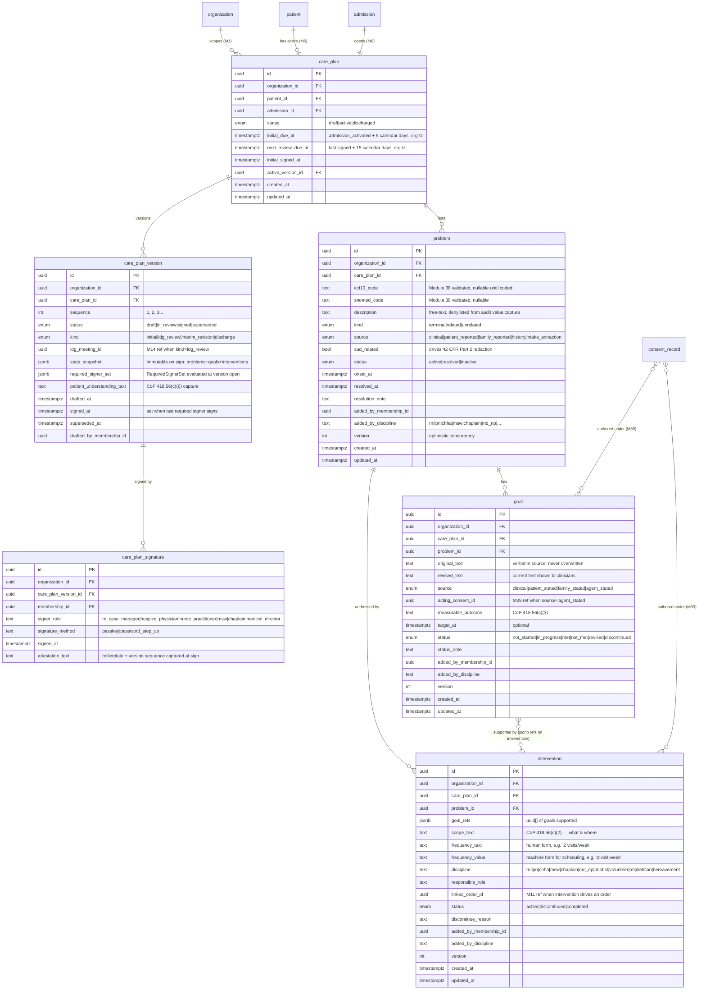
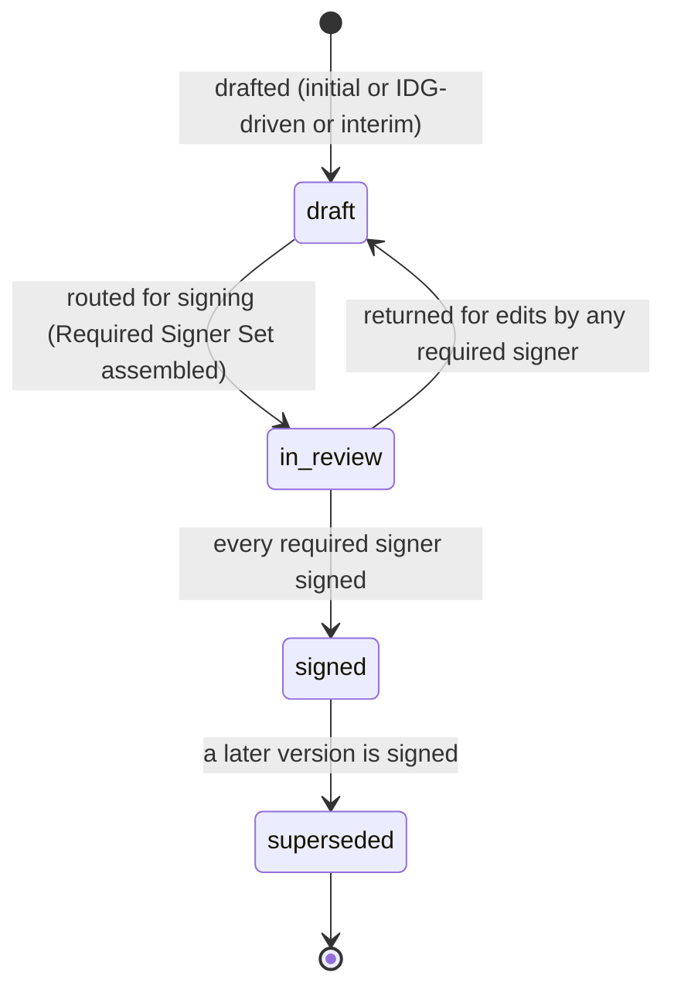

# Module 7 — Care Plan (IPOC) Specification

> **Authority note:** This spec is an **implementation proposal** (repo authority rule): [`docs/architecture/`](../architecture/) and the ratified ADRs in [`docs/adr/`](../adr/) win on conflict, and the code plus [`docs/BUSINESS_LOGIC.md`](../BUSINESS_LOGIC.md) are ground truth for as-built behavior. Mechanism choices named here may be superseded — see ADR-0036…0040 and ADR-0030/0032/0035 for the recorded divergences (outbox not Socket.IO, TypeScript not Python sidecars, app-layer AES-256-GCM not pgcrypto, pure transition tables not XState, hand-rolled HTTP hardening not `@fastify/*`, Vite + react-router not TanStack Start).


**Spec version:** v0.3 — the §2.4 outbox events migrated to the `m7.` namespace
(`m7.care_plan.*`, `m7.problem.*`, `m7.goal.*`, `m7.intervention.*`) per the M01 D8
`outbox_event_catalog` / M03 D9 convention, plus the T+13 alert payload
(`m7.care_plan.review_due`) per M36 D10. Permission keys (`care_plan.author`, …) and schema
field names (`goal.problem_id`, …) are unchanged (separate, feature-prefixed namespaces).
(Prior: v0.2.)

**Module ID:** 7
**Phase:** 1 (v1 — required for Engrace go-live; CoP 418.56)
**Depends on:** 6 (Admission, Election & Certification — provides `admission`, `election_period`, `certification_period`, the admission state machine, and the patient-on-service signal that opens the 5-day clock), 38 (Clinical Terminology — ICD-10-CM problem codes, SNOMED CT problem/goal/intervention concepts, value-set validation, `asOfDate` lookups), 39 (Consent & Authorization — DPOA agent identity & scope, 42 CFR Part 2 SUD release, advance-directive acknowledgment). Transitively via M6: 1 (Foundation — `organization`, `withOrgContext`, `audit()` helper, outbox, idempotency, RLS generator), 2 (Identity — actor resolution), 3 (Authorization — RBAC/ABAC), 4 (Audit — PHI write-audit trigger generator, audit-read declaration, retention class), 5 (Patient & Demographics — `patient` row + `privacy_flag`), 36 (Secure Messaging — overdue-review alerts), 40 (MDM — external attending physician reference), 22 (Documents — care plan PDF artifact).
**Consumed by:** 8 (Encounters & Visit Notes — encounter signing checks `careplan.isReviewOverdue` and decorates problem-reference fields), 11 (Orders — care-plan-driven order creation and IDG-requested orders link back to a problem/goal), 14 (IDG — meeting decisions emit outbox events that create the next care-plan version), 15 (Discipline Care Plans — Aide POC / Spiritual / MSW / Volunteer plans reference parent IPOC problems/goals), 16 (Bereavement — caregiver risk factors inherit from active psychosocial problems), 28 (FHIR Gateway — maps `care_plan_version` → FHIR `CarePlan`, `goal` → `Goal`, problems/interventions → `Condition`/`CarePlanActivity`), 30 (HQRP & Quality — survey readiness review reads version history and 15-day adherence), 31 (Portal & Telehealth — patient-facing care-plan summary), 33 (Reporting — recert/IDG calendar, overdue-review dashboard).
**Spec status:** Re-locked v0.3 (Phase-2 + Phase-4 remediation; supersedes Locked v0.2)

> **Phase-4 remediation (2026-06-11; ADR-0018 D3).** **M07-F01 (BLOCKER):** the IDG/care-plan
> **physician participant is MD/DO only** (the hospice medical director or a physician designee per
> CoP 418.56) — an **NP may not** occupy the IDG physician seat. M07 enforces MD/DO for the physician
> role on IPOC review/finalization; the per-patient 15-day IDG review clock is owned by M14 (M14-F01).
>
> **Phase-2 tenancy (2026-06-11; ADR-0010/0011 / ARCH-011).** **M07-F06 (MAJOR):** all **6 owned PHI
> tables** now carry `provider_entity_id` + `location_id` beside `organization_id`, both **NOT NULL**
> and denormalized from the admission at bootstrap — a care plan is a patient/admission-scoped clinical
> record that resolves to a CCN (ProviderEntity) and a service Location, enabling the Location-scoped
> IDG (ARCH-010), overdue-care-plan dashboards, and PE-scoped reporting without illegal joins through
> M5/M6 (§3.3). **M07-F08 (MINOR):** the §3.4/§3.6 RLS policies now read the canonical **`app.org_id`**
> (was the never-set `app.organization_id` → fail-closed denial) and carry a **`WITH CHECK`** clause
> per SD-029. Both are now gated by `check-tenancy` (fitness #10).

## Changelog

- **v0.2 (Locked)** — Initial publication at lock-grade. Instantiates the §20.B module spec template. Resolves all seven open questions into binding decisions (§11). Defines the **hybrid versioning model** (mutable problem/goal/intervention rows + immutable per-version state snapshot), the **5-day initial / 15-day review** CoP 418.56 enforcement (with the encounter-signing gate that consumes it), the **required-signer quorum constants** for initial and IDG-review versions, the **IDG outbox seam** with Module 14, the **patient-stated-goal verbatim preservation**, the **SUD problem confidentiality** rule that consults Module 39, and the **DPOA agent attribution** for representative-authored entries. Wires the permission keys this module registers into Module 3 (§4.5) and the seam helpers Module 8 and Module 14 call.
- **v0.1** — Drafted within the lock-grade pass; not separately published.

> **Phase boundary (binding):** Phase 1 delivers everything in this spec **except** the care-plan PDF generator (Module 22 owns the rendering; M7 emits a domain payload via outbox event for M22 to render) and the FHIR `CarePlan` resource publication (Module 28). The "done" gate for M7 is: hybrid versioning, sign-off quorum, 5-day and 15-day gates, IDG seam, SUD/DPOA integration, the schema below, and the test plan green — not gated on Modules 14/22/28 existing. The IDG seam is exercised against a test-double meeting publisher; the encounter gate is exercised against a test-double encounter signer.

-----

## 1. Purpose & Scope

### 1.1 What This Module Does

Module 7 owns the **Individualized Plan of Care (IPOC)** — the document CMS regulation calls "the plan of care" at 42 CFR §418.56 and that surveyors will most directly inspect to determine whether a hospice is in compliance. It is the binding artifact that says: *for this patient, here are the active problems, the patient-and-family-centered goals, and the discipline-specific interventions that the interdisciplinary group will deliver at a specified scope and frequency.*

- **Care plan root** — one active `care_plan` per patient per admission; created automatically when admission becomes `active` (Module 6 emits `admission.activated`); transitions to `discharged` when admission ends.
- **Hybrid versioning** — problems/goals/interventions are **mutable rows** the IDG and case manager edit over time. Each signed version is an **immutable state snapshot** (`care_plan_version.state_snapshot` jsonb) that captures the exact plan at that moment. Surveyors asking "what was the plan on day 47?" get a deterministic answer; clinicians never see versioned rows.
- **Problem list (care-plan scope)** — problems active on the IPOC, ICD-10-CM and/or SNOMED-coded via Module 38, tagged `terminal | related | unrelated` (the architecture §11 distinction that flows into Module 23's claim ICD-10 sequencing). A problem is the anchor for goals and interventions.
- **Goals — clinical and patient-stated** — goals are required to be patient-and-family-centered (CoP 418.56(c)). The model stores `source ∈ {clinical, patient_stated, family_stated, agent_stated}`. Patient-stated and family-stated goals **preserve original phrasing verbatim** (D6); revisions store a `revised_text` alongside but cannot overwrite `original_text`.
- **Interventions — discipline, scope, frequency** — interventions carry discipline tag, scope sentence, frequency (e.g. `2 visits/week`), responsible role(s), and an optional standing order or order reference (Module 11). The IDG can mark an intervention as discontinued with a reason; the row is retained.
- **Initial-version gate (5-day)** — CoP §418.54(b) sets the 5-calendar-day comprehensive-assessment deadline (from election) and §418.56(b)(1) requires the IDG-established written plan of care; by Module 9 the assessment lands inside the 5-day window from election. M7 enforces: **alert at day 3** (overdue warning), **alert at day 5** (escalation to clinical supervisor + medical director), **encounter-sign gate engages at day 6** (Module 8 refuses to sign new encounters until the initial version is signed) with override-with-reason path for documented edge cases. The clock is **calendar days in the organization's timezone**, starting at `admission.activated_at`.
- **15-day review gate** — CoP 418.56(d) requires IDG review "no less frequently than every 15 calendar days." M7 enforces: **alert at day 13** (review due), **alert at day 15** (overdue), **encounter-sign gate engages at day 17** (3-day grace, D3 rationale) until the next signed version exists. The gate is on encounter signing, not chart access — a clinician can always read and document; the system blocks committing the visit until the IDG signs.
- **Sign-off quorum** — initial version requires the **Hospice Physician (or NP) + RN Case Manager**. IDG-review version requires **RN + MSW + Chaplain + Hospice Physician** (CoP 418.56(a)(1) IDG composition). Quorum is enforced as a typed `RequiredSignerSet` constant (D5).
- **IDG-driven revisions** — Module 14 (IDG) records meeting decisions; each clinically-actionable decision emits an `idg.decision_recorded` outbox event with a typed payload (add/update/discontinue problem/goal/intervention). M7's consumer creates a **draft version** with the decisions applied and notifies the IDG coordinator to finalize and route for signing. The seam is published in `packages/domain/care-plan/idg-decision.ts` so Module 14's payload is compile-time type-checked.
- **Discipline contributions** — clinicians of any discipline can add or edit problems/goals/interventions on the current draft version, subject to RBAC + ABAC (Module 3). The system stamps `added_by_membership_id` and `added_by_discipline` on every row so the cross-discipline view aggregates by discipline.
- **DPOA-attributed entries** — when an active `dpoa_healthcare` consent (Module 39) names an agent, M7 captures `acting_as` (`patient | patient_representative`) and `consent_id` on representative-authored entries. The UI shows the agent name; audit captures the consent state at write time (consent-version-aware audit, per Module 39 architecture).
- **SUD confidentiality** — a problem may be flagged `sud_related=true`. M7 enforces SQL-level filtering of SUD-flagged content for callers without a satisfied `42_cfr_part_2_release` consent context (Module 39). The case manager and other clinicians with consent see normally; collaborators, auditors, and portal callers see redacted unless consent permits.
- **Care plan summary** — a deterministic templated summary (active problems by discipline, patient-stated goals, active interventions in lay language) produced from the current active version. Used by Module 31 (Portal — care plan summary) and Module 22 (PDF rendering). Tenant may opt into Layer-2 HearthNote polish per architecture §10.5 (D7).
- **Encounter relevance lookup** — Module 8 calls `careplan.relevantElementsForEncounter(patientId, encounterType, discipline)` to populate the encounter form's problem/goal/intervention selectors with the active care plan, so visit notes can be linked to specific care-plan elements without re-typing.
- **Order linkage** — Module 11 reads care plan problems/goals/interventions when an order is care-plan-driven; the order references the care-plan elements it implements. M7 does not import M11 (M11 depends on M7, not the reverse).
- **Audit trail per revision** — every problem/goal/intervention mutation flows through the Module 4 PHI write-audit trigger with column-level scrubbing (free-text `description` and `original_text` are denylisted from value capture; the change marker `<changed>` is recorded). Every signing event is a discrete audit event with the resolved actor and version id.

### 1.2 What This Module Does Not Do

- **The IDG meeting itself.** Module 14 owns `idg_meeting`, attendance, agenda, decisions, minutes, and the IDG patient packet (HearthNote-aggregated). M7 *consumes* IDG decisions via outbox; it does not author them.
- **Discipline-specific care plans (Aide POC, Spiritual Care Plan, MSW Plan, Volunteer Plan).** Module 15 owns those. They reference M7's problems/goals/interventions; M7 does not depend on M15.
- **Clinical assessments (PPS, FAST, PAINAD, ESAS, comprehensive assessment).** Module 9 owns those. M7 reads the latest scores from M9 when assembling the version snapshot (forward-looking; M9 isn't in M7's dependsOn because M7 lands first — M9 will register a `LatestAssessmentProvider` seam consumed by M7 at boot, per the SEAMS.md pattern).
- **Encounter documentation.** Module 8 owns visit notes; M7 exposes a lookup so M8 can decorate notes with care-plan element references.
- **Medication and non-medication orders.** Modules 11 (Orders) and 12/13 (DoseSpot/eMAR) own those. The care plan references intervention frequency for a *kind* of order ("comfort kit on hand"), but the order itself lives in Module 11.
- **Care plan PDF generation.** Module 22 (Document Management) renders the PDF using a domain payload M7 emits via outbox. M7 has no PDF code.
- **DPOA / advance directive capture.** Module 39 (Consent) owns those. M7 reads the active state and shows the agent on the care plan UI.
- **Bereavement plan.** Module 16 owns the post-death 13-month plan and inherits psychosocial context from M7 (forward reader).
- **Recert / F2F enforcement.** Module 6 owns benefit-period boundaries and F2F window. M7 *displays* the next-recert date on the care plan UI for clinician context but does not enforce it.

### 1.3 Regulatory Drivers

| Driver | Requirement | How Module 7 satisfies it |
|---|---|---|
| 42 CFR §418.56(a) | Interdisciplinary care planning approach | Problem/goal/intervention model; per-discipline contribution stamps; cross-discipline review surface |
| 42 CFR §418.56(b)(1) | Written plan of care prepared by IDG in collaboration with attending, patient, primary caregiver | Sign-off quorum (initial: physician + RN); patient/family/agent goal `source`; attending NPI captured from Module 40 |
| 42 CFR §418.56(c)(1–6) | Plan content: interventions for pain/symptoms, scope & frequency, measurable outcomes, drugs/treatments, supplies, IDG-documented patient understanding | Intervention `scope_text` + `frequency`; goal `measurable_outcome` field; patient-understanding capture on initial-version signature |
| 42 CFR §418.56(d) | IDG review no less frequently than every 15 calendar days | 15-day gate (D3); next-review-due date computed from last signed version; encounter-sign block on overdue |
| 42 CFR §418.54(b)(2) | Comprehensive assessment within 5 days drives plan | 5-day initial-version gate (D2); admission activation opens the clock |
| 42 CFR §418.104 | Clinical records — completeness, authentication, retention | Multi-signer authentication with stored timestamp + role; immutable `state_snapshot`; Module 4 retention class `compliance` |
| HIPAA §164.502(b) — Minimum necessary | Disclose only what's necessary | Care-plan-summary surface for portal/collaborator strips clinical-internal fields; ABAC caseload + discipline scope on edit |
| 42 CFR Part 2 | SUD record confidentiality | `sud_related` problem flag + ABAC predicate consulting Module 39 `42_cfr_part_2_release` consent |
| HIPAA §164.508 (Authorization for Uses & Disclosures) | Patient authorization for re-disclosure | DPOA agent attribution; consent state captured at write time |
| HIPAA §164.312(b) — Audit controls | Record access/changes | Module 4 PHI write-audit trigger + per-signature event |

### 1.4 Competitive Context

WellSky, FireNote/Axxess, MatrixCare, and HCHB all ship a care plan, but the common pattern is a **flat problem list with a free-text "plan" field per discipline** and a separate "IDG review" checkbox that does not enforce content. Surveyors regularly cite agencies for two patterns the legacy EHRs allow: (1) the 15-day review marked "complete" without any document change ("review without revision"), and (2) goals that are clinical only, not patient-stated, in plain violation of CoP 418.56(c). WardenX's differentiators are: (a) **immutable per-version state snapshot** that makes "what was the plan on day N" deterministic; (b) **patient-stated-goal verbatim preservation**, structurally required at the schema level; (c) **encounter-sign gate** on overdue review — the strongest enforcement short of locking the chart; (d) **IDG-decision-driven revision** via typed outbox payload so a meeting decision can't fail to flow into the plan; (e) **per-discipline contribution stamps** that prove cross-discipline care planning in survey, not just IDG-coordinator-authored entries.

-----

## 2. Domain Model

### 2.1 Entity-Relationship Diagram

Tables marked **(M1/M5/M6)** are provided by their owning modules; M7 owns the **(M7)** tables.



> **Note on `audit_event`:** Per the helper-only-tables policy (`module-manifest.ts` §HELPER_ONLY_TABLES), M7 never imports `audit_event` directly. Write capture flows through Module 4's PHI write-audit trigger installed in this module's migration; application-layer reads call `auditRead(...)` from `packages/audit`.

### 2.2 Entity Lifecycle States

#### 2.2.1 Care plan (`care_plan.status`)

```mermaid
stateDiagram-v2
    [*] --> draft: admission.activated received; row created
    draft --> active: initial version signed (Required Signer Set met)
    active --> active: any signed revision (active stays; active_version_id flips)
    active --> discharged: admission ends (discharge/death/revoke/transfer)
    discharged --> [*]
```



- Exactly **one non-discharged `care_plan` per (patient, admission)** is enforced by a partial unique index. A revoke-and-readmit (Module 6) opens a new admission and a new care plan.
- `discharged` is terminal; the row is retained for the full Module 4 `compliance` retention class (7 years per architecture §24).

#### 2.2.2 Care plan version (`care_plan_version.status`)



- The transition `draft → in_review` snapshots `state_snapshot` and the `required_signer_set`. From this point, problems/goals/interventions can still be edited *until* the first signer signs; after the first signature, any further edit returns the version to `draft` and clears prior signatures (D8 — concurrency/integrity rule).
- `signed` is immutable for the version: `state_snapshot`, signatures, and timestamps cannot change. A clinician who needs a correction creates a new version (kind `interim_revision`).

#### 2.2.3 Problem / Goal / Intervention status

```mermaid
stateDiagram-v2
    direction LR
    state problem {
        [*] --> active
        active --> resolved: resolved with note
        active --> inactive: removed without resolution
        resolved --> [*]
        inactive --> [*]
    }
    state goal {
        [*] --> not_started
        not_started --> in_progress
        in_progress --> met
        in_progress --> not_met
        in_progress --> revised: revised_text changes; original_text preserved
        in_progress --> discontinued
        met --> [*]
        not_met --> [*]
        revised --> in_progress
        discontinued --> [*]
    }
    state intervention {
        [*] --> active
        active --> discontinued: with reason
        active --> completed: time-bounded intervention finished
        discontinued --> [*]
        completed --> [*]
    }
```



Resolved problems retain their goals/interventions (also marked terminal-status), so historical signed versions still resolve referentially.

> **Problem proposals from DocLens — as built (F-238 dx-writeback, 2026-10-04).** A diagnosis extracted from a referral packet and attested by the M22 reviewer does **not** become a `problem`. M7's `m7.extraction-diagnosis-writeback` consumer (on `m22.extraction.diagnosis_commit_requested`) lands it in the separate M7 table **`problem_proposal`** (migration 0310; `status` `pending → accepted | dismissed`), attached to the patient's single non-discharged care plan (otherwise skipped `no_care_plan` / `care_plan_ambiguous` — a plan is never created). The proposal carries the description, the ICD-10-CM code as printed or as typed by the DocLens reviewer (never model-assigned) with its M38 verdict as of the referral date (`valid` / `not_valid_as_of` / `unvalidated` — the code is kept in every case), the document's own role label (`principal | secondary | history | unspecified` — a suggestion, never `kind`), `sud_related`, and a `duplicate_of_problem_id` flag when an active problem already carries the code (never merged). At most one pending proposal per (patient, code-or-normalized-description). Because proposals live outside `problem`, nothing that reads `problem` — the §7.8 seam, claim-diagnosis sequencing and its Part 2 gate, the IDG packet, HOPE, the portal, `state_snapshot` — can see one. A clinician holding `care_plan.author` (+ `caseload_or_scope`; AI principals refused) **accepts** — choosing `kind` (terminal/related/unrelated is the hospice physician's determination) and optionally correcting the code — which inserts the `problem` with `source = 'intake_extraction'`, `status = 'active'`, `added_by_membership_id` = the accepter, and emits `m7.problem.added`; or **dismisses** (nothing charted). Routes: `GET /care-plans/:planId/problem-proposals`, `POST …/:proposalId/accept`, `POST …/:proposalId/dismiss` (`ifVersion` concurrency; 409 when not pending). SUD proposals follow §7.6 (omitted / 404 without disclosure). Proposals are erased with the care-plan record (D8).

### 2.3 Validation Rules

| Rule | Type | Detail |
|---|---|---|
| One active plan per admission | sync (partial unique index) | `UNIQUE (organization_id, admission_id) WHERE status <> 'discharged'` |
| Initial version must include ≥1 problem | sync (server-side at `in_review` transition) | CoP 418.56(c) requires problems |
| Goal must reference a problem | sync (FK + service-level) | `goal.problem_id NOT NULL` |
| Intervention must reference a problem | sync | `intervention.problem_id NOT NULL` |
| Intervention frequency required | sync | `frequency_value NOT NULL` (regex on machine form) |
| Patient-stated goal verbatim | sync | `original_text NOT NULL`; trigger refuses UPDATE of `original_text` |
| ICD-10 code validity | async (Module 38) | `validate(code, 'icd-10-cm', service_date)` returns active |
| Terminal problem present | sync at sign | `≥1 problem WHERE kind='terminal' AND status='active'` to sign initial; warn on idg_review |
| 5-day initial deadline | async (worker) | `careplan.5day-warning` cron sets `initial_due_at` reminders |
| 15-day review interval | async (worker) | `careplan.15day-overdue` cron updates `next_review_due_at` and the encounter-sign gate |
| Required Signer Set met before `signed` | sync | server refuses `signed` transition unless every required role has signed |
| No edit after first signature | sync (CHECK + service) | adding a signature where draft has been edited since prior signature returns version to `draft` |
| SUD problem requires consent for non-case-manager read | ABAC | predicate `sud_disclosure_allowed` against Module 39 consent state |
| DPOA-authored goal requires active consent | sync | `goal.acting_consent_id` must be active `dpoa_healthcare` for the patient at write time |
| Optimistic concurrency | sync | every row carries `version int`; PATCH `If-Match` against ETag; 412 on stale |

### 2.4 Side-Effects (events emitted)

All emitted through Module 1's outbox helper. Subscribers may be in-tenant (Module 14 IDG, Module 22 PDF) or platform (Module 33 reporting materialized views).

| Event type | Trigger | Subscribers | Payload (summary) |
|---|---|---|---|
| `m7.care_plan.created` | admission.activated processed | M33 | `{ planId, patientId, admissionId }` |
| `m7.care_plan.version_drafted` | new version opened (any kind) | M14 (when kind=idg_review confirms), M33 | `{ planId, versionId, kind, sequence }` |
| `m7.care_plan.version_signed` | last required signer signs | M14, M22 (PDF), M28 (FHIR future), M30, M33 | `{ planId, versionId, kind, snapshotRef }` |
| `m7.care_plan.review_overdue` | 15-day gate engages | M36 (alerts), M8 (encounter gate), M33 | `{ planId, patientId, dueAt, overdueAt }` |
| `m7.care_plan.initial_overdue` | 5-day gate engages | M36, M8, M33 | `{ planId, patientId, admissionActivatedAt }` |
| `m7.problem.added/updated/resolved` | mutation | M14 (next packet aggregation), M28 (FHIR Condition) | `{ planId, problemId, status }` |
| `m7.goal.added/updated/met/discontinued` | mutation | M14, M28 (FHIR Goal) | `{ planId, goalId, status, source }` |
| `m7.intervention.added/updated/discontinued` | mutation | M14, M11 (if linked), M28 (FHIR CarePlanActivity) | `{ planId, interventionId, status, discipline }` |
| `m7.care_plan.discharged` | admission ends | M16 (bereavement plan init), M30, M33 | `{ planId, patientId, reason }` |

Idempotent dispatch via the outbox dispatcher (Module 1 §4.8).

-----

## 3. Drizzle Schema

### 3.1 Package Layout

```
apps/backend/src/modules/07-care-plan/
├── routes/
│   ├── care-plans.ts
│   ├── versions.ts
│   ├── signatures.ts
│   ├── problems.ts
│   ├── goals.ts
│   ├── interventions.ts
│   └── summary.ts
├── services/
│   ├── version-lifecycle.ts        # draft/in_review/signed/superseded
│   ├── required-signer-set.ts      # initial vs idg_review quorum
│   ├── snapshot.ts                  # build state_snapshot at in_review
│   ├── overdue-gate.ts              # 5-day / 15-day computation
│   ├── idg-decision-consumer.ts     # outbox subscriber from M14
│   ├── encounter-relevance.ts       # M8 lookup
│   └── summary-builder.ts           # portal-shareable summary
├── workers/
│   ├── 5day-warning.cron.ts
│   ├── 15day-overdue.cron.ts
│   └── idg-decision.worker.ts
├── domain/                          # (re-exported via packages/domain)
└── boot.ts                          # registers ABAC predicates, outbox subscribers, M8 helper
packages/db/src/schema/
├── care-plans.ts
├── care-plan-versions.ts
├── care-plan-signatures.ts
├── problems.ts
├── goals.ts
└── interventions.ts
packages/domain/care-plan/
├── idg-decision.ts                  # IDG → M7 outbox payload (typed seam)
├── required-signer-set.ts           # RequiredSignerSet constant
└── types.ts
```

### 3.2 Enums

```typescript
// packages/db/src/enums.ts (additions)
import { pgEnum } from 'drizzle-orm/pg-core'

export const carePlanStatus = pgEnum('care_plan_status', [
  'draft', 'active', 'discharged',
])

export const carePlanVersionStatus = pgEnum('care_plan_version_status', [
  'draft', 'in_review', 'signed', 'superseded',
])

export const carePlanVersionKind = pgEnum('care_plan_version_kind', [
  'initial', 'idg_review', 'interim_revision', 'discharge',
])

export const problemKind = pgEnum('problem_kind', [
  'terminal', 'related', 'unrelated',
])

export const problemSource = pgEnum('problem_source', [
  'clinical', 'patient_reported', 'family_reported', 'history', 'intake_extraction',
])

export const problemStatus = pgEnum('problem_status', [
  'active', 'resolved', 'inactive',
])

export const goalSource = pgEnum('goal_source', [
  'clinical', 'patient_stated', 'family_stated', 'agent_stated',
])

export const goalStatus = pgEnum('goal_status', [
  'not_started', 'in_progress', 'met', 'not_met', 'revised', 'discontinued',
])

export const interventionStatus = pgEnum('intervention_status', [
  'active', 'discontinued', 'completed',
])

export const interventionDiscipline = pgEnum('intervention_discipline', [
  'rn', 'lpn', 'chha', 'msw', 'chaplain', 'md_np',
  'pt', 'ot', 'st', 'volunteer', 'music_therapy', 'dietitian', 'bereavement',
])

export const carePlanSignerRole = pgEnum('care_plan_signer_role', [
  'rn_case_manager', 'hospice_physician', 'nurse_practitioner',
  'msw', 'chaplain', 'medical_director',
])
```

### 3.3 Schemas (Drizzle)

> **Tenancy three-column rule (M07-F06 / ADR-0010 D1 / ARCH-011).** All **6 owned PHI tables**
> (`care_plan`, `care_plan_version`, `care_plan_signature`, `problem`, `goal`, `intervention`) carry
> `organization_id` + `provider_entity_id` + `location_id`. The latter two are **NOT NULL** — a care
> plan is a **patient/admission-scoped clinical record**, not an org-level entity, so it always
> resolves to a ProviderEntity (the CCN the plan is authored under) and a service Location, both
> **denormalized from the admission at bootstrap** (the care-plan create-from-admission path). This is
> what lets the **IDG (Location-scoped per ARCH-010)**, overdue-care-plan dashboards, and quorum
> staffing run **location-scoped ABAC / PE-scoped reporting without joining through M5/M6** (which M07
> may not read directly). SD-028 composite index `(organization_id, location_id, …)` and
> `(organization_id, provider_entity_id, …)` on reporting surfaces; RLS stays keyed on `app.org_id`
> with PE/location as minimum-necessary ABAC narrowing. Satisfies `check-tenancy` (fitness #10). The
> M1 `providerEntities`/`locations` schemas are imported alongside `organizations` in each file.

```typescript
// packages/db/src/schema/care-plans.ts
import { pgTable, uuid, timestamp, index, uniqueIndex } from 'drizzle-orm/pg-core'
import { sql } from 'drizzle-orm'
import { carePlanStatus } from '../enums'
import { organizations, providerEntities, locations } from './organizations'  // M1 — ARCH-011 tenancy spine
import { patients } from './patients'           // M5
import { admissions } from './admissions'        // M6

export const carePlans = pgTable(
  'care_plan',
  {
    id: uuid('id').primaryKey().defaultRandom(),
    organizationId: uuid('organization_id').notNull()
      .references(() => organizations.id, { onDelete: 'restrict' }),
    providerEntityId: uuid('provider_entity_id').notNull()        // ARCH-011 / M07-F06 (NOT NULL — see §3.3 tenancy note)
      .references(() => providerEntities.id, { onDelete: 'restrict' }),
    locationId: uuid('location_id').notNull()                     // ARCH-011 / M07-F06 (NOT NULL — see §3.3 tenancy note)
      .references(() => locations.id, { onDelete: 'restrict' }),
    patientId: uuid('patient_id').notNull()
      .references(() => patients.id, { onDelete: 'restrict' }),
    admissionId: uuid('admission_id').notNull()
      .references(() => admissions.id, { onDelete: 'restrict' }),
    status: carePlanStatus('status').notNull().default('draft'),
    initialDueAt: timestamp('initial_due_at', { withTimezone: true }).notNull(),
    initialSignedAt: timestamp('initial_signed_at', { withTimezone: true }),
    nextReviewDueAt: timestamp('next_review_due_at', { withTimezone: true }),
    activeVersionId: uuid('active_version_id'), // self-FK after care_plan_version table defined
    createdAt: timestamp('created_at', { withTimezone: true }).notNull().defaultNow(),
    updatedAt: timestamp('updated_at', { withTimezone: true }).notNull().defaultNow(),
  },
  (t) => ({
    orgPatientIdx: index('care_plan_org_patient_idx').on(t.organizationId, t.patientId),
    onePerAdmission: uniqueIndex('care_plan_one_per_admission_uq')
      .on(t.organizationId, t.admissionId)
      .where(sql`status <> 'discharged'`),
    dueIdx: index('care_plan_next_review_due_idx').on(t.nextReviewDueAt),
    initialDueIdx: index('care_plan_initial_due_idx').on(t.initialDueAt),
  }),
)
```

```typescript
// packages/db/src/schema/care-plan-versions.ts
import { pgTable, uuid, integer, jsonb, text, timestamp, index, uniqueIndex } from 'drizzle-orm/pg-core'
import { carePlanVersionStatus, carePlanVersionKind } from '../enums'
import { organizations, providerEntities, locations } from './organizations'  // M1 — ARCH-011 tenancy spine
import { carePlans } from './care-plans'
import { memberships } from './memberships'

export const carePlanVersions = pgTable(
  'care_plan_version',
  {
    id: uuid('id').primaryKey().defaultRandom(),
    organizationId: uuid('organization_id').notNull()
      .references(() => organizations.id, { onDelete: 'restrict' }),
    providerEntityId: uuid('provider_entity_id').notNull()        // ARCH-011 / M07-F06 (NOT NULL — see §3.3 tenancy note)
      .references(() => providerEntities.id, { onDelete: 'restrict' }),
    locationId: uuid('location_id').notNull()                     // ARCH-011 / M07-F06 (NOT NULL — see §3.3 tenancy note)
      .references(() => locations.id, { onDelete: 'restrict' }),
    carePlanId: uuid('care_plan_id').notNull()
      .references(() => carePlans.id, { onDelete: 'restrict' }),
    sequence: integer('sequence').notNull(),
    status: carePlanVersionStatus('status').notNull().default('draft'),
    kind: carePlanVersionKind('kind').notNull(),
    idgMeetingId: uuid('idg_meeting_id'), // soft-ref to M14
    stateSnapshot: jsonb('state_snapshot'), // null until in_review; immutable after signed
    requiredSignerSet: jsonb('required_signer_set').notNull(),
    patientUnderstandingText: text('patient_understanding_text'),
    draftedAt: timestamp('drafted_at', { withTimezone: true }).notNull().defaultNow(),
    signedAt: timestamp('signed_at', { withTimezone: true }),
    supersededAt: timestamp('superseded_at', { withTimezone: true }),
    draftedByMembershipId: uuid('drafted_by_membership_id').references(() => memberships.id),
  },
  (t) => ({
    planSeqUq: uniqueIndex('care_plan_version_plan_seq_uq').on(t.carePlanId, t.sequence),
    planStatusIdx: index('care_plan_version_plan_status_idx').on(t.carePlanId, t.status),
    signedAtIdx: index('care_plan_version_signed_at_idx').on(t.signedAt),
  }),
)
```

```typescript
// packages/db/src/schema/care-plan-signatures.ts
import { pgTable, uuid, text, timestamp, uniqueIndex, index } from 'drizzle-orm/pg-core'
import { carePlanSignerRole } from '../enums'
import { organizations, providerEntities, locations } from './organizations'  // M1 — ARCH-011 tenancy spine
import { carePlanVersions } from './care-plan-versions'
import { memberships } from './memberships'

export const carePlanSignatures = pgTable(
  'care_plan_signature',
  {
    id: uuid('id').primaryKey().defaultRandom(),
    organizationId: uuid('organization_id').notNull()
      .references(() => organizations.id, { onDelete: 'restrict' }),
    providerEntityId: uuid('provider_entity_id').notNull()        // ARCH-011 / M07-F06 (NOT NULL — see §3.3 tenancy note)
      .references(() => providerEntities.id, { onDelete: 'restrict' }),
    locationId: uuid('location_id').notNull()                     // ARCH-011 / M07-F06 (NOT NULL — see §3.3 tenancy note)
      .references(() => locations.id, { onDelete: 'restrict' }),
    carePlanVersionId: uuid('care_plan_version_id').notNull()
      .references(() => carePlanVersions.id, { onDelete: 'restrict' }),
    membershipId: uuid('membership_id').notNull()
      .references(() => memberships.id, { onDelete: 'restrict' }),
    signerRole: carePlanSignerRole('signer_role').notNull(),
    signatureMethod: text('signature_method').notNull(), // 'passkey'|'password_step_up'
    signedAt: timestamp('signed_at', { withTimezone: true }).notNull().defaultNow(),
    attestationText: text('attestation_text').notNull(),
  },
  (t) => ({
    versionRoleUq: uniqueIndex('care_plan_signature_version_role_uq')
      .on(t.carePlanVersionId, t.signerRole),
    versionIdx: index('care_plan_signature_version_idx').on(t.carePlanVersionId),
  }),
)
```

```typescript
// packages/db/src/schema/problems.ts
import { pgTable, uuid, text, timestamp, integer, boolean, index } from 'drizzle-orm/pg-core'
import { problemKind, problemSource, problemStatus } from '../enums'
import { organizations, providerEntities, locations } from './organizations'  // M1 — ARCH-011 tenancy spine
import { carePlans } from './care-plans'
import { memberships } from './memberships'

export const problems = pgTable(
  'problem',
  {
    id: uuid('id').primaryKey().defaultRandom(),
    organizationId: uuid('organization_id').notNull()
      .references(() => organizations.id, { onDelete: 'restrict' }),
    providerEntityId: uuid('provider_entity_id').notNull()        // ARCH-011 / M07-F06 (NOT NULL — see §3.3 tenancy note)
      .references(() => providerEntities.id, { onDelete: 'restrict' }),
    locationId: uuid('location_id').notNull()                     // ARCH-011 / M07-F06 (NOT NULL — see §3.3 tenancy note)
      .references(() => locations.id, { onDelete: 'restrict' }),
    carePlanId: uuid('care_plan_id').notNull()
      .references(() => carePlans.id, { onDelete: 'restrict' }),
    icd10Code: text('icd10_code'),
    snomedCode: text('snomed_code'),
    description: text('description').notNull(),
    kind: problemKind('kind').notNull(),
    source: problemSource('source').notNull().default('clinical'),
    sudRelated: boolean('sud_related').notNull().default(false),
    status: problemStatus('status').notNull().default('active'),
    onsetAt: timestamp('onset_at', { withTimezone: true }),
    resolvedAt: timestamp('resolved_at', { withTimezone: true }),
    resolutionNote: text('resolution_note'),
    addedByMembershipId: uuid('added_by_membership_id').references(() => memberships.id),
    addedByDiscipline: text('added_by_discipline'),
    version: integer('version').notNull().default(1),
    createdAt: timestamp('created_at', { withTimezone: true }).notNull().defaultNow(),
    updatedAt: timestamp('updated_at', { withTimezone: true }).notNull().defaultNow(),
  },
  (t) => ({
    planStatusIdx: index('problem_plan_status_idx').on(t.carePlanId, t.status),
    kindIdx: index('problem_kind_idx').on(t.carePlanId, t.kind),
    sudIdx: index('problem_sud_idx').on(t.carePlanId).where(sql`sud_related = true`),
  }),
)
```

```typescript
// packages/db/src/schema/goals.ts
import { pgTable, uuid, text, timestamp, integer, index } from 'drizzle-orm/pg-core'
import { goalSource, goalStatus } from '../enums'
import { organizations, providerEntities, locations } from './organizations'  // M1 — ARCH-011 tenancy spine
import { carePlans } from './care-plans'
import { problems } from './problems'
import { memberships } from './memberships'

export const goals = pgTable(
  'goal',
  {
    id: uuid('id').primaryKey().defaultRandom(),
    organizationId: uuid('organization_id').notNull()
      .references(() => organizations.id, { onDelete: 'restrict' }),
    providerEntityId: uuid('provider_entity_id').notNull()        // ARCH-011 / M07-F06 (NOT NULL — see §3.3 tenancy note)
      .references(() => providerEntities.id, { onDelete: 'restrict' }),
    locationId: uuid('location_id').notNull()                     // ARCH-011 / M07-F06 (NOT NULL — see §3.3 tenancy note)
      .references(() => locations.id, { onDelete: 'restrict' }),
    carePlanId: uuid('care_plan_id').notNull()
      .references(() => carePlans.id, { onDelete: 'restrict' }),
    problemId: uuid('problem_id').notNull()
      .references(() => problems.id, { onDelete: 'restrict' }),
    originalText: text('original_text').notNull(),
    revisedText: text('revised_text'),
    source: goalSource('source').notNull(),
    actingConsentId: uuid('acting_consent_id'), // soft-ref to M39 consent_record
    measurableOutcome: text('measurable_outcome'),
    targetAt: timestamp('target_at', { withTimezone: true }),
    status: goalStatus('status').notNull().default('not_started'),
    statusNote: text('status_note'),
    addedByMembershipId: uuid('added_by_membership_id').references(() => memberships.id),
    addedByDiscipline: text('added_by_discipline'),
    version: integer('version').notNull().default(1),
    createdAt: timestamp('created_at', { withTimezone: true }).notNull().defaultNow(),
    updatedAt: timestamp('updated_at', { withTimezone: true }).notNull().defaultNow(),
  },
  (t) => ({
    planProblemIdx: index('goal_plan_problem_idx').on(t.carePlanId, t.problemId),
    sourceIdx: index('goal_source_idx').on(t.carePlanId, t.source),
    statusIdx: index('goal_status_idx').on(t.carePlanId, t.status),
  }),
)
```

```typescript
// packages/db/src/schema/interventions.ts
import { pgTable, uuid, text, jsonb, timestamp, integer, index } from 'drizzle-orm/pg-core'
import { interventionStatus, interventionDiscipline } from '../enums'
import { organizations, providerEntities, locations } from './organizations'  // M1 — ARCH-011 tenancy spine
import { carePlans } from './care-plans'
import { problems } from './problems'
import { memberships } from './memberships'

export const interventions = pgTable(
  'intervention',
  {
    id: uuid('id').primaryKey().defaultRandom(),
    organizationId: uuid('organization_id').notNull()
      .references(() => organizations.id, { onDelete: 'restrict' }),
    providerEntityId: uuid('provider_entity_id').notNull()        // ARCH-011 / M07-F06 (NOT NULL — see §3.3 tenancy note)
      .references(() => providerEntities.id, { onDelete: 'restrict' }),
    locationId: uuid('location_id').notNull()                     // ARCH-011 / M07-F06 (NOT NULL — see §3.3 tenancy note)
      .references(() => locations.id, { onDelete: 'restrict' }),
    carePlanId: uuid('care_plan_id').notNull()
      .references(() => carePlans.id, { onDelete: 'restrict' }),
    problemId: uuid('problem_id').notNull()
      .references(() => problems.id, { onDelete: 'restrict' }),
    goalRefs: jsonb('goal_refs').notNull().default('[]'), // uuid[]
    scopeText: text('scope_text').notNull(),
    frequencyText: text('frequency_text').notNull(),
    frequencyValue: text('frequency_value').notNull(), // e.g. '2:visit:week'
    discipline: interventionDiscipline('discipline').notNull(),
    responsibleRole: text('responsible_role'),
    linkedOrderId: uuid('linked_order_id'), // soft-ref to M11 order
    status: interventionStatus('status').notNull().default('active'),
    discontinueReason: text('discontinue_reason'),
    addedByMembershipId: uuid('added_by_membership_id').references(() => memberships.id),
    addedByDiscipline: text('added_by_discipline'),
    version: integer('version').notNull().default(1),
    createdAt: timestamp('created_at', { withTimezone: true }).notNull().defaultNow(),
    updatedAt: timestamp('updated_at', { withTimezone: true }).notNull().defaultNow(),
  },
  (t) => ({
    planProblemIdx: index('intervention_plan_problem_idx').on(t.carePlanId, t.problemId),
    disciplineIdx: index('intervention_discipline_idx').on(t.carePlanId, t.discipline),
    statusIdx: index('intervention_status_idx').on(t.carePlanId, t.status),
  }),
)
```

### 3.4 RLS Policies

All six tables follow the standard org-scoped pattern (Module 1 RLS generator):

```sql
ALTER TABLE care_plan              ENABLE ROW LEVEL SECURITY;
ALTER TABLE care_plan_version      ENABLE ROW LEVEL SECURITY;
ALTER TABLE care_plan_signature    ENABLE ROW LEVEL SECURITY;
ALTER TABLE problem                ENABLE ROW LEVEL SECURITY;
ALTER TABLE goal                   ENABLE ROW LEVEL SECURITY;
ALTER TABLE intervention           ENABLE ROW LEVEL SECURITY;

-- Generated by packages/tenancy RLS generator (one per table):
CREATE POLICY care_plan_org_isolation ON care_plan
  USING      (organization_id = current_setting('app.org_id', true)::uuid)   -- M07-F08: canonical app.org_id (SD §4.1), not app.organization_id
  WITH CHECK (organization_id = current_setting('app.org_id', true)::uuid);  -- M07-F08 / SD-029: WITH CHECK on writes
-- ... and so on for the five other tables.
```

### 3.5 Audit Write Triggers (consume Module 4 generator)

Module 4 ships `generateAuditTrigger`. M7's migration calls it for each PHI table, with the per-table denylist:

```sql
-- problem: denylist free-text and resolution note
SELECT audit_install_trigger('problem',
  'problem',
  ARRAY['description', 'resolution_note'],
  'compliance');

-- goal: denylist original/revised text and status note (free-text)
SELECT audit_install_trigger('goal',
  'goal',
  ARRAY['original_text', 'revised_text', 'status_note', 'measurable_outcome'],
  'compliance');

-- intervention: denylist scope_text, frequency_text, discontinue_reason
SELECT audit_install_trigger('intervention',
  'intervention',
  ARRAY['scope_text', 'frequency_text', 'discontinue_reason'],
  'compliance');

-- care_plan, care_plan_version, care_plan_signature: structural rows, no free-text denylist
SELECT audit_install_trigger('care_plan',           'care_plan',           ARRAY[]::text[], 'compliance');
SELECT audit_install_trigger('care_plan_version',   'care_plan_version',   ARRAY['patient_understanding_text']::text[], 'compliance');
SELECT audit_install_trigger('care_plan_signature', 'care_plan_signature', ARRAY[]::text[], 'compliance');
```

`patient_understanding_text` is denylisted on `care_plan_version` because it is patient-quoted free-text that frequently contains sensitive personal phrasing (e.g. faith-specific language); the *fact* of capture is auditable; the text itself is not duplicated into audit.

### 3.6 Migration `0007_care_plan.sql` (skeleton)

```sql
-- Enums (problem_kind, problem_source, ... all from §3.2)
CREATE TYPE care_plan_status AS ENUM ('draft','active','discharged');
-- ... seven more types

-- Tables (verbatim from §3.3, omitted here for brevity)

-- RLS
ALTER TABLE care_plan ENABLE ROW LEVEL SECURITY;
-- ... five more

-- RLS policies
CREATE POLICY care_plan_org_isolation ON care_plan
  USING      (organization_id = current_setting('app.org_id', true)::uuid)   -- M07-F08: canonical app.org_id (SD §4.1), not app.organization_id
  WITH CHECK (organization_id = current_setting('app.org_id', true)::uuid);  -- M07-F08 / SD-029: WITH CHECK on writes
-- ... five more

-- App-role GRANTs (writer = wardenx_app; owner inserts via SECURITY DEFINER trigger only)
GRANT SELECT, INSERT, UPDATE ON care_plan, care_plan_version, care_plan_signature,
                                  problem, goal, intervention TO wardenx_app;

-- Audit triggers (§3.5)
SELECT audit_install_trigger(...);

-- 12-month rolling indexes pre-built; problem/goal/intervention not partitioned (low volume per patient).

-- Seed: none. The data is per-patient and created at admission activation.
```

-----

## 4. API Routes

### 4.1 Route Inventory

| Method | Path | Auth | RBAC | ABAC | Idempotent | Pagination |
|---|---|---|---|---|---|---|
| GET | `/patients/:patientId/care-plan` | staff | `care_plan.read` | `caseload_or_scope` ∧ `sud_disclosure_allowed` (per-problem) | — | n/a |
| POST | `/patients/:patientId/care-plan` | system + staff | `care_plan.bootstrap` | `caseload_or_scope` | yes (admissionId) | — |
| GET | `/care-plans/:planId/versions` | staff | `care_plan.read` | `caseload_or_scope` | — | cursor |
| GET | `/care-plans/:planId/versions/:versionId` | staff | `care_plan.read` | `caseload_or_scope` | — | n/a |
| POST | `/care-plans/:planId/versions` | staff | `care_plan.author` | `caseload_or_scope` | yes (Idempotency-Key) | — |
| POST | `/care-plans/:planId/versions/:versionId/finalize` | staff | `care_plan.finalize` | `caseload_or_scope` ∧ `role∈{rn,clinical_supervisor}` | yes | — |
| POST | `/care-plans/:planId/versions/:versionId/signatures` | staff | `care_plan.sign` | `caseload_or_scope` ∧ `signer_role_match` | yes | — |
| POST | `/care-plans/:planId/versions/:versionId/return-to-draft` | staff | `care_plan.author` | `caseload_or_scope` | yes | — |
| POST | `/care-plans/:planId/problems` | staff | `care_plan.author` | `caseload_or_scope` | yes | — |
| PATCH | `/care-plans/:planId/problems/:problemId` | staff | `care_plan.author` | `caseload_or_scope`; If-Match required | Idempotency-Key (24 h) | — |
| POST | `/care-plans/:planId/problems/:problemId/resolve` | staff | `care_plan.author` | `caseload_or_scope` | yes | — |
| POST | `/care-plans/:planId/goals` | staff | `care_plan.author` | `caseload_or_scope` ∧ (`source=agent_stated` ⇒ `dpoa_active`) | yes | — |
| PATCH | `/care-plans/:planId/goals/:goalId` | staff | `care_plan.author` | `caseload_or_scope`; If-Match | Idempotency-Key (24 h) | — |
| POST | `/care-plans/:planId/interventions` | staff | `care_plan.author` | `caseload_or_scope` ∧ `discipline_scope` | yes | — |
| PATCH | `/care-plans/:planId/interventions/:interventionId` | staff | `care_plan.author` | `caseload_or_scope`; If-Match | Idempotency-Key (24 h) | — |
| POST | `/care-plans/:planId/interventions/:interventionId/discontinue` | staff | `care_plan.author` | `caseload_or_scope` | yes | — |
| GET | `/care-plans/:planId/summary` | staff or collaborator | `care_plan.read_summary` | `caseload_or_scope` ∨ `collaborator_patient_match` | — | n/a |
| GET | `/care-plans/:planId/overdue-status` | staff (incl. M8) | `care_plan.read` | `caseload_or_scope` | — | n/a |
| GET | `/internal/care-plan/relevant-elements` | service (internal) | `care_plan.read` (internal) | M8 caller asserts scope | — | n/a |

All routes return the standard error envelope (Module 1 §4) and all PHI-reading routes carry the `requireReadAudit` declaration so the route handler triggers a `<resource>.viewed` audit event automatically (Module 4 §3.4).

### 4.1.1 Idempotency-Key on PATCH Routes (M07-F09 — ARCH-263, SD-053)

> **M07-F09 (ADR-0021 §20.B requirement).** Authority: ARCH-263 (idempotency as a platform invariant), SD-053 (M1 idempotency middleware). Every PATCH route in M7 (`/problems/:problemId`, `/goals/:goalId`, `/interventions/:interventionId`) **must** carry an `Idempotency-Key` request header in addition to the existing `If-Match` / ETag optimistic-concurrency mechanism. The two headers are complementary: `If-Match` prevents silent overwrites by detecting version skew; `Idempotency-Key` prevents duplicate mutations caused by client retries (mobile reconnects, field-tablet intermittent connectivity).

**Semantics (enforced by M1 idempotency middleware):**

- Header name: `Idempotency-Key` (string, required on all three M7 PATCH routes; 400 if absent).
- Storage: a `{key → {status, responseBody, expiresAt}}` record is written to **Valkey** with a **24-hour TTL** by the M1 `idempotencyMiddleware` before the handler runs.
- On first receipt: the handler executes; the response (status + body) is cached under the key.
- On retry with the **same key and same request body**: the cached response is returned immediately (no DB write); response includes `Idempotency-Replay: true` header.
- On retry with the **same key but different request body**: the middleware returns **409 Conflict** with `{ error: 'idempotency_key_body_mismatch' }` — the body changed between retries, indicating a client bug.
- Key scope: per `(organization_id, membershipId, Idempotency-Key value)` — cross-tenant key collisions are structurally impossible.
- Key format: caller-generated; recommended UUID v4 or nanoid-21. No server-side format enforcement beyond 1–128 chars printable ASCII.

**Interaction with `If-Match`:**

Both headers are required on PATCH. The middleware processes `Idempotency-Key` first (cache hit → short-circuit). On a cache miss the handler runs; the handler applies `If-Match` / ETag version check (→ 412 on stale) before writing. A 412 response is **also cached** under the idempotency key — a retry of a stale-version request returns 412 from cache without re-running the version check.

**Route-level enforcement:**

```typescript
// apps/backend/src/modules/07-care-plan/routes/problems.ts (representative)
fastify.patch(
  '/care-plans/:planId/problems/:problemId',
  {
    preHandler: [requireAuth, requireIdempotencyKey, requireIfMatch],
    schema: { body: PatchProblemRequest, headers: IdempotencyKeyHeader },
  },
  patchProblemHandler,
)
```

`requireIdempotencyKey` is the M1 shared middleware. `requireIfMatch` enforces the `If-Match` header. Both are pre-handlers so neither handler body nor DB write executes on a cache hit.

### 4.2 Webhooks

None inbound. The IDG → care-plan path is **outbox-driven** (consumed via BullMQ; not a webhook from outside the system).

### 4.3 TypeBox Schemas (representative — full set in `apps/backend/src/modules/07-care-plan/routes/schemas.ts`)

```typescript
import { Type, Static } from '@sinclair/typebox'

export const ProblemDto = Type.Object({
  id: Type.String({ format: 'uuid' }),
  icd10Code: Type.Union([Type.String(), Type.Null()]),
  snomedCode: Type.Union([Type.String(), Type.Null()]),
  description: Type.String({ minLength: 1, maxLength: 4000 }),
  kind: Type.Union([Type.Literal('terminal'), Type.Literal('related'), Type.Literal('unrelated')]),
  source: Type.Union([
    Type.Literal('clinical'), Type.Literal('patient_reported'),
    Type.Literal('family_reported'), Type.Literal('history'), Type.Literal('intake_extraction'),
  ]),
  sudRelated: Type.Boolean(),
  status: Type.Union([Type.Literal('active'), Type.Literal('resolved'), Type.Literal('inactive')]),
  onsetAt: Type.Union([Type.String({ format: 'date-time' }), Type.Null()]),
  resolvedAt: Type.Union([Type.String({ format: 'date-time' }), Type.Null()]),
  resolutionNote: Type.Union([Type.String(), Type.Null()]),
  addedByDiscipline: Type.Union([Type.String(), Type.Null()]),
  version: Type.Integer({ minimum: 1 }),
})

export const CreateProblemRequest = Type.Object({
  icd10Code: Type.Optional(Type.String()),
  snomedCode: Type.Optional(Type.String()),
  description: Type.String({ minLength: 1, maxLength: 4000 }),
  kind: Type.Union([Type.Literal('terminal'), Type.Literal('related'), Type.Literal('unrelated')]),
  source: Type.Union([
    Type.Literal('clinical'), Type.Literal('patient_reported'),
    Type.Literal('family_reported'), Type.Literal('history'), Type.Literal('intake_extraction'),
  ]),
  sudRelated: Type.Optional(Type.Boolean({ default: false })),
  onsetAt: Type.Optional(Type.String({ format: 'date-time' })),
})

export const GoalDto = Type.Object({
  id: Type.String({ format: 'uuid' }),
  problemId: Type.String({ format: 'uuid' }),
  originalText: Type.String({ minLength: 1, maxLength: 4000 }),
  revisedText: Type.Union([Type.String(), Type.Null()]),
  source: Type.Union([
    Type.Literal('clinical'), Type.Literal('patient_stated'),
    Type.Literal('family_stated'), Type.Literal('agent_stated'),
  ]),
  actingConsentId: Type.Union([Type.String({ format: 'uuid' }), Type.Null()]),
  measurableOutcome: Type.Union([Type.String(), Type.Null()]),
  targetAt: Type.Union([Type.String({ format: 'date-time' }), Type.Null()]),
  status: Type.Union([
    Type.Literal('not_started'), Type.Literal('in_progress'),
    Type.Literal('met'), Type.Literal('not_met'),
    Type.Literal('revised'), Type.Literal('discontinued'),
  ]),
  version: Type.Integer({ minimum: 1 }),
})

export const InterventionDto = Type.Object({
  id: Type.String({ format: 'uuid' }),
  problemId: Type.String({ format: 'uuid' }),
  goalRefs: Type.Array(Type.String({ format: 'uuid' })),
  scopeText: Type.String({ minLength: 1, maxLength: 4000 }),
  frequencyText: Type.String({ minLength: 1, maxLength: 200 }),
  frequencyValue: Type.String({
    pattern: '^([0-9]+:(visit|day|week|month|prn|continuous):(day|week|month|episode|prn))$',
  }),
  discipline: Type.Union([
    Type.Literal('rn'), Type.Literal('lpn'), Type.Literal('chha'), Type.Literal('msw'),
    Type.Literal('chaplain'), Type.Literal('md_np'), Type.Literal('pt'), Type.Literal('ot'),
    Type.Literal('st'), Type.Literal('volunteer'), Type.Literal('music_therapy'),
    Type.Literal('dietitian'), Type.Literal('bereavement'),
  ]),
  responsibleRole: Type.Union([Type.String(), Type.Null()]),
  linkedOrderId: Type.Union([Type.String({ format: 'uuid' }), Type.Null()]),
  status: Type.Union([Type.Literal('active'), Type.Literal('discontinued'), Type.Literal('completed')]),
  version: Type.Integer({ minimum: 1 }),
})

export const CarePlanVersionDto = Type.Object({
  id: Type.String({ format: 'uuid' }),
  sequence: Type.Integer({ minimum: 1 }),
  status: Type.Union([
    Type.Literal('draft'), Type.Literal('in_review'),
    Type.Literal('signed'), Type.Literal('superseded'),
  ]),
  kind: Type.Union([
    Type.Literal('initial'), Type.Literal('idg_review'),
    Type.Literal('interim_revision'), Type.Literal('discharge'),
  ]),
  idgMeetingId: Type.Union([Type.String({ format: 'uuid' }), Type.Null()]),
  requiredSignerSet: Type.Array(Type.Object({
    role: Type.String(),
    count: Type.Integer({ minimum: 1 }),
  })),
  draftedAt: Type.String({ format: 'date-time' }),
  signedAt: Type.Union([Type.String({ format: 'date-time' }), Type.Null()]),
  signatures: Type.Array(Type.Object({
    signerRole: Type.String(),
    membershipName: Type.String(),
    signedAt: Type.String({ format: 'date-time' }),
  })),
})

export const OverdueStatusDto = Type.Object({
  planId: Type.String({ format: 'uuid' }),
  initialOverdue: Type.Boolean(),
  initialDueAt: Type.String({ format: 'date-time' }),
  reviewOverdue: Type.Boolean(),
  nextReviewDueAt: Type.Union([Type.String({ format: 'date-time' }), Type.Null()]),
  encounterSignBlocked: Type.Boolean(),
  reason: Type.Union([
    Type.Literal('none'),
    Type.Literal('initial_overdue'),
    Type.Literal('review_overdue_with_grace_expired'),
  ]),
})

export const SummaryDto = Type.Object({
  planId: Type.String({ format: 'uuid' }),
  versionId: Type.String({ format: 'uuid' }),
  asOf: Type.String({ format: 'date-time' }),
  activeProblems: Type.Array(Type.Object({
    description: Type.String(), kind: Type.String(),
  })),
  patientStatedGoals: Type.Array(Type.Object({
    text: Type.String(), measurableOutcome: Type.Union([Type.String(), Type.Null()]),
  })),
  activeInterventions: Type.Array(Type.Object({
    layText: Type.String(), discipline: Type.String(), frequencyText: Type.String(),
  })),
  redacted: Type.Boolean(), // true if any SUD content was filtered
})
```

### 4.4 Socket.IO Events (org room)

| Event | Direction | Payload | Purpose |
|---|---|---|---|
| `care_plan.changed` | server → patient room | `{ planId, kind: 'problem'\|'goal'\|'intervention'\|'version', id }` | Live refresh of patient chart |
| `m7.care_plan.review_overdue` | server → org/PE room | `{ planId, patientId, dueAt }` | Live overdue banner |

### 4.5 Permission Keys this Module Registers into Module 3

Per Module 3 §3.3, each module contributes its own permission keys to the central catalog. M7 registers:

| Key | Default roles | Used by |
|---|---|---|
| `care_plan.read` | All clinical roles (RN, LPN, CHHA, MSW, Chaplain, MD/NP, Bereavement Counselor, Clinical Supervisor, DON, IDG Coordinator), Compliance Officer, Survey Coordinator, Auditor (read-only) | GET routes |
| `care_plan.bootstrap` | system, org_admin (manual override) | Admission-activated handler creates row |
| `care_plan.author` | RN, MSW, Chaplain, MD/NP, NP, LPN (limited via ABAC), Clinical Supervisor, IDG Coordinator | Add/update problems, goals, interventions |
| `care_plan.finalize` | RN Case Manager, Clinical Supervisor, IDG Coordinator | Transition `draft → in_review` |
| `care_plan.sign` | Roles matching `RequiredSignerSet` entries (RN Case Manager, MSW, Chaplain, Hospice Physician, NP, Medical Director) | Sign a version |
| `care_plan.read_summary` | All clinical + Collaborator + Portal session class | Patient-friendly summary surface |
| `care_plan.idg_revise` | system (via outbox consumer), IDG Coordinator | Apply IDG decision payload as draft |

**Cross-module handshake (mirror of M4 §4.5):** these seven keys must be present in Module 3's catalog at boot (loaded from `packages/auth/permissions/care-plan.ts`); the role templates seeded by M3 must include the defaults above. Boot validation enforces this (per the SEAMS pattern — a missing key is a startup failure, not a 403 at first attempt).

### 4.6 BullMQ Jobs

> **M07-F10 (ADR-0021 §20.B requirement).** Authority: ARCH-262 (queue semantics as a platform invariant), SD-059 (BullMQ standard parameter set), OPS-035 (DLQ document-before-clear policy). Full queue parameters are declared for every M7 queue below.

| Queue | Job | Purpose | Trigger |
|---|---|---|---|
| `care-plan.gates` | `5day-warning` | Daily scan: plans where `initial_due_at` falls within 2 days; emit `m7.care_plan.initial_overdue` warnings | Daily cron 06:00 org-tz |
| `care-plan.gates` | `15day-overdue` | Daily scan: plans where `next_review_due_at < now()`; mark overdue, emit event, engage encounter-sign gate | Daily cron 06:00 org-tz + on-demand after each signed version |
| `care-plan.idg` | `apply-idg-decision` | Consume `idg.decision_recorded` outbox events from M14; create draft version with decisions applied | Outbox subscriber |
| `care-plan.snapshot` | `build-summary` | On `version_signed` and on portal request, rebuild summary cache (Valkey, 1-hour TTL) | Outbox subscriber + on-demand |

**Full queue parameters (M07-F10):**

#### Queue: `care-plan.gates`

Jobs: `5day-warning`, `15day-overdue` (both scheduled as repeatable cron jobs).

| Parameter | Value | Rationale |
|---|---|---|
| `priority` | 5 (normal) | Gate computation is latency-tolerant within a daily window; lower than sign-path and IDG workers |
| `attempts` | 3 | Transient DB / Valkey failures are self-healing within the cron window; three attempts cover a short Postgres restart |
| `backoff` | `{ type: 'exponential', delay: 60_000 }` (1 min base) | 1 m → 2 m → 4 m; the daily cron has hours of slack before the next window |
| `concurrency` | 2 workers | The gate scan is a read-heavy sequential scan; two workers allow org-partitioned parallel runs without thrashing the index |
| `removeOnComplete` | `{ count: 100 }` | Keep last 100 completed for Grafana BullMQ dashboard |
| `removeOnFail` | false | Failed runs stay in queue for DLQ promotion |
| `DLQ` | `care-plan.gates.dlq` | Jobs that exhaust all attempts are moved here automatically via BullMQ `failedJobsHistoryCount` + a dedicated DLQ processor |
| **DLQ document-before-clear** | On-call engineer must open a DLQ ops ticket (link to OPS Runbook §11.3) and capture `{ jobId, data, failedReason, stacktrace }` to the runbook before calling `queue.drain()` or `obliterate()` | OPS-035 — a DLQ entry represents a gate scan failure that may leave plans unscanned; the audit trail must record the missed window |
| Idempotency | The cron job carries a `date` payload (`YYYY-MM-DD org-tz`); the worker skips plans already scanned for that date (Valkey `SETNX care-plan.gates.scanned:<date>:<planId> 1 EX 86400`) | Protects against duplicate cron fires (e.g. time correction) without a full DB scan |

#### Queue: `care-plan.idg`

Job: `apply-idg-decision` (event-driven, one job per `idg.decision_recorded` outbox event).

| Parameter | Value | Rationale |
|---|---|---|
| `priority` | 3 (elevated) | IDG decisions directly block the sign-off workflow; they must be applied quickly after the meeting |
| `attempts` | 5 | The outbox publisher retries on its own, but the consumer may hit a transient DB write contention (draft version open); five attempts cover up to ~4 minutes at exponential backoff |
| `backoff` | `{ type: 'exponential', delay: 5_000 }` (5 s base) | 5 s → 10 s → 20 s → 40 s → 80 s; total ~2.5 min maximum delay before DLQ |
| `concurrency` | 5 workers | IDG decisions are per-patient and per-plan; five parallel workers allow concurrent processing across multiple active IDG meetings without intra-patient conflicts (the worker acquires a Valkey advisory lock `idg:apply:<planId>` before writing) |
| `removeOnComplete` | `{ count: 500 }` | IDG volumes can spike on meeting days; keep 500 for audit |
| `removeOnFail` | false | DLQ promotion required |
| `DLQ` | `care-plan.idg.dlq` | A DLQ entry here means an IDG decision was not applied to the care plan; the IDG coordinator must be notified immediately (the DLQ processor emits `m7.care_plan.idg_apply_failed` which triggers a M36 alert to the IDG Coordinator and Clinical Supervisor) |
| **DLQ document-before-clear** | Capture `{ idgDecisionId, planId, decisionKind, failedReason }` to the ops ticket; M14 can re-emit the outbox event after root cause is resolved; the care plan coordinator verifies the draft reflects the decision before clearing | OPS-035 |
| Idempotency | The `idg_decision_id` is stored in `care_plan_version` as the applied-decision marker; worker checks for existence before applying (no-op if already present) | D4 — covers duplicate outbox delivery |

#### Queue: `care-plan.snapshot`

Job: `build-summary` (event-driven on `m7.care_plan.version_signed`; also on-demand on portal request cache miss).

| Parameter | Value | Rationale |
|---|---|---|
| `priority` | 6 (low-normal) | Summary build is a read path; not blocking for the signing workflow; portal latency is tolerated up to ~2 s |
| `attempts` | 3 | Summary build failures are recoverable at request time (on-demand rebuild on cache miss); three attempts are sufficient |
| `backoff` | `{ type: 'fixed', delay: 10_000 }` (10 s) | Fixed: HearthNote Layer-2 (optional tenant opt-in) may be temporarily rate-limited; a fixed 10 s gap avoids thundering-herd retries against the LLM endpoint |
| `concurrency` | 3 workers | Summary builds are CPU-light DB reads + templating; three workers cover burst after a batch of IDG signing events |
| `removeOnComplete` | `{ count: 200 }` | |
| `removeOnFail` | false | DLQ promotion required |
| `DLQ` | `care-plan.snapshot.dlq` | A stale or absent summary cache is surfaced as a cache miss on portal/summary GET — the on-demand path rebuilds synchronously. DLQ entries here are low-urgency; they must still be documented per OPS-035 and cleared within the standard 7-day DLQ review window |
| **DLQ document-before-clear** | Record `{ planId, versionId, failedReason }` to ops ticket; verify on-demand rebuild path is operational before clearing | OPS-035 |
| Idempotency | BullMQ `jobId` set to `summary:<planId>:<versionId>` — deduplication prevents redundant rebuilds for the same signed version (e.g., multiple portal users hitting a cache miss simultaneously enqueue only one job) | |

### 4.7 STRIDE Threat Model (M07-F11 — SEC-007)

> **M07-F11 (ADR-0021 §20.B requirement).** Authority: SEC-007 (STRIDE mandate per module). The table below covers M7's five primary threat surfaces: signature repudiation on care-plan versions, gate-override abuse, SUD-redaction bypass via the summary/snapshot paths, IDG-payload tampering, and cross-tenant care-plan access.

| # | Threat (STRIDE category) | Threat description | M7 control | Test / verification |
|---|---|---|---|---|
| T1 | **Repudiation** — signature repudiation on care-plan version | A clinician claims they did not sign a version, or their account was used without consent | `care_plan_signature` row captures `membership_id`, `signer_role`, `signature_method` (`passkey\|password_step_up`), `signed_at`, and `attestation_text` (the attested boilerplate including version sequence). Module 4 PHI write-audit trigger creates an immutable `audit_event` row on INSERT. Signing requires step-up auth (M2 session class ≥ `step_up`). Passkey biometric binding ties the assertion to a physical credential. | Integration test: sign a version, inspect `audit_event` for signer membership, role, and method. Simulate a dispute by querying the `care_plan_signature` row and the audit log — both must agree. Step-up auth test: attempt sign without step-up session → 403. |
| T2 | **Elevation of Privilege / Tampering** — gate-override abuse | A clinician invokes the encounter-sign gate override without Clinical Supervisor or Medical Director role, or fabricates a `reason` to unlock the gate for a commercially motivated encounter | Gate override path gated by RBAC (`care_plan.sign` with `role∈{clinical_supervisor, medical_director}`) + ABAC (`caseload_or_scope`). Override emits `care_plan.gate_overridden` audit at severity `critical` (immutable, goes to SIEM). Override `reason` is required (`minLength: 10`); empty or boilerplate reasons trigger an ML-heuristic warning (architecture AI Governance §6). `care_plan_gate_overrides_total` Prometheus counter alerts on rate anomaly (>3/day/org). | Unit: override without qualifying role → 403. Integration: override with reason → `critical` audit event present. E2E + monitor: Prometheus alert fires on synthetic rate spike. Manual: Compliance Officer review of override reason text in weekly report. |
| T3 | **Information Disclosure** — SUD-redaction bypass via summary/snapshot paths | A caller without a `42_cfr_part_2_release` consent context obtains SUD problem content via the `/summary` route or by requesting a `state_snapshot` from a `care_plan_version` that includes SUD-flagged problems | `/summary` route: `summary-builder.ts` re-applies the `sud_disclosure_allowed` ABAC predicate on the problem list used to build summary output; SUD-flagged problems and their child goals/interventions are excluded regardless of snapshot content. `state_snapshot` read on version routes: the version GET handler post-filters `stateSnapshot.problems` array against the same predicate. `/internal/care-plan/relevant-elements` (M8 seam): predicate applied on the service layer, not trusting the caller's scope assertion alone. Response carries `redacted: true` when any content was filtered. | Integration: request `/summary` as a caller whose Module 39 test-double has no `42_cfr_part_2_release` → SUD problem absent, `redacted: true`. Same caller requests the version detail → SUD problem absent from `stateSnapshot.problems`. Confirm with query-plan inspection that the filter is SQL-level (WHERE clause) for the primary read, not post-fetch. |
| T4 | **Tampering** — IDG-payload tampering | An attacker or misconfigured M14 emits a malformed or malicious `idg.decision_recorded` outbox event (e.g., fabricated `idg_decision_id`, injecting a `discontinue` payload for a terminal problem, or forging a `hopice_physician` role bypass) | `apply-idg-decision.worker` validates the incoming payload against the `IdgDecisionPayload` TypeBox schema (compile-time type + runtime fastify/typebox parse). Worker runs with the `system` actor under a restricted RBAC profile that holds only `care_plan.idg_revise` — it cannot sign, finalize, or override gates. A `discontinue` payload for a `terminal`-kind problem is **rejected** (service-level guard: terminal problem discontinuation requires explicit RN + physician co-sign path, not an IDG automation). Each applied decision is recorded in `care_plan.idg_decision_applied` audit event with `{ idgDecisionId, versionId, changes }` for forensic comparison to the M14 source event. Idempotency on `idg_decision_id` prevents replay. | Unit: payload with invalid shape → TypeBox parse error → job fails (no DB write). Integration: terminal-problem discontinue payload → worker rejects with typed error, no DB write, DLQ entry. Replay test: same `idg_decision_id` twice → second is a no-op; audit shows single applied event. |
| T5 | **Information Disclosure / Elevation of Privilege** — cross-tenant care-plan access | A request under Org B's session context reads or writes care-plan rows belonging to Org A patients | RLS policy on all 6 owned tables enforces `organization_id = current_setting('app.org_id', true)::uuid` with `WITH CHECK` clause (M07-F08 / SD-029). The `withOrgContext` wrapper (M1) sets `app.org_id` from the authenticated JWT claim before any query runs. Internal routes (e.g., `/internal/care-plan/relevant-elements`) set `withOrgContext` from the caller's organization, not from a query parameter. Even with RBAC/ABAC fully stubbed open, RLS alone prevents the cross-tenant read (defense-in-depth, Security Hardening §6.1). | RLS isolation tests (§9.3): six tables × three operations × two org contexts — Org B context returns empty / constraint violation for Org A rows. Layer-independence test: RBAC/ABAC bypassed; RLS must still block. E2E: forge a cross-tenant `planId` in the URL → 404 (RLS suppresses the row; route returns 404 not 403 to avoid information disclosure about existence). |

### 4.8 DR Tier + Degraded Mode (M07-F12 — DR-010/064)

> **M07-F12 (ADR-0021 §20.B requirement).** Authority: DR-010 (Tier-1/2 services may not let any dependency block documentation), DR-064 (gate-clock pause during declared outages). M7 owns the IPOC — the primary compliance artifact for CoP 418.56. It is classified **DR Tier 2**.

#### DR Tier Declaration

| Attribute | Value |
|---|---|
| **DR Tier** | **2** (critical clinical data; documentation-path module) |
| **RTO** | **4 hours** — M7 API must be restored to full write capability within 4 hours of declared outage |
| **RPO** | **15 minutes** — at most 15 minutes of committed care-plan mutations may be lost in a failover; satisfied by the architecture's synchronous Postgres streaming replica (WAL-based, RPO ≤ 60 s in practice) and the M1 outbox table (durable to commit) |
| **Backup cadence** | Continuous WAL streaming to the DR replica; daily logical snapshot to cold object storage (7-year retention, `compliance` class per Module 4 §3.4) |
| **Warm-standby replica** | Required; M7 reads may be served from the replica during primary recovery; writes are gated until primary (or promoted replica) is confirmed writable |

#### Encounter-Sign Gate Fail-Posture During M07 Unavailability

The encounter-sign gate (`careplan.isReviewOverdue`) is called by Module 8 during encounter signing. If M7 is unavailable, Module 8 must decide whether to block or allow signing.

**Decision: fail-open with `degraded` audit marker + retroactive sweep (recommended posture).**

Rationale: encounter signing is patient-care documentation that cannot be withheld indefinitely during a system outage without violating CoP 418.56 (clinical record requirements). Blocking signing for more than a few minutes during an outage would cause cascading compliance risk — held encounters, late visit notes, payer rejections. The encounter-sign gate is a compliance-enforcement tool, not a safety gate; missing it for a short window is auditable and correctable.

| Scenario | Behavior |
|---|---|
| M7 API unreachable (timeout < 2 s) | M8 **allows** encounter sign; stamps `gate_check: { status: 'degraded', reason: 'M7_UNREACHABLE', checkedAt }` on the encounter record |
| M7 returns 5xx | Same: fail-open with `degraded` marker |
| M7 returns 200 with `encounterSignBlocked: true` | Gate enforced normally (M7 is up; block is deliberate) |
| M7 returns 200 with `encounterSignBlocked: false` | Gate clear; sign proceeds normally |
| M7 unavailability duration > **30 minutes** | M36 (Secure Messaging) sends an escalation alert to the Clinical Supervisor and DON: "Care Plan gate service unavailable; encounter sign gate is in degraded mode. Review retroactively after restoration." |

**Retroactive sweep:** After M7 is restored, the `care-plan.gates` queue runs an on-demand `retroactive-gate-audit` job (triggered by the `m7.service.restored` health event) that:

1. Queries all encounters signed during the M7 outage window with `gate_check.status = 'degraded'`.
2. For each encounter, re-evaluates `careplan.isReviewOverdue` against the current care-plan state.
3. If the care-plan was overdue during the signing window, emits `care_plan.retroactive_gate_violation` (severity `critical`) and notifies the Clinical Supervisor.
4. The Compliance Officer reviews these events in the weekly compliance dashboard (Module 33).

#### Gate-Clock Pause / Override Rule for Declared Outages

The 5-day initial gate clock and 15-day review gate clock continue advancing during an outage — they are `timestamptz` fields on `care_plan` rows in Postgres, not computed from a running service. However:

- **Gate-clock pause rule:** When the system administrator declares a formal outage in the M1 ops console (creating an `outage_window` record with `{ startAt, endAt, affectedModules: ['M7'] }`), the `care-plan.gates` cron worker **excludes the outage duration from the day-count** when evaluating whether a plan is overdue. The effective gate date is shifted forward by `ceil(outage_hours / 24)` calendar days, capped at 2 days maximum (beyond 2 days the outage must be escalated to a tenancy-level compliance review).
- **Override rule for declared outages:** During a declared outage window, Clinical Supervisors may invoke the gate override without an explicit reason string (the outage reference is auto-populated from the `outage_window.id`). Post-outage, these overrides are tagged `reason_source: outage_window` in the audit log and are excluded from the anomaly-rate alert threshold.
- **Non-declared outages** (ad-hoc connectivity loss, client-side failures): no clock adjustment. Encounter-sign gate fail-open markers are the only accommodation; the sweep corrects the record.

-----

## 5. Frontend Screens

### 5.1 Screen Inventory

| Screen | Route | Primary actor | Purpose |
|---|---|---|---|
| Care plan view | `/patients/:id/care-plan` | clinical staff | current active version: problems/goals/interventions, signers, next-review date |
| Care plan editor (draft) | `/patients/:id/care-plan/draft` | RN, IDG Coordinator, Clinical Supervisor | edit the open draft version |
| Sign care plan version | `/patients/:id/care-plan/versions/:vId/sign` | quorum signers | step-up auth, attestation, sign |
| Version history | `/patients/:id/care-plan/versions` | clinical + Compliance + Survey | list of all versions with signed-at + signers |
| Specific version (read-only) | `/patients/:id/care-plan/versions/:vId` | same | the immutable snapshot view |
| Care plan summary | `/patients/:id/care-plan/summary` | staff + portal (Module 31 future) | patient/family-friendly view |
| IDG-driven revision review | `/patients/:id/care-plan/idg/:idgMeetingId` | IDG Coordinator | reviews the auto-applied IDG decisions before routing to sign |
| Overdue banner (global) | (inline on chart) | all clinical | shown when `careplan.review_overdue` event fires |

### 5.2 Key Screen Detail

**Care plan view** (`/patients/:id/care-plan`) — three-column layout: left = problems list (clickable, terminal first, then related, then unrelated); center = selected problem's goals + interventions; right = next-review date, current signers, "Open draft" CTA if a draft exists. SUD-flagged problems show with a lock icon for case manager / authorized callers; hidden entirely for callers without consent. Each problem/goal/intervention row shows the adding discipline as a chip (RN, MSW, etc.). Patient-stated goals render in a distinct visual style with the patient/agent icon and an immutable badge.

**Care plan editor (draft)** — same three-column layout with edit affordances. The "Add problem" and "Add goal" buttons open modal with terminology search (Module 38 typeahead). The "Add goal" modal forces an explicit `source` selection radio (clinical / patient-stated / family-stated / agent-stated). When agent-stated is chosen and the patient has an active DPOA, the agent's name is shown and `acting_consent_id` is auto-filled; if no active DPOA, the option is disabled with explanation. Optimistic concurrency: every PATCH carries `If-Match: <version>`; 412 surfaces as "another clinician updated this — reload to see their changes" with a one-click reload.

**Sign care plan version** — modal that lists the Required Signer Set, the caller's eligible roles for it, and the attestation text. Sign action requires step-up auth (passkey preferred per Security Hardening; password+TOTP fallback). On a successful sign, the screen recomputes "remaining signers" and either holds the version in `in_review` or transitions to `signed` if the caller was the last required signer. Each signature is timestamped at the server.

**Care plan summary** — printable, patient-friendly. Generated server-side from active version state; SUD content excluded unless the calling session has matched consent. Tenant-opted-in HearthNote Layer 2 polish (architecture §10.5) is consumed when the tenant flag is on; otherwise the deterministic Layer 1 template is used.

### 5.3 Mobile (Capacitor)

- **Read** on mobile: the encounter authoring surface (Module 8) renders an inline care-plan picker that calls `/internal/care-plan/relevant-elements` so the clinician selects which problem/goal/intervention the visit addresses without leaving the encounter.
- **Sign** on mobile: supported via biometric step-up; otherwise sign happens on web. The signing modal is fully responsive.
- **Edit** on mobile: limited to status updates (goal `met`/`in_progress`/`not_met`) and adding a *note* on an existing goal/intervention. Adding new problems/goals/interventions is a desktop-encouraged workflow (the IDG context is typically a meeting-room desktop, not a field tablet).

### 5.4 Portal (Module 31, future)

The Portal calls `/care-plans/:planId/summary` with a `portal` session class scope (one patient). The Portal cannot see clinical-internal fields (e.g. ICD-10 codes, discipline interventions verbatim); the summary is a lay-language transformation maintained by M7's `summary-builder` service.

### 5.5 Accessibility (WCAG 2.1 AA)

- All interactive controls keyboard-navigable in the patient chart tab order.
- Multi-signer attestation modal supports screen reader announcement of "X of N signatures collected" on each successful sign.
- Status badges (overdue, draft, signed) use both color and icon — never color alone.
- Optimistic-concurrency conflict messages use `role="alert"` with reload focus management.

-----

## 6. Permissions Matrix

Authoritative matrix; entries marked **(✓ ABAC)** require an attribute predicate in addition to the role grant.

| Action | RN Case Mgr | LPN | CHHA | MSW | Chaplain | Hospice MD/NP | Medical Director | IDG Coord | Clinical Supervisor | DON | Compliance Officer | Survey Coord | Auditor | Collaborator | Portal | Bereavement Counselor |
|---|---|---|---|---|---|---|---|---|---|---|---|---|---|---|---|---|
| `care_plan.read` | ✓ ABAC | ✓ ABAC | ✓ ABAC | ✓ ABAC | ✓ ABAC | ✓ ABAC | ✓ ABAC | ✓ ABAC | ✓ ABAC | ✓ ABAC | ✓ | ✓ (engagement) | ✓ (engagement) | ✓ (per-patient scope) | summary only | ✓ ABAC (post-death window) |
| `care_plan.author` (problem) | ✓ ABAC | — | — | ✓ ABAC | ✓ ABAC | ✓ ABAC | — | ✓ ABAC | ✓ ABAC | — | — | — | — | — | — | — |
| `care_plan.author` (goal: clinical) | ✓ ABAC | — | — | ✓ ABAC | ✓ ABAC | ✓ ABAC | — | ✓ ABAC | ✓ ABAC | — | — | — | — | — | — | — |
| `care_plan.author` (goal: patient_stated) | ✓ ABAC | — | — | ✓ ABAC | ✓ ABAC | ✓ ABAC | — | ✓ ABAC | ✓ ABAC | — | — | — | — | — | — | — |
| `care_plan.author` (goal: agent_stated, with `dpoa_active`) | ✓ ABAC ∧ dpoa | — | — | ✓ ABAC ∧ dpoa | ✓ ABAC ∧ dpoa | ✓ ABAC ∧ dpoa | — | ✓ ABAC ∧ dpoa | ✓ ABAC ∧ dpoa | — | — | — | — | — | — | — |
| `care_plan.author` (intervention) | ✓ ABAC | ✓ ABAC (discipline=lpn) | — | ✓ ABAC (msw) | ✓ ABAC (chaplain) | ✓ ABAC (md_np) | — | ✓ ABAC | ✓ ABAC | — | — | — | — | — | — | — |
| `care_plan.finalize` | ✓ ABAC | — | — | — | — | — | — | ✓ ABAC | ✓ ABAC | — | — | — | — | — | — | — |
| `care_plan.sign` (RN role) | ✓ ABAC | — | — | — | — | — | — | — | — | — | — | — | — | — | — | — |
| `care_plan.sign` (MSW role) | — | — | — | ✓ ABAC | — | — | — | — | — | — | — | — | — | — | — | — |
| `care_plan.sign` (Chaplain role) | — | — | — | — | ✓ ABAC | — | — | — | — | — | — | — | — | — | — | — |
| `care_plan.sign` (Physician role) | — | — | — | — | — | ✓ ABAC | ✓ ABAC | — | — | — | — | — | — | — | — | — |
| `care_plan.idg_revise` | — | — | — | — | — | — | — | ✓ | — | — | — | — | — | — | — | — |
| `care_plan.read_summary` | ✓ ABAC | ✓ ABAC | ✓ ABAC | ✓ ABAC | ✓ ABAC | ✓ ABAC | ✓ ABAC | ✓ | ✓ | ✓ | ✓ | ✓ | ✓ | ✓ (scope) | ✓ (scope) | ✓ ABAC |

ABAC predicates in this matrix (registered with Module 3):

- `caseload_or_scope`: caller's caseload includes this patient, OR caller's session scope (collaborator/portal) names this patient, OR caller has Medical Director / Compliance Officer / Survey Coordinator role.
- `dpoa_active`: at write time, an active `dpoa_healthcare` consent exists for the patient with non-expired scope covering this entry kind.
- `sud_disclosure_allowed`: per-problem predicate — true if (problem is not `sud_related`) OR (caller's session has a satisfied `42_cfr_part_2_release` consent context per Module 39).
- `signer_role_match`: caller's eligible signer roles intersect with this version's `RequiredSignerSet`.
- `discipline_scope`: when adding an intervention, the intervention's `discipline` must match the caller's discipline (a chaplain cannot author an `rn` intervention; the IDG Coordinator is the cross-discipline exception).

**Override paths:**

- **Break-glass (Module 3):** a clinician outside the patient's caseload may read with break-glass; cannot author or sign. Break-glass author/sign is blocked structurally.
- **Last-clinician guard:** the `RequiredSignerSet` is checked at sign-attempt time, not at sign-route load — a role membership revoked between load and submit produces a 403 with `signer_role_match_failed`.
- **Survey override:** Survey Coordinator and Auditor (under engagement) get read access without caseload via the `auditor_engagement` ABAC path (Module 3 D2); no author/sign rights.

-----

## 7. Workflow Acceptance Criteria

### 7.1 Initial care plan within 5 days

**Done means:** Patient admitted on day 0, `admission.activated` published. `care_plan` row created with `initial_due_at = day 5 (org-tz, end of day)`. RN drafts problems/goals/interventions across days 0–4. On day 3 the system fires `m7.care_plan.initial_overdue` warning (yellow banner; alert to clinical supervisor). On day 5 if unsigned, escalation alert to medical director. On day 6 the encounter-sign gate engages: Module 8 refuses to mark new visits as `signed` until the initial version is signed; in-progress notes remain editable and can be saved unsigned. An override-with-reason path is available to the Clinical Supervisor and Medical Director (audited `critical`, reason required), used only for documented edge cases (system outage, late post-admission corrections). Signing requires Hospice Physician + RN Case Manager. On signature, `care_plan.status` transitions `draft → active`, `active_version_id` is set, `next_review_due_at` is set to signed_at + 15 calendar days, encounter-sign gate lifts.

### 7.2 15-day IDG review

**Done means:** care plan v1 was signed at T. At T+13 days the system emits `m7.care_plan.review_due` (alert to IDG coordinator; banner). At T+15 the system marks the plan `review_overdue` (banner red). At T+17 (grace 3 days, D3) the encounter-sign gate engages. The IDG meeting at any point in this window emits `idg.decision_recorded` events; M7's consumer creates a draft v2 with the decisions applied as add/update/discontinue mutations on problem/goal/intervention rows. The IDG coordinator finalizes v2 (transition to `in_review`) and routes for signing. Required signers (RN + MSW + Chaplain + Hospice Physician) sign in any order; on the last signature, v2 is `signed`, v1 is `superseded`, `next_review_due_at` is set to (v2 signed_at) + 15 days, gate lifts.

### 7.3 Patient-stated goal preservation

**Done means:** A goal added with `source='patient_stated'` and `original_text='Want to walk to mailbox without help'` is stored verbatim. A later revision changes `revised_text='Will walk 20ft assisted in 4 weeks'` and sets `status='revised'`. The original text remains unchanged in `original_text`. The UI shows both ("Original (patient): ...; Revised (clinical): ..."). The audit trail captures the revision with old/new `revised_text`; `original_text` was not modified (the trigger refuses UPDATE on `original_text` after row creation, enforced by a CHECK + service-level guard).

### 7.4 Discipline contribution and cross-discipline view

**Done means:** An MSW adds an intervention with `discipline='msw'` and `scope_text='Weekly psychosocial support'`. A chaplain adds a goal sourced `clinical` for a spiritual problem. The IDG view (Module 14) and the cross-discipline review in Module 7 group entries by discipline; the survey-readiness export (Module 30) shows per-discipline counts. An attempt by an aide to author an `rn` intervention is denied 403 (`discipline_scope` predicate). The IDG Coordinator is the cross-discipline exception and can author for any discipline (audited at `warn`).

### 7.5 DPOA-attributed decisions

**Done means:** Patient has an active `dpoa_healthcare` consent naming Jane Doe as healthcare agent. RN adds a goal with `source='agent_stated'`, `acting_consent_id=<id>`; the UI required selection of the agent (only one active agent listed). The row stores `acting_consent_id`. Audit captures the consent state at write time. If the DPOA is revoked later, prior agent-authored entries remain in the record but the UI shows a "consent revoked on <date>" note alongside them. Attempting to add a new agent-stated entry when no active DPOA exists is denied client-side and server-side.

### 7.6 SUD problem confidentiality

**Done means:** A problem flagged `sud_related=true` is visible to the assigned RN Case Manager and clinicians with active `42_cfr_part_2_release` consent context. A consulting therapist without consent sees the patient's care plan with the SUD problem **omitted** from the response (SQL-level WHERE filter via the ABAC predicate; not a UI hide). The terminal-problem-present validation correctly counts only visible problems for the caller; but the *signing* path uses the **full** problem set (system actor) so signature quorum logic is not affected by per-caller redaction.

### 7.7 Concurrent editing — optimistic concurrency

**Done means:** RN A loads goal G v=3 and edits status. RN B loads the same goal v=3 and edits `revised_text` simultaneously. RN A submits PATCH with `If-Match: 3` first — server updates to v=4. RN B submits PATCH with `If-Match: 3` — server returns 412 Precondition Failed with the current row state in the body. RN B's UI prompts reload, RN B sees A's change, makes their edit on v=4, submits with `If-Match: 4`, succeeds to v=5. No data is silently overwritten.

### 7.8 Encounter relevance lookup (Module 8 seam)

**Done means:** Module 8 encounter authoring renders a problem/goal/intervention picker. The picker calls `/internal/care-plan/relevant-elements?patientId=X&encounterType=rn_routine_visit&discipline=rn`. M7 returns active problems plus the active interventions tagged `discipline='rn'` and their parent problems' goals. The encounter note references the selected elements; the note's `signed` transition triggers M8's call to `careplan.isReviewOverdue` — if true, signing blocked with `CARE_PLAN_REVIEW_OVERDUE` error envelope (override path requires Clinical Supervisor with reason).

### 7.9 IDG decision flow (Module 14 seam)

**Done means:** IDG meeting M discusses patient P. The IDG coordinator records a decision: "discontinue MSW grief support intervention because family declined; add RN pain reassessment 3×/week". On meeting save, Module 14 publishes two `idg.decision_recorded` outbox events with typed payloads. M7's `apply-idg-decision.worker` consumes them, opens a draft v2 if none open, applies the mutations (intervention discontinue + intervention add) marking `idg_meeting_id=M`. The IDG coordinator sees v2 as "auto-applied — review and finalize" and routes to sign. Idempotency: re-publishing the same decision id is a no-op (idempotency key on `idg_decision_id`).

-----

## 8. Audit & Observability

### 8.1 Audit Events Catalog

All events route through `packages/audit` (`audit()` helper for system/app events; PHI write triggers for table mutations). Retention class is `compliance` unless noted.

| Event type | Actor | Target | Payload (post-scrub) |
|---|---|---|---|
| `m7.care_plan.created` | system | care_plan | `{ planId, patientId, admissionId }` |
| `care_plan.activated` | system | care_plan | `{ planId, initialVersionId }` |
| `m7.care_plan.discharged` | system | care_plan | `{ planId, reason }` |
| `m7.care_plan.version_drafted` | user/system | care_plan_version | `{ versionId, kind, sequence }` |
| `care_plan.version_finalized` | user | care_plan_version | `{ versionId, requiredSignerSet }` |
| `m7.care_plan.version_signed` | user | care_plan_version | `{ versionId, role, sequence, signaturesCollected, signaturesNeeded }` |
| `care_plan.version_completed` | system | care_plan_version | `{ versionId, signedAt }` (transition to `signed`) |
| `care_plan.version_returned_to_draft` | user | care_plan_version | `{ versionId, reason }` |
| `m7.care_plan.initial_overdue` | system | care_plan | `{ planId, admissionActivatedAt, dueAt }` (severity warn) |
| `m7.care_plan.review_overdue` | system | care_plan | `{ planId, lastSignedAt, dueAt }` (severity warn) |
| `care_plan.review_gate_engaged` | system | care_plan | `{ planId, gateEngagedAt }` (severity warn) |
| `care_plan.gate_overridden` | user | care_plan | `{ planId, reason, gateKind }` (severity **critical**) |
| `problem.created/updated/resolved/inactivated` | user | problem | trigger-emitted with scrubbed diff |
| `goal.created/updated/met/not_met/discontinued` | user | goal | trigger-emitted with scrubbed diff |
| `intervention.created/updated/discontinued/completed` | user | intervention | trigger-emitted with scrubbed diff |
| `care_plan.read` | user | care_plan | route handler emits via `requireReadAudit` (Module 4) |
| `care_plan.summary_read` | user/collaborator/portal | care_plan | route handler emits; carries `session_class` |
| `care_plan.idg_decision_applied` | system | care_plan_version | `{ idgDecisionId, versionId, changes }` |
| `care_plan.sud_redaction_applied` | system | care_plan | `{ planId, callerSessionId, redactedProblemCount }` (sampled per Module 3 D5) |

### 8.2 Metrics (Prometheus)

| Metric | Type | Labels | Purpose / Target |
|---|---|---|---|
| `care_plan_versions_signed_total` | counter | `kind, org_id` | Throughput; correlates with admission/IDG volume |
| `care_plan_initial_signing_seconds` | histogram | `org_id` | Time from `admission.activated` to first `version_signed`; target p50 ≤ 4 days |
| `care_plan_review_cycle_seconds` | histogram | `org_id` | Time between consecutive `version_signed` events; alert on p95 > 15 days |
| `care_plan_initial_overdue_active` | gauge | `org_id` | Plans currently overdue on initial gate |
| `care_plan_review_overdue_active` | gauge | `org_id` | Plans currently overdue on review gate |
| `care_plan_gate_overrides_total` | counter | `org_id, gate_kind` | Override usage; alert on anomalous rate |
| `care_plan_idg_decisions_applied_total` | counter | `org_id, kind` | IDG seam health |
| `care_plan_optimistic_conflict_total` | counter | `org_id, resource` | 412s; signal of concurrent-editor friction |
| `care_plan_summary_build_seconds` | histogram | `org_id, layer (1\|2)` | Summary perf; target p95 < 200ms Layer 1, < 2s Layer 2 |

### 8.3 OTel Spans & Logs

- Spans: `careplan.version.draft`, `careplan.version.finalize`, `careplan.version.sign`, `careplan.idg.apply`, `careplan.overdue.scan`, `careplan.summary.build`, `careplan.relevance.lookup`. Tagged with `plan_id`, `patient_id`, `org_id`, `correlation_id`.
- Pino redaction additions (Module 1 redaction): `description`, `original_text`, `revised_text`, `scope_text`, `frequency_text`, `discontinue_reason`, `resolution_note`, `patient_understanding_text`, `attestation_text` — never serialized into logs even at debug level.

-----

## 9. Test Plan

### 9.1 Unit Tests (target ≥ 90% on lifecycle, gate, and quorum paths)

- Required Signer Set: initial vs idg_review quorum; correct rejection when a required role didn't sign.
- 5-day computation: org-timezone correctness across DST; calendar-day arithmetic.
- 15-day computation: from signed_at; grace window arithmetic; chained next-review-due after each signed version.
- State machine: every transition guard for plan/version/problem/goal/intervention; illegal transitions raise typed errors.
- Optimistic concurrency: PATCH with stale `If-Match` returns 412 with current state; happy path increments `version`.
- Snapshot builder: state_snapshot serialization is deterministic given same inputs; round-trip via the rebuild helper.
- IDG decision applier: every payload kind (add problem, add goal, add intervention, update X, discontinue X) applies exactly once for the same `idg_decision_id`.
- Summary builder: deterministic for Layer 1; SUD-flagged content omitted from summary unless consent context allows.
- Patient-stated goal: `original_text` immutable after creation (CHECK + service-level guard); only `revised_text` editable.

### 9.2 Integration Tests (Testcontainers — Postgres + Valkey + BullMQ)

- End-to-end: admission activated → care_plan created → problems/goals/interventions added → finalize → multi-signer signing (in correct quorum order) → version signed → `version_signed` outbox event published.
- 5-day gate: admission at day 0; cron at day 3 marks warn; cron at day 6 engages gate; encounter-sign in Module 8 (test-doubled) refuses.
- 15-day gate: similarly chained.
- IDG decision outbox consumption: publish a synthetic `idg.decision_recorded` via the outbox; M7 worker applies; verify v2 drafted with the mutations.
- Override path: Clinical Supervisor invokes `gate-override` with reason; `care_plan.gate_overridden` audit at `critical`.
- SUD redaction: caller without consent reads the care plan; SUD problem omitted in response; reading caller has consent (Module 39 test-doubled true) → SUD problem present.
- DPOA-attributed goal: with active consent (test-doubled), `agent_stated` goal accepted; without, 422.

### 9.3 RLS Isolation Tests (cross-tenant denial)

- Care plan, version, signature, problem, goal, intervention of Org A invisible under Org B context (six tables × at least three operations each: SELECT, UPDATE attempt, DELETE attempt).
- Cross-tenant patient FK leak: attempting to write a problem with `patient_id` from another org → constraint or RLS violation, never silent partial write.
- The internal relevance lookup route enforces caller's org via `withOrgContext`; cross-org calls are denied at RLS even if the route auth path was somehow bypassed.

### 9.4 Layer-Independence (defense-in-depth)

Per Security Hardening §6.1: with RBAC/ABAC deliberately stubbed to allow, RLS alone prevents cross-tenant rows from being returned. M7 contributes assertions for all six tables.

### 9.5 E2E (Playwright)

- RN authors initial care plan: add 3 problems, 2 patient-stated goals, 4 interventions, finalize, sign as RN; physician signs separately; version becomes active; banner clears.
- IDG-driven revision: synthetic IDG meeting publishes decisions; IDG Coordinator reviews auto-applied draft, finalizes; quorum signs; v2 active.
- SUD redaction visible: consulting therapist without consent sees the chart; SUD problem not present; case manager sees full chart.
- Optimistic concurrency: two browsers edit the same goal; second to save gets the reload prompt; reloads; edits; succeeds.
- 15-day gate: time-travel test (clock helper) advances to day 18 post-signed; encounter signing blocked in Module 8 E2E; sign care plan v2; gate lifts.
- Mobile encounter authoring: pick care-plan elements via the encounter relevance picker.
- WCAG 2.1 AA: keyboard nav on /care-plan, signing modal with screen reader; status badge color-and-icon.

### 9.6 Performance Targets

- `GET /care-plans/:planId` p95 < 60 ms with 50 problems + 100 goals + 100 interventions on the plan (cold cache).
- `GET /care-plans/:planId/summary` p95 < 200 ms (Layer 1); Layer 2 not in p95 target (cold-call to LLM).
- `careplan.relevance.lookup` p95 < 30 ms (called inside encounter authoring hot path).
- IDG decision worker throughput ≥ 50 decisions/sec per worker.
- 15-day overdue cron scans 100k active plans in < 30 s.

### 9.7 Fixtures

- `makeCarePlan(patient, admission)` — bootstraps care plan with `initial_due_at` 5 calendar days from now.
- `makeProblem({ plan, kind })`, `makeGoal({ plan, problem, source })`, `makeIntervention({ plan, problem, discipline })`.
- `makeSignedInitialVersion(plan)` — quickly seeds a signed initial version for downstream tests.
- `makeIdgDecisionEvent(plan, kind, payload)` — emits a synthetic outbox event for the worker.
- `withDpoa(patient, agent)` and `with42Cfr2Release(patient, recipient)` — test-double Module 39 consent state.
- `multiDisciplineCaseload` fixture (RN, LPN, MSW, Chaplain, MD) for permissions tests.

-----

## 10. Implementation Tasks

Ordered by dependency. **PR boundaries** marked.

| # | Task | Size | Depends on | PR |
|---|---|---|---|---|
| 1 | Schema + enums + migration `0007` (6 tables, RLS, audit triggers via M4 generator) | M | M1, M4 generator | A |
| 2 | Domain types in `packages/domain/care-plan/` (RequiredSignerSet, IdgDecision payload, FrequencyValue parser) | S | 1 | A |
| 3 | Repositories (Drizzle queries) for care_plan, care_plan_version, problem, goal, intervention | M | 1, 2 | A |
| 4 | Care plan bootstrap on `admission.activated` (subscribes via Module 1 outbox; idempotent on admissionId) | M | 3, M6 admission events | B |
| 5 | Problem / goal / intervention CRUD routes + TypeBox + optimistic concurrency + ABAC `caseload_or_scope` ∧ `discipline_scope` ∧ `sud_disclosure_allowed` | L | 3, M3 ABAC | B |
| 6 | Version lifecycle service (draft → in_review → signed → superseded) including snapshot builder | L | 3 | C |
| 7 | Signature route + Required Signer Set evaluator + signer_role_match ABAC + step-up auth check (M2 session class) | M | 6 | C |
| 8 | 5-day initial gate + cron + override path + audit | M | 6 | D |
| 9 | 15-day review gate + cron + encounter-sign integration helper (`isReviewOverdue`) + override path | M | 6 | D |
| 10 | IDG decision outbox consumer + worker + idempotency | M | 6, 2 | E |
| 11 | Care plan summary builder (Layer 1 deterministic; Layer 2 hook for tenant opt-in) | M | 6 | E |
| 12 | Encounter relevance lookup endpoint + service helper (called by M8 later) | S | 3 | E |
| 13 | Permission keys registered into M3 catalog (`packages/auth/permissions/care-plan.ts`); seam-registry boot validation | S | 5, M3 catalog model | F |
| 14 | Frontend: care plan view, draft editor, version history, version read-only, sign modal, IDG-driven revision review screen | L | 5, 6, 7 | F |
| 15 | Frontend: care plan summary (printable), overdue banner | M | 11, 9 | F |
| 16 | Mobile: read-only care plan + encounter relevance integration; biometric sign | M | 14, M8 integration point | G |
| 17 | Metrics + OTel spans + Pino redaction extensions | S | all | G |
| 18 | Full test suite (unit / integration / RLS / layer-independence / E2E / perf) | L | all | H |

**PR boundaries summary:** (A) schema + domain + repos; (B) bootstrap + element CRUD; (C) versioning + signing; (D) gates; (E) IDG seam + summary + relevance; (F) permissions + web frontend; (G) mobile + observability; (H) tests.

-----

## 11. Resolved Decisions

All open questions decided. Decisions are wired to single constants/interfaces, not scattered.

| # | Decision | Rationale | Status |
|---|---|---|---|
| D1 | **Versioning model = hybrid: mutable problem/goal/intervention rows + immutable `care_plan_version.state_snapshot` (jsonb) captured on `in_review` and frozen on `signed`.** Editing a signed plan creates a new draft version that copies state forward; the IDG-decision worker creates draft versions with mutations pre-applied. | Surveyor "what was the plan on day N" gets a deterministic answer (snapshot). Clinician hot path stays on mutable rows. Audit trail covers in-between edits via Module 4 triggers. Approach B (per-version row duplication) would balloon storage and complicate edit ergonomics; approach A (mutable rows + audit only) loses point-in-time fidelity to a survey-grade standard. | **Decided** |
| D2 | **5-day initial: warn at day 3 (alert clinical supervisor), escalate at day 5 (medical director), engage encounter-sign gate at day 6.** Override-with-reason available to Clinical Supervisor and Medical Director, audited `critical`. Clock is calendar days in the organization's timezone (a `SESSION_POLICY`-like single constant `CARE_PLAN_GATES.initial = { warnDays: 3, escalateDays: 5, gateDays: 6 }`). | The 5-day rule is CoP §418.54(b) (comprehensive assessment), with the IDG-established written plan of care per §418.56(b)(1); the 6th-day gate gives a 1-day operational buffer that real agencies use without giving the survey citation room. The encounter-sign gate (not chart-access gate) preserves clinician access for documentation, blocking only the commit. | **Decided** |
| D3 | **15-day review: warn at day 13, mark overdue at day 15, engage encounter-sign gate at day 17 (3-day grace).** Same override path. Same `CARE_PLAN_GATES.review = { warnDays: 13, dueDays: 15, gateDays: 17 }` constant. | CoP 418.56(d) says "no less frequently than every 15 calendar days." Surveyors operationally accept very-short slips when the IDG decision exists; a hard gate at 15 would trigger constant overrides on weekend-overlapping cycles. A 3-day grace + audited override keeps a real agency moving without surrendering enforcement; anything beyond grace is auditable risk for tenant Compliance to own. | **Decided** |
| D4 | **IDG seam is outbox-driven, typed payload.** Module 14 emits `idg.decision_recorded` to the outbox with a typed `IdgDecisionPayload` (in `packages/domain/care-plan/idg-decision.ts`). M7's `apply-idg-decision.worker` consumes; idempotent on `idg_decision_id`. M14 may also call `careplan.applyIdgDecision()` directly (M14 dependsOn 7), but the outbox path is the canonical wire so meeting → plan never silently loses a decision under retries. | Cleanly decouples the two modules even though dep direction allows direct call. Recovery story is the outbox dispatcher (Module 1 §4.8), not a bespoke retry in M14. Single typed payload prevents shape drift. | **Decided** |
| D5 | **Required Signer Set (typed constants):** `INITIAL = [{ role: 'hospice_physician'\|'nurse_practitioner', count: 1 }, { role: 'rn_case_manager', count: 1 }]`; `IDG_REVIEW = [{ role: 'rn_case_manager', count: 1 }, { role: 'msw', count: 1 }, { role: 'chaplain', count: 1 }, { role: 'hospice_physician'\|'medical_director', count: 1 }]` (M07-F01 / ADR-0018 D3: the IDG physician seat is **MD/DO only** — `nurse_practitioner` removed from the `IDG_REVIEW` quorum; an NP may still sign the `INITIAL` plan as attending). Stored as jsonb on each version at `in_review` so per-tenant variations are auditable. | CoP 418.56(a)(1) requires IDG composition (physician, RN, MSW, counselor — chaplain covers counselor role in most agencies). Capturing the set at version-open time, rather than evaluating it at sign time, makes the survey reconstruction deterministic. Tenants can configure tighter (more signers) but not looser (the `system_locked` floor — per Module 3 D3 — enforces minimums). | **Decided** |
| D6 | **Patient-stated goal preservation: `original_text NOT NULL`, immutable after creation (CHECK constraint + service-level guard + audit trigger refuses UPDATE that modifies `original_text`).** `revised_text` is editable; UI shows both. `source` cannot transition from `patient_stated → clinical` without creating a new goal. | Direct schema-level enforcement of the CoP 418.56(c) "patient and family goals" rule. Discoverable in survey ("show me the patient's original words") without relying on a clinician convention. | **Decided** |
| D7 | **SUD confidentiality + DPOA attribution = single ABAC seam to Module 39.** M7 calls `consent.evaluate(patientId, kind, sessionContext)` (Module 39's typed query, exposed via the seam registry); predicates `sud_disclosure_allowed` and `dpoa_active` are registered with Module 3's ABAC engine and resolve via this seam. SUD redaction is applied as a SQL `WHERE` filter on read paths (not post-fetch). DPOA attribution captured at write time via `acting_consent_id`. | One seam, one consent query, two predicates. Module 39 owns consent state; M3 owns ABAC mechanics; M7 owns the predicates' meaning for care-plan content. Schema-level filtering avoids any "data loaded but UI-hidden" risk. | **Decided** |

-----

## 12. Acceptance Sign-Off Checklist

- [ ] Migration `0007` applied; six tables (`care_plan`, `care_plan_version`, `care_plan_signature`, `problem`, `goal`, `intervention`) live with enums, partial unique index on `(organization_id, admission_id) WHERE status<>'discharged'`, and RLS enabled.
- [ ] Audit triggers installed via Module 4's `audit_install_trigger` on all six tables with the §3.5 denylists; free-text PHI never reaches `audit_event.before/after` values.
- [ ] RLS verified: cross-tenant read/write/delete on every table denied even with RBAC/ABAC stubbed open (layer-independence per Security Hardening §6.1).
- [ ] `care_plan` row created idempotently on `admission.activated`; partial unique index prevents duplicates across retries.
- [ ] Version lifecycle: `draft → in_review` snapshots `state_snapshot` and `required_signer_set`; first signature after edit-since-finalize correctly returns version to `draft` and clears signatures; `signed` is immutable (any DDL/DML attempting to mutate a `signed` row fails the test).
- [ ] **D1 hybrid versioning:** point-in-time reconstruction from `state_snapshot` matches the rows-at-snapshot-time (regression fixture: capture, mutate, rebuild, compare).
- [ ] **D2 5-day initial gate:** warn at day 3, escalate at day 5, encounter-sign gate engages at day 6; override-with-reason audited `critical`. Org timezone correctness verified across DST.
- [ ] **D3 15-day review gate:** warn at day 13, overdue at day 15, encounter-sign gate at day 17; grace correctness; next-review chained from each signed version.
- [ ] **D4 IDG seam:** synthetic outbox event applied exactly once for the same `idg_decision_id`; payload typed against `IdgDecisionPayload`; retry without duplication.
- [ ] **D5 Required Signer Set:** `INITIAL` and `IDG_REVIEW` constants applied; quorum enforced at `version_completed` transition; per-tenant tightening allowed via configuration; loosening below the floor refused (Module 3 `system_locked` floor).
- [ ] **D6 Patient-stated goal preservation:** `original_text` immutable after creation (DB CHECK + service guard + audit-trigger refusal); UI shows both `original_text` and `revised_text` with distinct affordances.
- [ ] **D7 SUD + DPOA seam:** `consent.evaluate` registered via the seam registry; `sud_disclosure_allowed` and `dpoa_active` predicates registered with Module 3; SUD redaction applied as SQL filter (verified by inspecting generated query plans in integration tests); DPOA-attributed goals require active consent at write time.
- [ ] Permission keys (`care_plan.read`, `care_plan.author`, `care_plan.finalize`, `care_plan.sign`, `care_plan.bootstrap`, `care_plan.idg_revise`, `care_plan.read_summary`) registered in Module 3's catalog; default role templates assigned per §4.5; boot validation enforces presence.
- [ ] Optimistic concurrency: every PATCH route enforces `If-Match`; 412 on stale; integration test exercises two-writer race.
- [ ] Encounter relevance lookup wired; Module 8 (when built) consumes it via the published seam; the test double exercises the M8 → M7 contract today.
- [ ] Summary builder: Layer 1 deterministic; SUD content excluded unless consent permits; Layer 2 polish gated by tenant HearthNote opt-in flag (Module 2's per-tenant flag).
- [ ] Outbox events emitted per §2.4 catalog; dispatcher delivers; M14, M16, M22, M28, M30, M33 (when built) can subscribe via documented topics.
- [ ] Metrics scraped (initial-signing-time, review-cycle-time, overdue gauges, gate overrides, IDG-applied, concurrency conflicts, summary build); dashboards in Grafana per Ops Runbook §9.
- [ ] WCAG 2.1 AA verified on care plan view, draft editor, version history, sign modal, IDG-driven revision review, overdue banner.
- [ ] Mobile (Capacitor) read + biometric-sign path operational; encounter relevance picker integrated.

**Lock status:** All decisions resolved (§11). Buildable now. Items that complete when downstream modules exist: Module 8 wires the encounter-sign gate against `careplan.isReviewOverdue` (M8 dep on M7); Module 14 emits IDG outbox events against the typed payload (M14 dep on M7); Module 16 subscribes to `m7.care_plan.discharged`; Module 22 subscribes to `m7.care_plan.version_signed` for PDF rendering; Module 28 maps versions to FHIR `CarePlan`; Module 31 calls `/care-plans/:planId/summary` from portal. M9's `LatestAssessmentProvider` seam is consumed via the registry — a deny-stub today, the real provider when M9 lands. Nothing in M7 is gated on Modules 8–40 existing for its Phase 1 "done" definition.

-----

**End of Module 7 — Care Plan (IPOC) Specification v0.2 (Locked)**
