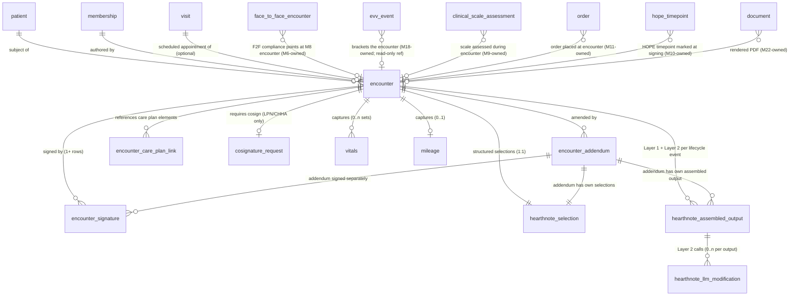

# Module 8 — Encounters & Visit Notes Specification

> **Authority note:** This spec is an **implementation proposal** (repo authority rule): [`docs/architecture/`](../architecture/) and the ratified ADRs in [`docs/adr/`](../adr/) win on conflict, and the code plus [`docs/BUSINESS_LOGIC.md`](../BUSINESS_LOGIC.md) are ground truth for as-built behavior. Mechanism choices named here may be superseded — see ADR-0036…0040 and ADR-0030/0032/0035 for the recorded divergences (outbox not Socket.IO, TypeScript not Python sidecars, app-layer AES-256-GCM not pgcrypto, pure transition tables not XState, hand-rolled HTTP hardening not `@fastify/*`, Vite + react-router not TanStack Start).


**Module ID:** 8
**Phase:** 1 (v1 — required for Engrace go-live; CoP 418.56 / 418.104; documentation surface for every clinical encounter)
**Depends on:** 6 (Admission, Election & Certification — F2F attestation row via `face_to_face_encounter.encounter_id` back-reference; `admission` provides the patient-on-service signal that makes encounter authoring possible), 7 (Care Plan — `careplan.relevantElementsForEncounter()` decorates the encounter form; `careplan.isReviewOverdue()` is the 15-day signing gate this module enforces), 36 (Secure Messaging — `encounter.signed` and cosignature-overdue events fan out to the per-patient care-team channel and to alert recipients), 38 (Clinical Terminology — LOINC for measurement codes, SNOMED CT for findings/symptoms, value-set `asOfDate` lookups pinned at sign-time per D11). Transitively via M6: 1 (Foundation — `organization`, `withOrgContext`, `audit()` helper, outbox dispatcher, idempotency, RLS generator, per-tenant DEK envelope-encryption helper, BullMQ on Valkey), 2 (Identity — actor resolution, SESSION_POLICY for step-up auth per D13, per-tenant HearthNote AI opt-in flag, per-clinician Layer-2 override), 3 (Authorization — `encounter.*`, `hearthnote.*`, `vitals.*`, `mileage.*` permission keys; new `cosigner_role_match` ABAC predicate; existing `caseload_membership` ∧ `discipline_scope` ∧ `sud_disclosure_allowed` reused), 4 (Audit — PHI write-audit trigger generator on every owned table, audit-read declaration on every PHI route, retention class `compliance`), 5 (Patient & Demographics — `patient` row + `privacy_flag` + `CaseloadProvider`), 17 (Scheduling — `visit` row is the parent of an encounter; M17 emits `visit.scheduled` which seeds the draft), 18 (EVV — check-in / check-out events that bracket the encounter per D9), 22 (Documents — encounter PDF artifact; late-entry override letter; consumes the M8 outbox), 32 (AI Platform — `packages/ai-platform` is the only path to LLM inference; M8 consumes the `narrativeEnhancement` capability under tenant-level token-budget control), 39 (Consent & Authorization — 42 CFR Part 2 SUD redaction; DPOA agent attribution for representative-acknowledged content; advance-directive references in encounter content).
**Consumed by:** 9 (Clinical Assessments — assessment scales authored during an encounter reference `encounter_id`; M8 emits `encounter.signed` which M9 consumes for trending), 10 (HOPE Engine — `encounter.signed` for relevant encounter types is the HOPE timepoint trigger; HUV1/HUV2 schedules; J2051 SFV bookkeeping), 11 (Orders — orders placed mid-encounter reference `encounter_id`; encounter-driven order signing flows back into the visit's narrative selections), 14 (IDG — aggregator reads all encounter narratives since the last IDG meeting via the published `signedEncountersForPatientSince` seam), 16 (Bereavement — bereavement encounters reuse the M8 model for post-death contacts), 18 (EVV — bidirectional: M18 publishes events into M8 brackets, M8 reads back EVV state at finalize), 22 (Documents — encounter PDF rendering reads the M8 outbox `encounter.signed`), 23 (Billing Medicare — claim line construction reads visit + encounter + mileage + cosignature state via the `BillableEncounterReader` seam; a non-cosigned LPN/CHHA visit is not billable per D3), 24 (Billing Medicaid — same reader seam, state-specific encounter type mappings), 28 (FHIR Gateway — maps `encounter` → R4 `Encounter`, `vitals` → `Observation`, narrative selections + assembled output → `Encounter.note` + `DocumentReference`), 30 (HQRP & Quality — survey readiness reviews completeness of required-element compliance; late-entry rate is a quality metric), 31 (Portal & Telehealth — patient/representative-facing visit summary derived from the signed encounter, consent-gated per M39), 33 (Reporting — productivity, mileage, late-sign rate, cosignature lag, Layer-2 acceptance/rejection rate dashboards).
**Spec status:** Re-locked v0.4 (Phase-3 BAA fix + Phase-2 tenancy sweep; supersedes Locked v0.2)

> **Phase-3 remediation (2026-06-11).** **M08-F01 (BLOCKER, ADR-0012 D4):** the false "Anthropic BAA
> in place" assertion (D6) is struck — AI Governance §9.2 says *in negotiation*. The Layer-2 cloud
> path is gated on the platform `external.anthropic_baa_executed` flag (BAA executed ∧ ZDR confirmed);
> `layer2_eligibility_reason` gains `baa_not_executed` / `routing_preference_blocks_cloud` /
> `kill_switch_active` (§3.2 enum), and §12.17's Layer-2 E2E item is gated on BAA execution.
>
> **Phase-2 tenancy sweep (ADR-0010 D1 / ARCH-011) — M08-F03 (BLOCKER) closed.** All **10 owned PHI
> tables** now carry `organization_id` + `provider_entity_id` + `location_id` (the latter two **NOT
> NULL** — an encounter is a location-anchored clinical event; PE/location denormalized at create-time
> from the visit/admission context). This drives location-scoped ABAC, multi-CCN reporting (M33), and
> the M23 site-of-service Q-code derivation. See the §3.3 tenancy note; satisfies `check-tenancy`.
> *(M08-F02 manifest/boundaries remains for M08's full reconciliation.)*

## Changelog

- **v0.2 (Locked)** — Initial publication at lock-grade. Instantiates the §20.B module spec template. Resolves all thirteen open questions into binding decisions (§11). Defines the **encounter lifecycle state machine** (`draft → finalized → signed → cosign_pending → cosigned`, with `addendum_open` and `voided` branches), the **immutability-with-addenda model** (D2), the **24/48-hour cosignature window with billing block** (D3), the **three-tier late-entry policy** (D4), the **three-flag-AND Layer-2 activation** (D5), the **PHI-minimized chart context for LLM prompts** (D6), the **hard-block category list for the LLM diff** (D7), the **draft-vs-signed ABAC visibility split** (D8), the **EVV-authoritative bracketing with documented fallback** (D9), the **per-encounter mileage model** (D10), the **vocabulary version pinning at sign-time** (D11), the **volunteer-visits-as-encounters unification** (D12), and the **5-minute step-up auth on signing** (D13). Wires the permission keys this module registers into Module 3 (§4.5), the `LatestAssessmentProvider` seam this module *consumes* from Module 9 (deny-stub today, real provider when M9 lands), the `BillableEncounterReader` seam M23/M24 will consume from M8, the new `cosigner_role_match` ABAC predicate registered into Module 3's predicate registry, and the `NarrativeEnhancementProvider` contract that fronts `packages/ai-platform`'s LLM-inference capability.
- **v0.1** — Drafted within the lock-grade pass; not separately published.

> **Phase boundary (binding):** Phase 1 delivers everything in this spec **except** (a) the encounter PDF rendering (Module 22 owns; M8 emits the structured `encounter.signed` payload and M22 renders), (b) FHIR `Encounter`/`Observation` publication (Module 28), (c) the M23 billing reader's actual claim-line construction (M23 consumes the M8 `BillableEncounterReader` seam; M8 ships the reader contract Phase 1), (d) the patient/representative-facing visit summary on the portal (Module 31). The "done" gate for M8 is: encounter authoring + HearthNote Layer 1, 2, and 3 all wired and signing-blocking, cosignature workflow operational, late-entry tiers enforced, EVV bracketing reconciled, vitals + mileage captured, addenda first-class, the `encounter.signed` outbox event published with the locked payload, the test plan green — not gated on Modules 9, 10, 14, 22, 23, 28, 31 existing. The M9 `LatestAssessmentProvider` is consumed via the seam registry — a deny-stub today, the real provider when M9 lands; the M10/M14 consumers subscribe to M8's outbox via documented topics when they build.

---

## 1. Purpose & Scope

### 1.1 What This Module Does

Module 8 owns **the clinical record's documentation surface**: every visit, every assessment-bearing encounter, every late entry, every cosignature, every narrative byte that a surveyor will read four years from now to reconstruct what a clinician did and saw. CoP 418.104 says the clinical record is *"the official documentation of the services provided by the hospice"* — Module 8 is where that documentation is born, structured, signed, and made immutable.

- **The Encounter root.** One `encounter` per discrete clinical contact: home visit, telephonic contact, inpatient bedside visit, MD/NP F2F encounter, volunteer companionship visit, bereavement contact. Encounters link to (a) a `patient` (M5), (b) optionally a `visit` (M17 — the scheduled appointment), (c) optionally an EVV bracket (M18 — check-in/check-out), (d) an authoring `membership` (M2) with stamped discipline, (e) a `vocab_version_id` pinned at sign-time (M38, D11). The `encounter_type` discriminator covers fourteen types listed in §2.1; the `discipline` axis covers eight roles (RN, LPN, CHHA, MSW, Chaplain, Volunteer, MD, NP).

- **The HearthNote three-layer documentation engine, made operational.** Architecture §10.5 lays out the three layers — Layer 1 deterministic core (always on), Layer 2 LLM enhancement (opt-in, three-flag AND per D5), Layer 3 compliance gate (always on, signing-blocking). Module 8 is where this engine lives: `hearthnote_selection` rows capture the clinician's structured choices from `packages/narrative-vocab` (selection state as a versioned JSON tree), `hearthnote_assembled_output` rows persist the deterministic byte-identical narrative for each lifecycle event (initial finalize, each addendum), `hearthnote_llm_modification` rows record every Layer-2 call with prompt template id, model id, token cost, full diff against Layer 1, and the per-passage `accept | edit | reject` decision the clinician made.

- **Layer 3 compliance gate, hard-coded.** Before any encounter signs, the gate checks: required HearthNote sections per encounter type × discipline are populated (template engine declares the requirements); required vital signs are captured (per encounter type — `routine_visit` requires BP, HR, RR, T, SpO2, pain; `telephonic` requires none); required HOPE items captured if the encounter type is a HOPE timepoint (M10 reader seam); required clinical scales completed if mandated by the type (M9 reader seam — `LatestAssessmentProvider`); for LPN/CHHA notes, the RN cosignature workflow row exists and is unresolved (signing creates it; cosigning closes it); for late entries, the `late_entry_reason` is present per D4; clinician's electronic attestation has fresh authentication per D13 (5-minute step-up window). Any failure returns 422 with structured remediation hints.

- **Vitals, structured and time-stamped.** `vitals` rows are per-encounter (most encounters have one set; some have multiple over the visit). Numeric fields direct-typed: blood pressure systolic/diastolic, heart rate, respiratory rate, temperature with unit, SpO2, pain (0–10 with NRS / FLACC / PAINAD scale id), weight + height + computed BMI, blood glucose if relevant. Each vital carries a LOINC code reference (M38) for FHIR `Observation` mapping (M28). "Clinically not indicated" is a first-class value, not a NULL — surveyors must see why a routine vital wasn't captured.

- **Mileage, per-encounter (D10).** A `mileage` row optionally accompanies each encounter — odometer start / odometer end / computed `miles_driven`, or `miles_driven_override` with a `manual_reason`. M17 may *propose* values from route optimization; M8 stores the authoritative number. Payroll/AP downstream (M27 and tenant payroll integration) reads from M8's `mileage` table, not from M17.

- **Cosignature workflow, 24/48-hour windowed (D3).** When an LPN or CHHA signs an encounter, a `cosignature_request` row is created with the assigned RN case manager as the routed cosigner. Soft alert at 12 hours, escalation to clinical supervisor at 24 hours, billing-block from creation (per the `BillableEncounterReader` seam — M23/M24 read this), hard window at 48 hours after which the note is locked to `cosign_pending` and only a supervisor can release with documented reason. Mirrors industry norms (Axxess, HCHB) and survives MAC / UPIC scrutiny of post-payment review.

- **Addenda are first-class, not edits (D2).** A signed encounter is immutable. New information that needs to attach — a vital that was forgotten, a symptom that emerged later, a correction — creates an `encounter_addendum` row with its own selections, assembled output, optional Layer-2 enhancement, and signature. The rendered encounter (M22 PDF, M31 portal summary, M28 FHIR `Encounter.note`) shows the original signed content + every addendum in chronological order with attribution and reason. Surveyor reconstruction is byte-identical.

- **The `encounter.signed` event is the upstream trigger for half the clinical phase.** When an encounter signs, the M1 outbox publishes `m8.encounter.signed` with a typed payload. M9 (assessments) consumes it for scale trending. M10 (HOPE) consumes it for timepoint marking and J2051 SFV scheduling. M14 (IDG) marks it for inclusion in the next aggregator run. M22 (documents) renders the PDF. M28 (FHIR) projects it. M31 (portal) may surface the patient-facing summary subject to M39 consent. M33 (reporting) updates the productivity counters. This module is the *nervous system trigger* for clinical-record-driven downstream work.

- **Audit, surveyor-grade.** Every selection event, every Layer-2 call, every accept/edit/reject decision, every signature, every cosignature lifecycle transition, every addendum is audited by the M4 trigger framework (write audits) and the M4 read-audit decorator (PHI reads). Audit retention class is `compliance` — 6 years from final lifecycle event (CoP 418.104) with state-retention overrides via M4's `state_retention_override` table. The full Layer-2 diff is persisted on the modification row, not on the audit row, so the audit itself stays compact while the surveyor-reconstruction surface stays complete.

- **The "AI-touched" defensibility surface.** Architecture §23 and AI Governance §4.1 classify HearthNote Layer 2 as a **High-risk** AI capability (clinical record). Module 8 makes the corresponding controls concrete: the prompt-version id is persisted, the model id is persisted, the diff is persisted, every modification has an explicit clinician decision recorded, the original Layer-1 narrative is preserved verbatim, and the Layer-3 attestation language explicitly says "I have reviewed all content, including any system-assisted material, and attest to its accuracy" — separate language for AI-enhanced notes ("I have reviewed and accepted each system-suggested modification"). UPIC / MAC / RAC / OIG can replay the documentation process for any signed encounter, deterministically.

### 1.2 What This Module Does Not Do

This list is binding. Every item here is owned by another module and reached via repository call, outbox event, or the explicit cross-module seams in §4.6 / §4.7.

- **The narrative vocabulary itself.** `packages/narrative-vocab` is a leaf package — owned by no single module, consumed by M8 (this module) and M14 (IDG aggregator). M8 *references* vocabulary entries; it does not edit the SNOMED subset, the hospice phrase library, or the discipline-tagged phrase templates. Vocabulary content changes flow through a separate review and ship through `packages/narrative-vocab` PRs with semantic-versioned release.

- **The LLM call.** `packages/ai-platform` (Module 32) is the only path to Anthropic API calls. M8 invokes the `narrativeEnhancement` capability via M32's typed SDK; M8 does not know which model, does not manage prompts (M32 owns the prompt template registry), does not handle the BAA or token budget arithmetic (M32 tracks per-tenant token spend and enforces the cost cap). M8 supplies: Layer-1 narrative, the locked PHI-minimized chart context per D6, the tenant + encounter-type style preferences, the prompt template key. M8 receives: enhanced narrative, the diff against Layer 1, the hard-block-stripped result, the token count for cost attribution, the model id and prompt-template version. The vendor-adapter mandate (architecture §25.14 / §25.15) is enforced — direct `@anthropic-ai/sdk` imports outside `packages/ai-platform` fail CI.

- **Schedule and visit row.** Module 17 owns `visit`, `availability`, `time_off`, `route_segment`. An encounter references a visit via `encounter.visit_id`; M8 does not write into M17's tables. The visit may be ad-hoc (no schedule entry) for telephonic, urgent, or volunteer contacts — in which case `encounter.visit_id` is NULL and the route/payroll integrations downstream tolerate it (productivity reporting groups by encounter, not by visit).

- **EVV event capture.** Module 18 owns `evv_event`, geofence math, state aggregator submission, the GPS check-in mobile flow. M8 *reads* M18's events to bracket the encounter (per D9 EVV is authoritative when present), but never writes EVV events. The `encounter_evv_link` is a logical pointer carried on the encounter row (`evv_check_in_event_id`, `evv_check_out_event_id`); the underlying events live in M18's tables.

- **Clinical assessment scales (PPS, FAST, PAINAD, ESAS-r, NYHA, MELD, BODE, Flacker, Global Deterioration Scale, Braden, Morse Fall, AIMS).** Module 9 owns these. A scale completed during an encounter creates an M9 `clinical_scale_assessment` row that references `encounter_id` — but the scale, scoring logic, and trending all live in M9. M8 *renders the scale's score* in the assembled narrative via a vocabulary phrase template (e.g., "PPS at this visit is 50%, unchanged from one week ago"); the source-of-truth value lives in M9.

- **HOPE assessment items, SFVs, timepoint scheduling, iQIES batch submission.** Module 10 owns the HOPE Engine. M8 is the trigger surface: when an encounter type that maps to a HOPE timepoint is signed (admission HOPE visit, HUV1 visit, HUV2 visit), `encounter.signed` carries a `hope_relevant: { timepoint, suspected_j2051_severity }` field that M10 consumes. M10 builds the `hope_assessment` rows, schedules the next timepoint, and triggers the J2051 SFV if applicable.

- **Order placement and signing during the visit.** Module 11 (Orders) owns `order`, `order_signature`, `standing_order`, the DoseSpot path (M12). Orders placed mid-encounter (e.g., RN places a Foley change order) carry `encounter_id` for back-reference, but they are M11 rows. M8 may render an order placement in the assembled narrative via a vocabulary phrase ("Order placed at this visit: Foley catheter, 16Fr, change at 30-day intervals"); the source-of-truth is M11.

- **F2F compliance attestation.** Module 6 owns `face_to_face_encounter`. Per D1 of M8 and D2 of M6, an MD/NP F2F encounter dual-writes: M8 creates the clinical note encounter; M6 creates the compliance attestation row pointing at M8's encounter via `face_to_face_encounter.encounter_id`. M8 does not own the 30-day window math, the period-N applicability rules, the override path with documented reason — all that is M6. M8 does carry `encounter.face_to_face_id` for back-reference and renders the F2F attestation language in the narrative.

- **IDG aggregation.** Module 14 owns the IDG packet builder. The aggregator reads M8 narratives via the published `signedEncountersForPatientSince(patientId, since)` seam; M8 does not pre-aggregate. The architecture §10.5.5 "HearthNote IDG aggregation" content is owned by M14 — M8 is the source-of-truth, not the digest.

- **Encounter PDF rendering and the encounter document.** Module 22 (Documents) renders the printable encounter from the M8 outbox payload. The PDF is M22-owned with retention class `compliance`; the rendered document is back-referenced from the encounter row via `document_id` (set when M22 publishes `document.published` for the encounter). M8 does not own templating, fonts, watermarks, headers/footers.

- **FHIR mapping.** Module 28 owns the `packages/fhir/r4/mappers` for `Encounter`, `Observation`, `DocumentReference`. M8 exposes domain types (in `packages/domain/encounter/`) that M28 imports; M8 does not import `packages/fhir`. The R4→R5→R6 migration path is M28's problem.

- **Billing line construction.** Module 23 (Medicare) and Module 24 (Medicaid) consume the `BillableEncounterReader` seam M8 ships to determine which visits are claim-line-eligible. M8 does *not* know HIPPS calculation, revenue code mapping, the 837I segments, the SIA add-on logic, the cap-period math — all M23/M24/M26. M8's job is to expose a clean reader that says "this encounter is billable | not yet billable | not billable (reason)" with the cosignature state, the late-entry state, the EVV state, and the encounter type all factored in.

- **Patient/representative-facing visit summary.** Module 31 (Portal) builds the visit summary from the signed encounter, gated by M39 consent (some content — SUD findings, family-dynamics narratives — is filtered). M8 ships the source-of-truth content; M31 renders the patient-appropriate view.

- **Productivity, mileage, and clinical-record metrics dashboards.** Module 33 (Reporting & Dashboards) aggregates from M8's outbox events. M8 emits the events; M33 builds the dashboards.

- **Bereavement encounters' lifecycle (13-month plan, anniversary reminders, risk scoring).** Module 16 owns the bereavement plan. A bereavement contact creates an M8 encounter with `encounter_type='bereavement_contact'` — the encounter authoring uses the same HearthNote pipeline — but the 13-month plan, the scheduled outreach cadence, the anniversary reminders are M16.

### 1.3 Regulatory & Operational Drivers

| Driver | Requirement | How Module 8 satisfies it |
|---|---|---|
| **42 CFR 418.104** — Clinical records | Clinical record must contain identification, election, plan of care, assessment findings, clinical notes per discipline, medication administration record, advance directives acknowledgment, response to medications and treatments, evidence of attainment of goals, discharge information; record must be legible, signed/dated by author, organized to be retrievable | `encounter` is the per-visit clinical note artifact; HearthNote Layer 1 + Layer 3 gate enforce required-element completeness per encounter type × discipline; e-signature with step-up auth (D13); 6-year retention via M4's `compliance` class with state overrides |
| **42 CFR 418.56** — Interdisciplinary group / plan of care | Plan of care reviewed/revised by IDG no less than every 15 calendar days; coordination of care including communication of patient-specific data to all involved disciplines | M8 consumes M7's `careplan.isReviewOverdue()` at signing-time — encounter signing is blocked when review is overdue (with override path per M7); M14 IDG aggregator reads M8 narratives across disciplines; `encounter.signed` notifies the care-team channel per M36 |
| **42 CFR 418.22** — Certification of terminal illness, including F2F | F2F encounter required by hospice MD or NP within 30 days prior to recert period start, from period 3 onward; F2F attestation captured separately from the encounter note | F2F encounter writes both an M8 clinical note (this module) and an M6 `face_to_face_encounter` (M6) in one transaction per D1; the M8 encounter type is `face_to_face`; HearthNote template enforces F2F-specific narrative requirements; M6 owns the compliance window math |
| **CoP 418.104(c)** — Authentication of clinical record entries | All entries must be signed and dated by the responsible practitioner; clinical records may be maintained electronically when authentication is in compliance with applicable laws | E-signature with step-up auth (D13) — fresh authentication within 5 minutes of signing; signature row in `encounter_signature` with method (`passkey | biometric | password+otp`), session id, timestamp; 21 CFR Part 11 principles (architecture §23 Compliance Traceability) |
| **CoP 418.104(d)** — Protection of clinical record information | HIPAA-aligned protections | M4 audit on every read and every write; RLS-enforced tenant boundary; SUD content redacted per M39 consent (D8 — same ABAC pattern as M7); break-glass for cross-tenant operational support |
| **CoP 418.116** — Compliance with federal, state, local laws | LPN scope-of-practice; cosignature requirements vary by state | Cosignature workflow operational on every LPN/CHHA note per D3 (industry norm; state-specific overrides via tenant configuration are out-of-scope for v0.2 — cosign is universal in v0.2) |
| **HIPAA §164.312(a)(1)** — Encryption at rest | PHI at rest encrypted | Per-tenant DEK envelope encryption on `hearthnote_selection.free_text_cipher` and `hearthnote_assembled_output.layer1_cipher` / `layer2_cipher` (M1's envelope-encryption helper) |
| **HIPAA §164.312(b)** — Audit controls | Every PHI access logged | M4 write-audit triggers on every owned table; M4 read-audit decorator on every PHI-bearing route; per-modification clinician-decision log on `hearthnote_llm_modification` |
| **HIPAA §164.316(b)(2)** — Retention | 6+ year clinical record retention | `compliance` retention class on all M8 PHI tables; state-retention overrides via M4 |
| **42 CFR Part 2 (SUD)** — Confidentiality | SUD-related content gated by consent | M39 consent context evaluated at read; SUD-flagged content omitted from response when consent absent; the `sud_disclosure_allowed` ABAC predicate (already in M3 from M7) is reused on `encounter` reads |
| **State EVV mandates** (Cures Act §12006) | Personal-care visits electronically verified | M18 owns the events; M8 enforces D9 — EVV authoritative when present, documented `evv_missing_reason` required for sign without EVV |
| **CoP 418.114** — Drugs and biologicals (medication administration record) | MAR is part of the clinical record | Medication administration during an encounter writes to M13's `medication_administration` table; M8 narratively references via vocabulary phrase; M13 is source-of-truth |
| **21 CFR Part 11 principles** | Electronic records / electronic signatures (best practice; HHS guidance for hospice) | Bounded vocabulary + clinician selection + audit trail + e-signature with controls; explicit attestation language; LLM-modified content explicitly accepted per modification |
| **FDA SaMD framework** (informational; HearthNote Layer 2 is not a regulated medical device under current FDA guidance — HearthNote *suggests*, never *decides*; clinician is the deciding intelligence) | AI capability classification | Per AI Governance §4.1, Layer 2 is High-risk; controls in §5 of AI Governance — full approval workflow, HITL, deterministic fallback (Layer 1 always operative), explicit consent (tenant + clinician + encounter-type per D5), full audit, periodic re-evaluation; Module 8 implements the per-call provenance |

### 1.4 Competitive Context

The dominant hospice EHRs (HCHB, Axxess, WellSky, FireNote, MatrixCare) all have an encounter / visit-note surface. The shape of M8's differentiation:

- **HearthNote vs ad-hoc-AI-bolt-on.** WellSky and Axxess have added generative-AI assistants for visit notes in the last 24 months. The typical failure mode of those products is that the AI produces plausible narrative text without a clear seam to the structured underlying data — surveyors can't reconstruct what the clinician picked vs what the AI invented. HearthNote's deterministic Layer 1 is the structured source of truth; Layer 2 is an *enhancement* that diffs against Layer 1 and hard-blocks new facts. The audit answers "what did the clinician actually select" and "what did the AI propose, and what did the clinician accept" as two distinct, reviewable streams.

- **FireNote's RapidChart parallel.** FireNote's RapidChart is deterministic-only — clinician selects, system assembles, no LLM. HearthNote adopts the deterministic-foundation principle and adds Layer 2 behind tenant opt-in, with a non-negotiable diff-and-block enforcement that FireNote explicitly does not offer because they don't run an LLM. WardenX's positioning: the determinism of RapidChart, the polish of an LLM, the audit defensibility of both.

- **Cosignature as a billing gate (D3).** Most hospice EHRs route LPN/CHHA cosignature but do not block billing until cosignature lands. HCHB does the strictest version; M8 matches it. The 48-hour hard cap + supervisor release path is the operational concession that makes the gate workable in real agencies.

- **EVV-as-authoritative (D9).** The state EVV mandate is universal but EHR integration quality varies. M8's posture is that EVV, when present, is the encounter bracket of record — clinician-entered times don't override. This is more strict than several competitors and earns straight survey defense in EVV-mandated states.

- **Addenda as first-class rows (D2).** Several EHRs allow signed-encounter edits with audit trails. M8 refuses — every "edit" is a new row, with its own signature, its own attribution. Surveyor reconstruction asks "what was signed by Nurse A at 4pm on the 12th" — the answer is the row, not the row's edit history.

- **Vocabulary version pinning (D11).** Few EHRs pin the terminology version at sign-time. As ICD-10 and SNOMED roll annually, the alternative is silent re-resolution that changes historical narrative wording. M8 freezes it, like an immutable git ref.

---

## 2. Domain Model

### 2.1 Entity-Relationship Diagram



Entities owned by M8 are connected with solid lines (`||--`, `||--|`); entities owned by other modules that *reference* an M8 encounter are connected with dashed/external lines (`}o--`). M8 carries logical FK columns for external references but defers FK enforcement to the owning module's repository.

### 2.2 Encounter Types and Disciplines

Two axes drive the template engine and the compliance gate. Both are versioned enums; new values require a manifest edit and a vocabulary update.

**Encounter type** (`encounter_type` enum — 14 values, v0.2):

| Value | Description | Notes |
|---|---|---|
| `routine_visit` | Recurring scheduled visit per care plan frequency | Most common; vital signs required |
| `admission_visit` | First clinical visit of an admission; comprehensive assessment lives in M9 but the encounter narrative is here | Required HearthNote sections: medication reconciliation reference, advance-directive acknowledgment, caregiver overview, baseline symptoms |
| `recert_visit` | Recertification-period kickoff visit (not the F2F itself) | Required: PPS, ESAS, prognosis indicators, recert summary section |
| `face_to_face` | MD/NP F2F encounter per 42 CFR 418.22 | Dual-write with M6 per D1; F2F attestation narrative section required |
| `telephonic` | Phone contact (clinical, not portal-message) | No vitals required; brief narrative; counts toward productivity but not toward visit frequency satisfaction |
| `lpn_visit` | LPN visit; cosignature workflow triggered on sign per D3 | Vital signs required |
| `chha_visit` | Certified Home Health Aide visit per Aide POC (M15); cosignature workflow per D3 | ADL documentation required; mileage usually captured |
| `msw_assessment` | Initial / comprehensive psychosocial assessment | No vitals; psychosocial sections required; family dynamics narrative |
| `msw_followup` | Subsequent MSW visit | Lighter required-element set |
| `chaplain_assessment` | Initial spiritual assessment | Spiritual-care template; no vitals |
| `chaplain_visit` | Subsequent chaplain visit | Lighter required-element set |
| `volunteer_visit` | Per D12 — volunteers document via M8 encounter | Simplified template; no clinical vitals; non-billable per BillableEncounterReader |
| `bereavement_contact` | Post-death contact per M16's 13-month plan | Bereavement template; references M16's `bereavement_plan_id` |
| `idg_followup` | Visit prompted by IDG decision (M14); narrative section explicitly references the IDG decision | Standard discipline template plus IDG-followup section |

**Discipline** (`discipline` enum — 8 values, mirrors M2/M3 catalog):
`rn`, `lpn`, `chha`, `msw`, `chaplain`, `volunteer`, `md`, `np`.

Not every (encounter_type × discipline) combination is valid; the template engine declares legal pairs. Examples: `face_to_face` is `md` or `np` only; `chha_visit` is `chha` only; `routine_visit` is `rn` or `lpn` only. Illegal pairs are caught at draft creation (`422 INVALID_ENCOUNTER_DISCIPLINE_PAIR`).

### 2.3 Encounter Lifecycle State Machine

```
                  ┌─────────┐
   create draft   │  draft  │
   ─────────────▶ └────┬────┘
                       │ finalize (Layer-3 gate runs as preview; can return to draft if gate fails)
                       ▼
                  ┌─────────────┐
                  │  finalized  │
                  └────┬────────┘
                       │ sign (gate enforces; step-up auth required)
        ┌──────────────┼─────────────────────────┐
        │              │                         │
        │              │ if LPN/CHHA discipline:  │ if RN/MSW/Chaplain/MD/NP/Volunteer:
        ▼              ▼                         ▼
   ┌─────────┐   ┌──────────────────┐      ┌─────────┐
   │  signed │   │  cosign_pending  │      │  signed │
   └────┬────┘   └────────┬─────────┘      └────┬────┘
        │                 │ cosign signed         │
        │                 ▼                       │
        │           ┌──────────────┐              │
        │           │  cosigned    │              │
        │           └──────┬───────┘              │
        │                  │                      │
        └──────────────────┴──────────────────────┘
                           │
                           │ addendum authored (any number, any time post-sign)
                           ▼
                  ┌─────────────────┐
                  │  addendum_open  │  (transient state visible to UI; row remains in signed/cosigned)
                  └────────┬────────┘
                           │ addendum signed
                           ▼
                  back to signed / cosigned with addendum row attached

   draft ──── void (admin only; reason required; rare) ──────▶  voided  (terminal)
```

**State invariants:**

- A `draft` row has no signature; selections may be edited freely; HearthNote Layer 1 is rebuilt on every selection change (deterministic, byte-identical).
- A `finalized` row has run Layer 3 gate at least once and passed; selections are frozen; the assembled output is persisted (`status='finalized'`); Layer 2 may have been called and clinician decisions captured.
- A `signed` row carries `encounter_signature` of `kind='primary'`. Selections, assembled output, and Layer-2 modifications are immutable. The row enters `cosign_pending` automatically if discipline ∈ {`lpn`, `chha`}.
- `cosign_pending` is gated by the cosignature workflow; M23/M24's `BillableEncounterReader` returns "not yet billable" until the row leaves this state.
- `cosigned` carries a second `encounter_signature` of `kind='cosignature'` from a qualified RN.
- An `encounter_addendum` row is created in `draft` state from a `signed`/`cosigned` parent; it has its own selections, assembled output, optional Layer-2, and signature row of `kind='addendum'`. The parent's state does not change; the addendum is reachable via `encounter.id` join.
- `voided` is admin-only (director permission `encounter.administrative_override`), requires a reason ≥40 chars, and is a true terminal state — the row is never deleted, but it does not flow through `encounter.signed` outbox and is excluded from clinical-record renders. Use only for genuine errors (wrong patient, duplicate draft).

### 2.4 Cosignature Request Lifecycle (D3)

```
                                   ┌──────────┐
   primary sign (LPN/CHHA)    ────▶│ pending  │
                                   └────┬─────┘
                                        │ system routes to assigned RN case manager
                                        ▼
                                   ┌──────────┐
                                   │  routed  │  (alert at 12h, 24h)
                                   └────┬─────┘
                                        │
                            ┌───────────┼────────────┬──────────────┐
                            │           │            │              │
                  cosigner opens         │      24h passes      48h passes
                  (acknowledged)         │      (escalated)     (hard cap)
                            ▼            │            ▼              ▼
                       ┌───────────┐     │     ┌────────────┐  ┌────────────────────┐
                       │acknowledged│    │     │ escalated  │  │  hard_cap_reached  │
                       └─────┬─────┘     │     └─────┬──────┘  └─────┬──────────────┘
                             │           │           │               │ supervisor releases with reason
                             │           │           │               ▼
                             └─────┬─────┘           │       ┌───────────────────────┐
                                   │ cosigner signs  │       │supervisor_released    │
                                   ▼                 ▼       └───────┬───────────────┘
                              ┌─────────┐                            │
                              │  signed │ ◀──────────────────────────┘
                              └─────────┘  (terminal — encounter transitions to cosigned)
```

**Cosignature timing & gating:**

- **12h:** soft alert to cosigner (M36 channel `clinical_urgent` low severity; routes per cosigner notification preferences).
- **24h:** escalation alert to clinical supervisor on patient's caseload (M36 `clinical_urgent` higher severity); request enters `escalated` state.
- **48h:** request enters `hard_cap_reached`; M36 emits `clinical_urgent` to clinical supervisor + DON; the encounter is locked to `cosign_pending` and only a supervisor can release with a `supervisor_release_reason` (≥40 chars). Supervisor release transitions the request to `supervisor_released`; the encounter still requires a qualified RN signature to transition to `cosigned`.
- **Billing-block:** from the moment of primary sign through transition to `cosigned`, `BillableEncounterReader` returns `billable: false, reason: 'awaiting_cosignature'`. M23/M24 hold the visit out of claim assembly.

### 2.5 Late-Entry Tiers (D4)

The clock starts at `service_date` (the date the visit *actually occurred*, not the date of authoring). All times are organization-timezone calendar dates per M6's D8 convention.

| Tier | Window (hours since service_date end-of-day local) | Required for sign | Audit severity | Render banner |
|---|---|---|---|---|
| **Normal** | ≤ 24h | none | `info` | none |
| **Late entry** | 24h–72h | `late_entry_reason` ≥ 40 chars | `info` (audit: `encounter.late_entry`) | none |
| **Significant late entry** | 72h–14 days | `late_entry_reason` ≥ 40 chars **and** Clinical Supervisor override with own reason **and** step-up auth | `warn` (audit: `encounter.significant_late_entry_overridden`) | "Late entry — documented N days after service" |
| **Administrative override** | > 14 days | Director permission `encounter.administrative_override` **and** reason ≥ 100 chars **and** step-up auth **and** outbox event to compliance | `critical` (audit: `encounter.administrative_late_override`) | "Administrative late entry — N days after service" |

The late-entry tier is computed at finalize-time and reified on the encounter row in `late_entry_tier`. The render banner is part of M22's PDF output (M22 reads the field from `encounter.signed` payload).

### 2.6 HearthNote Lifecycle (Layer-by-Layer Within the Encounter Flow)

```
   ┌────────────── DRAFT ──────────────┐  ┌─── FINALIZE ───┐  ┌─── SIGN ───┐
   │                                   │  │                │  │            │
   │ clinician picks from vocabulary   │  │ Layer 1 assembled  │  │ Step-up    │
   │ ─ selections persisted in JSON    │  │ → byte-identical   │  │ auth check │
   │ ─ free-text fields preserved      │  │ narrative          │  │            │
   │   verbatim (in cipher column)     │  │                    │  │ Compliance │
   │                                   │  │ Layer 3 gate runs  │  │ attestation│
   │ live Layer 1 preview (server-     │  │ as preview;        │  │ recorded   │
   │ side assembly on each PATCH)      │  │ remediation hints  │  │            │
   │                                   │  │ if it fails        │  │ Selections,│
   │ vocabulary version pinned at     │  │                    │  │ output,    │
   │ first finalize attempt; locked   │  │ if Layer-2 eligible:│  │ Layer-2 all│
   │ thereafter (D11)                  │  │  ─ PHI-minimized   │  │ become     │
   │                                   │  │    prompt context  │  │ immutable  │
   │                                   │  │  ─ call M32 SDK    │  │            │
   │                                   │  │  ─ diff against L1 │  │ encounter. │
   │                                   │  │  ─ hard-block strip│  │ signed     │
   │                                   │  │  ─ soft-warn flag  │  │ outbox     │
   │                                   │  │  ─ clinician       │  │ published  │
   │                                   │  │    decisions per   │  │            │
   │                                   │  │    passage         │  │            │
   └───────────────────────────────────┘  └────────────────────┘  └────────────┘
```

**Layer 1 (Deterministic Core):**

- Server-side assembly happens in `packages/hearthnote/assembly/` (architecture §10.5.2). Given a selection-state JSON and a template, returns a byte-identical narrative.
- Vitals and assessment-scale references are interpolated as parameterized phrases (e.g., `${pps_score}` → `"50%"`); these come from the M9 reader seam and the M8 `vitals` rows. Numeric-direct values are *never* paraphrased by Layer 2 (D7 hard-block).
- Free-text annotation fields (the clinician-typed prose in selected slots) are preserved verbatim, ciphered at rest, decrypted in-memory at assembly time.

**Layer 2 (LLM Enhancement, per D5/D6/D7):**

- Eligibility check: tenant flag on (M2) ∧ clinician not opted-out (M2) ∧ encounter type in tenant's opt-in set. Evaluated at finalize-time; result reified on the assembled-output row.
- PHI-minimized prompt context (D6): active problems (codes + plain labels), recent vital trends (numeric only, last 4 weeks), current medications (drug + dose only), recent assessment scores (numeric). Patient name replaced with `[PATIENT]`, DOB replaced with age (years), addresses excluded, MRN excluded, caregiver names excluded, free-text narrative from other encounters excluded.
- Call dispatched to `packages/ai-platform`'s `narrativeEnhancement` capability with `{ prompt_template_key: 'hearthnote_enhancement_v1', layer1: <text>, chart_context: <minimized>, style: { tone: 'formal'|'conversational', brevity: 'concise'|'detailed' } }`. The capability is responsible for the actual Anthropic call, token budget enforcement, model selection.
- Returned: enhanced text + diff (added/removed/changed passages) + token count + model id + prompt template version.
- Diff post-processing in M8: hard-block categories (D7) — numeric vital values, medication name/dose/route/frequency, ICD-10/SNOMED codes, allergy entries, advance-directive statements, code-status statements, family-quote verbatims, patient-stated-goal verbatims, F2F attestation language — are restored from Layer 1 (LLM modifications stripped). Soft-warn categories — symptom severity adjectives, prognosis hedging, family-dynamics descriptors — are flagged with `requires_clinician_acceptance=true`.
- Clinician decisions per passage recorded on `hearthnote_llm_modification.per_passage_decisions` (jsonb): `{ passage_id, layer1_text, layer2_text, decision: 'accept'|'edit'|'reject', edited_text?, decided_at, decided_by_membership_id }`.

**Layer 3 (Compliance Gate, always-on, signing-blocking):**

The gate is a pure function over the finalized state. Returns `{ pass: true } | { pass: false, remediation: [...] }`.

Checks:
1. All required HearthNote sections per (encounter_type × discipline) have at least one selection.
2. Required vitals captured per encounter type (or marked `clinically_not_indicated` with a reason).
3. Required clinical scales captured per encounter type — consulted via M9's `LatestAssessmentProvider` seam (deny-stub returns "no scales present" today; once M9 lands, returns the actual state).
4. Required HOPE items captured for HOPE-timepoint encounters — consulted via M10's seam (deny-stub today).
5. Late-entry tier ≤ permitted ceiling for the caller's role (significant late entry requires supervisor; administrative requires director).
6. M7 care-plan review not overdue, OR override path active per M7's D-decisions.
7. For LLM-enhanced notes: every Layer-2 modification has a per-passage decision recorded (no "pending" decisions allowed at sign).
8. Step-up auth fresh per D13 (5-minute window).
9. Attestation language confirmed by the clinician (one of two texts depending on Layer-2 involvement).
10. For LPN/CHHA: cosignature-eligible RN exists on the patient's caseload (M5 `CaseloadProvider`); without an eligible cosigner the sign route returns 422 with `NO_ELIGIBLE_COSIGNER`.
11. For F2F: M6's `face_to_face_encounter` row exists and is in `attested` state, OR the encounter is being created as part of the F2F dual-write transaction (D1).
12. Vocabulary version pin recorded (D11).

### 2.7 Validation Rules (Synchronous and Async)

| Rule | Where enforced | Failure |
|---|---|---|
| `discipline` ∈ valid set for `encounter_type` | Service guard + DB CHECK | 422 `INVALID_ENCOUNTER_DISCIPLINE_PAIR` |
| `service_date` ≤ today (org timezone) | Service guard | 422 `SERVICE_DATE_IN_FUTURE` |
| `service_date` ≥ patient's admission activation date | Service guard | 422 `SERVICE_DATE_BEFORE_ADMISSION` |
| EVV bracket present OR `evv_missing_reason` ≥ 20 chars (D9) | Layer-3 gate | 422 with remediation |
| Required vital captured OR `clinically_not_indicated` reason | Layer-3 gate (computed from template) | 422 with field-specific remediation |
| Layer-1 selections cover all required sections | Layer-3 gate | 422 with section-specific remediation |
| `late_entry_reason` ≥ 40 chars when tier ≥ `late_entry` | Service guard | 422 `LATE_ENTRY_REASON_REQUIRED` |
| Cosigner has `encounter.cosign` permission + is RN + is on caseload | Cosign service | 403 `NOT_COSIGN_ELIGIBLE` |
| Vocab version is the active M38 version at finalize-time (sealed thereafter — D11) | Service guard at finalize | 409 `VOCAB_VERSION_MISMATCH` (rare; only on terminology version flip mid-draft) |
| Sign requires step-up auth ≤ 5 minutes old (D13) | Sign service | 412 `STEP_UP_AUTH_REQUIRED` |
| Volunteer encounter must reference an active `volunteer_assignment` (M15 reader) | Service guard | 422 `NO_VOLUNTEER_ASSIGNMENT` (when M15 lands; deny-stub today returns 422 only if volunteer encounter type AND no M15 reader registered — Phase 1 acceptance is "M8 publishes the seam; M15 satisfies it when built") |
| F2F encounter requires `face_to_face_encounter_id` (M6) populated in same transaction (D1) | Sign service | 412 `F2F_DUAL_WRITE_REQUIRED` |
| Addendum cannot be created on a `voided` encounter | Service guard | 409 `PARENT_VOIDED` |
| Optimistic concurrency (`If-Match: <version>`) on every PATCH | Repository | 412 `VERSION_MISMATCH` |
| Encounter mutation on `signed` row | Repository (DB CHECK trigger) | 409 `IMMUTABLE_AFTER_SIGN` (the only edits permitted are via `encounter_addendum`) |

### 2.8 Side-Effect Rules

Every state transition has an explicit, in-transaction side effect list, following the M6/M7 pattern:

```
BEGIN
  -- load aggregate with FOR UPDATE on version
  -- run guards (validation, ABAC, late-entry tier)
  -- run Layer-3 gate (for finalize and sign)
  -- update aggregate row (status, version+1, status-specific cols)
  -- write child rows (selections, assembled_output, signature, vitals, mileage)
  -- call audit() — M1/M4 helper
  -- call outbox.publish() — M1 helper; consumers below
COMMIT
```

If the COMMIT fails, the audit row, the outbox row, and the domain row all roll back together — the "I updated the DB but the event never went out" failure mode is eliminated structurally.

**Outbox publication is the only cross-module communication M8 performs at the boundary.** M8 *calls* M7's relevance/overdue seams as in-process function calls (registered via seam registry); M8 *calls* M9/M10 readers via seam registry; M8 *invokes* `packages/ai-platform` for Layer 2 as an in-process SDK call. None of these are HTTP calls. The downstream modules (M22, M23, M24, M28, M30, M31, M33) read M8's outbox events from their own subscribers (BullMQ + the M1 outbox dispatcher).

The full outbox catalog is locked in §4.4.

---

## 3. Drizzle Schema

### 3.1 Owned Tables (10)

`encounter`, `encounter_addendum`, `encounter_signature`, `encounter_care_plan_link`, `cosignature_request`, `vitals`, `mileage`, `hearthnote_selection`, `hearthnote_assembled_output`, `hearthnote_llm_modification`.

All tables carry `organization_id` (RLS pivot), `created_at`, `updated_at`, `version` (optimistic concurrency), and a `BEFORE INSERT/UPDATE/DELETE` audit trigger generated by M4's `phi_audit_trigger.sql.tmpl`.

### 3.2 Enums

```ts
// packages/db/src/schema/encounter/enums.ts
import { pgEnum } from 'drizzle-orm/pg-core'

export const encounterType = pgEnum('encounter_type', [
  'routine_visit',
  'admission_visit',
  'recert_visit',
  'face_to_face',
  'telephonic',
  'lpn_visit',
  'chha_visit',
  'msw_assessment',
  'msw_followup',
  'chaplain_assessment',
  'chaplain_visit',
  'volunteer_visit',
  'bereavement_contact',
  'idg_followup',
])

export const encounterDiscipline = pgEnum('encounter_discipline', [
  'rn', 'lpn', 'chha', 'msw', 'chaplain', 'volunteer', 'md', 'np',
])

export const encounterStatus = pgEnum('encounter_status', [
  'draft',
  'finalized',
  'signed',
  'cosign_pending',
  'cosigned',
  'voided',
])

export const lateEntryTier = pgEnum('late_entry_tier', [
  'normal',
  'late_entry',
  'significant_late_entry',
  'administrative_override',
])

export const signatureKind = pgEnum('signature_kind', [
  'primary',
  'cosignature',
  'addendum',
])

export const signatureMethod = pgEnum('signature_method', [
  'passkey',
  'biometric',
  'password_plus_otp',
])

export const cosignatureStatus = pgEnum('cosignature_status', [
  'pending',
  'routed',
  'acknowledged',
  'escalated',
  'hard_cap_reached',
  'supervisor_released',
  'signed',
])

export const vitalUnit = pgEnum('vital_unit', [
  'mmHg', 'bpm', 'breaths_per_min', 'c', 'f', 'percent_o2', 'kg', 'lb', 'cm', 'in',
  'mg_dl', 'mmol_l',
])

export const painScale = pgEnum('pain_scale', [
  'nrs_0_10', 'flacc', 'painad', 'verbal_descriptor',
])

export const evvBracketState = pgEnum('evv_bracket_state', [
  'evv_present',
  'evv_missing_documented',
])

export const layer2EligibilityReason = pgEnum('layer2_eligibility_reason', [
  'eligible',
  'tenant_flag_off',
  'clinician_opted_out',
  'encounter_type_excluded',
  'token_budget_exceeded',
  // M08-F01 / ADR-0012 D4 — the cloud Layer-2 path is INELIGIBLE until M32's BAA+ZDR gate passes:
  'baa_not_executed',             // Anthropic BAA not yet executed (AI Governance §9.2 = in negotiation)
  'routing_preference_blocks_cloud', // tenant routing is local_only and no approved local backend
  'kill_switch_active',           // M32 capability kill-switch is active
])

export const layer2PassageDecision = pgEnum('layer2_passage_decision', [
  'accept',
  'edit',
  'reject',
])

export const assembledOutputKind = pgEnum('assembled_output_kind', [
  'primary_finalize',
  'addendum_finalize',
])
```

### 3.3 Tables

> **Tenancy three-column rule (M08-F03 / ADR-0010 D1 / ARCH-011).** All **10 owned PHI tables** carry
> the three tenancy columns: `organization_id`, `provider_entity_id`, and `location_id`. Here the
> latter two are **NOT NULL** — an encounter is a **patient-level, location-anchored clinical event**:
> it always has a visit/admission context, so its ProviderEntity (the CCN the care is furnished under)
> and service Location are known at create-time and are **denormalized onto the encounter and every
> child row** (`encounter_addendum`, `encounter_signature`, `encounter_care_plan_link`,
> `cosignature_request`, `vitals`, `mileage`, `hearthnote_*`) from the M17 visit / M6 admission
> context. This is what drives downstream **location-scoped ABAC, multi-CCN reporting (M33), and the
> M23 site-of-service Q-code derivation** — none of which could be computed from `organization_id`
> alone. Each table gets the SD-028 composite index `(organization_id, location_id, …)` (and
> `(organization_id, provider_entity_id, …)` on billing-relevant surfaces); RLS stays keyed on
> `app.org_id` with PE/location as minimum-necessary ABAC narrowing (ARCH-067 order). Satisfies
> `check-tenancy` (fitness #10). The M1-owned `providerEntity`/`location` Drizzle schemas are imported
> alongside `organization` in each file.

```ts
// packages/db/src/schema/encounter/encounter.ts
import {
  pgTable, uuid, text, timestamp, date, bigint, integer, boolean, jsonb, index, primaryKey, check,
} from 'drizzle-orm/pg-core'
import { sql } from 'drizzle-orm'
import { organization } from '../tenant/organization'
import { patient } from '../patient/patient'
import { membership } from '../identity/membership'
import { encounterType, encounterDiscipline, encounterStatus, lateEntryTier, evvBracketState } from './enums'

export const encounter = pgTable('encounter', {
  id: uuid('id').primaryKey().defaultRandom(),
  organizationId: uuid('organization_id').notNull().references(() => organization.id, { onDelete: 'restrict' }),
  providerEntityId: uuid('provider_entity_id').notNull().references(() => providerEntity.id, { onDelete: 'restrict' }),  // ARCH-011 / M08-F03 (NOT NULL — see §3.3 tenancy note)
  locationId: uuid('location_id').notNull().references(() => location.id, { onDelete: 'restrict' }),                      // ARCH-011 / M08-F03 (NOT NULL — see §3.3 tenancy note)

  patientId: uuid('patient_id').notNull().references(() => patient.id, { onDelete: 'restrict' }),
  admissionId: uuid('admission_id').notNull(), // FK to M6.admission — logical (FK in M6 spec); not enforced cross-module
  visitId: uuid('visit_id'), // FK to M17.visit — logical; nullable for ad-hoc encounters

  encounterType: encounterType('encounter_type').notNull(),
  discipline: encounterDiscipline('discipline').notNull(),

  authoredByMembershipId: uuid('authored_by_membership_id').notNull().references(() => membership.id, { onDelete: 'restrict' }),

  serviceDate: date('service_date').notNull(), // org-timezone date when the encounter actually occurred
  startedAt: timestamp('started_at', { withTimezone: true }), // EVV check-in OR clinician-entered
  endedAt: timestamp('ended_at', { withTimezone: true }), // EVV check-out OR clinician-entered

  evvBracketState: evvBracketState('evv_bracket_state'), // populated at finalize
  evvCheckInEventId: uuid('evv_check_in_event_id'),  // logical FK to M18.evv_event
  evvCheckOutEventId: uuid('evv_check_out_event_id'), // logical FK to M18.evv_event
  evvMissingReason: text('evv_missing_reason'),

  status: encounterStatus('status').notNull().default('draft'),
  lateEntryTier: lateEntryTier('late_entry_tier').notNull().default('normal'),
  lateEntryReason: text('late_entry_reason'),
  significantLateOverrideBy: uuid('significant_late_override_by').references(() => membership.id, { onDelete: 'set null' }),
  significantLateOverrideReason: text('significant_late_override_reason'),
  administrativeOverrideBy: uuid('administrative_override_by').references(() => membership.id, { onDelete: 'set null' }),
  administrativeOverrideReason: text('administrative_override_reason'),

  vocabVersionId: uuid('vocab_version_id'), // logical FK to M38.code_system_versions; set at first finalize; immutable thereafter (D11)

  faceToFaceEncounterId: uuid('face_to_face_encounter_id'), // logical FK to M6.face_to_face_encounter for F2F dual-write (D1)
  bereavementPlanId: uuid('bereavement_plan_id'),           // logical FK to M16.bereavement_plan for bereavement_contact

  documentId: uuid('document_id'), // back-reference to the M22-rendered PDF when M22 publishes

  signedAt: timestamp('signed_at', { withTimezone: true }),
  cosignedAt: timestamp('cosigned_at', { withTimezone: true }),
  voidedAt: timestamp('voided_at', { withTimezone: true }),
  voidedBy: uuid('voided_by').references(() => membership.id, { onDelete: 'set null' }),
  voidedReason: text('voided_reason'),

  createdAt: timestamp('created_at', { withTimezone: true }).notNull().defaultNow(),
  updatedAt: timestamp('updated_at', { withTimezone: true }).notNull().defaultNow(),
  version: bigint('version', { mode: 'number' }).notNull().default(0),
}, (t) => ({
  patientServiceDateIdx: index('encounter_patient_service_date_idx')
    .on(t.organizationId, t.patientId, t.serviceDate),
  authorOpenDraftIdx: index('encounter_author_open_draft_idx')
    .on(t.organizationId, t.authoredByMembershipId, t.status)
    .where(sql`status = 'draft'`),
  signedRecentIdx: index('encounter_signed_recent_idx')
    .on(t.organizationId, t.signedAt)
    .where(sql`status IN ('signed','cosign_pending','cosigned')`),
  cosignPendingIdx: index('encounter_cosign_pending_idx')
    .on(t.organizationId, t.signedAt)
    .where(sql`status = 'cosign_pending'`),
  serviceDateNotFuture: check('encounter_service_date_not_future',
    sql`service_date <= current_date`),
  lateReasonRequired: check('encounter_late_reason_required',
    sql`(late_entry_tier = 'normal') OR (late_entry_reason IS NOT NULL AND char_length(late_entry_reason) >= 40)`),
  significantLateConsistency: check('encounter_significant_late_consistency',
    sql`(late_entry_tier <> 'significant_late_entry')
        OR (significant_late_override_by IS NOT NULL AND significant_late_override_reason IS NOT NULL
            AND char_length(significant_late_override_reason) >= 40)`),
  administrativeOverrideConsistency: check('encounter_administrative_override_consistency',
    sql`(late_entry_tier <> 'administrative_override')
        OR (administrative_override_by IS NOT NULL AND administrative_override_reason IS NOT NULL
            AND char_length(administrative_override_reason) >= 100)`),
  evvMissingReasonLen: check('encounter_evv_missing_reason_len',
    sql`(evv_bracket_state IS DISTINCT FROM 'evv_missing_documented')
        OR (evv_missing_reason IS NOT NULL AND char_length(evv_missing_reason) >= 20)`),
  voidedConsistency: check('encounter_voided_consistency',
    sql`(status <> 'voided')
        OR (voided_at IS NOT NULL AND voided_by IS NOT NULL AND voided_reason IS NOT NULL
            AND char_length(voided_reason) >= 40)`),
  signedHasTime: check('encounter_signed_has_time',
    sql`(status NOT IN ('signed','cosign_pending','cosigned')) OR (signed_at IS NOT NULL)`),
  vocabPinnedWhenFinalized: check('encounter_vocab_pinned_when_finalized',
    sql`(status = 'draft') OR (vocab_version_id IS NOT NULL)`),
}))
```

```ts
// packages/db/src/schema/encounter/encounter-addendum.ts
export const encounterAddendum = pgTable('encounter_addendum', {
  id: uuid('id').primaryKey().defaultRandom(),
  organizationId: uuid('organization_id').notNull().references(() => organization.id, { onDelete: 'restrict' }),
  providerEntityId: uuid('provider_entity_id').notNull().references(() => providerEntity.id, { onDelete: 'restrict' }),  // ARCH-011 / M08-F03 (NOT NULL — see §3.3 tenancy note)
  locationId: uuid('location_id').notNull().references(() => location.id, { onDelete: 'restrict' }),                      // ARCH-011 / M08-F03 (NOT NULL — see §3.3 tenancy note)
  encounterId: uuid('encounter_id').notNull().references(() => encounter.id, { onDelete: 'restrict' }),

  authoredByMembershipId: uuid('authored_by_membership_id').notNull().references(() => membership.id, { onDelete: 'restrict' }),
  reason: text('reason').notNull(),

  status: encounterStatus('status').notNull().default('draft'),
  signedAt: timestamp('signed_at', { withTimezone: true }),

  createdAt: timestamp('created_at', { withTimezone: true }).notNull().defaultNow(),
  updatedAt: timestamp('updated_at', { withTimezone: true }).notNull().defaultNow(),
  version: bigint('version', { mode: 'number' }).notNull().default(0),
}, (t) => ({
  encounterIdx: index('encounter_addendum_encounter_idx').on(t.encounterId, t.createdAt),
  reasonLen: check('encounter_addendum_reason_len', sql`char_length(reason) >= 20`),
  statusAllowed: check('encounter_addendum_status_allowed',
    sql`status IN ('draft','signed','voided')`),
  signedHasTime: check('encounter_addendum_signed_has_time',
    sql`(status <> 'signed') OR (signed_at IS NOT NULL)`),
}))
```

```ts
// packages/db/src/schema/encounter/encounter-signature.ts
export const encounterSignature = pgTable('encounter_signature', {
  id: uuid('id').primaryKey().defaultRandom(),
  organizationId: uuid('organization_id').notNull().references(() => organization.id, { onDelete: 'restrict' }),
  providerEntityId: uuid('provider_entity_id').notNull().references(() => providerEntity.id, { onDelete: 'restrict' }),  // ARCH-011 / M08-F03 (NOT NULL — see §3.3 tenancy note)
  locationId: uuid('location_id').notNull().references(() => location.id, { onDelete: 'restrict' }),                      // ARCH-011 / M08-F03 (NOT NULL — see §3.3 tenancy note)
  encounterId: uuid('encounter_id').notNull().references(() => encounter.id, { onDelete: 'restrict' }),
  addendumId: uuid('addendum_id').references(() => encounterAddendum.id, { onDelete: 'restrict' }),

  kind: signatureKind('kind').notNull(),
  signedByMembershipId: uuid('signed_by_membership_id').notNull().references(() => membership.id, { onDelete: 'restrict' }),
  signedByDiscipline: encounterDiscipline('signed_by_discipline').notNull(),
  signedAt: timestamp('signed_at', { withTimezone: true }).notNull().defaultNow(),

  method: signatureMethod('method').notNull(),
  sessionId: uuid('session_id').notNull(), // M2 session id at time of sign
  stepUpAuthAt: timestamp('step_up_auth_at', { withTimezone: true }).notNull(), // must be within 5 minutes of signed_at (D13)

  attestationText: text('attestation_text').notNull(),     // the exact attestation language presented
  layer2InvolvedAtSigning: boolean('layer2_involved_at_signing').notNull(), // governs which attestation was shown

  createdAt: timestamp('created_at', { withTimezone: true }).notNull().defaultNow(),
}, (t) => ({
  encounterKindIdx: index('encounter_signature_encounter_kind_idx').on(t.encounterId, t.kind),
  uniquePrimary: index('encounter_signature_unique_primary_idx')
    .on(t.encounterId)
    .where(sql`kind = 'primary'`),
  uniqueCosig: index('encounter_signature_unique_cosig_idx')
    .on(t.encounterId)
    .where(sql`kind = 'cosignature'`),
  stepUpFresh: check('encounter_signature_step_up_fresh',
    sql`step_up_auth_at >= signed_at - interval '5 minutes'`),
  addendumWhenAddendumKind: check('encounter_signature_addendum_when_addendum_kind',
    sql`(kind <> 'addendum') OR (addendum_id IS NOT NULL)`),
  attestationLen: check('encounter_signature_attestation_len',
    sql`char_length(attestation_text) >= 50`),
}))
```

```ts
// packages/db/src/schema/encounter/encounter-care-plan-link.ts
export const encounterCarePlanLink = pgTable('encounter_care_plan_link', {
  id: uuid('id').primaryKey().defaultRandom(),
  organizationId: uuid('organization_id').notNull().references(() => organization.id, { onDelete: 'restrict' }),
  providerEntityId: uuid('provider_entity_id').notNull().references(() => providerEntity.id, { onDelete: 'restrict' }),  // ARCH-011 / M08-F03 (NOT NULL — see §3.3 tenancy note)
  locationId: uuid('location_id').notNull().references(() => location.id, { onDelete: 'restrict' }),                      // ARCH-011 / M08-F03 (NOT NULL — see §3.3 tenancy note)
  encounterId: uuid('encounter_id').notNull().references(() => encounter.id, { onDelete: 'cascade' }),
  problemId: uuid('problem_id'),       // logical FK to M7.problem
  goalId: uuid('goal_id'),             // logical FK to M7.goal
  interventionId: uuid('intervention_id'), // logical FK to M7.intervention
  createdAt: timestamp('created_at', { withTimezone: true }).notNull().defaultNow(),
}, (t) => ({
  encounterIdx: index('encounter_care_plan_link_encounter_idx').on(t.encounterId),
  atLeastOneRef: check('encounter_care_plan_link_at_least_one',
    sql`(problem_id IS NOT NULL) OR (goal_id IS NOT NULL) OR (intervention_id IS NOT NULL)`),
}))
```

```ts
// packages/db/src/schema/encounter/cosignature-request.ts
export const cosignatureRequest = pgTable('cosignature_request', {
  id: uuid('id').primaryKey().defaultRandom(),
  organizationId: uuid('organization_id').notNull().references(() => organization.id, { onDelete: 'restrict' }),
  providerEntityId: uuid('provider_entity_id').notNull().references(() => providerEntity.id, { onDelete: 'restrict' }),  // ARCH-011 / M08-F03 (NOT NULL — see §3.3 tenancy note)
  locationId: uuid('location_id').notNull().references(() => location.id, { onDelete: 'restrict' }),                      // ARCH-011 / M08-F03 (NOT NULL — see §3.3 tenancy note)
  encounterId: uuid('encounter_id').notNull().references(() => encounter.id, { onDelete: 'restrict' }).unique(),

  routedToMembershipId: uuid('routed_to_membership_id').notNull().references(() => membership.id, { onDelete: 'restrict' }),
  status: cosignatureStatus('status').notNull().default('pending'),

  routedAt: timestamp('routed_at', { withTimezone: true }).notNull().defaultNow(),
  acknowledgedAt: timestamp('acknowledged_at', { withTimezone: true }),
  escalatedAt: timestamp('escalated_at', { withTimezone: true }),
  hardCapAt: timestamp('hard_cap_at', { withTimezone: true }),
  supervisorReleasedAt: timestamp('supervisor_released_at', { withTimezone: true }),
  supervisorReleasedBy: uuid('supervisor_released_by').references(() => membership.id, { onDelete: 'set null' }),
  supervisorReleasedReason: text('supervisor_released_reason'),
  signedAt: timestamp('signed_at', { withTimezone: true }),

  createdAt: timestamp('created_at', { withTimezone: true }).notNull().defaultNow(),
  updatedAt: timestamp('updated_at', { withTimezone: true }).notNull().defaultNow(),
  version: bigint('version', { mode: 'number' }).notNull().default(0),
}, (t) => ({
  routedToIdx: index('cosignature_request_routed_to_idx')
    .on(t.organizationId, t.routedToMembershipId, t.status),
  hardCapDueIdx: index('cosignature_request_hard_cap_due_idx')
    .on(t.organizationId, t.routedAt)
    .where(sql`status IN ('routed','escalated')`),
  supervisorReleaseConsistency: check('cosignature_request_supervisor_release_consistency',
    sql`(status <> 'supervisor_released')
        OR (supervisor_released_at IS NOT NULL AND supervisor_released_by IS NOT NULL
            AND supervisor_released_reason IS NOT NULL AND char_length(supervisor_released_reason) >= 40)`),
}))
```

```ts
// packages/db/src/schema/encounter/vitals.ts
export const vitals = pgTable('vitals', {
  id: uuid('id').primaryKey().defaultRandom(),
  organizationId: uuid('organization_id').notNull().references(() => organization.id, { onDelete: 'restrict' }),
  providerEntityId: uuid('provider_entity_id').notNull().references(() => providerEntity.id, { onDelete: 'restrict' }),  // ARCH-011 / M08-F03 (NOT NULL — see §3.3 tenancy note)
  locationId: uuid('location_id').notNull().references(() => location.id, { onDelete: 'restrict' }),                      // ARCH-011 / M08-F03 (NOT NULL — see §3.3 tenancy note)
  encounterId: uuid('encounter_id').notNull().references(() => encounter.id, { onDelete: 'cascade' }),

  capturedAt: timestamp('captured_at', { withTimezone: true }).notNull(),
  bpSystolic: integer('bp_systolic'),
  bpDiastolic: integer('bp_diastolic'),
  heartRate: integer('heart_rate'),
  respiratoryRate: integer('respiratory_rate'),
  temperature: text('temperature'),  // numeric stored as text to preserve unit explicitly
  temperatureUnit: vitalUnit('temperature_unit'),
  spo2: integer('spo2'),
  painScore: integer('pain_score'),
  painScale: painScale('pain_scale'),
  weight: text('weight'),
  weightUnit: vitalUnit('weight_unit'),
  height: text('height'),
  heightUnit: vitalUnit('height_unit'),
  bmi: text('bmi'),
  bloodGlucose: integer('blood_glucose'),
  bloodGlucoseUnit: vitalUnit('blood_glucose_unit'),

  clinicallyNotIndicatedFields: text('clinically_not_indicated_fields').array(),
  clinicallyNotIndicatedReason: text('clinically_not_indicated_reason'),

  loincReferences: jsonb('loinc_references').notNull().default({}), // per-field LOINC for FHIR mapping

  createdAt: timestamp('created_at', { withTimezone: true }).notNull().defaultNow(),
}, (t) => ({
  encounterIdx: index('vitals_encounter_idx').on(t.encounterId, t.capturedAt),
  bpRange: check('vitals_bp_range',
    sql`(bp_systolic IS NULL OR (bp_systolic BETWEEN 40 AND 260))
        AND (bp_diastolic IS NULL OR (bp_diastolic BETWEEN 20 AND 180))`),
  spo2Range: check('vitals_spo2_range',
    sql`spo2 IS NULL OR (spo2 BETWEEN 50 AND 100)`),
  painRange: check('vitals_pain_range',
    sql`pain_score IS NULL OR (pain_score BETWEEN 0 AND 10)`),
  cniReasonRequired: check('vitals_cni_reason_required',
    sql`(clinically_not_indicated_fields IS NULL OR cardinality(clinically_not_indicated_fields) = 0)
        OR (clinically_not_indicated_reason IS NOT NULL AND char_length(clinically_not_indicated_reason) >= 20)`),
}))
```

```ts
// packages/db/src/schema/encounter/mileage.ts
export const mileage = pgTable('mileage', {
  id: uuid('id').primaryKey().defaultRandom(),
  organizationId: uuid('organization_id').notNull().references(() => organization.id, { onDelete: 'restrict' }),
  providerEntityId: uuid('provider_entity_id').notNull().references(() => providerEntity.id, { onDelete: 'restrict' }),  // ARCH-011 / M08-F03 (NOT NULL — see §3.3 tenancy note)
  locationId: uuid('location_id').notNull().references(() => location.id, { onDelete: 'restrict' }),                      // ARCH-011 / M08-F03 (NOT NULL — see §3.3 tenancy note)
  encounterId: uuid('encounter_id').notNull().references(() => encounter.id, { onDelete: 'cascade' }).unique(),

  odometerStart: integer('odometer_start'),
  odometerEnd: integer('odometer_end'),
  milesDriven: text('miles_driven').notNull(), // numeric stored as text for precision
  milesDrivenSource: text('miles_driven_source').notNull(), // 'odometer' | 'route_calc' | 'manual_override'
  manualOverrideReason: text('manual_override_reason'),

  routeProposedMiles: text('route_proposed_miles'), // M17's proposal, if any

  createdAt: timestamp('created_at', { withTimezone: true }).notNull().defaultNow(),
}, (t) => ({
  encounterIdx: index('mileage_encounter_idx').on(t.encounterId),
  overrideReasonRequired: check('mileage_override_reason_required',
    sql`(miles_driven_source <> 'manual_override')
        OR (manual_override_reason IS NOT NULL AND char_length(manual_override_reason) >= 20)`),
  odometerOrder: check('mileage_odometer_order',
    sql`(odometer_start IS NULL OR odometer_end IS NULL) OR (odometer_end >= odometer_start)`),
}))
```

```ts
// packages/db/src/schema/encounter/hearthnote-selection.ts
export const hearthnoteSelection = pgTable('hearthnote_selection', {
  id: uuid('id').primaryKey().defaultRandom(),
  organizationId: uuid('organization_id').notNull().references(() => organization.id, { onDelete: 'restrict' }),
  providerEntityId: uuid('provider_entity_id').notNull().references(() => providerEntity.id, { onDelete: 'restrict' }),  // ARCH-011 / M08-F03 (NOT NULL — see §3.3 tenancy note)
  locationId: uuid('location_id').notNull().references(() => location.id, { onDelete: 'restrict' }),                      // ARCH-011 / M08-F03 (NOT NULL — see §3.3 tenancy note)
  encounterId: uuid('encounter_id').references(() => encounter.id, { onDelete: 'cascade' }),
  addendumId: uuid('addendum_id').references(() => encounterAddendum.id, { onDelete: 'cascade' }),

  templateKey: text('template_key').notNull(),   // e.g., 'rn_routine_visit_v3'
  templateVersion: text('template_version').notNull(),

  selections: jsonb('selections').notNull().default({}), // structured selection tree per template sections
  freeTextCipher: text('free_text_cipher'),              // encrypted: free-text annotations only (PHI minimization)

  createdAt: timestamp('created_at', { withTimezone: true }).notNull().defaultNow(),
  updatedAt: timestamp('updated_at', { withTimezone: true }).notNull().defaultNow(),
  version: bigint('version', { mode: 'number' }).notNull().default(0),
}, (t) => ({
  encounterUnique: index('hearthnote_selection_encounter_unique_idx')
    .on(t.encounterId).where(sql`encounter_id IS NOT NULL`),
  addendumUnique: index('hearthnote_selection_addendum_unique_idx')
    .on(t.addendumId).where(sql`addendum_id IS NOT NULL`),
  parentXor: check('hearthnote_selection_parent_xor',
    sql`(encounter_id IS NOT NULL) <> (addendum_id IS NOT NULL)`),
}))
```

```ts
// packages/db/src/schema/encounter/hearthnote-assembled-output.ts
export const hearthnoteAssembledOutput = pgTable('hearthnote_assembled_output', {
  id: uuid('id').primaryKey().defaultRandom(),
  organizationId: uuid('organization_id').notNull().references(() => organization.id, { onDelete: 'restrict' }),
  providerEntityId: uuid('provider_entity_id').notNull().references(() => providerEntity.id, { onDelete: 'restrict' }),  // ARCH-011 / M08-F03 (NOT NULL — see §3.3 tenancy note)
  locationId: uuid('location_id').notNull().references(() => location.id, { onDelete: 'restrict' }),                      // ARCH-011 / M08-F03 (NOT NULL — see §3.3 tenancy note)
  encounterId: uuid('encounter_id').references(() => encounter.id, { onDelete: 'cascade' }),
  addendumId: uuid('addendum_id').references(() => encounterAddendum.id, { onDelete: 'cascade' }),

  kind: assembledOutputKind('kind').notNull(),
  layer1Cipher: text('layer1_cipher').notNull(),  // encrypted: deterministic Layer-1 narrative
  layer2Cipher: text('layer2_cipher'),            // encrypted: post-hardblock Layer-2 narrative (NULL if Layer-2 not used)
  finalCipher: text('final_cipher').notNull(),    // the bytes that ARE the signed encounter narrative

  layer2Eligibility: layer2EligibilityReason('layer2_eligibility').notNull(),
  layer2InvolvedAtFinalize: boolean('layer2_involved_at_finalize').notNull().default(false),

  assemblyTemplateKey: text('assembly_template_key').notNull(),
  vocabVersionId: uuid('vocab_version_id').notNull(),  // pinned per D11

  createdAt: timestamp('created_at', { withTimezone: true }).notNull().defaultNow(),
}, (t) => ({
  encounterKindIdx: index('hearthnote_output_encounter_kind_idx').on(t.encounterId, t.kind),
  parentXor: check('hearthnote_output_parent_xor',
    sql`(encounter_id IS NOT NULL) <> (addendum_id IS NOT NULL)`),
  layer2Consistency: check('hearthnote_output_layer2_consistency',
    sql`(layer2_involved_at_finalize = false AND layer2_cipher IS NULL)
        OR (layer2_involved_at_finalize = true AND layer2_cipher IS NOT NULL)`),
}))
```

```ts
// packages/db/src/schema/encounter/hearthnote-llm-modification.ts
export const hearthnoteLlmModification = pgTable('hearthnote_llm_modification', {
  id: uuid('id').primaryKey().defaultRandom(),
  organizationId: uuid('organization_id').notNull().references(() => organization.id, { onDelete: 'restrict' }),
  providerEntityId: uuid('provider_entity_id').notNull().references(() => providerEntity.id, { onDelete: 'restrict' }),  // ARCH-011 / M08-F03 (NOT NULL — see §3.3 tenancy note)
  locationId: uuid('location_id').notNull().references(() => location.id, { onDelete: 'restrict' }),                      // ARCH-011 / M08-F03 (NOT NULL — see §3.3 tenancy note)
  assembledOutputId: uuid('assembled_output_id').notNull().references(() => hearthnoteAssembledOutput.id, { onDelete: 'cascade' }),

  promptTemplateKey: text('prompt_template_key').notNull(),
  promptTemplateVersion: text('prompt_template_version').notNull(),
  modelId: text('model_id').notNull(),

  tokensInput: integer('tokens_input').notNull(),
  tokensOutput: integer('tokens_output').notNull(),
  latencyMs: integer('latency_ms').notNull(),

  diffJson: jsonb('diff_json').notNull(),                 // structured per-passage diff Layer1 vs Layer2-pre-hardblock
  hardBlockedCount: integer('hard_blocked_count').notNull().default(0),
  softWarnCount: integer('soft_warn_count').notNull().default(0),

  perPassageDecisions: jsonb('per_passage_decisions').notNull().default([]), // [{ passage_id, decision, edited_text?, decided_at, decided_by_membership_id }]

  calledAt: timestamp('called_at', { withTimezone: true }).notNull().defaultNow(),
  calledByMembershipId: uuid('called_by_membership_id').notNull().references(() => membership.id, { onDelete: 'restrict' }),
}, (t) => ({
  outputIdx: index('hearthnote_llm_modification_output_idx').on(t.assembledOutputId),
  modelIdx: index('hearthnote_llm_modification_model_idx').on(t.modelId, t.calledAt),
}))
```

### 3.4 Migration `0008_encounters` — Complete DDL

The migration uses the role split established by Module 1 (`wardenx_app` vs `wardenx_admin`), the M4 audit-trigger generator (`phi_audit_trigger.sql.tmpl`), and M1's per-tenant DEK envelope helper for cipher columns. Compressed for readability; the full file is `apps/backend/migrations/0008_encounters.sql`.

```sql
BEGIN;

-- ============================================================================
-- 0008_encounters — Module 8 owned tables, enums, RLS, audit triggers
-- ============================================================================

-- Enums (per §3.2)
CREATE TYPE encounter_type AS ENUM (
  'routine_visit', 'admission_visit', 'recert_visit', 'face_to_face',
  'telephonic', 'lpn_visit', 'chha_visit', 'msw_assessment', 'msw_followup',
  'chaplain_assessment', 'chaplain_visit', 'volunteer_visit',
  'bereavement_contact', 'idg_followup'
);
CREATE TYPE encounter_discipline AS ENUM (
  'rn','lpn','chha','msw','chaplain','volunteer','md','np'
);
CREATE TYPE encounter_status AS ENUM (
  'draft','finalized','signed','cosign_pending','cosigned','voided'
);
CREATE TYPE late_entry_tier AS ENUM (
  'normal','late_entry','significant_late_entry','administrative_override'
);
CREATE TYPE signature_kind AS ENUM ('primary','cosignature','addendum');
CREATE TYPE signature_method AS ENUM ('passkey','biometric','password_plus_otp');
CREATE TYPE cosignature_status AS ENUM (
  'pending','routed','acknowledged','escalated','hard_cap_reached',
  'supervisor_released','signed'
);
CREATE TYPE vital_unit AS ENUM (
  'mmHg','bpm','breaths_per_min','c','f','percent_o2','kg','lb','cm','in','mg_dl','mmol_l'
);
CREATE TYPE pain_scale AS ENUM ('nrs_0_10','flacc','painad','verbal_descriptor');
CREATE TYPE evv_bracket_state AS ENUM ('evv_present','evv_missing_documented');
CREATE TYPE layer2_eligibility_reason AS ENUM (
  'eligible','tenant_flag_off','clinician_opted_out','encounter_type_excluded','token_budget_exceeded',
  'baa_not_executed','routing_preference_blocks_cloud','kill_switch_active' -- M08-F01 / ADR-0012 D4
);
CREATE TYPE assembled_output_kind AS ENUM ('primary_finalize','addendum_finalize');

-- ============================================================================
-- Tables (per §3.3) — Drizzle generates the CREATE TABLE; abbreviated here
-- ============================================================================
-- encounter, encounter_addendum, encounter_signature, encounter_care_plan_link,
-- cosignature_request, vitals, mileage, hearthnote_selection,
-- hearthnote_assembled_output, hearthnote_llm_modification
-- (all with PK, FKs, CHECK constraints from §3.3, indexes per §3.3)

-- ============================================================================
-- Immutability trigger — refuse UPDATE/DELETE on signed encounters
-- (except for the controlled column set: signed_at, cosigned_at, status, version,
--  updated_at, document_id, voided_at, voided_by, voided_reason — all driven by
--  the application service, never by an ad-hoc UPDATE)
-- ============================================================================
CREATE FUNCTION encounter_immutability_guard() RETURNS trigger AS $$
DECLARE
  protected_changed boolean;
BEGIN
  IF OLD.status IN ('signed','cosign_pending','cosigned') THEN
    -- Permit only the controlled column changes; refuse anything else
    SELECT
      NEW.encounter_type IS DISTINCT FROM OLD.encounter_type
      OR NEW.discipline IS DISTINCT FROM OLD.discipline
      OR NEW.patient_id IS DISTINCT FROM OLD.patient_id
      OR NEW.admission_id IS DISTINCT FROM OLD.admission_id
      OR NEW.visit_id IS DISTINCT FROM OLD.visit_id
      OR NEW.service_date IS DISTINCT FROM OLD.service_date
      OR NEW.started_at IS DISTINCT FROM OLD.started_at
      OR NEW.ended_at IS DISTINCT FROM OLD.ended_at
      OR NEW.late_entry_tier IS DISTINCT FROM OLD.late_entry_tier
      OR NEW.late_entry_reason IS DISTINCT FROM OLD.late_entry_reason
      OR NEW.vocab_version_id IS DISTINCT FROM OLD.vocab_version_id
      OR NEW.authored_by_membership_id IS DISTINCT FROM OLD.authored_by_membership_id
    INTO protected_changed;
    IF protected_changed THEN
      RAISE EXCEPTION 'encounter is immutable after sign (status=%); use encounter_addendum for amendments', OLD.status
        USING ERRCODE = 'P0001';
    END IF;
  END IF;
  IF TG_OP = 'DELETE' THEN
    RAISE EXCEPTION 'encounter rows are never deleted; use status=voided instead'
      USING ERRCODE = 'P0001';
  END IF;
  RETURN NEW;
END;
$$ LANGUAGE plpgsql;

CREATE TRIGGER encounter_immutability
  BEFORE UPDATE OR DELETE ON encounter
  FOR EACH ROW EXECUTE FUNCTION encounter_immutability_guard();

-- Similar immutability triggers on:
--   encounter_addendum (after sign)
--   encounter_signature (always — signatures are write-once)
--   hearthnote_selection (when parent encounter is finalized/signed)
--   hearthnote_assembled_output (always — outputs are append-only per kind)
--   hearthnote_llm_modification (always — write-once with per_passage_decisions edits permitted up to encounter sign)
--   vitals (when parent encounter is signed)
--   mileage (when parent encounter is signed)

-- ============================================================================
-- RLS — tenant pivot on organization_id
-- ============================================================================
ALTER TABLE encounter ENABLE ROW LEVEL SECURITY;
ALTER TABLE encounter_addendum ENABLE ROW LEVEL SECURITY;
ALTER TABLE encounter_signature ENABLE ROW LEVEL SECURITY;
ALTER TABLE encounter_care_plan_link ENABLE ROW LEVEL SECURITY;
ALTER TABLE cosignature_request ENABLE ROW LEVEL SECURITY;
ALTER TABLE vitals ENABLE ROW LEVEL SECURITY;
ALTER TABLE mileage ENABLE ROW LEVEL SECURITY;
ALTER TABLE hearthnote_selection ENABLE ROW LEVEL SECURITY;
ALTER TABLE hearthnote_assembled_output ENABLE ROW LEVEL SECURITY;
ALTER TABLE hearthnote_llm_modification ENABLE ROW LEVEL SECURITY;

-- Standard tenant-pivot policy applied to all 10 tables
DO $$
DECLARE t text;
BEGIN
  FOR t IN SELECT unnest(ARRAY[
    'encounter','encounter_addendum','encounter_signature','encounter_care_plan_link',
    'cosignature_request','vitals','mileage',
    'hearthnote_selection','hearthnote_assembled_output','hearthnote_llm_modification'
  ])
  LOOP
    EXECUTE format($f$
      CREATE POLICY %1$s_tenant_isolation ON %1$s
        USING (organization_id = current_setting('app.org_id', true)::uuid)
        WITH CHECK (organization_id = current_setting('app.org_id', true)::uuid);
    $f$, t);
  END LOOP;
END$$;

-- ============================================================================
-- Grants — wardenx_app: SELECT/INSERT/UPDATE; admin via wardenx_admin only
-- ============================================================================
GRANT SELECT, INSERT, UPDATE ON
  encounter, encounter_addendum, encounter_signature, encounter_care_plan_link,
  cosignature_request, vitals, mileage,
  hearthnote_selection, hearthnote_assembled_output, hearthnote_llm_modification
TO wardenx_app;
-- No DELETE grant — deletes are administratively blocked by trigger and grant.
GRANT ALL PRIVILEGES ON
  encounter, encounter_addendum, encounter_signature, encounter_care_plan_link,
  cosignature_request, vitals, mileage,
  hearthnote_selection, hearthnote_assembled_output, hearthnote_llm_modification
TO wardenx_admin;

-- ============================================================================
-- Audit triggers — generated by M4 (phi_audit_trigger.sql.tmpl)
-- ============================================================================
-- Per M4: each PHI table gets a trigger that writes BEFORE → AFTER diff
-- into audit_event with PHI-scrubbed values, retention class 'compliance'.
-- Free-text and cipher columns are denylisted (only change marker emitted).
SELECT m4_generate_phi_audit_trigger('encounter', ARRAY['late_entry_reason','significant_late_override_reason','administrative_override_reason','voided_reason','evv_missing_reason'], 'compliance');
SELECT m4_generate_phi_audit_trigger('encounter_addendum', ARRAY['reason'], 'compliance');
SELECT m4_generate_phi_audit_trigger('encounter_signature', ARRAY['attestation_text'], 'compliance');
SELECT m4_generate_phi_audit_trigger('encounter_care_plan_link', ARRAY[]::text[], 'compliance');
SELECT m4_generate_phi_audit_trigger('cosignature_request', ARRAY['supervisor_released_reason'], 'compliance');
SELECT m4_generate_phi_audit_trigger('vitals', ARRAY['clinically_not_indicated_reason'], 'compliance');
SELECT m4_generate_phi_audit_trigger('mileage', ARRAY['manual_override_reason'], 'compliance');
SELECT m4_generate_phi_audit_trigger('hearthnote_selection', ARRAY['free_text_cipher'], 'compliance');
SELECT m4_generate_phi_audit_trigger('hearthnote_assembled_output', ARRAY['layer1_cipher','layer2_cipher','final_cipher'], 'compliance');
SELECT m4_generate_phi_audit_trigger('hearthnote_llm_modification', ARRAY['diff_json','per_passage_decisions'], 'compliance');

-- ============================================================================
-- Per-tenant DEK encryption hooks — registered with M1 envelope-encryption helper
-- (declarative wiring; the helper picks up cipher columns matching '*_cipher' suffix)
-- ============================================================================
SELECT m1_register_encrypted_column('hearthnote_selection','free_text_cipher');
SELECT m1_register_encrypted_column('hearthnote_assembled_output','layer1_cipher');
SELECT m1_register_encrypted_column('hearthnote_assembled_output','layer2_cipher');
SELECT m1_register_encrypted_column('hearthnote_assembled_output','final_cipher');

COMMIT;
```

### 3.5 Indexes Summary

Critical hot paths and their indexes (recap):

- **Active draft lookup by author** (`apps/backend/src/routes/encounters/my-drafts`): `encounter_author_open_draft_idx` partial.
- **Patient timeline** (chart UI, IDG aggregator, FHIR projection): `encounter_patient_service_date_idx`.
- **Cosignature work-queue** (RN home screen): `cosignature_request_routed_to_idx`.
- **Cosignature hard-cap sweep** (cron, every 15 min): `cosignature_request_hard_cap_due_idx`.
- **Recently-signed encounters for outbox replay / debugging**: `encounter_signed_recent_idx`.
- **Cosign-pending visit count for billing-ready dashboard**: `encounter_cosign_pending_idx`.

### 3.6 Destruction `eraseFn` (D9 from Module 4)

The M8 `clinical_record` eraser is registered in `boot.ts` (per the existing `clinicalRecordEraser` stub) and, when invoked for a tenant offboarding under M34, performs:

1. For each encounter in the tenant: cryptographically erase the per-tenant DEK that decrypts `hearthnote_selection.free_text_cipher`, `hearthnote_assembled_output.layer1_cipher`/`layer2_cipher`/`final_cipher`. The ciphertext remains in the database; without the key it is irrecoverable.
2. Redact structural columns per retention class — `service_date`, `late_entry_reason`, `vital` numeric fields, `mileage` numeric fields — replaced with sentinel values. (Audit retention for the structural shell is policy-driven; the eraser preserves the audit chain while making PHI inaccessible.)
3. Emit a destruction-certificate event consumed by M4's `audit_export` job.
4. Idempotent on tenant-id; rerunning is a no-op.

The `clinicalRecordEraser` interface is defined in `apps/backend/src/bootstrap/interfaces.ts` (M1) and registered via the seam registry; boot fails if missing.

---

## 4. API Routes

### 4.1 Route Inventory

All routes are tenant-scoped (`withOrgContext`). The Authorization column lists `permission` + key ABAC predicates; full ABAC composition is in §6. Idempotency is required on all mutating routes (`Idempotency-Key` header; 24-hour key retention via M1's middleware).

| # | Method | Path | Auth (permission · ABAC) | Purpose | Idempotent | Success |
|---|---|---|---|---|---|---|
| 1 | POST | `/api/v1/encounters` | `encounter.author` · `caseload_membership` · `discipline_scope` | Create draft encounter (from visit or ad-hoc) | yes | 201 |
| 2 | GET | `/api/v1/encounters/:encounterId` | `encounter.read` · `caseload_or_scope` · `sud_disclosure_allowed` | Read encounter (selections + assembled output + signatures + addenda) | n/a | 200 |
| 3 | PATCH | `/api/v1/encounters/:encounterId/selections` | `encounter.author` · `caseload_membership` · `is_author_or_supervisor` | Update selections (live Layer-1 preview) | yes | 200 |
| 4 | POST | `/api/v1/encounters/:encounterId/vitals` | `vitals.author` · `is_author_or_supervisor` | Capture vitals | yes | 201 |
| 5 | PATCH | `/api/v1/encounters/:encounterId/vitals/:vitalId` | `vitals.author` · `is_author_or_supervisor` | Edit vitals while draft | yes | 200 |
| 6 | POST | `/api/v1/encounters/:encounterId/mileage` | `mileage.author` · `is_author_or_supervisor` | Capture mileage | yes | 201 |
| 7 | PATCH | `/api/v1/encounters/:encounterId/mileage` | `mileage.author` · `is_author_or_supervisor` | Edit mileage while draft | yes | 200 |
| 8 | POST | `/api/v1/encounters/:encounterId/care-plan-links` | `encounter.author` · `caseload_membership` | Link encounter to care-plan elements | yes | 201 |
| 9 | DELETE | `/api/v1/encounters/:encounterId/care-plan-links/:linkId` | `encounter.author` · `is_author_or_supervisor` | Remove a link while draft | yes | 204 |
| 10 | POST | `/api/v1/encounters/:encounterId/evv-reconcile` | `encounter.author` · `is_author_or_supervisor` | Document EVV-missing reason (D9 fallback) | yes | 200 |
| 11 | POST | `/api/v1/encounters/:encounterId/finalize` | `encounter.finalize` · `is_author` | Run Layer-3 gate as preview; transition to `finalized` if pass | yes | 200 (pass) / 422 (gate fail) |
| 12 | POST | `/api/v1/encounters/:encounterId/hearthnote/enhance` | `encounter.finalize` · `is_author` · `layer2_eligible` | Invoke Layer-2 enhancement (idempotent on request hash) | yes | 200 |
| 13 | PATCH | `/api/v1/encounters/:encounterId/hearthnote/modifications/:modId/decisions` | `encounter.finalize` · `is_author` | Record per-passage accept/edit/reject | yes | 200 |
| 14 | POST | `/api/v1/encounters/:encounterId/sign` | `encounter.sign` · `is_author` · `step_up_fresh` | Sign (Layer-3 gate enforces) | yes | 200 |
| 15 | POST | `/api/v1/encounters/:encounterId/late-entry-override` | `encounter.late_entry_override` (supervisor) · `step_up_fresh` | Significant late entry tier override | yes | 200 |
| 16 | POST | `/api/v1/encounters/:encounterId/administrative-override` | `encounter.administrative_override` (director) · `step_up_fresh` | Administrative >14-day override | yes | 200 |
| 17 | POST | `/api/v1/encounters/:encounterId/void` | `encounter.administrative_override` | Void a draft (rare; reason ≥40 chars) | yes | 200 |
| 18 | GET | `/api/v1/encounters/:encounterId/cosignature` | `encounter.read` · `caseload_or_scope` | Read cosignature-request state | n/a | 200 |
| 19 | POST | `/api/v1/encounters/:encounterId/cosignature/acknowledge` | `encounter.cosign` · `cosigner_role_match` · `caseload_membership` | Cosigner acknowledges (transitions to `acknowledged`) | yes | 200 |
| 20 | POST | `/api/v1/encounters/:encounterId/cosignature/sign` | `encounter.cosign` · `cosigner_role_match` · `caseload_membership` · `step_up_fresh` | Cosigner signs (completes workflow) | yes | 200 |
| 21 | POST | `/api/v1/encounters/:encounterId/cosignature/supervisor-release` | `encounter.cosign_supervisor_release` · `step_up_fresh` | Supervisor releases past 48h hard cap | yes | 200 |
| 22 | POST | `/api/v1/encounters/:encounterId/addenda` | `encounter.addendum_author` · `caseload_or_scope` | Create addendum draft on a signed encounter | yes | 201 |
| 23 | PATCH | `/api/v1/encounters/:encounterId/addenda/:addendumId/selections` | `encounter.addendum_author` · `is_addendum_author` | Update addendum selections | yes | 200 |
| 24 | POST | `/api/v1/encounters/:encounterId/addenda/:addendumId/finalize` | `encounter.addendum_author` · `is_addendum_author` | Finalize addendum (Layer-3 gate per addendum scope) | yes | 200 |
| 25 | POST | `/api/v1/encounters/:encounterId/addenda/:addendumId/sign` | `encounter.addendum_sign` · `is_addendum_author` · `step_up_fresh` | Sign addendum | yes | 200 |
| 26 | GET | `/api/v1/encounters` | `encounter.read` · `caseload_or_scope` | List encounters (filters: patient, author, date range, status, late-entry tier) | n/a | 200 |
| 27 | GET | `/api/v1/encounters/cosignature-queue` | `encounter.cosign` | RN's cosignature work queue | n/a | 200 |
| 28 | GET | `/api/v1/encounters/my-drafts` | `encounter.author` | Author's open drafts | n/a | 200 |
| 29 | GET | `/api/v1/internal/encounters/billable` | `encounter.read_internal` (system principal; M23/M24) | `BillableEncounterReader` seam endpoint | n/a | 200 |
| 30 | GET | `/api/v1/internal/encounters/signed-since` | `encounter.read_internal` (system principal; M14) | IDG aggregator seam — signed encounters per patient since timestamp | n/a | 200 |
| 31 | GET | `/api/v1/internal/encounters/:encounterId/render-payload` | `encounter.read_internal` (system principal; M22) | M22 PDF-render payload | n/a | 200 |

**Total: 31 routes.** All mutating routes (1, 3–17, 19–25) emit at least one outbox event per §4.4.

### 4.2 Per-Route TypeBox Schemas (Representative)

Each route registers TypeBox schemas in `apps/backend/src/routes/encounters/schemas/`. The most consequential are spelled out below; the remaining routes follow the same pattern.

```ts
// schemas/create-encounter.ts
export const createEncounterBody = Type.Object({
  patientId: Type.String({ format: 'uuid' }),
  admissionId: Type.String({ format: 'uuid' }),
  visitId: Type.Optional(Type.String({ format: 'uuid' })),
  encounterType: Type.Enum(EncounterType),
  discipline: Type.Enum(EncounterDiscipline),
  serviceDate: Type.String({ format: 'date' }),
  faceToFaceEncounterId: Type.Optional(Type.String({ format: 'uuid' })), // for F2F dual-write (D1)
  bereavementPlanId: Type.Optional(Type.String({ format: 'uuid' })),     // for bereavement_contact
})
export const createEncounterResponse = Type.Object({
  id: Type.String({ format: 'uuid' }),
  status: Type.Literal('draft'),
  templateKey: Type.String(),     // resolved by service: e.g., 'rn_routine_visit_v3'
  templateVersion: Type.String(),
  version: Type.Integer({ minimum: 0 }),
})

// schemas/update-selections.ts
export const updateSelectionsBody = Type.Object({
  selections: Type.Record(Type.String(), Type.Unknown()), // template-defined structure; validated server-side against template schema
  freeText: Type.Optional(Type.Record(Type.String(), Type.String())),
})
export const updateSelectionsResponse = Type.Object({
  version: Type.Integer(),
  layer1Preview: Type.String(),  // re-assembled deterministic Layer-1 narrative
})

// schemas/finalize-encounter.ts
export const finalizeEncounterBody = Type.Object({})
export const finalizeEncounterPassResponse = Type.Object({
  status: Type.Literal('finalized'),
  layer1: Type.String(),
  layer2Eligibility: Type.Enum(Layer2EligibilityReason),
  gateResult: Type.Object({ pass: Type.Literal(true) }),
  vocabVersionId: Type.String({ format: 'uuid' }),
  version: Type.Integer(),
})
export const finalizeEncounterFailResponse = Type.Object({
  gateResult: Type.Object({
    pass: Type.Literal(false),
    remediation: Type.Array(Type.Object({
      code: Type.String(),         // 'MISSING_REQUIRED_SECTION' | 'MISSING_VITAL' | 'CARE_PLAN_REVIEW_OVERDUE' | etc.
      field: Type.Optional(Type.String()),
      message: Type.String(),
    })),
  }),
})

// schemas/hearthnote-enhance.ts
export const hearthnoteEnhanceBody = Type.Object({
  style: Type.Object({
    tone: Type.Union([Type.Literal('formal'), Type.Literal('conversational')]),
    brevity: Type.Union([Type.Literal('concise'), Type.Literal('detailed')]),
  }),
})
export const hearthnoteEnhanceResponse = Type.Object({
  modificationId: Type.String({ format: 'uuid' }),
  layer2: Type.String(),          // post-hardblock Layer-2 narrative
  diff: Type.Array(Type.Object({
    passageId: Type.String(),
    layer1Text: Type.String(),
    layer2Text: Type.String(),
    category: Type.Union([
      Type.Literal('polish'), Type.Literal('contextual_phrasing'),
      Type.Literal('soft_warn'), Type.Literal('hard_blocked_restored'),
    ]),
    requiresClinicianAcceptance: Type.Boolean(),
  })),
  tokenCost: Type.Integer(),
  modelId: Type.String(),
  promptTemplateVersion: Type.String(),
})

// schemas/sign-encounter.ts
export const signEncounterBody = Type.Object({
  stepUpAuthAt: Type.String({ format: 'date-time' }),   // verified server-side ≤ 5 min stale
  attestationConfirmed: Type.Literal(true),
})
export const signEncounterResponse = Type.Object({
  status: Type.Union([Type.Literal('signed'), Type.Literal('cosign_pending')]),
  signedAt: Type.String({ format: 'date-time' }),
  cosignatureRequestId: Type.Optional(Type.String({ format: 'uuid' })),
  documentRenderQueued: Type.Boolean(),
})

// schemas/cosignature-sign.ts
export const cosignatureSignBody = Type.Object({
  stepUpAuthAt: Type.String({ format: 'date-time' }),
  attestationConfirmed: Type.Literal(true),
})

// schemas/create-addendum.ts
export const createAddendumBody = Type.Object({
  reason: Type.String({ minLength: 20 }),
})

// schemas/internal/billable.ts (system-principal endpoint)
export const billableQuery = Type.Object({
  encounterIds: Type.Array(Type.String({ format: 'uuid' }), { maxItems: 500 }),
})
export const billableResponse = Type.Array(Type.Object({
  encounterId: Type.String({ format: 'uuid' }),
  billable: Type.Boolean(),
  reason: Type.Optional(Type.String()),  // 'awaiting_cosignature' | 'voided' | 'volunteer_non_billable' | 'late_entry_unattested' | null
}))
```

### 4.3 Socket.IO Event Surface (consumed via M36)

M8 is not a Socket.IO event producer directly — it publishes outbox events (§4.4), and M36 fans out to channels. The relevant Socket.IO event names (M36-emitted) that M8 cares about for UX:

- `encounter.draft_updated` — pushed to the author's connected sessions (other devices) when a draft is patched.
- `encounter.signed` — broadcast to the per-patient care-team channel.
- `encounter.cosignature_routed` — pushed to the cosigner.
- `encounter.cosignature_overdue` — pushed to cosigner + supervisor.

Subscription contracts are defined in M36's spec §4.3.

### 4.4 Outbox Event Catalog

Every state transition publishes one event in the same transaction as the state change. Subscribers (M22, M23, M24, M28, M30, M31, M33, M9, M10, M14) read these via the M1 outbox dispatcher.

| Topic | Severity | Producer transition | Payload (TypeBox in `packages/types/events/encounter.ts`) |
|---|---|---|---|
| `m8.encounter.created` | info | draft created | `{ encounterId, patientId, admissionId, visitId?, encounterType, discipline, authoredByMembershipId, serviceDate }` |
| `m8.encounter.finalized` | info | finalize success | `{ encounterId, vocabVersionId, layer2Involved: boolean, lateEntryTier }` |
| `m8.encounter.signed` | info | sign success | `{ encounterId, patientId, admissionId, visitId?, encounterType, discipline, signedByMembershipId, signedAt, lateEntryTier, layer2Involved, evvBracketState, requiresCosign: boolean, hopeRelevant?: { timepoint, suspectedJ2051Severity? }, careplanLinks: Array<{ problemId?, goalId?, interventionId? }>, documentRenderPayload: { final: string, addenda: [...] } }` |
| `m8.encounter.cosigned` | info | cosign success | `{ encounterId, cosignedByMembershipId, cosignedAt }` |
| `m8.encounter.addendum_signed` | info | addendum sign | `{ encounterId, addendumId, signedByMembershipId, signedAt, reason }` |
| `m8.encounter.cosignature_routed` | info | cosig request created | `{ encounterId, routedToMembershipId, signedAt }` |
| `m8.encounter.cosignature_overdue` | warn | 12h cron tick | `{ encounterId, routedToMembershipId, hoursOverdue: 12 }` |
| `m8.encounter.cosignature_escalated` | warn | 24h cron tick | `{ encounterId, routedToMembershipId, supervisorMembershipId }` |
| `m8.encounter.cosignature_hard_cap_reached` | critical | 48h cron tick | `{ encounterId, routedToMembershipId, supervisorMembershipId }` |
| `m8.encounter.late_entry_override` | warn | significant-late tier engaged | `{ encounterId, overrideBy, overrideReason, daysLate }` |
| `m8.encounter.administrative_override` | critical | >14d admin override | `{ encounterId, overrideBy, overrideReason, daysLate }` |
| `m8.encounter.voided` | warn | draft voided | `{ encounterId, voidedBy, voidedReason }` |
| `m8.encounter.orphan_recorded` | info | signed encounter with NULL `visit_id` (ad-hoc/retroactive, no scheduled visit) | `{ encounterId, patientId, organizationId, recordedAt }` |
| `m8.hearthnote.layer2_enhanced` | info | Layer-2 call completed | `{ encounterId, modificationId, modelId, promptTemplateVersion, tokensInput, tokensOutput, hardBlockedCount, softWarnCount }` |
| `m8.vitals.captured` | info | vitals committed | `{ encounterId, vitalsId, fieldsCaptured: string[], abnormalFlags?: string[] }` |
| `m8.mileage.captured` | info | mileage committed | `{ encounterId, milesDriven: string, source }` |

**Subscriber map (for clarity):**

- `m8.encounter.signed` → M9 (assessment trending), M10 (HOPE timepoints + SFV), M14 (IDG aggregator marks for inclusion), M22 (PDF render), M28 (FHIR projection), M30 (HQRP survey-readiness), M31 (portal summary, M39-gated), M33 (productivity), M36 (alert fan-out to care-team channel + family-reported abnormal vitals if applicable).
- `m8.encounter.cosignature_*` → M36 (alert fan-out to cosigner / supervisor / DON per severity), M33 (cosign-lag dashboard).
- `m8.encounter.late_entry_override` / `m8.encounter.administrative_override` → M30 (survey-readiness register), M33 (late-sign rate KPI).
- `m8.hearthnote.layer2_enhanced` → M32 (AI Platform — token-budget bookkeeping), M33 (Layer-2 adoption / acceptance dashboards), M30 (AI involvement compliance register).
- `m8.vitals.captured` → M9 (assessment trending), M36 (abnormal-vital alerts per tenant configuration).
- `m8.encounter.voided` → M22 (suppress PDF if rendered), M33 (void-rate dashboard).
- `m8.encounter.orphan_recorded` → M17 (reconciliation of encounters signed without a scheduled visit per M17 D2; visit_id NULL).

### 4.5 Permission Keys Registered Into Module 3

Registered in `packages/auth/permissions/encounter.ts` at boot via M3's catalog model. Boot validation (`validateSeams`) refuses to start without these.

| Key | Description | Default Role Templates |
|---|---|---|
| `encounter.read` | Read encounter content (subject to ABAC) | RN, LPN, CHHA, MSW, Chaplain, MD, NP, Clinical Supervisor, DON, Auditor (scoped via M3 engagement), Surveyor (read-only) |
| `encounter.author` | Create/edit draft encounters | RN, LPN, CHHA, MSW, Chaplain, MD, NP, Volunteer |
| `encounter.finalize` | Finalize (run Layer-3 gate) and request Layer 2 | same as author |
| `encounter.sign` | Sign own encounter | same as author |
| `encounter.cosign` | Cosign LPN/CHHA encounters | RN, Clinical Supervisor |
| `encounter.cosign_supervisor_release` | Supervisor release past 48h | Clinical Supervisor, DON |
| `encounter.addendum_author` | Create addendum on a signed encounter | RN, LPN, CHHA, MSW, Chaplain, MD, NP, Clinical Supervisor |
| `encounter.addendum_sign` | Sign own addendum | same as addendum_author |
| `encounter.late_entry_override` | Approve 3–14 day significant late entry | Clinical Supervisor |
| `encounter.administrative_override` | Approve >14 day administrative late entry, void draft | DON, Compliance Officer |
| `encounter.read_internal` | Internal seam routes (M14, M22, M23/24) | system principals only — granted to specific machine identities; not present on any human role template |
| `hearthnote.layer2_disable` | Per-clinician toggle to disable Layer 2 for own notes | all author roles |
| `vitals.author` | Capture vitals on draft | RN, LPN, CHHA (CHHA only for vitals their scope permits — BP, weight; pain by self-report), MD, NP |
| `mileage.author` | Capture mileage on draft | RN, LPN, CHHA, MSW, Chaplain, MD, NP, Volunteer |

The `proposedRoleKeys` on each is typed against M3's `RoleKey` union (compile-time per M3 D3); a typo in a role-key string is a build error.

### 4.6 New ABAC Predicate Registered Into Module 3

M8 contributes one new predicate to M3's predicate registry:

```ts
// packages/auth/abac/predicates/cosigner-role-match.ts
export const cosignerRoleMatch: AbacPredicate<{ encounter: Pick<Encounter, 'discipline' | 'patientId'> }> = {
  key: 'cosigner_role_match',
  evaluate: async (ctx, resource) => {
    // Cosigner must be RN
    const callerDisciplines = await ctx.callerDisciplines()
    if (!callerDisciplines.includes('rn')) return { allow: false, reason: 'cosigner_not_rn' }
    // Cosigner must be on caseload of patient (composes with caseload_membership upstream)
    // (Caseload is checked by caseload_membership predicate composition)
    // Cosigner must not be the original author (no self-cosign)
    if (resource.encounter.authoredByMembershipId === ctx.callerMembershipId) {
      return { allow: false, reason: 'cosigner_is_author' }
    }
    return { allow: true }
  },
}
```

Reused predicates (already in M3 from M5/M7): `caseload_membership`, `discipline_scope`, `signer_role_match`, `sud_disclosure_allowed`, `is_author` (M3 owns), `is_addendum_author` (added in M3 with M8 ship), `step_up_fresh` (M3 wraps M2 session-class check), `caseload_or_scope` (composition predicate already in M3).

### 4.7 Seams This Module Owns and Consumes

**Seams M8 owns and publishes (consumed by downstream modules):**

```ts
// packages/domain/encounter/seams.ts

export interface BillableEncounterReader {
  /** Per-encounter billability for M23/M24 claim-line construction. */
  billability(
    encounterIds: ReadonlyArray<EncounterId>,
  ): Promise<ReadonlyArray<{
    encounterId: EncounterId
    billable: boolean
    reason?: 'awaiting_cosignature' | 'voided' | 'volunteer_non_billable' | 'late_entry_unattested'
  }>>
}

export interface SignedEncountersReader {
  /** For M14 IDG aggregator. Returns lightweight rows + a fetch-payload method. */
  signedEncountersForPatientSince(
    patientId: PatientId,
    since: Timestamp,
  ): Promise<ReadonlyArray<SignedEncounterDigest>>

  renderPayloadFor(encounterId: EncounterId): Promise<EncounterRenderPayload>
}

export interface EncounterEventPublisher {
  /** Internal — used by the M1 outbox dispatcher to type-check subscribers. */
}
```

**Seams M8 consumes from upstream modules (registered in M8's init, validated at boot):**

```ts
// Seams CONSUMED — these are interfaces M8 expects to find in the seam registry

import type { CarePlanReader } from '@wardenx/care-plan/seams'    // M7
import type { LatestAssessmentProvider } from '@wardenx/assessments/seams'  // M9 (deny-stub until M9 lands)
import type { HopeTimepointProvider } from '@wardenx/hope/seams'  // M10 (deny-stub until M10 lands)
import type { ConsentEvaluator } from '@wardenx/consent/seams'    // M39
import type { CaseloadProvider } from '@wardenx/identity/seams'   // M5/M17
import type { NarrativeEnhancementProvider } from '@wardenx/ai-platform/seams' // M32
import type { TerminologyProvider } from '@wardenx/terminology/seams'  // M38
import type { EvvBracketResolver } from '@wardenx/evv/seams'      // M18 (deny-stub until M18 lands; EVV-missing path operative)
import type { FaceToFaceWriter } from '@wardenx/admission/seams'  // M6 (for D1 dual-write)
```

At M8 init:

```ts
// apps/backend/src/modules/08-encounters/init.ts
export function initM8(reg: SeamRegistry): void {
  // Verify upstream seams (M3, M4, M5, M6, M7, M32, M36, M38, M39 are required)
  reg.require<CarePlanReader>('m7.care-plan-reader')
  reg.require<NarrativeEnhancementProvider>('m32.narrative-enhancement')
  reg.require<TerminologyProvider>('m38.terminology')
  reg.require<ConsentEvaluator>('m39.consent-evaluator')
  reg.require<CaseloadProvider>('m5.caseload-provider')
  reg.require<FaceToFaceWriter>('m6.face-to-face-writer')

  // Optional with deny-stubs (registered by their owning modules when they land)
  reg.optional<LatestAssessmentProvider>('m9.latest-assessment', denyStubLatestAssessment)
  reg.optional<HopeTimepointProvider>('m10.hope-timepoint', denyStubHopeTimepoint)
  reg.optional<EvvBracketResolver>('m18.evv-bracket', denyStubEvvBracket)

  // Publish M8's seams
  reg.publish<BillableEncounterReader>('m8.billable-encounter', realBillableReader)
  reg.publish<SignedEncountersReader>('m8.signed-encounters', realSignedReader)

  // Register new ABAC predicate with M3
  m3.predicateRegistry.register(cosignerRoleMatch)

  // Register clinical_record eraser with M4 (D9)
  m4.eraserRegistry.register('clinical_record', clinicalRecordEraser)
}
```

`validateSeams()` (called in `bootSeams()` per the `boot.ts` pattern) refuses to start if any required seam is missing.

---

## 5. Frontend Screens

M8 ships frontend in two surfaces: the staff/clinician web app (`apps/web`) and the mobile-optimized variant wrapped in Capacitor (`apps/mobile`). The patient/representative-facing portal (`apps/portal`) consumes the M31-derived visit summary, which is rendered from the M8 outbox payload — M8 ships no portal screens directly.

### 5.1 Screen Inventory

| Surface | Screen | Route | Primary role | Purpose |
|---|---|---|---|---|
| Web + Mobile | Encounter Authoring | `/patients/:patientId/encounters/:encounterId/edit` | author (any clinical discipline) | Compose draft via HearthNote selections with live Layer-1 preview |
| Web + Mobile | Finalize / Layer-2 Review | `/patients/:patientId/encounters/:encounterId/finalize` | author | Run gate, request Layer 2 if eligible, accept/edit/reject modifications |
| Web + Mobile | Sign | `/patients/:patientId/encounters/:encounterId/sign` | author | Attestation + step-up auth + sign |
| Web + Mobile | Encounter Read | `/patients/:patientId/encounters/:encounterId` | any with `encounter.read` | Read signed encounter + addenda |
| Web + Mobile | Addendum Composer | `/patients/:patientId/encounters/:encounterId/addenda/:addendumId/edit` | addendum author | Compose addendum |
| Web | My Drafts | `/work/drafts` | author | Open drafts dashboard |
| Web + Mobile | Cosignature Queue | `/work/cosignatures` | RN, Clinical Supervisor | Routed cosignatures with SLA chips |
| Web | Late-Entry Review | `/work/late-entries` | Clinical Supervisor, DON | Recent late-entry overrides for QA |
| Web | Cosignature Audit | `/admin/cosignatures` | Compliance Officer | Hard-cap / supervisor-release reports |
| Web | Layer-2 Cost Snapshot | `/admin/ai/hearthnote` | Compliance Officer, DON, Tenant Admin | Per-clinician + per-encounter-type Layer-2 acceptance, token spend |

### 5.2 Encounter Authoring — Layout and Behavior

The signature surface of M8.

**Layout (web — three-column):**

- Left column (260px): template section navigator with completion-status icons (✓ filled, ◑ partially filled, ○ empty, ! required-and-empty).
- Center column (flex, ~720px): the active section's selection UI — finite, scoped menus per the vocabulary template; numeric direct entry for vitals; free-text annotation fields with verbatim preservation.
- Right column (380px): live Layer-1 preview rebuilt server-side on each PATCH; care-plan element picker (calls M7's `relevantElementsForEncounter`); EVV bracket state with check-in/check-out timestamps; vitals + mileage capture summaries.

**Layout (mobile — single column with bottom tab nav):** sections list → section editor → preview, with swipe between siblings.

**Real-time behavior:**

- Selection PATCHes throttled to 500ms (debounced) and idempotent.
- Layer-1 preview server-rendered (deterministic; client never re-implements assembly).
- Care-plan picker shows active problems/goals/interventions decorated for the (encounter_type × discipline) tuple, fetched fresh on first open and session-cached.
- EVV bracket: if M18 has check-in events for this visit, displayed read-only with location accuracy badge; otherwise the "EVV not present — document a reason" input appears.
- Care-plan-review-overdue banner appears at the top if M7's `careplan.isReviewOverdue` returns true; sign will be blocked at gate; inline link to the care plan review screen.

**Accessibility (WCAG 2.1 AA):**

- Section navigator keyboard-traversable; selection menus operable with arrow keys + Enter / Space.
- Live preview updates announced with `aria-live="polite"` (changes batched to avoid screen-reader spam).
- Color is not the only signal — section-status icons paired with text labels; required-and-empty highlighted with a bold border too.
- Touch targets ≥ 44×44 px on mobile.
- Vital input fields use `inputmode="numeric"` with unit selectors; large-text mode supported.
- Free-text annotation fields support clipboard paste (clinicians who dictate elsewhere paste in); paste does not strip whitespace.

### 5.3 Finalize / Layer-2 Review

1. "Finalize" hits route 11. If Layer-3 gate fails, the response carries structured remediation; UI scrolls to the first remediation, highlights the field, shows an inline message ("BP not captured — required for routine_visit").
2. If the gate passes and Layer 2 is eligible (per the response), the UI offers "Enhance with HearthNote AI" (or auto-runs if tenant policy says auto-on per encounter-type).
3. The enhance call (route 12) returns the diff. UI renders Layer-1 with Layer-2 modifications as inline change marks (added text in green underline, modified passages with a tooltip showing original-vs-modified, hard-blocked passages — restored to Layer 1 — annotated as "[system-suggested change rejected to preserve clinical fact]").
4. For each modification flagged `requires_clinician_acceptance=true`, the clinician explicitly clicks Accept / Edit / Reject. The UI does not let the clinician proceed to sign until every such modification has a decision; an inline counter shows "3 of 7 decisions pending".
5. Soft-warn category modifications carry an explanation tooltip ("This modification changed prognostic language — please review carefully").
6. Hard-blocked category modifications are not actionable — the LLM tried to change a medication dose or a vital number; the system silently restored Layer 1 and notes the attempt in the diff for audit transparency.

### 5.4 Sign Surface

- Attestation language displayed in full. Two variants:
  - **Without Layer 2:** "I have reviewed this clinical record entry and attest to its accuracy. I understand this entry is part of the patient's permanent clinical record and that intentional falsification may constitute fraud."
  - **With Layer 2:** "I have reviewed this clinical record entry, including each system-suggested modification, and explicitly accepted each change as accurate. I attest that the final content reflects my clinical observations and judgment. I understand this entry is part of the patient's permanent clinical record and that intentional falsification may constitute fraud."
- Step-up auth: UI checks `step_up_auth_at` against the M2 session's last auth event; if > 5 minutes, prompts re-authentication (passkey on web, passkey or biometric on mobile). "Sign" disabled until step-up is fresh.
- On submit, route 14 runs the gate one more time as source of truth; signature row written; encounter transitions; outbox publishes; UI shows "Signed at 4:23 PM" with encounter detail view.
- If discipline triggers cosignature, the success screen mentions "Routed to <RN Case Manager name> for cosignature; will alert at 12h, escalate at 24h, hard cap at 48h."

### 5.5 Cosignature Queue

- One row per pending cosignature with columns: patient name, primary author, service date, hours since primary sign, status chip (`routed | acknowledged | escalated | hard_cap_reached | supervisor_released`), encounter-type tag, action ("Acknowledge" / "Open" / "Sign").
- SLA chips: green ≤12h, yellow 12–24h, orange 24–48h, red >48h.
- Acknowledge opens the encounter in read mode; Open expands the row in-place; Sign opens the cosignature attestation modal with step-up auth.
- Supervisor view (Clinical Supervisor / DON) shows the same queue across the team plus a "Release" action for hard-cap rows.

### 5.6 Mobile-Specific Considerations

- **Offline drafting:** authored encounters persisted to IndexedDB; selection PATCHes queued; sync resumes when online. Layer-2 not callable offline (server-required). Sign not callable offline (step-up auth flow requires server roundtrip).
- **Biometric signing:** TouchID / FaceID supported as step-up auth method via Capacitor; `signature_method='biometric'`.
- **EVV check-in/out:** wired through M18; encounter UI surfaces the check-in state inline.
- **Bandwidth-aware Layer 2:** when on cellular, UI prompts "Layer 2 may use 30–60s and ~1KB of data — proceed?" before invoking. Behavior governed by the tenant's mobile-data policy.

---

## 6. Permissions Matrix

### 6.1 Action × Role × ABAC

Roles abbreviated: RN (case manager + visiting RN both qualify), LPN, CHHA, MSW, CHAP (Chaplain), VOL (Volunteer), MD, NP, CS (Clinical Supervisor), DON, CO (Compliance Officer), AUD (Auditor — engagement-scoped per M3), SURV (Surveyor — read-only).

| Action | RN | LPN | CHHA | MSW | CHAP | VOL | MD | NP | CS | DON | CO | AUD | SURV | ABAC composition |
|---|---|---|---|---|---|---|---|---|---|---|---|---|---|---|
| Create draft (`encounter.author`) | ✓ | ✓ | ✓ | ✓ | ✓ | ✓ | ✓ | ✓ | – | – | – | – | – | `caseload_membership` ∧ `discipline_scope` |
| Update selections | ✓ author | ✓ author | ✓ author | ✓ author | ✓ author | ✓ author | ✓ author | ✓ author | ✓ any active draft for QA | – | – | – | – | `caseload_membership` ∧ `is_author_or_supervisor` |
| Capture vitals | ✓ | ✓ | ✓ scope-limited | – | – | – | ✓ | ✓ | ✓ | – | – | – | – | `is_author_or_supervisor` |
| Capture mileage | ✓ | ✓ | ✓ | ✓ | ✓ | ✓ | ✓ | ✓ | – | – | – | – | – | `is_author_or_supervisor` |
| Finalize / Layer-2 | ✓ | ✓ | ✓ | ✓ | ✓ | ✓ | ✓ | ✓ | – | – | – | – | – | `is_author` |
| Sign | ✓ | ✓ | ✓ | ✓ | ✓ | ✓ | ✓ | ✓ | – | – | – | – | – | `is_author` ∧ `step_up_fresh` |
| Cosign LPN/CHHA note | ✓ | – | – | – | – | – | – | – | ✓ | ✓ | – | – | – | `cosigner_role_match` ∧ `caseload_membership` ∧ `step_up_fresh` |
| Supervisor release (>48h cosign) | – | – | – | – | – | – | – | – | ✓ | ✓ | – | – | – | `caseload_or_scope` ∧ `step_up_fresh` |
| Late-entry (3–14d) override | – | – | – | – | – | – | – | – | ✓ | ✓ | – | – | – | `caseload_or_scope` ∧ `step_up_fresh` |
| Administrative (>14d) override | – | – | – | – | – | – | – | – | – | ✓ | ✓ | – | – | `step_up_fresh` |
| Void draft | – | – | – | – | – | – | – | – | – | ✓ | ✓ | – | – | — |
| Create addendum on signed encounter | ✓ caseload | ✓ caseload | ✓ caseload | ✓ caseload | ✓ caseload | – | ✓ caseload | ✓ caseload | ✓ | ✓ | ✓ | – | – | `caseload_or_scope` |
| Sign own addendum | ✓ | ✓ | ✓ | ✓ | ✓ | – | ✓ | ✓ | ✓ | ✓ | – | – | – | `is_addendum_author` ∧ `step_up_fresh` |
| Read encounter (own caseload) | ✓ | ✓ | ✓ | ✓ | ✓ | ✓ their visits | ✓ | ✓ | ✓ | ✓ | ✓ | ✓ engagement | ✓ engagement | `caseload_or_scope` ∧ `sud_disclosure_allowed` |
| Read encounter (off caseload) | – | – | – | – | – | – | ✓ medical director | ✓ | ✓ | ✓ | ✓ | ✓ | ✓ | `org_scope_clinical_oversight` |
| Disable Layer 2 for own notes | ✓ | ✓ | ✓ | ✓ | ✓ | ✓ | ✓ | ✓ | – | – | – | – | – | — |

### 6.2 Override Workflows

| Override | Initiator | Approver | Reason min-length | Audit severity | Outbox event |
|---|---|---|---|---|---|
| Cosignature supervisor release (>48h) | Clinical Supervisor or DON | self (with reason) | 40 | warn | `m8.encounter.cosignature_hard_cap_reached` already at 48h tick |
| Significant late entry (3–14d) | author | Clinical Supervisor | 40 | warn | `m8.encounter.late_entry_override` |
| Administrative late entry (>14d) | author | DON or Compliance Officer | 100 | critical | `m8.encounter.administrative_override` |
| Care-plan-review-overdue gate override | author | M7's gate-override (Clinical Supervisor) | 40 (M7-defined) | warn (M7-emitted) | M7's `care_plan.gate_overridden` |
| Encounter void | author or supervisor | DON or Compliance Officer | 40 | warn | `m8.encounter.voided` |

### 6.3 External Collaborator Access Patterns

- **Auditor (engagement-scoped, M3 D4 / D2):** read-only on encounter, addendum, signature, care-plan-link, vitals, mileage; `hearthnote_selection.free_text_cipher` decrypt only if engagement scope includes it; decrypt happens in-perimeter (never exported to a separate file).
- **Surveyor:** same read scope as Auditor; engagement window typically bound to the survey period; export of de-identified samples is M22's domain.
- **Funeral home (M2 funeral magic-link):** no encounter access; only the M22 death certificate document.
- **Family via portal (M31):** no direct encounter read; the M31 visit-summary view is derived from `m8.encounter.signed` payload subject to M39 consent, with SUD-flagged content omitted, in a "your nurse documented this visit on ..." narrative format.

---

## 7. Workflow Acceptance Criteria

### 7.1 RN Routine Visit — Happy Path

**Done means:** an RN with active membership and patient on caseload creates a draft from the scheduled visit, fills the routine-visit template (vitals captured, observations selected, care-plan elements linked), finalizes (Layer-3 gate passes; Layer 2 either not invoked or invoked and accepted), signs with passkey step-up. Encounter transitions to `signed`; `m8.encounter.signed` publishes; M10 marks the timepoint if relevant; M14 includes it in the next IDG packet; M22 renders the PDF; M33 dashboards update productivity.

### 7.2 LPN Routine Visit With 24-Hour Cosignature

**Done means:** an LPN authors and signs a routine visit; `cosignature_request` created routed to the assigned RN case manager; `m8.encounter.cosignature_routed` publishes; M36 sends an in-app alert + push per the RN's preferences. Encounter in `cosign_pending`. `BillableEncounterReader` returns `billable: false, reason: 'awaiting_cosignature'` so M23 holds the visit. RN opens from the cosignature queue, acknowledges, reviews, signs with biometric step-up. Encounter transitions to `cosigned`; `m8.encounter.cosigned` publishes; `BillableEncounterReader` flips to `billable: true`.

### 7.3 LPN Routine Visit — 48-Hour Hard Cap and Supervisor Release

**Done means:** LPN signs at T0. T+12h `m8.encounter.cosignature_overdue` publishes (cron tick); RN soft alert. T+24h `m8.encounter.cosignature_escalated` publishes; alert to RN + Clinical Supervisor. T+48h `m8.encounter.cosignature_hard_cap_reached` publishes; alert to RN + Supervisor + DON; encounter remains `cosign_pending` but locked. Clinical Supervisor reviews, decides to release with documented reason ≥40 chars; request transitions to `supervisor_released`; encounter still in `cosign_pending` until an actual RN signature lands. A qualified RN (any active RN on caseload, or the supervisor themself if RN-qualified) opens the encounter, signs as cosigner; encounter transitions to `cosigned`.

### 7.4 MD/NP F2F — Dual-Write With Module 6 (D1)

**Done means:** MD opens the F2F task from their queue (M6 has the window-open task); selects patient; system opens a single screen with two synchronized panels — M8's F2F clinical narrative (HearthNote `face_to_face` template) and M6's F2F attestation panel (compliance-window confirmation, attestation language). MD completes both; clicks Sign. In one transaction: M8 finalize → sign → publish `m8.encounter.signed` with `encounter_type='face_to_face'`; M6 `face_to_face_encounter` row created with `encounter_id=<M8 encounter>` and `status='attested'`. If either side fails Layer-3 gate, transaction aborts; both panels show remediation. M22 renders both artifacts (F2F encounter note + F2F attestation form); both back-reference each other.

### 7.5 Significant Late Entry (3–14 Days)

**Done means:** RN attempts to sign at T+5 days. `late_entry_tier` computed at finalize as `significant_late_entry`. Layer-3 gate refuses sign with `SIGNIFICANT_LATE_ENTRY_OVERRIDE_REQUIRED`. RN provides late-entry reason ≥40 chars (on the encounter). Clinical Supervisor opens route 15, supplies own reason ≥40 chars, step-up authenticates. Encounter signs; `m8.encounter.late_entry_override` publishes (warn); M30 register notes; rendered PDF carries banner "Late entry — documented 5 days after service".

### 7.6 Administrative Override (>14 Days)

**Done means:** RN attempts to sign at T+22 days. Tier `administrative_override`. Gate refuses with `ADMINISTRATIVE_LATE_OVERRIDE_REQUIRED`. DON opens route 16, supplies reason ≥100 chars, step-up authenticates. `m8.encounter.administrative_override` publishes (critical); M30 register notes; M36 alerts the Compliance Officer. PDF carries "Administrative late entry — 22 days after service" plus footnote with override approver.

### 7.7 HearthNote Layer-2 Acceptance Flow

**Done means:** tenant has Layer-2 enabled for `routine_visit` and clinician has not opted out. At finalize, eligibility is `eligible`. Clinician requests enhancement; M8 calls `packages/ai-platform.narrativeEnhancement` with the PHI-minimized prompt context (D6); response returns diff. UI shows: 5 polish modifications (auto-accept candidates); 1 contextual-phrasing modification ("Consistent with last week's PPS of 60%, today's PPS is 50%" — `requires_clinician_acceptance` because prognostic-language soft-warn); 1 hard-blocked attempt on a vital number (LLM tried to round 142/88 to "approximately 140/90" — restored to Layer 1, recorded in diff for transparency). Clinician accepts 4 polish, edits 1, accepts the contextual phrasing. Hard-blocked attempt annotated in audit as "LLM modification rejected to preserve clinical fact" — no clinician action required because already stripped. On sign, attestation language is Layer-2 variant; per-passage decisions persisted on `hearthnote_llm_modification.per_passage_decisions`.

### 7.8 EVV Authoritative Bracketing (D9)

**Done means:** RN checks in via mobile EVV; M18 writes `evv_event(check_in, lat, lng, accuracy=8m)`. Clinician opens encounter UI; `encounter.evv_check_in_event_id` populated; `started_at` is read-only and shows the EVV timestamp. Visit proceeds; at end RN checks out; `ended_at` populated. `evv_bracket_state='evv_present'`. No clinician-entered time override permitted (UI input fields disabled). If, instead, the phone failed to register EVV (offline; geofence error), the encounter UI shows EVV-missing input; clinician enters `evv_missing_reason` ≥20 chars; `evv_bracket_state='evv_missing_documented'`; finalize succeeds. The EVV-missing-follow-up workflow itself is M18's; M8 only documents the brackets.

### 7.9 Addendum on Signed Encounter (D2)

**Done means:** RN realizes 6 hours after signing that the patient mentioned increasing dyspnea she forgot to document. She opens the signed encounter, clicks "Add addendum", supplies reason ≥20 chars. System creates `encounter_addendum` in `draft`. She completes the addendum's HearthNote selections (the addendum has its own template — `addendum_clinical_finding_v1` — much smaller than a full visit template), finalizes (Layer-3 gate runs against the addendum template), signs with step-up. `encounter_addendum.status='signed'`; `m8.encounter.addendum_signed` publishes; M22 re-renders the PDF (parent unchanged + addendum appended in chronological order); M28 FHIR projection updates `Encounter.note` array.

### 7.10 Volunteer Visit (D12)

**Done means:** a volunteer with active `volunteer_assignment` (M15 reader; Phase-1 deny-stub accepts any active assignment when M15 absent) opens their visit. Encounter type `volunteer_visit`; template simplified (companion-care narrative, no vitals required, no care-plan-link required). Volunteer cannot capture clinical vitals (their role lacks `vitals.author` for clinical vitals — only mileage). Volunteer signs; `m8.encounter.signed` publishes with `encounter_type='volunteer_visit'`; `BillableEncounterReader` returns `billable: false, reason: 'volunteer_non_billable'`; M14 includes the volunteer visit in the IDG packet (volunteer narrative section); M33 productivity reports separate volunteer hours from clinical visits.

### 7.11 Bereavement Contact (M16 Integration)

**Done means:** at T+3 weeks after patient death, a bereavement counselor opens an M8 encounter with `encounter_type='bereavement_contact'` and `bereavement_plan_id` populated from M16. Template is bereavement-specific (call/visit/letter); no vitals required; contact narrative preserved. On sign, `m8.encounter.signed` publishes; M16's subscriber updates the bereavement plan's contact-log; M33 includes the contact in the 13-month bereavement compliance dashboard.

### 7.12 SUD-Flagged Content Redaction (M39 Integration)

**Done means:** patient has an active SUD-related problem (M7) and no `42_cfr_part_2_release` consent. A consulting therapist (off the primary case team but with `org_scope_clinical_oversight`) reads the encounter via route 2; the response excludes any HearthNote selections that reference SUD-flagged problems (SQL-level filter; not a UI hide). The encounter's narrative renders with the SUD-related sentences elided ("[content elided — consent required to view]" per M39 policy). The case manager (with active consent context) reads the full content. Layer-3 gate at signing uses the *full* problem set (system actor), so signing logic is unaffected by per-caller redaction.

### 7.13 Care-Plan-Review-Overdue Gate (M7 Integration)

**Done means:** the IPOC for patient P has not been reviewed in 17 days (past 15-day window + 2-day grace). RN attempts to sign a routine encounter; Layer-3 gate calls `m7.careplan.isReviewOverdue(patientId)` and receives `true`. Gate returns `pass: false` with remediation `CARE_PLAN_REVIEW_OVERDUE`. Sign route returns 422 with the remediation and a deep link to the care plan version-list. Clinical Supervisor exercises M7's override path (M7-owned, not M8); the override unblocks the gate; RN re-runs sign which now passes.

### 7.14 Concurrency — Two Clinicians Editing Same Draft

**Done means:** RN A and RN B both open the draft. RN A updates selections; PATCH succeeds (version 0 → 1). RN B (still on version 0) updates selections; PATCH returns 412 `VERSION_MISMATCH` with current row state. UI prompts RN B to reload; RN B reloads, makes their changes on version 1, PATCHes (1 → 2), succeeds. No data is silently overwritten. The same `If-Match` enforcement applies on finalize and sign — two clinicians cannot both sign the same encounter.

### 7.15 Concurrency — Finalize Race With Layer-2

**Done means:** clinician finalizes; UI begins Layer-2 enhancement call (~4 seconds). PATCH selections is only allowed in `draft`; from `finalized`, returning to draft requires an explicit "Unfinalize" action which voids the in-flight Layer-2 call (idempotency-key invalidated). The race is structurally impossible. The Layer-2 call holds a request-hash idempotency key; a duplicate finalize+enhance returns the cached result.

---

## 8. Audit & Observability

### 8.1 Audit Events Emitted

In addition to per-table write-audit triggers (M4 generator), M8 explicitly calls `audit()` for the events below. Severity in parentheses; PHI scrubbed; retention class `compliance` (6 years from final encounter lifecycle event, state overrides per M4).

| Event | Severity | Actor | Target | Payload (PHI-scrubbed) |
|---|---|---|---|---|
| `encounter.draft_created` | info | author membership | encounterId | `{ encounterType, discipline, serviceDate, visitId? }` |
| `encounter.finalized` | info | author membership | encounterId | `{ layer2Eligibility, vocabVersionId, lateEntryTier }` |
| `encounter.layer2_called` | info | author membership | encounterId | `{ modificationId, modelId, promptTemplateVersion, tokensIn, tokensOut, hardBlockedCount, softWarnCount }` |
| `encounter.layer2_decision` | info | author membership | modificationId | `{ passageId, decision, edited: boolean }` |
| `encounter.signed` | info | author membership | encounterId | `{ method, sessionId, stepUpAuthAt, attestationVariant, requiresCosign }` |
| `encounter.cosignature_routed` | info | system | encounterId | `{ routedToMembershipId }` |
| `encounter.cosignature_acknowledged` | info | cosigner membership | encounterId | `{ }` |
| `encounter.cosignature_signed` | info | cosigner membership | encounterId | `{ method, sessionId, stepUpAuthAt }` |
| `encounter.cosignature_overdue_12h` | info | system | encounterId | `{ hoursOverdue: 12 }` |
| `encounter.cosignature_escalated_24h` | warn | system | encounterId | `{ supervisorMembershipId }` |
| `encounter.cosignature_hard_cap_48h` | warn | system | encounterId | `{ supervisorMembershipId }` |
| `encounter.cosignature_supervisor_released` | warn | supervisor membership | encounterId | `{ reasonRedacted: '<changed>' }` |
| `encounter.late_entry_warned` | info | author membership | encounterId | `{ daysLate }` |
| `encounter.significant_late_entry_overridden` | warn | supervisor membership | encounterId | `{ daysLate, reasonRedacted: '<changed>' }` |
| `encounter.administrative_late_override` | critical | director membership | encounterId | `{ daysLate, reasonRedacted: '<changed>' }` |
| `encounter.voided` | warn | actor | encounterId | `{ reasonRedacted: '<changed>' }` |
| `encounter.addendum_created` | info | actor | addendumId | `{ parentEncounterId, reasonRedacted }` |
| `encounter.addendum_signed` | info | actor | addendumId | `{ parentEncounterId, method }` |
| `encounter.evv_missing_documented` | info | author membership | encounterId | `{ reasonRedacted: '<changed>' }` |
| `encounter.care_plan_overdue_gate_engaged` | warn | system | encounterId | `{ careplanId }` |
| `encounter.layer2_hard_block_attempted` | info | system | encounterId | `{ category, passageId }` |
| `encounter.read` | info | reader membership | encounterId | `{ }` (PHI read; volume metric; not full payload) |

### 8.2 Metrics (Prometheus)

| Metric | Type | Labels | Purpose / SLO |
|---|---|---|---|
| `encounter_create_total` | counter | `org, encounter_type, discipline` | Volume |
| `encounter_sign_total` | counter | `org, encounter_type, discipline, late_entry_tier` | Volume + late-sign breakdown |
| `encounter_finalize_duration_seconds` | histogram | `org, encounter_type` | p95 < 250ms (Layer-1 assembly + gate evaluation) |
| `encounter_sign_duration_seconds` | histogram | `org` | p95 < 500ms (includes step-up verification + outbox publish) |
| `encounter_gate_fail_total` | counter | `org, code` | Layer-3 remediation rate; `MISSING_SECTION`, `MISSING_VITAL`, `CARE_PLAN_OVERDUE`, etc. |
| `encounter_layer2_call_total` | counter | `org, encounter_type, outcome` | outcome: `accepted_all` / `partial_accept` / `all_rejected` / `error` |
| `encounter_layer2_duration_seconds` | histogram | `org, model_id` | p95 < 8s (network + LLM inference) |
| `encounter_layer2_hard_block_total` | counter | `org, category` | Hard-block restoration frequency — high count = LLM behavior signal |
| `encounter_layer2_tokens_total` | counter | `org, model_id, direction` | Cost attribution; direction: `input | output` |
| `encounter_cosignature_routed_total` | counter | `org` | LPN/CHHA visit volume |
| `encounter_cosignature_overdue_12h_total` | counter | `org` | SLA breaches |
| `encounter_cosignature_hard_cap_48h_total` | counter | `org` | Hard SLA breaches |
| `encounter_cosignature_lag_seconds` | histogram | `org` | Time from primary-sign to cosign-sign; p50/p95/p99 dashboards |
| `encounter_late_entry_total` | counter | `org, tier` | tier labels per enum |
| `encounter_addendum_total` | counter | `org` | Amendment activity |
| `encounter_void_total` | counter | `org, reason_category` | Quality signal — high void rate may indicate workflow problem |
| `encounter_billable_check_duration_seconds` | histogram | `org` | M23/M24 reader-seam call latency; p95 < 50ms |
| `encounter_evv_missing_total` | counter | `org` | EVV-missing-documented frequency; cluster signal for tenant follow-up |
| `encounter_open_drafts_gauge` | gauge | `org, discipline` | Aging-draft signal |

### 8.3 OpenTelemetry Spans

- `encounter.create_draft`
- `encounter.update_selections`
- `encounter.assemble_layer1`
- `encounter.compute_late_entry_tier`
- `encounter.run_compliance_gate`
- `encounter.invoke_layer2` (with child spans `ai_platform.narrative_enhancement`, `hearthnote.diff`, `hearthnote.apply_hard_blocks`)
- `encounter.sign`
- `encounter.cosignature_route`
- `encounter.cosignature_sign`
- `encounter.create_addendum`
- `encounter.read` (for read-audit)
- `encounter.billable_check` (internal reader)
- `encounter.cosignature_cron_sweep`

Each span carries `tenant.org_id` (low-cardinality), `encounter_type`, `discipline`, and (for layer2 spans) `model_id` and `prompt_template_version`. **No PHI in span attributes.**

### 8.4 Logs (Pino)

Pino transformer scrubs PHI from log lines per M1 policy. M8 emitters:

- `encounter.lifecycle` — info on every state transition with `encounterId`, `transition`, `actor`.
- `encounter.gate` — debug per gate check (only at DEBUG; default INFO logs the pass/fail outcome).
- `encounter.layer2` — info per call with token counts, latency, model id; **never** the prompt or the diff text.
- `encounter.cosignature` — info per workflow event.

Layer-2 prompt and diff content is **not** logged — it lives only in `hearthnote_llm_modification`, RLS-protected and audit-trigger-covered.

---

## 9. Test Plan

### 9.1 Unit Tests (target ≥85% line, ≥80% branch on `packages/hearthnote/` and `packages/domain/encounter/`)

- **HearthNote Layer-1 assembly:** deterministic — same selections → same output (byte-identical across 1000 random inputs); patient-context interpolation (`[PATIENT]` → name) correct; free-text annotations preserved verbatim; vital interpolation pulls from `vitals` row not from selection state.
- **HearthNote diff algorithm:** Layer-2 vs Layer-1 produces correct passage-level diff; hard-block categories identified correctly across a fixture of 50 LLM outputs (including adversarial — LLM "improving" 142/88 to 140/90 caught and restored).
- **Late-entry tier computation:** boundary tests at exactly 24h, 72h, 14 days in three timezones (UTC, America/Los_Angeles, America/New_York); org-local-day math correct across DST transitions.
- **Cosignature state machine:** valid transitions (pending → routed → acknowledged → signed; plus escalation paths); invalid transitions rejected; clock math at 12h/24h/48h ticks.
- **Compliance gate:** every check returns correct pass/fail; remediation hints carry the right field; gate is a pure function (no I/O in unit test except via mocked seams).
- **F2F dual-write transaction guard:** if either M8 or M6 side fails, both roll back; idempotency on retry.
- **Vocab version pin:** vocab version captured at first finalize; subsequent finalize/sign attempts on the same encounter use the pinned version even if M38 has loaded a newer version meanwhile.
- **Permission key matrix:** every role × action × ABAC composition tested against expected allow/deny.

### 9.2 Integration Tests (Testcontainers — Postgres + Valkey + BullMQ)

- End-to-end: visit scheduled (M17 stubbed) → draft created → selections updated → vitals captured → mileage captured → care-plan-link added → finalize (gate passes) → Layer 2 invoked (M32 stubbed returning a fixture diff) → modifications decided → sign (M2 step-up stubbed) → `m8.encounter.signed` publishes → M22 subscriber stub receives the render payload.
- LPN cosignature: LPN signs → request routed → 12h cron tick (test clock helper) → overdue event published → 24h tick → escalation → 48h tick → hard cap → supervisor release → RN sign → `cosigned`.
- F2F dual-write: M6's F2F-attestation stub registered; route 14 triggers dual-write; both rows present after COMMIT; M6 row points at M8 encounter; rolling back M6 also rolls back M8 (failure injection test).
- Significant late entry: encounter at T+5 days; finalize succeeds with `late_entry_tier='significant_late_entry'`; sign refused; supervisor override route engages step-up; sign succeeds; `m8.encounter.late_entry_override` published.
- Care-plan-overdue gate: M7's `careplan.isReviewOverdue` stubbed to return true; sign route returns 422 `CARE_PLAN_REVIEW_OVERDUE`; M7 override stubbed to flip to false; sign succeeds.
- Addendum on signed encounter: parent encounter signed; addendum created; addendum selections written; addendum finalize + sign; M22 subscriber receives addendum-included payload; parent encounter row unchanged.
- Volunteer visit non-billable: volunteer signs; `BillableEncounterReader` returns `billable: false, reason: 'volunteer_non_billable'`.
- SUD redaction: patient has SUD-flagged problem; consulting therapist (no consent context) reads encounter; SUD-referencing selections elided; case manager (active consent) reads full content.
- Vocab version pin: M38 has v1 active; encounter finalizes (pins v1); M38 loads v2; finalize on a *new* encounter pins v2; the prior encounter's render still uses v1 phrase templates.
- Outbox transactionality: induced commit failure on `m8.encounter.signed` row insert → encounter status reverts; outbox row not present; audit row not present.

### 9.3 RLS Isolation Tests (Cross-Tenant Denial)

For every owned table (10) × at least three operations each (SELECT, UPDATE attempt, DELETE attempt blocked):

- Org A's row invisible under Org B's context.
- Cross-tenant FK leak attempt: writing an `encounter` with `patient_id` from another org → constraint or RLS violation; never silent partial write.
- Internal seam endpoints (`/api/v1/internal/encounters/*`) enforce caller's `app.org_id` via `withOrgContext`; system principal must carry an org id; cross-org reads denied at RLS.

### 9.4 Layer-Independence (Defense-In-Depth)

Per Security Hardening §6.1: with RBAC/ABAC deliberately stubbed to allow, RLS alone prevents cross-tenant rows from being returned. M8 contributes assertions for all 10 tables.

### 9.5 Boundary & Fitness (Architecture §25.15)

- **Dependency-cruiser:** a fixture consumer module that imports `apps/backend/src/modules/08-encounters/...` from a non-dependent module fails CI; a fixture that imports `packages/db/src/schema/encounter/...` from outside M8 fails CI (table-ownership check).
- **Vendor adapter mandate:** direct `import 'twilio'` / `import '@anthropic-ai/sdk'` outside its registered package fails CI.
- **`require-explicit-authz`** (M3): every M8 PHI route has `requirePermission` + ABAC; fixture route without authz fails CI.
- **`require-read-audit`** (M4): every PHI read route has read-audit; fixture without it fails CI.
- **Domain purity:** `packages/domain/encounter/` has no I/O imports; fixture violation fails CI.
- **Helper-only tables:** a fixture module that imports `audit_event` schema directly fails CI; only `packages/audit` may.

### 9.6 E2E (Playwright)

- RN authors routine visit, vitals captured, finalize (Layer-2 off), sign with passkey; signed encounter appears in the patient chart.
- LPN signs routine visit, RN sees cosignature in queue, acknowledges, signs with biometric (mobile variant).
- Layer-2 acceptance flow: tenant opts in; clinician finalizes; Layer-2 diff renders with inline annotations; clinician accepts/edits/rejects; sign with Layer-2 attestation variant; per-passage decisions persisted; UI reflects on re-read.
- Significant late entry: time-travel test (clock helper advances 5 days post-service); sign blocked; supervisor override engages step-up; sign succeeds; PDF shows banner.
- MD F2F dual-write: MD opens F2F task; dual panel; sign; both M8 encounter and M6 attestation present.
- Concurrency: two browser sessions edit same draft; second save gets 412; reloads; re-edits; succeeds.
- Mobile offline drafting: drop network; selections PATCH-queued; reconnect; sync; finalize; sign.
- WCAG 2.1 AA: keyboard nav across authoring + finalize + sign; screen reader announces section status, gate failures, Layer-2 modification annotations; vital input fields work with on-screen keyboard.

### 9.7 Performance Targets (k6)

- Encounter `PATCH selections` p95 < 200ms at 50 concurrent authors per org (sustained).
- Encounter finalize (gate evaluation, no Layer 2) p95 < 250ms.
- Encounter sign (with step-up verify, outbox publish) p95 < 500ms.
- `BillableEncounterReader` for a batch of 200 encounter ids p95 < 50ms.
- `signedEncountersForPatientSince` for a 60-day window p95 < 150ms.
- Layer-2 invocation p95 < 8s (includes upstream M32 + LLM latency; M32's own SLO budget governs).
- Cosignature cron sweep over 100k pending requests completes in < 30s on the standard runner.

### 9.8 Fixtures

- `makeDraftEncounter(patient, discipline, encounterType, serviceDate?)` — seeds draft + linked visit + selections shell.
- `makeSignedEncounter(patient, discipline, ...)` — seeds a signed encounter past Layer-3 gate (used by M9/M10/M14/M22 integration tests).
- `makeCosignaturePendingEncounter(patient, lpn)` — LPN-signed, RN cosignature pending.
- `withLayer2Diff(modifications: ...)` — stubs `packages/ai-platform.narrativeEnhancement` to return a fixture diff.
- `withCarePlanOverdue(patient)` / `withCarePlanCurrent(patient)` — stubs M7's `isReviewOverdue`.
- `with42Cfr2Release(patient, recipient)` / `withoutConsent(patient)` — M39 consent stubs.
- `withVocabVersion(versionId)` — pins M38's active version.
- `evvPresent(visit, lat, lng)` / `evvMissing(visit)` — M18 EVV stubs.

---

## 10. Implementation Tasks

Ordered by dependency. **PR boundaries** marked.

| # | Task | Size | Depends on | PR |
|---|---|---|---|---|
| 1 | Schema + enums + migration `0008_encounters` (10 tables, RLS, immutability triggers, audit triggers via M4 generator, cipher columns registered with M1 envelope helper) | L | M1, M4 generator | A |
| 2 | Domain types in `packages/domain/encounter/` (Encounter, Addendum, Signature, LateEntryTier ladder, CosignatureRequest state machine, HearthNote selection/output types, FinalizeGateResult, RequiredSignerSet) | M | 1 | A |
| 3 | Repositories (Drizzle queries) for all 10 tables with optimistic-concurrency `If-Match` enforcement | M | 1, 2 | A |
| 4 | `packages/narrative-vocab/` leaf package — bounded vocabulary subset + 6 template definitions for Engrace go-live (RN routine, RN admission, LPN visit, CHHA visit, MSW assessment, Chaplain assessment); 8 additional templates (RN recert, F2F, telephonic, MSW followup, Chaplain visit, volunteer, bereavement, IDG followup) ship Phase 1 incrementally before lock | L | M38 active version | B |
| 5 | `packages/hearthnote/assembly/` — deterministic Layer-1 assembler (pure function); template-driven required-element validator; assembly tests for byte-identical output | L | 2, 4 | B |
| 6 | `packages/hearthnote/diff/` — Layer-2 diff algorithm; hard-block category detector + restorer; soft-warn flagger | M | 2 | B |
| 7 | Compliance gate service (Layer 3) consuming all upstream seams (CarePlanReader, LatestAssessmentProvider, HopeTimepointProvider, ConsentEvaluator, FaceToFaceWriter); deny-stubs for not-yet-built consumers | L | 2, 3, M7, M39, M6, deny-stub helpers | C |
| 8 | Selection PATCH + Layer-1 preview route + service (route 3); free-text cipher path via M1 envelope helper | M | 3, 5 | C |
| 9 | Vitals + Mileage + Care-plan-link routes (4–9) | M | 3 | C |
| 10 | EVV reconciliation route (10) — reads M18 events seam (deny-stub returns no-events when M18 not present); enforces D9 fallback | S | 3, M18 deny-stub | C |
| 11 | Finalize service (11) — runs gate, computes late-entry tier, pins vocab version | M | 5, 7 | D |
| 12 | Layer-2 invocation (12) — calls `packages/ai-platform.narrativeEnhancement`; persists modification row; applies hard-blocks | L | 6, 11, M32 SDK | D |
| 13 | Layer-2 per-passage decision route (13) | S | 12 | D |
| 14 | Sign service (14) — step-up verification, Required Signer Set, F2F dual-write coordination with M6 (D1), outbox publication | L | 11, M2 session class, M6 FaceToFaceWriter seam | E |
| 15 | Late-entry override routes (15, 16) — step-up + supervisor / director RBAC; warn/critical audit | M | 14 | E |
| 16 | Void route (17) — admin-only; reason required | S | 3 | E |
| 17 | Cosignature workflow — service: route LPN/CHHA sign to RN case manager; routes 18–21 (read, acknowledge, sign, supervisor-release); cron sweep at 12h/24h/48h via BullMQ | L | 3, M5 CaseloadProvider, M36 channel | F |
| 18 | Addendum lifecycle — routes 22–25; per-addendum selections + assembled output; per-addendum signature | M | 5, 7, 14 | F |
| 19 | Encounter read route (2) — with caseload + SUD redaction (re-uses M7 patterns); read-audit decorator | M | 3, M39 consent | G |
| 20 | Encounter list + filter routes (26–28) — patient, author, date-range, status, late-entry tier | M | 19 | G |
| 21 | Internal seam endpoints (29–31) — `BillableEncounterReader`, `SignedEncountersReader`, render-payload | M | 3, 5 | G |
| 22 | Permission keys registered into M3 catalog (`packages/auth/permissions/encounter.ts`); ABAC predicate `cosigner_role_match` registered; boot validation | S | M3 catalog model | H |
| 23 | Clinical-record eraser registered with M4 (D9-style destruction registry); idempotency on tenant id | S | M4 destruction registry | H |
| 24 | Frontend: encounter authoring (web + mobile) — selections UI, live Layer-1 preview, care-plan picker, vitals/mileage capture, EVV bracket display | L | 8, 9, 10, M7 picker seam | I |
| 25 | Frontend: finalize + Layer-2 review — diff renderer with inline annotations, per-passage decision UI | L | 11, 12, 13 | I |
| 26 | Frontend: sign surface — attestation language (two variants), step-up auth flow, success state | M | 14 | I |
| 27 | Frontend: addendum composer — smaller template, finalize, sign | M | 18 | I |
| 28 | Frontend: my-drafts dashboard, cosignature queue, late-entry review, cosignature audit, Layer-2 cost snapshot | M | 17, 20 | J |
| 29 | Mobile: offline drafting (IndexedDB), biometric step-up via Capacitor, EVV bracket display | M | 24, 26 | J |
| 30 | Metrics + OTel spans + Pino redaction extensions | S | all routes | K |
| 31 | Full test suite (unit / integration / RLS / layer-independence / boundary-fitness / E2E / perf) per §9 | L | all | L |

**PR boundaries summary:** (A) schema + domain + repos; (B) vocab + HearthNote assembly + diff; (C) selections + vitals + mileage + EVV reconcile routes; (D) finalize + Layer 2 + decisions; (E) sign + late-entry overrides + void; (F) cosignature workflow + addenda; (G) reads + internal seams; (H) M3/M4 wiring; (I) frontend authoring + finalize + sign + addendum; (J) dashboards + mobile; (K) observability; (L) tests.

---

## 11. Resolved Decisions

All thirteen open questions decided. Decisions are wired to single constants / interfaces, not scattered.

| # | Decision | Rationale | Status |
|---|---|---|---|
| **D1** | **F2F is dual-write in one transaction.** An MD/NP F2F encounter creates both an M8 `encounter` row (`encounter_type='face_to_face'`) and an M6 `face_to_face_encounter` row that points at the M8 encounter via `face_to_face_encounter.encounter_id`. M8 owns the clinical narrative, vitals, EVV bracketing, HearthNote selections; M6 owns the 30-day window math, attestation row, period-N applicability, override path. If either side's gate fails, the transaction aborts and both panels surface the remediation. M6's `FaceToFaceWriter` seam is the typed contract M8 calls. | Avoids losing HearthNote and EVV for the F2F clinical note (Alternative A), avoids bloating M8 with compliance fields (Alternative B). Matches M6 D2's explicit "F2F may optionally reference an M8 encounter." | **Decided** |
| **D2** | **Encounter is immutable after sign; edits flow through `encounter_addendum` rows.** Once `status ∈ {signed, cosign_pending, cosigned}`, an immutability trigger refuses UPDATEs to the protected column set and refuses all DELETEs. Amendments create `encounter_addendum` rows with their own selections, assembled output, optional Layer-2 modifications, and signature. The rendered encounter (PDF, FHIR `Encounter.note`, portal summary) shows original + every addendum chronologically with attribution and reason. | Surveyor reconstruction of "what was signed at 4pm on the 12th" needs the row, not the row's edit history. Allowing post-sign edits with audit diff (Alternative) fails the strictest survey defense. | **Decided** |
| **D3** | **Cosignature: 24-hour soft, 48-hour hard, billing-blocked throughout.** LPN/CHHA primary sign auto-creates `cosignature_request` routed to the assigned RN case manager. 12h soft alert; 24h escalation alert to Clinical Supervisor with state `escalated`; 48h hard cap with state `hard_cap_reached` and alert to Supervisor + DON. `BillableEncounterReader` returns `billable: false, reason: 'awaiting_cosignature'` from primary sign through transition to `cosigned`. Past 48h, only Clinical Supervisor / DON can release with a documented reason (≥40 chars); release transitions to `supervisor_released` but encounter still requires an actual RN cosignature row to reach `cosigned`. | Matches HCHB-strict norm; 7-day window (Alternative A) too loose for survey defense; no hard cap (Alternative B) creates aged billing that ages out. The supervisor-release path is the operational concession. | **Decided** |
| **D4** | **Late-entry three-tier ladder.** ≤24h normal, no override; 24–72h `late_entry` requires `late_entry_reason` ≥40 chars; 72h–14d `significant_late_entry` requires reason + Clinical Supervisor override + step-up + warn audit + PDF banner; >14d `administrative_override` requires Director permission + reason ≥100 chars + step-up + critical audit + outbox event to compliance + PDF banner. Tier computed at finalize and reified on the encounter row. | No limit (Alternative A) invites fraudulent backdating; hard 24h cap (Alternative B) is clinically unrealistic for field staff with offline patches. Three tiers match the operational reality (most late entries are within 24h; a few are 1–14d; rare admin escalations are >14d). | **Decided** |
| **D5** | **Layer-2 eligibility is three-flag AND.** `tenant_flag_on` (M2 setting) ∧ `clinician_not_opted_out` (M2 user preference, `hearthnote.layer2_disable`) ∧ `encounter_type_in_opt_in_set` (per-tenant per-encounter-type opt-in). F2F, admission, recert default off within any opted-in tenant (highest survey scrutiny); routine visits default on within an opted-in tenant. Evaluated at finalize-time; result reified on the `hearthnote_assembled_output.layer2_eligibility` enum. | Tenant flag alone (Alternative A) too coarse for high-stakes notes; per-clinician only (Alternative B) too granular and unauditable. Three-flag AND lets a tenant adopt Layer 2 broadly while keeping the highest-stakes encounter types deterministic-only. | **Decided** |
| **D6** | **PHI-minimized chart context for LLM prompts.** Permitted inputs: active problems (codes + plain labels), recent vital trends (numeric only, last 4 weeks), current medications (drug + dose + route + frequency), recent assessment scores (numeric, no narrative). Excluded: patient name (replaced with `[PATIENT]`), DOB (replaced with age in years), all addresses, MRN, caregiver names, free-text narrative from other encounters, social-history detail beyond what's in active problems. Patient name re-injected post-LLM only if a selected vocabulary phrase requires it. **M08-F01 / ADR-0012 D4 — the Anthropic BAA is NOT asserted "in place": AI Governance §9.2 records it as *in negotiation*.** No PHI may leave the perimeter to Anthropic until the platform `external.anthropic_baa_executed` flag is set (BAA executed ∧ ZDR confirmed); until then Layer-2 cloud is **ineligible** (`layer2_eligibility_reason='baa_not_executed'`) and M32's cloud backend hard-refuses dispatch. The §12.17 Layer-2 E2E go-live item is **gated on BAA execution** — it does not run live PHI to Anthropic in Phase 1 absent the executed BAA. | Full chart (Alternative A) is unnecessary PHI exposure and inflates token cost; no chart context (Alternative B) defeats the contextual-phrasing benefit. The minimized set is enough for "consistent with last week's PPS" style phrasing without exposing direct identifiers. | **Decided** |
| **D7** | **Hard-block category list for the LLM diff.** Hard-blocked (LLM modifications stripped, Layer 1 restored): numeric vital values, medication name + dose + route + frequency, ICD-10 and SNOMED codes, allergy entries, advance-directive statements, code-status statements, family-reported verbatim quotes (M7 D6), patient-stated goals verbatim (M7 D6), F2F attestation language. Soft-warn (clinician must accept): symptom severity adjectives, prognosis hedging, family-dynamics descriptors. Categories live in `packages/hearthnote/diff/hard-block-categories.ts` as a single typed constant; adding a category is a deliberate reviewed change. | The three architecture §10.5 categories (vitals, doses, codes) are insufficient — allergies and code status carry higher safety risk than vitals (an undetected medication-dose error can kill someone but at least is detectable on read; a silently swapped code-status statement may not be). Hard-blocking everything (Alternative B) defeats Layer 2. | **Decided** |
| **D8** | **Encounter visibility split by status.** Draft: author + cosigner-eligible RNs on caseload + Clinical Supervisor on caseload. Signed/cosigned: anyone on patient's caseload (M5 `CaseloadProvider`) with `encounter.read`, with discipline-scoped redaction and SUD-via-M39 consent (same pattern as M7). Portal (M31) sees signed only, and only after the patient/representative-facing summary is generated per M39 consent context. Off-caseload reads require `org_scope_clinical_oversight` (Medical Director, Clinical Supervisor, DON, Compliance Officer, Auditor, Surveyor). | Author-only on draft (Alternative) blocks legitimate clinical-supervisor pre-sign review. The chosen split matches the operational reality: drafts are tightly held; signed is part of the chart. | **Decided** |
| **D9** | **EVV authoritative when present, documented fallback otherwise.** If M18 has check-in/check-out events for the encounter's visit, `encounter.started_at` / `ended_at` / `evv_check_in_event_id` / `evv_check_out_event_id` are populated from M18 and read-only in the UI; `evv_bracket_state='evv_present'`. If absent (charge failed, offline, geofence error), clinician enters `evv_missing_reason` ≥20 chars; `evv_bracket_state='evv_missing_documented'`; sign permitted. Sign route requires one of {EVV pair, EVV-missing-reason}. | EVV-authoritative posture is more strict than several competitors; matches state Cures Act §12006 enforcement direction. Clinician-entered always (Alternative A) defeats EVV; EVV required (Alternative B) breaks offline field work. | **Decided** |
| **D10** | **Mileage per-encounter, M8-owned.** A `mileage` row optionally accompanies each encounter — odometer start/end with computed `miles_driven`, or manual override with documented reason. M17 may propose values from route optimization (carried in `route_proposed_miles`); M8 stores the authoritative number. Payroll/AP integrations (M27 + tenant payroll) read from M8's `mileage`, not from M17. | Per-route-segment in M17 (Alternative) couples payroll to route optimization which isn't always run; mileage reimbursement is a payroll fact, not a route fact. | **Decided** |
| **D11** | **Vocabulary version pinned at first finalize, immutable thereafter.** `encounter.vocab_version_id` set on first successful finalize (CHECK constraint `vocabPinnedWhenFinalized`); cannot change subsequently. Both `hearthnote_assembled_output.vocab_version_id` and the assembly engine read from this pin. M38 version updates do not change prior encounters' rendered narratives. Re-render of any historical encounter is deterministic and byte-identical to its signed state. | Latest-version resolution (Alternative) would silently change historical notes when terminology updates ship (annual ICD-10, biannual SNOMED); fails surveyor reconstruction. Vocab pinning is the analog of M7's hybrid versioning model. | **Decided** |
| **D12** | **Volunteer visits are M8 encounters with `discipline='volunteer'`, `encounter_type='volunteer_visit'`.** Same HearthNote pipeline (simpler template, no clinical vitals). M15's Volunteer Plan references via `encounter_id`. `BillableEncounterReader` returns `billable: false, reason: 'volunteer_non_billable'`. M14 IDG aggregator includes volunteer narratives in the IDG packet's volunteer section. | Separate M15 table (Alternative) fragments the encounter surface; the IDG aggregator and FHIR mapper would have to know about two sources. Unifying as one encounter type with a billability flag is cleaner. | **Decided** |
| **D13** | **Step-up auth required for every clinical signature within 5 minutes.** Primary sign, cosign, addendum sign, and override routes all require `step_up_auth_at` within 5 minutes of the request. Method ∈ `{passkey, biometric, password_plus_otp}` per M2 SESSION_POLICY. The check is enforced both client-side (button disabled until fresh) and server-side (route 14 verifies against M2 session's last auth event). | No step-up (Alternative) fails 21 CFR Part 11 e-signature principles and CoP 418.104(c) authentication requirements. 5 minutes matches M2's SESSION_POLICY screen-lock window — symmetric with the broader session-class model. | **Decided** |

---

## 12. Acceptance Sign-Off Checklist

### 12.1 Schema & Migration

- [ ] Migration `0008_encounters` applies cleanly on a fresh DB and on a DB with M1/M2/M3/M4/M5/M6/M7/M36/M38 already applied.
- [ ] All 10 owned tables created with PKs, FKs, CHECK constraints, indexes per §3.3.
- [ ] Enums created per §3.2; no orphan ENUM values.
- [ ] RLS policies enabled on all 10 tables; cross-tenant test passes.
- [ ] Immutability trigger on `encounter` refuses UPDATE on protected columns when `status ∈ {signed, cosign_pending, cosigned}`; refuses all DELETEs.
- [ ] Audit triggers via M4 generator installed on all 10 tables with PHI denylist per §3.4.
- [ ] Cipher columns registered with M1 envelope-encryption helper.
- [ ] `wardenx_app` has SELECT/INSERT/UPDATE only; no DELETE grant; `wardenx_admin` has all.

### 12.2 Layer 1 — Deterministic Core

- [ ] `packages/narrative-vocab/` shipped with v0.2 vocabulary subset and 6 templates required for Engrace go-live; 8 additional templates ship Phase-1 incrementally before lock.
- [ ] `packages/hearthnote/assembly/` is a pure function; byte-identical output across 1000 random fixture inputs.
- [ ] Patient context interpolation correct; free-text annotations preserved verbatim (cipher round-trip green).
- [ ] Vocab version pin works: finalize → pin captured; subsequent renders use pinned version even if M38 has loaded a newer version.

### 12.3 Layer 2 — LLM Enhancement (D5–D7)

- [ ] Eligibility evaluator returns correct value across all 4 reasons (`eligible`, `tenant_flag_off`, `clinician_opted_out`, `encounter_type_excluded`); fifth reason (`token_budget_exceeded`) wired via M32.
- [ ] Diff algorithm correctly identifies hard-block categories across the 50-fixture corpus; adversarial fixtures (LLM modifying vitals, doses, codes) trigger restoration.
- [ ] Soft-warn flagger correctly identifies symptom-severity / prognosis-hedging / family-dynamics modifications.
- [ ] Per-passage decisions persisted on `hearthnote_llm_modification.per_passage_decisions`; sign blocked until every `requires_clinician_acceptance=true` modification has a decision.
- [ ] PHI-minimized chart context (D6) verified by inspecting actual prompts sent in integration test — patient name replaced with `[PATIENT]`, DOB → age, addresses absent, MRN absent.

### 12.4 Layer 3 — Compliance Gate

- [ ] Gate runs as pure function consuming all upstream seams; deny-stub returns "no result" for not-yet-built consumers (M9, M10, M18).
- [ ] All 12 checks in §2.6 implemented and unit-tested at boundaries.
- [ ] Remediation hints carry the right field code; UI maps codes to user-facing copy.
- [ ] Gate result reified on `hearthnote_assembled_output` for audit retrievability.

### 12.5 Lifecycle & State Machine

- [ ] `draft → finalized → signed → (cosign_pending →) cosigned` transitions enforced in service + DB.
- [ ] `addendum_open` is transient UI state; row stays in `signed`/`cosigned`.
- [ ] `voided` permitted only from `draft`; admin only; reason ≥40 chars.
- [ ] Cosignature state machine (§2.4) green across all transitions, including 12h/24h/48h cron ticks and supervisor release.
- [ ] Optimistic concurrency: every PATCH enforces `If-Match`; 412 on stale; integration test exercises two-writer race on draft, finalize, sign.

### 12.6 Late-Entry Tier (D4)

- [ ] Three-tier ladder computed correctly across timezones + DST.
- [ ] Tier ≥ `late_entry` blocks sign without reason ≥40 chars.
- [ ] Tier `significant_late_entry` requires Clinical Supervisor override + step-up; warn audit emitted; PDF banner present.
- [ ] Tier `administrative_override` requires Director + reason ≥100 chars + step-up; critical audit emitted; compliance alert sent via M36; PDF banner present.

### 12.7 EVV Bracketing (D9)

- [ ] When M18 events present, encounter `started_at` / `ended_at` populated; UI fields read-only.
- [ ] When M18 events absent, `evv_missing_reason` ≥20 chars required for finalize.
- [ ] Sign route enforces one of {EVV pair, EVV-missing-reason}; deny-stub for M18 returns "no events" Phase 1, exercising the fallback path.

### 12.8 F2F Dual-Write (D1)

- [ ] `FaceToFaceWriter` seam from M6 consumed; sign route triggers dual-write within one transaction.
- [ ] If M6 gate fails, M8 encounter sign is rolled back; failure-injection integration test green.
- [ ] M6's `face_to_face_encounter.encounter_id` correctly back-references M8 encounter post-commit.

### 12.9 Cosignature Workflow (D3)

- [ ] Routing on LPN/CHHA sign creates `cosignature_request` with assigned RN case manager.
- [ ] 12h / 24h / 48h cron sweep operational on BullMQ; sweeps idempotent.
- [ ] `BillableEncounterReader` returns `billable: false, reason: 'awaiting_cosignature'` throughout `cosign_pending`.
- [ ] Supervisor-release path: route 21 enforces RBAC + step-up; transitions to `supervisor_released`; downstream RN sign still required.

### 12.10 Addenda (D2)

- [ ] Addendum creation only on `signed`/`cosigned` parent; refused on `voided`.
- [ ] Addendum has own selections, assembled output, signature row of `kind='addendum'`.
- [ ] Parent encounter row unchanged when addendum lifecycle progresses.
- [ ] `m8.encounter.addendum_signed` outbox publishes; M22 re-renders PDF with addendum appended.

### 12.11 SUD + DPOA Integration (re-using M7 patterns)

- [ ] `sud_disclosure_allowed` ABAC predicate (registered by M3 via M7's ship) reused in encounter read routes; SUD-flagged selections elided when consent absent.
- [ ] Layer-3 gate at signing uses full problem set (system actor); per-caller redaction does not affect signing logic.

### 12.12 Module 3 / Module 4 Wiring

- [ ] Permission keys (`encounter.read`, `encounter.author`, `encounter.finalize`, `encounter.sign`, `encounter.cosign`, `encounter.cosign_supervisor_release`, `encounter.addendum_author`, `encounter.addendum_sign`, `encounter.late_entry_override`, `encounter.administrative_override`, `encounter.read_internal`, `hearthnote.layer2_disable`, `vitals.author`, `mileage.author`) registered in M3's catalog and assigned to default role templates per §4.5.
- [ ] New ABAC predicate `cosigner_role_match` registered with M3; boot-validated.
- [ ] `clinical_record` eraser registered with M4's destruction registry; boot validation passes.
- [ ] `require-explicit-authz` and `require-read-audit` lints green on every M8 route.

### 12.13 Outbox & Subscribers

- [ ] All 15 outbox events from §4.4 published per their producer transitions; payload TypeBox in `packages/types/events/encounter.ts`.
- [ ] M22 subscriber stub receives `m8.encounter.signed` with the locked render payload; once M22 is built, real subscriber publishes `document.published` which back-references the encounter.
- [ ] M36 subscriber routes per-tenant alert preferences for cosignature events; integration test verifies fan-out.

### 12.14 Observability

- [ ] All 22 audit events from §8.1 emitted at the documented severities; retention class `compliance`.
- [ ] All 19 Prometheus metrics from §8.2 scraped; Grafana dashboards built per Ops Runbook (cosignature lag, late-entry rate, Layer-2 acceptance, gate-failure rate).
- [ ] OpenTelemetry spans from §8.3 emitted and visible in Jaeger end-to-end M8 → M22.
- [ ] No PHI in any log line (verified by M1 logger transformer + fixture-driven log scan in CI).

### 12.15 Tests

- [ ] Unit coverage ≥85% line, ≥80% branch on `packages/hearthnote/` and `packages/domain/encounter/`.
- [ ] Mutation score ≥60% on `packages/domain/encounter/state-machines/`.
- [ ] Integration suite (§9.2) green; runs in <5 min on the standard runner.
- [ ] RLS isolation suite (§9.3) green across all 31 routes for both tenants.
- [ ] Layer-independence suite (§9.4) green for all 10 tables.
- [ ] Boundary & fitness suite (§9.5) green; manifest entries for M8 in place.
- [ ] E2E suite (§9.6) green across desktop and tablet viewports.
- [ ] k6 perf suite (§9.7) meets all SLOs.

### 12.16 Documentation

- [ ] M8 doc-site page live under `/modules/08` with: purpose, owned tables, seam contracts (consumed + published), outbox event catalog, role-template diff, ABAC predicate `cosigner_role_match`, Layer-2 governance summary.
- [ ] All §11 resolved decisions reflected in the architecture site's decision log.
- [ ] AI Governance §4.1 capability catalog updated with HearthNote Layer 2 details (model id, prompt template id, hard-block category list).
- [ ] M9, M10, M14, M22, M23, M28, M31 spec drafts reference the appropriate §4.4 events and §4.7 seams.

### 12.17 Engrace Go-Live Readiness Gate

- [ ] One end-to-end live admission-day RN routine visit completes against the Engrace test tenant: schedule → check-in (M18 stub) → draft → vitals + mileage + selections → finalize → Layer-2 off → sign → `encounter.signed` publishes → M22 PDF rendered → patient chart updated.
- [ ] One LPN routine visit with RN cosignature within 24h runs end-to-end.
- [ ] One LPN visit reaches the 48h hard cap; supervisor release runs end-to-end.
- [ ] One MD F2F encounter with dual-write to M6 runs end-to-end against the Engrace tenant in period 3.
- [ ] One late entry at T+5 days with supervisor override runs end-to-end.
- [ ] One Layer-2 acceptance flow (tenant opted in for routine visits, clinician not opted out) runs end-to-end with all decision types exercised (accept, edit, reject, hard-blocked).
- [ ] One care-plan-review-overdue gate engagement + M7 override + sign runs end-to-end.

### 12.18 Spec Status Transition

Upon completion of all of the above:

- This spec moves from `Draft` to **`Locked`**.
- Version increments to v0.2 final; subsequent changes require ADRs.
- M9, M10, M14, M22, M23, M28, M31 may begin building against the locked outbox contract and reader seams without further M8 review on those contracts.
- The next M8 work increment (v0.3) opens with: native push for Layer-2 prompts on mobile (Phase 2), per-tenant template customization beyond regulatory-required sections (Phase 2), state-specific cosignature override (cosignature not universally required in every state — opt-out per state policy is a v0.3 candidate).

**Lock status:** All decisions resolved (§11). Buildable now. Items that complete when downstream modules exist: M9 wires `LatestAssessmentProvider` (deny-stub today); M10 wires `HopeTimepointProvider` (deny-stub today); M18 wires `EvvBracketResolver` (deny-stub today, EVV-missing path operative); M22 subscribes to `m8.encounter.signed` for PDF rendering; M23/M24 subscribe via `BillableEncounterReader`; M14 subscribes via `SignedEncountersReader`; M28 maps domain types to FHIR `Encounter`/`Observation`; M31 calls the encounter render payload via M22's published document. Nothing in M8 is gated on Modules 9, 10, 14, 18, 22, 23, 28, 31 existing for its Phase 1 "done" definition.

-----

**End of Module 8 — Encounters & Visit Notes Specification v0.2 (Locked)**
