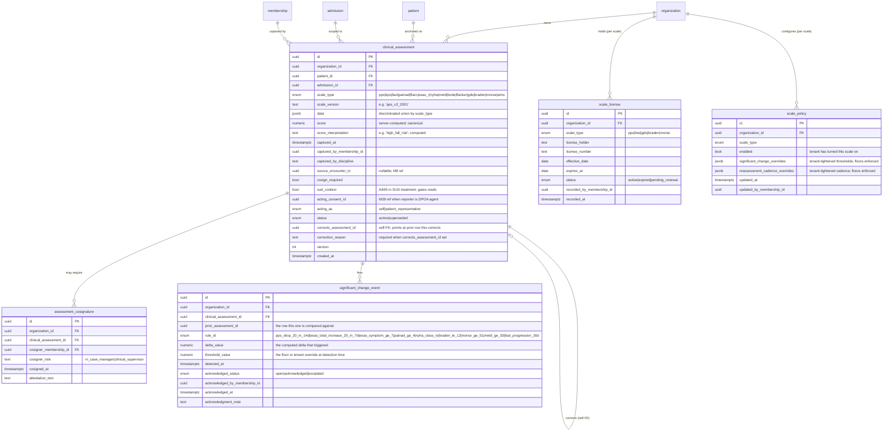
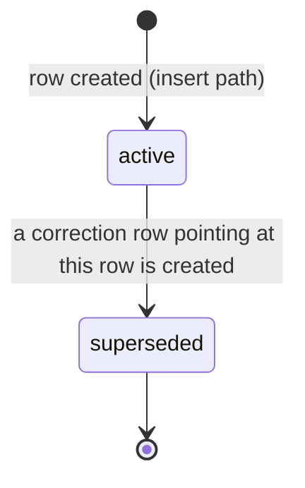
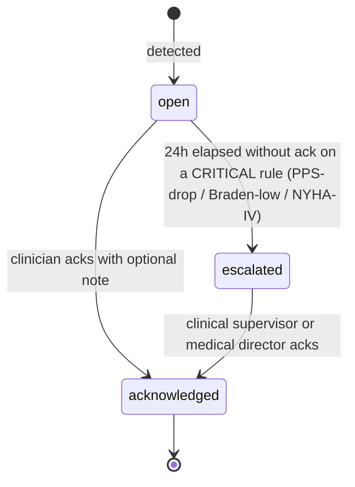

# Module 9 — Clinical Assessments Suite Specification

**Spec version:** v0.3 — the §2.4 outbox events migrated to the `m9.` namespace
(`m9.assessment.*`, `m9.scale.*`) per the M01 D8 `outbox_event_catalog` / M03 D9 convention.
Permission keys (`assessment.author`, …), audit actions (`assessment.viewed`,
`assessment.disclosed`, …), and code/field identifiers are unchanged — those are separate
catalogs. (Prior: v0.2.)

**Module ID:** 9
**Phase:** 1 (clinical spine — required for Engrace go-live; routine charting depends on it)
**Depends on:** 6 (Admission, Election & Certification — provides `admission` + activation timestamp that anchors longitudinal trending; `level_of_care_period` for stratifying scale series by GIP/IRC/CHC/RHC; admission state machine drives the `active_admission` invariant on every scale row), 36 (Secure Messaging & Alerts — significant-change alert delivery via the typed alert surface; care-team channel broadcast on threshold-crossing scales), 38 (Clinical Terminology — LOINC codes for every scale item; SNOMED concepts for finding bindings; value-set validation for scale-applicability rules; `asOfDate` lookups for survey-grade historical reconstruction), 39 (Consent & Authorization — 42 CFR Part 2 release for AIMS in SUD-treatment context; DPOA agent attribution when proxy reports patient symptoms; the `consent.evaluate` seam M9 uses for SUD-flagged scale data). Transitively via M6: 1 (Foundation — `withOrgContext`, `audit()` helper, outbox, idempotency, RLS generator, partitioned-table conventions, per-tenant DEK), 2 (Identity — actor resolution; discipline resolution from membership), 3 (Authorization — RBAC + ABAC; the `assessment.*` permission keys this module contributes), 4 (Audit — PHI write-audit trigger generator, audit-read helper, destruction-cert workflow + `eraseFn` registration, `compliance` retention class), 5 (Patient & Demographics — `patient` row, deceased status, privacy-flag snapshot for SUD gating), 40 (MDM — discipline/role taxonomy referenced by the scale-discipline matrix), 22 (Documents — assessment-summary PDF rendering via outbox).
**Consumed by:** 7 (Care Plan — reads latest PPS/FAST/ESAS-r via the `LatestAssessmentProvider` seam M7 declared at lock-grade; significant-change events feed IDG packet builder), 8 (Encounters & Visit Notes — records scales during an encounter by calling M9's `recordAssessment` API with `source_encounter_id`; encounter-sign workflow consults M9's "required scale" rules per encounter type), 10 (HOPE Engine — reads PPS at HOPE timepoints for prognosis context; HOPE J-items are NOT in M9, but the HOPE timepoint engine reads M9's PPS series for HUV1/HUV2 trend context), 11 (Orders — pain ≥ 7 on ESAS-r or PAINAD ≥ 4 surfaces order-suggestion banners; orders may link `triggering_assessment_id`), 14 (IDG — packet builder shows trend deltas per discipline; "since last IDG" view aggregates significant-change events), 16 (Bereavement — pre-death PPS trajectory informs caregiver-risk scoring per architecture §11 bereavement risk model), 28 (FHIR Gateway — maps every assessment row to a FHIR R4 `Observation` with the LOINC code on the scale item; trend series exposed via `Observation?patient=&code=`), 30 (HQRP & Quality — HCI / HVLDL / CAHPS context reads scale series; quality measures use score trajectories), 31 (Portal — patient/family-facing symptom trend view in lay language; consent-gated), 32 (AI Platform — `ScaleSeriesProvider` seam consumed by symptom-trajectory model and decline-prediction model; M32 has no Phase-1 implementation but the seam ships now), 33 (Reporting — operational dashboards: scale-completion rate by discipline, overdue-reassessment counts, significant-change rate).
**Spec status:** Re-locked v0.3 (Phase-2 tenancy remediation; supersedes Locked v0.2)

> **Phase-2 tenancy remediation (2026-06-11; ADR-0010/0011 / ARCH-011).** **M09-F03 (MAJOR):** the
> three **patient-level PHI tables** — `clinical_assessment`, `assessment_cosignature`,
> `significant_change_event` — now carry `provider_entity_id` + `location_id` beside `organization_id`,
> both **NOT NULL**: `clinical_assessment` denormalizes them from the admission at record-time (an
> assessment is a visit-anchored clinical event), and the two child tables denormalize from the parent
> assessment. This lets PE/Location-scoped ABAC and reporting run without joining through M5/M6.
> The two **org-level config tables** (`scale_license`, `scale_policy`) are licensing/policy catalogs,
> **not** patient PHI, and correctly remain at `organization_id` only. Now gated by `check-tenancy`
> (fitness #10). See §3.3.

## Changelog

- **v0.2 (Locked)** — Initial publication at lock-grade. Instantiates the architecture §20.B module spec template. Resolves all eleven open questions into binding decisions (§11). Defines the **shared-base + per-scale-jsonb storage shape** (D1), the **server-authoritative score computation** (D6), the **typed scale-discipline matrix** (D8), the **per-tenant license-tracking with platform floors** (D3), the **append-only correction-of-record amendment workflow** (D9 — mirroring M5 §164.526), the **significant-change threshold catalog** with platform floors + tenant override path (D2), the **encounter-linkage forward seam** (D5 — `source_encounter_id` nullable until M8 lands), the **`ScaleSeriesProvider` and `LatestAssessmentProvider` seams** published for M7/M10/M32 consumption (D7), the **AIMS / SUD consent gating** via Module 39 (D10), and the **partitioned-by-month assessment storage** matching M4's PHI-table conventions (D11). Wires the permission keys this module registers into Module 3 (§4.6), the BullMQ queue catalog (§4.8), the M36 typed-alert payload (§4.9), and the destruction `eraseFn` registered with Module 4 (§8.4). Includes a **proposed manifest patch** (§12, last item) correcting `M9.dependsOn` from `[8, 38]` to `[6, 36, 38, 39]` — the prior encoding inverted the M8↔M9 dep direction; the architecture flow ("vital signs feed Module 9 trending") is M8 → M9, and the M7 lock established the precedent that consumers (M7, M8) carry the dep, not the data-owner (M9).
- **v0.1** — Drafted within the lock-grade pass; not separately published.

> **Phase boundary (binding):** Phase 1 delivers everything in this spec **except** the M32 symptom-trajectory model integration (the `ScaleSeriesProvider` seam ships; the AI consumer ships when M32 is built — analogous to how M7 published `LatestAssessmentProvider` before M9 existed), the FHIR `Observation` resource publication (Module 28 owns; M9 emits the typed domain payload via outbox), and the assessment-summary PDF rendering (Module 22 owns the render; M9 emits the payload). The "done" gate for M9 is: shared-base + per-scale-jsonb schema with TypeBox-validated discriminated union per scale, the 14 scales of §1.1 wired with server-side scoring, significant-change detection + alert delivery via M36, license registry + form-gating, amendment workflow, the two outbound seams (`LatestAssessmentProvider`, `ScaleSeriesProvider`) registered at boot, and the test plan green — not gated on Modules 8/10/22/28/32 existing. The M8 encounter-linkage seam is exercised against a test-double encounter signer; the M7 `LatestAssessmentProvider` seam consumer is wired today against the real M7 (since M7 is already locked).

-----

## 1. Purpose & Scope

### 1.1 What This Module Does

Module 9 owns the **clinical-scale assessment library** that hospice clinicians use across every routine encounter, every IDG packet, every recertification narrative, and every survey reconstruction. Where Module 8 (Encounters) owns the *narrative* of what happened, Module 9 owns the *numbers* that quantify decline, symptom burden, and risk — and the longitudinal series of those numbers that is the most-asked-for artifact in a hospice CMS survey.

- **Scale catalog.** Phase 1 ships fourteen scales, each a discriminated subtype of the polymorphic `clinical_assessment` row:
  - **PPS** — Palliative Performance Scale v2 (Victoria Hospice). 0–100 in 10-point increments. The hospice industry's most-asked-for prognostic anchor; appears on every CTI narrative and most IDG packets.
  - **KPS** — Karnofsky Performance Status. 0–100 in 10-point increments. Public domain. The PPS antecedent; included for clinicians who learned KPS and for cross-walking external referral packets that arrive with KPS.
  - **FAST** — Functional Assessment Staging Tool (Reisberg). Stages 1–7, with substages 6a–6e and 7a–7f. The dementia-decline anchor used in CTI narratives for Alzheimer's/related-dementias terminal prognosis (the 7c-or-greater LCD criterion).
  - **PAINAD** — Pain Assessment in Advanced Dementia. Five items (breathing, vocalization, facial expression, body language, consolability), 0–2 each, total 0–10. The pain instrument for nonverbal patients.
  - **FLACC** — Face, Legs, Activity, Cry, Consolability. Five items, 0–2 each, total 0–10. Originally pediatric; in hospice used for nonverbal adult patients where PAINAD's dementia framing doesn't fit.
  - **ESAS-r** — Edmonton Symptom Assessment System, revised. Nine symptoms (pain, tiredness, drowsiness, nausea, lack of appetite, shortness of breath, depression, anxiety, wellbeing), 0–10 each, plus an "other" free-text symptom. Public domain. The single most-used symptom-burden instrument in palliative care.
  - **NYHA** — New York Heart Association functional classification. Class I–IV. Cardiac LCD anchor for end-stage heart-disease terminal prognosis.
  - **MELD** — Model for End-Stage Liver Disease (or MELD-Na). Server-computed from creatinine + bilirubin + INR (+ sodium for MELD-Na), with the published formula. Liver-LCD anchor.
  - **BODE** — BMI, Airflow Obstruction, Dyspnea, Exercise capacity. 0–10 points. COPD-LCD anchor.
  - **Flacker** — Flacker Mortality Score. Composite of weight loss, BMI, recent hospitalization, ADL dependency, ESRD/Cancer/CHF/COPD presence. Used for non-cancer general-decline-LCD prognosis.
  - **GDS** — Global Deterioration Scale (Reisberg). Stages 1–7. The FAST cousin; some clinicians prefer GDS staging for non-Alzheimer's dementias.
  - **Braden** — Braden Scale for Predicting Pressure Ulcer Risk. Six subscales (sensory perception, moisture, activity, mobility, nutrition, friction-and-shear), total 6–23 (lower = higher risk). Required-on-admission per most agency policies.
  - **Morse** — Morse Fall Scale. Six factors, total 0–125. Fall-risk anchor; required-on-admission per most agency policies.
  - **AIMS** — Abnormal Involuntary Movement Scale. Twelve items, 0–4 each. Used quarterly for any patient on antipsychotics (tardive-dyskinesia surveillance). **42 CFR Part 2 relevance:** When the antipsychotic is for a co-occurring SUD treatment context, AIMS data is Part 2-protected; M9 gates AIMS reads against the `42_cfr_part_2_release` consent.

- **Standalone or encounter-linked.** A scale can be recorded during an encounter (M8 calls `recordAssessment` with `source_encounter_id`) or standalone (bereavement counselor records PHQ-9 outside an encounter; intake nurse records an admission PPS before any encounter row exists). Encounter linkage is optional; the patient + admission anchor is required.
- **Server-authoritative scoring (D6).** Composite scores — ESAS-r total, PAINAD sum, MELD/MELD-Na formula, BODE point total, Braden total, Morse total — are computed server-side from the item values. The client's `score` payload (if any) is ignored; the server emits the canonical score back. Single source of truth: `packages/assessments/src/scales/<scale>/score.ts`. Prevents the calculator-drift class of bug where the chart shows one number and the trend shows another.
- **Discipline matrix (D8).** Which discipline may record which scale is a clinical-practice rule, not a configuration knob. Encoded as a typed constant (`packages/assessments/src/scales/<scale>/eligibility.ts`) and enforced at API boundary via the `discipline_can_record_scale` ABAC predicate (Module 3 D5 — typed predicates registered via the seam registry). Examples: NYHA / MELD / BODE / Flacker are MD/NP-only (the prognostic instruments require physician expertise); PPS / KPS / FAST are RN + MD/NP (LPN allowed under supervisor cosign); Braden + Morse are any clinical role (the pressure-ulcer and fall-risk instruments are deliberately broad-discipline so the field tablet captures them); AIMS is RN + MD/NP only (psych-trained roles).
- **Significant-change detection (D2).** Each scale carries a per-tenant-configurable significant-change rule with a platform floor that cannot be loosened. Examples of platform floors: PPS drop of ≥20 within 14 days; ESAS-r total burden increase of ≥20 within 7 days OR any single symptom ≥7; PAINAD ≥4; NYHA transition to Class IV; Braden ≤12; Morse ≥51; MELD ≥30. Detection runs on every `recordAssessment` write within the same transaction. On detection, M9 emits a typed `m9.assessment.significant_change` outbox event; Module 36 delivers the alert to the care-team channel and the typed-alert surface for the patient's case manager and clinical supervisor.
- **Trend computation (D4).** Each scale exposes `latest(patientId)`, `series(patientId, from, to)`, and `delta(patientId, window)` via the `ScaleSeriesProvider` seam. Phase 1 is read-time computation backed by a `(organization_id, patient_id, scale_type, captured_at DESC)` btree index — measured to meet p95 < 50 ms for `latest`, < 200 ms for 90-day series at expected volume (≤ 100 assessments per scale per episode). Materialization deferred to Phase 2 only if metrics show need.
- **License tracking (D3).** PPS (Victoria Hospice), FAST and GDS (Reisberg), Braden (Braden/Bergstrom), and Morse (Morse) require licenses for institutional use. M9 owns `scale_license` (one row per (organization, scale)) with license holder, expiry, license number. The license registry is *form-gating*: a clinician cannot record a license-required scale unless the tenant has an active license recorded. Boot validation: if a scale is enabled-by-policy but no active license exists, the form is hidden from clinicians and a `scale.license_missing` warning surfaces in the tenant Compliance dashboard.
- **Amendment workflow (D9).** A recorded scale is **immutable**. Errors are corrected by an append-only `corrects_assessment_id`-linked correction row, with a required `correction_reason` and the original row marked `superseded`. This matches the §164.526 right-to-amend pattern M5 already established for demographic amendments; surveyors get the full record of what was recorded, what was corrected, and why.
- **Audit-grade everything.** Every write flows through Module 4's PHI write-audit trigger with column-level scrubbing (free-text fields inside the per-scale `data` jsonb are denylisted from value capture; only the `<changed>` marker is recorded). Every read of a scale row through the chart or trend surfaces emits a `<scale>.viewed` audit event (per-resource for chart opens, aggregate for list views per M4 D3). AIMS reads under SUD context emit `assessment.disclosed` with a recipient classification (per M4 D5).
- **Outbox-driven downstream integration.** Every meaningful event — record, amendment, significant change, license lapse — flows through the outbox dispatcher (Module 1 §4.8). Downstream subscribers (M7 IDG trend builder, M8 encounter-signing gate's "required-scale" check, M14 IDG packet builder, M28 FHIR Observation projection, M32 AI scale-series consumer, M33 reporting materialized views) attach to the documented topics. Idempotent dispatch keyed on `assessment_id` + `event_kind`.

### 1.2 What This Module Does Not Do

- **HOPE assessment items.** Module 10 owns `hope_item` and the HOPE timepoint engine. HOPE J-items (J2030 / J2050 / J2051) are a *separate* artifact owned by M10, not a subtype of M9's `clinical_assessment`. M9 publishes PPS / ESAS-r / PAINAD series that M10 *reads* at HOPE timepoints for prognostic context. The architectural reason: HOPE has CMS-mandated timepoints, submission to iQIES, and 4-percentage-point APU consequence — it is a regulatory engine, not a clinical scale.
- **Comprehensive admission assessment.** The CoP 418.54 comprehensive assessment (within 5 days of election) is a *narrative document* with discipline-specific sections, owned by Module 8 (encounters) when conducted as a visit or by a future Module 9b (deferred). M9's scales are *inputs* to the comprehensive assessment — the RN records PPS, ESAS-r, Braden, and Morse during the comprehensive-assessment visit — but the comprehensive document itself is not an M9 entity.
- **Vital signs.** Blood pressure, heart rate, respiratory rate, temperature, oxygen saturation, pain score (the single 0–10 number distinct from ESAS-r's pain item) are *encounter vitals* — Module 8 stores these inline on the encounter. M9 trending may *read* the encounter vital series via M8's seam (in particular ESAS-r's pain item is correlated with the encounter pain score) but M9 does not own vital signs.
- **HOPE-specific symptom-impact assessment.** Module 10's J2051 (Symptom Impact at HOPE timepoints) overlaps thematically with ESAS-r but is a distinct regulatory artifact. M9 does not double-source J2051.
- **AI prediction model itself.** Module 32 (AI Platform) owns the symptom-trajectory model and the decline-prediction model. M9 publishes the `ScaleSeriesProvider` seam; M32 consumes. M9 has no model code.
- **Scale-summary PDF rendering.** Module 22 owns the PDF generator; M9 emits a typed `m9.assessment.summary_requested` outbox event with the domain payload (current scales, 30-day trend, significant-change markers). M22 renders. M9 has no PDF code.
- **FHIR `Observation` HTTP surface.** Module 28 owns FHIR R4 endpoints; M9 publishes the typed mapping (assessment row → FHIR Observation with the scale's LOINC code on the value and per-item LOINC codes on the components) consumed by M28. M9 has no FHIR HTTP surface.
- **Care plan goals or interventions.** Module 7 owns goals and interventions. A goal may *reference* an assessment scale ("PPS will be ≥ 50 at 30-day review" is a measurable goal) but M7 owns the goal row; M9 just provides the score that evaluates whether the goal is met.
- **Symptom-management orders.** Module 11 owns orders. M9 may *surface* an order-suggestion banner when ESAS-r pain ≥ 7 fires, but M9 doesn't create the order; the RN clicks through to M11. The order, if created, references `triggering_assessment_id` so the order trail back to the surfacing scale is preserved.
- **Cosignature for LPN entries.** Module 8 (encounter cosign workflow) owns the cosignature pattern. M9 follows it for LPN-recorded scales that require RN review (PPS, KPS, FAST per the discipline matrix): the scale row is `cosign_required=true` until the supervising RN's cosignature row attaches.

### 1.3 Regulatory Drivers

| Driver | Requirement | How Module 9 satisfies it |
|---|---|---|
| 42 CFR §418.54(b)(2) — Comprehensive assessment within 5 days | Initial clinical baseline must be captured | PPS, ESAS-r, Braden, Morse on admission encounter; "required-scale-on-admission" check on M8 encounter-sign gate when M8 lands |
| 42 CFR §418.54(d) — Update of the comprehensive assessment every 15 days | Reassessment cadence | `next_assessment_due_at` computed per (patient, scale) from the last recorded; reassessment-overdue worker emits alerts; surfaces on chart |
| 42 CFR §418.22(b)(3) — CTI narrative content | Physician's certification of terminal illness narrative includes objective clinical findings | Latest PPS, FAST, and disease-specific scale (NYHA / MELD / BODE / Flacker / GDS) are surfaced to M6 CTI authoring via the `LatestAssessmentProvider` seam |
| 42 CFR §418.56(c) — Care plan content | Plan content includes interventions for pain and symptoms with measurable outcomes | ESAS-r and PAINAD scores referenceable from M7 goal `measurable_outcome` field; M7 reads via seam |
| 42 CFR §418.104 — Clinical records authentication, completeness, retention | Immutable, attributed, timestamped, retained | Server-authoritative scoring + write-audit triggers + `compliance` retention class via M4; correction workflow preserves original |
| HIPAA §164.502(b) — Minimum necessary | Disclose only what's needed | Scale-summary surface (portal / collaborator) strips clinical-internal items; ABAC caseload + discipline scope on author; AIMS gated by SUD-release consent |
| 42 CFR Part 2 (substance use disorder confidentiality) | SUD records require explicit patient release | AIMS data flagged `sud_context=true` when the antipsychotic is for SUD treatment; SQL-level filter against the `sud_disclosure_allowed` ABAC predicate (registered via Module 39's seam) |
| 21st Century Cures Act / ONC Information Blocking | Patient-facing access to clinical data | Portal-facing assessment summary (Module 31) shows symptom-trend in lay language; consent-gated only for AIMS / SUD-flagged content |
| State retention law (e.g. ORS 192.553) | Longer retention where required | `compliance` retention class with `state_retention_override` table from M4 |

### 1.4 Competitive Context

The mainstream hospice EHRs (Homecare Homebase, MatrixCare, WellSky/Consolo, FireNote) all support PPS and ESAS-r as form fields; what they typically do not do well is the second half of the value: **the longitudinal series with the threshold-triggered alert and the audit-grade reconstruction at survey time.** WardenX's M9 differentiators are:

- **One source of truth for the score.** Server-side computation means the chart, the IDG packet, the FHIR export, and the CTI narrative all show the same number — the canonical one. Most vendors compute the ESAS-r total in JavaScript on the form and the trend report runs a separate aggregation, so when the row is edited the trend is briefly wrong and quietly fixed. We compute once, server-side, store the canonical, and never recompute.
- **Threshold-triggered alerting from day one.** "Pain ≥ 7" or "PPS drop ≥ 20" generates a typed alert through Module 36 immediately. Most vendors expose a configurable rule engine that is rarely configured; we ship the rules with platform floors and ship the integration with the care-team channel on day one.
- **Survey-grade reconstruction.** A surveyor asking "what was this patient's PPS on day 47?" gets a deterministic answer from the partitioned PHI table with no derived-table drift. The amendment workflow preserves both the original and the corrected — no silent in-place UPDATE.
- **License hygiene wired to form-gating.** Most vendors ship PPS / FAST / Braden / Morse as fields and trust the tenant to have the licenses — a recurring small finding in survey. We gate the form on the license registry; a clinician cannot record an unlicensed scale.
- **AIMS / SUD context honored.** Most vendors store AIMS as a regular scale with no SUD gating. We integrate the Part 2-release ABAC predicate so AIMS data is not exported via FHIR, not shown in the portal, and not disclosed in Accounting of Disclosures to non-treatment recipients unless consent permits.

The bet is that the second half of the value — the alert, the trend, the survey reconstruction, the consent gating — is where M9 is competitively differentiated, not in the per-form ergonomics that every vendor has parity on.

-----

## 2. Domain Model

### 2.1 Entity-Relationship Diagram



### 2.2 Entity Lifecycle States

#### 2.2.1 `clinical_assessment.status`



- A `superseded` row is **read-only**; it is preserved for surveyor reconstruction. The corrected `active` row carries `corrects_assessment_id` and `correction_reason`.
- No `deleted` state. Erasure happens only under the Module 4 destruction-certificate workflow; the `eraseFn` (§8.4) deletes both the original and the correction in a single transaction so the chain is internally consistent.

#### 2.2.2 `significant_change_event.acknowledged_status`



- `escalated` is a state transition emitted to M36 with a higher-severity payload (`severity=high` instead of `severity=medium`); the case manager and clinical supervisor get re-notified.
- Auto-ack on the next signed care-plan version (M7) where the version includes a change addressing the trigger (e.g. an added intervention referencing the problem the scale tracks). This is the integration point with the IDG cycle: an IDG-driven care-plan revision implicitly resolves the open changes for the scales the meeting addressed.

#### 2.2.3 `scale_license.status`

```mermaid
stateDiagram-v2
    [*] --> active: license recorded, effective_date <= today < expires_at
    active --> pending_renewal: expires_at - 30d <= today < expires_at
    active --> expired: today >= expires_at
    pending_renewal --> active: new license row recorded; this row archived
    pending_renewal --> expired: today >= expires_at
    expired --> active: renewal recorded
    expired --> [*]
```



- The license-status worker runs daily, recomputes statuses, and emits `m9.scale.license_pending_renewal` (30 days out) and `m9.scale.license_lapsed` (on expiry) events to M36 for the tenant Compliance dashboard.

### 2.3 Validation Rules

All synchronous unless marked otherwise. Validation runs in the API handler before the DB write; constraint-level enforcement repeats the most security-relevant rules at the schema layer (defense in depth).

| Rule | When | Mechanism |
|---|---|---|
| `patient` belongs to caller's organization | sync | RLS + service-layer ABAC `caseload_or_scope` |
| `admission` is `active` (or `discharged` for back-dated capture within 24h of discharge) | sync | service-layer check against M6 reader; 422 `INACTIVE_ADMISSION` otherwise |
| `captured_at` ≤ `now() + 5min` (small clock-skew tolerance) | sync | DB CHECK + service guard; future-dated captures rejected |
| `captured_at` ≥ admission.activated_at | sync | service-layer check against M6 reader; 422 `BEFORE_ADMISSION` |
| `scale_type` enabled for tenant | sync | join against `scale_policy.enabled`; 403 `SCALE_NOT_ENABLED` otherwise |
| `scale_type` has active license (if license-required) | sync | join against `scale_license.status='active'`; 403 `SCALE_LICENSE_MISSING` |
| Caller's discipline can record this scale | ABAC | predicate `discipline_can_record_scale` (D8 typed matrix) |
| Caller's discipline can record AIMS in SUD context | ABAC | predicate `discipline_can_record_scale` ∧ predicate `sud_disclosure_allowed` |
| Per-scale data shape | sync | TypeBox discriminated union — see §4.3 |
| Per-scale value ranges | sync | TypeBox per scale (PPS multiple-of-10 in [0,100]; ESAS-r each item [0,10]; Braden total [6,23] when derived; etc.) |
| Score is server-computed | sync | service ignores `score` in request body; computes from `data` via `packages/assessments/src/scales/<scale>/score.ts` |
| Composite-score sanity | sync | computed score must fall in published range for the scale; out-of-range = 500 internal (indicates scoring-function bug, not user error) |
| `corrects_assessment_id` references a row this caller can see | sync | RLS + ABAC; 404 if not visible |
| `corrects_assessment_id` references an `active` row of the same `scale_type` and same `patient_id` | sync | DB CHECK + service guard; 422 `CORRECTION_MISMATCH` otherwise |
| `correction_reason` non-empty when `corrects_assessment_id` set | sync | DB CHECK + TypeBox `minLength: 10` |
| `cosign_required` set when discipline is LPN and scale ∈ {PPS, KPS, FAST} | sync | service-layer policy |
| AIMS row in SUD context requires `acting_consent_id` of an active `42_cfr_part_2_release` consent at write time | sync (M39 seam) | `consent.evaluate(patientId, '42_cfr_part_2_release', sessionContext)` |
| DPOA-attributed (`acting_as='patient_representative'`) requires active `dpoa_healthcare` at write time | sync (M39 seam) | `consent.evaluate(patientId, 'dpoa_healthcare', sessionContext)` |
| Optimistic concurrency on amendment chain | sync | row carries `version int`; correction with stale parent `version` returns 412 |
| Reassessment cadence overdue does NOT block recording (alerts only) | n/a | overdue is a soft state — the clinician can always record |

### 2.4 Side-Effects (Events Emitted)

All emitted through Module 1's outbox helper. Idempotent dispatch keyed on `(assessment_id, event_kind)`.

| Event type | Trigger | Subscribers | Payload (summary) |
|---|---|---|---|
| `m9.assessment.recorded` | every successful insert (incl. corrections) | M7 (latest-cache invalidate), M14 (IDG packet aggregator), M28 (FHIR Observation projection — when M28 ships), M30 (HQRP measure inputs — when M30 ships), M33 (reporting) | `{ assessmentId, patientId, admissionId, scaleType, score, capturedAt, sourceEncounterId, isCorrection }` |
| `m9.assessment.amended` | row's `status` flips from `active → superseded` because a correction was created (companion event to `m9.assessment.recorded` on the new row) | M14, M28, M33 | `{ supersededId, correctingId, scaleType, reason }` |
| `m9.assessment.significant_change` | threshold-crossing rule fires within the recording transaction | M36 (typed alert: care-team channel + clinical-supervisor inbox), M7 (latest-cache + IDG packet "since last IDG" line), M11 (order-suggestion banner: pain ≥ 7 → comfort-order suggestion), M14 | `{ eventId, assessmentId, priorAssessmentId, ruleId, deltaValue, thresholdValue, severity }` |
| `m9.assessment.significant_change_acknowledged` | clinician acks | M36 (close alert), M33 | `{ eventId, ackBy, ackAt, note }` |
| `m9.assessment.significant_change_escalated` | 24h-without-ack timer on CRITICAL rules | M36 (re-deliver at `severity=high`) | `{ eventId, originalDetectedAt, escalatedAt }` |
| `m9.assessment.summary_requested` | M22 / portal asks for the printable summary | M22 (render PDF — when M22 ships) | `{ patientId, asOfDate, scales:[…], lang }` |
| `m9.scale.license_pending_renewal` | daily worker, 30 days out | M36 (Compliance-dashboard alert), M33 | `{ scaleType, expiresAt }` |
| `m9.scale.license_lapsed` | daily worker, on expiry | M36 (Compliance dashboard + org-admin), M33 | `{ scaleType, expiredAt }` |
| `m9.scale.policy_changed` | tenant updates `scale_policy` | M33 | `{ scaleType, changedFields }` |

The seam direction for the M7 / M10 / M32 forward consumers is **published interface + outbox**: M9 publishes the typed `LatestAssessmentProvider` and `ScaleSeriesProvider` interfaces in `packages/domain/assessments/seams.ts`; M9 emits the events; consumers attach via the outbox dispatcher *and* the synchronous provider call (for the hot "give me the latest PPS right now" path that powers the CTI narrative draft).

-----

## 3. Drizzle Schema

### 3.1 Package Layout

```
apps/backend/src/modules/09-assessments/
├── routes/
│   ├── assessments.ts            # GET / POST / correction
│   ├── trends.ts                 # series + delta + latest
│   ├── significant-changes.ts    # list + acknowledge
│   ├── licenses.ts               # org-admin license CRUD
│   ├── policies.ts               # org-admin scale_policy CRUD
│   └── schemas.ts                # TypeBox per scale
├── services/
│   ├── record-assessment.ts      # the central insert path (incl. significant-change detection)
│   ├── correct-assessment.ts     # the amendment path
│   ├── score-assessment.ts       # dispatch to per-scale score()
│   ├── significant-change.ts     # rule evaluation + event emission
│   ├── cosign.ts                 # LPN-cosignature workflow
│   ├── license-gate.ts           # form-gating service
│   ├── reassessment-cadence.ts   # next-due computation
│   ├── latest-provider.ts        # implements LatestAssessmentProvider seam
│   └── series-provider.ts        # implements ScaleSeriesProvider seam
├── workers/
│   ├── license-status.cron.ts    # daily license-status scan
│   ├── change-escalation.cron.ts # 24h-no-ack escalation
│   └── reassessment-due.cron.ts  # daily reassessment-overdue scan
├── domain/                        # re-exports from packages/assessments + packages/domain
└── boot.ts                        # registers seams + ABAC predicates + outbox subscribers + eraseFn
packages/assessments/
├── src/
│   ├── scales/
│   │   ├── pps/                  # data shape, score, interpret, eligibility, thresholds, loinc
│   │   ├── kps/
│   │   ├── fast/
│   │   ├── painad/
│   │   ├── flacc/
│   │   ├── esas-r/
│   │   ├── nyha/
│   │   ├── meld/
│   │   ├── bode/
│   │   ├── flacker/
│   │   ├── gds/
│   │   ├── braden/
│   │   ├── morse/
│   │   └── aims/
│   ├── catalog.ts                # SCALE_CATALOG with every scale's metadata
│   ├── interpret.ts              # score → interpretation dispatch
│   └── seams.ts                  # LatestAssessmentProvider + ScaleSeriesProvider interfaces
packages/db/src/schema/
├── clinical-assessments.ts
├── assessment-cosignatures.ts
├── significant-change-events.ts
├── scale-licenses.ts
└── scale-policies.ts
packages/domain/assessments/
├── seams.ts                       # public seam types (re-exports from packages/assessments)
├── scale-types.ts                 # ScaleType enum + the discriminated-union types
└── significant-change.ts          # rule-id enum + payload types
```

### 3.2 Enums

```typescript
// packages/db/src/enums.ts (additions)
import { pgEnum } from 'drizzle-orm/pg-core'

export const scaleType = pgEnum('scale_type', [
  'pps', 'kps', 'fast', 'painad', 'flacc', 'esas_r',
  'nyha', 'meld', 'bode', 'flacker', 'gds',
  'braden', 'morse', 'aims',
])

export const assessmentStatus = pgEnum('assessment_status', [
  'active', 'superseded',
])

export const assessmentActingAs = pgEnum('assessment_acting_as', [
  'self', 'patient_representative',
])

export const significantChangeRuleId = pgEnum('significant_change_rule_id', [
  'pps_drop_20_in_14d',
  'kps_drop_20_in_14d',
  'esas_total_increase_20_in_7d',
  'esas_symptom_ge_7',
  'painad_ge_4',
  'nyha_class_iv',
  'braden_le_12',
  'morse_ge_51',
  'meld_ge_30',
  'fast_progression_30d',
  'gds_progression_30d',
  'flacker_increase',
  'aims_emergent_dyskinesia',
])

export const significantChangeStatus = pgEnum('significant_change_status', [
  'open', 'acknowledged', 'escalated',
])

export const scaleLicenseStatus = pgEnum('scale_license_status', [
  'active', 'pending_renewal', 'expired',
])
```

### 3.3 Tables

> **Tenancy three-column rule (M09-F03 / ADR-0010 D1 / ARCH-011).** The three **patient-level PHI
> tables** — `clinical_assessment`, `assessment_cosignature`, `significant_change_event` — carry
> `organization_id` + `provider_entity_id` + `location_id`. PE/location are **NOT NULL**: a clinical
> assessment is a visit-anchored clinical event that always resolves to a ProviderEntity (the CCN it
> was charted under) and a service Location, **denormalized from the admission** at record-time; the
> cosignature and significant-change rows denormalize the same pair from their parent assessment. This
> drives PE/Location-scoped ABAC and per-discipline reporting without joining through M5/M6. The two
> remaining tables — `scale_license` and `scale_policy` — are **org-level licensing/policy config, not
> patient PHI**, so they correctly carry `organization_id` only (the ARCH-011 "nullable only on
> org-level entities" carve-out). SD-028 composite indexes on `(organization_id, location_id, …)`; RLS
> stays keyed on `app.org_id`. Satisfies `check-tenancy` (fitness #10). The M1 `providerEntities`/
> `locations` schemas are imported alongside `organizations` in the three PHI-table files only.

```typescript
// packages/db/src/schema/clinical-assessments.ts
import { pgTable, uuid, jsonb, numeric, text, timestamp, integer, boolean, index, uniqueIndex } from 'drizzle-orm/pg-core'
import { sql } from 'drizzle-orm'
import { scaleType, assessmentStatus, assessmentActingAs } from '../enums'
import { organizations, providerEntities, locations } from './organizations'  // M1 — ARCH-011 tenancy spine
import { patients } from './patients'           // M5
import { admissions } from './admissions'        // M6
import { memberships } from './memberships'      // M2

export const clinicalAssessments = pgTable(
  'clinical_assessment',
  {
    id: uuid('id').primaryKey().defaultRandom(),
    organizationId: uuid('organization_id').notNull()
      .references(() => organizations.id, { onDelete: 'restrict' }),
    providerEntityId: uuid('provider_entity_id').notNull()        // ARCH-011 / M09-F03 (NOT NULL — see §3.3 tenancy note)
      .references(() => providerEntities.id, { onDelete: 'restrict' }),
    locationId: uuid('location_id').notNull()                     // ARCH-011 / M09-F03 (NOT NULL — see §3.3 tenancy note)
      .references(() => locations.id, { onDelete: 'restrict' }),
    patientId: uuid('patient_id').notNull()
      .references(() => patients.id, { onDelete: 'restrict' }),
    admissionId: uuid('admission_id').notNull()
      .references(() => admissions.id, { onDelete: 'restrict' }),
    scaleType: scaleType('scale_type').notNull(),
    scaleVersion: text('scale_version').notNull(),       // e.g. 'pps_v2_2001'
    data: jsonb('data').notNull(),                        // discriminated-union payload
    score: numeric('score', { precision: 8, scale: 2 }), // null where the scale is non-numeric (FAST stages stored in data; score column holds numeric stage index)
    scoreInterpretation: text('score_interpretation'),
    capturedAt: timestamp('captured_at', { withTimezone: true }).notNull(),
    capturedByMembershipId: uuid('captured_by_membership_id').notNull()
      .references(() => memberships.id, { onDelete: 'restrict' }),
    capturedByDiscipline: text('captured_by_discipline').notNull(),
    sourceEncounterId: uuid('source_encounter_id'),       // nullable; M8 ref — no FK until M8 lands (D5)
    cosignRequired: boolean('cosign_required').notNull().default(false),
    sudContext: boolean('sud_context').notNull().default(false),
    actingConsentId: uuid('acting_consent_id'),           // M39 ref
    actingAs: assessmentActingAs('acting_as').notNull().default('self'),
    status: assessmentStatus('status').notNull().default('active'),
    correctsAssessmentId: uuid('corrects_assessment_id'), // self-FK; set on correction rows
    correctionReason: text('correction_reason'),
    version: integer('version').notNull().default(1),
    createdAt: timestamp('created_at', { withTimezone: true }).notNull().defaultNow(),
  },
  (t) => ({
    // The trend lookup hot path. Partial — only active rows participate in latest/series.
    patientScaleCapturedIdx: index('clinical_assessment_patient_scale_captured_idx')
      .on(t.organizationId, t.patientId, t.scaleType, t.capturedAt.desc())
      .where(sql`status = 'active'`),
    // Encounter join for M8 forward read.
    sourceEncounterIdx: index('clinical_assessment_source_encounter_idx')
      .on(t.sourceEncounterId)
      .where(sql`source_encounter_id is not null`),
    // Correction chain integrity — DB CHECK.
    correctionConsistency: sql`CONSTRAINT correction_consistency CHECK (
      (corrects_assessment_id IS NULL AND correction_reason IS NULL) OR
      (corrects_assessment_id IS NOT NULL AND correction_reason IS NOT NULL AND char_length(correction_reason) >= 10)
    )`,
    // Composition: a correction row must reference a same-scale assessment (validated in service layer at write time;
    // schema-level enforcement via deferred constraint trigger at migration time).
  })
)

// The base table is partitioned by month on captured_at to match the M4 PHI-table convention.
// Partitioning DDL is in the migration (see §3.6); Drizzle declares the logical shape.
```

```typescript
// packages/db/src/schema/assessment-cosignatures.ts
import { pgTable, uuid, text, timestamp, uniqueIndex } from 'drizzle-orm/pg-core'
import { organizations, providerEntities, locations } from './organizations'  // M1 — ARCH-011 tenancy spine
import { clinicalAssessments } from './clinical-assessments'
import { memberships } from './memberships'

export const assessmentCosignatures = pgTable(
  'assessment_cosignature',
  {
    id: uuid('id').primaryKey().defaultRandom(),
    organizationId: uuid('organization_id').notNull()
      .references(() => organizations.id, { onDelete: 'restrict' }),
    providerEntityId: uuid('provider_entity_id').notNull()        // ARCH-011 / M09-F03 (NOT NULL — denormalized from parent assessment)
      .references(() => providerEntities.id, { onDelete: 'restrict' }),
    locationId: uuid('location_id').notNull()                     // ARCH-011 / M09-F03 (NOT NULL — denormalized from parent assessment)
      .references(() => locations.id, { onDelete: 'restrict' }),
    clinicalAssessmentId: uuid('clinical_assessment_id').notNull()
      .references(() => clinicalAssessments.id, { onDelete: 'restrict' }),
    cosignerMembershipId: uuid('cosigner_membership_id').notNull()
      .references(() => memberships.id, { onDelete: 'restrict' }),
    cosignerRole: text('cosigner_role').notNull(),  // 'rn_case_manager' | 'clinical_supervisor'
    cosignedAt: timestamp('cosigned_at', { withTimezone: true }).notNull().defaultNow(),
    attestationText: text('attestation_text').notNull(),
  },
  (t) => ({
    assessmentRoleUq: uniqueIndex('assessment_cosignature_assessment_role_uq')
      .on(t.clinicalAssessmentId, t.cosignerRole),
  }),
)
```

```typescript
// packages/db/src/schema/significant-change-events.ts
import { pgTable, uuid, numeric, timestamp, text, index } from 'drizzle-orm/pg-core'
import { significantChangeRuleId, significantChangeStatus } from '../enums'
import { organizations, providerEntities, locations } from './organizations'  // M1 — ARCH-011 tenancy spine
import { clinicalAssessments } from './clinical-assessments'
import { memberships } from './memberships'

export const significantChangeEvents = pgTable(
  'significant_change_event',
  {
    id: uuid('id').primaryKey().defaultRandom(),
    organizationId: uuid('organization_id').notNull()
      .references(() => organizations.id, { onDelete: 'restrict' }),
    providerEntityId: uuid('provider_entity_id').notNull()        // ARCH-011 / M09-F03 (NOT NULL — denormalized from parent assessment)
      .references(() => providerEntities.id, { onDelete: 'restrict' }),
    locationId: uuid('location_id').notNull()                     // ARCH-011 / M09-F03 (NOT NULL — denormalized from parent assessment)
      .references(() => locations.id, { onDelete: 'restrict' }),
    clinicalAssessmentId: uuid('clinical_assessment_id').notNull()
      .references(() => clinicalAssessments.id, { onDelete: 'restrict' }),
    priorAssessmentId: uuid('prior_assessment_id')
      .references(() => clinicalAssessments.id, { onDelete: 'restrict' }),
    ruleId: significantChangeRuleId('rule_id').notNull(),
    deltaValue: numeric('delta_value', { precision: 8, scale: 2 }),
    thresholdValue: numeric('threshold_value', { precision: 8, scale: 2 }),
    detectedAt: timestamp('detected_at', { withTimezone: true }).notNull().defaultNow(),
    status: significantChangeStatus('status').notNull().default('open'),
    acknowledgedByMembershipId: uuid('acknowledged_by_membership_id')
      .references(() => memberships.id),
    acknowledgedAt: timestamp('acknowledged_at', { withTimezone: true }),
    acknowledgmentNote: text('acknowledgment_note'),
    escalatedAt: timestamp('escalated_at', { withTimezone: true }),
  },
  (t) => ({
    openPatientIdx: index('significant_change_open_patient_idx')
      .on(t.organizationId, t.clinicalAssessmentId)
      .where(sql`status = 'open'`),
    detectedIdx: index('significant_change_detected_idx').on(t.detectedAt),
  }),
)
```

```typescript
// packages/db/src/schema/scale-licenses.ts
import { pgTable, uuid, text, date, timestamp, uniqueIndex } from 'drizzle-orm/pg-core'
import { scaleType, scaleLicenseStatus } from '../enums'
import { organizations } from './organizations'
import { memberships } from './memberships'

export const scaleLicenses = pgTable(
  'scale_license',
  {
    id: uuid('id').primaryKey().defaultRandom(),
    organizationId: uuid('organization_id').notNull()
      .references(() => organizations.id, { onDelete: 'restrict' }),
    scaleType: scaleType('scale_type').notNull(),
    licenseHolder: text('license_holder').notNull(),
    licenseNumber: text('license_number'),
    effectiveDate: date('effective_date').notNull(),
    expiresAt: date('expires_at').notNull(),
    status: scaleLicenseStatus('status').notNull().default('active'),
    recordedByMembershipId: uuid('recorded_by_membership_id').notNull()
      .references(() => memberships.id, { onDelete: 'restrict' }),
    recordedAt: timestamp('recorded_at', { withTimezone: true }).notNull().defaultNow(),
  },
  (t) => ({
    // At most one active license per (org, scale).
    activePerOrgScale: uniqueIndex('scale_license_active_per_org_scale_uq')
      .on(t.organizationId, t.scaleType)
      .where(sql`status = 'active'`),
  }),
)
```

```typescript
// packages/db/src/schema/scale-policies.ts
import { pgTable, uuid, boolean, jsonb, timestamp, uniqueIndex } from 'drizzle-orm/pg-core'
import { scaleType } from '../enums'
import { organizations } from './organizations'
import { memberships } from './memberships'

export const scalePolicies = pgTable(
  'scale_policy',
  {
    id: uuid('id').primaryKey().defaultRandom(),
    organizationId: uuid('organization_id').notNull()
      .references(() => organizations.id, { onDelete: 'restrict' }),
    scaleType: scaleType('scale_type').notNull(),
    enabled: boolean('enabled').notNull().default(true),
    // tenant-tightened significant-change thresholds (must be at-least-as-strict as platform floor; service enforces)
    significantChangeOverrides: jsonb('significant_change_overrides').notNull().default(sql`'{}'::jsonb`),
    // tenant-tightened reassessment cadence (same floor-enforcement rule)
    reassessmentCadenceOverrides: jsonb('reassessment_cadence_overrides').notNull().default(sql`'{}'::jsonb`),
    updatedAt: timestamp('updated_at', { withTimezone: true }).notNull().defaultNow(),
    updatedByMembershipId: uuid('updated_by_membership_id').notNull()
      .references(() => memberships.id, { onDelete: 'restrict' }),
  },
  (t) => ({
    perOrgScale: uniqueIndex('scale_policy_per_org_scale_uq').on(t.organizationId, t.scaleType),
  }),
)
```

> **Note on `audit_event`:** Per the helper-only-tables policy (`module-manifest.ts` §HELPER_ONLY_TABLES), M9 never imports `audit_event` directly. Write capture flows through Module 4's PHI write-audit trigger installed in this module's migration; application-layer reads call `auditRead(...)` from `packages/audit`.

### 3.4 Migration `0009_assessments.sql` (Outline)

```sql
-- 0009_assessments.sql

-- Enums
CREATE TYPE scale_type AS ENUM ('pps','kps','fast','painad','flacc','esas_r','nyha','meld','bode','flacker','gds','braden','morse','aims');
CREATE TYPE assessment_status AS ENUM ('active','superseded');
CREATE TYPE assessment_acting_as AS ENUM ('self','patient_representative');
CREATE TYPE significant_change_rule_id AS ENUM ('pps_drop_20_in_14d','kps_drop_20_in_14d','esas_total_increase_20_in_7d','esas_symptom_ge_7','painad_ge_4','nyha_class_iv','braden_le_12','morse_ge_51','meld_ge_30','fast_progression_30d','gds_progression_30d','flacker_increase','aims_emergent_dyskinesia');
CREATE TYPE significant_change_status AS ENUM ('open','acknowledged','escalated');
CREATE TYPE scale_license_status AS ENUM ('active','pending_renewal','expired');

-- Partitioned base table. Partition column: captured_at. Strategy: monthly, matching the M4 PHI convention.
CREATE TABLE clinical_assessment (
  id UUID NOT NULL DEFAULT gen_random_uuid(),
  organization_id UUID NOT NULL REFERENCES organization(id) ON DELETE RESTRICT,
  patient_id UUID NOT NULL REFERENCES patient(id) ON DELETE RESTRICT,
  admission_id UUID NOT NULL REFERENCES admission(id) ON DELETE RESTRICT,
  scale_type scale_type NOT NULL,
  scale_version TEXT NOT NULL,
  data JSONB NOT NULL,
  score NUMERIC(8,2),
  score_interpretation TEXT,
  captured_at TIMESTAMPTZ NOT NULL,
  captured_by_membership_id UUID NOT NULL REFERENCES membership(id) ON DELETE RESTRICT,
  captured_by_discipline TEXT NOT NULL,
  source_encounter_id UUID,                          -- nullable; FK deferred to M8 land
  cosign_required BOOLEAN NOT NULL DEFAULT FALSE,
  sud_context BOOLEAN NOT NULL DEFAULT FALSE,
  acting_consent_id UUID,                            -- M39 ref; no FK (M39 may erase consent, retain the snapshot ref)
  acting_as assessment_acting_as NOT NULL DEFAULT 'self',
  status assessment_status NOT NULL DEFAULT 'active',
  corrects_assessment_id UUID,                        -- self-FK via DEFERRABLE constraint below
  correction_reason TEXT,
  version INTEGER NOT NULL DEFAULT 1,
  created_at TIMESTAMPTZ NOT NULL DEFAULT now(),
  PRIMARY KEY (id, captured_at),                     -- partition key must be in PK
  CONSTRAINT correction_consistency CHECK (
    (corrects_assessment_id IS NULL AND correction_reason IS NULL) OR
    (corrects_assessment_id IS NOT NULL AND char_length(correction_reason) >= 10)
  )
) PARTITION BY RANGE (captured_at);

-- 13 forward partitions pre-built (current + 12 months) at migration time.
-- M1's partition-rotation worker maintains rolling forward; closed partitions tier to MinIO per the retention class.

-- Indexes (defined on the partitioned table; cascade to partitions).
CREATE INDEX clinical_assessment_patient_scale_captured_idx
  ON clinical_assessment (organization_id, patient_id, scale_type, captured_at DESC)
  WHERE status = 'active';
CREATE INDEX clinical_assessment_source_encounter_idx
  ON clinical_assessment (source_encounter_id)
  WHERE source_encounter_id IS NOT NULL;
CREATE INDEX clinical_assessment_admission_idx
  ON clinical_assessment (organization_id, admission_id, captured_at DESC);

-- Self-FK as a DEFERRABLE constraint so a correction can insert in the same transaction
-- that supersedes the original (the trigger flips the original's status to 'superseded' in
-- the same TX as the correction's INSERT).
ALTER TABLE clinical_assessment ADD CONSTRAINT clinical_assessment_corrects_fk
  FOREIGN KEY (corrects_assessment_id, captured_at)  -- partitioned FK requires partition col
  REFERENCES clinical_assessment (id, captured_at)
  DEFERRABLE INITIALLY DEFERRED;

-- assessment_cosignature, significant_change_event, scale_license, scale_policy
-- (non-partitioned — lower volume; standard tables)
CREATE TABLE assessment_cosignature ( ... );
CREATE TABLE significant_change_event ( ... );
CREATE TABLE scale_license ( ... );
CREATE TABLE scale_policy ( ... );

-- RLS via M1 generator.
SELECT install_rls_org_scoped('clinical_assessment');
SELECT install_rls_org_scoped('assessment_cosignature');
SELECT install_rls_org_scoped('significant_change_event');
SELECT install_rls_org_scoped('scale_license');
SELECT install_rls_org_scoped('scale_policy');

-- M4 PHI write-audit triggers with denylist (free-text 'data' subpaths scrubbed; full data jsonb
-- captured as <changed> markers on UPDATE — but the table is effectively append-only:
-- the only UPDATE is status: 'active' → 'superseded' via the correction trigger).
SELECT audit_install_trigger('clinical_assessment',
  ARRAY[]::TEXT[],            -- no full-row denylist; per-jsonb-path handled below
  ARRAY['data.notes','data.other_symptom_text','correction_reason']::TEXT[]
);
SELECT audit_install_trigger('assessment_cosignature', ARRAY[]::TEXT[], ARRAY['attestation_text']::TEXT[]);
SELECT audit_install_trigger('significant_change_event', ARRAY[]::TEXT[], ARRAY['acknowledgment_note']::TEXT[]);
SELECT audit_install_trigger('scale_license', ARRAY[]::TEXT[], ARRAY[]::TEXT[]);
SELECT audit_install_trigger('scale_policy', ARRAY[]::TEXT[], ARRAY[]::TEXT[]);

-- Correction-supersede trigger: on INSERT with corrects_assessment_id set, flip the referenced row's status.
CREATE OR REPLACE FUNCTION clinical_assessment_supersede_on_correction()
RETURNS TRIGGER LANGUAGE plpgsql AS $$
BEGIN
  IF NEW.corrects_assessment_id IS NOT NULL THEN
    UPDATE clinical_assessment
       SET status = 'superseded',
           version = version + 1
     WHERE id = NEW.corrects_assessment_id
       AND organization_id = NEW.organization_id   -- RLS-friendly
       AND scale_type = NEW.scale_type             -- shape integrity
       AND patient_id = NEW.patient_id
       AND status = 'active';
    IF NOT FOUND THEN
      RAISE EXCEPTION 'CORRECTION_TARGET_NOT_ACTIVE_OR_MISMATCH';
    END IF;
  END IF;
  RETURN NEW;
END $$;

CREATE TRIGGER clinical_assessment_supersede_on_correction_trg
  AFTER INSERT ON clinical_assessment
  FOR EACH ROW EXECUTE FUNCTION clinical_assessment_supersede_on_correction();

-- Seed: scale_policy defaults — every scale enabled by default for the Engrace org template; no per-tenant overrides.
-- (Per-tenant seeds happen at org-onboarding via packages/saas, not here.)
```

### 3.5 RLS

Every M9 table is org-scoped per the M1 RLS generator pattern. M9 introduces no novel RLS shape — all five tables are single-tenant rows under the org context. The novel access controls (SUD-context AIMS gating, discipline-can-record matrix, signer-role-match) are ABAC predicates evaluated above RLS, not RLS policies themselves.

### 3.6 Partition Strategy

`clinical_assessment` is partitioned by month on `captured_at` (matching M4's PHI convention). The M1 partition-rotation worker maintains 12 months forward. Closed partitions tier hot→warm per the `compliance` retention class (7-year retention, M4 D1). Expected partition size at one tenant of ~5,000 active admissions: ~50k–200k rows per partition (scales completed at ~10–40 per admission per month average — heavy ESAS-r weight).

-----

## 4. API Routes

### 4.1 Route Inventory

| Method | Path | Auth | RBAC | ABAC | Idempotent | Pagination |
|---|---|---|---|---|---|---|
| POST | `/patients/:patientId/assessments` | staff | `assessment.author` | `caseload_or_scope` ∧ `discipline_can_record_scale[:type]` ∧ (`scale_type=aims` ∧ `sud_context=true` ⇒ `sud_disclosure_allowed`) ∧ (`acting_as='patient_representative'` ⇒ `dpoa_active`) | yes (Idempotency-Key) | — |
| POST | `/patients/:patientId/assessments/:id/corrections` | staff | `assessment.amend` | `caseload_or_scope` ∧ `discipline_can_record_scale[:type]` | yes (Idempotency-Key) | — |
| GET | `/patients/:patientId/assessments` | staff | `assessment.read` | `caseload_or_scope` ∧ (per-row `sud_disclosure_allowed` when `sud_context=true`) | — | cursor |
| GET | `/patients/:patientId/assessments/:id` | staff | `assessment.read` | as above | — | — |
| GET | `/patients/:patientId/scales/:scaleType/latest` | staff or internal | `assessment.read` | `caseload_or_scope` | — | — |
| GET | `/patients/:patientId/scales/:scaleType/series` | staff | `assessment.read_trend` | `caseload_or_scope` | — | windowed (from/to) |
| GET | `/patients/:patientId/scales/:scaleType/delta` | staff | `assessment.read_trend` | `caseload_or_scope` | — | — |
| POST | `/assessments/:id/cosignatures` | staff (RN cosigner) | `assessment.cosign` | `caseload_or_scope` ∧ `cosigner_role_match` | yes | — |
| GET | `/patients/:patientId/significant-changes` | staff | `assessment.read` | `caseload_or_scope` | — | cursor |
| POST | `/significant-changes/:eventId/acknowledge` | staff | `assessment.acknowledge_change` | `caseload_or_scope` | yes | — |
| GET | `/internal/assessments/latest-batch` | service (internal) | `assessment.read` (internal) | M7/M10 caller asserts scope | — | — |
| GET | `/internal/assessments/series-batch` | service (internal) | `assessment.read` (internal) | M32 caller asserts scope | — | — |
| GET | `/admin/scales/licenses` | org_admin | `assessment.license_read` | — | — | cursor |
| POST | `/admin/scales/licenses` | org_admin | `assessment.license_admin` | — | yes | — |
| PATCH | `/admin/scales/licenses/:id` | org_admin | `assessment.license_admin` | — | — | — |
| GET | `/admin/scales/policies` | org_admin | `assessment.policy_read` | — | — | — |
| PATCH | `/admin/scales/policies/:scaleType` | org_admin | `assessment.policy_admin` | — | — | — |
| GET | `/patients/:patientId/assessments/summary` | staff or collaborator or portal | `assessment.read_summary` | `caseload_or_scope` ∨ `collaborator_patient_match` ∨ `portal_patient_match` | — | — |

All routes return the standard error envelope (Module 1 §4) and all PHI-reading routes carry the `requireReadAudit` declaration so the route handler triggers a `<scale>.viewed` (or `assessment.disclosed` for portal/collaborator/FHIR egress per M4 D5) audit event automatically.

### 4.2 Webhooks

None inbound.

### 4.3 TypeBox — Per-Scale Discriminated Union

The defining shape: every scale is a discriminated subtype of `RecordAssessmentRequest`, validated at the API boundary. Representative subset shown; full set in `apps/backend/src/modules/09-assessments/routes/schemas.ts` and re-exported from `packages/assessments/src/scales/<scale>/schema.ts`.

```typescript
import { Type, Static } from '@sinclair/typebox'

// Common envelope
const CommonRecordFields = {
  capturedAt: Type.String({ format: 'date-time' }),
  sourceEncounterId: Type.Optional(Type.String({ format: 'uuid' })),
  actingAs: Type.Optional(Type.Union([Type.Literal('self'), Type.Literal('patient_representative')])),
  actingConsentId: Type.Optional(Type.String({ format: 'uuid' })),
  sudContext: Type.Optional(Type.Boolean()),  // only meaningful for scaleType='aims'
}

// PPS — palliative performance scale (0..100 in 10-point increments)
export const RecordPpsRequest = Type.Object({
  scaleType: Type.Literal('pps'),
  ...CommonRecordFields,
  data: Type.Object({
    ambulation: Type.Union([Type.Literal('full'), Type.Literal('reduced'), Type.Literal('mainly_sit_lie'), Type.Literal('mainly_in_bed'), Type.Literal('totally_bed_bound')]),
    activity: Type.Union([Type.Literal('normal'), Type.Literal('reduced'), Type.Literal('unable_normal_work'), Type.Literal('unable_hobby_work'), Type.Literal('unable_any_work')]),
    selfCare: Type.Union([Type.Literal('full'), Type.Literal('occasional_assist'), Type.Literal('considerable_assist'), Type.Literal('mainly_assist'), Type.Literal('total_care')]),
    intake: Type.Union([Type.Literal('normal'), Type.Literal('reduced'), Type.Literal('minimal_to_sips'), Type.Literal('mouth_care_only')]),
    consciousness: Type.Union([Type.Literal('full'), Type.Literal('full_or_confusion'), Type.Literal('full_or_drowsy_or_confusion'), Type.Literal('drowsy_or_coma')]),
    notes: Type.Optional(Type.String({ maxLength: 2000 })),
  }),
})
// Server computes score (0..100, multiple of 10) from the row context using the published PPS v2 mapping.

// ESAS-r — Edmonton Symptom Assessment System (revised); 9 symptoms 0..10 each + 'other'
export const RecordEsasrRequest = Type.Object({
  scaleType: Type.Literal('esas_r'),
  ...CommonRecordFields,
  data: Type.Object({
    pain: Type.Integer({ minimum: 0, maximum: 10 }),
    tiredness: Type.Integer({ minimum: 0, maximum: 10 }),
    drowsiness: Type.Integer({ minimum: 0, maximum: 10 }),
    nausea: Type.Integer({ minimum: 0, maximum: 10 }),
    lackOfAppetite: Type.Integer({ minimum: 0, maximum: 10 }),
    shortnessOfBreath: Type.Integer({ minimum: 0, maximum: 10 }),
    depression: Type.Integer({ minimum: 0, maximum: 10 }),
    anxiety: Type.Integer({ minimum: 0, maximum: 10 }),
    wellbeing: Type.Integer({ minimum: 0, maximum: 10 }),  // 0=best, 10=worst per ESAS-r convention
    otherSymptom: Type.Optional(Type.Object({
      label: Type.String({ minLength: 1, maxLength: 100 }),
      severity: Type.Integer({ minimum: 0, maximum: 10 }),
    })),
    reportedBy: Type.Union([Type.Literal('patient'), Type.Literal('caregiver'), Type.Literal('clinician_observed')]),
    otherSymptomText: Type.Optional(Type.String({ maxLength: 500 })),  // denylisted in audit
  }),
})
// Server computes total = sum of 9 numeric items (other symptom NOT included in total per ESAS-r convention).

// PAINAD — Pain Assessment in Advanced Dementia; 5 items 0..2 each, total 0..10
export const RecordPainadRequest = Type.Object({
  scaleType: Type.Literal('painad'),
  ...CommonRecordFields,
  data: Type.Object({
    breathing: Type.Integer({ minimum: 0, maximum: 2 }),
    negativeVocalization: Type.Integer({ minimum: 0, maximum: 2 }),
    facialExpression: Type.Integer({ minimum: 0, maximum: 2 }),
    bodyLanguage: Type.Integer({ minimum: 0, maximum: 2 }),
    consolability: Type.Integer({ minimum: 0, maximum: 2 }),
    notes: Type.Optional(Type.String({ maxLength: 2000 })),
  }),
})

// MELD — computed
export const RecordMeldRequest = Type.Object({
  scaleType: Type.Literal('meld'),
  ...CommonRecordFields,
  data: Type.Object({
    creatinineMgDl: Type.Number({ minimum: 0.1, maximum: 40 }),
    bilirubinMgDl: Type.Number({ minimum: 0.1, maximum: 100 }),
    inr: Type.Number({ minimum: 0.5, maximum: 20 }),
    sodiumMeqL: Type.Optional(Type.Number({ minimum: 100, maximum: 160 })),  // present => MELD-Na
    onDialysisTwiceLastWeek: Type.Optional(Type.Boolean()),
    notes: Type.Optional(Type.String({ maxLength: 2000 })),
  }),
})
// Server computes MELD or MELD-Na via the published formula.

// FAST — discrete stages 1, 2, 3, 4, 5, 6a-6e, 7a-7f
export const RecordFastRequest = Type.Object({
  scaleType: Type.Literal('fast'),
  ...CommonRecordFields,
  data: Type.Object({
    stage: Type.Union([
      Type.Literal('1'), Type.Literal('2'), Type.Literal('3'), Type.Literal('4'), Type.Literal('5'),
      Type.Literal('6a'), Type.Literal('6b'), Type.Literal('6c'), Type.Literal('6d'), Type.Literal('6e'),
      Type.Literal('7a'), Type.Literal('7b'), Type.Literal('7c'), Type.Literal('7d'), Type.Literal('7e'), Type.Literal('7f'),
    ]),
    notes: Type.Optional(Type.String({ maxLength: 2000 })),
  }),
})

// AIMS — Abnormal Involuntary Movement Scale; 12 items 0..4 each + global judgment items
export const RecordAimsRequest = Type.Object({
  scaleType: Type.Literal('aims'),
  ...CommonRecordFields,
  sudContext: Type.Boolean(),  // explicit; gates the consent ABAC predicate
  data: Type.Object({
    facialMuscles: Type.Integer({ minimum: 0, maximum: 4 }),
    lipsAndPerioral: Type.Integer({ minimum: 0, maximum: 4 }),
    jaw: Type.Integer({ minimum: 0, maximum: 4 }),
    tongue: Type.Integer({ minimum: 0, maximum: 4 }),
    upperLimbs: Type.Integer({ minimum: 0, maximum: 4 }),
    lowerLimbs: Type.Integer({ minimum: 0, maximum: 4 }),
    truncal: Type.Integer({ minimum: 0, maximum: 4 }),
    globalSeverity: Type.Integer({ minimum: 0, maximum: 4 }),
    globalIncapacitation: Type.Integer({ minimum: 0, maximum: 4 }),
    patientAwareness: Type.Integer({ minimum: 0, maximum: 4 }),
    currentProblemsTeeth: Type.Boolean(),
    dentalProblems: Type.Boolean(),
    notes: Type.Optional(Type.String({ maxLength: 2000 })),
  }),
})

// The full router schema is the union (server side: switch on scaleType).
export const RecordAssessmentRequest = Type.Union([
  RecordPpsRequest, RecordKpsRequest, RecordFastRequest, RecordPainadRequest,
  RecordFlaccRequest, RecordEsasrRequest, RecordNyhaRequest, RecordMeldRequest,
  RecordBodeRequest, RecordFlackerRequest, RecordGdsRequest, RecordBradenRequest,
  RecordMorseRequest, RecordAimsRequest,
])

// Response: the canonical row with server-computed score and interpretation.
export const AssessmentDto = Type.Object({
  id: Type.String({ format: 'uuid' }),
  patientId: Type.String({ format: 'uuid' }),
  admissionId: Type.String({ format: 'uuid' }),
  scaleType: Type.String(),
  scaleVersion: Type.String(),
  data: Type.Unknown(),                       // typed per scaleType in the client SDK
  score: Type.Union([Type.Number(), Type.Null()]),
  scoreInterpretation: Type.Union([Type.String(), Type.Null()]),
  capturedAt: Type.String({ format: 'date-time' }),
  capturedBy: Type.Object({
    membershipId: Type.String({ format: 'uuid' }),
    discipline: Type.String(),
    displayName: Type.String(),
  }),
  sourceEncounterId: Type.Union([Type.String({ format: 'uuid' }), Type.Null()]),
  cosignRequired: Type.Boolean(),
  cosignedAt: Type.Union([Type.String({ format: 'date-time' }), Type.Null()]),
  sudContext: Type.Boolean(),
  actingAs: Type.String(),
  actingConsentId: Type.Union([Type.String({ format: 'uuid' }), Type.Null()]),
  status: Type.Union([Type.Literal('active'), Type.Literal('superseded')]),
  correctsAssessmentId: Type.Union([Type.String({ format: 'uuid' }), Type.Null()]),
  correctionReason: Type.Union([Type.String(), Type.Null()]),
  redacted: Type.Boolean(),                    // true if SUD content was filtered for this caller
})

export const SeriesPointDto = Type.Object({
  assessmentId: Type.String({ format: 'uuid' }),
  capturedAt: Type.String({ format: 'date-time' }),
  score: Type.Union([Type.Number(), Type.Null()]),
  scoreInterpretation: Type.Union([Type.String(), Type.Null()]),
  significantChange: Type.Union([Type.Boolean(), Type.Null()]),
})

export const SeriesResponseDto = Type.Object({
  scaleType: Type.String(),
  patientId: Type.String({ format: 'uuid' }),
  from: Type.String({ format: 'date-time' }),
  to: Type.String({ format: 'date-time' }),
  points: Type.Array(SeriesPointDto),
})

export const SignificantChangeDto = Type.Object({
  id: Type.String({ format: 'uuid' }),
  assessmentId: Type.String({ format: 'uuid' }),
  priorAssessmentId: Type.Union([Type.String({ format: 'uuid' }), Type.Null()]),
  ruleId: Type.String(),
  deltaValue: Type.Union([Type.Number(), Type.Null()]),
  thresholdValue: Type.Union([Type.Number(), Type.Null()]),
  detectedAt: Type.String({ format: 'date-time' }),
  status: Type.Union([Type.Literal('open'), Type.Literal('acknowledged'), Type.Literal('escalated')]),
  severity: Type.Union([Type.Literal('medium'), Type.Literal('high')]),
})
```

### 4.4 Error Codes (M9-specific; on top of M1 envelope)

| Code | HTTP | Meaning |
|---|---|---|
| `INACTIVE_ADMISSION` | 422 | Patient's admission is not active and not within 24h-of-discharge back-dating window |
| `BEFORE_ADMISSION` | 422 | `capturedAt` precedes `admission.activated_at` |
| `SCALE_NOT_ENABLED` | 403 | Tenant has disabled this scale via `scale_policy` |
| `SCALE_LICENSE_MISSING` | 403 | Scale requires a license; tenant has none active |
| `DISCIPLINE_NOT_ELIGIBLE` | 403 | Caller's discipline cannot record this scale |
| `SUD_CONSENT_REQUIRED` | 403 | AIMS in SUD context attempted without an active 42 CFR Part 2 release |
| `DPOA_CONSENT_REQUIRED` | 403 | `acting_as='patient_representative'` attempted without active `dpoa_healthcare` |
| `SCORE_OUT_OF_RANGE` | 500 | Server-computed score is out of published range — indicates scoring-function bug; client retry won't help (always 500, not 4xx) |
| `CORRECTION_MISMATCH` | 422 | Correction-target row scale-type / patient / admission disagrees with this row |
| `CORRECTION_TARGET_NOT_ACTIVE` | 409 | Correction target is already `superseded` (DB trigger surfaced) |
| `COSIGN_REQUIRED` | 412 | Read path refusing to surface in a context that requires cosignature (e.g., CTI narrative); the row is recorded but not yet cosigned |
| `STALE_VERSION` | 412 | Optimistic-concurrency conflict on correction chain |

### 4.5 Socket.IO Events (per-org / per-patient room)

| Event | Direction | Payload | Purpose |
|---|---|---|---|
| `m9.assessment.recorded` | server → patient room | `{ assessmentId, scaleType, score, capturedAt }` | Live chart refresh |
| `m9.assessment.significant_change` | server → patient room + care-team channel | `{ eventId, ruleId, scaleType, severity }` | Live alert banner |
| `m9.scale.license_lapsed` | server → org-admin room | `{ scaleType, expiredAt }` | Compliance dashboard |

### 4.6 Permission Keys this Module Registers into Module 3

Per Module 3 §3.3, each module contributes its own permission keys to the central catalog. M9 registers:

| Key | Default roles | Used by |
|---|---|---|
| `assessment.read` | All clinical roles (RN, LPN, CHHA, MSW, Chaplain, MD/NP, NP, Medical Director, Clinical Supervisor, DON, IDG Coordinator, Bereavement Counselor — post-death window), Compliance Officer, Survey Coordinator, Auditor (read-only) | GET routes |
| `assessment.author` | RN, LPN (limited via ABAC), MD/NP, NP, MSW (ESAS-r only via ABAC), Chaplain (ESAS-r psychosocial-items-only future variant), CHHA (Braden/Morse only via ABAC), Clinical Supervisor | POST `/assessments` |
| `assessment.amend` | RN, MD/NP, NP, Clinical Supervisor, IDG Coordinator | POST correction |
| `assessment.cosign` | RN Case Manager, Clinical Supervisor | LPN cosignature |
| `assessment.read_trend` | All clinical + Compliance + Survey + Auditor | series/delta routes |
| `assessment.acknowledge_change` | RN Case Manager, Clinical Supervisor, MD/NP, NP | ack significant change |
| `assessment.read_summary` | All clinical + Collaborator + Portal session class + Bereavement Counselor | `/summary` |
| `assessment.license_read` | Org Admin, Compliance Officer | license registry view |
| `assessment.license_admin` | Org Admin | license CRUD |
| `assessment.policy_read` | Org Admin, Compliance Officer | scale policy view |
| `assessment.policy_admin` | Org Admin | scale policy CRUD |

**Cross-module handshake (mirror of M4 §4.5):** these eleven keys must be present in Module 3's catalog at boot (loaded from `packages/auth/permissions/assessments.ts`); the role templates seeded by M3 must include the defaults above. Boot validation enforces this — a missing key is a startup failure, not a 403 at first attempt.

### 4.7 ABAC Predicates Registered

Per Module 3 D5 (typed predicates registered via the seam registry):

| Predicate | Resolves via | Used by |
|---|---|---|
| `discipline_can_record_scale[:scaleType]` | M9 typed eligibility matrix (`packages/assessments/src/scales/<scale>/eligibility.ts`) | author routes |
| `sud_disclosure_allowed` | Module 39 `consent.evaluate(patientId, '42_cfr_part_2_release', sessionContext)` (seam registry) | AIMS author + every read of AIMS rows |
| `dpoa_active` | Module 39 `consent.evaluate(patientId, 'dpoa_healthcare', sessionContext)` (seam registry) | author when `acting_as='patient_representative'` |
| `cosigner_role_match` | M9 — caller's role intersects the cosigner role for the assessment | cosign route |
| `caseload_or_scope` | shared with M5/M6/M7 — caller's caseload includes patient OR session scope names it OR Medical Director / Compliance / Survey role | every PHI route |
| `collaborator_patient_match` | shared with M5/M6/M7 — collaborator session names this patient | summary route |
| `portal_patient_match` | shared with M5/M7 — portal session is for this patient | summary route |

### 4.8 BullMQ Jobs

| Queue | Job | Purpose | Trigger |
|---|---|---|---|
| `assessment.license` | `license-status-scan` | Daily scan: flip statuses across `scale_license`; emit `m9.scale.license_pending_renewal` (30d out) and `m9.scale.license_lapsed` (on expiry) | Daily cron 02:00 org-tz |
| `assessment.changes` | `change-escalation` | Hourly scan: significant-change events `status='open'` whose `detected_at < now() - 24h` AND rule ∈ CRITICAL_RULES; flip to `escalated`, re-emit at `severity=high` | Hourly cron |
| `assessment.cadence` | `reassessment-due-scan` | Daily scan: per (patient, scale_type), if `now() > latest.captured_at + cadence`, flag overdue and add to the chart-banner cache | Daily cron 06:00 org-tz |
| `assessment.summary` | `build-summary-cache` | On `significant_change` or on chart-open, rebuild summary cache (Valkey, 1-hour TTL) for the patient/scale | Outbox subscriber + on-demand |
| `assessment.eraser` | `erase-patient-assessments` | Module 4 destruction-certificate callback (`eraseFn`); erases all assessment rows for a patient under an approved certificate | M4 destruction workflow |

### 4.9 M36 Typed Alert Payload

When `m9.assessment.significant_change` fires, M36 receives a typed alert per M36 §5.4:

```typescript
// packages/domain/assessments/alerts.ts
export type AssessmentSignificantChangeAlert = {
  kind: 'm9.assessment.significant_change'
  organizationId: string
  patientId: string
  assessmentId: string
  ruleId: SignificantChangeRuleId
  scaleType: ScaleType
  severity: 'medium' | 'high'
  deltaValue: number | null
  thresholdValue: number | null
  recipients: {
    careTeamChannel: true
    caseManagerInbox: true
    clinicalSupervisorInbox: true
    medicalDirectorInbox: 'on_escalation'  // only on escalated state
  }
  bodyTemplate: string  // M9 emits the deterministic message; M36 doesn't re-template
}
```

-----

## 5. Frontend Screens

### 5.1 Screen Inventory

| Screen | Route | Primary actor | Purpose |
|---|---|---|---|
| Patient assessment timeline | `/patients/:id/assessments` | clinical staff | every scale captured for the patient, color-coded by scale, with deltas at-a-glance |
| Record-assessment modal | (overlay on encounter form or chart) | clinical staff (per discipline matrix) | scale picker → per-scale form → submit; idempotency by client-supplied key |
| Per-scale trend view | `/patients/:id/scales/:scale` | clinical staff | series chart (default 90 days; selectable 30 / 90 / episode); item-level breakdown; significant-change markers overlaid |
| Significant-change inbox (per-patient) | `/patients/:id/assessments/changes` | RN case manager, clinical supervisor | open / escalated changes for this patient with ack action |
| Significant-change inbox (org-wide) | `/work/changes` | clinical supervisor, DON | every open change across the caseload, sortable by severity |
| Assessment-summary view | `/patients/:id/assessments/summary` | clinical + portal | latest values + 30-day deltas across all scales; SUD-redacted when ABAC says so |
| Scale-license registry (admin) | `/admin/scales/licenses` | org admin, Compliance Officer | record / renew / expire licenses; surfaces missing-license warnings |
| Scale-policy editor (admin) | `/admin/scales/policies` | org admin, Compliance Officer | enable/disable scales; tighten thresholds (floor-enforced) |
| Reassessment-overdue banner | (inline on chart) | all clinical | warning when a required-cadence scale is past due |
| Significant-change toast | (live, anywhere) | all clinical | Socket.IO live notification when a change fires while the user is in the chart |

### 5.2 Key Screen Detail

**Patient assessment timeline** (`/patients/:id/assessments`) — vertical timeline grouped by month, each row a captured scale: scale badge (color per scale family — performance/symptoms/risk/cognitive), captured-at, captured-by + discipline chip, score with delta-arrow vs prior, significant-change indicator if any. Click drills into the per-scale row detail. Filters by scale + date range + by-discipline. Cosignature-pending rows render in italic with a "cosign needed" chip; clinical supervisor sees a one-click "cosign all" overlay. SUD-flagged rows (AIMS) render with a lock icon for non-consent callers; redacted to a count-only line in the timeline.

**Record-assessment modal** — two-step: step 1 picks the scale (filtered by the caller's discipline; ineligible scales greyed with a tooltip — "only RN / MD can record this"); step 2 is the per-scale form. Each per-scale form mirrors the canonical paper instrument layout (PPS: five-row grid with the level descriptions; ESAS-r: nine 0–10 sliders + "other"; PAINAD: five 0–2 radios; FAST: stage tree). Server-computed score is shown after submit, not before. If the result triggers a significant change, the modal shows a "Significant change detected — alert sent to the care team" banner before closing.

**Per-scale trend view** — Recharts line chart with x = captured_at, y = score; ribbons for "above threshold" and "below threshold" where applicable. Significant-change events show as vertical markers with hover-detail. ESAS-r view has an item-stacked-area mode so the clinician sees which symptoms are driving the total. Below the chart: tabular history with the last 20 captures.

**Significant-change inbox (org-wide)** — work-queue list with severity badge, patient, scale, rule, detected-at, age (red if >24h on a CRITICAL rule), ack button. Bulk-ack supported. Clinical supervisor's default landing tab.

**Assessment-summary view** — three-column grid (Performance / Symptoms / Risk / Cognitive scales by family), each card shows latest value + 30-day delta arrow + last-captured timestamp. Patient-facing portal variant (Module 31 future): symptom-only cards in plain language ("Your tiredness has been trending higher over the past 2 weeks. Discuss with your nurse.").

**Scale-license registry** — table with one row per (org × scale); status chip (Active / Pending Renewal / Expired), expiry date, license holder, license number, recorded-by + recorded-at. "Renew" action opens a modal that records a new license row (atomic; the prior row archives). Expired rows render disabled with a "renew to re-enable the scale" prompt.

**Scale-policy editor** — toggle per scale (enabled/disabled). For each enabled scale: significant-change-threshold tuner showing platform floor (read-only) and tenant override (editable, validated client-side and server-side to be at-least-as-strict as the floor); reassessment cadence the same way.

### 5.3 Mobile (Capacitor)

- **Record** on mobile: every scale form is mobile-optimized (touch-first numeric stepper for ESAS-r; full-screen PPS picker; large-target radios for PAINAD/FLACC). Offline draft persistence in IndexedDB; submits when connectivity returns (idempotency-key replays cleanly).
- **Trend** on mobile: 90-day default chart with the same item-stacked-area mode for ESAS-r.
- **Significant change** on mobile: push notification via M36 when the user is on-shift; tap drills into the ack flow.
- **Cosign** on mobile: supported via biometric step-up.

### 5.4 Portal (Module 31, future)

The Portal calls `/patients/:id/assessments/summary` with a `portal` session class scope. The portal cannot see scale-specific data items, the captured-by clinician name beyond a role, or anything SUD-flagged. The portal sees: lay-language "how is the patient doing" cards keyed off ESAS-r and PPS in particular, with the family-facing language curated by the tenant.

### 5.5 Accessibility (WCAG 2.1 AA)

- All interactive controls keyboard-navigable in chart tab order.
- ESAS-r 0–10 sliders are keyboard-operable (arrow keys); each item has a labelled current-value announcement.
- Significant-change toasts use `role="alert"` and `aria-live="assertive"`.
- Trend chart has a screen-reader-friendly table mode toggle.
- Status badges use both color and icon.
- Scale-license expiry banners use both red and a warning icon, not color alone.

-----

## 6. Permissions Matrix

Authoritative matrix; entries marked **(✓ ABAC)** require an attribute predicate in addition to the role grant. **(✓ scale)** means subject to the per-scale discipline-eligibility matrix (`discipline_can_record_scale[:type]`).

| Action | RN Case Mgr | LPN | CHHA | MSW | Chaplain | MD/NP | NP | Medical Director | Clinical Supervisor | IDG Coord | DON | Compliance Officer | Survey Coord | Auditor | Collaborator | Portal | Bereavement Counselor |
|---|---|---|---|---|---|---|---|---|---|---|---|---|---|---|---|---|---|
| `assessment.read` | ✓ ABAC | ✓ ABAC | ✓ ABAC | ✓ ABAC | ✓ ABAC | ✓ ABAC | ✓ ABAC | ✓ ABAC | ✓ ABAC | ✓ ABAC | ✓ ABAC | ✓ | ✓ (engagement) | ✓ (engagement) | ✓ (per-patient scope) | summary only | ✓ ABAC (post-death window) |
| `assessment.author` (PPS / KPS) | ✓ ABAC ∧ scale | ✓ ABAC ∧ scale ∧ cosign | — | — | — | ✓ ABAC ∧ scale | ✓ ABAC ∧ scale | — | ✓ ABAC ∧ scale | — | — | — | — | — | — | — | — |
| `assessment.author` (FAST / GDS) | ✓ ABAC ∧ scale | — | — | — | — | ✓ ABAC ∧ scale | ✓ ABAC ∧ scale | — | ✓ ABAC ∧ scale | — | — | — | — | — | — | — | — |
| `assessment.author` (ESAS-r) | ✓ ABAC ∧ scale | ✓ ABAC ∧ scale | — | ✓ ABAC ∧ scale | — | ✓ ABAC ∧ scale | ✓ ABAC ∧ scale | — | ✓ ABAC ∧ scale | — | — | — | — | — | — | — | — |
| `assessment.author` (PAINAD / FLACC) | ✓ ABAC ∧ scale | ✓ ABAC ∧ scale | — | — | — | ✓ ABAC ∧ scale | ✓ ABAC ∧ scale | — | ✓ ABAC ∧ scale | — | — | — | — | — | — | — | — |
| `assessment.author` (Braden / Morse) | ✓ ABAC ∧ scale | ✓ ABAC ∧ scale | ✓ ABAC ∧ scale | — | — | ✓ ABAC ∧ scale | ✓ ABAC ∧ scale | — | ✓ ABAC ∧ scale | — | — | — | — | — | — | — | — |
| `assessment.author` (NYHA / MELD / BODE / Flacker) | — | — | — | — | — | ✓ ABAC ∧ scale | ✓ ABAC ∧ scale | — | — | — | — | — | — | — | — | — | — |
| `assessment.author` (AIMS, non-SUD) | ✓ ABAC ∧ scale | — | — | — | — | ✓ ABAC ∧ scale | ✓ ABAC ∧ scale | — | — | — | — | — | — | — | — | — | — |
| `assessment.author` (AIMS, SUD context) | ✓ ABAC ∧ scale ∧ sud_consent | — | — | — | — | ✓ ABAC ∧ scale ∧ sud_consent | ✓ ABAC ∧ scale ∧ sud_consent | — | — | — | — | — | — | — | — | — | — |
| `assessment.author` (acting_as=patient_representative) | ✓ ABAC ∧ scale ∧ dpoa | ✓ ABAC ∧ scale ∧ dpoa | — | ✓ ABAC ∧ scale ∧ dpoa | — | ✓ ABAC ∧ scale ∧ dpoa | ✓ ABAC ∧ scale ∧ dpoa | — | ✓ ABAC ∧ scale ∧ dpoa | — | — | — | — | — | — | — | — |
| `assessment.amend` | ✓ ABAC | — | — | — | — | ✓ ABAC | ✓ ABAC | — | ✓ ABAC | ✓ ABAC | — | — | — | — | — | — | — |
| `assessment.cosign` | ✓ ABAC | — | — | — | — | — | — | — | ✓ ABAC | — | — | — | — | — | — | — | — |
| `assessment.read_trend` | ✓ ABAC | ✓ ABAC | ✓ ABAC | ✓ ABAC | ✓ ABAC | ✓ ABAC | ✓ ABAC | ✓ ABAC | ✓ ABAC | ✓ ABAC | ✓ ABAC | ✓ | ✓ (engagement) | ✓ (engagement) | — | — | ✓ ABAC |
| `assessment.acknowledge_change` | ✓ ABAC | — | — | — | — | ✓ ABAC | ✓ ABAC | ✓ ABAC | ✓ ABAC | — | — | — | — | — | — | — | — |
| `assessment.read_summary` | ✓ ABAC | ✓ ABAC | ✓ ABAC | ✓ ABAC | ✓ ABAC | ✓ ABAC | ✓ ABAC | ✓ ABAC | ✓ ABAC | ✓ | ✓ | ✓ | ✓ | ✓ | ✓ (scope) | ✓ (scope) | ✓ ABAC |
| `assessment.license_read` | — | — | — | — | — | — | — | — | — | — | ✓ | ✓ | — | — | — | — | — |
| `assessment.license_admin` | — | — | — | — | — | — | — | — | — | — | ✓ | — | — | — | — | — | — |
| `assessment.policy_read` | — | — | — | — | — | — | — | — | — | — | ✓ | ✓ | — | — | — | — | — |
| `assessment.policy_admin` | — | — | — | — | — | — | — | — | — | — | ✓ | — | — | — | — | — | — |

ABAC predicates in this matrix (registered with Module 3 per §4.7).

**Override paths:**

- **Break-glass (Module 3):** a clinician outside the patient's caseload may read with break-glass; cannot author. Author-via-break-glass is structurally blocked at the route handler.
- **Discipline-floor:** a discipline that is not in the scale's eligibility list cannot author even with break-glass — the structural rule prevents (for example) a chaplain authoring an AIMS row regardless of role escalation. The justification: the data would be clinically meaningless.
- **Survey override:** Survey Coordinator and Auditor (under engagement) read across caseload boundaries via the `auditor_engagement` ABAC path (Module 3 D2); never author.

-----

## 7. Workflow Acceptance Criteria

### 7.1 Record PPS during the admission encounter

**Done means:** RN documents the admission visit (Module 8, future). Inside the encounter form, the RN clicks "Record PPS" — the M9 modal opens with `sourceEncounterId` pre-bound. RN selects ambulation / activity / self-care / intake / consciousness. Submit: M9 validates the discriminated union, computes the PPS score server-side (50% in this scenario), inserts the row with `cosign_required=false` (RN role), emits `m9.assessment.recorded`. M8's encounter form refreshes to show the PPS captured. The CTI authoring screen (M6) now shows "Latest PPS: 50" via the `LatestAssessmentProvider` seam. The IDG packet aggregator (M14, future) attaches the PPS to the next packet automatically.

### 7.2 Significant-change detection on ESAS-r pain

**Done means:** RN records ESAS-r 9 days into the admission. Pain score is 8. Server computes the total (35), inserts the row, *and within the same transaction* runs the significant-change rule engine: rule `esas_symptom_ge_7` fires (pain ≥ 7). A `significant_change_event` row is inserted; an `m9.assessment.significant_change` outbox event is published; M36 delivers a typed alert to the care-team channel and the case manager's typed-alert inbox; M11 (Orders, future) surfaces an order-suggestion banner on the patient's chart ("Comfort-order suggestion: ESAS-r pain at 8 — consider PRN morphine"). Status of the event is `open`. The RN can acknowledge it inline; ack moves it to `acknowledged` and clears the chart banner.

### 7.3 24h-no-ack CRITICAL escalation

**Done means:** PPS captured 24+ hours ago dropped from 60 to 40 (rule `pps_drop_20_in_14d`). No clinician has acknowledged. The `change-escalation` hourly cron flips the event to `escalated`, re-emits `m9.assessment.significant_change_escalated`. M36 re-delivers the alert at `severity=high` to the medical director's typed-alert inbox in addition to the prior recipients. The chart banner now renders red.

### 7.4 LPN cosignature workflow

**Done means:** LPN records PPS (allowed by discipline matrix with cosign requirement). Row inserts with `cosign_required=true`. CTI narrative draft surface (M6) refuses to include the PPS unless cosigned (the `COSIGN_REQUIRED` gate). Supervising RN sees the cosign queue, opens the row, reviews, attests, signs. `assessment_cosignature` row inserts; the M9 row's `cosign_required` flips false-effective via the cosign-attached lookup (the column stays true for historical accuracy; consumers look at the cosignature row's presence). CTI narrative now uses the PPS.

### 7.5 Correction of an erroneous ESAS-r

**Done means:** RN realized the pain item was misclicked (entered 8, meant 2). Within the chart, "Correct" opens a modal — same form pre-populated with the original values, scale-type / patient / admission locked. RN edits the pain item to 2, enters a correction reason ("Recorded in error; transposed item value"). Submit: M9 validates, computes new total (25), inserts the correction row with `corrects_assessment_id = original.id`. The DB trigger flips the original to `superseded` in the same transaction. The chart now shows the corrected row; the timeline shows the corrected row with a "Corrected from a prior value (see history)" caption. Audit captures both the insert and the supersede.

### 7.6 AIMS with SUD context

**Done means:** Patient is on Haloperidol for SUD-treatment-related agitation (documented in Module 6 admission). Nurse practitioner records quarterly AIMS. Modal asks: "Is this AIMS for a substance-use-treatment context?" — NP confirms. M9 validates that an active `42_cfr_part_2_release` consent exists (Module 39 seam); if no release, the write returns `SUD_CONSENT_REQUIRED`. With release: row inserts with `sud_context=true`. From now on, every read of this row goes through `sud_disclosure_allowed`. FHIR Gateway (M28, future) filters this row out unless the recipient is named on the release. Portal hides it. Audit log records it with `severity=warn` per M4 D5 (disclosure classification).

### 7.7 License lapse + auto-disable

**Done means:** The tenant's Victoria-Hospice PPS license expires today. The daily `license-status-scan` flips the row to `expired`, emits `m9.scale.license_lapsed`. The org-admin's Compliance dashboard shows a red banner with the lapsed license. The next clinician who tries to record a PPS gets `SCALE_LICENSE_MISSING` (403). The PPS form is hidden in the modal. Existing PPS data is unaffected (reads continue). When the renewal is recorded, status flips back to `active`, the form re-appears.

### 7.8 Reassessment-overdue banner

**Done means:** Braden was recorded 8 days ago. Tenant cadence override sets `braden=7d` (platform floor is `30d`; tenant tightened). The daily `reassessment-due-scan` adds the patient to the overdue cache for Braden. The chart shows a yellow "Braden reassessment due" banner. Recording a new Braden clears the banner.

### 7.9 Trend chart for IDG packet

**Done means:** IDG coordinator opens IDG packet for next Tuesday's meeting. M14 (future) calls M9's `seriesProvider.batch(patientIds, ['pps', 'esas_r'], { from: lastMeetingDate, to: now })`. M9 returns the series for each (patient, scale); the packet renders inline mini-charts per patient per scale with significant-change markers. The patient one-pager shows "PPS dropped from 50 to 30 in the past 14 days — significant change; case manager ack 6/12."

### 7.10 Edge cases & failure paths

| Case | Expected behavior |
|---|---|
| Patient deceased; clinician attempts to record | 422 `INACTIVE_ADMISSION` (admission state is `discharged`); the only allowed late-capture path is within 24h-of-discharge per §2.3 |
| Caregiver-reported ESAS-r via DPOA, no active DPOA | 403 `DPOA_CONSENT_REQUIRED` |
| Two clinicians record the same scale simultaneously | Both succeed; both rows are recorded. The chart shows both with discipline chips. (No de-dup — this is clinically valid: an RN and an MD may each record their own PPS.) |
| Correction of a `superseded` row | 409 `CORRECTION_TARGET_NOT_ACTIVE`; clinician must correct the *current* active row |
| Future-dated `capturedAt` (clock skew) | 422 with the message naming the skew; small 5-minute tolerance allowed |
| Significant-change rule disabled by tenant policy | event not emitted; tenant policy cannot disable the platform-floor rule (only tighten it); a "loosening" PATCH returns 422 with the floor displayed |
| Worker enqueues a duplicate change-escalation due to retry | idempotent on `(eventId)`; second enqueue no-ops |
| M39 absent at boot | the `consent.evaluate` seam returns deny-by-default; any AIMS-in-SUD write returns 403; flagged in `/status` dashboard |
| FHIR Gateway requests an AIMS row with no consent context | M28 filters out before egress; audit `assessment.disclosed` is NOT emitted (because nothing left the perimeter) |
| Erasure under destruction certificate during a live trend query | erasure runs in a single transaction; the trend query either sees pre- or post-erasure state; never partial (RR isolation) |

-----

## 8. Audit & Observability

### 8.1 Audit Events Emitted

| Event | Severity | Payload | Source |
|---|---|---|---|
| `m9.assessment.recorded` | info | `{ assessmentId, patientId, admissionId, scaleType, scoreBucket, capturedByDiscipline, isCorrection }` | trigger (write) + application (narrative) |
| `assessment.viewed` | info | `{ assessmentId, byUserId, viaContext: chart\|trend\|summary\|ctinarrative }` | application (`auditRead`) |
| `assessment.disclosed` | warn | `{ assessmentId, byUserId, to: portal\|collaborator\|fhir\|external, purpose }` | application — M4 D5 inference |
| `m9.assessment.amended` | info | `{ correctingId, supersededId, reasonHash }` | trigger (the correction-supersede trigger) + application |
| `assessment.significant_change_detected` | warn | `{ eventId, assessmentId, ruleId, deltaValue, thresholdValue, severity }` | application (recording transaction) |
| `m9.assessment.significant_change_acknowledged` | info | `{ eventId, ackBy, ackAt }` | application |
| `m9.assessment.significant_change_escalated` | warn | `{ eventId, escalatedAt, originalDetectedAt }` | application (cron) |
| `assessment.cosigned` | info | `{ assessmentId, cosignerId, cosignerRole }` | trigger + application |
| `scale.license_recorded` | info | `{ scaleType, licenseHolder, expiresAt }` | trigger |
| `m9.scale.license_pending_renewal` | warn | `{ scaleType, expiresAt }` | application (cron) |
| `m9.scale.license_lapsed` | warn | `{ scaleType, expiredAt }` | application (cron) |
| `scale.policy_updated` | info | `{ scaleType, changedFields }` | trigger + application |

PHI mutation events flow through both the M4 trigger generator (the *binding* source of truth from the table write) and the application narrative event (the *human-readable* what-happened). Free-text fields (`data.notes`, `data.otherSymptomText`, `correction_reason`, `acknowledgment_note`) are denylisted on the trigger — the audit_event row contains `<changed>` rather than the text.

### 8.2 Metrics (Prometheus)

| Metric | Type | Labels | Purpose |
|---|---|---|---|
| `assessment_recorded_total` | counter | `scale_type, discipline, outcome` | recording throughput |
| `assessment_significant_change_total` | counter | `rule_id, severity` | clinical-event rate |
| `assessment_significant_change_open_count` | gauge | `severity` | backlog of unacked changes |
| `assessment_significant_change_ack_seconds` | histogram | `severity, rule_id` | time-to-ack distribution; target p95 < 4h for `medium`, < 1h for `high` |
| `assessment_score_computation_seconds` | histogram | `scale_type` | server-side scoring latency; target p95 < 5ms |
| `assessment_latest_lookup_seconds` | histogram | `scale_type` | seam latency for `LatestAssessmentProvider`; target p95 < 50ms |
| `assessment_series_lookup_seconds` | histogram | `scale_type, range_days_bucket` | series query latency; target p95 < 200ms at 90 days |
| `scale_license_expired_total` | counter | `scale_type` | lapsed-license events |
| `scale_license_missing_block_total` | counter | `scale_type` | clinician attempts blocked by missing license |
| `assessment_correction_total` | counter | `scale_type` | error-correction rate (a data-quality signal) |
| `assessment_cosign_pending_count` | gauge | — | cosignature backlog |
| `assessment_reassessment_overdue_count` | gauge | `scale_type` | overdue scales per type |

### 8.3 Spans & Logs

- Spans: `assessment.record`, `assessment.score`, `assessment.detect_significant_change`, `assessment.correction`, `assessment.cosign`, `assessment.latest`, `assessment.series`, `assessment.eraser`.
- Span attributes never carry PHI values. Scale type, score-bucket (binned), discipline, rule_id are allowed; patient names, free-text notes, the raw `data` payload are filtered.
- All logs use Module 1's Pino redaction; patient identifiers in logs are `patient_id` (UUID) only.

### 8.4 Destruction `eraseFn` (M4 Integration)

Module 9 registers an eraser with Module 4's destruction-certificate registry at boot:

```typescript
// apps/backend/src/modules/09-assessments/boot.ts
import { registerEraser } from '@wardenx/audit'
import { eraseAssessmentsForPatient } from './services/eraser'

registerEraser('clinical_assessment', async (ctx, certificate) => {
  // ctx carries the orgId; certificate.scope.patientIds is the set to erase
  // Returns count erased; raises if any row is under legal hold (M4 catches)
  return eraseAssessmentsForPatient(ctx, certificate.scope.patientIds)
})
```

The eraser implementation:
1. Acquires per-patient row lock (advisory lock keyed on patient id) to avoid racing concurrent writes during destruction.
2. Erases child rows first (`assessment_cosignature`, `significant_change_event`) referencing assessments-to-erase, then the assessments themselves (`status`-agnostic — both `active` and `superseded` rows are erased; the chain integrity is preserved by erasing both ends of every correction link).
3. Does NOT erase `scale_license` or `scale_policy` (these are org-level, not patient-level).
4. Emits `assessment.erased_under_certificate` audit event with the certificate id.
5. Returns the count for the certificate's execution record.

### 8.5 STRIDE (M9-specific)

| Threat | Surface | Mitigation |
|---|---|---|
| Spoofing (S) | Recording as another clinician | Session-bound `captured_by_membership_id`; never client-supplied |
| Tampering (T) | Editing a signed scale to alter prognosis | Immutable rows; corrections require append-only correction + reason; audit trigger captures both |
| Repudiation (R) | "I didn't record that" | Per-row `captured_by_membership_id` + trigger-captured before/after diff |
| Information disclosure (I) | SUD-flagged AIMS to non-consented recipient | SQL-level filter via `sud_disclosure_allowed` ABAC predicate; FHIR/portal egress filtered before serialization |
| Denial of service (D) | Trend query over a 5-year series | Partitioned table + composite index + Valkey cache; series queries cap window at 365 days for non-admin callers |
| Elevation (E) | Clinician of ineligible discipline recording a scale (e.g., chaplain → AIMS) | `discipline_can_record_scale` predicate; structural floor — break-glass cannot grant author |

-----

## 9. Test Plan

### 9.1 Unit (target ≥ 90%; ≥ 95% on score functions, significant-change detector, eraser)

- **Per-scale `score()`:** every scale has property-based tests across the valid input domain plus a fixed regression suite of canonical inputs from the published instrument literature (e.g., PPS published case examples; ESAS-r reference cases; MELD-Na vs. United Network for Organ Sharing reference calculator).
- **Score boundaries:** PPS only emits multiples of 10 in [0, 100]; ESAS-r total always equals the sum of 9 items (other-symptom excluded); MELD/MELD-Na formula matches the published one to 1 decimal place across the test cases.
- **Significant-change detector:** per rule, fixed input pairs at the threshold boundary (just-below, at, just-above); ensures the rule fires at the correct edge. Tenant override application; floor-enforcement (a tenant cannot set `painad ≥ 3` when the floor is `≥ 4` — the override is rejected).
- **Discipline matrix:** every (discipline, scaleType) pair tested; ineligible pairs return 403.
- **Correction trigger:** insert correction → original flips to `superseded` in the same TX; rollback leaves both rows unchanged; correction targeting non-active or wrong-scale errors out.
- **License gate:** every license-required scale tested for the gate; non-license-required scales never blocked; expired license blocks; pending-renewal license still permits.
- **Eraser:** erases assessments + cosignatures + significant-change events for a patient; preserves rows for other patients; obeys legal-hold (refuses if any row is held).
- **SUD-consent predicate:** seam deny when M39 absent; allow when active release; revoke at write time (consent revoked between API entry and DB write) is detected via service-layer recheck.

### 9.2 Integration (Testcontainers)

- End-to-end record path: API → validate → score → significant-change detect → insert → outbox dispatch → M36 receives the typed alert (M36 test double).
- Correction path: insert original → insert correction → original superseded → audit emitted on both.
- Cosignature path: LPN records → cosignature row inserts → CTI narrative consumer now sees the row.
- License lifecycle: record license → status `active` → effective_date check → expire via cron → status `expired` → record renewal → status `active` again.
- Significant-change escalation: insert change → 24h pass (test-clock advance) → cron flips to `escalated` → M36 receives the escalation event.
- Cross-module: M7 reads latest via `LatestAssessmentProvider`; M9 returns the active row; M9 changes; M7 cache invalidates; next read shows the new value.

### 9.3 Security / Authorization (independence)

- **Layer-independence:** stub Module 3 to allow everything → cross-tenant `SELECT * FROM clinical_assessment` from Org A under Org B context returns zero rows (RLS backstop).
- **IDOR:** every `:id` route hit with an out-of-org UUID returns 404 (not 403).
- **Discipline floor:** chaplain attempting AIMS write returns 403 `DISCIPLINE_NOT_ELIGIBLE` even with break-glass.
- **SUD gate:** AIMS write without active 42 CFR Part 2 release returns 403 `SUD_CONSENT_REQUIRED`; read of SUD-flagged AIMS from non-consented session returns row with `redacted=true` and empty `data` (or 404, depending on tenant policy — default: redacted-shape so a clinician knows "there is an AIMS but you can't see it").
- **DPOA gate:** `acting_as='patient_representative'` without active DPOA returns 403.
- **License gate:** unlicensed write returns 403 `SCALE_LICENSE_MISSING`.

### 9.4 RLS Isolation

- Org A and Org B fixtures with same patient name; verify all five tables deny cross-org reads under wrong `app.org_id`.
- Verify outbox events carry `organizationId` and that subscribers respect it.
- Verify the correction trigger does not bypass RLS (a correction in Org A cannot supersede an Org B row — should never reach the trigger).
- Verify that `scale_license` is org-scoped (a license in Org A does not gate Org B's clinicians).

### 9.5 E2E (Playwright)

- RN admit-visit workflow: open encounter (mocked M8 form), click "Record PPS," enter values, submit; verify chart shows PPS captured.
- LPN records PPS → supervisor sees cosign queue → cosigns → CTI surface now uses the PPS.
- ESAS-r pain ≥ 7 → toast + care-team channel notification appears; ack from inbox.
- Correction modal: enter a correction; verify original strikes through; history shows both.
- AIMS in SUD context with no consent: blocked with a clear error message and a link to the consent surface.
- License lapse: simulate via test-clock; PPS form disappears for clinicians; org admin sees the lapsed banner; renewal restores.

### 9.6 Performance

- `latest(patientId, scaleType)`: p95 < 50 ms over 100k assessments / 1k active patients.
- `series(patientId, scaleType, 90d)`: p95 < 200 ms.
- `series` batch (50 patients, 2 scales, 90 days) — IDG packet generation: p95 < 1.5 s.
- Significant-change detection in the recording transaction: adds < 30 ms to the insert path.
- License-status scan: full pass under 30 s at 50 tenants × 14 scales.

### 9.7 Fixtures

- `seedAssessmentSeries(patientId, scaleType, count, { significantChangeAtIndex })` — for trend tests.
- `seedScaleLicense(orgId, scaleType, { status, expiresAt })`.
- `mockM39Consent({ patientId, flags })` — shared with M5/M6/M7.
- `mockM7LatestConsumer()` — verifies M7 receives the right latest value after a recording.
- Multi-tenant fixture mandatory for §9.4.
- 14 per-scale "canonical clinical case" fixtures for property/regression suites.

-----

## 10. Implementation Tasks

| # | Task | Size | Depends on |
|---|---|---|---|
| 1 | `0009_assessments.sql` migration: enums, all 5 tables (assessments partitioned by month), RLS, audit triggers via M4 generator, correction-supersede trigger, indexes | L | M1, M4 |
| 2 | `packages/assessments` scaffold: per-scale folder structure + `catalog.ts` + `seams.ts` | S | 1 |
| 3 | Per-scale modules — 14 of them — each delivering: TypeBox schema, `score()`, `interpret()`, `eligibility`, `thresholds`, LOINC bindings | L | 2 |
| 4 | `score-assessment.ts` service: dispatch over scaleType to per-scale `score()`; server-authoritative; ignore client `score` | S | 3 |
| 5 | `record-assessment.ts` service: validate → score → license-gate → discipline-gate → consent-gate (M39 seam) → insert → significant-change detect → outbox | L | 3, 4 |
| 6 | `correct-assessment.ts` service: validate target → score → insert correction (trigger handles supersede) → audit | M | 5 |
| 7 | `cosign.ts` service: insert cosignature; `assessment.cosigned` event | S | 5 |
| 8 | `significant-change.ts` rule engine: per-rule evaluators, tenant-override application with floor enforcement | M | 3 |
| 9 | `series-provider.ts` + `latest-provider.ts` services implementing the seams | M | 1 |
| 10 | `license-gate.ts` service + `license-status` cron worker | M | 1 |
| 11 | `reassessment-cadence.ts` service + `reassessment-due-scan` cron | S | 1 |
| 12 | `change-escalation.cron.ts` worker | S | 8 |
| 13 | API routes per §4.1 + TypeBox schemas | L | 5–11 |
| 14 | Permission keys registered into M3 catalog + assigned to default templates | S | M3 |
| 15 | Boot wiring: register `LatestAssessmentProvider` + `ScaleSeriesProvider` seams; register `eraseFn` with M4; register ABAC predicates with M3 | S | M1, M3, M4 |
| 16 | Frontend (web): timeline, record-modal, per-scale trend view, change inbox (per-patient + org-wide), summary, license admin, policy editor | L | 13 |
| 17 | Frontend (mobile): record form (all 14 scales) + trend view + change toast + cosign | M | 13 |
| 18 | Eraser registration + integration with M4 destruction workflow | S | M4, 1 |
| 19 | Test suite (unit + integration + RLS + security + E2E + perf) per §9 | L | all |
| 20 | Manifest patch: update `M9.dependsOn` from `[8, 38]` to `[6, 36, 38, 39]`; add `ownedTables: ['clinical_assessment','assessment_cosignature','significant_change_event','scale_license','scale_policy']` | S | — |

**PR boundaries:** (A) 1–2 schema + scaffold; (B) 3 the 14 per-scale modules (each a sub-PR within the boundary); (C) 4–8 scoring + recording + correction + significant-change; (D) 9–12 seams + workers; (E) 13–14 routes + permissions; (F) 15 boot wiring; (G) 16–17 frontend; (H) 18 eraser; (I) 19 tests; (J) 20 manifest patch + boundary check green.

-----

## 11. Resolved Decisions

All structural and policy decisions for Module 9 are resolved at lock time. The table records the binding choice, the rejected alternatives, the rationale, and the section of the spec where the decision is realized. No decision below is open or deferred.

| ID | Decision | Rationale | Rejected alternatives | Realized in |
|---|---|---|---|---|
| D1 | **Shared `clinical_assessment` base table + per-scale `data jsonb` payload + server-computed `score numeric` + scale-specific `interpretation text`.** One table covers all 14 scales; per-scale shape lives in TypeBox + per-scale module under `packages/assessments/src/scales/<scale>/`. | A single hot table preserves an efficient `latest(patientId, scaleType)` index pattern, keeps the partitioning story trivial (one monthly cadence), and lets M14 / M22 / M28 read a uniform shape. The per-scale TypeBox + scoring module gives us the strict validation that a generic table would lose. | (a) One table per scale — 14 tables to partition, 14 indexes per access pattern, and a fragile union view for M14 / M22 / M28 consumers. (b) Single table with one big column-per-scale — schema churn on every scale tweak and impossible to RLS uniformly. | §2.1, §3.3, §3.4, §3.6 |
| D2 | **Significant-change thresholds: platform floors are hard-coded; tenant overrides may only *tighten* (lower the trigger threshold), never loosen.** Each scale's rules live in its per-scale module under `thresholds.ts`; the `scale_policy` table records tenant overrides; the service rejects an override that would weaken a platform floor. | Hospice CoPs and the PAINAD / ESAS-r / Braden / Morse evidence base set a clinical floor below which silence is unsafe. A loosened threshold would let a tenant suppress alerts that the platform considers mandatory. Tightening is fine — that is the tenant choosing to be more cautious. | (a) Fully tenant-defined thresholds — unsafe, and forces each tenant to re-derive evidence. (b) Fully platform-fixed thresholds — too rigid for tenants with different IDG cadences. | §2.3, §3.3 (`scale_policy`), §4.1 (`PUT /policy/...`), §7.2 |
| D3 | **Owned `scale_license` table + form-gating.** M9 stores per-tenant licensure status for proprietary scales (PPS, FAST, GDS, Braden, Morse). Without an active license, the scale's recording form is hidden and the API rejects writes. Read access to *historical* values recorded under a prior active license is preserved. | The IP holders of these scales require evidence of licensure per organization. The cleanest legal posture is to refuse to capture new measurements when the license is lapsed while not destroying clinical history. M9 owns the gating because M9 owns the scales. | (a) Trust-the-tenant honor system — unacceptable IP exposure for Anthropic and tenants. (b) Push licensure to a billing module — couples clinical capture to billing, ships later than M9. | §2.1, §3.3 (`scale_license`), §4.1 (`POST/PUT /licenses/...`), §7.6 |
| D4 | **Trend computation at read time; no materialization in Phase 1.** `ScaleSeriesProvider.series()` runs a partition-pruned index scan on `(patient_id, scale_type, captured_at)` and returns the slice. Materialized views are deferred until the perf budget in §9.6 is observed to fail in production. | The hot path is small — one patient × one scale × 90 days is rarely more than ~30 rows. A materialized view adds replication lag, an invalidation surface, and a second source of truth for IDG/HOPE reads. Read-time computation lets corrections take effect immediately. | (a) Per-patient materialized series — staleness + invalidation complexity. (b) Daily snapshot table — duplicates partitioned data, doubles audit surface. | §3.4 (indexes), §9.6 |
| D5 | **`source_encounter_id` is nullable and FK-deferred until M8 locks.** M9 ships standalone; a recording made today carries `source_encounter_id = NULL`. When M8 (Encounters) is specced, a migration adds the FK and a backfill where the recorder's session can be matched to an encounter. | M9 has clinical value standalone (telephonic check-ins, IDG-only review, retrospective entry from paper). Blocking M9 on M8 would block M7 → IDG, which already consumes `LatestAssessmentProvider`. The forward-seam pattern is the same one M7 used for M9 itself. | (a) Ship M8 first — pushes the whole assessment timeline behind encounters, blocking M7 and M10. (b) Synthesize a "virtual encounter" — adds a ghost row M8 then has to reconcile. | §2.1, §3.3, §10 (task #5 leaves the column nullable; M8 spec will own the backfill) |
| D6 | **Server-authoritative score computation.** The API ignores any `score` field sent by the client. The service dispatches over `scale_type` to the per-scale `score()` function and writes the computed value. The client's job is to send raw items; scoring is the server's. | Scores feed alerts, IDG packets, and the HOPE J-items in M10. A client-trusted score would let a misbehaving (or compromised) client suppress significant-change alerts by under-scoring. Centralizing scoring also lets us version scoring rules in one place. | (a) Client computes, server validates — duplicates logic and still trusts client first. (b) Client computes, server recomputes silently — wastes the client work and obscures the trust model. | §3.3 (column doc), §4.3, §6 task #4 |
| D7 | **`ScaleSeriesProvider` and `LatestAssessmentProvider` seams are M9's public surface; everything else is internal.** Consumers (M7 IDG, M10 HOPE, M14 packet, M22 PDF, M28 FHIR, M32 AI) reach M9 through these two interfaces only — no direct table access. | M3's seam-registry pattern keeps cross-module coupling typed and review-gated. It also lets M9 swap to a materialized backing in the future (see D4) without a single consumer changing. | (a) Direct table reads from consumers — couples every consumer to M9's partition/RLS internals. (b) GraphQL gateway — premature for an internal monolith and adds a serialization tax to the hot path. | §3.1 (`seams.ts`), §10 task #15 |
| D8 | **Discipline × scale eligibility is a typed matrix in `packages/assessments/src/eligibility.ts`, evaluated at the recording boundary.** Each scale's module declares which disciplines may capture it; the service rejects out-of-discipline recordings with `M9_DISCIPLINE_NOT_PERMITTED`. | The Conditions of Participation tie certain assessments to specific disciplines (PPS / FAST are interdisciplinary; AIMS is psych-medical; Braden / Morse are nursing). Encoding this as a typed matrix surfaces violations in CI rather than at runtime, and makes the discipline-credential audit straightforward. | (a) Free-for-all + chart-by-chart QA — clinically unsafe and audit-hostile. (b) Per-tenant configurable — invites tenants to weaken a CoP-driven boundary. | §3.1 (eligibility module), §4.7 (ABAC predicate `assessment.disciplineAllowed`), §6 |
| D9 | **Corrections are append-only "correction of record" amendments.** A correction inserts a new `clinical_assessment` row referencing the target via `corrects_assessment_id`; a trigger marks the prior row `superseded_at`. The original row is never updated. | M4's audit posture requires an immutable record. The append-only correction lets a regulator see exactly what was captured, when, and by whom — and lets the corrected value flow forward to `latest()` without erasing history. Same pattern as M5's amendment workflow. | (a) Update-in-place + audit row — destroys the original value's row identity. (b) Soft-delete + re-insert — loses the explicit "this corrects that" linkage. | §2.2, §3.3, §3.4 (correction-supersede trigger), §7.4 |
| D10 | **AIMS in a substance-use-disorder context is gated by M39's `42_cfr_part_2_release` consent flag.** The recording API checks the M39 consent seam before accepting an AIMS write when the patient has an SUD diagnosis on file; absence of the release blocks the write with a typed error and a UI link to the consent surface. Other scales are not Part-2 gated. | 42 CFR Part 2 governs SUD records distinctly from general HIPAA. AIMS is routinely captured alongside antipsychotic management which intersects with SUD treatment; the safe default is to refuse to record without the release. Other scales remain governed by general M3 ABAC. | (a) Block all assessments under SUD diagnosis — over-blocks and breaks IDG. (b) Trust tenant policy — Part 2 is federal, not negotiable per tenant. | §4.1 (consent gate in `record-assessment`), §6 task #5, §7.7 |
| D11 | **`clinical_assessment` is monthly-partitioned by `captured_at`** with M4's standard retention class applied per partition. Other M9 tables are not partitioned. | Assessments are the high-volume table (every visit, every patient, all 14 scales). Monthly partitions match M4's PHI retention cadence and let the eraseFn drop a partition rather than scan it. Cosignatures, significant-change events, licenses, and policies are low-volume and not worth partitioning. | (a) Daily partitions — too many partitions for query planner sanity at 5-year retention. (b) No partitioning — eraseFn becomes a full-table scan; retention deletion becomes painful. | §3.4, §3.6, §8.4 |

-----

## 12. Acceptance Sign-Off Checklist

Module 9 is "Locked" when every line below is checked. Items marked **(blocker)** must pass for the lock to hold; items marked **(forward seam)** are expected to remain open until the named downstream module locks and are tracked here so the seam doesn't drift.

### Schema & migration

- [ ] **(blocker)** `0009_assessments.sql` applies cleanly against a fresh `0008_*` baseline and against a representative seeded baseline.
- [ ] **(blocker)** All five M9 tables present with the columns, defaults, and constraints from §3.3.
- [ ] **(blocker)** `clinical_assessment` is monthly-partitioned by `captured_at`; partitions for `current_month - 1`, `current_month`, `current_month + 1` exist post-migration.
- [ ] **(blocker)** RLS enabled on all five tables with the policies from §3.5; the cross-tenant test in §9.4 passes.
- [ ] **(blocker)** Audit triggers installed via M4's generator on all five tables; `helper_only_tables` policy honored (M9 never imports `audit_event`, `outbox_event`, or `idempotency_key` directly).
- [ ] **(blocker)** Correction-supersede trigger fires on insert of a row with `corrects_assessment_id IS NOT NULL` and marks the target `superseded_at = now()`.
- [ ] **(blocker)** Indexes from §3.4 present; `EXPLAIN` confirms `latest()` and `series()` use the `(patient_id, scale_type, captured_at DESC)` index.

### Package & per-scale modules

- [ ] **(blocker)** `packages/assessments` is reachable only via the seams declared in `seams.ts`; dependency-cruiser fails the build on any direct import from a consumer module.
- [ ] **(blocker)** Each of the 14 scales has a folder under `packages/assessments/src/scales/` with `schema.ts`, `score.ts`, `interpret.ts`, `eligibility.ts`, `thresholds.ts`, and `loinc.ts`.
- [ ] **(blocker)** Each scale's `score()` is pure, deterministic, and covered by ≥ 1 canonical-clinical-case fixture in §9.7.
- [ ] **(blocker)** The eligibility matrix in §3.1 / D8 type-checks across all scale × discipline pairs; an off-matrix call fails at the type boundary.

### API & permissions

- [ ] **(blocker)** All routes in §4.1 mount under `/api/v1/assessments/...` and return the contract from §4.3.
- [ ] **(blocker)** All 11 permission keys from §4.6 are registered into M3's catalog at boot; missing-key startup failure verified.
- [ ] **(blocker)** ABAC predicates from §4.7 registered with M3's seam registry.
- [ ] **(blocker)** Server-authoritative scoring (D6) verified: a request with a wrong `score` field is accepted but the recorded score is the server's.
- [ ] **(blocker)** License-gate (D3) blocks writes for lapsed scales and preserves reads of historical values.
- [ ] **(blocker)** Consent-gate (D10) blocks AIMS writes for SUD patients without an active `42_cfr_part_2_release`.

### Seams & boot wiring

- [ ] **(blocker)** `LatestAssessmentProvider` is registered into the seam registry before M7's care-plan workers boot; M7's existing consumer test passes.
- [ ] **(blocker)** `ScaleSeriesProvider` is registered and reachable from a thin smoke test.
- [ ] **(blocker)** `eraseFn` is registered with M4's destruction workflow; the partition-drop path is exercised in §9.4.
- [ ] **(forward seam)** `source_encounter_id` is nullable; M8 will add the FK and backfill at its lock (D5).

### Workers & jobs

- [ ] **(blocker)** `license-status` cron runs daily and emits `assessment.license.lapsed` 14 days before expiry and on the day of lapse.
- [ ] **(blocker)** `reassessment-due-scan` cron emits `assessment.reassessment_due` per the cadence in §3.3 (`scale_policy.reassessment_interval_days`).
- [ ] **(blocker)** `change-escalation` cron escalates an un-acknowledged `significant_change_event` per its rule's `escalate_after_minutes`.

### Frontend

- [ ] **(blocker)** Web: timeline, record modal (all 14 scales), per-scale trend view, change inbox (per-patient + org-wide), summary card, license admin, policy editor — all present and routed.
- [ ] **(blocker)** Mobile (Capacitor): record form for all 14 scales, trend view, change toast, cosign — all present and reachable from the patient context.
- [ ] **(blocker)** WCAG 2.1 AA: keyboard-only flow through `RecordAssessmentModal` for PAINAD, ESAS-r, and PPS; axe-core passes on all M9 screens.

### Tests

- [ ] **(blocker)** Unit suite green: per-scale `score()`, `interpret()`, threshold evaluators, eligibility matrix.
- [ ] **(blocker)** Integration suite green: record → score → significant-change → outbox; correction → supersede; license gate; consent gate; cosign flow.
- [ ] **(blocker)** RLS suite green: no row leaks across tenants under any of the §9.4 attack shapes.
- [ ] **(blocker)** Security suite green: STRIDE items in §8.5 each have a corresponding test.
- [ ] **(blocker)** E2E suite green for the 9 workflows in §7.
- [ ] **(blocker)** Perf budgets in §9.6 met on the reference dataset.

### Observability

- [ ] **(blocker)** All Prometheus metrics from §8.2 emit; dashboards reference them.
- [ ] **(blocker)** All OpenTelemetry spans from §8.3 emit with the documented attributes.
- [ ] **(blocker)** All audit events from §8.1 land via M4's outbox helper.

### Consumers (forward seams)

- [ ] **(forward seam)** M7 IDG consumes `LatestAssessmentProvider` today — verified by M7's existing acceptance suite.
- [ ] **(forward seam)** M10 reads PPS at HOPE timepoints when M10 locks.
- [ ] **(forward seam)** M14 IDG packet consumes `ScaleSeriesProvider` when M14 locks.
- [ ] **(forward seam)** M22 PDF render consumes the summary projection when M22 locks.
- [ ] **(forward seam)** M28 FHIR `Observation` consumes the LOINC bindings in each scale's `loinc.ts` when M28 locks.
- [ ] **(forward seam)** M32 AI symptom-trajectory consumes `ScaleSeriesProvider` when M32 locks.

### Manifest

- [ ] **(blocker)** `module-manifest.ts` patched: `M9.dependsOn` updated from `[8, 38]` to `[6, 36, 38, 39]`; `M9.ownedTables` populated with `['clinical_assessment','assessment_cosignature','significant_change_event','scale_license','scale_policy']`; dependency-cruiser boundary check green; M8's future entry will carry `dependsOn` including `9`.

-----

**Lock status:** All 11 decisions (D1–D11) resolved. Module 9 is buildable now. The following items are expected to complete only when their downstream modules exist and are tracked as forward seams, not open decisions: M7 already consumes `LatestAssessmentProvider`; M8 will populate `source_encounter_id` when M8 locks; M10 reads PPS at HOPE timepoints when M10 locks; M14 IDG packet, M22 PDF render, M28 FHIR `Observation`, and M32 AI symptom-trajectory each consume the seams above when those modules lock.

**End of Module 9 — Clinical Assessments Suite Specification v0.2 (Locked)**
