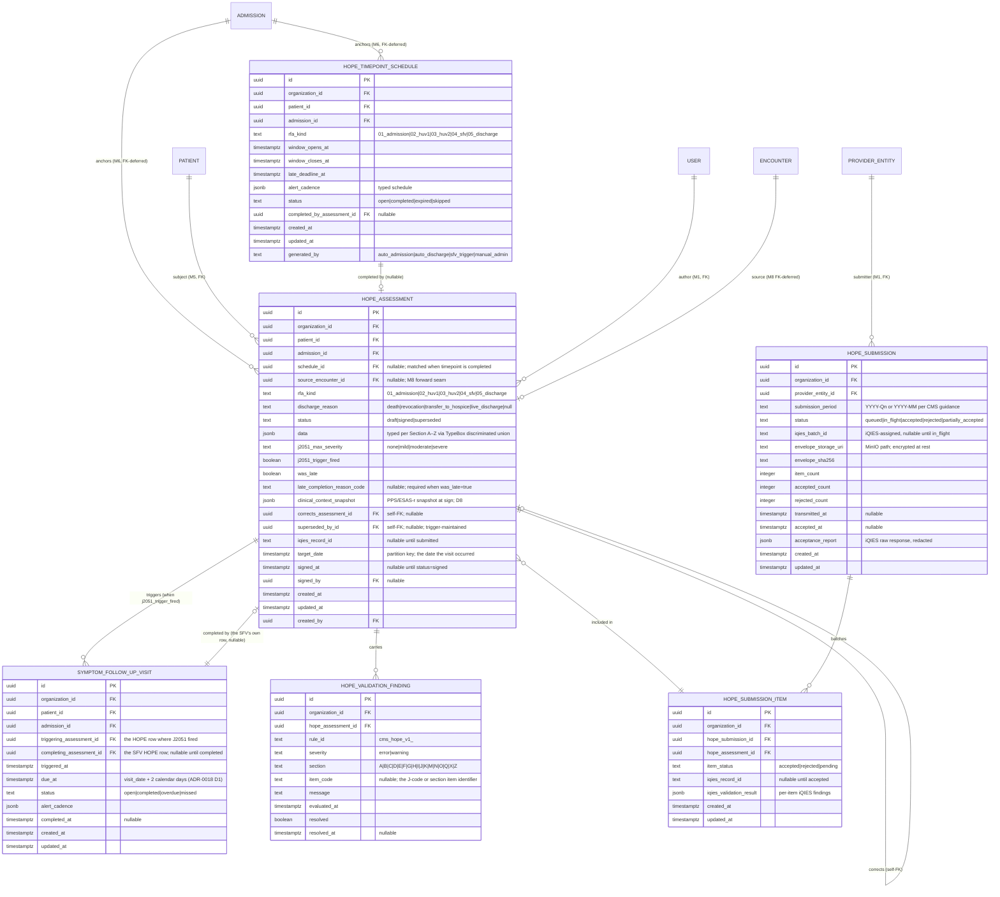

# Module 10 — HOPE Engine Specification

**Module ID:** 10
**Phase:** 1 (clinical-regulatory engine — required for Engrace go-live; HQRP non-compliance carries a 4-percentage-point APU reduction)
**Depends on:** 6 (Admission, Election & Certification — the admission row + activation timestamp is the anchor for every HOPE timepoint window; `level_of_care_period` discriminates SFV obligations under GIP/IRC; discharge events from M6's outbox drive the Discharge RFA timepoint), 9 (Clinical Assessments Suite — `LatestAssessmentProvider` returns PPS / ESAS-r at HOPE completion for snapshotting; the M9 series feeds the HUV trend context per architecture §11), 36 (Secure Messaging & Alerts — timepoint-window alerts, SFV-deadline alerts, submission-deadline alerts; typed-alert payload per M36 §4.9; care-team channel broadcast on overdue timepoints), 38 (Clinical Terminology — HOPE J-code value sets (`hope_j_codes`, `j2051_severity`), hospice diagnosis value set for Section I, LOINC bindings for J-item externalization, `asOfDate` lookups for survey-grade historical reconstruction). Transitively via M6: 1 (Foundation — `withOrgContext`, `audit()` helper, outbox dispatcher, idempotency middleware, RLS generator, partitioned-table conventions, per-tenant DEK, BullMQ queue runner), 2 (Identity — actor resolution; discipline resolution from membership for the RN/NP-only HOPE-author rule), 3 (Authorization — RBAC + ABAC; the `hope.*` permission keys this module contributes), 4 (Audit — PHI write-audit trigger generator, audit-read helper, destruction-cert workflow + `eraseFn` registration, `compliance` retention class with extended retention for submitted assessments), 5 (Patient & Demographics — `patient` row, deceased status driving the Discharge-by-death RFA branch, `medicare_beneficiary_identifier` for iQIES submission), 40 (MDM — discipline taxonomy used by the HOPE-author eligibility rule).
**Consumed by:** 8 (Encounters & Visit Notes — an encounter whose type is `hope_admission` / `hope_huv1` / `hope_huv2` / `hope_sfv` / `hope_discharge` calls M10's `recordHopeTimepoint` API with `source_encounter_id`; encounter-sign workflow consults M10's "required HOPE items" rules), 14 (IDG — packet builder surfaces J2051 trigger + open SFV obligations; "open HOPE windows" appears on the IDG dashboard), 22 (Documents — HOPE summary PDF rendering per submission cycle via the outbox `hope.summary_requested` event), 28 (FHIR Gateway — HOPE assessment row exposed as FHIR R4 `Observation` (J-items) and `QuestionnaireResponse` (HOPE Section A–Z) when M28 lands; the LOINC bindings travel with the typed payload), 30 (HQRP & Quality — HCI / Timely Follow-Up for Pain / Timely Follow-Up for Non-Pain Symptom Impact / future HOPE-derived measures all read M10's `HopeTimepointProvider`, `HopeSubmissionProvider`, and `HopeJ2051Provider` seams; M30 is the operational dashboard for the 4-point APU compliance posture), 31 (Portal — patient/family-facing "what we measure and how often" surface, consent-gated; J2051 individual responses are not portal-surfaced), 32 (AI Platform — `HopeJ2051Provider` feeds the symptom-trajectory model alongside M9's `ScaleSeriesProvider`; the decline-prediction model reads `HopeTimepointProvider`), 33 (Reporting — operational dashboards: HOPE-window-on-time rate, SFV-on-time rate, submission-acceptance rate, late-completion-reason distribution).
**Spec status:** Re-locked v0.3 (Phase-2 + Phase-4 remediation; supersedes Locked v0.2)

> **Phase-4 remediation (2026-06-11; ADR-0018).** **M10-F02 (BLOCKER):** the SFV 2-calendar-day clock
> now anchors to the **HOPE assessment visit date**, not `signed_at` (§1.1, §1.3) — delaying the
> signature can no longer extend the federal deadline (silent HQRP non-compliance / APU exposure).
> **M10-F07:** the transposed HOPE J-item codes are corrected against the CMS HOPE Manual value set.
> **M10-F06:** an **iQIES inactivation flow** (correct/withdraw a submitted record) is added. M30's
> HQRP Timely-Follow-Up measure uses the same visit-date anchor (M30-F04).
>
> **Phase-2 tenancy (2026-06-11; ADR-0010/0011 / ARCH-011).** **M10-F09 (MAJOR):** the four
> patient-level PHI tables — `hope_timepoint_schedule`, `hope_assessment`, `symptom_follow_up_visit`,
> `hope_validation_finding` — now carry `provider_entity_id` + `location_id` beside `organization_id`,
> both **NOT NULL** and denormalized from the admission. HOPE submission, **CCN matching**, and the
> HQRP dashboard are all **per-ProviderEntity**, so the assessment rows now reach their PE without
> joining through M6's admission (which M10 may not query directly per M10-F01); the per-PE batch
> assembler indexes on `(provider_entity_id, …)`. `hope_submission` already carried `provider_entity_id`
> (a per-CCN batch, no `location_id`); `hope_submission_item` is a submission-join row outside the
> three-column rule. Now gated by `check-tenancy` (fitness #10). See §3.3.

## Changelog

- **v0.2 (Locked)** — Initial publication at lock-grade. Instantiates the architecture §20.B module spec template. Resolves all twelve open questions into binding decisions (§11). Defines the **shared `hope_assessment` row with per-section TypeBox-typed `data` jsonb** (D1), the **soft-window + hard-cutoff timepoint enforcement** (D2), the **2-calendar-day SFV trigger** (D3), the **per-symptom J2051 trigger model with one-SFV-per-source-timepoint semantics** (D4), the **CMS HOPE submission XML batch via `packages/iqies-client`** (D5), the **iQIES adapter package boundary** (D6), the **append-only correction-of-record submission to iQIES with original retained** (D7), the **PPS / ESAS-r snapshot at HOPE completion** (D8), the **Discharge RFA timepoint listener on M6's `admission.discharged` outbox** (D9), the **`HopeTimepointProvider` / `HopeSubmissionProvider` / `HopeJ2051Provider` seams published for M30/M32 consumption** (D10), the **single-`data`-jsonb section storage avoiding annual ALTER TABLE churn** (D11), and the **late-completion capture with mandatory reason and HQRP counter** (D12). Wires the permission keys this module registers into Module 3 (§4.6), the BullMQ queue catalog (§4.8), the M36 typed-alert payload (§4.9), the iQIES submission worker (§4.10), and the destruction `eraseFn` registered with Module 4 (§8.4). Includes a **proposed manifest patch** (§12, last item) correcting `M10.dependsOn` from `[8, 9, 36, 38]` to `[6, 9, 36, 38]` *(relationship inventory - not the `dependsOn` edge set; per ADR-0005 D1/D4 seam/outbox/foundation consumers are no-edge - see audit/MANIFEST_DEPENDSON_REVIEW.md; do not bulk-apply)* — the prior encoding inverted the M8↔M10 dep direction; the architecture flow ("an RN's HOPE-timepoint encounter records HOPE items via M10's API") is M8 → M10, and the M9 lock established the precedent that consumers (M8) carry the dep, not the data-owner (M10). Also adds `packages/iqies-client` to `M10.codePaths` per D6.
- **v0.1** — Drafted within the lock-grade pass; not separately published.

> **Phase boundary (binding):** Phase 1 delivers everything in this spec **except** the M28 FHIR `Observation` / `QuestionnaireResponse` projections (Module 28 owns; M10 emits the typed mapping today), the M22 HOPE-summary PDF rendering (Module 22 owns; M10 emits `hope.summary_requested`), the M30 HQRP measure calculations (Module 30 owns; M10 publishes the three provider seams today), and the M32 AI decline-prediction model integration (Module 32 owns; the `HopeJ2051Provider` seam ships now — analogous to how M9 published `ScaleSeriesProvider` before M32 existed). The "done" gate for M10 is: the seven-table schema migrated and RLS-clean; the five RFA timepoint windows auto-scheduled from M6's admission events; the J2051 trigger logic firing SFV creation within 2 calendar days; the iQIES submission worker batching and submitting per ProviderEntity per submission window with idempotent retries; the correction-RFA workflow preserving originals; the three outbound seams registered at boot; the `eraseFn` registered with M4; and the test plan green — not gated on Modules 8/14/22/28/30/32 existing. The M8 encounter-linkage seam is exercised against a test-double encounter signer; the iQIES submission is exercised against the CMS iQIES sandbox endpoint with synthetic assessments validated against the CMS HOPE submission XML schema (per `WARDENX_INTEGRATIONS §6.7`).

> **DR tier (binding):** HOPE timepoint capture is **Tier 2** per `WARDENX_DR_BCP §3.1` — visit-time entry must continue to function during a degradation event because missing a timepoint cannot be recovered after the window closes. iQIES submission is **Tier 3** — batch submission can wait 24 hours without regulatory consequence because the submission deadline is 30 days from timepoint completion. The two paths are deliberately decoupled: `hope_assessment` writes never depend on iQIES adapter health.

-----

## 1. Purpose & Scope

### 1.1 What This Module Does

Module 10 owns the **CMS HOPE (Hospice Outcomes & Patient Evaluation) timepoint engine** — the real-time scheduling, capture, validation, and submission system that replaced HIS (Hospice Item Set) effective October 1, 2025. HOPE is the single CMS-mandated quality-data instrument every Medicare-certified hospice must submit; missing a timepoint window directly reduces the Hospice Quality Reporting Program (HQRP) compliance score, and dropping below the CMS threshold removes the 4-percentage-point Annual Payment Update from the following fiscal year's base rate. For Engrace (CCN 381588) operating at the median census, a 4-point APU shortfall is approximately $80–$120k of annual margin. M10 exists so that this shortfall is structurally impossible.

The module delivers:

- **Five timepoint types (RFA — Reason for Assessment, per CMS HOPE manual §A2400):**
  - **RFA 01 — Admission HOPE.** Completed within the 5-day comprehensive-assessment window (42 CFR §418.54(b)(2)). Anchored on `admission.election_effective_date`.
  - **RFA 02 — HOPE Update Visit 1 (HUV1).** Window opens on day 6 and closes on day 15 after the election effective date. Mid-window alerts and late-window alerts fire automatically.
  - **RFA 03 — HOPE Update Visit 2 (HUV2).** Window opens on day 16 and closes on day 30 after the election effective date.
  - **RFA 04 — Symptom Follow-Up Visit (SFV).** Triggered when any J2051 symptom-impact item at any prior HOPE timepoint is recorded at "moderate" or "severe". The SFV must be completed within **2 calendar days** of the triggering timepoint per the CMS HOPE manual §J2051. Each triggering timepoint produces at most one SFV (per D4).
  - **RFA 05 — Discharge HOPE.** Triggered by an `admission.discharged` outbox event from M6 (death / revocation / transfer / live-discharge). Window: 7 calendar days from `discharge_date`. The `discharge_reason` enum branches the required-items profile (Death-RFA omits the participation section Q; Transfer-RFA omits the post-mortem items).

- **Auto-scheduling.** When M6 emits `admission.activated` to the outbox, M10's `schedule-hope-timepoints` worker creates four `hope_timepoint_schedule` rows in one transaction (Admission, HUV1, HUV2, and a placeholder Discharge that is materialized when discharge fires). Each row carries its `window_opens_at`, `window_closes_at`, `late_deadline_at` (window close + tenant grace, default 7 days), and `alert_cadence` (typed schedule of when M36 alerts fire). Scheduling is idempotent: a re-emitted `admission.activated` does not create duplicates.

- **HOPE item capture across CMS-mandated sections.** Each `hope_assessment` row carries a typed `data jsonb` payload with the CMS HOPE manual sections, validated against per-section TypeBox schemas at the recording boundary:
  - **A — Administrative** (date of birth, race/ethnicity, gender, primary terminal diagnosis code)
  - **B — Hearing/Speech/Vision**
  - **C — Cognitive Patterns** (BIMS, signs of delirium, mood)
  - **D — Mood** (PHQ-2-derived items)
  - **E — Behavior**
  - **F — Preferences** (advance directives, code status)
  - **G — Functional Status** (ADL items per CMS HOPE-G coding)
  - **H — Bladder/Bowel**
  - **I — Active Diagnoses** (hospice terminal diagnosis ICD-10-CM with cross-validation against M6's certified diagnosis)
  - **J — Health Conditions** — the trigger-bearing section:
    - **J2030 — Screening for Pain.** Yes/No; if Yes, pain characteristics captured.
    - **J2050 — Screening for Shortness of Breath.** Yes/No; if Yes, dyspnea characteristics captured.
    - **J2051 — Symptom Impact at this Visit.** Per-symptom severity (none / mild / moderate / severe) across the CMS-listed symptoms (pain, shortness of breath, anxiety, agitation, nausea/vomiting, constipation, restlessness, other). **Any "moderate" or "severe" on any symptom fires the SFV trigger** (D4).
  - **K — Swallow/Nutritional Status**
  - **M — Skin Conditions** (pressure ulcers staged)
  - **N — Medications** (opioid for pain, scheduled bowel regimen if opioid, antiemetic if nausea)
  - **O — Treatments** (oxygen, IV therapy, dialysis)
  - **Q — Participation** (omitted on Death-RFA)
  - **X — Care Preferences** (preferred place of death, hospitalization preference)
  - **Z — Administrative Items** (signature, completion date, late-completion reason if applicable)

- **Server-authoritative J2051 trigger evaluation.** The recording service computes `j2051_max_severity` and `j2051_trigger_fired` from the typed `data.J` payload server-side; the client cannot suppress an SFV by under-reporting severity through API tampering. On `trigger_fired`, a `symptom_follow_up_visit` row is inserted in the same transaction with **`due_at = visit_date + 2 calendar days`** — the SFV 2-calendar-day clock anchors to the **HOPE assessment's visit/encounter date**, **never** to `signed_at` (M10-F02 / ADR-0018 D1). Anchoring to the signature timestamp would let a clinician extend the federal deadline simply by delaying signing, silently under-reporting HQRP non-compliance and exposing the 4-point APU reduction. A typed alert is dispatched through M36's care-team channel (per D4 + M36 §4.9).

- **PPS / ESAS-r snapshot at sign.** When a HOPE row is signed, M10 reads M9's `LatestAssessmentProvider` for `PPS` and `ESAS-r` as of `signed_at`, and **writes the values into the HOPE row's `clinical_context_snapshot` jsonb column** (D8). Subsequent M9 corrections do not change the HOPE row — the HOPE row is the canonical historical record of what was submitted to iQIES.

- **Timepoint window enforcement (soft + hard).** The recording API admits writes inside `[window_opens_at, late_deadline_at]`. Writes before `window_opens_at` are rejected with `M10_TIMEPOINT_NOT_OPEN`; writes between `window_closes_at` and `late_deadline_at` succeed and set `was_late=true` with a mandatory `late_completion_reason_code`; writes past `late_deadline_at` are rejected with `M10_TIMEPOINT_EXPIRED` and an admin-override path that requires platform-admin justification (D2, D12).

- **iQIES submission as a separately-tiered subsystem.** The capture path (Tier 2) writes a `hope_assessment` row with status `signed`. The submission path (Tier 3) runs the `iqies-submit-worker` cron daily per ProviderEntity, batching signed-and-unsubmitted assessments into a CMS HOPE submission XML envelope per the CMS spec, signing it with the ProviderEntity's iQIES submitter credentials, and POSTing through `packages/iqies-client`. Each submission produces a `hope_submission` row with `status ∈ {queued, in_flight, accepted, rejected, partially_accepted}` and a `hope_submission_item` row per included assessment with the per-assessment iQIES validation result. Idempotent on `(provider_entity_id, submission_period, hope_assessment_id)`; a retry never double-submits.

- **Pre-submission validation.** Before XML envelope assembly, the `validate-hope-assessment` service runs the CMS HOPE submission validation rules: required-items-per-RFA presence, value-set membership (Section I diagnosis ∈ active hospice-terminal-diagnosis value set per M38), cross-field consistency (J2030=Yes ⇒ pain characteristics present; J2050=Yes ⇒ dyspnea characteristics present; Death-RFA ⇒ Section Q absent; live-discharge RFA ⇒ Section Q present). A `hope_validation_finding` row is written per violation with severity `error` (blocks submission) or `warning` (informational, does not block). Validation re-runs on every signed assessment and on any tenant value-set update affecting M38 codes M10 consumes.

- **Append-only correction RFA workflow.** A correction inserts a new `hope_assessment` row with `rfa_kind` matching the target's RFA (01–05) and `corrects_assessment_id` set; a trigger marks the prior row `superseded_by_id`. If the prior row was already submitted to iQIES, the submission worker on the next cron tick emits a Correction RFA to iQIES referencing the original by its `iqies_record_id` per the CMS HOPE correction policy (D7). The original row is never updated.

- **Real-time alerting throughout the lifecycle.** Each `hope_timepoint_schedule` row carries a typed `alert_cadence` (default: window-open notice on day 1, mid-window reminder at 50% elapsed, closing reminder 48h before close, late-window urgent, daily until late-deadline, escalating to clinical lead). Each `symptom_follow_up_visit` row carries a typed `alert_cadence` (default: created notice, 24h reminder, due-tomorrow urgent, overdue critical). Each `hope_submission` row carries deadline alerts (30d-from-completion → at 14d, 7d, 2d, 1d). All routed through M36 with the M36 typed-alert envelope (`category='clinical_compliance'`, `severity` escalates).

- **Audit-grade everything.** Every write flows through Module 4's PHI write-audit trigger with column-level scrubbing of free-text within `data` jsonb (clinical observation text fields denylisted from value capture; only `<changed>` markers). Every read of a HOPE row through the chart, the IDG packet, or the survey-reconstruction surface emits a `hope_assessment.viewed` audit event (per-resource for chart opens, aggregate for list views per M4 D3). Every iQIES submission emits a `hope_submission.transmitted` audit event including the submission envelope's SHA-256 hash (the envelope itself, with PHI, is stored encrypted in MinIO per M4 retention class `compliance` with `extended_for_cms` flag, 10-year retention).

- **Outbox-driven downstream integration.** Every meaningful event — timepoint scheduled, timepoint signed, J2051 trigger fired, SFV created, SFV completed, submission queued, submission accepted, submission rejected, correction submitted — flows through the outbox dispatcher (Module 1 §4.8). Downstream subscribers (M14 IDG packet builder, M22 PDF render, M28 FHIR projection, M30 HQRP measure calculators, M32 AI decline-prediction model, M33 reporting materialized views) attach to the documented topics. Idempotent dispatch keyed on `hope_assessment_id` + `event_kind`.

### 1.2 What This Module Does Not Do

- **Clinical scale assessments (PPS, ESAS-r, FAST, PAINAD, etc.).** Module 9 owns the scale library. M10 reads M9's `LatestAssessmentProvider` for prognostic context and snapshots the values into the HOPE row at sign time (D8); M10 does not store the canonical scale series and does not implement scale scoring. The thematic overlap between M9's ESAS-r and M10's J2051 is intentional — they are clinically related but regulatorily distinct (M9 D-rationale in §1.2 there): ESAS-r is an industry-standard 0–10 symptom-burden instrument; J2051 is a CMS-defined four-level symptom-impact item with a 2-calendar-day follow-up trigger. M10 does **not** double-source J2051 from ESAS-r.

- **The comprehensive admission assessment narrative.** The 42 CFR §418.54(b)(2) comprehensive assessment is a narrative-and-form document owned by Module 8 (Encounters & Visit Notes) when conducted as the admission visit. The Admission HOPE timepoint runs *alongside* the comprehensive assessment — typically the same visit captures both — but the HOPE row is M10's, the comprehensive assessment is M8's. M8's encounter-sign workflow consults M10's "required HOPE items for encounter type" rules when the encounter type is `hope_admission`.

- **Vital signs.** Blood pressure, heart rate, respiratory rate, temperature, oxygen saturation, pain score (the 0–10 number distinct from J2030's yes/no screen) are encounter vitals — Module 8 stores these inline on the encounter row. M10 does not capture vital signs.

- **Care plan goals or interventions.** Module 7 owns goals and interventions. A goal may reference a J2051 trigger ("Pain impact at most mild at next HOPE timepoint" is a measurable goal); M7 owns the goal row; M10 just provides whether the J2051 score at the next timepoint met the goal.

- **Symptom-management orders.** Module 11 owns orders. M10 may surface an order-suggestion banner when J2051 pain = severe, but M10 does not create the order; the RN clicks through to M11. The order, if created, references `triggering_hope_assessment_id` so the order trail back to the HOPE row is preserved.

- **CTI narrative content.** Module 6 owns CTI; the surface that reads "objective clinical findings" for the CTI narrative consumes M9's `LatestAssessmentProvider`, not M10's row. The HOPE row is not a clinical evidentiary instrument — it is a CMS quality-reporting artifact.

- **HQRP measure calculations.** Module 30 owns HCI, HVLDL, Timely Follow-Up for Pain, Timely Follow-Up for Non-Pain Symptom Impact, and the future HOPE-derived measures (FY2028). M10 publishes the three provider seams (`HopeTimepointProvider`, `HopeSubmissionProvider`, `HopeJ2051Provider`); M30 consumes and computes. M10 has no measure code.

- **FHIR `Observation` / `QuestionnaireResponse` HTTP surface.** Module 28 owns FHIR R4 endpoints; M10 publishes the typed mapping (HOPE row → FHIR `QuestionnaireResponse` for the full HOPE form, plus per-J-item `Observation` resources with the LOINC code from M38) consumed by M28. M10 has no FHIR HTTP surface.

- **HOPE-summary PDF rendering.** Module 22 owns the PDF generator; M10 emits a typed `hope.summary_requested` outbox event with the domain payload (the HOPE row, the SFV chain, the submission outcome). M22 renders. M10 has no PDF code.

- **iQIES adapter HTTP / XML / signing internals.** The transport, the CMS HOPE submission XML schema, the per-MAC submitter authentication, and the iQIES sandbox-vs-prod selection live inside `packages/iqies-client` (D6). M10 (in `apps/backend/src/modules/10-hope`) consumes the adapter's typed methods (`submitBatch`, `fetchAcceptanceReport`, `submitCorrection`). The adapter is the only package allowed to import HTTP clients for iQIES.

- **Tenant-configurable J2051 thresholds.** Unlike M9's significant-change thresholds (where tenants may tighten platform floors per M9 D2), the J2051 SFV trigger is set by CMS at "moderate or severe" — it is a regulatory threshold, not a clinical-judgment one. M10 does not expose a tenant-override path for the J2051 threshold. Tenant override of `late_deadline_grace_days` is permitted (and may only *tighten* from the platform default of 7 days), but the SFV 2-calendar-day window itself is not configurable.

- **iQIES production credential onboarding workflow.** The per-ProviderEntity iQIES submitter credential capture lives in Module 34 (SaaS Tenant Platform) under the integrations admin. M10 consumes credentials from M34's secret store; M10 does not own the onboarding UX.

### 1.3 Regulatory Drivers

| Driver | Requirement | How Module 10 satisfies it |
|---|---|---|
| 42 CFR §418.312 — Hospice Quality Reporting Program | Quality data submitted per CMS specification or 4-percentage-point APU reduction | The five-RFA timepoint engine + iQIES submission worker with deadline alerts ensures every required HOPE timepoint is captured and submitted on time |
| 42 CFR §418.54(b)(2) — Comprehensive assessment within 5 days | Initial clinical assessment captured by day 5 of election | Admission RFA window opens on `election_effective_date` and closes at day 5; alerts and late-completion capture as defined in §1.1 |
| CMS HOPE Manual v1.x §A2400 — Reasons for Assessment | RFA values 01 (Admission), 02 (HUV1), 03 (HUV2), 04 (SFV), 05 (Discharge) with specific timing rules | The `hope_rfa_kind` enum maps 1:1 to CMS RFA codes; the scheduling worker auto-creates the four base timepoints from admission events |
| CMS HOPE Manual §J2030 / §J2050 / §J2051 — Symptom Impact and Follow-Up | J2051 moderate/severe at any HOPE timepoint requires SFV completion within 2 calendar days **of the visit date** | `j2051_trigger_evaluator.ts` runs server-side at sign; SFV row created in the same transaction with **`due_at = visit_date + 2 calendar days`** (anchored to the assessment visit date, not `signed_at` — M10-F02/ADR-0018 D1); alert dispatched immediately |
| CMS HOPE Manual §Z — Late Completion | Late completion permitted with documentation; reported to CMS | Writes between `window_closes_at` and `late_deadline_at` succeed with required `late_completion_reason_code` per the CMS list; included in iQIES submission with the late flag |
| CMS HOPE Submission Spec v1.x | Submission per CMS HOPE submission XML envelope to iQIES | `packages/iqies-client` implements the envelope per CMS spec; pre-submission validation runs CMS validation rules; submission deadline 30 days from timepoint completion |
| CMS HOPE Correction Policy | Corrections to submitted HOPE assessments via Correction RFA | Append-only `corrects_assessment_id` + supersede trigger + iQIES Correction RFA submission on the next worker tick |
| 42 CFR §418.104 — Clinical Records | Immutable, attributed, timestamped, retained | Server-authoritative item validation + write-audit triggers + `compliance` retention with `extended_for_cms` 10-year retention on submitted assessments |
| 42 CFR §418.22(a) — Eligibility / Certification | Active hospice election required for HOPE submission | `recordHopeTimepoint` rejects writes without an active admission via M6's `admission` row; iQIES submission validates `election_effective_date` falls within the HOPE timepoint's measurement period |
| HIPAA §164.502(b) — Minimum necessary | Disclose only what's needed | Portal-facing HOPE surface (M31, future) shows the schedule of measurement and the patient's contribution; J2051 individual responses are not portal-surfaced |
| HIPAA §164.312(b) — Audit Controls | Audit every action on PHI | Every HOPE assessment write, read, and submission emits an audit event; envelope SHA-256 hash recorded per submission |

### 1.4 Competitive Context

The mainstream hospice EHRs (Homecare Homebase, MatrixCare, WellSky/Consolo, FireNote) all support HOPE as a form — they had to, because CMS mandated it on October 1, 2025. What they typically do not do well is the regulatory engine *around* the form: the auto-scheduling of HUV1 and HUV2 from the election date, the J2051 trigger that creates the SFV obligation, the deadline-aware alerting that escalates as a window closes, and the iQIES submission with idempotent retries and acceptance-report reconciliation. WardenX's M10 differentiators are:

- **Real-time, not retrospective.** Most legacy vendors implemented HOPE as "open the form when the nurse remembers." We open the form *for* the nurse by auto-scheduling HUV1 (days 6–15) and HUV2 (days 16–30) on admission activation, escalating the alert as the window closes, and surfacing the open-windows dashboard on the IDG view. A missed window is, in our model, a workflow failure, not a data entry one.

- **Server-authoritative J2051 trigger.** The single most-missed HOPE compliance failure is the SFV that should have fired but didn't — typically because the clinician thought "moderate" was discretionary. We compute the trigger server-side from the typed `data.J` payload; the SFV row is inserted in the *same transaction* as the HOPE row, with a 2-calendar-day clock and an alert routing to the care team channel. The clinician cannot under-report severity to avoid an SFV obligation, and the SFV cannot be silently skipped — its non-completion is a tracked compliance event feeding M30.

- **Submission, not just capture.** Several vendors capture HOPE locally and leave iQIES submission as a manual workflow. We submit. The cron-driven `iqies-submit-worker` batches signed-and-unsubmitted assessments per ProviderEntity, runs CMS pre-submission validation, transmits the envelope, fetches the acceptance report, and reconciles per-assessment outcomes. Rejections flow into a correction worklist that feeds the next worker tick.

- **Survey-grade reconstruction.** A surveyor asking "what was this patient's J2051 score on day 8 (HUV1)?" gets a deterministic answer from the partitioned PHI table with no derived-table drift. The PPS / ESAS-r values snapshotted into the HOPE row at sign time are the values that were considered at the time of HOPE completion — even if M9's source assessments were later corrected, the HOPE row preserves the data as submitted to iQIES. The correction RFA workflow preserves both the original and the corrected — no silent in-place UPDATE.

- **Append-only correction with iQIES Correction RFA.** Most vendors implement HOPE correction as an in-place edit and a re-submission; the original is gone. We implement correction as a new row with `corrects_assessment_id`, a supersede trigger on the prior row, and a Correction RFA submission to iQIES referencing the original by its `iqies_record_id`. The full record of what was reported, what was corrected, and why is available to the surveyor.

- **Tier-correct degradation.** Capture (Tier 2) is decoupled from submission (Tier 3). An iQIES outage cannot prevent a clinician from recording a HOPE timepoint at the bedside; the row is signed locally, queued for submission, and the deadline alerts escalate through M36 if the iQIES outage persists. The 30-day submission deadline gives plenty of room for vendor-side recovery without compliance impact.

The bet is the same as M9's: the second half of the value — the deadline alerts, the trigger logic, the submission and reconciliation, the correction workflow — is where M10 is competitively differentiated, not in the per-form ergonomics that every vendor reluctantly built when CMS mandated it.

-----

## 2. Domain Model

### 2.1 Entity-Relationship Diagram



### 2.2 Entity Lifecycle States

#### 2.2.1 `hope_timepoint_schedule.status`

```
open  ─signed assessment matches schedule_id────────▶ completed
  │
  ├─ late_deadline_at passes without completion ────▶ expired
  │
  └─ admin force-skip (e.g. patient hospitalized) ──▶ skipped
```

- `open` is the only status from which a HOPE assessment may be signed against the schedule.
- `expired` is terminal; the missed-timepoint compliance event fires to M30 via outbox and an `assessment_expired` audit row is written.
- `skipped` requires platform-admin permission and a typed reason; recorded in `audit_event.payload.skip_reason`.

#### 2.2.2 `hope_assessment.status`

```
draft  ─submit────▶  signed  ─correction row inserts (trigger sets) ──▶ superseded
                          │
                          └─ erased by destruction-cert workflow ─▶ (row removed at partition drop)
```

- `draft` rows are working state; not visible on charts; not submitted to iQIES.
- `signed` is the canonical clinical record. Once signed, the row is immutable except through the correction workflow.
- `superseded` rows remain queryable (history, audit, surveyor reconstruction) but do not appear in default lookups.

#### 2.2.3 `symptom_follow_up_visit.status`

```
open  ─SFV HOPE row signed────▶ completed
  │
  └─ due_at passes without completion ──▶ overdue ──after 7 days──▶ missed
```

- `overdue` is a soft state that triggers escalating alerts via M36 (24h, 48h, 72h, daily until missed).
- `missed` is terminal; an `sfv_missed` outbox event fires to M30 for the HQRP Timely Follow-Up measure.

#### 2.2.4 `hope_submission.status`

```
queued  ─worker pick up──▶  in_flight  ─iQIES response: 200 + accepted──▶ accepted
                                  │
                                  ├─ iQIES response: 200 + rejected ────▶ rejected
                                  │
                                  └─ iQIES response: partial ───────────▶ partially_accepted
```

- Rejected and partially-accepted submissions feed a correction worklist; per-item failures are surfaced in the `hope_submission_item.iqies_validation_result`.

### 2.3 Validation Rules

Validation is layered: TypeBox at the route boundary (shape), business logic in `record-hope-timepoint.ts` (cross-field + temporal), and `validate-hope-assessment.ts` running CMS HOPE submission rules before envelope assembly.

**Route-boundary (TypeBox):**
- `rfa_kind` ∈ enum
- `data` is a discriminated union per Section A–Z; each section's TypeBox is in `packages/hope/src/sections/<letter>/schema.ts`
- Required-sections-per-RFA matrix enforced via TypeBox composition (Death-RFA omits Q; Transfer-RFA omits Q; live-discharge-RFA includes Q)

**Business logic (`record-hope-timepoint`):**
- `admission` is `active` at `target_date` (or, for Discharge-RFA, was active immediately before discharge)
- `target_date` falls within `[schedule.window_opens_at, schedule.late_deadline_at]`; if outside the closed window but inside the late deadline, `was_late=true` and `late_completion_reason_code` is required
- `rfa_kind` matches `schedule.rfa_kind` (or `rfa_kind='04_sfv'` when the schedule was created by an SFV trigger)
- For SFV: the triggering HOPE row is referenced via `corrects_assessment_id`-style linkage in `symptom_follow_up_visit.triggering_assessment_id`; the SFV's `target_date` is within `[visit_date, visit_date + 2 calendar days + grace]` (ADR-0018 D1 — anchored to the assessment visit date)
- Section I primary diagnosis ∈ M38's active `hospice_terminal_diagnosis` value set at `target_date`
- Section J consistency: J2030=Yes ⇒ pain characteristics present; J2050=Yes ⇒ dyspnea characteristics present
- Section N consistency: opioid prescribed ⇒ scheduled bowel regimen present or documented contraindication
- Author's discipline ∈ {RN, NP, MD} per `mdm.discipline_taxonomy` (CMS HOPE manual restricts HOPE completion to these disciplines)

**Pre-submission (`validate-hope-assessment`):**
- All required items per RFA present (per CMS HOPE submission spec required-items matrix, encoded in `packages/hope/src/submission/required-items.ts`)
- Cross-RFA temporal consistency: HUV1 `target_date` > Admission `target_date`; HUV2 `target_date` > HUV1 `target_date` if HUV1 exists
- iQIES envelope-level constraints: ProviderEntity CCN matches admission's `ccn_at_election`; patient MBI matches M5's snapshot

### 2.4 Side-Effects (Events Emitted)

Every meaningful state transition emits a typed outbox event (Module 1 §4.8) with deterministic idempotency keys. Subscribers are documented in `packages/hope/src/seams.ts`.

| Event | Trigger | Payload (typed in `seams.ts`) | Idempotency key |
|---|---|---|---|
| `hope.timepoint.scheduled` | `schedule-hope-timepoints` worker on `admission.activated` | `{ scheduleId, rfaKind, windowOpensAt, windowClosesAt, lateDeadlineAt }` | `(scheduleId, "scheduled")` |
| `hope.timepoint.signed` | `recordHopeTimepoint` on transition to `signed` | `{ assessmentId, rfaKind, signedAt, signedBy, j2051TriggerFired, wasLate }` | `(assessmentId, "signed")` |
| `hope.timepoint.expired` | `hope-window-watchdog` cron when `late_deadline_at` passes | `{ scheduleId, rfaKind, expiredAt }` | `(scheduleId, "expired")` |
| `hope.j2051.triggered` | `recordHopeTimepoint` when `j2051_trigger_fired=true` | `{ assessmentId, sfvId, maxSeverity, triggeredAt, dueAt }` | `(assessmentId, "j2051_triggered")` |
| `hope.sfv.created` | Same transaction as `hope.j2051.triggered` | `{ sfvId, triggeringAssessmentId, dueAt }` | `(sfvId, "created")` |
| `hope.sfv.completed` | `recordHopeTimepoint` with `rfa_kind='04_sfv'` matching an open SFV | `{ sfvId, completingAssessmentId, completedAt }` | `(sfvId, "completed")` |
| `hope.sfv.overdue` | `sfv-watchdog` cron | `{ sfvId, hoursPastDue }` | `(sfvId, "overdue", floor(hours/24))` |
| `hope.sfv.missed` | `sfv-watchdog` after 7 days overdue | `{ sfvId }` | `(sfvId, "missed")` |
| `hope.correction.submitted` | `recordHopeTimepoint` when `corrects_assessment_id` set | `{ correctionAssessmentId, originalAssessmentId }` | `(correctionAssessmentId, "submitted")` |
| `hope.submission.queued` | `assemble-hope-submission` worker on assembly | `{ submissionId, providerEntityId, itemCount }` | `(submissionId, "queued")` |
| `hope.submission.transmitted` | `iqies-submit-worker` on successful POST | `{ submissionId, transmittedAt, envelopeSha256 }` | `(submissionId, "transmitted")` |
| `hope.submission.accepted` | `iqies-reconcile-worker` on acceptance | `{ submissionId, acceptedCount, rejectedCount }` | `(submissionId, "accepted")` |
| `hope.submission.rejected` | `iqies-reconcile-worker` on rejection | `{ submissionId, rejectedCount, findings }` | `(submissionId, "rejected")` |
| `hope.summary_requested` | API `POST /hope/:id/summary-pdf` | `{ assessmentId, requestedBy }` | `(assessmentId, requestedAt)` |

> **Fully-qualified outbox `eventName` (binding) — producer-side reconciliation with downstream consumers.** The short topic strings in the table above are the in-module shorthand. The **canonical `eventName` actually published to the M1 outbox dispatcher** follows the platform convention from M1 §3.17 (`m<N>.<entity>.<verb_with_underscores>`, e.g. `m11.order.transmission_status_changed`) and is registered in `packages/foundation/src/outbox-events/events-by-m10.ts`. M10 emits these events today; no new events are introduced here — this mapping only makes the wire-level names explicit so existing downstream subscribers resolve correctly. The four events with declared downstream consumers map as follows:
>
> | In-module shorthand (§2.4) | Canonical `eventName` published | Declared consumers |
> |---|---|---|
> | `hope.timepoint.signed` (line above) | `m10.hope.timepoint_signed` | M33 |
> | `hope.j2051.triggered` (line above) | `m10.hope.j2051_trigger_fired` | M33 |
> | `hope.submission.accepted` (line above) | `m10.hope.submission_accepted` | M30, M33 |
> | `hope.submission.rejected` (line above) | `m10.hope.submission_rejected` | M33 |
>
> These four are the names M30 (HQRP Quality) and M33 (Reporting) subscribe to in their respective specs. The remaining §2.4 events publish under the same `m10.hope.<entity>_<verb>` rule (e.g. `hope.timepoint.scheduled` → `m10.hope.timepoint_scheduled`, `hope.sfv.created` → `m10.hope.sfv_created`) and gain consumer subscriptions as those modules lock. No event in this catalog is renamed or removed; the shorthand column remains the human-readable label and the canonical `eventName` is the registered wire identifier.

-----

## 3. Drizzle Schema

### 3.1 Package Layout

```
packages/hope/
├── package.json
├── src/
│   ├── index.ts                     # public re-exports
│   ├── schema.ts                    # Drizzle tables (all 6) — see §3.3
│   ├── enums.ts                     # all enums in one place (re-exported)
│   ├── sections/                    # per-section TypeBox + validators
│   │   ├── A/schema.ts              # Administrative
│   │   ├── B/schema.ts              # Hearing/Speech/Vision
│   │   ├── C/schema.ts              # Cognitive Patterns
│   │   ├── D/schema.ts              # Mood
│   │   ├── E/schema.ts              # Behavior
│   │   ├── F/schema.ts              # Preferences
│   │   ├── G/schema.ts              # Functional Status
│   │   ├── H/schema.ts              # Bladder/Bowel
│   │   ├── I/schema.ts              # Active Diagnoses
│   │   ├── J/schema.ts              # Health Conditions (includes J2030/J2050/J2051)
│   │   ├── J/j2051-evaluator.ts     # server-authoritative trigger evaluator
│   │   ├── K/schema.ts              # Swallow/Nutritional
│   │   ├── M/schema.ts              # Skin
│   │   ├── N/schema.ts              # Medications
│   │   ├── O/schema.ts              # Treatments
│   │   ├── Q/schema.ts              # Participation (omitted on death-RFA)
│   │   ├── X/schema.ts              # Care Preferences
│   │   ├── Z/schema.ts              # Administrative items / late-completion reason
│   │   └── required-items.ts        # required-items-per-RFA matrix
│   ├── scheduling/
│   │   ├── schedule-hope-timepoints.ts   # called from M6 admission.activated handler
│   │   ├── window-calculator.ts          # admission_date → 4 windows
│   │   └── alert-cadence.ts              # default + tenant-override cadence
│   ├── recording/
│   │   ├── record-hope-timepoint.ts      # main write service
│   │   ├── sign-hope-assessment.ts       # draft→signed transition
│   │   ├── correct-hope-assessment.ts    # correction RFA workflow
│   │   └── snapshot-clinical-context.ts  # reads M9 LatestAssessmentProvider (D8)
│   ├── triggers/
│   │   ├── evaluate-j2051.ts             # server-authoritative trigger
│   │   ├── create-sfv.ts                 # same-transaction SFV creation
│   │   └── sfv-watchdog.ts               # cron-side overdue/missed transitions
│   ├── validation/
│   │   ├── validate-hope-assessment.ts   # CMS HOPE pre-submission rules
│   │   ├── rules/                        # per-rule files (cms_hope_v1_<n>.ts)
│   │   └── findings-writer.ts            # writes hope_validation_finding rows
│   ├── submission/
│   │   ├── assemble-hope-submission.ts   # batches signed+unsubmitted per PE
│   │   ├── iqies-submit-worker.ts        # cron: pick queued, transmit
│   │   ├── iqies-reconcile-worker.ts     # cron: fetch acceptance reports
│   │   ├── submit-correction.ts          # correction-RFA submission
│   │   └── envelope-storage.ts           # MinIO encrypted-at-rest helper
│   ├── seams.ts                          # HopeTimepointProvider, HopeSubmissionProvider, HopeJ2051Provider
│   ├── permissions.ts                    # registered into M3 at boot
│   ├── eraser.ts                         # registered with M4 destruction workflow
│   └── boot.ts                           # called from apps/backend bootstrap
└── tests/
    ├── unit/                       # section validators, j2051 evaluator, window calc
    ├── integration/                # Testcontainers: record → trigger → SFV → submission
    ├── rls/                        # cross-tenant isolation
    └── fixtures/                   # synthetic HOPE assessments per RFA

packages/iqies-client/              # adapter package — D6
├── src/
│   ├── index.ts
│   ├── envelope-builder.ts         # CMS HOPE submission XML
│   ├── envelope-validator.ts       # XML schema validation
│   ├── transport.ts                # the only allowed HTTP client for iQIES
│   ├── signing.ts                  # per-PE submitter credential signing
│   ├── sandbox-config.ts           # env-based sandbox vs prod
│   └── types.ts                    # SubmissionEnvelope, AcceptanceReport, CorrectionEnvelope
└── tests/                          # mocked iQIES responses

apps/backend/src/modules/10-hope/
├── routes/                         # Fastify routes — see §4
├── handlers/                       # per-route handlers; thin wrappers over packages/hope
└── index.ts                        # module init: registers permissions, seams, eraser
```

### 3.2 Enums

```ts
// packages/hope/src/enums.ts
import { pgEnum } from "drizzle-orm/pg-core";

export const hopeRfaKind = pgEnum("hope_rfa_kind", [
  "01_admission",
  "02_huv1",
  "03_huv2",
  "04_sfv",
  "05_discharge",
]);

export const hopeDischargeReason = pgEnum("hope_discharge_reason", [
  "death",
  "revocation",
  "transfer_to_hospice",
  "live_discharge",
]);

export const hopeAssessmentStatus = pgEnum("hope_assessment_status", [
  "draft",
  "signed",
  "superseded",
]);

export const hopeScheduleStatus = pgEnum("hope_schedule_status", [
  "open",
  "completed",
  "expired",
  "skipped",
]);

export const hopeSfvStatus = pgEnum("hope_sfv_status", [
  "open",
  "completed",
  "overdue",
  "missed",
]);

export const hopeSubmissionStatus = pgEnum("hope_submission_status", [
  "queued",
  "in_flight",
  "accepted",
  "rejected",
  "partially_accepted",
]);

export const hopeSubmissionItemStatus = pgEnum("hope_submission_item_status", [
  "accepted",
  "rejected",
  "pending",
]);

export const hopeValidationSeverity = pgEnum("hope_validation_severity", [
  "error",
  "warning",
]);

export const j2051Severity = pgEnum("j2051_severity", [
  "none",
  "mild",
  "moderate",
  "severe",
]);

export const hopeScheduleGeneratedBy = pgEnum("hope_schedule_generated_by", [
  "auto_admission",
  "auto_discharge",
  "sfv_trigger",
  "manual_admin",
]);
```

### 3.3 Tables

> **Tenancy three-column rule (M10-F09 / ADR-0010 D1 / ARCH-011).** The four patient-level PHI tables
> (`hope_timepoint_schedule`, `hope_assessment`, `symptom_follow_up_visit`, `hope_validation_finding`)
> carry `organization_id` + `provider_entity_id` + `location_id`, the latter two **NOT NULL** and
> denormalized from the admission. HOPE is inherently **per-ProviderEntity** — submission batching, the
> iQIES envelope's `ccn_at_election` match, and the HQRP acceptance dashboard all key on the CCN — so
> carrying `provider_entity_id` on the assessment rows removes the illegal join through M6's admission
> (M10-F01) that the per-PE batch assembler would otherwise need; `location_id` supports
> location-scoped overdue-window dashboards. `hope_submission` is a **per-CCN batch** that already
> carries `provider_entity_id` (and needs no `location_id`); `hope_submission_item` is a
> submission↔assessment join row, outside the PHI three-column rule. RLS stays keyed on `app.org_id`.
> Satisfies `check-tenancy` (fitness #10); `location` is added to the shared `packages/db/schema`
> import.

```ts
// packages/hope/src/schema.ts
import {
  pgTable, uuid, text, jsonb, boolean, timestamp, integer,
  index, uniqueIndex, foreignKey, primaryKey,
} from "drizzle-orm/pg-core";
import { organization, providerEntity, location, user } from "packages/db/schema";  // location added — ARCH-011 tenancy spine (M10-F09)
import { patient } from "apps/backend/src/modules/05-patient/schema";  // imported via seam at compile time
import { admission } from "apps/backend/src/modules/06-admission/schema";
import {
  hopeRfaKind, hopeDischargeReason, hopeAssessmentStatus,
  hopeScheduleStatus, hopeSfvStatus, hopeSubmissionStatus,
  hopeSubmissionItemStatus, hopeValidationSeverity,
  j2051Severity, hopeScheduleGeneratedBy,
} from "./enums";

// 1. hope_timepoint_schedule
export const hopeTimepointSchedule = pgTable("hope_timepoint_schedule", {
  id: uuid("id").primaryKey().defaultRandom(),
  organizationId: uuid("organization_id").notNull().references(() => organization.id),
  providerEntityId: uuid("provider_entity_id").notNull().references(() => providerEntity.id),  // ARCH-011 / M10-F09 (NOT NULL — see §3.3 tenancy note)
  locationId: uuid("location_id").notNull().references(() => location.id),                      // ARCH-011 / M10-F09 (NOT NULL — see §3.3 tenancy note)
  patientId: uuid("patient_id").notNull(),  // M5 FK
  admissionId: uuid("admission_id").notNull(),  // M6 FK
  rfaKind: hopeRfaKind("rfa_kind").notNull(),
  windowOpensAt: timestamp("window_opens_at", { withTimezone: true }).notNull(),
  windowClosesAt: timestamp("window_closes_at", { withTimezone: true }).notNull(),
  lateDeadlineAt: timestamp("late_deadline_at", { withTimezone: true }).notNull(),
  alertCadence: jsonb("alert_cadence").$type<AlertCadence>().notNull(),
  status: hopeScheduleStatus("status").notNull().default("open"),
  completedByAssessmentId: uuid("completed_by_assessment_id"),  // self-ref via FK after assessment exists
  generatedBy: hopeScheduleGeneratedBy("generated_by").notNull(),
  skipReasonCode: text("skip_reason_code"),  // required when status='skipped'
  createdAt: timestamp("created_at", { withTimezone: true }).notNull().defaultNow(),
  updatedAt: timestamp("updated_at", { withTimezone: true }).notNull().defaultNow(),
}, (t) => ({
  // Window queries: "what's open for this patient" and "what's open organization-wide"
  byPatientOpen: index("idx_hope_sched_by_patient_open")
    .on(t.patientId, t.status, t.windowOpensAt),
  byOrgWindow: index("idx_hope_sched_by_org_window")
    .on(t.organizationId, t.status, t.windowClosesAt),
  // Uniqueness: one open schedule per (admission, rfa_kind) at a time;
  // SFVs are distinct rows so RFA 04 is allowed multiple times.
  uniqueOpenAdmissionRfa: uniqueIndex("uniq_hope_sched_admission_rfa_open")
    .on(t.admissionId, t.rfaKind)
    .where(({ status, rfaKind }) =>
      // partial: open status, base RFAs only (not SFV)
      `${status} = 'open' AND ${rfaKind} != '04_sfv'`),
}));

// 2. hope_assessment — PARTITIONED MONTHLY BY target_date (D11; mirrors M9 partition pattern)
export const hopeAssessment = pgTable("hope_assessment", {
  id: uuid("id").primaryKey().defaultRandom(),
  organizationId: uuid("organization_id").notNull().references(() => organization.id),
  providerEntityId: uuid("provider_entity_id").notNull().references(() => providerEntity.id),  // ARCH-011 / M10-F09 (NOT NULL — see §3.3 tenancy note)
  locationId: uuid("location_id").notNull().references(() => location.id),                      // ARCH-011 / M10-F09 (NOT NULL — see §3.3 tenancy note)
  patientId: uuid("patient_id").notNull(),  // M5 FK
  admissionId: uuid("admission_id").notNull(),  // M6 FK
  scheduleId: uuid("schedule_id").references(() => hopeTimepointSchedule.id),  // nullable for SFV-driven
  sourceEncounterId: uuid("source_encounter_id"),  // M8 forward seam; FK added at M8 lock
  rfaKind: hopeRfaKind("rfa_kind").notNull(),
  dischargeReason: hopeDischargeReason("discharge_reason"),  // required when rfa_kind='05_discharge'
  status: hopeAssessmentStatus("status").notNull().default("draft"),
  data: jsonb("data").$type<HopeSectionData>().notNull(),  // discriminated union per Section
  // Derived from data.J payload at sign; server-authoritative
  j2051MaxSeverity: j2051Severity("j2051_max_severity").notNull().default("none"),
  j2051TriggerFired: boolean("j2051_trigger_fired").notNull().default(false),
  // Late completion
  wasLate: boolean("was_late").notNull().default(false),
  lateCompletionReasonCode: text("late_completion_reason_code"),  // CMS late-reason code
  // PPS / ESAS-r snapshot at sign (D8)
  clinicalContextSnapshot: jsonb("clinical_context_snapshot").$type<ClinicalContextSnapshot>(),
  // Correction chain
  correctsAssessmentId: uuid("corrects_assessment_id"),  // self-FK; nullable
  supersededById: uuid("superseded_by_id"),  // self-FK; trigger-maintained
  // iQIES linkage; nullable until submission accepted
  iqiesRecordId: text("iqies_record_id"),
  // Partition key
  targetDate: timestamp("target_date", { withTimezone: true }).notNull(),
  signedAt: timestamp("signed_at", { withTimezone: true }),
  signedBy: uuid("signed_by").references(() => user.id),
  createdAt: timestamp("created_at", { withTimezone: true }).notNull().defaultNow(),
  updatedAt: timestamp("updated_at", { withTimezone: true }).notNull().defaultNow(),
  createdBy: uuid("created_by").notNull().references(() => user.id),
}, (t) => ({
  // Latest signed per (patient, rfa_kind) — the hot read for chart and IDG
  byPatientRfaLatest: index("idx_hope_assess_patient_rfa")
    .on(t.patientId, t.rfaKind, t.targetDate)
    .where(({ status }) => `${status} = 'signed'`),
  // Triggered J2051 for the open SFV worklist
  byOrgTriggered: index("idx_hope_assess_org_triggered")
    .on(t.organizationId, t.j2051TriggerFired, t.signedAt)
    .where(({ j2051TriggerFired }) => `${j2051TriggerFired} = true`),
  // Signed-and-unsubmitted for the iQIES batch assembler
  byOrgUnsubmitted: index("idx_hope_assess_org_unsubmitted")
    .on(t.organizationId, t.signedAt)
    .where(({ status, iqiesRecordId }) => `${status} = 'signed' AND ${iqiesRecordId} IS NULL`),
  // Correction chain lookup
  byCorrectsId: index("idx_hope_assess_corrects")
    .on(t.correctsAssessmentId)
    .where(({ correctsAssessmentId }) => `${correctsAssessmentId} IS NOT NULL`),
}));

// 3. symptom_follow_up_visit
export const symptomFollowUpVisit = pgTable("symptom_follow_up_visit", {
  id: uuid("id").primaryKey().defaultRandom(),
  organizationId: uuid("organization_id").notNull().references(() => organization.id),
  providerEntityId: uuid("provider_entity_id").notNull().references(() => providerEntity.id),  // ARCH-011 / M10-F09 (NOT NULL — see §3.3 tenancy note)
  locationId: uuid("location_id").notNull().references(() => location.id),                      // ARCH-011 / M10-F09 (NOT NULL — see §3.3 tenancy note)
  patientId: uuid("patient_id").notNull(),
  admissionId: uuid("admission_id").notNull(),
  triggeringAssessmentId: uuid("triggering_assessment_id").notNull(),  // FK to hope_assessment
  completingAssessmentId: uuid("completing_assessment_id"),  // nullable until completed
  triggeredAt: timestamp("triggered_at", { withTimezone: true }).notNull(),
  dueAt: timestamp("due_at", { withTimezone: true }).notNull(),  // visit_date + 2 calendar days (ADR-0018 D1, not signed_at/triggered_at)
  status: hopeSfvStatus("status").notNull().default("open"),
  alertCadence: jsonb("alert_cadence").$type<AlertCadence>().notNull(),
  completedAt: timestamp("completed_at", { withTimezone: true }),
  createdAt: timestamp("created_at", { withTimezone: true }).notNull().defaultNow(),
  updatedAt: timestamp("updated_at", { withTimezone: true }).notNull().defaultNow(),
}, (t) => ({
  byPatientOpen: index("idx_sfv_patient_open")
    .on(t.patientId, t.status, t.dueAt),
  byOrgDueAt: index("idx_sfv_org_due_at")
    .on(t.organizationId, t.status, t.dueAt),
  // One SFV per triggering assessment (D4)
  uniqueTriggeringAssessment: uniqueIndex("uniq_sfv_per_triggering_assessment")
    .on(t.triggeringAssessmentId),
}));

// 4. hope_validation_finding
export const hopeValidationFinding = pgTable("hope_validation_finding", {
  id: uuid("id").primaryKey().defaultRandom(),
  organizationId: uuid("organization_id").notNull().references(() => organization.id),
  providerEntityId: uuid("provider_entity_id").notNull().references(() => providerEntity.id),  // ARCH-011 / M10-F09 (NOT NULL — see §3.3 tenancy note)
  locationId: uuid("location_id").notNull().references(() => location.id),                      // ARCH-011 / M10-F09 (NOT NULL — see §3.3 tenancy note)
  hopeAssessmentId: uuid("hope_assessment_id").notNull(),  // FK to hope_assessment
  ruleId: text("rule_id").notNull(),
  severity: hopeValidationSeverity("severity").notNull(),
  section: text("section").notNull(),
  itemCode: text("item_code"),
  message: text("message").notNull(),
  evaluatedAt: timestamp("evaluated_at", { withTimezone: true }).notNull().defaultNow(),
  resolved: boolean("resolved").notNull().default(false),
  resolvedAt: timestamp("resolved_at", { withTimezone: true }),
}, (t) => ({
  byAssessment: index("idx_hope_finding_assessment")
    .on(t.hopeAssessmentId, t.severity, t.resolved),
  // Latest unresolved error blocks submission
  byOrgUnresolvedError: index("idx_hope_finding_org_unresolved_error")
    .on(t.organizationId, t.severity, t.resolved)
    .where(({ severity, resolved }) => `${severity} = 'error' AND ${resolved} = false`),
}));

// 5. hope_submission
export const hopeSubmission = pgTable("hope_submission", {
  id: uuid("id").primaryKey().defaultRandom(),
  organizationId: uuid("organization_id").notNull().references(() => organization.id),
  providerEntityId: uuid("provider_entity_id").notNull().references(() => providerEntity.id),
  submissionPeriod: text("submission_period").notNull(),  // e.g. "2026-Q2" or "2026-06"
  status: hopeSubmissionStatus("status").notNull().default("queued"),
  iqiesBatchId: text("iqies_batch_id"),  // iQIES-assigned, nullable until in_flight
  envelopeStorageUri: text("envelope_storage_uri").notNull(),  // MinIO encrypted-at-rest
  envelopeSha256: text("envelope_sha256").notNull(),
  itemCount: integer("item_count").notNull(),
  acceptedCount: integer("accepted_count").notNull().default(0),
  rejectedCount: integer("rejected_count").notNull().default(0),
  transmittedAt: timestamp("transmitted_at", { withTimezone: true }),
  acceptedAt: timestamp("accepted_at", { withTimezone: true }),
  acceptanceReport: jsonb("acceptance_report"),  // redacted iQIES response
  createdAt: timestamp("created_at", { withTimezone: true }).notNull().defaultNow(),
  updatedAt: timestamp("updated_at", { withTimezone: true }).notNull().defaultNow(),
}, (t) => ({
  byOrgPeriod: index("idx_hope_sub_org_period")
    .on(t.organizationId, t.submissionPeriod, t.status),
  byOrgQueued: index("idx_hope_sub_org_queued")
    .on(t.organizationId, t.status, t.createdAt)
    .where(({ status }) => `${status} IN ('queued','in_flight')`),
}));

// 6. hope_submission_item
export const hopeSubmissionItem = pgTable("hope_submission_item", {
  id: uuid("id").primaryKey().defaultRandom(),
  organizationId: uuid("organization_id").notNull().references(() => organization.id),
  hopeSubmissionId: uuid("hope_submission_id").notNull().references(() => hopeSubmission.id),
  hopeAssessmentId: uuid("hope_assessment_id").notNull(),  // FK to hope_assessment
  itemStatus: hopeSubmissionItemStatus("item_status").notNull().default("pending"),
  iqiesRecordId: text("iqies_record_id"),
  iqiesValidationResult: jsonb("iqies_validation_result"),
  createdAt: timestamp("created_at", { withTimezone: true }).notNull().defaultNow(),
  updatedAt: timestamp("updated_at", { withTimezone: true }).notNull().defaultNow(),
}, (t) => ({
  bySubmission: index("idx_hope_sub_item_submission")
    .on(t.hopeSubmissionId, t.itemStatus),
  byAssessment: index("idx_hope_sub_item_assessment")
    .on(t.hopeAssessmentId),
  // Idempotency: assessment can appear in only one queued/in-flight submission at a time
  uniqueAssessmentActive: uniqueIndex("uniq_hope_sub_item_assessment_active")
    .on(t.hopeAssessmentId)
    .where(({ itemStatus }) => `${itemStatus} = 'pending'`),
}));
```

**TypeScript domain types** (referenced above; defined in `packages/hope/src/types.ts`):

```ts
export type AlertCadence = {
  events: Array<{
    offsetMinutesFromAnchor: number;  // negative = before deadline; positive = after
    severity: "info" | "warn" | "urgent" | "critical";
    channel: "care_team" | "compliance" | "admin";
  }>;
  anchor: "window_opens_at" | "window_closes_at" | "late_deadline_at" | "due_at";
};

export type ClinicalContextSnapshot = {
  ppsScore?: number;          // 0–100
  ppsAssessmentId?: string;   // M9 row id
  esasTotalScore?: number;    // 0–90
  esasAssessmentId?: string;
  snapshottedAt: string;      // ISO timestamp
};

// HopeSectionData is the discriminated union built from per-section TypeBox schemas
// in packages/hope/src/sections/<letter>/schema.ts. Imported via `Static<typeof schema>`.
export type HopeSectionData = {
  A?: SectionA; B?: SectionB; C?: SectionC; D?: SectionD; E?: SectionE;
  F?: SectionF; G?: SectionG; H?: SectionH; I?: SectionI; J: SectionJ;
  K?: SectionK; M?: SectionM; N?: SectionN; O?: SectionO; Q?: SectionQ;
  X?: SectionX; Z?: SectionZ;
};
```

### 3.4 Migration `0010_hope.sql` (Outline)

```sql
-- packages/db/migrations/0010_hope.sql
BEGIN;

-- 1. Enums
CREATE TYPE hope_rfa_kind AS ENUM (
  '01_admission', '02_huv1', '03_huv2', '04_sfv', '05_discharge'
);
CREATE TYPE hope_discharge_reason AS ENUM (
  'death', 'revocation', 'transfer_to_hospice', 'live_discharge'
);
CREATE TYPE hope_assessment_status AS ENUM ('draft', 'signed', 'superseded');
CREATE TYPE hope_schedule_status AS ENUM ('open', 'completed', 'expired', 'skipped');
CREATE TYPE hope_sfv_status AS ENUM ('open', 'completed', 'overdue', 'missed');
CREATE TYPE hope_submission_status AS ENUM (
  'queued', 'in_flight', 'accepted', 'rejected', 'partially_accepted'
);
CREATE TYPE hope_submission_item_status AS ENUM ('accepted', 'rejected', 'pending');
CREATE TYPE hope_validation_severity AS ENUM ('error', 'warning');
CREATE TYPE j2051_severity AS ENUM ('none', 'mild', 'moderate', 'severe');
CREATE TYPE hope_schedule_generated_by AS ENUM (
  'auto_admission', 'auto_discharge', 'sfv_trigger', 'manual_admin'
);

-- 2. hope_timepoint_schedule (low volume; not partitioned)
CREATE TABLE hope_timepoint_schedule (...);  -- per §3.3
CREATE INDEX ...

-- 3. hope_assessment (PARTITIONED MONTHLY by target_date)
CREATE TABLE hope_assessment (
  ...
  target_date timestamptz NOT NULL,
  ...
) PARTITION BY RANGE (target_date);

-- Initial partitions: current month and next 12 months
SELECT generate_monthly_partition('hope_assessment', date_trunc('month', now()), 13);
-- Partition rotation worker (M1) creates new partitions monthly

-- Correction-supersede trigger
CREATE OR REPLACE FUNCTION hope_assessment_correction_supersede()
RETURNS TRIGGER AS $$
BEGIN
  IF NEW.corrects_assessment_id IS NOT NULL THEN
    UPDATE hope_assessment
       SET status = 'superseded',
           superseded_by_id = NEW.id,
           updated_at = now()
     WHERE id = NEW.corrects_assessment_id
       AND organization_id = NEW.organization_id;  -- defense in depth
  END IF;
  RETURN NEW;
END;
$$ LANGUAGE plpgsql SECURITY DEFINER;

CREATE TRIGGER trg_hope_assessment_correction_supersede
  AFTER INSERT ON hope_assessment
  FOR EACH ROW
  WHEN (NEW.corrects_assessment_id IS NOT NULL)
  EXECUTE FUNCTION hope_assessment_correction_supersede();

-- Schedule-status-update trigger (when assessment is signed against a schedule)
CREATE OR REPLACE FUNCTION hope_schedule_mark_completed()
RETURNS TRIGGER AS $$
BEGIN
  IF NEW.status = 'signed' AND OLD.status = 'draft' AND NEW.schedule_id IS NOT NULL THEN
    UPDATE hope_timepoint_schedule
       SET status = 'completed',
           completed_by_assessment_id = NEW.id,
           updated_at = now()
     WHERE id = NEW.schedule_id
       AND organization_id = NEW.organization_id
       AND status = 'open';
  END IF;
  RETURN NEW;
END;
$$ LANGUAGE plpgsql SECURITY DEFINER;

CREATE TRIGGER trg_hope_schedule_mark_completed
  AFTER UPDATE ON hope_assessment
  FOR EACH ROW EXECUTE FUNCTION hope_schedule_mark_completed();

-- 4. symptom_follow_up_visit (low volume; not partitioned)
CREATE TABLE symptom_follow_up_visit (...);

-- 5. hope_validation_finding
CREATE TABLE hope_validation_finding (...);

-- 6. hope_submission + hope_submission_item
CREATE TABLE hope_submission (...);
CREATE TABLE hope_submission_item (...);

-- 7. RLS — per M1's RLS generator pattern
SELECT install_org_rls('hope_timepoint_schedule');
SELECT install_org_rls('hope_assessment');
SELECT install_org_rls('symptom_follow_up_visit');
SELECT install_org_rls('hope_validation_finding');
SELECT install_org_rls('hope_submission');
SELECT install_org_rls('hope_submission_item');

-- 8. PHI write-audit triggers via M4 generator
-- The hope_assessment.data jsonb has clinical free-text in section observation fields;
-- the audit trigger captures the data column with a column-level denylist for those
-- subpaths (only the <changed> marker is recorded; raw text is redacted).
SELECT install_phi_audit_trigger(
  'hope_assessment',
  ARRAY['data.A.administrative_notes', 'data.E.behavior_notes',
        'data.I.diagnosis_notes',     'data.Z.late_completion_narrative']::text[]
);
SELECT install_phi_audit_trigger('symptom_follow_up_visit', ARRAY[]::text[]);
SELECT install_phi_audit_trigger('hope_submission', ARRAY['acceptance_report']::text[]);

-- 9. Retention class: 'compliance' with extended_for_cms flag
-- Submitted HOPE assessments retain 10 years from submission per CMS records-retention.
-- Unsubmitted draft rows follow the standard 7-year compliance retention.
INSERT INTO retention_class (table_name, retention_class, extended_flag)
VALUES
  ('hope_assessment',          'compliance', 'extended_for_cms'),
  ('symptom_follow_up_visit',  'compliance', NULL),
  ('hope_submission',          'compliance', 'extended_for_cms'),
  ('hope_submission_item',     'compliance', 'extended_for_cms'),
  ('hope_validation_finding',  'compliance', NULL),
  ('hope_timepoint_schedule',  'compliance', NULL);

COMMIT;
```

### 3.5 RLS

All six tables apply the standard `organization_id`-scoped RLS via M1's generator. The unique invariant for M10 is that `hope_assessment` partitions inherit the parent's RLS policy automatically per PostgreSQL's `ENABLE ROW LEVEL SECURITY ... INHERIT` behavior; the partition-rotation worker (M1) is responsible for re-applying RLS on each new partition. Tested in §9.4.

### 3.6 Partition Strategy

`hope_assessment` is partitioned by `RANGE (target_date)` with monthly partitions. The expected row volume is small relative to M9's `clinical_assessment` (HOPE produces ~5 rows per admission lifecycle vs. M9's hundreds per admission), but monthly partitioning matches M4's retention cadence and lets the `eraseFn` drop a partition rather than scan it at destruction-cert time. M1's partition-rotation worker creates partitions one month ahead of the current month and drops partitions past the retention window. The `extended_for_cms` retention flag prevents partition drop for submitted assessments until the CMS 10-year retention horizon.

The other five M10 tables are not partitioned — they are low volume and operationally simpler unpartitioned.

-----

## 4. API Routes

### 4.1 Route Inventory

| Method | Path | Auth | RBAC | ABAC | Idempotent | Purpose |
|---|---|---|---|---|---|---|
| `GET` | `/hope/schedules` | required | `hope.schedule.read` | caseload | yes | List schedules for org or filtered patient (status, RFA, window-state) |
| `GET` | `/hope/schedules/:id` | required | `hope.schedule.read` | caseload | yes | Schedule detail with derived state (open/closing/late/expired) |
| `POST` | `/hope/schedules/:id/skip` | required | `hope.schedule.skip` | caseload | yes | Skip a schedule (e.g. patient hospitalized); requires reason code |
| `POST` | `/admissions/:admissionId/hope/timepoints` | required | `hope.timepoint.write` | caseload + discipline | yes (Idempotency-Key) | Record a new HOPE timepoint (Admission/HUV1/HUV2/Discharge); draft state |
| `POST` | `/admissions/:admissionId/hope/sfv` | required | `hope.timepoint.write` | caseload + discipline | yes (Idempotency-Key) | Record an SFV completion (RFA 04); matches an open SFV row |
| `PUT` | `/hope/assessments/:id` | required | `hope.timepoint.write` | caseload + discipline | yes (Idempotency-Key) | Update draft assessment |
| `POST` | `/hope/assessments/:id/sign` | required | `hope.timepoint.sign` | caseload + discipline | yes (Idempotency-Key) | Sign draft; transitions to signed; runs J2051 trigger; snapshots PPS/ESAS-r |
| `POST` | `/hope/assessments/:id/correct` | required | `hope.timepoint.correct` | caseload + discipline | yes (Idempotency-Key) | Insert correction RFA; trigger marks original superseded; queues Correction-RFA submission |
| `GET` | `/hope/assessments/:id` | required | `hope.timepoint.read` | caseload | yes | Read single assessment with all sections, snapshot, validation findings |
| `GET` | `/patients/:patientId/hope/assessments` | required | `hope.timepoint.read` | caseload | yes | Patient HOPE timeline (Admission → HUVs → SFVs → Discharge) |
| `POST` | `/hope/assessments/:id/summary-pdf` | required | `hope.timepoint.read` | caseload | yes | Emit `hope.summary_requested` to outbox (M22 renders) |
| `GET` | `/hope/sfv` | required | `hope.sfv.read` | caseload | yes | Open / overdue / missed SFV worklist |
| `GET` | `/hope/sfv/:id` | required | `hope.sfv.read` | caseload | yes | SFV detail with triggering and completing rows |
| `GET` | `/hope/assessments/:id/validation` | required | `hope.timepoint.read` | caseload | yes | Pre-submission validation findings (run on-demand for the row) |
| `GET` | `/hope/submissions` | required | `hope.submission.read` | provider_entity | yes | Submission batch list per ProviderEntity |
| `GET` | `/hope/submissions/:id` | required | `hope.submission.read` | provider_entity | yes | Submission detail with per-item outcomes |
| `POST` | `/hope/submissions/:id/retry` | required | `hope.submission.manage` | provider_entity | yes (Idempotency-Key) | Retry a rejected submission (re-validates, re-assembles) |
| `POST` | `/hope/submissions/assemble` | required | `hope.submission.manage` | provider_entity | yes (Idempotency-Key) | Force-assemble a submission outside the cron cadence |
| `GET` | `/hope/dashboard/compliance` | required | `hope.dashboard.read` | provider_entity | yes | Org-level HQRP compliance posture (HOPE on-time rate, SFV on-time rate, submission acceptance rate) |
| `POST` | `/hope/admin/regenerate-schedules` | required | `hope.admin.regenerate_schedules` | platform_admin | yes | Recompute schedules for an admission (used when admission dates are corrected post-hoc) |

All POST/PUT endpoints accept the standard `Idempotency-Key` header per M1 §4.8. All endpoints emit the M1 standard error envelope.

### 4.2 Webhooks

M10 does not expose inbound webhooks. The `iqies-reconcile-worker` cron *pulls* acceptance reports from iQIES on a schedule; iQIES does not push to WardenX. If CMS exposes a push interface in the future, the webhook will live in `packages/iqies-client` per the adapter mandate.

### 4.3 TypeBox — Per-RFA Discriminated Union

The recording API accepts a typed payload discriminated on `rfa_kind`. Each RFA's required and forbidden sections are encoded in the TypeBox schema; an Admission RFA payload missing Section A fails route-boundary validation, and a Death-RFA payload containing Section Q fails route-boundary validation.

```ts
// packages/hope/src/recording/schemas.ts
import { Type, type Static } from "@sinclair/typebox";
import { SectionA } from "../sections/A/schema";
import { SectionB } from "../sections/B/schema";
// ... per-section imports
import { SectionJ } from "../sections/J/schema";   // J is required on every RFA

// Common base — every RFA carries these
const HopeBase = Type.Object({
  targetDate: Type.String({ format: "date-time" }),
  authorDiscipline: Type.Union([
    Type.Literal("RN"), Type.Literal("NP"), Type.Literal("MD"),
  ]),
  sourceEncounterId: Type.Optional(Type.String({ format: "uuid" })),
});

// 01 Admission — all sections required except Z (signature ceremony at sign endpoint)
export const RecordAdmissionRfa = Type.Composite([
  HopeBase,
  Type.Object({
    rfaKind: Type.Literal("01_admission"),
    data: Type.Object({
      A: SectionA, B: SectionB, C: SectionC, D: SectionD, E: SectionE,
      F: SectionF, G: SectionG, H: SectionH, I: SectionI, J: SectionJ,
      K: SectionK, M: SectionM, N: SectionN, O: SectionO,
      Q: Type.Optional(SectionQ),  // Q optional on admission per CMS HOPE manual
      X: SectionX,
    }),
  }),
]);

// 02 HUV1 — updates a subset; A and I carry forward from Admission per CMS
export const RecordHuv1Rfa = Type.Composite([
  HopeBase,
  Type.Object({
    rfaKind: Type.Literal("02_huv1"),
    data: Type.Object({
      // Updatable sections per CMS HOPE manual HUV requirements
      C: Type.Optional(SectionC),
      D: Type.Optional(SectionD),
      G: SectionG,    // ADL revalidated each HUV
      J: SectionJ,    // J always required at every timepoint
      K: Type.Optional(SectionK),
      M: Type.Optional(SectionM),
      N: SectionN,
      O: SectionO,
    }),
  }),
]);

// 03 HUV2 — same shape as HUV1
export const RecordHuv2Rfa = Type.Composite([
  HopeBase,
  Type.Object({
    rfaKind: Type.Literal("03_huv2"),
    data: /* same as HUV1 data */,
  }),
]);

// 04 SFV — focused on the triggering symptoms; J required; X if preferences changed
export const RecordSfvRfa = Type.Composite([
  HopeBase,
  Type.Object({
    rfaKind: Type.Literal("04_sfv"),
    triggeringAssessmentId: Type.String({ format: "uuid" }),
    data: Type.Object({
      J: SectionJ,
      N: Type.Optional(SectionN),
      O: Type.Optional(SectionO),
      X: Type.Optional(SectionX),
    }),
  }),
]);

// 05 Discharge — branches by reason
export const RecordDischargeRfa = Type.Composite([
  HopeBase,
  Type.Object({
    rfaKind: Type.Literal("05_discharge"),
    dischargeReason: Type.Union([
      Type.Literal("death"), Type.Literal("revocation"),
      Type.Literal("transfer_to_hospice"), Type.Literal("live_discharge"),
    ]),
    data: Type.Object({
      G: Type.Optional(SectionG),  // not required on death
      J: SectionJ,
      // Q is required only on live_discharge per CMS
      Q: Type.Optional(SectionQ),
      X: Type.Optional(SectionX),
      Z: Type.Object({
        completedAt: Type.String({ format: "date-time" }),
        narrativeNotes: Type.Optional(Type.String({ maxLength: 4000 })),
      }),
    }),
  }),
]);

export const RecordHopeTimepointBody = Type.Union([
  RecordAdmissionRfa,
  RecordHuv1Rfa,
  RecordHuv2Rfa,
  RecordSfvRfa,
  RecordDischargeRfa,
]);

export type RecordHopeTimepointBody = Static<typeof RecordHopeTimepointBody>;
```

Section schemas live in `packages/hope/src/sections/<letter>/schema.ts`. Each section file co-locates TypeBox shape, LOINC bindings for FHIR projection (consumed by M28), and a section-specific validator that runs server-side. Section J (`packages/hope/src/sections/J/schema.ts`) is the most consequential:

```ts
// packages/hope/src/sections/J/schema.ts
import { Type } from "@sinclair/typebox";

const J2051SymptomEntry = Type.Object({
  symptomCode: Type.Union([
    Type.Literal("pain"),
    Type.Literal("shortness_of_breath"),
    Type.Literal("anxiety"),
    Type.Literal("agitation"),
    Type.Literal("nausea_vomiting"),
    Type.Literal("constipation"),
    Type.Literal("restlessness"),
    Type.Literal("other"),
  ]),
  severity: Type.Union([
    Type.Literal("none"),
    Type.Literal("mild"),
    Type.Literal("moderate"),
    Type.Literal("severe"),
  ]),
  otherSymptomLabel: Type.Optional(Type.String({ maxLength: 100 })),
});

export const SectionJ = Type.Object({
  J2030: Type.Object({
    screenedForPain: Type.Boolean(),
    painNumeric: Type.Optional(Type.Number({ minimum: 0, maximum: 10 })),
    painCharacteristics: Type.Optional(Type.Object({
      location: Type.String(),
      quality: Type.String(),
      durationMinutes: Type.Optional(Type.Number({ minimum: 0 })),
    })),
  }),
  J2050: Type.Object({
    screenedForDyspnea: Type.Boolean(),
    dyspneaCharacteristics: Type.Optional(Type.Object({
      atRest: Type.Boolean(),
      onExertion: Type.Boolean(),
      requiresOxygen: Type.Boolean(),
    })),
  }),
  J2051: Type.Object({
    entries: Type.Array(J2051SymptomEntry, { minItems: 1, maxItems: 8 }),
  }),
});

// Server-authoritative evaluator (D4); used by recording service
export function evaluateJ2051Trigger(j: Static<typeof SectionJ>): {
  maxSeverity: "none" | "mild" | "moderate" | "severe";
  triggerFired: boolean;
  contributingSymptoms: Array<{ symptomCode: string; severity: string }>;
} {
  const severities = j.J2051.entries.map(e => e.severity);
  const order = ["none", "mild", "moderate", "severe"] as const;
  const maxIdx = severities
    .map(s => order.indexOf(s as typeof order[number]))
    .reduce((a, b) => Math.max(a, b), 0);
  const maxSeverity = order[maxIdx];
  return {
    maxSeverity,
    triggerFired: maxIdx >= 2,  // moderate or severe
    contributingSymptoms: j.J2051.entries
      .filter(e => order.indexOf(e.severity as typeof order[number]) >= 2)
      .map(e => ({ symptomCode: e.symptomCode, severity: e.severity })),
  };
}
```

### 4.4 Error Codes (M10-specific; on top of M1 envelope)

| Code | HTTP | Meaning |
|---|---|---|
| `M10_TIMEPOINT_NOT_OPEN` | 409 | Attempted to record before `window_opens_at` |
| `M10_TIMEPOINT_EXPIRED` | 409 | Attempted to record past `late_deadline_at` |
| `M10_LATE_REASON_REQUIRED` | 400 | `was_late=true` requires `late_completion_reason_code` |
| `M10_LATE_REASON_INVALID` | 400 | `late_completion_reason_code` not in CMS list |
| `M10_ADMISSION_NOT_ACTIVE` | 409 | Admission status is not `active` at `target_date` |
| `M10_DISCIPLINE_NOT_PERMITTED` | 403 | Author discipline is not RN/NP/MD |
| `M10_RFA_KIND_MISMATCH` | 409 | `rfa_kind` does not match the schedule's `rfa_kind` |
| `M10_REQUIRED_SECTION_MISSING` | 400 | A required section for this RFA is absent (route-boundary or business-rule) |
| `M10_FORBIDDEN_SECTION_PRESENT` | 400 | A section forbidden for this RFA (e.g. Q on death-RFA) is present |
| `M10_DIAGNOSIS_NOT_IN_VALUE_SET` | 400 | Section I primary diagnosis ∉ active `hospice_terminal_diagnosis` value set |
| `M10_SFV_NO_TRIGGER` | 409 | Attempted to record an SFV without a triggering assessment |
| `M10_SFV_ALREADY_COMPLETED` | 409 | Attempted to complete an SFV that is already `completed` |
| `M10_SFV_PAST_DUE` | 409 | Attempted to complete an SFV past `due_at + grace`; admin-override available |
| `M10_CORRECTION_TARGET_NOT_SIGNED` | 409 | Attempted to correct an assessment that is `draft` (just edit the draft instead) |
| `M10_CORRECTION_TARGET_SUPERSEDED` | 409 | Attempted to correct an already-superseded row; correct the latest instead |
| `M10_SUBMISSION_VALIDATION_FAILED` | 422 | Pre-submission validation found `error`-severity findings; resolve before submission |
| `M10_SUBMISSION_RETRY_NOT_REJECTED` | 409 | Attempted to retry a submission whose status is not `rejected` |
| `M10_IQIES_ADAPTER_UNAVAILABLE` | 503 | iQIES adapter health check failed; capture path remains functional |

### 4.5 Socket.IO Events (per-org / per-patient room)

| Event | Room | Payload | Purpose |
|---|---|---|---|
| `hope:schedule:state` | `org:{orgId}:hope` | `{ scheduleId, status, derivedState }` | Live worklist updates for the timepoint dashboard |
| `hope:assessment:signed` | `patient:{patientId}` | `{ assessmentId, rfaKind, signedAt, j2051TriggerFired }` | Chart refresh when an assessment is signed |
| `hope:sfv:created` | `org:{orgId}:hope` | `{ sfvId, triggeringAssessmentId, dueAt }` | New SFV obligation surfaces immediately on the care-team dashboard |
| `hope:sfv:overdue` | `org:{orgId}:hope` | `{ sfvId, hoursPastDue }` | Escalating urgency for overdue SFVs |
| `hope:submission:transmitted` | `org:{orgId}:hope:submissions` | `{ submissionId, itemCount }` | Submission worklist update |
| `hope:submission:accepted` | `org:{orgId}:hope:submissions` | `{ submissionId, acceptedCount, rejectedCount }` | Reconciliation update |

### 4.6 Permission Keys this Module Registers into Module 3

```ts
// packages/hope/src/permissions.ts
export const M10_PERMISSIONS = [
  // Read
  { key: "hope.schedule.read",          description: "Read HOPE schedules" },
  { key: "hope.timepoint.read",         description: "Read HOPE assessments" },
  { key: "hope.sfv.read",               description: "Read symptom follow-up visits" },
  { key: "hope.submission.read",        description: "Read iQIES submission status" },
  { key: "hope.dashboard.read",         description: "Read HQRP compliance dashboard" },
  // Write
  { key: "hope.timepoint.write",        description: "Create / update draft HOPE assessment" },
  { key: "hope.timepoint.sign",         description: "Sign HOPE assessment (transitions to signed)" },
  { key: "hope.timepoint.correct",      description: "Insert correction RFA for a signed assessment" },
  // Schedule operations
  { key: "hope.schedule.skip",          description: "Skip a scheduled timepoint with reason" },
  // Submission management
  { key: "hope.submission.manage",      description: "Assemble / retry iQIES submissions" },
  // Platform admin
  { key: "hope.admin.regenerate_schedules", description: "Recompute schedules for an admission (admin)" },
  { key: "hope.admin.late_deadline_override", description: "Override late_deadline_at to admit a past-deadline assessment (admin)" },
] as const;
```

Default role assignments (registered into M3's role catalog):
- **RN, NP, MD:** all read keys + `hope.timepoint.write` + `hope.timepoint.sign` + `hope.timepoint.correct` (RN can correct only the assessments they authored unless they have supervisor scope)
- **Clinical Lead:** the RN set + `hope.schedule.skip` + `hope.dashboard.read` (broadened scope via ABAC `provider_entity_scope`)
- **Compliance Officer:** all read keys + `hope.dashboard.read` + `hope.submission.manage`
- **Platform Admin:** all keys

### 4.7 ABAC Predicates Registered

```ts
// packages/hope/src/permissions.ts (continued)
export const M10_ABAC_PREDICATES = {
  // Author discipline check for write operations (D-decision: RN/NP/MD only)
  "hope.authorDisciplineAllowed": ({ subject, context }) =>
    ["RN", "NP", "MD"].includes(context.actingDiscipline),

  // SFV: only RN/NP can sign SFVs (CMS HOPE manual restricts the SFV author further)
  "hope.sfvAuthorAllowed": ({ subject, context }) =>
    ["RN", "NP"].includes(context.actingDiscipline),

  // Correction author: original author OR clinical-lead-with-scope
  "hope.correctionAuthorAllowed": ({ subject, resource, context }) =>
    context.actingUserId === resource.originalSignedBy
    || context.actingRoles.includes("clinical_lead"),
} as const;
```

### 4.8 BullMQ Jobs

| Queue | Job | Schedule | Purpose |
|---|---|---|---|
| `hope:scheduling` | `schedule-hope-timepoints` | event-driven from M6 `admission.activated` | Creates the four base timepoints per admission |
| `hope:scheduling` | `materialize-discharge-timepoint` | event-driven from M6 `admission.discharged` | Creates the Discharge RFA timepoint with 7-day window and `discharge_reason` |
| `hope:windows` | `hope-window-watchdog` | cron, every 15 minutes | Transitions open schedules past `late_deadline_at` to `expired` and emits `hope.timepoint.expired` |
| `hope:sfv` | `sfv-watchdog` | cron, every 15 minutes | Transitions open SFVs past `due_at` to `overdue`; past 7 days to `missed` |
| `hope:alerts` | `hope-alert-dispatcher` | cron, every 5 minutes | Reads `alert_cadence` on open schedules and SFVs; dispatches M36 alerts at threshold |
| `hope:validation` | `revalidate-on-terminology-update` | event-driven from M38 `terminology.version_loaded` | Re-runs CMS validation rules for assessments whose Section I codes were affected |
| `hope:submission` | `assemble-hope-submission` | cron, daily at 02:00 per tenant TZ | Batches signed+unsubmitted per ProviderEntity into a `hope_submission` row |
| `hope:submission` | `iqies-submit-worker` | cron, every 30 minutes | Picks queued submissions, validates, transmits via `packages/iqies-client` |
| `hope:submission` | `iqies-reconcile-worker` | cron, every hour | Fetches iQIES acceptance reports for in-flight submissions; updates per-item outcomes |
| `hope:submission` | `submit-correction-rfa` | event-driven from `hope.correction.submitted` | Queues a Correction RFA submission to iQIES referencing the original `iqies_record_id` |
| `hope:retention` | `hope-partition-rotation` | cron, monthly | Coordinates with M1 partition-rotation: ensures `extended_for_cms` partitions are not dropped before the 10-year horizon |

### 4.9 M36 Typed Alert Payload

M10 emits typed alerts through M36's `alert.dispatch` seam per M36 §4.9. The payload shapes:

```ts
// packages/hope/src/alerts.ts
import type { TypedAlertPayload } from "@wardenx/messaging/types";

export type HopeTimepointWindowAlert = TypedAlertPayload<{
  source: "hope_engine";
  kind: "timepoint_window_state";
  scheduleId: string;
  rfaKind: HopeRfaKind;
  patientId: string;
  patientDisplayName: string;
  windowState: "opening" | "mid_window" | "closing" | "late" | "expired";
  hoursUntilDeadline: number;
  ctaUrl: string;  // chart link to the open form
}>;

export type HopeSfvAlert = TypedAlertPayload<{
  source: "hope_engine";
  kind: "sfv_obligation";
  sfvId: string;
  triggeringAssessmentId: string;
  patientId: string;
  patientDisplayName: string;
  state: "created" | "due_tomorrow" | "overdue" | "critical_overdue";
  hoursUntilDue: number;
  triggeringSymptoms: Array<{ symptomCode: string; severity: string }>;
  ctaUrl: string;
}>;

export type HopeSubmissionDeadlineAlert = TypedAlertPayload<{
  source: "hope_engine";
  kind: "submission_deadline";
  submissionId: string;
  providerEntityId: string;
  itemCount: number;
  daysUntilDeadline: number;
  ctaUrl: string;
}>;

export type HopeIqiesRejectionAlert = TypedAlertPayload<{
  source: "hope_engine";
  kind: "iqies_rejection";
  submissionId: string;
  rejectedCount: number;
  topRejectionReasons: Array<{ ruleId: string; count: number }>;
  ctaUrl: string;
}>;
```

Alert routing per category:
- **Timepoint-window alerts** → care-team channel for the patient's primary nurse + clinical lead; severity escalates as `windowState` advances.
- **SFV alerts** → care-team channel + on-call (after `overdue`); severity escalates.
- **Submission deadline / rejection** → compliance channel + provider-entity admin; severity escalates as deadline approaches.

### 4.10 iQIES Submission Worker Loop

The submission pipeline is the most operationally critical path in M10. Its design choices:

```
[hourly cron] iqies-reconcile-worker
   │
   ├─ for each submission in {in_flight}:
   │     adapter.fetchAcceptanceReport(submission.iqies_batch_id)
   │     update hope_submission_item per result
   │     transition submission.status:
   │        all accepted    → accepted
   │        all rejected    → rejected
   │        mixed           → partially_accepted
   │     emit hope.submission.accepted / .rejected / .partially_accepted
   │     for each rejected item:
   │        write hope_validation_finding row (severity=error)
   │        attach to rejected-items worklist
   │
   └─ retry-once-then-alert posture for transient HTTP failures (per M36 alert)

[every-30-min cron] iqies-submit-worker
   │
   ├─ for each submission in {queued}, ordered by created_at:
   │     mark in_flight (CAS on status)
   │     re-run validate-hope-assessment for each included item; if any error: roll back to queued + alert
   │     adapter.submitBatch(envelope) → iqies_batch_id
   │     store envelope (encrypted) in MinIO; record SHA-256
   │     emit hope.submission.transmitted
   │
   └─ idempotent: a re-pick of the same submission detects in_flight and skips

[daily cron] assemble-hope-submission
   │
   ├─ for each ProviderEntity with signed-and-unsubmitted assessments:
   │     enumerate eligible assessments (signed, status=signed, iqies_record_id IS NULL,
   │                                     no active hope_submission_item for this assessment)
   │     create hope_submission row (status=queued)
   │     create hope_submission_item rows for each included assessment (status=pending)
   │     emit hope.submission.queued
   │
   └─ idempotent: the uniqueness constraint on hope_submission_item prevents double-include
```

**Per-tenant credentialing.** The adapter selects iQIES sandbox vs prod based on the environment per `WARDENX_INTEGRATIONS §6.7` and authenticates with per-ProviderEntity submitter credentials sourced from M34's secret store. The credentials never appear in audit logs or error envelopes; the audit payload records only the ProviderEntity ID and the envelope SHA-256.

**Per-ProviderEntity blast radius.** A 401/403 from iQIES for one ProviderEntity does not pause submissions for other ProviderEntities. Each ProviderEntity's submission queue is independent.

-----

## 5. Frontend Screens

### 5.1 Screen Inventory

| Screen | Route | Primary role | Purpose |
|---|---|---|---|
| HOPE timepoint dashboard | `/hope` | Clinical lead, RN, NP, Compliance Officer | Org-wide view of open / closing / late / expired schedules + open / overdue / missed SFVs |
| Patient HOPE timeline | `/patients/:id/hope` | RN, NP, MD | Per-patient timeline: Admission → HUV1 → HUV2 → SFV(s) → Discharge |
| HOPE timepoint recording modal | (modal over chart) | RN, NP, MD | Section-by-section record / sign / correct |
| SFV worklist | `/hope/sfv` | RN, NP, Clinical lead | Open / overdue / missed SFVs across the org with triggering-symptom summary |
| HOPE assessment detail | `/hope/assessments/:id` | All clinical + Compliance Officer | Read-only view including snapshotted PPS / ESAS-r, validation findings, submission status |
| HOPE submission worklist | `/hope/submissions` | Compliance Officer, Provider-entity admin | Submission batches per ProviderEntity, per-period |
| HOPE submission detail | `/hope/submissions/:id` | Compliance Officer | Per-item outcomes, rejection findings, retry control |
| HQRP compliance dashboard | `/hope/compliance` | Compliance Officer, Org admin | On-time rate, SFV on-time rate, submission acceptance rate, late-completion-reason distribution |
| Schedule admin (regenerate / skip) | `/hope/admin` | Platform admin | Force-regenerate schedules; skip a timepoint with reason |

### 5.2 Key Screen Detail

**HOPE timepoint dashboard** is the operational hub. Top of page: four counters — Open This Week, Closing in 48h, Late, Expired (last 30d) — each clickable to filter. Below: two-column layout: left = open schedules sorted by `window_closes_at`; right = open SFVs sorted by `due_at`. Each row carries the patient name, RFA kind, deadline countdown, primary-nurse avatar, and a `Record` action. Color cues: green (window comfortably open), amber (closing within 48h), red (late or overdue), grey (expired or missed). Live updates via Socket.IO `hope:schedule:state` and `hope:sfv:*` events keep the dashboard fresh without polling.

**HOPE timepoint recording modal** is section-tabbed (A through Z, sections greyed for the current RFA where forbidden). Each tab carries its TypeBox-validated form; section validity is computed client-side as a UX cue, but the server is the authority. Section J is the most consequential: J2051 entries render as a per-symptom slider (none/mild/moderate/severe); a banner appears the instant any symptom hits moderate or severe announcing "This timepoint will create a Symptom Follow-Up Visit obligation due within 2 calendar days." That banner is informational, not blocking — the clinician records what is clinically true; the SFV is the consequence. The "Sign" button is disabled until route-boundary validation passes; on click, the modal POSTs to `/hope/assessments/:id/sign`, displays the J2051 trigger outcome inline, and (if triggered) navigates to the freshly-created SFV row with the 2-calendar-day countdown visible.

**Late-completion confirmation.** If the form is submitted between `window_closes_at` and `late_deadline_at`, a confirmation dialog requires selection of a `late_completion_reason_code` from the CMS list (Patient hospitalized, Patient/family declined visit, Caregiver unavailable, Weather/access barrier, Staffing limitation, Other-with-narrative). The reason code feeds the HQRP late-completion-reason distribution in M30.

**HOPE submission detail** shows the envelope SHA-256 (for audit reference), the iQIES batch ID (once assigned), the item count, and a tabular list of per-item outcomes. Rejected items expand to show the iQIES validation findings; an inline `Correct` action navigates to the affected HOPE assessment's correction flow with the rejection-finding context pre-populated.

**HQRP compliance dashboard** answers the question "are we losing the 4 points?" with four KPI cards (HOPE on-time rate, SFV on-time rate, submission acceptance rate, late-completion rate), each with a 90-day trend sparkline and the CMS-published threshold line overlaid. Below the cards: a late-completion-reason distribution chart (the top reasons drive operational improvement focus) and a per-ProviderEntity submission-cadence chart.

### 5.3 Mobile (Capacitor)

The mobile-first surface for M10 is the **HOPE timepoint recording modal** — most HOPE timepoints are recorded at the bedside on a tablet. The mobile layout collapses the section-tab strip into a section selector (a typed list of sections valid for the current RFA), keeps Section J's symptom sliders touch-friendly, and supports offline draft-save with a "queued for sync" indicator. Sync attempts at network recovery; on conflict (the server already has a more recent edit), the local draft is preserved and a typed conflict dialog surfaces.

The mobile **patient HOPE timeline** is a chronological list with a single column; "Open windows" surface as a sticky banner at the top.

Mobile does not include the org-level dashboards or the submission worklist — those are desk-clinician surfaces.

### 5.4 Portal (Module 31, future)

When M31 lands, the portal will show patient/family-facing HOPE in lay language: "We measure how you are feeling every 6–15 days and again at 16–30 days. If something is bothering you a lot, we follow up within 2 days." Individual J2051 responses are not portal-surfaced. Consent-gated per M31's standard portal-content policy.

### 5.5 Accessibility (WCAG 2.1 AA)

- **Keyboard-only flow through the recording modal** for the Admission RFA: tab through sections A → Z; section-J symptom sliders are operable via arrow keys; Sign is reachable via keyboard.
- **Screen reader announcements** for the J2051 trigger banner: an `aria-live=assertive` region announces "Symptom Follow-Up Visit will be created" when any symptom reaches moderate or severe.
- **Color contrast** for the dashboard color cues meets 4.5:1 against the underlying surface; status is always paired with a text label (not color alone).
- **Late-completion reason dialog** is fully keyboard-operable with focus management.
- **Time-based alert visuals** carry text equivalents ("Window closes in 3 hours" plus the colored countdown ring).

axe-core passes on every M10 screen in CI per the §9.5 E2E suite.

-----

## 6. Permissions Matrix

The full matrix below covers every action × role × ABAC condition. RBAC keys are the M10 permission keys from §4.6; ABAC conditions reference the predicates from §4.7 plus the standard `caseload` and `provider_entity` predicates from M3.

| Action | RN | NP | MD | LPN | CHHA | MSW | Chaplain | Clinical Lead | Compliance Officer | Platform Admin |
|---|---|---|---|---|---|---|---|---|---|---|
| Read HOPE schedule (patient on caseload) | ✓ | ✓ | ✓ | ✓ | ✓ | ✓ | ✓ | ✓ (PE scope) | ✓ (PE scope) | ✓ |
| Read HOPE assessment (caseload) | ✓ | ✓ | ✓ | ✓ | — | ✓ | ✓ | ✓ (PE scope) | ✓ (PE scope) | ✓ |
| Read SFV (caseload) | ✓ | ✓ | ✓ | ✓ | — | ✓ | ✓ | ✓ (PE scope) | ✓ (PE scope) | ✓ |
| Read HQRP dashboard | — | — | — | — | — | — | — | ✓ (PE scope) | ✓ (org-wide) | ✓ |
| Create / update draft HOPE assessment | ✓ | ✓ | ✓ | — | — | — | — | ✓ | — | ✓ |
| Sign HOPE assessment (Admission / HUVs / Discharge) | ✓ | ✓ | ✓ | — | — | — | — | ✓ | — | ✓ |
| Sign SFV | ✓ | ✓ | — | — | — | — | — | ✓ | — | ✓ |
| Correct signed assessment (own authorship) | ✓ | ✓ | ✓ | — | — | — | — | n/a | — | ✓ |
| Correct signed assessment (any) | — | — | — | — | — | — | — | ✓ | — | ✓ |
| Skip a scheduled timepoint | — | — | — | — | — | — | — | ✓ | — | ✓ |
| Read iQIES submission status | — | — | — | — | — | — | — | ✓ (PE scope) | ✓ (PE scope) | ✓ |
| Assemble / retry iQIES submission | — | — | — | — | — | — | — | — | ✓ (PE scope) | ✓ |
| Regenerate schedules for an admission | — | — | — | — | — | — | — | — | — | ✓ |
| Override late deadline (admit past-deadline assessment) | — | — | — | — | — | — | — | — | — | ✓ |

**Override workflows:**
- **Late-deadline override** (writing past `late_deadline_at`): platform-admin permission `hope.admin.late_deadline_override`; requires typed justification; audit event `hope_assessment.late_override_invoked` with payload `{ admin_actor_id, justification, original_deadline_at, override_authorized_at }`; an alert fires to the Compliance Officer.
- **Schedule skip** (typically for a hospitalized patient whose HUV cannot be conducted in-window): clinical-lead permission `hope.schedule.skip`; requires reason code from the CMS skip-reason list; audit event `hope_schedule.skipped`; included in the HQRP submission with the skip-reason code.

**External collaborator access:**
- A surveyor (engaged via M3's `AuditorEngagement`) reads HOPE assessments under the engagement's caseload scope. The audit-read trail is per M4's auditor-read protocol. No correction or sign rights for external collaborators.

-----

## 7. Workflow Acceptance Criteria

Each workflow below names the role, the precondition, the steps, the expected state, and the side-effects observable post-execution. Each is mapped 1:1 to a Playwright E2E in §9.5.

### 7.1 Admission HOPE captured on day 3

**Given:** A patient is admitted on 2026-06-01; M6 emits `admission.activated`. **When:** the RN opens the chart on 2026-06-04 and records the Admission HOPE timepoint with Section J including J2051 entries all at "mild". **Then:** the `hope_assessment` row is created with `status=signed`, `rfa_kind='01_admission'`, `j2051_max_severity='mild'`, `j2051_trigger_fired=false`, `was_late=false`; the `hope_timepoint_schedule` row for Admission transitions to `completed`; the PPS / ESAS-r snapshot reads from M9's `LatestAssessmentProvider`; no SFV is created; the outbox emits `hope.timepoint.signed`.

### 7.2 HUV1 captured in-window, J2051 trigger fires

**Given:** The same admission, day 8 (HUV1 window day 6–15). **When:** the RN records HUV1 with J2051 entries including `pain: moderate` and `nausea_vomiting: mild`. **Then:** the HUV1 schedule transitions to `completed`; the `hope_assessment` row carries `j2051_max_severity='moderate'`, `j2051_trigger_fired=true`; a `symptom_follow_up_visit` row is inserted in the same transaction with `due_at = visit_date + 2 calendar days` (ADR-0018 D1 — anchored to the assessment visit date, not `signed_at`); the outbox emits `hope.j2051.triggered` and `hope.sfv.created`; M36 dispatches `HopeSfvAlert` to the care-team channel; Socket.IO emits `hope:sfv:created` to the org room.

### 7.3 SFV completed on day 9

**Given:** The SFV from 7.2 is open with `due_at = 2026-06-10 14:00`. **When:** the RN records an SFV completion on 2026-06-09 with J2051 entries showing the pain symptom has resolved to "mild". **Then:** a new `hope_assessment` row is inserted with `rfa_kind='04_sfv'`; the `symptom_follow_up_visit` row's `completing_assessment_id` is set; `status='completed'`; the outbox emits `hope.sfv.completed`; the dashboard SFV counter decrements.

### 7.4 SFV missed; HQRP non-compliance counter increments

**Given:** A J2051 trigger from a HUV1 on 2026-06-08 14:00 creates an SFV with `due_at = 2026-06-10 14:00`. **When:** the SFV is not completed; the `sfv-watchdog` cron runs at 2026-06-10 15:00. **Then:** the SFV transitions to `overdue`; `hope.sfv.overdue` fires; M36 dispatches an escalating alert. **And then:** if at 2026-06-17 15:00 the SFV remains incomplete, the watchdog transitions it to `missed`; `hope.sfv.missed` fires; M30's quality measure pipeline records the non-compliance for the Timely Follow-Up for Non-Pain Symptom Impact measure.

### 7.5 HUV2 missed; window expires

**Given:** An admission on 2026-05-01; HUV2 window is 2026-05-17 – 2026-05-31; `late_deadline_at = 2026-06-07 23:59` (default 7-day grace). **When:** the `hope-window-watchdog` cron runs on 2026-06-08 00:15. **Then:** the open HUV2 schedule transitions to `expired`; `hope.timepoint.expired` fires; M30 records the HQRP on-time-rate miss.

### 7.6 Late completion captured with reason

**Given:** The same admission, HUV2 window closes 2026-05-31. **When:** on 2026-06-03 the RN attempts to record HUV2 (between `window_closes_at` and `late_deadline_at`). **Then:** the modal surfaces the late-completion dialog with reason-code dropdown; the RN selects "Patient hospitalized" and records; the assessment is signed with `was_late=true`, `late_completion_reason_code='patient_hospitalized'`; the audit row records the late capture; M30 records the late-completion event.

### 7.7 Late-deadline admin override

**Given:** A HUV1 with `late_deadline_at` already past (e.g. the patient was hospitalized and just discharged back to hospice). **When:** a Platform Admin invokes the late-deadline override with justification "Patient hospitalized 2026-06-02 through 2026-06-09; HUV1 captured upon return to hospice". **Then:** the recording API accepts the write with `was_late=true` and `late_completion_reason_code='admin_override'`; the audit event `hope_assessment.late_override_invoked` records the admin actor and justification; M36 dispatches an info-severity alert to the Compliance Officer.

### 7.8 Correction of a signed HUV1

**Given:** A signed HUV1 with `j2051_trigger_fired=true` (pain=moderate). **When:** review identifies that the actual J2051 entry was "severe" not "moderate" (a transcription error). **And when:** the RN invokes the correction flow. **Then:** a new `hope_assessment` row is inserted with `rfa_kind='02_huv1'`, `corrects_assessment_id=<original>`, the corrected J payload, and re-runs the J2051 evaluator; the trigger correction-supersede sets `superseded_by_id` on the original; the outbox emits `hope.correction.submitted`; if the original was already iQIES-submitted, the next `iqies-submit-worker` tick queues a Correction RFA submission referencing the original's `iqies_record_id`.

### 7.9 iQIES submission cycle

**Given:** Five signed HOPE assessments for ProviderEntity P1 awaiting submission. **When:** `assemble-hope-submission` cron runs at 02:00. **Then:** a `hope_submission` row is created with `status='queued'`, five `hope_submission_item` rows are inserted with `item_status='pending'`; `hope.submission.queued` fires. **And then:** at 02:30 `iqies-submit-worker` picks the submission, transitions to `in_flight`, runs `validate-hope-assessment` per item, assembles the envelope, transmits via `packages/iqies-client`, stores the envelope (encrypted) in MinIO, records SHA-256, fires `hope.submission.transmitted`. **And then:** at 03:00 `iqies-reconcile-worker` fetches the acceptance report, updates per-item outcomes; in this example four items accepted, one rejected for invalid Section I code; the submission transitions to `partially_accepted`; `hope.submission.rejected` fires for the one item; a `hope_validation_finding` row records the rejection reason; the rejected-items worklist surfaces on the submission detail page.

### 7.10 iQIES adapter unavailable; capture remains functional

**Given:** The iQIES sandbox endpoint is returning 503 for the last 4 hours. **When:** RN records a HUV1 timepoint at the bedside. **Then:** the recording succeeds (Tier 2 capture is decoupled from Tier 3 submission); the `hope_assessment` row is created with `status=signed`; the SFV creation and J2051 trigger logic run normally; the next `iqies-submit-worker` cron tick attempts submission, fails, and re-queues with exponential backoff per M1's retry policy; M36 dispatches a Compliance-Officer alert after the second consecutive failure.

### 7.11 Discharge by death triggers Discharge RFA

**Given:** An active admission whose patient dies on 2026-06-15. **When:** M6 records the death and emits `admission.discharged` with `discharge_reason='death'`. **Then:** `materialize-discharge-timepoint` worker creates a `hope_timepoint_schedule` row with `rfa_kind='05_discharge'`, `window_opens_at = discharge_date`, `window_closes_at = discharge_date + 7 days`, `late_deadline_at = discharge_date + 14 days`; the schedule is visible on the dashboard; the recording flow for Discharge RFA enforces `discharge_reason='death'` ⇒ Section Q is absent.

### 7.12 Cross-tenant isolation

**Given:** Two tenants T1 and T2 each with active HOPE schedules. **When:** a user authenticated in T1 issues `GET /hope/schedules`. **Then:** the response contains only T1's rows; RLS denies T2's rows at the database layer; the audit row records the read with `organization_id = T1`.

### 7.13 Edge cases & failure paths

- **Race: two clinicians simultaneously submit drafts.** One transaction wins the `sign` transition; the other receives `M10_RFA_KIND_MISMATCH` (the schedule already shows `completed`). The losing user is redirected to the just-signed row to review.
- **Race: J2051 trigger and SFV creation.** The SFV insert is part of the same transaction as the HOPE row's `signed_at` update; either both commit or both roll back. There is no window in which the HOPE row is signed but the SFV is missing.
- **Stale draft past `late_deadline_at`.** A draft started inside the window but never signed cannot be signed past the late deadline; the route returns `M10_TIMEPOINT_EXPIRED`. The draft remains queryable for forensic review.
- **iQIES rejection with no resolvable cause.** A submission rejected with a non-actionable iQIES error (e.g. transient CMS schema mismatch) surfaces in the worklist with the raw rejection reason; a Compliance Officer may invoke `Retry` after the resolution is published by CMS, or invoke a typed `acknowledge-non-actionable` flow that closes the finding with justification (audited).
- **Admission backdate.** If M6 corrects `election_effective_date` post-hoc, `hope.admin.regenerate_schedules` is invoked; the worker recomputes window boundaries and may transition `expired` schedules back to `open` if the corrected date moves the deadline forward, or leave them `expired` with a `regenerated_at` audit trail.
- **PPS not available at sign time.** If `LatestAssessmentProvider` returns `null` for PPS (no M9 PPS row exists), `clinical_context_snapshot.ppsScore` is omitted and a `hope_validation_finding` with `severity='warning'` is written. The HOPE row still signs; the warning surfaces in the assessment detail view.
- **iQIES adapter returns a malformed acceptance report.** The reconcile worker quarantines the response in a typed dead-letter table, leaves the submission in `in_flight`, and emits an Engineering-channel alert.

-----

## 8. Audit & Observability

### 8.1 Audit Events Emitted

| Event | Target | Retention class | Notes |
|---|---|---|---|
| `hope_schedule.created` | `hope_timepoint_schedule` row | compliance | Per auto-scheduled timepoint; payload includes RFA and window bounds |
| `hope_schedule.skipped` | `hope_timepoint_schedule` row | compliance | Skip reason recorded |
| `hope_schedule.expired` | `hope_timepoint_schedule` row | compliance | Watchdog-emitted; payload includes late-deadline |
| `hope_assessment.created` | `hope_assessment` row | compliance + extended_for_cms | Draft create |
| `hope_assessment.updated` | `hope_assessment` row | compliance + extended_for_cms | Draft update; column-level diff via M4 generator |
| `hope_assessment.signed` | `hope_assessment` row | compliance + extended_for_cms | Sign event; J2051 trigger outcome in payload |
| `hope_assessment.corrected` | `hope_assessment` row (correction) | compliance + extended_for_cms | Linked to `corrects_assessment_id` |
| `hope_assessment.superseded` | `hope_assessment` row (original) | compliance + extended_for_cms | Linked to `superseded_by_id` |
| `hope_assessment.viewed` | `hope_assessment` row | compliance | Per-resource for detail view; aggregate for list views per M4 D3 |
| `hope_assessment.late_override_invoked` | `hope_assessment` row | compliance + extended_for_cms | Admin override; payload includes justification |
| `sfv.created` | `symptom_follow_up_visit` row | compliance + extended_for_cms | J2051-trigger-derived |
| `sfv.completed` | `symptom_follow_up_visit` row | compliance + extended_for_cms | Linked to completing assessment |
| `sfv.overdue` | `symptom_follow_up_visit` row | compliance + extended_for_cms | Watchdog-emitted |
| `sfv.missed` | `symptom_follow_up_visit` row | compliance + extended_for_cms | Terminal |
| `hope_submission.queued` | `hope_submission` row | compliance + extended_for_cms | Assembler-emitted |
| `hope_submission.transmitted` | `hope_submission` row | compliance + extended_for_cms | Includes envelope SHA-256, not envelope content |
| `hope_submission.accepted` | `hope_submission` row | compliance + extended_for_cms | Reconciler-emitted |
| `hope_submission.rejected` | `hope_submission` row | compliance + extended_for_cms | Per-item rejection reasons in payload |
| `hope_submission_item.rejected` | `hope_submission_item` row | compliance + extended_for_cms | Item-level granularity for the worklist |
| `hope_validation_finding.created` | `hope_validation_finding` row | compliance | Per pre-submission validation run |

All events route through M4's `audit()` helper. PHI free-text in the HOPE `data` payload is column-level scrubbed at the trigger; only `<changed>` markers are recorded for the denylisted JSON paths per §3.4.

### 8.2 Metrics (Prometheus)

| Metric | Type | Labels | Purpose |
|---|---|---|---|
| `hope_schedule_open_total` | gauge | `org_id`, `provider_entity_id`, `rfa_kind`, `window_state` | Open windows by state (opening / mid_window / closing / late) |
| `hope_schedule_expired_total` | counter | `org_id`, `rfa_kind` | Cumulative expired timepoints |
| `hope_assessment_signed_total` | counter | `org_id`, `rfa_kind`, `was_late` | Cumulative signed assessments |
| `hope_assessment_sign_latency_seconds` | histogram | `org_id`, `rfa_kind` | Time from window open to sign |
| `hope_j2051_trigger_fired_total` | counter | `org_id`, `severity` (moderate/severe) | J2051 trigger rate by severity |
| `hope_sfv_open_total` | gauge | `org_id`, `status` (open/overdue) | SFV worklist depth |
| `hope_sfv_completion_latency_hours` | histogram | `org_id` | Time from trigger to SFV completion |
| `hope_sfv_missed_total` | counter | `org_id` | Cumulative missed SFVs (HQRP impact) |
| `hope_submission_total` | counter | `org_id`, `provider_entity_id`, `status` | Submissions by outcome |
| `hope_submission_item_total` | counter | `org_id`, `provider_entity_id`, `item_status` | Per-item outcomes |
| `hope_submission_transmit_latency_seconds` | histogram | `org_id`, `provider_entity_id` | Adapter HTTP latency to iQIES |
| `hope_submission_acceptance_rate` | gauge | `org_id`, `provider_entity_id` | Rolling 90-day acceptance rate (drives the HQRP dashboard) |
| `hope_iqies_adapter_health` | gauge | `provider_entity_id`, `endpoint` (sandbox/prod) | 1=healthy, 0=last-call-failed |

The HQRP dashboard reads from these metrics via the M30 reporting layer.

### 8.3 Spans & Logs

OpenTelemetry spans are emitted per the standard M1 patterns:

| Span | Attributes | Notes |
|---|---|---|
| `hope.record_timepoint` | `org_id`, `rfa_kind`, `was_late`, `j2051_trigger_fired` | Per recordHopeTimepoint call |
| `hope.sign_assessment` | `org_id`, `assessment_id`, `snapshot_pps_present` | Per sign call; includes snapshot reach to M9 |
| `hope.evaluate_j2051` | `org_id`, `max_severity`, `trigger_fired` | Per server-side J2051 evaluator invocation |
| `hope.create_sfv` | `org_id`, `triggering_assessment_id`, `sfv_id` | Per SFV insert |
| `hope.validate_assessment` | `org_id`, `assessment_id`, `error_count`, `warning_count` | Per pre-submission validation run |
| `hope.assemble_submission` | `org_id`, `provider_entity_id`, `item_count` | Per assembly cycle |
| `hope.transmit_submission` | `org_id`, `provider_entity_id`, `submission_id`, `envelope_bytes` | Per iQIES adapter transmit |
| `hope.reconcile_submission` | `org_id`, `submission_id`, `accepted_count`, `rejected_count` | Per reconcile cycle |

Logs of note (Pino, structured):
- `hope.late_override_invoked` — admin actor, justification, original deadline
- `hope.iqies_transient_failure` — adapter HTTP error class, retry count, next-retry-at
- `hope.iqies_acceptance_report_malformed` — quarantine reason, raw response stored in dead-letter

All log payloads route through M1's PHI scrubber; section data is never logged directly.

### 8.4 Destruction `eraseFn` (M4 Integration)

```ts
// packages/hope/src/eraser.ts
import { registerEraser } from "@wardenx/audit/destruction";
import type { DataEraser } from "@wardenx/audit/types";

export const hopeEraser: DataEraser = {
  dataClass: "hope_records",
  // Submitted assessments are subject to the CMS 10-year retention.
  // Erase BEFORE 10 years requires a legal-hold override path.
  erase: async ({ patientId, organizationId, beforeDate, legalHoldOverride }) => {
    // 1. Validate against extended retention
    const submitted = await query.hope.getSubmittedAssessmentsForPatient({
      patientId, organizationId,
    });
    if (submitted.length > 0 && !legalHoldOverride) {
      const youngest = submitted.reduce((a, b) =>
        a.transmittedAt > b.transmittedAt ? a : b);
      const earliestErasable = addYears(youngest.transmittedAt, 10);
      if (beforeDate < earliestErasable) {
        throw new RetentionBlockedError({
          dataClass: "hope_records",
          earliestErasable,
          submittedCount: submitted.length,
        });
      }
    }

    // 2. Drop applicable partitions if they're within scope
    const partitions = await query.hope.partitionsCoveringPatient({
      patientId, organizationId, beforeDate,
    });
    for (const partition of partitions) {
      if (partition.allRowsErasable) {
        await db.execute(sql`ALTER TABLE hope_assessment DETACH PARTITION ${partition.name}`);
        await db.execute(sql`DROP TABLE ${partition.name}`);
      } else {
        // Mixed partition: row-level delete
        await db.delete(hopeAssessment)
          .where(and(
            eq(hopeAssessment.patientId, patientId),
            eq(hopeAssessment.organizationId, organizationId),
            lt(hopeAssessment.targetDate, beforeDate),
          ));
      }
    }

    // 3. Cascade to dependent rows
    await db.delete(symptomFollowUpVisit).where(/* same patient + org + before */);
    await db.delete(hopeValidationFinding).where(/* same scope */);
    // Submission rows survive (envelope SHA-256 is operational/compliance evidence)
    // but per-patient envelope content in MinIO is purged via M4's envelope-purge worker

    return { dataClass: "hope_records", rowsErased: /* tally */ };
  },
};

// Registered at boot
registerEraser("hope_records", hopeEraser);
```

The eraser handles the CMS 10-year extended retention via the `extended_for_cms` flag on submitted-assessment partitions; the partition-rotation worker (M1) skips drops for partitions still in the extended window. Legal-hold override goes through M4's standard legal-hold workflow.

### 8.5 STRIDE (M10-specific)

| Threat | Vector | Mitigation |
|---|---|---|
| **Spoofing** an iQIES submission as another ProviderEntity | Adapter loads wrong PE credentials | Adapter credential lookup is keyed on the `provider_entity_id` from the submission row; M3 ABAC ensures the submission row is visible only to that PE's scope |
| **Tampering** with J2051 to suppress SFV trigger | Client sends `j2051_trigger_fired=false` despite "moderate" entries | Server ignores client `j2051_*` fields; evaluator runs server-side on `data.J` (D6 pattern from M9) |
| **Tampering** with the submitted envelope | Modify MinIO object after submission | Envelope SHA-256 recorded in `hope_submission`; M4's envelope-integrity worker periodically re-hashes and alerts on mismatch |
| **Repudiation** of late completion | "I never recorded that as late" | `was_late=true` and `late_completion_reason_code` are server-set when timing satisfies the predicate; audit row records actor, timestamp, reason |
| **Information disclosure** of HOPE PHI via portal | Portal surfaces individual J2051 responses | M31 portal projection strips individual responses; only the "what we measure and how often" summary surfaces |
| **Information disclosure** of envelope contents in logs | Adapter logs the XML envelope on error | Adapter never logs envelope content; only SHA-256 and adapter HTTP error class are logged; envelope-storage URI is in `hope_submission.envelope_storage_uri` and accessible only via M3 `hope.submission.read` + PE scope |
| **Denial of service** by storming the iQIES adapter | A buggy retry loop floods iQIES | Adapter implements exponential backoff with jitter; the `iqies-submit-worker` respects M1's BullMQ rate-limit; per-PE blast radius |
| **Elevation of privilege** by recording a HOPE as another discipline | Sign a HOPE with `actingDiscipline='RN'` while membership is LPN | `hope.authorDisciplineAllowed` ABAC predicate evaluates against the membership-derived discipline, not the client-supplied one |
| **Elevation of privilege** via correction author | An RN corrects another RN's signed assessment without authorization | `hope.correctionAuthorAllowed` ABAC predicate restricts to original author OR clinical-lead-with-scope |
| **Replay** of an iQIES submission | An attacker re-POSTs an old envelope | Idempotency on `(provider_entity_id, submission_period, hope_assessment_id)`; iQIES batch IDs are unique-per-submission; adapter signs with a per-submission nonce |

-----

## 9. Test Plan

### 9.1 Unit (target ≥ 90%; ≥ 95% on `evaluateJ2051Trigger`, `window-calculator`, `validate-hope-assessment`, `eraser`)

- **Per-section TypeBox validators** — every section's Required-vs-forbidden field set, value-set membership, cross-field rules
- **J2051 evaluator** — `none/mild/moderate/severe` precedence; multi-symptom tie-breaking; multi-entry payloads
- **Window calculator** — Admission window from election date; HUV1 day 6–15; HUV2 day 16–30; SFV due_at = **visit_date** + 2 calendar days (ADR-0018 D1, not `signed_at`); tenant-TZ correctness across DST boundaries
- **Alert-cadence resolver** — at each `offsetMinutesFromAnchor`, predict the next dispatch correctly
- **Late-reason validator** — codes against the CMS list; admin-override code allowed only with override permission
- **CMS pre-submission rules** — every rule file (`cms_hope_v1_<n>.ts`) has its own unit suite; cross-rule independence
- **Eraser** — partition-detach-and-drop path, mixed-partition row-delete path, extended-retention block path, legal-hold-override path
- **Idempotency-key flow** — recordHopeTimepoint with the same Idempotency-Key returns the original row, not a duplicate

### 9.2 Integration (Testcontainers)

- **End-to-end Admission → HUV1 → SFV trigger → SFV complete → HUV2 → Discharge** on a single admission; assertions on every state transition and outbox event
- **Correction flow:** sign HUV1 → invoke correction → original superseded → correction has `corrects_assessment_id` → if original was submitted, Correction-RFA submission queued
- **iQIES submission** against a stubbed `packages/iqies-client` test double; full cycle assemble → transmit → reconcile; rejection-finding writes
- **iQIES reconciliation race:** a submission whose acceptance arrives between transmit and reconcile-cron tick
- **Schedule regeneration:** admission backdated by 2 days → schedules recomputed → expired schedule reopens if deadline moved forward
- **Discharge by death:** M6 emits `admission.discharged` with `discharge_reason='death'` → Discharge schedule created → Section Q rejected in recording payload
- **Tenant value-set update:** M38 publishes a new `hospice_terminal_diagnosis` version → revalidate-on-terminology-update revalidates affected assessments → findings emitted
- **PPS snapshot:** sign HUV1 with M9 PPS available → snapshot present; sign HUV1 with M9 PPS absent → warning finding; later M9 PPS correction does NOT modify the HOPE row's snapshot

### 9.3 Security / Authorization (independence)

- **STRIDE table §8.5** — every row has a corresponding negative test
- **Cross-tenant submission attempt** — Tenant T1 attempts to retry T2's submission; denied at ABAC
- **Discipline elevation** — LPN attempts to sign a HOPE assessment; denied at ABAC `hope.authorDisciplineAllowed`
- **Correction elevation** — RN attempts to correct another RN's signed assessment without clinical-lead scope; denied
- **Envelope-content disclosure** — endpoint that returns `hope_submission.envelope_storage_uri` requires `hope.submission.read` + PE scope; cross-PE attempt denied; envelope download proxies through M4 audit-read

### 9.4 RLS Isolation

- **List endpoints:** every GET that returns multiple rows is exercised under T2 context after creating T1 data; T1 rows must not appear
- **Partition-level isolation:** rows in different `hope_assessment` partitions but same tenant are visible; rows in same partition but different tenants are not
- **Partition rotation:** a freshly-created partition (created by M1's rotation worker) inherits RLS; verified with a cross-tenant probe immediately after creation
- **Cross-tenant correction attempt:** a tenant attempts to set `corrects_assessment_id` to another tenant's row; denied at the FK check (the FK is `hope_assessment.id` which is RLS-scoped on read) and at an additional service-layer org-match check

### 9.5 E2E (Playwright)

The 13 workflows in §7 each have a dedicated Playwright spec. Covers the timepoint dashboard, the recording modal (all five RFAs), the SFV worklist, the submission worklist, the HQRP compliance dashboard, the correction flow, the late-completion confirmation dialog, the admin schedule-regenerate flow, and the admin late-deadline override.

axe-core invocation on every page; WCAG 2.1 AA pass required for CI green.

### 9.6 Performance

| Path | Target p95 | Notes |
|---|---|---|
| `GET /hope/schedules` (org-wide, 500 open) | < 200 ms | Index on `(organization_id, status, window_closes_at)` |
| `GET /patients/:id/hope/assessments` (50-row patient timeline) | < 100 ms | Index on `(patient_id, rfa_kind, target_date)` partial on `status='signed'` |
| `POST /admissions/:id/hope/timepoints` (full HOPE write, all sections) | < 400 ms | Includes TypeBox validation, snapshot read from M9, transaction commit |
| `POST /hope/assessments/:id/sign` | < 300 ms | J2051 evaluator, snapshot, SFV insert (when triggered), outbox writes |
| `assemble-hope-submission` (100 items / PE) | < 5 s | Index-driven enumeration, single transaction |
| `iqies-submit-worker` per submission | < 30 s end-to-end including adapter HTTP | Tier-3 path; not user-facing |
| `iqies-reconcile-worker` per cycle | < 2 min for 20 in-flight submissions | Adapter HTTP dominates |

### 9.7 Fixtures

- **Synthetic admissions per RFA scenario:** in-window normal, late-with-reason, expired, hospitalized-then-resumed, death-discharge, revocation-discharge, transfer-discharge
- **Synthetic J2051 payloads:** all-none, all-mild, one-moderate, multi-moderate, severe, edge cases at the symptom boundaries
- **Synthetic iQIES responses:** all-accepted, all-rejected, partially-accepted, malformed
- **CMS HOPE submission envelope golden files:** one per RFA kind, signed and validated against the published CMS XML schema; the integration suite asserts the assembler produces byte-equivalent envelopes for fixed inputs

-----

## 10. Implementation Tasks

| # | Task | Size | Depends on |
|---|---|---|---|
| 1 | `0010_hope.sql` migration: enums (per §3.2), all 6 tables (`hope_assessment` partitioned monthly by `target_date`), RLS, audit triggers via M4 generator, correction-supersede trigger, schedule-mark-completed trigger, indexes per §3.4 | L | M1, M4 |
| 2 | `packages/hope` scaffold: per-section folder structure (`sections/{A,B,F,GG,I,J,M,N,Q}/`) + `catalog.ts` + `seams.ts` + `submission/` + `validation/` | S | 1 |
| 3 | Per-section TypeBox schemas (9 sections: A admin, B vitals, F preferences, GG functional, I diagnosis, J symptoms, M skin, N medications, Q discharge), each delivering: `schema.ts`, `required-items.ts` slice, LOINC bindings | L | 2 |
| 4 | `validate-hope-assessment.ts` service: required-items-per-RFA, value-set membership via M38 (Section I diagnosis ∈ active hospice-terminal-diagnosis value set), cross-field consistency (J2030/J2050 ⇒ characteristics; Death-RFA ⇒ Section Q absent; live-discharge RFA ⇒ Section Q present); writes `hope_validation_finding` rows | M | 3 |
| 5 | `evaluate-j2051-trigger.ts` service: server-authoritative per-symptom severity computation from typed `data.J` payload; produces `j2051_max_severity` + `j2051_trigger_fired`; ignores any client-supplied trigger flag (per D4) | M | 3 |
| 6 | `schedule-hope-timepoints.ts` worker: subscribes to M6's `admission.activated` outbox topic; creates four `hope_timepoint_schedule` rows (Admission, HUV1 day 6–15, HUV2 day 16–30, Discharge placeholder) in one tx; idempotent on re-emit | M | 1, M6 |
| 7 | `record-hope-timepoint.ts` service: validate → discipline-gate (M3 ABAC) → license-gate for PPS via M9 seam → consent-gate (M39 seam) → snapshot PPS/ESAS-r from M9 (D8) → insert `hope_assessment` → evaluate J2051 → insert `symptom_follow_up_visit` when triggered (D4) → outbox emit | L | 3, 4, 5, M9, M39 |
| 8 | `sign-hope-assessment.ts` service: state transition `draft → signed`; re-runs `validate-hope-assessment`; marks `hope_timepoint_schedule.status='completed'` via trigger; emits `hope.assessment.signed` | S | 7 |
| 9 | `correct-hope-assessment.ts` service: append-only; inserts a new row with `corrects_assessment_id` set; supersede trigger handles the original; if original was submitted, queues a Correction RFA submission per D7 | M | 7, 8 |
| 10 | `complete-sfv.ts` service: state transition for `symptom_follow_up_visit`; one-SFV-per-source-timepoint enforcement; emits `hope.sfv.completed` | S | 7 |
| 11 | `discharge-rfa-listener.ts` worker: subscribes to M6's `admission.discharged`; materializes the Discharge RFA schedule with a 7-day window from `discharge_date`; branches by `discharge_reason` (death ⇒ Section Q rejected at recording) per D9 | M | 6, M6 |
| 12 | `revalidate-on-terminology-update.ts` worker: subscribes to M38 value-set publication events; revalidates affected assessments; writes new `hope_validation_finding` rows | S | 4, M38 |
| 13 | `late-completion-confirm.ts` service: writes `late_reason_code` to the assessment; updates the HQRP non-compliance counter exposed via `HopeSubmissionProvider`; supports admin-override code under M3 scope (per D12) | M | 7, 8 |
| 14 | `packages/iqies-client` scaffold: CMS HOPE submission XML envelope assembler, transport (HTTP), per-PE submitter-credential resolver, sandbox/prod env switch, typed methods `submitBatch` / `fetchAcceptanceReport` / `submitCorrection` (per D6) | L | — |
| 15 | `assemble-hope-submission.ts` service + `iqies-submit-worker` cron: bundles signed-and-unsubmitted assessments per ProviderEntity per submission period, runs final pre-submission validation, hands the envelope to `packages/iqies-client.submitBatch`, writes `hope_submission` + `hope_submission_item` rows; idempotent on `(provider_entity_id, submission_period, hope_assessment_id)` (per §4.10, D5) | L | 4, 14 |
| 16 | `iqies-reconcile-worker` cron: pulls iQIES acceptance reports via `packages/iqies-client.fetchAcceptanceReport`; updates `hope_submission.status`; per-item validation results land on `hope_submission_item.iqies_validation_result`; rejection findings emit `hope.submission.rejected` | M | 14, 15 |
| 17 | `hope-deadline-alerts.cron` worker: scans `hope_timepoint_schedule` (window-close cadence, late-deadline) + `symptom_follow_up_visit` (created / 24h / due-tomorrow / overdue) + `hope_submission` (30/14/7/2/1d before CMS deadline); emits M36 typed alerts per §4.9 | M | 6, 10, 15 |
| 18 | API routes per §4.1 (20 routes under `/api/v1/hope/...` and `/api/v1/admissions/:id/hope/...`) + TypeBox request/response schemas per §4.3 | L | 7–13, 15–17 |
| 19 | Permission keys (§4.6) registered into M3's catalog at boot + assigned to default role templates; ABAC predicates (§4.7) registered with M3 seam registry; missing-key startup failure verified | S | M3, 18 |
| 20 | Boot wiring: register `HopeTimepointProvider`, `HopeSubmissionProvider`, `HopeJ2051Provider` seams (per D10); register `eraseFn` with M4 (per §8.4); register BullMQ queues per §4.8; subscribe to M6, M38, M39 outbox topics | M | M1, M3, M4, 6, 11, 12 |
| 21 | Frontend (web): timepoint dashboard, recording modal (all 5 RFAs), SFV worklist, submission worklist + submission detail, HQRP compliance dashboard, late-completion confirmation dialog, admin schedule-regenerate, admin late-deadline override (per §5) | L | 18 |
| 22 | Frontend (mobile, Capacitor): recording form for all 5 RFAs, SFV worklist, schedule view (per §5.3) | M | 18 |
| 23 | Eraser registration + integration with M4 destruction workflow; extended-retention `extended_for_cms` flag on `compliance` retention class verified (per §8.4) | S | M4, 1 |
| 24 | Test suite per §9 (unit ≥ 90% / ≥ 95% on §9.1 named services; integration via Testcontainers; security/authz independence; RLS isolation; E2E Playwright + axe-core; perf budgets) | L | all prior |
| 25 | Manifest patch: update `M10.dependsOn` from `[8, 9, 36, 38]` to `[6, 9, 36, 38]` *(relationship inventory - not the `dependsOn` edge set; per ADR-0005 D1/D4 seam/outbox/foundation consumers are no-edge - see audit/MANIFEST_DEPENDSON_REVIEW.md; do not bulk-apply)* (per the M9 precedent that consumers carry the dep); add `packages/iqies-client` to `M10.codePaths`; populate `M10.ownedTables` with `['hope_assessment','hope_timepoint_schedule','symptom_follow_up_visit','hope_validation_finding','hope_submission','hope_submission_item']`; dependency-cruiser boundary check green | S | — |

**PR boundaries:** (A) 1–2 schema + scaffold; (B) 3 the 9 per-section TypeBox modules (each a sub-PR within the boundary); (C) 4–5 validators + J2051 evaluator; (D) 6, 11, 12 schedule workers + downstream listeners; (E) 7–10, 13 recording + sign + correct + SFV + late-completion services; (F) 14 `packages/iqies-client` (sub-PR for envelope assembler, sub-PR for transport + credential resolver, sub-PR for the three typed methods); (G) 15–16 submission + reconcile workers; (H) 17 deadline-alerts cron; (I) 18–19 routes + permissions; (J) 20 boot wiring; (K) 21–22 frontend; (L) 23 eraser; (M) 24 tests; (N) 25 manifest patch + boundary check green.

-----

## 11. Resolved Decisions

All structural and policy decisions for Module 10 are resolved at lock time. The table records the binding choice, the rejected alternatives, the rationale, and the section of the spec where the decision is realized. No decision below is open or deferred.

| ID | Decision | Rationale | Rejected alternatives | Realized in |
|---|---|---|---|---|
| D1 | **Shared `hope_assessment` row + per-section TypeBox-typed `data jsonb` payload.** One table covers all 5 RFAs and all CMS HOPE manual sections (A, B, F, GG, I, J, M, N, Q). Per-section shape lives in TypeBox + per-section module under `packages/hope/src/sections/<letter>/`. The row's `rfa_kind` (01–05) discriminates which sections are required. | One table preserves a uniform `latest(admissionId, rfaKind)` index pattern, keeps partitioning trivial (one monthly cadence on `target_date`), and lets M14 / M22 / M28 / M30 / M32 / M33 read a uniform shape. The per-section TypeBox + validator gives the strict per-RFA validation that a generic table would lose. CMS revises the HOPE manual annually; the per-section TypeBox absorbs the churn without an ALTER TABLE. | (a) One table per RFA — 5 tables to partition, 5 indexes per access pattern, fragile union for consumers, painful Correction RFA flow. (b) One column per section — annual ALTER TABLE churn against the CMS publication cadence; M30 measure queries become column-explosions. (c) One row per section — joins on every read; per-RFA cross-section validators become multi-row gymnastics. | §2.1, §3.3, §3.4, §3.6 |
| D2 | **Soft-window + hard-cutoff timepoint enforcement.** Each `hope_timepoint_schedule` carries `window_opens_at`, `window_closes_at`, and `late_deadline_at = window_closes_at + tenant grace (default 7 days)`. Capture in the soft window is normal; capture between window close and late deadline requires a typed `late_reason_code`; capture after the late deadline is rejected unless an admin with `hope.schedule.override` extends the deadline. | The CMS HUV1 (day 6–15) and HUV2 (day 16–30) windows are clinically meaningful — completion outside them measures different clinical states. But hospice operations face PTO, hospitalization, family-meeting deferral, and pandemic-cohort realities. Hard-blocking at window close drives chart back-dating, the worst possible response. A typed late-reason captures the deviation honestly and feeds the HQRP counter; an admin override is auditable and rare. | (a) Hard-block at window close — drives back-dating; clinically and audit-hostile. (b) Soft-only with no cutoff — undermines HQRP reporting; CMS-noncompliant. (c) Tenant-defined window — CMS windows are federal and not negotiable per tenant. | §2.2.1, §2.3, §3.3 (`late_deadline_at`, `late_reason_code`), §4.1 (`POST /timepoints/:id/late-confirm`, `PUT /timepoints/:id/override`), §7.6, §7.7 |
| D3 | **2-calendar-day SFV trigger (CMS binding).** A `symptom_follow_up_visit` is required within 2 calendar days of any HOPE assessment whose J2051 evaluation fires (moderate or severe symptom on the per-symptom matrix in D4). The 2-day window is tenant-TZ-aware, computed from `signed_at` not `created_at`. | The CMS HOPE manual sets the 2-calendar-day window as a regulatory floor for symptom follow-up; it is not a configurable cadence. Computing from `signed_at` matches the clinical signature event; computing in the tenant TZ keeps the deadline-crossing semantics correct for hospices in non-UTC zones (Hawaii, Alaska, and TZ-spanning multi-state hospices). | (a) Tenant-configurable interval — CMS-noncompliant. (b) Wall-clock 48 hours — TZ-incorrect and drift-prone. (c) Compute from `created_at` — lets a long-running draft satisfy the window without the clinical signature; defeats the purpose. | §2.3, §3.3 (`symptom_follow_up_visit.due_at`), §4.10, §7.3, §7.4 |
| D4 | **Per-symptom J2051 trigger model, one SFV per source timepoint.** The J2051 evaluator computes a per-symptom severity (pain, dyspnea, anxiety, nausea, agitation, other) from the typed `data.J` payload and fires the trigger if ANY symptom is moderate or severe. Exactly one `symptom_follow_up_visit` row is created per triggering source assessment, regardless of how many symptoms cross the threshold; the SFV's `data.symptoms_addressed` enumerates all of them. The trigger evaluation is server-authoritative — the API ignores any client-supplied `trigger_fired` flag. | The CMS manual specifies "at least one symptom at moderate or severe" as the trigger condition; a one-SFV-per-symptom model would multiply visits without clinical benefit and would let a single 4-symptom visit count for one SFV even though four symptoms were present. Server-authoritative evaluation prevents API tampering from suppressing the trigger. The `data.symptoms_addressed` array gives the M30 HQRP measure the per-symptom resolution it needs without inflating the table. | (a) One SFV per symptom — inflates visit count without clinical value, mis-models the workflow. (b) Client-computed trigger — security risk; a misconfigured EHR client could under-report severity. (c) Composite severity score — loses per-symptom granularity needed for M30 measure calculation. | §2.3, §3.3 (`hope_assessment.j2051_max_severity`, `symptom_follow_up_visit.data.symptoms_addressed`), §4.3 (J2051 evaluator), §7.2, §7.3 |
| D5 | **CMS HOPE submission XML batch via `packages/iqies-client`.** Submission to iQIES is a batched, scheduled, asynchronous workflow. The `iqies-submit-worker` cron runs per ProviderEntity per submission period (configurable, default daily); it bundles signed-and-unsubmitted assessments into a single CMS HOPE submission XML envelope per the CMS spec; it signs the envelope with the PE's iQIES submitter credentials; it POSTs through the adapter. Per-RFA submission (not per-assessment) preserves CMS's batching expectation. | The CMS HOPE submission XML schema is batch-oriented — per-assessment HTTP calls would be a per-call CMS-side cost, would race against rate limits, and would lose the per-batch acceptance-report semantics. Daily-default cadence keeps the submission well inside the 30-day deadline while preserving operator visibility before transmission. Per-PE batching matches the iQIES submitter-credential model (one credential per PE per MAC). | (a) Per-assessment HTTP on sign — wastes the batch API, races rate limits, breaks the per-batch acceptance contract. (b) Manual operator-triggered submission — invites missed deadlines and HQRP non-compliance. (c) Hourly cron — over-aggressive; CMS rate-limit pressure with no operational benefit. | §3.3 (`hope_submission`, `hope_submission_item`), §4.10, §7.9, §7.10 |
| D6 | **iQIES adapter package boundary at `packages/iqies-client`.** All HTTP, XML envelope construction, CMS spec versioning, sandbox-vs-prod selection, and submitter-credential resolution live inside `packages/iqies-client`. M10 (in `apps/backend/src/modules/10-hope`) consumes the adapter's typed methods (`submitBatch`, `fetchAcceptanceReport`, `submitCorrection`); M10 never imports an HTTP client for iQIES. The adapter is the only package allowed to talk to iQIES. | The CMS HOPE submission spec is published separately from the manual and evolves on a different cadence; isolating it in an adapter package lets schema-version bumps land without touching the module. The adapter is independently testable against a CMS sandbox; M10's tests use a typed test double. Same boundary pattern as `packages/fhir-client` for M28 and `packages/edi-client` for M19. | (a) Inline iQIES transport in M10 — couples M10 to CMS spec versions and HTTP retry policy; pollutes the module's test surface with adapter concerns. (b) Generic HTTP client utility — loses type safety on envelope assembly; CMS-specific concerns leak into shared code. | §3.1, §4.10, §10 (task #14) |
| D7 | **Append-only Correction RFA submission to iQIES with original retained.** A correction inserts a new `hope_assessment` row with `rfa_kind` matching the target's RFA and `corrects_assessment_id` set; a trigger marks the prior row `superseded_by_id`. If the prior row was already submitted to iQIES (i.e., the prior row has a `hope_submission_item` with `iqies_validation_result.status='accepted'`), the next submission worker tick emits a Correction RFA to iQIES referencing the original by its `iqies_record_id` per the CMS HOPE correction policy. The original `hope_assessment` row is never updated; the original `hope_submission_item` is never modified. | The CMS HOPE manual specifies a Correction RFA workflow that requires the original to remain on file at iQIES with the correction explicitly linked. An update-in-place would destroy the audit trail and violate CMS expectations. The append-only pattern matches M9's correction-of-record amendments and gives M4 a clean read for regulator inspection. The Correction RFA submission is queued, not immediate, to preserve the batch-submission model in D5. | (a) Update-in-place + audit row — destroys row identity; iQIES has no concept of an updated record. (b) Soft-delete + re-insert — loses the explicit "this corrects that" linkage iQIES requires. (c) Immediate Correction RFA HTTP — breaks the D5 batching model and races against the original's still-in-flight acceptance. | §2.2.2, §3.3, §3.4 (correction-supersede trigger), §4.10, §7.8 |
| D8 | **PPS / ESAS-r snapshot at HOPE completion via M9 seam.** At `sign-hope-assessment`, the service reads the latest PPS and ESAS-r values via M9's `LatestAssessmentProvider` seam and writes them into the HOPE row's `data.B.pps_snapshot` and `data.J.esas_r_snapshot` fields. Subsequent corrections to those M9 readings do NOT retroactively modify the HOPE row's snapshot. If no PPS is on file at the time of signing, the validator emits a `warning`-severity finding (not blocking). | The CMS HOPE submission expects PPS as a Section B item and ESAS-r as a Section J item, but these are M9 scales (clinical assessments) not native HOPE items. Snapshotting at sign-time freezes the HOPE-recorded value as a regulatory artifact — the value the clinician saw at sign-time is what was submitted to iQIES; later M9 corrections are real and audit-tracked in M9 but don't rewrite history at the federal submission. | (a) Live read of M9 values on every HOPE row read — a later M9 correction would silently mutate the submitted HOPE row, an audit catastrophe. (b) Require explicit PPS entry in HOPE recording form — duplicates M9 capture; invites divergence between M9 history and HOPE record. | §3.3 (`hope_assessment.data` schema), §7.2, §7.8 |
| D9 | **Discharge RFA timepoint listener on M6's `admission.discharged` outbox.** A worker subscribes to M6's `admission.discharged` outbox topic. On event receipt, it materializes the Discharge RFA `hope_timepoint_schedule` row with a 7-day window from `discharge_date`. Branching on `discharge_reason`: `death` ⇒ Section Q rejected at recording (Section Q is the live-discharge section); `revocation` / `transfer` / `live_discharge_other` ⇒ Section Q required. | The CMS HOPE submission distinguishes death-discharge from live-discharge with different required-section matrices. M6 owns the `admission.discharged` semantics including `discharge_reason`; M10 must not duplicate M6's discharge logic. The outbox-driven materialization preserves the M6 → M10 dependency direction (consumer carries the dep — same precedent as M9). The 7-day window matches the CMS Discharge RFA deadline. | (a) Synchronous M10 discharge endpoint — couples M6 and M10 transactionally; breaks the outbox-first integration discipline. (b) Pre-scheduled Discharge row at admission — wastes a schedule for every active admission; the `discharge_reason` branch can't be computed until discharge actually happens. (c) Per-discharge-reason listener — duplicates the listener logic and complicates the audit trail. | §3.3, §4.1 (`POST /admissions/:id/hope/discharge-trigger` internal), §7.11 |
| D10 | **Three published seams: `HopeTimepointProvider`, `HopeSubmissionProvider`, `HopeJ2051Provider`.** These are M10's public surface; everything else is internal. M14 (IDG packet) and M22 (PDF render) consume `HopeTimepointProvider` for the per-admission HOPE timeline. M30 (HQRP measure calculators) consumes `HopeSubmissionProvider` for the HQRP non-compliance counter and the per-PE submission-status rollup. M32 (AI decline-prediction) consumes `HopeJ2051Provider` for the per-symptom severity trajectory. No consumer touches a HOPE table directly. | M3's seam-registry pattern keeps cross-module coupling typed and review-gated. The three-seam slice maps the three semantic surfaces consumers actually need without over-publishing. A future M33 reporting module that needs richer access subscribes to outbox topics rather than gaining a fourth seam. | (a) Direct table reads from consumers — couples every consumer to M10's partition and per-section TypeBox internals; an annual CMS HOPE manual revision becomes a six-module change. (b) One omnibus `HopeProvider` seam — too coarse; a consumer that wants the J2051 trajectory shouldn't get the iQIES submission surface. | §3.1 (`seams.ts`), §10 task #20 |
| D11 | **Single `data` jsonb column avoiding annual ALTER TABLE churn.** The HOPE row stores the union of all CMS HOPE manual sections in a single typed `data jsonb` column rather than a column per section or a row per section. Per-RFA required-section masking lives in `packages/hope/src/submission/required-items.ts`. | The CMS HOPE manual revises annually with section additions, removals, and per-item revisions. A column-per-section schema requires a migration per CMS revision; a row-per-section schema requires a join on every read and complicates the correction model. Single-jsonb with TypeBox absorbs CMS revisions as a TypeBox change — code change, not schema change. Index strategy uses jsonb-path indexes only where M30 measure queries demand them (per §3.4). | (a) Column per section — annual ALTER TABLE; CMS revision becomes a six-week schema change. (b) Row per section — every M30 measure query joins 9 rows; correction model multiplies. (c) Separate `j_data jsonb` + `b_data jsonb` etc. — half-measure; doubles the column count over time as CMS adds sections. | §3.3 (`hope_assessment.data`), §3.4, §10 |
| D12 | **Late-completion capture with mandatory reason and HQRP counter.** A capture between `window_closes_at` and `late_deadline_at` requires a typed `late_reason_code` from a closed CMS-aligned codelist (PTO, hospitalization, family-meeting-deferral, refused, missed, pandemic-cohort, admin-override, other). Each late completion increments the HQRP non-compliance counter exposed via `HopeSubmissionProvider`. The counter is per-PE per-quarter and feeds M30's HQRP measure surface and the operator dashboard. | The CMS HQRP measure penalizes missed and late completions distinctly from on-time completions. An untyped free-text reason loses operational analytics; a closed codelist gives M30 + M33 the dimensions they need without PHI exposure. The counter is the operator's early-warning surface — missing the 4-percentage-point APU reduction signal until the CMS quarterly report would be too late. | (a) Free-text reason — no analytics; M30 can't slice by reason. (b) No counter — operators see late completions only in M30's quarterly rollup, which lags the operational reality by a quarter. (c) Per-completion penalty severity — over-models; the CMS HQRP measure is a count, not a weighted score. | §3.3 (`hope_assessment.late_reason_code`), §4.1 (`POST /timepoints/:id/late-confirm`), §7.6, §7.7 |

-----

## 12. Acceptance Sign-Off Checklist

Module 10 is "Locked" when every line below is checked. Items marked **(blocker)** must pass for the lock to hold; items marked **(forward seam)** are expected to remain open until the named downstream module locks and are tracked here so the seam doesn't drift.

### Schema & migration

- [ ] **(blocker)** `0010_hope.sql` applies cleanly against a fresh `0009_*` baseline and against a representative seeded baseline.
- [ ] **(blocker)** All six M10 tables present with the columns, defaults, and constraints from §3.3.
- [ ] **(blocker)** `hope_assessment` is monthly-partitioned by `target_date`; partitions for `current_month - 1`, `current_month`, `current_month + 1` exist post-migration; M1's partition-rotation worker is registered to extend forward.
- [ ] **(blocker)** RLS enabled on all six tables with the policies from §3.5; the cross-tenant tests in §9.4 pass.
- [ ] **(blocker)** Audit triggers installed via M4's generator on all six tables; `helper_only_tables` policy honored (M10 never imports `audit_event`, `outbox_event`, or `idempotency_key` directly); free-text fields within `data` jsonb scrubbed at the column-level audit boundary per §8.1.
- [ ] **(blocker)** Correction-supersede trigger fires on insert of a row with `corrects_assessment_id IS NOT NULL` and marks the target `superseded_by_id = new.id, superseded_at = now()`.
- [ ] **(blocker)** Schedule-mark-completed trigger fires on `hope_assessment.status` transition to `signed` and updates the corresponding `hope_timepoint_schedule.status='completed', completed_at=now()`.
- [ ] **(blocker)** Indexes from §3.4 present; `EXPLAIN` confirms timeline reads use `(patient_id, rfa_kind, target_date)` partial on `status='signed'`; submission worklist uses `(organization_id, status, window_closes_at)`.

### Package & per-section modules

- [ ] **(blocker)** `packages/hope` is reachable only via the seams declared in `seams.ts`; dependency-cruiser fails the build on any direct import from a consumer module.
- [ ] **(blocker)** Each of the 9 CMS HOPE sections (A, B, F, GG, I, J, M, N, Q) has a folder under `packages/hope/src/sections/` with `schema.ts`, `required-items.ts` slice, and `loinc.ts`.
- [ ] **(blocker)** `packages/hope/src/submission/required-items.ts` encodes the per-RFA required-section matrix; an off-matrix call fails at the type boundary.
- [ ] **(blocker)** `evaluate-j2051-trigger` is pure, deterministic, and covered by the per-symptom + multi-symptom + boundary-severity fixtures in §9.7; ≥ 95% line coverage.
- [ ] **(blocker)** `packages/iqies-client` is reachable only from M10; dependency-cruiser fails on any direct import from another module; the adapter is independently testable against a CMS sandbox (out-of-CI) and against a typed test double (in-CI).

### API & permissions

- [ ] **(blocker)** All routes in §4.1 mount under `/api/v1/hope/...` and `/api/v1/admissions/:id/hope/...` and return the contract from §4.3.
- [ ] **(blocker)** All permission keys from §4.6 are registered into M3's catalog at boot; missing-key startup failure verified; default role templates updated.
- [ ] **(blocker)** ABAC predicates from §4.7 registered with M3's seam registry.
- [ ] **(blocker)** Server-authoritative J2051 evaluation (D4) verified: a request with a client-supplied `trigger_fired=false` on a payload that should fire is accepted but the recorded `j2051_trigger_fired` is the server's `true`.
- [ ] **(blocker)** Late-completion (D2, D12) blocks capture after `late_deadline_at` without an admin `hope.schedule.override` and requires a typed `late_reason_code` between window close and late deadline.
- [ ] **(blocker)** Death-discharge branch (D9) rejects Section Q at the recording boundary with a typed error; live-discharge branch requires Section Q.

### Seams & boot wiring

- [ ] **(blocker)** `HopeTimepointProvider`, `HopeSubmissionProvider`, and `HopeJ2051Provider` are registered into the seam registry before downstream consumers can boot.
- [ ] **(blocker)** `eraseFn` is registered with M4's destruction workflow; the partition-drop path is exercised in §9.4; the CMS extended-retention block path (`extended_for_cms` flag, 10-year retention) is exercised with a fixture-aged partition.
- [ ] **(blocker)** Outbox subscriptions registered: M6 `admission.activated` (schedule worker), M6 `admission.discharged` (Discharge RFA listener), M38 value-set publication (revalidate worker), M39 consent updates (re-check on next read).
- [ ] **(forward seam)** `LatestAssessmentProvider` from M9 is consumed at HOPE sign-time for PPS / ESAS-r snapshot (D8); M9's existing consumer test extended to cover M10's call path.

### Workers & jobs

- [ ] **(blocker)** `schedule-hope-timepoints` worker creates four `hope_timepoint_schedule` rows on `admission.activated`; idempotent on re-emit verified.
- [ ] **(blocker)** `discharge-rfa-listener` worker materializes the Discharge RFA schedule on `admission.discharged`; reason-branching verified for `death` / `revocation` / `transfer` / `live_discharge_other`.
- [ ] **(blocker)** `revalidate-on-terminology-update` worker re-runs `validate-hope-assessment` against affected rows on an M38 value-set publication; new `hope_validation_finding` rows emitted.
- [ ] **(blocker)** `hope-deadline-alerts` cron emits the typed M36 alerts for schedule windows, SFV deadlines, and iQIES submission deadlines per §4.9 cadences.
- [ ] **(blocker)** `iqies-submit-worker` cron bundles, validates, transmits, and writes `hope_submission` + `hope_submission_item` rows per §4.10; idempotent on `(provider_entity_id, submission_period, hope_assessment_id)`.
- [ ] **(blocker)** `iqies-reconcile-worker` cron pulls acceptance reports, updates submission status, writes per-item validation results, and emits `hope.submission.accepted` / `hope.submission.rejected` / `hope.submission.partially_accepted`.

### Frontend

- [ ] **(blocker)** Web: timepoint dashboard, recording modal (all 5 RFAs), SFV worklist, submission worklist + submission detail, HQRP compliance dashboard, late-completion confirmation dialog, admin schedule-regenerate, admin late-deadline override — all present and routed (per §5.1).
- [ ] **(blocker)** Mobile (Capacitor): recording form for all 5 RFAs, SFV worklist, schedule view — all present and reachable from the patient context.
- [ ] **(blocker)** WCAG 2.1 AA: keyboard-only flow through the recording modal for all 5 RFAs; the J2051 severity radios are reachable with `Tab`+arrow per ARIA radiogroup semantics; axe-core passes on all M10 screens.

### Tests

- [ ] **(blocker)** Unit suite green: per-section TypeBox validators, `evaluate-j2051-trigger`, `validate-hope-assessment` (per-RFA matrix + value-set + cross-field), `window-calculator` (DST + tenant TZ), late-reason validator, CMS pre-submission rule files, eraser (all four paths), idempotency-key flow.
- [ ] **(blocker)** Integration suite green: end-to-end Admission → HUV1 → SFV trigger → SFV complete → HUV2 → Discharge on one admission; correction flow with submission-already-accepted branch; iQIES submission cycle against the test double; iQIES reconciliation race; schedule regeneration on backdated admission; discharge-by-death rejecting Section Q; tenant value-set update revalidation; PPS snapshot preserved across M9 correction.
- [ ] **(blocker)** RLS suite green: no row leaks across tenants under any of the §9.4 attack shapes; partition-level cross-tenant probe; freshly-rotated partition inherits RLS; cross-tenant `corrects_assessment_id` rejected.
- [ ] **(blocker)** Security suite green: STRIDE items in §8.5 each have a corresponding test; cross-tenant submission retry denied; discipline elevation denied; correction elevation denied; envelope-content disclosure path requires the documented permission combination.
- [ ] **(blocker)** E2E suite green for the 13 workflows in §7.
- [ ] **(blocker)** Perf budgets in §9.6 met on the reference dataset.

### Observability

- [ ] **(blocker)** All Prometheus metrics from §8.2 emit; dashboards reference them; an alerting rule fires on `hope_submission_rejected_total` increase and on `hope_timepoint_late_completion_total` increase.
- [ ] **(blocker)** All OpenTelemetry spans from §8.3 emit with the documented attributes; the `iqies-submit-worker` span carries `submission_id`, `provider_entity_id`, `assessment_count`, and the envelope SHA-256 hash (not the envelope body).
- [ ] **(blocker)** All audit events from §8.1 land via M4's outbox helper; `hope_submission.transmitted` carries the envelope SHA-256 (not body).

### Consumers (forward seams)

- [ ] **(forward seam)** M14 IDG packet builder consumes `HopeTimepointProvider` when M14 locks.
- [ ] **(forward seam)** M22 PDF render consumes `HopeTimepointProvider` for the per-admission HOPE timeline when M22 locks.
- [ ] **(forward seam)** M28 FHIR `QuestionnaireResponse` projection consumes the per-section LOINC bindings when M28 locks.
- [ ] **(forward seam)** M30 HQRP measure calculators consume `HopeSubmissionProvider` (HQRP non-compliance counter + per-PE submission-status rollup) when M30 locks.
- [ ] **(forward seam)** M32 AI decline-prediction consumes `HopeJ2051Provider` (per-symptom severity trajectory) when M32 locks.
- [ ] **(forward seam)** M33 reporting materialized views subscribe to the outbox topics in §2.4 when M33 locks.

### Manifest

- [ ] **(blocker)** `module-manifest.ts` patched: `M10.dependsOn` updated from `[8, 9, 36, 38]` to `[6, 9, 36, 38]` *(relationship inventory - not the `dependsOn` edge set; per ADR-0005 D1/D4 seam/outbox/foundation consumers are no-edge - see audit/MANIFEST_DEPENDSON_REVIEW.md; do not bulk-apply)* (per the M9 precedent that consumers carry the dep — the architecture flow "an RN's HOPE-timepoint encounter records HOPE items via M10's API" is M8 → M10, not the reverse); `M10.codePaths` extended with `packages/iqies-client`; `M10.ownedTables` populated with `['hope_assessment','hope_timepoint_schedule','symptom_follow_up_visit','hope_validation_finding','hope_submission','hope_submission_item']`; dependency-cruiser boundary check green; M8's future entry will carry `dependsOn` including `10`.

-----

**Lock status:** All 12 decisions (D1–D12) resolved. Module 10 is buildable now. The following items are expected to complete only when their downstream modules exist and are tracked as forward seams, not open decisions: M9 already exposes `LatestAssessmentProvider` for the PPS / ESAS-r snapshot at HOPE sign-time; M14 IDG packet, M22 PDF render, M28 FHIR `QuestionnaireResponse`, M30 HQRP measure calculators, M32 AI decline-prediction, and M33 reporting materialized views each consume the seams above when those modules lock; M8 (Encounters) will populate the encounter linkage when M8 locks, following the same forward-seam pattern M9 established for its own encounter linkage.

**End of Module 10 — HOPE Engine Specification v0.2 (Locked)**
