# Module 12 — DoseSpot Integration & Prescribing Specification

> **Authority note:** This spec is an **implementation proposal** (repo authority rule): [`docs/architecture/`](../architecture/) and the ratified ADRs in [`docs/adr/`](../adr/) win on conflict, and the code plus [`docs/BUSINESS_LOGIC.md`](../BUSINESS_LOGIC.md) are ground truth for as-built behavior. Mechanism choices named here may be superseded — see ADR-0036…0040 and ADR-0030/0032/0035 for the recorded divergences (outbox not Socket.IO, TypeScript not Python sidecars, app-layer AES-256-GCM not pgcrypto, pure transition tables not XState, hand-rolled HTTP hardening not `@fastify/*`, Vite + react-router not TanStack Start).


**Module ID:** 12
**Phase:** 1 (clinical operations — required for Engrace go-live; CoP 418.106(b) requires that drugs and biologicals administered by the hospice be ordered by a person authorized to prescribe, and the only PHI-bearing pharmacy/Surescripts surface is via DoseSpot)
**Depends on:** 5 (Patient & Demographics — `patient.id`, demographic snapshot for DoseSpot patient sync, deceased status drives discharge-cascade auto-discontinue; subscribes to `m5.patient.created`, `m5.patient.updated`, `m5.patient.address_changed`, `m5.patient.payer_changed`), 6 (Admission, Election & Certification — `admission.id` anchors every medication order; `m6.admission.discharged` drives the auto-discontinue cascade mirroring M11 D13; `m6.loc.changed` informs IV-pump scheduling context for M37 forward-seam consumption), 11 (Orders — M12 **consumes** the `OrderSignatureProvider` seam M11 published at lock for the polymorphic signature primitive on `target_kind='medication_order'`; M12 also consumes M11's `verbal_order` timer infrastructure for the verbal-medication-order workflow per CMS 42 CFR 418.106(b); EPCS layer in M12 wraps the M11 primitive with the DEA-required IAL2 + 2FA per 21 CFR 1311.115/1311.116), 22 (Document Management — medication-order PDF rendering and the Phase-1 paper-pharmacy fallback PDF via outbox `m12.medication_order.document_requested`), 28 (FHIR Gateway — maps every `medication_order` to FHIR R4 `MedicationRequest` and every `medication_history_record` to `MedicationStatement` with RxNorm/NDC codings from M38; M12 publishes the typed mapping, M28 owns the HTTP surface), 36 (Secure Messaging & Alerts — refill-request inbox notifications, transmission-failure alerts, EPCS-pending alerts, DEA-controlled-substance fraud-pattern alerts; typed alert payloads per M36 §4.9), 38 (Clinical Terminology — RxNorm RxCUI and NDC for medication identity, value-set membership for `comfort_kit_meds` and `controlled_substance_schedules`, route-of-administration value set, dosage-form value set, `asOfDate` lookups for survey-grade reconstruction), 39 (Consent & Authorization — 42 CFR Part 2 release for SUD-treatment medications (methadone, buprenorphine, naltrexone) consults `42_cfr_part_2_release`; telehealth-prescribing consent for DEA EPCS-via-telehealth flow; the `consent.evaluate` seam M12 uses for SUD-flagged medication classes), 40 (MDM — `ExternalPhysician` (NPI + DEA where applicable) for the prescriber and ordering physician on every medication order, `Pharmacy` (NCPDP + DoseSpot pharmacy ID) for dispensing, per-Location preferred-pharmacy overlay for the default-pharmacy picker; discipline taxonomy referenced by the `prescriber_eligible` ABAC matrix). Transitively via M5 / M6 / M11: 1 (Foundation — `withOrgContext`, `audit()` helper, outbox dispatcher, idempotency middleware, RLS generator, partitioned-table conventions, per-tenant DEK envelope encryption helper, BullMQ on Valkey, circuit-breaker and `DegradedError` envelope, system status event), 2 (Identity — actor resolution, discipline resolution from membership for the `prescriber_eligible` predicate, step-up re-auth for EPCS signing per 21 CFR 1311.116), 3 (Authorization — RBAC + ABAC; the `prescribing.*` permission keys this module contributes; M12 registers the `prescriber_eligible`, `dea_schedule_authorized`, and `refill_inbox_scope` predicates), 4 (Audit — PHI write-audit trigger generator, audit-read helper, destruction-cert workflow + `eraseFn` registration, `compliance` retention class; webhook receipt is audited and never logged in the clear)
**Consumed by:** 13 (eMAR & Med Administration — administration records always reference a `medication_order` via M12's `MedicationOrderProvider` seam; M12 publishes the `getActiveMedications`, `getAdministrationContext`, and `getControlledSubstanceFlag` read paths M13 needs; M13 *never* imports M12's schema), 14 (IDG — IDG packets show medication list "since last IDG" via M12's `MedicationOrderProvider.getMedicationsSince` seam; bidirectionally, an IDG decision may recommend a med change emitting `idg.decision_recorded` with `requested_orders[].kindHint='medication_order'` — the consumer subscriber is wired today against a recorded-fixture envelope per the M11 D6 pattern until M14 locks), 19 (On-Call Triage — `RefillInboxProvider.getPendingRefillsForPatient` for the on-call triage view "any pending refills for this patient tonight?"), 22 (Document Management — medication-order PDF render via outbox `m12.medication_order.document_requested`; M22 renders, persists, and emits `m22.document.rendered` with a back-ref `{aggregateType:'medication_order', aggregateId}` — M12's backref consumer updates `medication_order.document_id`), 23 (Billing — Medicare — Phase-1 hospice billing does not bill for medications under PFFS at the line-item level; M12's `MedicationOrderProvider` is consumed for the M23 pre-submission validation rule "every patient on the related-to-terminal-illness medication list has either a covering order or a documented decision to discontinue" and for the cost-report Worksheet S-7 medication cost rollup via M27), 27 (Cost Report — hospice-drug-cost summary via `MedicationOrderProvider.getCostBasisSummary` aggregated by month and level-of-care for Worksheet S-7), 28 (FHIR Gateway — `MedicationRequest` and `MedicationStatement` R4 projections; M28 owns the HTTP surface), 30 (HQRP & Quality — opioid-on-admission rate, comfort-kit-deployment-to-first-administration interval, and the symptom-impact-medication-paired-with-J2051 measure all read M12 via `MedicationOrderProvider`), 31 (Patient/Family Portal — caregiver-facing medication summary in lay language, consent-gated; SUD-flagged meds redacted by default), 33 (Reporting & Dashboards — refill-inbox SLA dashboards, transmission-failure rate, top-prescribed med rollups), 37 (IPU Management — IV-pump scheduling overlay reads `medication_order` rows whose `data.administration_route='iv_continuous'` via M12's seam; the IPU-specific safety check matrix layers on top by M37's encounter context at M37 lock)
**Spec status:** Re-locked v0.3 (Phase-4 remediation; supersedes Locked v0.2)

> **Phase-4 remediation (2026-06-11; ADR-0019 D1).** **M12-F02 (BLOCKER):** a **lawful Phase-1
> non-EPCS path** exists so Schedule II–V meds (the core comfort-kit opioids) can be ordered/signed at
> go-live. The EHR **records** the controlled-substance order and drives the eMAR exactly as for
> non-controlled meds; the **prescription** is issued lawfully without EPCS — a Schedule II Rx as a
> **manually-signed paper/printed DEA-compliant prescription** (or the prescriber's own external EPCS
> system), Schedule III–V per oral/fax rules where the state permits — with the artifact reference +
> signature attestation captured. **EPCS (Phase 3) is an additive transmission channel, not a
> precondition for care.**
>
> **Phase-5 (ADR-0020):** the **DoseSpot webhook event types** are enumerated in the §7 webhook
> catalog of the Integration Catalog (an addition to the already-catalogued DoseSpot surface #1, with
> vendor-signature verification + DoseSpot event/message-ID idempotency); DoseSpot's BAA gates the
> surface per INT-014.

## Changelog

- **COP27 amendment (2026-10-06; header version unchanged — additive, re-lock pending)** — FY2027 hospice CoP
  workstream B (42 CFR 418.24(b)(6)/(c), in force for elections on or after 2026-10-01; research:
  [`docs/research/FY2027_HOSPICE_COP_RESEARCH.md`](../research/FY2027_HOSPICE_COP_RESEARCH.md) §1). Adds the
  **hospice coverage determination** on `medication_order` (§2.13): the `hospice_coverage` enum + reason /
  determined-at / determined-by columns (migration `0385`), `PUT /api/v1/medication-orders/:id/coverage-determination`
  (`prescribing.coverage_determine`), the `m12.medication_order.coverage_determination_changed` event (declared
  consumer M6, binding deferred to the COP27 integration), and the owned `NonCoveredMedicationsReader` seam
  (`listNonCoveredMedicationsForAdmission`) the M6 election-statement addendum composes.
- **v0.2 (Locked)** — Initial publication at lock-grade. Instantiates the architecture §20.B module spec template. Resolves all eighteen open questions into binding decisions (§11). Defines the **shared `medication_order` row with per-medication-class TypeBox-typed `data` jsonb** spanning the three classes `{standard, controlled_substance, compounded}` (D1), the **explicit XState lifecycle machine** with the nine-state graph extending M11's seven-state machine to cover DoseSpot transmission outcomes (`signed → queued_for_transmission → transmitted → ack_received | nack_received`) and the EPCS branch (`epcs_identity_pending`) (D2), the **polymorphic-signature consumption of M11's `OrderSignatureProvider.signOrderTarget({targetKind:'medication_order'})` seam** with the EPCS wrapper for controlled substances (D3), the **outbox-driven DoseSpot patient sync** subscribed to `m5.patient.*` events with idempotent upsert (D4), the **per-tenant DoseSpot clinic credentials at `packages/dosespot/credentials` keyed by `organization_id`** per architecture §8(4) with no plaintext-on-disk path (D5), the **prescriber-roster enrollment workflow** with per-prescriber `DoseSpotPrescriber` row and EPCS IAL2 status tracking (D6), the **webhook security envelope** — HMAC-SHA256 of body with shared secret in `X-DoseSpot-Signature`, 5-minute timestamp tolerance, persisted `(dosespot_event_id, organization_id)` dedup, receipt audited, PHI never logged in the clear (D7), the **NewRx idempotency key** of `(prescriber_membership_id, patient_id, rx_business_key)` where `rx_business_key = sha256(rxnorm_rxcui ‖ strength ‖ sig_canonical_form)` with first-call-wins semantics on collision (D8), the **refill-request inbox** with inbound webhook → `refill_request` row → clinician approve/deny → on approve mint new `medication_order` with `derived_from_refill_id` pointer (D9), the **MedicationHistory pull** on admission activate and at recert/F2F windows, persisted as `medication_history_record` for clinical reconciliation but never auto-linked to `medication_order` (D10), the **degraded-mode handling**: DoseSpot adapter's `DegradedError` flips a per-tenant feature flag `dosespot_degraded=true`, the prescribing UI displays "e-prescribe temporarily unavailable; drafts will queue", drafts persist in `medication_order` with `dosespot_send_state='queued'`, and the `dosespot.transmit_queued` BullMQ worker drains on recovery per DR_BCP §10.4.3 (D11), the **AI-prohibited zone for medication orders**: Module 32's LLM may not create, modify, sign, or otherwise mutate a `medication_order` row; HearthNote Layer 2 may only narrate around an existing medication order in immutable read-only context; this is the hard-block of AI Governance §2.1.1 made operationally specific to M12; enforced at boot via the `validateMedicationAIBlock()` check on M32's prompt registry (D12), the **discharge-cascade auto-discontinue** subscribed to `m6.admission.discharged` mirroring M11 D13 — bulk-discontinue every `active` / `queued_for_transmission` / `epcs_identity_pending` medication_order via M11's `OrderSignatureProvider` system-actor path with `reason='admission_discharged'` (D13), the **free-text PHI denylist** scrub on `medication_order.data.sig_free_text`, `medication_order.data.indication`, `medication_order.data.clinical_justification`, `medication_order.data.notes`, `refill_request.pharmacy_notes`, `medication_history_record.source_notes` (D14), the **`medication_order` monthly partitioned by `created_at`** matching M4's PHI-table conventions, with `refill_request`, `medication_history_record`, `dosespot_patient_sync`, `dosespot_prescriber`, `dosespot_webhook_event`, `rx_benefit_cache`, and `medication_order_transmission` non-partitioned (D15), the **MDM Pharmacy resolution via M40's `resolvePharmacy` seam** with the per-Location preferred-pharmacy overlay (D16), the **published M12 seams** `MedicationOrderProvider` and `RefillInboxProvider` for M13 / M14 / M19 / M22 / M23 / M27 / M28 / M30 / M31 / M33 / M37 consumption (D17), and the **EPCS scope boundary**: EPCS architecture (IAL2 identity proofing, 2FA at signing, full §1311 audit trail) ships Phase 1; production *certification* (DEA Third-Party Audit per 21 CFR 1311.300, Drummond Group) is gated by ADR-006; until certification, controlled-substance prescribing is feature-flag-OFF per tenant via `epcs_certification_status` on `organization`; drafts may exist but transmission of a Schedule II/III/IV/V medication is blocked at the route handler with `EPCS_NOT_CERTIFIED` (D18). Wires the permission keys this module registers into Module 3 (§4.6), the `prescriber_eligible` / `dea_schedule_authorized` / `refill_inbox_scope` ABAC predicates this module registers with Module 3's named-predicate registry (§4.7), the BullMQ queue catalog (§4.8), the M36 typed-alert payloads (§4.9), and the destruction `eraseFn` registered with Module 4 (§7.7). Includes a **proposed manifest patch** (§10 last task) updating `M12.dependsOn` from `[5, 11, 38, 40]` to `[2, 3, 4, 5, 6, 11, 22, 28, 36, 38, 39, 40]` *(relationship inventory - not the `dependsOn` edge set; per ADR-0005 D1/D4 seam/outbox/foundation consumers are no-edge - see audit/MANIFEST_DEPENDSON_REVIEW.md; do not bulk-apply)* — the prior encoding was structurally identical to M11's pre-lock state: it omitted the foundation deps that are transitively required but not surfaced in the architecture §20 short-list, and it omitted the M22 / M28 / M36 / M39 deps that are real consumer-of-data relationships rather than transitive. The M11 lock established the precedent that every module surfaces *all* its declared imports in `dependsOn`, including foundation and cross-cutting; M12 follows. Also confirms `packages/dosespot` and `apps/backend/src/modules/12-dosespot` in `M12.codePaths` per the manifest already-encoded entry.
- **v0.1** — Drafted within the lock-grade pass; not separately published.

> **Phase boundary (binding):** Phase 1 delivers everything in this spec **except** production EPCS certification (DEA Third-Party Audit per 21 CFR 1311.300; gated by ADR-006 — the architecture and code paths ship, the certification engagement is the deferred item), the M13 eMAR consumption of `medication_order` rows (Module 13 owns; M12 publishes the `MedicationOrderProvider` seam today and the `target_kind='medication_order'` literal is already in M11's `order_signature_target_kind` enum), the M14 IDG packet's medication-list view and the IDG-decision-recommends-medication-change listener (Module 14 owns; M12 ships the `getMedicationsSince` seam today and the consumer subscriber against a recorded-fixture envelope per the M11 D6 precedent until M14 locks), the M22 medication-order PDF rendering (Module 22 owns; M12 emits the typed payload), the M28 FHIR `MedicationRequest` / `MedicationStatement` HTTP surface (Module 28 owns; M12 publishes the typed mapping), the M30 medication-related HQRP measure computations (Module 30 owns; M12 publishes the `MedicationOrderProvider` seam today), and the M37 IPU IV-pump / scheduled-IV safety overlay (Module 37 owns; M12 ships the unmodified medication-class catalog). The "done" gate for M12 is: shared `medication_order` + per-medication-class TypeBox-validated `data` jsonb with the three classes wired and server-side validation; the XState lifecycle machine including the DoseSpot transmission states and the EPCS branch; the DoseSpot adapter under `packages/dosespot` with circuit breaker, idempotent NewRx with the §D8 idempotency key, signature-verified inbound webhooks with the §D7 envelope, recorded-fixture CI; the patient-sync outbox subscriber against the four `m5.patient.*` events; the prescriber-roster enrollment workflow and `dosespot_prescriber` row; the refill inbox with approve/deny workflow and the derived-order mint path; the medication-history pull worker; the RxBenefit cached-lookup seam; the discharge-cascade auto-discontinue subscribed to `m6.admission.discharged`; the EPCS architecture (IAL2 status capture, 2FA-at-signing gate, transmission-blocked-when-uncertified semantics); the `MedicationOrderProvider` and `RefillInboxProvider` seams registered at boot; the AI-prohibited-zone validator wired against M32's prompt registry; the polymorphic-signature consumption of M11's `OrderSignatureProvider`; and the test plan green — not gated on Modules 13/14/22/28/30/32/37 existing or on EPCS certification completing.

-----

## 1. Purpose & Scope

### 1.1 What This Module Does

Module 12 is the **medication-order and e-prescribing spine** of the WardenX hospice EHR. Every medication a patient is prescribed — analgesics, anticonvulsants, antiemetics, anxiolytics, comfort-kit medications, the controlled-substance opioids that hospice care turns on, the antibiotic stewardship items, the chronic-disease holdovers from prior care — flows through a single authenticated, auditable medication order that originates here, is signed through M11's polymorphic signature primitive, is transmitted to Surescripts pharmacies through DoseSpot, and is administered through M13's eMAR. Module 12 owns the seam between the WardenX clinical record and the DoseSpot integration; nothing else in the system imports the DoseSpot client, talks to Surescripts, or knows about the §1311 EPCS regime.

Concretely M12 delivers:

- **The medication-order spine.** A single `medication_order` table with a `med_class` discriminator (`standard | controlled_substance | compounded`) and a per-class TypeBox-typed `data jsonb` payload (D1). One table; three classes today; the class taxonomy is open via the `packages/dosespot/src/classes/` registry, and adding a class (e.g., `biologic` or `infusion`) is a per-class TypeBox + transmission-mapping sub-PR — never an `ALTER TABLE`. The discriminated union runs all the way through the signature path, the DoseSpot adapter, the FHIR projection, and the audit denylist.
- **The medication-order lifecycle state machine.** A nine-state XState graph (D2) extending M11's seven-state machine with two transmission-specific states and one EPCS-specific state: `draft → pending_signature | verbal_pending → epcs_identity_pending? → signed → queued_for_transmission → transmitted → ack_received | nack_received → active → completed | discontinued`, with the auxiliary terminal state `expired_unsigned` inherited from M11 for verbal orders that miss the 48-hour signature window and `transmission_failed` for orders that exhaust the transmission retry budget. Transitions are guarded by ABAC predicates including the new `prescriber_eligible[:medClass]` and `dea_schedule_authorized[:schedule]` predicates M12 registers with M3; side effects (outbox, audit, DoseSpot adapter call, webhook subscriber spawn) commit in the same transaction as the state change per the M1 §25.5 / §25.6 pattern.
- **Polymorphic-signature consumption.** M12 does *not* implement its own signature subsystem. The signature primitive is M11's `OrderSignatureProvider.signOrderTarget({ organizationId, targetKind: 'medication_order', targetId, signerMembershipId, signedAtClient, signatureKind, signatureContext })` seam published at M11 lock. M12 calls into M11 for general clinical signature; M12 wraps that primitive with the DEA-mandated EPCS layer (§1311.115 identity proofing → IAL2 step-up; §1311.116 two-factor authentication at the moment of signing → second-factor challenge prior to invoking the M11 primitive; §1311.150 logical access controls → RBAC + ABAC; §1311.205 records of application retained 2+ years → M4 `compliance` retention class) for controlled-substance orders. The EPCS wrapper is shipped Phase 1; production *certification* is gated by ADR-006 per D18.
- **The DoseSpot adapter.** All HTTP traffic to DoseSpot lives in `packages/dosespot/src/client/`, behind a circuit breaker. Every adapter call carries a typed payload, an idempotency key (where the upstream operation is non-idempotent — see D8), and a `DegradedError` envelope per M1 §25.14 / Integrations §3.2. The adapter never logs request or response bodies in the clear (Pino redaction rules, Security Hardening §4.7); only correlation IDs, status codes, and the `DegradedError` shape are observable to ops.
- **The verbal-medication-order workflow.** RNs receive verbal medication orders from prescribers (the operationally dominant path for after-hours comfort-kit deployment) and record them via M11's `recordVerbalOrder` service through the polymorphic discriminator — M11's `verbal_order` row carries `target_kind='medication_order'` and `target_id=<medication_order.id>`, and M11's 48-hour timer worker scans medication-order verbals identically to clinical-order verbals. M12 publishes nothing new for the verbal timer; M11's worker handles both kinds via the polymorphic seam.
- **Patient sync to DoseSpot.** M12 subscribes to `m5.patient.created`, `m5.patient.updated`, `m5.patient.address_changed`, `m5.patient.payer_changed`; on each event, the outbox consumer enqueues a `dosespot.patient_sync` job; the worker calls the DoseSpot Patient resource upsert API; the `dosespot_patient_sync` row records the last successful sync (or last failure) per patient. Idempotent upsert — D4.
- **Prescriber roster.** Every M12 prescriber discipline (hospice_physician, medical_director, np, pa) has a `dosespot_prescriber` row recording the DoseSpot prescriber ID, the IAL2 identity-proofing status, and the EPCS-enabled flag (always false in Phase 1 prod per D18). Enrollment is a Module-34 wizard step; revocation on membership-suspend cascades automatically.
- **NewRx flow.** Sign a `medication_order` → `signed` state → enqueue `dosespot.transmit_newrx` job with the idempotency key from D8 → adapter call → on success `transmitted` → DoseSpot webhook delivery flips `ack_received` → state moves to `active`. The route handler invokes M11's signature seam atomically with the M12 state flip and the outbox `m12.medication_order.signed` event; the worker runs after commit. On webhook nack, state flips `nack_received` and M36 emits a high-severity alert to the prescriber and clinical supervisor.
- **Refill-request inbox (D9).** Inbound DoseSpot webhook for `RefillRequest` lands in `dosespot_webhook_event` (idempotency dedup on `dosespot_event_id`); the typed handler writes a `refill_request` row with `status='pending'`; M36 emits a `clinical_routine` alert to the prescriber and the patient's care-team channel; the prescriber approves or denies via the UI; approval mints a new `medication_order` row with `derived_from_refill_id` set and runs the standard sign workflow; denial sets `refill_request.status='denied'` with a denial reason and emits the appropriate DoseSpot response payload.
- **Medication history (D10).** On `m6.admission.activated` and at each F2F window, the `dosespot.fetch_medhx` worker pulls the patient's medication history from DoseSpot's MedicationHistory API (Surescripts MedHx); each entry is persisted as a `medication_history_record` row with `source='dosespot_medhx'`. The chart UI displays this as the reconciliation worksheet; the clinician may flag a row as "carry-forward" which creates a new `medication_order` draft with `derived_from_history_id` set. M12 never auto-creates a `medication_order` from history.
- **RxBenefit (D10/D11).** On medication-order draft, the prescribing UI calls `RxBenefitProvider.lookup({patientId, rxnormRxcui})` which checks a Valkey cache (`rxbenefit:<patientId>:<rxcui>`, 14-day TTL invalidated on `m5.patient.payer_changed`); cache-miss calls DoseSpot's RxBenefit API. Result shape is `{ formularyStatus, copayEstimate, priorAuthRequired, alternativeSuggestions }`. The UI displays this in-line; nothing is auto-applied — formulary status is information, not a gate.
- **The MedicationOrderProvider and RefillInboxProvider seams.** Published in `packages/dosespot/src/seams.ts` for forward consumers (M13, M14, M19, M22, M23, M27, M28, M30, M31, M33, M37 — see §4.5). The seam pattern is the M11 D14 / M40 §4.5 / M9 D7 precedent: M12 publishes the typed interface; consumers attach via the seam registry; the dependency-cruiser boundary check (architecture §25.15) blocks any consumer from importing `packages/db/src/schema/medication-*` directly.
- **The outbox event contract** that drives every downstream module (full taxonomy in §4.4). Outbox publication is the only cross-module communication M12 performs; M12 never calls another module's HTTP route.
- **The discharge-cascade auto-discontinue.** M12 subscribes to `m6.admission.discharged` and discontinues every active or in-flight medication order on the admission with system-actor attribution and `reason='admission_discharged'` via M11's signature seam (D13).

### 1.2 What This Module Does Not Do

This list is binding. Every item below is owned by another module and reached via outbox event, seam call, or M22-style render handshake — never via cross-module HTTP call and never via direct schema import.

- **Non-medication orders.** Module 11 owns `order_record` and the eight non-medication kinds (lab, DME, level-of-care change, recertification, comfort-kit deployment, supply, ancillary service, IDG-requested). M12 has no `order_record` code and no clinical-order routes. The two modules share the *signature primitive* via M11's published seam, not the data model.
- **The signature primitive itself.** M11 owns `order_signature`, the polymorphic `target_kind` discriminator, the cosignature workflow, the verbal-order timer, and the audit trail of who signed what when. M12 *consumes* the M11 `OrderSignatureProvider` seam for every signature event; M12 does not write to `order_signature`, does not implement its own cosign matrix, and does not own the verbal-order 48-hour timer.
- **Medication administration.** Module 13 owns `administration_record`, `scheduled_dose`, `prn_administration`, `missed_dose`, `medication_reconciliation`. M13 administration rows reference `medication_order` (M12) via the published seam; M13 never writes to M12 tables and M12 never writes to M13 tables. The eMAR-to-prescription bidirectional consistency rule (M13 may not show an administration whose `medication_order` is `discontinued`) is enforced by M13 consulting the seam, not by M12 cascading to M13.
- **Comfort-kit physical deployment and tracking.** Module 21 owns supply fulfillment; the comfort-kit *deployment* is an M11 `comfort_kit` order whose meds get individually prescribed through M12 once the kit is at the bedside. M12 has no kit-tracking code.
- **Pharmacy as canonical entity.** Module 40 owns the canonical Pharmacy (NCPDP-keyed + DoseSpot pharmacy ID where one exists) and the per-Location preferred-pharmacy overlay. M12 resolves through `M40.resolvePharmacy(orgId, pharmacyId)` for every dispensing decision; M12 never imports `packages/db/src/schema/mdm/pharmacies*`. The dependency-cruiser boundary check enforces this.
- **Prescriber identity at sign time (DEA / IAL2 verification).** Module 12 carries the EPCS architecture (the `dosespot_prescriber.ial2_status`, the EPCS-enabled flag, the 2FA-at-signing gate) but the *verification action* (the IAL2 identity-proofing workflow itself) is performed by DoseSpot's IDP per ADR-006. M12 receives DoseSpot's IAL2 status back and persists it; M12 does not implement an IAL2-equivalent identity-proofing flow itself.
- **Pharmacy network access (Surescripts).** WardenX does not integrate Surescripts directly. All pharmacy connectivity flows through DoseSpot per Integrations §6.2. M12 has no Surescripts code, no Surescripts credential, and no Surescripts contract — coverage flows through DoseSpot's BAA chain.
- **Benefit-period management, CTI / F2F enforcement, election-period state machine.** Module 6 owns these. M12 has no F2F enforcement code; the `m6.admission.activated` and `m6.cti.signed` events trigger the medication-history pull worker, and that is the entirety of M12's M6 surface.
- **Caregiver-facing medication summary in lay language.** Module 31 (Portal) renders the patient/family-facing medication summary by consuming M12's `MedicationOrderProvider.getPortalMedicationSummary(patientId)` which returns the lay-language projection with SUD-flagged meds redacted per the M5 PrivacyFlag snapshot. M31 owns the portal session, the lay-language formatting, and the consent-gated visibility logic; M12 owns the source data and the SUD-redaction rule.
- **AI-suggested medication changes.** Module 32 (AI Platform) owns the AI capabilities. M12 surfaces *no* AI-derived suggestions for medication changes. This is the AI Governance §2.1.1 hard-block on medication: HearthNote Layer 2 may narrate around an existing medication order in immutable read-only context, but the LLM cannot create, modify, sign, or otherwise mutate a `medication_order` row, and Module 32 may not register a prompt template whose output type is "medication change recommendation." Enforced at boot per D12.
- **Order-completion quality measures, opioid-on-admission measures, comfort-kit timeliness measures.** Module 30 owns HQRP measures. M12 publishes the `MedicationOrderProvider` seam (`getMedicationsSince`, `getControlledSubstanceFlag`, `getComfortKitDeploymentTimeline`); M30 consumes and computes.
- **Reporting dashboards.** Module 33 owns the operational dashboards. M12 publishes the `MedicationOrderProvider` and `RefillInboxProvider` seams; M33 reads.

### 1.3 Regulatory Drivers

| Driver | Requirement | How Module 12 satisfies it |
|---|---|---|
| 42 CFR §418.106(b) — Drugs and biologicals administered by the hospice must be ordered by a person authorized to prescribe | Every medication a hospice administers has an authenticated authorized order | Every `medication_order` row carries `prescriber_membership_id` (M2) + `prescribing_physician_mdm_id` (M40 canonical ExternalPhysician with NPI); every state transition produces an `order_signature` row through M11's seam with `signed_by_membership_id`, `signed_at`, `discipline`, and the M4 PHI write-audit row capturing the full diff; the `prescriber_eligible[:medClass]` predicate enforces per-class / per-discipline prescribing authorization |
| 42 CFR §418.106(e) — Hospice must provide the patient or representative with a written list of medications | The medication list must be patient-accessible and current | M12 emits `m12.medication_order.list_changed` on every state transition; M22 renders the patient-facing medication list PDF on demand; M31 surfaces the lay-language list to the patient/family portal |
| 42 CFR §418.104(b) — Verbal orders must be signed within a reasonable timeframe | CMS 48-hour-default verbal-order signature window applies to medication orders identically | M11's `verbal_order` table carries `target_kind='medication_order'`; M11's hourly timer worker flips `verbal_pending → expired_unsigned` past the deadline for medication orders; M12 publishes no parallel timer |
| 21 CFR §1311.115 — Identity proofing (IAL2) for EPCS | DEA requires IAL2 identity proofing before a prescriber may sign for controlled substances | `dosespot_prescriber.ial2_status` tracks the DoseSpot-administered IAL2 status; `ial2_status != 'verified'` blocks EPCS signing at the route handler |
| 21 CFR §1311.116 — Two-factor authentication at the moment of signing | The signing prescriber must complete a 2FA challenge in the same session as the signing action | The `signControlledSubstance` route handler invokes a step-up re-auth via M2's session contract before calling M11's `OrderSignatureProvider`; the second factor type is recorded on the `order_signature.signature_context` (D3) |
| 21 CFR §1311.120 — Logical access controls | Only authorized prescribers may sign for controlled substances | RBAC `prescribing.sign_controlled_substance` + ABAC `dea_schedule_authorized[:schedule]` predicates; deny-by-default; the M3 catalog binds these keys at boot |
| 21 CFR §1311.150 — Audit trail | EPCS audit trail per 21 CFR Part 11 principles | M4 PHI write-audit trigger captures the full row diff; M11 `order_signature` rows are append-only; the `medication_order.signature_context` payload includes the second-factor type and timestamp |
| 21 CFR §1311.205 — Records of application | EPCS records retained 2+ years | M4 `compliance` retention class (7-year platform floor per M4 D1) exceeds the §1311.205 minimum |
| 21 CFR §1311.300 — Third-party audit / certification | DEA-recognized auditor verifies the EPCS implementation before production controlled-substance prescribing | Architecturally ready; certification engagement gated by ADR-006; until certification, the `epcs_certification_status` field on `organization` blocks controlled-substance transmission per D18 |
| 42 CFR Part 2 (SUD record confidentiality) | SUD-treatment medications (methadone, buprenorphine, naltrexone for OUD; disulfiram, acamprosate, naltrexone for AUD; varenicline for tobacco UD) require explicit §2.31 release before re-disclosure | The `sud_treatment_medication` value set in M38 identifies SUD-treatment meds; M12's prescribing route consults M39's `42_cfr_part_2_release` consent via the M9-D10 pattern; absence of release blocks NewRx transmission to any non-treating pharmacy with a typed error and a UI link to the consent surface |
| 42 CFR §164.526 — Right to amend | The medication-order trail must support amendment without destroying the record | Append-only correction-of-record pattern (inherited from M11): a `discontinued` order is never erased; a "corrected" order is a new `medication_order` row with `replaces_medication_order_id` set, and the original transitions to `discontinued` with `reason='corrected_replacement'` |
| 21st Century Cures Act / ONC Information Blocking | Patient-facing access to clinical data including medication list | Portal-facing medication-list projection (Module 31) shows active orders in lay language; consent-gated only for SUD-context flags carried forward from M5 PrivacyFlag snapshot |
| State Board of Pharmacy / state DEA — controlled-substance refill rules | Schedule II non-refillable; Schedule III/IV/V refill limits; state-board overlays | Per-tenant `controlled_substance_policy` table with the platform-floor matrix (no refills on Schedule II; ≤5 refills on Schedule III/IV/V; tighten-only); the state-board adapter registry is reserved for Phase 2 per the M40 D6 / M11 D-Verbal pattern |
| 42 CFR §418.104 — 7-year retention; state extensions per M4 D1 | Clinical-record retention | `medication_order` is monthly-partitioned with M4's `compliance` retention class; the M4 destruction workflow drops partitions older than max(7y, state override) under a signed destruction certificate |

### 1.4 Competitive Context

WellSky, FireNote/Axxess, MatrixCare, HCHB, and Netsmart MyUnity all ship a medication-orders module, but the operational dominant pattern is one of the following two anti-patterns, both of which M12 deliberately rejects:

- **Iframe-embedded DoseSpot.** The vendor's "easy" path. The clinician clicks a button on the chart, an iframe opens to DoseSpot's hosted prescribing UI, the prescription is signed and transmitted inside the iframe, and the WardenX-side record is a webhook-receipt projection. The pains this creates are well-documented: (a) the chart context is lost — the iframe doesn't see the active diagnoses, the active care plan, the recent assessments, or the comfort-kit context, so the clinician opens five tabs and copy-pastes; (b) the prescriber's identity inside the iframe drifts from the WardenX session — separate login, separate timeout, separate audit log; (c) every UI complaint from a clinician is "well, that's DoseSpot's UI, not ours" — the vendor-lock-in problem; (d) the iframe is a privacy boundary nightmare for surveyors who want to know exactly what data left the WardenX perimeter. WardenX explicitly chose the **Full Integration** path per architecture §25.14: a native React prescribing UI in `apps/web/src/modules/12-prescribing/`, the DoseSpot adapter as a thin pass-through to DoseSpot's 250+ REST APIs, and the chart context, prescriber identity, and audit trail all WardenX-owned.
- **Medication orders as a kind on the general orders table.** The "tidy data model" path. The vendor models medication orders as one of N kinds on the general `order` table, with the prescribing UI sharing forms with lab orders and DME orders, and EPCS bolted on as a flag on the signature row. The pains: (a) the regulatory regime is *different* (CMS CoP for clinical orders; DEA EPCS for controlled-substance medication orders; Surescripts SCRIPT for pharmacy transmission) and the schema has to model all three, so the `data` blob grows by accretion; (b) the audit denylist becomes unmanageable as medication-specific fields accumulate; (c) EPCS leaks into every signature path because the polymorphic flag has to be consulted everywhere; (d) the test matrix explodes. WardenX explicitly chose the **separate-but-sibling** path: `medication_order` is its own table in `packages/db/src/schema/medication-orders.ts`, with its own per-class TypeBox payloads, its own DoseSpot adapter, its own EPCS branch — but the *signature primitive* is M11's polymorphic seam, so the signature row, the verbal-order timer, the cosignature matrix, and the corrected-order pattern are all M11-owned and the dependency arrow is M12 → M11.

The WardenX bet is that hospice-grade medication prescribing is the workflow where the *quality of the integration* most directly translates to clinical safety and survey defensibility. The reality is that hospice nurses receive verbal medication orders at 2 AM from a covering physician they've never met before, and a confused chart context leads to a wrong-route or wrong-dose administration error. A native UI that surfaces the active diagnoses, the recent assessments, the allergy list, the comfort-kit context, and the consent state inline with the prescription draft — and a webhook surface that turns DoseSpot's NACK into a high-severity alert routed through the M36 typed channel rather than a buried email — is the differentiator. M11 + M12 together are the system the hospice nurse trusts at 2 AM.

-----

## 2. Domain Model

### 2.1 Medication Classes

The three medication classes in v0.2. Each lives in `packages/dosespot/src/classes/<class>/` with `schema.ts` (TypeBox), `validate.ts` (cross-field), `terminology.ts` (RxNorm/NDC bindings via M38), `transmission.ts` (DoseSpot adapter call mapping), and `epcs-rules.ts` (which schedules trigger EPCS, when 2FA is required, what gets blocked when EPCS uncertified).

| Class | `med_class` literal | Description | Schedules | EPCS gate | Typical |
|---|---|---|---|---|---|
| Standard | `standard` | Non-controlled medication: most analgesics other than schedule II opioids, antiemetics, anxiolytics non-benzo, antibiotics, anticonvulsants other than schedule IV, vitamins, OTC, etc. | none | No EPCS layer; standard NewRx | Acetaminophen, ondansetron, sertraline, levetiracetam |
| Controlled substance | `controlled_substance` | DEA-scheduled substance (II, III, IV, V) | II, III, IV, V | Full EPCS layer; IAL2 + 2FA-at-signing; transmission blocked until tenant EPCS-certified per D18 | Morphine, oxycodone, hydromorphone, lorazepam, alprazolam, codeine combos |
| Compounded | `compounded` | Locally-compounded prescription (compounding pharmacy ordered) | none or scheduled | EPCS path only if a scheduled component is present (driven by `data.contains_controlled` flag) | Magic mouthwash, custom topical creams, custom suspensions |

**Class taxonomy as a registry.** Each class is registered in `packages/dosespot/src/classes/catalog.ts`:

```typescript
// packages/dosespot/src/classes/catalog.ts
export const MED_CLASS_CATALOG = {
  standard: {
    schema: () => import('./standard/schema').then(m => m.StandardMedOrderData),
    validate: () => import('./standard/validate').then(m => m.validateStandard),
    terminologyBindings: ['rxnorm', 'ndc', 'route_of_administration', 'dosage_form'],
    transmission: () => import('./standard/transmission').then(m => m.transmitStandard),
    epcsRules: { schedulesRequiringEpcs: [] as DeaSchedule[] },
  },
  controlled_substance: {
    schema: () => import('./controlled-substance/schema').then(m => m.ControlledSubstanceMedOrderData),
    validate: () => import('./controlled-substance/validate').then(m => m.validateControlledSubstance),
    terminologyBindings: ['rxnorm', 'ndc', 'route_of_administration', 'dosage_form', 'dea_schedule'],
    transmission: () => import('./controlled-substance/transmission').then(m => m.transmitControlledSubstance),
    epcsRules: { schedulesRequiringEpcs: ['II', 'III', 'IV', 'V'] as DeaSchedule[] },
  },
  compounded: {
    schema: () => import('./compounded/schema').then(m => m.CompoundedMedOrderData),
    validate: () => import('./compounded/validate').then(m => m.validateCompounded),
    terminologyBindings: ['rxnorm', 'route_of_administration', 'dosage_form'],
    transmission: () => import('./compounded/transmission').then(m => m.transmitCompounded),
    epcsRules: { schedulesRequiringEpcs: ['II', 'III', 'IV', 'V'] as DeaSchedule[] }, // applies if data.contains_controlled
  },
} as const
```

Adding a class is one PR: drop a new folder under `packages/dosespot/src/classes/`, add the catalog entry, write the schema/validate/transmission/epcs-rules files. No `ALTER TABLE`; no migration.

### 2.2 Lifecycle State Machine (D2)

```
                      ┌────────┐
                      │ draft  │
                      └───┬────┘
                          │ requestSignature (per-class data complete; allergies checked; consent gate passed)
                          ▼
              ┌────────────────────────┐
              │   pending_signature    │◀───────────────┐
              └────────┬───────────────┘                │
                       │                                │  recordVerbal (RN+; prescriber named)
                       │ sign                           │
       (controlled?)   │                                │
        ┌──────────────┤                                │
        │              │                          ┌─────┴────────────┐
        ▼              │                          │  verbal_pending  │
  ┌────────────────┐   │                          └─────┬────────────┘
  │ epcs_identity_ │   │                                │ sign (within deadline) — controlled? → 2FA
  │    pending     │   │                                │
  └──────┬─────────┘   │                                │
         │ 2FA + IAL2  │                                │
         │ verified    │                                │
         ▼             ▼                                ▼
         ┌───────────────────────────────┐    ┌──────────────────┐
         │           signed              │    │ expired_unsigned │
         └──────────────┬────────────────┘    └──────────────────┘
                        │ enqueue                        (terminal)
                        ▼
         ┌─────────────────────────────┐
         │ queued_for_transmission     │
         └──────────────┬──────────────┘
                        │ worker: dosespot.transmit_newrx
                        ▼
         ┌─────────────────────────────┐
         │       transmitted           │  ──── webhook delivery ────▶ ack_received → active
         └──────────────┬──────────────┘                              nack_received → transmission_failed (terminal)
                        │ no webhook within timeout (24h)
                        ▼
                  transmission_failed (terminal)
                        
         ┌─────────────────────────────┐
         │           active            │
         └──┬──────┬──────────────┬────┘
            │      │              │
            │      │              │ complete (one-shot kinds; renewal not pursued)
            │      │              ▼
            │      │       ┌─────────────┐
            │      │       │  completed  │
            │      │       └─────────────┘
            │      │
            │      │ discontinue (operator)
            │      ▼
            │  ┌──────────────┐
            │  │ discontinued │
            │  └──────────────┘
            │
            │ admission discharge cascade
            ▼
        discontinued (system actor, reason=admission_discharged)
```

**State semantics:**

- `draft` — the prescriber (or RN drafting on behalf of a prescriber) has saved the medication order but has not requested signature. Not visible to chart consumers. Editable in place. RxBenefit lookup happens on the fly.
- `pending_signature` — signature requested. The order is locked from edits other than withdrawal. For controlled substances on an EPCS-certified tenant, this state may briefly visit `epcs_identity_pending` before transitioning to `signed`.
- `verbal_pending` — an RN has recorded the medication order as a verbal order from the prescriber via M11's `recordVerbalOrder` (M11's `verbal_order` row carries `target_kind='medication_order'`); the order is **active for clinical execution** during this window for non-controlled substances (per CMS — verbal orders are valid orders pending signature) but visibly marked as "pending prescriber signature". For controlled substances, a verbal order is permitted under DEA emergency-exception rules (21 CFR 1306.11(d)) but only with the documented emergency and a 7-day window for the written follow-up; M12 ships the data model but Phase-1 prod feature-flag-OFFs controlled-substance verbal orders per D18 (the emergency exception is a low-volume edge case that the EPCS-certified write path covers more cleanly).
- `epcs_identity_pending` — controlled substance only; the prescriber has clicked sign but the EPCS 2FA challenge is pending. Brief; if 2FA fails or times out, transitions back to `pending_signature` with an audit event. (D3)
- `signed` — the M11 `order_signature` row is committed; M12 transitions the order to `signed` and immediately enqueues the transmission job. This state is observable on the chart for 0–60 seconds typically before the worker drains.
- `queued_for_transmission` — the `dosespot.transmit_newrx` BullMQ job is in flight or queued. The DoseSpot adapter has not yet been called. This state exists explicitly so a DoseSpot outage doesn't leave orders in `signed` indefinitely; the queue is observable in the ops dashboard.
- `transmitted` — the DoseSpot adapter call succeeded (HTTP 2xx with a valid NewRx response). DoseSpot has accepted the prescription for forwarding to the pharmacy. The webhook callback flips this to `ack_received` (pharmacy acknowledged receipt) or `nack_received` (pharmacy rejected).
- `ack_received` — pharmacy acknowledged. Effectively a transient state; the side effect is to flip to `active`. Some implementations conflate this with `active`; M12 keeps them separate so the audit trail records the pharmacy-side acknowledgment as a distinct event.
- `nack_received` — pharmacy rejected. M36 high-severity alert to prescriber and clinical supervisor. The order remains in `nack_received` until the prescriber explicitly discontinues or revises.
- `active` — fully signed, transmitted, acknowledged; M13 eMAR is now permitted to record administrations against this order. Downstream consumers (M13, M28 FHIR, M31 portal) act on the order.
- `completed` — the order's clinical intent has been fully discharged. For a one-time medication ("administer one dose of haloperidol now") this is automatic after the M13 administration; for a chronic medication with refills exhausted and no renewal, this is manual or worker-driven.
- `discontinued` — operator-initiated termination via the explicit command + cascade (mirroring M11 D13). A row in `medication_order_discontinuation` captures actor, reason, effective timestamp, and (for system-actor discharge cascade) the source outbox event.
- `transmission_failed` — terminal state for orders that exhausted the transmission retry budget without a pharmacy ack. Surveyor-evidence preserved; clinician must explicitly retransmit (which creates a new `medication_order` with `replaces_medication_order_id` set) or discontinue.
- `expired_unsigned` — inherited from M11's verbal-order timer. The verbal medication-order signature window elapsed without a prescriber signature. Same semantics as M11.

**Allowed transitions** (XState machine in `packages/domain/medication-orders/machines/medication-order.ts`):

| From | To | Event | Guards |
|---|---|---|---|
| `draft` | `pending_signature` | `requestSignature` | `prescriber_eligible(medClass, drafter.discipline)` if drafter is the prescriber; allergy-check passes; SUD-consent gate passes for SUD-treatment meds; for controlled substances, tenant's `epcs_certification_status='certified'` per D18 |
| `draft` | `discontinued` | `discardDraft` | actor is drafter or supervisor; no `medication_order` external references |
| `pending_signature` | `signed` | `sign` (standard) | medClass is not `controlled_substance`; `signer_eligible` and `signer_is_ordering_physician_or_proxy` per M11's seam |
| `pending_signature` | `epcs_identity_pending` | `signControlled` | medClass is `controlled_substance` (or compounded with `contains_controlled`); `dea_schedule_authorized[:schedule]` predicate passes; `prescriber.ial2_status='verified'` |
| `epcs_identity_pending` | `signed` | `completeSecondFactor` | 2FA challenge completed within 60s; second-factor type recorded; M11 `OrderSignatureProvider.signOrderTarget` called with `signatureContext.secondFactorType` populated |
| `epcs_identity_pending` | `pending_signature` | `secondFactorFailed` | 2FA failed or timed out; audit event `medication_order.epcs_2fa_failed` emitted |
| `pending_signature` | `verbal_pending` | `recordVerbal` | recording actor is RN+ with `prescribing.verbal.record`; named prescriber is on the order; verbal-attestation text recorded; M11's `recordVerbalOrder` invoked with `target_kind='medication_order'`; for controlled substances, Phase-1 feature-flagged OFF per D18 |
| `pending_signature` | `discontinued` | `withdraw` | actor is the drafter, supervisor, or signer |
| `verbal_pending` | `signed` | `sign` (verbal follow-up) | signer is the named prescriber (no on-behalf shortcuts in the verbal flow per CMS); occurs before M11's `verbal_order.deadline_at`; if controlled, EPCS 2FA wraps this path too |
| `verbal_pending` | `expired_unsigned` | `expire` | system actor (M11's verbal-timer worker); `now() >= verbal_order.deadline_at` |
| `signed` | `queued_for_transmission` | `enqueueTransmission` | system actor (post-sign hook); a `medication_order_transmission` row is inserted; the `dosespot.transmit_newrx` job is queued |
| `queued_for_transmission` | `transmitted` | `transmissionSucceeded` | system actor (worker); DoseSpot NewRx API returned 2xx; `medication_order_transmission` updated with `transmission_succeeded_at`, `dosespot_prescription_id`, `idempotency_key` |
| `queued_for_transmission` | `transmission_failed` | `transmissionExhausted` | system actor (worker); retry budget exhausted; M36 high-severity alert; survey evidence preserved |
| `transmitted` | `ack_received` | `pharmacyAck` | webhook handler; DoseSpot `ScriptStatusUpdate` with `status='Sent'` or equivalent |
| `transmitted` | `nack_received` | `pharmacyNack` | webhook handler; DoseSpot `ScriptStatusUpdate` with `status='RxFillError'` / `status='Rejected'` |
| `ack_received` | `active` | `activate` | immediate system transition with no other gates; `m12.medication_order.active` emitted (the downstream-relevant event) |
| `active` | `completed` | `complete` | one-shot completion criterion met OR no refills remaining AND prescriber confirms no renewal |
| `active` | `discontinued` | `discontinue` | `prescribing.discontinue` permission; `caseload_or_scope`; new `medication_order_discontinuation` row written in same tx |
| `*` | `discontinued` (cascade) | `cascade_discontinue` | system actor on `m6.admission.discharged` consumer; bulk-discontinues all `active`/`queued_for_transmission`/`epcs_identity_pending`/`pending_signature` orders on the admission |
| `transmission_failed` | (terminal) | — | clinician's recourse is correction-of-record: a new `medication_order` with `replaces_medication_order_id` set |
| `nack_received` | `discontinued` | `discontinue` | prescriber explicitly discontinues after pharmacy rejection |
| `expired_unsigned` | (terminal) | — | no further transitions; M11 contract |
| `completed` | (terminal) | — | no further transitions |
| `discontinued` | (terminal) | — | no further transitions |

**EPCS branch.** The `epcs_identity_pending` state is the only structural difference between standard and controlled-substance signing. The 2FA challenge runs in 60 seconds or less; if successful, the order proceeds through the same `signed → queued_for_transmission → transmitted` path; if failed, the order returns to `pending_signature` and the prescriber may retry. Phase-1 prod blocks the path entirely for uncertified tenants per D18; the route handler returns `EPCS_NOT_CERTIFIED` rather than entering `epcs_identity_pending`.

### 2.3 Verbal-Medication-Order Workflow

CMS 42 CFR 418.106(b) and 418.104(b) together require that medications administered by the hospice be ordered by an authorized prescriber and that verbal orders be signed within a reasonable timeframe. The DEA emergency exception (21 CFR 1306.11(d)) permits verbal orders for Schedule II under specific emergency conditions with a 7-day written follow-up window; non-emergency Schedule II verbal orders are not permitted.

**Phase-1 binding:** M12 ships the data model for controlled-substance verbal orders but feature-flags OFF the workflow in production per D18. The non-controlled verbal-medication-order workflow is fully shipped Phase 1.

The non-controlled flow is identical to M11's verbal-order workflow because M12 *uses* M11's primitive:

1. RN posts `POST /medication-orders` with `med_class='standard'`, `data={...}`, `prescribing_physician_mdm_id=...`, `status='draft'`.
2. RN posts `POST /medication-orders/:id/request-signature` → moves to `pending_signature`.
3. RN posts `POST /medication-orders/:id/verbal` with the verbal attestation text and `received_at`. The route handler calls M11's `recordVerbalOrder` with `target_kind='medication_order'`. M11's `verbal_order` row is inserted with `deadline_at = received_at + 48h` (or tenant-tightened window per M11 D3); M11's verbal-timer worker scans this row identically to clinical-order verbals.
4. The order is treated as **active for clinical execution** during the verbal window (M13 eMAR may record administrations); M36 sends a DM to the named prescriber.
5. The prescriber signs from the inbox; M11's seam invokes the `signMedicationOrder` (or `signControlledSubstance` for controlled) flow; on success the M12 row transitions through `signed → queued_for_transmission → transmitted → ack_received → active` and the DoseSpot NewRx is transmitted (deferred by 48h is acceptable in the verbal-order regime per CMS — the pharmacy is supplying from the hospice's own comfort kit during this window).
6. If M11's worker flips the M11 `verbal_order` row to `expired_unsigned` past the deadline, the M11→M12 backref consumer flips M12's `medication_order` to `expired_unsigned` and emits M36 high-severity alert.

**Why M12 has no parallel timer.** Per D3, the signature primitive — including the verbal-order timer — is M11's responsibility. M12 publishes a `target_kind='medication_order'` consumer for M11's verbal-expiry event and otherwise stays out of the timer business. This is the same separation-of-concerns pattern as M9 ↔ M7 (M9 publishes `LatestAssessmentProvider`, M7 consumes).

### 2.4 EPCS Architecture (D18, §1311.115/116/120/150/205)

The EPCS architecture is fully built Phase 1; *production certification* is gated by ADR-006. The pieces in the architecture:

**§1311.115 — IAL2 identity proofing.** Performed by DoseSpot's identity-proofing service (IDP); WardenX receives the IAL2 status back via DoseSpot API and persists it on `dosespot_prescriber.ial2_status` with values `{not_started, in_progress, verified, expired, revoked}`. The IAL2 status expires per DoseSpot policy (currently 2 years); M12 emits M36 alerts 30 days and 7 days before expiry. EPCS signing is gated server-side: `ial2_status != 'verified'` blocks the controlled-substance sign route with `EPCS_PRESCRIBER_NOT_VERIFIED`.

**§1311.116 — Two-factor authentication at signing.** The `signControlledSubstance` route flow is:

1. Client posts to `POST /medication-orders/:id/sign-controlled` with the order ID and a `step_up_initiation` flag.
2. Server validates the prescriber's `ial2_status='verified'` and the tenant's `epcs_certification_status='certified'` (D18). If either fails, return `EPCS_PRESCRIBER_NOT_VERIFIED` / `EPCS_NOT_CERTIFIED`.
3. Server issues a 60-second step-up challenge nonce; the order transitions to `epcs_identity_pending` with an associated `epcs_signing_attempt` row that records `nonce, started_at, expires_at, prescriber_membership_id, medication_order_id`.
4. Client (web or mobile) prompts for second factor (TOTP / passkey / push-confirm depending on prescriber's enrolled factors per M2).
5. Client posts to `POST /medication-orders/:id/sign-controlled/complete` with the nonce and the second-factor proof.
6. Server validates the proof within the 60-second window; if valid, the server invokes M11's `OrderSignatureProvider.signOrderTarget` with `signatureContext={secondFactorType, secondFactorTimestamp, signingDevice, ipAddress}`; the M12 row transitions `epcs_identity_pending → signed`; the M11 `order_signature` row records the EPCS signature with the second-factor context.
7. If step 6 fails (invalid proof, expired nonce, or 2FA challenge declined), the M12 row transitions back to `pending_signature`; `medication_order.epcs_2fa_failed` audit event emitted; `epcs_signing_attempt.outcome='failed'`.

The `epcs_signing_attempt` table is the §1311.205 records-of-application requirement: every controlled-substance signing attempt — succeeded or failed — is recorded with the prescriber, timestamp, outcome, and signing context. Retained in M4 `compliance` class (7-year platform floor; exceeds §1311.205's 2-year minimum).

**§1311.120 — Logical access controls.** RBAC `prescribing.sign_controlled_substance` (default templates: hospice_physician, medical_director, np) + ABAC `dea_schedule_authorized[:schedule]` predicate (consults `dosespot_prescriber.dea_authorized_schedules` array). A prescriber authorized for II/III but not IV/V cannot sign a Schedule IV order even with the role.

**§1311.150 — Audit trail.** M4 PHI write-audit trigger on `medication_order` captures the full diff. M11 `order_signature` row is append-only. `epcs_signing_attempt` row is append-only. All three retained in M4 `compliance` class.

**§1311.205 — Records of application.** `epcs_signing_attempt` is the record-of-application surface. Retained 7 years; surveyor can reconstruct any controlled-substance signing event by joining `medication_order` ⨝ `order_signature` (M11) ⨝ `epcs_signing_attempt`.

**§1311.300 — Third-party audit / certification.** Drummond Group is the DEA-recognized auditor; engagement gated by ADR-006. Until certification, controlled-substance NewRx transmission is blocked. Drafts may exist (clinicians need to be able to write controlled-substance plans); they cannot transmit. The gate is `epcs_certification_status` on `organization`: `not_certified` (default) → controlled-substance transmission blocked; `audit_in_progress` → same; `certified` → controlled-substance transmission permitted; `revoked` → blocked with explicit alert. Per-tenant state. The Module-34 onboarding workflow surfaces this as a deferred checkbox per Integrations §10 D.

### 2.5 The DoseSpot Adapter Boundary (D5, D7, D11)

All DoseSpot HTTP traffic lives in `packages/dosespot/src/client/`. The `dependency-cruiser` boundary check (architecture §25.15 check 2 — the vendor-adapter rule) blocks any other package from importing `axios`/`fetch`-style code that hits a DoseSpot URL; the DoseSpot SDK is hand-rolled in `packages/dosespot/src/client/` and not vendored as a third-party SDK (Integrations §3.1).

```typescript
// packages/dosespot/src/client/index.ts (shape)
export interface DoseSpotClient {
  // Patient sync
  upsertPatient(orgId: string, payload: DoseSpotPatientPayload, idempotencyKey: string): Promise<DoseSpotPatientResponse>
  // Prescriber roster
  enrollPrescriber(orgId: string, payload: DoseSpotPrescriberPayload): Promise<DoseSpotPrescriberResponse>
  revokePrescriber(orgId: string, dosespotPrescriberId: string): Promise<void>
  // NewRx
  transmitNewRx(orgId: string, payload: DoseSpotNewRxPayload, idempotencyKey: string): Promise<DoseSpotNewRxResponse>
  // RxBenefit
  lookupRxBenefit(orgId: string, payload: DoseSpotRxBenefitPayload): Promise<DoseSpotRxBenefitResponse>
  // MedicationHistory
  pullMedicationHistory(orgId: string, payload: DoseSpotMedHistoryPayload): Promise<DoseSpotMedHistoryResponse>
  // Refill response
  respondToRefillRequest(orgId: string, refillRequestId: string, payload: DoseSpotRefillResponsePayload): Promise<void>
  // EPCS — used Phase 1 in architecture but feature-flag-OFF for prod transmission per D18
  initiateEpcsSigningSession(orgId: string, prescriberId: string, medicationOrderId: string): Promise<DoseSpotEpcsSessionResponse>
}
```

**Per-tenant credentials (D5).** Credentials live in `packages/dosespot/credentials/` keyed by `organization_id` (architecture §8(4)). The file shape is:

```typescript
// packages/dosespot/src/credentials/loader.ts (shape)
type DoseSpotCredentials = {
  clinicId: string                 // DoseSpot's clinic identifier
  clinicKey: string                // DoseSpot's clinic key (never logged)
  webhookSecret: string            // HMAC-SHA256 secret for inbound webhooks
  baseUrl: string                  // staging vs prod URL — env-derived, never branch
  epcsCertified: boolean           // mirrors organization.epcs_certification_status; cached for adapter quick-check
}
```

The loader reads from the secrets manager at boot (Security Hardening §4.5); rotates on signal. No plaintext on disk in production. The boot sequence fails fast if any registered tenant lacks credentials.

**Circuit breaker (M1 §25.14, Integrations §3.2).** Every adapter call is wrapped in a circuit breaker. Breaker opens at 5 consecutive failures within 60s; half-open probes at 30s intervals; closes on probe success. Open breaker emits `DegradedError` and a System-category alert via M36 (Integrations §3.2). The per-tenant `dosespot_degraded` feature flag flips to `true` on open and to `false` on close — driving the UI behavior in D11.

**Webhook security (D7).** Inbound DoseSpot webhooks land at `POST /webhooks/dosespot` (a public route, no session required). The handler:

1. Reads `X-DoseSpot-Signature` and `X-DoseSpot-Timestamp` headers.
2. Verifies the timestamp is within 5 minutes of `now()` (replay protection).
3. Verifies the HMAC-SHA256 of the raw body with the per-tenant webhook secret matches the signature header (signature verification — Integrations §3.7). The tenant is identified by the `organization_id` field in the webhook body.
4. Reads the `dosespot_event_id` from the body and looks up `dosespot_webhook_event` for `(dosespot_event_id, organization_id)` — if present, returns 200 immediately (idempotency).
5. Inserts the `dosespot_webhook_event` row with the raw (encrypted) body, the event type, the verified-at timestamp, and the correlation ID.
6. Dispatches to the typed handler per event type (`ScriptStatusUpdate`, `RefillRequest`, etc.).
7. Emits a M4 audit event `dosespot.webhook_received` recording the event type, the verified-at timestamp, the correlation ID, and the outcome. **The webhook body is never logged in the clear**; only the audit event and the `dosespot_webhook_event` row exist, and the row's body is encrypted at rest via M1's per-tenant DEK (the same envelope-encryption helper M36 uses for message bodies).

### 2.6 DoseSpot Patient Sync (D4)

WardenX is the system of record for patient demographics; DoseSpot needs a synchronized copy for the prescribing workflow. The sync flow:

```
M5 patient event (created/demographics_changed/address_changed/payer_changed)
  → M5 emits outbox event (m5.patient.created | m5.patient.updated | ...)
  → M12 outbox consumer m5-patient-sync.ts
  → enqueues dosespot.patient_sync job with patientId + orgId + correlationId
  → worker calls DoseSpotClient.upsertPatient(orgId, payload, idempotencyKey=`patient:${patientId}:${updatedAt}`)
  → on success: writes/updates dosespot_patient_sync row with last_sync_at, last_dosespot_patient_id, last_sync_outcome='success'
  → on failure: writes/updates same row with last_sync_outcome='failed', retry_count++, last_error_class
  → if retry_count >= 5: emit m12.patient_sync_failed event; M36 alert to org_admin
```

**Idempotent upsert.** The DoseSpot Patient API supports upsert keyed on the WardenX-side patient identifier; M12 passes `wardenx_patient_id=<patient.id>` as the key. Repeated calls are no-ops at DoseSpot's side. Idempotency key on the job is `(patientId, updatedAt)` to coalesce same-state re-syncs.

**No reverse sync from DoseSpot.** Demographic changes inside DoseSpot are not accepted as authoritative; the chart is the system of record. If a DoseSpot-side webhook indicates a demographic mismatch, M12 emits a M36 alert for clinician reconciliation rather than silently overwriting.

### 2.7 Refill Inbox Workflow (D9)

```
Pharmacy initiates refill request
  → DoseSpot transmits RefillRequest webhook
  → POST /webhooks/dosespot (security envelope per D7)
  → handler verifies, dedups, persists dosespot_webhook_event
  → typed RefillRequest handler:
      - resolves the source medication_order via dosespot_prescription_id
      - writes refill_request row (status='pending', requested_at, requested_quantity, etc.)
      - emits m12.refill_request_received event
      - M36 alert 'clinical_routine' to the prescriber + care-team channel
  → Prescriber reviews via /refills inbox UI
  → Prescriber posts /refills/:id/approve OR /refills/:id/deny
  
On approve:
  - mint new medication_order with derived_from_refill_id, copy data from source, increment refill index
  - run standard sign workflow (signed → queued_for_transmission → transmitted)
  - DoseSpot adapter responds to the original refill request with the new prescription identifier
  - refill_request.status='approved', approved_at, approved_by_membership_id, resulting_medication_order_id
  
On deny:
  - refill_request.status='denied', denied_at, denied_by_membership_id, denial_reason
  - DoseSpot adapter responds to the original refill request with denial
  - M36 notification to care-team channel for clinical awareness
```

**SLA.** A pending refill request that ages beyond 72 hours triggers a M36 high-severity alert per the prescriber's notification preferences. The 72-hour clock is platform-default; tenant-tighten-only configurable on `refill_inbox_policy`.

### 2.8 MedicationHistory Pull (D10)

```
Trigger events:
  - m6.admission.activated → schedule a medhx pull
  - m6.cti.signed → schedule a medhx pull (re-verification)
  - manual trigger from chart UI ("refresh medication history")

Pull flow:
  - worker dosespot.fetch_medhx
  - DoseSpotClient.pullMedicationHistory(orgId, {patientId, monthsBack: 12})
  - response is parsed into medication_history_record rows (source='dosespot_medhx', source_event_id=<pull job id>)
  - each row carries: rxnorm_rxcui, ndc, drug_name, strength, dose_form, sig_text, prescribed_at, fill_dates[], pharmacy_ncpdp, prescriber_npi
  - rows are NOT auto-linked to medication_order; the clinician sees the reconciliation worksheet and may flag rows as "carry-forward"
  - on carry-forward, a new medication_order draft is created with derived_from_history_id set; the clinician completes the per-class TypeBox and signs the draft
```

**Why no auto-link.** Surescripts MedHx is an inventory of *fills* across pharmacies, not authoritative orders. A patient may have been receiving Coumadin from one pharmacy; the prescribing physician may have intended for the patient to stop on hospice admission and not yet communicated the change; auto-linking would force a clinical decision the system isn't authorized to make. The reconciliation worksheet preserves clinician judgement.

> **DocLens referral lines as built (F-238, 2026-10-04; migration 0311).** `medication_history_record` has a second source, `doclens_intake`: a medication line from a referral fax as a DocLens reviewer attested it (M22 §7.1), written by M12's `m12.extraction-medication-history` consumer of `m22.extraction.medication_history_requested`. The line is stored verbatim in `drug_name` (strength / dose form / sig / RxNorm NULL — no AI parse, and no RxNorm lookup, since resolving a free-text line to an RxCUI is itself a parse), with `pull_id` NULL and the extraction provenance (`source_extraction_candidate_id` / `_decision_id`, `source_document_id`, `source_page`), the attesting reviewer and `line_key` (deterministic dedupe key; a repeat fax is reported `duplicate`, not written twice). It is reconciliation evidence only — D10's no-auto-link rule applies with D12's force: nothing creates, drafts or pre-fills a `medication_order` from a DocLens row. The reconcile route records `reconciliation_decision` / `reconciled_by_membership_id` / `reconciled_at` (one decision per row, 409 on a second) and emits `m12.medication_history_reconciled` with `resultingOrderId: null` for every source as built (the D10 carry-forward draft for DoseSpot rows is not built; for DocLens rows it is not allowed). A clinician who decides `carry_forward` writes the order in the normal prescribe flow. The history list (`GET …/medications/history`) returns both sources, labelled.

### 2.9 RxBenefit Cache (D10)

```
RxBenefitProvider.lookup({patientId, rxnormRxcui}):
  - key = `rxbenefit:${patientId}:${rxnormRxcui}`
  - Valkey GET; if hit and not expired, return cached
  - cache miss: DoseSpotClient.lookupRxBenefit(orgId, {patientId, rxnormRxcui})
  - persist to rx_benefit_cache row (organization_id, patient_id, rxnorm_rxcui, lookup_result jsonb, fetched_at, valid_until)
  - Valkey SET with 14-day TTL
  - return result

Invalidation:
  - m5.patient.payer_changed event → drop all `rxbenefit:<patientId>:*` keys
  - on each cache write, ensure valid_until = min(14d-from-now, end-of-coverage-window)
```

RxBenefit is informational only; nothing in the prescribing flow gates on formulary status. The UI displays "Tier 2 — $15 copay; alternatives: <drug list>" inline with the draft. The clinician decides.

### 2.10 The MedicationOrderProvider Seam (D17)

The contract every downstream consumer imports. Lives in `packages/dosespot/src/seams.ts`:

```typescript
// packages/dosespot/src/seams.ts (excerpt)

export type MedClass = 'standard' | 'controlled_substance' | 'compounded'

export type MedicationOrderDto = {
  id: string
  organizationId: string
  patientId: string
  admissionId: string
  medClass: MedClass
  status: MedicationOrderStatus
  rxnormRxcui: string | null
  ndc: string | null
  drugName: string
  strength: string
  doseForm: string
  route: string
  sigStructured: SigStructuredDto      // server-canonicalized; never the raw free-text
  prescriberMembershipId: string
  prescribingPhysicianMdmId: string
  dispensingPharmacyMdmId: string | null
  refillsRemaining: number
  signedAt: string | null
  transmittedAt: string | null
  activatedAt: string | null
  discontinuedAt: string | null
  isControlledSubstance: boolean
  deaSchedule: 'II' | 'III' | 'IV' | 'V' | null
  isSudTreatment: boolean              // derived from M38 sud_treatment_medication value-set membership
  derivedFromRefillId: string | null
  derivedFromHistoryId: string | null
  replacesMedicationOrderId: string | null
  documentId: string | null
}

export interface MedicationOrderProvider {
  // Read paths (the hot paths)
  getActiveMedications(orgId: string, patientId: string): Promise<MedicationOrderDto[]>
  getMedicationsSince(orgId: string, patientId: string, sinceIso: string): Promise<MedicationOrderDto[]>
  getMedicationOrder(orgId: string, medicationOrderId: string): Promise<MedicationOrderDto | null>
  listForAdmission(orgId: string, admissionId: string, statuses?: MedicationOrderStatus[]): Promise<MedicationOrderDto[]>
  // M13 administration-context surface
  getAdministrationContext(orgId: string, medicationOrderId: string): Promise<{
    order: MedicationOrderDto
    allowAdministration: boolean
    blockedReasons: ('not_active' | 'discontinued' | 'replaced' | 'expired_unsigned' | 'transmission_failed')[]
  } | null>
  // M19 / M30 / M33 derived signals
  getControlledSubstanceFlag(orgId: string, medicationOrderId: string): Promise<{ isControlled: boolean; schedule: string | null }>
  getComfortKitDeploymentTimeline(orgId: string, admissionId: string): Promise<{ deployedAt: string | null; firstAdministrationAt: string | null } | null>
  // M27 cost-basis rollup
  getCostBasisSummary(orgId: string, admissionId: string, monthIso: string): Promise<{ totalCostCents: number; lineCount: number }>
  // M31 portal projection (lay-language)
  getPortalMedicationSummary(orgId: string, patientId: string): Promise<{ summary: PortalMedicationSummary[] }>
  // M28 FHIR projection
  asFhirMedicationRequest(orgId: string, medicationOrderId: string): Promise<FhirMedicationRequestPayload | null>
}

export interface RefillInboxProvider {
  getPendingRefillsForPrescriber(orgId: string, prescriberMembershipId: string): Promise<RefillRequestDto[]>
  getPendingRefillsForPatient(orgId: string, patientId: string): Promise<RefillRequestDto[]>
  getRefillRequestById(orgId: string, refillRequestId: string): Promise<RefillRequestDto | null>
}

// Registered at boot via M1 seam registry:
export function setMedicationOrderProvider(p: MedicationOrderProvider): void
export function setRefillInboxProvider(p: RefillInboxProvider): void
```

**Boot validation.** `apps/backend/src/bootstrap/seams.ts` (M1-owned) calls `validateSeams()` which refuses to start the server if any required seam (`MedicationOrderProvider`, `RefillInboxProvider`) is unregistered. M12's boot module registers both; absence is a hard failure.

### 2.11 Entity-Relationship Diagram

```mermaid
erDiagram
    organization ||--o{ medication_order : "owns (RLS)"
    patient ||--o{ medication_order : "for"
    admission ||--o{ medication_order : "during"
    membership ||--o{ medication_order : "prescriber"
    external_physician ||--o{ medication_order : "prescribing_physician (M40)"
    pharmacy ||--o{ medication_order : "dispensing_pharmacy (M40)"
    medication_order ||--o{ medication_order_transmission : "transmitted via"
    medication_order ||--o{ medication_order_discontinuation : "discontinued via"
    medication_order ||--o{ refill_request : "produced (as source)"
    refill_request ||--o| medication_order : "approved → new order (derived_from_refill_id)"
    medication_history_record }o--o| medication_order : "carry-forward (derived_from_history_id)"
    medication_order ||--o{ epcs_signing_attempt : "controlled signing"
    membership ||--o{ epcs_signing_attempt : "by prescriber"
    organization ||--o{ dosespot_prescriber : "enrolled (per-tenant clinic)"
    membership ||--o{ dosespot_prescriber : "linked to"
    organization ||--o{ dosespot_patient_sync : "tracks sync per patient"
    patient ||--o{ dosespot_patient_sync : "synced"
    organization ||--o{ dosespot_webhook_event : "received (audited)"
    organization ||--o{ rx_benefit_cache : "cached lookups"
    organization ||--o{ refill_inbox_policy : "tenant config"
    organization ||--o{ controlled_substance_policy : "tenant config (CS refill rules)"
    
    %% Cross-module references (no SQL FK; resolved via seams)
    medication_order }o--|| order_signature : "M11 polymorphic (target_kind='medication_order')"
    medication_order }o--|| verbal_order : "M11 (target_kind='medication_order')"
    medication_order }o--o{ administration_record : "M13 (consumer)"
```



### 2.12 Side Effects (Cross-Module Surface)

| When | What | Where consumed |
|---|---|---|
| `medication_order.draft_created` | outbox event with `{medicationOrderId, patientId, medClass}` | M33 (operational metrics) |
| `medication_order.signature_requested` | outbox + M36 alert to prescriber | M22 (PDF render queued on sign), M36 |
| `medication_order.signed` | outbox + M11 `order_signature` row written through seam | M22 (PDF), M28 (FHIR projection), M33 |
| `medication_order.epcs_2fa_failed` | M4 audit event; possible M36 alert if pattern detected | Security monitoring |
| `medication_order.transmitted` | `medication_order_transmission` row updated | M33 (transmission KPI) |
| `medication_order.ack_received` | outbox + transition to active | M13 (eMAR eligible), M28 (FHIR write) |
| `medication_order.nack_received` | outbox + M36 high-severity alert | Prescriber inbox, clinical supervisor |
| `medication_order.active` | outbox event with full DTO | M13, M14, M28, M31 (portal), M33 |
| `medication_order.discontinued` | outbox + `medication_order_discontinuation` row | M13 (administration eligibility flips), M28 (FHIR `MedicationRequest.status='stopped'`), M14 |
| `medication_order.cascade_discontinued_by_admission` | bulk discontinue + outbox per order | M13 (eMAR closes), M14, M28 |
| `medication_order.transmission_failed` | M36 high-severity alert + survey-evidence log | Clinical supervisor inbox, M30 (quality) |
| `refill_request_received` | outbox + M36 routine alert | Prescriber inbox, care-team channel |
| `refill_request_approved` | new `medication_order` minted; outbox per the new order | downstream consumers per `medication_order.signed` |
| `refill_request_denied` | outbox + DoseSpot adapter denial response | care-team channel notification |
| `medication_history_pulled` | outbox; reconciliation worksheet refreshed | M14 (IDG packet), M31 (portal) |
| `rx_benefit_cache_invalidated` | (internal Valkey op; no outbox) | M12 only |
| `m5.patient.*` (consumed) | enqueues `dosespot.patient_sync` job | M12 only |
| `m6.admission.discharged` (consumed) | bulk-discontinue cascade | M12 internal |
| `m6.admission.activated` (consumed) | enqueues `dosespot.fetch_medhx` job | M12 internal |
| `m6.cti.signed` (consumed) | enqueues `dosespot.fetch_medhx` job | M12 internal |
| `m5.patient.payer_changed` (consumed) | invalidate RxBenefit cache for that patient | M12 internal |
| `m22.document.rendered` (consumed) | if `aggregateType='medication_order'`, update `medication_order.document_id` | M12 internal |

### 2.13 Hospice Coverage Determination (COP27 — 42 CFR 418.24(c))

From 2026-10-01 every hospice election carries the mandatory addendum "Patient Notification of Hospice
Non-Covered Items, Services, and Drugs" (§ 418.24(b)(6), (c); research doc §1). It must list each **drug** the
hospice determined is unrelated to the terminal illness and related conditions (or otherwise not covered),
with a clinical explanation the patient can understand (§ 418.24(c)(5)–(6)), and it must be updated within
3 days of a plan-of-care change that affects those determinations (§ 418.24(d)(2)). `medication_order` is the
source of truth for every hospice-prescribed drug, so the determination lives on the order.

**Domain.**

- Enum `hospice_coverage` (shared with M21 `supply_request`; created by migration `0385`):
  `covered_related` | `not_covered_unrelated` | `not_covered_other`. Mirrored as `HOSPICE_COVERAGE_VALUES` /
  `HospiceCoverage` in `@chartwarden/types` (`packages/types/src/hospice-coverage.ts`) and `hospiceCoverage` in
  `packages/db/src/enums.ts`.
- Columns on `medication_order`: `hospice_coverage` (NOT NULL, default `covered_related`), `coverage_reason`
  (text — the patient-facing explanation), `coverage_determined_at` (timestamptz; NULL = never explicitly
  determined), `coverage_determined_by_membership_id` (uuid — the SESSION membership, never the body; logical
  ref, no FK on the partitioned table).
- CHECK `medication_order_coverage_reason_chk`: `hospice_coverage = 'covered_related'` OR (non-blank
  `coverage_reason` AND `coverage_determined_at IS NOT NULL`). The app enforces the same rule first
  (`assertCoverageDetermination`, 422 `COVERAGE_REASON_REQUIRED`; reason ≤ 2000 chars).
- Partial index `medication_order_admission_not_covered_idx (organization_id, admission_id) WHERE
  hospice_coverage <> 'covered_related'` backs the seam read.
- **Default `covered_related` for existing and new rows.** § 418.24(b)(3): unrelated services are "exceptional
  and unusual and hospice should be providing virtually all care needed" — related/covered is the regulatory
  presumption and "not covered" is an exception that must be positively determined. Backfilling anything else
  would invent a coverage denial nobody decided. Backfilled rows keep `coverage_determined_at` NULL, so
  "presumed related" stays distinguishable from "affirmatively determined related".
- **Not a lifecycle transition.** Setting the determination never moves `status` or bumps `version` (the
  M13/M14 version-pinned reads must not see a new order); it is allowed in every status. Row-locked
  (`FOR UPDATE`). An unchanged re-save (same value + same normalised reason) writes nothing and emits nothing.
- **Carry-forward.** A correction (`replaces_medication_order_id`) or refill mint (`derived_from_refill_id` →
  the refill's source order) inherits the predecessor's coverage block — same drug, same patient — so a
  not-covered drug never silently falls off the addendum. Every other new draft starts at the default.
- **Audit.** `coverage_reason` is NOT on the D14 denylist: it is the explanation the hospice must disclose to
  the patient, non-hospice providers and Medicare contractors (§ 418.24(c)(6), (c)(9)); the M4 write-audit
  after-image is the evidence of who determined what, when.

**Route.** `PUT /api/v1/medication-orders/:id/coverage-determination` — permission
`prescribing.coverage_determine`, ABAC `caseload_or_scope` on the order's patient (404 on deny, not
break-glass-bypassable). Body `{ hospiceCoverage, reason? }` (`SetHospiceCoverageBodySchema`); response the
`MedicationOrderResponseSchema` view, which now carries `hospiceCoverage`, `coverageReason`,
`coverageDeterminedAt`, `coverageDeterminedBy` on every order read.

**Event.** `m12.medication_order.coverage_determination_changed` — payload `{ orgId, admissionId?, patientId,
sourceId, hospiceCoverage, previousHospiceCoverage, reason, changedAt }` (`sourceId` = order id; `reason` is
published deliberately — the addendum must carry it). Declared consumer **M6** (addendum refresh, the
§ 418.24(d)(2) 3-day update window); the M6 binding lands with workstream A, so the pair is registered in
`scripts/outbox-deferred-consumers.ts` until the COP27 integration.

**Owned seam.** `NonCoveredMedicationsReader` (registry key, owner M12, `phi: true`, fail-closed deny-stub) —
the `NonCoveredItemsReader` contract `listForAdmission(orgId, admissionId): Promise<NonCoveredItemSnapshot[]>`.
Implemented by `listNonCoveredMedicationsForAdmission(db, orgId, admissionId)`
(`apps/backend/src/modules/12-dosespot/seams/non-covered-medications.ts`), org-explicit under `withOrgContext`
(safe from relay ticks / workers). Returns one snapshot (`source: 'medication'`, `category: 'drug'`,
description = drug name + strength + dose form + route, reason, determinedAt, determinedByUserId) per order on
the admission whose coverage is not `covered_related` and whose status is **not** `draft`, `completed`,
`discontinued` or `expired_unsigned` (a `transmission_failed` order is still intended therapy and stays listed).

-----


## 3. Drizzle Schema

### 3.1 Package Layout

```
apps/backend/src/modules/12-dosespot/
├── routes/
│   ├── medication-orders.ts
│   ├── refills.ts
│   ├── medication-history.ts
│   ├── rx-benefit.ts
│   ├── webhooks-dosespot.ts            # public; signature-verified
│   ├── epcs.ts                         # controlled-substance sign-controlled endpoints
│   └── admin/
│       ├── prescriber-enrollment.ts
│       └── tenant-policy.ts
├── services/
│   ├── create-draft.ts
│   ├── validate-medication-order.ts
│   ├── request-signature.ts
│   ├── sign-order.ts                   # standard sign → invokes M11 OrderSignatureProvider
│   ├── sign-controlled-substance.ts    # EPCS: IAL2 + 2FA → M11 OrderSignatureProvider
│   ├── discontinue-order.ts
│   ├── complete-order.ts
│   ├── correct-order.ts
│   ├── enqueue-transmission.ts
│   ├── medication-order-provider.ts    # implements MedicationOrderProvider seam
│   ├── refill-inbox-provider.ts        # implements RefillInboxProvider seam
│   ├── approve-refill.ts
│   ├── deny-refill.ts
│   └── webhook-dispatcher.ts
├── workers/
│   ├── transmit-newrx.bullmq.ts
│   ├── transmit-queued-on-recovery.bullmq.ts
│   ├── patient-sync.bullmq.ts
│   ├── fetch-medhx.bullmq.ts
│   ├── rx-benefit-prewarm.bullmq.ts
│   ├── refill-sla.cron.ts
│   ├── ial2-expiry-warn.cron.ts
│   └── transmission-timeout-sweep.cron.ts
├── consumers/                          # outbox subscribers
│   ├── m5-patient-created.ts
│   ├── m5-patient-demographics-changed.ts
│   ├── m5-patient-address-changed.ts
│   ├── m5-patient-payer-changed.ts
│   ├── m6-admission-discharged.ts
│   ├── m6-admission-activated.ts
│   ├── m6-recertification-signed.ts
│   ├── m22-document-backref.ts
│   ├── m11-verbal-expired.ts
│   └── idg-decision-intake.ts          # forward seam (M14)
├── webhooks/                           # typed handlers per DoseSpot event type
│   ├── script-status-update.ts
│   ├── refill-request.ts
│   ├── medication-history-result.ts
│   └── patient-mismatch.ts
└── permissions.ts

packages/dosespot/
├── src/
│   ├── classes/                        # standard, controlled_substance, compounded
│   ├── client/                         # the only HTTP-to-DoseSpot path; circuit-broken
│   ├── credentials/                    # per-tenant loader; never disk in prod
│   ├── webhook/                        # HMAC-SHA256 verify; 5-min replay window
│   ├── epcs/                           # IAL2 status tracker; 2FA challenge; cert gate
│   ├── seams.ts                        # MedicationOrderProvider + RefillInboxProvider
│   ├── alerts.ts                       # typed M36 alert payloads
│   └── outbox.ts                       # typed outbox event shapes (m12.* payloads)

packages/domain/medication-orders/        # PURE
├── machines/
│   ├── medication-order.ts             # XState lifecycle (D2)
│   ├── epcs-signing.ts                 # 60s nonce submachine
│   └── transmission.ts                 # queue → transmit → ack submachine
├── sig-canonicalize.ts                 # normalize free-text sig → structured (idempotency key)
├── rx-business-key.ts                  # D8 idempotency key computation
├── prescriber-eligible.ts              # per-class / per-discipline matrix
├── dea-schedule-authorized.ts
└── controlled-substance-refill-rules.ts

packages/db/src/schema/
├── medication-orders.ts
├── medication-order-transmissions.ts
├── medication-order-discontinuations.ts
├── refill-requests.ts
├── refill-inbox-policies.ts
├── controlled-substance-policies.ts
├── medication-history-records.ts
├── dosespot-patient-syncs.ts
├── dosespot-prescribers.ts
├── dosespot-webhook-events.ts
├── rx-benefit-cache.ts
└── epcs-signing-attempts.ts
```

### 3.2 Enums

```typescript
// packages/db/src/enums.ts (additions)
import { pgEnum } from 'drizzle-orm/pg-core'

export const medicationOrderStatus = pgEnum('medication_order_status', [
  'draft', 'pending_signature', 'verbal_pending', 'epcs_identity_pending',
  'signed', 'queued_for_transmission', 'transmitted',
  'ack_received', 'nack_received',
  'active', 'completed', 'discontinued',
  'transmission_failed', 'expired_unsigned',
])

export const medClass = pgEnum('med_class', ['standard', 'controlled_substance', 'compounded'])

export const deaSchedule = pgEnum('dea_schedule', ['II', 'III', 'IV', 'V'])

export const dosespotSendState = pgEnum('dosespot_send_state', [
  'not_required', 'queued', 'in_flight', 'transmitted', 'acked', 'nacked', 'failed',
])

export const refillRequestStatus = pgEnum('refill_request_status',
  ['pending', 'approved', 'denied', 'expired'])

export const refillResponseChannel = pgEnum('refill_response_channel',
  ['electronic_via_dosespot', 'phone', 'fax', 'in_person'])

export const medicationHistorySource = pgEnum('medication_history_source',
  ['dosespot_medhx', 'manual_entry', 'reconciliation_carryforward'])

export const dosespotWebhookEventType = pgEnum('dosespot_webhook_event_type', [
  'script_status_update', 'refill_request', 'medication_history_result',
  'patient_mismatch', 'prescriber_status_changed',
])

export const ial2Status = pgEnum('ial2_status',
  ['not_started', 'in_progress', 'verified', 'expired', 'revoked'])

export const epcsCertificationStatus = pgEnum('epcs_certification_status',
  ['not_certified', 'audit_in_progress', 'certified', 'revoked'])

export const epcsSigningAttemptOutcome = pgEnum('epcs_signing_attempt_outcome',
  ['pending', 'succeeded', 'failed_2fa', 'failed_timeout', 'failed_validation'])

export const epcsSecondFactorType = pgEnum('epcs_second_factor_type',
  ['totp', 'passkey', 'push_confirm'])

export const medicationOrderDiscontinuationReason = pgEnum('medication_order_discontinuation_reason', [
  'clinical_judgement', 'patient_request', 'adverse_event',
  'replaced_by_corrected_order', 'admission_discharged',
  'pharmacy_nack', 'corrected_replacement', 'expired_verbal',
  'transmission_failed', 'no_refills_no_renewal',
])
```

### 3.3 Tables (key shape excerpts)

```typescript
// medication-orders.ts
export const medicationOrders = pgTable('medication_order', {
  id: uuid('id').primaryKey().defaultRandom(),
  organizationId: uuid('organization_id').notNull()
    .references(() => organizations.id, { onDelete: 'restrict' }),
  patientId: uuid('patient_id').notNull()
    .references(() => patients.id, { onDelete: 'restrict' }),
  admissionId: uuid('admission_id').notNull()
    .references(() => admissions.id, { onDelete: 'restrict' }),

  medClass: medClass('med_class').notNull(),
  isControlledSubstance: boolean('is_controlled_substance').notNull().default(false),
  deaSchedule: deaSchedule('dea_schedule'),
  isSudTreatment: boolean('is_sud_treatment').notNull().default(false),

  rxnormRxcui: text('rxnorm_rxcui'),
  ndc: text('ndc'),
  drugName: text('drug_name').notNull(),
  strength: text('strength').notNull(),
  doseForm: text('dose_form').notNull(),
  route: text('route').notNull(),

  data: jsonb('data').notNull(),                              // TypeBox-validated per medClass

  prescriberMembershipId: uuid('prescriber_membership_id').notNull()
    .references(() => memberships.id, { onDelete: 'restrict' }),
  prescribingPhysicianMdmId: uuid('prescribing_physician_mdm_id').notNull()
    .references(() => externalPhysicians.id, { onDelete: 'restrict' }),
  dispensingPharmacyMdmId: uuid('dispensing_pharmacy_mdm_id'),

  refillsAuthorized: integer('refills_authorized').notNull().default(0),
  refillsRemaining: integer('refills_remaining').notNull().default(0),

  status: medicationOrderStatus('status').notNull().default('draft'),
  version: integer('version').notNull().default(1),

  dosespotSendState: dosespotSendState('dosespot_send_state').notNull().default('not_required'),
  dosespotPrescriptionId: text('dosespot_prescription_id'),

  replacesMedicationOrderId: uuid('replaces_medication_order_id')
    .references((): any => medicationOrders.id, { onDelete: 'restrict' }),
  derivedFromRefillId: uuid('derived_from_refill_id'),
  derivedFromHistoryId: uuid('derived_from_history_id'),

  cosignRequired: boolean('cosign_required').notNull().default(false),
  cosignStatus: text('cosign_status'),

  documentId: uuid('document_id'),

  createdAt: timestamp('created_at', { withTimezone: true }).notNull().defaultNow(),
  updatedAt: timestamp('updated_at', { withTimezone: true }).notNull().defaultNow(),
  signedAt: timestamp('signed_at', { withTimezone: true }),
  transmittedAt: timestamp('transmitted_at', { withTimezone: true }),
  ackReceivedAt: timestamp('ack_received_at', { withTimezone: true }),
  activatedAt: timestamp('activated_at', { withTimezone: true }),
  completedAt: timestamp('completed_at', { withTimezone: true }),
  discontinuedAt: timestamp('discontinued_at', { withTimezone: true }),
}, (t) => ({
  byPatientStatus: index('medication_order_patient_status_idx').on(t.organizationId, t.patientId, t.status),
  byAdmissionStatus: index('medication_order_admission_status_idx').on(t.organizationId, t.admissionId, t.status),
  byMedClassStatus: index('medication_order_med_class_status_idx').on(t.organizationId, t.medClass, t.status),
  byPrescriberPending: index('medication_order_prescriber_pending_idx')
    .on(t.organizationId, t.prescriberMembershipId, t.status)
    .where(sql`status IN ('pending_signature','verbal_pending','epcs_identity_pending')`),
  byDosespotPrescriptionId: uniqueIndex('medication_order_dosespot_prescription_unique')
    .on(t.dosespotPrescriptionId).where(sql`dosespot_prescription_id IS NOT NULL`),
  byCreatedAt: index('medication_order_created_idx').on(t.createdAt),
  controlledScheduleConsistency: check('medication_order_controlled_schedule_consistency',
    sql`(is_controlled_substance = true) = (dea_schedule IS NOT NULL)`),
}))
// PARTITION BY RANGE (created_at) — monthly per D15
```

```typescript
// medication-order-transmissions.ts — the "audit anchor" for every DoseSpot adapter call
export const medicationOrderTransmissions = pgTable('medication_order_transmission', {
  id: uuid('id').primaryKey().defaultRandom(),
  organizationId: uuid('organization_id').notNull().references(() => organizations.id),
  medicationOrderId: uuid('medication_order_id').notNull()
    .references(() => medicationOrders.id, { onDelete: 'cascade' }),
  idempotencyKey: text('idempotency_key').notNull(),           // D8: sha256(prescriberMembershipId, patientId, rxBusinessKey)
  rxBusinessKey: text('rx_business_key').notNull(),            // D8: sha256(rxcui, strength, sig_canonical)
  queuedAt: timestamp('queued_at', { withTimezone: true }).notNull().defaultNow(),
  transmissionStartedAt: timestamp('transmission_started_at', { withTimezone: true }),
  transmissionSucceededAt: timestamp('transmission_succeeded_at', { withTimezone: true }),
  transmissionFailedAt: timestamp('transmission_failed_at', { withTimezone: true }),
  dosespotPrescriptionId: text('dosespot_prescription_id'),
  dosespotResponseDigest: text('dosespot_response_digest'),
  retryCount: integer('retry_count').notNull().default(0),
  lastErrorClass: text('last_error_class'),
  lastErrorDetail: text('last_error_detail'),                  // PHI-scrubbed
  correlationId: text('correlation_id').notNull(),
}, (t) => ({
  byIdempotencyUnique: uniqueIndex('mot_idempotency_unique').on(t.organizationId, t.idempotencyKey),
  byInFlight: index('mot_in_flight_idx').on(t.organizationId, t.transmissionSucceededAt, t.transmissionFailedAt)
    .where(sql`transmission_succeeded_at IS NULL AND transmission_failed_at IS NULL`),
}))
```

```typescript
// refill-requests.ts
export const refillRequests = pgTable('refill_request', {
  id: uuid('id').primaryKey().defaultRandom(),
  organizationId: uuid('organization_id').notNull().references(() => organizations.id),
  sourceMedicationOrderId: uuid('source_medication_order_id').notNull()
    .references(() => medicationOrders.id, { onDelete: 'restrict' }),
  patientId: uuid('patient_id').notNull().references(() => patients.id),
  dosespotEventId: text('dosespot_event_id').notNull(),       // dedup
  pharmacyMdmId: uuid('pharmacy_mdm_id'),
  pharmacyNcpdpAtReceipt: text('pharmacy_ncpdp_at_receipt'),
  requestedQuantity: text('requested_quantity'),
  requestedDaysSupply: integer('requested_days_supply'),
  pharmacyNotes: text('pharmacy_notes'),                      // denylisted per D14
  receivedAt: timestamp('received_at', { withTimezone: true }).notNull(),
  status: refillRequestStatus('status').notNull().default('pending'),
  approvedAt: timestamp('approved_at', { withTimezone: true }),
  approvedByMembershipId: uuid('approved_by_membership_id').references(() => memberships.id),
  deniedAt: timestamp('denied_at', { withTimezone: true }),
  deniedByMembershipId: uuid('denied_by_membership_id').references(() => memberships.id),
  denialReason: text('denial_reason'),
  resultingMedicationOrderId: uuid('resulting_medication_order_id'),
  responseChannel: refillResponseChannel('response_channel'),
  createdAt: timestamp('created_at', { withTimezone: true }).notNull().defaultNow(),
  updatedAt: timestamp('updated_at', { withTimezone: true }).notNull().defaultNow(),
}, (t) => ({
  dedupUnique: uniqueIndex('refill_request_dosespot_event_unique').on(t.organizationId, t.dosespotEventId),
  byPendingSla: index('refill_request_pending_sla_idx').on(t.organizationId, t.receivedAt)
    .where(sql`status = 'pending'`),
}))
```

```typescript
// dosespot-webhook-events.ts — encrypted at rest; never logged
export const dosespotWebhookEvents = pgTable('dosespot_webhook_event', {
  id: uuid('id').primaryKey().defaultRandom(),
  organizationId: uuid('organization_id').notNull().references(() => organizations.id),
  dosespotEventId: text('dosespot_event_id').notNull(),       // idempotency
  eventType: dosespotWebhookEventType('event_type').notNull(),
  rawBodyCipher: text('raw_body_cipher').notNull(),           // per-tenant DEK envelope encryption (M1)
  rawBodyDek: text('raw_body_dek').notNull(),                 // wrapped DEK
  bodyDigest: text('body_digest').notNull(),                  // sha256 of plaintext
  signatureVerifiedAt: timestamp('signature_verified_at', { withTimezone: true }).notNull(),
  receivedAt: timestamp('received_at', { withTimezone: true }).notNull().defaultNow(),
  correlationId: text('correlation_id').notNull(),
  processedAt: timestamp('processed_at', { withTimezone: true }),
  processingOutcome: text('processing_outcome'),
  processingErrorClass: text('processing_error_class'),
}, (t) => ({
  dedupUnique: uniqueIndex('dswe_unique').on(t.organizationId, t.dosespotEventId),
}))
```

```typescript
// dosespot-prescribers.ts — the per-tenant prescriber roster
export const dosespotPrescribers = pgTable('dosespot_prescriber', {
  id: uuid('id').primaryKey().defaultRandom(),
  organizationId: uuid('organization_id').notNull().references(() => organizations.id),
  membershipId: uuid('membership_id').notNull().references(() => memberships.id),
  externalPhysicianMdmId: uuid('external_physician_mdm_id').references(() => externalPhysicians.id),
  dosespotPrescriberId: text('dosespot_prescriber_id'),
  npi: text('npi').notNull(),
  dea: text('dea'),
  deaAuthorizedSchedules: text('dea_authorized_schedules').array(),
  ial2Status: ial2Status('ial2_status').notNull().default('not_started'),
  ial2VerifiedAt: timestamp('ial2_verified_at', { withTimezone: true }),
  ial2ExpiresAt: timestamp('ial2_expires_at', { withTimezone: true }),
  epcsEnabled: boolean('epcs_enabled').notNull().default(false),
  enrolledAt: timestamp('enrolled_at', { withTimezone: true }),
  revokedAt: timestamp('revoked_at', { withTimezone: true }),
  revocationReason: text('revocation_reason'),
  createdAt: timestamp('created_at', { withTimezone: true }).notNull().defaultNow(),
  updatedAt: timestamp('updated_at', { withTimezone: true }).notNull().defaultNow(),
}, (t) => ({
  uniquePerOrgMembership: uniqueIndex('dosespot_prescriber_unique').on(t.organizationId, t.membershipId),
  epcsConsistency: check('dosespot_prescriber_epcs_consistency',
    sql`(epcs_enabled = true) <= (ial2_status = 'verified' AND dea IS NOT NULL AND array_length(dea_authorized_schedules, 1) > 0)`),
}))
```

```typescript
// epcs-signing-attempts.ts — §1311.205 records-of-application
export const epcsSigningAttempts = pgTable('epcs_signing_attempt', {
  id: uuid('id').primaryKey().defaultRandom(),
  organizationId: uuid('organization_id').notNull().references(() => organizations.id),
  medicationOrderId: uuid('medication_order_id').notNull().references(() => medicationOrders.id),
  prescriberMembershipId: uuid('prescriber_membership_id').notNull().references(() => memberships.id),
  nonce: text('nonce').notNull(),                              // SHA-256 of nonce; the nonce-value itself is never persisted
  startedAt: timestamp('started_at', { withTimezone: true }).notNull().defaultNow(),
  expiresAt: timestamp('expires_at', { withTimezone: true }).notNull(),
  completedAt: timestamp('completed_at', { withTimezone: true }),
  secondFactorType: epcsSecondFactorType('second_factor_type'),
  signingDevice: text('signing_device'),
  ipAddressDigest: text('ip_address_digest'),                  // sha256(IP+salt); never raw IP
  outcome: epcsSigningAttemptOutcome('outcome').notNull().default('pending'),
  outcomeDetail: text('outcome_detail'),
  createdAt: timestamp('created_at', { withTimezone: true }).notNull().defaultNow(),
}, (t) => ({
  byOrderIdx: index('epcs_signing_attempt_order_idx').on(t.medicationOrderId),
  nonceUnique: uniqueIndex('epcs_signing_attempt_nonce_unique').on(t.nonce),
}))
```

Remaining tables (`medication_order_discontinuations`, `medication_history_records`, `dosespot_patient_syncs`, `rx_benefit_cache`, `refill_inbox_policies`, `controlled_substance_policies`) follow the same column-level conventions; full Drizzle in `packages/db/src/schema/`.

### 3.4 Per-Class TypeBox Schemas

```typescript
// packages/dosespot/src/classes/standard/schema.ts
import { Type, Static } from '@sinclair/typebox'
export const StandardMedOrderData = Type.Object({
  sigStructured: Type.Object({
    doseQuantity: Type.Number({ minimum: 0.01 }),
    doseUnit: Type.String(),
    route: Type.String(),
    frequencyCode: Type.String(),
    duration: Type.Optional(Type.Object({
      durationValue: Type.Integer({ minimum: 1 }),
      durationUnit: Type.Union([Type.Literal('days'), Type.Literal('weeks'), Type.Literal('months')]),
    })),
    asNeeded: Type.Boolean(),
    asNeededReasonCode: Type.Optional(Type.String()),
  }),
  sigFreeText: Type.String({ minLength: 5, maxLength: 1000 }),  // denylisted in audit
  indication: Type.Optional(Type.String({ maxLength: 1000 })),
  clinicalJustification: Type.Optional(Type.String({ maxLength: 2000 })),
  notes: Type.Optional(Type.String({ maxLength: 2000 })),
  refillsAuthorized: Type.Integer({ minimum: 0, maximum: 11 }),
  dispenseQuantity: Type.Object({
    value: Type.Number({ minimum: 0.01 }),
    unit: Type.String(),
  }),
  daysSupply: Type.Integer({ minimum: 1, maximum: 365 }),
  daw: Type.Boolean(),
})
```

```typescript
// packages/dosespot/src/classes/controlled-substance/schema.ts
export const ControlledSubstanceMedOrderData = Type.Object({
  sigStructured: Type.Object({ /* same shape as standard, with duration capped at weeks */ }),
  sigFreeText: Type.String({ minLength: 5, maxLength: 1000 }),
  indication: Type.String({ minLength: 5, maxLength: 1000 }),      // REQUIRED for controlled
  clinicalJustification: Type.String({ minLength: 20, maxLength: 2000 }),
  notes: Type.Optional(Type.String({ maxLength: 2000 })),
  refillsAuthorized: Type.Integer({ minimum: 0, maximum: 5 }),     // ≤5; cross-validated: 0 for Schedule II
  dispenseQuantity: Type.Object({ value: Type.Number({ minimum: 0.01 }), unit: Type.String() }),
  daysSupply: Type.Integer({ minimum: 1, maximum: 90 }),           // tighter cap
  daw: Type.Boolean(),
  deaSchedule: Type.Union([Type.Literal('II'), Type.Literal('III'), Type.Literal('IV'), Type.Literal('V')]),
  prescriberDea: Type.String({ pattern: '^[A-Z]{2}[0-9]{7}$' }),
})
```

```typescript
// packages/dosespot/src/classes/compounded/schema.ts
export const CompoundedMedOrderData = Type.Object({
  compoundingPharmacyMdmId: Type.String({ format: 'uuid' }),
  formulationDescription: Type.String({ minLength: 20, maxLength: 4000 }),
  components: Type.Array(Type.Object({
    rxnormRxcui: Type.Optional(Type.String()),
    ndc: Type.Optional(Type.String()),
    componentName: Type.String(),
    componentStrength: Type.String(),
    quantityRatio: Type.String(),
  }), { minItems: 1 }),
  containsControlled: Type.Boolean(),
  deaSchedule: Type.Optional(Type.Union([Type.Literal('II'), Type.Literal('III'), Type.Literal('IV'), Type.Literal('V')])),
  sigStructured: Type.Object({ /* ... */ }),
  sigFreeText: Type.String({ minLength: 5, maxLength: 1500 }),
  indication: Type.Optional(Type.String({ maxLength: 1000 })),
  clinicalJustification: Type.Optional(Type.String({ maxLength: 2000 })),
  notes: Type.Optional(Type.String({ maxLength: 2000 })),
  refillsAuthorized: Type.Integer({ minimum: 0, maximum: 11 }),
  dispenseQuantity: Type.Object({ value: Type.Number({ minimum: 0.01 }), unit: Type.String() }),
  daysSupply: Type.Integer({ minimum: 1, maximum: 180 }),
  daw: Type.Literal(true),
})
```

### 3.5 RLS & Partitioning

Every M12 table uses M1's `install_rls_org_scoped()` generator with `organization_id`. The `epcs_signing_attempt` table layers an ABAC overlay so even within a tenant only the initiating prescriber, the compliance officer, or platform-ops audit may read.

`medication_order` is monthly-partitioned by `created_at` per D15, matching M4 / M11 conventions. Other M12 tables are non-partitioned.

The M4 PHI write-audit trigger is installed on every M12 table with the per-table denylist per D14 — `medication_order.data.sig_free_text`, `medication_order.data.indication`, `medication_order.data.clinical_justification`, `medication_order.data.notes`, `medication_order_discontinuation.notes`, `refill_request.pharmacy_notes`, `refill_request.denial_reason`, `medication_history_record.sig_text`, `medication_history_record.source_notes`, `medication_order_transmission.last_error_detail`, `dosespot_webhook_event.raw_body_cipher`, `rx_benefit_cache.lookup_result`.

-----

## 4. API Routes, Services, and Cross-Module Surface

### 4.1 Route Inventory

| Method | Path | Permission | ABAC | Notes |
|---|---|---|---|---|
| GET | `/api/v1/medication-orders` | `prescribing.read` | `caseload_or_scope` | filters: status, medClass, patientId, prescriberId; cursor-paginated |
| GET | `/api/v1/medication-orders/:id` | `prescribing.read` | `caseload_or_scope` | full lineage refs |
| POST | `/api/v1/medication-orders` | `prescribing.draft` | `caseload_or_scope` + `prescriber_eligible[:medClass]` | creates `draft` |
| PATCH | `/api/v1/medication-orders/:id` | `prescribing.draft` | `caseload_or_scope` | data edits permitted only in `draft` |
| POST | `/api/v1/medication-orders/:id/request-signature` | `prescribing.draft` | `caseload_or_scope` | transitions to `pending_signature` |
| POST | `/api/v1/medication-orders/:id/sign` | `prescribing.sign` | `caseload_or_scope` + `signer_eligible[:medication_order]` (M11) | standard sign; calls M11 `OrderSignatureProvider.signOrderTarget` |
| POST | `/api/v1/medication-orders/:id/sign-controlled/initiate` | `prescribing.sign_controlled_substance` | + `dea_schedule_authorized[:schedule]` + `epcs_certification_status='certified'` + `prescriber.ial2_status='verified'` | initiates 60s 2FA nonce |
| POST | `/api/v1/medication-orders/:id/sign-controlled/complete` | `prescribing.sign_controlled_substance` | as above | completes 2FA; calls M11 seam; transitions to `signed` |
| POST | `/api/v1/medication-orders/:id/verbal` | `prescribing.verbal.record` | `caseload_or_scope` | calls M11 `recordVerbalOrder` with `target_kind='medication_order'`; controlled is Phase-1-OFF per D18 |
| POST | `/api/v1/medication-orders/:id/cosign` | `prescribing.cosign` | + `cosigner_role_match` (M11) | calls M11 with `signature_kind='cosignature'` |
| POST | `/api/v1/medication-orders/:id/discontinue` | `prescribing.discontinue` | `caseload_or_scope` | command+cascade; writes `medication_order_discontinuation` |
| PUT | `/api/v1/medication-orders/:id/coverage-determination` | `prescribing.coverage_determine` | `caseload_or_scope` | COP27 (§2.13): set/change the hospice coverage determination; reason required when not covered (422); not a lifecycle transition; emits `m12.medication_order.coverage_determination_changed` on change |
| POST | `/api/v1/medication-orders/:id/complete` | `prescribing.discontinue` | `caseload_or_scope` | one-shot or no-refills-no-renewal |
| POST | `/api/v1/medication-orders/:id/correct` | `prescribing.draft` | `caseload_or_scope` | creates new draft with `replaces_medication_order_id` |
| POST | `/api/v1/medication-orders/:id/retransmit` | `prescribing.sign` | `caseload_or_scope` | for `transmission_failed`; mints corrected order |
| GET | `/api/v1/medication-orders/:id/transmission` | `prescribing.read` | `caseload_or_scope` | DoseSpot transmission status incl. retry history |
| GET | `/api/v1/patients/:patientId/medications/active` | `prescribing.read` | `caseload_or_scope` | active list |
| GET | `/api/v1/patients/:patientId/medications/history` | `prescribing.read` | `caseload_or_scope` | medication_history_record list |
| POST | `/api/v1/patients/:patientId/medications/history/refresh` | `prescribing.draft` | `caseload_or_scope` | enqueues `dosespot.fetch_medhx` |
| POST | `/api/v1/medication-history-records/:id/reconcile` | `prescribing.draft` | `caseload_or_scope` | sets `reconciliation_decision`; on 'carry_forward' creates a draft |
| GET | `/api/v1/refills` | `prescribing.read` | `refill_inbox_scope` | inbox; sorted by SLA |
| GET | `/api/v1/refills/:id` | `prescribing.read` | `caseload_or_scope` | with source-order context |
| POST | `/api/v1/refills/:id/approve` | `prescribing.refill_decide` | + `signer_eligible[:medication_order]` (M11) | mints new medication_order; calls M11 sign seam |
| POST | `/api/v1/refills/:id/deny` | `prescribing.refill_decide` | `caseload_or_scope` | requires denial reason |
| POST | `/api/v1/rx-benefit/lookup` | `prescribing.draft` | `caseload_or_scope` | cached lookup |
| GET | `/api/v1/admin/dosespot-prescribers` | `prescribing.admin.roster` | (org-scoped) | per-tenant roster |
| POST | `/api/v1/admin/dosespot-prescribers/:membershipId/enroll` | `prescribing.admin.roster` | (org-scoped, step-up) | enrolls into DoseSpot |
| POST | `/api/v1/admin/dosespot-prescribers/:membershipId/revoke` | `prescribing.admin.roster` | (org-scoped) | revokes |
| GET | `/api/v1/admin/refill-inbox-policy` | `prescribing.admin.policy` | (org-scoped) | tenant config |
| PATCH | `/api/v1/admin/refill-inbox-policy` | `prescribing.admin.policy` | (org-scoped, step-up) | tighten-only; never loosen below platform floor |
| GET | `/api/v1/admin/controlled-substance-policy` | `prescribing.admin.policy` | (org-scoped) | tenant config |
| PATCH | `/api/v1/admin/controlled-substance-policy` | `prescribing.admin.policy` | (org-scoped, step-up) | tighten-only |
| POST | `/webhooks/dosespot` | (no session — signature-verified) | (tenant from body) | D7 envelope: HMAC-SHA256 + timestamp tolerance + dedup |

All routes return the standard error envelope (M1 §4). All PHI-reading routes declare `requireReadAudit` so the M4 helper triggers `<resource>.viewed` automatically.

### 4.2 Representative TypeBox Schemas

```typescript
// apps/backend/src/modules/12-dosespot/routes/schemas.ts (excerpt)
import { Type } from '@sinclair/typebox'

export const CreateMedicationOrderRequest = Type.Object({
  patientId: Type.String({ format: 'uuid' }),
  admissionId: Type.String({ format: 'uuid' }),
  medClass: Type.Union([
    Type.Literal('standard'), Type.Literal('controlled_substance'), Type.Literal('compounded'),
  ]),
  rxnormRxcui: Type.Union([Type.String(), Type.Null()]),
  ndc: Type.Union([Type.String(), Type.Null()]),
  drugName: Type.String({ minLength: 1, maxLength: 200 }),
  strength: Type.String({ minLength: 1, maxLength: 100 }),
  doseForm: Type.String(),
  route: Type.String(),
  data: Type.Unknown(),                                         // discriminated by medClass
  prescribingPhysicianMdmId: Type.String({ format: 'uuid' }),
  dispensingPharmacyMdmId: Type.Optional(Type.String({ format: 'uuid' })),
  refillsAuthorized: Type.Integer({ minimum: 0, maximum: 11 }),
})

export const SignControlledInitiateResponse = Type.Object({
  nonce: Type.String(),
  expiresAt: Type.String({ format: 'date-time' }),
  requiredFactor: Type.Union([
    Type.Literal('totp'), Type.Literal('passkey'), Type.Literal('push_confirm'),
  ]),
})

export const SignControlledCompleteRequest = Type.Object({
  nonce: Type.String(),
  proof: Type.Object({
    factorType: Type.Union([
      Type.Literal('totp'), Type.Literal('passkey'), Type.Literal('push_confirm'),
    ]),
    totpCode: Type.Optional(Type.String({ pattern: '^[0-9]{6}$' })),
    passkeyAssertion: Type.Optional(Type.Unknown()),
    pushConfirmReceipt: Type.Optional(Type.String()),
  }),
})

export const ApproveRefillRequest = Type.Object({
  refillsAuthorized: Type.Integer({ minimum: 0, maximum: 11 }),
  notes: Type.Optional(Type.String({ maxLength: 2000 })),
})

export const DenyRefillRequest = Type.Object({
  denialReason: Type.String({ minLength: 10, maxLength: 1000 }),
})

export const DoseSpotWebhookEnvelope = Type.Object({
  dosespot_event_id: Type.String(),
  organization_id: Type.String({ format: 'uuid' }),
  event_type: Type.Union([
    Type.Literal('script_status_update'),
    Type.Literal('refill_request'),
    Type.Literal('medication_history_result'),
    Type.Literal('patient_mismatch'),
    Type.Literal('prescriber_status_changed'),
  ]),
  occurred_at: Type.String({ format: 'date-time' }),
  payload: Type.Unknown(),
})
```

### 4.3 Service Surfaces

```typescript
// apps/backend/src/modules/12-dosespot/services/index.ts (excerpt)
export const medicationOrderService = {
  createDraft(input: CreateMedicationOrderInput): Promise<MedicationOrderRow>,
  validateForSignature(orderId: string): Promise<ValidationResult>,
  requestSignature(orderId: string, actor: Actor): Promise<{ status: 'pending_signature' }>,
  signOrder(orderId: string, signer: Signer): Promise<{ status: 'signed' }>,
  signControlledSubstanceInitiate(orderId: string, signer: Signer):
    Promise<{ nonce: string; expiresAt: string; requiredFactor: EpcsSecondFactorType }>,
  signControlledSubstanceComplete(orderId: string, signer: Signer, proof: EpcsSecondFactorProof):
    Promise<{ status: 'signed' }>,
  cosignOrder(orderId: string, cosigner: Cosigner): Promise<{ cosignStatus: 'attached'; status?: 'signed' }>,
  recordVerbalOrder(orderId: string, input: RecordVerbalInput):
    Promise<{ status: 'verbal_pending'; deadlineAt: string }>,
  discontinueOrder(orderId: string, input: DiscontinueInput): Promise<{ status: 'discontinued' }>,
  correctOrder(orderId: string, draft: CreateMedicationOrderInput): Promise<{ newOrderId: string }>,
  completeOrder(orderId: string, completer: Actor, reason?: string): Promise<{ status: 'completed' }>,
  retransmit(orderId: string, actor: Actor): Promise<{ newOrderId: string }>,
  cascadeDiscontinueByAdmission(admissionId: string, sourceEvent: OutboxEvent):
    Promise<{ discontinuedCount: number }>,
}

export const refillService = {
  receiveRefillRequest(webhookPayload: DoseSpotRefillRequestPayload, organizationId: string):
    Promise<{ refillRequestId: string }>,
  approveRefill(refillRequestId: string, actor: Actor, input: ApproveRefillInput):
    Promise<{ resultingOrderId: string }>,
  denyRefill(refillRequestId: string, actor: Actor, input: DenyRefillInput):
    Promise<{ status: 'denied' }>,
  expirePendingRefills(): Promise<{ expiredCount: number }>,
}

export const medicationHistoryService = {
  enqueueFetch(orgId: string, patientId: string): Promise<{ jobId: string }>,
  ingestPullResult(orgId: string, patientId: string, result: DoseSpotMedHistoryResponse):
    Promise<{ rowsCreated: number }>,
  reconcile(historyRecordId: string, actor: Actor,
    decision: 'carry_forward' | 'discontinue' | 'document_only'):
    Promise<{ resultingOrderId?: string }>,
}

export const dosespotPatientSyncService = {
  enqueueSync(orgId: string, patientId: string, reason: PatientSyncReason): Promise<void>,
  performSync(orgId: string, patientId: string): Promise<DosespotPatientSyncOutcome>,
}

export const prescriberRosterService = {
  enrollPrescriber(orgId: string, membershipId: string, actor: Actor): Promise<DoseSpotPrescriberRow>,
  revokePrescriber(orgId: string, membershipId: string, actor: Actor, reason: string): Promise<void>,
  updateIal2Status(orgId: string, membershipId: string, status: Ial2Status, expiresAt?: string): Promise<void>,
}

export const epcsService = {
  guardTenantCertified(orgId: string): Promise<void>,           // throws EPCS_NOT_CERTIFIED if not
  guardPrescriberVerified(orgId: string, membershipId: string, schedule: DeaSchedule): Promise<void>,
  initiateSigningAttempt(orgId: string, orderId: string, signer: Signer):
    Promise<{ nonce: string; expiresAt: string; requiredFactor: EpcsSecondFactorType }>,
  completeSigningAttempt(orgId: string, orderId: string, signer: Signer, proof: EpcsSecondFactorProof):
    Promise<{ success: true } | { success: false; outcomeDetail: string }>,
}
```

These services are the **only** code paths that mutate M12 tables. Routes do not insert directly; workers do not insert; outbox subscribers call these services. This is the architecture §25.6 invariant.

**`MedicationOrderProvider` seam (read-side) and `RefillInboxProvider` seam** — published in `packages/dosespot/src/seams.ts` per §2.10. Registered at boot via the M1 seam registry; `validateSeams()` refuses to start the server if either is unregistered. Consumer modules (M13/M14/M19/M22/M23/M27/M28/M30/M31/M33/M37) import only the interface; the per-table schemas are private.

### 4.4 Outbox Event Catalog

Every state change in M12 emits exactly one event row into the M1 outbox table inside the same transaction as the mutation. Envelope is the M1 standard; only `payload` keys listed.

| Event | Emitted by | Payload keys | Consumed by |
|---|---|---|---|
| `m12.medication_order.draft_created` | `createDraft` | `orderId, patientId, medClass, isControlledSubstance` | M33 |
| `m12.medication_order.draft_created_from_extraction` | `m22-extraction-commit` consumer (DocLens writeback path) | `orderId, patientId, medClass, sourceExtractionJobId, targetAggregateId` | M22 (forward seam — applies `target_aggregate_id` to `extraction_provenance`, emits `m22.extraction.commit_completed`) |
| `m12.medication_order.signature_requested` | `requestSignature` | `orderId, prescriberMembershipId, prescribingPhysicianMdmId` | M36 (DM to prescriber), M22 (PDF queue prep) |
| `m12.medication_order.signed` | M11's seam callback (post-`signOrderTarget`) | `orderId, signerMembershipId, signedAt, viaVerbal, viaEpcs, secondFactorType` | M22, M28, M33 |
| `m12.medication_order.epcs_2fa_failed` | `signControlledSubstanceComplete` (failure path) | `orderId, prescriberMembershipId, outcomeDetail` | M36 (alert if pattern), security monitoring |
| `m12.medication_order.verbal_received` | M11's verbal-order subscriber for `target_kind='medication_order'` | `orderId, recordingMembershipId, deadlineAt, namedPrescriberMdmId` | M36 (DM to prescriber) |
| `m12.medication_order.queued_for_transmission` | `enqueueTransmission` | `orderId, transmissionId, idempotencyKey` | (worker pickup signal) |
| `m12.medication_order.transmitted` | `transmit-newrx` worker on success | `orderId, dosespotPrescriptionId, transmittedAt, dispensingPharmacyMdmId` | M22 (PDF render), M33 |
| `m12.medication_order.dispensed_at_pharmacy` | webhook handler `script-status-update` on `Dispensed`/`PickedUp` status | `orderId, dosespotPrescriptionId, dispensedAt, dispensingPharmacyMdmId, fillNumber` | M21 (supplies — pharmacy-dispense signal) |
| `m12.medication_order.ack_received` | webhook handler `script-status-update` | `orderId, ackedAt, scriptStatusFromDoseSpot` | (transition to active) |
| `m12.medication_order.active` | post-ack transition | `orderId, fullDto` | M13, M14, M28, M31, M33 |
| `m12.medication_order.nack_received` | webhook handler | `orderId, nackedAt, rejectionReason, dispensingPharmacyMdmId` | M36 (high-severity to prescriber + supervisor) |
| `m12.medication_order.transmission_failed` | `transmit-newrx` worker on exhaust | `orderId, lastErrorClass, retryCount` | M36, M30 (survey log) |
| `m12.medication_order.discontinued` | `discontinueOrder` | `orderId, reason, actorMembershipId or system, effectiveAt` | M13 (admin eligibility flip), M14, M28 |
| `m12.medication_order.completed` | `completeOrder` | `orderId, completedAt, reason` | M33, M28 |
| `m12.medication_order.list_changed` | any state transition that changes the active set | `patientId, addedOrderIds, removedOrderIds` | M22 (patient med-list PDF), M31 (portal refresh) |
| `m12.medication_order.document_requested` | mirror of `signed` for M22 | `orderId, formTemplate, renderPayload` | M22 |
| `m12.refill_request_received` | `receiveRefillRequest` | `refillRequestId, sourceMedicationOrderId, patientId, receivedAt` | M36 (routine alert to prescriber + care team) |
| `m12.refill_request_approved` | `approveRefill` | `refillRequestId, resultingOrderId, approvedByMembershipId` | M33 |
| `m12.refill_request_denied` | `denyRefill` | `refillRequestId, deniedByMembershipId, denialReason` | M36 (care-team channel notification), M33 |
| `m12.refill_request_sla_warn` | `refill-sla` cron | `refillRequestId, hoursPending, severity:'warn'` | M36 |
| `m12.refill_request_sla_critical` | `refill-sla` cron | `refillRequestId, hoursPending, severity:'high'` | M36 |
| `m12.medication_history_pulled` | `medication-history-service.ingestPullResult` | `patientId, rowsCreated, sourceJobId` | M14 (IDG packet refresh), M31 (portal med list) |
| `m12.medication_history_reconciled` | `medicationHistoryService.reconcile` | `historyRecordId, decision, resultingOrderId?` | M33 |
| `m12.dosespot_patient_synced` | `patient-sync` worker | `patientId, dosespotPatientId, syncedAt` | M33 |
| `m12.dosespot_patient_sync_failed` | `patient-sync` worker on exhaust | `patientId, retryCount, lastErrorClass` | M36 (org_admin alert) |
| `m12.prescriber_enrolled` | `enrollPrescriber` | `membershipId, dosespotPrescriberId` | M33 |
| `m12.prescriber_revoked` | `revokePrescriber` | `membershipId, reason` | M33 |
| `m12.ial2_expiring_warn` | `ial2-expiry-warn` cron | `membershipId, expiresAt, daysRemaining` | M36 (prescriber + compliance officer) |
| `m12.dosespot_degraded` | circuit-breaker open | `breakerName, openedAt, lastErrorClass` | M36 (system alert to org_admin + WardenX ops), DR_BCP §10.4.3 |
| `m12.dosespot_recovered` | circuit-breaker close | `breakerName, closedAt` | M36 |
| `m12.controlled_substance_policy_changed` | admin route | `actorMembershipId, before, after` | M33, compliance log |
| `m12.medication.error_reported` | `reportMedicationError` service | `medicationErrorId, orderId, patientId, errorCategory, reportedByMembershipId, reportedAt` | M30 (Quality — medication-error rate) |
| `m12.medication_order.coverage_determination_changed` | `setCoverageDetermination` (COP27, §2.13) | `orgId, admissionId?, patientId, sourceId, hospiceCoverage, previousHospiceCoverage, reason, changedAt` | M6 (election-statement addendum refresh; binding deferred to the COP27 integration) |

**Form rendering handshake** (mirroring M11 D14 and M6 D7). Events listed with M22 as consumer trigger a PDF render via M22's outbox subscription. M22 renders, persists, and emits `m22.document.rendered` with a back-ref `{aggregateType:'medication_order', aggregateId}`. M12's `consumers/m22-document-backref.ts` updates `medication_order.document_id`. M12 does not import M22 schemas.

### 4.5 Outbox Subscriptions (Consumers)

| Event subscribed | Source | M12 consumer | Effect |
|---|---|---|---|
| `m5.patient.created` | M5 | `m5-patient-created.ts` | Enqueue `dosespot.patient_sync` job |
| `m5.patient.updated` | M5 | `m5-patient-demographics-changed.ts` | Enqueue sync if change touches any DoseSpot-relevant field (name, DOB, sex, address, phone) |
| `m5.patient.address_changed` | M5 | `m5-patient-address-changed.ts` | Enqueue sync (primary address shipped to DoseSpot) |
| `m5.patient.payer_changed` | M5 | `m5-patient-payer-changed.ts` | Enqueue sync + invalidate RxBenefit cache for that patient |
| `m6.admission.discharged` | M6 | `m6-admission-discharged.ts` | Bulk-discontinue every active / queued / pending medication order on the admission via M11 seam; reason='admission_discharged'; system actor |
| `m6.admission.activated` | M6 | `m6-admission-activated.ts` | Enqueue `dosespot.fetch_medhx` job for the new admission |
| `m6.cti.signed` | M6 | `m6-recertification-signed.ts` | Enqueue `dosespot.fetch_medhx` job (re-verification) |
| `m11.order.verbal_expired_unsigned` (with `target_kind='medication_order'`) | M11 | `m11-verbal-expired.ts` | Flip M12 row to `expired_unsigned`; emit `m12.medication_order.list_changed`; M36 high-severity alert |
| `m22.document.rendered` | M22 | `m22-document-backref.ts` | If `aggregateType='medication_order'`, update `medication_order.document_id` |
| `idg.decision_recorded` | M14 (forward seam) | `idg-decision-intake.ts` | For each `requested_order` with `kindHint='medication_order'`, create draft with `triggering_idg_decision_id`; emit `m12.medication_order.draft_created` with `source='idg_decision'` |

**Consumer idempotency:** keyed off `(eventId, m12ConsumerName)` in M1's outbox-dedup registry. Re-delivery is safe.

### 4.6 Permission Keys Registered into Module 3

M12 contributes these keys to M3's permission catalog (`packages/auth/src/permissions/prescribing.ts`) and assigns them to default role templates. **Binding handshake: boot validation fails if any key is missing from M3's catalog at startup.**

| Key | Resource.action | Default roles | ABAC |
|---|---|---|---|
| `prescribing.read` | `medication_order.read` | every clinical_*, intake_*, billing_*, org_admin, Compliance, Privacy | `caseload_or_scope` |
| `prescribing.draft` | `medication_order.draft` | hospice_physician, medical_director, np, pa, rn_case_manager (drafting on behalf of prescriber), clinical_supervisor | `caseload_or_scope` + `prescriber_eligible[:medClass]` (when drafter is the prescriber) |
| `prescribing.sign` | `medication_order.sign` | hospice_physician, medical_director, np, pa | `caseload_or_scope` + `signer_eligible[:medication_order]` (M11) |
| `prescribing.sign_controlled_substance` | `medication_order.sign_controlled` | medical_director, hospice_physician, np (DEA-registered), pa (DEA-registered) | `caseload_or_scope` + `dea_schedule_authorized[:schedule]` + `prescriber.ial2_status='verified'` + tenant `epcs_certification_status='certified'` |
| `prescribing.verbal.record` | `medication_order.verbal.record` | rn_case_manager, clinical_supervisor, np, hospice_physician, medical_director | `caseload_or_scope` |
| `prescribing.cosign` | `medication_order.cosign` | rn_case_manager, clinical_supervisor, medical_director | `caseload_or_scope` + `cosigner_role_match` (M11) |
| `prescribing.discontinue` | `medication_order.discontinue` | hospice_physician, medical_director, np, pa, clinical_supervisor (with cosign), rn_case_manager (with cosign) | `caseload_or_scope` |
| `prescribing.refill_decide` | `refill_request.decide` | hospice_physician, medical_director, np, pa | `caseload_or_scope` + `signer_eligible[:medication_order]` (M11) |
| `prescribing.admin.roster` | `dosespot_prescriber.admin` | org_admin, compliance_officer | (org-scoped) |
| `prescribing.admin.policy` | `prescribing_policy.admin` | org_admin, compliance_officer | (org-scoped, step-up) |
| `prescribing.admin.epcs_certification` | `epcs_certification.admin` | platform_ops, compliance_officer | (platform + org-scoped, step-up; the certification gate per D18) |
| `prescribing.history.read` | `medication_history_record.read` | every clinical_*, Compliance | `caseload_or_scope` |
| `prescribing.history.reconcile` | `medication_history_record.reconcile` | hospice_physician, medical_director, np, pa, rn_case_manager, clinical_supervisor | `caseload_or_scope` |
| `prescribing.rx_benefit.lookup` | `rx_benefit.lookup` | every prescriber + drafter | `caseload_or_scope` |
| `prescribing.coverage_determine` | `medication_order.coverage_determine` | hospice_physician, medical_director, np, pa, rn_case_manager, clinical_supervisor (category `clinical`) | `caseload_or_scope` (COP27, §2.13) |

Fourteen permission keys in the original lock (the as-built catalog adds `prescribing.report_error` (F-205) and `prescribing.coverage_determine` (COP27)). The M3 catalog binds these at boot; absence fails fast.

### 4.7 ABAC Predicates Registered

Per M3 D5 (typed predicates registered via the seam registry):

| Predicate | Resolves via | Used by |
|---|---|---|
| `prescriber_eligible[:medClass]` | M12 typed eligibility matrix (`packages/domain/medication-orders/prescriber-eligible.ts`) | every draft/sign route; cross-checks discipline against the medClass |
| `dea_schedule_authorized[:schedule]` | M12 — consults `dosespot_prescriber.dea_authorized_schedules` array for the actor's membership | `sign-controlled` routes |
| `refill_inbox_scope` | M12 — caller may see refills for patients in caseload OR caller is the named prescriber of the source order | `GET /refills` and inbox views |
| `caseload_or_scope` | shared with M5/M6/M7/M9/M10/M11 | every PHI route |
| `signer_eligible[:medication_order]` | M11 (via seam) — signer's discipline matches medication-order signer matrix | every M12 sign route |
| `signer_is_ordering_physician_or_proxy` | M11 (via seam) | M12 verbal-pending sign route (CMS no-proxy-on-verbal rule) |
| `cosigner_role_match` | M11 (via seam) | M12 cosign route |
| `epcs_certification_status` | M12 — reads `controlled_substance_policy.epcs_certification_status` for the tenant | controlled-substance routes (gate per D18) |
| `ial2_status_verified` | M12 — reads `dosespot_prescriber.ial2_status` for the signer | controlled-substance signing routes |

### 4.8 BullMQ Queue Catalog

| Queue | Job | Purpose | Trigger |
|---|---|---|---|
| `dosespot.transmit_newrx` | `transmit-newrx` | Pop a `queued_for_transmission` order, call `DoseSpotClient.transmitNewRx`, on success advance to `transmitted` and write the `medication_order_transmission` row; on retryable failure backoff + retry up to budget; on exhausted retries flip to `transmission_failed` and emit M36 high-severity | Enqueued by `enqueue-transmission` service on transition into `queued_for_transmission` |
| `dosespot.transmit_queued_on_recovery` | `transmit-queued-on-recovery` | On `m12.dosespot_recovered` (circuit closes), bulk-drain all `medication_order` rows in `queued_for_transmission` that accumulated during the outage | Subscribed to `m12.dosespot_recovered` |
| `dosespot.patient_sync` | `patient-sync` | Call `DoseSpotClient.upsertPatient` with the M5 patient snapshot; idempotent | Enqueued by `m5-patient-*` consumers |
| `dosespot.fetch_medhx` | `fetch-medhx` | Pull MedicationHistory for a patient; persist to `medication_history_record` | Enqueued by `m6-admission-activated` and `m6-recertification-signed` consumers, and by manual refresh route |
| `dosespot.rx_benefit_prewarm` | `rx-benefit-prewarm` | Off-peak: for each active patient, prewarm the cache for their currently-active medications | Daily cron, off-peak window |
| `dosespot.refill_sla` | `refill-sla` (cron) | Hourly scan: pending refills > 48h → `refill_request_sla_warn`; > 72h → `refill_request_sla_critical` | Hourly cron |
| `dosespot.ial2_expiry_warn` | `ial2-expiry-warn` (cron) | Daily scan: prescribers with `ial2_expires_at - now() < 30d` → warn alert; < 7d → high alert | Daily cron |
| `dosespot.transmission_timeout_sweep` | `transmission-timeout-sweep` (cron) | Hourly: orders in `transmitted` state with no webhook within 24h → flip to `transmission_failed`, emit M36 | Hourly cron |
| `dosespot.epcs_attempt_expiry_sweep` | `epcs-attempt-expiry-sweep` (cron) | Every minute: `epcs_signing_attempt` rows with `outcome='pending'` past `expires_at` → mark `outcome='failed_timeout'`; revert the M12 order to `pending_signature` | Per-minute cron |
| `dosespot.dispatch_webhook` | `dispatch-webhook` | After a `dosespot_webhook_event` row is inserted by the webhook route, this worker reads the decrypted body and routes to the typed handler (script-status-update / refill-request / medication-history-result / patient-mismatch); idempotency dedup on `(dosespot_event_id, m12_consumer_name)` | Triggered post-insert via outbox `m12.dosespot_webhook_received` |

Every job tagged with the M1 OpenTelemetry attributes `tenant_id, correlation_id, integration='dosespot', operation=<op>`. Per-tenant blast radius: job failures in tenant A do not block tenant B.

> **Implementation note (GAP-037, 2026-10).** All ten queues are built. Three deliberate deviations from the table: (1) `transmit-queued-on-recovery` is poll-driven (every 5 minutes: reclaim crashed in-flight claims, drain the backlog) rather than subscribed to `m12.dosespot_recovered`; an open breaker defers an order without spending a retry, so an outage does not exhaust the budget; (2) `transmission-timeout-sweep` runs every 10 minutes because it is also the ack/nack POLL (DoseSpot's public v2 surface shows no verifiable push channel) and still times an unacknowledged order out at 24 h; (3) the vendor-facing queues run only for tenants with a complete `DOSESPOT_TENANT_CONFIGS` entry, otherwise the adapter is unbound and orders keep activating locally. Endpoints and field names not confirmed by the public swagger, and the operations with no endpoint at all (RxBenefit lookup, refill response, prescriber revoke, EPCS session), are listed in `docs/history/m12-dosespot-adapter.md` under "requires sandbox verification".

### 4.9 Typed M36 Alert Payloads

```typescript
// packages/dosespot/src/alerts.ts (excerpt)
export type M12AlertPayload =
  | { eventType: 'medication_order.verbal_expiring_soon'; orderId: string; hoursUntilDeadline: number; severity: 'medium' | 'high' }
  | { eventType: 'medication_order.verbal_expired_unsigned'; orderId: string; deadlineAt: string; severity: 'high' }
  | { eventType: 'medication_order.transmission_failed'; orderId: string; retryCount: number; lastErrorClass: string; severity: 'high' }
  | { eventType: 'medication_order.nack_received'; orderId: string; rejectionReason: string; pharmacyMdmId: string; severity: 'high' }
  | { eventType: 'medication_order.epcs_2fa_pattern'; prescriberMembershipId: string; failureCount: number; windowMinutes: number; severity: 'critical' }
  | { eventType: 'refill_request.received'; refillRequestId: string; patientId: string; severity: 'info' }
  | { eventType: 'refill_request.sla_warn'; refillRequestId: string; hoursPending: number; severity: 'warn' }
  | { eventType: 'refill_request.sla_critical'; refillRequestId: string; hoursPending: number; severity: 'critical' }
  | { eventType: 'medication_order.discharge_cascade'; admissionId: string; discontinuedCount: number; severity: 'info' }
  | { eventType: 'ial2.expiring_warn'; membershipId: string; daysRemaining: number; severity: 'warn' }
  | { eventType: 'ial2.expiring_critical'; membershipId: string; daysRemaining: number; severity: 'critical' }
  | { eventType: 'dosespot.degraded'; openedAt: string; lastErrorClass: string; severity: 'high' }
  | { eventType: 'dosespot.recovered'; closedAt: string; severity: 'info' }
  | { eventType: 'patient_sync.failed'; patientId: string; retryCount: number; severity: 'warn' }
  | { eventType: 'pharmacy.mismatch'; medicationOrderId: string; severity: 'warn' }
```

Each payload is emitted via M36's `AlertEmitter.emit` interface; M36 resolves recipients per the per-event rule catalog and per-user notification preferences. No PHI in alert payloads — only IDs; the M36 fan-out resolves PHI per recipient's permission scope.

### 4.10 The DoseSpot Adapter — Concrete Boundary (D5)

The adapter package boundary is the **single point** where WardenX traffic crosses into DoseSpot, and the only file in the repo permitted to construct an HTTP request to a DoseSpot URL:

```typescript
// packages/dosespot/src/client/http.ts (excerpt — the only-place-HTTP-happens)
import { circuitBreaker } from './circuit-breaker'
import { retryable } from './retry'
import { DegradedError } from './degraded-error'
import { loadCredentials } from '../credentials/loader'
import type { DoseSpotClient } from './index'

export function makeDoseSpotClient(opts: { tenantId: string }): DoseSpotClient {
  const creds = loadCredentials(opts.tenantId)             // boot-validated; no plaintext on disk

  const callBreaker = circuitBreaker(`dosespot:${opts.tenantId}`, {
    failureThreshold: 5,
    halfOpenAfter: 30_000,
    onOpen: () => emitDegraded(opts.tenantId),
    onClose: () => emitRecovered(opts.tenantId),
  })

  async function call<Req, Res>(
    op: string, method: 'GET' | 'POST', path: string, body?: Req,
    idempotencyKey?: string, correlationId?: string,
  ): Promise<Res> {
    return callBreaker(async () => {
      return retryable(async () => {
        const start = Date.now()
        const res = await fetch(`${creds.baseUrl}${path}`, {
          method,
          headers: {
            'Authorization': `Bearer ${creds.clinicKey}`,
            'Content-Type': 'application/json',
            ...(idempotencyKey ? { 'Idempotency-Key': idempotencyKey } : {}),
            ...(correlationId ? { 'X-Correlation-Id': correlationId } : {}),
          },
          body: body ? JSON.stringify(body) : undefined,
        })
        const latencyMs = Date.now() - start
        metrics.dosespotCallLatency.record(latencyMs, { op, status: String(res.status) })
        if (res.status === 429) throw new RetryableError('rate_limited', 'rate_limited')
        if (res.status >= 500) throw new RetryableError('upstream_5xx', `5xx_${res.status}`)
        if (!res.ok) throw new DegradedError({
          integration: 'dosespot',
          operation: op,
          retryable: false,
          customerMessage: 'E-prescribe service returned an error.',
          correlationId: correlationId ?? '',
        })
        return (await res.json()) as Res
      }, { maxAttempts: 3, baseDelayMs: 250 })
    })
  }

  return {
    upsertPatient: (orgId, payload, idempotencyKey) =>
      call('upsertPatient', 'POST', '/api/v1/patients/upsert', payload, idempotencyKey),
    transmitNewRx: (orgId, payload, idempotencyKey) =>
      call('transmitNewRx', 'POST', '/api/v1/prescriptions/newrx', payload, idempotencyKey),
    enrollPrescriber: (orgId, payload) =>
      call('enrollPrescriber', 'POST', '/api/v1/prescribers/enroll', payload),
    revokePrescriber: (orgId, dosespotPrescriberId) =>
      call('revokePrescriber', 'POST', `/api/v1/prescribers/${dosespotPrescriberId}/revoke`, {}),
    lookupRxBenefit: (orgId, payload) =>
      call('lookupRxBenefit', 'POST', '/api/v1/rxbenefit/lookup', payload),
    pullMedicationHistory: (orgId, payload) =>
      call('pullMedicationHistory', 'POST', '/api/v1/medication-history/pull', payload),
    respondToRefillRequest: (orgId, refillRequestId, payload) =>
      call('respondToRefillRequest', 'POST', `/api/v1/refills/${refillRequestId}/respond`, payload),
    initiateEpcsSigningSession: (orgId, prescriberId, medicationOrderId) =>
      call('initiateEpcsSigningSession', 'POST', '/api/v1/epcs/sessions', { prescriberId, medicationOrderId }),
  }
}
```

**Boundary enforcement.** The `dependency-cruiser` rule (architecture §25.15 check 2, vendor-adapter rule) blocks any `fetch`/`axios` call to a `*.dosespot.com` URL outside `packages/dosespot/src/client/http.ts`. Any other code in the repo that imports the DoseSpot client uses the `DoseSpotClient` interface and gets a tenant-scoped instance via `getClientFor(tenantId)`.

-----

## 5. Workflows

The workflow catalog. Each is a step-by-step end-to-end trace through the state machine, including the outbox events and downstream consumers; matches the M11 §5 pattern.

### 5.1 W-MR-01 — Standard prescription: draft → request signature → sign → transmit → active

| Step | Detail |
|---|---|
| Given | Authenticated prescriber (hospice_physician) with caseload over patient P; admission A is `active`; an active `attending_physician` is recorded; M40 Pharmacy resolved for the patient's preferred dispensing pharmacy |
| When | Prescriber posts `POST /medication-orders` with `med_class='standard'`, `rxnormRxcui='1191'` (Aspirin), `data={...}` |
| Then | `validate-medication-order` checks per-class TypeBox + `prescriber_eligible('standard', 'hospice_physician')` + allergy-check + SUD-consent gate (not applicable for aspirin); row created `status='draft'`; `m12.medication_order.draft_created` emitted |
| When | Prescriber clicks "Request Signature" → `POST /medication-orders/:id/request-signature` | Row moves to `pending_signature`; `m12.medication_order.signature_requested` emitted; M36 sends DM to the prescriber's own inbox (self-signing) |
| When | Prescriber clicks "Sign" → `POST /medication-orders/:id/sign` | `signer_eligible('medication_order', 'hospice_physician')` passes; M11 `OrderSignatureProvider.signOrderTarget({targetKind:'medication_order', targetId, signerMembershipId, signatureKind:'signature'})` is invoked; M11 writes the `order_signature` row; M12 row flips to `signed`; `enqueueTransmission` runs in the same transaction inserting a `medication_order_transmission` row with the idempotency key from D8, transitioning the row to `queued_for_transmission` and enqueuing the BullMQ job; `m12.medication_order.signed` emitted |
| When | Worker `transmit-newrx` picks up the job | DoseSpot adapter call succeeds; `medication_order_transmission` row updated with `transmission_succeeded_at` + `dosespot_prescription_id`; M12 row flips to `transmitted`; `m12.medication_order.transmitted` emitted; M22 receives `m12.medication_order.document_requested` and renders the order PDF; M22 emits `m22.document.rendered` → M12 backref consumer sets `medication_order.document_id` |
| When | DoseSpot webhook arrives: `ScriptStatusUpdate` with `status='Sent'` | Webhook envelope verified per D7; `dosespot_webhook_event` row inserted; typed handler maps to `pharmacyAck` transition; M12 row flips `ack_received → active` in one transition (the `ack_received` state is a transient label on the row's history but `status` lands on `active`); `m12.medication_order.active` emitted; M13 eMAR may now record administrations against this order; M28 FHIR projection writes `MedicationRequest.status='active'` |
| Edge | DoseSpot adapter returns 429 | Adapter retries with exponential backoff (250ms, 500ms, 1000ms); on third retry exhaust, raises `DegradedError`; worker writes `transmission_failed_at` and increments `retry_count`; if `retry_count >= 5` flip to `transmission_failed` and emit M36 high-severity |
| Edge | Webhook `ScriptStatusUpdate` arrives with `status='RxFillError'` | Typed handler maps to `pharmacyNack`; M12 row flips to `nack_received`; M36 high-severity alert to prescriber + clinical supervisor; the order remains in `nack_received` until the prescriber discontinues or revises |

### 5.2 W-MR-02 — Controlled-substance prescription with EPCS (tenant certified)

| Step | Detail |
|---|---|
| Given | Tenant T has `epcs_certification_status='certified'`; prescriber P has `ial2_status='verified'`, DEA registration covers Schedules II–V, `epcs_enabled=true`; patient has active admission |
| When | Prescriber posts `POST /medication-orders` with `med_class='controlled_substance'`, `data.deaSchedule='II'`, `data.refillsAuthorized=0` (Schedule II non-refillable) | Row created `status='draft'`; per-class TypeBox validates the schedule-II refill rule; `m12.medication_order.draft_created` emitted |
| When | Prescriber clicks "Sign" | The UI knows the order is controlled-substance and routes to `POST /medication-orders/:id/sign-controlled/initiate` instead of `/sign` |
| Then | Server invokes `epcsService.guardTenantCertified` and `epcsService.guardPrescriberVerified`; both pass; an `epcs_signing_attempt` row is inserted (nonce, expires_at = now+60s, outcome='pending'); M12 row transitions `pending_signature → epcs_identity_pending`; response returns `{nonce, expiresAt, requiredFactor: 'totp'}` (based on prescriber's enrolled M2 factors) |
| When | Client prompts for TOTP code from the prescriber's authenticator app; prescriber enters code | Client posts `POST /medication-orders/:id/sign-controlled/complete` with `{nonce, proof: {factorType:'totp', totpCode:'123456'}}` |
| Then | Server validates the nonce is unexpired and matches the attempt; validates the TOTP via M2; on success invokes M11 `signOrderTarget` with `signatureContext={secondFactorType:'totp', secondFactorTimestamp:'<iso>', signingDevice:'web', ipAddress:'<hashed>'}`; M11 writes the `order_signature` row with the EPCS context; M12 row flips `epcs_identity_pending → signed`; `epcs_signing_attempt.outcome='succeeded'`; `enqueueTransmission` runs; downstream identical to W-MR-01 |
| Edge | TOTP invalid | `signControlledSubstanceComplete` returns failure; `epcs_signing_attempt.outcome='failed_2fa'` with `outcomeDetail='invalid_totp'`; M12 row reverts `epcs_identity_pending → pending_signature`; `m12.medication_order.epcs_2fa_failed` event emitted; if 3 failures within 10 minutes from same prescriber, `medication_order.epcs_2fa_pattern` critical alert (M36) |
| Edge | Nonce expired (>60s) | Same path as TOTP invalid but with `outcomeDetail='nonce_expired'`; prescriber must re-initiate |
| Edge | Tenant `epcs_certification_status='not_certified'` | The initiate route returns `403 EPCS_NOT_CERTIFIED` before any state transition; the prescriber sees a UI message "Controlled-substance e-prescribing requires DEA EPCS certification; contact your administrator." |

### 5.3 W-MR-03 — Verbal medication order (standard medication; controlled is Phase-1-OFF)

| Step | Detail |
|---|---|
| Given | RN-CM at the bedside at 2 AM; patient has uncontrolled nausea; the prescriber (hospice_physician) is on call but unable to write; the RN calls and receives a verbal order for ondansetron 4 mg ODT |
| When | RN posts `POST /medication-orders` with `med_class='standard'`, the prescriber's MDM ID, data complete; then `POST /medication-orders/:id/request-signature` (now pending_signature) |
| When | RN posts `POST /medication-orders/:id/verbal` with `verbalAttestation` (the M11 attestation text) and `receivedAt` | The route invokes M11's `recordVerbalOrder` with `target_kind='medication_order'`, `target_id=<order id>`, `received_at`, the verbal-attestation text; M11 writes the `verbal_order` row with `deadline_at = receivedAt + 48h`; M12 row flips `pending_signature → verbal_pending`; `m12.medication_order.verbal_received` emitted; M36 sends DM to the named prescriber + the patient's care-team channel |
| Note | Per CMS 418.106(b), the verbal medication order is clinically valid pending signature; M13 may record administrations against this order during the 48-hour window. M12 does **not** transmit the NewRx to DoseSpot during the verbal window — the prescribing physician's signature is the trigger for transmission (the 2 AM RN cannot transmit) |
| When | Worker (M11's) `orders.verbal_pre_expiry` runs and finds the verbal at `now() = deadline_at - 12h` | M11 emits its verbal-expiring alert; the M11 → M36 channel covers medication_order verbals identically |
| When | Prescriber signs from the inbox before the deadline | Same path as W-MR-01 step "Sign"; M11 records the signature; M12 row transitions `verbal_pending → signed`; `enqueueTransmission` runs; the NewRx is transmitted (the pharmacy now receives the formal prescription; the hospice's own comfort-kit supplied during the verbal window is reconciled at the next M13 administration) |
| Edge | Verbal expires unsigned | M11's worker flips the M11 `verbal_order` row to `expired_unsigned`; M11 emits `m11.order.verbal_expired_unsigned` with `target_kind='medication_order'`; M12's `m11-verbal-expired` consumer flips the M12 row to `expired_unsigned`; M36 high-severity alert to medical director, clinical supervisor, compliance officer |
| Edge | Verbal medication order for a controlled substance | Route handler returns `403 EPCS_VERBAL_NOT_PERMITTED` (Phase-1 per D18); the DEA emergency-exception path is Phase-2 feature-flagged |

### 5.4 W-MR-04 — Refill inbox: receive → approve → mint new order → transmit

| Step | Detail |
|---|---|
| Given | A previously-active `medication_order` for Tramadol (Schedule IV) is `active` with `refillsRemaining=2` |
| When | Pharmacy initiates a refill request through Surescripts; DoseSpot transmits `RefillRequest` webhook to `POST /webhooks/dosespot` | Webhook envelope verified per D7; `dosespot_webhook_event` row inserted; typed handler dispatches to `refill-request.ts` |
| Then | `refillService.receiveRefillRequest` resolves the source `medication_order` via `dosespot_prescription_id`; writes `refill_request` row (status='pending', requested_quantity, requested_days_supply); `m12.refill_request_received` emitted; M36 routine alert to the prescriber + care-team channel |
| When | Prescriber sees the alert, opens `/refills`, reviews the request, clicks "Approve" → `POST /refills/:id/approve` with `{refillsAuthorized: 1, notes: ''}` | Server checks the schedule's max-refill rule from `controlled_substance_policy` (Schedule IV: ≤5; tenant may tighten); for Schedule IV with `epcs_certification_status='certified'`, the approve route routes through the same EPCS 2FA flow as W-MR-02 (the refill is a new prescription that requires DEA signature); for non-controlled meds, the approve route is a direct sign |
| Then | A new `medication_order` row is minted with `derived_from_refill_id=<refill_request.id>`, `replaces_medication_order_id=null` (a refill is a new prescription, not a replacement), `refillsAuthorized=1`; M11's seam is invoked for the signature (with EPCS layer if controlled); on success `m12.medication_order.signed` and downstream transmission identical to W-MR-01; `refill_request.status='approved'`, `refill_request.resulting_medication_order_id` set; DoseSpot adapter responds to the original refill request with the new prescription identifier |
| Edge | Prescriber denies | `POST /refills/:id/deny` with `denialReason`; `refill_request.status='denied'`, `denied_at`, `denied_by_membership_id`; M12 calls `DoseSpotClient.respondToRefillRequest` with the denial; `m12.refill_request_denied` emitted; care-team channel notification |
| Edge | SLA breach | Worker `refill-sla` runs hourly; pending refills > 48h emit `m12.refill_request_sla_warn`; > 72h emit `m12.refill_request_sla_critical`; M36 fans out per per-tenant policy |

### 5.5 W-MR-05 — Medication history pull and reconciliation

| Step | Detail |
|---|---|
| Given | M6 emits `m6.admission.activated` for a newly-active admission |
| When | M12's consumer `m6-admission-activated` receives | Enqueues `dosespot.fetch_medhx` job with `{orgId, patientId, monthsBack: 12}` |
| When | Worker runs | `DoseSpotClient.pullMedicationHistory` returns the patient's Surescripts MedHx; for each entry, a `medication_history_record` row is inserted (`source='dosespot_medhx'`, `source_event_id=<job id>`); `m12.medication_history_pulled` emitted; the chart UI's reconciliation worksheet refreshes |
| When | The admitting RN opens the reconciliation worksheet and reviews each history entry | For each entry the RN marks one of: `carry_forward` (create a new draft medication_order with `derived_from_history_id` set; the RN completes the per-class TypeBox and submits for prescriber signature), `discontinue` (the patient is no longer on this med — annotates the history record), `document_only` (informational only) |
| Edge | DoseSpot returns 0 entries | The worksheet shows "No external medication history available — clinician must collect history at bedside"; the M14 IDG packet shows this state explicitly |
| Edge | History entry has no RxNorm RxCUI (the pharmacy's NDC didn't match) | M38 attempts an NDC→RxNorm crosswalk; if it fails, the worksheet renders the entry with `drugName + strength` and the RN must select an RxNorm code manually before carry-forward |

### 5.6 W-MR-06 — Discharge cascade: bulk-discontinue on admission discharge

| Step | Detail |
|---|---|
| Given | Admission A has 12 `active` medication orders and 1 `queued_for_transmission` order |
| When | M6 emits `m6.admission.discharged` with `reason='death'` and `dischargeDate` | M12's consumer `m6-admission-discharged` receives |
| Then | `medicationOrderService.cascadeDiscontinueByAdmission(admissionId, sourceEvent)` loads every `medication_order` for the admission whose status is in {`active`, `queued_for_transmission`, `epcs_identity_pending`, `pending_signature`, `verbal_pending`, `transmitted`, `ack_received`, `nack_received`}; for each, writes a `medication_order_discontinuation` row with `actor_is_system=true`, `reason='admission_discharged'`, `source_outbox_event_id=<event id>`, `effective_at=<dischargeDate>`; transitions each M12 row to `discontinued`; emits `m12.medication_order.discontinued` per order; emits a single `m12.medication_order.discharge_cascade` summary event |
| Side | The `queued_for_transmission` row's transmission job is cancelled (the BullMQ job consults the row state before calling DoseSpot) |
| Note | Idempotent: re-delivery of `m6.admission.discharged` is a no-op via `(eventId, m12ConsumerName)` dedup |

### 5.7 W-MR-07 — Correction-of-record (a signed order has an error)

| Step | Detail |
|---|---|
| Given | An `active` medication order for "Morphine 15 mg PO q4h PRN" has a sig-text typo — the prescriber meant `q6h` not `q4h` |
| When | Prescriber posts `POST /medication-orders/:id/correct` with the corrected draft body | A new `medication_order` row is created with `replaces_medication_order_id=<original.id>`, status='draft' |
| When | Prescriber requests signature, signs (EPCS path if controlled), and the new order transitions through to `transmitted`/`active` | On the new order's transition to `signed`, the supersede trigger discontinues the original with `reason='corrected_replacement'` and `source_medication_order_id=<new.id>` |
| Side | DoseSpot adapter receives a `replace prescription` call (DoseSpot's API for this case); the pharmacy sees the corrected prescription with the same `rx_business_key` lineage |

### 5.8 W-MR-08 — Transmission failure: retry exhausted

| Step | Detail |
|---|---|
| Given | A `signed` medication order is enqueued; the DoseSpot adapter calls return 503 on every retry |
| When | Worker `transmit-newrx` exhausts retries | `medication_order_transmission.transmission_failed_at` set; `retry_count=5`; `last_error_class='upstream_5xx'`; M12 row transitions `queued_for_transmission → transmission_failed`; `m12.medication_order.transmission_failed` emitted; M36 high-severity alert to prescriber + clinical supervisor |
| When | DoseSpot recovers (circuit closes; `m12.dosespot_recovered` emitted) | Worker `transmit-queued-on-recovery` does **not** automatically retry `transmission_failed` orders (terminal state); only `queued_for_transmission` orders accumulated during the outage are drained |
| When | Prescriber clicks "Retransmit" on the failed order → `POST /medication-orders/:id/retransmit` | A corrected order is minted (W-MR-07 pattern with `replaces_medication_order_id=<failed.id>`); the prescriber re-signs; the new order enters the standard path |

### 5.9 W-MR-09 — Patient sync triggered by demographic change

| Step | Detail |
|---|---|
| Given | Patient P is admitted; first sync has occurred; `dosespot_patient_sync` row exists with `dosespot_patient_id` populated |
| When | The intake clinician corrects a typo in the patient's address; M5 emits `m5.patient.address_changed` | M12's consumer `m5-patient-address-changed` enqueues a `dosespot.patient_sync` job |
| When | Worker runs | `DoseSpotClient.upsertPatient(orgId, payload, idempotencyKey=patient:${patientId}:${updatedAt})` is called; DoseSpot's Patient API upserts; `dosespot_patient_sync.last_sync_at` updated; `m12.dosespot_patient_synced` emitted |
| Edge | Worker fails 3 times | `retry_count++`; on 5th failure `m12.dosespot_patient_sync_failed` emitted; M36 alert to org_admin (the failure is operational, not clinical — the patient is still admitted; future prescriptions for this patient will fail until sync recovers) |

### 5.10 W-MR-10 — DoseSpot degraded mode: drafts queue, drain on recovery

| Step | Detail |
|---|---|
| Given | DoseSpot is down (the adapter circuit-breaker opens after 5 failures) |
| When | `m12.dosespot_degraded` emitted | The per-tenant `dosespot_degraded` feature flag flips to `true`; the prescribing UI displays the persistent banner "E-prescribe temporarily unavailable; signed orders will queue and transmit on recovery"; M36 sends a System alert to org_admin and WardenX ops |
| When | A prescriber signs an order during the outage | M11 seam writes the signature; M12 row flips to `signed → queued_for_transmission`; `enqueueTransmission` writes the `medication_order_transmission` row with the idempotency key; the BullMQ job is queued; the worker attempts to drain but the adapter raises `DegradedError`; the job is requeued with backoff |
| When | DoseSpot recovers; circuit-breaker probes succeed; circuit closes | `m12.dosespot_recovered` emitted; `dosespot_degraded` flag flips back; worker `transmit-queued-on-recovery` bulk-drains the accumulated `queued_for_transmission` queue (rate-limited per the adapter's pacing budget); each order transitions to `transmitted` as its adapter call succeeds |
| Note | The DR_BCP §10.4.3 vendor-outage runbook covers operational steps; M12's behavior here is the degraded-mode handling per Integrations §6.1 and D11 |

### 5.11 W-MR-11 — IAL2 expiring: alert and re-verification path (architecture)

| Step | Detail |
|---|---|
| Given | A prescriber's `dosespot_prescriber.ial2_expires_at` is 30 days away |
| When | Daily cron `ial2-expiry-warn` runs | Emits `m12.ial2_expiring_warn`; M36 sends warn alert to the prescriber + compliance officer; alert text includes the re-verification URL (DoseSpot's IDP) |
| When | The prescriber completes DoseSpot's re-verification | DoseSpot emits a `prescriber_status_changed` webhook with the updated IAL2 status; the typed handler updates `dosespot_prescriber.ial2_status`, `ial2_verified_at`, `ial2_expires_at` |
| Edge | The prescriber does not re-verify by `ial2_expires_at` | The next day's cron emits `m12.ial2_expiring_critical`; on the day of expiry, the `ial2_status` flips to `expired` (via a separate daily expiry-flipping cron); the controlled-substance sign route returns `EPCS_PRESCRIBER_NOT_VERIFIED`; the prescriber must complete re-verification before further controlled-substance prescribing |

### 5.12 W-MR-12 — IDG decision → medication draft (forward seam to M14)

| Step | Detail |
|---|---|
| Given | M14 IDG meeting produces a decision "Start lorazepam 0.5 mg sublingual q6h PRN for anxiety" |
| When | M14 emits `idg.decision_recorded` with `requested_orders=[{kindHint:'medication_order', medClass:'controlled_substance', narrative:'...', drugHint:'lorazepam'}]` | M12 consumer `idg-decision-intake.ts` receives (recorded-fixture envelope until M14 locks) |
| Then | Consumer creates a draft `medication_order` with `triggering_idg_decision_id=<decision id>`, `data.notes=<narrative>` (denylisted), the medClass set, and the drug-hint as a placeholder for the prescriber to complete; emits `m12.medication_order.draft_created` with `source='idg_decision'`; M36 routine alert to the medical director + IDG coordinator |
| When | Medical director reviews and completes the draft → signs (controlled → EPCS path) | Standard transmit flow follows |
| Note | M14 owns the producer; M12 ships the consumer subscriber today wired against a recorded-fixture envelope test until M14 locks (per the M11 D6 precedent) |

-----

## 6. Frontend Screens

### 6.1 Screen Inventory

| Screen | App | Route | Actor | Purpose |
|---|---|---|---|---|
| Medication list (patient chart) | `apps/web` | `/patients/:patientId/medications` | every clinical_* | active + history + drafts; filter by status; SUD-redacted per snapshot |
| Prescribe modal | `apps/web` | (modal over chart) | prescriber + RN drafter | the native prescribing UI (D-Anti-iframe); per-class TypeBox-driven form |
| Sign inbox | `apps/web` | `/inbox/signing` | prescribers | medication orders awaiting sign (and clinical orders from M11; sections by source) |
| Verbal-orders queue | `apps/web` | `/inbox/verbal-orders` | prescribers (named verbal-source) | verbal-pending orders with deadline countdown |
| Refill inbox | `apps/web` | `/refills` | prescribers + clinical supervisors | pending refills sorted by SLA |
| Refill detail | `apps/web` | `/refills/:id` | as above | source order + request details + approve/deny |
| Medication-history reconciliation | `apps/web` | `/patients/:patientId/medications/reconciliation` | every clinical_* | MedHx pulled from DoseSpot; per-entry actions |
| Prescriber roster (admin) | `apps/web` | `/admin/prescribers` | org_admin, compliance_officer | enrollment / revocation / IAL2 status |
| Refill SLA & controlled-substance policy (admin) | `apps/web` | `/admin/prescribing-policy` | org_admin, compliance_officer | tenant config |
| EPCS certification (platform) | `apps/admin` | `/prescribing/epcs-certification` | platform_ops | per-tenant cert status (D18); transition controls |
| Webhook event explorer (platform) | `apps/admin` | `/prescribing/webhooks` | platform_ops | recent inbound webhooks with verification + processing outcome; PHI never displayed |

### 6.2 Key Screen Detail

**Prescribe modal** is the native React UI that beats DoseSpot's iframe path per §1.4. Layout:

- **Header.** Patient identity strip with active diagnoses (M5/M7), allergies (M5), active SUD flag (consent-gated), recent assessments (M9 PPS / ESAS-r), and care-team context. This is the chart-context-in-line-with-prescribing affordance that the iframe path can't provide.
- **Drug picker.** Type-ahead RxNorm search via M38's `searchByText` (semantic search on the term embedding); selecting a drug fills `drugName`, `rxnormRxcui`, default `doseForm`, default `route`; the `med_class` is inferred from M38's `controlled_substance_schedules` value-set membership and surfaces a schedule badge.
- **Sig builder.** Structured sig: dose quantity, dose unit, route, frequency, duration, asNeeded toggle with reason picker. The free-text sig is generated from the structured values with the option to edit (clinician override).
- **Dispense & refills.** Dispense quantity, days supply, refills authorized. Schedule-aware refill cap (Schedule II = 0; III/IV/V ≤ 5; standard ≤ 11) enforced both client and server side.
- **Pharmacy picker.** Resolves through M40's `MdmEntityProvider.resolvePharmacy` with the per-Location preferred-pharmacy overlay; defaults to the patient's preferred pharmacy; type-ahead search filters M40 canonical Pharmacy by NCPDP.
- **RxBenefit pane.** Live lookup result (cached per D10); shows formulary tier, copay estimate, prior-auth requirement, alternative suggestions; clinician acknowledges (no gate).
- **Allergy banner.** If the drug or its class appears in the patient's allergy list (M5), a red banner shows the allergy + reaction; clinician acknowledges with reason text to proceed. *As built (F-238):* the M5 allergy list exists (`patient_allergy`; `GET /api/v1/patients/:id/allergies`) and is shown on the Medications tab, with UNVERIFIED entries (e.g. DocLens referral allergies) drawn and labelled rather than hidden. No drug-allergy matching exists yet, so `requestSignature`'s `allergyCheckPassed` is still the constant `true` — no gate reads the list, verified or not.
- **SUD-treatment consent banner.** If the drug is in M38's `sud_treatment_medication` value set, the banner consults M39's `42_cfr_part_2_release`; if absent, the "Sign" button is disabled with a link to the consent capture surface.
- **Sign button.** For standard meds: `POST .../sign`. For controlled: the button text changes to "Sign Controlled (EPCS)" and triggers the 2FA challenge flow per W-MR-02; disabled with a tooltip if EPCS-not-certified or IAL2-not-verified.

**Sign inbox** shows medication orders awaiting the current user's signature, with separate sections for "Pending Signature" and "Verbal-Pending — Awaiting Your Signature" (the latter with countdown to deadline). Clicking an item opens the prescribe modal in sign-only mode (data fields read-only; sign action only).

**Refill inbox** sorts by SLA priority (critical → warn → routine); each row shows pharmacy name, patient name (consent-gated for SUD), drug, request age, requested quantity. The detail panel shows the source medication order in read-only mode + the refill request fields + approve/deny actions.

**Medication-history reconciliation** shows the MedHx in a worksheet table: drug, last fill, prescribing physician (NPI → M40 resolved), pharmacy (NCPDP → M40 resolved). Each row has a `carry_forward | discontinue | document_only` action; `carry_forward` opens the prescribe modal pre-filled with the history entry's fields for completion.

**Prescriber roster (admin)** shows the per-tenant DoseSpot prescriber list: name, NPI, DEA, schedules authorized, IAL2 status (with expiry countdown), EPCS-enabled flag. Actions: enroll (with step-up), revoke (with reason), trigger IAL2 re-verification (deep-links to DoseSpot's IDP).

**EPCS certification (platform)** is the per-tenant cert status surface for platform_ops to manage the D18 gate. Status flips (`not_certified → audit_in_progress → certified` or `→ revoked`) require step-up and a documented justification; emitted as `m12.controlled_substance_policy_changed` for audit.

### 6.3 Mobile Variants (Capacitor)

- **Prescribe modal on mobile.** Same UI, optimized for narrow viewports; the structured-sig builder uses native pickers; the chart-context strip collapses to a sliding pane.
- **EPCS 2FA via passkey.** On iOS/Android, the second factor is preferentially a platform-biometric passkey (Face ID / fingerprint) rather than TOTP; the M2 passkey integration carries the WebAuthn assertion to the M12 complete route. Faster than TOTP, equally compliant with §1311.116.
- **Sign inbox push notifications.** New `pending_signature` orders deep-link into the sign view; verbal-pending alerts deep-link into the sign-inbox verbal section.
- **Offline drafts.** The prescribe modal supports offline draft save (Capacitor IndexedDB outbox); on connectivity recovery, drafts sync. Signature actions are **never** permitted offline (the signature primitive requires authoritative server timestamp + audit + DoseSpot transmission).

### 6.4 Accessibility (WCAG 2.1 AA)

- The prescribe modal is fully keyboard-navigable; tab order is drug → sig → dispense → refills → pharmacy → allergy ack → SUD ack → sign.
- Schedule and SUD badges use shape + text + color (never color alone).
- Allergy banner is `aria-live="assertive"`.
- The 2FA challenge dialog focus-traps and announces the countdown via `aria-live`.
- Refill inbox SLA priorities are conveyed by text labels in addition to color.
- The Sig free-text input has `aria-describedby` linking to the canonicalized sig preview so screen readers can validate the structured representation matches the free-text intent.
- All forms use semantic labels; `aria-invalid` on validation failure; errors announced via `aria-live`.
- The webhook event explorer (platform admin) never renders PHI; safe to surface to platform_ops without consent.

-----

## 7. Security & Privacy

### 7.1 RLS

Every M12 table has `organization_id NOT NULL` and RLS via M1's `install_rls_org_scoped()` generator. The cross-tenant test in §9.4 verifies a 3-org × 100-order × concurrent-access fixture yields zero leaks under SELECT / INSERT / UPDATE / DELETE.

`dosespot_webhook_event` additionally protects `raw_body_cipher` via per-tenant DEK envelope encryption (M1) — even if RLS were bypassed, tenant-B cannot decrypt tenant-A's webhook bodies.

`epcs_signing_attempt` layers an ABAC overlay: within a tenant, only the initiating prescriber's membership, platform_ops, or compliance_officer may read.

### 7.2 ABAC

- **Caseload-or-scope** (`caseload_or_scope`, shared with M5/M6/M7/M9/M10/M11) — every PHI route. A clinician outside the patient's caseload sees zero rows; survey/compliance/medical_director roles bypass via their existing scope.
- **Prescriber-eligible** (`prescriber_eligible[:medClass]`, M12-owned) — every draft/sign route. A chaplain or aide cannot draft a medication order regardless of role escalation; an RN may draft on behalf of a prescriber but cannot sign for standard meds (the `signer_eligible` predicate from M11's seam gates the sign action).
- **DEA-schedule-authorized** (`dea_schedule_authorized[:schedule]`, M12-owned) — controlled-substance sign routes. The actor's `dosespot_prescriber.dea_authorized_schedules` array must contain the schedule of the order.
- **IAL2-verified** (`ial2_status_verified`, M12-owned) — controlled-substance sign routes. The actor's `dosespot_prescriber.ial2_status` must equal `'verified'`.
- **EPCS-certification-status** (`epcs_certification_status`, M12-owned) — controlled-substance sign routes. The tenant's `controlled_substance_policy.epcs_certification_status` must equal `'certified'`. D18.
- **Refill-inbox-scope** (`refill_inbox_scope`, M12-owned) — `GET /refills`. The caller sees refills whose source order's patient is in the caller's caseload OR whose source order's prescriber is the caller.
- **Signer-eligible / Signer-is-ordering-physician-or-proxy / Cosigner-role-match** — consumed from M11 via the seam. M12 never re-implements M11's signature-side predicates.

ABAC predicates are typed (`(ctx: AbacContext) => boolean`), registered with M3 at boot via the M3 named-predicate registry, and exercised in independent unit tests separate from route handlers.

### 7.3 EPCS Defense-in-Depth (§1311 mapping)

| §1311.x requirement | M12 defense | Where enforced |
|---|---|---|
| §1311.115 IAL2 identity proofing | `dosespot_prescriber.ial2_status='verified'` gate | `epcsService.guardPrescriberVerified` invoked at every controlled-substance signing route |
| §1311.116 Two-factor at signing | 60-second nonce + second-factor proof in the same session; recorded on `epcs_signing_attempt` | Sign-controlled routes |
| §1311.120 Logical access controls | RBAC `prescribing.sign_controlled_substance` + ABAC `dea_schedule_authorized[:schedule]` | M3 catalog + M3 predicate registry |
| §1311.150 Audit trail | M4 PHI write-audit trigger; M11 `order_signature` append-only; `epcs_signing_attempt` append-only | M4 / M11 / M12 schema |
| §1311.205 Records of application retained 2+ yr | M4 `compliance` retention class (7-yr platform floor) | M4 |
| §1311.300 Third-party audit | Tenant `epcs_certification_status` gate per D18 | `epcsService.guardTenantCertified` |

### 7.4 Webhook Security (D7)

The `POST /webhooks/dosespot` route is the only public-internet-facing route in M12. The full envelope:

1. **Signature verification.** HMAC-SHA256 of the raw body with the per-tenant `webhookSecret` (loaded from `packages/dosespot/credentials/<organizationId>.ts`); constant-time comparison via `crypto.timingSafeEqual`. Rejection: `401 INVALID_SIGNATURE`.
2. **Timestamp tolerance.** `X-DoseSpot-Timestamp` must be within 5 minutes of `now()`. Rejection: `400 STALE_REQUEST`.
3. **Tenant identification.** The webhook body carries `organization_id`; the handler looks up tenant credentials by this ID. If the signature doesn't verify against that tenant's secret, rejection per (1).
4. **Idempotency dedup.** `(dosespot_event_id, organization_id)` unique constraint on `dosespot_webhook_event`. Re-delivery returns 200 immediately (no double-processing).
5. **Body encryption at rest.** `raw_body_cipher` is the body encrypted with the per-tenant DEK (M1's envelope-encryption helper); `body_digest` is SHA-256 of the plaintext for integrity verification later.
6. **Audit.** M4 `dosespot.webhook_received` event with event type, correlation ID, verified-at timestamp, outcome.
7. **No PHI in logs.** The webhook handler never writes the raw body to logs, traces, or metrics. Pino redaction rules (Security Hardening §4.7) cover `headers['x-dosespot-signature']`, the body itself, and any downstream parsed fields.

### 7.5 Append-Only Audit on Signed Orders

Once a `medication_order` row reaches `status='signed'` or later, the only allowed mutations are:
- `status` transitions per the §2.2 machine
- `version` increment + corresponding timestamp set
- `dosespot_send_state` and `dosespot_prescription_id` set by the transmission worker
- `document_id` set by the M22 backref consumer
- `cosign_status` flip (rare)
- `refills_remaining` decrement on each `derived_from_refill_id` mint

Any other column mutation on `status >= 'signed'` is blocked by a CHECK constraint and audit-trigger inspection (rejected with `SIGNED_ORDER_IMMUTABLE`).

Editing `data` on a signed order is impossible; the only path is the correction-of-record workflow (W-MR-07), which creates a new order with `replaces_medication_order_id` set and discontinues the original.

### 7.6 Free-Text PHI Denylist (D14)

Every M12 table that holds clinician free-text or pharmacy free-text has the field added to the M4 audit-trigger denylist:

- `medication_order`: `data.sig_free_text`, `data.indication`, `data.clinical_justification`, `data.notes`
- `medication_order_discontinuation`: `notes`
- `medication_order_transmission`: `last_error_detail` (may contain pharmacy error messages with PHI fragments)
- `refill_request`: `pharmacy_notes`, `denial_reason`
- `medication_history_record`: `sig_text`, `source_notes`
- `dosespot_webhook_event`: `raw_body_cipher`, `raw_body_dek` (already encrypted; further denylist for the audit row)
- `rx_benefit_cache`: `lookup_result` (may contain payer-detail PHI)

The denylist substitutes `<scrubbed:N chars>` in the audit `before`/`after` payload. The original content lives only in the row (encrypted at rest per M1 §17). Audit-export workflows that need the original go through the M4 break-glass + audit-of-audit path.

### 7.7 EraseFn Registration (D15)

M12 registers an `eraseFn` with the M4 destruction-certificate registry at boot:

```typescript
// apps/backend/src/modules/12-dosespot/boot.ts (excerpt)
import { registerEraseFn } from 'packages/audit/destruction'

registerEraseFn({
  moduleId: 12,
  scope: 'patient',
  fn: async ({ patientId, certificateId, retentionAsOf }) => {
    // 1) Delete or partition-drop medication_order rows for the patient older than retentionAsOf.
    // 2) Cascade-delete medication_order_transmission, medication_order_discontinuation,
    //    refill_request (where source order matches), medication_history_record,
    //    epcs_signing_attempt rows for the medication_orders being deleted.
    // 3) Delete dosespot_patient_sync rows whose patient_id matches.
    // 4) Delete rx_benefit_cache rows whose patient_id matches.
    // 5) Leave dosespot_prescriber, dosespot_webhook_event, refill_inbox_policy,
    //    controlled_substance_policy untouched (not patient-scoped).
    // 6) Return { deletedRecordCount, partitionsDropped, certificateRef }.
  },
})

registerEraseFn({
  moduleId: 12,
  scope: 'tenant',
  fn: async ({ organizationId, certificateId }) => {
    // Tenant-offboarding path: delete all M12 rows for the org; certificate of destruction filed by M4.
  },
})
```

The destruction-certificate workflow (M4 §7) issues the cert, the platform compliance officer approves, the eraseFn runs under audit, and the certificate persists 6+ years post-destruction in the `compliance` retention class.

### 7.8 STRIDE Map

| Threat | Mitigation |
|---|---|
| **Spoofing** a prescriber to sign a controlled substance | EPCS 2FA at the moment of signing per §1311.116 (D3); the second factor proves the same human as the M2 session; on-behalf signature is barred for controlled (`signer_is_ordering_physician_or_proxy` predicate refuses the proxy path); IAL2 identity proofing per §1311.115 gates whether the prescriber is allowed to attempt; the M2 session has its own MFA matrix |
| **Spoofing** a DoseSpot webhook | HMAC-SHA256 signature verification with per-tenant secret + 5-minute timestamp tolerance + idempotency dedup per D7; any of the three failing rejects the request |
| **Tampering** with an active medication order's `data` | CHECK constraint on `medication_order` blocks UPDATE of `data` when `status >= 'signed'`; correction must go through W-MR-07 |
| **Tampering** with the DoseSpot transmission payload by spoofing a webhook | The webhook only updates state (ack/nack); it never updates the prescription content; the `dosespot_prescription_id` was set at transmission time and is the only DoseSpot-side identifier the webhook can reference |
| **Repudiation** of a controlled-substance signature | `epcs_signing_attempt` row records the nonce, second-factor type, completed-at timestamp, IP digest, signing device; M11 `order_signature` row records the seam-level signature with the EPCS context; both append-only; auditor can reconstruct the entire signing event |
| **Information disclosure** of webhook payloads | Webhook bodies are encrypted at rest with per-tenant DEK; never logged; the audit trail records only the event type + digest + correlation ID |
| **Information disclosure** of medication list to a non-caseload clinician | RLS + ABAC `caseload_or_scope` server-side; UI 404s rather than 403s for resources outside scope (architecture §6.2) |
| **Information disclosure** of SUD-treatment medications via portal | M31 portal projection consults the M5 PrivacyFlag snapshot; SUD-treatment meds (per M38 value-set membership) are redacted unless `42_cfr_part_2_release` consent is on file |
| **Denial of service** via webhook flooding | Per-tenant rate limit on `POST /webhooks/dosespot`; signature verification short-circuits before body parsing; the dedup unique constraint prevents duplicate processing |
| **Denial of service** via NewRx spam | The D8 idempotency key `(prescriberMembershipId, patientId, rxBusinessKey)` makes duplicate transmissions no-ops; per-prescriber rate limit on the sign route; the BullMQ queue's pacing budget protects the DoseSpot adapter from a thundering herd |
| **Elevation of privilege** via discipline change mid-conversation | The `prescriber_eligible` and `dea_schedule_authorized` predicates read `actor.discipline` and `actor.deaAuthorizedSchedules` from the session-membership snapshot; M2 invalidates sessions on role change; an attacker who acquires non-prescribing credentials cannot sign |
| **Elevation of privilege** by submitting a forged 2FA proof | The nonce is single-use (uniqueIndex); the `epcs_signing_attempt` row marks `outcome='succeeded'` atomically with the M11 seam call; a replayed proof fails the nonce-unique constraint |
| **Prescribing fraud** (per Security Hardening §3.4) | Authoritative prescriber identity via M2 session + M40 ExternalPhysician + DEA on `dosespot_prescriber`; CMS-CoP signature trail via M11 + M4; transmission audit via `medication_order_transmission`; M28 FHIR exposes the full provenance for survey |
| **EPCS bypass** (per Security Hardening §3.4) | The `epcs_certification_status` tenant gate per D18 + the IAL2 prescriber gate + the 2FA-at-signing gate are all server-side; client-side flag manipulation is rejected at the route handler; the audit trail records every controlled-substance signing attempt — including failures and bypass attempts |
| **AI-introduced medication change** | The AI-prohibited-zone validator per D12 prevents Module 32 from registering a prompt whose output schema mutates a `medication_order`; HearthNote Layer 2 may narrate only in read-only context; any deviation fails at boot |
| **Discharge-cascade replay** | The `m6-admission-discharged` consumer is idempotent on `(eventId, m12ConsumerName)` per M1 outbox dedup; re-delivery is a no-op |

### 7.9 AI Boundary (D12) — Operational Enforcement

The AI Governance §2.1.1 hard-block on medication mutations is enforced at three levels:

1. **Schema level.** Module 32's prompt registry types are constrained such that no registered prompt template has an output schema that includes a `medication_order` mutation operation. The TypeScript types are checked at compile time.
2. **Boot level.** `validateMedicationAIBlock()` runs at backend boot; it scans Module 32's registered prompts for any string match on M12 mutation route paths (`POST /medication-orders`, `POST /medication-orders/:id/sign*`, etc.) or any reference to the `medicationOrderService` mutation methods; any match fails boot with `MEDICATION_AI_BLOCK_VIOLATION`.
3. **Runtime level.** M32's LLM-output validators (HearthNote Layer 2, DocLens) reject any output that contains structured medication-change recommendations; HearthNote Layer 2's prompt explicitly instructs the LLM that medication-related narration must be read-only descriptive (e.g., "Patient is on morphine 15 mg PO q4h PRN per active order"; never "Patient should be transitioned to morphine 30 mg PO q4h").

This is the AI Governance principle made operationally specific to M12; analogous to how M9 D10 made the SUD-consent gate operationally specific.

-----

## 8. Audit & Observability

### 8.1 Audit Events

In addition to M4 trigger-captured row diffs, M12 emits explicit business events via M4's `recordBusinessEvent(actor, type, target, payload, outcome, severity)` helper, called in the same transaction as the mutation:

| Event type | Resource kind | Severity | Notes |
|---|---|---|---|
| `medication_order.draft_created` | medication_order | info | echoes outbox emission |
| `medication_order.signature_requested` | medication_order | info | — |
| `medication_order.signed` | medication_order | info | signer + verbal context + EPCS context if controlled |
| `medication_order.signed_controlled` | medication_order | **warn** | EPCS path; second-factor type recorded; surveyor-export bundle |
| `medication_order.epcs_2fa_failed` | epcs_signing_attempt | warn | failure pattern surfaced via metric |
| `medication_order.epcs_pattern_detected` | epcs_signing_attempt | **critical** | 3+ failures from same prescriber in 10min |
| `medication_order.verbal_received` | verbal_order (M11) + medication_order | info | recording RN + deadline + named prescriber |
| `medication_order.verbal_expired_unsigned` | medication_order | **high** | 42 CFR 418.104(b) violation; compliance flag set |
| `medication_order.queued_for_transmission` | medication_order_transmission | info | with idempotency key digest |
| `medication_order.transmitted` | medication_order_transmission | info | dosespot_prescription_id; latency |
| `medication_order.ack_received` | medication_order | info | pharmacy + scriptStatus |
| `medication_order.nack_received` | medication_order | **high** | rejection reason; pharmacy |
| `medication_order.transmission_failed` | medication_order_transmission | **high** | retry_count + last_error_class |
| `medication_order.discontinued` | medication_order | info (warn if cascade) | reason; system-actor cascades flagged |
| `medication_order.completed` | medication_order | info | — |
| `medication_order.corrected` | medication_order | warn | replaced + new id |
| `medication_order.policy.changed` | controlled_substance_policy / refill_inbox_policy | warn | before/after delta |
| `medication_order.epcs_certification.changed` | controlled_substance_policy | **warn** | D18 gate flip; platform_ops actor |
| `refill_request.received` | refill_request | info | source order + patient |
| `refill_request.approved` | refill_request | info | resulting medication_order id |
| `refill_request.denied` | refill_request | info | denial reason (denylisted) |
| `refill_request.sla_breach` | refill_request | warn | hours pending |
| `dosespot.webhook_received` | dosespot_webhook_event | info | event type + correlation ID; PHI never |
| `dosespot.webhook_signature_invalid` | (none) | **high** | possible attack; IP digest logged |
| `dosespot.patient_synced` | dosespot_patient_sync | info | — |
| `dosespot.patient_sync_failed` | dosespot_patient_sync | warn | retry exhausted |
| `dosespot.prescriber_enrolled` | dosespot_prescriber | info | NPI; DEA presence |
| `dosespot.prescriber_revoked` | dosespot_prescriber | warn | reason |
| `dosespot.ial2_status_updated` | dosespot_prescriber | info (warn on `revoked`) | status delta |
| `dosespot.degraded` | (system) | **high** | breaker open |
| `dosespot.recovered` | (system) | info | breaker close |

**Retention class.** All M12 audit events are classified as **retention class C — clinical** per M4's retention policy, retained 10 years from the latest activity on the linked patient. EPCS-specific events (`medication_order.signed_controlled`, `medication_order.epcs_2fa_failed`, `medication_order.epcs_pattern_detected`, `medication_order.epcs_certification.changed`) carry the additional `epcs` tag for the §1311.205 records-of-application surveyor surface.

### 8.2 Prometheus Metrics

| Metric | Type | Labels | Purpose |
|---|---|---|---|
| `m12_medication_orders_created_total` | counter | `org_id, med_class` | drafting volume |
| `m12_medication_orders_signed_total` | counter | `org_id, med_class, via_verbal, via_epcs` | signing volume |
| `m12_medication_orders_transmitted_total` | counter | `org_id, med_class, outcome` | transmission outcome distribution |
| `m12_medication_orders_discontinued_total` | counter | `org_id, reason, actor_type` | discontinuation reason distribution |
| `m12_transmission_latency_seconds` | histogram | `org_id, op, status` | DoseSpot adapter latency |
| `m12_transmission_retries_total` | counter | `org_id, error_class` | retry volume by failure type |
| `m12_transmission_failed_total` | counter | `org_id, error_class` | terminal failures |
| `m12_verbal_orders_active` | gauge | `org_id` | verbal-pending count |
| `m12_verbal_orders_expired_unsigned_total` | counter | `org_id` | CMS-compliance signal |
| `m12_epcs_signing_attempts_total` | counter | `org_id, outcome` | EPCS attempt outcomes |
| `m12_epcs_2fa_latency_seconds` | histogram | `org_id, factor_type` | second-factor completion latency |
| `m12_refill_requests_pending` | gauge | `org_id` | inbox depth |
| `m12_refill_requests_sla_breaches_total` | counter | `org_id, severity` | warn / critical counts |
| `m12_refill_requests_approved_total` | counter | `org_id` | approval rate |
| `m12_refill_requests_denied_total` | counter | `org_id` | denial rate |
| `m12_webhook_events_received_total` | counter | `org_id, event_type` | inbound volume by event |
| `m12_webhook_signature_invalid_total` | counter | (none — platform-wide) | possible attack signal |
| `m12_patient_sync_outcome_total` | counter | `org_id, outcome` | sync health |
| `m12_dosespot_breaker_state` | gauge | `org_id, state` | circuit-breaker state per tenant |
| `m12_ial2_expiring_count` | gauge | `org_id, bucket` | prescribers in 30d / 7d / expired bucket |
| `m12_rx_benefit_cache_hit_ratio` | gauge | `org_id` | cache effectiveness |
| `m12_medication_history_records_pulled_total` | counter | `org_id, source` | MedHx ingest volume |

### 8.3 OpenTelemetry Spans

| Span | Attributes | Purpose |
|---|---|---|
| `m12.create_medication_order` | `org_id, patient_id, med_class, is_controlled` | every draft creation |
| `m12.sign_medication_order` | `org_id, order_id, med_class, via_verbal, via_epcs` | every signing |
| `m12.sign_controlled_initiate` / `m12.sign_controlled_complete` | + `signing_attempt_id, factor_type, outcome` | EPCS 2FA flow tracing |
| `m12.transmit_newrx` | + `transmission_id, idempotency_key_digest, retry_count, dosespot_prescription_id, status_code, latency_ms` | adapter call tracing |
| `m12.webhook_received` | + `dosespot_event_id, event_type, signature_valid, dedup_hit, processing_outcome` | inbound flow tracing |
| `m12.patient_sync` | + `patient_id, retry_count, outcome` | sync job |
| `m12.fetch_medhx` | + `patient_id, rows_returned` | MedHx pull |
| `m12.cascade_discharge` | + `admission_id, discontinued_count` | bulk discontinue |
| `m12.refill_decide` | + `refill_request_id, decision, resulting_order_id?` | approval/denial path |

Every span tagged `integration='dosespot'` where the DoseSpot adapter is in play.

-----

## 9. Test Plan

### 9.1 Unit Tests

Target coverage: ≥ 90% line / ≥ 95% on the named services and pure-function modules.

| Suite | What it covers |
|---|---|
| `medication-order.machine.test.ts` | XState lifecycle: every legal transition, every illegal-transition rejection, every guard condition |
| `epcs-signing.machine.test.ts` | 60s nonce flow: succeeds within window, fails on expiry, fails on invalid proof, no double-redemption |
| `prescriber-eligible.test.ts` | per-class / per-discipline matrix; chaplain cannot draft; RN cannot sign standard meds; medical_director can sign controlled |
| `dea-schedule-authorized.test.ts` | schedules array membership; prescriber w/ II-only blocked from IV; revoked prescriber blocked from all |
| `controlled-substance-refill-rules.test.ts` | Schedule II = 0 refills; III/IV/V ≤ 5; tenant tighten-only; loosen-attempts rejected |
| `rx-business-key.test.ts` | idempotency key determinism: same drug+strength+sig produces same key; cosmetic sig changes (whitespace, case) produce same key (sig canonicalization); different routes produce different keys |
| `sig-canonicalize.test.ts` | structured sig → canonical free-text; idempotent; locale-stable |
| `validate-medication-order.test.ts` | per-class TypeBox validation; allergy gate; SUD-consent gate; pharmacy resolution |
| `webhook-verify-signature.test.ts` | HMAC-SHA256 correct/incorrect; timestamp tolerance edges (exactly 5min, 5min+1s); constant-time compare |
| `dosespot-client.test.ts` | circuit breaker open/close transitions; retry budget; DegradedError envelope shape |
| `cascade-discontinue.test.ts` | discharge cascade discontinues every relevant state; idempotent on re-delivery |
| `correct-order.test.ts` | new order minted; original transitions on new-order signing; supersede chain query works |
| `epcs-certification-gate.test.ts` | tenant not-certified blocks controlled transmission; certified permits; revocation blocks |
| `ai-block-validator.test.ts` | `validateMedicationAIBlock` rejects prompts that mutate medication_order; passes prompts that read only |

### 9.2 Integration Tests (Testcontainers)

| Suite | What it covers |
|---|---|
| `medication-order-lifecycle.int.test.ts` | full W-MR-01 from draft to active, including outbox events, M11 seam call (real M11 in-process), M22 backref consumer, M28 projection |
| `epcs-controlled-substance.int.test.ts` | full W-MR-02 including nonce issuance, second-factor proof validation, M11 seam call with EPCS context, `epcs_signing_attempt` row state |
| `verbal-medication-order.int.test.ts` | full W-MR-03 including M11's verbal-timer worker running through the deadline and the M12 consumer flipping to expired_unsigned |
| `refill-inbox.int.test.ts` | full W-MR-04 with simulated DoseSpot webhook payload; approve path mints new order; deny path responds via adapter |
| `medication-history.int.test.ts` | full W-MR-05 including mocked DoseSpot MedHx response; reconciliation produces a valid carry-forward draft |
| `discharge-cascade.int.test.ts` | full W-MR-06; 50 active orders cascade-discontinued in single transaction; outbox events emitted per order; idempotent on replay |
| `correction-of-record.int.test.ts` | full W-MR-07 including DoseSpot replace-prescription call |
| `transmission-failure.int.test.ts` | full W-MR-08 including retry budget exhaustion, terminal failed state, recovery does not auto-retry, manual retransmit creates corrected order |
| `degraded-mode.int.test.ts` | full W-MR-10: circuit opens; signs accumulate in queued state; on recovery the drain worker transmits in order |
| `webhook-security.int.test.ts` | replay attempts rejected; invalid signature rejected; duplicate `dosespot_event_id` dedups; valid webhook proceeds to handler |
| `patient-sync.int.test.ts` | full W-MR-09 across the four `m5.patient.*` events; idempotency on rapid re-delivery |
| `ai-block-boot.int.test.ts` | a fixture M32 prompt that violates the medication-AI block fails boot; valid prompts boot cleanly |

### 9.3 Security & Authorization Suite

- **STRIDE coverage:** every threat in §7.8 has at least one test (e.g., "spoof a DoseSpot webhook with invalid signature → 401"; "spoof a 2FA proof with replayed nonce → 403 with `epcs_signing_attempt.outcome='failed_validation'`").
- **Layer independence:** RLS alone blocks cross-tenant access to medication_orders / refill_requests / dosespot_webhook_events even when application authz is stubbed open.
- **EPCS certification gate:** with `epcs_certification_status='not_certified'`, every controlled-substance sign attempt returns `EPCS_NOT_CERTIFIED` regardless of prescriber's IAL2 status; transition to `certified` unblocks; transition to `revoked` re-blocks.
- **IAL2 gate:** with prescriber's `ial2_status='expired'`, the controlled-substance sign route returns `EPCS_PRESCRIBER_NOT_VERIFIED`; transitioning to `verified` unblocks.
- **IDOR suite:** every object-level M12 endpoint returns 404 for cross-tenant access (not 403; per architecture §6.2 disambiguation rule).
- **Anti-escalation:** an RN cannot bypass `prescriber_eligible` by claiming `discipline='hospice_physician'` in the request body (server reads from session-membership snapshot, not request body).

### 9.4 RLS Isolation

3-org × 100-medication-order × concurrent-access fixture; verifies zero leaks under SELECT / INSERT / UPDATE / DELETE for every M12 table. The webhook-event encryption test confirms tenant-B cannot decrypt tenant-A's `raw_body_cipher` even given a SQL-level read.

### 9.5 E2E (Playwright)

12 workflows from §5, each as an end-to-end Playwright test on the web app:

1. W-MR-01: standard prescription → DoseSpot transmission → active
2. W-MR-02: controlled-substance with EPCS (against a test-certified tenant with a test prescriber holding IAL2-verified status)
3. W-MR-03: verbal medication order with M11 timer
4. W-MR-04: refill inbox approve and deny paths
5. W-MR-05: medication-history reconciliation including carry-forward
6. W-MR-06: discharge-cascade (death scenario)
7. W-MR-07: correction-of-record
8. W-MR-08: transmission failure + manual retransmit
9. W-MR-09: patient sync triggered by demographic change
10. W-MR-10: degraded-mode banner + drain on recovery
11. W-MR-11: IAL2-expiring warn + critical (against a clock-controlled test)
12. W-MR-12: IDG-decision intake → draft → sign

E2E tests include axe-core accessibility scans on every screen rendered.

### 9.6 Performance Targets

- `POST /medication-orders` (draft creation) p95 < 80 ms on a warm cache; p99 < 200 ms.
- Standard sign route (M11 seam invocation + enqueue): p95 < 120 ms.
- EPCS 2FA initiate p95 < 90 ms; complete p95 < 180 ms (includes M11 seam).
- DoseSpot adapter call (excluding network) p95 < 50 ms self-time; round-trip to DoseSpot sandbox p95 < 800 ms.
- Webhook signature verify + insert p95 < 25 ms (the public route must be fast).
- Refill inbox list (100 pending) p95 < 150 ms.
- Active-medications query for chart load p95 < 60 ms (Valkey cache hit).
- Cascade-discontinue of 50 orders single-transaction p95 < 350 ms.
- BullMQ worker throughput: 200 transmit-newrx jobs/sec per worker instance under DoseSpot sandbox.

### 9.7 Fixtures

- `makeMedicationOrderDraft(opts)` — draft factory with per-class data
- `makeSignedMedicationOrder(opts)` — full lifecycle to `active` including M11 seam call against a test-double signer
- `makeEpcsCertifiedTenant()` — tenant with `epcs_certification_status='certified'`
- `makeIal2VerifiedPrescriber()` — prescriber with `dosespot_prescriber.ial2_status='verified'` + DEA schedules
- `makeRefillRequest(opts)` — pending refill request (and `makeDoseSpotRefillWebhookPayload` for the inbound side)
- `makeMedHistoryPullResult(opts)` — DoseSpot MedHx response shape
- `recordedDoseSpotFixtures` — replay store for adapter integration tests; CI uses these instead of live DoseSpot sandbox
- `mockDoseSpotClient` — in-process mock implementing `DoseSpotClient` interface; per-test outcome injection (success, 429, 503, timeout, nack)
- Multi-tenant fixture (3 orgs, distinct DoseSpot clinic creds, distinct webhook secrets) mandatory for the isolation suite

-----

## 10. Implementation Tasks

| # | Task | Size | Depends on |
|---|---|---|---|
| 1 | `0012_dosespot_prescribing.sql` migration: enums, all 12 tables, RLS, partitions for `medication_order`, M4 audit triggers w/ denylist | L | M11 v0.2, M4 v0.2 |
| 2 | `packages/dosespot/src/credentials/` loader + boot-validator; secrets-manager wiring; CI fixture credentials | M | M1 secrets |
| 3 | `packages/dosespot/src/client/` HTTP client, circuit breaker, retry, DegradedError; one file = one boundary | L | 2 |
| 4 | `packages/dosespot/src/webhook/` signature verifier, decoder; per-tenant secret lookup | M | 2 |
| 5 | `packages/dosespot/src/classes/{standard,controlled_substance,compounded}/` per-class TypeBox + validate + terminology + transmission + epcs-rules | L | M38 RxNorm/NDC ship |
| 6 | `packages/dosespot/src/classes/catalog.ts` registry; lazy imports | S | 5 |
| 7 | `packages/dosespot/src/seams.ts` MedicationOrderProvider + RefillInboxProvider types | S | — |
| 8 | `packages/dosespot/src/alerts.ts` + `outbox.ts` typed payloads | S | 7 |
| 9 | `packages/domain/medication-orders/` machines (medication-order, epcs-signing, transmission) + pure helpers (sig-canonicalize, rx-business-key, prescriber-eligible, dea-schedule-authorized, controlled-substance-refill-rules) | L | — |
| 10 | `apps/backend/.../services/validate-medication-order.ts` — per-class discriminated validation + allergy gate + SUD-consent gate (consumes M39 seam) | M | 5, 9 |
| 11 | `apps/backend/.../services/create-draft.ts` + `request-signature.ts` | M | 10 |
| 12 | `apps/backend/.../services/sign-order.ts` — standard sign path; consumes M11 `OrderSignatureProvider` seam | M | M11 seam shipped (✓ already locked), 11 |
| 13 | `apps/backend/.../services/sign-controlled-substance.ts` + `packages/dosespot/src/epcs/` — IAL2 status tracker, 2FA challenge (60s nonce), cert gate; consumes M11 seam with EPCS context | L | 9, 12 |
| 14 | `apps/backend/.../services/enqueue-transmission.ts` + `workers/transmit-newrx.bullmq.ts` — idempotency key D8; retry + backoff; on-success update transmission row + transition | L | 3, 12 |
| 15 | `apps/backend/.../services/discontinue-order.ts` + `complete-order.ts` + `correct-order.ts` + `retransmit.ts` — atomic command+cascade per W-MR-06/07/08 | M | 11 |
| 16 | `apps/backend/.../services/medication-order-provider.ts` — implements `MedicationOrderProvider` seam (read paths) | M | 11 |
| 17 | `apps/backend/.../services/refill-inbox-provider.ts` + `approve-refill.ts` + `deny-refill.ts` — refill workflow per W-MR-04 | M | 11, 12 |
| 18 | `apps/backend/.../services/medication-history-service.ts` + `workers/fetch-medhx.bullmq.ts` — MedHx pull + persist + reconcile path | M | 3, 11 |
| 19 | `apps/backend/.../services/dosespot-patient-sync-service.ts` + `workers/patient-sync.bullmq.ts` + four consumers `m5-patient-*.ts` | M | 3 |
| 20 | `apps/backend/.../services/prescriber-roster-service.ts` + admin routes for enrollment/revocation | M | 3 |
| 21 | `apps/backend/.../routes/webhooks-dosespot.ts` — D7 envelope; insert `dosespot_webhook_event`; dispatch to typed handlers | M | 4 |
| 22 | `apps/backend/.../webhooks/{script-status-update,refill-request,medication-history-result,patient-mismatch,prescriber-status-changed}.ts` typed handlers | L | 21 |
| 23 | `apps/backend/.../workers/refill-sla.cron.ts` + `ial2-expiry-warn.cron.ts` + `transmission-timeout-sweep.cron.ts` + `epcs-attempt-expiry-sweep.cron.ts` + `transmit-queued-on-recovery.bullmq.ts` + `rx-benefit-prewarm.bullmq.ts` | L | 14, 17 |
| 24 | `apps/backend/.../consumers/m6-admission-discharged.ts` (cascade), `m6-admission-activated.ts`, `m6-recertification-signed.ts`, `m22-document-backref.ts`, `m11-verbal-expired.ts`, `idg-decision-intake.ts` (forward seam) | M | 15, 18 |
| 25 | `apps/backend/.../routes/` all M12 routes wired with `requireAuth + requirePermission + requireAbac + requireReadAudit + idempotency` | L | 11–22 |
| 26 | `apps/backend/.../permissions.ts` — register the 14 keys (§4.6) into M3 catalog + default templates; boot validation | S | M3 catalog |
| 27 | `apps/backend/.../boot.ts` — register seams (`MedicationOrderProvider`, `RefillInboxProvider`), register `eraseFn`, register ABAC predicates with M3, run `validateMedicationAIBlock()` against M32's prompt registry | M | 16, 17 |
| 28 | Frontend (web): patient medication list, prescribe modal (per-class forms), sign inbox, verbal queue, refill inbox + detail, MedHx reconciliation worksheet, prescriber roster admin, policy admin | L | 25 |
| 29 | Frontend (mobile, Capacitor): medication list, prescribe modal, sign inbox, refill inbox, 2FA via passkey path | L | 28 |
| 30 | E2E + axe-core; 12 Playwright workflows from §5 | L | 28, 29 |
| 31 | Test suite per §9 (unit ≥ 90% / ≥ 95% on §9.1 named services; integration via Testcontainers; security/authz independence; RLS isolation; performance budgets) | L | all prior |
| 32 | Manifest patch: update `M12.dependsOn` from `[5, 11, 38, 40]` to `[2, 3, 4, 5, 6, 11, 22, 28, 36, 38, 39, 40]` *(relationship inventory - not the `dependsOn` edge set; per ADR-0005 D1/D4 seam/outbox/foundation consumers are no-edge - see audit/MANIFEST_DEPENDSON_REVIEW.md; do not bulk-apply)*; populate `M12.ownedTables` with the 12 tables; confirm `packages/dosespot` and `apps/backend/src/modules/12-dosespot` in `codePaths`; dependency-cruiser boundary check green; verify the vendor-adapter rule blocks any DoseSpot import outside `packages/dosespot` | S | — |

**Suggested PR boundaries:** (A) 1 schema; (B) 2–4 adapter & webhook plumbing; (C) 5–6 per-class registry; (D) 7–9 seams + domain; (E) 10–11 validate + draft; (F) 12 standard sign + M11 integration; (G) 13 EPCS layer; (H) 14 transmission worker; (I) 15 discontinue + correct + retransmit; (J) 16–17 seam implementers + refill workflow; (K) 18 medhx; (L) 19 patient sync; (M) 20 prescriber roster; (N) 21–22 webhook dispatch; (O) 23 cron + recovery workers; (P) 24 outbox consumers; (Q) 25–26 routes + permissions; (R) 27 boot wiring + AI-block validator; (S) 28–29 frontend; (T) 30 E2E; (U) 31 full test suite; (V) 32 manifest patch.

-----

## 11. Resolved Decisions

All eighteen open questions are now decided. Two carry a *certification-confirmation* note — the engineering decision is made and built to; ADR-006 may ratify or relax production timing, which is a configuration change, not a redesign.

| # | Decision | Rationale | Alternatives considered | Spec refs |
|---|---|---|---|---|
| D1 | **Shared `medication_order` row with `med_class` discriminator and per-class TypeBox-typed `data` jsonb.** Three classes: `standard`, `controlled_substance`, `compounded`. Class taxonomy registered via `packages/dosespot/src/classes/catalog.ts`; adding a class is a per-class PR. | Mirrors M11 D1's per-kind pattern. One table with TypeBox-discriminated payloads keeps the storage simple, the audit denylist manageable, and the index strategy sane; alternative — three tables per class — was rejected for the M11-D1 reason (cross-class joins on `patient_id` + `admission_id` blow up). | (a) Three separate tables — adds JOIN cost on every chart load; the `patient_id` + `admission_id` + `status` index is per-class. (b) Pure jsonb with no discriminator — loses the SQL-level CHECK for the controlled-substance schedule rule. | §2.1, §3.3, §3.4 |
| D2 | **Nine-state XState lifecycle machine** extending M11's seven-state machine with `epcs_identity_pending` (controlled-substance 2FA), `queued_for_transmission`, `transmitted`, `ack_received`, `nack_received`, and `transmission_failed`. Transitions guarded by ABAC predicates; side effects atomic per M1 §25.5/§25.6. | The transmission states are observable; an outage shouldn't leave orders in `signed` indefinitely. The EPCS state is the surveyor-visible distinction between a standard signing and a controlled-substance signing. | (a) Flatten transmission into a boolean — loses the auditable transition trail. (b) Skip `ack_received`/`nack_received` and only carry transmission outcome — loses the M28 FHIR projection's ability to render "Sent to pharmacy" vs "Pharmacy rejected" as distinct states. | §2.2 |
| D3 | **Polymorphic-signature consumption of M11's `OrderSignatureProvider.signOrderTarget({ targetKind: 'medication_order' })`** seam published at M11 lock. M12 wraps with EPCS layer (IAL2 + 2FA) for controlled substances. | M11 lock established the polymorphic signature primitive; using it ensures the M11 verbal-timer, cosignature workflow, and correction-of-record pattern all "just work" for medication orders. EPCS is an *additional* layer on top of, not a replacement for, the general signature. | (a) M12 builds its own signature subsystem — duplicates M11; eventually drifts. (b) Two parallel signature tables — schema-import violation. | §2.4, §4.3, §4.6 |
| D4 | **Outbox-driven DoseSpot patient sync** subscribed to `m5.patient.created`, `m5.patient.updated`, `m5.patient.address_changed`, `m5.patient.payer_changed`. Idempotent upsert via DoseSpot's Patient API keyed on `wardenx_patient_id`. | M5 is the system of record for demographics; outbox-driven means M5 emits events without knowing M12 exists; M12 subscribes without M5 knowing. Standard event-sourced sync. | (a) M5 calls DoseSpot directly — violates the §11 M5 boundary; M5 has no DoseSpot import. (b) Polled diff worker — heavier, more latency. | §2.6, §4.5 (consumers) |
| D5 | **Per-tenant DoseSpot clinic credentials at `packages/dosespot/credentials/` keyed by `organization_id`** per architecture §8(4). Credentials loaded from secrets manager at boot; no plaintext on disk in production. Per-prescriber identity in `dosespot_prescriber` with EPCS IAL2 status tracking. | Architecture §8(4) mandates per-tenant; one shared DoseSpot clinic would conflate tenants and break Surescripts's per-prescriber identity model. Boot-validation that every enrolled tenant has credentials fails-fast. | (a) Shared platform clinic with per-tenant prescriber overlay — Surescripts's prescriber model doesn't permit it. (b) Tenant-supplied credentials at runtime — secrets-manager pattern is stricter. | §2.5, §3.3 (`dosespot_prescriber`) |
| D6 | **Prescriber roster enrollment** with per-prescriber `dosespot_prescriber` row tracking NPI, DEA (when applicable), authorized schedules, IAL2 status, EPCS-enabled flag, enrollment timestamp, revocation. Enrollment is a Module-34 wizard step (Integrations §10) and a manual admin route. | The DoseSpot clinic ↔ prescriber linkage is required before any NewRx; surfacing it in WardenX as a first-class entity with an enrollment workflow makes the per-prescriber EPCS toggle and IAL2 status surveyor-visible. | (a) Implicit enrollment on first prescription — surveyor can't see who's enrolled when. (b) Mirror DoseSpot's roster API on every request — high latency and DoseSpot-availability dependency. | §3.3 (`dosespot_prescriber`), §4.1 (admin routes) |
| D7 | **Webhook security envelope**: HMAC-SHA256 of body with per-tenant secret in `X-DoseSpot-Signature`, 5-minute timestamp tolerance via `X-DoseSpot-Timestamp`, persisted `(dosespot_event_id, organization_id)` dedup unique constraint, receipt audited as `dosespot.webhook_received` with PHI never in log, body encrypted at rest via M1 per-tenant DEK. | Defense in depth: signature verifies authenticity; timestamp prevents replay; dedup ensures idempotency; encryption protects the body even if RLS were bypassed. Mirrors Integrations §3.7's webhook-security baseline. | (a) Signature-only (no timestamp) — replay attack with stolen request; (b) Plaintext at rest — webhook bodies contain pharmacy + prescription PHI and should not be in cleartext on disk. | §2.5, §7.4 |
| D8 | **NewRx idempotency key** = `sha256(prescriberMembershipId ‖ patientId ‖ rxBusinessKey)` where `rxBusinessKey = sha256(rxnormRxcui ‖ strength ‖ sigCanonicalForm)`. First-call-wins semantics on collision. Stored on `medication_order_transmission.idempotency_key` with unique constraint per `(organization_id, idempotency_key)`. | DoseSpot's NewRx is non-idempotent on its own (Integrations §6.1); a worker retry without a key would create duplicate prescriptions at the pharmacy. The key shape captures "same prescriber, same patient, same drug+strength+sig" — a true duplicate. Cosmetic changes (whitespace, case) get canonicalized first so they don't break dedup. | (a) Random key per attempt — retries create duplicate prescriptions. (b) Key on order ID only — correction-of-record flow (where data legitimately changes) would self-dedup and break. | §3.3 (`medication_order_transmission`), §4.10 |
| D9 | **Refill-request inbox workflow** — webhook arrival creates `refill_request` row; clinician approves/denies via UI; approval mints a new `medication_order` row with `derived_from_refill_id` pointing back; denial responds via the DoseSpot adapter with a denial reason. SLA 48h-warn / 72h-critical, tenant-tighten-only. | Refills are *new prescriptions* that require DEA-signature for controlled and standard signing for non-controlled; minting a new `medication_order` row keeps the audit trail clean and reuses the entire sign workflow. SLA reflects the operational reality that pharmacy refill requests sitting in the inbox for days harm patients. | (a) Refill as a status flip on the source order — loses the new-prescription audit trail; CMS surveyor sees the new dispensation as a continuation. (b) No SLA — pharmacy refills miss patient need. | §2.7, §4.1, §4.4 |
| D10 | **MedicationHistory pull** on `m6.admission.activated` and `m6.cti.signed`; persisted as `medication_history_record` with `source='dosespot_medhx'`; never auto-linked to `medication_order`. Clinician reconciles via the worksheet UI; `carry_forward` mints a draft order with `derived_from_history_id`. | Surescripts MedHx is an inventory of *fills*, not authoritative orders; auto-linking would force a clinical decision the system isn't authorized to make. The reconciliation worksheet preserves clinician judgement (mirrors the DocLens "AI proposes, clinician approves" pattern). | (a) Auto-link history entries to medication_order — wrong abstraction; pharmacy fills aren't orders. (b) No persistence; show transiently — loses survey-relevant reconciliation evidence. | §2.8, §3.3 (`medication_history_record`) |
| D11 | **Degraded-mode handling.** DoseSpot adapter's `DegradedError` flips per-tenant `dosespot_degraded=true`; prescribing UI shows "e-prescribe temporarily unavailable; signed orders will queue and transmit on recovery"; drafts persist in `medication_order` with `dosespot_send_state='queued'`; `transmit-queued-on-recovery` worker drains on circuit-close. | Hospice clinicians prescribe at 2 AM; a DoseSpot outage cannot block patient care. The clinical record (signature, audit trail, M13-eMAR consumability) is all on our side; the pharmacy transmission is the part that can defer. Mirrors DR_BCP §10.4.3 Tier-2 expectation. | (a) Block sign during outage — patient-care blocker. (b) Auto-retry forever without surfacing — UI can't communicate the latency to the clinician. | §2.5, §4.8 (`transmit_queued_on_recovery`), §5.10 |
| D12 | **AI-prohibited zone for medication orders.** Module 32's LLM may not create, modify, sign, or otherwise mutate a `medication_order` row. HearthNote Layer 2 may narrate around an existing order in read-only context. Enforced at boot via `validateMedicationAIBlock()` on M32's prompt registry, at schema level via TypeScript prompt-output-type constraints, and at runtime via M32 output validators. | AI Governance §2.1.1 mandates hard-block on medication. Medication errors directly harm patients; "AI suggests, clinician decides" cannot be retrofitted onto medication mutations without a substantial safety review that hasn't happened. The boot-time check makes the violation impossible to ship. | (a) Allow AI suggestions with clinician approval gate — every approval gate has a bypass path; the hard-block is the only safe stance until validated. (b) Allow AI on standard meds only — discrimination logic complicates audit; safer to block uniformly. | §1.2, §7.9 |
| D13 | **Discharge-cascade auto-discontinue.** Subscribe to `m6.admission.discharged`; bulk-discontinue every `active` / `queued_for_transmission` / `epcs_identity_pending` / `pending_signature` / `verbal_pending` / `transmitted` / `ack_received` / `nack_received` medication order via M11's signature seam (system actor, `reason='admission_discharged'`). Idempotent on re-delivery. | Mirrors M11 D13. On death or revocation, the system should not be transmitting refills to the pharmacy or holding open prescription requests; auto-cascade is the survey-safe default. | (a) Manual discontinue per order — clinicians won't get to it; survey finds active orders for discharged patients. (b) Discontinue only "active" — misses queued and pending. | §2.12 (Side Effects), §4.5, §5.6 |
| D14 | **Free-text PHI denylist scrub** on `medication_order.data.sig_free_text`, `medication_order.data.indication`, `medication_order.data.clinical_justification`, `medication_order.data.notes`, `medication_order_discontinuation.notes`, `medication_order_transmission.last_error_detail`, `refill_request.pharmacy_notes`, `refill_request.denial_reason`, `medication_history_record.sig_text`, `medication_history_record.source_notes`, `dosespot_webhook_event.raw_body_cipher` (additional denylist on the audit row even though already encrypted), `rx_benefit_cache.lookup_result`. M4 audit trigger substitutes `<scrubbed:N chars>`. | M11 D11 / M9 D6 / M6 D11 pattern applied. Free-text fields routinely contain clinical narrative + patient-identifying detail; double-storing them in the audit row's diff payload doubles the surface area for a leak. | (a) No denylist — audit row leaks; (b) Full encryption on every field — loses queryability for compliance investigations; the denylist substitutes the *fact* of change for the *content* of change. | §3.5, §3.7, §7.6 |
| D15 | **`medication_order` monthly-partitioned by `created_at`** matching M4 + M11 conventions. Other M12 tables non-partitioned. | M11 D12 / M9 D11 / M4 §24 partitioning pattern. `medication_order` is the high-volume PHI table (every prescription, every patient, every refill); monthly partitions match the M4 retention cadence and let the eraseFn drop a partition rather than scan. Other M12 tables are low-volume. | (a) Daily partitions — partition-count explosion at 7-yr retention. (b) Unpartitioned — eraseFn becomes full-table scan. | §3.5, §3.6 |
| D16 | **MDM Pharmacy resolution via M40's `MdmEntityProvider.resolvePharmacy`** seam. M12 never imports `packages/db/src/schema/mdm/pharmacies*`. The DoseSpot pharmacy ID is on the M40 canonical row; per-Location preferred pharmacy is in M40's overlay. | M40 lock established that consumers resolve via the seam; the dependency-cruiser boundary check enforces. The DoseSpot pharmacy ID is platform-shared canonical (every tenant references the same Walgreens), so it belongs on canonical. | (a) M12 imports M40 schema — boundary violation. (b) M12 carries its own Pharmacy table — dedup hell. | §1.2, §6.2 (prescribe modal pharmacy picker) |
| D17 | **Published M12 seams**: `MedicationOrderProvider` (read paths for M13/M14/M19/M22/M23/M27/M28/M30/M31/M33/M37) and `RefillInboxProvider` (read paths for M19/M22/M33). Registered at boot via M1 seam registry; `validateSeams()` refuses startup if unregistered. Dependency-cruiser boundary check blocks consumers from importing `packages/db/src/schema/medication-*` directly. | The M11 D14 / M40 §4.5 / M9 D7 precedent. Typed seam decouples the data-owner from data-consumers; forward consumers (M13, M14, etc.) attach when they lock without M12 needing redesign; the boundary check makes accidental schema imports unmergeable. | (a) Each consumer imports M12 schema — fragile to internal refactors; (b) Each consumer calls HTTP routes — partial-failure surface + serialization overhead. | §2.10, §4.3, §4.5 |
| D18 | **EPCS scope boundary.** EPCS architecture ships Phase 1 (IAL2 status capture, 2FA-at-signing gate, `epcs_signing_attempt` row, M11 EPCS signature context, `epcs_certification_status` field). Production *certification* via DEA Third-Party Audit (Drummond Group) per 21 CFR 1311.300 is gated by ADR-006. Until certification, controlled-substance NewRx transmission is blocked at the route handler with `EPCS_NOT_CERTIFIED`; drafts may exist but cannot transmit. Per-tenant gate via `controlled_substance_policy.epcs_certification_status`. | Architecture §23.5 names EPCS as "architecture in place; certification deferred per direction." Building the architecture without the certification engagement lets us ship the data model, the audit trail, and the survey-defensible records-of-application surface today; flipping the gate from `not_certified → audit_in_progress → certified` is a per-tenant configuration change, not a re-design. Mirrors the M40 D6 state-board-adapter deferral pattern. | (a) Block all controlled-substance prescribing at every layer — clinicians can't even draft a plan; (b) Ship EPCS to prod without certification — DEA violation, immediate compliance breach. | §1.3 (regulatory drivers), §2.4, §5.2, §7.3 |

-----

## 12. Acceptance Sign-Off Checklist

Module 12 is "Locked" when every line below is checked. Items marked **(blocker)** must pass for the lock to hold; items marked **(forward seam)** are expected to remain open until the named downstream module locks and are tracked here so the seam doesn't drift.

### Schema & migration

- [ ] **(blocker)** `0012_dosespot_prescribing.sql` applies cleanly against a fresh M11-lock baseline and against a representative seeded baseline.
- [ ] **(blocker)** All 12 M12 tables present with the columns, defaults, constraints, and indexes from §3.3.
- [ ] **(blocker)** `medication_order` is monthly-partitioned by `created_at`; partitions for `current_month - 1`, `current_month`, `current_month + 1` exist post-migration.
- [ ] **(blocker)** RLS enabled on all 12 tables; the cross-tenant test in §9.4 passes with zero leaks.
- [ ] **(blocker)** Per-tenant DEK envelope encryption on `dosespot_webhook_event.raw_body_cipher` verified — cross-tenant decrypt attempt fails even with direct SQL access.
- [ ] **(blocker)** M4 audit triggers on every M12 table with the per-table denylist from D14; trigger diff payloads contain `<scrubbed:N chars>` for denylisted fields.
- [ ] **(blocker)** All CHECK constraints from §3.3 enforce: `controlled_schedule_consistency`, `epcs_consistency` on `dosespot_prescriber`, `decision_consistency` on `refill_request`, `actor_consistency` on `medication_order_discontinuation`, etc.

### Domain & state machine

- [ ] **(blocker)** The XState lifecycle machine (`packages/domain/medication-orders/machines/medication-order.ts`) implements every transition in §2.2; illegal transitions throw `ILLEGAL_TRANSITION`.
- [ ] **(blocker)** EPCS submachine (60s nonce → second-factor proof → success/failure) tested with clock-control fixtures; nonce reuse blocked at unique constraint.
- [ ] **(blocker)** Transmission submachine (`queued_for_transmission → transmitted → ack/nack`) tested including retry-budget exhaustion → `transmission_failed`.
- [ ] **(blocker)** Per-class TypeBox schemas validate the §3.4 examples; class catalog registry resolves all three classes; adding a fourth class requires only a new folder + catalog entry (verified via fixture).

### Seams & boot wiring

- [ ] **(blocker)** `MedicationOrderProvider` registered into the seam registry; smoke test passes with a fixture M13 caller fetching `getActiveMedications`.
- [ ] **(blocker)** `RefillInboxProvider` registered; M19 forward consumer will attach at M19 lock.
- [ ] **(blocker)** ABAC predicates (`prescriber_eligible`, `dea_schedule_authorized`, `refill_inbox_scope`, `epcs_certification_status`, `ial2_status_verified`) registered with M3's named-predicate registry; missing-binding = deny.
- [ ] **(blocker)** M11 `OrderSignatureProvider` seam consumed by M12's `sign-order.ts` and `sign-controlled-substance.ts`; both invoke `signOrderTarget` with `targetKind='medication_order'`.
- [ ] **(blocker)** `validateMedicationAIBlock()` runs at boot against M32's (currently-stub) prompt registry; a fixture violating prompt causes boot to fail with `MEDICATION_AI_BLOCK_VIOLATION`.
- [ ] **(blocker)** `eraseFn` registered for both `patient` and `tenant` scopes; M4 destruction-cert workflow can drive M12 erasure end-to-end (verified in §9.4).
- [ ] **(blocker)** Per-tenant DoseSpot credentials boot-validator: every enrolled tenant must have credentials loaded; boot fails with `MISSING_DOSESPOT_CREDENTIALS` listing the tenant IDs.

### DoseSpot adapter & webhook

- [ ] **(blocker)** Circuit breaker opens after 5 failures; closes on half-open success probe; emits `m12.dosespot_degraded` / `m12.dosespot_recovered`.
- [ ] **(blocker)** `DegradedError` envelope shape matches Integrations §3.2; no raw `fetch` rejection reaches application code.
- [ ] **(blocker)** Webhook signature verification rejects invalid HMAC; replay attempts (timestamp > 5 min) rejected; duplicate `dosespot_event_id` dedup'd.
- [ ] **(blocker)** Webhook body encrypted at rest; never in logs; PHI redacted from any error trace.
- [ ] **(blocker)** NewRx idempotency key per D8: rapid double-sign of the same order produces one DoseSpot prescription; correction-of-record produces a distinct key.
- [ ] **(blocker)** Dependency-cruiser boundary check: no file outside `packages/dosespot/src/client/http.ts` constructs a request to a DoseSpot URL; vendor-adapter rule (architecture §25.15 check 2) green.

### Permissions handshake

- [ ] **(blocker)** The 14 permission keys in §4.6 are in M3's catalog (`packages/auth/src/permissions/prescribing.ts`) and assigned to default role templates (`packages/auth/src/roles/templates.ts`).
- [ ] **(blocker)** Boot validation fails fast if any M12 key is missing from M3's catalog.
- [ ] **(blocker)** Step-up re-auth wired on EPCS sign routes, admin policy mutation routes, and prescriber enroll/revoke routes; the M2 session contract supports the second-factor proof shape.

### Workflows & cross-module surface

- [ ] **(blocker)** All 12 workflows in §5 implemented and E2E-tested.
- [ ] **(blocker)** Outbox emission catalog (§4.4) verified — every state transition emits exactly one outbox row inside the same transaction as the mutation.
- [ ] **(blocker)** Outbox consumer catalog (§4.5) verified — `m5.patient.*`, `m6.admission.*`, `m6.cti.signed`, `m11.order.verbal_expired_unsigned`, `m22.document.rendered` all subscribed with per-consumer idempotency dedup.
- [ ] **(blocker)** M36 typed-alert payloads (§4.9) emitted on every M36-consuming event; no PHI in alert payloads; recipient resolution via M36's `AlertEmitter` works.

### Frontend

- [ ] **(blocker)** Web: medication list, prescribe modal (all 3 classes), sign inbox, verbal queue, refill inbox + detail, MedHx reconciliation worksheet, prescriber roster admin, policy admin — all present and routed.
- [ ] **(blocker)** Mobile (Capacitor): medication list, prescribe modal, sign inbox, refill inbox, EPCS 2FA via passkey path — all present and reachable.
- [ ] **(blocker)** WCAG 2.1 AA: keyboard-only flow through prescribe modal for `standard` and `controlled_substance`; axe-core passes on all M12 screens; the 2FA dialog announces countdown via `aria-live`.
- [ ] **(blocker)** Offline-draft path: a draft saved offline syncs when connectivity returns; signature actions blocked offline.

### Tests

- [ ] **(blocker)** Unit suite green: machines, matrices, per-class validators, services per §9.1.
- [ ] **(blocker)** Integration suite green: full lifecycles per §9.2 including EPCS, refill inbox, MedHx, degraded mode, discharge cascade.
- [ ] **(blocker)** RLS suite green: no row leaks across tenants under any §9.4 attack shape; webhook-body cross-tenant decrypt blocked.
- [ ] **(blocker)** Security suite green: STRIDE items in §7.8 each have a corresponding test; EPCS-certification-gate (D18) verified at every controlled-substance route; AI-block-violation (D12) verified at boot.
- [ ] **(blocker)** E2E suite green for the 12 workflows in §5 including axe-core.
- [ ] **(blocker)** Perf budgets in §9.6 met on the reference dataset.

### Observability

- [ ] **(blocker)** All Prometheus metrics from §8.2 emit; dashboards reference them.
- [ ] **(blocker)** All OpenTelemetry spans from §8.3 emit with the documented attributes.
- [ ] **(blocker)** All audit events from §8.1 land via M4's outbox helper.

### Consumers (forward seams)

- [ ] **(forward seam)** M13 eMAR consumes `MedicationOrderProvider.getActiveMedications` and `.getAdministrationContext` when M13 locks.
- [ ] **(forward seam)** M14 IDG packet consumes `MedicationOrderProvider.getMedicationsSince` when M14 locks; M14 emits `idg.decision_recorded` consumed by M12 (recorded-fixture envelope ships today).
- [ ] **(forward seam)** M19 On-Call Triage consumes `RefillInboxProvider.getPendingRefillsForPatient` when M19 locks.
- [ ] **(forward seam)** M22 medication-order PDF render consumes `m12.medication_order.document_requested` when M22 locks; M22 emits `m22.document.rendered` consumed by M12 (consumer ships today against fixture).
- [ ] **(forward seam)** M23 Billing Medicare consumes `MedicationOrderProvider` for the related-to-terminal-illness pre-submission rule when M23 locks.
- [ ] **(forward seam)** M27 Cost Report consumes `MedicationOrderProvider.getCostBasisSummary` when M27 locks.
- [ ] **(forward seam)** M28 FHIR Gateway consumes the `asFhirMedicationRequest` projection when M28 locks; M28 owns the HTTP surface.
- [ ] **(forward seam)** M30 HQRP measures consume `MedicationOrderProvider` (opioid-on-admission, comfort-kit timeliness) when M30 locks.
- [ ] **(forward seam)** M31 Portal consumes `MedicationOrderProvider.getPortalMedicationSummary` when M31 locks.
- [ ] **(forward seam)** M37 IPU IV-pump overlay consumes `MedicationOrderProvider` for `data.administration_route='iv_continuous'` when M37 locks.

### EPCS certification gate (D18)

- [ ] **(blocker)** With `epcs_certification_status='not_certified'` (default) every controlled-substance sign attempt returns `EPCS_NOT_CERTIFIED`; the UI displays the deferred-certification message.
- [ ] **(blocker)** Platform-ops route to flip the tenant gate exists, requires step-up, emits `m12.controlled_substance_policy_changed` audit.
- [ ] **(deferred to ADR-006)** Drummond Group EPCS Third-Party Audit engagement scheduled; certification kickoff documented.
- [ ] **(deferred to ADR-006)** First-tenant transition to `audit_in_progress` → `certified` exercised end-to-end including DEA submission.

### COP27 hospice coverage determination (§2.13)

- [ ] **(blocker)** Migration `0385_m12_medication_order_hospice_coverage.sql` applies on a populated baseline; every existing order reads `hospice_coverage = 'covered_related'` with `coverage_determined_at` NULL.
- [ ] **(blocker)** `PUT /api/v1/medication-orders/:id/coverage-determination` with `not_covered_unrelated` / `not_covered_other` and a blank or missing reason → 422 `COVERAGE_REASON_REQUIRED`; the DB CHECK rejects the same write if the app guard is bypassed.
- [ ] **(blocker)** A valid change persists the value, reason, instant and SESSION membership, leaves `status`/`version` untouched, and emits exactly one `m12.medication_order.coverage_determination_changed` (catalog-validated) in the same transaction; an unchanged re-save emits nothing.
- [ ] **(blocker)** A correction / refill mint inherits the predecessor's coverage block.
- [ ] **(blocker)** `NonCoveredMedicationsReader.listForAdmission` returns only that admission's not-covered orders outside `draft`/`completed`/`discontinued`/`expired_unsigned`; run as the NOBYPASSRLS `wardenx_app` role, another tenant's rows are never returned.
- [ ] **(forward seam)** M6's addendum consumer binds `m12.medication_order.coverage_determination_changed` (COP27 integration) and the pair leaves `scripts/outbox-deferred-consumers.ts`.

### Manifest patch

- [ ] **(blocker)** `M12.dependsOn` updated from `[5, 11, 38, 40]` to `[2, 3, 4, 5, 6, 11, 22, 28, 36, 38, 39, 40]` *(relationship inventory - not the `dependsOn` edge set; per ADR-0005 D1/D4 seam/outbox/foundation consumers are no-edge - see audit/MANIFEST_DEPENDSON_REVIEW.md; do not bulk-apply)* in `architecture/module-manifest.ts`.
- [ ] **(blocker)** `M12.ownedTables` populated: `['medication_order', 'medication_order_transmission', 'medication_order_discontinuation', 'refill_request', 'refill_inbox_policy', 'controlled_substance_policy', 'medication_history_record', 'dosespot_patient_sync', 'dosespot_prescriber', 'dosespot_webhook_event', 'rx_benefit_cache', 'epcs_signing_attempt']`.
- [ ] **(blocker)** `M12.codePaths` confirmed: `['packages/dosespot', 'apps/backend/src/modules/12-dosespot']`.
- [ ] **(blocker)** Dependency-cruiser regenerated; boundary checks (§25.15 checks 1, 2, 5) green; vendor-adapter rule for DoseSpot enforces `packages/dosespot` as the only permitted importer.
- [ ] **(blocker)** `architecture/module-manifest.cjs` regenerated; CI `arch:graph` produces a graph matching the architecture §20 dependency table.

-----

**Lock status:** All 18 decisions (D1–D18) resolved. Module 12 is buildable now. The following items are expected to complete only when their downstream modules exist and are tracked as forward seams, not open decisions: M13 administration-record consumption of `MedicationOrderProvider` when M13 locks; M14 IDG packet + decision producer when M14 locks; M19 on-call triage refill view when M19 locks; M22 PDF render when M22 locks; M23 pre-submission validation rule consumes `MedicationOrderProvider` when M23 locks; M27 cost-basis rollup when M27 locks; M28 FHIR `MedicationRequest`/`MedicationStatement` projection when M28 locks; M30 HQRP medication measures when M30 locks; M31 portal medication summary when M31 locks; M37 IPU IV-pump overlay when M37 locks. The EPCS production certification remains gated by ADR-006 per D18; the architecture is shipped and the per-tenant gate is operational.

-----

**End of Module 12 — DoseSpot Integration & Prescribing Specification v0.2 (Locked)**
