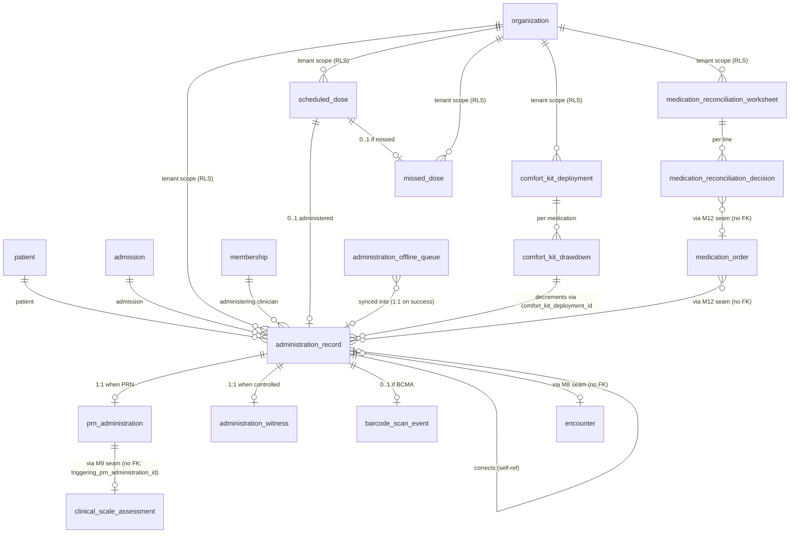

# Module 13 — eMAR & Medication Administration Specification

> **Authority note:** This spec is an **implementation proposal** (repo authority rule): [`docs/architecture/`](../architecture/) and the ratified ADRs in [`docs/adr/`](../adr/) win on conflict, and the code plus [`docs/BUSINESS_LOGIC.md`](../BUSINESS_LOGIC.md) are ground truth for as-built behavior. Mechanism choices named here may be superseded — see ADR-0036…0040 and ADR-0030/0032/0035 for the recorded divergences (outbox not Socket.IO, TypeScript not Python sidecars, app-layer AES-256-GCM not pgcrypto, pure transition tables not XState, hand-rolled HTTP hardening not `@fastify/*`, Vite + react-router not TanStack Start).


**Module ID:** 13
**Phase:** 1 (clinical core; required for medication tracking)
**Depends on:** 1 (Foundation — `withOrgContext`, `audit()` helper, outbox dispatcher, idempotency middleware, RLS generator, partitioned-table conventions, per-tenant DEK envelope encryption helper, BullMQ on Valkey, circuit-breaker pattern, `DegradedError` envelope, system status event, seam registry), 2 (Identity — actor resolution, discipline resolution from membership for the `administering_clinician_eligible` and `controlled_substance_witness_eligible` predicates, step-up re-auth for late-entry administrative override), 3 (Authorization — RBAC + ABAC; the `administration.*` permission keys this module contributes; M13 registers `administering_clinician_eligible`, `controlled_substance_witness_eligible`, `caregiver_attested_review_required`, and `comfort_kit_drawdown_authorized` predicates), 4 (Audit — PHI write-audit trigger generator, audit-read helper, destruction-cert workflow + `eraseFn` registration, `compliance` retention class; free-text PHI denylist mechanism per D12), 5 (Patient & Demographics — `patient.id`, deceased status, PrivacyFlag snapshot for SUD-medication-admin redaction via M5's seam; the `m5.patient.deceased` cascade signals comfort-kit return), 6 (Admission, Election & Certification — `admission.id` anchors every scheduled-dose; `m6.admission.discharged` cascade cancels open scheduled doses + triggers comfort-kit return; `m6.admission.activated`, `m6.transfer.created`, `m6.discharge.created`, `m6.cti.signed` trigger reconciliation worksheets per D17), 8 (Encounters & Visit Notes — `encounter_id` linkage on every clinician-administered dose when an open encounter exists per D9; M13 consumes M8's `SignedEncountersReader` seam to resolve in-flight encounters at administration time), 9 (Clinical Assessments Suite — PRN effectiveness reassessment is M9's domain; M13 emits `m13.prn_administration_recorded` carrying `reassessment_due_at`; M9 reads via `triggering_prn_administration_id` linkage on its scale rows per D3), 11 (Orders — *pattern reuse only*: M11's late-entry tier semantics, verbal-order timer concept, and cosignature request workflow are the templates M13 instantiates with M13-scoped permission keys; M13 does not import M11's `order_record` or `order_signature` schema), 12 (DoseSpot Integration & Prescribing — *every* administration references a `medication_order` via M12's `MedicationOrderProvider.getAdministrationContext(orgId, medicationOrderId)` published at M12 lock; M13 also reads `MedicationOrderProvider.getActiveMedications` for the eMAR projection and `MedicationOrderProvider.getControlledSubstanceFlag` for the witness-required gate; M13 *never* imports M12's schema), 22 (Document Management — eMAR PDF render via outbox `m13.administration_record.document_requested`; medication-reconciliation worksheet PDF via outbox `m13.reconciliation.document_requested`), 28 (FHIR Gateway — maps every `administration_record` to FHIR R4 `MedicationAdministration` and the reconciliation worksheet to `List` with `mode='snapshot'` for IPS conformance; M13 publishes the typed mapping, M28 owns the HTTP surface), 36 (Secure Messaging & Alerts — missed-dose typed alerts, controlled-substance witness alerts, comfort-kit replenishment alerts, PRN-reassessment-overdue alerts, caregiver-attested-administration cosign-queue alerts; typed alert payloads per M36 §4.9), 38 (Clinical Terminology — RxNorm RxCUI for medication identity on the eMAR projection, route-of-administration value set, dosage-form value set, the `comfort_kit_medications` value set for kit-drawdown classification, `asOfDate` lookups for survey-grade reconstruction), 39 (Consent & Authorization — 42 CFR Part 2 release for SUD-treatment medication administration disclosure consults `42_cfr_part_2_release`; M13 uses the `consent.evaluate` seam M39 publishes for SUD-flagged medication administrations on portal/FHIR egress paths), 40 (MDM — `ExternalPhysician` (NPI) reference for the ordering physician carried through from M12's seam projection; discipline taxonomy referenced by the `administering_clinician_eligible` and `controlled_substance_witness_eligible` ABAC matrices)
**Consumed by:** 14 (IDG — IDG packets show "administrations since last IDG" via M13's `MedicationAdministrationProvider.getAdministrationsSince` seam and "missed-dose count since last IDG" via the same seam's aggregation projection; bidirectionally, an IDG decision may recommend an administration-schedule change which becomes an M12 medication-order revision — M13 has no IDG write path), 21 (Supplies, DME & Comfort Kits — M21 consumes `m13.comfort_kit.replenishment_needed` and `m13.comfort_kit.return_required` events; deny-stub today against a recorded-fixture envelope per the M11 D6 / M12 forward-seam precedent until M21 locks), 28 (FHIR Gateway — `MedicationAdministration` R4 projection; M28 owns the HTTP surface), 30 (HQRP & Quality — the comfort-kit-deployment-to-first-administration interval, PRN-effectiveness-documented rate, missed-dose-rate-by-shift, and the symptom-impact-medication-paired-with-J2051-administration measure all read M13 via `MedicationAdministrationProvider`), 31 (Patient/Family Portal — caregiver-attested administration capture via M31's portal session calling M13's `recordCaregiverAttestedAdministration` route per D10; lay-language administration summary via `MedicationAdministrationProvider.getPortalAdministrationSummary` with SUD-flagged administrations redacted per the M5 PrivacyFlag snapshot), 33 (Reporting & Dashboards — missed-dose dashboards, PRN-effectiveness-documentation rate, controlled-substance reconciliation reports, comfort-kit-utilization rollups, eMAR-completion-rate by shift/location/clinician), 37 (IPU Management — IV-pump scheduled-IV safety overlay reads M13's `iv_continuous_*` mode rows via the `MedicationAdministrationProvider.getIvContinuousSession` projection; the IPU-specific double-check matrix and pump-programming verification layer on top by M37's encounter context at M37 lock)
**Spec status:** Re-locked v0.3 (Phase-4 remediation; supersedes Locked v0.2)

> **Phase-4 remediation (2026-06-11; ADR-0019).**
> - **M13-F03 (BLOCKER):** Schedule II–V meds can be **activated and administered** in Phase 1 via the
>   non-EPCS path (ADR-0019 D1) — the EPCS deferral governs only electronic Rx transmission, not the
>   eMAR administration workflow.
> - **M13-F04:** the **mandatory double-witness for every administration is scoped** — required for
>   **waste/disposal** and **inpatient** administration; routine **in-home administration by a lone
>   clinician** is recorded with the clinician's attestation + controlled-substance accounting (lot,
>   count, waste), not a fabricated second witness (removes the perverse caregiver-attested bypass).
> - **M13-F05:** **SUPPORT Act at-home disposal** documentation added (drug, quantity, on-site
>   method, date, disposing-staff + witness) — replaces the physical-retrieval model.

## Changelog

- **COP27 note (2026-10-06; no M13 change)** — the hospice coverage determination required by 42 CFR 418.24(c)
  (election-statement addendum) lives on M12's `medication_order` (M12 spec §2.13), not on M13's administration
  records. A drug determined `not_covered_*` is still administrable through the normal §2.9 gate when the
  hospice administers it; M13 neither reads nor writes the determination.
- **v0.2 (Locked)** — Initial publication at lock-grade. Instantiates the architecture §20.B module spec template. Resolves all eighteen open questions into binding decisions (§11). Defines the **central `administration_record` table with a `mode` discriminator covering `single_dose | iv_continuous_start | iv_continuous_rate_change | iv_continuous_pause | iv_continuous_resume | iv_continuous_stop`** (D11), the **scheduled-dose precomputation pipeline** materializing `scheduled_dose` rows from M12's `sigStructured` payload seven days ahead on `m12.medication_order.active` reception with a daily `materialize-schedule` cron extending and a discontinuation worker cancelling future rows on `m12.medication_order.discontinued` (D2), the **PRN-administration row** with explicit `triggering_prn_reason` and the post-administration **PRN-effectiveness reassessment trigger** that emits `m13.prn_administration_recorded` with `reassessment_due_at = administeredAt + reassessment_window_minutes` consumed by M9 (D3), the **missed-dose detection sweep** every 15 minutes that finds `scheduled_dose` rows past `due_at + grace_window_minutes` with no linked administration and inserts `missed_dose` rows + M36 typed alerts (D4), the **comfort-kit-deployment drawdown** with per-kit-medication remaining-quantity decrement and the replenishment-needed outbox event consumed by M21 (D5), the **bidirectional consistency with M12** via the synchronous `MedicationOrderProvider.getAdministrationContext` consult at every administration write — no cascade from M12 needed because M13 always asks before writing (D6), the **controlled-substance double-witness rule** for Schedule II–V administrations and wastage with a second clinical-discipline signature on the `administration_witness` row, gated by the `controlled_substance_witness_eligible` ABAC predicate M13 registers (D7), the **late-entry tier ladder** mirroring M8 with `normal | late | significant_late | administrative_override` enforced at the route handler with per-tier permission keys (D8), the **encounter auto-linkage** at administration time consulting M8's `SignedEncountersReader` for an in-flight encounter on the patient at administeredAt±tolerance, with `encounter_id` nullable for continuous infusion and caregiver-attested doses (D9), the **caregiver-attested administration path** via M31 portal calling M13's `recordCaregiverAttestedAdministration` route with `actor_kind='caregiver_attested'`, `requires_rn_review=true` until a case manager reviews and acknowledges (D10), the **IV continuous administration mode catalog** with `iv_session_id` correlating the start / rate-change / pause / resume / stop sequence as separate rows (D11), the **free-text PHI denylist** scrub on `administration_record.notes`, `administration_record.refusal_reason`, `prn_administration.prn_reason`, `prn_effectiveness_reassessment.reassessment_notes`, `administration_record.wastage_reason`, `missed_dose.missed_reason`, `medication_reconciliation_decision.decision_notes`, `comfort_kit_drawdown.notes` (D12), the **`administration_record` monthly-partitioned by `administered_at`** matching M4 + M11 + M12 partition conventions with other M13 tables non-partitioned (D13), the **admission-discharge cascade** subscribed to `m6.admission.discharged` cancelling every `scheduled_dose` with `due_at > dischargeAt`, never retroactively marking anything missed, and emitting `m13.comfort_kit.return_required` for active kit deployments (D14), the **AI-prohibited zone for medication administration**: Module 32's LLM may not create, modify, witness, or cosign an `administration_record` row; HearthNote Layer 2 may narrate around an administration in immutable read-only context but cannot mutate any M13 row; enforced at boot via `validateAdministrationAIBlock()` against M32's prompt registry mirroring M12 D12 (D15), the **published M13 seams** `MedicationAdministrationProvider` (read paths for M14/M28/M30/M31/M33/M37) and `ReconciliationProvider` (read paths for M14/M30) registered at boot via M1 seam registry with `validateSeams()` refusing startup if unregistered and the dependency-cruiser boundary check blocking consumers from importing `packages/db/src/schema/administration-*` directly (D16), the **reconciliation-as-workflow not-a-screen** model with `medication_reconciliation_worksheet` triggered by four M6 events (`activated`, `transfer_completed`, `discharge.executed`, `recertification_signed`) and a per-line `medication_reconciliation_decision` row capturing the clinician's `carry_forward | discontinue | hold | new_order | document_only` resolution (D17), and the **mobile-first eMAR with offline capture** queuing on-device administrations in `administration_offline_queue` and reconciling server-side with a `recordedAt` vs `administeredAt` distinction plus idempotency keyed on `(deviceId, localId)` (D18). Wires the permission keys this module registers into Module 3 (§4.6), the `administering_clinician_eligible` / `controlled_substance_witness_eligible` / `caregiver_attested_review_required` / `comfort_kit_drawdown_authorized` ABAC predicates this module registers with Module 3's named-predicate registry (§4.7), the BullMQ queue catalog (§4.8), the M36 typed-alert payloads (§4.9), and the destruction `eraseFn` registered with Module 4 (§7.7). Includes a **proposed manifest patch** (§10 last task) updating `M13.dependsOn` from `[12, 36, 38]` to `[1, 2, 3, 4, 5, 6, 8, 9, 11, 12, 22, 28, 36, 38, 39, 40]` *(relationship inventory - not the `dependsOn` edge set; per ADR-0005 D1/D4 seam/outbox/foundation consumers are no-edge - see audit/MANIFEST_DEPENDSON_REVIEW.md; do not bulk-apply)* — the prior encoding was structurally identical to M11/M12's pre-lock state: it omitted the foundation deps that are transitively required but not surfaced in the architecture §20 short-list, omitted the M5/M6/M8/M9/M39/M40 deps that are real consumer-of-seam-or-data relationships, omitted M11 (pattern-reuse declared even though no code import; documents the late-entry tier and verbal-order workflow lineage), and omitted the M22/M28 deps that are real consumer-of-data relationships rather than transitive. The M11 and M12 locks established the precedent that every module surfaces *all* its declared imports in `dependsOn`, including foundation and cross-cutting; M13 follows. Also confirms `apps/backend/src/modules/13-emar` in `M13.codePaths` per the manifest already-encoded entry; no new packages introduced (the eMAR is a backend-module-only deliverable; the mobile UI lives under `apps/web/src/modules/13-emar/` with the Capacitor offline queue in `apps/web/src/modules/13-emar/offline/`).
- **v0.1** — Drafted within the lock-grade pass; not separately published.

> **Phase boundary (binding):** Phase 1 delivers everything in this spec **except** (a) the eMAR PDF rendering (Module 22 owns; M13 emits the structured `m13.administration_record.document_requested` payload and M22 renders), (b) FHIR `MedicationAdministration` publication (Module 28; M13 publishes the typed mapping today), (c) M21 comfort-kit physical replenishment (M21 consumes `m13.comfort_kit.replenishment_needed`; M13 ships the event today against a recorded-fixture consumer per the M12 forward-seam precedent until M21 locks), (d) M30 HQRP measure computations that read M13 (M30 owns; M13 publishes `MedicationAdministrationProvider` today), (e) M31 caregiver-attested administration capture surface (M31 owns the portal session; M13 ships the `recordCaregiverAttestedAdministration` route today), and (f) M37 IPU IV-pump safety overlay (M37 owns; M13 ships the `iv_continuous_*` mode catalog today). The "done" gate for M13 is: shared `administration_record` with the mode discriminator and per-mode TypeBox-validated body; the scheduled-dose materialization pipeline + the missed-dose sweep + the discharge-cascade subscriber + the PRN-reassessment trigger emitter; the controlled-substance double-witness route + the `controlled_substance_witness_eligible` predicate registered with M3; the late-entry tier ladder + the four tier permissions registered with M3; the medication-reconciliation worksheet workflow triggered by the four M6 events with the per-line decision row; the comfort-kit deployment + drawdown tables + the replenishment-needed outbox event; the offline-queue route + idempotency-keyed sync; the `MedicationAdministrationProvider` and `ReconciliationProvider` seams registered at boot; the AI-prohibited-zone validator wired against M32's prompt registry; the bidirectional-consistency check against M12's `getAdministrationContext` on every administration write; and the test plan green — not gated on Modules 14/21/28/30/31/37 existing.

---

## 1. Purpose & Scope

### 1.1 What This Module Does

Module 13 is the **electronic medication administration record (eMAR) and bedside administration capture surface** of the WardenX hospice EHR. Every medication a patient *receives* — whether administered by an RN at a scheduled visit, given by a family caregiver from the comfort kit in the small hours, infused continuously through an IPU pump, refused by the patient, missed because the visit was rescheduled, or wasted under double-witness because the dose drew up cloudy — flows through a single authenticated, auditable administration record that originates here, references the source `medication_order` (M12) through a published seam (never a direct schema import), and feeds the downstream HQRP measures (M30), the FHIR `MedicationAdministration` projection (M28), the IDG packet's "administrations since last meeting" view (M14), and the patient/family portal's lay-language administration summary (M31). Module 13 owns the data layer of the eMAR; nothing else in the system writes administration records, mints scheduled doses, tracks comfort-kit drawdown, or runs the medication-reconciliation worksheet workflow.

Concretely M13 delivers:

- **The administration-record spine.** A single `administration_record` table with a `mode` discriminator (`single_dose | iv_continuous_start | iv_continuous_rate_change | iv_continuous_pause | iv_continuous_resume | iv_continuous_stop`) and a per-mode TypeBox-typed body (D11). One table; six modes today; the mode catalog is open via the `packages/domain/administration/modes/` registry, and adding a mode (e.g., `topical_application` or `nebulizer_treatment_session`) is a per-mode TypeBox sub-PR — never an `ALTER TABLE`. The discriminated union runs all the way through the M28 FHIR projection, the M30 measure surface, and the M4 audit denylist.
- **Scheduled-dose materialization.** When M12 emits `m12.medication_order.active` for a scheduled (non-PRN) medication, M13's `materialize-schedule` worker computes the next 7 days of `scheduled_dose` rows from the order's `sigStructured.frequency` payload (q4h, BID with named times, weekly on Mondays, etc.), pinning each row's `due_at` to the patient's location timezone with DST handling. A daily cron extends the window. On `m12.medication_order.discontinued`, every future `scheduled_dose` is cancelled with `cancellation_reason='order_discontinued'`. Past scheduled-dose rows are immutable: their existence as a "should have happened at 0800" record is the survey-defensible trail of what the system planned, against which administrations and missed doses are reconciled.
- **The missed-dose detection sweep.** Every 15 minutes, the `missed-dose-sweep` worker finds `scheduled_dose` rows past `due_at + grace_window_minutes` (per-tenant default 60 minutes; tightened to 30 minutes for controlled substances; tightened further to 15 minutes for IV continuous orders) with no linked `administration_record`. For each, M13 inserts a `missed_dose` row, transitions the `scheduled_dose` to `missed`, emits `m13.scheduled_dose.missed`, and routes a typed M36 alert to the case manager + clinical supervisor. The grace window is configurable per tenant in `administration_policy` (org-scoped) and tightens implicitly for controlled substances and IV continuous orders.
- **The PRN-administration row + post-administration reassessment trigger.** When a PRN dose is administered, M13 records a `prn_administration` row tied 1:1 with the `administration_record` carrying `triggering_prn_reason` (free-text per indication; denylisted in audit). M13 emits `m13.prn_administration_recorded` with `reassessment_due_at = administeredAt + reassessment_window_minutes` (per-medication default 60 minutes, configurable per tenant + per-order, longer for sedatives, shorter for breakthrough pain). M9 (Clinical Assessments) subscribes and is responsible for prompting an ESAS-r or PAINAD follow-up; if no reassessment scale is recorded against `triggering_prn_administration_id` by the deadline, M9 emits `m9.prn_reassessment_overdue` which fans out to M36. M13 owns the *trigger row*; M9 owns the *scale*. This is the M11 D6 / M12 D17 forward-consumer pattern instantiated at the assessment surface.
- **The controlled-substance double-witness rule.** For any administration of a Schedule II–V medication (resolved through `MedicationOrderProvider.getControlledSubstanceFlag`), or any wastage of any controlled substance (a partial-dose draw-down where the remainder is destroyed), the route handler requires a second active clinical-discipline membership to attest via the `administration_witness` row. The `controlled_substance_witness_eligible` ABAC predicate enforces that the witness is RN, LPN, MD, NP, or PA — never a CHHA, MSW, chaplain, or volunteer. The witness's signature is captured on the same transaction as the administration row; the row cannot transition to `committed` without the witness row. Wastage carries its own `wastage_amount`, `wastage_reason` (denylisted), and witness; the audit emits a separate `administration.controlled_wasted` event.
- **Encounter auto-linkage.** When a clinician records an administration, M13 consults M8's `SignedEncountersReader.findOpenEncounterFor(orgId, patientId, administeredAtIso, toleranceMinutes=30)` and auto-populates `encounter_id` if an open encounter exists. The clinician sees the linked encounter on the administration receipt screen and can override (e.g., if the dose was given between visits but the clinician is mid-encounter for another patient nearby). For IV continuous administration session rows and caregiver-attested doses, `encounter_id` is nullable and remains so.
- **Caregiver-attested administration.** Family caregivers giving doses at home (most commonly comfort-kit PRN morphine or sublingual lorazepam overnight) record administrations through the M31 patient/family portal. M31 calls M13's `recordCaregiverAttestedAdministration` route which writes the row with `actor_kind='caregiver_attested'`, `requires_rn_review=true`, and `caregiver_attestation_text` (denylisted). The patient's RN case manager sees these on the cosign queue (the same queue as M8 LPN/CHHA encounter cosignatures, mirroring the established M8 pattern); ack transitions `requires_rn_review` to false and emits `m13.caregiver_administration.acknowledged`. No clinical workflow on the row until reviewed.
- **The medication-reconciliation worksheet.** Triggered by four M6 events (`m6.admission.activated`, `m6.transfer.created`, `m6.discharge.created`, `m6.cti.signed`), M13 creates a `medication_reconciliation_worksheet` row. The worksheet UI loads the patient's M12 active medications + M12 medication-history records + caregiver-reported home meds (entered on the worksheet itself); the admitting / transferring / discharging / recertifying clinician marks each line as `carry_forward`, `discontinue`, `hold`, `new_order`, or `document_only`; each decision is a `medication_reconciliation_decision` row carrying actor, decision, optional notes (denylisted), and (for `new_order` or `carry_forward`) a back-reference to the resulting M12 medication-order draft when the prescriber signs it. The worksheet finalizes when every line has a decision; finalization emits `m13.reconciliation.completed` consumed by M30 (timeliness measure) and M22 (PDF render).
- **The comfort-kit deployment and drawdown surface.** When M21 (eventually) emits `m21.comfort_kit.deployed_at_patient` with the kit contents (a list of `medication_order` IDs and quantities), M13 creates a `comfort_kit_deployment` row + per-medication `comfort_kit_drawdown` rows initialized at the deployed quantity. Every PRN administration that references a `comfort_kit_deployment_id` decrements the matching drawdown. When `remaining_quantity ≤ replenishment_threshold`, M13 emits `m13.comfort_kit.replenishment_needed` consumed by M21. On admission discharge, M13 emits `m13.comfort_kit.return_required` for every active deployment. Phase 1 the M21 producer is a recorded-fixture envelope per the M12 forward-seam precedent; M13 ships the consumer + the events today.
- **Offline-capable mobile eMAR.** The bedside eMAR runs on Capacitor (mobile) and degrades to an offline mode when network is unavailable. Administrations recorded offline queue in the on-device `administration_offline_queue` table (IndexedDB via Capacitor's SQLite plugin); on reconnect, the sync worker posts each row through the standard administration route with `offline_capture=true`, the original client-side `administeredAt`, and a server-side-assigned `recordedAt`. Idempotency-keyed on `(deviceId, localId)`: re-posting the same offline row on a retry storm is a no-op. Wall-clock skew is reconciled by holding `administeredAt` as clinician-entered truth; `recordedAt` is server-receive.
- **The `MedicationAdministrationProvider` and `ReconciliationProvider` seams.** Published in `packages/domain/administration/seams.ts` for forward consumers (M14, M21, M28, M30, M31, M33, M37 — see §4.5). The seam pattern is the M11 D14 / M40 §4.5 / M9 D7 / M12 D17 precedent: M13 publishes the typed interface; consumers attach via the seam registry; the dependency-cruiser boundary check (architecture §25.15) blocks any consumer from importing `apps/backend/src/modules/13-emar/db/*` or any future `packages/db/src/schema/administration-*` directly.
- **The outbox event contract** that drives every downstream module (full taxonomy in §4.4). Outbox publication is the only cross-module communication M13 performs; M13 never calls another module's HTTP route.
- **The bidirectional-consistency rule with M12.** Every administration write — clinician-recorded, caregiver-attested, IV-continuous, offline-synced — calls `MedicationOrderProvider.getAdministrationContext(orgId, medicationOrderId)` synchronously inside the route handler before any DB write. If the result is `allowAdministration: false` with `blockedReasons: ['discontinued' | 'not_active' | 'replaced' | 'expired_unsigned' | 'transmission_failed']`, the route returns `422 ADMINISTRATION_BLOCKED` with the reasons echoed back. This is the inversion of the discharge-cascade pattern: M12 doesn't cascade to M13; M13 always asks M12. The rule is preserved across the offline-sync path: on reconnect, the sync route re-checks against current M12 state, and if the order has since been discontinued, the offline administration is rejected and surfaced as a workflow item for the clinician.

### 1.2 What This Module Does Not Do

This list is binding. Every item below is owned by another module and reached via outbox event, seam call, or M22-style render handshake — never via cross-module HTTP call and never via direct schema import.

- **The medication order itself.** Module 12 owns `medication_order`, the per-class TypeBox payloads, the `med_class` discriminator, the lifecycle state machine, the DoseSpot transmission, the EPCS architecture, the refill inbox, the medication-history pull. M13 *reads* M12 via the published `MedicationOrderProvider` seam; M13 never imports M12's schema; M13 never writes to M12 tables; M13 has no DoseSpot code path; M13 has no Surescripts code path; M13 has no NewRx route. The eMAR-to-prescription bidirectional consistency rule (M13 may not record an administration against a `discontinued` or `transmission_failed` order) is enforced by M13 *consulting* M12's seam at write time, not by M12 cascading to M13.
- **The signature primitive on a prescription.** M11 owns `order_signature`, the polymorphic `target_kind` discriminator, the verbal-order timer, the cosignature workflow on prescriptions. M13 owns the *administration witness* (a different concept — bedside attestation that the right drug was given to the right patient at the right time), modeled on its own `administration_witness` table. The two primitives are sibling, not parent-child: an administration witness does not write to `order_signature`; an order signature does not write to `administration_witness`.
- **Comfort-kit physical inventory and fulfillment.** Module 21 owns supply fulfillment and the physical kit (par stock, replenishment cycles, dispatch from the supply hub). The *deployment* of a kit at the bedside originates as an M11 `comfort_kit` order; M21 enacts that order by dispatching physical supplies; once the kit is at the bedside, M13 begins tracking drawdown. M13's `comfort_kit_deployment` row is the *clinical record of the kit being at the bedside* — it is not the inventory record (that's M21).
- **Inpatient unit medication carts, electronic locks, dispensing cabinets.** Module 37 owns the IPU; the IPU may use a dispensing cabinet (Pyxis-equivalent) for unit-stock controlled substances. M13 receives the dispense event as an `administration_record` mode `single_dose` with `dispense_cabinet_event_id` (forward-seam column, populated by M37 at M37 lock); M13 has no dispensing-cabinet integration code.
- **The PRN reassessment scale itself.** Module 9 owns ESAS-r, PAINAD, and every other clinical scale. M13 emits `m13.prn_administration_recorded` with `reassessment_due_at`; M9 owns the scale and the prompt; **M13 owns the overdue sweep** (GAP-040 — M9's spec never mentions PRN and M9 has no PRN linkage, so an M9-emitted `m9.prn_reassessment_overdue` was never producible): the `m13.prn-reassessment-overdue` cron emits `m13.prn_reassessment.overdue` if no scale is captured by the deadline. M13 has no scoring logic, no scale-license gate, no scale UI; M13 just triggers and consumes the "was a scale ever captured against this PRN?" signal via M9's `LatestAssessmentProvider.findReassessmentForPrn(prnAdministrationId)` published at M9 lock.
- **The encounter narrative ("HearthNote") that wraps the visit during which administrations occurred.** Module 8 owns the encounter, the three-layer HearthNote engine, the cosignature workflow for LPN/CHHA notes, the late-entry tier on encounters. M13 *links* to M8 via `encounter_id`; M13 has no narrative generation, no Layer 2 LLM enhancement, no Layer 3 compliance gate.
- **The medication-history pull from DoseSpot/Surescripts.** Module 12 owns the `medication_history_record` table and the medhx pull worker on admission/recert. M13 *reads* the resulting rows via M12's seam read path `MedicationOrderProvider.getMedicationHistoryForReconciliation(orgId, patientId)` (a seam path M12 ships at lock — see §4.5 cross-reference); M13 has no DoseSpot adapter code.
- **The patient/family portal session.** Module 31 owns the portal session, the magic-link auth, the lay-language formatting, the consent-gated visibility logic. M13 publishes the `MedicationAdministrationProvider.getPortalAdministrationSummary(patientId)` and the `recordCaregiverAttestedAdministration` route; M31 owns the portal UI and the session.
- **FHIR `MedicationAdministration` HTTP surface.** Module 28 owns the FHIR Gateway. M13 publishes the typed `asFhirMedicationAdministration(administrationRecordId)` mapping (per the M12 D17 pattern); M28 owns the route and the search-parameter index.
- **HQRP measure computation.** Module 30 owns the measure surface (HCI, HVLDL, CAHPS, HOPE-derived measures, opioid-on-admission, comfort-kit-deployment-to-first-administration interval, PRN-effectiveness-documented rate, missed-dose-rate-by-shift). M13 publishes the `MedicationAdministrationProvider` seam; M30 consumes and computes.
- **Reporting dashboards.** Module 33 owns the operational dashboards. M13 publishes the `MedicationAdministrationProvider` seam; M33 reads.
- **AI-suggested administration timing or skipped-dose suggestions.** Module 32 (AI Platform) owns the AI capabilities. M13 surfaces *no* AI-derived suggestions for administration content. This is the AI Governance §2.1.1 hard-block on medication, extended from M12 D12 to the administration surface: HearthNote Layer 2 may narrate around an administration in immutable read-only context ("Patient received morphine 5mg PO at 1430 with good effect"), but the LLM cannot create, modify, witness, or cosign an `administration_record` row, and Module 32 may not register a prompt template whose output type is "administration timing recommendation" or "skipped-dose suggestion." Enforced at boot per D15.
- **Pharmacy reconciliation of dispensed-vs-administered controlled substances.** Module 12 (via DoseSpot) tracks what was *dispensed by the pharmacy*. M13 tracks what was *administered to the patient*. The reconciliation between dispensed and administered + remaining-on-hand (for the controlled-substance perpetual inventory log required by DEA 21 CFR 1304) is a Phase-2 deliverable; M13 ships the administration-side data today and the controlled-substance-inventory reconciliation report is owned by a future module (provisionally M30 quality + dedicated CSII surface).
- **Consent management.** Module 39 owns patient consent. M13 *consults* M39's `consent.evaluate` seam for SUD-flagged medication administrations on portal/FHIR egress paths; M13 has no consent record management code.

### 1.3 Regulatory Drivers

| Driver | Requirement | How Module 13 satisfies it |
|---|---|---|
| 42 CFR §418.106(a)(1) — Drugs and biologicals must be administered only by personnel authorized to do so | Administering clinician must be eligible by discipline + state law | `administering_clinician_eligible[:medClass]` ABAC predicate gates every administration write; discipline taxonomy resolved from M2 membership; per-state RN/LPN scope-of-practice rules carried in `administration_policy` (D8 framework) |
| 42 CFR §418.106(e) — Hospice must provide the patient or representative with a written list of medications | Patient-accessible current medication list | M12 emits `m12.medication_order.list_changed`; M13 emits `m13.administration_record.recorded` and `m13.scheduled_dose.cancelled`; M22 renders the patient-facing medication list PDF on demand combining both; M31 surfaces the lay-language administration summary via `MedicationAdministrationProvider.getPortalAdministrationSummary` |
| 42 CFR §418.106(f) — Controlled drugs in the patient's home: written policy + accounting + disposal | Tenant policy + per-administration accounting | `administration_policy` carries the tenant's controlled-drug-home policy; every controlled-substance administration emits a witnessed `administration_record` + drawdown decrement against the kit deployment; wastage is a separate witnessed event; comfort-kit return on discharge triggers the disposal workflow via `m13.comfort_kit.return_required` |
| 42 CFR §418.106(b) — Verbal orders | Verbal orders are M11/M12's domain (prescribing side) | M13 has no verbal-administration concept (every administration is the clinician's direct action; the *order behind it* may have been verbal — that's M12); the M11 D6 verbal-order pattern is referenced for verbal-administration acknowledgment only in the niche where an MD verbally tells the RN "give the dose now" without a prescription on file, which is structurally rare and routed to the M11/M12 verbal-order intake path, not a new M13 path |
| 42 CFR §418.104 — Clinical records authentication, completeness, retention | Immutable, attributed, timestamped, retained | Server-authoritative state machine; write-audit triggers; `compliance` retention class via M4; M13 administration records are 10-year retention; partition lifecycle via M4; correction workflow preserves the original `administration_record` row and writes a new one with `corrects_administration_id` (D8 tier framework) |
| 21 CFR §1304.22 — DEA controlled substance dispensing/administration records | Detailed per-dose records for Schedule II–V administrations | Every controlled-substance administration carries actor + witness + administered amount + remaining-on-hand (from kit drawdown) + RxNorm/NDC + DEA schedule (resolved from M12 seam); the audit row preserves the structural diff per M4 conventions; the controlled-substance perpetual inventory log is a Phase-2 report deliverable per §1.2 |
| HIPAA §164.502(b) — Minimum necessary | Disclose only what's needed | Administration summary surface (portal / collaborator) strips clinical-internal items; ABAC caseload + discipline scope on author; SUD-flagged administrations gated by M39's `consent.evaluate` per D7 framework |
| 42 CFR Part 2 (substance-use disorder confidentiality) | SUD-treatment medication administration requires explicit patient release | Administration of an SUD-treatment medication (methadone, buprenorphine, naltrexone — resolved via M38's `sud_treatment_medication` value-set membership flagged on the M12 seam dto's `isSudTreatment` field) flagged `sud_context=true`; portal and FHIR egress paths consult `sud_disclosure_allowed` ABAC predicate (registered via Module 39's seam); audit event `administration.disclosed` with `sud=true` is NOT emitted unless data left the perimeter |
| 21st Century Cures Act / ONC Information Blocking | Patient-facing access to clinical data | Portal-facing administration summary (Module 31) shows administrations in lay language; consent-gated only for SUD-flagged content; M13 is the data source for the portal projection |
| State retention law (e.g. ORS 192.553) | Longer retention where required | `compliance` retention class with `state_retention_override` table from M4 |
| State scope-of-practice rules (e.g., LPN may not administer Schedule II IV push in some states) | Per-state administering-discipline rules | `administration_policy.state_overrides` jsonb keyed by state code; the `administering_clinician_eligible` ABAC predicate resolves the state from the patient's address (M5 seam) and consults the overrides table; documented in M30 quality dashboards as a survey-defensible artifact |
| Joint Commission MM.05 / MM.06 (where applicable — hospice IPUs that pursue accreditation) | Medication safety: right patient, right drug, right dose, right route, right time | The administration form server-side validates the five rights at write: `patientId` against the order's `patientId`; medication identity via RxNorm crosswalk; dose against the order's `sigStructured.dose`; route against the order's `sigStructured.route`; `administeredAt` against the scheduled dose's `due_at + grace_window` — mismatches return `422 FIVE_RIGHTS_VIOLATION` with the specific right(s) that failed |

### 1.4 Competitive Context

The mainstream hospice EHRs (Homecare Homebase, MatrixCare, WellSky/Consolo, FireNote) all ship an eMAR; what they typically do not do well is the *quality of the clinical capture loop* and the *audit-grade reconstruction* at survey time. WardenX's M13 differentiators are:

- **One source of truth for the administration.** Server-side, mode-discriminated, RxNorm-canonical, with the source `medication_order` resolved through M12's seam at write time. Most vendors store the administered drug as a denormalized string snapshot on the eMAR row, so when the prescription is corrected (W-MR-07 in M12) the eMAR shows the old drug name and the new prescription shows the new one — the patient's record is internally inconsistent. We refuse the administration write if M12's seam reports the order is no longer administerable; the eMAR is *forced* to reflect M12's current truth.

- **PRN effectiveness reassessment, wired through M9.** Most vendors prompt for a "reassessment effectiveness" free-text box on the eMAR form and call it done; the field is rarely completed, never trended, never tied to the scale that would actually measure effectiveness. We emit a typed trigger event whose deadline is consumed by M9's scale subsystem; an overdue reassessment generates an M36 typed alert; the IDG packet shows the PRN-effectiveness-documentation rate per patient as a quality signal.

- **Controlled-substance double-witness as a route-handler gate, not a UI hint.** Most vendors implement the witness as a UI checkbox the nurse clicks themselves before submitting; the audit shows one membership signing two attestations. We require a second active membership session token on the route call; the witness's signature is a separate identity proof; the audit captures the actual two memberships; survey-defensible.

- **Missed-dose detection as a worker, not a report.** Most vendors compute "missed doses" as a daily batch report read at the QAPI meeting a week later. We detect within 15 minutes of the grace window passing; the case manager gets an M36 alert *while there's still time to do something about it*; the audit row stands as a record of the platform having actively detected the miss rather than passively recorded it after the fact.

- **Reconciliation as a workflow, not a screen.** Most vendors implement med reconciliation as a static "Medication Reconciliation Form" that the admitting RN fills out from a printed list; the resulting decisions don't structurally back-link to the resulting M12 orders, so a surveyor asking "show me why this order was carried forward from the patient's home meds" gets a free-text answer. We model the worksheet as a row with per-line decisions, each decision back-linking to the resulting `medication_order` when the prescriber signs it; the survey export reconstructs the full chain.

- **Mobile-first with real offline capture.** Most vendors have a mobile app that requires connectivity to record administrations; nurses in rural areas fall back to paper and re-enter later, breaking the timestamp trail. Our Capacitor app persists administrations in an IndexedDB queue, syncs on reconnect with the original `administeredAt`, and reconciles against current M12 state on the server — a discontinued order's offline administration surfaces as a workflow item rather than being silently rejected or silently accepted.

- **Comfort-kit drawdown tracking integrated with the order spine.** Most vendors track comfort kits as supplies (M21-equivalent) and administrations as eMAR entries; the two are never reconciled, so a surveyor asking "show me how the morphine in the kit was used" gets a paper log from the family. We decrement per-medication drawdown on every administration that references the deployment, generate replenishment alerts at threshold, and on discharge generate a return-required event whose disposal is auditable.

The WardenX bet is that hospice-grade medication administration is the workflow where the *quality of the bedside capture* most directly translates to patient safety and survey defensibility. The reality is that hospice nurses give doses at 3 AM in a patient's bedroom while the family watches; the captured record is the only evidence that survives. A mobile UI that works offline, a server that synchronously verifies M12 state, a witness gate that requires a second person, a missed-dose worker that alerts in time, a reassessment trigger that closes the loop on PRN effectiveness, and a reconciliation workflow that produces survey-grade artifacts — together they are the system the hospice nurse trusts at 3 AM and the surveyor accepts in the field three years later.

-----

## 2. Domain Model

### 2.1 Administration Modes

The six administration modes in v0.2. Each lives in `packages/domain/administration/modes/<mode>/` with `schema.ts` (TypeBox), `validate.ts` (cross-field), `terminology.ts` (RxNorm/route bindings via M38), `fhir-mapping.ts` (FHIR `MedicationAdministration` projection mapping), and `audit-denylist.ts` (per-mode free-text field list).

| `mode` | Description | Typical use | FHIR mapping | Required body fields (over the shared envelope) |
|---|---|---|---|---|
| `single_dose` | One-time discrete administration: a tablet swallowed, an injection given, a sublingual dose, a suppository inserted | Scheduled doses (q4h morphine), PRN doses (breakthrough pain), one-time orders (haloperidol IM PRN agitation) | `MedicationAdministration` with `effectiveDateTime` | `administeredAmount` (numeric + unit), `route` (SNOMED-coded via M38), `siteOfAdministration` (optional; SNOMED-coded) |
| `iv_continuous_start` | Beginning of a continuous IV infusion session | Hospice morphine drip initiation at the IPU; rare in home hospice | `MedicationAdministration` with `effectivePeriod.start` populated, no `end` | `infusionRate` (numeric + rate unit), `infusionDilution` (free-text; denylisted), `pumpProgrammingVerifiedByMembershipId` (the M37 pump-double-check; nullable until M37 lands) |
| `iv_continuous_rate_change` | Mid-session titration up or down | RN titrates morphine drip up by 0.5 mg/hr for breakthrough pain | `MedicationAdministration` with `effectivePeriod.start` (snapshot in time) | `previousRate`, `newRate`, `titrationReason` (free-text; denylisted) |
| `iv_continuous_pause` | Pause an infusion (e.g., to change line, to permit transport) | RN pauses drip during ambulance transport to IPU | `MedicationAdministration` with `effectivePeriod.end` (closes prior segment) | `pauseReason` (free-text; denylisted) |
| `iv_continuous_resume` | Resume a paused infusion | RN resumes drip after transport | `MedicationAdministration` (new period segment) | (envelope-only; references prior pause via `iv_session_id`) |
| `iv_continuous_stop` | End of infusion session | Patient passes; clinician stops the drip and documents the stop time | `MedicationAdministration` with `effectivePeriod.end` (closes session) | `stopReason` (free-text; denylisted), `wastageAmount` (numeric + unit; if applicable; triggers controlled-substance witness when controlled) |

The mode taxonomy is open via `packages/domain/administration/modes/index.ts`. Adding `topical_application`, `nebulizer_treatment_session`, `enteral_tube_feeding_administration`, or any other mode is a sub-PR adding the per-mode directory + a registry entry + a per-mode TypeBox + a FHIR mapping; the central `administration_record` schema does not change.

**The `mode` discriminator and the per-mode body.** `administration_record` carries `mode` (enum) and `data` (jsonb). The `data` payload is validated server-side against the per-mode TypeBox at write time. The per-mode `validate.ts` runs cross-field checks (e.g., `single_dose.administeredAmount` matches the order's `sigStructured.dose` within tolerance; `iv_continuous_rate_change.newRate` is within the order's safe-rate range; `iv_continuous_stop.wastageAmount` ≤ the running infused-vs-dispensed delta).

**The IV-session correlation.** Modes `iv_continuous_*` carry `iv_session_id` (uuid) that correlates the sequence of rows. The `iv_continuous_start` mints the session id; subsequent rows reference it; the `iv_continuous_stop` closes it. The session id is queryable: `findIvSession(orgId, sessionId)` returns the full ordered sequence for the M37 IPU surface and the M28 FHIR projection (which composes the rows into a single FHIR `MedicationAdministration` with an `effectivePeriod`).

### 2.2 Administration Lifecycle State Machine (D6)

The `administration_record` row has a deliberately compact state machine — administrations are *recorded events*, not multi-step workflows. The complexity is at the *write gate* (M12 consistency check, witness check, encounter linkage, late-entry tier resolution), not the *state*.

**States:**

| `status` | Meaning |
|---|---|
| `committing` | Transient: the route handler has accepted the payload, run the M12 consistency check, run the witness check (if controlled), resolved the encounter link, resolved the late-entry tier, and is about to write the row inside a single transaction. Visible only during the request; not persisted long. |
| `committed` | The administration row is committed; all side effects (audit, outbox, drawdown decrement if comfort kit, scheduled-dose linkage if scheduled) have committed in the same transaction. This is the steady-state for the vast majority of administrations. |
| `pending_caregiver_review` | Caregiver-attested administration awaiting RN case manager acknowledgment per D10. The row is committed and counts toward administration totals; the `requires_rn_review` flag drives the cosign queue surface. |
| `pending_offline_sync` | Synthetic state used only during the offline-sync request lifecycle; rows reach `committed` (or are rejected) as soon as the server processes the offline-queue payload. Visible only in the device's local queue, never in the server's `administration_record` table. |
| `superseded` | A correction has been recorded; this row is the *original* and a new row carries `corrects_administration_id=<this row's id>`. The original remains in place — read paths must filter to non-superseded by default — for audit-grade reconstruction. |
| `voided` | Hard-void path for administrative correction of a row recorded *in error* (wrong patient selected; wrong order). Distinct from `superseded` because there's no replacement row. Requires step-up + supervisor permission; M36 high-severity alert. Read paths exclude `voided` by default. |

**Allowed transitions** (XState machine in `packages/domain/administration/machines/administration-record.ts`):

| From | To | Event | Guards |
|---|---|---|---|
| (none) | `committing` | `recordAdministration` | `administering_clinician_eligible[:medClass]` (D7); `controlled_substance_witness_eligible` if order is controlled; M12 `getAdministrationContext` returns `allowAdministration=true` (D6); five-rights validation passes; late-entry tier resolved (D8) |
| `committing` | `committed` | (internal commit at txn end) | comfort-kit drawdown succeeded if applicable; PRN reassessment trigger emitted if PRN; scheduled-dose linkage if scheduled; encounter auto-link if applicable; M22 document-request event emitted if tenant policy requires per-administration PDF (default off; on for IPU per D9) |
| `committing` | (none — rejected) | `validationFailed` | any of the guards fails; no DB write; route returns 422 |
| (none) | `pending_caregiver_review` | `recordCaregiverAttestedAdministration` | actor is a portal session with `actor_kind='caregiver_attested'` per D10; M12 `getAdministrationContext` returns `allowAdministration=true`; caregiver attestation text recorded |
| `pending_caregiver_review` | `committed` | `acknowledgeByCaseManager` | RN case manager on patient's caseload acknowledges; `requires_rn_review=false`; ack audit event recorded |
| `committed` | `superseded` | (internal trigger on new row insert with `corrects_administration_id=<this>`) | correction route succeeded; the new row commits; the trigger flips the original to `superseded` in the same transaction |
| `committed` | `voided` | `voidAdministration` | actor has `administration.void` permission (RN case manager + clinical supervisor); step-up re-auth completed; reason ≥40 chars; M36 high-severity alert emitted |
| `pending_caregiver_review` | `voided` | `voidAdministration` | same as above |

**Note on the absence of more states.** The state machine is intentionally flat. Administrations are *events*, not workflows. The complexity that would otherwise live in states (verbal-order pending, double-check pending, transmission pending) is M11's / M12's domain. M13 trusts that by the time an `administration_record` is being written, the underlying `medication_order` is in `active` state per M12's state machine — and the route handler synchronously verifies that fact via the seam call.

### 2.3 Scheduled-Dose Materialization (D2)

Scheduled doses are *precomputed* from the medication order's `sigStructured.frequency` payload. Two precomputation modes:

**1. Reactive precomputation on order activation.** When M13 receives `m12.medication_order.active`, the `materialize-schedule` worker reads the order via `MedicationOrderProvider.getMedicationOrder(orgId, orderId)`, parses `sigStructured.frequency` (a TypeBox-validated union of `interval` (q4h), `named_times` (BID at 0800 and 2000), `weekly_named_days` (MWF), `event_anchored` (with meals)), and inserts `scheduled_dose` rows for the next `materialization_window_days` (per-tenant default 7).

**2. Daily extension cron.** A daily `extend-schedule` cron runs at the tenant's local-midnight-plus-fifteen-minutes time, extends the schedule window for every active scheduled order, and inserts the rows that fall into the newly-extended window (today + materialization_window_days).

**Cancellation on order discontinue.** When M13 receives `m12.medication_order.discontinued`, the `cancel-future-schedule` worker finds every `scheduled_dose` for that order with `due_at > effective_at_of_discontinuation` and status `pending` and flips them to `cancelled` with `cancellation_reason='order_discontinued'` and `cancellation_source_event_id=<the outbox event id>`. Past scheduled doses are immutable.

**Cancellation on admission discharge.** When M13 receives `m6.admission.discharged`, the `cancel-future-schedule` worker finds every `scheduled_dose` for any order belonging to the admission with `due_at > dischargeAt` and status `pending` and flips them to `cancelled` with `cancellation_reason='admission_discharged'`. Per D14, the worker does *not* retroactively mark anything missed — `scheduled_dose` rows with `due_at <= dischargeAt` and no linked administration remain in their natural state (which is most often `pending` because the missed-dose-sweep hadn't fired yet; the missed-dose-sweep will resolve them on its next pass).

**Cancellation on order revision (correction).** When a corrected `medication_order` row is signed (M12's W-MR-07 superseding the original), M12 emits `m12.medication_order.discontinued` for the original with `reason='corrected_replacement'`; M13's standard `cancel-future-schedule` handler runs for the original; the new order's `m12.medication_order.active` emits and the standard materialize-schedule worker runs for the new order. The transition is seamless from the eMAR's perspective — the patient's schedule reflects the corrected order.

**Frequency parser.** `packages/domain/administration/schedule-parser.ts` parses each `sigStructured.frequency` variant. The output is a list of `(due_at_iso, expected_dose_amount, expected_dose_unit, expected_route)` tuples. The parser is tested against ~150 canonical hospice sig patterns (q4h PRN pain; q6h ATC; BID at 0800/2000; MWF at 1000; with breakfast and dinner; once weekly Thursday; sliding-scale insulin per BG; titrate to RR ≥ 10).

**Edge cases handled by the parser:**
- **DST transitions** in the patient's location timezone — spring-forward skips the 0200 slot, fall-back duplicates it; the parser uses Luxon's DST-aware arithmetic and the duplicated slot is treated as one materialized row.
- **End-of-month frequencies** (monthly on the 31st in a 30-day month) — pinned to the last day of the month.
- **PRN-only orders** — no scheduled-dose rows are materialized; the order is administered only when a PRN administration is recorded.
- **As-needed-with-soft-schedule orders** (PRN q4h ≥ 4 = "no more than every 4 hours") — no scheduled-dose rows; the PRN-administration route enforces the minimum-interval rule at write time.

### 2.4 PRN Workflow and Effectiveness Reassessment (D3)

A PRN administration is a `single_dose`-mode `administration_record` linked 1:1 to a `prn_administration` row. The PRN administration row carries:

- `triggering_prn_reason` (text; denylisted) — the clinical reason the dose was given (e.g., "pain 7/10 right shoulder", "agitation with attempts to climb out of bed", "shortness of breath at rest").
- `requested_by_kind` enum — `clinician_observed | patient_request | caregiver_request | scheduled_reassessment_protocol`.
- `triggering_assessment_id` (nullable uuid) — back-link to an M9 `clinical_scale_assessment` row that triggered the PRN (e.g., an ESAS-r pain score of 7 captured immediately before the dose). Established via the M9 seam at write time if a recent (within 30 min) M9 row exists for the patient.
- `reassessment_window_minutes` (integer, default 60) — the per-medication default carried on the M12 medication-order's `sigStructured.prnPolicy.reassessmentWindowMinutes`; falls back to tenant default if order doesn't specify. Sedatives default longer (120 minutes); breakthrough-pain meds default shorter (30 minutes).

**The reassessment trigger.** On commit of the PRN administration, M13 emits `m13.prn_administration_recorded` with the payload `{prnAdministrationId, administrationRecordId, patientId, admissionId, medicationOrderId, administeredAt, reassessmentDueAt, reassessmentWindowMinutes, recommendedScale}`. The `recommendedScale` is derived from the medication's clinical category resolved via M38 (analgesics → `esas_r` for pain; antipsychotics → `painad`-for-dementia or `agitation_observed`; anxiolytics → `esas_r.anxiety` item; antiemetics → `esas_r.nausea` item). M9 subscribes to this event and presents the chart UI with the recommended scale already selected on the patient's next chart open; the chart banner reads "PRN reassessment due — record [scale] by [reassessment_due_at]".

**The overdue-reassessment alert.** M13's `prn-reassessment-overdue` cron (`jobs/deadline-sweeps.ts`) runs every 15 minutes and finds PRN administrations whose `reassessment_due_at` fell inside the tick's window and for which M9's published `ScaleSeriesProvider` shows no scale of the recommended type captured between administration and deadline (the same read that feeds `prn_effectiveness_documented_rate`). For each, M13 emits `m13.prn_reassessment.overdue` and M36's `emar-alerts` consumer raises a routine alert to the patient's care team. Ownership decision (GAP-040): the sweep lives in M13, which owns the trigger rows; M9 keeps owning the scale and exposes no PRN-specific surface.

**Documentation completeness on the audit surface.** The "PRN-effectiveness-documented rate" measure (M30) is computed as `(count of PRN administrations with at least one M9 scale row linked via triggering_prn_administration_id) / (count of PRN administrations)` over a window. The denominator is M13's data; the numerator is the join through M9. M13 publishes the count surface via `MedicationAdministrationProvider.getPrnEffectivenessSummary(orgId, patientId, windowIso)`; M30 owns the measure.

**PRN minimum-interval enforcement.** The medication order's `sigStructured.prnPolicy.minimumIntervalMinutes` (e.g., "no more than every 4 hours") is enforced at the PRN-administration write: the route handler queries M13 for the most recent PRN administration of this order on this patient, computes the delta, and returns `422 PRN_INTERVAL_VIOLATION` if the delta is less than the minimum interval. The minimum interval is a hard rule unless the route call carries `interval_override_reason` (text, ≥40 chars, denylisted) plus the `prn_interval_override` permission (clinical supervisor + medical director + hospice physician); the override emits a `administration.prn_interval_overridden` warn audit event.

### 2.5 Missed-Dose Detection (D4)

The missed-dose-sweep worker runs every 15 minutes. Each pass:

1. Selects every `scheduled_dose` with `status='pending'`, `due_at + grace_window_minutes < now()`, and no `administration_record` with `scheduled_dose_id = <this row>`.
2. For each, opens a transaction:
   - Inserts a `missed_dose` row referencing the scheduled dose.
   - Updates `scheduled_dose.status = 'missed'`.
   - Emits `m13.scheduled_dose.missed` with the payload `{scheduledDoseId, missedDoseId, patientId, admissionId, medicationOrderId, dueAt, gracedAt, drugName, route, expectedAmount, expectedUnit, isControlled, isComfortKitMedication}`.
3. The M36 typed alert fans out per the M13 alert policy: routine for non-controlled scheduled doses; high-severity for controlled scheduled doses and for the comfort-kit replenishment-needed-after-multiple-misses derived state.

**Grace-window resolution.** The grace window is resolved at sweep time, not at materialization time. The per-tenant default is in `administration_policy.default_grace_window_minutes` (60 minutes for non-controlled; 30 for controlled; 15 for IV continuous). Per-order overrides on the M12 `sigStructured.administrationPolicy.graceWindowMinutes` (the prescriber may tighten or loosen for a specific order) are honored. Per-medication overrides on the `comfort_kit_medications` value-set membership tighten further for kit drawdown traceability.

**The "skipped intentionally" vs "missed by accident" distinction.** If a clinician explicitly records a `missed_dose` row *before* the grace window expires (e.g., "patient sleeping and we elected not to wake; nurse notes documented"), the row carries `missed_kind='intentionally_held'` plus a reason (denylisted) and the M36 alert is suppressed. The sweep worker, when it encounters a `scheduled_dose` already linked to a `missed_dose`, skips it.

**Idempotency.** The sweep's per-row insert is idempotent on `(scheduled_dose_id)` — the `missed_dose` table has a unique constraint on `scheduled_dose_id`. A duplicate sweep on the same row (which would happen if the worker is interrupted mid-pass and restarted) is a no-op.

**Recovery from offline-sync.** If an offline-captured administration arrives after the sweep has marked the scheduled dose missed, the offline-sync handler reconciles: if the offline `administeredAt < missed_dose.detected_at`, the handler inserts the administration row, links it to the scheduled dose, flips the scheduled dose back to `administered`, and *deletes* the missed-dose row (with an audit event `missed_dose.reverted_from_offline_sync`). The M36 alert may have already fired; an `m13.missed_dose.reverted` event is emitted so the case manager's inbox can acknowledge the false positive.

### 2.6 Controlled-Substance Witness (D7)

Two operations require a second clinical-discipline witness:
- **Administration** of a Schedule II–V medication.
- **Wastage** of any partial dose of a Schedule II–V medication.

**The route mechanics.** The administration route for a controlled-substance order requires two membership tokens: the administering clinician's session and the witness's *attestation token*. The witness attestation is a short-lived (60-second) token minted via `POST /administrations/witness-attest` by the witness clinician on a separate device, scoped to a specific `(patientId, medicationOrderId, administeringClinicianMembershipId)` tuple. The administering clinician's main administration route call carries the witness attestation token in the `X-Witness-Attestation` header; the server validates the token, resolves the witness's membership, runs `controlled_substance_witness_eligible(witnessMembershipId)` (RN, LPN, MD, NP, or PA active membership on this tenant), and on success writes the `administration_record` + the `administration_witness` rows in the same transaction. The witness token is single-use and burned on consumption; replay attempts fail.

**The witness-eligible ABAC predicate.** `controlled_substance_witness_eligible(witnessMembershipId)`:
- `witness_membership_id != administering_clinician_membership_id` (a clinician cannot witness themselves)
- Witness's membership has discipline in `{rn, lpn, md, np, pa}` (CHHA, MSW, chaplain, volunteer cannot witness controlled-substance administration)
- Witness's membership is active and on the same tenant
- Witness's session is not break-glass (a break-glass witness is non-standard; allowed but emits a `administration.controlled_witnessed_break_glass` warn event)
- Witness is not a caregiver (caregivers cannot witness clinician-administered doses)

**Wastage.** A wastage event is recorded as a `single_dose` administration with `wastageAmount > 0` and `wastageReason` (denylisted text). The witness attests both the administration *and* the wastage as a single transaction (one witness covers both). The `administration_witness.witnesses_kind` enum captures `administration_only | wastage_only | administration_and_wastage` for the audit-grade reconstruction.

**Co-witnessing of the kit drawdown.** When the controlled-substance administration is drawn from a comfort kit, the witness also implicitly attests to the drawdown decrement; the audit captures the witness on the `comfort_kit_drawdown` row through the linked administration's witness chain.

**Telephonic witness (Phase-2 deferred).** Some jurisdictions accept a telephonic witness (a second RN on the phone watching via video). M13 ships the architecture (the `administration_witness.witness_kind='telephonic'` enum slot, the `telephonic_witness_session_id` column linking to an M31-telehealth session) but the *workflow* (the telehealth session that the witness joins, the geographic-presence rule per state, the audit-of-witnessing recording) is M31/M37 future work. Phase 1 the witness must be physically present, identified by being on a session minted from a device with valid 2FA — the witness-attestation flow above.

### 2.7 Comfort-Kit Deployment and Drawdown (D5)

A comfort kit is a per-patient stock of common end-of-life medications placed at the patient's residence (or in an IPU room) for PRN administration. The kit itself is M21's domain (supplies, replenishment, par stock). M13 owns the *clinical record of the kit being at this bedside and what's been used from it*.

**The deployment row.** When M21 (or, today, a recorded-fixture envelope per the M12 forward-seam precedent) emits `m21.comfort_kit.deployed_at_patient` with `{patientId, admissionId, deployedAtIso, contents: [{medicationOrderId, expectedQuantity, expectedUnit, lotNumber, expirationDate}], deployedByMembershipId}`, M13's consumer creates a `comfort_kit_deployment` row + one `comfort_kit_drawdown` per content line initialized at `remaining_quantity=expectedQuantity`.

**The drawdown decrement.** Every PRN administration `single_dose` row that carries `comfort_kit_deployment_id` (set on the route call when the clinician indicates "from the kit") decrements the matching `comfort_kit_drawdown.remaining_quantity`. Wastage on a kit medication is accounted for: the wasted amount is subtracted from the drawdown (the kit no longer holds it; it was disposed). The decrement is atomic with the administration commit; if the decrement would go negative, the route returns `422 KIT_INSUFFICIENT_QUANTITY` and the administration is rejected — survey-defensibility requires the kit count match.

**The replenishment-needed signal.** Every drawdown carries `replenishment_threshold` (default 25% of `expectedQuantity`; configurable per medication on M21's kit template). When `remaining_quantity ≤ replenishment_threshold` after a decrement, M13 emits `m13.comfort_kit.replenishment_needed` with the payload `{deploymentId, medicationOrderId, drugName, remainingQuantity, remainingUnit, requestedQuantity, lotNumber, urgencyKind: 'routine'|'urgent'}` consumed by M21. The urgency kind is computed: `urgent` if `remaining_quantity ≤ 10% of expectedQuantity` or if the order has had ≥ 3 PRN administrations in the last 24h; `routine` otherwise.

**The return-required signal.** On admission discharge (death, revocation, transfer-out), M13 emits `m13.comfort_kit.return_required` for every `comfort_kit_deployment` with `return_required_at=null` per the D14 cascade. M21 (or today, a fixture envelope) consumes the event and dispatches the supply-team workflow to retrieve and dispose of the remaining kit contents; on retrieval, M21 emits `m21.comfort_kit.returned` and M13's consumer flips `return_required_at=<returnedAt>` and `disposal_status='returned'`. Unreturned kits after 30 days emit `m13.comfort_kit.return_overdue` as a compliance surface.

**Inventory reconciliation at return.** The returning supply staff records the remaining quantity per medication on the M21 return form. M21 emits `m21.comfort_kit.return_reconciliation` with the actual remaining; M13's consumer flips the drawdown row to `final_remaining_quantity_at_return` and audits the discrepancy. A discrepancy ≥ 5% of `expectedQuantity` for a controlled-substance kit medication is a survey-investigable event (`m13.comfort_kit.controlled_substance_discrepancy`).

### 2.8 Reconciliation Worksheet (D17)

Reconciliation is a *workflow* triggered by four M6 events, not a separate clinical surface. Each trigger creates a `medication_reconciliation_worksheet` row in `status='pending'` with `trigger_kind='admission' | 'transfer_in' | 'discharge' | 'recertification'` and `triggered_at = <event timestamp>`.

**The worksheet payload.** On open, the worksheet UI loads three streams of data:
1. The patient's M12 active medication orders via `MedicationOrderProvider.listForAdmission(orgId, admissionId, statuses=['active'])`.
2. The patient's M12 medication-history records via `MedicationOrderProvider.getMedicationHistoryForReconciliation(orgId, patientId)` (the seam path M12 ships at lock — Surescripts-pulled medhx from W-MR-05).
3. The clinician-collected home meds (added directly to the worksheet during the workflow).

**Per-line decisions.** Each line on the worksheet gets one `medication_reconciliation_decision` row with `decision_kind`:
- `carry_forward` — line becomes an active medication order; if it isn't already an M12 active order, the worksheet creates a draft `medication_order` via the M12 draft route (M13 emits `m13.reconciliation.draft_order_requested`; M12 mints the draft and references back via `triggering_reconciliation_decision_id`).
- `discontinue` — line is an active M12 order being explicitly stopped; M13 emits `m13.reconciliation.discontinue_requested`; M12's reconciliation consumer discontinues the order with `reason='reconciled_discontinue'` and the back-reference.
- `hold` — line is being temporarily paused (e.g., NPO for a procedure); annotates only; the order remains active in M12.
- `new_order` — line is a *newly identified* med (from medhx pull or caregiver-reported home meds) that wasn't previously prescribed by hospice; the workflow mints a draft via M12 (same path as `carry_forward`).
- `document_only` — informational; no M12 action.

**Worksheet finalization.** Worksheet is `finalized` when every line has a decision. Finalization emits `m13.reconciliation.completed` with the payload `{worksheetId, triggerKind, patientId, admissionId, finalizedAt, finalizedByMembershipId, decisions: [{lineId, kind, medicationOrderId|null}]}`. M22 receives the event and renders the reconciliation PDF (consent-classification: clinical-record; included in patient's discharge packet on `trigger_kind='discharge'`). M30 receives the event and computes the reconciliation-completed-in-time measure.

**Reconciliation timeliness.** Per CoP 42 CFR §418.54, the comprehensive admission assessment (which the reconciliation is part of) must be completed within 5 calendar days of admission. M13 emits `m13.reconciliation.due_at_warning` 24 hours before the 5-day deadline and `m13.reconciliation.overdue` after it; M36 routes the alerts to the case manager + clinical supervisor.

### 2.9 Caregiver-Attested Administration (D10)

Family caregivers (most commonly the patient's spouse or adult child) give doses at home, especially overnight, when the visit-frequency cadence doesn't put a clinician in the room. Some of these doses are PRN morphine for breakthrough pain; some are scheduled doses (e.g., the patient's evening dose of an anticonvulsant that the nurse left out in a pill organizer). Whether or not the dose is medically supervised, the *record* of administration is clinically and legally meaningful.

**The portal flow.** M31's portal (Phase-1 deny-stub today; locks later) presents a "Record dose" screen to the authenticated caregiver. The caregiver picks the medication from the M12-projected active list, enters the time given, optionally enters notes (e.g., "given for breakthrough back pain"), and attests with a confirmation. M31 calls M13's `POST /administrations/caregiver-attested` with the payload `{patientId, medicationOrderId, administeredAt, administeredAmount, administeredUnit, route, notes, caregiverAttestationText}`. The route writes the `administration_record` with `actor_kind='caregiver_attested'`, `actor_caregiver_session_id=<m31 session>`, `requires_rn_review=true`, `caregiver_attestation_text=<text>` (denylisted).

**The cosign queue.** The patient's RN case manager (resolved via M5's `CaseloadProvider` seam) sees the caregiver-attested administration in their cosign queue (the same queue M8 LPN/CHHA encounter cosignatures appear in, per the established M8 pattern). Each entry shows: drug name, time given, caregiver attestation text, the order's standing instructions. The case manager either:
- **Acknowledges** — `POST /administrations/:id/acknowledge-caregiver`; flips `requires_rn_review=false`; emits `m13.caregiver_administration.acknowledged`.
- **Disputes** — `POST /administrations/:id/dispute-caregiver` with `dispute_reason` (denylisted); flips `requires_rn_review=false`, `disputed=true`; emits `m13.caregiver_administration.disputed`. M36 fans out a high-severity alert to the clinical supervisor; the disputed administration is excluded from the standard administration-completed rollups but remains in the audit trail. A common reason for dispute: the caregiver records a dose the clinician knows wasn't given (the bottle is full); the dispute documents the discrepancy.

**The five-rights validation on the caregiver path.** Even on a caregiver-attested administration, the route runs the five-rights validation (right patient, right drug, right dose, right route, right time) against M12's order. A caregiver who reports giving a dose the order doesn't authorize gets `422 FIVE_RIGHTS_VIOLATION` echoed back through M31 with a UI hint "Please double-check with your nurse — this dose doesn't match the current order."

**No controlled-substance witness on caregiver path.** A caregiver administering a kit controlled substance does not trigger the double-witness rule (the caregiver is one person; the witness rule is two clinicians). The audit captures `actor_kind='caregiver_attested'` and the case manager's subsequent ack as the chain of accountability.

### 2.10 Offline Capture and Sync (D18)

The eMAR runs on Capacitor (iOS + Android via the architecture's mobile path). The bedside clinician records administrations on a phone or tablet — sometimes in a patient's bedroom with no cell service.

**The on-device queue.** The Capacitor app uses the SQLite plugin for persistence; the `administration_offline_queue` table on-device holds rows shaped identically to the server's administration write payload, plus:
- `device_id` (uuid, persistent per install)
- `local_id` (uuid, generated at capture)
- `captured_at` (clinician's wall-clock at the time of recording)
- `sync_status` ('pending' | 'syncing' | 'synced' | 'rejected')
- `sync_error_detail` (server response on rejection)

**The sync worker.** On reconnect (Capacitor's network-state event), the app's sync worker reads every `pending` row in `captured_at` ASC order and posts each through the standard administration route `POST /administrations` with the additional header `X-Offline-Capture: true` and the body fields `offline_capture=true`, `captured_at=<the on-device capture time>`, `device_id`, `local_id`. The route is idempotency-keyed on `(orgId, deviceId, localId)` — re-syncing the same row on a retry is a no-op.

**The server-side reconciliation.** The standard administration route, on receiving `offline_capture=true`, treats `administeredAt` as clinician-entered truth (already part of the payload from the original capture) and sets `recordedAt = now()` (server time, the moment of sync). The five-rights validation runs against current state, M12 consistency is re-checked. If the order has since been discontinued, the route returns `422 ADMINISTRATION_BLOCKED` with the reasons echoed back; the on-device sync worker writes the rejection to `sync_status='rejected'` and surfaces a UI item in the clinician's "Sync issues" queue ("This administration could not be saved because the order is no longer active. Please review.").

**The late-entry tier on offline-captured administrations.** Per D8, the late-entry tier is computed against `administeredAt` (clinician-entered) and `recordedAt` (server-receive). An administration captured offline at 0300 and synced at 0900 has `administeredAt=0300, recordedAt=0900`, `late_entry_tier='normal'` (under 4 hours of administered-time). An administration captured offline at 0300 and synced after 18 hours has `late_entry_tier='late'`. The tier is computed server-side; the offline path cannot lower the tier.

**Conflict with sweep results.** If the offline-captured administration's `administeredAt` predates a `missed_dose` row's `detected_at` for the same scheduled dose, the sync handler reconciles: it inserts the administration row, links it to the scheduled dose, flips `scheduled_dose.status='administered'`, deletes the `missed_dose` row, and emits `m13.missed_dose.reverted` (the worker that fired the M36 missed-dose alert can suppress the followup). Audit captures the revert.

**Encryption at rest on device.** The Capacitor SQLite database is encrypted with the SQLCipher extension; the encryption key is stored in the device keychain/keystore and tied to the user's session. On clinician logout or session expiry, the offline queue is preserved (the same clinician's next login restores access); on remote-wipe (M2's session revocation broadcast), the on-device key is invalidated and the queue is purged.

### 2.11 IV Continuous Administration (D11)

Some hospice patients — particularly those receiving GIP-level care in an IPU or at home with a hospice nurse — receive medications by continuous IV infusion (morphine drips, midazolam drips for refractory agitation, rarely octreotide for bowel obstruction). These are not discrete-dose administrations; they are *sessions* that start, possibly titrate, possibly pause, and eventually stop.

**The session model.** A continuous infusion is a sequence of `administration_record` rows sharing an `iv_session_id`:
- One `iv_continuous_start` row at session begin.
- Zero or more `iv_continuous_rate_change` rows during the session.
- Zero or more `iv_continuous_pause` / `iv_continuous_resume` pairs.
- One `iv_continuous_stop` row at session end.

**The session-id correlation.** The `iv_session_id` is minted at `iv_continuous_start`; subsequent rows reference it. The session is queryable via `findIvSession(orgId, sessionId)` returning the ordered sequence. Read paths default to filtering to the latest open session per `(patientId, medicationOrderId)` — typical clinical access is "what's running right now."

**FHIR projection of the session.** M28 reads M13's session via the published `MedicationAdministrationProvider.getIvContinuousSession(orgId, sessionId)` seam projection; M28 composes the row sequence into a single FHIR `MedicationAdministration` with `effectivePeriod.start` (from the `iv_continuous_start` row's `administeredAt`) and `effectivePeriod.end` (from the `iv_continuous_stop` row's `administeredAt` if closed; absent if open). Rate changes are projected as `rateRatio` updates at intervals; pauses are projected as separate `MedicationAdministration` resources per the FHIR R4 convention for interrupted infusions (one resource per uninterrupted segment).

**Pump-programming verification (M37 forward seam).** The `iv_continuous_start.pump_programming_verified_by_membership_id` column is reserved for M37's pump-double-check workflow: at IPU lock, two clinicians (programmer + verifier) attest to the pump settings matching the order; M37 sets the column when the verification commits. Phase 1, the column is nullable; M30 quality flags "started IV session without M37 verification" as a per-tenant policy gate when M37 lands.

**Titration safety bounds.** Each `iv_continuous_rate_change` validates the `newRate` against the order's `sigStructured.ivContinuousPolicy.minRate` and `maxRate`. A rate change outside the bounds returns `422 IV_RATE_OUT_OF_RANGE` with the bounds echoed; the prescriber must amend the order via M12 to expand the bounds before the rate change can be recorded. The pump itself enforces the same bound at the device level (M37); M13's check is the audit-trail enforcement.

**Wastage at stop.** The `iv_continuous_stop.wastageAmount` is the unused remaining medication in the bag at session end (controlled substances: morphine drip stopped because patient passes; the residual in the bag is wasted). The wastage triggers the controlled-substance witness rule (D7) when the medication is controlled.

### 2.12 The MedicationAdministrationProvider Seam (D16)

The contract every downstream consumer imports. Lives in `packages/domain/administration/seams.ts`:

```typescript
// packages/domain/administration/seams.ts (excerpt)

export type AdministrationMode =
  | 'single_dose'
  | 'iv_continuous_start'
  | 'iv_continuous_rate_change'
  | 'iv_continuous_pause'
  | 'iv_continuous_resume'
  | 'iv_continuous_stop'

export type AdministrationDto = {
  id: string
  organizationId: string
  patientId: string
  admissionId: string
  medicationOrderId: string                // resolved through M12
  scheduledDoseId: string | null
  prnAdministrationId: string | null
  encounterId: string | null
  comfortKitDeploymentId: string | null
  ivSessionId: string | null
  mode: AdministrationMode
  administeredAt: string                   // clinician-entered (ISO 8601)
  recordedAt: string                       // server-receive (ISO 8601)
  administeringClinicianMembershipId: string | null   // null only for caregiver_attested
  actorKind: 'clinician' | 'caregiver_attested' | 'system_iv_session_event'
  witnessMembershipId: string | null
  status: AdministrationStatus
  lateEntryTier: 'normal' | 'late' | 'significant_late' | 'administrative_override'
  requiresRnReview: boolean
  data: unknown                            // per-mode payload (TypeBox-typed)
  // Denormalized projections for read consumers (drug name, route, dose) — server-resolved at row commit
  drugNameSnapshot: string
  rxnormRxcuiSnapshot: string | null
  routeSnapshot: string
  doseAmountSnapshot: number | null
  doseUnitSnapshot: string | null
  isControlledSubstance: boolean
  isSudTreatment: boolean
  isComfortKitDrawdown: boolean
  documentId: string | null
}

export type ReconciliationWorksheetDto = {
  id: string
  organizationId: string
  patientId: string
  admissionId: string
  triggerKind: 'admission' | 'transfer_in' | 'discharge' | 'recertification'
  triggeredAt: string
  finalizedAt: string | null
  finalizedByMembershipId: string | null
  status: 'pending' | 'in_progress' | 'finalized' | 'voided'
  lineCount: number
  decisionCounts: Record<'carry_forward' | 'discontinue' | 'hold' | 'new_order' | 'document_only', number>
}

export interface MedicationAdministrationProvider {
  // Read paths (the hot paths for downstream consumers)
  getAdministration(orgId: string, administrationId: string): Promise<AdministrationDto | null>
  getAdministrationsForPatient(orgId: string, patientId: string, opts?: { sinceIso?: string; untilIso?: string }): Promise<AdministrationDto[]>
  getAdministrationsForOrder(orgId: string, medicationOrderId: string): Promise<AdministrationDto[]>
  // M14 IDG "since last meeting" view
  getAdministrationsSince(orgId: string, patientId: string, sinceIso: string): Promise<AdministrationDto[]>
  // M30 measure inputs
  getPrnEffectivenessSummary(orgId: string, patientId: string, windowIso: { from: string; to: string }): Promise<{
    prnCount: number
    prnWithReassessmentCount: number
    reassessmentRate: number
  }>
  getComfortKitDeploymentTimeline(orgId: string, admissionId: string): Promise<{
    deployedAt: string | null
    firstAdministrationAt: string | null
    intervalMinutes: number | null
  } | null>
  getMissedDoseSummary(orgId: string, patientId: string, windowIso: { from: string; to: string }): Promise<{
    scheduledCount: number
    administeredCount: number
    missedCount: number
    missedRate: number
  }>
  // M31 portal projection (lay-language; SUD-redacted unless consent allows)
  getPortalAdministrationSummary(orgId: string, patientId: string, asOfIso: string): Promise<{
    summary: PortalAdministrationSummary[]
  }>
  // M37 IPU IV-pump overlay
  getIvContinuousSession(orgId: string, ivSessionId: string): Promise<{
    sessionId: string
    medicationOrderId: string
    startedAt: string
    endedAt: string | null
    segments: { kind: AdministrationMode; recordedAt: string; rate?: number; rateUnit?: string }[]
    pumpVerifiedByMembershipId: string | null
  } | null>
  // M28 FHIR projection
  asFhirMedicationAdministration(orgId: string, administrationId: string): Promise<FhirMedicationAdministrationPayload | null>
}

export interface ReconciliationProvider {
  getWorksheet(orgId: string, worksheetId: string): Promise<ReconciliationWorksheetDto | null>
  getWorksheetsForAdmission(orgId: string, admissionId: string): Promise<ReconciliationWorksheetDto[]>
  // M30 timeliness measure
  getReconciliationTimelinessByAdmission(orgId: string, admissionId: string): Promise<{
    admissionAt: string
    reconciliationFinalizedAt: string | null
    intervalHours: number | null
    metFiveDayDeadline: boolean | null
  }>
}

// Registered at boot via M1 seam registry:
export function setMedicationAdministrationProvider(p: MedicationAdministrationProvider): void
export function setReconciliationProvider(p: ReconciliationProvider): void
```

**Boot validation.** `apps/backend/src/bootstrap/seams.ts` (M1-owned) calls `validateSeams()` which refuses to start the server if any required seam (`MedicationAdministrationProvider`, `ReconciliationProvider`) is unregistered. M13's boot module registers both; absence is a hard failure.

### 2.13 Entity-Relationship Diagram



### 2.14 Side Effects (Cross-Module Surface)

Every M13 write commits side effects in the same transaction as the row mutation per the M1 §25.5 / §25.6 pattern. Side effects fall into four buckets:

| Bucket | Trigger | Side effect |
|---|---|---|
| **Audit** | Any `administration_record` write | M4 PHI write-audit trigger inserts a row in `audit_event` with the scrubbed diff (per D12 denylist); a `recordBusinessEvent` is fired explicitly for `administration.committed`, `administration.controlled_witnessed`, `administration.controlled_wasted`, `administration.refused`, `administration.corrected`, `administration.voided`, `administration.caregiver_recorded`, `administration.caregiver_acknowledged`, `administration.caregiver_disputed` |
| **Outbox** | Specific lifecycle events | Outbox event published in the same transaction (see §4.4 catalog) |
| **Drawdown** | PRN administration referencing a comfort kit | `comfort_kit_drawdown.remaining_quantity` decremented; if at or below replenishment threshold, `m13.comfort_kit.replenishment_needed` emitted |
| **Schedule linkage** | Scheduled administration | `scheduled_dose.status='administered'` and `scheduled_dose.administered_at=<the administration's administeredAt>`; if the scheduled dose was previously marked `missed`, the linked `missed_dose` row is deleted with audit `missed_dose.reverted_from_late_administration` |
| **Reassessment trigger** | PRN administration commit | `m13.prn_administration_recorded` outbox event with `reassessment_due_at` |
| **Encounter auto-link** | Clinician administration on a patient with an open M8 encounter at administeredAt±tolerance | `encounter_id` populated; no M8 write (M13 only reads M8's `SignedEncountersReader` projection) |
| **M22 PDF render** | If tenant policy `eMAR_per_administration_pdf_enabled=true` (default false; true for IPU per D9) | `m13.administration_record.document_requested` emitted; M22 renders and emits `m22.document.rendered`; M13's backref consumer sets `administration_record.document_id` |
| **Witness chain** | Controlled-substance administration commit | `administration_witness` row written in same transaction; witness attestation token burned |
| **Sweep idempotency** | Missed-dose-sweep finds row | `missed_dose` insert is idempotency-keyed on `scheduled_dose_id` (unique constraint) |
| **AI block** | Any administration mutation attempt from `packages/ai-platform` | `validateAdministrationAIBlock()` at boot fails if M32 registers a prompt template with output type `administration_*`; at runtime, any code in `packages/ai-platform` attempting to import `apps/backend/src/modules/13-emar/*` fails the dependency-cruiser boundary check |

-----

## 3. Drizzle Schema

### 3.1 Package Layout

```
apps/backend/src/modules/13-emar/
├── routes/
│   ├── administrations.ts            # POST / GET / list / correction / void
│   ├── administrations-caregiver.ts  # POST /caregiver-attested + acknowledge/dispute
│   ├── administrations-witness.ts    # POST /witness-attest (mints attestation token)
│   ├── scheduled-doses.ts            # GET / list / intentional-hold
│   ├── missed-doses.ts               # GET / list / acknowledge
│   ├── reconciliation.ts             # worksheet open / per-line / finalize / void
│   ├── comfort-kits.ts               # deployment view / drawdown view / return ack
│   ├── policies.ts                   # admin: administration_policy CRUD
│   └── schemas.ts                    # TypeBox per mode + envelope
├── services/
│   ├── record-administration.ts      # central write path (clinician)
│   ├── record-caregiver-attested.ts  # caregiver write path
│   ├── correct-administration.ts     # the amendment path
│   ├── void-administration.ts        # hard-void path
│   ├── witness-attest.ts             # witness-attestation token mint + burn
│   ├── materialize-schedule.ts       # build scheduled_dose rows from M12 sigStructured
│   ├── missed-dose-sweep.ts          # 15-min cron logic
│   ├── reconciliation-workflow.ts    # worksheet open + line decisions + finalize
│   ├── comfort-kit-drawdown.ts       # decrement + replenishment evaluation
│   ├── encounter-link.ts             # consults M8 SignedEncountersReader
│   ├── five-rights.ts                # the right-patient/drug/dose/route/time validator
│   ├── late-entry-tier.ts            # tier resolution + permission gate
│   ├── offline-sync.ts               # idempotent offline-queue ingest
│   ├── iv-session.ts                 # iv_session_id correlation + sequence integrity
│   ├── administration-provider.ts    # implements MedicationAdministrationProvider seam
│   └── reconciliation-provider.ts    # implements ReconciliationProvider seam
├── workers/
│   ├── materialize-schedule.worker.ts          # on m12.medication_order.active
│   ├── extend-schedule.cron.ts                 # daily at tenant local midnight + 15
│   ├── cancel-future-schedule.worker.ts        # on m12.medication_order.discontinued / m6.admission.discharged
│   ├── missed-dose-sweep.cron.ts               # every 15 minutes
│   ├── reconciliation-trigger.worker.ts        # on m6.admission.activated / .transfer_completed / .discharge.executed / .recertification_signed
│   ├── reconciliation-due-warning.cron.ts      # 24h-before-deadline + overdue
│   ├── comfort-kit-deployed.worker.ts          # on m21.comfort_kit.deployed_at_patient (deny-stub today)
│   ├── comfort-kit-return-required.worker.ts   # on m6.admission.discharged
│   ├── pdf-rendered-backref.worker.ts          # on m22.document.rendered with administration_record back-ref
│   └── ai-block-validator.cron.ts              # boot-time + nightly check against M32 prompt registry
├── consumers/
│   ├── m6-admission-activated.ts
│   ├── m6-admission-transfer-completed.ts
│   ├── m6-admission-discharged.ts
│   ├── m6-discharge-executed.ts
│   ├── m6-recertification-signed.ts
│   ├── m12-medication-order-active.ts
│   ├── m12-medication-order-discontinued.ts
│   ├── m21-comfort-kit-deployed.ts             # deny-stub today; fixture-driven
│   ├── m21-comfort-kit-returned.ts             # deny-stub today; fixture-driven
│   └── m22-document-rendered.ts                # back-ref consumer
├── db/
│   ├── schema/
│   │   ├── administration-records.ts           # the central PHI table (partitioned)
│   │   ├── scheduled-doses.ts
│   │   ├── prn-administrations.ts
│   │   ├── missed-doses.ts
│   │   ├── administration-witnesses.ts
│   │   ├── comfort-kit-deployments.ts
│   │   ├── comfort-kit-drawdowns.ts
│   │   ├── medication-reconciliation-worksheets.ts
│   │   ├── medication-reconciliation-decisions.ts
│   │   ├── barcode-scan-events.ts
│   │   ├── administration-offline-queues.ts
│   │   ├── administration-policies.ts
│   │   └── enums.ts                            # mode, status, actor_kind, etc.
│   └── migrations/
│       ├── 0050_m13_administration_core.sql    # tables + indexes + RLS
│       ├── 0051_m13_partitioning.sql           # administration_record partitioning
│       ├── 0052_m13_audit_triggers.sql         # via M4 trigger generator
│       ├── 0053_m13_denylist_grants.sql        # D12 denylist install
│       └── 0054_m13_outbox_consumers.sql       # consumer registration
└── boot.ts                                     # registers seams, eraseFn, ABAC predicates, outbox subscribers, ai-block validator

packages/domain/administration/
├── src/
│   ├── modes/
│   │   ├── single-dose/                # schema, validate, terminology, fhir-mapping, audit-denylist
│   │   ├── iv-continuous-start/
│   │   ├── iv-continuous-rate-change/
│   │   ├── iv-continuous-pause/
│   │   ├── iv-continuous-resume/
│   │   └── iv-continuous-stop/
│   ├── machines/
│   │   └── administration-record.ts    # XState
│   ├── schedule-parser.ts              # sigStructured.frequency → scheduled_dose tuples
│   ├── five-rights.ts                  # pure-function validator (shared with frontend)
│   ├── seams.ts                        # MedicationAdministrationProvider + ReconciliationProvider
│   └── index.ts
└── package.json

apps/web/src/modules/13-emar/
├── eMAR.tsx                                    # patient eMAR projection (orders × schedule × admins × missed)
├── AdministrationRecord.tsx                    # single administration form (single_dose + IV variants)
├── PrnAdministration.tsx                       # PRN variant with triggering reason + reassessment hint
├── WitnessAttestation.tsx                      # second-clinician scan/attest screen
├── ReconciliationWorksheet.tsx                 # per-line decision UI
├── ComfortKitView.tsx                          # deployment + drawdown per medication
├── MissedDoseInbox.tsx                         # case-manager queue
├── CosignQueue.tsx                             # caregiver-attested cosign queue
├── offline/
│   ├── queue-db.ts                             # Capacitor SQLite encrypted store
│   ├── sync-worker.ts                          # reconnect + post-with-idempotency
│   └── conflict-resolver.ts                    # UI for sync-issues queue
└── components/
    ├── FiveRightsBanner.tsx
    └── LateEntryTierBadge.tsx
```

### 3.2 Enums

```typescript
// db/schema/enums.ts (excerpt)

export const administrationMode = pgEnum('administration_mode', [
  'single_dose',
  'iv_continuous_start',
  'iv_continuous_rate_change',
  'iv_continuous_pause',
  'iv_continuous_resume',
  'iv_continuous_stop',
])

export const administrationStatus = pgEnum('administration_status', [
  'committed',
  'pending_caregiver_review',
  'superseded',
  'voided',
])

export const administrationActorKind = pgEnum('administration_actor_kind', [
  'clinician',
  'caregiver_attested',
  'system_iv_session_event',  // reserved for M37 pump-emitted events at IPU lock
])

export const administrationLateEntryTier = pgEnum('administration_late_entry_tier', [
  'normal',
  'late',
  'significant_late',
  'administrative_override',
])

export const scheduledDoseStatus = pgEnum('scheduled_dose_status', [
  'pending',
  'administered',
  'missed',
  'cancelled',
  'intentionally_held',
])

export const scheduledDoseCancellationReason = pgEnum('scheduled_dose_cancellation_reason', [
  'order_discontinued',
  'admission_discharged',
  'corrected_replacement',
  'tenant_policy',
])

export const missedDoseKind = pgEnum('missed_dose_kind', [
  'detected_by_sweep',
  'intentionally_held',
  'patient_refused',
])

export const witnessKind = pgEnum('administration_witness_kind', [
  'co_present',
  'telephonic',  // reserved for Phase-2 telehealth-witness workflow
])

export const witnessesScope = pgEnum('administration_witnesses_scope', [
  'administration_only',
  'wastage_only',
  'administration_and_wastage',
])

export const prnRequestedByKind = pgEnum('prn_requested_by_kind', [
  'clinician_observed',
  'patient_request',
  'caregiver_request',
  'scheduled_reassessment_protocol',
])

export const reconciliationTriggerKind = pgEnum('reconciliation_trigger_kind', [
  'admission',
  'transfer_in',
  'discharge',
  'recertification',
])

export const reconciliationWorksheetStatus = pgEnum('reconciliation_worksheet_status', [
  'pending',
  'in_progress',
  'finalized',
  'voided',
])

export const reconciliationDecisionKind = pgEnum('reconciliation_decision_kind', [
  'carry_forward',
  'discontinue',
  'hold',
  'new_order',
  'document_only',
])

export const comfortKitDisposalStatus = pgEnum('comfort_kit_disposal_status', [
  'deployed',
  'return_required',
  'returned',
  'disposed_unreturned',
])

export const comfortKitReplenishmentUrgency = pgEnum('comfort_kit_replenishment_urgency', [
  'routine',
  'urgent',
])

export const offlineSyncStatus = pgEnum('offline_sync_status', [
  'pending',
  'synced',
  'rejected',
])
```

### 3.3 Tables (key shape excerpts)

**The central PHI table.** Partitioned monthly by `administered_at` per D13. RLS-restricted by `organization_id`. Free-text PHI fields denylisted per D12.

```typescript
// db/schema/administration-records.ts

export const administrationRecord = pgTable('administration_record', {
  id: uuid('id').primaryKey().defaultRandom(),
  organizationId: uuid('organization_id').notNull().references(() => organization.id),

  patientId: uuid('patient_id').notNull(),                // logical FK to M5.patient
  admissionId: uuid('admission_id').notNull(),            // logical FK to M6.admission
  medicationOrderId: uuid('medication_order_id').notNull(), // logical FK to M12.medication_order; resolved through seam, NEVER imported

  scheduledDoseId: uuid('scheduled_dose_id'),             // FK to scheduled_dose (M13-owned)
  prnAdministrationId: uuid('prn_administration_id'),     // FK to prn_administration (M13-owned)
  encounterId: uuid('encounter_id'),                      // logical FK to M8.encounter; resolved through seam
  comfortKitDeploymentId: uuid('comfort_kit_deployment_id'), // FK to comfort_kit_deployment (M13-owned)
  ivSessionId: uuid('iv_session_id'),                     // correlates IV continuous mode sequence

  mode: administrationMode('mode').notNull(),
  status: administrationStatus('status').notNull().default('committed'),

  // The discriminated body — TypeBox-validated per mode
  data: jsonb('data').notNull(),

  // Snapshot fields denormalized at commit for read-path performance and survey-grade reconstruction
  drugNameSnapshot: text('drug_name_snapshot').notNull(),
  rxnormRxcuiSnapshot: text('rxnorm_rxcui_snapshot'),
  routeSnapshot: text('route_snapshot').notNull(),
  doseAmountSnapshot: numeric('dose_amount_snapshot', { precision: 12, scale: 4 }),
  doseUnitSnapshot: text('dose_unit_snapshot'),
  isControlledSubstance: boolean('is_controlled_substance').notNull().default(false),
  isSudTreatment: boolean('is_sud_treatment').notNull().default(false),
  isComfortKitDrawdown: boolean('is_comfort_kit_drawdown').notNull().default(false),

  // Time semantics (per D18)
  administeredAt: timestamp('administered_at', { withTimezone: true }).notNull(),
  recordedAt: timestamp('recorded_at', { withTimezone: true }).notNull().defaultNow(),

  // Actor identity (per D10)
  actorKind: administrationActorKind('actor_kind').notNull(),
  administeringClinicianMembershipId: uuid('administering_clinician_membership_id'), // null only for caregiver_attested
  actorCaregiverSessionId: uuid('actor_caregiver_session_id'),
  caregiverAttestationText: text('caregiver_attestation_text'),                       // DENYLISTED in audit
  requiresRnReview: boolean('requires_rn_review').notNull().default(false),
  acknowledgedByMembershipId: uuid('acknowledged_by_membership_id'),
  acknowledgedAt: timestamp('acknowledged_at', { withTimezone: true }),
  disputed: boolean('disputed').notNull().default(false),
  disputeReason: text('dispute_reason'),                                              // DENYLISTED

  // Witness chain (per D7)
  witnessMembershipId: uuid('witness_membership_id'),
  witnessAttestationTokenDigest: text('witness_attestation_token_digest'),            // burned token's hash for audit
  witnessAttestedAt: timestamp('witness_attested_at', { withTimezone: true }),

  // Late entry tier (per D8)
  lateEntryTier: administrationLateEntryTier('late_entry_tier').notNull().default('normal'),
  lateEntryReason: text('late_entry_reason'),
  significantLateOverrideBy: uuid('significant_late_override_by'),
  administrativeOverrideBy: uuid('administrative_override_by'),
  administrativeOverrideReason: text('administrative_override_reason'),               // DENYLISTED

  // Refusal (a structurally-different administration: patient was offered the dose and declined)
  refused: boolean('refused').notNull().default(false),
  refusalReason: text('refusal_reason'),                                              // DENYLISTED

  // Notes (general clinical narrative on the administration)
  notes: text('notes'),                                                               // DENYLISTED

  // Offline capture (per D18)
  offlineCapture: boolean('offline_capture').notNull().default(false),
  deviceId: uuid('device_id'),
  localId: uuid('local_id'),

  // Correction lineage (per D8 tier framework's correction path)
  correctsAdministrationId: uuid('corrects_administration_id'),
  correctionReason: text('correction_reason'),                                        // DENYLISTED

  // Void path
  voidedAt: timestamp('voided_at', { withTimezone: true }),
  voidedBy: uuid('voided_by'),
  voidReason: text('void_reason'),                                                    // DENYLISTED

  // M22 PDF back-ref
  documentId: uuid('document_id'),

  // M37 IPU forward seam
  pumpProgrammingVerifiedByMembershipId: uuid('pump_programming_verified_by_membership_id'),
  dispenseCabinetEventId: uuid('dispense_cabinet_event_id'),

  // Vocab pinning at write time
  vocabVersionId: uuid('vocab_version_id'),

  createdAt: timestamp('created_at', { withTimezone: true }).notNull().defaultNow(),
  updatedAt: timestamp('updated_at', { withTimezone: true }).notNull().defaultNow(),
}, (t) => ({
  // Indexes (representative)
  byPatientByTime: index('admin_rec_patient_time_idx').on(t.organizationId, t.patientId, t.administeredAt.desc()),
  byOrderByTime: index('admin_rec_order_time_idx').on(t.organizationId, t.medicationOrderId, t.administeredAt.desc()),
  byScheduledDose: index('admin_rec_scheduled_dose_idx').on(t.scheduledDoseId).where(sql`scheduled_dose_id IS NOT NULL`),
  byEncounter: index('admin_rec_encounter_idx').on(t.encounterId).where(sql`encounter_id IS NOT NULL`),
  byIvSession: index('admin_rec_iv_session_idx').on(t.organizationId, t.ivSessionId, t.administeredAt.asc()).where(sql`iv_session_id IS NOT NULL`),
  pendingCaregiverReview: index('admin_rec_pending_caregiver_review_idx').on(t.organizationId, t.requiresRnReview, t.recordedAt.desc()).where(sql`requires_rn_review = true`),
  offlineCapture: index('admin_rec_offline_capture_idx').on(t.organizationId, t.deviceId, t.localId).where(sql`offline_capture = true`),
  // Idempotency
  offlineIdempotency: uniqueIndex('admin_rec_offline_idempotency_uk').on(t.organizationId, t.deviceId, t.localId).where(sql`offline_capture = true`),
  // Five-rights baseline check
  drugSnapshotRoute: index('admin_rec_drug_route_idx').on(t.rxnormRxcuiSnapshot, t.routeSnapshot),
}))
```

**Scheduled doses** — precomputed from M12's sigStructured per D2.

```typescript
export const scheduledDose = pgTable('scheduled_dose', {
  id: uuid('id').primaryKey().defaultRandom(),
  organizationId: uuid('organization_id').notNull().references(() => organization.id),

  patientId: uuid('patient_id').notNull(),
  admissionId: uuid('admission_id').notNull(),
  medicationOrderId: uuid('medication_order_id').notNull(),

  dueAt: timestamp('due_at', { withTimezone: true }).notNull(),
  graceWindowMinutes: integer('grace_window_minutes').notNull(),
  expectedDoseAmount: numeric('expected_dose_amount', { precision: 12, scale: 4 }).notNull(),
  expectedDoseUnit: text('expected_dose_unit').notNull(),
  expectedRoute: text('expected_route').notNull(),

  status: scheduledDoseStatus('status').notNull().default('pending'),
  administeredAt: timestamp('administered_at', { withTimezone: true }),
  missedDoseId: uuid('missed_dose_id'),
  cancellationReason: scheduledDoseCancellationReason('cancellation_reason'),
  cancellationSourceEventId: uuid('cancellation_source_event_id'),
  cancelledAt: timestamp('cancelled_at', { withTimezone: true }),

  // For deduplication of materialization across reactive + cron paths
  materializationSequence: integer('materialization_sequence').notNull(),

  createdAt: timestamp('created_at', { withTimezone: true }).notNull().defaultNow(),
}, (t) => ({
  byPatientByTime: index('sched_dose_patient_time_idx').on(t.organizationId, t.patientId, t.dueAt.asc()),
  byOrderByTime: index('sched_dose_order_time_idx').on(t.organizationId, t.medicationOrderId, t.dueAt.asc()),
  pendingByTimeSweep: index('sched_dose_pending_sweep_idx').on(t.dueAt.asc()).where(sql`status = 'pending'`),
  // Idempotency: a given order cannot have two scheduled doses at the exact same due_at (would indicate materialization bug)
  uniqueByOrderDue: uniqueIndex('sched_dose_order_due_uk').on(t.organizationId, t.medicationOrderId, t.dueAt),
}))
```

**PRN administration** — 1:1 wrapper carrying the PRN-specific fields.

```typescript
export const prnAdministration = pgTable('prn_administration', {
  id: uuid('id').primaryKey().defaultRandom(),
  organizationId: uuid('organization_id').notNull().references(() => organization.id),
  administrationRecordId: uuid('administration_record_id').notNull().unique(), // 1:1 with administration_record

  patientId: uuid('patient_id').notNull(),
  admissionId: uuid('admission_id').notNull(),
  medicationOrderId: uuid('medication_order_id').notNull(),

  triggeringPrnReason: text('triggering_prn_reason').notNull(),                 // DENYLISTED
  requestedByKind: prnRequestedByKind('requested_by_kind').notNull(),
  triggeringAssessmentId: uuid('triggering_assessment_id'),                     // logical FK to M9.clinical_scale_assessment

  reassessmentWindowMinutes: integer('reassessment_window_minutes').notNull(),
  reassessmentDueAt: timestamp('reassessment_due_at', { withTimezone: true }).notNull(),
  recommendedReassessmentScale: text('recommended_reassessment_scale'),         // e.g. 'esas_r', 'painad'

  prnIntervalOverride: boolean('prn_interval_override').notNull().default(false),
  prnIntervalOverrideReason: text('prn_interval_override_reason'),              // DENYLISTED
  prnIntervalOverrideBy: uuid('prn_interval_override_by'),

  createdAt: timestamp('created_at', { withTimezone: true }).notNull().defaultNow(),
}, (t) => ({
  byPatientByTime: index('prn_admin_patient_time_idx').on(t.organizationId, t.patientId, t.createdAt.desc()),
  byOrderByTime: index('prn_admin_order_time_idx').on(t.organizationId, t.medicationOrderId, t.createdAt.desc()),
  reassessmentDue: index('prn_admin_reassessment_due_idx').on(t.reassessmentDueAt.asc()),
}))
```

**Missed dose** — paired with `scheduled_dose` per D4.

```typescript
export const missedDose = pgTable('missed_dose', {
  id: uuid('id').primaryKey().defaultRandom(),
  organizationId: uuid('organization_id').notNull().references(() => organization.id),
  scheduledDoseId: uuid('scheduled_dose_id').notNull().unique(),  // 1:1 with scheduled_dose

  patientId: uuid('patient_id').notNull(),
  admissionId: uuid('admission_id').notNull(),
  medicationOrderId: uuid('medication_order_id').notNull(),

  detectedAt: timestamp('detected_at', { withTimezone: true }).notNull().defaultNow(),
  missedKind: missedDoseKind('missed_kind').notNull(),
  missedReason: text('missed_reason'),                            // DENYLISTED

  recordedByMembershipId: uuid('recorded_by_membership_id'),      // null when detected by sweep
  isControlledSubstance: boolean('is_controlled_substance').notNull().default(false),

  acknowledgedAt: timestamp('acknowledged_at', { withTimezone: true }),
  acknowledgedByMembershipId: uuid('acknowledged_by_membership_id'),

  createdAt: timestamp('created_at', { withTimezone: true }).notNull().defaultNow(),
}, (t) => ({
  byPatientByTime: index('missed_dose_patient_time_idx').on(t.organizationId, t.patientId, t.detectedAt.desc()),
  byOrderByTime: index('missed_dose_order_time_idx').on(t.organizationId, t.medicationOrderId, t.detectedAt.desc()),
  unacknowledged: index('missed_dose_unacknowledged_idx').on(t.organizationId, t.detectedAt.desc()).where(sql`acknowledged_at IS NULL`),
}))
```

**Administration witness** — controlled-substance double-witness per D7.

```typescript
export const administrationWitness = pgTable('administration_witness', {
  id: uuid('id').primaryKey().defaultRandom(),
  organizationId: uuid('organization_id').notNull().references(() => organization.id),
  administrationRecordId: uuid('administration_record_id').notNull().unique(),

  witnessMembershipId: uuid('witness_membership_id').notNull(),
  witnessKind: witnessKind('witness_kind').notNull().default('co_present'),
  witnessesScope: witnessesScope('witnesses_scope').notNull(),

  attestationText: text('attestation_text').notNull(),                    // structured: "I attest I observed..."
  attestationTokenDigest: text('attestation_token_digest').notNull(),     // sha256 of the burned witness token
  attestedAt: timestamp('attested_at', { withTimezone: true }).notNull().defaultNow(),

  // Reserved for Phase-2 telephonic witness
  telephonicWitnessSessionId: uuid('telephonic_witness_session_id'),

  createdAt: timestamp('created_at', { withTimezone: true }).notNull().defaultNow(),
}, (t) => ({
  byAdmin: uniqueIndex('admin_witness_admin_uk').on(t.administrationRecordId),
  byWitness: index('admin_witness_witness_idx').on(t.organizationId, t.witnessMembershipId, t.attestedAt.desc()),
}))
```

**Comfort-kit deployment + per-medication drawdown.**

```typescript
export const comfortKitDeployment = pgTable('comfort_kit_deployment', {
  id: uuid('id').primaryKey().defaultRandom(),
  organizationId: uuid('organization_id').notNull().references(() => organization.id),

  patientId: uuid('patient_id').notNull(),
  admissionId: uuid('admission_id').notNull(),

  deployedAt: timestamp('deployed_at', { withTimezone: true }).notNull(),
  deployedByMembershipId: uuid('deployed_by_membership_id'),
  m21SupplyDispatchId: uuid('m21_supply_dispatch_id'),                   // logical FK back to M21

  disposalStatus: comfortKitDisposalStatus('disposal_status').notNull().default('deployed'),
  returnRequiredAt: timestamp('return_required_at', { withTimezone: true }),
  returnedAt: timestamp('returned_at', { withTimezone: true }),
  disposalReconciliationStatus: text('disposal_reconciliation_status'),  // 'matched' | 'discrepancy' | 'pending'

  createdAt: timestamp('created_at', { withTimezone: true }).notNull().defaultNow(),
}, (t) => ({
  byPatient: index('kit_deploy_patient_idx').on(t.organizationId, t.patientId, t.deployedAt.desc()),
  activeReturnRequired: index('kit_deploy_return_required_idx').on(t.organizationId, t.returnRequiredAt.asc()).where(sql`disposal_status = 'return_required'`),
}))

export const comfortKitDrawdown = pgTable('comfort_kit_drawdown', {
  id: uuid('id').primaryKey().defaultRandom(),
  organizationId: uuid('organization_id').notNull().references(() => organization.id),
  comfortKitDeploymentId: uuid('comfort_kit_deployment_id').notNull(),
  medicationOrderId: uuid('medication_order_id').notNull(),               // logical FK to M12

  expectedQuantity: numeric('expected_quantity', { precision: 12, scale: 4 }).notNull(),
  expectedUnit: text('expected_unit').notNull(),
  remainingQuantity: numeric('remaining_quantity', { precision: 12, scale: 4 }).notNull(),
  finalRemainingQuantityAtReturn: numeric('final_remaining_quantity_at_return', { precision: 12, scale: 4 }),
  replenishmentThreshold: numeric('replenishment_threshold', { precision: 12, scale: 4 }).notNull(),

  lotNumber: text('lot_number'),
  expirationDate: date('expiration_date'),

  notes: text('notes'),                                                   // DENYLISTED

  lastReplenishmentEmittedAt: timestamp('last_replenishment_emitted_at', { withTimezone: true }),

  createdAt: timestamp('created_at', { withTimezone: true }).notNull().defaultNow(),
  updatedAt: timestamp('updated_at', { withTimezone: true }).notNull().defaultNow(),
}, (t) => ({
  byDeployment: index('kit_drawdown_deployment_idx').on(t.comfortKitDeploymentId),
  byOrder: index('kit_drawdown_order_idx').on(t.organizationId, t.medicationOrderId),
  belowThreshold: index('kit_drawdown_below_threshold_idx').on(t.organizationId).where(sql`remaining_quantity <= replenishment_threshold`),
  uniqueByDeploymentOrder: uniqueIndex('kit_drawdown_deployment_order_uk').on(t.comfortKitDeploymentId, t.medicationOrderId),
}))
```

**Medication reconciliation worksheet + per-line decisions.**

```typescript
export const medicationReconciliationWorksheet = pgTable('medication_reconciliation_worksheet', {
  id: uuid('id').primaryKey().defaultRandom(),
  organizationId: uuid('organization_id').notNull().references(() => organization.id),

  patientId: uuid('patient_id').notNull(),
  admissionId: uuid('admission_id').notNull(),
  triggerKind: reconciliationTriggerKind('trigger_kind').notNull(),
  triggerOutboxEventId: uuid('trigger_outbox_event_id').notNull(),
  triggeredAt: timestamp('triggered_at', { withTimezone: true }).notNull(),
  dueAt: timestamp('due_at', { withTimezone: true }).notNull(),           // 5 calendar days from triggered_at for admission
  finalizedAt: timestamp('finalized_at', { withTimezone: true }),
  finalizedByMembershipId: uuid('finalized_by_membership_id'),

  status: reconciliationWorksheetStatus('status').notNull().default('pending'),
  voidReason: text('void_reason'),

  documentId: uuid('document_id'),                                        // M22 back-ref

  createdAt: timestamp('created_at', { withTimezone: true }).notNull().defaultNow(),
}, (t) => ({
  byPatient: index('recon_ws_patient_idx').on(t.organizationId, t.patientId, t.triggeredAt.desc()),
  pendingByDue: index('recon_ws_pending_due_idx').on(t.dueAt.asc()).where(sql`status IN ('pending','in_progress')`),
  // One pending worksheet per admission per trigger kind — re-deliveries are no-op
  uniqueByAdmissionTrigger: uniqueIndex('recon_ws_admission_trigger_uk').on(t.organizationId, t.admissionId, t.triggerKind, t.triggerOutboxEventId),
}))

export const medicationReconciliationDecision = pgTable('medication_reconciliation_decision', {
  id: uuid('id').primaryKey().defaultRandom(),
  organizationId: uuid('organization_id').notNull().references(() => organization.id),
  worksheetId: uuid('worksheet_id').notNull(),

  // The line — could be an M12 active order, an M12 medhx record, or a caregiver-reported home med
  lineKind: text('line_kind').notNull(),                                  // 'm12_active' | 'm12_medhx' | 'caregiver_reported'
  m12MedicationOrderId: uuid('m12_medication_order_id'),                  // if lineKind ∈ {m12_active}
  m12MedicationHistoryRecordId: uuid('m12_medication_history_record_id'), // if lineKind = m12_medhx
  caregiverReportedSnapshot: jsonb('caregiver_reported_snapshot'),        // if lineKind = caregiver_reported; structured payload denylisted

  decisionKind: reconciliationDecisionKind('decision_kind').notNull(),
  decisionMadeAt: timestamp('decision_made_at', { withTimezone: true }).notNull().defaultNow(),
  decisionMadeByMembershipId: uuid('decision_made_by_membership_id').notNull(),
  decisionNotes: text('decision_notes'),                                  // DENYLISTED

  // Back-reference to the resulting M12 order if decision led to a new draft/order
  resultingMedicationOrderId: uuid('resulting_medication_order_id'),

  createdAt: timestamp('created_at', { withTimezone: true }).notNull().defaultNow(),
}, (t) => ({
  byWorksheet: index('recon_dec_worksheet_idx').on(t.worksheetId),
  byOrder: index('recon_dec_order_idx').on(t.organizationId, t.m12MedicationOrderId).where(sql`m12_medication_order_id IS NOT NULL`),
}))
```

**Barcode scan event** — BCMA (Barcode Medication Administration) capture; nullable on most rows (only used when the bedside has barcoded medication).

```typescript
export const barcodeScanEvent = pgTable('barcode_scan_event', {
  id: uuid('id').primaryKey().defaultRandom(),
  organizationId: uuid('organization_id').notNull().references(() => organization.id),
  administrationRecordId: uuid('administration_record_id'),               // nullable: scan may precede commit

  scannedNdc: text('scanned_ndc'),
  scannedRxnormRxcui: text('scanned_rxnorm_rxcui'),
  scannedLotNumber: text('scanned_lot_number'),
  scannedExpirationDate: date('scanned_expiration_date'),
  patientWristbandScannedAt: timestamp('patient_wristband_scanned_at', { withTimezone: true }),
  patientWristbandPayloadDigest: text('patient_wristband_payload_digest'), // hash; PHI-equivalent payload never logged
  // As built (GAP-020): `patient_wristband_payload_digest` is the digest M5's verifier computed from the scanned payload (an OUTPUT, not an on-file comparand);
  // plus wristband_check, wristband_generation, wristband_matched_patient_id, patient_id and medication_order_id (migration 0851) - see the As-built section.

  matchResult: text('match_result').notNull(),                             // 'match' | 'wrong_drug' | 'wrong_patient' | 'expired' | 'no_order_active'

  createdAt: timestamp('created_at', { withTimezone: true }).notNull().defaultNow(),
}, (t) => ({
  byAdmin: index('barcode_admin_idx').on(t.administrationRecordId),
  byPatientWristband: index('barcode_wristband_idx').on(t.organizationId, t.patientWristbandPayloadDigest),
}))
```

**Administration offline queue** — *server-side* persistence of incoming offline-sync requests for idempotency + audit. (The on-device queue lives in IndexedDB and is not represented here.)

```typescript
export const administrationOfflineQueue = pgTable('administration_offline_queue', {
  id: uuid('id').primaryKey().defaultRandom(),
  organizationId: uuid('organization_id').notNull().references(() => organization.id),

  deviceId: uuid('device_id').notNull(),
  localId: uuid('local_id').notNull(),

  receivedAt: timestamp('received_at', { withTimezone: true }).notNull().defaultNow(),
  syncStatus: offlineSyncStatus('sync_status').notNull().default('pending'),
  syncedAdministrationRecordId: uuid('synced_administration_record_id'),
  rejectionReasonCode: text('rejection_reason_code'),
  rejectionReasonDetail: text('rejection_reason_detail'),                  // DENYLISTED

  payloadEnvelopeDigest: text('payload_envelope_digest').notNull(),        // sha256 of canonical payload for replay detection

  createdAt: timestamp('created_at', { withTimezone: true }).notNull().defaultNow(),
}, (t) => ({
  byDeviceLocal: uniqueIndex('offline_q_device_local_uk').on(t.organizationId, t.deviceId, t.localId),
  pendingSync: index('offline_q_pending_idx').on(t.organizationId, t.receivedAt.asc()).where(sql`sync_status = 'pending'`),
}))
```

**Administration policy** — per-tenant configuration; org-scoped (not patient-scoped). Carries the grace-window defaults, reassessment-window defaults, state scope-of-practice overrides, eMAR-per-admin-PDF flag.

```typescript
export const administrationPolicy = pgTable('administration_policy', {
  id: uuid('id').primaryKey().defaultRandom(),
  organizationId: uuid('organization_id').notNull().references(() => organization.id).unique(),

  // Default grace windows (minutes)
  defaultGraceWindowMinutes: integer('default_grace_window_minutes').notNull().default(60),
  controlledGraceWindowMinutes: integer('controlled_grace_window_minutes').notNull().default(30),
  ivContinuousGraceWindowMinutes: integer('iv_continuous_grace_window_minutes').notNull().default(15),

  // Default PRN reassessment windows (minutes)
  defaultPrnReassessmentWindowMinutes: integer('default_prn_reassessment_window_minutes').notNull().default(60),
  sedativePrnReassessmentWindowMinutes: integer('sedative_prn_reassessment_window_minutes').notNull().default(120),
  breakthroughPainPrnReassessmentWindowMinutes: integer('breakthrough_pain_prn_reassessment_window_minutes').notNull().default(30),

  // Materialization
  materializationWindowDays: integer('materialization_window_days').notNull().default(7),

  // State scope-of-practice overrides (D8 framework): jsonb keyed by state code
  // { OR: { lpn_iv_push_schedule_ii_allowed: false, ... }, WA: { ... } }
  stateOverrides: jsonb('state_overrides').notNull().default(sql`'{}'::jsonb`),

  // eMAR per-admin PDF render flag (D9 — default off for home; on for IPU)
  emarPerAdministrationPdfEnabled: boolean('emar_per_administration_pdf_enabled').notNull().default(false),

  // Caregiver-attested capture
  caregiverAttestedCaptureEnabled: boolean('caregiver_attested_capture_enabled').notNull().default(true),

  updatedAt: timestamp('updated_at', { withTimezone: true }).notNull().defaultNow(),
})
```

### 3.4 Per-Mode TypeBox Schemas

Each mode's body is validated against a per-mode TypeBox schema at write time. Excerpt:

```typescript
// packages/domain/administration/modes/single-dose/schema.ts

import { Type } from '@sinclair/typebox'

export const SingleDoseBody = Type.Object({
  administeredAmount: Type.Number({ minimum: 0.0001, maximum: 10000 }),
  administeredUnit: Type.Union([
    Type.Literal('mg'), Type.Literal('mcg'), Type.Literal('g'),
    Type.Literal('mL'), Type.Literal('L'), Type.Literal('tablet'),
    Type.Literal('capsule'), Type.Literal('patch'), Type.Literal('drop'),
    Type.Literal('puff'), Type.Literal('unit'), Type.Literal('spray'),
  ]),
  route: Type.String({ maxLength: 64 }),               // SNOMED-coded route resolved via M38
  siteOfAdministration: Type.Optional(Type.String({ maxLength: 64 })),
  wastageAmount: Type.Optional(Type.Number({ minimum: 0, maximum: 10000 })),
  wastageReason: Type.Optional(Type.String({ maxLength: 500 })),    // DENYLISTED
})

// packages/domain/administration/modes/iv-continuous-start/schema.ts

export const IvContinuousStartBody = Type.Object({
  infusionRate: Type.Number({ minimum: 0.0001, maximum: 10000 }),
  infusionRateUnit: Type.String({ maxLength: 32 }),                 // e.g. 'mg/hr', 'mL/hr'
  infusionDilution: Type.Optional(Type.String({ maxLength: 500 })), // DENYLISTED
  bagVolumeMl: Type.Number({ minimum: 1, maximum: 5000 }),
  initialBagConcentration: Type.String({ maxLength: 128 }),         // e.g. '2 mg/mL'
})

// ... rate-change, pause, resume, stop schemas elsewhere in modes/
```

### 3.5 RLS & Partitioning (D13)

**RLS policies.** Every M13 table that contains PHI carries the standard `org_isolation` policy generated via M1's RLS generator:

```sql
ALTER TABLE administration_record ENABLE ROW LEVEL SECURITY;
CREATE POLICY org_isolation ON administration_record
  USING (organization_id = current_setting('app.org_id', true)::uuid)
  WITH CHECK (organization_id = current_setting('app.org_id', true)::uuid);
-- Identical policies on scheduled_dose, prn_administration, missed_dose,
-- administration_witness, comfort_kit_deployment, comfort_kit_drawdown,
-- medication_reconciliation_worksheet, medication_reconciliation_decision,
-- barcode_scan_event, administration_offline_queue, administration_policy
```

**Partitioning of `administration_record`.** Monthly RANGE partitions by `administered_at`. M4's partition rotation worker creates next-month's partition 7 days in advance; the eraseFn drops partitions older than the 10-year `compliance` retention boundary at destruction time.

```sql
-- 0051_m13_partitioning.sql (excerpt)
CREATE TABLE administration_record (
  ...
) PARTITION BY RANGE (administered_at);

CREATE TABLE administration_record_2026_06 PARTITION OF administration_record
  FOR VALUES FROM ('2026-06-01T00:00:00Z') TO ('2026-07-01T00:00:00Z');
CREATE TABLE administration_record_2026_07 PARTITION OF administration_record
  FOR VALUES FROM ('2026-07-01T00:00:00Z') TO ('2026-08-01T00:00:00Z');
-- ... monthly partitions; M4 rotation worker maintains
```

The other M13 tables are not partitioned:
- `scheduled_dose` — bounded by patient-active-orders × materialization window, low-volume relative to administrations
- `missed_dose` — bounded by missed-rate × patient count, low-volume
- `prn_administration`, `administration_witness`, `barcode_scan_event` — bounded by administration count but 1:1 with administration rows and cleaned up by eraseFn cascade
- `comfort_kit_deployment`, `comfort_kit_drawdown` — bounded by patient count × kit lifecycle
- `medication_reconciliation_worksheet`, `medication_reconciliation_decision` — bounded by admission-transition events per patient
- `administration_offline_queue` — bounded by active devices × pending-sync count; purged via `purge-old-offline-queue` cron at 30 days post-sync
- `administration_policy` — org-scoped, single row per tenant

### 3.6 Free-Text PHI Denylist Install (D12)

M4's audit trigger generator is called per table with the denylist of free-text columns. Excerpt from `0053_m13_denylist_grants.sql`:

```sql
SELECT audit_install_trigger(
  'administration_record',
  ARRAY['notes', 'refusal_reason', 'caregiver_attestation_text', 'dispute_reason',
        'administrative_override_reason', 'correction_reason', 'void_reason',
        'data->>sig_free_text', 'data->>infusionDilution',
        'data->>titrationReason', 'data->>pauseReason', 'data->>stopReason',
        'data->>wastageReason']
);
SELECT audit_install_trigger('prn_administration', ARRAY['triggering_prn_reason', 'prn_interval_override_reason']);
SELECT audit_install_trigger('missed_dose', ARRAY['missed_reason']);
SELECT audit_install_trigger('medication_reconciliation_decision', ARRAY['decision_notes']);
SELECT audit_install_trigger('comfort_kit_drawdown', ARRAY['notes']);
SELECT audit_install_trigger('administration_offline_queue', ARRAY['rejection_reason_detail']);
SELECT audit_install_trigger('administration_record', ARRAY['caregiver_reported_snapshot'], 'jsonb_path');
-- comfort_kit_deployment, scheduled_dose, administration_witness, barcode_scan_event:
-- structural-only fields; standard trigger without denylist
```

The denylist substitutes `<scrubbed:N chars>` in the audit `before`/`after` payload. The original row content lives only in the table itself, encrypted at rest per M1 §17.

-----

## 4. API Routes, Services, and Cross-Module Surface

### 4.1 Route Inventory

All routes are tenant-scoped (`withOrgContext`). Idempotency required on every mutating route (`Idempotency-Key` header; 24-hour key retention via M1 middleware). Authorization listed as `permission` + key ABAC predicates; full ABAC composition in §6.

| # | Method · Path | Purpose | Permission | Key ABAC |
|---|---|---|---|---|
| 1 | `POST /administrations` | Record a clinician administration (single_dose or IV continuous) | `administration.record` | `administering_clinician_eligible[:medClass]` + `caseload_or_scope` |
| 2 | `POST /administrations/witness-attest` | Mint a witness-attestation token (separate-device flow) | `administration.witness_attest` | `controlled_substance_witness_eligible` |
| 3 | `POST /administrations/caregiver-attested` | Caregiver-attested administration via M31 portal | `administration.caregiver_record` | (M31 portal session) |
| 4 | `POST /administrations/:id/acknowledge-caregiver` | RN case manager acknowledges caregiver-attested row | `administration.caregiver_acknowledge` | `caseload_or_scope` + `caregiver_attested_review_required` |
| 5 | `POST /administrations/:id/dispute-caregiver` | RN case manager disputes caregiver-attested row | `administration.caregiver_dispute` | `caseload_or_scope` + `caregiver_attested_review_required` |
| 6 | `POST /administrations/:id/correct` | Correction of a committed administration (creates a new row, supersedes original) | `administration.correct` | `caseload_or_scope` + `administering_clinician_or_supervisor` |
| 7 | `POST /administrations/:id/void` | Administrative hard-void (recorded in error) | `administration.void` | `caseload_or_scope` + `clinical_supervisor_or_above` + step-up |
| 8 | `GET /administrations/:id` | Read one administration | `administration.read` | `caseload_or_scope` + `sud_disclosure_allowed` if sud_context |
| 9 | `GET /administrations?patient=...&since=...` | List administrations for a patient | `administration.read` | `caseload_or_scope` |
| 10 | `GET /administrations/iv-sessions/:sessionId` | List the IV continuous session sequence | `administration.read` | `caseload_or_scope` |
| 11 | `POST /administrations/refuse` | Record a refusal (patient declined; no medication given) | `administration.record_refusal` | `caseload_or_scope` + `administering_clinician_eligible` |
| 12 | `POST /administrations/offline-sync` | Bulk offline-queue sync from device | `administration.record` | `administering_clinician_eligible` (per-row) |
| 13 | `GET /scheduled-doses?patient=...&from=...&to=...` | Read scheduled-dose timeline | `administration.read` | `caseload_or_scope` |
| 14 | `POST /scheduled-doses/:id/intentional-hold` | Record an intentional hold before the grace window expires | `administration.record_missed` | `caseload_or_scope` + `administering_clinician_eligible` |
| 15 | `GET /missed-doses?patient=...&since=...` | List missed doses for a patient or location | `administration.read_missed` | `caseload_or_scope` |
| 16 | `POST /missed-doses/:id/acknowledge` | Case manager acknowledges a missed dose | `administration.acknowledge_missed` | `caseload_or_scope` |
| 17 | `GET /reconciliation/worksheets?patient=...` | List reconciliation worksheets for a patient | `reconciliation.read` | `caseload_or_scope` |
| 18 | `GET /reconciliation/worksheets/:id` | Read one worksheet with its lines + decisions | `reconciliation.read` | `caseload_or_scope` |
| 19 | `POST /reconciliation/worksheets/:id/decisions` | Record a per-line decision | `reconciliation.decide` | `caseload_or_scope` + `reconciliation_authoring_eligible` |
| 20 | `PATCH /reconciliation/worksheets/:id/decisions/:lineId` | Update a per-line decision before finalization | `reconciliation.decide` | `caseload_or_scope` + `reconciliation_authoring_eligible` |
| 21 | `POST /reconciliation/worksheets/:id/add-caregiver-reported-line` | Add a caregiver-reported home-med line | `reconciliation.decide` | `caseload_or_scope` |
| 22 | `POST /reconciliation/worksheets/:id/finalize` | Finalize the worksheet (emits `m13.reconciliation.completed`) | `reconciliation.finalize` | `caseload_or_scope` + `reconciliation_authoring_eligible` |
| 23 | `POST /reconciliation/worksheets/:id/void` | Void a worksheet (e.g., re-triggered by a transfer-correction) | `reconciliation.void` | `caseload_or_scope` + `clinical_supervisor_or_above` |
| 24 | `GET /comfort-kits/deployments?patient=...` | List active and historical comfort-kit deployments | `comfort_kit.read` | `caseload_or_scope` |
| 25 | `GET /comfort-kits/deployments/:id` | Read one deployment with its drawdowns | `comfort_kit.read` | `caseload_or_scope` |
| 26 | `POST /comfort-kits/deployments/:id/acknowledge-return` | Manual return acknowledgment (Phase-1 fallback when M21 absent) | `comfort_kit.acknowledge_return` | `caseload_or_scope` + `clinical_supervisor_or_above` |
| 27 | `GET /admin/administration-policy` | Read tenant administration policy | `administration.admin.policy` | (org-scoped) |
| 28 | `PUT /admin/administration-policy` | Update tenant administration policy | `administration.admin.policy` | (org-scoped, step-up) |
| 29 | (in-process seam) | Read paths exposed via `MedicationAdministrationProvider` / `ReconciliationProvider` | — | (seam-level only) |

### 4.2 Representative TypeBox Schemas

```typescript
// routes/schemas.ts (excerpt)

export const RecordAdministrationRequest = Type.Object({
  medicationOrderId: Type.String({ format: 'uuid' }),
  mode: AdministrationModeT,
  administeredAt: Type.String({ format: 'date-time' }),
  scheduledDoseId: Type.Optional(Type.String({ format: 'uuid' })),
  comfortKitDeploymentId: Type.Optional(Type.String({ format: 'uuid' })),
  encounterId: Type.Optional(Type.String({ format: 'uuid' })),
  data: Type.Union([
    SingleDoseBody,
    IvContinuousStartBody,
    IvContinuousRateChangeBody,
    IvContinuousPauseBody,
    IvContinuousResumeBody,
    IvContinuousStopBody,
  ]),
  prn: Type.Optional(Type.Object({
    triggeringPrnReason: Type.String({ minLength: 1, maxLength: 1000 }),
    requestedByKind: PrnRequestedByKindT,
    triggeringAssessmentId: Type.Optional(Type.String({ format: 'uuid' })),
    intervalOverride: Type.Optional(Type.Object({
      reason: Type.String({ minLength: 40, maxLength: 1000 }),
    })),
  })),
  lateEntryReason: Type.Optional(Type.String({ minLength: 20, maxLength: 1000 })),
  offlineCapture: Type.Optional(Type.Object({
    deviceId: Type.String({ format: 'uuid' }),
    localId: Type.String({ format: 'uuid' }),
    capturedAt: Type.String({ format: 'date-time' }),
  })),
  barcodeScan: Type.Optional(Type.Object({
    scannedNdc: Type.Optional(Type.String()),
    scannedRxnormRxcui: Type.Optional(Type.String()),
    scannedLotNumber: Type.Optional(Type.String()),
    scannedExpirationDate: Type.Optional(Type.String({ format: 'date' })),
    matchResult: Type.String(),
  })),
  notes: Type.Optional(Type.String({ maxLength: 2000 })),
})

export const RecordCaregiverAttestedRequest = Type.Object({
  patientId: Type.String({ format: 'uuid' }),
  medicationOrderId: Type.String({ format: 'uuid' }),
  administeredAt: Type.String({ format: 'date-time' }),
  administeredAmount: Type.Number({ minimum: 0.0001, maximum: 10000 }),
  administeredUnit: Type.String({ maxLength: 32 }),
  route: Type.String({ maxLength: 64 }),
  caregiverAttestationText: Type.String({ minLength: 1, maxLength: 1000 }),
  notes: Type.Optional(Type.String({ maxLength: 2000 })),
})

export const WitnessAttestRequest = Type.Object({
  patientId: Type.String({ format: 'uuid' }),
  medicationOrderId: Type.String({ format: 'uuid' }),
  administeringClinicianMembershipId: Type.String({ format: 'uuid' }),
  attestationText: Type.String({ minLength: 1, maxLength: 500 }),
})

export const FinalizeReconciliationRequest = Type.Object({
  attestation: Type.String({ minLength: 1, maxLength: 500 }),
})
```

### 4.3 Service Surfaces

**`record-administration.ts`** — the central write path:

```
 1. Authenticate via M2 session; resolve actor membership.
 2. Validate request against TypeBox; reject malformed.
 3. Resolve M12 administration context:
      ctx = MedicationOrderProvider.getAdministrationContext(orgId, medicationOrderId)
    If !ctx.allowAdministration → 422 ADMINISTRATION_BLOCKED { blockedReasons }
 4. Five-rights validation (right patient/drug/dose/route/time) against ctx.order.
    On mismatch → 422 FIVE_RIGHTS_VIOLATION { failedRights[] }
 5. Resolve late-entry tier from (now() - administeredAt):
      ≤4h: normal · 4-24h: late · 24h-7d: significant_late · >7d: administrative_override
    Per-tier permission gate; reason required for tiers ≥ significant_late.
 6. If controlled substance:
      witnessToken = req.headers['X-Witness-Attestation']
      witnessRow = witness-attest.consume(witnessToken, { patientId, medicationOrderId, administeringMembershipId })
      If !witnessRow → 422 WITNESS_REQUIRED
 7. If PRN: PRN minimum-interval check vs most-recent PRN admin for (patient, order).
 8. If comfort kit drawdown: kit-quantity check (remaining - administered - wastage ≥ 0).
 9. Encounter auto-link via M8 SignedEncountersReader.findOpenEncounterFor(orgId, patientId, administeredAt, 30).
10. Open transaction; insert administration_record + side-effect rows;
    decrement kit drawdown; flip scheduled_dose; emit outbox events; record audit.
11. Commit. Return AdministrationDto.
```

The offline-sync path takes the same flow except: (1) idempotency on `(orgId, deviceId, localId)`; (2) tier computed from `administeredAt` (clinician-entered) vs `recordedAt = now()`; (3) M12 consistency re-checked against current state — a since-discontinued order rejects the sync.

**`record-caregiver-attested.ts`** — D10 path. Skips the witness check. Sets `actor_kind='caregiver_attested'`, `requires_rn_review=true`. Otherwise structurally identical; the M12 consistency check is mandatory.

**`witness-attest.ts`** — mints a single-use witness token. Token: `{tokenId, witnessMembershipId, patientId, medicationOrderId, administeringMembershipId, expiresAt: now+60s}`, HMAC-signed with the tenant-scoped session-token secret. Stored in a Valkey set with 60-second TTL; consumption deletes the entry; replay fails.

**`materialize-schedule.ts`** — parses M12 `sigStructured.frequency` to a list of `(dueAt, expectedDoseAmount, expectedDoseUnit, expectedRoute)` tuples. Inserts `scheduled_dose` rows idempotently via `ON CONFLICT (organizationId, medicationOrderId, dueAt) DO NOTHING`.

**`missed-dose-sweep.ts`** — the 15-minute cron query:

```sql
SELECT id, organization_id, medication_order_id FROM scheduled_dose
WHERE status = 'pending'
  AND due_at + (grace_window_minutes || ' minutes')::interval < now()
  AND NOT EXISTS (
    SELECT 1 FROM administration_record ar
    WHERE ar.scheduled_dose_id = scheduled_dose.id
      AND ar.status IN ('committed', 'pending_caregiver_review')
  )
LIMIT 1000;
```

Per row, opens a transaction: insert `missed_dose`, update `scheduled_dose.status='missed'`, emit `m13.scheduled_dose.missed`, recordBusinessEvent.

**`reconciliation-workflow.ts`** — opens a worksheet on a trigger; manages per-line decisions; finalizes on attestation. Decision recording is idempotent on `(worksheetId, lineKind, sourceId)`. Finalize requires every line to have a decision; otherwise returns `422 RECONCILIATION_INCOMPLETE { unrecordedLineCount }`.

**`administration-provider.ts`** — implements `MedicationAdministrationProvider`. Projects `AdministrationDto` from `administration_record` joined with side-effect rows. SUD redaction applied at the seam boundary using M5's PrivacyFlag snapshot.

**`reconciliation-provider.ts`** — implements `ReconciliationProvider`. Read-only projections; timeliness measure computes against `m6.admission.activated` timestamp resolved through M6's seam.

### 4.4 Outbox Event Catalog

| Event type | Emitted by | Payload (canonical) | Consumers |
|---|---|---|---|
| `m13.administration.recorded` | `record-administration` | `{administrationRecordId, patientId, admissionId, medicationOrderId, mode, administeredAt, isControlled, isComfortKitDrawdown, encounterId, scheduledDoseId}` | M14, M28, M30, M31, M33 |
| `m13.administration.controlled_witnessed` | controlled-substance commit | `{administrationRecordId, witnessMembershipId, witnessesScope, deaSchedule}` | M30 |
| `m13.administration.controlled_wasted` | wastage commit | `{administrationRecordId, wastageAmount, wastageUnit, witnessMembershipId}` | M30 |
| `m13.administration.refused` | refusal path | `{administrationRecordId, patientId, medicationOrderId, refusalAt}` | M14, M30 |
| `m13.administration.corrected` | `correct-administration` | `{originalAdministrationId, newAdministrationId, reason}` | M28, M30, M33 |
| `m13.administration.voided` | `void-administration` | `{administrationRecordId, voidReason, voidedBy}` | M28, M30, M36 (high) |
| `m13.administration.recorded_caregiver_attested` | `record-caregiver-attested` | `{administrationRecordId, patientId, medicationOrderId, caregiverSessionId, requiresRnReview: true}` | M36 (case-mgr cosign alert), M14, M28 |
| `m13.caregiver_administration.acknowledged` | `acknowledge-caregiver` | `{administrationRecordId, acknowledgedBy}` | M14, M33 |
| `m13.caregiver_administration.disputed` | `dispute-caregiver` | `{administrationRecordId, disputedBy, disputeReason: <denylisted>}` | M36 (high), M14, M30 |
| `m13.prn_administration_recorded` | PRN path | `{prnAdministrationId, administrationRecordId, patientId, medicationOrderId, administeredAt, reassessmentDueAt, recommendedReassessmentScale}` | M9, M14, M30 |
| `m13.scheduled_dose.materialized` | `materialize-schedule` | `{scheduledDoseIds, medicationOrderId, materializationWindowDays}` | (worker pickup signal) |
| `m13.scheduled_dose.missed` | `missed-dose-sweep` | `{scheduledDoseId, missedDoseId, patientId, medicationOrderId, dueAt, isControlled, isComfortKitMedication}` | M36, M14, M30, M33 |
| `m13.scheduled_dose.cancelled` | `cancel-future-schedule` | `{scheduledDoseId, medicationOrderId, cancellationReason, sourceEventId}` | M33 |
| `m13.scheduled_dose.intentionally_held` | `intentional-hold` route | `{scheduledDoseId, recordedBy, missedKind: 'intentionally_held'}` | M14, M33 |
| `m13.missed_dose.acknowledged` | `acknowledge-missed-dose` | `{missedDoseId, acknowledgedBy}` | M33 |
| `m13.missed_dose.reverted` | offline-sync / late admin | `{missedDoseId, administrationRecordId, revertReason}` | M36 (suppression), M14 |
| `m13.reconciliation.opened` | `reconciliation-trigger` | `{worksheetId, patientId, admissionId, triggerKind, dueAt}` | M36, M14, M33 |
| `m13.reconciliation.due_at_warning` | `reconciliation-due-warning` cron | `{worksheetId, dueAt, hoursRemaining: 24}` | M36 |
| `m13.reconciliation.overdue` | `reconciliation-due-warning` cron | `{worksheetId, dueAt, overdueHours}` | M36 (high), M30 |
| `m13.reconciliation.draft_order_requested` | per `carry_forward`/`new_order` decision | `{worksheetId, decisionId, medicationOrderDraftPayload, derivedFromHistoryId?, lineKind}` | M12 |
| `m13.reconciliation.discontinue_requested` | per `discontinue` decision | `{worksheetId, decisionId, medicationOrderId, reason: 'reconciled_discontinue'}` | M12 |
| `m13.reconciliation.completed` | `finalize-reconciliation` | `{worksheetId, triggerKind, patientId, admissionId, finalizedAt, finalizedBy, lineSummary}` | M14, M22, M30, M33 |
| `m13.reconciliation.voided` | `void-reconciliation` | `{worksheetId, voidReason}` | M33 |
| `m13.comfort_kit.deployed` | `comfort-kit-deployed` consumer | `{deploymentId, patientId, admissionId, contents}` | M14, M33 |
| `m13.comfort_kit.replenishment_needed` | drawdown decrement | `{deploymentId, medicationOrderId, drugName, remainingQuantity, requestedQuantity, urgencyKind}` | M21 (forward seam) |
| `m13.comfort_kit.return_required` | on admission discharge | `{deploymentId, patientId, admissionId, returnRequiredAt}` | M21 (forward seam), M36, M33 |
| `m13.comfort_kit.returned` | `m21-comfort-kit-returned` consumer | `{deploymentId, returnedAt, finalRemainingByMedication, disposalReconciliationStatus}` | M33 |
| `m13.comfort_kit.return_overdue` | nightly cron | `{deploymentId, daysOverdue}` | M36, M30 |
| `m13.comfort_kit.controlled_substance_discrepancy` | return reconciliation ≥5% delta | `{deploymentId, medicationOrderId, deltaQuantity, deltaPercent}` | M36 (high), M30 |
| `m13.administration_record.document_requested` | tenant policy-enabled commit | `{administrationRecordId, formTemplate: 'administration_record_v1', renderPayload}` | M22 |
| `m13.reconciliation.document_requested` | `finalize-reconciliation` | `{worksheetId, formTemplate: 'reconciliation_worksheet_v1', renderPayload}` | M22 |
| `m13.policy.changed` | `admin-policy-update` | `{policyDeltaSummary}` | M33, M30 |

### 4.5 Outbox Subscriptions (Consumers)

| Event subscribed | Source | Handler | Action |
|---|---|---|---|
| `m12.medication_order.active` | M12 | `m12-medication-order-active.ts` | Enqueue `materialize-schedule`; PRN-only orders become administerable but materialize nothing |
| `m12.medication_order.discontinued` | M12 | `m12-medication-order-discontinued.ts` | Enqueue `cancel-future-schedule` for that order |
| `m6.admission.activated` | M6 | `m6-admission-activated.ts` | Open reconciliation worksheet `triggerKind='admission'`, dueAt+5d |
| `m6.transfer.created` | M6 | `m6-admission-transfer-completed.ts` | Open worksheet `triggerKind='transfer_in'`, dueAt+5d |
| `m6.discharge.created` | M6 | `m6-discharge-executed.ts` | Open worksheet `triggerKind='discharge'`, dueAt+24h; emit `m13.comfort_kit.return_required` for active deployments |
| `m6.admission.discharged` | M6 | `m6-admission-discharged.ts` | Enqueue `cancel-future-schedule` for the admission (D14 cascade) |
| `m6.cti.signed` | M6 | `m6-recertification-signed.ts` | Open worksheet `triggerKind='recertification'`, dueAt+5d |
| `m21.comfort_kit.deployed_at_patient` | M21 (fixture today) | `m21-comfort-kit-deployed.ts` | Create deployment + per-medication drawdown rows |
| `m21.comfort_kit.returned` | M21 (fixture today) | `m21-comfort-kit-returned.ts` | Flip `disposal_status='returned'`, reconcile remaining, audit discrepancy |
| `m22.document.rendered` | M22 | `m22-document-rendered.ts` | If aggregateType ∈ {`administration_record`, `reconciliation_worksheet`}, update `document_id` back-ref |
| ~~`m9.prn_reassessment_overdue`~~ | — | — | Withdrawn (GAP-040): replaced by M13's own `m13.prn_reassessment.overdue` (cron `prn-reassessment-overdue`); M36 consumes it |

Consumer dedup is keyed on `(eventId, consumerName)` per the M1 outbox-consumer pattern. Re-delivery is safe.

### 4.6 Permission Keys Registered into Module 3

M13 contributes these keys to M3's permission catalog (`packages/auth/src/permissions/administration.ts`) and assigns them to default role templates. **Binding handshake: boot validation fails if any key is missing from M3's catalog at startup.**

| Key | Resource.action | Default roles | ABAC |
|---|---|---|---|
| `administration.read` | `administration_record.read` | every clinical_*, intake_*, billing_*, org_admin, Compliance, Privacy | `caseload_or_scope` |
| `administration.record` | `administration_record.record` | rn_case_manager, lpn, np, pa, hospice_physician, medical_director | `caseload_or_scope` + `administering_clinician_eligible[:medClass]` |
| `administration.record_significant_late` | `administration_record.record_significant_late` | rn_case_manager, clinical_supervisor | `caseload_or_scope` + supervisor cosign queued |
| `administration.administrative_override` | `administration_record.administrative_override` | clinical_supervisor, medical_director, org_admin | `caseload_or_scope` + step-up |
| `administration.record_refusal` | `administration_record.record_refusal` | rn_case_manager, lpn, np, pa, hospice_physician, medical_director | `caseload_or_scope` |
| `administration.record_missed` | `scheduled_dose.intentional_hold` | rn_case_manager, lpn, np, pa, hospice_physician, medical_director | `caseload_or_scope` |
| `administration.witness_attest` | `administration_witness.attest` | rn_case_manager, lpn, np, pa, hospice_physician, medical_director | `caseload_or_scope` + `controlled_substance_witness_eligible` |
| `administration.correct` | `administration_record.correct` | rn_case_manager, np, pa, hospice_physician, medical_director, clinical_supervisor | `caseload_or_scope` |
| `administration.void` | `administration_record.void` | clinical_supervisor, medical_director | `caseload_or_scope` + step-up |
| `administration.caregiver_record` | `administration_record.caregiver_record` | (M31 portal session) | (portal session token) |
| `administration.caregiver_acknowledge` | `administration_record.caregiver_acknowledge` | rn_case_manager, clinical_supervisor | `caseload_or_scope` + `caregiver_attested_review_required` |
| `administration.caregiver_dispute` | `administration_record.caregiver_dispute` | rn_case_manager, clinical_supervisor | `caseload_or_scope` + `caregiver_attested_review_required` |
| `administration.read_missed` | `missed_dose.read` | every clinical_*, Compliance | `caseload_or_scope` |
| `administration.acknowledge_missed` | `missed_dose.acknowledge` | rn_case_manager, clinical_supervisor | `caseload_or_scope` |
| `administration.prn_interval_override` | `administration_record.prn_interval_override` | clinical_supervisor, medical_director, hospice_physician | `caseload_or_scope` |
| `reconciliation.read` | `medication_reconciliation_worksheet.read` | every clinical_*, Compliance | `caseload_or_scope` |
| `reconciliation.decide` | `medication_reconciliation_decision.create` | rn_case_manager, np, pa, hospice_physician, medical_director | `caseload_or_scope` + `reconciliation_authoring_eligible` |
| `reconciliation.finalize` | `medication_reconciliation_worksheet.finalize` | rn_case_manager, np, pa, hospice_physician, medical_director | `caseload_or_scope` + `reconciliation_authoring_eligible` |
| `reconciliation.void` | `medication_reconciliation_worksheet.void` | clinical_supervisor, medical_director | `caseload_or_scope` |
| `comfort_kit.read` | `comfort_kit_deployment.read` | every clinical_* | `caseload_or_scope` |
| `comfort_kit.acknowledge_return` | `comfort_kit_deployment.acknowledge_return` | clinical_supervisor, org_admin | `caseload_or_scope` |
| `administration.admin.policy` | `administration_policy.admin` | org_admin, compliance_officer | (org-scoped, step-up) |

Twenty-two permission keys total. The M3 catalog binds these at boot; absence fails fast.

### 4.7 ABAC Predicates Registered

M13 registers four new named predicates with M3's predicate registry at boot (per the M3 D7 named-predicate-registry pattern):

| Predicate | Inputs | Truth condition |
|---|---|---|
| `administering_clinician_eligible[:medClass]` | actor membership, order's medClass, patient's state-of-residence | Discipline ∈ {`rn`, `lpn`, `md`, `np`, `pa`} for `standard`/`controlled_substance`; ∈ {`rn`, `md`, `np`} for `compounded`; per-state overrides from `administration_policy.state_overrides` may further restrict |
| `controlled_substance_witness_eligible` | witness membership, administering membership | witness ≠ administering; witness discipline ∈ {`rn`, `lpn`, `md`, `np`, `pa`}; witness active on same tenant; not a caregiver session |
| `caregiver_attested_review_required` | actor membership, administration_record | actor is patient's RN case manager (via M5 `CaseloadProvider`); `requires_rn_review = true` |
| `reconciliation_authoring_eligible` | actor membership, worksheet, trigger kind | actor discipline ∈ {`rn`, `np`, `pa`, `md`} for `admission`/`transfer_in`/`recertification`; ∈ {`rn`, `np`, `pa`, `md`, `clinical_supervisor`} for `discharge` |

Each predicate is a pure function exported from `apps/backend/src/modules/13-emar/abac/` and registered in `boot.ts` via `registerPredicate(name, fn)`.

### 4.8 BullMQ Queue Catalog

| Queue | Worker | Trigger | Concurrency | Retry policy |
|---|---|---|---|---|
| `m13.materialize-schedule` | `materialize-schedule.worker.ts` | `m12.medication_order.active` consumer | 4/node | 1s/5s/30s; 3 attempts |
| `m13.extend-schedule` | `extend-schedule.cron.ts` | daily at tenant-local midnight + 15min | 1/node | 1m/5m/30m; 5 attempts |
| `m13.cancel-future-schedule` | `cancel-future-schedule.worker.ts` | `m12.medication_order.discontinued`, `m6.admission.discharged` | 4/node | 1s/5s/30s; 3 attempts |
| `m13.missed-dose-sweep` | `missed-dose-sweep.cron.ts` | every 15 minutes | 1 (tenant-sharded) | 5s/30s/5m; 3 attempts |
| `m13.reconciliation-trigger` | `reconciliation-trigger.worker.ts` | four M6 consumers | 4/node | 1s/5s/30s; 3 attempts |
| `m13.reconciliation-due-warning` | `reconciliation-due-warning.cron.ts` | hourly | 1 | 5s/30s/5m; 3 attempts |
| `m13.comfort-kit-deployed` | `comfort-kit-deployed.worker.ts` | `m21.comfort_kit.deployed_at_patient` | 4/node | 1s/5s/30s; 3 attempts |
| `m13.kit-return-overdue` | `kit-return-overdue.cron.ts` | daily | 1 | 5s/30s/5m; 3 attempts |
| `m13.prn-reassessment-overdue` | `prn-reassessment-overdue.cron.ts` | every 15 minutes (GAP-040) | 1 | 5s/30s/5m; 3 attempts |
| `m13.pdf-rendered-backref` | `pdf-rendered-backref.worker.ts` | `m22.document.rendered` | 4/node | 1s/5s/30s; 3 attempts |
| `m13.purge-offline-queue` | nightly cron | nightly | 1 | 5m/30m; 3 attempts |
| `m13.ai-block-validator` | `ai-block-validator.cron.ts` | boot + nightly | 1 | fail-fast at boot; logs nightly |

### 4.9 Typed M36 Alert Payloads

M13's M36 channel publications (per M36 §4.9 typed-alert contract). Each carries `correlationId` and `aggregateRef`.

| Alert kind | Payload | Severity | Recipients |
|---|---|---|---|
| `m13.missed_dose` | `{patientId, medicationOrderId, drugName, dueAt, isControlled}` | high if controlled; routine otherwise | patient's RN case manager + clinical supervisor |
| `m13.missed_dose_overdue_unack` | `{patientId, missedDoseId, hoursUnacknowledged}` | high | clinical supervisor |
| `m13.controlled_substance_admin_anomaly` | `{patternKind: 'frequent_wastage'\|'inventory_discrepancy', summary}` | high | clinical supervisor + compliance officer |
| `m13.caregiver_attested_pending_review` | `{administrationRecordId, patientId, drugName, recordedAt}` | routine | RN case manager |
| `m13.caregiver_attested_disputed` | `{administrationRecordId, patientId, disputeBy, disputeAt}` | high | clinical supervisor |
| `m13.comfort_kit_replenishment_routine` | `{deploymentId, drugName, remainingQuantity, requestedQuantity}` | routine | RN case manager + supply coordinator |
| `m13.comfort_kit_replenishment_urgent` | (same payload) | high | RN case manager + supply coordinator + on-call clinical supervisor |
| `m13.comfort_kit_return_required` | `{deploymentId, patientId, dischargeReason}` | routine | RN case manager + supply coordinator |
| `m13.comfort_kit_return_overdue` | `{deploymentId, daysOverdue}` | high | clinical supervisor + compliance officer |
| `m13.comfort_kit_controlled_discrepancy` | `{deploymentId, drugName, deltaQuantity, deltaPercent}` | high | clinical supervisor + compliance officer |
| `m13.reconciliation_overdue` | `{worksheetId, patientId, triggerKind, overdueHours}` | high | RN case manager + clinical supervisor |
| `m13.administration_voided` | `{administrationRecordId, voidReason, voidedBy}` | high | clinical supervisor |

-----

## 5. Workflows

### 5.1 W-EMAR-01 — Standard scheduled dose: tap, record, commit

| Step | Detail |
|---|---|
| Given | Patient P has an active scheduled order: "Morphine 5 mg PO q4h ATC". M13 materialized the scheduled doses on order activation. The next scheduled dose is due at 1400; the RN arrives for a routine visit at 1355. |
| When | RN opens patient's eMAR on phone | Mobile UI loads the eMAR projection via `GET /scheduled-doses?patient=P&from=...&to=...` and the active-orders projection via M12's seam. The 1400 dose shows as "due"; the RN taps it. |
| When | The single-administration sheet opens; RN confirms the dose (5 mg, PO), administers it at 1402 | RN taps "Record". UI posts `POST /administrations` with `{ medicationOrderId, mode:'single_dose', administeredAt:'2026-06-15T14:02:00-07:00', scheduledDoseId, data:{ administeredAmount:5, administeredUnit:'mg', route:'PO' } }`. |
| Then | M12 context check passes (order is active); five rights pass (administeredAt within scheduled_dose.dueAt ± grace 60min); late-entry tier is `normal`; no controlled-substance witness needed (PO morphine — but wait: morphine IS controlled Schedule II — so witness IS needed). UI flow corrects: before commit, UI prompted RN to obtain witness; second RN on-site scans QR token. | `administration_witness` row inserted in same transaction; `administration_record` committed; `scheduled_dose.status='administered'`; `m13.administration.recorded` + `m13.administration.controlled_witnessed` emitted; M28 FHIR projection writes `MedicationAdministration.status='completed'` when M28 lands. |
| Edge | Witness times out | Witness token expired (>60s); UI rejects; RN re-requests witness; new token minted. |
| Edge | Order was discontinued in last hour | M12 `getAdministrationContext` returns `allowAdministration: false, blockedReasons:['discontinued']`; route returns 422; UI shows "This order has been discontinued. Please refresh." and surfaces an alert to the RN's followup queue. |

### 5.2 W-EMAR-02 — PRN administration with effectiveness reassessment trigger

| Step | Detail |
|---|---|
| Given | Patient P has an active PRN order: "Morphine 5 mg sublingual q1h PRN pain ≥ 4/10". Patient reports pain 7/10 during home visit. |
| When | RN taps "Record PRN" → modal opens with the PRN reason field + the most-recent ESAS-r pain item pre-filled | RN enters reason: "Patient reports pain 7/10 right shoulder; ESAS-r captured at 1430 confirmed". The triggering ESAS-r M9 assessment was recorded 5 minutes earlier; M13 auto-links `triggering_assessment_id`. |
| When | Witness obtained (Schedule II), RN administers 5 mg sublingual at 1435; submits | Route posts; controlled-substance witness consumed; PRN-interval check: most-recent PRN admin was 6 hours ago, minimum interval 1h — passes. `administration_record` committed; `prn_administration` row inserted with `reassessmentWindowMinutes=30` (breakthrough-pain default); `m13.prn_administration_recorded` emitted with `reassessmentDueAt=1505`, `recommendedReassessmentScale='esas_r'`. |
| Then | M9 receives the event; sets up the reassessment cue for the patient | At 1505, if no scale of the recommended type has been captured for the patient since the PRN, M13's `prn-reassessment-overdue` cron emits `m13.prn_reassessment.overdue`; M36 fans out routine alert to the RN's typed-alert inbox: "PRN reassessment overdue for [patient] morphine." |
| Then | RN records ESAS-r at 1510 (pain 3/10) with `triggering_prn_administration_id=<this PRN>` | M9 inserts the row; the reassessment-overdue alert is suppressed (or marked acknowledged). M30 quality measure "PRN-effectiveness-documented rate" counts this as documented. |
| Edge | RN forgets the reassessment for 24 hours | M9 alert escalates per M9's policy (M13's job ends at the trigger emission). |
| Edge | RN tries to give another PRN dose 20 minutes after this one | Server returns `422 PRN_INTERVAL_VIOLATION` with `minimumIntervalMinutes=60, currentDeltaMinutes=20`. RN may override with `intervalOverride.reason` ≥40 chars + supervisor permission. |

### 5.3 W-EMAR-03 — Missed-dose detection by sweep

| Step | Detail |
|---|---|
| Given | Patient P has a scheduled dose at 0800 with grace window 60 minutes. RN visit was scheduled for 0830 but RN was redirected to a higher-priority urgent call; the visit didn't happen until 1100. |
| When | At 0915, the missed-dose-sweep cron fires | Finds `scheduled_dose` with `due_at='0800', grace=60, status='pending'`, no linked admin record. Opens transaction: insert `missed_dose` (`missedKind='detected_by_sweep'`), update `scheduled_dose.status='missed'`, emit `m13.scheduled_dose.missed`. |
| Then | M36 fans out: high severity (controlled-substance opioid) to RN case manager + clinical supervisor | The case manager's inbox shows "Patient P missed 0800 dose of morphine 5 mg PO; flagged at 0915." |
| When | At 1102, RN arrives, records the dose as administered at 1100 with `lateEntryReason="Patient missed scheduled visit due to higher-priority urgent dispatch; administered at first opportunity."` | `administeredAt=1100`, delta ≤ 4h → `late_entry_tier='normal'` (not late per the tier table because delta is computed from now-administeredAt, not from due_at). Hmm — D8 says delta is `now() - administeredAt`, so the 2-minute delta is `normal`. The "lateness against schedule" is captured separately on the scheduled_dose linkage. The administration commits; `scheduled_dose.status` flips back from `missed` to `administered`; `missed_dose` row deleted (per §2.5 recovery); `m13.missed_dose.reverted` emitted; the M36 alert can be marked acknowledged by the system. |
| Edge | RN records dose at 1700 (9 hours after due_at; significant late entry) | `late_entry_tier='late'` (4-24h); reason required; supervisor cosign queued; `missed_dose` is NOT deleted (the documented miss stands as an event the survey can review) — instead, the administration_record links via `administration_record.administeredLateForMissedDose=true` (this is captured in the audit business event payload, not as a column on the row, to avoid schema noise) and `m13.missed_dose.administered_late` is emitted. |

### 5.4 W-EMAR-04 — Comfort kit drawdown and replenishment trigger

| Step | Detail |
|---|---|
| Given | M21 (or fixture) emitted `m21.comfort_kit.deployed_at_patient` for patient P at 0930 with kit contents: morphine 20 mg/mL solution 30 mL, lorazepam 2 mg/mL solution 15 mL, haloperidol 5 mg/mL solution 10 mL, atropine 1% ophthalmic solution 5 mL. M13's consumer created the `comfort_kit_deployment` row + 4 `comfort_kit_drawdown` rows. Each drawdown's `replenishment_threshold` = 25% of `expectedQuantity`. |
| When | At 1545, RN administers morphine 1 mL (20 mg) sublingual PRN from the kit | Route call carries `comfort_kit_deployment_id`; commit decrements `comfort_kit_drawdown.remaining_quantity` from 30 mL to 29 mL; threshold check: 29 > 7.5, no replenishment trigger. |
| When | Over the next 36 hours, the family caregiver records 18 caregiver-attested 1mL morphine administrations from the kit via M31 portal (patient's pain is escalating; family is giving doses overnight) | Each caregiver-attested commit decrements drawdown; after 19th admin total: remaining = 30 - 19 = 11 mL; below 25% threshold (which is 7.5 mL) — wait, 11 > 7.5, not below. Family records 4 more: remaining = 7 mL; 7 ≤ 7.5 → `m13.comfort_kit.replenishment_needed` emitted with `urgencyKind='urgent'` (≥3 PRN administrations in last 24h). |
| Then | M21 consumer (fixture today; lock-time wires) receives the event; supply team dispatched | When M21 lands, the supply team's M31-light operations portal shows "Urgent: Patient P kit morphine at 7 mL; replenish today." |
| Edge | Kit goes to zero before replenishment | Next administration attempt returns `422 KIT_INSUFFICIENT_QUANTITY`; UI prompts RN to record administration from a non-kit source (a freshly-dispensed bottle from pharmacy) — the administration commits without `comfort_kit_deployment_id`; the kit remains depleted. |
| Edge | Wastage of partial dose | Family gave a 0.5 mL dose but the morphine syringe held 1 mL; the 0.5 mL wasted. Route call carries `wastageAmount=0.5, wastageReason='Drew up 1 mL for prescribed 0.5 mL dose; residual wasted per home safety policy'`; controlled-substance witness required (Schedule II); commit decrements drawdown by `administered + wasted = 1 mL`. |

### 5.5 W-EMAR-05 — Caregiver-attested administration and cosign

| Step | Detail |
|---|---|
| Given | Patient P at home; spouse is primary caregiver; M31 portal session is active for the spouse; comfort kit is deployed. At 0245, patient awakens in pain; spouse gives morphine 5 mg sublingual from the kit. |
| When | Spouse opens M31 portal, taps "Record dose given" → picks morphine from the active list → enters time 0245, dose 5mg, route SL, reason "Patient awoke complaining of pain rated 6/10" | M31 calls `POST /administrations/caregiver-attested` with the payload. The five-rights validation runs; M12 consistency check passes. Row inserts with `actor_kind='caregiver_attested'`, `requires_rn_review=true`. The portal returns a confirmation: "Dose recorded; your nurse will review." |
| Then | `m13.administration.recorded_caregiver_attested` emitted; M36 routes routine alert to RN case manager's typed-alert inbox | At RN's next session log-in (0830), the cosign queue shows "Caregiver-attested administration: morphine 5 mg SL at 0245 - awaiting your acknowledgment." |
| When | RN opens the entry; reviews; the caregiver attestation looks consistent with patient's reported overnight pain; RN clicks "Acknowledge" | `POST /administrations/:id/acknowledge-caregiver`; flips `requires_rn_review=false`; emits `m13.caregiver_administration.acknowledged`. |
| Edge | RN disputes (e.g., the bottle should be 5 mL less but is full) | RN clicks "Dispute" + enters `disputeReason`. Row's `disputed=true`; M36 high-severity alert to clinical supervisor + the patient's medical director; the administration is excluded from M30 administration-completed-by-source rollups but retained for audit. |

### 5.6 W-EMAR-06 — Controlled-substance wastage

| Step | Detail |
|---|---|
| Given | Patient P on continuous-IV morphine drip at IPU. Patient passes at 0420; RN stops the drip. The remaining 12 mL in the bag must be wasted under double-witness per facility policy. |
| When | RN posts `POST /administrations` with `mode='iv_continuous_stop'`, `data.stopReason='Patient deceased; comfort-care drip stopped'`, `data.wastageAmount=12, wastageUnit='mL', wastageReason='Remaining bag contents wasted per controlled-substance disposal policy; co-witnessed.'` | Witness token already obtained from second-RN device. Commit writes `administration_record` + `administration_witness` (`witnessesScope='administration_and_wastage'` since this stop event is the administration's logical close + the wastage); decrements no drawdown (IV bag was not from a comfort kit, was from pharmacy dispense); emits `m13.administration.recorded` + `m13.administration.controlled_witnessed` + `m13.administration.controlled_wasted`. |
| Then | The audit trail captures: who administered the stop, who witnessed, exact amount wasted, reason, timestamps | Survey-defensible. The dispense vs administered + wasted reconciliation report (Phase-2 owned-by-future-CSII-module per §1.2) consumes this data. |

### 5.7 W-EMAR-07 — Offline-captured administration syncs after reconnect

| Step | Detail |
|---|---|
| Given | Rural home visit; cell service drops while RN is at the patient. RN administers two scheduled doses and one PRN dose between 1430 and 1545. All three captured in the on-device IndexedDB queue (`sync_status='pending'`). |
| When | At 1620, RN drives back into cell service; app detects network and the sync worker fires | Reads three pending rows in `capturedAt` ASC order. Posts each through `POST /administrations` with `X-Offline-Capture: true` + `Idempotency-Key=<deviceId>::<localId>`. |
| When | Each row's server-side flow runs | (1) Standard route validation; (2) M12 `getAdministrationContext` re-check against current state for each; (3) late-entry tier computed from `administeredAt` (capture time, e.g. 1430) vs `recordedAt=now()` (1620); tier = `normal` for delta ≤ 4h; (4) commits. |
| Then | App marks each on-device row `sync_status='synced'` with the server's returned `administrationRecordId`; the queue clears. |
| Edge | One of the orders was discontinued at 1505 (between the capture at 1432 and the sync at 1620) | M12 returns `allowAdministration: false`; server returns `422 ADMINISTRATION_BLOCKED, blockedReasons:['discontinued']`. App marks `sync_status='rejected'` with the reason; surfaces a UI item in the "Sync issues" queue: "Your administration of [drug] at 1432 could not be saved because the order was discontinued at 1505. Please review and document if appropriate." |
| Edge | Missed-dose sweep already marked the scheduled dose missed at 1500 | The sync-handler reconciles: insert administration row, flip `scheduled_dose.status='administered'`, delete `missed_dose` row, emit `m13.missed_dose.reverted`; the prior M36 missed-dose alert can be acknowledged by the case manager as a false-positive. |

### 5.8 W-EMAR-08 — Medication reconciliation at admission

| Step | Detail |
|---|---|
| Given | M6 emits `m6.admission.activated` for new patient P at 1030. M13's consumer creates a `medication_reconciliation_worksheet` row with `triggerKind='admission'`, `triggeredAt=1030`, `dueAt=1030+5d`. |
| When | At 1115 the admitting RN opens the worksheet from the chart | Worksheet UI loads: M12 active medications (none yet; admitting RN is composing) + M12 medhx records (Surescripts pull triggered by M6 — returns 7 entries: lisinopril, metformin, atorvastatin, levothyroxine, sertraline, oxycodone PRN from prior surgery, multivitamin) + caregiver-reported home meds (the spouse mentioned over-the-counter melatonin and a probiotic supplement; RN adds them as lines). 9 total lines. |
| When | RN works through each line | Lisinopril → `carry_forward` (related to terminal CHF). Metformin → `discontinue` (no longer indicated; patient NPO and on hospice). Atorvastatin → `discontinue` (statin not aligned with hospice goals). Levothyroxine → `carry_forward`. Sertraline → `carry_forward` (mood). Oxycodone PRN → `document_only` (the prior prescription expired; will mint a new opioid order from M12 today). Multivitamin → `document_only`. Melatonin → `carry_forward` (RN drafts a new order via M12). Probiotic → `document_only`. |
| When | Each `carry_forward` decision emits `m13.reconciliation.draft_order_requested`; M12's reconciliation consumer mints a draft `medication_order` with `triggering_reconciliation_decision_id` back-reference | Drafts wait for prescriber signature; the worksheet's `medication_reconciliation_decision.resulting_medication_order_id` is back-filled when the draft is created. |
| When | At 1320 (90 minutes later) the medical director signs the carry-forward drafts via M12; the worksheet now has decisions on all 9 lines | RN finalizes: clicks "Finalize" + attests "I have completed medication reconciliation with the patient and primary caregiver." Worksheet's `status='finalized'`, `finalizedAt=1320`, `finalizedByMembershipId=<RN id>`. Emits `m13.reconciliation.completed`. |
| Then | M22 receives `m13.reconciliation.document_requested`; renders the worksheet PDF; M30 receives `m13.reconciliation.completed`; computes timeliness (90 minutes; well within 5-day deadline; counts as on-time). |
| Edge | RN is interrupted; doesn't finalize for 6 days | At 4-day mark, `m13.reconciliation.due_at_warning` fires (24h warning); M36 fans out routine to RN + supervisor. At 5-day mark, `m13.reconciliation.overdue` fires; M36 high-severity. M30's reconciliation timeliness measure flips the admission to non-compliant. |

### 5.9 W-EMAR-09 — Discharge cascade and comfort-kit return

| Step | Detail |
|---|---|
| Given | Patient P passes at 0345. The clinical_admin records discharge with `reason='death'`. M6 emits `m6.discharge.created` and `m6.admission.discharged` at 0410. |
| When | M13's consumers fire | `m6-admission-discharged` → enqueue `cancel-future-schedule` for the admission; worker finds 8 future scheduled doses (next 24h of the q4h morphine, q6h lorazepam, q8h haloperidol, etc.); flips all to `cancelled` with `cancellation_reason='admission_discharged'`. `m6-discharge-executed` → also opens a discharge-reconciliation worksheet (`dueAt+24h`) so the discharging RN can document the disposition of every active order; for active comfort kit deployment, emits `m13.comfort_kit.return_required`. |
| Then | RN visits the home for the bereavement initial contact at 1000; documents the kit return via M31's operations portal (or, today, the manual `POST /comfort-kits/deployments/:id/acknowledge-return` route) with the remaining quantities; M13 reconciles | Drawdown rows' `final_remaining_quantity_at_return` set; if controlled-substance discrepancy ≥5%, `m13.comfort_kit.controlled_substance_discrepancy` emits + M36 high-severity to compliance officer. |
| Edge | Kit unreturned after 30 days | `kit-return-overdue` cron fires; M36 high-severity to clinical supervisor + compliance officer; M30 logs as a survey-investigable event. Phase-2 enhancement: integrate with M21 supply-team dispatch to physically retrieve. |

### 5.10 W-EMAR-10 — IV continuous session: start, titrate, stop

| Step | Detail |
|---|---|
| Given | Patient P at IPU on morphine drip ordered at 2 mg/hr by IV continuous (M12 order, mode `iv_continuous_*`, `sigStructured.ivContinuousPolicy.minRate=0.5, maxRate=10`). RN1 and RN2 perform the start. |
| When | RN1 posts `POST /administrations` with `mode='iv_continuous_start'`, body `{ infusionRate: 2, infusionRateUnit: 'mg/hr', infusionDilution: '100 mg in 250 mL NS', bagVolumeMl: 250, initialBagConcentration: '0.4 mg/mL' }`. RN2 provides witness via the witness-attest path | Server validates rate within bounds; controlled-substance witness check passes; commit inserts the row with a fresh `iv_session_id`; emits `m13.administration.recorded` + `m13.administration.controlled_witnessed`. The M37 forward-seam column `pump_programming_verified_by_membership_id` is left null today (Phase-1; M37 sets when M37 locks). |
| When | 6 hours later, RN1 titrates up to 3 mg/hr for breakthrough pain | Posts `mode='iv_continuous_rate_change'`, body `{ previousRate: 2, newRate: 3, titrationReason: 'Patient reports pain 7/10 despite scheduled dose; titrating per order parameters' }`. Server validates `newRate=3 ≤ maxRate=10` and `≥ minRate=0.5`; commit appends a new row to the session sequence. (Witness required because controlled — second-RN attest.) |
| When | 14 hours later, patient passes; RN stops drip | Posts `mode='iv_continuous_stop'`, body `{ stopReason: 'Patient deceased', wastageAmount: 87, wastageUnit: 'mL' }` (the bag started at 250 mL; over 20 hours at 2-3 mg/hr → 0.4 mg/mL concentration; consumed ~163 mL; wasted ~87 mL). Witness present; commit appends `iv_continuous_stop` row; emits `m13.administration.controlled_wasted`. |
| Then | The session is closed. `getIvContinuousSession(orgId, ivSessionId)` returns the ordered 3-row sequence. M28 FHIR projection composes it into a single `MedicationAdministration` with `effectivePeriod.start=startedAt, effectivePeriod.end=stoppedAt`, and `rateRatio` time-series at the two segments. |

### 5.11 W-EMAR-11 — Five-rights catch: wrong route

| Step | Detail |
|---|---|
| Given | Patient P has an active order for "Haloperidol 0.5 mg PO BID". RN is in a rush and selects haloperidol from the eMAR list but accidentally enters route="IM" (the next field) — perhaps intending to record a separate prescribed IM haloperidol order that doesn't exist for this patient. |
| When | RN submits | Server's five-rights check: `request.data.route='IM'` ≠ `ctx.order.sigStructured.route='PO'`. Returns `422 FIVE_RIGHTS_VIOLATION { failedRights: ['route'] }`. UI shows: "Route mismatch: order is for oral administration, but you indicated intramuscular. Please verify." |
| Then | RN reviews; corrects route to "PO"; resubmits; commits. Audit captures the five-rights violation event from step 1 (`administration.five_rights_violation`) so survey can review patterns of mis-clicks. |

### 5.12 W-EMAR-12 — Correction of recorded administration

| Step | Detail |
|---|---|
| Given | RN recorded a 5 mg morphine dose at 1430. At 1500 the RN realizes the dose was actually 2.5 mg (the patient said "give me half"); the original record has the wrong amount. |
| When | RN navigates to the administration record; clicks "Correct" | `POST /administrations/:id/correct` with the corrected payload `{ data: { administeredAmount: 2.5, ...other unchanged fields }, correctionReason: 'Recorded 5 mg but actually administered 2.5 mg per patient request to give half-dose; correcting' }`. |
| Then | A new `administration_record` row inserts with `corrects_administration_id=<original.id>`, the corrected data, same `administeredAt`, new `recordedAt=now()`. The original row's `status` flips to `superseded` via the correction trigger in the same transaction. Drawdown reconciliation: the kit drawdown row had been decremented by 5 mg from the original; the correction adjusts by `+2.5 mg` (re-credits the kit since less was actually used). Audit captures `administration.corrected` warn event. M28 FHIR projection re-emits `MedicationAdministration` for both rows (the original as `entered-in-error`, the new as the canonical record per FHIR convention). |
| Edge | Correction is itself wrong | Corrections of corrections are allowed; each new row sets `corrects_administration_id` to the most recent in the chain. The "current" administration is the row with no row pointing to it via `corrects_administration_id`. |

-----

## 6. Frontend Screens

### 6.1 Screen Inventory

The frontend lives in `apps/web/src/modules/13-emar/` and uses TanStack Router + TanStack Query + the shared `packages/ui` design system. Mobile-first via Capacitor; the offline subsystem lives in `apps/web/src/modules/13-emar/offline/`.

| # | Screen | Path | Primary actors | Notes |
|---|---|---|---|---|
| 1 | Patient eMAR | `/patients/:patientId/emar` | RN, LPN, NP, PA, MD | Projection of active orders × scheduled doses × administrations × missed doses; the bedside default landing screen |
| 2 | Single-Dose Administration | (modal from eMAR row tap) | RN, LPN, NP, PA, MD | The standard administration form; per-mode body fields; witness scan flow for controlled substances |
| 3 | PRN Administration | (modal from PRN order) | RN, LPN, NP, PA, MD | PRN reason field + recommended-reassessment hint + interval check |
| 4 | Witness Attestation | (separate device flow) | RN, LPN, NP, PA, MD | Witness's device opens this screen via the QR-scan handoff; mints + transmits witness token |
| 5 | IV Continuous Session | `/patients/:patientId/iv-sessions/:sessionId` | RN at IPU | Start / titrate / pause / resume / stop with rate-bound validation |
| 6 | Reconciliation Worksheet | `/patients/:patientId/reconciliation/:worksheetId` | RN at admission/transfer/discharge/recert | Per-line decision UI with M12 active + medhx + caregiver-reported sources |
| 7 | Comfort Kit View | `/patients/:patientId/comfort-kit/:deploymentId` | RN, clinical supervisor | Drawdown projection with remaining-quantity + replenishment-threshold + last-administered |
| 8 | Missed-Dose Inbox | `/admin/missed-doses` and chart-level banner | RN case manager, clinical supervisor | Queue of unacknowledged misses |
| 9 | Caregiver-Attested Cosign Queue | `/cosign` (shared with M8) | RN case manager | Caregiver-attested rows awaiting ack/dispute; appears alongside M8 LPN/CHHA encounter cosignatures |
| 10 | Sync Issues Queue | `/sync-issues` (mobile-only) | The originating clinician | Offline-captured administrations that failed sync (rejection details + remediation actions) |
| 11 | Administration Detail | `/patients/:patientId/administrations/:id` | All clinical roles | Read-only detail with audit timeline (within retention class C boundary) |
| 12 | Admin: Administration Policy | `/admin/administration-policy` | org_admin, compliance_officer | Tenant configuration of grace windows, PRN reassessment defaults, state SOP overrides |

### 6.2 Key Screen Detail

**Screen 1 — Patient eMAR.** The most-frequently-used surface. A two-pane mobile layout:
- **Left pane (collapses to top on mobile):** a vertical timeline of the next 24 hours of scheduled doses (one row per scheduled dose; chip indicates `pending | due_now | overdue | administered | missed | cancelled`). PRN orders surface in a separate "PRN available" section below the timeline.
- **Right pane (full-screen on mobile):** the selected dose's detail and the administration form when tapped.
- Header: patient name, MRN, allergy summary (from M5 seam), the controlled-substance witness presence indicator, the current data-load freshness (e.g., "Synced 2 min ago" or "Offline — 3 queued").
- Footer: a fixed "Record PRN" button for PRN administrations, and a "Sync issues" badge with count when offline queue has rejections.

**Screen 2 — Single-Dose Administration modal.** Fields presented in the order of the five rights:
1. Patient (locked from context; shows name + MRN; banner if mismatch detected from a barcode scan).
2. Drug (locked from selected order; shows drug name + RxNorm code + DEA schedule chip if controlled).
3. Dose (numeric input with the unit dropdown; defaults to order's `sigStructured.dose`; alerts on out-of-range).
4. Route (dropdown from M38 `route_of_administration` value set; defaults to order's route).
5. Time (defaults to "now"; tappable to adjust; shows the scheduled dose's `due_at` if scheduled; tier indicator if late).

Below the five rights: optional notes (1000 char limit), PRN reason field (only for PRN orders), barcode scan trigger (mobile-only; uses Capacitor's camera plugin), refusal toggle (replaces the form with a refusal-reason sheet).

Bottom: "Record" CTA. When controlled, the CTA changes to "Get witness → Record"; tapping triggers the witness-attest handoff (Screen 4).

**Screen 4 — Witness Attestation.** Designed for the simplest possible handoff:
- Administering clinician's device displays a large QR code encoding `{patientId, medicationOrderId, administeringMembershipId, requestExpiresAt}`.
- Witness clinician opens their own device's WardenX app; the eMAR module shows a "Scan witness request" tile on the home screen; taps; camera scans QR.
- Witness device displays: patient name + drug + dose + route + administering clinician name + "I attest I observed the medication being prepared and administered to the named patient." with an "Attest" button.
- On tap: device calls `POST /administrations/witness-attest`; response carries the witness token; device pushes the token back to the administering device via a short-lived (60-second) tenant-scoped Valkey pub/sub channel keyed on the QR's request id.
- Administering device receives the token; the administration form's "Record" CTA goes from disabled to enabled; on Record, the token is consumed.

**Screen 5 — IV Continuous Session.** The IPU-specific surface (limited Phase-1 utility because most hospice care isn't IV-continuous; primary value lands when M37 IPU module is built). Shows the session's ordered row sequence: `start → rate_change → rate_change → stop`. Tappable "Titrate" CTA opens the rate-change modal with the order's bounds enforced; "Pause" and "Resume" are paired CTAs; "Stop" opens the stop modal with mandatory wastage entry for controlled substances. The pump-programming-verified field surfaces at M37 lock as a second-clinician attestation step.

**Screen 6 — Reconciliation Worksheet.** Per-line UI:
- Each line is a card showing: drug name (RxNorm), strength, dose form, route, source ("Active in WardenX" / "From DoseSpot history" / "Caregiver reported").
- Decision picker: five radio options with one-tap selection; each option shows a brief explainer ("Carry forward — will be prescribed by hospice"; "Discontinue — order will be discontinued"; "Hold — pause but retain on record"; "New order — wasn't on prior list; will be prescribed"; "Document only — informational; no order action").
- For `carry_forward` and `new_order`, a "Send to prescriber" action button appears that mints the M12 draft via the outbox event; the line's status updates when the draft commits.
- Bottom of worksheet: "Add caregiver-reported home medication" expands a small inline form. "Finalize" CTA is disabled until every line has a decision and every `carry_forward`/`new_order` has a back-linked M12 order.

### 6.3 Mobile Variants (Capacitor)

The full eMAR works on iOS and Android via Capacitor; the routing, the per-screen layout, the offline subsystem, and the camera/barcode plugin are mobile-specific. Mobile builds use:
- **`@capacitor/camera`** for barcode scanning (BCMA).
- **`@capacitor/network`** for connection detection driving the offline-sync trigger.
- **`@capacitor-community/sqlite` with `SQLCipher`** for the encrypted offline queue.
- **`@capacitor/preferences`** for the device id + the (encrypted) sync-cursor metadata.

The Capacitor app degrades gracefully when network drops: every mutating action (administration record, witness attestation, missed-dose acknowledgment) is queueable; non-mutating reads cache via TanStack Query's persistent client (also SQLCipher-encrypted). The "Offline" state shows a discreet banner; the "Sync issues" badge surfaces rejected administrations after reconnect.

### 6.4 Accessibility (WCAG 2.1 AA)

- All touch targets ≥ 48×48 device-independent pixels.
- Color contrast ratios ≥ 4.5:1 on text; high-contrast theme available for low-light bedside use.
- Every interactive element keyboard-navigable; screen-reader labels on every form field, dose chip, and timeline marker.
- The witness-attest QR has a textual fallback (a short code the witness can type if camera scan fails).
- Time-input fields support both keyboard entry and the platform-native time picker.
- Late-entry tier indicators include both color and icon (don't rely on color alone).
- The five-rights violation message names the specific failed right(s) in text, not only with red highlighting.
- Form validation errors announce via ARIA live regions.

-----

## 7. Security & Privacy

### 7.1 RLS

Every M13 PHI table has `org_isolation` per §3.5. The RLS generator emits identical USING/WITH-CHECK clauses keyed on `app.org_id`. Tested per the M1 RLS-isolation test pattern; the suite verifies a tenant-A session cannot see tenant-B administrations even with raw SQL.

### 7.2 ABAC

The four registered predicates (§4.7) compose with M3's `caseload_or_scope`, `sud_disclosure_allowed`, and `step_up_present` predicates per the M3 ABAC composition contract. Composition examples:

- **`administration.record` route**: `caseload_or_scope AND administering_clinician_eligible[:medClass]`. The first ensures the clinician is on the patient's care team or has an org-wide scope; the second ensures the discipline + state SOP allow administration of this medication class.
- **`administration.witness_attest` route**: `caseload_or_scope AND controlled_substance_witness_eligible`. The witness must also be on the patient's caseload (so a random RN at a different location can't witness remotely).
- **`administration.administrative_override` route**: `caseload_or_scope AND clinical_supervisor_or_above AND step_up_present`. Step-up re-auth is required.
- **Read paths for SUD-flagged administrations**: `caseload_or_scope AND (NOT sud_context OR sud_disclosure_allowed)`. Standard reads skip SUD rows; reads with valid Part 2 release include them.

### 7.3 Controlled-Substance Defense in Depth (D7 + 21 CFR 1304 mapping)

| Layer | Control |
|---|---|
| Identity | Administering clinician's M2 session with active 2FA; witness clinician's separate device with active 2FA; witness is a distinct active membership on the same tenant |
| Authorization | `administering_clinician_eligible[:controlled_substance]` checks state SOP; `controlled_substance_witness_eligible` checks discipline + active session |
| Token | Witness attestation token: single-use; HMAC-signed; 60-second TTL; burned on consumption; replay-attack-resistant |
| Audit | Both administering + witness identities recorded on `administration_record` and `administration_witness`; the audit business event `administration.controlled_witnessed` carries the witness pair |
| Inventory | If administered from a comfort kit, the drawdown decrement closes the loop: dispensed (M12 + M21) → administered (M13 admin row) → wasted (M13 wastage on admin row) → remaining (M13 drawdown) — this is the data layer of the controlled-substance perpetual inventory log the Phase-2 CSII surface will project |
| Anomaly detection | The `m13.controlled_substance_admin_anomaly` alert pattern fires on detected anomalies (frequent wastage by the same clinician across patients; inventory discrepancy at kit return ≥5%) |
| Wastage rule | Wastage of a controlled substance always triggers the witness rule; the audit captures `witnessesScope='administration_and_wastage'` or `wastage_only` |

### 7.4 Witness Token Security

The witness-attestation token is the linchpin of the double-witness rule. The token's security properties:

- **Short TTL** (60 seconds): a token leaked must be used near-immediately to be useful.
- **Scope-bound**: the token is tied to `(patientId, medicationOrderId, administeringMembershipId)`. A token minted for patient A's morphine cannot be used for patient B's morphine; cannot be used for patient A's lorazepam.
- **Single-use**: consumption burns the Valkey entry; replays find nothing.
- **HMAC-signed**: the token payload is signed with the tenant-scoped session-token secret; tampering invalidates.
- **Witness identity is preserved**: the `administration_witness` row records the witness's membership; not just "a witness was present" but "this specific clinician was the witness".
- **Audit trail**: the `attestation_token_digest` (sha256 of the burned token) is preserved on the witness row — survey-defensible that *this specific token* was minted and consumed in the same transaction as the administration.

### 7.5 Append-Only Audit on Committed Administrations

Per M4 + M11 + M12 conventions, the `administration_record` row carries no UPDATE path on PHI-meaningful fields except via the correction workflow (which inserts a new row + flips the original to `superseded`). The audit trigger captures every mutation; the denylist scrubs free-text PHI per D12; the audit row exists in retention class C (10-year) per M4 §24.

The columns that *do* mutate post-commit are:
- `requires_rn_review`, `acknowledgedByMembershipId`, `acknowledgedAt`, `disputed`, `disputeReason` — caregiver-cosign lifecycle
- `status` — `committed → superseded` or `committed → voided`
- `document_id` — M22 PDF render back-ref
- `pump_programming_verified_by_membership_id` — M37 forward-seam verification at IPU lock

These mutations are explicitly allowed and trigger-captured.

### 7.6 Free-Text PHI Denylist (D12)

Per §3.6, M4's audit denylist scrubs every free-text PHI column. The audit row preserves the *fact* of change (column name + scrubbed marker) but not the *content*. The original content lives only in the row, encrypted at rest per M1 §17. Survey export of original free-text requires break-glass + audit-of-audit per M4 §7.

### 7.7 EraseFn Registration

M13 registers an `eraseFn` with the M4 destruction-certificate registry at boot:

```typescript
// apps/backend/src/modules/13-emar/boot.ts (excerpt)
import { registerEraseFn } from 'packages/audit/destruction'

registerEraseFn({
  moduleId: 13,
  scope: 'patient',
  fn: async ({ patientId, certificateId, retentionAsOf }) => {
    // 1) Delete or partition-drop administration_record rows for the patient older than retentionAsOf.
    // 2) Cascade-delete prn_administration, administration_witness, barcode_scan_event rows
    //    for the administration_records being deleted.
    // 3) Delete scheduled_dose, missed_dose rows for the patient older than retentionAsOf.
    // 4) Delete comfort_kit_deployment + comfort_kit_drawdown rows for the patient older than retentionAsOf.
    // 5) Delete medication_reconciliation_worksheet + medication_reconciliation_decision rows
    //    for the patient older than retentionAsOf.
    // 6) Delete administration_offline_queue rows for the patient older than retentionAsOf.
    // 7) Leave administration_policy untouched (org-scoped).
    // 8) Return { deletedRecordCount, partitionsDropped, certificateRef }.
  },
})

registerEraseFn({
  moduleId: 13,
  scope: 'tenant',
  fn: async ({ organizationId, certificateId }) => {
    // Tenant-offboarding path: delete all M13 rows for the org; certificate of destruction filed by M4.
  },
})
```

The destruction-certificate workflow (M4 §7) issues the cert, the platform compliance officer approves, the eraseFn runs under audit, and the certificate persists 6+ years post-destruction in the `compliance` retention class.

### 7.8 STRIDE Map

| Threat | Vector | Mitigation |
|---|---|---|
| **S**poofing (witness impersonation) | An attacker presents a fake witness identity to bypass the double-witness rule | Witness attestation requires a separate active M2 session on a different device; the token is HMAC-signed and scope-bound; replay fails |
| **S**poofing (caregiver session) | An attacker captures a portal session and records false administrations to mask diversion | M31 session is patient-scoped; portal sessions have short TTL; the dispute path lets the RN flag inconsistencies; the audit captures the session id for forensics |
| **T**ampering (administration row) | An attacker (or insider with legitimate write access) alters a committed administration | Correction workflow is the only mutation path; original row preserved as `superseded`; audit captures both rows; status flip cannot be reversed |
| **T**ampering (kit drawdown decrement) | An attacker reduces a kit drawdown without recording an administration | Drawdown decrements happen only inside `record-administration` transaction; direct UPDATE on `comfort_kit_drawdown.remaining_quantity` is blocked by the dependency-cruiser boundary (no module other than M13 writes) and by audit-trigger capture of all mutations |
| **R**epudiation (controlled-substance diversion claim) | A clinician denies administering or witnessing a controlled-substance dose | Two membership identities + two HMAC-signed token consumptions + audit trail makes repudiation difficult; pattern-detection alerts surface anomalies |
| **R**epudiation (caregiver claim) | A caregiver denies recording an administration | Portal session id is captured on the row; audit captures session details; the dispute workflow allows the RN to mark the administration as disputed |
| **I**nformation disclosure (SUD context) | A query reveals an SUD-treatment administration to a non-authorized recipient | `sud_context=true` flag on rows whose drug is in the M38 `sud_treatment_medication` value set; `sud_disclosure_allowed` ABAC predicate gates reads; FHIR/portal egress filters before output |
| **I**nformation disclosure (offline device theft) | A device with the offline queue is lost or stolen | The SQLCipher key is in the device keychain/keystore tied to the user's session; on M2 session revoke (via M2's broadcast), the device's keychain entry is invalidated and the queue is purged on next app launch |
| **D**enial of service (sweep storm) | A misconfigured policy creates 10,000 simultaneous missed-dose events | Sweep batches at LIMIT 1000 per pass; the per-row transaction is bounded; per-tenant sharding caps concurrent workers; M36 alert fan-out is rate-limited via M36's typed-alert deduplication |
| **D**enial of service (offline-queue flood) | A device posts 10,000 offline rows in a sync storm | Per-device rate limit on `POST /administrations/offline-sync`; the route returns 429 with a retry-after; the device's sync worker honors backoff |
| **E**levation of privilege (caregiver → clinician) | A caregiver attempts to record a clinician-witnessed controlled-substance administration | The caregiver path explicitly excludes witness writes; the route returns 403; the M31 portal UI doesn't expose the witness flow |
| **E**levation of privilege (LPN administering Schedule II IV) | An LPN attempts a state-prohibited administration | `administering_clinician_eligible[:controlled_substance]` predicate consults `administration_policy.state_overrides` for the patient's state; returns false; route returns 403 with the state SOP context echoed |

### 7.9 AI Boundary (D15) — Operational Enforcement

Per D15, Module 32 cannot create, modify, witness, or cosign any M13 row. The enforcement layers:

1. **Boot-time validation.** M13's `boot.ts` calls `validateAdministrationAIBlock()` which iterates M32's registered prompt templates. Any template whose `outputType` matches `administration_*` (e.g., `administration_recommendation`, `administration_timing_suggestion`, `administration_witness_attestation`) fails boot. Mirrors the M12 D12 mechanism.

2. **Dependency-cruiser boundary.** The fitness rule blocks imports from `packages/ai-platform/*` to `apps/backend/src/modules/13-emar/*`. Any attempt fails CI before merge.

3. **Runtime guard.** Every M13 mutating route checks `req.context.actor.kind !== 'ai_platform_invoker'` (the M32 invocation-context discriminator); rejects with `403 AI_NOT_ALLOWED_IN_M13`. Audit emits `administration.ai_attempt_blocked` high-severity.

4. **HearthNote narration is allowed.** M8's Layer 2 narrative may *narrate around* a committed administration in immutable read-only context: "Patient received morphine 5 mg PO at 1430 with good effect at +45 min reassessment (ESAS-r pain 3 from 7)." This is the same boundary as M12: read-only narration in M8's encounter narrative is fine; mutation of M13's tables is not.

-----

## 8. Audit & Observability

### 8.1 Audit Events

In addition to M4 trigger-captured row diffs, M13 emits explicit business events via M4's `recordBusinessEvent(actor, type, target, payload, outcome, severity)` helper, called in the same transaction as the mutation:

| Event type | Resource kind | Severity | Notes |
|---|---|---|---|
| `administration.committed` | administration_record | info | mode, isControlled, lateEntryTier, isComfortKitDrawdown |
| `administration.controlled_witnessed` | administration_record | info | witness membership id |
| `administration.controlled_wasted` | administration_record | info | wastage amount + reason scrubbed |
| `administration.refused` | administration_record | info | refusal recorded |
| `administration.corrected` | administration_record | warn | original + new ids |
| `administration.voided` | administration_record | **high** | reason scrubbed; supervisor identity |
| `administration.caregiver_recorded` | administration_record | info | portal session id; requires_rn_review=true |
| `administration.caregiver_acknowledged` | administration_record | info | acknowledger identity |
| `administration.caregiver_disputed` | administration_record | **high** | dispute reason scrubbed |
| `administration.five_rights_violation` | (route attempt) | warn | failedRights array; no DB write; clinician + order |
| `administration.prn_interval_violation` | (route attempt) | warn | minimum interval + actual delta |
| `administration.prn_interval_overridden` | administration_record | warn | override reason scrubbed; overrider identity |
| `administration.late_entry_significant` | administration_record | warn | tier='significant_late'; supervisor cosign queued |
| `administration.late_entry_administrative_override` | administration_record | **high** | tier='administrative_override'; supervisor + step-up |
| `administration.witness_token_minted` | administration_witness | info | scope-bound |
| `administration.witness_token_consumed` | administration_witness | info | digest preserved |
| `administration.witness_token_invalid` | (route attempt) | **warn** | possible replay attempt |
| `scheduled_dose.materialized` | scheduled_dose | info | count + order id |
| `scheduled_dose.cancelled` | scheduled_dose | info | reason |
| `scheduled_dose.missed_detected` | missed_dose | info (warn if controlled) | sweep-source vs intentional-hold |
| `missed_dose.acknowledged` | missed_dose | info | — |
| `missed_dose.reverted_from_offline_sync` | missed_dose | warn | administration backfilled the miss |
| `missed_dose.reverted_from_late_administration` | missed_dose | warn | scheduled dose late-administered |
| `reconciliation.worksheet_opened` | medication_reconciliation_worksheet | info | trigger kind |
| `reconciliation.decision_recorded` | medication_reconciliation_decision | info | per-line decision |
| `reconciliation.finalized` | medication_reconciliation_worksheet | info | timeliness within deadline |
| `reconciliation.overdue` | medication_reconciliation_worksheet | **high** | survey-investigable |
| `reconciliation.voided` | medication_reconciliation_worksheet | warn | supervisor void |
| `comfort_kit.deployed` | comfort_kit_deployment | info | from M21 (or fixture) |
| `comfort_kit.drawdown_decremented` | comfort_kit_drawdown | info | amount + post-decrement remaining |
| `comfort_kit.replenishment_emitted` | comfort_kit_drawdown | info | urgencyKind |
| `comfort_kit.return_required` | comfort_kit_deployment | info | discharge cascade |
| `comfort_kit.returned` | comfort_kit_deployment | info | reconciliation status |
| `comfort_kit.return_overdue` | comfort_kit_deployment | **high** | survey-investigable |
| `comfort_kit.controlled_substance_discrepancy` | comfort_kit_deployment | **high** | controlled delta ≥5%; compliance flag set |
| `offline_queue.synced` | administration_offline_queue | info | device + local id |
| `offline_queue.rejected` | administration_offline_queue | warn | rejection reason code |
| `policy.changed` | administration_policy | warn | delta summary |
| `administration.ai_attempt_blocked` | (route attempt) | **high** | M32 invocation attempt at M13 mutating route |

**Retention class.** All M13 audit events are classified as **retention class C — clinical** per M4's retention policy, retained 10 years from the latest activity on the linked patient. Controlled-substance events (`administration.controlled_witnessed`, `administration.controlled_wasted`, `comfort_kit.controlled_substance_discrepancy`) carry the additional `controlled` tag for the DEA-investigation surveyor surface.

### 8.2 Prometheus Metrics

| Metric | Type | Labels | Notes |
|---|---|---|---|
| `m13_administrations_recorded_total` | counter | `org_id, mode, is_controlled, actor_kind` | volume |
| `m13_administrations_late_entry_total` | counter | `org_id, tier` | tier distribution |
| `m13_administrations_corrected_total` | counter | `org_id` | correction rate |
| `m13_administrations_voided_total` | counter | `org_id, reason_class` | void rate |
| `m13_five_rights_violations_total` | counter | `org_id, failed_right` | UX + safety signal |
| `m13_prn_administrations_total` | counter | `org_id, requested_by_kind` | volume |
| `m13_prn_interval_violations_total` | counter | `org_id, overridden` | safety signal |
| `m13_prn_reassessment_documentation_rate` | gauge | `org_id, location_id` | M30 input |
| `m13_scheduled_doses_materialized_total` | counter | `org_id` | scheduler throughput |
| `m13_missed_doses_detected_total` | counter | `org_id, is_controlled, missed_kind` | safety signal |
| `m13_missed_dose_acknowledgment_latency_seconds` | histogram | `org_id` | response latency p50/p95/p99 |
| `m13_caregiver_attested_administrations_total` | counter | `org_id` | volume |
| `m13_caregiver_attested_dispute_rate` | gauge | `org_id` | safety signal |
| `m13_witness_attest_invalid_total` | counter | `org_id, reason` | possible attack surface |
| `m13_comfort_kit_deployments_total` | counter | `org_id` | volume |
| `m13_comfort_kit_replenishment_emitted_total` | counter | `org_id, urgency_kind` | volume |
| `m13_comfort_kit_return_overdue_total` | counter | `org_id, days_overdue_bucket` | survey-investigable |
| `m13_comfort_kit_controlled_discrepancy_total` | counter | `org_id` | compliance signal |
| `m13_reconciliation_worksheets_opened_total` | counter | `org_id, trigger_kind` | volume |
| `m13_reconciliation_timeliness_p50_hours` | gauge | `org_id, trigger_kind` | M30 input |
| `m13_reconciliation_overdue_total` | counter | `org_id, trigger_kind` | compliance signal |
| `m13_offline_sync_received_total` | counter | `org_id` | offline volume |
| `m13_offline_sync_rejected_total` | counter | `org_id, reason_code` | offline reject rate |
| `m13_administration_record_write_latency_seconds` | histogram | `org_id, mode` | route latency |

### 8.3 OpenTelemetry Spans

Per the M1 OTel baseline, M13 emits a span per route call with these attributes (PHI-scrubbed):

| Span | Attributes |
|---|---|
| `m13.administration.record` | `org_id`, `mode`, `is_controlled`, `late_entry_tier`, `actor_kind`, `comfort_kit_drawdown`, `commit_outcome` |
| `m13.administration.record_caregiver_attested` | `org_id`, `commit_outcome` |
| `m13.witness_attest.mint` | `org_id`, `expires_in_s` |
| `m13.witness_attest.consume` | `org_id`, `outcome` |
| `m13.scheduled_dose.materialize` | `org_id`, `order_id_digest`, `dose_count`, `materialization_window_days` |
| `m13.missed_dose.sweep` | `org_id`, `candidates_count`, `committed_count` |
| `m13.reconciliation.open` | `org_id`, `trigger_kind` |
| `m13.reconciliation.decision_record` | `org_id`, `worksheet_id_digest`, `decision_kind` |
| `m13.reconciliation.finalize` | `org_id`, `worksheet_id_digest`, `line_count` |
| `m13.comfort_kit.drawdown_decrement` | `org_id`, `deployment_id_digest`, `remaining_after_decrement_pct` |
| `m13.offline_sync.batch` | `org_id`, `device_id_digest`, `batch_size`, `synced_count`, `rejected_count` |

Trace correlation: every span propagates W3C trace context; the outbox events emitted carry `correlation_id` from the trace; downstream consumers (M9 reassessment, M21 kit, M22 PDF, M28 FHIR, M30 measures, M33 dashboards) inherit.

-----

## 9. Test Plan

### 9.1 Unit Tests

Located in `packages/domain/administration/__tests__/` and `apps/backend/src/modules/13-emar/services/__tests__/`. Vitest harness; PHI scrubbing fixture-friendly.

| Suite | Coverage |
|---|---|
| `schedule-parser` | All ~150 sig patterns; DST transitions in PST/EST/CST/MST/AKST; end-of-month edge cases; PRN-only orders produce empty schedules; soft-schedule PRN (q4h PRN ≥4h interval) materializes nothing but records the policy |
| `five-rights` | Each right's individual failure mode + multi-right failures; tolerance bounds on dose; route normalization (PO vs Oral vs by-mouth SNOMED equivalents); time tolerance against scheduled dose dueAt±grace |
| `late-entry-tier` | Boundary cases at 4h, 24h, 7d; clock-skew handling; permission gate per tier; reason-required validation for ≥ significant_late |
| `prn-interval` | Boundary cases at exact minimum interval; minute-precision; override path with reason-length validation |
| `comfort-kit-drawdown` | Decrement to exact threshold (boundary); decrement crossing threshold from above; decrement attempt below zero rejects; wastage included in decrement; correction adjusts both directions |
| `iv-session-state-machine` | Start without rate change; start + 3 rate changes + stop; pause + resume; multiple pauses; stop without explicit pause/resume; out-of-order events rejected |
| `administering-clinician-eligible` predicate | All discipline × medClass combinations; state SOP overrides (OR LPN cannot administer Schedule II IV push); patient-state resolution from M5 seam |
| `controlled-substance-witness-eligible` predicate | Witness=administering rejects; witness discipline not in allowed set rejects; witness on different tenant rejects; caregiver session rejects |
| `caregiver-attested-review-required` predicate | Case manager match via M5 CaseloadProvider; requires_rn_review=true; expired by acknowledgment |
| `reconciliation-authoring-eligible` predicate | Trigger × discipline matrix; discharge admits supervisor; admission rejects supervisor (clinical-author required) |
| `witness-token-mint-consume` | Token TTL enforcement; replay rejects; scope-bind enforcement (different patient rejects); HMAC tampering rejects |
| `offline-sync-idempotency` | Same (deviceId, localId) twice is no-op; different localId is distinct row; deviceId rotation creates distinct queue lineage |
| `materialize-schedule-idempotency` | Re-materialization on duplicate event is no-op via ON CONFLICT |
| `cancel-future-schedule` | Cancels only `pending` rows with `dueAt > effectiveAt`; doesn't touch past; idempotent on re-delivery |
| `reconciliation-completeness-gate` | Finalize rejects when any line missing decision; carry_forward requires resulting M12 order back-ref before finalize |
| `audit-denylist-application` | Each free-text field scrubbed; structural fields preserved |
| `ai-block-validator` | Boot fails when M32 prompt registry contains an `administration_*` output type; passes when absent |

### 9.2 Integration Tests (Testcontainers)

Full Postgres + Valkey + (mocked M12 + mocked M22 + mocked M36) stack:

| Suite | Coverage |
|---|---|
| `record-administration-happy-path` | End-to-end clinician administration with scheduled-dose linkage and audit + outbox emission |
| `record-administration-controlled` | Full witness-attest flow; both rows committed in same transaction; replay rejects |
| `record-administration-m12-blocked` | M12 mock returns allowAdministration=false; route returns 422 with reasons echoed; no DB write |
| `record-administration-five-rights-failure` | Each right's failure produces audit event without DB write |
| `record-administration-late-entry-tier` | Routes test tiers normal/late/significant_late/administrative_override end-to-end with permission gates |
| `record-administration-comfort-kit-drawdown` | Decrement; threshold crossing emits replenishment-needed outbox event |
| `record-caregiver-attested` | Portal session simulation; requires_rn_review=true; case manager ack/dispute flow |
| `materialize-schedule-end-to-end` | M12 active event consumed; schedule materialized for 7 days; cron extends |
| `missed-dose-sweep-end-to-end` | Time-warp; sweep fires; missed_dose row inserted; M36 typed alert emitted |
| `reconciliation-admission-end-to-end` | M6 activated event consumed; worksheet opened; per-line decisions; finalize emits completed event; M22 fixture renders PDF; M30 fixture computes timeliness |
| `reconciliation-discharge-end-to-end` | M6 discharge.executed; worksheet opened with dueAt+24h |
| `comfort-kit-deployment-end-to-end` | M21 fixture event; deployment + drawdown rows created; administration decrements; replenishment-needed event |
| `comfort-kit-return-cascade` | M6 admission.discharged; return_required emitted; M21 returned fixture consumed; reconciliation discrepancy event |
| `iv-session-end-to-end` | Start + rate-change + stop; FHIR projection fixture composes single MedicationAdministration |
| `offline-sync-happy-path` | Three rows posted; idempotency on retry; all three commit |
| `offline-sync-since-discontinued` | M12 mock returns discontinued state; sync rejects; row reported in sync-issues queue |
| `offline-sync-reverts-missed-dose` | Sweep marks missed; offline sync arrives with earlier administeredAt; missed reverted; M36 suppression event |
| `correction-path` | Original superseded; new row canonical; FHIR projection re-emitted |
| `void-path` | Status flipped to voided; M36 high-severity alert emitted |
| `discharge-cascade` | M6 admission.discharged; future scheduled doses cancelled; past not touched |
| `ai-block-runtime` | M32-context request to mutating route rejected with 403; audit event emitted |

### 9.3 Security & Authorization Suite

| Suite | Coverage |
|---|---|
| `rbac-coverage` | Every route, every permission key, every role × deny-by-default test |
| `abac-composition` | All four registered predicates exercised; cross-product with caseload_or_scope; SUD redaction on read |
| `witness-token-attack` | Replay; tampering; scope-mismatch; cross-tenant; expired |
| `caregiver-elevation` | Caregiver session attempts witness-attest, attempts correction, attempts void — all rejected |
| `step-up-gating` | Administrative override + void require step-up; absence rejects |
| `cross-tenant-administration` | Tenant-A session cannot read or write tenant-B administrations even with raw SQL |
| `sud-redaction-on-fhir-egress` | FHIR projection of SUD-flagged administrations filtered without consent context |
| `sud-redaction-on-portal-egress` | Portal projection filtered |
| `ai-platform-boundary` | Dependency-cruiser fails when packages/ai-platform imports apps/backend/src/modules/13-emar |

### 9.4 RLS Isolation

Per the M1 RLS-isolation pattern:
- Spin up two tenants (Engrace + a fixture tenant).
- Issue equivalent administrations to both via separate clinician sessions.
- Verify cross-tenant SELECT returns zero rows even with `SET ROLE wardenx_app; SET app.org_id = '<tenant-B>';` from a tenant-A session attempt.
- Verify INSERT with mismatched `organization_id` fails the WITH CHECK clause.

### 9.5 E2E (Playwright)

Full UI flows on the desktop web app (mobile-specific flows tested via Capacitor's Playwright integration):

| Suite | Coverage |
|---|---|
| `bedside-administration` | RN logs in; opens patient eMAR; taps a scheduled dose; obtains witness; records; verifies the dose appears as administered |
| `prn-administration-with-reassessment` | RN records PRN; M9 fixture creates the reassessment cue; RN records ESAS-r; M30 fixture computes documentation rate |
| `caregiver-attested-cosign` | Caregiver portal records admin; case manager ack from cosign queue; M14 fixture inclusion in IDG packet |
| `reconciliation-admission-finalize` | Admitting RN opens worksheet; works through 8 lines; mints M12 drafts; finalizes; verifies PDF render kick-off |
| `comfort-kit-deployment` | Fixture deploys kit; clinician records 5 PRN administrations from kit; verifies drawdown decrements; replenishment alert at threshold |
| `discharge-cascade` | Death discharge; future doses cancelled; comfort kit return-required surfaces on RN's queue |
| `offline-capture` | Network drop; record 3 administrations offline; reconnect; verify queue drains; one rejection surfaces in sync-issues |
| `five-rights-catch` | Wrong-route mismatch produces UI block; clinician corrects; commit |
| `controlled-substance-double-witness` | Witness handoff via QR; token mint-consume; both identities on the audit timeline |

### 9.6 Performance Targets

| Operation | p50 | p95 | p99 |
|---|---|---|---|
| `POST /administrations` (single_dose, non-controlled, non-kit) | 80ms | 220ms | 400ms |
| `POST /administrations` (controlled, with witness + kit drawdown) | 140ms | 380ms | 700ms |
| `POST /administrations/witness-attest` | 30ms | 80ms | 150ms |
| `GET /administrations?patient=...&since=...` (90-day window) | 60ms | 180ms | 350ms |
| `GET /scheduled-doses?patient=...&from=...&to=...` (7-day window) | 50ms | 150ms | 300ms |
| `missed-dose-sweep` per pass (per tenant, 1000-row batch) | 800ms | 2400ms | 4500ms |
| `materialize-schedule` per order (7-day window) | 120ms | 350ms | 700ms |
| `reconciliation-workflow` open (worksheet + load all sources) | 250ms | 700ms | 1200ms |
| `MedicationAdministrationProvider.getAdministrationsSince` (M14 IDG packet) | 90ms | 250ms | 500ms |
| `MedicationAdministrationProvider.getPortalAdministrationSummary` | 80ms | 220ms | 450ms |
| `offline-sync` batch of 10 administrations | 600ms | 1500ms | 3000ms |

### 9.7 Fixtures

Located in `apps/backend/src/modules/13-emar/__fixtures__/`:

- **`sig-patterns-150.json`** — the canonical hospice sig patterns the schedule parser is tested against, with expected materialized tuples.
- **`m12-medication-order-active-events.json`** — example M12 outbox events for the materialize-schedule consumer, including PRN-only, scheduled non-PRN, mixed-frequency, and DST-boundary cases.
- **`m12-medication-order-discontinued-events.json`** — cancellation events.
- **`m6-admission-events.json`** — activated, transfer_completed, discharge.executed (with reason=death + reason=revoked), recertification_signed.
- **`m21-comfort-kit-events.json`** — deployed_at_patient, returned (with reconciled and discrepancy variants).
- **`m22-document-rendered-events.json`** — administration_record and reconciliation_worksheet aggregate types.
- **`m32-prompt-registry.json`** — fixture for AI-block-validator with admission-passing and admission-failing variants.
- **`witness-token-attack-scenarios.json`** — replay, scope-mismatch, expired, tampered, cross-tenant cases.
- **`five-rights-test-cases.json`** — patient mismatch, drug mismatch (RxNorm crosswalk), dose-tolerance boundary cases, route synonyms, time tolerance.
- **`reconciliation-decision-flows.json`** — admission with 9-line worksheet; transfer-in inheriting prior reconciliation; discharge with disposition decisions; recertification with new-evidence-mediated changes.
- **`offline-sync-scenarios.json`** — happy path, since-discontinued, late-arriving-after-missed-detected, retry-storm with duplicate localIds.

-----

## 10. Implementation Tasks

PR boundaries labeled A–H for the merge sequence. Sizes: S (≤1 day), M (1-3 days), L (>3 days).

| # | Task | Size | Depends on | PR boundary |
|---|---|---|---|---|
| 1 | `0050_m13_administration_core.sql` migration — all 12 tables, enums, indexes, RLS policies | M | M4 trigger generator, M1 RLS generator | A |
| 2 | `0051_m13_partitioning.sql` — `administration_record` monthly partitioning; M4 partition rotation worker registration | S | 1, M4 | A |
| 3 | `0052_m13_audit_triggers.sql` — call M4's `audit_install_trigger` for each PHI table | S | 1, M4 | A |
| 4 | `0053_m13_denylist_grants.sql` — D12 denylist install per §3.6 | S | 3 | A |
| 5 | `packages/domain/administration/modes/` — six per-mode TypeBox + validate + terminology + fhir-mapping + audit-denylist | M | 1, M38 seam | B |
| 6 | `packages/domain/administration/machines/administration-record.ts` — XState | S | 5 | B |
| 7 | `packages/domain/administration/schedule-parser.ts` + tests against `sig-patterns-150.json` fixture | M | M38 seam | B |
| 8 | `packages/domain/administration/five-rights.ts` — pure function (shared with frontend) | S | 5 | B |
| 9 | `packages/domain/administration/seams.ts` — `MedicationAdministrationProvider` + `ReconciliationProvider` types | S | 5 | B |
| 10 | `apps/backend/src/modules/13-emar/routes/` — all 28 routes scaffolded | M | 6, M3 catalog | C |
| 11 | `apps/backend/src/modules/13-emar/services/record-administration.ts` — central write path with M12 seam consult, five-rights, late-entry tier, witness check, kit drawdown, encounter auto-link, outbox emission | L | 8, 9, M12 seam, M8 seam, M5 PrivacyFlag seam | D |
| 12 | `apps/backend/src/modules/13-emar/services/record-caregiver-attested.ts` — caregiver path | M | 11 | D |
| 13 | `apps/backend/src/modules/13-emar/services/witness-attest.ts` — token mint + consume via Valkey | M | M2 session secret, M1 Valkey | D |
| 14 | `apps/backend/src/modules/13-emar/services/correct-administration.ts` + `void-administration.ts` | M | 11 | D |
| 15 | `apps/backend/src/modules/13-emar/services/materialize-schedule.ts` + worker | M | 7, M12 outbox subscriber | E |
| 16 | `apps/backend/src/modules/13-emar/services/missed-dose-sweep.ts` + cron | M | 15 | E |
| 17 | `apps/backend/src/modules/13-emar/services/cancel-future-schedule.ts` + workers | S | 15, M6 outbox subscribers | E |
| 18 | `apps/backend/src/modules/13-emar/services/reconciliation-workflow.ts` + four M6 trigger consumers + due-warning cron | L | 11, M12 medhx seam | E |
| 19 | `apps/backend/src/modules/13-emar/services/comfort-kit-drawdown.ts` + M21 consumer + return-required worker + kit-return-overdue cron | M | 11, M21 fixture event envelope | F |
| 20 | `apps/backend/src/modules/13-emar/services/offline-sync.ts` — idempotent batch ingest with M12 re-check | M | 11 | F |
| 21 | `apps/backend/src/modules/13-emar/services/iv-session.ts` — `iv_session_id` minting + sequence integrity | S | 11 | F |
| 22 | `apps/backend/src/modules/13-emar/services/administration-provider.ts` — implements `MedicationAdministrationProvider` seam (read paths + FHIR projection) | M | 11, M5 PrivacyFlag seam | F |
| 23 | `apps/backend/src/modules/13-emar/services/reconciliation-provider.ts` — implements `ReconciliationProvider` seam | S | 18 | F |
| 24 | `apps/backend/src/modules/13-emar/abac/` — four predicates with M5 CaseloadProvider + state-SOP overrides | M | M3 predicate registry, M5 seam | F |
| 25 | `apps/backend/src/modules/13-emar/boot.ts` — register seams (`MedicationAdministrationProvider`, `ReconciliationProvider`), register `eraseFn`, register ABAC predicates with M3, run `validateAdministrationAIBlock()` against M32's prompt registry | M | 22, 23, 24 | F |
| 26 | `apps/web/src/modules/13-emar/` — patient eMAR + single-dose form + PRN form + witness handoff QR + IV session + reconciliation worksheet + comfort kit view + missed-dose inbox + cosign queue (12 screens) | L | 8, 9 | G |
| 27 | `apps/web/src/modules/13-emar/offline/` — SQLCipher queue + sync worker + conflict resolver UI | M | 26 | G |
| 28 | Unit + integration + security + RLS + E2E + perf test suites per §9 | L | all of D-G | H |
| 29 | M36 typed-alert wiring + M22 PDF-template registration + M28 FHIR mapping export + M30 measure-provider hookup against fixtures | M | 25 | H |
| 30 | Manifest patch: update `M13.dependsOn` from `[12, 36, 38]` to `[1, 2, 3, 4, 5, 6, 8, 9, 11, 12, 22, 28, 36, 38, 39, 40]` *(relationship inventory - not the `dependsOn` edge set; per ADR-0005 D1/D4 seam/outbox/foundation consumers are no-edge - see audit/MANIFEST_DEPENDSON_REVIEW.md; do not bulk-apply)* and populate `ownedTables` with the 12 M13 tables in `module-manifest.ts` | S | 25, 28 | H |

**PR boundaries:** (A) 1-4 schema + migrations; (B) 5-9 domain + seams; (C) 10 routes scaffolded; (D) 11-14 central write path; (E) 15-18 schedule + missed + reconciliation; (F) 19-25 kit + offline + IV + providers + ABAC + boot; (G) 26-27 frontend + offline subsystem; (H) 28-30 tests + integrations + manifest patch.

-----

## 11. Resolved Decisions

All eighteen open questions are now decided. Per the M11/M12 precedent the table captures rationale + rejected alternatives + cross-reference.

| # | Decision | Rationale | Rejected alternatives | Cross-ref |
|---|---|---|---|---|
| D1 | **`administration_record` is the central row; the eMAR UI is a projection across M12 (orders) + M13 (scheduled/admins/missed).** Never store the eMAR view; always project. | Storing the projection would couple the eMAR to a denormalized snapshot that goes stale when M12 mutates (W-MR-07 correction; W-MR-06 discharge cascade). Projecting at read time means the eMAR is always M12-current. | (a) Materialized eMAR view — stale on M12 mutation, expensive cache invalidation. (b) Per-row eMAR snapshot — duplicates M12 data; impossible to reconcile after order correction. | §1.1, §2.1, §6.2 (Screen 1) |
| D2 | **Scheduled doses are precomputed from `sigStructured.frequency` at order-activation time, extended daily by cron, cancelled on discontinue/discharge.** Materialization window default 7 days. | Pre-computing puts the schedule on a query-friendly index; the missed-dose sweep needs an indexed "what should have happened by now" view. Computing on the fly per read is non-trivial across DST transitions. | (a) Compute on read — DST + named-time + cron interactions painful at read time. (b) Materialize entire admission's worth on activation — wasteful for short orders, slow for long. | §1.1, §2.3, §3.3 |
| D3 | **PRN administration emits `m13.prn_administration_recorded` with `reassessment_due_at`; M9 owns the reassessment scale.** M13 trigger; M9 scoring + alert. | The PRN trigger is M13's domain (we know the administration just occurred); the reassessment scale is M9's domain (PPS/PAINAD/ESAS-r are scales, not administration events). Splitting the responsibility avoids M13 carrying scale-licensing logic and M9 carrying administration-lifecycle logic. | (a) M13 owns the reassessment scale capture — duplicates M9 entirely. (b) M9 originates the trigger — M9 wouldn't know PRN was just given without subscribing to M13 anyway. | §1.1, §2.4, §4.4 (m13.prn_administration_recorded), §4.5 (M9 reassessment consumer link) |
| D4 | **Missed-dose detection is a 15-minute cron sweep, not a per-row scheduled job.** Per-tenant sharded; bounded batch size. | A per-row scheduled job (e.g. via BullMQ delayed job at materialize time) would create a job-per-scheduled-dose, scaling poorly. A 15-minute polling sweep is bounded, idempotent, and recovers gracefully from worker outage. | (a) Per-row delayed job — 100k+ jobs in flight at 30-patient census. (b) Hourly sweep — too long for controlled-substance grace windows (30 min). | §1.1, §2.5, §4.8 |
| D5 | **Comfort-kit drawdown is per-medication; replenishment-needed is emitted at threshold; M21 consumes (deny-stub today).** | The clinical record of "what was used from this patient's kit" is M13's domain (it's the administration trail); the supply replenishment is M21's (it's a fulfillment workflow). The seam is the outbox event; M13 ships the event with a recorded-fixture envelope until M21 locks. | (a) M21 owns drawdown — but M21 isn't an administration system; it'd require M21 to subscribe to every administration to compute "from kit" semantics. (b) M13 owns supplies too — out of scope; supplies span comfort kits + DME + dressings + everything else. | §1.1, §2.7, §4.4 (m13.comfort_kit.replenishment_needed) |
| D6 | **Bidirectional consistency with M12 is enforced by M13 consulting `MedicationOrderProvider.getAdministrationContext` at every administration write** — synchronous; no M12-to-M13 cascade. | The data dependency is M13 → M12 (an administration is meaningless without its order). Inverting the cascade (M12 cascading to M13 on discontinue) would require M12 to know M13's table schema and the active-administration set. M13 asks M12 is simpler, atomic, and correct. | (a) M12 cascades on discontinue — fragile, hard to keep in sync with admin writes. (b) Soft check (advisory not blocking) — clinical safety requires a hard block. | §1.1, §1.2, §2.2, §4.3 |
| D7 | **Controlled-substance administration and wastage require a separate-device witness attestation via a single-use HMAC-signed token.** | UI-checkbox witness implementations are well-known to be bypassed by clinicians clicking both attestations themselves. Separate device + separate session + separate identity is the only audit-defensible pattern. | (a) Single-clinician double-attest — bypassed in practice. (b) Witness identifies via a printed PIN — easy to share between clinicians. (c) No witness — DEA-§1304 violation. | §1.1, §2.6, §7.3, §7.4 |
| D8 | **Late-entry tier mirrors M8: normal ≤4h, late 4-24h, significant_late 24h-7d (cosign), administrative_override >7d (step-up).** M13 registers four tier-specific permission keys with M3. | Reusing M8's tier framework keeps the survey-defensible narrative consistent — "WardenX enforces the same lateness gates on encounters and administrations." Re-inventing tiers per module would create surveyor confusion. | (a) Different tiers per module — surveyor-confusing inconsistency. (b) No tiers — clinician records dose 5 days late with no friction. | §1.1, §2.2, §4.6 (permission keys), §7.5 |
| D9 | **Encounter is auto-linked at administration time via M8's `SignedEncountersReader` when an open encounter exists on the patient at administeredAt ± 30 min tolerance.** Nullable for caregiver-attested and IV-continuous session events. | Auto-linkage closes the M8/M13 narrative gap (the surveyor asking "what visit was this administration during?" gets the answer); the tolerance handles between-visit administrations. Nullable for caregiver/IV reflects clinical reality. | (a) Required encounter — caregiver-attested has no encounter; IV-continuous events span encounters. (b) No linkage — the surveyor question becomes manual reconstruction. | §1.1, §2.5 (recovery), §4.3 |
| D10 | **Caregiver-attested administration: `actor_kind='caregiver_attested'`, `requires_rn_review=true`, surfaces on the same cosign queue as M8 LPN/CHHA cosignatures.** | Caregivers give doses; documenting the fact is clinically + legally meaningful but is not the same as clinician administration. The cosign-queue pattern reuses M8's UI pattern so the RN's "things requiring my review" stays unified across M8 and M13. | (a) No caregiver-attestation surface — loses the clinical record. (b) Caregiver-attestation is identical to clinician — misrepresents accountability chain. | §1.1, §2.9, §4.6, §6.2 (Screen 9) |
| D11 | **IV continuous administration is a sequence of `administration_record` rows sharing `iv_session_id`.** `iv_continuous_start/rate_change/pause/resume/stop` modes. | Modeling IV-continuous as a single row with mutable rate would violate the append-only audit principle. Modeling each event as its own row preserves the audit trail and lets the M28 FHIR projection compose the segments cleanly. | (a) Single row with mutable rate — audit-unfriendly; FHIR mapping mismatched. (b) Separate `iv_session` table — duplicates the administration's actor/witness/audit fields. | §1.1, §2.11, §3.2 (mode enum), §5.10 |
| D12 | **Audit triggers scrub `administration_record.{notes, refusal_reason, caregiver_attestation_text, dispute_reason, administrative_override_reason, correction_reason, void_reason}` + the per-mode body free-text fields + the related-table denylist per §3.6.** | M4 + M11 D11 + M12 D14 + M9 D6 pattern. Free-text fields routinely contain clinical narrative; double-storing them in the audit row's diff payload doubles the surface area for leak. Substitutes the *fact* of change for the *content* of change. | (a) No denylist — audit row leaks. (b) Full encryption on every field — loses queryability for compliance investigations. | §3.6, §7.6 |
| D13 | **`administration_record` is monthly-partitioned by `administered_at`.** Others non-partitioned. EraseFn drops partitions. | M11 D12 / M12 D15 / M9 D11 / M4 §24 partitioning pattern. `administration_record` is the high-volume PHI table (≥5-10 administrations per patient per day at active hospice census); monthly partitions match M4 retention cadence and let the eraseFn drop a partition rather than scan. Other M13 tables are lower-volume. | (a) Daily partitions — partition-count explosion at 10-yr retention. (b) Unpartitioned — eraseFn becomes full-table scan. | §3.5, §7.7 |
| D14 | **Discharge cascade: cancel every `scheduled_dose` with `due_at > dischargeAt`; do not retroactively mark anything missed; emit `comfort_kit.return_required` for active deployments.** Idempotent on event dedup. | The dead patient's morphine q4h schedule should stop, but the past 0800 dose either was administered (linked record exists) or was missed (sweep will detect on its own pass) — retroactively marking misses on cancellation creates phantom missed-dose alerts. | (a) Mark all past pending as missed — phantom alerts. (b) No cancellation — phantom future doses litter the eMAR. | §2.3, §2.5, §4.5 (M6 consumers), §5.9 |
| D15 | **AI-prohibited zone: M32 may not create, modify, witness, or cosign any M13 row. HearthNote Layer 2 may narrate around an administration in read-only context but cannot mutate any M13 row.** Enforced at boot via `validateAdministrationAIBlock()` + dependency-cruiser + runtime route guard. | Mirrors M12 D12 from the prescribing side to the administration side. The AI Governance §2.1.1 hard-block on medication extends to administration: an LLM cannot create a fake administration to mask diversion, cannot witness a controlled-substance dose, cannot adjust a five-rights violation. The narration-around path is the same as M12's. | (a) Allow LLM-assisted administration recording — creates an avenue for diverted-dose laundering. (b) No narration at all — loses HearthNote's encounter-summary value. | §1.1, §1.2, §7.9 |
| D16 | **Published M13 seams**: `MedicationAdministrationProvider` (read paths for M14/M28/M30/M31/M33/M37) and `ReconciliationProvider` (read paths for M14/M30). Registered at boot via M1 seam registry; `validateSeams()` refuses startup if unregistered. Dependency-cruiser boundary check blocks consumers from importing `apps/backend/src/modules/13-emar/db/*` directly. | The M11 D14 / M40 §4.5 / M9 D7 / M12 D17 precedent. Typed seam decouples the data-owner from data-consumers; forward consumers (M14, M21, etc.) attach when they lock without M13 needing redesign; the boundary check makes accidental schema imports unmergeable. | (a) Each consumer imports M13 schema — fragile to internal refactors. (b) Each consumer calls HTTP routes — partial-failure surface + serialization overhead. | §2.12, §4.3, §4.5 |
| D17 | **Reconciliation is a workflow not a separate clinical surface.** Triggered by four M6 events; per-line `medication_reconciliation_decision` rows; decisions back-link to M12 orders for `carry_forward`/`new_order`; finalization requires every line decided. | Most vendors implement med reconciliation as a static form filled at admission; the resulting decisions don't structurally back-link to subsequent M12 orders, so survey reconstruction is manual. Modeling reconciliation as a worksheet + per-line decision row that back-links to M12 makes survey reconstruction deterministic. | (a) Free-text reconciliation form — loses structural back-link. (b) Reconciliation = M12 order activity — conflates two different workflows. | §1.1, §2.8, §5.8 |
| D18 | **Mobile-first eMAR with on-device offline queue; server-side idempotency on `(orgId, deviceId, localId)`; `administeredAt` vs `recordedAt` distinction reconciles clock skew.** | Hospice nurses give doses in rural homes without cell service; falling back to paper breaks the timestamp trail. SQLCipher-encrypted IndexedDB queue + idempotent server-side sync + M12-re-check on sync gives the right tradeoff: clinician's wall-clock truth is preserved, server reconciles against current state, rejection is surfaced not silenced. | (a) Require connectivity — paper fallback breaks the trail. (b) Silent sync without M12-re-check — administration recorded against a since-discontinued order would commit erroneously. | §1.1, §2.10, §3.3 (administration_offline_queue) |

-----

## 12. Acceptance Sign-Off Checklist

Module 13 is "Locked" when every line below is checked.

### Schema & migration

- [ ] `0050_m13_administration_core.sql` applied; all 12 tables present with RLS, indexes, FK constraints per §3.3.
- [ ] `0051_m13_partitioning.sql` applied; `administration_record` is RANGE-partitioned by `administered_at` monthly; the M4 partition rotation worker recognizes M13's table.
- [ ] `0052_m13_audit_triggers.sql` applied; every M13 PHI-bearing table has the M4 write-capture trigger installed.
- [ ] `0053_m13_denylist_grants.sql` applied; the denylist columns in §3.6 produce `<scrubbed:N chars>` in audit row diffs (verified by trigger-output integration test).
- [ ] `0054_m13_outbox_consumers.sql` applied; M13 consumer rows registered for all 11 subscribed event types in §4.5.
- [ ] RLS isolation test passes for every M13 table (`tenant-A cannot SELECT/INSERT into tenant-B`).
- [ ] `validateMedicationAdministrationSchema()` invariant passes at boot (every administration_record column from §3.3 is present; deviations fail boot).

### Domain & state machine

- [ ] Six per-mode TypeBox schemas in `packages/domain/administration/modes/` validate happy + edge + invalid cases.
- [ ] The XState administration_record machine in `packages/domain/administration/machines/` covers all transitions in §2.2 (no orphan states; no unhandled events).
- [ ] The schedule-parser in `packages/domain/administration/schedule-parser.ts` passes against all ~150 sig patterns in the fixture, including DST transitions in PST/EST/CST/MST/AKST.
- [ ] The five-rights validator handles each right's failure independently and in combination; tolerance bounds correctly bracket; route synonyms (PO ↔ Oral ↔ SNOMED 26643006) resolve.
- [ ] The administration-record-lifecycle invariant test passes (`committed → superseded` only via correction insert; `committed → voided` only via void route; no other transitions).

### Seams & boot wiring

- [ ] **(blocker)** `MedicationAdministrationProvider` registered into the seam registry; smoke test passes with a fixture M14 caller fetching `getAdministrationsSince`.
- [ ] **(blocker)** `ReconciliationProvider` registered; smoke test passes.
- [ ] `validateSeams()` refuses startup if either provider is unregistered.
- [ ] Boot also registers the four ABAC predicates (`administering_clinician_eligible`, `controlled_substance_witness_eligible`, `caregiver_attested_review_required`, `reconciliation_authoring_eligible`); M3's predicate-registry boot validation passes.
- [ ] Boot registers M13's two `eraseFn` entries (`patient`, `tenant`) with M4 destruction-certificate registry; smoke test deletes a fixture patient's M13 footprint end-to-end.
- [ ] Boot runs `validateAdministrationAIBlock()` against M32's prompt registry; fails fast if any `administration_*` output template is registered.

### Permissions handshake

- [ ] All 22 permission keys in §4.6 are present in M3's catalog at boot; absence fails fast.
- [ ] Default role templates (RN, LPN, NP, PA, MD, clinical_supervisor, medical_director, org_admin, compliance_officer) have the expected key assignments per §4.6.
- [ ] Cross-product RBAC test passes (every route × every role × every scenario in `9.3 Security Suite`).

### Witness flow (D7)

- [ ] Witness-attest mint route returns a single-use token bound to `(patientId, medicationOrderId, administeringMembershipId)` with 60-second TTL.
- [ ] Consumption deletes the token; replay fails with `401 WITNESS_TOKEN_INVALID`.
- [ ] Tampering (modified payload) fails HMAC verification.
- [ ] Cross-tenant attempt fails RLS.
- [ ] Expired token fails consumption.
- [ ] Witness-token-attack suite in §9.3 passes.

### Five-rights enforcement

- [ ] Each individual right's mismatch produces a 422 with the specific failed-right names echoed.
- [ ] The five-rights violation produces an audit business event even without a DB write.
- [x] BCMA scan integration verifies the scanned wristband through M5's `PatientWristbandVerifier` (a verdict, not a digest comparison); anything but `verified` produces a wrong-patient failure while the tenant requires a wristband (default). **As built (GAP-020, 2026-10-08):** see "As built - BCMA wristband verification" below. A scan is still optional: an administration with no `barcodeScan` skips BCMA (mandatory-scan-by-location is NOT built).

### Late-entry tier (D8)

- [ ] All four tiers compute correctly at boundary moments (4h, 24h, 7d).
- [ ] Per-tier permission gate enforces (significant_late → supervisor cosign queued; administrative_override → step-up + ≥40 char reason).
- [ ] Audit events `administration.late_entry_significant` and `administration.late_entry_administrative_override` emitted at appropriate severity.

### Scheduled-dose materialization & missed-dose sweep (D2 + D4)

- [ ] `m12.medication_order.active` consumer enqueues materialize-schedule; subsequent worker run inserts the expected `scheduled_dose` rows for a 7-day window.
- [ ] Daily extend-schedule cron extends the window correctly at tenant-local midnight + 15 min.
- [ ] `m12.medication_order.discontinued` consumer cancels future `scheduled_dose` rows; past unaffected.
- [ ] `m6.admission.discharged` consumer cancels future via D14 cascade.
- [ ] missed-dose-sweep cron fires every 15 minutes; per-tenant sharded; processes up to 1000 rows per pass.
- [ ] Sweep marks scheduled doses missed past due+grace; inserts `missed_dose`; emits typed M36 alert.
- [ ] Intentional-hold route prevents sweep from flagging.
- [ ] Reversion path: late-arriving administration deletes `missed_dose`, emits `m13.missed_dose.reverted`.

### Reconciliation workflow (D17)

- [ ] Four M6 trigger consumers (`activated`, `transfer_completed`, `discharge.executed`, `recertification_signed`) open worksheets with correct dueAt windows.
- [ ] Worksheet UI loads M12 active + M12 medhx + caregiver-reported lines; per-line decisions record correctly.
- [ ] `carry_forward` and `new_order` decisions emit `m13.reconciliation.draft_order_requested`; M12 consumer fixture mints a draft and back-references via `triggering_reconciliation_decision_id`.
- [ ] `discontinue` decision emits `m13.reconciliation.discontinue_requested`; M12 consumer fixture discontinues.
- [ ] Finalize blocked when any line lacks a decision; passes when all decided.
- [ ] `m13.reconciliation.completed` carries the full lineSummary; M22 fixture receives `m13.reconciliation.document_requested`.
- [ ] 24h-warning and overdue alerts fire correctly.

### Comfort-kit drawdown (D5)

- [ ] M21-fixture `comfort_kit.deployed_at_patient` event creates a deployment + per-medication drawdown rows.
- [ ] PRN administrations decrement; threshold crossing emits `m13.comfort_kit.replenishment_needed` with urgency.
- [ ] Wastage included in decrement (administered + wasted vs remaining).
- [ ] Insufficient-quantity returns 422 without DB write.
- [ ] Admission discharge emits `m13.comfort_kit.return_required` for active deployments.
- [ ] M21-fixture `comfort_kit.returned` event reconciles; ≥5% controlled-substance discrepancy emits typed M36 high-severity.
- [ ] 30-day unreturned cron fires; alerts compliance officer.

### Offline capture & sync (D18)

- [ ] On-device SQLCipher queue persists administrations during offline state.
- [ ] On reconnect, sync worker posts batched offline rows with `X-Offline-Capture: true` + idempotency key `(orgId, deviceId, localId)`.
- [ ] Re-post of same `(orgId, deviceId, localId)` is no-op.
- [ ] Server-side sync re-checks M12 state; rejected rows surface in the sync-issues queue with reason.
- [ ] Late-arriving offline administration reverts missed-dose detection per §2.5.
- [ ] Late-entry tier computed from clinician-entered `administeredAt` vs server `recordedAt`.

### IV continuous mode (D11)

- [ ] All six IV continuous modes write correctly with shared `iv_session_id`.
- [ ] Rate-change validates against order's min/max bounds.
- [ ] Stop with wastage triggers controlled-substance witness for controlled bags.
- [ ] `getIvContinuousSession` seam returns ordered sequence.
- [ ] M28-fixture FHIR projection composes a single MedicationAdministration with effectivePeriod.

### Workflows & cross-module surface

- [ ] All 12 workflows W-EMAR-01 through W-EMAR-12 pass end-to-end on a Testcontainers Postgres + Valkey + fixture downstream stack.
- [ ] All outbox events in §4.4 emit on the documented triggers with the documented payloads.
- [ ] All consumers in §4.5 dedup on `(eventId, consumerName)`; re-delivery is no-op.
- [ ] M36 typed alerts in §4.9 deliver on documented severities to documented recipients.

### Frontend

- [ ] 12 screens render with proper RBAC gating; no permission-leak through hidden UI elements.
- [ ] Mobile eMAR runs on Capacitor iOS + Android emulators; offline queue persists across app restart.
- [ ] Witness handoff QR + Valkey pub/sub channel completes end-to-end within 60 seconds.
- [ ] Reconciliation worksheet loads three source streams; per-line decisions persist.
- [ ] WCAG 2.1 AA pass on every screen (color contrast, keyboard navigation, screen reader, touch targets).

### Tests

- [ ] All unit suites in §9.1 green.
- [ ] All integration suites in §9.2 green on Testcontainers.
- [ ] Security suite in §9.3 green; the ai-platform-boundary dependency-cruiser rule fails CI on a forced violation PR.
- [ ] RLS isolation suite in §9.4 green.
- [ ] E2E suite in §9.5 green on Playwright desktop + Capacitor mobile.
- [ ] Performance targets in §9.6 met on the perf-CI baseline against 10k-administration corpus.
- [ ] Fixture set in §9.7 committed.

### Observability

- [ ] All audit events in §8.1 emit at appropriate severity.
- [ ] All Prometheus metrics in §8.2 emit and scrape.
- [ ] All OTel spans in §8.3 emit with PHI-scrubbed attributes; correlation_id propagates to outbox.

### Consumers (forward seams)

- [ ] **(forward seam)** M14 IDG packet consumes `MedicationAdministrationProvider.getAdministrationsSince` when M14 locks.
- [ ] **(forward seam)** M21 comfort-kit replenishment + return consumes `m13.comfort_kit.replenishment_needed` and `m13.comfort_kit.return_required` when M21 locks; fixture-driven consumer ships today.
- [ ] **(forward seam)** M28 FHIR `MedicationAdministration` projection consumes the typed mapping when M28 locks.
- [ ] **(forward seam)** M30 HQRP measures consume `MedicationAdministrationProvider` (PRN-effectiveness-rate, missed-dose-rate, comfort-kit-deployment-to-first-administration-interval) when M30 locks.
- [ ] **(forward seam)** M31 portal consumes `MedicationAdministrationProvider.getPortalAdministrationSummary` and posts to `POST /administrations/caregiver-attested` when M31 locks.
- [ ] **(forward seam)** M33 reporting consumes `MedicationAdministrationProvider` for operational dashboards when M33 locks.
- [ ] **(forward seam)** M37 IPU IV-pump overlay consumes `MedicationAdministrationProvider.getIvContinuousSession` and populates `pump_programming_verified_by_membership_id` when M37 locks.

### Manifest

- [ ] `module-manifest.ts` updated: `M13.dependsOn` from `[12, 36, 38]` to `[1, 2, 3, 4, 5, 6, 8, 9, 11, 12, 22, 28, 36, 38, 39, 40]` *(relationship inventory - not the `dependsOn` edge set; per ADR-0005 D1/D4 seam/outbox/foundation consumers are no-edge - see audit/MANIFEST_DEPENDSON_REVIEW.md; do not bulk-apply)*.
- [ ] `module-manifest.ts` updated: `M13.ownedTables` populated with the 12 tables (`administration_record`, `scheduled_dose`, `prn_administration`, `missed_dose`, `administration_witness`, `comfort_kit_deployment`, `comfort_kit_drawdown`, `medication_reconciliation_worksheet`, `medication_reconciliation_decision`, `barcode_scan_event`, `administration_offline_queue`, `administration_policy`).
- [ ] `check-table-ownership.ts` passes against the updated manifest.
- [ ] `.dependency-cruiser.cjs` regenerated from the updated manifest; CI passes on the regenerated rules.

-----

**Lock status:** All 18 decisions (D1–D18) resolved. Module 13 is buildable now. The following items are expected to complete only when their downstream modules exist and are tracked as forward seams, not open decisions: M14 IDG packet's administration-since-last-IDG view when M14 locks; M21 comfort-kit replenishment + return workflow when M21 locks (fixture-driven consumer ships today); M28 FHIR `MedicationAdministration` projection when M28 locks; M30 HQRP medication-administration measures when M30 locks; M31 portal caregiver-attested capture surface + lay-language administration summary when M31 locks; M33 operational dashboards when M33 locks; M37 IPU IV-pump verification overlay when M37 locks. The controlled-substance perpetual inventory log report (the dispense-vs-administered-vs-wasted-vs-remaining reconciliation per 21 CFR 1304) is a Phase-2 deliverable provisionally owned by M30; M13 ships the administration-side data today.

---

## As built - BCMA wristband verification (GAP-020, 2026-10-08)

The `wrong_patient` arm of the §2.9 BCMA scan had no on-file value to compare against: nothing stored a wristband anywhere, so the arm was unreachable. It is armed now. **Scope boundary: this makes a scan that is submitted verify the patient. It does not make a scan mandatory** - an administration recorded with no `barcodeScan` still skips BCMA entirely; mandatory-scan-by-location (with a documented IPU override reason) is a separate product decision and is not built. Do not describe BCMA as "enforced".

- **Verdict, not digest.** M13 holds no wristband material. `recordAdministration` and `recordCaregiverAttested` both call one helper (`administration-safety-gates.ts` `verifyBedsideWristband`) that sends the RAW scanned payload and the ORDER's patient to M5's `PatientWristbandVerifier` seam and reads back `{ status, generation, scannedDigest, matchedPatientId }`. The pure decider (`@chartwarden/emar` `evaluateBarcodeScan`) takes `{ wristband: { required, status } }`: `verified` passes; with the policy on, every other status is `wrong_patient`; with it off, `not_presented`/`not_on_file` pass but a band that was scanned and is wrong (`mismatch`/`superseded`/`voided`/`malformed`) still refuses. Precedence is unchanged (no_order_active, patient, drug, expiry).
- **Policy.** `administration_policy.bcma_wristband_required` (migration 0851, default TRUE, fail closed; `PUT /admin/administration-policy` carries it behind the existing step-up). The caregiver-attested path forces `required = false` (a family caregiver at home has no band): a bandless caregiver scan passes, a presented band is still verified. That is a product decision recorded in the design, not a code accident.
- **Time.** `asOf` is SERVER time on every ordinary write, so a client cannot backdate a scan to resurrect a superseded band. Only the offline-sync replay (`offlineSync` sets an internal `viaOfflineSync` flag; it is never read from a request) verifies against the device's `wristbandScannedAt` (clamped to <= now, falling back to `offlineCapture.capturedAt`), in `offline_sync` mode: a band that was ACTIVE at the scan still verifies after a reprint for up to 72 h (`OFFLINE_WRISTBAND_MAX_AGE_MS`); a VOIDED generation never verifies. No mobile offline client exists in the repo yet, so this is proven only with synthetic `offlineCapture` rows in `m13-emar-write.live.test.ts`. `offlineSync` still loops `recordAdministration` and stops at the first failure (earlier rows are committed, later ones unprocessed) - a per-row result contract and the Sync Issues queue are NOT built.
- **Fail closed.** An unbound verifier answers `not_on_file`; a verifier that throws (deny-stub, outage) is a 503 `WRISTBAND_VERIFIER_UNAVAILABLE`, never a pass. When the policy is off and no band is presented, M5 is not asked (an M5 outage must not block a tenant that does not use wristbands).
- **Near misses are kept.** A refused scan (any unsafe `match_result`) writes its `barcode_scan_event` row (`administration_record_id` NULL, `patient_id`, `medication_order_id`, `wristband_matched_patient_id`) in its OWN committed transaction immediately before the `BARCODE_VERIFICATION_FAILED` throw, at both call sites; the M4 write-audit trigger on the table is the audit record (no separate `m13.*` event). An offline replay or double-submit can insert more than one near-miss row; that is accepted. The error carries `details[0].code = WRISTBAND_<STATUS>` so the UI can say what to do. The eraser removes near-miss rows by `patient_id`.
- **Request shape.** `barcodeScan.patientWristbandPayload` (raw, max 64) and `wristbandScannedAt` replace the free-text `patientWristbandPayloadDigest`; the raw payload is never a column. Legacy free-text scans are `malformed` and refused when the policy is on.
- **Order identity.** `patientWristbandPayloadDigest` is removed from the order-identity port: the order carries no patient-identity secrets.

## Changelog addendum - 2026-10-08

- GAP-020 residual: BCMA `wrong_patient` armed via M5's `PatientWristbandVerifier`; `administration_policy.bcma_wristband_required`; `barcode_scan_event` gains `wristband_check`, `wristband_generation`, `wristband_matched_patient_id`, `patient_id`, `medication_order_id`; refused scans persist a near-miss row.
