# Module 14 — Interdisciplinary Group (IDG) Specification

**Module ID:** 14
**Phase:** 1 (v1 — required for Engrace go-live; CoP 418.56(d) 15-day IDG review)
**Owns:** `apps/backend/src/modules/14-idg`, the IDG meeting lifecycle, the decision model, the packet builder, the schedule worker, and the three published seams (`IdgPacketProvider`, `IdgDecisionProvider`, `IdgScheduleProvider`).
**Depends on:** 1 (Foundation — `organization`, `withOrgContext`, `audit()` helper, outbox dispatcher, idempotency middleware, RLS generator, partitioned-table conventions, BullMQ on Valkey, `validateSeams` boot gate), 2 (Identity — actor & membership resolution; step-up session class for adjournment per M2 §SESSION_POLICY), 3 (Authorization — RBAC + ABAC; the `idg.*` permission keys this module contributes; the `quorate_decision` and `idg_meeting_scope` predicates this module registers), 4 (Audit — PHI write-audit trigger generator, audit-read helper, destruction-cert workflow + `eraseFn` registration, `compliance` retention class), 5 (Patient & Demographics — `patient` row + `privacy_flag` snapshot for SUD packet redaction; caseload membership; `PatientReader` for packet patient-name resolution), 6 (Admission, Election & Certification — active caseload selection; recert/F2F windows shown on the packet cover; `admission.discharged` subscription for the 7-day inclusion grace), 7 (Care Plan — `idg.decision_recorded` is the **canonical seam M7 D4** depends on; M14 produces, M7 consumes; M14 also reads `CarePlanReader` for packet's active problem/goal/intervention summary), 8 (Encounters & Visit Notes — `SignedEncountersReader.signedEncountersForPatientSince` is the canonical "since last IDG" source per M8 §4.7), 9 (Clinical Assessments — `LatestAssessmentProvider` + `ScaleSeriesProvider` for per-discipline trend deltas; subscribes to `m9.assessment.significant_change` for the "flagged events" packet block), 10 (HOPE Engine — `HopeTimepointProvider` for upcoming RFAs/SFV chain; subscribes to `hope.j2051_trigger_fired` for the symptom-impact block), 11 (Orders — `OrderProvider.getOrdersSince` for the orders-changed block; M14's `idg.decision_recorded` is consumed by M11 per M11 D6), 12 (DoseSpot Integration — `MedicationOrderProvider.getMedicationsSince` for the medication-changes block per M12 §1.1; M12 consumes M14's `idg.decision_recorded` for medication-recommendation kinds), 22 (Document Management — IDG packet PDF rendering via `m14.packet.render_requested`; minutes PDF via `m14.minutes.signed`; `m22.document.rendered` consumed for the packet/minutes document back-ref), 36 (Secure Messaging & Alerts — typed-alert envelope for "packet ready 24h before meeting", "non-quorate meeting", "carry-forward action item overdue"; the dispatch layer for M14's IDG-meeting alerts; the `alert_payload_catalog` against which every M14 dispatch validates), 38 (Clinical Terminology — ICD-10-CM and SNOMED labels rendered in packet summaries; value-set validation on decision payloads referencing problems), 39 (Consent & Authorization — SUD redaction on packet content via `consent.evaluate` per M7 D7 pattern), 40 (Master Data Management — discipline / role taxonomy referenced by the quorum constant; `ExternalPhysician` referenced when the attending physician participates by phone)
**Consumed by:** 22 (Document Management — IDG packet PDF rendering via `m14.packet.render_requested` outbox; minutes PDF via `m14.minutes.signed`), 28 (FHIR Gateway — maps `idg_meeting` → R4 `CareTeam` + `Encounter` per IDG-event idiom; decisions → `CarePlan.activity` linkages owned by M7/M28), 30 (HQRP & Quality — IDG-cadence compliance counter (15-day adherence) and IDG-decision-to-careplan-update latency are quality measures M30 computes against M14's `IdgScheduleProvider` and `IdgDecisionProvider` seams), 31 (Patient/Family Portal & Telehealth — no patient-facing surface in Phase 1; the family-meeting-needed flag from a decision *may* fan out to portal in Phase 2 per ADR-pending), 33 (Reporting & Dashboards — IDG attendance, cadence adherence, decision-throughput, packet-build latency, carry-forward action-item aging)
**Spec status:** Re-locked v0.5 (Phase-4 remediation; supersedes Locked v0.4)

> **Phase-4 remediation (2026-06-11; ADR-0018).** **M14-F01 (BLOCKER):** the IDG 15-day review is a
> **per-patient (per-plan-of-care) clock** anchored to the last review of that POC (418.56(b)) — not
> an escapable location-wide meeting cadence that cancel/reschedule can slip; a missed 15-day review
> **escalates**, it does not silently lapse. **M07-F01 (with M07):** the IDG **physician seat is
> MD/DO only** (hospice medical director or physician designee) — an **NP may not** occupy it (an NP
> may be attending / perform recert F2F, but the CoP 418.56 IDG physician role is MD/DO).

## Changelog

- **v0.4 (Consolidated)** — Rolls the v0.2 base and v0.3 delta into a single self-contained specification. No scope change; no decision reversals.
- **v0.3 (Locked)** — Closes the cross-cutting notification consumers M14 inherited as the admissions/clinical-supervisor routing layer. v0.2 established the IDG meeting + decision spine; v0.3 ratified M14's secondary role as the **notification-composition layer** for selected non-IDG events (per M6 v0.2 §4.4 which already declared M14 as the consumer for several `m6.referral.*` events): the new consumer for `m6.referral.withdrawn` with a notification template distinct from the `m6.referral.declined` template; the new consumer for `m22.document.rendered_critical_results` composing a high-priority notification to the ordering provider; the new consumer for `m11.order.transmission_terminal_failed` composing the manual-reorder notification to the ordering provider; the `notification_template` catalog formalizing the set of notification templates M14 owns; three new decisions (D14, D15, D16); three new workflow acceptance criteria (W-M14-11 through W-M14-13); and three new implementation tasks (T-M14-14 through T-M14-16). The IDG meeting lifecycle, decision model, and packet builder are unchanged; M14's existing role as IDG-meeting owner remains primary; the notification-composition role is the secondary surface. **ADR-0024 (2026-06-13) supersedes the v0.3 notification-composition role — moved to M36.**
- **v0.2 (Locked)** — Initial publication at lock-grade. Instantiates the architecture §20.B module spec template. Resolves all thirteen open questions into binding decisions (§11). Defines the **mutable meeting/agenda/attendance/decision/action-item rows + immutable per-packet `built_snapshot` jsonb** packet model (D1, mirroring M7 D1 hybrid versioning), the **biweekly-default per-location schedule with platform-floor of 15 days and tenant-tighten-only** (D2, mirroring M9 D2 / M11 D3), the **typed `IDG_REQUIRED_QUORUM` constant + per-decision quorate check at write time** (D3), the **outbox-only canonical `idg.decision_recorded` payload with discriminated-union sub-types for care-plan / order / medication-recommendation** (D4, the producer-side counterpart to M7 D4 / M11 D6 / M12), the **two-trigger packet build (T-24h cron + on-demand) with idempotency on `(meeting_id, patient_id)` and freeze-on-adjourn** (D5), the **Layer 2 narrative polish gated by tenant flag AND per-meeting opt-out, sharing M8's hard-block category list** (D6), the **per-discipline view derivation from seam reads + "since last IDG" filter, stored on the packet row as typed `discipline_views jsonb`** (D7), the **action item carry-forward with auto-close on downstream artifact reaching absorbing state** (D8), the **patient-inclusion criteria = active caseload at scheduled date + 7-day post-discharge wrap-up** (D9), the **`idg_minutes` immutability with append-only annotations and an M5 §164.526-pattern amendment workflow** (D10), the **`IdgPacketProvider` / `IdgDecisionProvider` / `IdgScheduleProvider` seams** published for M22/M28/M30/M33 consumption (D11), the **`idg_patient_packet` monthly-partitioned by `built_at` per M4 PHI-table conventions** (D12), and the **5-minute step-up auth gate on adjournment** mirroring M8 D13 (D13). Wires the permission keys this module registers into Module 3 (§4.6), the two ABAC predicates (`quorate_decision`, `idg_meeting_scope`) registered with Module 3's named-predicate registry (§4.7), the BullMQ queue catalog (§4.8), the M36 typed-alert payloads (§4.9), and the destruction `eraseFn` registered with Module 4 (§8.4). Includes a **proposed manifest patch** (§12, last item) updating `M14.dependsOn` from `[7, 8, 36]` to `[1, 2, 3, 4, 5, 6, 7, 8, 9, 10, 11, 12, 36, 38, 39, 40]` *(relationship inventory - not the `dependsOn` edge set; per ADR-0005 D1/D4 seam/outbox/foundation consumers are no-edge - see audit/MANIFEST_DEPENDSON_REVIEW.md; do not bulk-apply)* and populating `M14.ownedTables` per §3, following the M9 / M10 / M12 precedent that every module surfaces *all* its declared imports in `dependsOn` and that the manifest is patched as part of the lock.
- **v0.1** — Drafted within the lock-grade pass; not separately published.

> **Phase boundary (binding):** Phase 1 delivers everything in this spec **except** the M22 IDG packet PDF rendering and minutes PDF rendering (Module 22 owns the renderer; M14 emits the typed `m14.packet.render_requested` and `m14.minutes.signed` payloads today), the M28 FHIR `CareTeam` / `Encounter`-for-IDG projection (Module 28 owns; M14 publishes the typed mapping), the M30 IDG-cadence-compliance and decision-latency HQRP measure computation (Module 30 owns; M14 publishes the `IdgScheduleProvider` and `IdgDecisionProvider` seams today), the M31 family-meeting-needed portal fan-out (Phase 2 per ADR-pending), and the AI agenda-prioritization (Phase 2; the Layer 2 narrative polish in D6 ships Phase 1, but the heuristic agenda re-ordering by acuity / recert-window / Section-Q-risk does not). The "done" gate for M14 is: the nine owned tables with TypeBox-validated jsonb payloads and server-side validation; the meeting lifecycle state machine; the per-decision quorate enforcement; the canonical `idg.decision_recorded` outbox payload with M7/M11/M12 consumers green against the real producer; the packet builder consuming all upstream seams (M5/M6/M7/M8/M9/M10/M11/M12 + M39 SUD redaction + M38 terminology labeling); the schedule worker materialising future meetings 90 days out per location; the carry-forward action-item engine; the step-up-on-adjourn enforcement; the three published seams (`IdgPacketProvider`, `IdgDecisionProvider`, `IdgScheduleProvider`) registered at boot; and the test plan green — not gated on Modules 22, 28, 30, 31 existing or on Layer 2 narrative polish being tenant-active.

-----

## 1. Purpose & Scope

### 1.1 What This Module Does

Module 14 owns the **Interdisciplinary Group meeting** — the recurring deliberation event CMS regulation calls "the interdisciplinary group's review of the plan of care" at 42 CFR §418.56(d) and that is the operational heart of hospice clinical governance. It is the artifact that says: *for this caseload, on this date, with this quorum present, here is what the team decided about each patient and here is who owns what follow-up by when.*

- **The meeting root.** One `idg_meeting` per location per scheduled occurrence. Scheduled by the M14 cron 90 days out on the tenant-configured cadence (biweekly default, weekly permitted, > 15-day gap between reviews refused as the platform floor per D2). The meeting carries scheduled start/end, the IDG coordinator, the location scope, and the recurring-policy reference it was spawned from.

- **The meeting lifecycle.** `scheduled → packets_building → packets_ready → live → adjourned`, with `cancelled` and `rescheduled` branches. Transitions are explicit, audited, and side-effect-bearing per §2.2. The adjournment is the **commit point**: all in-progress decisions emit `idg.decision_recorded` to the outbox, all action items lock their assignees and due dates, the minutes flip from `in_progress` to `final`, and the packet rows freeze.

- **Attendance & quorum.** `idg_attendance` rows capture per-attendee participation (`present | tardy | partial | absent` with timestamps). Quorum per CoP 418.56(b)(3) is the typed `IDG_REQUIRED_QUORUM` constant (D3): a hospice physician or medical director, an RN, an MSW, and a chaplain/spiritual counselor. The meeting itself **may be held** without quorum (the team can still discuss), but **decisions** require quorum at the time the decision is recorded — the `quorate_decision` ABAC predicate (D3, §4.7) gates `POST /decisions`. Non-quorate notes can be recorded as agenda annotations and surfaced in the next meeting's carry-forward.

- **The patient packet (HearthNote-aggregated, derived).** Per active patient per meeting, an `idg_patient_packet` row is built T-24h before the meeting (cron) and can be rebuilt on demand up to meeting start. The packet's `built_snapshot` jsonb captures: signed encounters since the last IDG (M8 seam), assessment trend deltas and significant-change events (M9 seam + outbox subscription), HOPE timepoint upcoming / J2051 chain (M10 seam + outbox), active and changed orders (M11 seam), medication changes (M12 seam), recert/F2F windows in next 30 days (M6 reader), discharge status, previous-IDG action items with status, and flagged events (hospitalizations, ER visits, missed doses, falls, infections — derived from M8 encounter type + tagged outbox events). The build is **idempotent on `(meeting_id, patient_id)`** (D5); rebuilds replace the row in place pre-meeting. Once the meeting transitions `live → adjourned`, the row is **frozen** for survey reconstruction.

- **Per-discipline one-pagers, cross-discipline cover.** The `built_snapshot` carries `discipline_views jsonb` typed as `Record<DisciplineKey, DisciplineViewBlock>` (D7). The IDG meeting surface filters the rendered view by attendee role: RN sees clinical/symptom/medication picture; MSW sees psychosocial/family/financial; chaplain sees spiritual/anticipatory grief; aide sees ADL/safety; MD/NP sees prognosis/recert/complex symptoms. The cross-discipline cover (3–5 sentences) is Layer 1 deterministic by default; Layer 2 polish (HearthNote narrative enhancement via `packages/ai-platform`) runs only when the tenant flag is on AND the per-meeting opt-out is off (D6), sharing M8's hard-block category list and audit trail.

- **The "since last IDG" view, computed from upstream seams + outbox events.** M14 does not duplicate clinical data. The "since last IDG" view is a packet-build-time **join** across: `SignedEncountersReader.signedEncountersForPatientSince(patientId, lastIdgAdjournedAt)` (M8), the `m9.assessment.significant_change` and `m9.assessment.recorded` outbox subscription with a per-patient cursor at `lastIdgAdjournedAt` (M9), the `hope.j2051_trigger_fired` and `hope.sfv_*` outbox subscription likewise (M10), `OrderProvider.getOrdersSince(patientId, lastIdgAdjournedAt)` (M11), and `MedicationOrderProvider.getMedicationsSince(orgId, patientId, lastIdgAdjournedAt)` (M12). The result is a typed `SinceLastIdgBlock` written into the packet snapshot. If there is no prior IDG, the cursor is the admission `activated_at`.

- **The decision model — the canonical write-out to the rest of the system.** Each clinically-actionable decision is an `idg_decision` row of one typed `decision_kind`: `care_plan_update` (problem/goal/intervention add/update/discontinue — payload typed against M7's `IdgDecisionPayload` per M7 D4), `order_request` (drives M11's `idg-decision-intake` consumer per M11 D6), `medication_recommendation` (drives M12's medication-recommendation consumer per M12 §1.1 forward seam), `level_of_care_consideration` (advisory; M6 owns the LCP state machine — the decision is informational, the actual LCP change still requires an M11 `level_of_care_change` order), `recertification_consideration` (advisory; M6 owns CTI/F2F enforcement), `family_meeting_needed` (Phase-2 portal fan-out; Phase 1 emits an M36 secure-messaging task to MSW), `bereavement_risk_flag` (M16 forward-seam; recorded today against a fixture per the M11 D6 precedent until M16 locks), `referral` (specialist referral request handled by M19 / M22 form rendering), `team_note` (no downstream side effect; recorded for the minutes). On meeting adjournment, every decision row of an actionable kind emits one `idg.decision_recorded` outbox event with the typed discriminated-union payload (D4). Idempotency keyed on `idg_decision_id` so retries are safe.

- **Action items.** `idg_action_item` rows capture follow-up commitments: assignee membership, discipline, due date, the patient (nullable for caseload-wide items), the decision that spawned it (nullable for items recorded without a formal decision), and an optional linked-artifact reference (`care_plan_version_id`, `order_id`, `encounter_id`). Action items have their own lifecycle: `open → in_progress → completed | cancelled`. **Auto-close** triggers (D8): a `care_plan_version_id`-linked item auto-closes when M7 emits `m7.care_plan.version_signed` for that version; an `order_id`-linked item auto-closes when M11 emits `m11.order.signed` or `m11.order.completed`; an `encounter_id`-linked item auto-closes when M8 emits `m8.encounter.signed` matching the assignee. Overdue items surface in the next meeting's packet as carry-forward entries (top-level block on the cover), with cumulative aging counted across meetings (a 3-meeting carry-forward escalates to a Compliance flag via M36 critical-severity).

- **Minutes.** `idg_minutes` is the single per-meeting summary record: attendance list (post-adjournment snapshot), per-patient decision list (link-only into `idg_decision`), action-item list (link-only into `idg_action_item`), and the IDG coordinator's free-text closing note. The minutes are **append-only annotation-only while `in_progress`**; on `adjourned`, status flips to `final` and the row is immutable (DB CHECK + audit trigger refuses UPDATE of `final` rows — mirrors M7 D6 patient-stated-goal pattern). Corrections after `final` require an `idg_minutes_amendment` row with reason (D10, M5 §164.526 amendment pattern).

- **Outbox-driven downstream integration.** Every meaningful event — meeting scheduled, packet built, packet ready, meeting started, decision recorded, action item assigned/completed, meeting adjourned, minutes finalized, minutes amended, packet render requested — flows through the outbox dispatcher (Module 1 §4.8). Downstream subscribers (M7 `apply-idg-decision.worker`, M11 `idg-decision-intake`, M12 medication-recommendation consumer, M16 bereavement-risk-flag consumer when M16 locks, M22 packet PDF render, M28 FHIR projection, M30 HQRP measures, M33 reporting) attach to the documented topics. Idempotent dispatch keyed on `(idg_decision_id, event_kind)` for decisions and `(idg_meeting_id, event_kind)` for meeting-level events.

- **Audit-grade everything.** Every write flows through Module 4's PHI write-audit trigger with column-level scrubbing of free-text fields within `built_snapshot.discipline_views` (clinician narrative summaries denylisted from value capture; only `<changed>` markers per the M11 D11 / M9 D-12 pattern). Every read of a packet through the meeting surface, the chart view, or the survey-reconstruction surface emits an `idg_patient_packet.viewed` audit event (per-resource on chart opens, aggregate on meeting-surface loads per M4 D3). Every adjournment emits an aggregate `idg_meeting.adjourned` audit event including the decision-count and action-item-count and the quorum-evaluation outcome.

- **The three published seams.** `IdgPacketProvider`, `IdgDecisionProvider`, `IdgScheduleProvider` are M14's public surface; everything else is internal. M22 (packet PDF render) consumes `IdgPacketProvider.getPacketSnapshot`. M28 consumes `IdgScheduleProvider.listMeetingsForLocation` for the FHIR `CareTeam`/`Encounter` projection. M30 consumes `IdgScheduleProvider.getCadenceAdherence(admissionId)` for the 15-day-compliance measure and `IdgDecisionProvider.getDecisionsForCarePlan(carePlanId)` for the decision-to-update-latency measure. M33 consumes all three for operational dashboards. No consumer touches an M14 table directly (D11, enforced by the dependency-cruiser table-ownership check per architecture §25.15).

### 1.2 What This Module Does Not Do

This list is binding. Every item below is owned by another module and reached via outbox event, seam call, or M22-style render handshake — never via cross-module HTTP call and never via direct schema import. M14 doesn't author clinical content; M14 doesn't dispatch notifications (M36 does); M14 doesn't render PDFs (M22 does).

- **The care plan itself.** Module 7 owns `care_plan`, `care_plan_version`, problems, goals, and interventions. M14 *records* decisions about the care plan; M7 *applies* them. The seam is the typed `IdgDecisionPayload` in `packages/domain/care-plan/idg-decision.ts` per M7 D4. M14 never writes to M7 tables; M14 reads M7's `CarePlanReader` for the packet's active-plan summary.

- **Order creation, signature, or fulfillment.** Module 11 owns `order_record`, `order_signature`, the verbal-order timer, the polymorphic signature primitive, and the standing-order spawn lifecycle. An `order_request` decision in M14 emits `idg.decision_recorded` carrying `requested_orders[]`; M11's `idg-decision-intake` consumer (per M11 D6) creates the draft order. M14 has no order schema, no signature workflow, and no fulfillment surface.

- **Medication orders, refills, or DoseSpot transmission.** Module 12 owns `medication_order`, the DoseSpot adapter, the EPCS workflow, the refill inbox, the patient-sync worker, and the `MedicationOrderProvider` seam. A `medication_recommendation` decision in M14 emits the same `idg.decision_recorded` envelope with the medication-recommendation discriminator; M12's consumer (per M12 §1.1 forward seam) creates the draft `medication_order`. M14 never writes to M12 tables and never imports DoseSpot.

- **Encounter authoring, signing, or HearthNote narrative production.** Module 8 owns `encounter`, `encounter_signature`, the HearthNote three-layer engine, the cosignature workflow, the late-entry tiering, and the EVV bracketing. M14 reads M8's `SignedEncountersReader` for the "since last IDG" view; M14 does not author encounters and does not own any narrative.

- **Clinical scale assessments, scoring, or significant-change detection.** Module 9 owns the scale library and the significant-change rule engine. M14 subscribes to `m9.assessment.significant_change` for the packet's "flagged events" block; M14 calls `LatestAssessmentProvider` and `ScaleSeriesProvider` for trend rendering. M14 does not score scales and does not own the change-rule catalog.

- **HOPE assessments, J2051 SFV triggers, or iQIES submission.** Module 10 owns these. M14 reads `HopeTimepointProvider` for upcoming RFAs and subscribes to `hope.j2051_trigger_fired` for the symptom-impact block. M14 has no HOPE schema and no iQIES surface.

- **Patient demographics, admission state, level-of-care periods, CTI/F2F enforcement.** Modules 5 and 6 own these. M14 reads the active caseload via M5's `CaseloadProvider` (M3 D4 / M5 seam) and the recert/F2F windows via M6 readers. An IDG decision of kind `level_of_care_consideration` or `recertification_consideration` is *advisory* — the actual LCP transition still requires an M11 `level_of_care_change` order, and the actual recert still requires the M11 `recertification` order + M6 CTI/F2F handshake.

- **Consent state, SUD release, DPOA scope.** Module 39 owns these. M14 calls `consent.evaluate` per the M7 D7 pattern when packet rendering encounters SUD-flagged content — SUD-sensitive blocks are redacted by SQL filter at packet read time unless the caller's session carries a valid 42 CFR Part 2 release context.

- **Discipline / role taxonomy, external attending physician identity, facility/referral data.** Module 40 owns these. M14 references `ExternalPhysician` for the attending-physician-attends-by-phone case and uses the M40 discipline catalog for the quorum constant and the per-discipline view mapping.

- **Notification composition, recipient resolution, and dispatch (channel fan-out, retry, delivery audit).** Module 36 owns notification composition and recipient resolution for cross-module events (per ADR-0024) as well as dispatch. For M14's own IDG-meeting alerts (packet-ready, non-quorate, carry-forward-overdue) M14 emits the typed alert payload (§4.10) and invokes `M36.dispatch(payloadType, payload, organizationId)`; M14 does not write directly to channels and does not compose payloads outside M36's `alert_payload_catalog`.

- **PDF rendering (IDG packet, minutes, critical-results document).** Module 22 owns the renderer. M14 emits `m14.packet.render_requested` and `m14.minutes.signed` with the typed payload (mirroring the M11/M12 form-rendering handshake); M22 renders, persists, and emits `m22.document.rendered` with a back-ref `{aggregateType: 'idg_patient_packet' | 'idg_minutes', aggregateId}`. M14's `consumers/m22-document-backref.ts` updates the back-ref column. M14 does not import M22 schemas. (M14 *consumes* M22's `m22.document.rendered_critical_results` event to compose the ordering-provider notification, but does not render the document itself.)

- **FHIR `CareTeam`/`Encounter` HTTP surface.** Module 28 owns FHIR R4 endpoints. M14 publishes the typed mapping (`idg_meeting` → FHIR `CareTeam` membership snapshot per the meeting date + `Encounter` with type `IDG_REVIEW`); M28 owns the HTTP surface. M14 has no FHIR HTTP surface.

- **IDG-cadence-adherence HQRP measure, decision-to-careplan-update latency measure.** Module 30 owns HQRP measures. M14 publishes the `IdgScheduleProvider` and `IdgDecisionProvider` seams; M30 consumes and computes.

- **Reporting dashboards.** Module 33 owns the operational dashboards. M14 publishes the three seams plus the outbox event surface; M33 reads.

- **AI-driven agenda prioritization, AI-suggested decision drafts.** Out of scope for Phase 1 per the §Phase Boundary above. The Layer 2 narrative polish (HearthNote summary enhancement) ships Phase 1 because it inherits the M8 D5/D6/D7 infrastructure unchanged; the agenda-reordering heuristic and any AI-suggested-decision capability are Phase 2 and will not be added to M14 by the Phase-1 build.

- **Bereavement risk flagging persistence.** Module 16 owns the bereavement plan. A `bereavement_risk_flag` decision today emits `idg.decision_recorded` against a recorded-fixture envelope; M16 attaches the real consumer at M16 lock per the M11 D6 precedent.

### 1.3 Regulatory Drivers

| Driver | Requirement | How Module 14 satisfies it |
|---|---|---|
| 42 CFR §418.56(b)(3) — IDG composition | The IDG must include a hospice physician/medical director, an RN, an MSW, and a pastoral or other counselor | `IDG_REQUIRED_QUORUM` typed constant (D3) enforced at decision-write time via the `quorate_decision` ABAC predicate; per-decision attendance check; non-quorate decisions stamped and surfaced as carry-forward |
| 42 CFR §418.56(d) — IDG review of plan of care | Review no less frequently than every 15 calendar days | `IDG_SCHEDULE_POLICY = { defaultCadenceDays: 14, platformFloorMaxGapDays: 15, tenantMayTightenTo: 7 }` constant (D2); schedule worker materialises future meetings 90 days out per location; M30 consumes `IdgScheduleProvider.getCadenceAdherence` to compute the compliance counter |
| 42 CFR §418.56(c) — Plan of care content | Patient and family goals; problems; interventions; scope and frequency | M14 records decisions that mutate plan-of-care elements; the canonical `IdgDecisionPayload` (M7 D4) carries the structured add/update/discontinue with patient-stated-goal preservation per M7 D6 |
| 42 CFR §418.104 — Clinical record | The hospice must maintain an accurate clinical record for every patient including the IDG minutes | `idg_minutes` row is the authoritative minutes artifact; immutable on `final` (D10); amendments via `idg_minutes_amendment` per M5 §164.526 pattern; M22 renders the minutes PDF on `m14.minutes.signed` |
| 42 CFR §164.508 / §164.526 — Right to amend | Patients have the right to request amendment of PHI; the hospice must accept or deny in writing | The minutes-amendment workflow surfaces patient-initiated amendment requests through Module 5's amendment intake; M14 stores the amendment row and links to the M5 request |
| 42 CFR Part 2 — Confidentiality of SUD records | Special protection of SUD-related disclosure | Packet rendering consults `consent.evaluate` per M7 D7; SUD-flagged content is filtered at the SQL read path, never post-fetch |
| OIG Compliance Program Guidance (Hospice) — IDG meeting frequency and documentation | OIG audits look for evidence of regular, documented IDG review with decisions and follow-through | The decision-to-application chain (M14 → M7/M11/M12 outbox; action-item auto-close on downstream artifact) provides the survey trail; the IDG-decision-applied audit event in M7 (`care_plan.idg_decision_applied`) closes the loop |
| State-specific hospice rules (varies) | Some states require additional disciplines at IDG (e.g., volunteer coordinator in CA per Title 22) | The `IDG_REQUIRED_QUORUM` constant is platform-floor + tenant-may-tighten; tenants in stricter states add the additional required disciplines via the tenant configuration row |

### 1.4 Competitive Context

The IDG meeting is one of the most operationally painful surfaces in hospice EHRs because it touches every other clinical domain. The competitive landscape:

- **FireNote / RapidChart®** — Pre-meeting packet build is the headline feature; the surface is iframe-heavy and the decision-to-careplan-update path is "open another tab in the care plan module and re-enter the decision." Lock-grade M14 differentiates by making the decision write the canonical artifact and the side effects automatic — the clinician records the decision once.
- **WellSky Hospice** — Strong on scheduling and attendance tracking; weak on per-discipline one-pagers (everything is one long PDF). M14 differentiates with the `discipline_views jsonb` per-attendee filtering and the HearthNote-aggregated cross-discipline cover.
- **Homecare Homebase / MatrixCare** — Decisions are free-text; downstream action tracking is manual. M14 differentiates with the typed `IdgDecisionPayload` and the auto-close action-item engine.
- **Lock-grade M14's specific architectural advantage:** the outbox-only-cross-module rule means M14's lock is the *enabler* for M7/M11/M12's already-locked consumers to flip from recorded-fixture testing to live production wiring. Every locked spec downstream of M14 has already shipped its consumer against a fixture; M14's go-live is the moment those consumers see real traffic.

-----

## 2. Domain Model

### 2.1 Entity-Relationship Diagram

```mermaid
erDiagram
    idg_meeting {
        uuid id PK
        uuid organization_id FK
        uuid location_id FK
        uuid recurring_policy_id FK
        timestamptz scheduled_start
        timestamptz scheduled_end
        timestamptz actual_start
        timestamptz actual_end
        enum status "scheduled|packets_building|packets_ready|live|adjourned|cancelled|rescheduled"
        uuid coordinator_membership_id FK
        text rescheduled_from_meeting_id "nullable self-ref"
        text cancellation_reason "nullable"
        bool layer2_polish_opt_out "per-meeting flag"
        jsonb tenant_quorum_snapshot "RequiredQuorum captured at schedule time"
        timestamptz created_at
        timestamptz updated_at
    }
    idg_recurring_policy {
        uuid id PK
        uuid organization_id FK
        uuid location_id FK
        int cadence_days "default 14; platform floor on max gap=15; tenant may tighten to 7"
        text day_of_week_anchor "MO|TU|WE|TH|FR — first occurrence anchor"
        time start_time_local "default 09:00 location-tz"
        int duration_minutes "default 120"
        int post_discharge_wrap_up_days "default 7; tenant tighten only"
        uuid default_coordinator_membership_id FK
        bool active
        timestamptz created_at
        timestamptz updated_at
    }
    idg_attendance {
        uuid id PK
        uuid organization_id FK
        uuid idg_meeting_id FK
        uuid membership_id FK
        text discipline "from M40 catalog"
        enum status "present|tardy|partial|absent|excused"
        timestamptz check_in_at
        timestamptz check_out_at
        text absence_note
        timestamptz created_at
        timestamptz updated_at
    }
    idg_patient_packet {
        uuid id PK
        uuid organization_id FK
        uuid idg_meeting_id FK
        uuid patient_id FK
        uuid admission_id FK
        timestamptz built_at "partition key"
        timestamptz frozen_at "set on meeting adjournment"
        text since_cursor_iso "last IDG adjourned_at or admission activated_at"
        jsonb built_snapshot "typed PacketSnapshot — see §2.4"
        jsonb discipline_views "typed Record<DisciplineKey,DisciplineViewBlock> — see §2.5"
        text cover_summary_layer1 "deterministic 3-5 sentence cover"
        text cover_summary_layer2 "nullable; Layer-2 polish when active"
        uuid packet_document_id "M22 back-ref"
        timestamptz created_at
        timestamptz updated_at
    }
    idg_agenda_item {
        uuid id PK
        uuid organization_id FK
        uuid idg_meeting_id FK
        uuid patient_id "nullable for caseload-wide items"
        int sort_order
        text title
        text body_text
        enum kind "patient_review|carry_forward|administrative_note|family_meeting_setup|other"
        uuid carried_from_action_item_id "nullable"
        text added_by_membership_id
        timestamptz created_at
        timestamptz updated_at
    }
    idg_decision {
        uuid id PK
        uuid organization_id FK
        uuid idg_meeting_id FK
        uuid patient_id "nullable for caseload-wide decisions"
        uuid agenda_item_id "nullable"
        enum decision_kind "care_plan_update|order_request|medication_recommendation|level_of_care_consideration|recertification_consideration|family_meeting_needed|bereavement_risk_flag|referral|team_note"
        jsonb payload "typed IdgDecisionPayload discriminated union — see §2.6"
        bool was_quorate "computed at write time"
        jsonb quorum_snapshot "membership_ids present + disciplines at write time"
        text recorded_by_membership_id
        timestamptz recorded_at
        enum status "open|emitted|superseded"
        uuid superseded_by_decision_id "nullable"
        timestamptz superseded_at
        timestamptz emitted_at "set when outbox event published on meeting adjournment"
        timestamptz created_at
        timestamptz updated_at
    }
    idg_action_item {
        uuid id PK
        uuid organization_id FK
        uuid idg_meeting_id FK
        uuid idg_decision_id "nullable"
        uuid patient_id "nullable"
        uuid assigned_to_membership_id FK
        text assigned_to_discipline
        text title
        text body_text
        timestamptz due_date
        enum status "open|in_progress|completed|cancelled|auto_closed"
        text linked_artifact_kind "care_plan_version|order|encounter|medication_order|nullable"
        uuid linked_artifact_id "nullable"
        timestamptz closed_at
        text close_reason "completed|cancelled|auto_close_downstream"
        int meeting_carry_forward_count "0 at creation; incremented on each carry-forward"
        timestamptz created_at
        timestamptz updated_at
    }
    idg_minutes {
        uuid id PK
        uuid organization_id FK
        uuid idg_meeting_id FK "UNIQUE — one minutes per meeting"
        enum status "in_progress|final"
        jsonb attendance_snapshot "frozen on adjournment"
        jsonb decision_list_snapshot "decision ids only; full payload remains in idg_decision"
        jsonb action_item_list_snapshot "action item ids only"
        text closing_note
        text finalized_by_membership_id "set on adjournment"
        timestamptz finalized_at
        uuid minutes_document_id "M22 back-ref"
        timestamptz created_at
        timestamptz updated_at
    }
    idg_minutes_amendment {
        uuid id PK
        uuid organization_id FK
        uuid idg_minutes_id FK
        text amendment_reason
        jsonb amendment_diff "structured diff against prior final snapshot"
        text requested_by_membership_id
        text approved_by_membership_id
        timestamptz approved_at
        timestamptz created_at
        timestamptz updated_at
    }

    idg_meeting ||--o{ idg_attendance : ""
    idg_meeting ||--o{ idg_patient_packet : ""
    idg_meeting ||--o{ idg_agenda_item : ""
    idg_meeting ||--o{ idg_decision : ""
    idg_meeting ||--o{ idg_action_item : ""
    idg_meeting ||--|| idg_minutes : ""
    idg_recurring_policy ||--o{ idg_meeting : ""
    idg_decision ||--o{ idg_action_item : ""
    idg_minutes ||--o{ idg_minutes_amendment : ""
```



### 2.2 Meeting Lifecycle State Machine

```typescript
// apps/backend/src/modules/14-idg/state/meeting-lifecycle.ts (shape)
export const idgMeetingMachine = createMachine({
  id: 'idg_meeting',
  initial: 'scheduled',
  states: {
    scheduled:        { on: { BUILD_PACKETS: 'packets_building', CANCEL: 'cancelled', RESCHEDULE: 'rescheduled' } },
    packets_building: { on: { PACKETS_READY: 'packets_ready', BUILD_FAILED: 'scheduled' /* with retry */ } },
    packets_ready:    { on: { START: 'live', CANCEL: 'cancelled', RESCHEDULE: 'rescheduled' } },
    live:             { on: { ADJOURN: 'adjourned' /* requires step-up — D13 */ } },
    adjourned:        { type: 'final' },
    cancelled:        { type: 'final' },
    rescheduled:      { type: 'final' },
  },
})
```

Transitions are side-effect-bearing:

- `BUILD_PACKETS` — enqueues per-patient packet build jobs against the active caseload at scheduled date; one job per patient per meeting; idempotency key `(meeting_id, patient_id)`.
- `PACKETS_READY` — emits `m14.packets.ready` (T-24h alert to all assigned attendees via M36).
- `START` — opens write paths for decisions and action items; per-patient timer starts.
- `ADJOURN` — requires step-up auth within 5 minutes per D13; freezes all packets (`frozen_at = now()`), emits `idg.decision_recorded` for every `idg_decision.status='open'` row (transitions them to `emitted`), assigns all action items their final due dates and assignees, finalizes the minutes (`status='final'`, `finalized_at = now()`, `finalized_by_membership_id = caller`), and emits `m14.minutes.signed`.
- `CANCEL` — terminal; requires reason; emits `m14.meeting.cancelled`; carry-forward action items from prior meetings flow to the next scheduled meeting instead.
- `RESCHEDULE` — terminal for this row; spawns a new `idg_meeting` with `rescheduled_from_meeting_id` set; carry-forward applies.

### 2.3 Patient Inclusion Criteria (D9)

The set of patients for whom a packet is built per meeting is the **active caseload of the location at the meeting's scheduled start**, plus a **7-day post-discharge wrap-up**:

```
included_patients(meeting M for location L at scheduled_start S) =
  { p : p.location = L AND
        admission(p) IS active at S
    } ∪
  { p : p.location = L AND
        admission(p) was discharged within [S - 7 days, S]
    }
```

The active caseload is read via M5's `CaseloadProvider` (M3 D4 / M5 §4.5 seam). The 7-day wrap-up window is the platform default; tenants may tighten via `idg_recurring_policy.post_discharge_wrap_up_days` but may not loosen beyond 7 days (the platform floor — survey citation risk on missed post-discharge bereavement-risk flagging).

### 2.4 Packet Snapshot Shape (D1)

```typescript
// packages/domain/idg/packet.ts
export type PacketSnapshot = {
  schemaVersion: '2026-01-v1'
  meta: {
    meetingId: string
    patientId: string
    admissionId: string
    locationId: string
    builtAt: string
    sinceCursorIso: string             // last IDG adjourned_at OR admission.activated_at
    sinceContext: 'prior_idg' | 'first_idg'
    builderJobId: string
    appliedSudRedaction: boolean
  }
  patientCover: {
    fullNameRedacted: string           // "First L." per M5 D3 display rule
    age: number
    primaryDiagnosisIcd10: string
    primaryDiagnosisLabel: string      // resolved via M38
    daysOnService: number
    levelOfCare: 'routine' | 'continuous' | 'inpatient_respite' | 'general_inpatient'
    nextRecertDueAt: string | null     // from M6 reader
    f2fWindowState: 'not_due' | 'window_open' | 'overdue' | null
    activeDpoa: { agentName: string; consentId: string } | null
    activeSudFlag: boolean             // governs UI banner; content filtering done at read path
  }
  sinceLastIdg: {                       // computed at build time from seams
    encounters: SignedEncounterDigest[] // from M8 SignedEncountersReader
    significantAssessmentChanges: AssessmentSignificantChangeEvent[]  // from M9 outbox subscription
    j2051Triggers: HopeJ2051TriggerEvent[]  // from M10 outbox subscription
    ordersChanged: OrderChangeDigest[]  // from M11 OrderProvider.getOrdersSince
    medicationsChanged: MedicationOrderDto[]  // from M12 MedicationOrderProvider.getMedicationsSince
    flaggedEvents: FlaggedEventDigest[] // hospitalisation, ER, missed dose, fall, infection — derived
  }
  carePlanSummary: {
    activeProblemCount: number
    activeGoalCount: number
    activeInterventionCount: number
    lastSignedVersionId: string
    lastSignedAt: string
    nextReviewDueAt: string
    isReviewOverdue: boolean
  }
  hopeContext: {
    upcomingTimepoints: HopeTimepointSummary[]
    openSfvCount: number
  } | null
  capProjection: {                      // from M26 when M26 ships; deny-stub today returning null
    status: 'green' | 'yellow' | 'red'
    projectedUsage: number | null
  } | null
  carryForwardActionItems: ActionItemCarryForwardDigest[]
  flagsForDiscussion: DiscussionFlag[]   // level-of-care candidate, recert due, complex symptoms,
                                          // family meeting needed, SUD-pattern review
}
```

The shape is **schema-versioned** (`schemaVersion`) so the M14 packet builder and M22 renderer can negotiate cross-version reads after schema evolution; the v1 string is `'2026-01-v1'` and any breaking change ships a new version with a deprecation window per the architecture §9 dependency-direction rule.

### 2.5 Discipline Views (D7)

```typescript
// packages/domain/idg/discipline-views.ts
export type DisciplineKey = 'rn' | 'msw' | 'chaplain' | 'aide' | 'md_np' | 'volunteer' | 'medical_director'

export type DisciplineViewBlock = {
  oneLineSummary: string                // Layer 1 deterministic
  highlightedEntries: Array<{
    sourceKind: 'encounter' | 'assessment' | 'order' | 'medication' | 'hope' | 'action_item' | 'flag'
    sourceId: string                    // back-ref to upstream entity
    label: string                       // display label rendered via M38 when applicable
    summary: string                     // Layer 1 deterministic
    severity?: 'info' | 'attention' | 'urgent'
  }>
  openQuestions: string[]               // surfaced for team discussion
  layer2Polished: {                      // present when D6 conditions met
    enhancedSummary: string
    modificationId: string              // M8 hearthnote_llm_modification ref
    layer2InvolvedAt: string
  } | null
}
```

The mapping from discipline to which highlight blocks appear is the typed `DISCIPLINE_VIEW_POLICY` constant in `packages/domain/idg/policy.ts`. RN view emphasises symptom management and medication picture; MSW view emphasises psychosocial and family dynamics; chaplain view emphasises spiritual context and anticipatory grief; aide view emphasises ADL/safety; MD/NP and medical_director views emphasise prognosis and recert/F2F status.

### 2.6 Decision Payload — the Canonical Discriminated Union (D4)

The single typed payload that every downstream consumer (M7, M11, M12, M16-future) reads:

```typescript
// packages/domain/idg/decision-payload.ts
// CRITICAL: this is the canonical type re-exported as IdgDecisionPayload in
// packages/domain/care-plan/idg-decision.ts per M7 D4 and re-exported into
// packages/orders/seams.ts and packages/dosespot/seams.ts as the consumer-side type.

export type IdgDecisionPayload =
  | { kind: 'care_plan_update'; mutations: CarePlanMutation[] }
  | { kind: 'order_request'; requestedOrders: RequestedOrderInput[] }
  | { kind: 'medication_recommendation'; recommendations: MedicationRecommendationInput[] }
  | { kind: 'level_of_care_consideration'; consideredLevel: 'routine' | 'continuous' | 'inpatient_respite' | 'general_inpatient'; rationaleText: string }
  | { kind: 'recertification_consideration'; periodIndex: number; rationaleText: string }
  | { kind: 'family_meeting_needed'; familyMembers: string[]; preferredWindow: { startIso: string; endIso: string } | null; rationaleText: string }
  | { kind: 'bereavement_risk_flag'; riskLevel: 'low' | 'medium' | 'high'; rationaleText: string }
  | { kind: 'referral'; referralKind: string; referralTargetMdmId: string | null; rationaleText: string }
  | { kind: 'team_note'; noteText: string }

export type CarePlanMutation =
  | { op: 'problem_add'; icd10Code: string | null; snomedCode: string | null; description: string; problemKind: 'terminal' | 'related' | 'unrelated' }
  | { op: 'problem_update'; problemId: string; updates: Partial<{ status: 'active' | 'resolved' | 'inactive'; description: string }> }
  | { op: 'goal_add'; problemId: string; originalText: string; revisedText: string | null; source: 'clinical' | 'patient_stated' | 'family_stated' | 'agent_stated'; measurableOutcome: string }
  | { op: 'goal_update'; goalId: string; updates: Partial<{ revisedText: string; status: 'in_progress' | 'met' | 'not_met' | 'revised' | 'discontinued'; statusNote: string }> }
  | { op: 'intervention_add'; problemId: string; goalRefs: string[]; discipline: string; scopeText: string; frequencyText: string; frequencyValue: string }
  | { op: 'intervention_discontinue'; interventionId: string; reason: string }

export type RequestedOrderInput = {
  kindHint: 'lab' | 'dme' | 'level_of_care_change' | 'recertification' | 'comfort_kit' | 'supply' | 'ancillary_service' | 'idg_requested'
  narrative: string
  recommendedTimeframe: string | null
  triggeringProblemId: string | null
}

export type MedicationRecommendationInput = {
  recommendationKind: 'add' | 'discontinue' | 'change_dose' | 'change_route' | 'change_frequency'
  drugLabel: string
  proposedStrength: string | null
  proposedRoute: string | null
  proposedFrequency: string | null
  triggeringProblemId: string | null
  rationaleText: string
}
```

The discriminated union is **exhaustive** — adding a new decision kind is a coordinated change with the consumer modules (M7/M11/M12) and a schema-version bump on the outbox envelope. TypeScript compiler enforces exhaustiveness at every consumer call site; the boot-time `validateSeams()` check additionally verifies the union version matches between producer and consumers.

### 2.7 Significant Side-Effect Rules

| Rule | Trigger | Effect |
|---|---|---|
| `idg_meeting` insert into `scheduled` | schedule worker (90-day rolling materialisation) | none (placeholder) |
| `BUILD_PACKETS` transition | T-24h cron OR explicit `POST /meetings/:id/packets/build` | enqueue per-patient packet build job per the included-patients set (D9) |
| `idg_patient_packet` upsert | packet build job success | row replaced in place pre-meeting; `built_at` updated; M36 alert at T-24h ("packets ready"); on adjournment, `frozen_at` set |
| `START` transition | coordinator clicks "Start meeting" | emit `m14.meeting.started`; opens decision-write path |
| `idg_decision` insert | coordinator records a decision while meeting is `live` | `quorate_decision` ABAC predicate evaluated; `was_quorate` + `quorum_snapshot` stamped; row created with `status='open'`; no outbox event yet (events emit on adjournment) |
| `idg_action_item` insert | decision recording or coordinator-direct add | row created; assigned-to membership notified via M36 |
| `ADJOURN` transition | coordinator clicks "Adjourn" + step-up within 5 min | for each `status='open'` `idg_decision` of actionable kind, emit `idg.decision_recorded` to outbox (single transaction with status flip to `emitted`); finalize minutes; freeze packets; emit `m14.meeting.adjourned` |
| Carry-forward computation | T-24h cron on next meeting build | open action items past `due_date` are added as `idg_agenda_item` of `kind='carry_forward'` with `carried_from_action_item_id` set; `meeting_carry_forward_count` incremented; if ≥ 3, emit critical-severity Compliance alert via M36 |
| Auto-close on downstream artifact | M7 `m7.care_plan.version_signed`, M11 `m11.order.signed`/`m11.order.completed`, M8 `m8.encounter.signed` matching assignee, M12 `m12.medication_order.signed`/`m12.medication_order.active` | action item flips to `auto_closed`; `linked_artifact_id` confirmed; `closed_at = now()`; M36 informational confirmation to assignee |
| Step-up gate on adjournment | `ADJOURN` attempted without fresh step-up | 412 `STEP_UP_REQUIRED`; M2 step-up flow redirects; on success, retry adjournment |
| SUD redaction at packet read | caller session lacks active 42 CFR Part 2 release | SQL filter elides SUD-flagged blocks from `built_snapshot.discipline_views` and `since_last_idg`; `appliedSudRedaction=true` set on the read response; M4 sampled audit per Module 3 D5 |

### 2.8 Cross-Module Invariants

- **No M14 row mutation crosses the meeting-adjournment boundary** (except `idg_action_item` lifecycle transitions and `idg_minutes_amendment` rows). Once a decision is `emitted`, it cannot be edited; supersession requires a new `idg_decision` row in a subsequent meeting with `superseded_by_decision_id` pointing back.
- **Decision payloads are TypeBox-validated at the route handler** before insert; downstream consumer modules re-validate against the same schema at consumption time (the discriminated union is shared via `packages/domain/idg/decision-payload.ts`). A consumer that fails validation publishes to a quarantine queue and emits `m14.decision_payload_quarantined` for compliance review.
- **Outbox publication is the only cross-module communication M14 performs at the boundary.** M14 *calls* M5/M6/M7/M8/M9/M10/M11/M12 reader seams as in-process function calls (registered via seam registry). None of these are HTTP calls. The downstream modules (M22, M28, M30, M33) read M14's outbox events from their own subscribers (BullMQ + M1 outbox dispatcher).

The full outbox catalog is locked in §4.4.

-----

## 3. Drizzle Schema

### 3.1 Package Layout

```
apps/backend/src/modules/14-idg/
├── routes/
│   ├── meetings.ts                  # CRUD + lifecycle transitions
│   ├── attendance.ts                # check-in / check-out / absence
│   ├── packets.ts                   # build/rebuild/read
│   ├── agenda.ts                    # agenda item CRUD
│   ├── decisions.ts                 # record / supersede
│   ├── action-items.ts              # CRUD + status transitions
│   ├── minutes.ts                   # read + amendment
│   └── schedule.ts                  # recurring policy CRUD; future-meeting peek
├── services/
│   ├── meeting-lifecycle.ts         # XState machine
│   ├── packet-builder.ts            # the join across upstream seams
│   ├── since-cursor.ts              # last-IDG cursor resolution
│   ├── quorum-evaluator.ts          # IDG_REQUIRED_QUORUM + tenant-tightening
│   ├── decision-emitter.ts          # adjournment-time outbox burst
│   ├── action-item-engine.ts        # carry-forward + auto-close consumers
│   ├── sud-redactor.ts              # SQL-level filter applied at packet read
│   └── schedule-worker.ts           # 90-day rolling materialisation
├── consumers/
│   ├── m6-admission-discharged.ts
│   ├── m6-admission-activated.ts
│   ├── m7-version-signed.ts         # auto-close care-plan-linked action items
│   ├── m8-encounter-signed.ts       # auto-close encounter-linked action items
│   ├── m9-significant-change.ts     # "since last IDG" projection
│   ├── m9-assessment-recorded.ts
│   ├── m10-j2051-trigger.ts         # "since last IDG" projection
│   ├── m10-sfv-created.ts
│   ├── m11-order-signed.ts          # auto-close order-linked action items
│   ├── m11-order-discontinued.ts
│   ├── m12-medication-order-signed.ts
│   ├── m12-medication-order-discontinued.ts
│   └── m22-document-backref.ts      # packet_document_id + minutes_document_id back-ref
├── workers/
│   ├── packets-build.worker.ts
│   ├── packets-tminus-24h.cron.ts
│   ├── carry-forward-overdue.cron.ts
│   ├── schedule-materialise.cron.ts
│   └── decision-emitter.worker.ts
├── state/
│   └── meeting-lifecycle.ts
├── permissions/                     # idg.*
├── abac/                            # quorate_decision, idg_meeting_scope predicates
└── boot.ts                          # seams + ABAC + outbox subscribers + erasers
packages/db/src/schema/
├── idg-meetings.ts
├── idg-recurring-policies.ts
├── idg-attendance.ts
├── idg-patient-packets.ts
├── idg-agenda-items.ts
├── idg-decisions.ts
├── idg-action-items.ts
├── idg-minutes.ts
└── idg-minutes-amendments.ts
packages/domain/idg/
├── packet.ts                        # PacketSnapshot, DisciplineViewBlock, helpers
├── decision-payload.ts              # IdgDecisionPayload — canonical discriminated union
├── policy.ts                        # IDG_REQUIRED_QUORUM, IDG_SCHEDULE_POLICY, DISCIPLINE_VIEW_POLICY
├── seams.ts                         # IdgPacketProvider, IdgDecisionProvider, IdgScheduleProvider
└── types.ts
```

### 3.2 Enums

```typescript
// packages/db/src/enums.ts (additions)
import { pgEnum } from 'drizzle-orm/pg-core'

export const idgMeetingStatus = pgEnum('idg_meeting_status', [
  'scheduled', 'packets_building', 'packets_ready', 'live',
  'adjourned', 'cancelled', 'rescheduled',
])

export const idgAttendanceStatus = pgEnum('idg_attendance_status', [
  'present', 'tardy', 'partial', 'absent', 'excused',
])

export const idgAgendaItemKind = pgEnum('idg_agenda_item_kind', [
  'patient_review', 'carry_forward', 'administrative_note', 'family_meeting_setup', 'other',
])

export const idgDecisionKind = pgEnum('idg_decision_kind', [
  'care_plan_update', 'order_request', 'medication_recommendation',
  'level_of_care_consideration', 'recertification_consideration',
  'family_meeting_needed', 'bereavement_risk_flag', 'referral', 'team_note',
])

export const idgDecisionStatus = pgEnum('idg_decision_status', ['open', 'emitted', 'superseded'])

export const idgActionItemStatus = pgEnum('idg_action_item_status', [
  'open', 'in_progress', 'completed', 'cancelled', 'auto_closed',
])

export const idgActionItemLinkedKind = pgEnum('idg_action_item_linked_kind', [
  'care_plan_version', 'order', 'encounter', 'medication_order',
])

export const idgMinutesStatus = pgEnum('idg_minutes_status', ['in_progress', 'final'])
```

### 3.3 Tables

All M14 tables follow the M11 / M12 conventions verbatim: every table carries `organization_id` (RLS pivot), `created_at`, `updated_at`, `version` (optimistic concurrency for mutable rows), and a `BEFORE INSERT/UPDATE/DELETE` audit trigger generated by M4's `phi_audit_trigger.sql.tmpl`. Foreign keys are `ON DELETE RESTRICT` against business-key targets (`patient`, `admission`, `membership`) and `ON DELETE CASCADE` for parent-child within M14 (meeting → attendance/packets/agenda/decisions/action_items/minutes). The nine IDG core tables are defined as Drizzle `pgTable(...)` below (§3.3.1).

**Owned tables (9):** `idg_meeting`, `idg_recurring_policy`, `idg_attendance`, `idg_patient_packet`, `idg_agenda_item`, `idg_decision`, `idg_action_item`, `idg_minutes`, `idg_minutes_amendment`.

**Partitioning (D12):** `idg_patient_packet` is monthly-partitioned on `built_at` (matches M4 PHI-table conventions and M9/M10/M11 precedent). Other tables non-partitioned given the lower volume (one `idg_meeting` per location per 7–15 days; one `idg_minutes` per meeting; attendance/decisions/action-items proportional to patients on caseload).

#### 3.3.1 Drizzle table definitions (IDG core)

The nine IDG-core owned tables in scanner-friendly `export const … = pgTable('…')` form (the `check-table-ownership.ts` regex at `scripts/check-table-ownership.ts` only recognizes this shape). Enums are defined in §3.2.

```ts
// packages/db/src/schema/idg/core.ts (new)
import {
  pgTable, uuid, text, integer, boolean, time, timestamp, jsonb, uniqueIndex,
} from 'drizzle-orm/pg-core'
import {
  idgMeetingStatus, idgAttendanceStatus, idgAgendaItemKind, idgDecisionKind,
  idgDecisionStatus, idgActionItemStatus, idgActionItemLinkedKind, idgMinutesStatus,
} from '../enums'
import { organization, location, membership } from '../foundation'
import { patient } from '../patient'
import { admission } from '../admission'
import type {
  RequiredQuorum, PacketSnapshot, DisciplineKey, DisciplineViewBlock, IdgDecisionPayload,
} from '@wardenx/types/idg'

export const idgRecurringPolicy = pgTable('idg_recurring_policy', {
  id: uuid('id').primaryKey().defaultRandom(),
  organizationId: uuid('organization_id').notNull().references(() => organization.id),
  locationId: uuid('location_id').notNull().references(() => location.id),
  cadenceDays: integer('cadence_days').notNull().default(14),
  dayOfWeekAnchor: text('day_of_week_anchor').notNull(),
  startTimeLocal: time('start_time_local').notNull().default('09:00'),
  durationMinutes: integer('duration_minutes').notNull().default(120),
  postDischargeWrapUpDays: integer('post_discharge_wrap_up_days').notNull().default(7),
  defaultCoordinatorMembershipId: uuid('default_coordinator_membership_id').notNull().references(() => membership.id),
  active: boolean('active').notNull().default(true),
  version: integer('version').notNull().default(0),
  createdAt: timestamp('created_at').notNull().defaultNow(),
  updatedAt: timestamp('updated_at').notNull().defaultNow(),
})

export const idgMeeting = pgTable('idg_meeting', {
  id: uuid('id').primaryKey().defaultRandom(),
  organizationId: uuid('organization_id').notNull().references(() => organization.id),
  locationId: uuid('location_id').notNull().references(() => location.id),
  recurringPolicyId: uuid('recurring_policy_id').references(() => idgRecurringPolicy.id),
  scheduledStart: timestamp('scheduled_start', { withTimezone: true }).notNull(),
  scheduledEnd: timestamp('scheduled_end', { withTimezone: true }).notNull(),
  actualStart: timestamp('actual_start', { withTimezone: true }),
  actualEnd: timestamp('actual_end', { withTimezone: true }),
  status: idgMeetingStatus('status').notNull().default('scheduled'),
  coordinatorMembershipId: uuid('coordinator_membership_id').notNull().references(() => membership.id),
  rescheduledFromMeetingId: uuid('rescheduled_from_meeting_id'),
  cancellationReason: text('cancellation_reason'),
  layer2PolishOptOut: boolean('layer2_polish_opt_out').notNull().default(false),
  tenantQuorumSnapshot: jsonb('tenant_quorum_snapshot').$type<RequiredQuorum>().notNull(),
  version: integer('version').notNull().default(0),
  createdAt: timestamp('created_at').notNull().defaultNow(),
  updatedAt: timestamp('updated_at').notNull().defaultNow(),
})

export const idgAttendance = pgTable('idg_attendance', {
  id: uuid('id').primaryKey().defaultRandom(),
  organizationId: uuid('organization_id').notNull().references(() => organization.id),
  idgMeetingId: uuid('idg_meeting_id').notNull().references(() => idgMeeting.id, { onDelete: 'cascade' }),
  membershipId: uuid('membership_id').notNull().references(() => membership.id),
  discipline: text('discipline').notNull(),
  status: idgAttendanceStatus('status').notNull().default('absent'),
  checkInAt: timestamp('check_in_at', { withTimezone: true }),
  checkOutAt: timestamp('check_out_at', { withTimezone: true }),
  absenceNote: text('absence_note'),
  version: integer('version').notNull().default(0),
  createdAt: timestamp('created_at').notNull().defaultNow(),
  updatedAt: timestamp('updated_at').notNull().defaultNow(),
})

export const idgPatientPacket = pgTable('idg_patient_packet', {
  id: uuid('id').primaryKey().defaultRandom(),
  organizationId: uuid('organization_id').notNull().references(() => organization.id),
  idgMeetingId: uuid('idg_meeting_id').notNull().references(() => idgMeeting.id, { onDelete: 'cascade' }),
  patientId: uuid('patient_id').notNull().references(() => patient.id),
  admissionId: uuid('admission_id').notNull().references(() => admission.id),
  builtAt: timestamp('built_at', { withTimezone: true }).notNull().defaultNow(), // monthly partition key (D12)
  frozenAt: timestamp('frozen_at', { withTimezone: true }),
  sinceCursorIso: text('since_cursor_iso').notNull(),
  builtSnapshot: jsonb('built_snapshot').$type<PacketSnapshot>().notNull(),
  disciplineViews: jsonb('discipline_views').$type<Record<DisciplineKey, DisciplineViewBlock>>().notNull(),
  coverSummaryLayer1: text('cover_summary_layer1').notNull(),
  coverSummaryLayer2: text('cover_summary_layer2'),
  packetDocumentId: uuid('packet_document_id'),
  createdAt: timestamp('created_at').notNull().defaultNow(),
  updatedAt: timestamp('updated_at').notNull().defaultNow(),
})

export const idgAgendaItem = pgTable('idg_agenda_item', {
  id: uuid('id').primaryKey().defaultRandom(),
  organizationId: uuid('organization_id').notNull().references(() => organization.id),
  idgMeetingId: uuid('idg_meeting_id').notNull().references(() => idgMeeting.id, { onDelete: 'cascade' }),
  patientId: uuid('patient_id').references(() => patient.id),
  sortOrder: integer('sort_order').notNull().default(0),
  title: text('title').notNull(),
  bodyText: text('body_text'),
  kind: idgAgendaItemKind('kind').notNull(),
  carriedFromActionItemId: uuid('carried_from_action_item_id'),
  addedByMembershipId: uuid('added_by_membership_id').notNull().references(() => membership.id),
  version: integer('version').notNull().default(0),
  createdAt: timestamp('created_at').notNull().defaultNow(),
  updatedAt: timestamp('updated_at').notNull().defaultNow(),
})

export const idgDecision = pgTable('idg_decision', {
  id: uuid('id').primaryKey().defaultRandom(),
  organizationId: uuid('organization_id').notNull().references(() => organization.id),
  idgMeetingId: uuid('idg_meeting_id').notNull().references(() => idgMeeting.id, { onDelete: 'cascade' }),
  patientId: uuid('patient_id').references(() => patient.id),
  agendaItemId: uuid('agenda_item_id').references(() => idgAgendaItem.id),
  decisionKind: idgDecisionKind('decision_kind').notNull(),
  payload: jsonb('payload').$type<IdgDecisionPayload>().notNull(),
  wasQuorate: boolean('was_quorate').notNull(),
  quorumSnapshot: jsonb('quorum_snapshot').notNull(),
  recordedByMembershipId: uuid('recorded_by_membership_id').notNull().references(() => membership.id),
  recordedAt: timestamp('recorded_at', { withTimezone: true }).notNull().defaultNow(),
  status: idgDecisionStatus('status').notNull().default('open'),
  supersededByDecisionId: uuid('superseded_by_decision_id'),
  supersededAt: timestamp('superseded_at', { withTimezone: true }),
  emittedAt: timestamp('emitted_at', { withTimezone: true }),
  version: integer('version').notNull().default(0),
  createdAt: timestamp('created_at').notNull().defaultNow(),
  updatedAt: timestamp('updated_at').notNull().defaultNow(),
})

export const idgActionItem = pgTable('idg_action_item', {
  id: uuid('id').primaryKey().defaultRandom(),
  organizationId: uuid('organization_id').notNull().references(() => organization.id),
  idgMeetingId: uuid('idg_meeting_id').notNull().references(() => idgMeeting.id, { onDelete: 'cascade' }),
  idgDecisionId: uuid('idg_decision_id').references(() => idgDecision.id),
  patientId: uuid('patient_id').references(() => patient.id),
  assignedToMembershipId: uuid('assigned_to_membership_id').notNull().references(() => membership.id),
  assignedToDiscipline: text('assigned_to_discipline'),
  title: text('title').notNull(),
  bodyText: text('body_text'),
  dueDate: timestamp('due_date', { withTimezone: true }),
  status: idgActionItemStatus('status').notNull().default('open'),
  linkedArtifactKind: idgActionItemLinkedKind('linked_artifact_kind'),
  linkedArtifactId: uuid('linked_artifact_id'),
  closedAt: timestamp('closed_at', { withTimezone: true }),
  closeReason: text('close_reason'),
  meetingCarryForwardCount: integer('meeting_carry_forward_count').notNull().default(0),
  version: integer('version').notNull().default(0),
  createdAt: timestamp('created_at').notNull().defaultNow(),
  updatedAt: timestamp('updated_at').notNull().defaultNow(),
})

export const idgMinutes = pgTable('idg_minutes', {
  id: uuid('id').primaryKey().defaultRandom(),
  organizationId: uuid('organization_id').notNull().references(() => organization.id),
  idgMeetingId: uuid('idg_meeting_id').notNull().references(() => idgMeeting.id, { onDelete: 'cascade' }),
  status: idgMinutesStatus('status').notNull().default('in_progress'),
  attendanceSnapshot: jsonb('attendance_snapshot'),
  decisionListSnapshot: jsonb('decision_list_snapshot'),
  actionItemListSnapshot: jsonb('action_item_list_snapshot'),
  closingNote: text('closing_note'),
  finalizedByMembershipId: uuid('finalized_by_membership_id').references(() => membership.id),
  finalizedAt: timestamp('finalized_at', { withTimezone: true }),
  minutesDocumentId: uuid('minutes_document_id'),
  version: integer('version').notNull().default(0),
  createdAt: timestamp('created_at').notNull().defaultNow(),
  updatedAt: timestamp('updated_at').notNull().defaultNow(),
}, (t) => ({
  oneMinutesPerMeeting: uniqueIndex('idg_minutes_meeting_uniq').on(t.organizationId, t.idgMeetingId),
}))

export const idgMinutesAmendment = pgTable('idg_minutes_amendment', {
  id: uuid('id').primaryKey().defaultRandom(),
  organizationId: uuid('organization_id').notNull().references(() => organization.id),
  idgMinutesId: uuid('idg_minutes_id').notNull().references(() => idgMinutes.id, { onDelete: 'cascade' }),
  amendmentReason: text('amendment_reason').notNull(),
  amendmentDiff: jsonb('amendment_diff').notNull(),
  requestedByMembershipId: uuid('requested_by_membership_id').notNull().references(() => membership.id),
  approvedByMembershipId: uuid('approved_by_membership_id').references(() => membership.id),
  approvedAt: timestamp('approved_at', { withTimezone: true }),
  createdAt: timestamp('created_at').notNull().defaultNow(),
  updatedAt: timestamp('updated_at').notNull().defaultNow(),
})
```

**Indexes (selection):**

```sql
-- Hot path: "next scheduled meeting for location"
CREATE INDEX idg_meeting_location_scheduled_idx
  ON idg_meeting (organization_id, location_id, scheduled_start)
  WHERE status IN ('scheduled', 'packets_building', 'packets_ready');

-- Hot path: "packet for meeting + patient"
CREATE UNIQUE INDEX idg_patient_packet_meeting_patient_uniq
  ON idg_patient_packet (organization_id, idg_meeting_id, patient_id);

-- Hot path: "decisions for meeting" + "open decisions for adjournment emit"
CREATE INDEX idg_decision_meeting_status_idx
  ON idg_decision (organization_id, idg_meeting_id, status);

-- Hot path: "open action items by assignee"
CREATE INDEX idg_action_item_assignee_open_idx
  ON idg_action_item (organization_id, assigned_to_membership_id, due_date)
  WHERE status IN ('open', 'in_progress');

-- One minutes per meeting
CREATE UNIQUE INDEX idg_minutes_meeting_uniq
  ON idg_minutes (organization_id, idg_meeting_id);

-- Quorum quick lookup
CREATE INDEX idg_attendance_meeting_discipline_idx
  ON idg_attendance (organization_id, idg_meeting_id, discipline, status);
```

**RLS:** All nine tables enable RLS with policies `(organization_id = current_setting('app.org_id')::uuid)` per M1's RLS generator. The destruction `eraseFn` registered with Module 4 (§8.4) deletes by `patient_id` and by `organization_id`, with the M4 `eraserRegistry` boot-validating that this class is registered before startup.

**Audit triggers:** All nine tables get the M4 `phi_audit_trigger.sql.tmpl` applied. Denylisted columns (free-text PHI that must not enter `audit_event.before/after` values): `idg_patient_packet.built_snapshot`-nested narrative summaries, `idg_patient_packet.cover_summary_layer1`, `idg_patient_packet.cover_summary_layer2`, decision-payload narrative/rationale/note fields, `idg_action_item.body_text`, `idg_minutes.closing_note`, `idg_minutes_amendment.amendment_reason`. Audit captures `<changed>` markers instead of values for these paths.

### 3.4 Migration File

The migration file is `migrations/0014_idg.sql`. It applies in this order: create enums; create the nine tables with FKs; enable RLS and apply policies via the M1 generator; install audit triggers via M4's generator; create indexes; create the monthly partition initialization for `idg_patient_packet` (next 6 months created at migration time + a daily worker creates `+1 month ahead` per M4's partition rotation pattern).

### 3.5 Notification Template Tables — Superseded by ADR-0024

> **Superseded by ADR-0024 (2026-06-13).** The `notification_template` and
> `tenant_notification_template_overlay` tables — and the `0036_m14_v03_notification_templates.sql`
> migration that created and seeded them — have moved to **M36**. Notification composition and
> recipient resolution for cross-module events is M36's responsibility (SD-017); M14 no longer owns
> any notification-template schema. M14's own IDG-meeting alerts (packet-ready, non-quorate,
> carry-forward-overdue) continue to dispatch through M36 via the typed alert payloads in §4.10.

-----

## 4. API Routes, Outbox, Permissions, Seams

### 4.1 Route Inventory

| Method | Path | Auth | RBAC | ABAC | Idempotency |
|---|---|---|---|---|---|
| GET | `/api/v1/idg/schedule` | required | `idg.read` | `idg_meeting_scope` | n/a (read) |
| POST | `/api/v1/idg/recurring-policies` | required | `idg.schedule` | tenant-admin scope | `Idempotency-Key` |
| PATCH | `/api/v1/idg/recurring-policies/:id` | required | `idg.schedule` | tenant-admin scope | `If-Match` |
| GET | `/api/v1/idg/meetings/:id` | required | `idg.read` | `idg_meeting_scope` | n/a |
| POST | `/api/v1/idg/meetings/:id/cancel` | required | `idg.schedule` | `idg_meeting_scope` | `Idempotency-Key` |
| POST | `/api/v1/idg/meetings/:id/reschedule` | required | `idg.schedule` | `idg_meeting_scope` | `Idempotency-Key` |
| POST | `/api/v1/idg/meetings/:id/packets/build` | required | `idg.coordinate` | `idg_meeting_scope` | `Idempotency-Key` |
| POST | `/api/v1/idg/meetings/:id/start` | required | `idg.coordinate` | `idg_meeting_scope` | `Idempotency-Key` |
| POST | `/api/v1/idg/meetings/:id/adjourn` | required | `idg.coordinate` + **fresh step-up (≤5min, D13)** | `idg_meeting_scope` | `Idempotency-Key` |
| POST | `/api/v1/idg/meetings/:id/attendance` | required | `idg.attend` | `idg_meeting_scope` | `Idempotency-Key` |
| PATCH | `/api/v1/idg/attendance/:id` | required | `idg.coordinate` | `idg_meeting_scope` | `If-Match` |
| GET | `/api/v1/idg/meetings/:id/packets` | required | `idg.read` | `idg_meeting_scope` + per-patient `caseload_or_scope` | n/a |
| GET | `/api/v1/idg/meetings/:meetingId/packets/:patientId` | required | `idg.read` | `idg_meeting_scope` + `caseload_or_scope` + `sud_disclosure_allowed` (filter applied) | n/a |
| POST | `/api/v1/idg/meetings/:id/agenda` | required | `idg.coordinate` | `idg_meeting_scope` | `Idempotency-Key` |
| PATCH | `/api/v1/idg/agenda/:id` | required | `idg.coordinate` | `idg_meeting_scope` | `If-Match` |
| DELETE | `/api/v1/idg/agenda/:id` | required | `idg.coordinate` | `idg_meeting_scope` | n/a |
| POST | `/api/v1/idg/meetings/:id/decisions` | required | `idg.decide` | `idg_meeting_scope` + **`quorate_decision`** | `Idempotency-Key` |
| PATCH | `/api/v1/idg/decisions/:id` | required | `idg.decide` | `idg_meeting_scope` (open status only) | `If-Match` |
| POST | `/api/v1/idg/decisions/:id/supersede` | required | `idg.decide` + `quorate_decision` | `idg_meeting_scope` | `Idempotency-Key` |
| POST | `/api/v1/idg/meetings/:id/action-items` | required | `idg.coordinate` | `idg_meeting_scope` | `Idempotency-Key` |
| PATCH | `/api/v1/idg/action-items/:id` | required | `idg.act` (assignee) OR `idg.coordinate` | `idg_meeting_scope` OR `is_assignee` | `If-Match` |
| GET | `/api/v1/idg/action-items?assignee=me&status=open` | required | `idg.read` | `is_assignee` | n/a |
| GET | `/api/v1/idg/meetings/:id/minutes` | required | `idg.read` | `idg_meeting_scope` | n/a |
| POST | `/api/v1/idg/minutes/:id/amendments` | required | `idg.amend_minutes` | tenant-admin or compliance scope | `Idempotency-Key` |
| GET | `/api/v1/internal/idg/packets/:id` (system principal — M22 render) | internal-only | `system_only` | `withOrgContext` | n/a |
| GET | `/api/v1/internal/idg/cadence-adherence/:admissionId` (system principal — M30) | internal-only | `system_only` | `withOrgContext` | n/a |
| GET | `/api/v1/internal/idg/decisions/by-care-plan/:carePlanId` (system principal — M30) | internal-only | `system_only` | `withOrgContext` | n/a |

All PHI routes carry `requireReadAudit` per M4 lint rule; all writes go through the M1 idempotency middleware on `Idempotency-Key` header.

### 4.2 TypeBox Schemas (representative selection)

```typescript
// packages/types/api/idg/decisions.ts
import { Type } from '@sinclair/typebox'

export const recordDecisionBody = Type.Object({
  patientId: Type.Union([Type.String({ format: 'uuid' }), Type.Null()]),
  agendaItemId: Type.Optional(Type.String({ format: 'uuid' })),
  payload: Type.Union([
    Type.Object({
      kind: Type.Literal('care_plan_update'),
      mutations: Type.Array(Type.Any()),     // expanded to discriminated union in domain validator
    }),
    Type.Object({
      kind: Type.Literal('order_request'),
      requestedOrders: Type.Array(Type.Object({
        kindHint: Type.Union([
          Type.Literal('lab'), Type.Literal('dme'), Type.Literal('level_of_care_change'),
          Type.Literal('recertification'), Type.Literal('comfort_kit'), Type.Literal('supply'),
          Type.Literal('ancillary_service'), Type.Literal('idg_requested'),
        ]),
        narrative: Type.String({ minLength: 1, maxLength: 4000 }),
        recommendedTimeframe: Type.Union([Type.String({ maxLength: 200 }), Type.Null()]),
        triggeringProblemId: Type.Union([Type.String({ format: 'uuid' }), Type.Null()]),
      })),
    }),
    Type.Object({
      kind: Type.Literal('medication_recommendation'),
      recommendations: Type.Array(Type.Object({
        recommendationKind: Type.Union([
          Type.Literal('add'), Type.Literal('discontinue'),
          Type.Literal('change_dose'), Type.Literal('change_route'), Type.Literal('change_frequency'),
        ]),
        drugLabel: Type.String({ minLength: 1, maxLength: 400 }),
        proposedStrength: Type.Union([Type.String({ maxLength: 200 }), Type.Null()]),
        proposedRoute: Type.Union([Type.String({ maxLength: 100 }), Type.Null()]),
        proposedFrequency: Type.Union([Type.String({ maxLength: 200 }), Type.Null()]),
        triggeringProblemId: Type.Union([Type.String({ format: 'uuid' }), Type.Null()]),
        rationaleText: Type.String({ minLength: 1, maxLength: 4000 }),
      })),
    }),
    // ... remaining 6 kinds elided for brevity; one Type.Object per discriminator
  ]),
})

export const recordDecisionResponse = Type.Object({
  decisionId: Type.String({ format: 'uuid' }),
  wasQuorate: Type.Boolean(),
  quorumSnapshot: Type.Object({
    presentMemberships: Type.Array(Type.String({ format: 'uuid' })),
    presentDisciplines: Type.Array(Type.String()),
    quorumMet: Type.Boolean(),
    missingDisciplines: Type.Array(Type.String()),
  }),
  status: Type.Literal('open'),    // events emit on adjournment
})
```

### 4.3 Error Codes (M14-specific; on top of M1 envelope)

| Code | HTTP | Meaning |
|---|---|---|
| `MEETING_NOT_LIVE` | 422 | Decision/action-item write attempted when meeting status is not `live` |
| `MEETING_NOT_PACKETS_READY` | 422 | Cannot start a meeting whose packets are not ready |
| `QUORUM_NOT_MET` | 422 | `quorate_decision` predicate denied: required disciplines not present at write time |
| `STEP_UP_REQUIRED` | 412 | Adjournment attempted without fresh step-up auth (≤ 5 min) |
| `PACKET_FROZEN` | 422 | Packet rebuild attempted after meeting adjournment |
| `MINUTES_FINAL` | 422 | Attempt to mutate `final` minutes directly; amendment workflow required |
| `INCLUSION_CRITERIA_FAILED` | 422 | Decision recorded against a patient not on the meeting's caseload (defends against URL-tampering) |
| `DECISION_SUPERSEDED` | 409 | Decision is already superseded by another row |
| `ACTION_ITEM_AUTO_CLOSED` | 409 | Action item already closed by the auto-close engine |
| `DECISION_PAYLOAD_INVALID` | 422 | TypeBox discriminated-union validation failure (server side); 400 if it is the route-level shape that fails |
| `CADENCE_FLOOR_VIOLATION` | 422 | Recurring policy attempts cadence > 15 days (platform floor on max gap) |

### 4.4 Outbox Event Catalog

Every state change emits one event row into the M1 outbox table inside the same transaction as the mutation. Envelope is the M1 standard; only `payload` keys listed.

| Event | Emitted by | Payload (top-level keys) | Consumers |
|---|---|---|---|
| `m14.schedule.materialised` | schedule worker | `recurringPolicyId, meetingsCreated, windowEndIso` | M33 |
| `m14.meeting.scheduled` | route + schedule worker | `meetingId, locationId, scheduledStart, scheduledEnd` | M33 |
| `m14.packets.build_started` | `BUILD_PACKETS` transition | `meetingId, includedPatientCount` | M33 |
| `m14.packets.build_failed_for_patient` | packet builder catch path | `meetingId, patientId, reason, willRetry` | M36 (warn), M33 |
| `m14.packets.ready` | `PACKETS_READY` transition | `meetingId, builtPacketCount, scheduledAttendees` | M36 (T-24h reminder fanout), M33 |
| `m14.packet.render_requested` | mirror of `packets.ready` for M22 | `meetingId, patientId, packetId, renderPayload` | M22 |
| `m14.meeting.started` | `START` transition | `meetingId, startedByMembershipId, startedAt` | M36, M33 |
| `m14.attendance.checked_in` | `POST /attendance` | `meetingId, attendanceId, membershipId, discipline, checkedInAt, isTardy` | M33 |
| `m14.decision.recorded_open` | `POST /decisions` | `decisionId, meetingId, patientId, decisionKind, wasQuorate, recordedByMembershipId, recordedAt` | M36 (if `was_quorate=false`, low-severity notice to coordinator), M33 |
| `m14.action_item.created` | `POST /action-items` | `actionItemId, meetingId, decisionId, patientId, assignedToMembershipId, dueDate, linkedArtifactKind` | M36 (DM to assignee), M33 |
| `m14.action_item.status_changed` | `PATCH /action-items/:id` | `actionItemId, fromStatus, toStatus, actorMembershipId` | M36 (if completed), M33 |
| `m14.action_item.auto_closed` | auto-close consumer | `actionItemId, linkedArtifactKind, linkedArtifactId, closeTrigger` | M36 (info to assignee), M33 |
| `m14.action_item.carry_forward` | T-24h cron of next meeting | `priorActionItemId, newAgendaItemId, carryForwardCount, isComplianceAlert` | M36 (critical if `count≥3`), M33 |
| **`idg.decision_recorded`** | adjournment-time emitter (one per actionable decision) | `decisionId, meetingId, patientId, organizationId, decisionKind, payload: IdgDecisionPayload, payloadSchemaVersion, recordedByMembershipId, recordedAt, meetingAdjournedAt, wasQuorate, quorumSnapshot` | **M7** (`apply-idg-decision.worker`), **M11** (`idg-decision-intake`), **M12** (medication-recommendation consumer), **M16** (bereavement-risk-flag consumer when M16 locks), M22 (decision rendering on minutes PDF), M28 (FHIR mapping), M30 (decision-latency measure), M33 |
| `m14.meeting.adjourned` | `ADJOURN` transition | `meetingId, adjournedByMembershipId, adjournedAt, decisionsEmittedCount, actionItemsAssignedCount, attendanceSnapshot` | M22 (minutes render trigger via `m14.minutes.signed`), M28, M30, M33 |
| `m14.meeting.cancelled` | `CANCEL` transition | `meetingId, cancelledBy, cancellationReason, cancelledAt` | M36 (warn to attendees), M33 |
| `m14.meeting.rescheduled` | `RESCHEDULE` transition | `priorMeetingId, newMeetingId, newScheduledStart, reason` | M36, M33 |
| `m14.minutes.signed` | adjournment-time (mirror of `meeting.adjourned` for M22) | `minutesId, meetingId, finalizedByMembershipId, renderPayload` | M22 |
| `m14.minutes.amended` | `POST /amendments` approved | `amendmentId, minutesId, requestedByMembershipId, approvedByMembershipId, amendmentReasonHash` | M22 (re-render), M28, M33 |
| `m14.packet.frozen` | `ADJOURN` transition (per packet) | `meetingId, patientId, packetId, frozenAt` | M33 |

**The canonical `idg.decision_recorded` envelope** is the M7 / M11 / M12 / M16-future consumer contract. The envelope is typed in `packages/domain/idg/decision-payload.ts` and re-exported from each downstream module's seams package. Schema-version negotiation: the envelope carries `payloadSchemaVersion: '2026-01-v1'`; consumers refusing an unknown version publish to the dead-letter queue and emit `m14.decision_payload_quarantined` for compliance review.

**Form rendering handshake (mirroring M11 D8).** Events listed with M22 as a consumer trigger a render via M22's outbox subscription. M22 renders, persists, and emits `m22.document.rendered` with a back-ref `{aggregateType: 'idg_patient_packet' | 'idg_minutes', aggregateId}`. M14's `consumers/m22-document-backref.ts` updates `idg_patient_packet.packet_document_id` or `idg_minutes.minutes_document_id`. M14 does not import M22 schemas.

### 4.5 Outbox Subscriptions (Consumers)

M14's outbox consumers — events from other modules that drive M14 state — are wired in `apps/backend/src/modules/14-idg/consumers/`:

| Event subscribed | Source | M14 consumer | Effect |
|---|---|---|---|
| `m6.admission.discharged` | M6 | `m6-admission-discharged.ts` | Mark patient with `discharge_grace_until = discharge_date + 7d` in the inclusion cache; remove from packet build for any meeting scheduled beyond that window |
| `m6.admission.activated` | M6 | `m6-admission-activated.ts` | Add patient to inclusion cache for the location's next scheduled meeting |
| `m7.care_plan.version_signed` | M7 | `m7-version-signed.ts` | Auto-close every open `idg_action_item` where `linked_artifact_kind='care_plan_version'` AND `linked_artifact_id = signedVersionId`; emit `m14.action_item.auto_closed` |
| `m8.encounter.signed` | M8 | `m8-encounter-signed.ts` | Auto-close every open `idg_action_item` where `linked_artifact_kind='encounter'` AND `assigned_to_membership_id = signedByMembershipId` |
| `m9.assessment.recorded` | M9 | `m9-assessment-recorded.ts` | Update per-patient "since last IDG" projection cache (Valkey, 30-day TTL) |
| `m9.assessment.significant_change` | M9 | `m9-significant-change.ts` | Same projection cache + flag as `severity=attention/urgent` in `flaggedEvents` block |
| `hope.j2051_trigger_fired` | M10 | `m10-j2051-trigger.ts` | Same projection cache; flag in `flaggedEvents` |
| `hope.sfv_created` | M10 | `m10-sfv-created.ts` | Same projection cache |
| `m11.order.signed` / `m11.order.completed` | M11 | `m11-order-signed.ts` | Action-item auto-close (linked_artifact_kind='order'); update projection cache |
| `m11.order.discontinued` | M11 | `m11-order-discontinued.ts` | Update projection cache |
| `m12.medication_order.signed` / `m12.medication_order.active` | M12 | `m12-medication-order-signed.ts` | Action-item auto-close (linked_artifact_kind='medication_order'); update projection cache |
| `m12.medication_order.discontinued` | M12 | `m12-medication-order-discontinued.ts` | Update projection cache |
| `m22.document.rendered` | M22 | `m22-document-backref.ts` | If `aggregateType='idg_patient_packet'`, update `idg_patient_packet.packet_document_id`; if `aggregateType='idg_minutes'`, update `idg_minutes.minutes_document_id` |

**Consumer idempotency:** keyed off `(eventId, m14ConsumerName)` in M1's outbox-dedup registry. Re-delivery is safe.

### 4.6 Permission Keys Registered into Module 3

M14 contributes these keys to M3's permission catalog (`packages/auth/src/permissions/idg.ts`) and assigns them to default role templates. **Binding handshake: boot validation fails if any key is missing from M3's catalog at startup.**

| Key | Description | Default roles |
|---|---|---|
| `idg.read` | Read packets, minutes, decisions for in-scope meetings | RN Case Manager, MSW, Chaplain, MD/NP, Medical Director, IDG Coordinator, Clinical Supervisor, Aide (scoped), Volunteer Coordinator, Survey Coordinator, Auditor (under engagement) |
| `idg.attend` | Self check-in/check-out attendance | All clinical disciplines |
| `idg.coordinate` | Build packets, manage agenda, run lifecycle transitions, manage action items as coordinator | IDG Coordinator, Clinical Supervisor, Medical Director |
| `idg.decide` | Record / supersede decisions | RN Case Manager, MSW, Chaplain, MD/NP, Medical Director, IDG Coordinator |
| `idg.act` | Update assigned action items (self-scoped) | All assignees (predicate `is_assignee`) |
| `idg.schedule` | Manage recurring policies, cancel/reschedule meetings | IDG Coordinator, Clinical Supervisor, Tenant Admin |
| `idg.amend_minutes` | Submit minutes amendments | IDG Coordinator, Clinical Supervisor, Compliance |
| `idg.system` | Internal system principal — packet build, action-item auto-close consumers, FHIR/render reads | System actor only |

### 4.7 ABAC Predicates Registered into Module 3

M14 registers two predicates with M3's named-predicate registry:

```typescript
// packages/auth/src/abac/predicates/quorate-decision.ts
export const quorateDecision: AbacPredicate<{ meetingId: string }> = {
  key: 'quorate_decision',
  evaluate: async (ctx, resource) => {
    const presence = await m14.attendance.currentPresenceFor(resource.meetingId)
    const quorum = await m14.quorum.evaluate(ctx.organizationId, presence)
    if (!quorum.met) {
      return { allow: false, reason: 'quorum_not_met', detail: { missingDisciplines: quorum.missing } }
    }
    return { allow: true }
  },
}

// packages/auth/src/abac/predicates/idg-meeting-scope.ts
export const idgMeetingScope: AbacPredicate<{ meetingId: string }> = {
  key: 'idg_meeting_scope',
  evaluate: async (ctx, resource) => {
    const meeting = await m14.meetings.byId(resource.meetingId)
    if (!meeting) return { allow: false, reason: 'meeting_not_found' }
    if (meeting.organizationId !== ctx.organizationId) return { allow: false, reason: 'cross_tenant' }
    const callerLocations = await ctx.callerLocationMemberships()
    if (!callerLocations.includes(meeting.locationId)) {
      // Auditor under engagement is the documented exception per M3 D2
      if (await ctx.hasEngagementScope({ locationId: meeting.locationId })) return { allow: true }
      return { allow: false, reason: 'location_scope_missing' }
    }
    return { allow: true }
  },
}
```

Reused predicates (already in M3 from M5/M7/M8): `caseload_or_scope`, `discipline_scope`, `sud_disclosure_allowed`, `is_author`, `is_assignee` (added in M3 with M14 ship), `step_up_fresh`, `auditor_engagement`.

### 4.8 Seams This Module Publishes

```typescript
// packages/domain/idg/seams.ts

export interface IdgPacketProvider {
  getPacketSnapshot(orgId: string, packetId: string): Promise<{
    snapshot: PacketSnapshot
    disciplineViews: Record<DisciplineKey, DisciplineViewBlock>
    coverSummaryLayer1: string
    coverSummaryLayer2: string | null
    frozenAt: string | null
  } | null>

  /** M22 render path — returns the deterministic payload bytes */
  renderPayloadFor(packetId: string): Promise<IdgPacketRenderPayload>
}

export interface IdgDecisionProvider {
  /** M30 measure: decision-to-careplan-update latency */
  getDecisionsForCarePlan(orgId: string, carePlanId: string): Promise<IdgDecisionDto[]>
  getDecisionsForMeeting(orgId: string, meetingId: string): Promise<IdgDecisionDto[]>
}

export interface IdgScheduleProvider {
  listMeetingsForLocation(orgId: string, locationId: string, range: { fromIso: string; toIso: string }):
    Promise<IdgMeetingDigest[]>

  /** M30 measure: 15-day-IDG-cadence adherence per admission */
  getCadenceAdherence(orgId: string, admissionId: string):
    Promise<{ admissionDayCount: number; reviewCount: number; longestGapDays: number; isCompliant: boolean }>
}
```

**Seams M14 consumes from upstream modules (registered in M14's `boot.ts`, validated at boot):**

```ts
// apps/backend/src/modules/14-idg/boot.ts (consumed seams)
import type { CaseloadProvider } from '@wardenx/identity/seams'           // M5/M17
import type { PatientReader } from '@wardenx/patient/seams'               // M5
import type { AdmissionReader } from '@wardenx/admission/seams'           // M6
import type { CarePlanReader } from '@wardenx/care-plan/seams'             // M7
import type { SignedEncountersReader } from '@wardenx/encounter/seams'    // M8
import type { LatestAssessmentProvider, ScaleSeriesProvider } from '@wardenx/assessments/seams'  // M9
import type { HopeTimepointProvider, HopeJ2051Provider } from '@wardenx/hope/seams'  // M10
import type { OrderProvider } from '@wardenx/orders/seams'                // M11
import type { MedicationOrderProvider } from '@wardenx/dosespot/seams'    // M12
import type { AlertEmitter } from '@wardenx/messaging/seams'              // M36
import type { ConsentEvaluator } from '@wardenx/consent/seams'             // M39
import type { TerminologyProvider } from '@wardenx/terminology/seams'     // M38
import type { ExternalPhysicianReader, MdmEntityProvider } from '@wardenx/mdm/seams'  // M40
import type { NarrativeEnhancementProvider } from '@wardenx/ai-platform/seams'  // M32

export function initM14(reg: SeamRegistry): void {
  // All upstream seams required — every dependency is locked before M14 ships per phase plan
  reg.require<CaseloadProvider>('m5.caseload-provider')
  reg.require<PatientReader>('m5.patient-reader')
  reg.require<AdmissionReader>('m6.admission-reader')
  reg.require<CarePlanReader>('m7.care-plan-reader')
  reg.require<SignedEncountersReader>('m8.signed-encounters')
  reg.require<LatestAssessmentProvider>('m9.latest-assessment')
  reg.require<ScaleSeriesProvider>('m9.scale-series')
  reg.require<HopeTimepointProvider>('m10.hope-timepoint')
  reg.require<HopeJ2051Provider>('m10.hope-j2051')
  reg.require<OrderProvider>('m11.order-provider')
  reg.require<MedicationOrderProvider>('m12.medication-order-provider')
  reg.require<AlertEmitter>('m36.alert-emitter')
  reg.require<ConsentEvaluator>('m39.consent-evaluator')
  reg.require<TerminologyProvider>('m38.terminology')
  reg.require<ExternalPhysicianReader>('m40.external-physician')
  reg.require<MdmEntityProvider>('m40.mdm-entity-provider')

  // Optional — Layer 2 polish is tenant-gated; call is conditional
  reg.optional<NarrativeEnhancementProvider>('m32.narrative-enhancement', denyStubNarrative)

  // Publish M14's seams
  reg.publish<IdgPacketProvider>('m14.packet-provider', realIdgPacketProvider)
  reg.publish<IdgDecisionProvider>('m14.decision-provider', realIdgDecisionProvider)
  reg.publish<IdgScheduleProvider>('m14.schedule-provider', realIdgScheduleProvider)

  // Register the two new ABAC predicates with M3
  m3.predicateRegistry.register(quorateDecision)
  m3.predicateRegistry.register(idgMeetingScope)

  // Register the idg_record eraser with M4
  m4.eraserRegistry.register('idg_record', idgRecordEraser)
}
```

`validateSeams()` refuses to start if any required seam is missing.

### 4.9 BullMQ Queue Catalog

| Queue | Job | Purpose | Trigger |
|---|---|---|---|
| `idg.schedule` | `materialise-future-meetings` | 90-day rolling materialisation of `idg_meeting` rows from active `idg_recurring_policy` per location | Daily cron 02:00 org-tz |
| `idg.packets` | `build-packet` | Per `(meetingId, patientId)` build job: join across upstream seams + outbox projection cache; upsert `idg_patient_packet` row | T-24h cron + on-demand POST + retry on `build_failed_for_patient` |
| `idg.packets-cron` | `tminus-24h-build` | Sweep `status='scheduled'` meetings within `now() + 24h..30h`, transition to `packets_building`, enqueue per-patient build jobs | Hourly cron |
| `idg.carry-forward` | `compute-carry-forward` | At T-24h, compute carry-forward agenda items for next meeting + emit Compliance alert if `count >= 3` | T-24h cron (same sweep) |
| `idg.decision-emitter` | `emit-decisions-on-adjournment` | At `ADJOURN`, iterate `status='open'` decisions in the meeting and publish `idg.decision_recorded` events to outbox (one transaction) | `ADJOURN` route handler |
| `idg.eraser` | `erase-idg-records` | Module 4 destruction-certificate callback (`eraseFn`); erases all M14 rows for a patient under an approved certificate | M4 destruction workflow |

### 4.10 M36 Typed Alert Payloads

```typescript
// packages/domain/idg/alerts.ts
export type IdgPacketsReadyAlert = {
  kind: 'm14.packets.ready'
  organizationId: string
  meetingId: string
  scheduledStart: string
  packetCount: number
  recipients: { attendeesByMembershipId: string[] }
  bodyTemplate: string  // deterministic; M36 doesn't re-template
}

export type IdgActionItemAssignedAlert = {
  kind: 'm14.action_item.created'
  organizationId: string
  actionItemId: string
  patientId: string | null
  assignedToMembershipId: string
  dueDate: string
  severity: 'info' | 'attention'
  bodyTemplate: string
}

export type IdgCarryForwardComplianceAlert = {
  kind: 'm14.action_item.carry_forward.compliance'
  organizationId: string
  priorActionItemId: string
  carryForwardCount: number  // >= 3
  severity: 'critical'
  recipients: { complianceInbox: true; idgCoordinatorMembershipId: string; clinicalSupervisorMembershipId: string }
  bodyTemplate: string
}

export type IdgNonQuorateDecisionAlert = {
  kind: 'm14.decision.non_quorate'
  organizationId: string
  meetingId: string
  decisionId: string
  missingDisciplines: string[]
  severity: 'low'
  bodyTemplate: string
}
```

### 4.11 Notification-Composition Consumers — Superseded by ADR-0024

> **Superseded by ADR-0024 (2026-06-13).** Notification composition + recipient resolution for
> cross-module events (`m6.referral.withdrawn`, `m22.document.rendered_critical_results`,
> `m11.order.transmission_terminal_failed`) moved to **M36** (SD-017). The three composer consumers
> that previously lived here (`m6-referral-withdrawn-composer.ts`,
> `m22-critical-results-composer.ts`, `m11-transmission-terminal-failed-composer.ts`) and the
> `notification_template` catalog they read are no longer part of M14. M14 retains only its own
> IDG-meeting alerts (packet-ready, non-quorate, carry-forward-overdue), which dispatch through M36
> via the typed alert payloads in §4.10.

-----

## 5. Frontend Screens

| Screen | Route | Primary role | Purpose |
|---|---|---|---|
| IDG Schedule (per-location) | `/idg/schedule` | IDG Coordinator | View next 8 weeks of meetings; cancel/reschedule; edit recurring policy |
| Meeting Detail (pre-meeting) | `/idg/meetings/:id` | IDG Coordinator + attendees | Packet readiness gauge, attendance roster, agenda preview, "Build packets now" |
| Live Meeting Surface | `/idg/meetings/:id/live` | IDG Coordinator | Patient list, packet viewer (per-discipline switch), decision-recording panel, action-item assignment, attendance tracker, adjourn control |
| Per-Patient Packet (read-only chart embed) | `/patients/:patientId/idg/packet/:packetId` | All clinical disciplines | Read-only packet view for individual patient (chart context) |
| My Action Items | `/idg/action-items?assignee=me` | All clinical disciplines | List of open and in-progress action items assigned to caller |
| Action Item Detail | `/idg/action-items/:id` | Assignee | Update status, link artifact, add note |
| Minutes (per meeting) | `/idg/meetings/:id/minutes` | All + auditors | Final minutes view; amendment request control for IDG Coordinator |
| Mobile Live Surface (Capacitor) | `/idg/meetings/:id/live` (m.) | IDG Coordinator | Streamlined per-patient packet + decision + action-item for tablet-driven meetings |

Layout notes:

- **Live Meeting Surface** uses a left-rail patient list, center packet viewer with discipline-switcher tabs, right-rail decision-recording panel. Real-time `Socket.IO` events propagate decision-recorded and action-item-created so all attendees see changes immediately. Decision-recording shows the quorum state ("Quorate ✓ — Physician + RN + MSW + Chaplain present") and refuses (with red banner) if attempting to record a decision against the `quorate_decision` predicate's denial — non-quorate decisions can still be saved as agenda annotations.
- **Per-Patient Packet (chart embed)** is read-only and inherits chart context — opening it from the chart surfaces only this patient's packets, sorted descending by `built_at`, with the most-recent expanded.
- **Mobile Live Surface** is a Capacitor variant: same data model, denser layout, biometric step-up on adjournment (M2 platform-authenticator path).
- **All screens** comply with WCAG 2.1 AA: keyboard navigation through patient list and decision form; ARIA live regions on the decision-recorded toast; high-contrast severity badges; minimum 4.5:1 contrast; focus rings preserved.

-----

## 6. Permissions Matrix

| Action | Required permission | ABAC | Notes |
|---|---|---|---|
| View meeting schedule | `idg.read` | `idg_meeting_scope` | location-scoped |
| Edit recurring policy | `idg.schedule` | tenant-admin scope | platform floor at 15-day max gap enforced |
| Start meeting | `idg.coordinate` | `idg_meeting_scope` | first transition out of `packets_ready` |
| Build/rebuild packets | `idg.coordinate` | `idg_meeting_scope` | pre-meeting only; refused post-adjournment |
| Self check-in attendance | `idg.attend` | `idg_meeting_scope` | derives `is_self` |
| Edit attendance row | `idg.coordinate` | `idg_meeting_scope` | coordinator override |
| Read packets (cross-discipline cover) | `idg.read` | `idg_meeting_scope` + `caseload_or_scope` | SUD filter applied |
| Read packets (per-discipline view) | `idg.read` | `idg_meeting_scope` + `caseload_or_scope` + `discipline_scope` (display filter) | content is the same; UI default-shows caller's discipline view |
| Record decision | `idg.decide` | `idg_meeting_scope` + `quorate_decision` | quorum required at write time |
| Update open decision | `idg.decide` | `idg_meeting_scope` (status=open) | emitted decisions are immutable |
| Supersede decision (later meeting) | `idg.decide` + `quorate_decision` | `idg_meeting_scope` | new row links back |
| Create action item | `idg.coordinate` | `idg_meeting_scope` | meeting must be `live` |
| Update assigned action item | `idg.act` OR `idg.coordinate` | `is_assignee` OR `idg_meeting_scope` | assignee may not change `assigned_to_membership_id` (coordinator only) |
| Adjourn meeting | `idg.coordinate` | `idg_meeting_scope` + **fresh step-up ≤ 5 min** | D13 — bursts the outbox; finalizes minutes |
| Read minutes | `idg.read` | `idg_meeting_scope` | auditor under engagement also via `auditor_engagement` |
| Request minutes amendment | `idg.amend_minutes` | tenant-admin or compliance scope | M5 §164.526 pattern |

**Override paths:**

- **Break-glass (M3):** a clinician outside the meeting's location-scope may read the packet for an emergent reason with break-glass per M3 D1; cannot record decisions or update action items. Break-glass authorship paths are blocked structurally.
- **Auditor engagement (M3 D2):** Survey Coordinator and engagement-bound Auditors get read access without caseload via the `auditor_engagement` ABAC path; no decide / coordinate / act rights.
- **System principal:** internal `/api/v1/internal/idg/*` routes for M22 render and M30 measure reads run under the system actor; require `system_only` permission and route through `withOrgContext`.

-----

## 7. Workflow Acceptance Criteria

### 7.1 Initial schedule materialisation (W-SCH-01)

**Done means:** Org admin creates an `idg_recurring_policy` for Location L with `cadence_days=14`, `day_of_week_anchor='WE'`, `start_time_local='09:00'`, `duration_minutes=120`. The `materialise-future-meetings` job runs at 02:00 org-tz and creates 7 future `idg_meeting` rows (each Wednesday at 09:00 location-tz for the next ~90 days). Each row carries `status='scheduled'`, `tenant_quorum_snapshot` capturing the org's current `IDG_REQUIRED_QUORUM`, and the `coordinator_membership_id` defaulting from the policy. The platform floor is on the *gap between consecutive reviews* (15 days); cadences > 15 days are refused with `CADENCE_FLOOR_VIOLATION` at policy update time.

### 7.2 Pre-meeting packet build (W-PKT-01)

**Done means:** Meeting M is scheduled for 2026-06-17 09:00 location-tz. At 2026-06-16 09:00 (T-24h), the `tminus-24h-build` cron sweeps and transitions M to `packets_building`. The `build-packet` worker enqueues one job per included patient (per D9: active caseload + 7-day post-discharge wrap-up). Each job: reads the previous IDG's `adjourned_at` for this patient (else admission `activated_at`) as the cursor; joins across the eleven seam reads (M5/M6/M7/M8/M9/M10/M11/M12) + the Valkey-cached projection of `m9.assessment.significant_change` / `hope.j2051_trigger_fired` / `m11.order.*` / `m12.medication_order.*` events with `event.timestamp > cursor`; renders the `PacketSnapshot` and the per-discipline `discipline_views`; writes Layer 1 cover; if `tenant.hearthnote_layer2_enabled=true` AND `meeting.layer2_polish_opt_out=false`, calls `packages/ai-platform` for Layer 2 polish through the same hard-block guardrail as M8 (sharing the M8 D7 category list); upserts the `idg_patient_packet` row keyed on `(meeting_id, patient_id)`. Once all per-patient jobs complete, M transitions to `packets_ready`; emit `m14.packets.ready` and `m14.packet.render_requested` per packet; M36 fans out the T-24h alert to the attendee roster.

### 7.3 Quorate decision recording (W-DEC-01)

**Done means:** Meeting M is `live` at 2026-06-17 09:15. Attending: RN (Jane), MSW (Carol), Chaplain (Tom), Medical Director (Dr. Ali). Quorum is satisfied. Coordinator opens patient P's packet, recommends adding an intervention "MSW weekly psychosocial support" via the decision panel: payload `kind='care_plan_update'`, `mutations=[{op:'intervention_add', problemId:<P's psychosocial problem id>, goalRefs:[], discipline:'msw', scopeText:'Weekly psychosocial support', frequencyText:'1 visit/week', frequencyValue:'1w'}]`. Server-side: TypeBox validates the body; `quorate_decision` predicate evaluates true (Physician + RN + MSW + Chaplain all `status='present'`); `idg_decision` row inserted with `status='open'`, `was_quorate=true`, `quorum_snapshot={presentMembershipIds:[…], presentDisciplines:['md_np','rn','msw','chaplain']}`; emit `m14.decision.recorded_open`. The decision sits in `open` status until adjournment — no `idg.decision_recorded` emission yet.

### 7.4 Non-quorate decision attempt (W-DEC-02)

**Done means:** Mid-meeting, MSW Carol steps out for a phone call (attendance row update: `status='partial'`, `check_out_at=now()`). Without quorum (only 3 of 4 required disciplines now present — MSW gap), Coordinator attempts to record a decision. Server-side: `quorate_decision` predicate denies with `{ allow: false, reason: 'quorum_not_met', detail: { missingDisciplines: ['msw'] } }`; route returns `422 QUORUM_NOT_MET` with the missing-disciplines payload. The UI converts the attempt to an agenda annotation ("MSW input needed — deferred to next meeting") via `POST /agenda` and emits the low-severity `m14.decision.non_quorate` alert per §4.10. At the next meeting (with full quorum), the agenda annotation surfaces in the carry-forward block and may be elevated to a proper decision.

### 7.5 Adjournment burst (W-ADJ-01)

**Done means:** Coordinator clicks "Adjourn meeting" at 2026-06-17 10:45. Server-side: route requires `step_up_fresh` (≤ 5 min); if missing, returns `412 STEP_UP_REQUIRED` and the UI launches M2's step-up flow. On step-up success and route success: in a single PostgreSQL transaction — (a) every `idg_decision.status='open'` row for this meeting is `UPDATE`d to `status='emitted', emitted_at=now()` and one `idg.decision_recorded` outbox row is inserted per actionable decision (kinds in `{care_plan_update, order_request, medication_recommendation, family_meeting_needed, bereavement_risk_flag, referral}`; non-actionable kinds `level_of_care_consideration, recertification_consideration, team_note` emit a `m14.decision.recorded_open` audit-only echo but no `idg.decision_recorded`); (b) `idg_minutes.status` flips to `final`, `finalized_by_membership_id` and `finalized_at` stamped, `attendance_snapshot`, `decision_list_snapshot`, `action_item_list_snapshot` jsonb populated; (c) every `idg_patient_packet.frozen_at` for this meeting set to `now()`; (d) one `m14.meeting.adjourned` event and one `m14.minutes.signed` event published. The transaction commits or rolls back as a unit — partial adjournment is impossible. M7 / M11 / M12 consumers pick up the burst via their outbox subscribers within seconds; M22 renders the minutes PDF; M28 projects the FHIR `CareTeam`/`Encounter`.

### 7.6 Carry-forward action item escalation (W-ACT-01)

**Done means:** Action item A was created at meeting M-2 ("MSW to call family about transfer-of-care plan", `due_date = M-2 + 7 days`, `assigned_to_membership_id = MSW Carol`). At M-1's T-24h sweep, A is overdue (`now() > A.due_date AND A.status='open'`) — the carry-forward worker creates an `idg_agenda_item` of `kind='carry_forward'` with `carried_from_action_item_id=A.id` on M-1's agenda; `A.meeting_carry_forward_count` increments to 1. At M-1, MSW Carol reports she has reached the family but the family wants more time; coordinator extends `A.due_date` to M-1 + 14 days. At meeting M's T-24h sweep, A is overdue *again*; `meeting_carry_forward_count` becomes 2. At M+1, if A is still open and overdue, `meeting_carry_forward_count` becomes 3 — the worker emits `m14.action_item.carry_forward.compliance` (severity `critical`) to M36's Compliance inbox + IDG Coordinator + Clinical Supervisor with the typed payload per §4.10.

### 7.7 Auto-close of care-plan-linked action item (W-ACT-02)

**Done means:** Action item B was created at meeting M with `linked_artifact_kind='care_plan_version'` and `linked_artifact_id = <draft v2 id>` (an item like "Apply IDG decisions to v2 and route for signing"). M7's `apply-idg-decision.worker` consumes the meeting's `idg.decision_recorded` envelopes and creates draft v2 with mutations pre-applied; the IDG Coordinator finalises v2 and routes for signing; the four required signers (RN + MSW + Chaplain + Hospice Physician) sign in turn; on the last signature, M7 emits `m7.care_plan.version_signed` with the version id. M14's `m7-version-signed.ts` consumer matches the `linked_artifact_id`, transitions B to `auto_closed` with `close_reason='auto_close_downstream'`, sets `closed_at=now()`, and emits `m14.action_item.auto_closed`. MSW Carol sees the confirmation in her "My Action Items" view without manually closing the item.

### 7.8 Minutes amendment after final (W-MIN-01)

**Done means:** Meeting M is adjourned; minutes are `final`. Two days later, the IDG Coordinator notices the closing note misattributed a comment to the wrong attendee. Coordinator calls `POST /api/v1/idg/minutes/:id/amendments` with `amendment_reason="Correct attribution of comment from Carol to Dr. Ali per Carol's review"` and a structured `amendment_diff` against the `closing_note` field. Server-side: route requires `idg.amend_minutes` permission; inserts an `idg_minutes_amendment` row with `approved_by_membership_id=null` and `approved_at=null`; emits a Compliance notification via M36. Compliance approves the amendment (separate route — `POST /amendments/:id/approve`); the row updates with approver and timestamp; emit `m14.minutes.amended`; M22 re-renders the minutes PDF marked as "Amended on 2026-06-19 — see amendment 1 for detail". The original `idg_minutes` row stays unchanged (the audit trigger refuses UPDATE of `final` minutes' content fields per D10).

### 7.9 SUD redaction at packet read (W-SUD-01)

**Done means:** Patient P has an active SUD-flagged problem on the care plan (per M7's `sud_related=true`). The next IDG packet's `built_snapshot` includes the SUD-related encounter narratives and significant-change events. When the case manager (whose session carries an active 42 CFR Part 2 release consent context per M39) reads the packet, the full content is returned with `appliedSudRedaction=false`. When the substitute coordinator (whose session has no Part 2 release) reads the same packet, the SQL `WHERE` filter (consulting `consent.evaluate` per M7 D7) elides the SUD-flagged blocks from `built_snapshot.disciplineViews[*].highlightedEntries` and `sinceLastIdg.encounters`; the response carries `appliedSudRedaction=true` and a banner ("Some content filtered per 42 CFR Part 2"); an M4 audit row (sampled per M3 D5) records the redaction with the caller's session class.

### 7.10 Concurrency: two coordinators recording decisions simultaneously (W-CON-01)

**Done means:** Two coordinators (rare but possible during co-coordination) attempt to record decisions on the same agenda item simultaneously. Both requests carry `If-Match` against the agenda item version. The first wins; the second fails with `412 Precondition Failed` and reloads the latest state. Decision IDs are server-generated UUIDs — no collision possible at the row level. Quorum evaluation is per-attempt (eventually consistent across the two coordinators' views; both see the same quorum because both queries hit the same `idg_attendance` rows).

### 7.11 Step-up gate on adjournment (W-ADJ-02)

**Done means:** Coordinator's M2 session is 12 minutes old when "Adjourn" is clicked. Route returns `412 STEP_UP_REQUIRED`. The UI launches M2's platform-authenticator step-up (passkey or password-step-up per M2's session class). On success, the original adjournment request retries; route now succeeds. The 5-minute fresh-step-up budget is reset on a successful step-up — coordinator has 5 minutes from step-up to adjournment.

### 7.12 Packet rebuild post-adjournment refused (W-PKT-02)

**Done means:** Meeting M is adjourned; all packets are frozen (`frozen_at` set). A coordinator attempts `POST /meetings/M/packets/build` (perhaps after noticing a packet had stale data). Route returns `422 PACKET_FROZEN`. The remedy is to record any corrections as decisions in the *next* meeting (the carry-forward agenda surface) — the adjourned meeting's packets are survey-reconstruction artifacts and immutable.

### 7.13–7.15 Notification-composition workflows (W-M14-11 through W-M14-13) — Superseded by ADR-0024

> **Superseded by ADR-0024 (2026-06-13).** The three cross-module notification-composition
> acceptance criteria (W-M14-11 `referral.withdrawn`, W-M14-12 critical-results, W-M14-13
> transmission-terminal-failed) moved to **M36** along with the composition role (SD-017). They are
> no longer M14 workflows.

-----

## 8. Audit & Observability

### 8.1 Audit Events Emitted

All events route through `packages/audit` (`audit()` helper for system/app events; PHI write triggers for table mutations). Retention class is `compliance` unless noted.

| Event type | Severity | Actor | Target | Payload (post-scrub) |
|---|---|---|---|---|
| `idg_meeting.scheduled` | info | system/user | idg_meeting | `{ meetingId, locationId, scheduledStart }` |
| `idg_meeting.cancelled` | warn | user | idg_meeting | `{ meetingId, reason }` |
| `idg_meeting.rescheduled` | info | user | idg_meeting | `{ priorMeetingId, newMeetingId, newScheduledStart }` |
| `idg_meeting.packets_built` | info | system | idg_meeting | `{ meetingId, packetCount, layer2Involved }` |
| `idg_meeting.started` | info | user | idg_meeting | `{ meetingId, startedAt }` |
| `idg_meeting.adjourned` | info | user | idg_meeting | `{ meetingId, adjournedAt, decisionsEmittedCount, actionItemsAssignedCount, quorumMet }` |
| `idg_attendance.recorded` | info | user | idg_attendance | trigger-emitted; `absence_note` denylisted |
| `idg_patient_packet.built` | info | system | idg_patient_packet | `{ meetingId, patientId, sinceCursor, layer2Involved }` |
| `idg_patient_packet.viewed` | info | user | idg_patient_packet | route handler emits via `requireReadAudit`; carries `session_class`, `appliedSudRedaction` |
| `idg_patient_packet.frozen` | info | system | idg_patient_packet | `{ meetingId, patientId, frozenAt }` |
| `idg_decision.recorded` | info | user | idg_decision | trigger-emitted; payload narrative/rationale/note denylisted; `wasQuorate, decisionKind` captured |
| `idg_decision.updated_pre_adjourn` | info | user | idg_decision | trigger-emitted; status must be `open` |
| `idg_decision.emitted` | info | system | idg_decision | `{ decisionId, outboxEventId, decisionKind }` |
| `idg_decision.superseded` | info | user | idg_decision | `{ supersedingDecisionId, supersededDecisionId, supersededAt }` |
| `idg_action_item.created` | info | user | idg_action_item | trigger-emitted; `body_text` denylisted |
| `idg_action_item.status_changed` | info | user/system | idg_action_item | `{ fromStatus, toStatus, autoCloseTrigger? }` |
| `idg_action_item.carry_forward` | info / **critical when count≥3** | system | idg_action_item | `{ actionItemId, count, complianceAlertFired }` |
| `idg_minutes.in_progress` | info | system | idg_minutes | `{ meetingId }` |
| `idg_minutes.finalized` | info | system | idg_minutes | `{ minutesId, finalizedByMembershipId, finalizedAt }` |
| `idg_minutes.amended` | warn | user | idg_minutes_amendment | `{ amendmentId, approvedByMembershipId, reasonHash }`; `amendment_reason` denylisted |
| `idg.sud_redaction_applied` | info | system | idg_patient_packet | `{ packetId, callerSessionId, redactedBlockCount }` (sampled per M3 D5) |
| `idg.non_quorate_attempt` | warn | user | idg_meeting | `{ meetingId, missingDisciplines, agendaItemId? }` |

PHI mutation events flow through both the M4 trigger generator (binding source-of-truth from the table write) and the application narrative event (the human-readable what-happened). Free-text fields in `built_snapshot.discipline_views`, decision payloads' narrative/rationale/note fields, action-item body text, minutes closing notes, and amendment reasons are denylisted on the trigger — the `audit_event` row contains `<changed>` rather than the text.

### 8.2 Metrics (Prometheus)

| Metric | Type | Labels | Purpose / Target |
|---|---|---|---|
| `idg_meeting_adjournments_total` | counter | `org_id, location_id, quorum_met` | Throughput; quorum-met ratio target ≥ 0.95 |
| `idg_packet_build_duration_seconds` | histogram | `org_id, layer2_involved` | p95 < 30s without Layer 2; < 90s with Layer 2 |
| `idg_packets_built_total` | counter | `org_id, location_id` | Volume |
| `idg_packet_build_failures_total` | counter | `org_id, reason` | Builder error rate; target < 1% |
| `idg_decisions_recorded_total` | counter | `org_id, decision_kind, was_quorate` | Decision throughput; non-quorate rate ≤ 5% |
| `idg_decision_emit_latency_seconds` | histogram | `org_id` | adjourn → outbox-row commit; p95 < 1s |
| `idg_decision_consumer_apply_latency_seconds` | histogram | `org_id, consumer_module` | outbox commit → M7/M11/M12 apply; p95 < 30s |
| `idg_action_items_open_gauge` | gauge | `org_id, location_id, overdue` | Operational; overdue ratio < 0.15 |
| `idg_action_item_auto_close_total` | counter | `org_id, linked_artifact_kind` | Auto-close hit rate |
| `idg_carry_forward_count_total` | counter | `org_id, count_bucket` | Carry-forward distribution |
| `idg_carry_forward_compliance_alerts_total` | counter | `org_id` | Critical alerts fired |
| `idg_cadence_adherence_gauge` | gauge | `org_id, admission_id` | Per-admission 15-day adherence (M30 dual-read source) |
| `idg_layer2_polish_invocations_total` | counter | `org_id, hard_block_count` | Layer 2 invocation rate + hard-block hits (parallels M8) |
| `idg_quorum_met_ratio` | gauge | `org_id` | Rolling 30-day quorate-meeting rate |

### 8.3 OpenTelemetry Spans

| Span | Attributes | Source |
|---|---|---|
| `idg.packet.build` | `meetingId, patientId, layer2Involved, sinceCursorIso, seamCallCount` | builder service |
| `idg.decision.record` | `meetingId, decisionId, decisionKind, wasQuorate` | route handler |
| `idg.meeting.adjourn` | `meetingId, decisionEmitCount, actionItemAssignCount` | route handler (long span; includes the per-decision outbox burst) |
| `idg.consumer.apply` | `eventId, consumerName, sourceTopic, applyResult` | every consumer worker |
| `idg.layer2.polish` | `meetingId, patientId, modelId, promptTemplateVersion, tokensInput, tokensOutput, hardBlockedCount` | M32 narrative-enhancement call |

### 8.4 Destruction Eraser Registration

M14 registers an eraser with M4's `eraserRegistry` per M4 D6:

```typescript
// apps/backend/src/modules/14-idg/destruction/eraser.ts
export const idgRecordEraser: EraseFn = async (orgId, patientId, certificate) => {
  // Cascade-delete via patient_id where present; meetings stay (caseload-wide artifact).
  // Decisions/action-items/packets carrying patient_id are erased.
  // Minutes are NOT erased — they are clinical-record artifacts at the caseload level;
  // patient-specific references inside minutes snapshots are hash-redacted via the M4 trigger pattern.
  return await m14.destruction.erasePatientRecords(orgId, patientId, certificate)
}
```

Boot validates this registration; absence fails startup per the M4 invariant.

-----

## 9. Test Plan

### 9.1 Unit (`bun test`)

Target coverage: ≥ 90% statements; ≥ 95% on the named services below.

- `services/quorum-evaluator.ts` — every combination of present disciplines vs. `IDG_REQUIRED_QUORUM`; tenant-tightened sets; missing-disciplines payload; partial-attendance handling (an MSW with `status='partial'` and a `check_out_at` does NOT count for quorum at any decision-record time after check-out).
- `services/packet-builder.ts` — fixture inputs for the eleven upstream seams; verify `PacketSnapshot` shape and `discipline_views` mapping per `DISCIPLINE_VIEW_POLICY`; SUD redaction path; Layer 2 hard-block enforcement; "first IDG" cursor falling back to admission `activated_at`; per-patient idempotency on `(meeting_id, patient_id)`.
- `services/decision-emitter.ts` — adjournment-burst transactionality: induced failure on the N-th outbox insert rolls back the whole transaction; idempotency on `idg_decision_id` (re-emit is a no-op via M1 outbox dedup).
- `services/action-item-engine.ts` — carry-forward computation against fixture meetings; auto-close from each downstream event source (M7/M8/M11/M12); compliance-alert firing at `count >= 3`.
- `services/since-cursor.ts` — cursor resolution: prior IDG present → `adjourned_at`; no prior IDG → admission `activated_at`; multiple prior IDGs → latest `adjourned_at`.
- TypeBox validation of every `IdgDecisionPayload` discriminator including malformed inputs (returns 422 with `DECISION_PAYLOAD_INVALID`).
- `state/meeting-lifecycle.ts` — every transition + every refused transition (no `START` from `scheduled`, no `ADJOURN` from `packets_ready`, no `BUILD_PACKETS` from `adjourned`).

### 9.2 Integration (Testcontainers)

- End-to-end meeting lifecycle: schedule → build packets → start → record 3 decisions (1 each of `care_plan_update`, `order_request`, `medication_recommendation`) → assign 2 action items → adjourn (with step-up) → verify M7/M11/M12 fixture consumers receive the three `idg.decision_recorded` envelopes within 30 seconds; verify M22 fixture consumer receives `m14.minutes.signed`.
- Non-quorate decision attempt: meeting `live` with only 3 of 4 disciplines present → record decision returns 422 → record agenda annotation succeeds → emit `m14.decision.non_quorate` audit and M36 alert.
- Carry-forward: action item overdue → next meeting T-24h sweep creates the carry-forward agenda item → at third consecutive carry-forward, critical alert published.
- Auto-close: complete the full M7 lifecycle through to `m7.care_plan.version_signed`; verify the linked M14 action item flips to `auto_closed`.
- SUD redaction: packet contains SUD-flagged content → caller without Part 2 release reads → SQL plan inspection confirms the filter at WHERE clause level (not post-fetch); caller with release reads full content.
- Outbox transactionality: induced commit failure on the second `idg.decision_recorded` insert during adjournment → entire adjournment transaction rolls back; meeting status reverts to `live`; no decisions emitted; audit row not present.
- Layer 2 hard-block: synthetic Layer 2 response contains a hard-block category match (the M8 D7 list) → builder refuses to write `cover_summary_layer2`, falls back to Layer 1 only; emit `idg.layer2.hard_block_fired` per M8 audit pattern.
- Schema-version mismatch: emit a synthetic `idg.decision_recorded` with `payloadSchemaVersion='2027-01-v2'` → M7/M11/M12 consumers publish to DLQ; M14 emits `m14.decision_payload_quarantined`.

### 9.3 RLS Isolation Tests (Cross-Tenant Denial)

For every owned table (9) × at least three operations each (SELECT, UPDATE attempt, DELETE attempt):

- Org A's `idg_meeting` invisible under Org B's context.
- Cross-tenant FK leak attempt: writing an `idg_decision` with `patient_id` from another org → constraint or RLS violation; never silent partial write.
- Internal seam endpoints (`/api/v1/internal/idg/*`) enforce caller's `app.org_id` via `withOrgContext`; system principal must carry an org id; cross-org reads denied at RLS.

### 9.4 Layer-Independence (Defense-In-Depth)

Per Security Hardening §6.1: with RBAC/ABAC deliberately stubbed to allow, RLS alone prevents cross-tenant rows from being returned. M14 contributes assertions for all 9 tables.

### 9.5 Boundary & Fitness (Architecture §25.15)

- **Dependency-cruiser:** a fixture consumer module that imports `apps/backend/src/modules/14-idg/...` from a non-dependent module fails CI; a fixture that imports `packages/db/src/schema/idg-*` from outside M14 fails CI (table-ownership check).
- **Vendor adapter mandate:** direct `import '@anthropic-ai/sdk'` from M14 outside the `packages/ai-platform` adapter fails CI (Layer 2 polish goes through the registered seam).
- **Manifest patch:** the `M14.ownedTables` list (9 names) is asserted in `check-table-ownership.ts`; the new `M14.dependsOn` is asserted.

### 9.6 E2E (Playwright)

- Schedule view → click "Build packets now" → packets-ready toast → open meeting → start meeting → record three decisions across two patients → assign two action items → click adjourn (without fresh step-up) → step-up modal → complete → adjournment success toast → navigate to minutes → see final minutes with attendance + decision list + action items.
- Per-patient packet chart embed: open a patient chart → "IDG" tab → see most recent packet expanded; verify per-discipline switcher; verify SUD banner appears for non-Part-2-release session.
- Action item assignee flow: log in as MSW → "My Action Items" → mark one in-progress → mark another completed → verify M36 confirmation; verify reporting metric updates within 60 seconds.
- Minutes amendment: log in as Compliance → meeting minutes → request amendment → enter reason → submit → IDG Coordinator approves → M22 fixture confirms re-render request received.
- WCAG 2.1 AA (axe-core): zero violations on schedule, meeting detail, live meeting surface, action item list, minutes view.

### 9.7 Performance Test Targets

- Packet build: 50-patient meeting Layer-1-only ≤ 30s total (matching System Design §9.5 batch target); per-patient build job ≤ 1.5s p95.
- Packet build with Layer 2: 50-patient meeting ≤ 90s total; per-patient ≤ 4s p95 (one Layer-2 call per patient).
- Adjournment burst: 100-decision meeting outbox transaction commit ≤ 5s p95; consumer-side apply (M7/M11/M12) ≤ 30s p95 from outbox commit.
- Packet read: chart embed loads ≤ 300ms p95; full live meeting surface initial load ≤ 1s p95.
- Cadence-adherence query: per-admission compute ≤ 50ms p95 (M30 hot path).

### 9.8 Test Fixtures Required

- `makeMeeting(location, scheduledStart, recurringPolicy?)` — quickly seeds a scheduled meeting.
- `makeQuorum(meetingId, { physician?, rn?, msw?, chaplain? })` — wires `idg_attendance` rows with `status='present'` for the named disciplines.
- `makeIdgPatientPacket(meetingId, patientId, snapshotOverrides?)` — seeds a packet for downstream tests.
- `recordDecision(meetingId, kind, payload, recordedBy)` — helper for unit/integration tests.
- `adjournMeetingWithStepUp(meetingId, actor)` — test-double of step-up + adjournment.
- `withSudConsent(patient, session)` and `withoutSudConsent(patient, session)` — toggle M39 consent state.
- `recordFixtureConsumerForOutboxTopic(topic)` — captures outbox emissions for assertion.
- Five-discipline caseload fixture: RN + MSW + Chaplain + MD + Aide for permissions/discipline-view tests.

-----

## 10. Implementation Tasks

Ordered by dependency. **PR boundaries** marked.

| # | Task | Size | Depends on | PR |
|---|---|---|---|---|
| 1 | Schema + enums + migration `0014` (9 tables, RLS, audit triggers via M4 generator, partitioning for `idg_patient_packet`) | M | M1, M4 generator | A |
| 2 | Domain types in `packages/domain/idg/` (`PacketSnapshot`, `IdgDecisionPayload`, `IDG_REQUIRED_QUORUM`, `IDG_SCHEDULE_POLICY`, `DISCIPLINE_VIEW_POLICY`) | M | 1 | A |
| 3 | Repositories (Drizzle queries) for meetings, packets, decisions, action items, minutes, attendance, agenda items, recurring policies | M | 1, 2 | A |
| 4 | Lifecycle machine (XState) + transition guards + audit hooks | M | 3 | B |
| 5 | Schedule worker (90-day rolling materialisation cron) + recurring-policy CRUD routes + TypeBox | M | 3 | B |
| 6 | Packet builder service + per-patient build worker + the eleven seam-call adapters + Layer 2 narrative-enhancement integration (sharing the M8 D7 hard-block list) | L | 3, 4, M5/M6/M7/M8/M9/M10/M11/M12/M32 seams | C |
| 7 | T-24h cron + on-demand build route + carry-forward computation | M | 6 | C |
| 8 | Decision routes (record/update/supersede) + TypeBox + `quorate_decision` predicate registration | L | 3, M3 ABAC | D |
| 9 | Action-item routes + auto-close consumer workers (M7/M8/M11/M12 outbox subscribers) | L | 3 | D |
| 10 | Adjournment route + step-up gate + `decision-emitter` worker + outbox burst transaction | L | 4, 8 | E |
| 11 | Minutes service (in_progress → final on adjournment) + amendment workflow + amendment routes | M | 10 | E |
| 12 | SUD redactor (SQL-level filter consulting M39's `consent.evaluate` per M7 D7 pattern) | M | 6 | E |
| 13 | `IdgPacketProvider` / `IdgDecisionProvider` / `IdgScheduleProvider` seams in `packages/domain/idg/seams.ts`; boot-time `validateSeams()` | M | 6, 8, 10 | F |
| 14 | Permission keys registered into M3 catalog (`packages/auth/src/permissions/idg.ts`); ABAC `quorate_decision` and `idg_meeting_scope` predicates; boot validation | S | 8, M3 catalog model | F |
| 15 | M22 `m14.packet.render_requested` + `m14.minutes.signed` outbox emitter wired; `consumers/m22-document-backref.ts` consumer | M | 10, 11 | F |
| 16 | Frontend (web): Schedule view, Meeting Detail, Live Meeting Surface, Per-Patient Packet chart embed, My Action Items, Action Item Detail, Minutes view | L | 5–14 | G |
| 17 | Frontend (mobile, Capacitor): Live Meeting Surface (tablet variant); biometric step-up on adjournment | M | 16, M8 integration point | G |
| 18 | Metrics + OpenTelemetry spans + Pino redaction extensions for free-text fields in payloads | S | all | H |
| 19 | Eraser registered with M4 (`packages/audit` registry); destruction integration test | S | 1, M4 destruction workflow | H |
| 20 | Full test suite per §9 (unit ≥ 90% / ≥ 95% on named services; integration via Testcontainers; RLS isolation; layer-independence; E2E Playwright + axe-core; perf budgets) | L | all prior | I |
| 21 | Manifest patch: `M14.dependsOn = [1,2,3,4,5,6,7,8,9,10,11,12,22,36,38,39,40]`; `M14.ownedTables = ['idg_meeting','idg_recurring_policy','idg_attendance','idg_patient_packet','idg_agenda_item','idg_decision','idg_action_item','idg_minutes','idg_minutes_amendment']`; dependency-cruiser boundary check green | S | — | J |
| ~~T-M14-14~~ | **Superseded by ADR-0024** — `notification_template` + overlay tables and their `0036` migration moved to M36. | — | — | — |
| ~~T-M14-15~~ | **Superseded by ADR-0024** — the three notification-composition consumers + template loader/renderer moved to M36. | — | — | — |
| ~~T-M14-16~~ | **Superseded by ADR-0024** — notification-composition tests moved to M36. | — | — | — |

**PR boundaries:** (A) 1–3 schema + domain + repos; (B) 4–5 lifecycle + scheduler; (C) 6–7 packet builder + T-24h cron; (D) 8–9 decision routes + action items + consumers; (E) 10–12 adjournment + minutes + SUD redactor; (F) 13–15 seams + permissions + M22 handshake; (G) 16–17 frontend; (H) 18–19 observability + eraser; (I) 20 tests; (J) 21 manifest patch. (PR boundary K — the notification-composition layer — is superseded by ADR-0024; T-M14-14–16 moved to M36.)

-----

## 11. Resolved Decisions

All structural and policy decisions for Module 14 are resolved at lock time. The table records the binding choice, the rejected alternatives, the rationale, and the section of the spec where the decision is realised. No decision below is open or deferred.

| ID | Decision | Rationale | Rejected alternatives | Realized in |
|---|---|---|---|---|
| D1 | **Packet model = derived materialised read-side artifact: mutable `idg_patient_packet` row pre-meeting, immutable `built_snapshot` jsonb frozen on adjournment.** Per-patient idempotent build keyed on `(meeting_id, patient_id)`. Rebuilds replace the row in place pre-meeting; `frozen_at` set on adjournment makes the snapshot the survey-reconstruction artifact. | Mirrors the M7 D1 hybrid-versioning approach in spirit: clinicians get a fresh editable artifact pre-meeting, surveyors get a deterministic snapshot after. Per-patient row keeps the build idempotent and the storage shape uniform across meetings. | (a) Per-meeting single jsonb document — kills query-ability and balloons row size. (b) Per-discipline view as separate rows — fragments the survey-reconstruction surface for no read gain. (c) Live computation on read — eliminates the survey artifact and the offline-mobile read path. | §2.4, §3.3 (`idg_patient_packet`), §5 (chart embed), §7.2/7.12 |
| D2 | **Cadence policy = `IDG_SCHEDULE_POLICY = { defaultCadenceDays: 14, platformFloorMaxGapDays: 15, tenantMayTightenTo: 7 }`. Schedule worker materialises 90 days forward per active `idg_recurring_policy`.** The CoP 418.56(d) "no less frequently than 15 calendar days" is the floor on the **gap between consecutive reviews**, not the cadence policy directly — the cadence default of 14 days gives a 1-day operational buffer for weekend/holiday slippage. | The 14-day default pattern matches real-world hospice operations (biweekly Wednesday is common) without giving surveyors the citation room. The platform-floor / tenant-tighten-only structure mirrors M9 D2 and M11 D3. The 90-day rolling materialisation gives the scheduler enough lead time for clinician PTO planning without burdening the meeting table with infinite future rows. | (a) 15-day cadence default — no operational buffer; weekend slippage creates citation risk. (b) Tenant fully configurable — invites loosening below the CoP floor. (c) Materialise meetings only on need — breaks the "see next 8 weeks" UX. | §1.3, §2.2, §4.9 (`idg.schedule`), §7.1 |
| D3 | **`IDG_REQUIRED_QUORUM = [{ role: 'hospice_physician' \| 'medical_director', count: 1 }, { role: 'rn_case_manager', count: 1 }, { role: 'msw', count: 1 }, { role: 'chaplain' \| 'spiritual_counselor', count: 1 }]`. Tenants may tighten (add a volunteer coordinator for CA, e.g.) but cannot loosen below this floor. Per-decision quorate check at write time via the `quorate_decision` ABAC predicate.** | CoP 418.56(b)(3) defines the IDG composition; capturing the requirement as a typed constant and evaluating per-decision (not per-meeting) lets a meeting proceed while a member is briefly absent (the discussion happens) while still blocking the *recording* of decisions during that gap. The tenant-tightening path covers state-specific overlays without a code change. | (a) Meeting-level quorum check at start time — falsely allows decisions recorded after a member leaves. (b) Quorum requirement waivable by coordinator — opens the survey-citation barn door. (c) Roles listed in flat array (not OR-of-roles for the physician slot) — fails the medical-director-substitute-for-hospice-physician case. | §2.1 (`idg_attendance`), §2.7, §4.7 (`quorate_decision`), §7.3/7.4 |
| D4 | **The canonical `idg.decision_recorded` outbox event with `IdgDecisionPayload` discriminated-union payload (9 kinds).** Single typed payload covers care-plan mutations (per M7 D4), order requests (per M11 D6), medication recommendations (per M12 §1.1 forward seam), LOC and recert considerations (advisory; M6 owns enforcement), family meeting flags, bereavement risk flags (M16 forward), referrals, and team notes. Schema-versioned envelope (`'2026-01-v1'`) with consumer-side validation and DLQ on mismatch. | Single payload prevents shape drift across the four downstream consumers that already lock against it (M7, M11, M12, M16-future). The exhaustive discriminated union compels coordinated multi-module change for new kinds — exactly the friction we want around the spec boundary per architecture §25.15. The schema-version field gives the upgrade path. | (a) Per-decision-kind outbox topic — fragments the consumer side, requires four subscriptions per consumer; defeats the M11 D6 "one consumer" pattern. (b) Per-kind table on the M14 side — duplicates `idg_decision`'s structure for no gain. (c) Free-form jsonb payload — defeats the compile-time exhaustiveness check at consumer call sites. | §2.6, §4.4 (`idg.decision_recorded`), §7.5 |
| D5 | **Two-trigger packet build: T-24h cron + on-demand `POST /meetings/:id/packets/build`. Idempotent on `(meeting_id, patient_id)`; rebuild replaces the row in place pre-meeting. Freeze on `ADJOURN` transition.** | The cron pattern is the architecture §10.5.5 baseline; the on-demand path covers urgent rebuilds when intake data lands inside the 24-hour window. Per-patient idempotency keeps retries safe under outbox-dispatch redelivery semantics. The freeze-on-adjourn boundary is the survey-reconstruction invariant. | (a) Continuous incremental rebuild — wasteful; the only practical update window is T-24h to meeting start. (b) Snapshot at meeting start — loses the pre-meeting clinician-review value. (c) Multiple immutable snapshot versions per patient — storage explosion for no operational gain. | §2.7, §4.9 (`idg.packets`, `idg.packets-cron`), §7.2/7.12 |
| D6 | **Layer 2 narrative polish gated by tenant flag (`organization.hearthnote_layer2_enabled`) AND per-meeting opt-out (`idg_meeting.layer2_polish_opt_out`); shares the M8 D7 hard-block category list verbatim.** Layer 1 deterministic is always produced; Layer 2 polished output is written to `cover_summary_layer2` only when both flags allow. | Re-uses the M8 HearthNote infrastructure (prompt registry, hard-block taxonomy, audit trail, modification id) — no new AI surface and no new governance bar. Tenant-level + per-meeting opt-out gives the IDG Coordinator escape valves for sensitive cases. Sharing M8's hard-block list keeps the AI Governance §2.1.1 prohibitions consistent. | (a) Always Layer 2 — fails the AI Governance per-tenant opt-in requirement. (b) Bespoke M14 hard-block list — drift risk against M8's list; double the governance review. (c) Layer 2 polish on individual `discipline_views` entries — multiplies API calls and cost without commensurate clinical benefit. | §1.1, §2.4 (`cover_summary_layer2`), §7.2, §9.2 (Layer 2 hard-block integration test) |
| D7 | **Per-discipline views derived at packet build by joining seam reads + "since last IDG" filter, stored on the packet row as typed `discipline_views jsonb` keyed by `DisciplineKey`. The meeting surface filters the rendered view by attendee discipline; content is identical, the view differs.** Mapping rules live in the typed `DISCIPLINE_VIEW_POLICY` constant. | Build-time derivation makes the packet a single artifact (one row to render, one row to freeze). Per-attendee filtering at the UI is purely cosmetic — the server returns the full structure and the client picks the view. This matches how clinicians actually use packets (a chaplain still wants to see the RN's symptom-management summary for context). | (a) Per-discipline separate row — fragments the survey-reconstruction surface; multiplies the freeze-on-adjourn work. (b) Compute view on every read — defeats the survey artifact and the offline-mobile read path. (c) Build only the caller's discipline view on read — breaks the cross-discipline cover summary integration. | §2.5, §3.3 (`idg_patient_packet.discipline_views`), §5 (Live Meeting Surface) |
| D8 | **Action item carry-forward + auto-close engine: open items past `due_date` create `idg_agenda_item` entries on the next meeting (`carried_from_action_item_id` set); items linked to a downstream artifact auto-close when that artifact reaches an absorbing state (M7 `m7.care_plan.version_signed`, M11 `m11.order.signed`/`m11.order.completed`, M8 `m8.encounter.signed` matching assignee, M12 `m12.medication_order.signed`/`m12.medication_order.active`). `meeting_carry_forward_count >= 3` emits a critical Compliance alert.** | Carry-forward + auto-close convert the most-painful manual IDG bookkeeping into a derived signal. The "3 consecutive carry-forwards = compliance flag" threshold matches the OIG-compliance heuristic that repeatedly-deferred follow-up is a survey marker. Auto-close prevents the "MSW closed the loop but forgot to mark the action item done" failure mode. | (a) Manual close only — high cognitive load; failure mode is the stale action-item drift. (b) Auto-close on any downstream activity (not just absorbing-state events) — too aggressive; false positives close items prematurely. (c) Per-tenant threshold for the compliance flag — invites loosening to mask the issue. | §2.7, §4.5 (consumer wiring), §7.6/7.7 |
| D9 | **Patient inclusion criteria: active caseload of the meeting's location at scheduled date + 7-day post-discharge wrap-up window.** Tenants may tighten the wrap-up window but not loosen beyond 7 days (the post-discharge bereavement-risk-flagging surveys reach back 7 days). | The 7-day wrap-up is the OIG-survey heuristic for "did the IDG follow up on recent discharges?" — anything shorter risks missing the post-death psychosocial review. Inclusion is computed at build time (not at schedule time) so late admissions get included in the next packet build naturally. | (a) Discharge cuts off inclusion immediately — misses the wrap-up review surveyors specifically check for. (b) 30-day window — clutters the packet with patients no longer in active care; coordinator-fatigue real risk. (c) Per-patient flag controlling inclusion — invents a new state; the discharge-grace window is enough. | §2.3, §4.5 (`m6-admission-discharged`), §7.2 |
| D10 | **`idg_minutes` immutable on `final` (DB CHECK + service-level guard + audit-trigger refusal of UPDATE on content fields). Corrections via `idg_minutes_amendment` row with reason, mirroring M5 §164.526 amendment pattern.** Amendment requires `idg.amend_minutes` permission and a separate compliance-approval step. | Direct schema-level enforcement of the CoP 418.104 "accurate clinical record" invariant for the meeting artifact surveyors most often inspect. The amendment trail makes corrections discoverable in survey without enabling silent edits. The M5 §164.526 pattern is the established WardenX amendment shape. | (a) Editable `final` minutes — defeats the survey artifact and the audit trail. (b) Full row immutability with no amendment path — clinically untenable; misattributions and typos happen and need a documented fix. (c) Edit-with-shadow-history — over-engineers what the amendment row already solves cleanly. | §2.1 (`idg_minutes`/`idg_minutes_amendment`), §4.1 (`POST /amendments`), §7.8 |
| D11 | **Three published seams: `IdgPacketProvider`, `IdgDecisionProvider`, `IdgScheduleProvider`. Published in `packages/domain/idg/seams.ts`. M22 / M28 / M30 / M33 consume; no consumer touches an M14 table directly.** Seam pattern matches M9 D7 / M10 D10 / M11 D14 / M12 §2.10. | The seam pattern decouples the data-owner from data-consumers, allows forward-looking publication (M14 ships, consumers attach at their lock), and gives a typed surface the consumer cannot accidentally bypass via direct schema import. The dependency-cruiser boundary check enforces consumers may not import `packages/db/src/schema/idg-*` directly. | (a) Each consumer imports M14's schema directly — schema-import violation; consumer fragile to M14 internal refactors. (b) Each consumer calls M14's HTTP routes — partial-failure problem + serialization overhead. (c) Shared abstract Idg type in `packages/types` — wrong layer; consumers need M14's typed payloads, not opaque shapes. | §1.1, §4.8, §10 task 13 |
| D12 | **`idg_patient_packet` monthly-partitioned by `built_at`** matching M4 PHI-table conventions and the M9 / M10 / M11 precedent. Other tables non-partitioned (one meeting per location per 7–15 days; volumes proportional to caseload size). | Per-patient packet rows accumulate at every meeting cadence; 50 patients × 26 meetings/year × N years × multiple cluster locations adds up. Monthly partitioning gives the retention archive (per M4 destruction workflow) a clean rotation surface and keeps the hot-path indexes small. Non-partitioning the lower-volume tables matches the M11/M12 selective-partition pattern. | (a) Partition every M14 table — over-engineers low-volume tables. (b) Partition `idg_meeting` instead — wrong cardinality; meetings are 1 per location per cadence, not the volume-driver. (c) No partitioning anywhere — bites at the 7-year-retention cliff. | §3.3, migration `0014_idg.sql` |
| D13 | **5-minute step-up auth on `ADJOURN`** (`step_up_fresh` predicate; M2 session class). Mirrors M8 D13 (5-min step-up on encounter sign). Adjournment is the commit point for the entire meeting's decisions and minutes; the step-up is the explicit identity-proofing for that commit. | Adjournment is a multi-row mutating event (decisions emit, minutes finalize, packets freeze) — the step-up makes the actor's identity fresh-verified at that moment. The 5-minute window matches M8's encounter-signing window, keeping clinician muscle memory consistent across the surfaces. | (a) No step-up — survey-citation risk on the "who adjourned this meeting" question; ergonomics gain doesn't outweigh the compliance gap. (b) 24-hour step-up — too loose; an unattended session at meeting end is the realistic threat. (c) Step-up on every decision recording — over-burdens the meeting flow; quorum + permission is sufficient at decision-write time. | §4.1 (`POST /meetings/:id/adjourn`), §7.5/7.11 |
| D14 | **Superseded by ADR-0024** — notification composition + recipient resolution for cross-module events moved to M36 (SD-017). *(Originally: `m6.referral.withdrawn` gets a notification template distinct from `m6.referral.declined`.)* | — | — | — (tombstone) |
| D15 | **Superseded by ADR-0024** — notification composition + recipient resolution for cross-module events moved to M36 (SD-017). *(Originally: M14 is the platform's notification-composition layer for cross-module events where M14 was the declared consumer.)* | — | — | — (tombstone) |
| D16 | **Superseded by ADR-0024** — notification composition + recipient resolution for cross-module events moved to M36 (SD-017). *(Originally: new `notification_template` + `tenant_notification_template_overlay` tables owned by M14.)* | — | — | — (tombstone) |

-----

## 12. Acceptance Sign-Off Checklist

### Schema & data

- [ ] **(blocker)** Migration `0014` applied; nine tables (`idg_meeting`, `idg_recurring_policy`, `idg_attendance`, `idg_patient_packet`, `idg_agenda_item`, `idg_decision`, `idg_action_item`, `idg_minutes`, `idg_minutes_amendment`) live with enums, indexes, RLS enabled, and monthly partitioning on `idg_patient_packet`.
- [ ] **(blocker)** Audit triggers installed via Module 4's `audit_install_trigger` on all nine tables with the §3.3 denylists; free-text PHI in packet `discipline_views`, decision narratives, action-item bodies, minutes notes, and amendment reasons never reaches `audit_event.before/after` values.
- [ ] **(blocker)** RLS verified: cross-tenant read/write/delete on every table denied even with RBAC/ABAC stubbed open (layer-independence per Security Hardening §6.1).

### Lifecycle & decisions

- [ ] **(blocker) D1** Packet rebuild pre-meeting upserts in place; `frozen_at` set on adjournment; `PACKET_FROZEN` returned for post-adjournment rebuild attempts.
- [ ] **(blocker) D2** `IDG_SCHEDULE_POLICY` constant applied; cadence > 15 days refused with `CADENCE_FLOOR_VIOLATION`; tenant tightening to weekly permitted; 90-day rolling materialisation worker green.
- [ ] **(blocker) D3** `IDG_REQUIRED_QUORUM` constant applied; per-decision `quorate_decision` predicate enforced; non-quorate decision attempts return `QUORUM_NOT_MET`; tenant-tightening configuration accepted.
- [ ] **(blocker) D4** `IdgDecisionPayload` discriminated-union TypeBox + domain validator green; `idg.decision_recorded` outbox emission on adjournment; M7 / M11 / M12 consumers receive real envelopes and apply correctly (recorded-fixture envelopes from those modules flip to live wiring).
- [ ] **(blocker) D5** T-24h cron transitions meetings to `packets_building`; on-demand build idempotent on `(meeting_id, patient_id)`; rebuild replaces in place; freeze on adjournment.
- [ ] **(blocker) D6** Layer 2 polish runs only when tenant flag + per-meeting flag both allow; hard-block category list shared with M8 D7; modification id linkage to M8 narrative-modification table.
- [ ] **(blocker) D7** `discipline_views` populated per `DISCIPLINE_VIEW_POLICY` at build time; UI filtering by caller discipline; cross-discipline cover always available.
- [ ] **(blocker) D8** Carry-forward computation at T-24h; auto-close on M7/M8/M11/M12 outbox events; critical Compliance alert at `count >= 3`.
- [ ] **(blocker) D9** Patient inclusion = active caseload + 7-day post-discharge wrap-up; tenant tightening accepted, loosening refused.
- [ ] **(blocker) D10** `final` minutes immutable; `idg_minutes_amendment` workflow with compliance approval; M22 re-render on amendment.
- [ ] **(blocker) D11** Three seams (`IdgPacketProvider`, `IdgDecisionProvider`, `IdgScheduleProvider`) published; boot `validateSeams()` enforces; dependency-cruiser blocks consumer schema imports.
- [ ] **(blocker) D12** `idg_patient_packet` monthly partitioning live; next 6 months created at migration time; daily rotation worker adds `+1 month ahead`.
- [ ] **(blocker) D13** Adjournment requires fresh ≤5-min step-up; `STEP_UP_REQUIRED` returned otherwise; biometric step-up on mobile path.
- [ ] ~~**D14 / D15 / D16**~~ **Superseded by ADR-0024** — notification composition + recipient resolution for cross-module events moved to M36 (SD-017); no M14 sign-off item.

### Cross-module handshakes

- [ ] **(blocker)** M7 `apply-idg-decision.worker` consumes real `idg.decision_recorded` for `kind='care_plan_update'` envelopes; idempotent on `idg_decision_id`; integration test green end-to-end (M14 record → adjourn → M7 draft v2 created with mutations applied → version signed → action item auto-closed).
- [ ] **(blocker)** M11 `idg-decision-intake` consumes `kind='order_request'` envelopes; draft order created with `triggering_idg_decision_id`; integration test green.
- [ ] **(blocker)** M12 medication-recommendation consumer consumes `kind='medication_recommendation'` envelopes; draft medication order created with the recommendation context; integration test green.
- [ ] **(forward seam)** M16 bereavement-risk-flag consumer attaches at M16 lock; M14 ships the recorded-fixture envelope today.
- [ ] **(blocker)** M22 packet PDF render via `m14.packet.render_requested`; minutes PDF via `m14.minutes.signed`; back-ref consumer updates `packet_document_id` and `minutes_document_id`.
- [ ] **(forward seam)** M28 FHIR `CareTeam`/`Encounter` projection consumes seam at M28 lock.
- [ ] **(forward seam)** M30 `getCadenceAdherence` and `getDecisionsForCarePlan` seam consumers attach at M30 lock; recorded-fixture envelopes today.

### Permissions & ABAC

- [ ] **(blocker)** Permission keys (`idg.read`, `idg.attend`, `idg.coordinate`, `idg.decide`, `idg.act`, `idg.schedule`, `idg.amend_minutes`, `idg.system`) registered in Module 3's catalog; default role templates assigned; boot validation enforces presence.
- [ ] **(blocker)** ABAC predicates `quorate_decision` and `idg_meeting_scope` registered with Module 3's predicate registry; missing-binding = deny.
- [ ] **(blocker)** Optimistic concurrency: every PATCH route enforces `If-Match`; 412 on stale.
- [ ] **(blocker)** IDOR suite green on every object-level endpoint; 404/403 disambiguation correct.

### Consent

- [ ] **(blocker)** SUD redaction at packet read via M39 `consent.evaluate` per M7 D7; SQL filter (not post-fetch); `appliedSudRedaction=true` flag on filtered responses; M4 sampled audit per M3 D5.

### Observability

- [ ] **(blocker)** All §8.2 Prometheus metrics emit; Grafana dashboards reference them per Ops Runbook §9.
- [ ] **(blocker)** All §8.3 OpenTelemetry spans emit with documented attributes.
- [ ] **(blocker)** All §8.1 audit events land via M4's outbox helper; PHI denylists enforced.

### Frontend

- [ ] **(blocker)** WCAG 2.1 AA verified (axe-core zero violations) on schedule, meeting detail, live meeting surface, per-patient packet embed, action items, minutes.
- [ ] **(blocker)** Mobile (Capacitor) live meeting surface operational; biometric step-up on adjournment.

### Test plan

- [ ] **(blocker)** Unit ≥ 90% statements / ≥ 95% on the §9.1 named services.
- [ ] **(blocker)** Integration suite per §9.2 green (Testcontainers).
- [ ] **(blocker)** RLS isolation tests for all nine tables green.
- [ ] **(blocker)** Layer-independence test green.
- [ ] **(blocker)** Boundary/fitness check per §9.5 green; dependency-cruiser fails CI on synthetic violator.
- [ ] **(blocker)** E2E Playwright suite per §9.6 green.
- [ ] **(blocker)** Performance budgets per §9.7 met on the reference dataset (50-patient meeting Layer-1 ≤ 30s, Layer-2 ≤ 90s; adjournment burst ≤ 5s; consumer apply ≤ 30s).

### Destruction integration

- [ ] **(blocker)** M4 `eraserRegistry` registration verified at boot; integration test exercises destruction-certificate workflow against an `idg_record` class and confirms patient-scoped erasure (decisions, action items, packets carrying `patient_id`) while preserving caseload-level minutes rows.

### Manifest patch (proposed; lands with this PR)

- [ ] **(blocker)** `architecture/module-manifest.ts` updated:
  - `M14.dependsOn` from `[7, 8, 36]` → `[1, 2, 3, 4, 5, 6, 7, 8, 9, 10, 11, 12, 22, 36, 38, 39, 40]`. Rationale: aligns the manifest with the upstream seam reads M14 performs (M5 caseload + PatientReader, M6 admission/discharge, M7 care-plan reader, M8 signed-encounters reader, M9 latest-assessment + scale-series, M10 HOPE timepoint + J2051, M11 OrderProvider, M12 MedicationOrderProvider) plus the four foundation/cross-cutting deps the M11 / M12 lock established as required surface (M1–M4), the M22 packet/minutes render handshake + `m22.document.rendered` back-ref, and the M36 dispatch / M38 terminology / M39 consent / M40 MDM seams. Mirrors the M9 / M10 / M12 manifest-patch precedent of surfacing *all* declared imports. *(Per ADR-0024, the notification-composition rationale for these edges is dropped; M6/M11/M22 remain consumed for packet-building / render handshakes.)*
  - `M14.ownedTables` populated with `['idg_meeting','idg_recurring_policy','idg_attendance','idg_patient_packet','idg_agenda_item','idg_decision','idg_action_item','idg_minutes','idg_minutes_amendment']` (the `notification_template` + `tenant_notification_template_overlay` tables moved to M36 per ADR-0024).
  - `M14.codePaths` confirmed as `['apps/backend/src/modules/14-idg']`; no new `packages/idg-*` workspace needed (the domain types live in `packages/domain/idg/` which is part of the `packages/domain` leaf per the manifest's `LEAF_PACKAGES`).
- [ ] **(blocker)** `bun run arch:fitness` green: dependency-cruiser boundary check passes with the new deps; `scripts/check-table-ownership.ts` passes with the new ownedTables; the visual graph (`arch:graph`) regenerated and committed under `docs/architecture-graph.svg`.

**Lock status:** Decisions D1–D13 resolved (§11); D14–D16 superseded by ADR-0024 (notification composition moved to M36); the three published seams (`IdgPacketProvider`, `IdgDecisionProvider`, `IdgScheduleProvider`) built and boot-validated; the canonical `idg.decision_recorded` outbox payload contract is now the live producer for M7's `apply-idg-decision.worker`, M11's `idg-decision-intake`, and M12's medication-recommendation consumer (the three downstream modules that have already locked their recorded-fixture consumers per their respective Forward-seam acceptance lines). Per ADR-0024, the notification-composition layer (`notification_template` catalog + the three cross-module composers) has moved to M36 and is no longer part of M14. Buildable now. Items completing after downstream modules exist: M16 attaches the bereavement-risk-flag consumer at M16 lock; M22 renders packets + minutes PDFs (M14 publishes the typed payload today); M28 projects FHIR `CareTeam`/`Encounter` (M14 publishes the typed mapping); M30 consumes the `IdgScheduleProvider.getCadenceAdherence` and `IdgDecisionProvider.getDecisionsForCarePlan` seams; M33 reads all three seams + the outbox surface. Nothing in M14 is gated on Modules 16, 22, 28, 30, 31, 33 existing for its Phase 1 "done" definition. Phase 2 items explicitly deferred: AI-driven agenda prioritisation, AI-suggested decision drafts, and the M31 family-meeting-needed portal fan-out — none of which block Engrace go-live.

-----

## 13. Notes on Refinements

1. **Notification composition moved to M36 (ADR-0024).** The `notification_template` catalog, the
   per-tenant overlay, and the cross-module composers that previously lived here are now owned by
   M36 (SD-017). Refinements on locale support, template versioning, and composer surfaces are
   tracked in M36's spec, not M14's.

-----

**End of Module 14 — Interdisciplinary Group Specification v0.4 (Consolidated)**

**Spec version:** v0.4 (Consolidated; ADR-0024 applied 2026-06-13)
**Decisions:** D1–D13 resolved; D14–D16 superseded by ADR-0024 (notification composition moved to M36)
**Schema:** 9 IDG tables; monthly partitioning on `idg_patient_packet` (notification-template tables moved to M36 per ADR-0024)
**Published seams:** `IdgPacketProvider`, `IdgDecisionProvider`, `IdgScheduleProvider`
**Workflows:** W-SCH-01, W-PKT-01/02, W-DEC-01/02, W-ADJ-01/02, W-ACT-01/02, W-MIN-01, W-SUD-01, W-CON-01 (W-M14-11 through W-M14-13 superseded by ADR-0024)
**Implementation tasks:** 1–21 (T-M14-14 through T-M14-16 superseded by ADR-0024)
