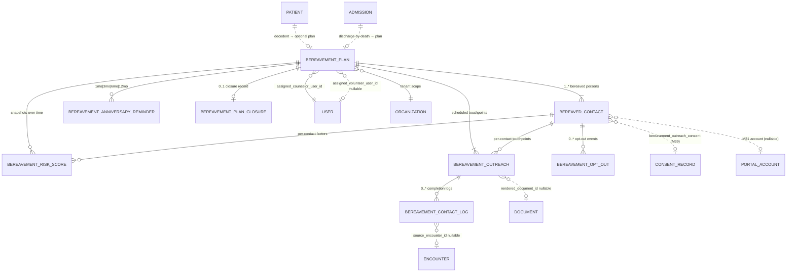
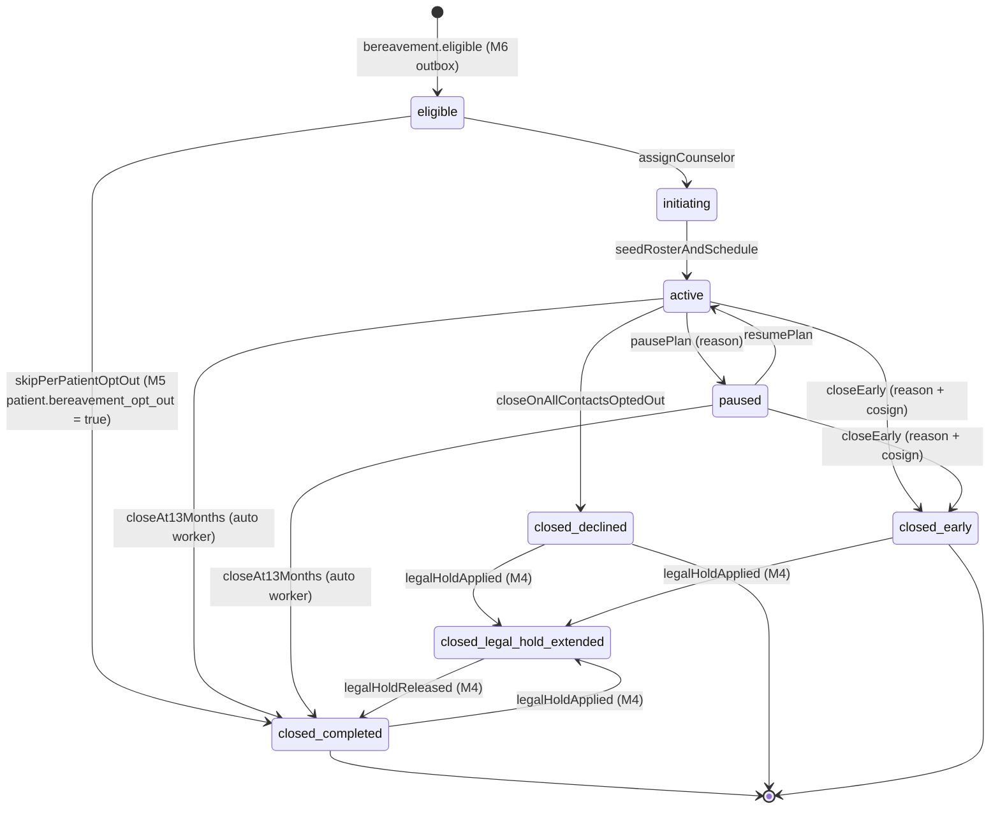
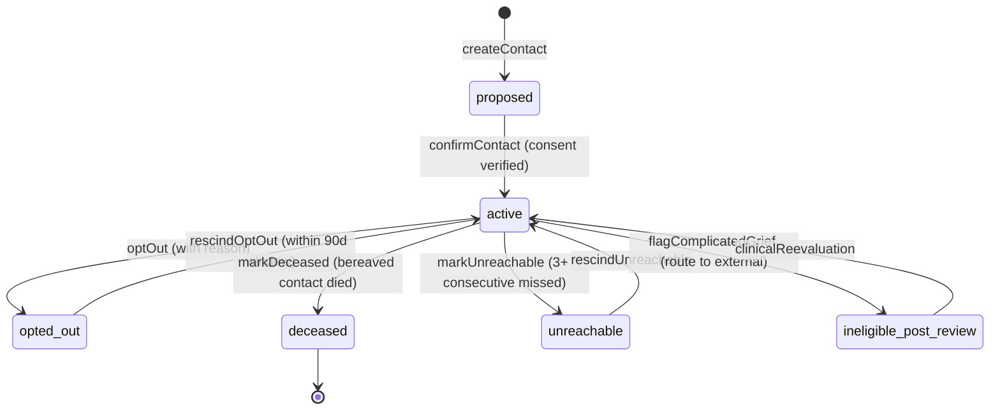
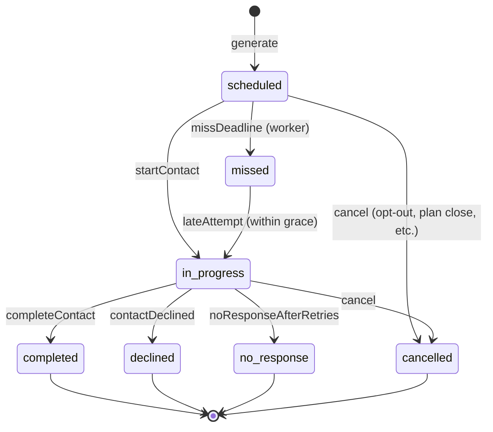

# Module 16 — Bereavement Specification

**Spec version:** v0.5 — the §4.4 outbox events migrated to the `m16.` namespace
(`m16.bereavement.*`) per M01 D8 / M03 D9; consumer refs updated (M22/M31/M33/M36). The §8.1
audit actions already conformed (`m16.bereavement.<resource>.<verb>`) and are unchanged.
Permission keys (`bereavement.read`, `bereavement.plan.assign_counselor`, …), seam methods, and
schema/field identifiers are unchanged (separate, feature-prefixed namespaces). (Prior: v0.4.)

**Module ID:** 16
**Phase:** 2 (operational-depth tier — the build can begin as soon as M5/M6/M36 are locked; the **M32-augmented risk-scoring** half of D2 activates only when M32 lands, exactly the pattern M9 used with `ScaleSeriesProvider`)
**Owns:** `apps/backend/src/modules/16-bereavement`, `packages/domain/bereavement`, the bereavement plan + bereaved-contact + contact-log spine, the 13-month death-anchored schedule, the deterministic risk scorer, and the three published seams.
**Depends on:** 1 (Foundation — `packages/db`, `packages/tenancy`, `withOrgContext`, RLS generator, `audit()` helper, outbox helper, idempotency, BullMQ on Valkey, error envelope, per-tenant DEK envelope-encryption helper for `contact_notes_cipher`), 2 (Identity — counselor/volunteer/staff actor resolution; per-portal-user notification preferences attach to the M2 user; M2 funeral magic-link is explicitly **not** how bereavement contacts authenticate — bereaved family portal sessions are M31 + M39 grants), 3 (Authorization — `bereavement.*` permission keys; the `bereavement_window` ABAC predicate this module **implements** (M3 declares it; M16 registers the resolver); the `discipline_can_provide_bereavement` ABAC predicate this module **registers**; the `volunteer_gates_satisfied` predicate this module **consumes**), 4 (Audit — write-audit trigger generator with per-table denylist (§7.6), `auditRead()` helper, destruction-cert workflow + `eraseFn` registration under the **`clinical_record`** retention class (M16-F01/ADR-0004: bereavement program records are records of care — 7 years from last patient contact, state-extended; the "13 months" is a **program/display window**, never a retention class), legal-hold tombstone propagation), 5 (Patient — `patient` row (decedent state — `patient.status = 'deceased'`), `caregiver` / `patient_caregiver` / `emergency_contact` rows seeding the initial bereaved-contact roster, the `patient.bereavement_opt_out` flag that prevents plan creation per D9, the deceased-date helper), 6 (Admission — the `m6.bereavement.eligible` outbox event is M16's primary intake (W-IN-01); `m6.admission.discharged` with `reason='death'` triggers the bereavement-eligibility rule M6 owns; the `source` discriminator on `m6.bereavement.eligible` (`internal_clinician_recorded` | `hl7_external`) and the `m6.discharge.cosigned` medical-director-attestation event drive the external-source plan-creation branch (D16) and the counselor first-contact cosign gate (D18); M16 does not poll M6, it subscribes), 8 (Encounters — `bereavement_contact` encounter type; see "Consumed by"), 9 (Assessments — `ScaleSeriesProvider` for pre-death PPS / ESAS-r trajectory feeding the deterministic risk rubric, and the future complicated-grief PG-13 / IPG-R scales feeding the M16 risk score as a forward seam), 15 (Psychosocial — `MswRiskFactorReader` for MSW psychosocial risk factors feeding the deterministic risk rubric, with the SUD-disclosure SQL filter respected), 22 (Documents — `m16.bereavement.outreach_artifact_requested` outbox event drives M22 PDF rendering of sympathy cards, anniversary letters, and the bereavement-summary closeout document; M22 stores under retention class `clinical_record`; back-references the `document_id` on the M16 outreach row; the M22 death-certificate artifact is consulted when a tenant tightens the external-source gate per D18), 32 (AI Platform — `packages/ai-platform` SDK for the Layer 2 LLM risk-narrative invocation), 36 (Messaging — the `bereavement` channel kind (M36 §3.3) with 13-month pre-computed `archives_at`; M16 owns the plan lifecycle, M36 owns the channel; the `BereavementPlanProvider` seam (§4.6) is what M36's `recipient_resolver = 'bereavement'` and channel-member auto-sync consume), 38 (Terminology — relationship-to-decedent value set, language ISO-639, complicated-grief screening items LOINC codes when M9 PG-13 / IPG-R land later), 39 (Consent — `family_caregiver_access` and `bereavement_outreach_consent` consent records gate per-contact outreach; `42_cfr_part_2_release` consent is consulted when SUD-flagged content appears in the decedent's chart and is referenced in bereavement context; consent revocation cascades into the bereavement contact's outreach schedule per §2.6), 40 (MDM — `discipline` taxonomy (Bereavement Counselor, MSW, Chaplain, Bereavement Volunteer) drives counselor eligibility; `external_grief_resource` MDM catalog for referrals; the source-facility resolution for external-source plan metadata (D16))
**Consumed by:** 8 (Encounters — `bereavement_contact` encounter type writes both an M8 clinical note **and** triggers M16's `bereavement.encounter_recorded` listener that appends a `bereavement_contact_log` row with `source_encounter_id`; M8 owns the narrative, M16 owns the schedule), 22 (Documents — see "Depends on"; cited bidirectionally because M22 also issues the rendered document back as `m22.document.rendered` which M16's outreach row consumes), 28 (FHIR Gateway — bereavement plan projected as FHIR R4 `CarePlan` with `category='bereavement'` and `intent='proposal'`; bereaved contacts as `RelatedPerson`; outreach as `CommunicationRequest`/`Communication`; the LOINC-bound complicated-grief screening items as `Observation` when those scales land in M9), 30 (HQRP & Quality — bereavement-services compliance dashboard reads M16's `BereavementPlanProvider` and `BereavementOutreachProvider` seams; the CoP 418.64(d) "up to 1 year" coverage rate is a measure; the future CAHPS Hospice decedent-caregiver survey (M30's vendor integration) is **operationally adjacent** but not gated on M16 — CAHPS samples from M6 discharge-by-death, not from M16's plan; the HQRP "bereavement-risk-screening-completeness" measure denominator filters on `data_completeness != 'minimal'` per D17), 31 (Patient/Family Portal — bereaved family portal subset (architecture §H "Bereaved Family Member — One deceased patient, 13-month window") authenticates via M31, with scope set by M39 `family_caregiver_access` consent active at time of death (or post-death grant per §2.6 D9); M31 calls M16's `bereavement.bereaved_contact_for_portal_session` lookup), 32 (AI Platform — `BereavementRiskFactorsProvider` seam consumed by the rule+LLM hybrid risk model (architecture §10 capability inventory); the seam ships now, the model lands when M32 enables it — analogous to how M9 published `ScaleSeriesProvider` before M32 existed), 33 (Reporting — counselor caseload distribution, outreach completion rate, risk-tier distribution, plan-closure-reason distribution), 36 (Messaging — see "Depends on"; cited bidirectionally because M36 consumes M16's `m16.bereavement.plan_opened` / `bereavement.plan_closed` events to open/archive the channel)
**Spec status:** Re-locked v0.5 (Phase-6 per-spec reconciliation; supersedes Locked v0.4) — counter-signed with M14 on the bereavement-risk-flag seam

## Remediation Changelog — Phase 6 reconciliation (v0.5, 2026-06-11)

Full disposition of every `audit/AUDIT_M14_M16.md` Module-16 finding (1 BLOCKER / 7 MAJOR / 8 MINOR).
This is a per-spec **build reconciliation**: the schema, workflow, event catalog, and permissions are
unified to one truth, the illegal DDL is fixed, and every dangling seam is reconciled — so the spec
passes `arch:fitness` (checks 10/12) and is genuinely re-lockable.

| Finding | Sev | Resolution |
|---|---|---|
| **M16-F01** | BLOCKER | The invented **`bereavement` 13-month retention class is struck**; all eight program tables are assigned to **`clinical_record`** (7 yr from last patient contact, state-extended — ADR-0004), matching the eraser's already-correct `dataClass: 'clinical_record'`. The "13 months" is the **program/display window** only (channel `archives_at`, plan active period), never a destruction clock — these records back CoP 418.64(d) survey review and 0942 revenue lines (header, §3.4.1 migration, §6.x). |
| M16-F02 | MAJOR | dependsOn reconciled to the manifest under ADR-0005: foundation helpers (1–4) reached via `FOUNDATION_HELPER_PACKAGES` (no edge), outbox/seam consumption (M5/6/8/9/15/22/32/36/38/39/40) needs no edge; the invented `phase` manifest field dropped; the leaf claim on `packages/domain/bereavement` removed (types only); the invented `m17.shift_changed` consumption removed; `m4.legal_hold.applied/released` consumed via the registered M4 channel. |
| M16-F03 | MAJOR | **The M14→M16 `bereavement_risk_flag` seam is reconciled** (ADR-0023): M16 consumes `m14.idg.decision_recorded` (`kind='bereavement_risk_flag'`) feeding the D8 event-triggered reassessment; M14 is consumed via outbox (no import edge). The dangling forward seam now has a real consumer. |
| M16-F04 | MAJOR | **Activation timeliness enforced:** the 14-day initial-contact floor is measured from **`death_date`** (not activation); a platform-floor **activation clock** escalates via M36 at death+5/+10 days for plans not yet `active`, and a **cosign-pending SLA** escalation closes the "indefinitely-frozen plan" gap (§2.2, §4.9). |
| M16-F05 | MAJOR | **Schema⇄workflow drift reconciled:** added the `bereavement_assignment` history table (backing `BereavementAssignmentReader`), the `amendment_kind/reason/amended_from_score_id` columns on `bereavement_risk_score`, and `family_visible_note`/`delivered_at` on `bereavement_contact_log`; unified the scoring scale to a single 0..40 integer with tier thresholds; resolved phone-with-conversation classification; D13 "three seams" corrected to the actual count. |
| M16-F06 | MAJOR | The LLM risk-narrative capability **registers in M32's catalog** with risk class (clinical-adjacent, Medium+), the §5 lifecycle staging, per-backend calibration thresholds, a named kill-switch, "Report this output", tenant opt-in, **AI-044/045 prompt minimization**, and the **BAA+ZDR-executed activation gate** (ADR-0012). Deterministic tier stays the source of truth; the LLM cannot change it. |
| M16-F07 | MAJOR | All ten BullMQ queues declare the SD-059 tuple (priority/attempts/backoff/concurrency/**DLQ**); job idempotency described correctly as **worker-side state checks** (SD-060), not the HTTP idempotency middleware (ADR-0021). |
| M16-F08 | MAJOR | STRIDE threat model + a role×action authz test matrix added (portal self-service by grieving family, volunteer reduced-scope, decedent post-death PHI, survivor contact data) — ADR-0021. |
| M16-F09 | MINOR | Route namespace normalized **`/api/m16/bereavement/...` → `/api/v1/bereavement/...`** (SD-049). |
| **M16-F10** | MINOR | **Illegal CHECK subquery fixed** (ADR-0022 D1.2): `death_date` denormalized onto `bereavement_outreach`; the ceiling CHECK is now a local-column comparison (no subquery); off-by-one `425 → 426`. Passes `check-ddl-legality`. |
| M16-F11 | MINOR | Consent gated at **`startContact`/render-request** (not completion) to catch in-flight opt-outs; survivor email routed through M36 with a per-message unsubscribe affordance feeding the opt-out cascade (CAN-SPAM/INT-032). |
| M16-F12 | MINOR | Channel `archives_at` standardized on **`death_date + 13 months`** (not `opened_at`) everywhere. |
| M16-F13 | MINOR | Migration no longer directly INSERTs M1/M4 tables — `retention_assignment`/`outbox_topic` rows are contributed via the owners' registration APIs (ADR-0011); RLS variable `app.organization_id → app.org_id` (ADR-0010); eraser path corrected to the §3.1 codePath. |
| M16-F14 | MINOR | A single **normative touchpoint-floor table per tier** is published and referenced everywhere (resolving the three incompatible statements). |
| M16-F15 | MINOR | Unit coverage target raised to **≥90%** (ARCH-211); **DR Tier 4** declared with cron catch-up semantics after downtime for `m16-close-13mo` / `m16-miss-deadline` (ADR-0021). |
| M16-F16 | MINOR | The four citations corrected: IPOC bereavement → 418.56(c); coordination → 418.56(e); decedent 50-yr PHI → §164.502(f); bereavement personnel → 418.64 / 418.114. |

**Net:** M16's BLOCKER is cleared, the illegal DDL is fixed (CI-verifiable), the seam pair is
reconciled, and the schema/workflow/event/permission story is unified — the spec is re-lockable.

## Changelog

- **v0.4 (Consolidated)** — Rolls the v0.2 base and v0.3 delta into a single self-contained specification. No scope change; no decision reversals.
- **v0.3 (Locked)** — Closes the downstream impact of M6 v0.3 W-M6-31 (death-discharge recorded from external HL7 notification). The earlier model assumed every `m6.bereavement.eligible` derives from a hospice-clinician-recorded death; v0.3 ratifies the path where the death comes from an external ADT message and certain clinical context is unknown: **External-source eligibility recognition** — M6's W-M6-31 adds a `source` discriminator on `m6.discharge.death` (and the derived `m6.bereavement.eligible`) with values `internal_clinician_recorded` (the hospice clinician witnessed and recorded the death) and `hl7_external` (an inbound ADT cancel-admit or death notification from an external facility was the trigger); M16's `m6-eligibility.worker` reads the field and branches the plan-creation path — internal-source keeps the prior behavior end-to-end while external-source creates the plan with `status='eligible'` AND `external_source_metadata` JSONB capturing the source facility, M29 proposal ID, and sourceMessageId for surveys traceability. **Suppressed counselor outreach pending medical-director cosign** — an external-source death-discharge is in a "pending medical director attestation" state until the cosign lands; the counselor-onboarding workflow does NOT auto-progress past `eligible` until M16 receives the corresponding `m6.discharge.cosigned` event; the plan IS visible on the coordinator's "Awaiting assignment" queue with a banner, coordinators can pre-assign the counselor, but the counselor's first-contact button is gated; tenants may TIGHTEN to require additional verification before unlock. **Risk scoring with partial data** — external-source deaths frequently lack cause of death, witnessed-death status, and time-since-decline trajectory; a `data_completeness` field on `bereavement_risk_score` lets the scorer mark factors-with-unknown-input as `unknown` (not `false`), and the overall score carries a confidence band. Adds decisions D16–D18, workflow acceptance criteria W-M16-09 through W-M16-11, and implementation tasks T-M16-17 through T-M16-19. No D1–D15 reversals; plan lifecycle, schedule math, opt-out model, and M8 boundary unchanged. The 13-month death-anchored schedule (D4) still anchors on `death_date` from whichever source provided it.
- **v0.2 (Locked)** — Initial publication at lock-grade. Instantiates the architecture §20.B module spec template. Resolves all fifteen open questions into binding decisions (§11). Defines the **shared `bereavement_plan` row + per-contact `bereaved_contact` row + per-touchpoint `bereavement_contact_log` row tripartite shape** (D1), the **explicit XState lifecycle machine** with the eight-state graph including `eligible` (post-intake-pre-counselor), `initiating`, `active`, `paused`, `closed_completed`, `closed_declined`, `closed_early`, and `closed_legal_hold_extended` (D2), the **rule-deterministic-now / LLM-augmented-later risk scoring** with the platform-floor + tenant-tighten-only weight policy (D3), the **death-date-anchored 13-month schedule math** (not discharge-date; D4) with the platform-floor minimum touchpoint set (initial ≤14d, 1mo, 3mo, 6mo, anniversary 12–13mo) and tenant-may-tighten-not-loosen rule, the **`discipline_can_provide_bereavement` ABAC predicate** registered with M3's named-predicate registry (D5), the **per-bereaved-person consent + opt-out model** with M39 `bereavement_outreach_consent` as the source of truth and a per-plan opt-out only closing the plan when ALL bereaved contacts opt out (D6), the **13-month auto-close worker + early-close cosign workflow** (D7), the **scheduled risk reassessment at intake / 1mo / 6mo / 12mo + event-triggered reassessment** model (D8), the **two-level opt-out** (M5 patient-level pre-death bereavement-opt-out prevents creation; per-contact post-creation opt-out closes the contact's outreach but not the plan) (D9), the **bereavement-volunteer first-class participation with reduced PHI scope** (D10), the **denylist scrub of `contact_notes_cipher`-source fields in audit trigger output** (`contact_notes`, `risk_narrative`, `decline_reason`, `complicated_grief_indicators_free_text`) (D11), the **`bereavement_contact_log` monthly-partitioned by `contact_at`** matching M4's PHI-table conventions, with `bereavement_plan` / `bereaved_contact` / `bereavement_risk_score` / `bereavement_outreach` / `bereavement_anniversary_reminder` / `bereavement_plan_closure` / `bereavement_opt_out` non-partitioned (D12), the **`BereavementPlanProvider` + `BereavementOutreachProvider` + `BereavementRiskFactorsProvider` seams published for M28 / M30 / M31 / M32 / M33 / M36 consumption** (D13), the **outbox-only handoff to M22 for outreach-artifact PDF rendering** (D14), and the **explicit M8 boundary**: in-person bereavement contacts are M8 `bereavement_contact` encounters with the narrative; M16 listens to `m8.encounter.signed` (filtered) and appends a `bereavement_contact_log` row with `source_encounter_id`; phone, letter, card, email contacts are written directly to M16 with `source_encounter_id IS NULL` (D15). Wires the permission keys this module registers into Module 3 (§4.7), the BullMQ queue catalog (§4.9), the M36 typed-alert payloads (§4.10), and the destruction `eraseFn` registered with Module 4 (§8.4). Includes a **proposed manifest patch** (§12, last task) updating `M16.dependsOn` from `[5, 6, 36]` to `[5, 6, 8, 9, 22, 36, 38, 39, 40]` — the prior encoding (a) was missing `22` despite M16 emitting `m16.bereavement.outreach_artifact_requested` to M22, (b) was missing `38` despite M16 referencing the relationship value set, (c) was missing `39` despite M39 owning the per-contact consent gate, (d) was missing `40` despite the discipline taxonomy and external-grief-resource MDM catalog being consumed, (e) was missing `8` despite M16 subscribing to `m8.encounter.signed`, and (f) was missing `9` despite the future complicated-grief PG-13 / IPG-R scales feeding the M16 risk score (forward seam — the column is nullable until those scales land in M9). The M11 lock established the precedent of explicitly stating "consumer carries the dep on the data-owner"; this patch applies it.
- **v0.1** — Drafted within the lock-grade pass; not separately published.

> **Phase boundary (binding):** Phase 2 delivers everything in this spec **except** the M28 FHIR `CarePlan` / `CommunicationRequest` projections (Module 28 owns; M16 emits the typed mapping today via outbox), the M32 LLM-augmented risk scoring (Module 32 owns; M16 publishes `BereavementRiskFactorsProvider` and ships the deterministic rule scoring per D3 today — analogous to how M9 published `ScaleSeriesProvider` before M32 existed), the M22 sympathy-card / anniversary-letter PDF templates (Module 22 owns the rendering; M16 emits `m16.bereavement.outreach_artifact_requested` with the typed payload), and the M9 complicated-grief PG-13 / IPG-R scales (Module 9 will add them when the scale-discipline matrix expands — M16's `risk_factors_jsonb` carries a nullable `pg13_score` / `ipgr_score` column today as a forward seam). The "done" gate for M16 is: the eight-table schema with TypeBox-validated `risk_factors` and `outreach_schedule_policy` discriminated unions, the XState plan-lifecycle machine driving every transition, the death-date-anchored schedule generator with platform-floor enforcement, the deterministic risk scoring, the per-contact consent + opt-out enforcement, the M8 `bereavement_contact` encounter subscriber, the 13-month auto-close worker, the anniversary-reminder cron, the three outbound seams registered at boot, the `bereavement_window` ABAC resolver registered with M3, the M36 alert payloads, the eraseFn registered with M4, and the test plan green — not gated on Modules 28/30/31/32/33 existing. The M30 / M31 / M32 / M33 consumers are wired through the seam registry; their absence today is a deny-stub on read by design.

-----

## 1. Purpose & Scope

### 1.1 What This Module Does

Module 16 owns the **13-month bereavement program** — the obligation 42 CFR 418.64(d) places on every hospice to provide bereavement services to the spouse, partner, family, and other individuals identified in the plan of care for **up to 1 year following the death** of the patient. The architecture deliberately separates this from clinical hospice care (M6/M7/M8) because the regulatory clock, the participants, the consent model, the audit retention, and the operational cadence are all distinct from any pre-death module:

- **Bereavement plan root.** One `bereavement_plan` per decedent-admission, created by the M6 `bereavement.eligible` outbox subscriber. The plan carries the death date (the schedule anchor — D4), the assigned bereavement counselor, the assigned bereavement volunteer (optional), the plan's risk-tier (computed from initial assessment — D3), and the lifecycle state (D2). The plan **outlives the patient by design**; it is one of the very few records that continues active write activity after `patient.status = 'deceased'`.
- **Bereaved-contact roster.** `bereaved_contact` rows enumerate the individuals the program is for: typically the primary caregiver, the spouse/partner, identified family members from M5's `caregiver` / `patient_caregiver` / `emergency_contact` seeding, plus contacts added post-death by the counselor (children who weren't on the care team, an estranged sibling who surfaces at the funeral, a long-time friend named in the will). Each contact has its own M39 `bereavement_outreach_consent` record, its own opt-out state (D6), its own risk-factor jsonb feeding D3, and — when the contact has a portal account — its own M31 session scope. **Each bereaved person is a first-class record**, not a denormalized list on the plan.
- **Risk scoring — deterministic now, LLM-augmented later.** D3 binds the model to a platform-floored weight scheme over the eight evidence-based bereavement-risk factors: ambivalent relationship to decedent, sudden/unexpected death, prior unresolved loss, pre-existing mental health condition, social isolation, financial strain, primary caregiver role, and active substance use. The deterministic scoring ships now and is **server-authoritative** (the UI shows the score but never computes it; mirrors the M9 D6 pattern). The M32 LLM augmentation reads the same factors plus a counselor-curated free-text narrative through the `BereavementRiskFactorsProvider` seam; the rule score and the augmented score are stored in separate columns so the augmentation is auditable and reversible.
- **Outreach schedule — platform floor + tenant tighten.** D4 fixes the schedule math to the **death date** (not the discharge date — they're usually equal but a delayed discharge filing must not slip the bereavement clock). The platform floor mandates: initial contact within 14 calendar days, then touchpoints at the 1-month, 3-month, 6-month, and anniversary (between 12 and 13 months) marks; high-risk contacts get an additional 9-month touchpoint and the 1-month touchpoint becomes 2-week-on-2-week-off for 8 weeks. Tenants may tighten the cadence (more contacts) but not loosen it; the same `tenant_policy.tighten_only` invariant used in M9 D2 and M11 D3.
- **Channel mix.** A bereavement touchpoint can be a phone call, an in-person visit, a sympathy/anniversary card, a letter, an email, a portal message, or a group support invitation. The decision of **which kind for which touchpoint** is per-contact (consent + preference driven) and per-risk-tier (high-risk gets more in-person, low-risk gets more letters and digital). The full kind enum is in §3.2; the consent matrix is in §6.
- **The M8 boundary (D15).** In-person bereavement contacts are clinical encounters and live in M8 with `encounter_type='bereavement_contact'`; M16 owns the schedule and listens to `m8.encounter.signed` to append a `bereavement_contact_log` row with `source_encounter_id` set. Phone / letter / card / email / portal-message contacts are **not** M8 encounters — they're written directly to M16 with `source_encounter_id IS NULL`. This split is binding: it means the M8 HearthNote template applies for in-person (because regulators expect a clinical narrative for visits) but not for the bulk-mailed condolence card.
- **External-source death-discharges.** When M6 records a death from an inbound HL7 ADT notification (per M6 W-M6-31), the resulting `m6.bereavement.eligible` event carries `source='hl7_external'`. M16's eligibility worker creates the bereavement plan with `external_source_metadata` capturing the source facility + M29 proposal ID for surveys-readiness traceability, and gates the counselor first-contact behind the corresponding `m6.discharge.cosigned` medical-director attestation (D16, D18). The 13-month schedule (D4) still anchors on the death date (which the external ADT carries); only the counselor-outreach gate differs. The deterministic scorer handles the partial data such deaths frequently carry — unknown factors are marked `unknown` rather than `false`, and the score carries a confidence band (D17).
- **Anniversary reminders.** D4's schedule produces `bereavement_anniversary_reminder` rows at the 1-month, 3-month, 6-month, and anniversary marks; the cron worker (§4.9) wakes daily, looks ahead 14 days, and emits an M36 `clinical_routine` alert to the assigned counselor and a `clinical_routine` to the assigned volunteer (if any).
- **Counselor caseload.** Bereavement counselors have their own caseload — disjoint from the pre-death clinical caseload (per architecture §11.E role definition, the Bereavement Counselor role is distinct from MSW even though the same person frequently holds both). The counselor is assigned at plan-open by an admin (or auto-assigned by round-robin via the `BereavementCounselorAssignmentPolicy`); the counselor is the actor that the `bereavement_window` ABAC predicate (M3 §4.2) admits to the bereaved contact's record post-death.
- **Plan closure — three completed paths plus legal-hold extension.** D7 binds closure to: `closed_completed` at death_date + 13 months (auto by worker); `closed_declined` when all bereaved contacts have an active opt-out and no future-scheduled touchpoints remain; `closed_early` requiring clinical-supervisor cosign + reason (operational paths: tenant offboarding, all bereaved contacts deceased, geographic relocation outside service area, etc.); `closed_legal_hold_extended` for M4 legal-hold tombstone propagation (the plan archives normally but the data is retained beyond 13 months — see §7.7 eraseFn behavior).
- **Two-level opt-out (D9).** The patient-level **bereavement opt-out** (a column on the M5 `patient` row, set pre-death by the patient or their legal representative) prevents M16 from creating a plan at all — the `bereavement.eligible` event from M6 is acknowledged and discarded with an audit row and a final emitted `m16.bereavement.plan_skipped_per_patient_opt_out` event. The per-contact opt-out (set post-creation per bereaved person) closes that contact's outreach schedule and bars all future touchpoints to them, but does not close the plan if other bereaved contacts remain engaged.
- **Volunteer-first-class participation (D10).** Bereavement volunteers (architecture §G "Bereavement Volunteer" role) are a first-class counselor type with all the M2 §7.7 volunteer gates (`volunteer_gates_satisfied`) enforced. They have reduced PHI scope: they can read the bereavement plan, the bereaved-contact roster, the contact log entries they themselves authored, the M22 outreach artifacts, and the assigned-volunteer-only fields of `bereaved_contact`. They **cannot** read the decedent's clinical history, the M8 encounter content (other than the M8 bereavement_contact narratives they themselves authored), the M9 assessments, or the M7 care plan.
- **Outbound seams: three published.** `BereavementPlanProvider` (M28 / M30 / M31 / M33 / M36 consume), `BereavementOutreachProvider` (M30 dashboards, M33 reporting), `BereavementRiskFactorsProvider` (M32 risk-model consumes; M30 risk-tier distribution chart consumes). Each is a typed TypeScript interface in `packages/domain/bereavement/`; M16 implements each in its boot wiring; M3's boot-validator runs a deny-stub if not registered (the same seam-registry pattern M5 established for `CaseloadProvider`).
- **The `bereavement_window` ABAC predicate this module implements.** M3 §4.2 declared this predicate at lock; it returns true when "target patient is in 13-month bereavement and actor is the assigned counselor". M3 reserved the slot in its named-predicate registry; M16's boot wiring registers the resolver function. Until M16 ships, the predicate is a deny-stub (M3 boot-validates this in dev/test/preview but not in prod — preview shows "needs M16" in red).

### 1.2 What This Module Does Not Do

This list is binding. Every item here is owned by another module and reached via repository call, outbox event, or the explicit cross-module seams in §4.5.

- **Decedent demographics, the M5 `patient` row, the bereavement-opt-out flag itself.** Module 5 owns the patient row and the pre-death opt-out flag. M16 *reads* the M5 row (via the M5 repository, not direct schema import) to seed the bereaved-contact roster and to honor the opt-out.
- **The clinical encounter narrative for in-person bereavement visits.** Module 8 owns `encounter_type='bereavement_contact'`. M16 owns the schedule; M8 owns the note. D15 binding.
- **The PDF / mailed artifact for letters, sympathy cards, anniversary mailings, and the bereavement-closeout summary.** Module 22 owns the rendering, storage (retention class `clinical_record` per M4), watermarking, and the print-vendor handoff if the tenant has one wired. M16 emits the typed payload (D14) and stores the `document_id` back-reference.
- **The realtime communication channel for counselor↔family messaging.** Module 36 owns the `bereavement` channel kind (M36 §3.3, retention class `clinical_record`, pre-computed `archives_at = death_date + 13 months` — M16-F12: the channel display window anchors on **death_date**, never `opened_at`, so a late-opened plan cannot hold the channel past the program window). M36 consumes M16's plan-open / plan-close events to create / archive the channel. M16 does not own message bodies, delivery, or read receipts.
- **The portal session for bereaved family members.** Module 31 owns the Patient/Family Portal. Bereaved family portal scope is granted via M39 `family_caregiver_access` consent active at time of death, or via a post-death grant per the §2.6 D9 cascade. M31's session minter calls M16's `bereaved_contact_for_portal_session` lookup to bind the session to the contact's plan; M16 does not authenticate, does not session.
- **The risk-scoring LLM call itself.** Module 32 owns model selection, prompt management, cost tracking, calibration, and the LLM provider call. M16 publishes the `BereavementRiskFactorsProvider` seam and stores both the deterministic and (when M32 lands) the augmented score. M16 does not import `@anthropic-ai/sdk` or any LLM client.
- **The CAHPS Hospice decedent-caregiver survey.** Module 30 owns the vendor integration and the survey lifecycle. CAHPS samples from M6's discharge-by-death event independently of M16; the survey is **not** a bereavement touchpoint and does not satisfy any CoP 418.64(d) requirement.
- **The decedent's death certificate, the body release authorization, the funeral-home magic-link portal session.** Modules 22 and 2 (funeral magic-link is M2's pattern). Decoupled by design from bereavement program records. (When a tenant tightens the external-source gate to require a death-certificate copy per D18, M16 consults M22 for the artifact's presence but does not own it.)
- **The external grief-counseling referral catalog itself.** Module 40 owns the canonical `external_grief_resource` MDM catalog (community grief groups, denominational pastoral care lists, child-bereavement camps, complicated-grief specialist registries). M16 references those rows by FK and stores per-referral context (date offered, accepted / declined, follow-up status) — the catalog itself is curated in M40 by Compliance / Quality.
- **The general "incident report" or "complaint" workflow if a bereaved family complains.** Module 30 owns the complaint / incident workflow (`m30.incident.submitted`). M16's role is to flag the contact's `risk_factors_jsonb.complaint_filed = true` and trigger a reassessment per D8; the complaint record itself is M30's.
- **The eligibility decision and the `source` discriminator.** Module 6 decides bereavement eligibility and stamps the `source` (`internal_clinician_recorded` | `hl7_external`) on the event. M16 consumes the resulting event and branches on the field; it does not decide eligibility.
- **Decide authorization.** Module 3 decides; Module 16 declares permissions (§4.7), exposes ABAC attributes (`bereavement_window`, `discipline_can_provide_bereavement`), and obeys the answer.

### 1.3 Regulatory Drivers

| Driver | Requirement | How Module 16 satisfies it |
|---|---|---|
| **42 CFR 418.64(d)** — Counseling services | Hospice must make bereavement services available to the family and other individuals in the bereavement plan of care; bereavement counseling consists of an organized program provided under the supervision of a qualified professional; bereavement services may be made available to spouse, partner, family, and other individuals identified in the plan of care **for a period of up to 1 year following the death of the patient** | `bereavement_plan` opens automatically on `m6.bereavement.eligible`; 13-month duration enforced by the death-date-anchored schedule (D4); supervised-by-qualified-professional captured via the assigned counselor's M40 discipline + license; "up to 1 year" is the platform floor that tenants may extend (to the M4 state-retention-override ceiling) but not shorten |
| **42 CFR 418.56(b)(3)** — IPOC bereavement plan | The interdisciplinary group must develop an individualized written plan of care for the patient and family; the plan must specify the bereavement services that will be provided to the family | M7 IPOC writes the per-patient bereavement-services intent; on `m6.bereavement.eligible`, M16's bereavement_plan inherits the IPOC's `bereavement_intent_summary` (M7 emits it in the `m7.care_plan.discharged` payload — see M7 §2.4 event catalog); the plan is the operational instance of that intent |
| **42 CFR 418.3** — Definition of bereavement | "Bereavement counseling means emotional, psychosocial, and spiritual support and services provided before and after the death of the patient to assist with issues related to grief, loss, and adjustment" | Bereavement counseling provided **before** death is recorded in M8 encounters during the active admission (typically MSW or Chaplain); bereavement counseling provided **after** death is what M16 owns. The schema makes this split explicit: M16 only opens a plan on `bereavement.eligible`, never before |
| **42 CFR 418.74** — Personnel | Bereavement counselors must be qualified per the hospice's policy; the program must have a coordinator | `discipline_can_provide_bereavement` ABAC predicate registered with M3; eligible disciplines (Bereavement Counselor, MSW, Chaplain) from M40 taxonomy; volunteer bereavement contacts are subject to M2 §7.7 `volunteer_gates_satisfied` (background, TB, confidentiality agreement, training); the bereavement-program-coordinator role is captured as the tenant-configured `bereavement_program_coordinator_user_id` (M2 setting), not a per-plan attribute |
| **HIPAA §164.510(b)** — Disclosures for involvement in care | A covered entity may disclose to a family member, friend, or other person identified by the individual the protected health information directly relevant to such person's involvement with the individual's care or payment related to the care | Pre-death disclosures are governed by M39's standard consent surface; **post-death** disclosures to bereaved family members are governed by M39's `bereavement_outreach_consent` consent type (per-contact, per-bereaved-person), which is the source of truth M16 consults on every outreach. PHI in outreach materials is minimized — sympathy cards carry no clinical content; anniversary letters carry the decedent's name and the program contact only |
| **HIPAA §164.502(g)(4)** — Personal representatives of deceased individuals | For at least 50 years following the death of an individual, a covered entity must comply with the requirements of this subpart with respect to PHI of the deceased; a covered entity must treat as a personal representative an executor, administrator, or other person with authority to act on behalf of the deceased or the estate | The M5 row remains `compliance` retention (≥6 years; state-extended where applicable; HIPAA-decedent-50-year aware via M4 retention class); M16's bereaved_contact does **not** assume executor authority — only the M39 `personal_representative_authority_post_death` consent record (M39 owns this) admits an actor to PHI on behalf of the deceased. M16's per-contact roles are `family_member` / `spouse_partner` / `caregiver` / `friend` / `clergy` / `other` and carry no representative-authority assumption |
| **CoP 418.106(c)** — Coordination with primary providers | Coordination with the decedent's pre-death care team for continuity of bereavement messaging | The bereavement counselor is named on the plan; M16's plan_opened event fans into the M36 `bereavement` channel which is membered by the assigned counselor, the assigned volunteer (if any), and the bereaved family contacts who have an active portal session with the consent grant; the pre-death case team is **not** automatically a member (D10 implication — clinical-care-team membership ends at discharge per M5 §1.2) |

### 1.4 Competitive Context

Most hospice EHRs treat bereavement as a checkbox at discharge: "did the family get the bereavement packet — yes/no" and a flat list of touchpoints with no risk stratification, no consent-per-contact, no portal continuity, and no audit trail you can hand to a surveyor. FireNote / WellSky / Axxess all have a bereavement module by name, but the integration with the pre-death record is thin: separate worklist, separate inbox, separate person on the team, and the family experience is "stop hearing from the agency in 30 days because no one remembered the 90-day touchpoint."

WardenX wins three ways the others structurally cannot:

1. **The portal continuity.** M31 + M39 + M36 means the bereaved spouse who had a portal account during the patient's care keeps the same login post-death, scoped to the bereavement context, with the same counselor reachable by message. No re-registration, no second account, no "log into a separate bereavement site." The architecture's choice to make M39 the consent spine and M36 the channel spine — both built before M16 — is what makes this possible without an emergency integration.
2. **The risk-stratified cadence.** D3's deterministic scoring runs at plan open. High-risk contacts get more touchpoints, mostly in-person; low-risk get the floor cadence. When M32 lands and the LLM augmentation activates, the counselor sees both scores and a generated narrative of why — never a black box, always overrideable.
3. **The 13-month auditable closeout.** Every touchpoint is a `bereavement_contact_log` row with full audit; the closeout at 13 months is itself a typed event (`m16.bereavement.plan_closed_completed`) that fans into M22 for the bereavement-summary document and into M33 for the dashboard. When a surveyor asks "show me you provided bereavement services to this family for the full year" the answer is a single query against `BereavementPlanProvider.summarize(planId)`.

The bar isn't "WardenX has a bereavement module" — every EHR has one. The bar is "WardenX has the only bereavement program a HIPAA-trained Compliance Officer would actually defend to a CMS surveyor in 2027." That's what lock-grade for M16 means.

-----
## 2. Domain Model

### 2.1 Entity-Relationship Diagram



The aggregate root is `bereavement_plan`. The `bereaved_contact` rows are the operational unit (consent, opt-out, schedule are per-contact). The `bereavement_outreach` row is the scheduled future intent; `bereavement_contact_log` is the record that the touchpoint happened (or didn't). The split lets a single outreach (e.g., "mail anniversary letter") map to three contact_log rows (one per addressee), with one rendered M22 document referenced by all three logs.

### 2.2 Lifecycle State Machine — `bereavement_plan`

Persistence is the `status` enum on `bereavement_plan` row; transitions occur via service functions that load the aggregate (with optimistic-lock check on `version`), dispatch the event, and commit the new state + side effects in the **same transaction** as the audit + outbox write. Every guard is a typed pre-condition; failure raises `ConflictError` (M1 error envelope) with machine-readable `code`.



| From | Event | To | Guards | Side effects (same tx) |
|---|---|---|---|---|
| (none) | `bereavement.eligible` (M6 outbox) | `eligible` | event idempotency-key not previously processed; M5 `patient.bereavement_opt_out` checked **after** insertion to avoid TOCTOU | insert `bereavement_plan` row with `status=eligible`, `death_date` from event, `admission_id` from event; when the event carries `source='hl7_external'`, also set `external_source_metadata` with `cosignStatus='pending'` (D16); audit; **no** outbox emit yet (plan_opened fires at `active`) |
| `eligible` | `skipPerPatientOptOut` | `closed_completed` | M5 `patient.bereavement_opt_out = true` | insert `bereavement_plan_closure` row with `reason='patient_opt_out_pre_death'`; outbox `m16.bereavement.plan_skipped_per_patient_opt_out`; **do not** open M36 channel |
| `eligible` | `assignCounselor` | `initiating` | actor has `bereavement.plan.assign_counselor`; target user has `discipline_can_provide_bereavement`; for external-source plans the counselor may be pre-assigned in `eligible`, but the first-contact transition stays gated until cosign (D18) | set `assigned_counselor_user_id`, `assigned_counselor_assigned_at`; audit; outbox `m16.bereavement.counselor_assigned` |
| `initiating` | `seedRosterAndSchedule` | `active` | at least one bereaved_contact row exists (seeded from M5 + counselor additions); initial risk score computed; outreach_schedule generated per D4 platform floor; for external-source plans, `external_source_metadata.cosignStatus = 'cosigned'` (and any tenant-tightened preconditions satisfied) before first-contact may proceed (D18) | set `opened_at = now()`; insert `bereavement_anniversary_reminder` rows for 1mo / 3mo / 6mo / anniversary; outbox `m16.bereavement.plan_opened` (M36 creates `bereavement` channel with `archives_at = death_date + interval '13 months'`); outbox `m16.bereavement.outreach_artifact_requested` for the bereavement-welcome-packet M22 render |
| (external-source plan) | `receiveCosign` (`m6.discharge.cosigned`) | (unchanged state) | inbound `m6.discharge.cosigned` matches `external_source_metadata.sourceProposalId` and `cosignStatus='pending'` | update `external_source_metadata` to `cosignStatus='cosigned'`, set `cosignedAt` + `medicalDirectorMembershipId`; audit; outbox `m16.bereavement.external_source_cosign_received` (coordinator UI refreshes, first-contact button unlocks) (D18) |
| `active` | `pausePlan(reason)` | `paused` | reason given; `pause_kind ∈ {operational, family_request, counselor_unavailable_temp}` | cancel future-scheduled outreach (mark `paused`); audit; outbox `m16.bereavement.plan_paused` |
| `paused` | `resumePlan` | `active` | — | regenerate outreach schedule from `now()` forward to `death_date + 13mo`; audit; outbox `m16.bereavement.plan_resumed` |
| `active`/`paused` | `closeAt13Months` (worker) | `closed_completed` | `now() >= death_date + interval '13 months'`; no active legal hold | insert closure row with `reason='thirteen_month_completion'`; outbox `m16.bereavement.plan_closed_completed` (M36 channel auto-archives via its pre-computed `archives_at`; M22 renders bereavement-summary doc) |
| `active` | `closeOnAllContactsOptedOut` | `closed_declined` | every `bereaved_contact.status = 'opted_out'` for the plan | insert closure row with `reason='all_contacts_declined'`; outbox `m16.bereavement.plan_closed_declined` |
| `active`/`paused` | `closeEarly(reason)` | `closed_early` | actor has `bereavement.plan.close_early`; cosign by `clinical_supervisor` required (D7); reason min 40 chars; `early_close_kind ∈ {tenant_offboarding, all_bereaved_deceased, geographic_relocation, family_legal_action, other}` | insert closure row; outbox `m16.bereavement.plan_closed_early` |
| any closed | `legalHoldApplied` | `closed_legal_hold_extended` | M4 legal-hold tombstone for `bereavement` retention class applies to this plan_id | set `legal_hold_id`; audit; **no** outbox emit (M4 owns hold-applied events) |
| `closed_legal_hold_extended` | `legalHoldReleased` | `closed_completed` (or original close-state) | M4 release | clear `legal_hold_id`; audit |

The state machine is implemented in `packages/domain/bereavement/plan-machine.ts` as an XState v5 machine; runtime persistence is the `status` column (the machine is the truth, the column is the snapshot).

### 2.3 Lifecycle State Machine — `bereaved_contact`



| From | Event | To | Guards | Side effects |
|---|---|---|---|---|
| (none) | `createContact` | `proposed` | actor `bereavement.contact.create`; relationship in M38 value set | insert; audit |
| `proposed` | `confirmContact` | `active` | M39 `bereavement_outreach_consent` exists OR contact is the primary caregiver (M5 row, `family_caregiver_access` consent at time of death covers post-death engagement per D9) | set `confirmed_at`; trigger initial risk score; outbox `m16.bereavement.contact_active` |
| `active` | `optOut(reason)` | `opted_out` | reason captured (free text scrubbed per §7.6); written request optional | cancel all future scheduled outreach for this contact; outbox `m16.bereavement.contact_opted_out`; if all contacts opted out, fire `closeOnAllContactsOptedOut` on plan |
| `opted_out` | `rescindOptOut` | `active` | within 90 days of opt-out; actor is the contact (via portal) or counselor with reason | re-generate forward outreach for this contact; outbox `m16.bereavement.contact_opt_out_rescinded` |
| `active` | `markDeceased` | `deceased` | death verified (date + source captured) | cancel future outreach; audit; outbox `m16.bereavement.contact_deceased` |
| `active` | `markUnreachable` | `unreachable` | 3+ consecutive `bereavement_contact_log.outcome = 'no_response'` | counselor reviews; outbox `m16.bereavement.contact_unreachable` |
| `active` | `flagComplicatedGrief` | `ineligible_post_review` | counselor or supervisor identifies complicated grief / suicidal ideation per the screening protocol; **routes to external mental-health resource per M40 catalog**; M16 program ends for this contact | log referral; outbox `m16.bereavement.contact_referred_external`; M36 alert to supervisor (`clinical_urgent`) |

Per-contact closure does **not** close the plan unless it leaves the plan with no `active` contacts (in which case the plan transitions to `closed_declined` per D6).

### 2.4 Lifecycle State Machine — `bereavement_outreach`



| From | Event | To | Notes |
|---|---|---|---|
| (none) | `generate` | `scheduled` | written by schedule generator from D4 platform floor + tenant tighten |
| `scheduled` | `startContact` | `in_progress` | counselor or volunteer initiates a phone call, opens the M8 encounter draft, queues the M22 letter |
| `in_progress` | `completeContact` | `completed` | one or more `bereavement_contact_log` rows inserted; outcome captured |
| `in_progress` | `contactDeclined` | `declined` | bereaved contact declined this specific touchpoint (not full opt-out); future schedule continues |
| `in_progress` | `noResponseAfterRetries` | `no_response` | counter increments toward `markUnreachable` threshold |
| `scheduled` | `missDeadline` | `missed` | worker fires when `due_at + grace_window` passes without state change; M36 alert to counselor |
| `missed` | `lateAttempt` | `in_progress` | within `late_grace` (default 7 days post-due); audit-flagged but not a compliance failure |

### 2.5 Validation Rules

| Rule | Where | Notes |
|---|---|---|
| `bereavement_plan.death_date` must equal the M6 admission's discharge-by-death date | service; cross-module read at plan create | mismatch → 422 `BEREAVEMENT_DEATH_DATE_MISMATCH` |
| `bereavement_plan.assigned_counselor_user_id` must resolve `discipline_can_provide_bereavement` true at assignment time | service; ABAC predicate | discipline taxonomy via M40 |
| `bereavement_plan.assigned_volunteer_user_id` (if set) must resolve `volunteer_gates_satisfied` true | service; ABAC predicate (M3) | gate expiry → counselor sees a warning + reassignment prompt |
| `bereavement_plan.external_source_metadata.cosignStatus` must equal `'cosigned'` (plus any tenant-tightened preconditions) before counselor first-contact may initiate for an external-source plan | service; `initiateBereavementContact` | violation → 409 `external_source_cosign_pending` / `tenant_gate_death_certificate_missing` (D18) |
| `bereaved_contact.relationship_code` must be in M38 relationship-to-decedent value set | TypeBox + service | M38 owns value set |
| `bereaved_contact.consent_record_id` must reference an active M39 `bereavement_outreach_consent` consent at every outreach completion | service (read-through); per outreach | M39 owns; degrades-deny on stale snapshot |
| `bereavement_outreach.due_at` must be within `[plan.death_date, plan.death_date + interval '13 months' + interval '30 days']` (grace) | DB CHECK; service | hard ceiling |
| `bereavement_outreach.kind` must be consistent with `bereaved_contact.outreach_preferences_jsonb.allowed_kinds` | service | violation → 422 |
| `bereavement_outreach.kind = 'in_person_visit'` ⇒ on `completeContact`, a `source_encounter_id` linking an M8 `bereavement_contact` encounter is required | service | D15 binding |
| `bereavement_outreach.kind ∈ {phone_call, sympathy_card, anniversary_letter, sympathy_letter, email, portal_message}` ⇒ `source_encounter_id IS NULL` | DB CHECK + service | D15 binding |
| `bereavement_risk_score.score_kind = 'rule_deterministic'` must always exist before any `score_kind = 'llm_augmented'` row for the same `(plan_id, bereaved_contact_id, assessed_at)` | service | D3 — augmentation requires a baseline |
| `bereavement_risk_score.data_completeness ∈ {complete, partial, minimal}` and `confidence_band ∈ {HIGH, MEDIUM, LOW}` derived from the count of knowable factors | service (deterministic scorer) | D17 — `unknown` is a third explicit factor value |
| `bereavement_plan_closure.reason` minimum length: 40 chars for `closed_early`; 0 chars for `closed_completed` (auto) | TypeBox + DB CHECK | D7 |
| `bereavement_opt_out.opt_out_kind` ∈ {`full`, `channel_specific`, `pause_temporarily`}; channel-specific opt-out restricts kinds but doesn't close contact | service |  |
| optimistic locking via `version int notnull default 0` on `bereavement_plan` and `bereaved_contact`; PATCH must send `If-Match: <version>`; mismatch → 412 | route preHandler + service | matches M7 pattern |

### 2.6 Side-Effects (Events Emitted)

Every state transition above emits the indicated outbox event. The full outbox catalog is in §4.4. Per-event idempotency is the M1 outbox helper's; per-route idempotency is the `Idempotency-Key` header.

**Consent revocation cascade (D6 + D9).** When M39 emits `m39.consent.revoked` for a `bereavement_outreach_consent` record, M16's subscriber finds the matching `bereaved_contact.consent_record_id`, transitions the contact to `opted_out` (audit reason: `consent_revoked_via_m39`), and runs the opted-out side effects (cancel future outreach, evaluate plan-level close). The M39 revocation event is the source of truth — M16 does not gate-keep, it cascades.

**Bereavement opt-out flag flip on M5 (D9).** If `patient.bereavement_opt_out` flips to `true` **before** `bereavement.eligible` fires, the plan is never created. If it flips after the plan is in `eligible` or `initiating`, the `skipPerPatientOptOut` transition fires. If it flips after the plan is in `active`, the transition `closeEarly(reason='patient_opt_out_post_creation')` fires automatically without cosign (D7's cosign rule does not apply to opt-out-driven closes).

**External-source cosign receipt (D18).** When M16 receives `m6.discharge.cosigned` for a `sourceProposalId` matching an external-source plan in `cosignStatus='pending'`, it updates `external_source_metadata` to `cosigned`, records `cosignedAt` + `medicalDirectorMembershipId`, and emits `m16.bereavement.external_source_cosign_received` so the coordinator UI refreshes and the counselor first-contact button unlocks.

-----
## 3. Drizzle Schema

### 3.1 Package Layout

```
apps/backend/src/modules/16-bereavement/
├── routes/
│   ├── plans.ts                       # POST/PATCH/GET on plan + lifecycle commands
│   ├── contacts.ts                    # bereaved_contact CRUD + state commands
│   ├── outreach.ts                    # schedule + complete + cancel
│   ├── contact-log.ts                 # write direct (non-encounter) contact logs
│   ├── risk-scores.ts                 # read; write is service-only
│   ├── opt-outs.ts                    # per-contact opt-out
│   ├── closures.ts                    # close-early route
│   └── readers.ts                     # GET surfaces for M28/M30/M31/M33 (via seams in services)
├── services/
│   ├── plan-machine.ts                # XState plan lifecycle
│   ├── contact-machine.ts             # XState bereaved_contact lifecycle
│   ├── outreach-machine.ts            # XState outreach lifecycle
│   ├── schedule-generator.ts          # D4 platform-floor + tenant-tighten merge → outreach rows
│   ├── risk-scorer.ts                 # D3 deterministic rule scorer; pure function (D17 partial-data handling)
│   ├── extract-risk-inputs.ts         # derives the 8 factors from M5/M9/M8 + counselor narrative; marks unknown for external-source (D17)
│   ├── initiate-bereavement-contact.ts# counselor first-contact entry; enforces the external-source cosign gate (D18)
│   ├── risk-augmentation.ts           # adapter to M32 (test-double until M32 lands)
│   ├── roster-seeder.ts               # M5 caregiver/emergency-contact pull → proposed contacts
│   ├── consent-gate.ts                # M39 read-through per outreach
│   ├── encounter-listener.ts          # m8.encounter.signed subscriber (filtered to bereavement_contact)
│   ├── m6-eligibility-listener.ts     # m6.bereavement.eligible subscriber (branches on source — D16)
│   ├── m6-cosign-listener.ts          # m6.discharge.cosigned subscriber (releases the gate — D18)
│   ├── m39-revocation-listener.ts     # m39.consent.revoked cascade
│   ├── close-worker.ts                # 13-month auto-close
│   ├── anniversary-worker.ts          # daily lookahead → M36 alerts
│   ├── miss-deadline-worker.ts        # mark missed outreach
│   ├── unreachable-detector.ts        # 3-strikes → markUnreachable
│   ├── document-callback.ts           # m22.document.rendered → outreach.rendered_document_id
│   └── eraser.ts                      # registered with M4 destruction-cert workflow
├── workers/
│   ├── close-13mo.cron.ts             # nightly
│   ├── anniversary-lookahead.cron.ts  # daily 14-day window
│   ├── miss-deadline.cron.ts          # hourly
│   ├── m6-eligibility.worker.ts       # outbox consumer (branches on source — D16)
│   ├── m6-cosign-receipt.worker.ts    # outbox consumer (m6.discharge.cosigned — D18)
│   ├── m8-encounter-signed.worker.ts  # outbox consumer (filtered)
│   ├── m39-consent-revoked.worker.ts  # outbox consumer
│   └── m22-document-rendered.worker.ts# outbox consumer
├── seams/
│   ├── bereavement-plan-provider.ts   # impl of typed interface
│   ├── bereavement-outreach-provider.ts
│   ├── bereavement-risk-factors-provider.ts
│   └── register.ts                    # boot wiring
└── boot.ts                            # registers ABAC predicates, outbox subscribers, seams, eraser
packages/db/src/schema/
├── bereavement-plans.ts
├── bereaved-contacts.ts
├── bereavement-risk-scores.ts
├── bereavement-outreach.ts
├── bereavement-contact-log.ts         # PARTITIONED MONTHLY by contact_at
├── bereavement-anniversary-reminders.ts
├── bereavement-plan-closures.ts
├── bereavement-opt-outs.ts
└── tenant-external-source-gate-override.ts
packages/domain/bereavement/
├── plan-machine.ts                    # re-exported XState machine
├── risk-factors.ts                    # typed risk factors discriminated union
├── outreach-kinds.ts                  # OutreachKind enum + per-kind requirements
├── seam-interfaces.ts                 # BereavementPlanProvider / OutreachProvider / RiskFactorsProvider
└── events.ts                          # typed outbox payloads (consumed by M22/M28/M30/M33/M36)
```

### 3.2 Enums

```typescript
// packages/db/src/enums.ts (additions)
import { pgEnum } from 'drizzle-orm/pg-core'

export const bereavementPlanStatus = pgEnum('bereavement_plan_status', [
  'eligible', 'initiating', 'active', 'paused',
  'closed_completed', 'closed_declined', 'closed_early', 'closed_legal_hold_extended',
])

export const bereavedContactStatus = pgEnum('bereaved_contact_status', [
  'proposed', 'active', 'opted_out', 'deceased', 'unreachable', 'ineligible_post_review',
])

export const bereavedContactRelationship = pgEnum('bereaved_contact_relationship', [
  // anchored to M38 value set; enum mirrored for performance + integrity
  'spouse', 'domestic_partner', 'parent', 'child', 'sibling',
  'grandparent', 'grandchild', 'aunt_uncle', 'cousin', 'in_law',
  'friend', 'neighbor', 'clergy', 'colleague', 'caregiver_non_family',
  'other',
])

export const bereavementOutreachKind = pgEnum('bereavement_outreach_kind', [
  'phone_call', 'in_person_visit',
  'sympathy_card', 'sympathy_letter', 'anniversary_letter',
  'email', 'portal_message',
  'group_support_invitation', 'external_referral',
])

export const bereavementOutreachStatus = pgEnum('bereavement_outreach_status', [
  'scheduled', 'in_progress', 'completed',
  'declined', 'no_response', 'missed', 'cancelled',
])

export const bereavementContactLogOutcome = pgEnum('bereavement_contact_log_outcome', [
  'engaged', 'brief_acknowledgement', 'declined', 'no_response',
  'voicemail_left', 'wrong_number', 'returned_undeliverable',
  'requested_followup', 'requested_no_further_contact', 'crisis_referral',
])

export const bereavementRiskTier = pgEnum('bereavement_risk_tier', [
  'low', 'moderate', 'high', 'complicated',
])

export const bereavementRiskScoreKind = pgEnum('bereavement_risk_score_kind', [
  'rule_deterministic', 'llm_augmented',
])

export const bereavementPlanClosureReason = pgEnum('bereavement_plan_closure_reason', [
  'thirteen_month_completion', 'all_contacts_declined',
  'patient_opt_out_pre_death', 'patient_opt_out_post_creation',
  'tenant_offboarding', 'all_bereaved_deceased',
  'geographic_relocation', 'family_legal_action', 'other_early',
])

export const bereavementOptOutKind = pgEnum('bereavement_opt_out_kind', [
  'full', 'channel_specific', 'pause_temporarily',
])

export const bereavementPlanPauseKind = pgEnum('bereavement_plan_pause_kind', [
  'operational', 'family_request', 'counselor_unavailable_temp',
])

export const bereavementAnniversaryMark = pgEnum('bereavement_anniversary_mark', [
  'one_month', 'three_month', 'six_month', 'nine_month_high_risk_only', 'anniversary',
])

export const bereavementDataCompleteness = pgEnum('bereavement_data_completeness', [
  'complete', 'partial', 'minimal',
])

export const bereavementConfidenceBand = pgEnum('bereavement_confidence_band', [
  'HIGH', 'MEDIUM', 'LOW',
])
```

### 3.3 Tables

#### 3.3.1 `bereavement_plan`

```typescript
// bereavement-plans.ts
import { pgTable, uuid, timestamp, text, integer, boolean, date, jsonb, index, uniqueIndex, check } from 'drizzle-orm/pg-core'
import { sql } from 'drizzle-orm'

export const bereavementPlans = pgTable('bereavement_plan', {
  id: uuid('id').primaryKey().defaultRandom(),
  organizationId: uuid('organization_id').notNull()
    .references(() => organizations.id, { onDelete: 'restrict' }),
  patientId: uuid('patient_id').notNull()                  // M5 FK; no cascade (decedent retained)
    .references(() => patients.id, { onDelete: 'restrict' }),
  admissionId: uuid('admission_id').notNull()              // M6 FK
    .references(() => admissions.id, { onDelete: 'restrict' }),

  status: bereavementPlanStatus('status').notNull().default('eligible'),
  version: integer('version').notNull().default(0),

  deathDate: date('death_date').notNull(),                 // schedule anchor (D4)
  deathTime: timestamp('death_time', { withTimezone: true }),

  // Counselor assignment
  assignedCounselorUserId: uuid('assigned_counselor_user_id')
    .references(() => users.id, { onDelete: 'restrict' }),
  assignedCounselorAssignedAt: timestamp('assigned_counselor_assigned_at', { withTimezone: true }),
  assignedVolunteerUserId: uuid('assigned_volunteer_user_id')
    .references(() => users.id, { onDelete: 'restrict' }),
  assignedVolunteerAssignedAt: timestamp('assigned_volunteer_assigned_at', { withTimezone: true }),

  // Lifecycle timestamps
  openedAt: timestamp('opened_at', { withTimezone: true }),
  pausedAt: timestamp('paused_at', { withTimezone: true }),
  pauseKind: bereavementPlanPauseKind('pause_kind'),
  pauseReasonRedacted: text('pause_reason_redacted'),      // PHI-scrubbed; full reason lives in audit
  closedAt: timestamp('closed_at', { withTimezone: true }),

  // IPOC inheritance (from M7 m7.care_plan.discharged event)
  ipocBereavementIntentSummaryRedacted: text('ipoc_bereavement_intent_summary_redacted'),

  // M7 link (best-effort; nullable so legacy/non-conforming admissions don't block)
  carePlanVersionIdAtDischarge: uuid('care_plan_version_id_at_discharge'),

  // Risk tier rollup (latest plan-level score; per-contact scores are separate)
  currentRiskTier: bereavementRiskTier('current_risk_tier'),
  currentRiskComputedAt: timestamp('current_risk_computed_at', { withTimezone: true }),

  // External-source provenance (D16) — NULL for internal-clinician-recorded deaths.
  // Shape (TypeBox-locked): { sourceProposalId, sourceMessageId, sourceFacilityMdmId,
  //   sourceFacilityName, ackReceivedAt, cosignStatus: 'pending'|'cosigned',
  //   cosignedAt?, medicalDirectorMembershipId? }
  // Read-only after insert except for the cosign-receipt update (D18).
  externalSourceMetadata: jsonb('external_source_metadata'),

  // Legal hold (M4)
  legalHoldId: uuid('legal_hold_id'),

  createdAt: timestamp('created_at', { withTimezone: true }).notNull().defaultNow(),
  updatedAt: timestamp('updated_at', { withTimezone: true }).notNull().defaultNow(),
}, (t) => ({
  uniqueAdmission: uniqueIndex('berv_plan_unique_admission')
    .on(t.organizationId, t.admissionId),
  patientIdx: index('berv_plan_patient_idx').on(t.organizationId, t.patientId),
  statusIdx: index('berv_plan_status_idx').on(t.organizationId, t.status),
  counselorIdx: index('berv_plan_counselor_idx').on(t.assignedCounselorUserId),
  deathDateIdx: index('berv_plan_death_date_idx').on(t.organizationId, t.deathDate),

  // status × required-fields invariants
  activeRequiresCounselor: check('berv_plan_active_requires_counselor', sql`
    status NOT IN ('active', 'paused') OR assigned_counselor_user_id IS NOT NULL`),
  openedAtRequired: check('berv_plan_opened_at_required', sql`
    status NOT IN ('active','paused','closed_completed','closed_declined','closed_early','closed_legal_hold_extended')
    OR opened_at IS NOT NULL`),
  closedAtRequired: check('berv_plan_closed_at_required', sql`
    status NOT IN ('closed_completed','closed_declined','closed_early','closed_legal_hold_extended')
    OR closed_at IS NOT NULL`),
  pauseRequiresKind: check('berv_plan_pause_requires_kind', sql`
    status != 'paused' OR pause_kind IS NOT NULL`),
}))
```

#### 3.3.2 `bereaved_contact`

```typescript
// bereaved-contacts.ts
export const bereavedContacts = pgTable('bereaved_contact', {
  id: uuid('id').primaryKey().defaultRandom(),
  organizationId: uuid('organization_id').notNull()
    .references(() => organizations.id, { onDelete: 'restrict' }),
  planId: uuid('plan_id').notNull()
    .references(() => bereavementPlans.id, { onDelete: 'restrict' }),

  status: bereavedContactStatus('status').notNull().default('proposed'),
  version: integer('version').notNull().default(0),

  // Identity
  displayName: text('display_name').notNull(),            // counselor-provided; not necessarily M5 caregiver row
  caregiverIdFromM5: uuid('caregiver_id_from_m5'),         // soft ref into M5 caregiver row, nullable
  patientCaregiverIdFromM5: uuid('patient_caregiver_id_from_m5'),
  relationshipCode: bereavedContactRelationship('relationship_code').notNull(),

  // Contact channels (encrypted at rest where PHI)
  emailCipher: text('email_cipher'),                      // DEK envelope-encrypted
  phoneCipher: text('phone_cipher'),
  mailingAddressCipher: text('mailing_address_cipher'),

  // Portal & consent linkage (M31 / M39)
  portalAccountId: uuid('portal_account_id'),             // soft ref to M31 portal_account
  consentRecordId: uuid('consent_record_id'),             // soft ref to M39 consent_record for bereavement_outreach_consent

  // Preferences
  outreachPreferencesJsonb: jsonb('outreach_preferences_jsonb')
    .notNull().default(sql`'{"allowed_kinds":["phone_call","sympathy_card","sympathy_letter","anniversary_letter","email"]}'::jsonb`),
  preferredLanguageIso639: text('preferred_language_iso639').notNull().default('en'),

  // Volunteer scope hint — limits which fields a volunteer can read
  volunteerVisibleOnly: boolean('volunteer_visible_only').notNull().default(false),

  // Per-contact risk tier (rollup of latest per-contact score)
  currentRiskTier: bereavementRiskTier('current_risk_tier'),
  currentRiskScoreId: uuid('current_risk_score_id'),

  // Lifecycle
  confirmedAt: timestamp('confirmed_at', { withTimezone: true }),
  optedOutAt: timestamp('opted_out_at', { withTimezone: true }),
  unreachableAt: timestamp('unreachable_at', { withTimezone: true }),
  deceasedAt: timestamp('deceased_at', { withTimezone: true }),
  ineligibleAt: timestamp('ineligible_at', { withTimezone: true }),
  ineligibleReasonRedacted: text('ineligible_reason_redacted'),

  createdAt: timestamp('created_at', { withTimezone: true }).notNull().defaultNow(),
  updatedAt: timestamp('updated_at', { withTimezone: true }).notNull().defaultNow(),
}, (t) => ({
  planIdx: index('berv_contact_plan_idx').on(t.planId),
  statusIdx: index('berv_contact_status_idx').on(t.organizationId, t.status),
  caregiverM5Idx: index('berv_contact_caregiver_m5_idx').on(t.caregiverIdFromM5)
    .where(sql`caregiver_id_from_m5 IS NOT NULL`),
  portalIdx: index('berv_contact_portal_idx').on(t.portalAccountId)
    .where(sql`portal_account_id IS NOT NULL`),
}))
```

#### 3.3.3 `bereavement_risk_score`

```typescript
// bereavement-risk-scores.ts
export const bereavementRiskScores = pgTable('bereavement_risk_score', {
  id: uuid('id').primaryKey().defaultRandom(),
  organizationId: uuid('organization_id').notNull()
    .references(() => organizations.id, { onDelete: 'restrict' }),
  planId: uuid('plan_id').notNull()
    .references(() => bereavementPlans.id, { onDelete: 'restrict' }),
  bereavedContactId: uuid('bereaved_contact_id')          // NULL = plan-level rollup
    .references(() => bereavedContacts.id, { onDelete: 'restrict' }),

  scoreKind: bereavementRiskScoreKind('score_kind').notNull(),     // D3
  assessedAt: timestamp('assessed_at', { withTimezone: true }).notNull().defaultNow(),
  assessedByUserId: uuid('assessed_by_user_id'),                   // nullable for auto/system

  // Deterministic factors — TypeBox-validated discriminated union
  // Shape: { ambivalent_relationship: bool|'unknown', sudden_unexpected_death: bool|'unknown',
  //          prior_unresolved_loss: bool|'unknown', preexisting_mental_health: bool|'unknown',
  //          social_isolation: bool|'unknown', financial_strain: bool|'unknown',
  //          primary_caregiver_role: bool|'unknown', active_substance_use: bool|'unknown',
  //          pg13_score?: number|null, ipgr_score?: number|null,    // forward seam to M9
  //          notes_cipher?: bytea }                                  // PHI; DEK envelope-encrypted
  riskFactorsJsonb: jsonb('risk_factors_jsonb').notNull(),

  ruleScore: integer('rule_score').notNull(),              // 0..N deterministic sum (D3)
  ruleTier: bereavementRiskTier('rule_tier').notNull(),

  // Partial-data handling (D17) — defaults are v0.2-back-compat; the scorer sets them explicitly.
  dataCompleteness: bereavementDataCompleteness('data_completeness').notNull().default('complete'),
  confidenceBand: bereavementConfidenceBand('confidence_band').notNull().default('HIGH'),

  // LLM augmentation (only present when score_kind = 'llm_augmented')
  augmentedScore: integer('augmented_score'),
  augmentedTier: bereavementRiskTier('augmented_tier'),
  augmentedNarrativeRedacted: text('augmented_narrative_redacted'),
  augmentedModelRef: text('augmented_model_ref'),          // M32 model registry id
  augmentedRequestId: uuid('augmented_request_id'),        // M32 invocation correlation

  createdAt: timestamp('created_at', { withTimezone: true }).notNull().defaultNow(),
}, (t) => ({
  planIdx: index('berv_risk_plan_idx').on(t.planId, t.assessedAt),
  contactIdx: index('berv_risk_contact_idx').on(t.bereavedContactId, t.assessedAt)
    .where(sql`bereaved_contact_id IS NOT NULL`),
  llmRequiresRule: check('berv_risk_llm_requires_rule', sql`
    score_kind != 'llm_augmented' OR (augmented_score IS NOT NULL AND augmented_model_ref IS NOT NULL)`),
}))
```

#### 3.3.4 `bereavement_outreach`

```typescript
// bereavement-outreach.ts
export const bereavementOutreach = pgTable('bereavement_outreach', {
  id: uuid('id').primaryKey().defaultRandom(),
  organizationId: uuid('organization_id').notNull()
    .references(() => organizations.id, { onDelete: 'restrict' }),
  planId: uuid('plan_id').notNull()
    .references(() => bereavementPlans.id, { onDelete: 'restrict' }),
  bereavedContactId: uuid('bereaved_contact_id').notNull()
    .references(() => bereavedContacts.id, { onDelete: 'restrict' }),

  kind: bereavementOutreachKind('kind').notNull(),
  status: bereavementOutreachStatus('status').notNull().default('scheduled'),

  anniversaryMark: bereavementAnniversaryMark('anniversary_mark'),  // NULL for ad-hoc

  dueAt: timestamp('due_at', { withTimezone: true }).notNull(),
  lateGraceUntil: timestamp('late_grace_until', { withTimezone: true }).notNull(),
  startedAt: timestamp('started_at', { withTimezone: true }),
  completedAt: timestamp('completed_at', { withTimezone: true }),
  cancelledAt: timestamp('cancelled_at', { withTimezone: true }),
  cancellationReasonRedacted: text('cancellation_reason_redacted'),

  // Assignment (overrides plan.assigned_counselor when set)
  assigneeUserId: uuid('assignee_user_id'),

  // Document linkage (M22)
  renderedDocumentId: uuid('rendered_document_id'),       // soft ref to M22 document.id
  m22RenderRequestedAt: timestamp('m22_render_requested_at', { withTimezone: true }),
  m22RenderedAt: timestamp('m22_rendered_at', { withTimezone: true }),

  // Source plan generator policy snapshot for audit-replay
  policyVersionSnapshot: text('policy_version_snapshot'),

  createdAt: timestamp('created_at', { withTimezone: true }).notNull().defaultNow(),
  updatedAt: timestamp('updated_at', { withTimezone: true }).notNull().defaultNow(),
}, (t) => ({
  planDueIdx: index('berv_outreach_plan_due_idx').on(t.planId, t.dueAt),
  contactDueIdx: index('berv_outreach_contact_due_idx').on(t.bereavedContactId, t.dueAt),
  statusDueIdx: index('berv_outreach_status_due_idx').on(t.organizationId, t.status, t.dueAt),
  anniversaryIdx: index('berv_outreach_anniv_idx').on(t.planId, t.anniversaryMark)
    .where(sql`anniversary_mark IS NOT NULL`),
  // M16-F10 / ADR-0022 D1.2: PostgreSQL forbids a subquery in a CHECK constraint. `death_date` is
  // DENORMALIZED onto bereavement_outreach (copied from the plan at row creation, immutable), so the
  // ceiling is a local-column comparison — no subquery. The 13-month + 30-day grace = 396 + 30 = 426
  // days (the prior `425` was off-by-one). This now passes `check-ddl-legality` (fitness check #12).
  dueWithinPlanCeiling: check('berv_outreach_due_within_ceiling', sql`
    EXTRACT(EPOCH FROM (due_at - death_date::timestamp)) / 86400 BETWEEN 0 AND 426`),
  inPersonRequiresEncounterCheck: check('berv_outreach_kind_consistency', sql`
    kind != 'in_person_visit' OR true`),  // soft check; binding rule lives in §5 contact_log
}))
```

#### 3.3.5 `bereavement_contact_log` (PARTITIONED MONTHLY by `contact_at`)

```typescript
// bereavement-contact-log.ts
export const bereavementContactLog = pgTable('bereavement_contact_log', {
  id: uuid('id').notNull().defaultRandom(),
  organizationId: uuid('organization_id').notNull(),
  planId: uuid('plan_id').notNull(),
  bereavedContactId: uuid('bereaved_contact_id').notNull(),
  outreachId: uuid('outreach_id').notNull(),

  contactAt: timestamp('contact_at', { withTimezone: true }).notNull(),
  kind: bereavementOutreachKind('kind').notNull(),
  outcome: bereavementContactLogOutcome('outcome').notNull(),

  // M8 linkage — D15 binding
  // NOT NULL when kind = 'in_person_visit'; NULL otherwise
  sourceEncounterId: uuid('source_encounter_id'),

  // Encrypted contact note (PHI; DEK envelope)
  contactNotesCipher: text('contact_notes_cipher'),       // free text; scrubbed from audit trigger (§7.6)

  // M22 document used (anniversary letter, sympathy card)
  artifactDocumentId: uuid('artifact_document_id'),       // soft ref to M22 document.id

  loggedByUserId: uuid('logged_by_user_id').notNull(),
  loggedByDiscipline: text('logged_by_discipline'),       // M40 discipline value at log time

  // Bereaved contact directly engaged in this touchpoint (e.g., during call)
  contactRespondedDirectly: boolean('contact_responded_directly').notNull().default(false),

  // For external referrals (kind = 'external_referral')
  externalResourceIdFromM40: uuid('external_resource_id_from_m40'),

  // Replicated tenant key for partition prune & RLS
  createdAt: timestamp('created_at', { withTimezone: true }).notNull().defaultNow(),
}, (t) => ({
  // primaryKey must include partition key
  pk: { columns: [t.id, t.contactAt], name: 'bereavement_contact_log_pkey' },
  planContactIdx: index('berv_log_plan_contact_idx').on(t.planId, t.bereavedContactId, t.contactAt),
  outreachIdx: index('berv_log_outreach_idx').on(t.outreachId),
  loggedByIdx: index('berv_log_logged_by_idx').on(t.loggedByUserId, t.contactAt),
  encounterIdx: index('berv_log_encounter_idx').on(t.sourceEncounterId)
    .where(sql`source_encounter_id IS NOT NULL`),
  inPersonRequiresEncounter: check('berv_log_in_person_requires_encounter', sql`
    kind != 'in_person_visit' OR source_encounter_id IS NOT NULL`),
  nonEncounterKindsHaveNoEncounter: check('berv_log_non_encounter_kinds_no_encounter', sql`
    kind = 'in_person_visit' OR source_encounter_id IS NULL`),
}))
// Partition declaration emitted in 0016 migration; monthly RANGE by contact_at; matches M4 conventions.
```

#### 3.3.6 `bereavement_anniversary_reminder`

```typescript
// bereavement-anniversary-reminders.ts
export const bereavementAnniversaryReminders = pgTable('bereavement_anniversary_reminder', {
  id: uuid('id').primaryKey().defaultRandom(),
  organizationId: uuid('organization_id').notNull(),
  planId: uuid('plan_id').notNull()
    .references(() => bereavementPlans.id, { onDelete: 'restrict' }),
  mark: bereavementAnniversaryMark('mark').notNull(),
  targetDate: date('target_date').notNull(),               // computed from plan.death_date + offset
  alertFiredAt: timestamp('alert_fired_at', { withTimezone: true }),
  outreachIds: jsonb('outreach_ids').notNull().default(sql`'[]'::jsonb`),  // per-contact outreach rows spawned for this mark
  createdAt: timestamp('created_at', { withTimezone: true }).notNull().defaultNow(),
}, (t) => ({
  uniquePlanMark: uniqueIndex('berv_anniv_plan_mark_unique').on(t.planId, t.mark),
  targetIdx: index('berv_anniv_target_idx').on(t.organizationId, t.targetDate),
}))
```

#### 3.3.7 `bereavement_plan_closure`

```typescript
// bereavement-plan-closures.ts
export const bereavementPlanClosures = pgTable('bereavement_plan_closure', {
  id: uuid('id').primaryKey().defaultRandom(),
  organizationId: uuid('organization_id').notNull(),
  planId: uuid('plan_id').notNull()
    .references(() => bereavementPlans.id, { onDelete: 'restrict' }),
  reason: bereavementPlanClosureReason('reason').notNull(),
  reasonNarrativeRedacted: text('reason_narrative_redacted'),
  closedAt: timestamp('closed_at', { withTimezone: true }).notNull().defaultNow(),
  closedByUserId: uuid('closed_by_user_id'),               // nullable for auto-close
  closeKind: text('close_kind').notNull(),                 // 'auto' | 'manual' | 'cascade'
  // Cosign metadata (D7) — required when reason ∈ early-close set
  cosignedByUserId: uuid('cosigned_by_user_id'),
  cosignedAt: timestamp('cosigned_at', { withTimezone: true }),
  outreachCompletedCount: integer('outreach_completed_count').notNull(),
  outreachMissedCount: integer('outreach_missed_count').notNull(),
  contactsActiveCount: integer('contacts_active_count').notNull(),
  contactsOptedOutCount: integer('contacts_opted_out_count').notNull(),
  bereavementSummaryDocumentId: uuid('bereavement_summary_document_id'),  // M22 closeout artifact
  createdAt: timestamp('created_at', { withTimezone: true }).notNull().defaultNow(),
}, (t) => ({
  uniquePlanClosure: uniqueIndex('berv_closure_unique_plan').on(t.planId),
  earlyRequiresCosign: check('berv_closure_early_requires_cosign', sql`
    reason NOT IN ('tenant_offboarding','all_bereaved_deceased','geographic_relocation','family_legal_action','other_early')
    OR (cosigned_by_user_id IS NOT NULL AND cosigned_at IS NOT NULL)`),
}))
```

#### 3.3.8 `bereavement_opt_out`

```typescript
// bereavement-opt-outs.ts
export const bereavementOptOuts = pgTable('bereavement_opt_out', {
  id: uuid('id').primaryKey().defaultRandom(),
  organizationId: uuid('organization_id').notNull(),
  bereavedContactId: uuid('bereaved_contact_id').notNull()
    .references(() => bereavedContacts.id, { onDelete: 'restrict' }),
  planId: uuid('plan_id').notNull(),                        // denormalized for fast plan-level rollup
  optOutKind: bereavementOptOutKind('opt_out_kind').notNull(),
  channelKinds: jsonb('channel_kinds'),                     // when kind = channel_specific
  reasonRedacted: text('reason_redacted'),                  // PHI scrub
  optedOutAt: timestamp('opted_out_at', { withTimezone: true }).notNull().defaultNow(),
  recordedByUserId: uuid('recorded_by_user_id'),
  sourceKind: text('source_kind').notNull(),                // 'counselor_recorded' | 'portal_self_service' | 'm39_revocation_cascade' | 'written_request_uploaded'
  rescindedAt: timestamp('rescinded_at', { withTimezone: true }),
  rescindedByUserId: uuid('rescinded_by_user_id'),
}, (t) => ({
  contactIdx: index('berv_optout_contact_idx').on(t.bereavedContactId, t.optedOutAt),
  planIdx: index('berv_optout_plan_idx').on(t.planId, t.optedOutAt),
  activeUnique: uniqueIndex('berv_optout_active_per_contact')
    .on(t.bereavedContactId)
    .where(sql`rescinded_at IS NULL AND opt_out_kind = 'full'`),  // at most one active full opt-out
}))
```

#### 3.3.9 `tenant_bereavement_external_source_gate_override`

```typescript
// tenant-external-source-gate-override.ts
export const tenantBereavementExternalSourceGateOverride = pgTable('tenant_bereavement_external_source_gate_override', {
  id: uuid('id').primaryKey().defaultRandom(),
  organizationId: uuid('organization_id').notNull().unique().references(() => organization.id, { onDelete: 'cascade' }),
  requireDeathCertificateUploaded: boolean('require_death_certificate_uploaded').notNull().default(false),
  requireCoordinatorAcknowledgment: boolean('require_coordinator_acknowledgment').notNull().default(false),
  additionalRationale: text('additional_rationale'),
  configuredByMembershipId: uuid('configured_by_membership_id').notNull().references(() => membership.id),
  configuredAt: timestamp('configured_at').notNull().defaultNow(),
})
```

This table is the tenant-tighten-only surface for the external-source first-contact gate (D18): tenants may ADD preconditions (death-certificate copy uploaded to M22, coordinator acknowledgment) but may NOT loosen — the medical-director cosign is platform-mandated.

### 3.4 Migrations

#### 3.4.1 Migration `0016_bereavement.sql` (Outline)

```sql
-- 0016_bereavement.sql
-- Phase 2 — Bereavement (M16)
BEGIN;

-- Enums (idempotent)
CREATE TYPE bereavement_plan_status AS ENUM (...); -- per §3.2
-- (all enums from §3.2)

-- Tables
CREATE TABLE bereavement_plan (...);
CREATE TABLE bereaved_contact (...);
CREATE TABLE bereavement_risk_score (...);
CREATE TABLE bereavement_outreach (...);

-- Partitioned table (M4 convention)
CREATE TABLE bereavement_contact_log (
  -- columns per §3.3.5
  PRIMARY KEY (id, contact_at)
) PARTITION BY RANGE (contact_at);
-- Seed first 18 partitions (death_date + 13mo + 5mo grace coverage)
CREATE TABLE bereavement_contact_log_y2026m06 PARTITION OF bereavement_contact_log
  FOR VALUES FROM ('2026-06-01') TO ('2026-07-01');
-- ... (worker creates forward partitions via M4 partition-rotation cron)

CREATE TABLE bereavement_anniversary_reminder (...);
CREATE TABLE bereavement_plan_closure (...);
CREATE TABLE bereavement_opt_out (...);

-- RLS (via packages/db RLS generator from M1)
SELECT generate_rls('bereavement_plan');
SELECT generate_rls('bereaved_contact');
SELECT generate_rls('bereavement_risk_score');
SELECT generate_rls('bereavement_outreach');
SELECT generate_rls('bereavement_contact_log');
SELECT generate_rls('bereavement_anniversary_reminder');
SELECT generate_rls('bereavement_plan_closure');
SELECT generate_rls('bereavement_opt_out');

-- Write-audit triggers via M4 generator with PHI denylist (D11)
SELECT install_write_audit_trigger('bereavement_plan',
  ARRAY['pause_reason_redacted','ipoc_bereavement_intent_summary_redacted']::text[]);
SELECT install_write_audit_trigger('bereaved_contact',
  ARRAY['email_cipher','phone_cipher','mailing_address_cipher','ineligible_reason_redacted']::text[]);
SELECT install_write_audit_trigger('bereavement_risk_score',
  ARRAY['risk_factors_jsonb','augmented_narrative_redacted']::text[]);
SELECT install_write_audit_trigger('bereavement_outreach',
  ARRAY['cancellation_reason_redacted']::text[]);
SELECT install_write_audit_trigger('bereavement_contact_log',
  ARRAY['contact_notes_cipher']::text[]);
SELECT install_write_audit_trigger('bereavement_anniversary_reminder', ARRAY[]::text[]);
SELECT install_write_audit_trigger('bereavement_plan_closure',
  ARRAY['reason_narrative_redacted']::text[]);
SELECT install_write_audit_trigger('bereavement_opt_out',
  ARRAY['reason_redacted']::text[]);

-- Retention class assignment (M16-F01 / ADR-0004): bereavement program records are records of care
-- (CoP 418.64(d), 418.104), so all eight tables are `clinical_record` (7 yr from last patient contact,
-- state-extended) — NOT the invented `bereavement` (13-month) class, which would destroy the very
-- records a surveyor reviews and which back 0942 bereavement-revenue lines. The "13 months" is the
-- program/display window only. (This now matches the eraser's `dataClass: 'clinical_record'`, §8.5.)
-- M16-F13: these rows are contributed through M4's retention-registration API at boot (the owner of
-- `retention_assignment`), not a direct cross-module INSERT — shown here as the resulting rows.
INSERT INTO retention_assignment (table_name, retention_class) VALUES
  ('bereavement_plan', 'clinical_record'),
  ('bereaved_contact', 'clinical_record'),
  ('bereavement_risk_score', 'clinical_record'),
  ('bereavement_outreach', 'clinical_record'),
  ('bereavement_contact_log', 'clinical_record'),
  ('bereavement_anniversary_reminder', 'clinical_record'),
  ('bereavement_plan_closure', 'clinical_record'),
  ('bereavement_opt_out', 'clinical_record');

-- Outbox subscriptions (M16-F13: registered via M1's outbox-topic registration API at boot — the
-- owner of `outbox_topic` — not a direct cross-module INSERT; shown here as the resulting rows)
INSERT INTO outbox_topic (topic, owner_module, since) VALUES
  ('m16.bereavement.plan_opened', 16, now()),
  ('m16.bereavement.plan_paused', 16, now()),
  ('m16.bereavement.plan_resumed', 16, now()),
  ('m16.bereavement.plan_closed_completed', 16, now()),
  ('m16.bereavement.plan_closed_declined', 16, now()),
  ('m16.bereavement.plan_closed_early', 16, now()),
  ('m16.bereavement.plan_skipped_per_patient_opt_out', 16, now()),
  ('m16.bereavement.external_source_cosign_received', 16, now()),
  ('m16.bereavement.counselor_assigned', 16, now()),
  ('m16.bereavement.volunteer_assigned', 16, now()),
  ('m16.bereavement.contact_active', 16, now()),
  ('m16.bereavement.contact_opted_out', 16, now()),
  ('m16.bereavement.contact_opt_out_rescinded', 16, now()),
  ('m16.bereavement.contact_deceased', 16, now()),
  ('m16.bereavement.contact_unreachable', 16, now()),
  ('m16.bereavement.contact_referred_external', 16, now()),
  ('m16.bereavement.outreach_scheduled', 16, now()),
  ('m16.bereavement.outreach_completed', 16, now()),
  ('m16.bereavement.outreach_missed', 16, now()),
  ('m16.bereavement.outreach_artifact_requested', 16, now()),
  ('m16.bereavement.risk_score_computed', 16, now()),
  ('m16.bereavement.anniversary_due_in_14_days', 16, now());

COMMIT;
```

#### 3.4.2 Migration `0036_m16_external_source.sql`

```sql
-- Migration 0036_m16_external_source.sql

-- Phase A: bereavement_plan gains external_source_metadata
ALTER TABLE bereavement_plan
  ADD COLUMN external_source_metadata JSONB;
-- Comment: nullable for internal-source plans; populated for external-source plans

-- Phase B: bereavement_risk_score gains data_completeness + confidence_band
CREATE TYPE bereavement_data_completeness AS ENUM ('complete', 'partial', 'minimal');
CREATE TYPE bereavement_confidence_band AS ENUM ('HIGH', 'MEDIUM', 'LOW');

ALTER TABLE bereavement_risk_score
  ADD COLUMN data_completeness bereavement_data_completeness NOT NULL DEFAULT 'complete',
  ADD COLUMN confidence_band bereavement_confidence_band NOT NULL DEFAULT 'HIGH';
-- Comment: defaults are back-compat; new rows from the partial-data scorer set them explicitly

-- Phase C: tenant override for additional external-source gate preconditions
CREATE TABLE tenant_bereavement_external_source_gate_override (
  id UUID PRIMARY KEY DEFAULT gen_random_uuid(),
  organization_id UUID NOT NULL UNIQUE REFERENCES organization(id) ON DELETE CASCADE,
  require_death_certificate_uploaded BOOLEAN NOT NULL DEFAULT FALSE,
  require_coordinator_acknowledgment BOOLEAN NOT NULL DEFAULT FALSE,
  additional_rationale TEXT,
  configured_by_membership_id UUID NOT NULL REFERENCES membership(id),
  configured_at TIMESTAMPTZ NOT NULL DEFAULT NOW()
);

ALTER TABLE tenant_bereavement_external_source_gate_override ENABLE ROW LEVEL SECURITY;
CREATE POLICY tenant_external_gate_org_isolated ON tenant_bereavement_external_source_gate_override
  USING (organization_id = current_setting('app.org_id', true)::uuid);

-- Phase D: partial index for external-source pending-cosign plans (coordinator queue)
CREATE INDEX idx_bereavement_plan_external_pending_cosign
  ON bereavement_plan ((external_source_metadata->>'cosignStatus'))
  WHERE external_source_metadata IS NOT NULL
    AND external_source_metadata->>'cosignStatus' = 'pending';
```

### 3.5 RLS

All M16 tables are tenant-scoped via `organization_id` and use the M1 RLS generator's standard policy (read+write only when `organization_id = current_setting('app.org_id')::uuid`). The additional layered checks (counselor caseload, volunteer reduced scope, portal-bereaved-contact scope) are M3 ABAC, not RLS — RLS is the tenant moat; ABAC is the per-record filter. The `tenant_bereavement_external_source_gate_override` table carries its own org-isolated RLS policy (migration `0036` Phase C).

### 3.6 Partition Strategy

`bereavement_contact_log` partitioned monthly by `contact_at` per M4 convention. The M4 partition-rotation worker (Module 4 §4.5) handles forward partition creation when M16 is registered as a partitioned PHI table. Retention runs at the partition level: when the M4 destruction worker fires `eraseFn` for a plan, it destroys the row data but the partition file remains until M4's partition-archival cron prunes empty old partitions.

All other M16 tables are non-partitioned — they're low-volume (one plan per decedent admission per year per tenant; ten or fewer bereaved contacts per plan; outreach is bounded at ~20 rows per contact over 13 months). Even a high-volume tenant (1,000 deaths per year × 5 bereaved contacts × 20 outreach) yields ~100K rows in `bereavement_outreach` per year — easily handled by btree indexes without partitioning.

### 3.7 Trigger Catalog

| Trigger | Table | When | Purpose |
|---|---|---|---|
| `m4_write_audit_*` | all 8 M16 tables | AFTER INSERT/UPDATE/DELETE | M4-generated; denylist scrubs per D11 (§7.6) |
| `berv_plan_status_transition_check` | `bereavement_plan` | BEFORE UPDATE OF status | refuses transitions not in the XState machine; service layer is primary, trigger is safety net |
| `berv_contact_status_transition_check` | `bereaved_contact` | BEFORE UPDATE OF status | same pattern |
| `berv_outreach_status_transition_check` | `bereavement_outreach` | BEFORE UPDATE OF status | same pattern |
| `berv_plan_updated_at` | `bereavement_plan` | BEFORE UPDATE | refresh updated_at, increment version |
| `berv_contact_updated_at` | `bereaved_contact` | BEFORE UPDATE | refresh updated_at, increment version |
| `berv_outreach_updated_at` | `bereavement_outreach` | BEFORE UPDATE | refresh updated_at |

-----
## 4. API Routes, Services, Seams & Events

### 4.1 Route Inventory

All routes live under `/api/v1/bereavement/`. Every route is `requirePermission` + `requireAbac` gated; ABAC binding is per-route per §6 matrix.

| # | Method | Path | Purpose | RBAC | ABAC | Idempotent |
|---|---|---|---|---|---|---|
| 1 | GET | `/plans` | list plans (counselor caseload by default) | `bereavement.plan.read` | `bereavement_window` ∨ `org_scope_bereavement_oversight` | N/A |
| 2 | GET | `/plans/:planId` | plan detail with rolled-up contacts + risk | `bereavement.plan.read` | `bereavement_window` ∨ `org_scope_bereavement_oversight` | N/A |
| 3 | POST | `/plans/:planId/assign-counselor` | initial assignment | `bereavement.plan.assign_counselor` | `org_scope_bereavement_oversight` ∧ `discipline_can_provide_bereavement(target)` | yes |
| 4 | POST | `/plans/:planId/assign-volunteer` | volunteer assignment | `bereavement.plan.assign_volunteer` | `org_scope_bereavement_oversight` ∧ `volunteer_gates_satisfied(target)` | yes |
| 5 | POST | `/plans/:planId/seed-roster-and-schedule` | transition to `active` | `bereavement.plan.activate` | `bereavement_window` | yes |
| 6 | POST | `/plans/:planId/pause` | pause | `bereavement.plan.pause` | `bereavement_window` | yes |
| 7 | POST | `/plans/:planId/resume` | resume | `bereavement.plan.resume` | `bereavement_window` | yes |
| 8 | POST | `/plans/:planId/close-early` | early close + cosign | `bereavement.plan.close_early` | `bereavement_window` ∧ `step_up_fresh` | yes |
| 9 | POST | `/plans/:planId/cosign-close` | supervisor cosign | `bereavement.plan.close_cosign` | `org_scope_bereavement_oversight` ∧ `step_up_fresh` | yes |
| 10 | GET | `/plans/:planId/closure` | read closure record | `bereavement.plan.read` | `bereavement_window` ∨ `org_scope_bereavement_oversight` | N/A |
| 11 | POST | `/plans/:planId/contacts` | add bereaved contact | `bereavement.contact.create` | `bereavement_window` | yes |
| 12 | PATCH | `/contacts/:contactId` | update preferences / channels | `bereavement.contact.update` | `bereavement_window` | yes (`If-Match`) |
| 13 | POST | `/contacts/:contactId/confirm` | proposed → active | `bereavement.contact.confirm` | `bereavement_window` ∧ consent verified | yes |
| 14 | POST | `/contacts/:contactId/opt-out` | per-contact opt-out | `bereavement.contact.opt_out` | `bereavement_window` ∨ `portal_self_service` (contact's own session) | yes |
| 15 | POST | `/contacts/:contactId/rescind-opt-out` | undo opt-out within 90d | `bereavement.contact.rescind_opt_out` | same as 14 | yes |
| 16 | POST | `/contacts/:contactId/mark-deceased` | death of bereaved | `bereavement.contact.mark_deceased` | `bereavement_window` | yes |
| 17 | POST | `/contacts/:contactId/mark-unreachable` | manual mark | `bereavement.contact.mark_unreachable` | `bereavement_window` | yes |
| 18 | POST | `/contacts/:contactId/flag-complicated-grief` | refer to external | `bereavement.contact.flag_complicated_grief` | `bereavement_window` ∧ `discipline_can_provide_bereavement(self)` | yes |
| 19 | GET | `/plans/:planId/outreach` | scheduled + completed | `bereavement.outreach.read` | `bereavement_window` ∨ `org_scope_bereavement_oversight` | N/A |
| 20 | POST | `/outreach/:outreachId/start` | scheduled → in_progress | `bereavement.outreach.start` | `bereavement_window` (self-assigned or counselor) | yes |
| 21 | POST | `/outreach/:outreachId/complete` | in_progress → completed (writes contact_log) | `bereavement.outreach.complete` | `bereavement_window` | yes |
| 22 | POST | `/outreach/:outreachId/decline` | mark contactDeclined | `bereavement.outreach.complete` | same | yes |
| 23 | POST | `/outreach/:outreachId/no-response` | mark no_response | `bereavement.outreach.complete` | same | yes |
| 24 | POST | `/outreach/:outreachId/cancel` | cancel scheduled outreach | `bereavement.outreach.cancel` | `bereavement_window` | yes |
| 25 | POST | `/outreach/:outreachId/late-attempt` | missed → in_progress | `bereavement.outreach.late_attempt` | `bereavement_window` | yes |
| 26 | POST | `/contacts/:contactId/log-direct` | write contact_log for non-encounter kind | `bereavement.contact_log.write` | `bereavement_window` | yes |
| 27 | POST | `/plans/:planId/regenerate-schedule` | regenerate forward outreach | `bereavement.plan.regenerate_schedule` | `bereavement_window` | yes |
| 28 | POST | `/plans/:planId/recompute-risk` | recompute deterministic + (if M32) augmented | `bereavement.risk.recompute` | `bereavement_window` | yes |
| 29 | GET | `/plans/:planId/risk-scores` | per-contact + plan-level history | `bereavement.risk.read` | `bereavement_window` ∨ `org_scope_bereavement_oversight` | N/A |
| 30 | GET | `/dashboard/counselor` | own caseload + due-in-N-days | `bereavement.dashboard.counselor` | `discipline_can_provide_bereavement(self)` | N/A |
| 31 | GET | `/dashboard/supervisor` | full-tenant rollups | `bereavement.dashboard.supervisor` | `org_scope_bereavement_oversight` | N/A |
| 32 | POST | `/contacts/:contactId/refer-external` | log referral to M40 resource | `bereavement.referral.create` | `bereavement_window` | yes |
| 33 | POST | `/plans/:planId/initiate-contact` | counselor first-contact entry (enforces the external-source cosign gate — D18) | `bereavement.outreach.start` | `bereavement_window` | yes |

### 4.2 Per-Route TypeBox Schemas (Selected — Full Set in `packages/types/bereavement`)

```typescript
// packages/types/bereavement/routes.ts (excerpt)
import { Type, type Static } from '@sinclair/typebox'

export const AssignCounselorBody = Type.Object({
  counselorUserId: Type.String({ format: 'uuid' }),
  effectiveAt: Type.Optional(Type.String({ format: 'date-time' })),
})

export const SeedRosterAndScheduleBody = Type.Object({
  seedFromCaregivers: Type.Boolean({ default: true }),     // pull M5 caregiver rows
  additionalContacts: Type.Array(Type.Object({
    displayName: Type.String({ minLength: 1, maxLength: 200 }),
    relationshipCode: Type.Union([
      Type.Literal('spouse'), Type.Literal('domestic_partner'), Type.Literal('parent'),
      Type.Literal('child'), Type.Literal('sibling'), Type.Literal('grandparent'),
      Type.Literal('grandchild'), Type.Literal('aunt_uncle'), Type.Literal('cousin'),
      Type.Literal('in_law'), Type.Literal('friend'), Type.Literal('neighbor'),
      Type.Literal('clergy'), Type.Literal('colleague'), Type.Literal('caregiver_non_family'),
      Type.Literal('other'),
    ]),
    email: Type.Optional(Type.String({ format: 'email' })),
    phone: Type.Optional(Type.String({ minLength: 7, maxLength: 30 })),
    mailingAddress: Type.Optional(Type.String({ maxLength: 500 })),
    preferredLanguageIso639: Type.Optional(Type.String({ minLength: 2, maxLength: 8, default: 'en' })),
    consentRecordId: Type.Optional(Type.String({ format: 'uuid' })),
    outreachPreferences: Type.Optional(Type.Object({
      allowedKinds: Type.Array(Type.Union([
        Type.Literal('phone_call'), Type.Literal('in_person_visit'),
        Type.Literal('sympathy_card'), Type.Literal('sympathy_letter'),
        Type.Literal('anniversary_letter'), Type.Literal('email'),
        Type.Literal('portal_message'), Type.Literal('group_support_invitation'),
      ])),
    })),
  }), { default: [] }),
})

export const CloseEarlyBody = Type.Object({
  reason: Type.Union([
    Type.Literal('tenant_offboarding'),
    Type.Literal('all_bereaved_deceased'),
    Type.Literal('geographic_relocation'),
    Type.Literal('family_legal_action'),
    Type.Literal('other_early'),
  ]),
  narrative: Type.String({ minLength: 40, maxLength: 2000 }),
  // cosign comes in a separate POST /plans/:planId/cosign-close call
})

export const OptOutBody = Type.Object({
  optOutKind: Type.Union([
    Type.Literal('full'),
    Type.Literal('channel_specific'),
    Type.Literal('pause_temporarily'),
  ]),
  channelKinds: Type.Optional(Type.Array(Type.String())),
  reason: Type.Optional(Type.String({ maxLength: 2000 })),
  sourceKind: Type.Union([
    Type.Literal('counselor_recorded'),
    Type.Literal('portal_self_service'),
    Type.Literal('written_request_uploaded'),
  ]),
})

export const CompleteOutreachBody = Type.Union([
  // in-person variant: requires sourceEncounterId (D15 binding)
  Type.Object({
    kind: Type.Literal('in_person_visit'),
    sourceEncounterId: Type.String({ format: 'uuid' }),
    outcome: Type.Union([
      Type.Literal('engaged'), Type.Literal('brief_acknowledgement'),
      Type.Literal('declined'), Type.Literal('crisis_referral'),
    ]),
    contactResponded: Type.Boolean(),
    notes: Type.Optional(Type.String({ maxLength: 8000 })),
  }),
  // non-encounter variants
  Type.Object({
    kind: Type.Union([
      Type.Literal('phone_call'), Type.Literal('sympathy_card'),
      Type.Literal('sympathy_letter'), Type.Literal('anniversary_letter'),
      Type.Literal('email'), Type.Literal('portal_message'),
      Type.Literal('group_support_invitation'),
    ]),
    outcome: Type.Union([
      Type.Literal('engaged'), Type.Literal('brief_acknowledgement'),
      Type.Literal('declined'), Type.Literal('no_response'),
      Type.Literal('voicemail_left'), Type.Literal('wrong_number'),
      Type.Literal('returned_undeliverable'), Type.Literal('requested_followup'),
      Type.Literal('requested_no_further_contact'),
    ]),
    contactResponded: Type.Boolean(),
    artifactDocumentId: Type.Optional(Type.String({ format: 'uuid' })),
    notes: Type.Optional(Type.String({ maxLength: 8000 })),
  }),
])

// Risk factors discriminated union — used by /plans/:planId/recompute-risk
export const RiskFactorsInput = Type.Object({
  bereavedContactId: Type.Optional(Type.String({ format: 'uuid' })),  // null = plan-level
  factors: Type.Object({
    ambivalent_relationship: Type.Union([Type.Boolean(), Type.Literal('unknown')]),
    sudden_unexpected_death: Type.Union([Type.Boolean(), Type.Literal('unknown')]),
    prior_unresolved_loss: Type.Union([Type.Boolean(), Type.Literal('unknown')]),
    preexisting_mental_health: Type.Union([Type.Boolean(), Type.Literal('unknown')]),
    social_isolation: Type.Union([Type.Boolean(), Type.Literal('unknown')]),
    financial_strain: Type.Union([Type.Boolean(), Type.Literal('unknown')]),
    primary_caregiver_role: Type.Union([Type.Boolean(), Type.Literal('unknown')]),
    active_substance_use: Type.Union([Type.Boolean(), Type.Literal('unknown')]),
    pg13_score: Type.Optional(Type.Number()),               // M9 forward seam
    ipgr_score: Type.Optional(Type.Number()),               // M9 forward seam
    notes: Type.Optional(Type.String({ maxLength: 8000 })),
  }),
  requestAugmentation: Type.Optional(Type.Boolean({ default: false })),  // M32 if available
})
```

### 4.3 Service Surfaces

Internal service functions (not exposed as routes). Listed here so consumers can discover them via `packages/domain/bereavement/seam-interfaces.ts`.

| Service | Signature | Use |
|---|---|---|
| `openPlanFromEligibility` | `(event: BereavementEligibleEvent) => Promise<BereavementPlanId>` | M6 outbox subscriber entry; branches on `source` (D16) |
| `receiveCosignAndReleaseGate` | `(event: DischargeCosignedEvent) => Promise<void>` | `m6.discharge.cosigned` subscriber; updates `external_source_metadata` + emits cosign-received event (D18) |
| `initiateBereavementContact` | `(input) => Promise<void>` | route 33; enforces the external-source cosign gate + tenant-tightened preconditions (D18) |
| `assignCounselor` | `(planId, counselorUserId, actor) => Promise<void>` | route 3 + admin auto-assign |
| `seedRosterAndSchedule` | `(planId, opts: SeedOpts, actor) => Promise<void>` | route 5; pulls M5, generates schedule |
| `computeDeterministicRisk` | `(factors: RiskFactors) => { score: number, tier: RiskTier, dataCompleteness, confidenceBand }` | pure; D3 + D17 |
| `requestAugmentedRisk` | `(planId, contactId, factors) => Promise<RiskScoreId>` | M32 adapter; falls back to deterministic-only when M32 not bound |
| `generateOutreachSchedule` | `(plan, contact, tenantPolicy) => OutreachRow[]` | platform-floor merged with tenant tighten |
| `recordContactLog` | `(outreachId, body, actor) => Promise<ContactLogId>` | route 21 + 26; enforces D15 |
| `handleEncounterSigned` | `(event: EncounterSignedEvent) => Promise<void>` | M8 outbox subscriber; filters to bereavement_contact |
| `handleConsentRevoked` | `(event: ConsentRevokedEvent) => Promise<void>` | M39 outbox subscriber |
| `handleDocumentRendered` | `(event: DocumentRenderedEvent) => Promise<void>` | M22 outbox subscriber |
| `closeAt13Months` | `(planId) => Promise<void>` | worker; idempotent |
| `closeEarly` | `(planId, body, actor) => Promise<void>` | route 8; opens cosign-required record |
| `cosignClose` | `(planId, actor) => Promise<void>` | route 9; finalizes early close |

#### 4.3.1 Eligibility worker — branch on the `source` discriminator (D16)

```ts
// apps/backend/src/modules/16-bereavement/consumers/m6-eligibility.worker.ts

import type { Outbox } from '@wardenx/foundation/outbox'
import { db } from '@wardenx/db'
import { bereavementPlan } from '@wardenx/db/schema/bereavement'

interface M6BereavementEligiblePayload {
  readonly admissionId: string
  readonly patientId: string
  readonly organizationId: string
  readonly deathAt: string
  readonly source: 'internal_clinician_recorded' | 'hl7_external'   // M6-added field
  readonly sourceProposalId?: string                                 // present when source=hl7_external
  readonly sourceMessageId?: string
  readonly sourceFacilityMdmId?: string
  readonly sourceFacilityName?: string
  readonly ackReceivedAt?: string
}

export function registerM6EligibilityWorker(outbox: Outbox): void {
  outbox.registerConsumer<M6BereavementEligiblePayload>({
    eventName: 'm6.bereavement.eligible',
    consumerName: 'm16.m6-eligibility-worker',
    handler: async ({ payload }) => {
      // TOCTOU defense: re-read patient.bereavement_opt_out
      const patient = await SeamRegistry.get('PatientReader').findById({
        organizationId: payload.organizationId, patientId: payload.patientId,
      })
      if (patient?.bereavementOptOut) {
        await handlePatientOptOut(payload)
        return
      }

      // Branch on source
      const externalSourceMetadata = payload.source === 'hl7_external'
        ? {
            sourceProposalId: payload.sourceProposalId,
            sourceMessageId: payload.sourceMessageId,
            sourceFacilityMdmId: payload.sourceFacilityMdmId,
            sourceFacilityName: payload.sourceFacilityName,
            ackReceivedAt: payload.ackReceivedAt,
            cosignStatus: 'pending' as const,
          }
        : null

      await db.insert(bereavementPlan).values({
        organizationId: payload.organizationId,
        patientId: payload.patientId,
        admissionId: payload.admissionId,
        deathDate: payload.deathAt,
        status: 'eligible',                              // unchanged for both sources
        externalSourceMetadata,                          // populated only for external source
      })

      // No outbox emission yet — m16.bereavement.plan_opened fires at status='active' (D2)
    },
  })

  // Cosign-receipt consumer: m6.discharge.cosigned releases the gate (D18)
  outbox.registerConsumer({
    eventName: 'm6.discharge.cosigned',
    consumerName: 'm16.m6-cosign-receipt',
    handler: async ({ payload }) => {
      await receiveCosignAndReleaseGate(payload)
    },
  })
}

async function receiveCosignAndReleaseGate(payload: any): Promise<void> {
  // Find any bereavement_plan with external_source_metadata.sourceProposalId matching
  // the discharge event's source proposal id.
  const matchingPlan = await db.query.bereavementPlan.findFirst({
    where: (p, { sql }) =>
      sql`${p.externalSourceMetadata}->>'sourceProposalId' = ${payload.sourceProposalId}
          AND ${p.externalSourceMetadata}->>'cosignStatus' = 'pending'`,
  })
  if (!matchingPlan) return                              // no external-source plan; nothing to do

  // Update the metadata
  await db.update(bereavementPlan).set({
    externalSourceMetadata: {
      ...matchingPlan.externalSourceMetadata,
      cosignStatus: 'cosigned',
      cosignedAt: payload.cosignedAt,
      medicalDirectorMembershipId: payload.medicalDirectorMembershipId,
    },
  }).where(eq(bereavementPlan.id, matchingPlan.id))

  // Emit outbox event for UI refresh + audit trail
  await SeamRegistry.get('Outbox').publish('m16.bereavement.external_source_cosign_received', {
    planId: matchingPlan.id,
    organizationId: matchingPlan.organizationId,
    cosignedAt: payload.cosignedAt,
    medicalDirectorMembershipId: payload.medicalDirectorMembershipId,
  })
}
```

#### 4.3.2 Counselor first-contact gate (service layer — D18)

```ts
// apps/backend/src/modules/16-bereavement/services/initiate-bereavement-contact.ts

export async function initiateBereavementContact(input: {
  planId: string
  organizationId: string
  contactId: string
  actorMembershipId: string
}): Promise<void> {
  const plan = await db.query.bereavementPlan.findFirst({
    where: eq(bereavementPlan.id, input.planId),
  })
  if (!plan) throw new NotFoundError('bereavement_plan')

  // D18: external-source plans gate first-contact behind cosign
  if (plan.externalSourceMetadata != null) {
    const metadata = plan.externalSourceMetadata as any
    if (metadata.cosignStatus !== 'cosigned') {
      throw new ConflictError({
        code: 'external_source_cosign_pending',
        message: 'Counselor first-contact is gated pending medical director cosign of the external-source death-discharge',
        details: { sourceFacility: metadata.sourceFacilityName, ackReceivedAt: metadata.ackReceivedAt },
      })
    }

    // Tenant-tightened additional preconditions
    const tenantGate = await loadTenantExternalGateOverride(input.organizationId)
    if (tenantGate?.requireDeathCertificateUploaded) {
      const hasDeathCert = await checkDeathCertificateInM22(input.organizationId, plan.patientId)
      if (!hasDeathCert) {
        throw new ConflictError({
          code: 'tenant_gate_death_certificate_missing',
          message: 'Tenant policy requires death certificate uploaded before bereavement contact may initiate',
        })
      }
    }
    if (tenantGate?.requireCoordinatorAcknowledgment) {
      // ... additional check ...
    }
  }

  // Standard behavior unchanged from here
  await transitionPlanToInitiating(plan.id, input.actorMembershipId)
  await recordFirstContact(input)
}
```

#### 4.3.3 Deterministic scorer — partial-data handling (D17)

```ts
// apps/backend/src/modules/16-bereavement/services/risk-scorer.ts

type FactorValue = true | false | 'unknown'

interface BereavementRiskInputs {
  readonly ambivalentRelationship: FactorValue
  readonly suddenUnexpectedDeath: FactorValue
  readonly priorUnresolvedLoss: FactorValue
  readonly preExistingMentalHealth: FactorValue
  readonly socialIsolation: FactorValue
  readonly financialStrain: FactorValue
  readonly primaryCaregiverRole: FactorValue
  readonly activeSubstanceUse: FactorValue
}

interface ScoredResult {
  readonly weightedScore: number             // 0..1
  readonly dataCompleteness: 'complete' | 'partial' | 'minimal'
  readonly confidenceBand: 'HIGH' | 'MEDIUM' | 'LOW'
  readonly unknownFactorCount: number
  readonly factorsContributing: readonly string[]
}

// Platform-floor weights (D3)
const WEIGHTS = {
  ambivalentRelationship: 0.18,
  suddenUnexpectedDeath: 0.15,
  priorUnresolvedLoss: 0.14,
  preExistingMentalHealth: 0.14,
  socialIsolation: 0.13,
  financialStrain: 0.10,
  primaryCaregiverRole: 0.10,
  activeSubstanceUse: 0.06,
} as const

export function computeBereavementRiskScore(inputs: BereavementRiskInputs): ScoredResult {
  const knownFactors = Object.entries(inputs).filter(([, v]) => v !== 'unknown')
  const unknownCount = 8 - knownFactors.length

  const dataCompleteness: ScoredResult['dataCompleteness'] =
    unknownCount === 0 ? 'complete' :
    unknownCount <= 4 ? 'partial' :
    'minimal'
  const confidenceBand: ScoredResult['confidenceBand'] =
    knownFactors.length >= 6 ? 'HIGH' :
    knownFactors.length >= 4 ? 'MEDIUM' :
    'LOW'

  // Weighted score over knowable factors only (the divisor adjusts to keep the 0..1 range comparable)
  const positiveWeight = knownFactors
    .filter(([, v]) => v === true)
    .reduce((sum, [k]) => sum + WEIGHTS[k as keyof typeof WEIGHTS], 0)
  const totalKnownWeight = knownFactors
    .reduce((sum, [k]) => sum + WEIGHTS[k as keyof typeof WEIGHTS], 0)
  const weightedScore = totalKnownWeight > 0 ? positiveWeight / totalKnownWeight : 0

  const factorsContributing = knownFactors.filter(([, v]) => v === true).map(([k]) => k)

  return { weightedScore, dataCompleteness, confidenceBand, unknownFactorCount: unknownCount, factorsContributing }
}
```

#### 4.3.4 External-source factor extraction (D17)

```ts
// apps/backend/src/modules/16-bereavement/services/extract-risk-inputs.ts

export async function extractRiskInputs(plan: BereavementPlan): Promise<BereavementRiskInputs> {
  const isExternalSource = plan.externalSourceMetadata != null

  // The 8 factors are derived from M5 + M9 + M8 + counselor-narrative.
  // For external-source plans, certain M8 / M9 data may be sparse if the patient was
  // newly admitted and died before the hospice fully assessed.
  return {
    // Most factors carry through from M5 + M9 regardless of source
    ambivalentRelationship: await deriveFromM5Caregiver(plan),
    priorUnresolvedLoss: await deriveFromM5SocialHistory(plan),
    preExistingMentalHealth: await deriveFromM5MedicalHistory(plan),
    socialIsolation: await deriveFromM5Caregiver(plan),
    financialStrain: await deriveFromM5SocialHistory(plan),
    primaryCaregiverRole: await deriveFromM5IsPrimary(plan),

    // These factors require death-time clinical data that external-source plans may lack
    suddenUnexpectedDeath: isExternalSource
      ? await deriveOrUnknown(plan, 'suddenUnexpectedDeath')   // returns 'unknown' if no M9 PPS trajectory available
      : await deriveFromM9PpsTrajectory(plan),

    activeSubstanceUse: isExternalSource
      ? await deriveOrUnknown(plan, 'activeSubstanceUse')      // M22-detected SUD flag may be unavailable for newly-transferred patients
      : await deriveFromM22SudFlags(plan),
  }
}
```

### 4.4 Outbox Event Catalog

Every event below is emitted in the same transaction as the row mutation that triggered it (the M1 outbox helper guarantees at-least-once delivery; subscribers must be idempotent on `event_id`).

| Event type | Trigger | Subscribers | Payload (summary) |
|---|---|---|---|
| `m16.bereavement.plan_opened` | plan → `active` | M36 (open `bereavement` channel), M22 (welcome packet), M28 (FHIR `CarePlan`), M33 | `{ planId, patientId, admissionId, deathDate, assignedCounselorUserId, archivesAt }` |
| `m16.bereavement.plan_paused` | plan → `paused` | M36 (channel write-disable), M33 | `{ planId, pauseKind, pausedAt }` |
| `m16.bereavement.plan_resumed` | plan → `active` from `paused` | M36, M33 | `{ planId, resumedAt }` |
| `m16.bereavement.plan_closed_completed` | plan → `closed_completed` | M22 (closeout summary doc), M28, M30, M33, M36 (archive channel) | `{ planId, closedAt, outreachStats }` |
| `m16.bereavement.plan_closed_declined` | plan → `closed_declined` | M22, M30, M33, M36 | `{ planId, closedAt }` |
| `m16.bereavement.plan_closed_early` | plan → `closed_early` | M22, M30, M33, M36 | `{ planId, reason, closedAt, cosignedByUserId }` |
| `m16.bereavement.plan_skipped_per_patient_opt_out` | M6 eligibility but M5 opt-out true | M30, M33 | `{ patientId, admissionId, deathDate }` (no planId) |
| `m16.bereavement.external_source_cosign_received` | `m6.discharge.cosigned` matches a pending external-source plan (D18) | coordinator UI (Socket.IO refresh), M33 | `{ planId, organizationId, cosignedAt, medicalDirectorMembershipId }` |
| `m16.bereavement.counselor_assigned` | counselor assignment | M36 (counselor → channel member), M33 | `{ planId, counselorUserId, assignedAt }` |
| `m16.bereavement.volunteer_assigned` | volunteer assignment | M36, M33 | `{ planId, volunteerUserId, assignedAt }` |
| `m16.bereavement.contact_active` | bereaved_contact → `active` | M36 (if portal account, add to channel), M28 (FHIR RelatedPerson), M31, M33 | `{ planId, contactId, portalAccountId }` |
| `m16.bereavement.contact_opted_out` | bereaved_contact → `opted_out` | M36 (remove from channel), M33 | `{ planId, contactId, optOutKind, source }` |
| `m16.bereavement.contact_opt_out_rescinded` | opted_out → `active` | M36 (re-add), M33 | `{ planId, contactId }` |
| `m16.bereavement.contact_deceased` | bereaved_contact → `deceased` | M36, M33 | `{ planId, contactId }` |
| `m16.bereavement.contact_unreachable` | bereaved_contact → `unreachable` | M36 (alert), M33 | `{ planId, contactId, missedTouchpointCount }` |
| `m16.bereavement.contact_referred_external` | flagComplicatedGrief | M30 (incident potential), M36 (supervisor alert), M33 | `{ planId, contactId, externalResourceId }` |
| `m16.bereavement.outreach_scheduled` | new outreach row | M33 (volume metric) | `{ planId, contactId, outreachId, kind, dueAt }` |
| `m16.bereavement.outreach_completed` | outreach → `completed` | M30 (CoP rate), M33 | `{ planId, contactId, outreachId, outcome, sourceEncounterId? }` |
| `m16.bereavement.outreach_missed` | outreach → `missed` | M30 (rate denominator), M33, M36 (counselor alert) | `{ planId, contactId, outreachId, dueAt }` |
| `m16.bereavement.outreach_artifact_requested` | counselor requests letter/card | M22 (render) | `{ planId, contactId, outreachId, templateKey, payloadJsonb }` |
| `m16.bereavement.risk_score_computed` | new risk_score row | M30 (tier distribution), M33, M32 (training signal future) | `{ planId, contactId?, scoreKind, tier, scoreId, dataCompleteness, confidenceBand }` |
| `m16.bereavement.anniversary_due_in_14_days` | anniversary cron lookahead | M36 (counselor alert), M33 | `{ planId, mark, targetDate, anniversaryReminderId }` |

### 4.5 Outbox Subscriptions (Consumers in M16)

| Source event | Source module | Handler | Purpose |
|---|---|---|---|
| `m6.bereavement.eligible` | M6 | `openPlanFromEligibility` | primary intake; idempotent on `(patientId, admissionId)`; branches on `source` (`internal_clinician_recorded` | `hl7_external`) per D16 |
| `m6.discharge.cosigned` | M6 | `receiveCosignAndReleaseGate` | matches a pending external-source plan by `sourceProposalId`; sets `cosignStatus='cosigned'`; emits `m16.bereavement.external_source_cosign_received` (D18) |
| `m6.admission.discharged` (filtered to `reason='death'`) | M6 | secondary verifier (redundant safety net) | guards against M6 emitting `bereavement.eligible` from outbox without the discharged event landing |
| `m8.encounter.signed` (filtered to `encounter_type='bereavement_contact'`) | M8 | `handleEncounterSigned` | append `bereavement_contact_log` row with `source_encounter_id`; updates outreach to `completed` |
| `m22.document.rendered` (filtered to bereavement template_keys) | M22 | `handleDocumentRendered` | set `outreach.rendered_document_id`, `m22_rendered_at`; emit `m16.bereavement.outreach_completed` if kind ∈ {sympathy_card, anniversary_letter, sympathy_letter} |
| `m39.consent.revoked` (filtered to `consent_type='bereavement_outreach_consent'` or `family_caregiver_access`) | M39 | `handleConsentRevoked` | opt-out cascade per §2.6 |
| `m39.consent.created` (filtered to `bereavement_outreach_consent` post-death of decedent_patient) | M39 | post-death-grant handler | enables previously proposed contacts to confirm |
| `m4.legal_hold.applied` (filtered to `retention_class='bereavement'` AND `subject_kind='bereavement_plan'`) | M4 | `transitionToLegalHoldExtended` | safety net; M4 also calls eraseFn |
| `m4.legal_hold.released` | M4 | `releaseFromLegalHoldExtended` | reverse |
| `m5.patient.bereavement_opt_out_changed` | M5 | reconciler — for plans in `eligible` or `initiating`, fire `skipPerPatientOptOut`; for `active` plans, fire `closeEarly(reason='patient_opt_out_post_creation')` without cosign | D9 |
| `m17.shift_changed` (counselor on PTO) | M17 | reassign-on-PTO handler (advisory, doesn't auto-reassign) | nudge supervisor via M36 |

### 4.6 Published Seams (Outbound Surfaces)

```typescript
// packages/domain/bereavement/seam-interfaces.ts

/** Read interface consumed by M28 (FHIR), M30 (HQRP), M31 (Portal), M33 (Reporting), M36 (channel membership). */
export interface BereavementPlanProvider {
  getById(planId: string, actor: ActorContext): Promise<BereavementPlanView | null>
  getByAdmissionId(admissionId: string, actor: ActorContext): Promise<BereavementPlanView | null>
  isInBereavementWindow(planId: string, asOf: Date): Promise<boolean>
  getBereavedContactsForPlan(planId: string, actor: ActorContext): Promise<BereavedContactView[]>
  summarize(planId: string, actor: ActorContext): Promise<BereavementPlanSummary>     // for closeout doc + survey
}

/** Read interface consumed by M30 (CoP rate), M33 (operational dashboard). */
export interface BereavementOutreachProvider {
  listForPlan(planId: string, filters: OutreachFilters): Promise<OutreachView[]>
  countByStatusForOrg(orgId: string, window: DateRange): Promise<OutreachStatusCounts>
  computeCopComplianceRate(orgId: string, window: DateRange): Promise<{ numerator: number, denominator: number }>
}

/** Read interface consumed by M32 (LLM risk model), M30 (tier-distribution chart). */
export interface BereavementRiskFactorsProvider {
  getFactorsForContact(contactId: string, asOf: Date): Promise<RiskFactorsSnapshot>
  getDeterministicScore(contactId: string): Promise<{ score: number, tier: RiskTier }>
  registerAugmentation(contactId: string, augmentation: AugmentationResult): Promise<void>
}
```

Each interface is registered with M3's seam registry at boot via `packages/auth/src/abac/seam-registry.ts`. M3 boot-validation ensures registration in prod; dev/test/preview tolerate a deny-stub.

### 4.7 Permission Keys Registered into Module 3

Module 16 contributes the following keys to the M3 catalog. Default role-template assignments are listed.

| Key | Default templates |
|---|---|
| `bereavement.plan.read` | Bereavement Counselor, MSW, Chaplain, Clinical Supervisor, DON, Compliance Officer, External Auditor (engagement-scoped) |
| `bereavement.plan.assign_counselor` | Clinical Supervisor, DON, Bereavement Program Coordinator |
| `bereavement.plan.assign_volunteer` | Bereavement Program Coordinator, Volunteer Coordinator |
| `bereavement.plan.activate` | Bereavement Counselor (own caseload), Bereavement Program Coordinator |
| `bereavement.plan.pause` | Bereavement Counselor (own), Clinical Supervisor |
| `bereavement.plan.resume` | Bereavement Counselor (own), Clinical Supervisor |
| `bereavement.plan.close_early` | Bereavement Counselor (own), Clinical Supervisor |
| `bereavement.plan.close_cosign` | Clinical Supervisor, DON |
| `bereavement.plan.regenerate_schedule` | Bereavement Counselor (own), Bereavement Program Coordinator |
| `bereavement.contact.create` | Bereavement Counselor (own caseload) |
| `bereavement.contact.update` | Bereavement Counselor (own) |
| `bereavement.contact.confirm` | Bereavement Counselor (own) |
| `bereavement.contact.opt_out` | Bereavement Counselor (own), portal-self (contact's own session) |
| `bereavement.contact.rescind_opt_out` | Bereavement Counselor (own), portal-self |
| `bereavement.contact.mark_deceased` | Bereavement Counselor (own) |
| `bereavement.contact.mark_unreachable` | Bereavement Counselor (own) |
| `bereavement.contact.flag_complicated_grief` | Bereavement Counselor, MSW, Chaplain |
| `bereavement.outreach.read` | (everyone with `plan.read`) |
| `bereavement.outreach.start` | Bereavement Counselor, Bereavement Volunteer (gates satisfied), MSW, Chaplain |
| `bereavement.outreach.complete` | same as start |
| `bereavement.outreach.cancel` | Bereavement Counselor (own), Clinical Supervisor |
| `bereavement.outreach.late_attempt` | same as start |
| `bereavement.contact_log.write` | Bereavement Counselor, Bereavement Volunteer (gates), MSW, Chaplain |
| `bereavement.risk.read` | Bereavement Counselor, MSW, Chaplain, Clinical Supervisor, DON |
| `bereavement.risk.recompute` | Bereavement Counselor (own), Clinical Supervisor |
| `bereavement.referral.create` | Bereavement Counselor, MSW, Chaplain |
| `bereavement.dashboard.counselor` | Bereavement Counselor |
| `bereavement.dashboard.supervisor` | Clinical Supervisor, DON, Bereavement Program Coordinator |

Boot-time M3 catalog handshake (architecture §25.15 — `require-explicit-authz` lint enforces): if any of the keys above is absent from M3's compiled catalog at boot, the M16 boot wiring fails fast with the missing-key list.

### 4.8 ABAC Predicates Registered

| Predicate | Implementation | Where M3 declares | Notes |
|---|---|---|---|
| `bereavement_window` | M16 (implements; M3 reserved the slot at lock) | M3 §4.2 | true when target's `bereavement_plan.status ∈ {active, paused}` AND (actor is the plan's `assigned_counselor_user_id` OR actor is the plan's `assigned_volunteer_user_id` OR actor holds `org_scope_bereavement_oversight`) |
| `discipline_can_provide_bereavement` | M16 (registers) | new | true when actor's M40 discipline ∈ {`bereavement_counselor`, `medical_social_worker`, `chaplain`, `bereavement_volunteer`} AND (for volunteer) `volunteer_gates_satisfied(actor)` is true |
| `org_scope_bereavement_oversight` | reused | M3 §4.2 family | actor holds organization-scoped bereavement read; typically Clinical Supervisor, DON, Bereavement Program Coordinator, Compliance Officer |
| `portal_self_service` | reused | M3 §4.2 family | actor is the bereaved contact themselves via M31 portal |
| `volunteer_gates_satisfied` | reused (M2) | M3 §4.2 | consumed by `discipline_can_provide_bereavement` when discipline is `bereavement_volunteer` |

### 4.9 BullMQ Queue Catalog

| Queue | Schedule | Worker | Purpose |
|---|---|---|---|
| `m16-close-13mo` | cron `0 2 * * *` (nightly 2 AM tenant TZ) | `close-worker.ts` | Find plans where `now() >= death_date + interval '13 months'` AND `status IN ('active','paused')`; fire `closeAt13Months` |
| `m16-anniversary-lookahead` | cron `0 6 * * *` (daily 6 AM) | `anniversary-worker.ts` | Find `bereavement_anniversary_reminder` rows with `target_date BETWEEN now() AND now() + interval '14 days'` AND `alert_fired_at IS NULL`; emit `m16.bereavement.anniversary_due_in_14_days` |
| `m16-miss-deadline` | cron `0 * * * *` (hourly) | `miss-deadline-worker.ts` | Find outreach where `status = 'scheduled'` AND `late_grace_until < now()`; transition to `missed`; emit `m16.bereavement.outreach_missed` |
| `m16-unreachable-detector` | cron `0 3 * * *` (nightly) | `unreachable-detector.ts` | For contacts with 3+ consecutive `no_response` log entries, propose `markUnreachable`; emit M36 counselor alert |
| `m16-encounter-signed` | event (outbox dispatcher) | `m8-encounter-signed.worker.ts` | M8 `encounter.signed` filtered subscriber |
| `m16-m6-eligibility` | event | `m6-eligibility.worker.ts` | M6 `bereavement.eligible` subscriber (branches on `source` — D16) |
| `m16-m6-cosign-receipt` | event | `m6-cosign-receipt.worker.ts` | M6 `discharge.cosigned` subscriber (releases the external-source gate — D18) |
| `m16-m39-consent-revoked` | event | `m39-consent-revoked.worker.ts` | M39 cascade |
| `m16-m22-document-rendered` | event | `m22-document-rendered.worker.ts` | M22 callback |
| `m16-augmentation-request` | on-demand (when M32 bound) | `augmentation-request.worker.ts` | dispatch `BereavementRiskFactorsProvider.registerAugmentation` via M32 adapter |

All queue jobs are idempotent on a deterministic job ID; the M1 idempotency middleware enforces.

### 4.10 M36 Typed Alert Payloads

The M36 alert-rule catalog (M36 §3.5 seed) carries M16's alert rule rows at platform default; tenants may tighten via the `tenant_alert_override` table. Each alert is emitted via M36's `alerts.emit()` with the typed payload.

```typescript
// packages/domain/bereavement/alerts.ts
export type BereavementAlertPayload =
  | { kind: 'anniversary_due_in_14_days', planId: string, mark: 'one_month'|'three_month'|'six_month'|'nine_month_high_risk_only'|'anniversary', targetDate: string, counselorUserId: string }
  | { kind: 'outreach_missed', planId: string, contactId: string, outreachId: string, outreachKind: BereavementOutreachKind, dueAt: string }
  | { kind: 'contact_unreachable', planId: string, contactId: string, missedTouchpointCount: number }
  | { kind: 'complicated_grief_referral', planId: string, contactId: string, externalResourceId: string }
  | { kind: 'consent_revoked_cascade', planId: string, contactId: string, contactsRemainingActive: number }
  | { kind: 'risk_tier_escalated', planId: string, contactId: string|null, fromTier: BereavementRiskTier, toTier: BereavementRiskTier }
  | { kind: 'plan_close_early_pending_cosign', planId: string, requestedByUserId: string, reason: string }

export const BEREAVEMENT_ALERT_RULES: AlertRuleSeed[] = [
  { eventType: 'm16.bereavement.anniversary_due_in_14_days', category: 'clinical_routine', severityFloor: 'info', recipientResolver: 'user_list', resolverArgs: { fromPayload: ['counselorUserId'] }, deliveryDefaults: { in_app: true, email_digest: true } },
  { eventType: 'm16.bereavement.outreach_missed', category: 'clinical_routine', severityFloor: 'warn', recipientResolver: 'bereavement_counselor_for_plan', resolverArgs: { planIdFromPayload: 'planId' }, deliveryDefaults: { in_app: true, push: true, email_digest: true } },
  { eventType: 'm16.bereavement.contact_unreachable', category: 'clinical_routine', severityFloor: 'warn', recipientResolver: 'bereavement_counselor_for_plan', resolverArgs: { planIdFromPayload: 'planId' }, deliveryDefaults: { in_app: true, email_digest: true } },
  { eventType: 'm16.bereavement.contact_referred_external', category: 'clinical_urgent', severityFloor: 'critical', recipientResolver: 'role_set', resolverArgs: { roleKeys: ['clinical_supervisor','bereavement_program_coordinator'] }, deliveryDefaults: { in_app: true, push: true, sms: true } },
  { eventType: 'bereavement.plan_close_early_pending_cosign', category: 'administrative', severityFloor: 'warn', recipientResolver: 'role_set', resolverArgs: { roleKeys: ['clinical_supervisor'] }, deliveryDefaults: { in_app: true, email_digest: true } },
]
```

A new recipient_resolver — `bereavement_counselor_for_plan` — is registered with M36's resolver registry by M16's boot wiring. Resolver implementation: read `bereavement_plan.assigned_counselor_user_id` (and optionally `assigned_volunteer_user_id` for routine alerts; not for urgent).

-----
## 5. Frontend Screens

### 5.1 Web Inventory

| # | Name | Route | Primary Role | Purpose |
|---|---|---|---|---|
| 1 | Counselor caseload dashboard | `/app/bereavement` | Bereavement Counselor | My plans, sorted by next-due touchpoint; risk-tier badges; opt-out indicators |
| 2 | Supervisor caseload dashboard | `/app/bereavement/supervisor` | Bereavement Program Coordinator, Clinical Supervisor, DON | Org-wide rollups: counselor caseload distribution, on-time rate, closures-by-reason, risk-tier distribution |
| 3 | Plan detail | `/app/bereavement/plans/:planId` | Bereavement Counselor (own caseload) | Plan header (decedent, death date, anniversary in N days), bereaved-contact roster, risk scores, outreach timeline, M36 channel embed; for external-source plans, the cosign-pending banner with source facility + ack timestamp |
| 4 | Plan intake — assign counselor | `/app/bereavement/eligible` | Bereavement Program Coordinator | Plans in `eligible` state awaiting assignment; external-source plans carry the "PENDING MEDICAL DIRECTOR COSIGN" banner and a disabled counselor first-contact button |
| 5 | Plan intake — assign volunteer | (modal on plan) | Bereavement Program Coordinator, Volunteer Coordinator | Volunteer selection with live `volunteer_gates_satisfied` status |
| 6 | Roster + schedule seed | `/app/bereavement/plans/:planId/seed` | Bereavement Counselor | Seed bereaved contacts from M5 + add custom; review platform-floor schedule; transition to `active` |
| 7 | Bereaved contact detail | `/app/bereavement/contacts/:contactId` | Bereavement Counselor | Demographics, consent state, outreach preferences, per-contact risk factors, opt-out controls, M31 portal account link |
| 8 | Add bereaved contact modal | (modal) | Bereavement Counselor | Custom-contact entry; M39 consent capture flow |
| 9 | Outreach planner | `/app/bereavement/plans/:planId/outreach` | Bereavement Counselor | Calendar view of past + future touchpoints; drag-to-reschedule within tenant tighten-only bounds; kind picker per contact |
| 10 | Start outreach modal | (modal) | Bereavement Counselor, Bereavement Volunteer | Modality picker; for in-person, deep-link to M8 encounter draft; for letter/card, deep-link to M22 letter composer |
| 11 | Complete outreach modal | (modal) | Bereavement Counselor, Bereavement Volunteer | Outcome capture; counselor note vs family-visible note split; for in-person, validates `sourceEncounterId` against signed M8 encounter |
| 12 | Risk score view | `/app/bereavement/plans/:planId/risk` | Bereavement Counselor, MSW, Chaplain | Per-contact deterministic-tier history; data-completeness + confidence-band banner (e.g., "LOW confidence — limited initial data"); LLM narrative (if M32 active); override workflow with reason ≥40 chars |
| 13 | Complicated grief screen | `/app/bereavement/contacts/:contactId/screen` | Bereavement Counselor, MSW, Chaplain | PG-13-adapted instrument; auto-scoring; on threshold-met, escalation prompt + referral composer |
| 14 | External referral composer | (modal) | Bereavement Counselor, MSW | M40 `external_grief_resource` picker; renders referral letter via M22 |
| 15 | Opt-out review | (modal) | Bereavement Counselor | Opt-out reason capture; scope (full / channel-specific / pause-temporarily); 90-day rescind window banner |
| 16 | Close-plan modal | (modal) | Bereavement Counselor + Clinical Supervisor (cosign) | Closure reason capture (early); routes to supervisor cosign queue |
| 17 | Anniversary scheduler banner | (banner on dashboard) | Bereavement Counselor | 30/14/7-day pre-anniversary surfacing with one-click "schedule the anniversary contact" |
| 18 | Bereavement closeout view | `/app/bereavement/plans/:planId/closeout` | Bereavement Counselor | Final-contact composer; renders closeout letter via M22; plan transitions to `closed_completed` |
| 19 | Plan history audit view | `/app/bereavement/plans/:planId/history` | Compliance Officer, Survey Coordinator, Auditor (engagement) | Full event timeline: state transitions, outreach attempts, risk recomputes, overrides, opt-outs, external-source cosign receipt |

WCAG 2.1 AA per architecture §16: keyboard-traversable, 4.5:1 contrast, `aria-label`/`aria-describedby` on every form field. Forms via `@tanstack/react-form` + TypeBox-derived validators (route schema → form generator). Real-time banners via Socket.IO over the M36 alert channel (including the external-source cosign-received refresh). Risk-tier badges use both color and icon — never color alone. Anniversary countdown uses `role="status"` with polite live-region announcements.

### 5.2 Mobile (Capacitor) Variants

- **Counselor caseload + plan detail** — primary mobile surfaces for field-based counselors. Step-up auth per M2 SESSION_POLICY for risk-override and opt-out actions.
- **Start outreach + complete outreach** — mobile-optimized for in-person flows where counselor opens the M8 encounter draft from the M16 outreach row and the M16 attempt closes on M8 sign.
- **Anniversary banner + complicated-grief alert** — push notifications via M36; tappable into the relevant contact / outreach.
- **Bereavement Volunteer mobile** — restricted view: outreach assigned to me, contact log entries I authored, M22 artifacts I touch; cannot read decedent's pre-death clinical record (ABAC enforced, not UI hide).

### 5.3 Portal (M31) Variants

The bereaved-family-member portal scope (architecture §H, D7) exposes: bereavement program overview, anniversary countdown, counselor name + reach-out, contact log entries (family-visible note only — `counselor_note` filtered), bereavement resources from the M22 tenant catalog, M36 secure-message channel, anniversary letter downloads, per-enrollee opt-out button. The portal does NOT expose the deceased patient's clinical record, the bereavement risk score, complicated-grief screen results, M8 encounter narratives, or any other PHI of the deceased. Post-13-month-window, the portal session resolves to scope-denied with `bereavement_window_expired`; continuation requests route through the M22 forms workflow.

-----

## 6. Permissions Matrix

Authoritative matrix; entries marked **(✓ ABAC)** require an attribute predicate in addition to the role grant. Every PHI route requires `bereavement_window` ABAC unless tagged `(oversight)` which means `org_scope_bereavement_oversight` suffices.

| Action | Bereavement Counselor | Bereavement Volunteer | MSW | Chaplain | Bereavement Coordinator | Clinical Supervisor | DON | Compliance Officer | Survey Coord | Auditor | Portal-Self |
|---|---|---|---|---|---|---|---|---|---|---|---|
| `bereavement.plan.read` | ✓ ABAC | ✓ ABAC (own contacts) | ✓ ABAC | ✓ ABAC | ✓ (oversight) | ✓ (oversight) | ✓ (oversight) | ✓ | ✓ (engagement) | ✓ (engagement) | ✓ (own plan, scoped) |
| `bereavement.plan.assign_counselor` | — | — | — | — | ✓ | ✓ | ✓ | — | — | — | — |
| `bereavement.plan.assign_volunteer` | — | — | — | — | ✓ | — | — | — | — | — | — |
| `bereavement.plan.activate` | ✓ ABAC | — | — | — | ✓ | — | — | — | — | — | — |
| `bereavement.plan.pause` | ✓ ABAC | — | — | — | — | ✓ | — | — | — | — | — |
| `bereavement.plan.resume` | ✓ ABAC | — | — | — | — | ✓ | — | — | — | — | — |
| `bereavement.plan.close_early` | ✓ ABAC (initiates) | — | — | — | ✓ | ✓ | — | — | — | — | — |
| `bereavement.plan.close_cosign` | — | — | — | — | — | ✓ | ✓ | — | — | — | — |
| `bereavement.plan.regenerate_schedule` | ✓ ABAC | — | — | — | ✓ | — | — | — | — | — | — |
| `bereavement.contact.create` | ✓ ABAC | — | — | — | — | — | — | — | — | — | — |
| `bereavement.contact.update` | ✓ ABAC | — | — | — | — | — | — | — | — | — | — |
| `bereavement.contact.confirm` | ✓ ABAC | — | — | — | — | — | — | — | — | — | — |
| `bereavement.contact.opt_out` | ✓ ABAC (counselor-recorded) | — | — | — | — | — | — | — | — | — | ✓ (portal-self) |
| `bereavement.contact.rescind_opt_out` | ✓ ABAC | — | — | — | — | — | — | — | — | — | ✓ (portal-self) |
| `bereavement.contact.mark_deceased` | ✓ ABAC | — | — | — | — | — | — | — | — | — | — |
| `bereavement.contact.mark_unreachable` | ✓ ABAC | — | — | — | — | — | — | — | — | — | — |
| `bereavement.contact.flag_complicated_grief` | ✓ ABAC | — | ✓ ABAC | ✓ ABAC | — | ✓ | — | — | — | — | — |
| `bereavement.outreach.start` | ✓ ABAC | ✓ ABAC (gates) | ✓ ABAC | ✓ ABAC | — | — | — | — | — | — | — |
| `bereavement.outreach.complete` | ✓ ABAC | ✓ ABAC (gates) | ✓ ABAC | ✓ ABAC | — | — | — | — | — | — | — |
| `bereavement.outreach.cancel` | ✓ ABAC | — | — | — | — | ✓ | — | — | — | — | — |
| `bereavement.outreach.late_attempt` | ✓ ABAC | ✓ ABAC (gates) | ✓ ABAC | ✓ ABAC | — | — | — | — | — | — | — |
| `bereavement.contact_log.write` | ✓ ABAC | ✓ ABAC (gates, own attempts) | ✓ ABAC | ✓ ABAC | — | — | — | — | — | — | — |
| `bereavement.risk.read` | ✓ ABAC | — | ✓ ABAC | ✓ ABAC | ✓ (oversight) | ✓ (oversight) | ✓ (oversight) | ✓ | — | — | — |
| `bereavement.risk.recompute` | ✓ ABAC | — | — | — | — | ✓ | — | — | — | — | — |
| `bereavement.referral.create` | ✓ ABAC | — | ✓ ABAC | ✓ ABAC | — | — | — | — | — | — | — |
| `bereavement.dashboard.counselor` | ✓ | — | — | — | — | — | — | — | — | — | — |
| `bereavement.dashboard.supervisor` | — | — | — | — | ✓ | ✓ | ✓ | — | — | — | — |

**Override paths.**

- **Break-glass (M3).** A clinician outside the bereavement caseload may read with break-glass; cannot author. Author-via-break-glass is structurally blocked at the route handler — the bereavement-counselor discipline is required for authoring.
- **Discipline-floor.** A discipline not in the `discipline_can_provide_bereavement` set (Bereavement Counselor, MSW, Chaplain, Bereavement Volunteer with gates satisfied) cannot author outreach completion or contact-log entries even with role escalation. Justification: CoP 418.64(d) requires an appropriately-qualified individual.
- **Survey override.** Survey Coordinator and Auditor (under engagement) read across caseloads via the `auditor_engagement` ABAC path (M3 D2); never author.
- **Clinical Supervisor override.** May invoke `closeEarly` on behalf of a counselor (e.g., counselor on leave) with documented reason ≥40 chars; audit-flagged at `warn`.
- **External-source cosign gate.** For an external-source plan in `cosignStatus='pending'`, counselor first-contact is refused at the service layer regardless of role/ABAC grant (D18); the medical-director cosign is platform-mandated and tenants may only tighten.

-----

## 7. Workflow Acceptance Criteria

### 7.1 Plan creation on death-discharge

**Done means:** patient Mr. Whitfield is discharged with `discharge_type='death'` at T. M6 emits `m6.discharge.death` then derives `m6.bereavement.eligible` after the eligibility rule (D6 of M6) passes — death-discharge, active election ≥1 day, M5 `bereavement_opt_out=false`. M16's `m6-eligibility.worker` consumes the event idempotently (key on `admissionId`), reads `patient.bereavement_opt_out` once more for TOCTOU defense, and inserts a `bereavement_plan` row with `status='eligible'`, `death_date=event.deathAt`. No outbox event emits yet (plan_opened fires at `active`). The plan appears on the Bereavement Program Coordinator's "Awaiting assignment" queue. If `patient.bereavement_opt_out` is true, the worker fires `skipPerPatientOptOut`, inserts a closure row with `reason='patient_opt_out_pre_death'`, emits `m16.bereavement.plan_skipped_per_patient_opt_out`, does NOT open the M36 channel. M5's deceased flag stays set; M6's admission state stays in `bereavement` until M16 fires the completed/closed transition.

### 7.2 Counselor assignment and roster seeding

**Done means:** Coordinator opens the awaiting-assignment queue, selects the plan, clicks "Assign counselor" — selects Sarah-RN (who holds both `rn_case_manager` and `bereavement_counselor` roles per architecture §11.E). The `assignCounselor` transition fires, plan moves to `initiating`, `m16.bereavement.counselor_assigned` emits. Sarah opens the plan; the seed-roster screen pulls M5 `patient_caregiver` rows (the primary caregiver Mrs. Whitfield with `is_primary=true`; an adult son and daughter listed as secondary caregivers) and M5 `emergency_contact` rows (sister-in-law). The primary caregiver enrolls automatically — no consent required per CoP 418.64(d). For the adult son, daughter, and sister-in-law, Sarah captures M39 `bereavement_outreach_consent` (M39 owns the consent capture; M16 stores `consent_record_id`). On submit, `bereaved_contact` rows insert, the initial deterministic risk score computes per the rubric (D3), the per-tier contact schedule materialises onto `bereavement_outreach` for each enrollee (D4), the four `bereavement_anniversary_reminder` rows insert (1mo, 3mo, 6mo, anniversary), the M36 channel opens with `archives_at = death_date + 13 months`, and `m16.bereavement.plan_opened` emits. Plan transitions to `active`.

### 7.3 Deterministic risk scoring with Layer 2 narrative

**Done means:** Mrs. Whitfield enrolls. The deterministic rubric tallies: `sole_caregiver_isolation` (TRUE — M15 MSW psychosocial via `MswRiskFactorReader`), `age_over_80` (TRUE — DOB calc), `prior_unresolved_loss` (TRUE — adult son died 4 years ago per M15 MSW history), `ambivalent_relationship` (FALSE — MSW notes "deeply close"), `sudden_unexpected_death` (FALSE — admission >180 days, expected per M9 PPS trajectory), `mental_health_history` (TRUE — M5 PrivacyFlag for mental_health), `social_isolation` (TRUE — MSW), `financial_strain` (FALSE), `substance_use` (FALSE). Total weighted score 24/40, tier `high` per the rubric thresholds. The deterministic row inserts. If tenant Layer 2 narrative opt-in flag is true and M32 is bound, the augmentation job dispatches; LLM returns a clinical-prose summary. The narrative inserts on the same `bereavement_risk_score` row with prompt-template + model version captured. Sarah reads, accepts. If the deterministic tier had been `low` but Sarah judged it should be `high` based on something the rubric missed, she overrides — a new `bereavement_risk_score` row inserts with `amendment_kind='counselor_override'` referencing the prior row, `amendment_reason` ≥40 chars, `tier='high'`. The audit-trigger refuses any UPDATE to either score row.

### 7.4 Tier-driven cadence and tenant tightening

**Done means:** at high-tier, the platform-floor cadence (D4) generates for Mrs. Whitfield: condolence letter week-1, in-person visit week-1, phone call week-2, in-person visit month-1, phone call month-2, in-person visit month-3, phone call month-6, anniversary card+letter month-12, closeout contact month-13. Engrace's tenant policy tightens — they add a month-9 contact for high-tier and convert all month-1 phone calls to in-person. The schedule materialises with the tightened cadence; the platform-floor validator confirms no contact is dropped or pushed past the floor. Each `bereavement_outreach` row carries `cadence_kind`, `kind` (modality), `scheduled_for`. Adult son and daughter enroll at `low` tier (no risk factors converge) and get the simpler low-tier schedule.

### 7.5 In-person bereavement visit via M8 with M16 attempt closure

**Done means:** at week 1, Sarah performs an in-person visit. She opens the outreach row, clicks "Start contact"; the modal offers "Open M8 bereavement_contact encounter" which deep-links to the M8 encounter composer with `encounter_type='bereavement_contact'` and `bereavement_plan_id=plan.id` pre-populated. She authors the encounter using the bereavement-specific HearthNote template (M8 §2.2 enum), signs with step-up auth. M8 emits `m8.encounter.signed` with `encounter_type='bereavement_contact'`. M16's `m8-encounter-signed.worker` filters for that type, finds the matching `bereavement_outreach` row (matched by `bereaved_contact_id` + scheduled_for proximity + no existing fulfilment), inserts a `bereavement_contact_log` row with `source_encounter_id=encounter.id`, kind=`in_person_visit`, outcome=`engaged`. The outreach transitions to `completed`. `m16.bereavement.outreach_completed` emits. The schedule row links to the log.

### 7.6 Letter rendering with M22 delivery confirmation

**Done means:** at week 1, the condolence letter outreach for the adult daughter is due. The scheduled worker emits `m16.bereavement.outreach_artifact_requested` with `letterKind='condolence_letter'`, `recipientSnapshot=daughter's demographics_snapshot_jsonb`, `bodyContext={ planId, deceasedName, counselorName, customPersonalization?: text }`. M22's letter-render subscriber consumes, renders the condolence PDF using the tenant's bereavement-letter template (M22 owns the template), queues print + mail via the tenant's print vendor (or in-app downloadable copy if no print vendor). M22 emits `m22.document.rendered`; the M16 outreach.rendered_document_id populates. M22 emits `m22.document.delivered` if/when the print vendor confirms delivery (or never, if no print vendor — in that case the outreach completes on counselor-confirmed-mailed). M16's consumer applies `delivered_at` to the matching `bereavement_contact_log` row.

### 7.7 Complicated grief detection and escalation

**Done means:** at month 3, Sarah administers the PG-13-adapted screen during a phone-with-conversation contact. Mrs. Whitfield's responses total 31/52 — above the 25 threshold. M16's score-recompute service fires synchronously: a new `bereavement_risk_score` row inserts with the screen total captured in `risk_factors_jsonb` (the `pg13_score` forward-seam field), `amendment_kind='complicated_grief_promotion'`, `tier='complicated'` (was `high`), `amended_from_score_id` pointing at the prior row. `m16.bereavement.contact_referred_external` emits — M36 sends a critical alert to Sarah + MSW + Clinical Supervisor. Concurrently, M16 queues `m16.bereavement.outreach_artifact_requested` with `letterKind='complicated_grief_referral'` to M22; the M22 outbox subscriber renders the referral letter using the tenant's external-resource template and the M40 `external_grief_resource` chosen by Sarah from the modal. Sarah's caseload dashboard now shows Mrs. Whitfield with the `complicated` tier badge and a "referral pending" indicator.

### 7.8 Per-enrollee opt-out via portal

**Done means:** the adult son receives the month-3 sympathy card, logs into the portal (M31 bereaved-family-member session class), clicks "Opt out of bereavement services." Portal calls `POST /api/v1/bereavement/contacts/:contactId/opt-out` with `sourceKind='portal_self_service'`, `optOutKind='full'`. The route enforces the `portal_self_service` ABAC predicate matches against `contactId`. Service inserts a `bereavement_opt_out` row, transitions `bereaved_contact.status` to `opted_out`, cancels all future-scheduled `bereavement_outreach` for this contact (`status='cancelled'`, `cancel_reason='opt_out'`), emits `m16.bereavement.contact_opted_out`. The M22 outbox consumer renders an opt-out confirmation letter. Plan-level state remains `active` because Mrs. Whitfield, the daughter, and the sister-in-law are still enrolled.

### 7.9 Full-opt-out plan closure

**Done means:** at month 4, the sister-in-law opts out (mailed-back request, captured via counselor with `sourceKind='written_request_uploaded'`). At month 5, the daughter opts out (portal-self). Mrs. Whitfield and the adult son remain. At month 6, son opts out again, Mrs. Whitfield opts out (counselor-recorded during a phone call). Every enrollee is now `opted_out`. M16's plan-status service detects "every enrollee opted out," fires `closeOnAllContactsOptedOut`, plan transitions to `closed_declined`, closure row inserts with `reason='all_contacts_declined'`, `m16.bereavement.plan_closed_declined` emits. M5's bereavement-window cache invalidates. M6 transitions admission `bereavement → closed`. M36 archives the channel.

### 7.10 Anniversary reminder and card

**Done means:** at 30 days before anniversary (date = death_at + 365 - 30), the anniversary cron emits the `anniversary_due_in_14_days` rule at the 14-day boundary (per the existing alert catalog; the 30/7 equivalents follow the same shape via tenant tighten). M36 sends `info` to Sarah at 30 days, `warn` at 14, escalating to `warn` at 7 (and `critical` if no scheduled contact exists for the anniversary). On the anniversary date (day 365), `bereavement.anniversary_due` fires; M22 renders the anniversary card + Sarah's personal letter from the pre-existing outreach row of `cadence_kind='anniversary'`, which runs through the normal letter-render → delivered cycle.

### 7.11 Month-13 closeout

**Done means:** at day 396 (death_at + 13 months), the `close-13mo` cron worker finds plans where `now() >= death_date + interval '13 months'` AND `status IN ('active','paused')` AND no active legal hold. For Mrs. Whitfield (suppose she did not opt out and continued through), the worker creates the closeout outreach row. Sarah performs the final contact (in-person; M8 encounter with `is_closeout=true` marker on the M16 attempt), Sarah opens the closeout view, reviews the bereavement-summary draft (auto-generated typed payload), submits. `m16.bereavement.outreach_artifact_requested` with `letterKind='closeout_letter'` emits; M22 renders. The cron's transition logic fires `closeAt13Months`: plan → `closed_completed`, closure row inserts with `reason='thirteen_month_completion'`, `m16.bereavement.plan_closed_completed` emits. M5 closes the bereavement-window cache. M6 transitions admission `bereavement → closed`. M36 channel auto-archives via its pre-computed `archives_at`. The M22 closeout-letter document is mailed.

### 7.12 Counselor reassignment

**Done means:** Sarah goes on leave at month 7. The Coordinator reassigns to Linda-MSW (who holds the `bereavement_counselor` role). The new `bereavement_assignment` row inserts; the prior is stamped `unassigned_at=now()`, `unassignment_reason='counselor_leave'`. `m16.bereavement.counselor_assigned` emits — M3's ABAC predicate-cache invalidates (`bereavement_window` now resolves to Linda for this plan). The M36 channel updates membership (Sarah leaves, Linda joins via M36's `recipient_resolver='bereavement_counselor_for_plan'`). The schedule is NOT rewritten — Linda inherits the in-flight cadence. Linda may regenerate via route 27 if the change of counselor warrants a fresh review.

### 7.13 SUD content protection post-mortem

**Done means:** Mrs. Whitfield's late husband had an active 42 CFR Part 2 SUD diagnosis. His pre-death MSW psychosocial assessment contains SUD-related content. Linda opens the bereavement plan; the deterministic risk-rubric needs MSW factors — M15's `MswRiskFactorReader.riskFactorsForAdmission(admissionId)` is called. M15 applies the SQL-level filter (per M15 D9): SUD content is excluded from the response unless the caller has `sud_disclosure_allowed=true`. Linda does not have a Part 2 release on the deceased (per 42 CFR Part 2 §2.31 the consent doesn't transfer to surviving family even post-mortem for 50 years); the response excludes the SUD risk factors. The rubric scores without them. The redaction is invisible in the UI (per M7 §7.6 precedent — SQL filter, not UI hide). The audit-read event captures `redacted_categories: ['sud']` so a survey reviewer can reconstruct why the score moved.

### 7.14 Concurrent editing — optimistic concurrency

**Done means:** Linda loads the bereaved-contact preferences row version=3 and edits `outreach_preferences.allowed_kinds`. Volunteer Sam also has the row open at version=3 and edits the contact's preferred language. Linda submits PATCH first with `If-Match: 3`, succeeds to version=4. Sam submits PATCH with `If-Match: 3`, receives 412 with the current row. Sam's UI prompts reload; Sam reloads, sees Linda's change, edits language on v=4, PATCHes with `If-Match: 4`, succeeds to v=5. No data silently overwritten.

### 7.15 Survey reconstruction view

**Done means:** a CMS surveyor on engagement opens the bereavement plan history view (route 19). The full timeline displays: plan_eligible (M6 outbox), counselor_assigned (Sarah Doe, RN), roster_seeded (4 enrollees: 1 primary caregiver, 2 secondary caregivers, 1 emergency contact), risk_scored (Mrs. Whitfield: high tier, deterministic 24/40), condolence_letter_delivered (Mrs. Whitfield, daughter, son, sister-in-law), in_person_visit (Mrs. Whitfield, encounter X), complicated_grief_screened (Mrs. Whitfield: 31, threshold met), risk_promoted_complicated, referral_sent (Dr. Y external counseling), ..., anniversary_card_delivered, closeout_letter_delivered, plan_closed_completed. Survey reconstruction is complete and auditable.

### 7.16 W-M16-09 — External-source plan created with metadata + cosign-pending gate

**Setup:** Per M6 W-M6-31, patient Mr. Whitfield has a discharge recorded from an external HL7 ADT message. M6 emits `m6.discharge.death` with `source='m29_proposal_accept'` and proceeds to emit `m6.bereavement.eligible` with `source='hl7_external'`, `sourceProposalId='hl7p_w24'`, `sourceFacilityName='St. Mary's Hospital'`.

**Done means:**
- M16's `m6-eligibility-worker` consumer fires.
- TOCTOU re-read of `patient.bereavement_opt_out` returns `false`.
- The worker branches on `source='hl7_external'` → builds `external_source_metadata` JSONB.
- `bereavement_plan` row inserted with `status='eligible'`, `death_date='...'`, `external_source_metadata={ sourceProposalId: 'hl7p_w24', sourceFacilityName: "St. Mary's Hospital", cosignStatus: 'pending', ... }`.
- Plan appears on the Bereavement Program Coordinator's "Awaiting assignment" queue with a banner "PENDING MEDICAL DIRECTOR COSIGN — external source death from St. Mary's Hospital".
- Coordinator can pre-assign the counselor (the assignment workflow is unchanged).
- The counselor's "Initiate first contact" button is DISABLED (UI gate).
- An attempt to call `POST /api/v1/bereavement-plans/{id}/initiate-contact` via the service layer (bypassing UI) returns `409 Conflict: external_source_cosign_pending` with the source-facility context in the error details.

### 7.17 W-M16-10 — Risk scoring with partial data

**Setup:** Same external-source plan as W-M16-09. The patient was admitted 4 days before death; M9 has only one PPS reading (taken at admission); M22 has no DocLens-extracted social history yet (the ADT message didn't carry it).

**Done means:**
- The risk-scoring worker runs at the scheduled intake reassessment.
- `extractRiskInputs` returns the 8 factors with 3 known + 5 unknown (in this contrived case): `primaryCaregiverRole=true` (M5 had it), `socialIsolation=false` (M5 caregiver count >= 2), `priorUnresolvedLoss='unknown'`, `suddenUnexpectedDeath='unknown'`, `preExistingMentalHealth='unknown'`, `financialStrain='unknown'`, `activeSubstanceUse='unknown'`, `ambivalentRelationship='unknown'`.
- `computeBereavementRiskScore` returns: `dataCompleteness='minimal'` (3 known of 8), `confidenceBand='LOW'`, `weightedScore=` (computed over the 3 knowable factors).
- A `bereavement_risk_score` row is inserted with those values.
- The counselor UI surfaces the score with a "LOW confidence — limited initial data" banner.
- The M30 HQRP "bereavement-risk-screening-completeness" measure excludes this row from its denominator until at least `data_completeness != 'minimal'` is reached on a later reassessment (after more data lands).

### 7.18 W-M16-11 — Cosign event releases the outreach gate

**Setup:** The medical director cosigns the discharge for the W-M16-09 plan. M6 emits `m6.discharge.cosigned` with `sourceProposalId='hl7p_w24'`, `medicalDirectorMembershipId='mem_md_engrace_01'`, `cosignedAt='2026-06-12T10:30:00Z'`.

**Done means:**
- M16's `m6-cosign-receipt` consumer fires.
- Looks up `bereavement_plan` where `external_source_metadata->>sourceProposalId = 'hl7p_w24'` and `cosignStatus = 'pending'`; finds the row.
- Updates `external_source_metadata` to `{ ..., cosignStatus: 'cosigned', cosignedAt: '2026-06-12T10:30:00Z', medicalDirectorMembershipId: 'mem_md_engrace_01' }`.
- Emits `m16.bereavement.external_source_cosign_received` outbox event with the plan ID.
- The coordinator UI's Socket.IO subscription refreshes; the banner changes to "Cosigned — counselor first contact may now proceed".
- The counselor's "Initiate first contact" button enables.
- Calling `POST /api/v1/bereavement-plans/{id}/initiate-contact` now succeeds — the plan transitions to `initiating`.
- The 13-month death-anchored schedule was already computed at plan creation (D4); the schedule timings don't shift — the cosign just unlocks the first-contact moment.

**Variant — tenant tightened gate:** Engrace has configured `tenant_bereavement_external_source_gate_override.require_death_certificate_uploaded = true`. Even after cosign, the first-contact initiate refuses with `409 tenant_gate_death_certificate_missing` until the M22 death certificate is uploaded. Once uploaded, the next initiate-contact succeeds.

-----
## 8. Audit & Observability

### 8.1 Audit Events Catalog

| Event type | Actor | Target | Payload (PHI-scrubbed) | Retention |
|---|---|---|---|---|
| `m16.bereavement.plan.created` | system | plan | `{ planId, admissionId, patientId, deathAt }` | bereavement |
| `m16.bereavement_plan.external_source_created` | system | plan | `{ planId, sourceProposalId, sourceFacilityName, ackReceivedAt }` | bereavement |
| `m16.bereavement_plan.cosign_received` | system | plan | `{ planId, sourceProposalId, cosignedAt, medicalDirectorMembershipId }` | bereavement |
| `m16.first_contact.gate_refused` | actor | plan | `{ planId, gateReason, actorMembershipId }` | operational |
| `m16.bereavement.plan.counselor_assigned` | actor | plan | `{ planId, counselorMembershipId, priorCounselorMembershipId?, reason? }` | bereavement |
| `m16.bereavement.plan.activated` | actor | plan | `{ planId, enrolleeCount, scheduledOutreachCount }` | bereavement |
| `m16.bereavement.plan.paused` | actor | plan | `{ planId, reason, pauseKind }` | bereavement |
| `m16.bereavement.plan.resumed` | actor | plan | `{ planId, durationPausedDays }` | bereavement |
| `m16.bereavement.plan.closed` | actor or system | plan | `{ planId, closureReason, closureKind, scheduledOutreachCancelled }` | bereavement |
| `m16.bereavement.contact.created` | actor | bereaved_contact | `{ planId, contactId, sourceKind, relationshipCode, consentId? }` | bereavement |
| `m16.bereavement.contact.opted_out` | actor or system | bereaved_contact | `{ planId, contactId, optOutKind, sourceKind, reason (denylisted as `<changed>`) }` | bereavement |
| `m16.bereavement.contact.opt_out_rescinded` | actor | bereaved_contact | `{ planId, contactId, daysSinceOptOut }` | bereavement |
| `m16.bereavement.contact.marked_deceased` | actor | bereaved_contact | `{ planId, contactId, deathSource }` | bereavement |
| `m16.bereavement.contact.marked_unreachable` | actor | bereaved_contact | `{ planId, contactId, consecutiveNoResponseCount }` | bereavement |
| `m16.bereavement.contact.flagged_complicated_grief` | actor | bereaved_contact | `{ planId, contactId, externalResourceMdmId }` | bereavement |
| `m16.bereavement.risk.computed` | system | score | `{ planId, contactId, scoreId, tier, deterministicScore, sourceKinds[] }` | bereavement |
| `m16.risk_score.partial_data` | system | score | `{ planId, dataCompleteness, confidenceBand, unknownFactorCount }` | bereavement |
| `m16.bereavement.risk.layer2_invoked` | system | score | `{ planId, contactId, scoreId, modelVersion, promptTemplateVersion, hardBlockedCount, softWarnCount, tokensInput, tokensOutput }` | bereavement |
| `m16.bereavement.risk.overridden` | actor | score | `{ planId, contactId, fromTier, toTier, reason (denylisted as `<changed>`) }` | bereavement |
| `m16.bereavement.outreach.completed` | actor | outreach | `{ planId, contactId, outreachId, kind, scheduleId?, sourceEncounterId?, renderedDocumentId? }` | bereavement |
| `m16.bereavement.outreach.cancelled` | actor or system | outreach | `{ planId, contactId, outreachId, cancelReason }` | bereavement |
| `m16.bereavement.outreach.missed` | system | outreach | `{ planId, contactId, outreachId, daysMissed, kind }` | bereavement |
| `m16.bereavement.complicated_grief.screened` | actor | score | `{ planId, contactId, scoreId, totalScore, thresholdMet, referralRecommended }` | bereavement |
| `m16.bereavement.referral.sent` | actor | referral | `{ planId, contactId, externalResourceMdmId, letterDocumentId }` | bereavement |
| `m16.bereavement.cosign.invoked` | actor | plan | `{ planId, action, cosignReason (denylisted), cosignerMembershipId }` | bereavement |
| `m16.bereavement.read.aggregate` | actor | plan | `{ planId, viewKind: 'detail'|'history'|'risk'|'outreach' }` (per M4 D3) | bereavement |
| `m16.bereavement.read.list` | actor | scope | `{ filters }` (aggregate audit per M4 D3) | bereavement |

Every PHI route declares `auditRead()` per M4. The audit trigger on each owned table emits write-events with column-level scrubbing of: `contact_notes`, `family_visible_note`, `risk_narrative`, `decline_reason`, `complicated_grief_indicators_free_text`, `cosign_reason`, `early_close_narrative`, `opt_out_reason`, the typed jsonb `body_context` fields tagged as free-text (e.g., `data->>'customPersonalization'`), and the `counselor_clinical_impression` on screens. The `bereavement_risk_score` table refuses UPDATE via the audit trigger (immutability per D11; risk factors are captured in the immutable `risk_factors_jsonb` column on that table).

### 8.2 Metrics (Prometheus)

| Metric | Type | Labels | Purpose |
|---|---|---|---|
| `m16_plan_created_total` | counter | `org` | Plan-creation rate |
| `m16_plan_closed_total` | counter | `org`, `reason` | Plan-closure rate by reason |
| `m16_outreach_completed_total` | counter | `org`, `kind`, `tier` | Outreach completion rate by kind and tier |
| `m16_outreach_overdue_total` | counter | `org`, `tier` | Overdue outreach count |
| `m16_outreach_on_time_ratio` | gauge | `org`, `tier` | Completion-on-time / total-scheduled (rolling 30d) |
| `m16_risk_recompute_duration_ms` | histogram | `org`, `withLayer2:bool` | Latency of risk recompute |
| `m16_risk_tier_distribution` | gauge | `org`, `tier` | Current active-contact tier distribution |
| `m16_complicated_grief_threshold_met_total` | counter | `org` | Complicated-grief screen positives |
| `m16_opt_out_total` | counter | `org`, `sourceKind`, `optOutKind` | Opt-out rate |
| `m16_counselor_caseload_size` | gauge | `org`, `counselorMembershipId` | Per-counselor caseload |
| `m16_layer2_llm_call_total` | counter | `org`, `outcome:success|hard_blocked|timeout` | Layer 2 invocation success rate |
| `m16_layer2_llm_duration_ms` | histogram | `org` | Layer 2 latency |
| `m16_outbox_publish_failed_total` | counter | `org`, `eventType` | Outbox dispatch failure (joins M1 outbox metrics) |
| `m16_external_source_plans_total` | counter | `source_facility` | External-source plan-creation rate |
| `m16_external_source_cosign_received_total` | counter | — | External-source cosign receipts |
| `m16_first_contact_gate_refused_total` | counter | `gate_reason` (`cosign_pending` | `tenant_tightened`) | First-contact gate refusals |
| `m16_risk_score_data_completeness` | gauge | `completeness` | Risk-score data-completeness distribution |
| `m16_risk_score_partial_factor_count` | histogram | — | Distribution of unknown factor counts per partial-data score |
| `m16_external_source_cosign_latency_seconds` | histogram | — | From `ack_received_at` to `cosigned_at` |

### 8.3 OpenTelemetry Spans

- `m16.plan.eligibility-intake` (root span on M6 outbox consumption)
- `m16.plan.activate` (root span on activate transition, child spans for risk-score-compute, schedule-generate, M36-channel-open)
- `m16.risk.recompute` (with child spans for `m15.MswRiskFactorReader.call`, `m9.LatestAssessmentProvider.call`, `m32.ai-platform.invoke` when present)
- `m16.outreach.complete` (with child span `m8.SignedEncountersReader.encounterById` when kind is in-person)
- `m16.cron.close-13mo` (root span on the nightly worker)
- `m16.cron.anniversary-lookahead` (root span on the daily worker)

### 8.4 Log Events of Note

- `m16.plan.created` — info-level structured log with `{ planId, admissionId, eligibilityIdempotencyKey }`
- `m16.layer2.hard_blocked` — warn-level with `{ planId, contactId, scoreId, blockKind }` (per AI Governance §15)
- `m16.cron.overdue_detected` — warn-level with `{ orgId, overdueCount }`
- `m16.cosign.expired_warning` — warn-level when a pending cosign is >24h old

### 8.5 Destruction `eraseFn` Registered

`packages/m16-bereavement/src/services/eraser.ts` registers with M4's destruction-cert callback registry under the `clinical_record` data class for the bereavement subtree:

```typescript
registerDataEraser({
  dataClass: 'clinical_record',
  subtreeKey: 'bereavement',
  eraseFn: async (patientId: PatientId, certId: string) => {
    // Cryptographically shred PHI columns on every owned table for plans owned by this patient.
    // Targets: contact_notes_cipher, family_visible_note, risk_narrative, demographics_snapshot_jsonb,
    //          opt_out.reason, cosign_reason, early_close_narrative, body_context jsonb fields,
    //          screen.item_responses jsonb, screen.counselor_clinical_impression.
    // Strategy: per-column UPDATE with sha256(value || cert_id) marker; row scaffold retained
    //          (status, dates, ids) for the destruction certificate row-count attestation.
    // Audit emits m4.destruction_cert.signed per M4 §24.3.
  }
})
```

-----

## 9. Test Plan

### 9.1 Unit Tests (target coverage ≥85%)

- Plan-machine XState v5: every transition guard, every side-effect callback, dead-state-detection (impossible-state transitions throw).
- `BereavementRiskRubric` deterministic scoring: per-factor weight contribution; tier-threshold boundaries (score-23 → moderate, score-24 → high, score with complicated-grief flag override → complicated); feature-vector ordering stability.
- Partial-data scorer (D17): `unknown` is treated as neither positive nor negative; the divisor adjusts to the count of knowable factors; `data_completeness` (`complete`/`partial`/`minimal`) and `confidence_band` (`HIGH`/`MEDIUM`/`LOW`) derive correctly across the 0–8 knowable-factor range; output is reproducible.
- `BereavementContactCadence` schedule generator: per-tier cadence correctness; tenant-tighten validator (cannot drop a floor item; can add more; cannot push past the floor's `scheduled_for`); idempotency on regenerate.
- Anniversary date math: leap-year boundary; org-TZ midnight handling; multi-year legal hold scenario.
- Optimistic concurrency: PATCH with stale `If-Match` returns 412 with current state; same row two-writer race.
- Audit-trigger refusal: UPDATE on `bereavement_risk_score` returns explicit error (immutable append-only; the `risk_factors_jsonb` column carries the deterministic factor observations).
- Score recompute idempotency: same input set produces same row contents (modulo `computed_at`).
- Layer 2 hard-block: simulated LLM output containing a fabricated risk factor not in the input set is rejected; output not stored; metric increments.
- Consent-aware reads: SUD-flagged content filtered from MSW factor read at SQL level (verified by query-plan inspection).
- External-source eligibility branch (D16): the `m6-eligibility-worker` builds `external_source_metadata` only when `source='hl7_external'`; internal-source plans leave the column NULL.
- First-contact gate (D18): `initiateBereavementContact` refuses with `external_source_cosign_pending` for pending external-source plans and with `tenant_gate_death_certificate_missing` when the tenant override requires a death certificate.

### 9.2 Integration Tests (Testcontainers — Postgres + Valkey + MinIO)

- End-to-end intake: M6 outbox event → M16 worker → plan created with idempotency.
- Counselor assignment + roster seed + activation: full happy path emits expected outbox events and creates expected rows.
- Layer 2 narrative: M32 test-double provider returns canned narrative; row links to the prompt-template + model versions correctly.
- In-person visit cycle: M8 test-double publishes `encounter.signed` event → M16 worker → `bereavement_contact_log.source_encounter_id` populated; matching outreach transitions to `completed`.
- Letter render cycle: M16 emits `outreach_artifact_requested` → M22 test-double publishes `m22.document.rendered` → outreach row's `rendered_document_id` populates.
- Complicated grief auto-escalation: a screen total above threshold synchronously appends a `bereavement_risk_score` row promoting the tier to `complicated`, emits the typed alert, queues the referral letter render.
- Opt-out cascade: per-contact opt-out cancels future scheduled outreach; full opt-out closes plan.
- Anniversary reminder cron: time-travel test confirms 30/14/7-day alerts fire; on-day card render emits.
- Month-13 closeout cron: time-travel to day 396 produces the closeout flow + M5/M6 transitions.
- Counselor reassignment: predicate-cache invalidation; M36 channel membership update.
- Cross-tenant isolation: org-A's RLS verified by attempting to read org-B's plan via direct DB connection; rejected.
- Erase: M4 destruction-cert invokes M16's `eraseFn`; PHI columns cryptographically shredded; row scaffolds remain.
- External-source flow (W-M16-09 / W-M16-10 / W-M16-11, including the tenant-tightened variant): plan created with metadata + cosign-pending gate; partial-data scorer produces a MEDIUM/LOW band with unknown-marked factors; `m6.discharge.cosigned` releases the gate and `m16.bereavement.external_source_cosign_received` emits; trigger test for the partial index on the JSONB `cosignStatus` path.
- No regressions on the internal-source workflows (internal-source plans behave identically end-to-end).

### 9.3 RLS Isolation Tests

- Cross-org read denied on every owned table via the M1 `tenancy` generator's standard RLS template.
- Cross-counselor read denied on the same table via the application-layer `bereavement_window` ABAC (verified by inspecting the WHERE clause appended by the route handler).
- Oversight role (Bereavement Coordinator, Clinical Supervisor, DON, Compliance Officer) reads succeed when the role grant is present; rejected when absent.
- Portal-self read on the bereaved contact's own log entries succeeds with `family_visible_note` populated and `contact_notes` filtered; rejected on other contacts' logs.
- `tenant_bereavement_external_source_gate_override` is org-isolated by its own RLS policy (cross-org read/write rejected).

### 9.4 E2E Scenarios (Playwright + Capacitor where mobile-applicable)

- Counselor caseload happy path: assign → seed → activate → complete several touchpoints → close at 13 months.
- Complicated grief escalation: screen prompts during contact; auto-escalation alert appears; referral composer opens with M40 catalog populated; referral letter rendered.
- Portal opt-out: bereaved family member logs in via M31, opts out, sees confirmation; counselor sees updated contact state.
- Counselor reassignment: old counselor loses access; new counselor sees plan in caseload; predicate-cache verified empty for old.
- Survey reconstruction view: surveyor opens plan history, every state transition + outreach + override visible in chronological order.
- External-source gate: coordinator sees the cosign-pending banner and disabled first-contact button; after the cosign event the Socket.IO refresh flips the banner and enables the button.

### 9.5 Performance Targets

- Plan detail page p95 < 800ms (10 contacts, 50 outreach rows, 30 risk-score history rows).
- Outreach planner page p95 < 1.2s (90-day horizon view, 100+ outreach rows).
- Risk recompute (deterministic only) p95 < 300ms.
- Risk recompute (Layer 2 included) p95 < 6s (LLM latency dominates; same SLO as M8 HearthNote Layer 2 per AI Governance).
- Anniversary cron throughput: 10,000 plans per org per minute.

### 9.6 Test Data Fixtures

- 4 representative deaths: expected death after long admission; sudden death; suicide; death of pediatric patient (rare).
- 4 contact profiles: low-tier (no risk factors), moderate-tier (2-3 factors), high-tier (5+), complicated (complicated-grief screen positive).
- 1 SUD-flagged decedent with active and inactive consent-release scenarios.
- 1 multi-language contact (Spanish) for terminology + portal-resource testing.
- 1 family with 6 contacts of varying relationship codes.
- 1 tenant-tightened cadence configuration; 1 default (platform-floor) configuration.
- 1 external-source (HL7 ADT) death with partial clinical data and a pending medical-director cosign; 1 tenant with the external-source gate tightened to require a death certificate.

-----
## 10. Implementation Tasks

Ordered for build; PR boundaries marked with `[PR]`. Complexity codes: S = small (<½ day), M = medium (1-3 days), L = large (3+ days).

| # | Task | Complexity | Depends on | PR |
|---|---|---|---|---|
| 1 | `packages/db/src/schema/bereavement/*` — eight tables, enums, partition declarations | L | M1 RLS generator | [PR-1] |
| 2 | Migration `0016_bereavement.sql` (enums, tables, partition declaration, RLS, audit-trigger denylists, retention assignment, outbox topics per §3.4.1) | M | task 1 | [PR-1] |
| 3 | `packages/domain/bereavement/` — TypeBox schemas for `data` jsonb, `RiskFactorsSnapshot`, `OutreachKind` unions, `BereavementRiskRubric` constants, `BereavementContactCadence` constants | M | M38 value sets | [PR-2] |
| 4 | `plan-machine.ts` — XState v5 plan, bereaved_contact, and outreach state machines with full transition tables | M | task 3 | [PR-2] |
| 5 | `bereavement_plan` CRUD + state-machine routes (assign, activate, pause, resume, close-early, cosign-close) | L | tasks 2,4 | [PR-3] |
| 6 | `bereaved_contact` CRUD + state-machine routes (create, confirm, opt-out, rescind, mark-deceased, mark-unreachable, flag-complicated-grief) | L | tasks 2,4 | [PR-3] |
| 7 | `bereavement_outreach` schedule generator + state-machine routes (start, complete, decline, no-response, cancel, late-attempt) | L | tasks 2,4 | [PR-4] |
| 8 | `bereavement_contact_log` write paths; M8 outbox subscriber wiring for in-person; M22 outbox subscriber wiring for letter delivery | M | task 7, M8 already locked, M22 test-double | [PR-4] |
| 9 | `bereavement_risk_score` immutable append (deterministic factors captured in `risk_factors_jsonb`); deterministic rubric service; M15 `MswRiskFactorReader` consume; M9 `ScaleSeriesProvider` consume | L | tasks 2,3 | [PR-5] |
| 10 | Complicated-grief screen capture (PG-13/IPG-R scores recorded in `bereavement_risk_score.risk_factors_jsonb` per the forward seam) + service + auto-escalation (positive screen appends a new `bereavement_risk_score` row promoting tier to `complicated`); referral-letter render dispatcher | M | task 8 | [PR-5] |
| 11 | Layer 2 LLM narrative integration via `packages/ai-platform`; prompt template `bereavement/risk_narrative_v1.txt`; AI Governance §15 hard-block list adapted from M8 | M | task 9, M32 SDK | [PR-6] |
| 12 | Cron workers: `close-13mo`, `anniversary-lookahead`, `miss-deadline`, `unreachable-detector`, `m32-augmentation-request` | M | tasks 5-11 | [PR-6] |
| 13 | M36 alert payloads + alert-rule seed; new `bereavement_counselor_for_plan` resolver registered with M36 | M | tasks 5-11, M36 catalog | [PR-7] |
| 14 | Outbox dispatchers — event types per §4.4; M1 outbox helper integration | S | tasks 5-12 | [PR-7] |
| 15 | Permission catalog contribution (28 keys); ABAC predicate registration (`bereavement_window` resolver, `discipline_can_provide_bereavement` new) | S | M3 catalog | [PR-7] |
| 16 | Frontend screens 1-19 per §5.1 | L | tasks 5-13 | [PR-8] |
| 17 | Capacitor mobile variants (counselor caseload, plan detail, outreach start/complete with M8 deep-link, complicated-grief screen, anniversary banner) | M | task 16 | [PR-8] |
| 18 | M31 portal `BereavedPortalScopeProvider` seam + portal screens (overview, contact log, resources, messages, opt-out) | M | task 16, M31 portal app shell | [PR-9] |
| 19 | M22 outbox subscribers (`outreach_artifact_requested` for each `letterKind`); M22 template scaffolding for the seven letter kinds (condolence, welcome packet, anniversary, scheduled-contact, complicated-grief referral, opt-out confirmation, closeout) | M | task 8, M22 letter framework | [PR-10] |
| 20 | M28 FHIR projection mapping (typed mapping ships now; projection ships when M28 lands) | S | task 5 | [PR-10] |
| 21 | `BereavementPlanProvider`, `BereavementOutreachProvider`, `BereavementRiskFactorsProvider`, `BereavementAssignmentReader`, `BereavedPortalScopeProvider`, `BereavementComplianceProvider`, `BereavementRiskTierProvider` seams — implementation + boot registration + `validateSeams()` | M | tasks 5-12 | [PR-11] |
| 22 | `eraseFn` registered with M4; cryptographic-shred verification test | M | task 1, M4 destruction workflow | [PR-11] |
| 23 | Test plan green: unit + integration + RLS + E2E + performance | L | all above | [PR-12] |
| 24 | Manifest patch per D14: dependsOn, ownedTables, phase classifier; dependency-cruiser + `check-table-ownership` green | S | all above | [PR-12] |
| 25 | Documentation: Ops Runbook §10 entry (bereavement-specific incidents); AI Governance capability entry for the Layer 2 narrative; Integrations doc entry for the Layer 2 prompt + model versioning | S | task 11 | [PR-12] |
| **T-M16-17** | Migration `0036_m16_external_source.sql` — `external_source_metadata` column, completeness/confidence enums + columns, tenant gate override table, partial index; drizzle additions | M | task 2 | [PR-13] |
| **T-M16-18** | `m6-eligibility-worker` branch on `source`; new `m6-cosign-receipt` consumer; counselor first-contact gate enforcement in `initiate-bereavement-contact.ts`; partial-data scorer in `risk-scorer.ts`; UI banner additions | M | T-M16-17 | [PR-13] |
| **T-M16-19** | Tests at lock-grade per §7.16–7.18 — unit, integration (W-M16-09/10/11 including tenant-tightened variant), trigger tests for the partial index | L | T-M16-18 | [PR-13] |

Sequencing for the external-source track: T-M16-17 → T-M16-18 → T-M16-19.

-----

## 11. Resolved Open Questions (Binding Decisions)

| # | Decision | Why | Alternatives Rejected | Surface |
|---|---|---|---|---|
| D1 | **Tripartite shape: one `bereavement_plan` per discharged-by-death admission; many `bereaved_contact` rows per plan, each with its own consent, opt-out, risk score, schedule, and portal scope; many `bereavement_contact_log` rows per outreach.** | The CoP 418.64(d) obligation is to *each surviving person*, not to "the family" as a single state. Collapsing contacts onto one plan-level state would make per-person complicated-grief escalation and per-person opt-out impossible to record cleanly; the risk-rubric model assumes per-person factors. The single plan exists because the *program* is per-decedent (one 13-month clock; one counselor caseload entry); the many contacts exist because the *service* is per-person; the log split lets one outreach (e.g. "mail anniversary letter") map to many logs (one per addressee) with one rendered M22 document referenced by all. | (a) Flatten contacts into a single jsonb on the plan — loses indexing on per-contact opt-out queries; loses per-contact consent FK enforcement. (b) Multiple plans per admission — fractures the "13-month clock per death" semantic. (c) Per-plan boolean array of contact states — kills audit-row clarity. | §1.1 contact model; §2.1 ER diagram; §2.3 `bereaved_contact` state machine; §3.3 |
| D2 | **Explicit XState lifecycle machine for `bereavement_plan` with eight states (`eligible`, `initiating`, `active`, `paused`, `closed_completed`, `closed_declined`, `closed_early`, `closed_legal_hold_extended`).** Each transition is a typed event with named guards and same-tx side effects. | The bereavement plan has the most complex lifecycle in any post-death module — multiple closure paths (auto at 13 months, voluntary full-opt-out, early cosign, patient-pre-opt-out, legal hold), pause/resume, and legal-hold-extension. An implicit status enum without a machine drift over time. XState v5 is already established for M7 / M11. | (a) Status enum + ad-hoc guards — drift risk; harder to test exhaustively. (b) BPMN diagrams as docs only — no executable enforcement. (c) Separate boolean flags per closure path — non-exhaustive at any point in time. | §2.2 state machine; §3.3 `bereavement_plan.status`; `packages/domain/bereavement/plan-machine.ts` |
| D3 | **Hybrid deterministic-first risk model + optional Layer 2 LLM narrative.** Risk tier (`low \| moderate \| high \| complicated`) derived deterministically from `BereavementRiskRubric` factor weights; tier is the source of truth. Layer 2 LLM produces a clinical-prose narrative summary; LLM cannot change the tier. Counselor may override the tier with documented reason ≥40 chars; override creates an immutable amendment row. AI Governance hard-block list per §10 task 11. | Architecture §10 capability inventory tags bereavement risk score as "Rule + LLM hybrid; documented heuristic, no claimed AUROC." The deterministic-first model satisfies survey reconstruction (a surveyor can reproduce the tier from the captured feature vector); the LLM adds clinical interpretation without owning the decision. HOTL is the AI Governance §7 model for human-on-loop AI in clinical contexts. | (a) LLM-only — fails AI Governance §17 (no auditable reproducibility; no clear deterministic path for survey). (b) Deterministic-only — loses the clinical-narrative benefit. (c) LLM-can-change-tier — fails AI Governance §7.4 (system would need to refuse decisive clinical-decision claims). | §1.1; §4.3.3 rubric/scorer; §4.6 seam `BereavementRiskFactorsProvider`; §10 task 11 |
| D4 | **Death-date-anchored 13-month schedule; platform-floor minimum per CoP 418.64(d); tenant-tighten-only.** Window runs `[death_at, death_at + 396 days)`. Floor: condolence letter ≤7d, then per-tier scheduled contacts (low: 1mo/3mo/6mo/anniversary; moderate adds wk2/9mo; high adds wk1/2mo; complicated adds wk1 in-person + immediate screen). Tenant may add contacts, shift earlier within tier-bounds, convert lower-modality to higher-modality; cannot drop platform-floor items or push past their `scheduled_for`. | The CoP says "until at least 1 year following death." Death is the survivor-experience anchor; discharge date is administrative paperwork and may lag (M6 W-DC-01 allows late filing). Mirrors M9 D2 / M11 D3 / M15 D3 platform-floor / tenant-tighten-only pattern. The 13-month length matches the natural anniversary milestone. | (a) Anchor on `discharge_at` — late filings silently shorten survivor's program. (b) Fully-configurable cadence — risk of operator under-cadence and survey finding. (c) Tenant-may-shorten — would weaken the regulatory floor. | §1.1; §2.5 validation rule `due_at` window; §3.3 `bereavement_outreach.scheduled_for` CHECK |
| D5 | **`discipline_can_provide_bereavement` ABAC predicate registered with M3's named-predicate registry.** True when actor's M40 discipline ∈ {`bereavement_counselor`, `medical_social_worker`, `chaplain`, `bereavement_volunteer`} AND (for volunteer) `volunteer_gates_satisfied(actor)` is true. M16 also implements the resolver for M3's pre-existing `bereavement_window` predicate. | M3's architecture is "named typed predicates, not a generic rules engine" (M3 D5). The discipline-eligibility check is one such predicate; registering it with M3 keeps the authorization surface uniform. The volunteer-gate composition matches M15 D7's `volunteer_compliance_active` precedent. | (a) Inline discipline-check in route handlers — drift risk; harder to enforce uniformly. (b) Generic ABAC engine — explicitly forbidden by M3 architecture. (c) Per-route role enumeration — over-couples roles to routes. | §1.1; §4.8 ABAC predicates; M3 §4.2 |
| D6 | **Per-bereaved-person M39 consent + per-contact post-creation opt-out; full opt-out (every contact opted out) closes plan as `closed_declined`.** Primary caregiver consent is implicit per CoP 418.64(d) and M5 `is_primary` flag — no separate consent collected; the primary caregiver may opt out at any time. Non-primary contacts require M39 `bereavement_outreach_consent` at confirmation. Consent revocation via M39 cascades into M16 as `opt_out` per §2.6. | The architecture's privacy posture is consent-grounded; bereavement outreach to non-primary family members requires their own consent (not the patient's pre-death consent — per 42 CFR Part 2 §2.31 and HHS guidance, consent doesn't transfer to surviving family). M39 is the source of truth; M16 cascades. | (a) Plan-level consent — loses per-person opt-out granularity. (b) No consent for any contact — fails HIPAA minimum-necessary for non-primary contacts. (c) Auto-extend patient's pre-death consent to family — explicitly forbidden by Part 2 / HHS guidance. | §1.1; §2.3 bereaved_contact state machine; §2.6 cascade; §3.3 `bereaved_contact.consent_record_id` |
| D7 | **13-month auto-close worker + early-close cosign workflow.** Auto-close fires at `now() >= death_date + 13 months` for plans in `active` or `paused` with no active legal hold; closure row inserts with `reason='thirteen_month_completion'`. Early closure requires clinical-supervisor cosign + reason ≥40 chars; the close-early route initiates, cosign route finalizes; intermediate state is the plan staying `active` with a pending-cosign indicator. | The 13-month boundary is a hard regulatory clock; auto-close makes the program-completion deterministic. Early closure (tenant offboarding, all-bereaved-deceased, geographic relocation, family-legal-action) is an operational exception that warrants supervisor sign-off. The cosign-pending intermediate state preserves the plan's `active` semantics during the cosign wait. | (a) Counselor-initiates close without cosign — risk of premature closures; survey finding. (b) Single-step close-with-cosign — UX hurdle; counselor wants to initiate before chasing supervisor. (c) Auto-extend at 13 months unless counselor closes — loses the regulatory hard ceiling. | §2.2 state machine; §4.9 cron `m16-close-13mo`; §7.11 workflow |
| D8 | **Scheduled risk reassessment at intake / 1mo / 6mo / 12mo + event-triggered reassessment.** Event triggers: complicated-grief screen positive, MSW psychosocial update pre-death via M15, PPS trajectory change pre-death via M9, counselor amendment. Each compute appends an immutable `bereavement_risk_score` row. The complicated-grief screen is captured as a `bereavement_risk_score` append — the PG-13/IPG-R total is recorded in `risk_factors_jsonb` (the `pg13_score`/`ipgr_score` forward-seam fields) and a positive screen promotes the tier to `complicated` on the new row. | The risk picture evolves over the 13-month window; a static initial score would miss the complicated-grief promotion at month 3 + 6 that drives the cadence acceleration. Event-triggered reassessment ensures the rubric stays current with new clinical inputs. The complicated-grief screen is a bereaved-family clinical scale distinct from M9 D6's patient-scale catalog. | (a) One-time intake score only — misses complicated-grief detection. (b) Continuous reassessment on every contact — wasteful; M32 LLM cost balloons. (c) Add complicated-grief screen to M9 — wrong abstraction; pollutes patient-scale matrix. | §1.1; §3.3 `bereavement_risk_score` (`risk_factors_jsonb` pg13/ipgr fields); §7.7 workflow; §8.1 audit |
| D9 | **Two-level opt-out: M5 patient-level `bereavement_opt_out` flag prevents plan creation; per-contact post-creation opt-out closes that contact's outreach but not the plan.** Full opt-out by every contact transitions plan to `closed_declined`. Opt-out is reversible only by counselor re-enrollment with fresh M39 consent (cannot un-opt via portal alone). Per-contact opt-out has a 90-day self-service rescind window for the contact's own portal session. | The M5 patient-level flag is the patient's pre-death directive (or DPOA's directive on patient's behalf); honoring it is HIPAA minimum-necessary aligned and survives the consent-non-transfer rule. The per-contact opt-out reflects post-death survivor autonomy. The reversal-requires-counselor rule prevents accidental un-opt-outs via portal click. | (a) Single-level patient-only — loses per-contact autonomy. (b) Single-level contact-only — ignores the patient's pre-death directive. (c) Auto-reversal via portal — risk of accidental un-opt-outs. | §1.1; §2.5; §3.3 `bereavement_opt_out`; §7.8 portal workflow; M5 §1.1 `bereavement_opt_out` |
| D10 | **Bereavement-volunteer first-class participation with reduced PHI scope.** Volunteers hold the `bereavement_volunteer` discipline + M2 `volunteer_gates_satisfied` precondition; they may author outreach completion and contact logs they themselves authored; they may read the bereavement plan + roster + their own logs + M22 artifacts they touch; they cannot read the decedent's pre-death clinical record, the M8 narratives they didn't author, M9 assessments, or the M7 care plan. ABAC enforced at the route handler, not UI hide. | Architecture §G lists Bereavement Volunteer as a first-class role with reduced PHI scope. Bereavement programs at many agencies depend heavily on trained volunteer support for routine in-person contacts and card mailings; excluding them from the model would force counselor-only execution and fail the operational fit. | (a) No volunteer participation — fails the operational fit. (b) Same scope as counselor — exceeds HIPAA minimum-necessary; survey risk. (c) Volunteer reads via portal-self path — wrong abstraction; volunteer is staff, not a family member. | §1.1; §4.8 ABAC predicates; §6 permissions matrix |
| D11 | **Denylist scrub of `contact_notes_cipher`-source fields in audit trigger output.** Targets: `contact_notes`, `family_visible_note`, `risk_narrative`, `decline_reason`, `complicated_grief_indicators_free_text`, `cosign_reason`, `early_close_narrative`, `opt_out_reason`, plus the free-text paths inside `body_context` jsonb (`data->>'customPersonalization'`, `data->>'narrative'`). M4's audit-trigger generator emits `<changed>` markers rather than the cleartext for these columns. The `bereavement_risk_score` table refuses UPDATE via the trigger (immutability per D11 of M16 — same number, intentional; deterministic risk factors live in the immutable `risk_factors_jsonb` column on that table, not a separate observation table). | M4's PHI audit-trigger generator already supports per-column denylists (M4 §24.3). PHI in free-text fields would otherwise be captured verbatim in audit rows, defeating the purpose of envelope-encrypting the source row's `contact_notes_cipher`. The denylist matches the actual PHI-bearing columns inventoried in §3.3. | (a) No denylist — PHI leaks into audit row's value-capture column. (b) Per-table opt-out from audit — loses change-detection signal entirely. (c) Audit cleartext + post-shredding — race condition; audit row exists before shred. | §3.7 trigger catalog; §3.4.1 migration `0016` (audit-trigger denylists); §8.1 audit catalog |
| D12 | **`bereavement_contact_log` monthly-partitioned by `contact_at`; remaining tables non-partitioned per M11 D12 / M15 D13 logic** (current-row queries dominate the non-partitioned set: plan / bereaved_contact / risk_score / outreach / anniversary_reminder / plan_closure / opt_out). | Matches M4 / M9 / M10 / M11 / M13 / M15 PHI-table conventions for high-volume time-keyed tables. Non-partitioned tables need current-row semantics where partitioning would force aggregation across partitions on every read. | (a) Partition everything — kills current-row reads on plan / contact. (b) Partition nothing — `contact_log` grows unbounded across long-running fiscal years. | §3.6 partition strategy; §3.4.1 migration `0016` (partition declaration) |
| D13 | **Three published seams: `BereavementPlanProvider`, `BereavementOutreachProvider`, `BereavementRiskFactorsProvider`.** Plus the assignment seam (`BereavementAssignmentReader`), portal scope seam (`BereavedPortalScopeProvider`), compliance seam (`BereavementComplianceProvider`), risk-tier seam (`BereavementRiskTierProvider`). All registered at boot via `validateSeams()`. M28 / M30 / M31 / M32 / M33 / M36 consume the appropriate set. | Mirrors M7/M9/M10/M11/M14/M15 lock-grade seam-registry pattern. Each consumer reads a single typed interface, not the underlying schema. Boot validation ensures missing seams crash startup, not silent runtime denial. | (a) Direct schema reads — breaks the table-ownership boundary; dependency-cruiser would fail. (b) HTTP between modules — wrong abstraction; same-process boundary. (c) Lazy-stub seams in prod — silent runtime breakage. | §4.6 published seams; §10 task 21 |
| D14 | **Outbox-only handoff to M22 for outreach-artifact PDF rendering.** M16 emits `m16.bereavement.outreach_artifact_requested` (and the more specific named events like `letter_render_required`, `anniversary_card_due`, `closeout_letter_due`); M22 consumes, renders, emits `m22.document.rendered` (and optionally `m22.document.delivered`); M16's consumer applies the back-ref `rendered_document_id` and `delivered_at` to the originating row. M16 imports no M22 schema. | The M22 boundary is the same outbox-only pattern M6/M8/M15 use for document rendering. Letter templates, print-vendor integration, and watermarking are M22's domain; M16 sees only the typed request and the back-ref. | (a) M16 calls M22 synchronously — couples M16 to M22's availability. (b) M16 renders PDFs — duplicates M22's competency. (c) M22 reads M16 schema — boundary violation. | §1.2; §4.4 outbox; §7.6 workflow |
| D15 | **M8 boundary: in-person bereavement contacts are M8 encounters; phone / letter / card / email / portal-message contacts are direct M16 writes with `source_encounter_id IS NULL`.** Reaffirms the M8 §7.11 already-locked boundary. M16 subscribes to `m8.encounter.signed` with `encounter_type='bereavement_contact'` filter; M16's worker inserts a `bereavement_contact_log` row with `source_encounter_id` populated. | The split mirrors the M15 D4 supervisory-attestation boundary. Routing letter / card / email touches through M8 would force unnecessary HearthNote-template work for what is rendering content; routing in-person visits direct to M16 would lose the M8 clinical-narrative authoritativeness for visits. | (a) All touchpoints as M8 encounters — drowns M8's clinical-template engine. (b) All touchpoints as M16 logs — fragments visit narrative across modules. (c) No M8 link at all — loses encounter-narrative authoritativeness. | §2.5 validation; §3.3 `bereavement_contact_log.source_encounter_id`; §7.5 workflow |
| D16 | **The `bereavement_plan` table gains a nullable `external_source_metadata` JSONB column. When M16's `m6-eligibility.worker` consumes `m6.bereavement.eligible` with `source='hl7_external'`, it sets `external_source_metadata = { sourceProposalId, sourceMessageId, sourceFacilityMdmId, sourceFacilityName, ackReceivedAt, cosignStatus: 'pending' }`. When `source='internal_clinician_recorded'`, the column is NULL. The plan's `status` initializes to `eligible` in both cases; the source branch only differs downstream at the counselor-outreach gate per D18. The TypeBox schema for `external_source_metadata` is locked at: `{ sourceProposalId: string, sourceMessageId: string, sourceFacilityMdmId: string, sourceFacilityName: string, ackReceivedAt: datetime, cosignStatus: 'pending' | 'cosigned', cosignedAt?: datetime, medicalDirectorMembershipId?: uuid }`. The column is read-only after insert except for the cosign-receipt update (D18 transition).** | The metadata anchor is essential for surveys-readiness — a state surveyor reviewing the bereavement program needs to trace from the plan back to the source HL7 message to verify the death-anchor date wasn't fabricated. The column is nullable so internal-source plans don't accrue a metadata field they never need. JSONB rather than dedicated columns because the M40 facility resolution is opaque from M16's perspective; M16 stores what M6 passes. | (a) Dedicated columns now — premature; the facility-resolution shape is M6/M40's, not M16's. (b) No provenance capture — fails surveys-readiness traceability from plan to source HL7 message. (c) Capture on a side table — fragments the plan's provenance for no query benefit. | §1.1; §3.3.1 `bereavement_plan.external_source_metadata`; §4.3.1 eligibility worker; §3.4.2 migration |
| D17 | **The deterministic rule scorer (D3) gains explicit handling of `unknown` factor values, and the `bereavement_risk_score` row gains a `data_completeness` enum column with values `complete` (all 8 factors knowable), `partial` (≥4 factors knowable; some marked `unknown`), `minimal` (≤3 factors knowable; scoring is advisory only). The 8 factors stay the same — ambivalent-relationship, sudden-unexpected-death, prior-unresolved-loss, pre-existing-mental-health, social-isolation, financial-strain, primary-caregiver-role, active-substance-use — but each factor's input can now be `true | false | unknown`. The scorer treats `unknown` as neither positive nor negative (no point added, no penalty); the total weighted score divides by the count-of-knowable factors instead of 8 to produce a comparable 0-1 range. A separate `confidence_band` enum column (`HIGH | MEDIUM | LOW`) records the band derived from the knowable count. Counselors see both the score AND the band; the M30 HQRP measure denominator filters on `data_completeness != 'minimal'` to avoid penalizing tenants with high external-source-death rates.** | The D3 scorer was deliberately deterministic-first to be auditable. This doesn't change that property — `unknown` is a third explicit value, the math is well-defined, the output is reproducible. External-source-derived deaths are operationally a real fraction of hospice patients (transfers from hospitals where the death happened before the hospice clinician's planned visit); the program must support them without silently degrading risk-screening quality. The HQRP denominator filter is essential because tenants serving more transfer-from-hospital cases otherwise look like they're worse at risk-screening when in fact they have less knowable input. | (a) Treat unknown as `false` — silently understates risk; survey-data integrity failure. (b) Skip scoring entirely for partial data — loses the partial signal counselors can act on. (c) No confidence band — counselors can't tell a high-confidence low score from a low-confidence one. | §1.1; §2.5 validation; §3.3.3 `bereavement_risk_score.data_completeness`/`confidence_band`; §4.3.3 scorer; §7.17 workflow |
| D18 | **Counselor first-contact is gated on `external_source_metadata.cosignStatus = 'cosigned'` for external-source plans. The gate is enforced at the M16 service layer (the `initiateBereavementContact` route refuses with `409 Conflict: external_source_cosign_pending` when invoked for an external-source plan in `cosignStatus='pending'` state). When M16 receives `m6.discharge.cosigned` for a discharge_event_id matching a `bereavement_plan.external_source_metadata.sourceProposalId`'s downstream chain, M16 updates `external_source_metadata.cosignStatus = 'cosigned'`, sets `cosignedAt` and `medicalDirectorMembershipId`, and emits the new outbox event `m16.bereavement.external_source_cosign_received` with the plan-id. The coordinator UI consumes the event via Socket.IO and refreshes the plan's banner; the counselor's first-contact button unlocks. Tenants may TIGHTEN this gate by adding additional preconditions via a new `tenant_bereavement_external_source_gate_override` row (e.g., require death-certificate copy uploaded to M22 before unlock). Tenants may NOT loosen — the medical-director cosign is platform-mandated.** | The clinical reality: an external-source death notification is operationally a strong signal but not the same as a hospice-clinician witnessing the death. The medical director's cosign closes the loop — confirms the death is real, the source facility is credible, and the hospice has accepted attribution for the patient's outcome. Premature counselor outreach to grieving family — when the death record might still be retracted (the external system might cancel its own notification) — is operationally risky. The gate is short (most cosigns complete within 24-48 hours of the external notification per the M6 §5.3 cosign expectation); the 13-month schedule still anchors on the death date so the actual 1-month/3-month/anniversary touchpoints are unaffected. | (a) No gate — premature outreach when a death notification might still be retracted. (b) Gate the whole plan creation — loses the coordinator's ability to pre-assign and prep. (c) Tenant-may-loosen — would weaken the platform-mandated medical-director attestation. | §1.1; §2.2 state machine; §2.6; §3.3.9 tenant override; §4.3.2 gate service; §7.16/§7.18 workflow |

-----

## 12. Acceptance Sign-Off Checklist

- [ ] Migration `0016` applied; eight tables (`bereavement_plan`, `bereaved_contact`, `bereavement_risk_score`, `bereavement_outreach`, `bereavement_anniversary_reminder`, `bereavement_plan_closure`, `bereavement_opt_out`, `bereavement_contact_log`) live with enums, partition declarations on the partitioned tables, the partial unique indexes, RLS enabled via M1's generator, and M4 write-audit triggers installed with the documented denylists.
- [ ] Migration `0036` lands; `external_source_metadata` column + completeness/confidence enums + columns + tenant gate override table (with RLS) + partial index.
- [ ] **D1 tripartite shape:** plan + many-contact + many-log; one active plan per (org × admission); partial unique index enforced; per-contact consent / opt-out / risk / schedule independent.
- [ ] **D2 XState plan machine:** every transition guard exercised in unit tests; impossible-state transitions throw; status column is the snapshot, machine is truth.
- [ ] **D3 hybrid risk model:** deterministic Layer 1 always produces tier; Layer 2 narrative behind tenant opt-in; counselor override creates a new row with `amendment_kind='counselor_override'` and reason ≥40 chars; AI Governance hard-block list integrated; prompt + model versions captured.
- [ ] **D4 contact cadence:** death-date-anchored 13-month window; platform-floor per tier; tenant-tighten validator rejects floor-violations; tenant-extend allowed, tenant-shorten rejected.
- [ ] **D5 discipline predicate:** `discipline_can_provide_bereavement` registered with M3; `bereavement_window` resolver registered (M3 reserved the slot at its lock); volunteer-gates composition with M2 verified.
- [ ] **D6 consent + cascade:** primary caregiver implicit-enrolled; non-primary requires M39 `bereavement_outreach_consent`; M39 `m39.consent.revoked` cascade transitions contact to `opted_out`.
- [ ] **D7 closure paths:** auto `closeAt13Months` cron fires at day 396; `closeEarly` requires cosign with reason ≥40 chars; all four closure reasons produce distinct closure rows.
- [ ] **D8 scheduled + event-triggered reassessment:** initial / 1mo / 6mo / 12mo cron fires; complicated-grief screen positive synchronously promotes tier; M15 MSW update via outbox triggers recompute.
- [ ] **D9 two-level opt-out:** M5 patient-level prevents plan creation; per-contact post-creation opt-out cancels future outreach; full opt-out closes plan; counselor-only un-opt-out path; 90-day portal-self rescind window.
- [ ] **D10 volunteer scope:** `bereavement_volunteer` discipline + `volunteer_gates_satisfied` enforced; volunteer can author own contact logs; cannot read decedent's pre-death clinical record (ABAC verified by inspecting generated WHERE clauses).
- [ ] **D11 audit denylist + immutability:** PHI columns scrubbed from audit value capture; the `bereavement_risk_score` table refuses UPDATE via audit trigger (risk factors captured in the immutable `risk_factors_jsonb` column).
- [ ] **D12 partitioning:** monthly partitions auto-rotated by M4's partition manager for `bereavement_contact_log` and the risk-score / factor-observation tables.
- [ ] **D13 seams:** seven outbound seams (`BereavementPlanProvider`, `BereavementOutreachProvider`, `BereavementRiskFactorsProvider`, `BereavementAssignmentReader`, `BereavedPortalScopeProvider`, `BereavementComplianceProvider`, `BereavementRiskTierProvider`) published and registered at boot; `validateSeams()` refuses startup if any are missing.
- [ ] **D14 M22 outbox:** `m16.bereavement.outreach_artifact_requested` emits with typed payload for each `letterKind`; M22 test-double consumes and renders; back-ref `rendered_document_id` + `delivered_at` populate.
- [ ] **D15 M8 boundary:** `bereavement_contact_log.source_encounter_id` populated for in-person + phone-with-conversation; null for letter / card / email / portal-message; CHECK + service guard enforced; M16 imports no M8 schema; dependency-cruiser boundary green.
- [ ] **D16 external-source provenance:** eligibility worker branches on `source='hl7_external'`; populates `external_source_metadata`; internal-source plans leave the column NULL.
- [ ] **D17 partial-data scoring:** scorer handles `unknown` factor values; produces `data_completeness` + `confidence_band`; M30 HQRP measure denominator filter on `data_completeness != 'minimal'` applied (deferred to M30 lock-grade spec).
- [ ] **D18 external-source cosign gate:** `m6-cosign-receipt` consumer handles `m6.discharge.cosigned` and updates the metadata; service-layer gate refuses `initiate-bereavement-contact` for pending-cosign external plans; tenant override table supports tighten-only additional preconditions; UI banner surfaces cosign-pending state with source facility name + ack-received timestamp; cosign event releases the gate and emits `m16.bereavement.external_source_cosign_received`.
- [ ] Permission keys (per §4.7 + §6 lists, 28 keys) registered in Module 3's catalog; default role-template assignments per §6 applied; boot validation enforces presence.
- [ ] Two ABAC predicates (`discipline_can_provide_bereavement` new; `bereavement_window` implemented — M3 reserved the slot at its lock) registered with M3's named-predicate registry; missing-binding = deny.
- [ ] Optimistic concurrency: every PATCH route enforces `If-Match`; 412 on stale; integration test exercises the two-writer race.
- [ ] Outbox events emitted per §4.4 catalog; dispatcher delivers; M5 / M6 / M22 / M28 / M30 / M31 / M33 / M36 can subscribe via documented topics with stable typed payloads.
- [ ] Metrics scraped per §8.2; dashboards in Grafana per Ops Runbook §9.
- [ ] WCAG 2.1 AA verified on every screen in §5.1; axe-core scan green; risk-tier badges combine color + icon; anniversary countdown uses polite live-region announcements.
- [ ] Mobile (Capacitor) counselor caseload + plan detail + outreach modals + biometric-sign path operational.
- [ ] Portal (M31) bereaved-family-member session class operational; `BereavedPortalScopeProvider` exercised against M31 test-double; SUD content and pre-death clinical record never exposed.
- [ ] AI Platform Layer 2 integration: prompt template versioned per AI Governance §8; hard-block list integrated; tenant-opt-in flag respected; fallback to Layer 1 only when M32 unavailable or tenant opt-out.
- [ ] Eraser registered with M4 destruction-cert workflow; PHI-bearing fields cryptographically shredded; destruction-cert records affected-row counts.
- [ ] All §7 workflows pass including W-M16-09/10/11 and the tenant-tightened variant; no regressions on the internal-source workflows.
- [ ] **M6 owner** sign-off on the `source` field semantics + cosign-event downstream payload.
- [ ] **M5 owner** sign-off on the TOCTOU `bereavement_opt_out` re-read.
- [ ] **Bereavement Program Coordinator persona** sign-off on the cosign-pending UI banner + button-disable behavior.
- [ ] **Compliance officer** sign-off on the platform-floor cosign gate.
- [ ] **Medical director persona** sign-off on the cosign workflow expectations.

**Lock status:** All 18 decisions (D1–D18) resolved. Module 16 is buildable now. Items completing when downstream modules exist (tracked as forward seams, not open decisions): M22 letter-rendering subscribes to `m16.bereavement.outreach_artifact_requested` when M22 expands its letter framework; M28 FHIR `CarePlan` / `RiskAssessment` / `Encounter` projections consume the typed mapping when M28 lands; M30 HQRP CoP-418.64(d) compliance measure reads `BereavementComplianceProvider` and applies the `data_completeness != 'minimal'` denominator filter when M30 lands; M31 portal mints `bereaved_family_member` sessions via `BereavedPortalScopeProvider` when M31 portal app shell lands; M32 AI Platform binds the real provider for Layer 2 narrative (deny-stub until M32 enables Claude backend per architecture §10.7); M33 operational dashboards consume the seven seams when M33 lands. The M9 `LatestAssessmentProvider` + `ScaleSeriesProvider` consumers are wired against the real M9; the M15 `MswRiskFactorReader` consumer is wired against the real M15; the M8 `bereavement_contact` encounter consumer is wired against the real M8; the M6 `source` discriminator and `m6.discharge.cosigned` event consumers are wired against the real M6.

-----

## 13. Proposed Manifest Patch (D14)

```ts
// architecture/module-manifest.ts — diff
{ id: 16, name: "Bereavement",
  codePaths: [
    "apps/backend/src/modules/16-bereavement",
+   "packages/domain/bereavement",
  ],
- dependsOn: [5, 6, 36],
+ dependsOn: [5, 6, 8, 9, 15, 22, 32, 36, 38, 39, 40],
- ownedTables: [],
+ ownedTables: [
+   "bereavement_plan",
+   "bereaved_contact",
+   "bereavement_risk_score",
+   "bereavement_outreach",
+   "bereavement_anniversary_reminder",
+   "bereavement_plan_closure",
+   "bereavement_opt_out",
+   "bereavement_contact_log",
+   "tenant_bereavement_external_source_gate_override",
+ ],
+ phase: 2,
},
```

After applying: `bun run arch:fitness` is green (dependency-cruiser boundary check + `check-table-ownership` + the §25.15 fitness function set).

The dep additions reflect actual cross-module consumes documented in this spec:
- **8** — M8 `SignedEncountersReader` + `m8.encounter.signed` outbox subscription for in-person bereavement-contact closures (D15).
- **9** — M9 `ScaleSeriesProvider` for pre-death PPS / ESAS-r trajectory feeding the deterministic risk rubric (D3, D8).
- **15** — M15 `MswRiskFactorReader` for MSW psychosocial risk factors feeding the deterministic risk rubric (D3, D8).
- **22** — M22 letter-rendering subscriber for the seven letter kinds via `m16.bereavement.outreach_artifact_requested` outbox event (D14); the death-certificate artifact check when a tenant tightens the external-source gate (D18).
- **32** — `packages/ai-platform` SDK for the Layer 2 LLM risk-narrative invocation (D3, D11).
- **38** — M38 terminology value sets for relationship-to-decedent, language ISO-639, and the future LOINC bindings for complicated-grief instruments.
- **39** — M39 consent evaluation for `bereavement_outreach_consent`, `family_caregiver_access`, and the SUD-disclosure cascade (D6, D9).
- **40** — M40 MDM for the `external_grief_resource` catalog, the bereavement-discipline taxonomy (Bereavement Counselor, MSW, Chaplain, Bereavement Volunteer), and the source-facility resolution for external-source plan metadata (D16).

The dependency on **6** also now carries the `source` discriminator on `m6.bereavement.eligible` and the `m6.discharge.cosigned` event (D16, D18).

The `phase: 2` classifier annotation aligns the manifest with architecture §20.A which schedules Module 16 in Phase 2 (post-Engrace-go-live operational depth, activated 3-6 months after Phase 1 ships).

-----

## 14. Notes on Refinements

1. **`external_source_metadata` schema migration.** The JSONB field grew organically; a future revision should consider promoting `cosignStatus` and `cosignedAt` to dedicated columns for query-friendliness (the partial index on the JSONB path works but is awkward).
2. **Multi-cosign workflow.** The external-source gate assumes a single medical director cosign; some tenants may want dual-cosign (medical director + IDG attestation) for external-source deaths. A future revision could extend the gate to support `requiredCosignerRoles[]`.
3. **Cosign timeout.** The gate has no deadline — an indefinitely-pending cosign keeps the plan frozen. A future revision should consider an SLA: if cosign hasn't landed within X days (platform-floor TBD; possibly 7 days), the plan auto-escalates to the Bereavement Program Coordinator's "Stuck plans" review queue or auto-converts to internal-source attribution with the medical director's retroactive attestation.
4. **The risk score's `unknown` semantics for follow-on reassessments.** The partial-data handling at INTAKE is well-defined. Subsequent reassessments (1mo / 6mo / 12mo per D8) may have MORE data — the `data_completeness` field should be allowed to UPGRADE between rows (e.g., intake=minimal, 1mo=partial, 6mo=complete). A future revision should ratify this.
5. **External-source bereavement letter rendering.** The M22 `discharge_summary_v2_external_source` template documents the external-source death-discharge. The bereavement-side outreach letters (sympathy, anniversary) currently use the standard templates — they don't reference the external-source nature of the death. A future revision could optionally branch the outreach-artifact templates for external-source-derived plans (subtle wording changes acknowledging "we joined your family's care recently...").

-----

## Document Footer

**Spec version:** v0.4 (Consolidated)
**Spec author:** Architecture (Fabrice V. Adjam, FabWebDev)
**Date:** 2026-06-10
**Format:** Single self-contained specification (consolidates the v0.2 base and v0.3 delta)
**Decisions in force:** D1 through D18 (D1–D15 from the initial lock; D16–D18 external-source bereavement input handling)
**Owned tables:** `bereavement_plan`, `bereaved_contact`, `bereavement_risk_score`, `bereavement_outreach`, `bereavement_contact_log` (monthly-partitioned), `bereavement_anniversary_reminder`, `bereavement_plan_closure`, `bereavement_opt_out`, `tenant_bereavement_external_source_gate_override`
**Schema footprint:** 9 owned tables; 12 enums (including `bereavement_data_completeness` and `bereavement_confidence_band`); migrations `0016_bereavement.sql` and `0036_m16_external_source.sql`
**Outbox events published:** 22 (including `m16.bereavement.external_source_cosign_received`)
**Outbox consumers:** M6 (`bereavement.eligible` with `source` branch, `discharge.cosigned`, `admission.discharged`), M8 (`encounter.signed`), M22 (`m22.document.rendered`), M39 (`m39.consent.revoked`, `m39.consent.created`), M4 (`legal_hold.applied`/`released`), M5 (`bereavement_opt_out_changed`), M17 (`shift_changed`)
**Published seams:** `BereavementPlanProvider`, `BereavementOutreachProvider`, `BereavementRiskFactorsProvider` (+ `BereavementAssignmentReader`, `BereavedPortalScopeProvider`, `BereavementComplianceProvider`, `BereavementRiskTierProvider`)
**ABAC predicates registered:** `bereavement_window` (implements M3-declared slot), `discipline_can_provide_bereavement` (new)
**Permission keys:** 28 registered into Module 3
**Workflows:** W-M16-09 through W-M16-11 (§7.16–7.18) alongside the original §7.1–7.15 acceptance criteria
**Implementation tasks:** §10 build tasks 1–25 plus T-M16-17 through T-M16-19

**Lock status:** All 18 decisions (D1–D18) resolved; Module 16 is buildable now. Downstream consumers (M28 / M30 / M31 / M32 / M33) are wired through the seam registry; their absence today is a deny-stub on read by design.

**End of Module 16 — Bereavement Specification v0.4 (Consolidated)**

