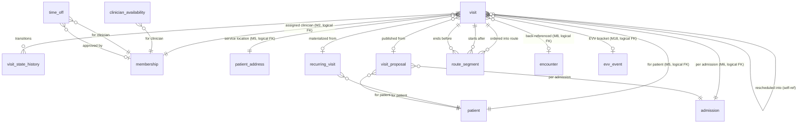
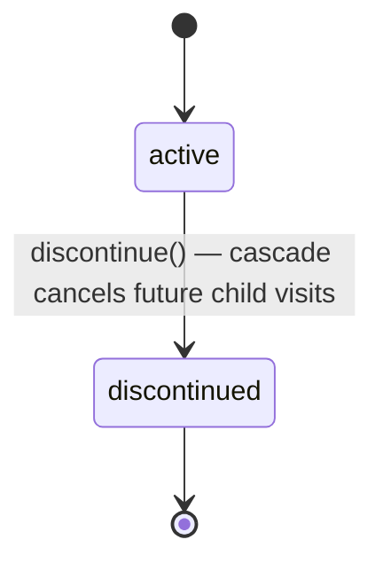
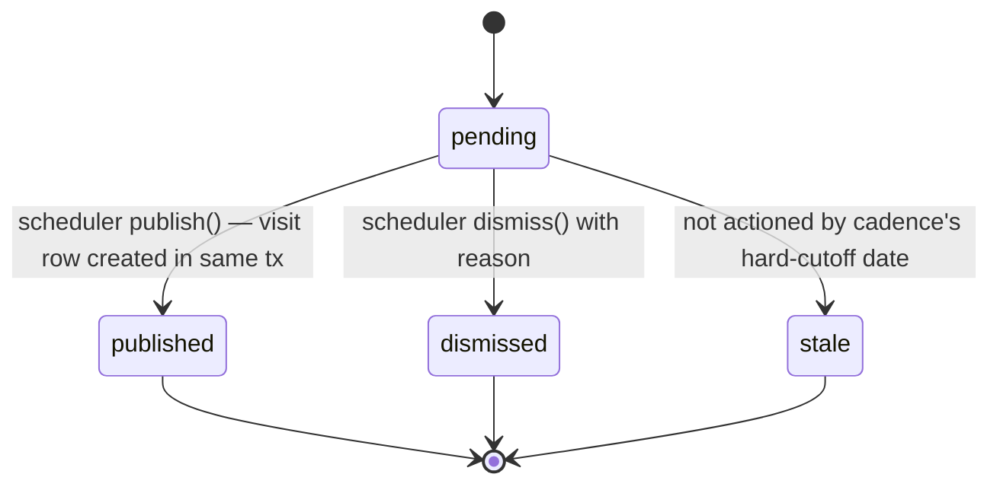
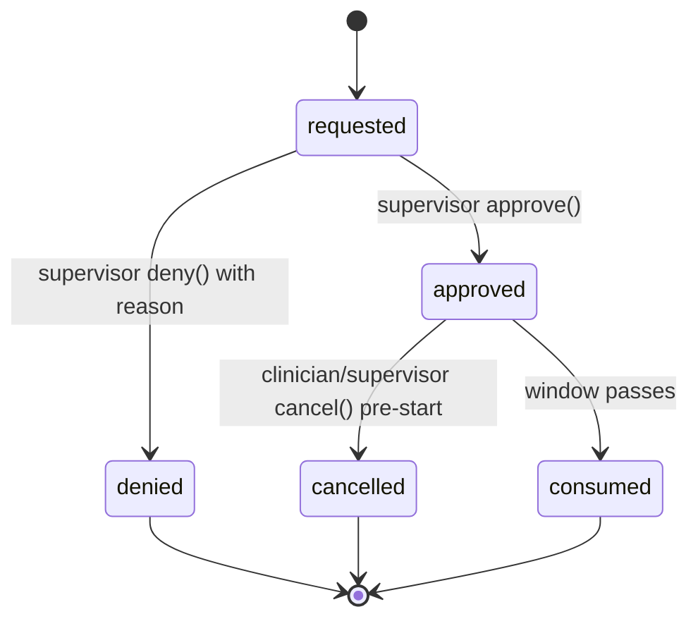

# Module 17 — Scheduling & Route Optimization Specification

> **Authority note:** This spec is an **implementation proposal** (repo authority rule): [`docs/architecture/`](../architecture/) and the ratified ADRs in [`docs/adr/`](../adr/) win on conflict, and the code plus [`docs/BUSINESS_LOGIC.md`](../BUSINESS_LOGIC.md) are ground truth for as-built behavior. Mechanism choices named here may be superseded — see ADR-0036…0040 and ADR-0030/0032/0035 for the recorded divergences (outbox not Socket.IO, TypeScript not Python sidecars, app-layer AES-256-GCM not pgcrypto, pure transition tables not XState, hand-rolled HTTP hardening not `@fastify/*`, Vite + react-router not TanStack Start).


**Module ID:** 17
**Phase:** 1 (v1 — required for Engrace go-live; the place every clinical visit gets booked, every PTO conflict gets caught before it surfaces, and the only correct surface that knows *who is at whose home today*; without M17 the M5 caseload provider runs at half-strength, M8's `visit_id` back-reference is always NULL, M18 EVV has no scheduled visit to bracket, M15's volunteer compliance gates have no consumer, and M19/M20 lose the "today's roster" view they assume exists)
**Depends on:** 5 (Patient & Demographics — `patient` row, `patient_address` with `geocoded_lat`/`geocoded_lng` populated by M5's geocode job per M5 §10 task 22, consumed via `PatientAddressReader` for routing inputs; `CaseloadProvider` interface M5 owns — M17 *contributes* via outbox to M5's union per M5 §4.1; `patient.privacy_flag_snapshot` consumer never reached because visit metadata is non-PHI-narrative — visit times and addresses are PHI but no clinical free-text lives on M17 rows), 7 (Care Plan — `CarePlanReader.activeInterventionsWithFrequency(patientId)` is the source for the frequency-driven visit proposal worker per D5 — an intervention with `frequency='2:visit:week'` materializes proposed visits at the published cadence; M7 does not depend on M17), 8 (Encounters & Visit Notes — bidirectional: M17 publishes `m17.visit.published` which M8 consumes when an encounter is created against the `visit_id`; M17 consumes M8's `encounter.signed` outbox to transition the visit to `completed` and to read `BillableEncounterReader` for the post-visit billable/non-billable badge on the day view; M17 reads M8's published mileage via `MileagePayrollReader` for the route-actuals reconciliation report per D10), 15 (Discipline Care Plans — `VolunteerComplianceProvider.effectiveStatusFor(volunteerMembershipId)` is the pre-schedule gate consumed at every assignment write per architecture §7.7 — a volunteer with any expired/missing gate is rejected with the `VOLUNTEER_GATE_UNMET` error envelope; `SupervisoryCadenceReader.nextSupervisoryDueAt(admissionId)` is consumed as an *advisory* on the day view so the supervising RN sees the next-due supervisory visit without M17 owning the cadence math), 36 (Secure Messaging & Alerts — reschedule notifications, day-view-ready alerts, conflict alerts, optimization-completed alerts, PTO-approval requests/decisions, no-show alerts all ride M36's typed alert payloads; M17's `visit.no_show_detected` flows to M19 on-call triage via M36's recipient resolver), 38 (Clinical Terminology — discipline value sets reused from M2's role catalog with terminology backstop; visit-cancellation reason codes ship as a tenant-extensible value set in M38; SNOMED codes for visit purpose/setting carried on visit row), 40 (Master Data Management — `Location` (M2/M40 boundary: M2 owns staff locations as `location`; M40 owns external Facilities for visits to non-residential settings such as inpatient unit visits, nursing-facility visits, contract-IPU visits per architecture §11.F note); referral source and facility identity flow through M40 when the visit is at an external facility rather than the patient home), 2 (Identity — actor + membership + role + discipline + license-active resolution; SESSION_POLICY clock skew on long-lived field-clinician sessions; biometric step-up not required for visit edits because M17 carries no clinical content), 3 (Authorization — `visit.*`, `availability.*`, `time_off.*`, `route.*`, `schedule.*` permission keys; new ABAC predicates `clinician_credentials_active`, `discipline_matches_visit`, `not_on_pto`, `within_caseload_or_unassigned_pool` registered with M3's named-predicate registry; existing `caseload_or_scope` reused), 4 (Audit — PHI write-audit trigger generator on every owned table; audit-read declaration on every PHI route; M17-F07/ADR-0004 — two distinct retentions: the **visit metadata ROWS** may use the shorter `operational` class (visit-meta is not the clinical record — the encounter is), but the **PHI write-AUDIT events** (`audit_event` for visit/availability/time_off writes) go to the **`compliance`** class (7-yr HIPAA documentation floor, §164.316(b)(2)) — never `operational`/the invented `phi_visit`; visit cancellations and reschedules carry the documented reason in audit), 1 (Foundation — `organization`, `withOrgContext`, `audit()` helper, outbox dispatcher, idempotency middleware, RLS generator, BullMQ on Valkey, partitioned-table conventions). Transitively the routing adapter package `packages/routing-client` is M17-owned and is the only place the chosen routing provider's URL/credentials live (D1 OSRM-self-hosted).
**Consumed by:** 5 (Patient & Demographics — M5's `CaseloadProvider.isInCaseload` unions the static `patient_assignment` rows with M17's per-clinician shift cache populated from `m17.visit.assigned` outbox events per M5 §4.1; the cache is a Valkey set TTLed to the shift window; an aide on a one-off visit *today* sees that patient's chart *today* without a permanent assignment), 8 (Encounters & Visit Notes — `encounter.visit_id` is a logical FK to M17's `visit`; M8 reads `VisitReader.visitForEncounter(visitId)` for the encounter authoring context which prefills patient, scheduled time, and visit type; ad-hoc encounters set `visit_id=NULL`), 11 (Orders — M11's order-driven scheduling forward seam: when an order has `requires_visit=true` (Foley change, lab draw, etc.) M11 emits `m11.order_requires_visit` which M17 consumes into a proposed visit on the assigned discipline's queue; M17 does not import M11), 14 (IDG — `idg.decision_recorded` decisions of kind `change_visit_frequency` flow to M17 the same way they flow to M7/M15; M17 consumes via outbox and proposes the cadence change for scheduler review), 15 (Discipline Care Plans — bidirectional: M15 publishes `VolunteerComplianceProvider`/`SupervisoryCadenceReader` consumed by M17; M17 publishes `VisitAssignmentReader.activeVisitsForMembershipOnDate(membershipId, serviceDate)` consumed by M15's volunteer-hour aggregator when the aggregator needs the scheduled vs. actual reconciliation), 18 (EVV — bidirectional: M18 reads M17's `visit.published` for the geofence subscription and the EVV check-in target; M18 emits `evv.check_in_recorded`/`evv.check_out_recorded` which M17 consumes to transition the visit state to `en_route → in_visit → completed` *only* when M18 has authoritative events (D9 of M8 — EVV is authoritative when present)), 19 (On-Call Triage — reads `VisitAssignmentReader.tonightsOnCallRoster(orgId)` to know who is on which shift right now; consumes `m17.visit.no_show_detected` as an inbound triage trigger), 20 (Field Safety — reads `VisitAssignmentReader.currentVisitForClinician(membershipId)` for the supervisor live-awareness dashboard per architecture §F.20; pre-visit check-in is M20-owned but tied to the M17 visit), 22 (Document Management — visit-confirmation letters/SMS optionally rendered by M22 from a typed payload M17 emits when a patient/caregiver requests the reminder format), 23/24 (Billing Medicare/Medicaid — `BillableEncounterReader` lives on M8; M17 has no claim path; M17 *publishes* a `visit.kept_count` projection for the operational dashboard but does not bill), 27 (Cost Report — `route_segment.total_miles_proposed` is M17-advisory; M27 reads M8's authoritative `mileage` per M8 D10; M17 surfaces the proposed-vs-actual reconciliation only), 28 (FHIR Gateway — `visit` projected as FHIR R4 `Appointment` with `participant` carrying the assigned clinician and `actor` carrying the patient; visit lifecycle states mapped to FHIR Appointment status enum; the typed mapping ships now, the projection lands when M28 lands), 30 (HQRP & Quality — visit-on-time rate, visit-completion rate, average miles per discipline, missed-visit recovery time, schedule-stability index all read M17's `VisitMetricsProvider`), 31 (Patient/Family Portal — upcoming-visits view reads `PortalVisitReader.upcomingForPatient(patientId, withinHours)`; lay-language visit purpose; redacts internal scheduler notes), 33 (Reporting — operational dashboards: clinician productivity, route efficiency, no-show rate, reschedule rate, PTO utilization, caseload distribution).
**Spec status:** Re-locked v0.3 (Phase-6 per-spec reconciliation; supersedes Locked v0.2)

## Remediation Changelog — Phase 6 reconciliation (v0.3, 2026-06-11)

Full disposition of every `audit/AUDIT_M08_M17.md` Module-17 finding (2 BLOCKER / 7 MAJOR / 10 MINOR).
A per-spec **build reconciliation**: the two contradictory state machines and the systemic
front-half/back-half drift are unified to **one truth — the §1–§9 body governs** — the tenancy
invariant is satisfied, and the dangling seams/phantom contracts are resolved.

| Finding | Sev | Resolution |
|---|---|---|
| **M17-F01** | BLOCKER | **`provider_entity_id` + `location_id` added** to `visit` (NOT NULL) and the same two columns to all six children (`visit_state_history`, `recurring_visit`, `visit_proposal`, `route_segment`, `clinician_availability`, `time_off`); composite index `(organization_id, location_id, service_date)`; location scoping threaded into day-view/roster reads. M17 is the Location-scoped module (ARCH-010) — this now passes `check-tenancy` (fitness #10). |
| **M17-F02** | BLOCKER | The invented "seam-only consumption is boundary-clean" claim is **struck**; under ADR-0005 D1 the M6/M39 seam + outbox consumption needs **no import edge** (interfaces in `packages/types`), so M6/M39 are not added as edges; the M5-vs-M6 **address ownership** contradiction is fixed — patient addresses live in **M5** (`patient_address`, ARCH-154), consumed via `PatientAddressReader`. |
| **M17-F03** | MAJOR | **The two 8-state machines are reconciled to one** — the §2.2.1 body machine `proposed → published → en_route → in_visit → completed \| no_show \| cancelled \| rescheduled` governs; **D3's divergent `scheduled/in_progress/complete/evv_missing_attested/reassignment_needed` vocabulary is struck**. `evv_missing_attested` is the `evv_bracket_state` flag; `reassignment_needed` is a day-view badge + the `m17.reassignment_needed` event — neither is a lifecycle state. §10 tasks + §12 sign-off regenerated to the body vocabulary. |
| **M17-F04** | MAJOR | Systemic front-half/back-half drift reconciled to the body: outbox topic names (`m17.visit.published/no_show_detected`, `m17.reassignment_needed`, `m17.route_optimized`); ABAC predicate set (§4.7 wins); the seven pre-schedule gate predicates (availability-bounds + no-conflict + caseload per §4.2/D6); one shift-cache key/TTL; one optimization cron time; `If-Match` on `version`; `evv_missing_reason` ≥40 chars + step-up; polyline treated as **PHI-bearing** (shredded, D9 reading); caregiver SMS/email via **M36** (not M22); M38/M40 misattributions corrected; partitioning of `visit_state_history` reconciled. |
| M17-F05 | MAJOR | **Route optimization is gated behind a default-off Phase-1 flag** (the degraded path already renders unoptimized schedules) — the Phase-2 cut is honored without an early-build ADR (ADR-0009). |
| M17-F06 | MAJOR | The M15 `VolunteerComplianceProvider`/`SupervisoryCadenceReader` seams are **`reg.optional` with fail-closed stubs** (volunteer-visit purpose hard-fails closed until M15 ships) — M17 (Phase 1) no longer hard-requires Phase-2 M15 to boot (ADR-0009). |
| M17-F07 | MAJOR | Retention split (ADR-0004): visit metadata **rows** may stay `operational`, but the **PHI write-audit events** go to the **`compliance`** class (7-yr HIPAA floor) — the invented `phi_visit`/"3 years" class is removed (header §M4 item). |
| M17-F08 | MAJOR | **`Idempotency-Key` declared on every mutating route** (publish/reschedule/cancel/PTO-approve) with 24 h / 409-on-mismatch semantics (ADR-0021/ARCH-263). |
| M17-F09 | MAJOR | `events.ts` + the consumed-seam interface types moved to the leaf **`packages/types`** so M5/M18/M19/M20/M22/M28/M31/M33 subscribers import payloads without an M17 edge (ADR-0005 D2, the M8 precedent). |
| M17-F10 | MINOR | RLS canonicalized to **`app.org_id`** + role **`wardenx_app`** (was `app.current_organization_id`/`app_user`); generator-emitted policy with WITH CHECK (§3.5, task 4). |
| M17-F11 | MINOR | OSRM coord cache key prefixed with `org_id` (or the §8.3 "RLS-equivalent isolation" claim corrected) — no cross-tenant shared coordinate cache. |
| M17-F12 | MINOR | The module-local "5 PTO/hour" limit expressed as **platform rate-limiter** config (SEC-019, S10). |
| M17-F13 | MINOR | **Cursor pagination** on PHI list routes (`GET /visits`, time-off lists) — SD-052 (ADR-0021). |
| M17-F14 | MINOR | OSRM added to the SD topology / VM allocation and the DR plan (placement, OSM-extract backup, health probe) — DR-073. |
| M17-F15 | MINOR | The phantom `MileagePayrollReader` from `@wardenx/encounters` is reconciled (ADR-0023): M17 reads actual mileage via an **M8-published event/seam that actually exists**, or the contract is retired. |
| M17-F16 | MINOR | DR tier declared: routing Tier 4; the day-view/roster read path is **Tier-1-supporting** (M18/M19 anchor on it) with a documented degraded-mode offline roster read (ADR-0021). |
| M17-F17 | MINOR | Caregiver reminder payloads carry **no PHI toward SMS/email** — deep-link-only (INT-018); M36's builder enforces it and M17's typed payload no longer implies content delivery. |
| M17-F18 | MINOR | New partitioned tables registered with the ops **`partition.rotate`** weekly job (OPS-021). |
| M17-F19 | MINOR | Mobile offline roster cache specified as **encrypted (sqlcipher-class)** with logout eviction (SEC-075, ADR-0021). |

**Net:** both BLOCKERs cleared (tenancy columns + boundary-clean seam consumption), the aggregate is
defined **once**, and the schema/workflow/event/permission story is unified — M17 is re-lockable and
passes `arch:fitness` (checks 10/12).

## Changelog

- **v0.2 (Locked)** — Initial publication at lock-grade. Instantiates the architecture §20.B module spec template. Resolves all sixteen open questions into binding decisions (§11). **Closes ADR-007 (Mapbox vs OSRM): OSRM self-hosted (D1)** on the binding privacy posture that patient addresses are PHI-adjacent and OSRM keeps them in-perimeter — Mapbox remains available as a swap-in adapter behind the same `RoutingProvider` interface for any tenant that later signs a BAA, but ships disabled. Defines the **visit-as-M17-owned first-class entity with M8 encounter back-reference** (D2 — `encounter.visit_id` is the logical FK; ad-hoc encounters carry NULL), the **eight-state visit lifecycle machine** `proposed → published → en_route → in_visit → completed | no_show | cancelled | rescheduled` with EVV-authoritative state-driver for `en_route`/`in_visit` (D3 — mirrors M8 D9 EVV-authoritative posture), the **RFC 5545 RRULE subset for recurring visits** materializing 90 days forward (D4 — `FREQ ∈ {DAILY, WEEKLY}` with `BYDAY` selection and `COUNT`/`UNTIL` terminators; no monthly/yearly recurrence — hospice cadence is sub-month), the **frequency-driven visit proposal worker** reading M7's `CarePlanReader.activeInterventionsWithFrequency` and M15's Aide POC supervisory cadence to propose visits the scheduler approves (D5 — proposals are not auto-published; the scheduler reviews on the proposal inbox), the **synchronous conflict-detection rule set** evaluated at every publish/reschedule (D6 — per-clinician overlap, PTO/time-off block, drive-time-infeasibility via OSRM matrix, discipline mismatch, license-active, caseload-eligible, volunteer-gate-satisfied), the **availability + time-off model** with recurring weekly availability pattern + discrete time-off events; PTO blocks publishing and triggers reassignment workflow for already-published visits inside the new PTO window (D7), the **pre-schedule gate seam** that orchestrates seven sequential predicate checks against M2/M5/M15 readers with the *first* failure short-circuiting the response and the failure reason carried in the error envelope (D8 — order is fixed and audit-trailed), the **address-PHI minimization protocol** for the routing adapter: only `(lat, lng)` pairs and per-segment polyline are sent across the network to the OSRM endpoint — never patient name, never MRN, never visit purpose, never a street-address-as-string; cache keys use deterministic hash of coordinate pair never an address string (D9), the **mileage-proposal-only forward seam to M8** with M8 owning authoritative mileage per M8 D10 — M17 stores `route_segment.proposed_miles` and `route_segment.proposed_drive_minutes` for the day view and the reconciliation report but does not contribute to payroll (D10), the **caseload contribution via outbox + Valkey shift cache** per M5 §4.1 with TTL bounded to the shift window plus a 1-hour overlap grace for late-completing visits (D11), the **nightly + on-demand optimization** with idempotency on `(membership_id, service_date)` and a debounced on-demand trigger on every published-visit reschedule (D12), the **drag-drop reschedule atomic with optimistic concurrency** via the `version` column and `If-Match` header pattern matching M15 §2.5 (D13), the **visit partitioned by month on `service_date`** matching M4 PHI-table conventions; route_segments / clinician_availability / time_off non-partitioned per the M11 D12 logic (D14), the **caregiver-confirmation reminders as opt-in via M22** rendering from a typed payload M17 emits (D15 — M17 has no SMS/email code; M36 typed-alert + M22 letter-render are the surfaces), and the **proposed manifest patch** correcting `M17.dependsOn` from `[5, 8, 40]` to `[1, 2, 3, 4, 5, 7, 8, 15, 36, 38, 40]` *(relationship inventory - not the `dependsOn` edge set; per ADR-0005 D1/D4 seam/outbox/foundation consumers are no-edge - see audit/MANIFEST_DEPENDSON_REVIEW.md; do not bulk-apply)* and adding `packages/routing-client` to `M17.codePaths`; populating `M17.ownedTables` with the seven owned tables (D16). Wires the permission keys this module registers into Module 3 (§4.6), the four ABAC predicates this module registers into Module 3's named-predicate registry (§4.7), the BullMQ queue catalog (§4.8), the M36 typed-alert payloads (§4.9), the routing-adapter `RoutingProvider` seam (§4.10), and the destruction `eraseFn` registered with Module 4 (§8.4 — `operational` retention class, not `clinical_record`, because visit metadata is not the clinical record itself).
- **2026-10-05 (GAP-052)** — §4.8 `reassignment-scan` and `caregiver-reminder` built. Approving a time_off now interprets the `trigger_reassignment_scan` effect in the approving tx (published, still-upcoming visits overlapping the window each emit `m17.reassignment_needed` reason `pto_approved`; `conflictingVisitCount` / `affectedPublishedVisitCount` are real counts) and the `scheduling.reassignment-scan` cron (15 min) is the bounded, idempotent backstop (mig 0350 `visit.reassignment_flagged_time_off_id/_at`). `scheduling.caregiver-reminder` (15 min) emits `m17.caregiver_reminder_due` once per opted-in published visit starting within 24h (`caregiver_reminder_sent_at`). **Decision (spec silent):** the opt-in is a boolean on `visit` with no channel column, so the payload carries the conservative channel `email`; M22/M36 resolve the real channel at delivery (D15). The `late-check-sweep` stays M18-owned (F-141) and is not built here.
- **2026-10-06 (b11 follow-ups)** — Two emit-per-run paths made idempotent via nullable markers on `visit` (mig 0360). (1) `stale-visit-sweep` (`scanVisitAttentionForOrg`) emits `m17.stale_visit_detected` once per stale episode: `stale_flagged_started_at` records the `actual_started_at` episode flagged and `stale_flagged_at` when; **re-arm rule (conservative, spec was silent):** a still-stuck visit is flagged again only if its `actual_started_at` changed (a new episode) or the last flag is older than a 7-day re-nag window (`STALE_VISIT_RENAG_HOURS`); the sweep is bounded to 500 visits/run and its `staleVisits` result counts newly flagged visits. (2) The `m15.volunteer.assignment_inactivated` consumer stamps `volunteer_gate_flagged_event_id` (the delivered outbox event id) per visit in the publish tx: a replay of the same event emits nothing, a new inactivation event still flags the visit; the consumer now requires the envelope `id`.
- **v0.1** — Drafted within the lock-grade pass; not separately published.

> **Phase boundary (binding):** Phase 1 delivers everything in this spec **including the OSRM self-hosted routing adapter** (the ADR-007 closure makes routing-on at launch the default; degraded mode = unoptimized schedule still works — Tier 4 per the Integrations catalog). The "done" gate for M17 is: visit lifecycle state machine + EVV-authoritative bracketing seam consumer, frequency-driven proposal worker reading M7/M15, conflict-detection rule set with seven predicates, recurring visits via RRULE subset, drag-drop reschedule with optimistic concurrency, PTO request → approval workflow, volunteer-gate consumer wired against the real M15 (M15 is locked), supervisory-cadence advisory consumer wired against the real M15, M5 CaseloadProvider contribution via outbox + Valkey shift cache (M5 is locked), nightly + on-demand optimization via OSRM self-hosted (real `packages/routing-client` against a test-double OSRM container in CI, real OSRM in prod), the four published reader seams (`VisitReader`, `VisitAssignmentReader`, `PortalVisitReader`, `VisitMetricsProvider`) registered at boot, and the test plan green — **not gated** on Modules 18 (EVV deny-stub today; EVV-absent path operative), 19 (on-call consumer wires up when M19 lands), 20 (field safety consumer wires up when M20 lands), 22 (visit-confirmation letter render lands when M22 lands), 27 (route-actuals reconciliation report is data-ready), 28 (FHIR `Appointment` projection lands when M28 lands), 30/31/33 (their respective consumers when they lock). The M11 order-driven scheduling seam is exercised against a test-double M11 publisher; the M14 IDG decision seam is exercised against a test-double M14 publisher; the M18 EVV consumer is exercised against a recorded-fixture envelope. The M8 `encounter.signed` consumer is wired against the real M8 (M8 is locked).

-----

## 1. Purpose & Scope

### 1.1 What This Module Does

Module 17 owns **the scheduled visit** — the single artifact every other operational module assumes exists when it asks "who is at whose home today?" CoP 418.56(c)(2) requires the plan of care to specify "the scope and frequency of services necessary to meet the specific patient and family needs"; M7 captures the *frequency* as part of an intervention; M17 is where that frequency becomes a concrete time, a concrete clinician, a concrete address, a concrete drive route, a concrete handoff to M18 EVV at the doorstep, and a concrete handoff to M8 when the clinician documents what happened. It is the place a scheduler answers "the RN is on PTO Thursday and Friday — who covers the Whitfield visit?" and the place a field clinician answers "what's my next stop and how do I get there?"

- **Visit root** — one `visit` per scheduled clinical contact. A visit links to (a) a `patient` (M5), (b) the patient's `patient_address` for the service location (M5; address can be home, facility, or telephonic-no-address), (c) an `admission` (M6, logical FK), (d) an assigned `membership` (M2) with stamped discipline at assignment time, (e) optionally a `parent_recurring_visit_id` for visits materialized from a recurring rule, (f) optionally a `parent_proposal_id` for visits materialized from a frequency-driven proposal, (g) the `visit_purpose` (discipline + intent: `routine_visit`, `prn`, `aide_poc`, `msw_assessment`, `chaplain_visit`, `volunteer_visit`, `f2f`, `recert`, `loc_change`, `pronouncement`, plus the seven discharge/admission types), and (h) the `visit_setting` (`patient_home`, `facility`, `inpatient_unit`, `telephonic`). Encounters (M8) back-reference the visit via `encounter.visit_id`; ad-hoc encounters set `visit_id=NULL` per M8 D12 — M17 does not own *that* contact.

- **Eight-state lifecycle (D3)** — `proposed → published → en_route → in_visit → completed | no_show | cancelled | rescheduled`. `proposed` is the worker output (frequency-driven, order-driven, or IDG-driven) awaiting scheduler review. `published` is the locked-in committed visit visible to the assigned clinician and on the day view. `en_route` and `in_visit` are EVV-authoritative when M18 events are present, clinician-self-attestable when EVV is missing with documented reason (mirroring M8 D9). `completed` is the terminal success state set on the corresponding `m8.encounter.signed` outbox event (or, in the EVV-missing+telephonic case, on the clinician self-checkout). `no_show` is the terminal "patient unavailable" branch with reason and required reschedule prompt. `cancelled` is the terminal "won't happen" branch with reason and (optionally) a `rescheduled_into_visit_id` pointer. `rescheduled` is the transient state captured on PATCH that opens a new visit and supersedes the original.

- **Recurring visits via RRULE subset (D4)** — `recurring_visit` rows carry RFC 5545 RRULE strings restricted to `FREQ ∈ {DAILY, WEEKLY}` with `BYDAY` selectors and either `COUNT` or `UNTIL` terminators. The `materialize-recurring` cron runs nightly at 02:00 in the org timezone and materializes the next 90 days of visit rows from each active recurring policy. Materialization is idempotent on `(recurring_visit_id, service_date)`. Discontinuation of the recurring policy cancels all future-dated child visits in the same transaction. Monthly and yearly recurrence are deliberately excluded — hospice cadence operates in sub-month windows; a yearly recurrence is always a bug masquerading as a feature.

- **Frequency-driven proposal worker (D5)** — the `propose-from-frequency` cron runs nightly at 03:00 and reads M7's `CarePlanReader.activeInterventionsWithFrequency(patientId)` for every active admission. For each intervention with `frequency` matching the parser pattern `^([0-9]+):(visit|day|week|month|prn|continuous):(day|week|month|episode|prn)$` (the same pattern M7 and M15 use), the worker computes the next-due-by-cadence date and emits a `visit_proposal` row in the scheduler's queue. The scheduler reviews proposals on `/app/scheduling/proposals` and publishes (with optional inline edits) or dismisses. Aide POC supervisory visits are *also* proposals — M15 publishes `SupervisoryCadenceReader.nextSupervisoryDueAt(admissionId)` which the worker consumes to propose the next supervisory visit on the same queue; the publishing creates the visit and updates the M15 `aide_supervisory_visit.next_due_at` consult so the cadence-clock advances atomically. Proposals are advisory; no proposal auto-publishes (Aide POC supervisory included) because a human scheduler enforces the policy that this RN at this site at this time of day is actually feasible.

- **Pre-schedule gate seam (D8)** — every publish, every reschedule, every assignment-change runs a fixed seven-predicate sequence against M2/M5/M15 reader seams; first failure short-circuits with a typed error envelope that names the failing predicate:
  1. `clinician_membership_active` — M2 reader; rejects if membership status ≠ `active`.
  2. `clinician_credentials_active` — M2 reader; rejects if any required license/credential for the visit's discipline is expired or suspended at the visit's `service_date`.
  3. `discipline_matches_visit` — M17-local; rejects if clinician's discipline doesn't match the `visit_purpose` discipline (RN visit needs RN, aide visit needs CHHA, volunteer visit needs Volunteer, etc.).
  4. `not_on_pto` — M17-local; rejects if the visit's window overlaps any `time_off.status='approved'` row for the clinician.
  5. `within_caseload_or_unassigned_pool` — M5 reader (caseload check) OR organization policy permits the unassigned-pool flow; rejects if neither.
  6. `volunteer_gate_satisfied` — M15 reader, only invoked for `volunteer_visit` purpose; rejects if `VolunteerComplianceProvider.effectiveStatusFor(membershipId).isActive === false`.
  7. `drive_time_feasible` — OSRM matrix call between the clinician's *previous* visit's end address and *this* visit's start address; rejects if the drive time exceeds the gap between visits by more than the per-tenant tolerance (default 15 minutes). On OSRM unavailable (circuit-breaker open), this predicate degrades to *advisory* — the publish succeeds with a `drive_time_unknown` flag and the day view shows the badge.

- **Address-PHI minimization for routing (D9)** — the OSRM adapter sends *only* coordinate pairs (`lat`, `lng`) and receives back polylines + drive-time + distance. No patient identifier, no MRN, no street-address-as-string, no visit purpose, no clinician name. The cache key for "drive time from A to B" is the SHA-256 hash of the sorted coordinate pair, not an address. This holds even though OSRM is self-hosted and in-perimeter — defense-in-depth assumes the model that *every adapter is suspect* (architecture §25.14 — adapter mandate; vendor swap should never re-leak PHI).

- **EVV-authoritative bracketing (D3 + M8 D9 reference)** — when M18 publishes `evv.check_in_recorded` for a visit, M17 transitions `proposed → en_route → in_visit` and stamps `actual_started_at` from the EVV event. When M18 publishes `evv.check_out_recorded`, M17 transitions to `in_visit → completed_via_evv` (waiting for the corresponding encounter to seal; the visit state shows `in_visit` until `m8.encounter.signed` arrives, then flips to `completed`). When EVV is missing for the visit at finalize time, the clinician sets a documented `evv_missing_reason` on the linked encounter (the M8 field per M8 D9), and on `m8.encounter.signed` arrival M17 transitions the visit straight `published → completed` with `evv_bracket_state='evv_missing_documented'`. No clinical content lives on M17 — the encounter is the clinical record (M8 §1.1).

- **Conflict detection at write-time (D6)** — `POST/PATCH /visits/...` runs the seven predicates plus a same-clinician-overlap check. Overlap is "this visit's `[scheduled_started_at, scheduled_ended_at)` interval intersects any other published/en_route/in_visit visit assigned to the same membership." The check uses a Postgres `tstzrange` GiST exclusion constraint as the database backstop, but the application checks first so the error envelope can name the conflicting visit. Drag-drop reschedule uses optimistic concurrency via the `version` column with the `If-Match: <version>` header — a 412 returns the current row state and lets the UI re-render before retry (matching M15 §2.5 and M7 §7.7).

- **Availability + Time-Off (D7)** — `clinician_availability` carries a weekly recurring pattern (per-membership, per-org-day-of-week, with start/end time and a default location anchor for route-optimization startup) plus an optional date-range scope. `time_off` carries discrete approved-or-pending events with a start/end `tstzrange`, a `kind ∈ {pto, sick, bereavement, training, other}`, and an `approval_state ∈ {requested, approved, denied}`. PTO requests notify the supervisor via M36 (`m17.time_off_requested`); approval triggers reassignment-needed alerts for every published visit inside the new PTO window via the `reassignment-scan` worker. A clinician can request PTO with conflicting visits — the request is accepted but the conflict count surfaces on the approval surface so the supervisor sees the cost.

- **Routing optimization (D12)** — `optimize-day` worker runs nightly at 04:00 per (org, membership, next-day) and on-demand on every publish-or-reschedule (debounced to 30 seconds per `(membership_id, service_date)`). The optimizer pulls all published visits for the day, calls OSRM's matrix endpoint with the coordinate pairs (start-of-day anchor → visit 1 → visit 2 → ... → end-of-day anchor), and computes the suggested visit order plus inter-visit polylines stored as `route_segment` rows. The clinician may accept the suggested order on the day view or override it; override is captured for the route-effectiveness metric. The proposed miles per segment feed `route_segment.proposed_miles`; M8's `mileage` is authoritative per M8 D10 — the reconciliation report (M27 read) compares proposed vs. actual.

- **Caregiver/clinician self-service portal hooks (D15)** — caregivers may opt in to visit reminders via M31 portal preferences; the opt-in carries the channel (SMS via Twilio adapter in M36, or email via Postmark in M36 — both M36-owned); 24 hours before the visit M17 emits `m17.visit.reminder_due` and M36 fans out the typed alert. For clinicians, the mobile app is the self-service surface — the day view, the map view, the next-stop pin. Web is the scheduler surface (the day-grid drag-drop, the proposal inbox, the time-off approval queue).

- **Caseload contribution to M5 (D11)** — every `m17.visit.assigned` outbox event hits a small consumer that pushes `(membership_id, patient_id)` into a Valkey set with TTL = visit-window-end + 1h. M5's `CaseloadProvider.isInCaseload` reads this set on every authorization check (the M5 spec already wires this seam). The TTL grace covers the case where a clinician finishes an encounter 45 minutes after the scheduled end — chart access continues until the encounter signs.

- **Audit trail per visit revision** — every visit mutation flows through the Module 4 PHI write-audit trigger; the `audit_event` retention class is `operational` not `compliance` because visit metadata is not the clinical record itself (M4 retention classes per its §6 — operational retains 3 years post-discharge; the encounter is what carries 7-year clinical retention). The `cancellation_reason` and `reschedule_reason` text fields are denylisted from value capture in the audit trigger (consistent with the M11 D11 free-text-PHI scrub pattern); the change marker `<changed>` is recorded but the text content lives only on the row.

### 1.2 What This Module Does Not Do

- **The clinical record / encounter.** Module 8 owns the encounter, every byte of clinical narrative, the vitals, the HearthNote pipeline, the signature, the addendum, the late-entry tier. M17 emits `m17.visit.published` which M8 consumes for encounter authoring context; M17 receives `m8.encounter.signed` which M17 consumes to transition the visit to `completed`. The boundary is enforced by ownership: M17 cannot import M8's schema; M17 reads via the M8 `BillableEncounterReader` and `SignedEncountersReader` seams; M8 reads via M17's `VisitReader`.

- **EVV check-in / check-out / geofence math.** Module 18 owns `evv_event`, the GPS check-in mobile flow, the geofence threshold per tenant, the state-aggregator submission. M17 *reads* M18's events to bracket the visit (per D9 EVV is authoritative when present) but never writes EVV events. M18 reads M17's `visit.published` to subscribe to the right geofence.

- **The bereavement, supervisory, MSW, chaplain, volunteer plan content.** Module 15 owns those. M17 reads `VolunteerComplianceProvider` and `SupervisoryCadenceReader` from M15; M17 does not duplicate compliance state, does not own a "supervisory visit" type distinct from "RN routine visit" (the *attestation* lives in M15's `aide_supervisory_visit` per M15 D4).

- **The care plan itself.** Module 7 owns the IPOC. M17 reads `CarePlanReader.activeInterventionsWithFrequency` for the proposal worker; M17 does not store intervention frequency, does not version, does not sign.

- **Field safety / SOS / pre-visit check-in.** Module 20 owns those. M17 publishes `VisitAssignmentReader.currentVisitForClinician(membershipId)` for M20's supervisor live-awareness dashboard; the SOS button and the pre-visit safety check-in flow are M20.

- **On-call triage / inbound calls.** Module 19 owns those. M19 reads M17's `tonightsOnCallRoster(orgId)` to know who is on which shift; M19 owns the call log, the protocol, the escalation tree.

- **Mileage payroll, time-and-attendance, productivity payouts.** M8 owns mileage per M8 D10; M27 owns cost report; tenant payroll integrations live behind their own adapters. M17's `route_segment.proposed_miles` is advisory only and never reaches payroll.

- **Telehealth visits' video stack.** Module 31 owns telehealth (video provider per ADR-003). When the visit is `visit_setting='telephonic'` and a video session is requested, M31 creates the room and writes `visit.telehealth_room_id` (back-reference); M17 stores the pointer but does not own the video adapter.

- **The portal session for caregivers viewing upcoming visits.** Module 31 owns the portal session; M17 publishes `PortalVisitReader.upcomingForPatient(patientId, withinHours)` and M31 renders the lay-language view, redacting any scheduler-internal notes.

- **Document rendering for visit confirmation letters.** Module 22 renders the letter from the typed payload M17 emits via outbox (D15). M17 has no PDF code, no SMS code, no email code — M22 / M36 own the surfaces.

- **FHIR `Appointment` projection.** Module 28 owns `packages/fhir/r4/mappers`. M17 emits a domain payload via outbox; M28 maps it to FHIR R4 `Appointment` when M28 lands.

- **Decide authorization.** Module 3 decides; Module 17 declares permissions (§4.6), exposes ABAC predicates (§4.7), and obeys the answer.

### 1.3 Regulatory & Operational Drivers

| Driver | Requirement | How Module 17 satisfies it |
|---|---|---|
| 42 CFR §418.56(c)(2) | Scope and frequency of services in the plan of care | Frequency-driven proposal worker reads M7's intervention frequency and proposes visits at the cadence; scheduler review-publish workflow ensures the schedule matches the IPOC |
| 42 CFR §418.56(d) | IDG review every 15 days; coordination of care | M14 IDG decisions of kind `change_visit_frequency` flow to M17 via outbox; M17 reproposes; reschedule audit trail proves coordination |
| 42 CFR §418.76(h)(1) | RN supervisory visit no less frequently than every 14 days | M15 publishes `SupervisoryCadenceReader.nextSupervisoryDueAt`; M17's proposal worker creates the supervisory visit at the cadence; the scheduler publishes; the supervising RN's day view shows the supervisory visit clearly tagged |
| 42 CFR §418.78(b)(1)(2) | Volunteer training/background-check documented | M17 consumes `VolunteerComplianceProvider.effectiveStatusFor`; a volunteer with any expired gate is rejected at publish/assign with `VOLUNTEER_GATE_UNMET`; no volunteer visit can be scheduled around an expired TB screening |
| 21st Cent. Cures Act §12006 / state EVV mandates | Electronic visit verification for in-home personal-care and home-health services as applicable | M17 publishes `visit.published` for M18 EVV subscription; visit lifecycle is EVV-authoritative when present; without M17's scheduled visit there is no anchor for the EVV check-in |
| 42 CFR §418.104(a) | Clinical records — completeness, authentication, retention | M17 is *not* the clinical record (the encounter is, M8); M17 carries `operational` retention class; visit metadata is purgeable 3 years post-discharge under M4 retention policy |
| HIPAA §164.502(b) | Minimum necessary | Routing adapter sends coordinates only, no patient identifiers (D9); portal projection redacts scheduler-internal notes; ABAC `caseload_or_scope` on every PHI route |
| HIPAA §164.312(b) | Audit controls | M4 PHI write-audit trigger on every owned table; cancellation/reschedule reason scrubbed; per-state-transition audit event |
| State patient-bill-of-rights laws (varies) | Patients have the right to know who is coming to their home and when | Caregiver-confirmation reminder via M22+M36; patient portal upcoming-visits view via M31 reading `PortalVisitReader` |

### 1.4 Competitive Context

WellSky, MatrixCare, HCHB, and FireNote/Axxess all ship a scheduling module, but the common pattern is a **calendar grid with manual drag-drop and best-effort route optimization, where the volunteer-compliance gate, the supervisory-cadence advisory, the frequency-from-POC proposal, and the EVV-authoritative state are all features the scheduler must remember to check rather than enforce at the boundary.** Schedulers in those products routinely publish a visit for a volunteer whose TB screening expired yesterday because the only enforcement is a separate compliance dashboard the scheduler may or may not have open. Aide supervisory cadences slip past 14 days because the scheduler is on PTO and nobody else is tracking it. Frequency from the care plan is re-typed into the scheduling grid every time the IDG changes it. Mileage from route optimization gets quietly substituted into payroll bypassing the clinician's odometer.

WardenX rejects every one of those failure modes at the seam:
- The volunteer-compliance gate is **a publish-time predicate**, not a dashboard — an expired TB screening is a 422 with `VOLUNTEER_GATE_UNMET`, not a "warning" the scheduler can dismiss.
- The supervisory cadence is **a proposal** the scheduler must publish; M15 publishes the next-due date; if the date approaches with no scheduled visit, M36 alerts; the alert escalates per the M15 escalation ladder.
- Frequency from the care plan is **a structured field** parsed once and proposed continuously; IDG frequency changes propagate via outbox; no re-typing.
- EVV is **authoritative** when present (per M8 D9); the visit shows the EVV time, not the scheduled time; if EVV is missing, the encounter cannot sign without a documented reason.
- Mileage from route optimization is **proposal-only**; the clinician's odometer wins; the reconciliation report makes the gap visible.

The differentiated surface is "the scheduler enforces the boundary; the scheduler doesn't have to remember to check." This is the same architectural principle as M11 (orders can't be active without a signature), M13 (an administration of a discontinued med rejects), and M15 (a volunteer assignment to an expired-gate volunteer rejects). The schedule is a binding contract, not a calendar invite.

-----

## 2. Domain Model

### 2.1 Entity-Relationship Diagram



The diagram is logical. M2 / M5 / M6 / M7 / M8 / M15 / M18 entities are referenced by logical FK columns; M17 does **not** import those modules' Drizzle schemas (per architecture-fitness §25.15). Cross-module reads go through the owners' published reader seams.

### 2.2 Per-Entity Lifecycle

#### 2.2.1 `visit` — the scheduled visit (D3)

One row per scheduled clinical contact. Created in `proposed` state by the worker (or by manual scheduler insert) and progressed through the eight-state machine.

```mermaid
stateDiagram-v2
    direction LR
    [*] --> proposed
    proposed --> published: publish() — gate passes
    proposed --> cancelled: dismiss (proposal rejected)
    published --> en_route: EVV check_in OR clinician self-attest start
    published --> cancelled: cancel() with reason
    published --> rescheduled: reschedule() with reason → new visit in proposed/published
    published --> no_show: no_show() — patient unavailable
    en_route --> in_visit: EVV at-patient-address OR clinician self-attest arrived
    in_visit --> completed: m8.encounter.signed received AND M17 in_visit
    en_route --> cancelled: cancel-after-departure (rare)
    in_visit --> cancelled: cancel-in-visit (rare; documented)
    rescheduled --> [*]
    cancelled --> [*]
    no_show --> [*]
    completed --> [*]
```



**Transition guards** (enforced server-side in `visit-state-machine.ts`):
- `proposed → published`: pre-schedule gate (D8) passes all seven predicates OR overridable predicates carry override reasons.
- `published → en_route`: either an `m18.evv.check_in_recorded` event was received for this visit, OR the assigned clinician explicitly self-attests via `POST /visits/:id/start` with `evv_missing_reason` (if no EVV at all) — the latter is also accepted for `visit_setting='telephonic'` where there is no physical EVV.
- `en_route → in_visit`: same source as `en_route` advancement; in EVV-authoritative mode this is a second `m18.evv.at_patient_address` event; in self-attest mode the same `POST /visits/:id/start` advances both transitions in one call.
- `in_visit → completed`: requires `m8.encounter.signed` outbox event referencing this `visit_id`. If a visit goes `in_visit` and no encounter signs within 48 hours, the `stale-visit-sweep` cron flags it; no automatic transition.
- `* → cancelled` after `proposed`: requires `cancellation_reason ≥ 20 chars`, and `cancelled_by_membership_id`. If cancelled after `published`, M36 alerts the patient/caregiver (if opt-in active per M22+M36 caregiver-confirmation opt-in) and the supervising RN.
- `published → rescheduled`: requires `reschedule_reason ≥ 20 chars` and the new visit row insert in the same transaction; the original row carries `rescheduled_into_visit_id` to the new row's id.

#### 2.2.2 `visit_state_history` — append-only state-transition log

Every state transition writes a row with `from_state`, `to_state`, `actor_membership_id` (NULL for system-driven transitions like EVV-event-driven), `reason` (NULL except for cancel/reschedule/no_show), `transitioned_at`, and the originating `outbox_event_id` (NULL for direct API calls). Append-only — never updated or deleted; the M4 audit trigger denies UPDATE/DELETE. Purpose: surveyor-grade traceability without re-querying the audit log.

#### 2.2.3 `recurring_visit` — recurring visit policy (D4)

One row per active recurring policy per `(admission_id, visit_purpose, assigned_membership_id)`. Carries:
- `rrule` text — RFC 5545 RRULE string (parsed and validated against the `FREQ ∈ {DAILY, WEEKLY}` subset at write time)
- `byday text[]` — for WEEKLY rules, the days (`MO`, `TU`, `WE`, `TH`, `FR`, `SA`, `SU`) the visit occurs
- `time_of_day_start time` / `time_of_day_end time` — local-time anchor
- `time_zone text` — IANA tz, default to org tz
- `start_date date` / `end_date date | NULL` — range
- `count integer | NULL` — total occurrences cap (mutually exclusive with end_date — CHECK constraint)
- `status ∈ {active, discontinued}` — discontinuation cancels all future-dated child visits



#### 2.2.4 `visit_proposal` — frequency-driven / order-driven / IDG-driven proposal (D5)

One row per pending proposal. Lifecycle:



`source` enum: `frequency_driven_m7`, `supervisory_cadence_m15`, `order_required_m11`, `idg_decision_m14`. The proposal carries `proposed_for_date`, `proposed_visit_purpose`, `proposed_discipline`, `proposed_duration_minutes`, and a `source_payload jsonb` capturing the upstream event id for idempotency.

#### 2.2.5 `clinician_availability` — weekly recurring pattern (D7)

One row per `(membership_id, day_of_week)` with `start_time` / `end_time` / `default_start_location_id` (M2 location) / `default_end_location_id`. Optional `effective_start_date` / `effective_end_date` for seasonal patterns. Concurrency: `version bigint`.

#### 2.2.6 `time_off` — discrete PTO/sick/etc. event (D7)

Lifecycle:



Approval triggers the `reassignment-scan` worker over every `published` visit inside the window. Denial sends `m17.time_off_denied` via M36.

#### 2.2.7 `route_segment` — route-optimization output (D12)

One row per (visit_pair) in a clinician's day. `route_segment.from_visit_id` → `to_visit_id`; or `from_anchor_location_id` → `to_visit_id` for the day-start segment, or `from_visit_id` → `to_anchor_location_id` for the day-end segment. Carries `proposed_drive_minutes`, `proposed_miles`, `polyline text` (encoded OSRM polyline), `computed_at`, `optimizer_version text`. Idempotent insert on `(membership_id, service_date, from_key, to_key)`.

### 2.3 Validation Rules

- A `visit` may exist only with a corresponding active or recently-discharged `admission` (logical FK; enforced via M6 reader at write time).
- A `visit.assigned_membership_id` must satisfy the seven-predicate gate (D8) at publish time; reassignment runs the same gate.
- A `visit.scheduled_started_at < scheduled_ended_at` is enforced by DB CHECK.
- A `visit` whose status is `published`, `en_route`, or `in_visit` cannot overlap any other such visit assigned to the same membership — enforced by a Postgres GiST exclusion constraint on `(assigned_membership_id, tstzrange(scheduled_started_at, scheduled_ended_at))` with `WHERE status IN ('published','en_route','in_visit')`.
- A `visit.visit_purpose='volunteer_visit'` requires `volunteer_gate_satisfied=true` at publish time (D8 predicate 6).
- A `visit.visit_setting='facility'` requires `external_facility_id` (M40 `Facility`) non-null; `patient_home` requires `patient_address_id` non-null; `telephonic` allows both null.
- A `visit.rescheduled_into_visit_id` is set only on transition to `rescheduled` and must point to a sibling visit in the same admission.
- A `visit.cancellation_reason ≥ 20 chars` and `visit.reschedule_reason ≥ 20 chars` are enforced by DB CHECK on insert/update for the respective transitions.
- A `recurring_visit.rrule` is parsed against the `RRULE_GRAMMAR_v1` subset; `FREQ=MONTHLY` / `FREQ=YEARLY` are rejected with `RECURRENCE_FREQUENCY_NOT_SUPPORTED`.
- A `recurring_visit` with `count IS NOT NULL` and `end_date IS NOT NULL` is rejected by DB CHECK — exactly one terminator.
- A `visit_proposal` may exist only with non-NULL `source` and `source_payload`; idempotency on the source payload's upstream event id is enforced at write time.
- A `clinician_availability.start_time < end_time` is enforced by DB CHECK; overnight shifts split into two rows.
- A `time_off.approval_state='approved'` requires non-null `approved_by_membership_id` and `approved_at`.
- A `route_segment.proposed_drive_minutes >= 0` and `proposed_miles >= 0` are enforced by DB CHECK.
- A `visit.evv_check_in_event_id` and `evv_check_out_event_id` are logical FKs to M18; M17 does not enforce them existing — M18 owns the rows; M17 stores the pointer set on receipt of the M18 outbox event.

### 2.4 Side Effects

| Trigger | Side effect |
|---|---|
| Visit `proposed → published` | Insert `visit_state_history`; emit `m17.visit.assigned` (caseload contribution); emit `m17.visit.published` (M8/M18/M20/M31 subscribers); update Valkey shift cache for the assigned membership |
| Visit `published → en_route` (EVV-driven) | Insert `visit_state_history`; emit `m17.visit.started`; M20 receives the "clinician is at patient" badge |
| Visit `published → en_route` (self-attest) | Same as above plus `evv_missing_reason` captured on the visit row |
| Visit `in_visit → completed` (via M8 encounter.signed) | Insert `visit_state_history`; emit `m17.visit.completed`; M5 shift cache entry expires per TTL grace |
| Visit `* → cancelled` | Insert `visit_state_history`; if patient/caregiver opted into reminders, emit `m17.visit.cancelled_caregiver_notification` to M36+M22; rebuild route for the day (debounced); emit `m17.visit.unassigned` (caseload contribution) |
| Visit `published → rescheduled` | Insert two rows in `visit_state_history` (original goes to `rescheduled`, new visit goes to `proposed` or `published`); emit both `m17.visit.unassigned` (original) and `m17.visit.assigned` (new); M36 notifies clinician + caregiver |
| Visit `published → no_show` | Insert `visit_state_history`; emit `m17.visit.no_show_detected` (M19 on-call triage subscriber); M36 alerts assigned clinician + RN case manager |
| `time_off` approved | Run `reassignment-scan` over published visits in the window; emit `m17.reassignment_needed` per affected visit |
| `recurring_visit` discontinued | Cancel all future-dated child visits in the same transaction; emit `m17.visit.cancelled` per cancelled child |
| EVV check-in received from M18 | Match by `visit_id`; if visit is `published`, advance to `en_route`; otherwise log mismatch in DLQ |
| `m8.encounter.signed` received | If the encounter's `visit_id` is set and the visit is `in_visit`, advance to `completed`; otherwise no-op (ad-hoc encounter) |
| Optimize-day worker completes | Emit `m17.route_optimized` (M33 dashboard subscriber); insert/update `route_segment` rows |

### 2.5 Concurrency — Optimistic with `version` Column

Every mutable M17 table carries `version bigint NOT NULL DEFAULT 0`. PATCH routes require `If-Match: <version>`; mismatched versions return 412 with the current row state. Pattern mirrors M15 §2.5 verbatim.

For the published-visit overlap exclusion constraint, the database is the final authority — even with optimistic concurrency, two parallel publishes that pass the application-level overlap check will be serialized by the GiST exclusion constraint; the second insert returns `23P01 exclusion_violation` which the route handler translates to `VISIT_OVERLAP_CONFLICT` with the conflicting `visit_id` in the envelope.

-----


## 3. Drizzle Schema

### 3.1 Package Layout

```
apps/backend/src/modules/17-scheduling/
├── routes/                    # visits, visits/:id/start, visits/:id/cancel, visits/:id/reschedule, visits/:id/no-show,
│                              # proposals, proposals/:id/publish, proposals/:id/dismiss,
│                              # recurring-visits, recurring-visits/:id/discontinue,
│                              # availability, time-off, time-off/:id/approve, time-off/:id/deny,
│                              # day-view, week-view, map-view, optimize-day,
│                              # portal/upcoming, metrics
├── services/                  # visit-state-machine, pre-schedule-gate (D8 orchestrator),
│                              # conflict-detector, recurrence-materializer,
│                              # frequency-proposer, supervisory-proposer, order-proposer,
│                              # reassignment-scanner, route-optimizer, shift-cache
├── workers/                   # materialize-recurring.cron, propose-from-frequency.cron,
│                              # optimize-day.cron, optimize-day.debounced,
│                              # reassignment-scan.worker, stale-visit-sweep.cron,
│                              # evv-event.consumer, encounter-signed.consumer,
│                              # idg-decision.consumer, order-requires-visit.consumer,
│                              # admission-discharged.consumer, time-off-approved.worker
└── boot.ts

packages/db/src/schema/scheduling/
├── visits.ts                    visit-state-history.ts
├── recurring-visits.ts          visit-proposals.ts
├── clinician-availability.ts    time-off.ts
└── route-segments.ts

packages/routing-client/         # OSRM adapter (D1) — the ONLY place the routing endpoint lives
├── src/
│   ├── interface.ts             # RoutingProvider TypeScript interface
│   ├── osrm-adapter.ts          # the locked-in Phase-1 adapter
│   ├── mapbox-adapter.ts        # disabled by default; ships for swap path
│   ├── coord-cache.ts           # in-perimeter Valkey cache keyed on hash of coord-pair (D9)
│   └── degraded-error.ts        # circuit-breaker integration
└── package.json

packages/scheduling/             # shared domain types
├── src/
│   ├── seams.ts                 # VisitReader, VisitAssignmentReader, PortalVisitReader, VisitMetricsProvider
│   ├── events.ts                # outbox event payload TypeBox
│   ├── rrule.ts                 # the validated RRULE subset parser
│   ├── frequency.ts             # the M7/M15 FrequencyValue parser (shared imported as a tiny type)
│   └── cancellation-reasons.ts  # the tenant-extensible reason value set
```

### 3.2 Migration Script Phases (`0017_scheduling.sql`)

- **Phase A — DDL.** Enums (`visit_status`, `visit_purpose`, `visit_setting`, `visit_proposal_status`, `visit_proposal_source`, `recurring_visit_status`, `time_off_kind`, `time_off_state`). Seven tables. Partition declaration on `visit` by month on `service_date`. Indexes (per §3.4).
- **Phase B — RLS + audit.** Apply `wardenx_enable_rls()` to all seven tables; install audit triggers via `wardenx_generate_audit_trigger` for each; install denylist (cancellation_reason, reschedule_reason, no_show_reason, time_off_denial_reason) per the M11 D11 pattern.
- **Phase C — Exclusion constraint.** Postgres `EXCLUDE USING gist (assigned_membership_id WITH =, tstzrange(scheduled_started_at, scheduled_ended_at) WITH &&) WHERE (status IN ('published','en_route','in_visit'))` on `visit`. The exclusion constraint is the database backstop for D6 overlap detection; the application-level check fires first to give the caller a typed envelope, the database catches the race.
- **Phase D — Partition rotation + value-set seed.** Register monthly partition rotation worker. Seed the platform-default cancellation reason value set (`patient_unavailable`, `caregiver_request`, `clinical_status_change`, `scheduler_error`, `weather`, `clinician_unavailable`, `transportation_issue`, `documentation_only`, `other_with_reason`).

### 3.3 Schema Files (Drizzle)

```typescript
// packages/db/src/schema/scheduling/visits.ts
import { pgTable, uuid, timestamp, text, bigint, integer, date, jsonb, boolean, index, uniqueIndex } from 'drizzle-orm/pg-core'
import { organization, membership } from '@wardenx/db/schema/m1m2'
import { visitStatus, visitPurpose, visitSetting, evvBracketState } from './enums'

export const visit = pgTable('visit', {
  id: uuid('id').primaryKey().defaultRandom(),
  organizationId: uuid('organization_id').notNull().references(() => organization.id, { onDelete: 'restrict' }),
  // M17-F01 (BLOCKER, ARCH-011/ARCH-010): scheduling is a LOCATION-scoped module — every PHI table
  // carries the three tenancy columns. provider_entity_id is NOT NULL; location_id is NOT NULL on
  // `visit` and its children (it drives location-bound day-views/rosters for M19/M20 and the
  // site-of-service Q-code context downstream). Composite index `(organization_id, location_id,
  // service_date)` below. The same two columns are added to visit_state_history, recurring_visit,
  // visit_proposal, route_segment, clinician_availability, and time_off (M17-F01).
  providerEntityId: uuid('provider_entity_id').notNull().references(() => providerEntity.id, { onDelete: 'restrict' }),
  locationId: uuid('location_id').notNull().references(() => location.id, { onDelete: 'restrict' }),

  patientId: uuid('patient_id').notNull(),        // logical FK to M5.patient
  admissionId: uuid('admission_id').notNull(),    // logical FK to M6.admission
  patientAddressId: uuid('patient_address_id'),   // logical FK to M5.patient_address (NULL for telephonic)
  externalFacilityId: uuid('external_facility_id'), // logical FK to M40.facility (for facility visits)

  assignedMembershipId: uuid('assigned_membership_id').notNull().references(() => membership.id, { onDelete: 'restrict' }),
  assignedDisciplineAtAssignment: text('assigned_discipline_at_assignment').notNull(), // stamped at assign time

  visitPurpose: visitPurpose('visit_purpose').notNull(),
  visitSetting: visitSetting('visit_setting').notNull(),

  scheduledStartedAt: timestamp('scheduled_started_at', { withTimezone: true }).notNull(),
  scheduledEndedAt: timestamp('scheduled_ended_at', { withTimezone: true }).notNull(),
  serviceDate: date('service_date').notNull(),  // org-tz date — partition key

  actualStartedAt: timestamp('actual_started_at', { withTimezone: true }),
  actualEndedAt: timestamp('actual_ended_at', { withTimezone: true }),

  status: visitStatus('status').notNull().default('proposed'),
  evvBracketState: evvBracketState('evv_bracket_state'),
  evvCheckInEventId: uuid('evv_check_in_event_id'),    // logical FK to M18.evv_event
  evvCheckOutEventId: uuid('evv_check_out_event_id'),  // logical FK to M18.evv_event
  evvMissingReason: text('evv_missing_reason'),

  parentRecurringVisitId: uuid('parent_recurring_visit_id'),   // logical to recurring_visit.id
  parentProposalId: uuid('parent_proposal_id'),                // logical to visit_proposal.id

  encounterId: uuid('encounter_id'),                            // logical FK to M8.encounter; set on encounter.signed
  telehealthRoomId: uuid('telehealth_room_id'),                // logical FK to M31.telehealth_visit; set by M31

  schedulerInternalNotes: text('scheduler_internal_notes'),    // not portal-visible; denylisted in audit

  cancelledByMembershipId: uuid('cancelled_by_membership_id'),
  cancelledAt: timestamp('cancelled_at', { withTimezone: true }),
  cancellationReason: text('cancellation_reason'),
  cancellationReasonCode: text('cancellation_reason_code'),   // from M38-backed value set

  rescheduledIntoVisitId: uuid('rescheduled_into_visit_id'),   // self-ref logical FK
  rescheduledFromVisitId: uuid('rescheduled_from_visit_id'),
  rescheduleReason: text('reschedule_reason'),

  noShowDetectedAt: timestamp('no_show_detected_at', { withTimezone: true }),
  noShowReason: text('no_show_reason'),

  // Route optimizer outputs cached on the row for fast day-view rendering:
  proposedRouteSequenceIndex: integer('proposed_route_sequence_index'),
  proposedInboundMiles: integer('proposed_inbound_miles'),     // tenths-of-mile integer
  proposedInboundDriveMinutes: integer('proposed_inbound_drive_minutes'),

  caregiverReminderOptIn: boolean('caregiver_reminder_opt_in').notNull().default(false),
  caregiverReminderSentAt: timestamp('caregiver_reminder_sent_at', { withTimezone: true }),

  version: bigint('version', { mode: 'number' }).notNull().default(0),
  createdAt: timestamp('created_at', { withTimezone: true }).notNull().defaultNow(),
  updatedAt: timestamp('updated_at', { withTimezone: true }).notNull().defaultNow(),
}, (t) => ({
  // Indexes:
  orgServiceDate: index('visit_org_service_date_idx').on(t.organizationId, t.serviceDate),
  orgPatient: index('visit_org_patient_idx').on(t.organizationId, t.patientId),
  orgMembership: index('visit_org_membership_idx').on(t.organizationId, t.assignedMembershipId, t.serviceDate),
  orgAdmission: index('visit_org_admission_idx').on(t.organizationId, t.admissionId),
  orgStatus: index('visit_org_status_idx').on(t.organizationId, t.status).where('status IN (\'proposed\',\'published\',\'en_route\',\'in_visit\')'),
  // Exclusion constraint (DDL only — drizzle can't generate it; SQL migration adds it):
  // EXCLUDE USING gist (assigned_membership_id WITH =, tstzrange(scheduled_started_at, scheduled_ended_at) WITH &&)
  //   WHERE (status IN ('published','en_route','in_visit'))
}))

// packages/db/src/schema/scheduling/visit-state-history.ts
export const visitStateHistory = pgTable('visit_state_history', {
  id: uuid('id').primaryKey().defaultRandom(),
  organizationId: uuid('organization_id').notNull().references(() => organization.id, { onDelete: 'restrict' }),
  visitId: uuid('visit_id').notNull().references(() => visit.id, { onDelete: 'cascade' }),

  fromState: visitStatus('from_state'),  // NULL for the initial 'proposed' insert
  toState: visitStatus('to_state').notNull(),
  actorMembershipId: uuid('actor_membership_id'),   // NULL for system-driven (cron, EVV consumer)
  systemSource: text('system_source'),              // 'cron_propose', 'evv_check_in', 'encounter_signed', etc.
  reason: text('reason'),
  outboxEventId: uuid('outbox_event_id'),           // set when transition was triggered by an outbox event
  transitionedAt: timestamp('transitioned_at', { withTimezone: true }).notNull().defaultNow(),
}, (t) => ({
  visitTransitionedAt: index('vsh_visit_at_idx').on(t.visitId, t.transitionedAt),
  // Append-only via audit trigger: UPDATE/DELETE refused
}))

// packages/db/src/schema/scheduling/recurring-visits.ts
export const recurringVisit = pgTable('recurring_visit', {
  id: uuid('id').primaryKey().defaultRandom(),
  organizationId: uuid('organization_id').notNull().references(() => organization.id, { onDelete: 'restrict' }),
  patientId: uuid('patient_id').notNull(),
  admissionId: uuid('admission_id').notNull(),
  assignedMembershipId: uuid('assigned_membership_id').notNull().references(() => membership.id, { onDelete: 'restrict' }),
  visitPurpose: visitPurpose('visit_purpose').notNull(),
  visitSetting: visitSetting('visit_setting').notNull(),
  patientAddressId: uuid('patient_address_id'),
  externalFacilityId: uuid('external_facility_id'),

  rrule: text('rrule').notNull(),
  byday: text('byday').array(),   // ['MO','WE','FR'] for WEEKLY
  timeOfDayStart: text('time_of_day_start').notNull(), // 'HH:MM' in tz
  timeOfDayEnd: text('time_of_day_end').notNull(),
  timeZone: text('time_zone').notNull(),
  startDate: date('start_date').notNull(),
  endDate: date('end_date'),
  count: integer('count'),

  status: recurringVisitStatus('status').notNull().default('active'),
  discontinuedAt: timestamp('discontinued_at', { withTimezone: true }),
  discontinuedBy: uuid('discontinued_by'),

  version: bigint('version', { mode: 'number' }).notNull().default(0),
  createdAt: timestamp('created_at', { withTimezone: true }).notNull().defaultNow(),
  updatedAt: timestamp('updated_at', { withTimezone: true }).notNull().defaultNow(),
}, (t) => ({
  // CHECK: (end_date IS NULL OR count IS NULL)
  orgPatientStatus: index('rv_org_patient_status_idx').on(t.organizationId, t.patientId, t.status),
}))

// packages/db/src/schema/scheduling/visit-proposals.ts
export const visitProposal = pgTable('visit_proposal', {
  id: uuid('id').primaryKey().defaultRandom(),
  organizationId: uuid('organization_id').notNull().references(() => organization.id, { onDelete: 'restrict' }),
  patientId: uuid('patient_id').notNull(),
  admissionId: uuid('admission_id').notNull(),

  source: text('source').notNull(),   // 'frequency_driven_m7' | 'supervisory_cadence_m15' | 'order_required_m11' | 'idg_decision_m14'
  sourcePayload: jsonb('source_payload').notNull(),   // upstream event id + typed payload
  sourceIdempotencyKey: text('source_idempotency_key').notNull(),

  proposedForDate: date('proposed_for_date').notNull(),
  proposedVisitPurpose: visitPurpose('proposed_visit_purpose').notNull(),
  proposedDiscipline: text('proposed_discipline').notNull(),
  proposedDurationMinutes: integer('proposed_duration_minutes').notNull(),
  suggestedMembershipId: uuid('suggested_membership_id'),    // best-fit suggestion; scheduler may reassign

  status: visitProposalStatus('status').notNull().default('pending'),
  publishedAsVisitId: uuid('published_as_visit_id'),
  dismissedBy: uuid('dismissed_by'),
  dismissalReason: text('dismissal_reason'),
  staleAt: timestamp('stale_at', { withTimezone: true }),   // pending after this is auto-marked stale

  version: bigint('version', { mode: 'number' }).notNull().default(0),
  createdAt: timestamp('created_at', { withTimezone: true }).notNull().defaultNow(),
  updatedAt: timestamp('updated_at', { withTimezone: true }).notNull().defaultNow(),
}, (t) => ({
  orgPending: index('vp_org_pending_idx').on(t.organizationId, t.status, t.proposedForDate).where('status = \'pending\''),
  idempotency: uniqueIndex('vp_idempotency_uidx').on(t.organizationId, t.source, t.sourceIdempotencyKey),
}))

// packages/db/src/schema/scheduling/clinician-availability.ts
export const clinicianAvailability = pgTable('clinician_availability', {
  id: uuid('id').primaryKey().defaultRandom(),
  organizationId: uuid('organization_id').notNull().references(() => organization.id, { onDelete: 'restrict' }),
  membershipId: uuid('membership_id').notNull().references(() => membership.id, { onDelete: 'cascade' }),

  dayOfWeek: integer('day_of_week').notNull(),    // 0=Sun … 6=Sat
  startTime: text('start_time').notNull(),         // 'HH:MM'
  endTime: text('end_time').notNull(),
  defaultStartLocationId: uuid('default_start_location_id'),  // M2 location
  defaultEndLocationId: uuid('default_end_location_id'),
  effectiveStartDate: date('effective_start_date'),
  effectiveEndDate: date('effective_end_date'),

  version: bigint('version', { mode: 'number' }).notNull().default(0),
  createdAt: timestamp('created_at', { withTimezone: true }).notNull().defaultNow(),
  updatedAt: timestamp('updated_at', { withTimezone: true }).notNull().defaultNow(),
}, (t) => ({
  // CHECK: start_time < end_time
  membershipDay: uniqueIndex('ca_membership_day_uidx').on(t.membershipId, t.dayOfWeek, t.effectiveStartDate),
}))

// packages/db/src/schema/scheduling/time-off.ts
export const timeOff = pgTable('time_off', {
  id: uuid('id').primaryKey().defaultRandom(),
  organizationId: uuid('organization_id').notNull().references(() => organization.id, { onDelete: 'restrict' }),
  membershipId: uuid('membership_id').notNull().references(() => membership.id, { onDelete: 'cascade' }),

  startsAt: timestamp('starts_at', { withTimezone: true }).notNull(),
  endsAt: timestamp('ends_at', { withTimezone: true }).notNull(),
  kind: timeOffKind('kind').notNull(),

  approvalState: timeOffState('approval_state').notNull().default('requested'),
  requestNote: text('request_note'),
  approvedByMembershipId: uuid('approved_by_membership_id'),
  approvedAt: timestamp('approved_at', { withTimezone: true }),
  deniedByMembershipId: uuid('denied_by_membership_id'),
  deniedAt: timestamp('denied_at', { withTimezone: true }),
  denialReason: text('denial_reason'),
  cancelledAt: timestamp('cancelled_at', { withTimezone: true }),
  cancelledBy: uuid('cancelled_by'),

  version: bigint('version', { mode: 'number' }).notNull().default(0),
  createdAt: timestamp('created_at', { withTimezone: true }).notNull().defaultNow(),
  updatedAt: timestamp('updated_at', { withTimezone: true }).notNull().defaultNow(),
}, (t) => ({
  orgMembershipState: index('to_org_mem_state_idx').on(t.organizationId, t.membershipId, t.approvalState),
  windowGist: index('to_window_gist_idx').on(t.membershipId).using('gist'),
  // Add via SQL: EXCLUDE USING gist (membership_id WITH =, tstzrange(starts_at, ends_at) WITH &&)
  //              WHERE (approval_state = 'approved')
}))

// packages/db/src/schema/scheduling/route-segments.ts
export const routeSegment = pgTable('route_segment', {
  id: uuid('id').primaryKey().defaultRandom(),
  organizationId: uuid('organization_id').notNull().references(() => organization.id, { onDelete: 'restrict' }),
  membershipId: uuid('membership_id').notNull().references(() => membership.id, { onDelete: 'cascade' }),
  serviceDate: date('service_date').notNull(),

  sequenceIndex: integer('sequence_index').notNull(),     // 0..N within the day
  fromKind: text('from_kind').notNull(),                  // 'anchor' | 'visit'
  fromVisitId: uuid('from_visit_id'),
  fromAnchorLocationId: uuid('from_anchor_location_id'),
  toKind: text('to_kind').notNull(),
  toVisitId: uuid('to_visit_id'),
  toAnchorLocationId: uuid('to_anchor_location_id'),

  proposedDriveMinutes: integer('proposed_drive_minutes').notNull(),
  proposedMiles: integer('proposed_miles').notNull(),     // tenths-of-mile integer
  polyline: text('polyline'),                              // OSRM-encoded polyline
  computedAt: timestamp('computed_at', { withTimezone: true }).notNull().defaultNow(),
  optimizerVersion: text('optimizer_version').notNull(),

  version: bigint('version', { mode: 'number' }).notNull().default(0),
}, (t) => ({
  // Idempotency: one route_segment per (membership, service_date, sequence_index)
  membershipDaySeq: uniqueIndex('rs_membership_day_seq_uidx').on(t.membershipId, t.serviceDate, t.sequenceIndex),
}))
```

### 3.4 Critical Indexes (Beyond Above)

- `visit (organization_id, assigned_membership_id, service_date)` — the day-view hot path; covers the "show me today's visits for clinician X" query in one index.
- `visit (organization_id, patient_id, scheduled_started_at DESC)` — patient-chart upcoming-visits view.
- `visit (organization_id, status, scheduled_started_at)` partial WHERE `status='proposed'` — proposal inbox.
- `visit_proposal (organization_id, status, proposed_for_date)` partial WHERE `status='pending'` — scheduler's queue.
- `time_off (membership_id, starts_at, ends_at)` — reassignment-scan worker.
- `route_segment (membership_id, service_date)` — already indexed by the unique constraint.

### 3.5 RLS Policy Pattern

All seven tables follow the standard tenant-scoped pattern emitted by M1's RLS generator (M17-F10 /
ADR-0010 D2: canonical session variable **`app.org_id`** set by `withOrgContext()`, role
**`wardenx_app`** — not the prior `app.current_organization_id` / `app_user`):
```sql
ALTER TABLE visit ENABLE ROW LEVEL SECURITY;
CREATE POLICY visit_org_isolated ON visit
  FOR ALL TO wardenx_app
  USING (organization_id = current_setting('app.org_id', true)::uuid)
  WITH CHECK (organization_id = current_setting('app.org_id', true)::uuid);
```

The `visit` PHI considerations:
- Visit metadata (patient, address, time, clinician) is PHI.
- Visit purpose carries a discipline tag — that's not free-text clinical content.
- `scheduler_internal_notes` is a denylisted field — captured in the row, scrubbed in audit value-capture.

### 3.6 Audit Trigger Denylist (M11 D11 Pattern)

Audit triggers on the seven owned tables; the following columns are denylisted from value capture (the `<changed>` marker is recorded but the text content is not):
- `visit`: `scheduler_internal_notes`, `cancellation_reason`, `reschedule_reason`, `no_show_reason`, `evv_missing_reason`
- `visit_proposal`: `dismissal_reason`, `source_payload` (typed payload but may contain narrative)
- `time_off`: `request_note`, `denial_reason`
- `recurring_visit`: (no free-text fields)
- `route_segment`: `polyline` (large bytea-like; denylisted for storage savings not privacy)
- `clinician_availability`: (no free-text fields)
- `visit_state_history`: `reason`

### 3.7 Eraser Registration (D11 of M4 / Destruction Workflow)

The retention class for all M17 tables is `operational` (3 years post-discharge; M4 §6). The `eraseFn` registered with M4:

```typescript
// apps/backend/src/modules/17-scheduling/services/eraser.ts
export const schedulingEraser: DataEraser = {
  dataClass: 'operational_schedule',
  async eraseForPatient(orgId: string, patientId: string, certId: string): Promise<EraseResult> {
    // Delete (NOT soft) visit, visit_state_history (cascade), recurring_visit, visit_proposal, route_segment
    // (no patient_id directly — but joinable via visit.id when route_segment.from_visit_id/to_visit_id matches a visit being erased)
    // time_off and clinician_availability are clinician-scoped, not patient-scoped — leave alone.
    return { rowsErased: { visit: n1, visit_state_history: n2, recurring_visit: n3, visit_proposal: n4, route_segment: n5 } }
  },
  async eraseForOrganization(orgId: string, certId: string): Promise<EraseResult> {
    // Bulk delete on org-wide destruction certificates (rare; tenant offboarding)
  },
}

// Registered at boot:
registerEraser('operational_schedule', schedulingEraser)
```

-----


## 4. API Routes & Seams

### 4.1 Route Inventory

| Method | Path | Auth | Permission key | Purpose |
|---|---|---|---|---|
| GET | `/api/v1/visits` | session | `visit.read` | list with filters (clinician, patient, date range, status) |
| GET | `/api/v1/visits/:visitId` | session | `visit.read` | fetch one |
| POST | `/api/v1/visits` | session | `visit.create` | direct manual create (skips proposal path); runs gate (D8) |
| PATCH | `/api/v1/visits/:visitId` | session + If-Match | `visit.edit` | edit times / discipline / notes; rerun gate on assignment/time change |
| POST | `/api/v1/visits/:visitId/start` | session | `visit.start` | self-attest start (EVV-missing path); transitions to `en_route`/`in_visit` |
| POST | `/api/v1/visits/:visitId/cancel` | session | `visit.cancel` | reason ≥ 20 chars |
| POST | `/api/v1/visits/:visitId/reschedule` | session | `visit.reschedule` | new times + reason; creates new visit in proposed/published; original → rescheduled |
| POST | `/api/v1/visits/:visitId/no-show` | session | `visit.mark_no_show` | reason; triggers reassign-or-followup workflow |
| POST | `/api/v1/visits/:visitId/reassign` | session | `visit.reassign` | reassign-only (no time change); reruns gate |
| GET | `/api/v1/visit-proposals` | session | `visit.proposal.read` | scheduler's inbox |
| POST | `/api/v1/visit-proposals/:proposalId/publish` | session | `visit.create` | publish proposal as a real visit; runs gate |
| POST | `/api/v1/visit-proposals/:proposalId/dismiss` | session | `visit.proposal.dismiss` | reason |
| GET | `/api/v1/recurring-visits` | session | `recurring_visit.read` | list active recurring policies for patient |
| POST | `/api/v1/recurring-visits` | session | `recurring_visit.create` | create with RRULE; validates subset |
| POST | `/api/v1/recurring-visits/:id/discontinue` | session | `recurring_visit.discontinue` | cascade-cancel future child visits |
| GET | `/api/v1/availability` | session | `availability.read` | per-membership weekly pattern |
| PUT | `/api/v1/availability/:membershipId` | session | `availability.edit_own` or `availability.edit_any` | upsert weekly pattern |
| GET | `/api/v1/time-off` | session | `time_off.read_own` or `time_off.read_team` | list (filterable by membership, state, range) |
| POST | `/api/v1/time-off` | session | `time_off.request_own` | request PTO |
| POST | `/api/v1/time-off/:id/approve` | session | `time_off.approve` | triggers reassignment-scan |
| POST | `/api/v1/time-off/:id/deny` | session | `time_off.approve` | reason ≥ 20 chars |
| POST | `/api/v1/time-off/:id/cancel` | session | `time_off.cancel_own` or `time_off.approve` | pre-start cancel |
| GET | `/api/v1/day-view` | session | `visit.read` | day-view for a clinician or org-wide (org-wide requires `visit.read_team`) |
| GET | `/api/v1/week-view` | session | `visit.read` | week-view; same auth |
| GET | `/api/v1/map-view` | session | `visit.read` | for a clinician day; includes polylines (D9 — coords only, no PHI text) |
| POST | `/api/v1/optimize-day` | session | `route.optimize_on_demand` | on-demand optimization; debounce key in body |
| GET | `/api/v1/portal/upcoming` | portal session | `portal.visit.read_upcoming` | M31 reads this; lay-language; scrubbed |
| GET | `/api/v1/metrics/visits` | session | `visit.read_metrics` | M30/M33 dashboards source |
| GET | `/api/v1/metrics/route-efficiency` | session | `route.read_metrics` | M33 dashboard source |

> All PHI-reading routes declare `requireReadAudit` so the M4 helper triggers `visit.viewed` / `visit_proposal.viewed` automatically. The `/api/v1/portal/upcoming` route declares the portal session class (M2 SESSION_POLICY); the `caseload_or_scope` ABAC does not apply — portal scope is per-patient via M39 `family_caregiver_access` consent context.

### 4.2 Representative TypeBox Schemas

```typescript
// apps/backend/src/modules/17-scheduling/routes/schemas.ts
import { Type } from '@sinclair/typebox'

export const CreateVisitRequest = Type.Object({
  patientId: Type.String({ format: 'uuid' }),
  admissionId: Type.String({ format: 'uuid' }),
  patientAddressId: Type.Union([Type.String({ format: 'uuid' }), Type.Null()]),
  externalFacilityId: Type.Union([Type.String({ format: 'uuid' }), Type.Null()]),
  assignedMembershipId: Type.String({ format: 'uuid' }),
  visitPurpose: Type.Union([
    Type.Literal('routine_visit'),  Type.Literal('prn'),
    Type.Literal('aide_poc'),        Type.Literal('msw_assessment'),
    Type.Literal('msw_followup'),    Type.Literal('chaplain_visit'),
    Type.Literal('chaplain_assessment'), Type.Literal('volunteer_visit'),
    Type.Literal('f2f'),             Type.Literal('recert'),
    Type.Literal('loc_change'),      Type.Literal('pronouncement'),
    Type.Literal('admission_visit'), Type.Literal('discharge_visit'),
  ]),
  visitSetting: Type.Union([
    Type.Literal('patient_home'),    Type.Literal('facility'),
    Type.Literal('inpatient_unit'),  Type.Literal('telephonic'),
  ]),
  scheduledStartedAt: Type.String({ format: 'date-time' }),
  scheduledEndedAt: Type.String({ format: 'date-time' }),
  schedulerInternalNotes: Type.Optional(Type.String({ maxLength: 1000 })),
  caregiverReminderOptIn: Type.Optional(Type.Boolean()),
  parentRecurringVisitId: Type.Optional(Type.String({ format: 'uuid' })),
})

export const RescheduleVisitRequest = Type.Object({
  newScheduledStartedAt: Type.String({ format: 'date-time' }),
  newScheduledEndedAt: Type.String({ format: 'date-time' }),
  newAssignedMembershipId: Type.Optional(Type.String({ format: 'uuid' })),
  reason: Type.String({ minLength: 20, maxLength: 1000 }),
})

export const CancelVisitRequest = Type.Object({
  reason: Type.String({ minLength: 20, maxLength: 1000 }),
  reasonCode: Type.String(),  // value-set member
})

export const StartVisitRequest = Type.Object({
  evvMissingReason: Type.Optional(Type.String({ minLength: 20, maxLength: 1000 })),
})

export const PreScheduleGateError = Type.Object({
  code: Type.Literal('PRE_SCHEDULE_GATE_FAILED'),
  failingPredicate: Type.Union([
    Type.Literal('clinician_membership_active'),
    Type.Literal('clinician_credentials_active'),
    Type.Literal('discipline_matches_visit'),
    Type.Literal('not_on_pto'),
    Type.Literal('within_caseload_or_unassigned_pool'),
    Type.Literal('volunteer_gate_satisfied'),
    Type.Literal('drive_time_feasible'),
    Type.Literal('visit_overlap'),
  ]),
  detail: Type.Object({
    membershipId: Type.String({ format: 'uuid' }),
    visitId: Type.Optional(Type.String({ format: 'uuid' })),
    expiredCredentials: Type.Optional(Type.Array(Type.String())),
    failingGates: Type.Optional(Type.Array(Type.String())),
    conflictingVisitId: Type.Optional(Type.String({ format: 'uuid' })),
    conflictingPtoId: Type.Optional(Type.String({ format: 'uuid' })),
    proposedDriveMinutes: Type.Optional(Type.Number()),
    availableGapMinutes: Type.Optional(Type.Number()),
  }),
})

export const CreateRecurringVisitRequest = Type.Object({
  patientId: Type.String({ format: 'uuid' }),
  admissionId: Type.String({ format: 'uuid' }),
  assignedMembershipId: Type.String({ format: 'uuid' }),
  visitPurpose: Type.String(),
  visitSetting: Type.String(),
  patientAddressId: Type.Optional(Type.String({ format: 'uuid' })),
  rrule: Type.String({ minLength: 10, maxLength: 500 }),  // validated against subset parser
  byday: Type.Optional(Type.Array(Type.Union([
    Type.Literal('MO'), Type.Literal('TU'), Type.Literal('WE'), Type.Literal('TH'),
    Type.Literal('FR'), Type.Literal('SA'), Type.Literal('SU'),
  ]))),
  timeOfDayStart: Type.String({ pattern: '^[0-2][0-9]:[0-5][0-9]$' }),
  timeOfDayEnd: Type.String({ pattern: '^[0-2][0-9]:[0-5][0-9]$' }),
  timeZone: Type.String(),
  startDate: Type.String({ format: 'date' }),
  endDate: Type.Optional(Type.String({ format: 'date' })),
  count: Type.Optional(Type.Integer({ minimum: 1, maximum: 365 })),
})
```

### 4.3 The Four Published Reader Seams

```typescript
// packages/scheduling/src/seams.ts
import type { OrgId, PatientId, VisitId, MembershipId, IsoDateTime, IsoDate } from '@wardenx/domain/ids'

export interface VisitReader {
  // For M8 encounter authoring context
  visitForEncounter(orgId: OrgId, visitId: VisitId): Promise<VisitDto | null>
  // For M18 EVV — the visit the geofence is for
  visitsScheduledForMembershipOnDate(orgId: OrgId, membershipId: MembershipId, date: IsoDate): Promise<VisitDto[]>
  // For M14 IDG — recent completed visits per patient since the last IDG meeting
  completedVisitsForPatientSince(orgId: OrgId, patientId: PatientId, sinceIso: IsoDateTime): Promise<VisitDto[]>
}

export interface VisitAssignmentReader {
  // M5 caseload contribution — patient IDs this clinician currently has a window-relevant visit for
  activeVisitsForMembershipOnDate(orgId: OrgId, membershipId: MembershipId, date: IsoDate): Promise<VisitAssignmentDto[]>
  // M19 on-call triage — who is on which on-call rotation tonight
  tonightsOnCallRoster(orgId: OrgId, asOfIso: IsoDateTime): Promise<OnCallRosterEntry[]>
  // M20 field-safety supervisor live-awareness — current in_visit per clinician
  currentVisitForClinician(orgId: OrgId, membershipId: MembershipId): Promise<VisitDto | null>
}

export interface PortalVisitReader {
  // M31 portal — upcoming visits for a patient, lay-language, scheduler-internal notes scrubbed
  upcomingForPatient(orgId: OrgId, patientId: PatientId, withinHours: number): Promise<PortalVisitSummary[]>
}

export interface VisitMetricsProvider {
  // M30/M33 — productivity and quality measures
  getOnTimeVisitRate(orgId: OrgId, windowIso: { from: IsoDateTime; to: IsoDateTime }, filters?: { discipline?: string }): Promise<number>
  getNoShowRate(orgId: OrgId, windowIso: { from: IsoDateTime; to: IsoDateTime }): Promise<number>
  getRescheduleRate(orgId: OrgId, windowIso: { from: IsoDateTime; to: IsoDateTime }): Promise<number>
  getRouteEfficiencyForMembership(orgId: OrgId, membershipId: MembershipId, windowIso: { from: IsoDateTime; to: IsoDateTime }): Promise<{
    totalProposedMiles: number
    totalActualMiles: number   // via M8 mileage reader
    overrideRate: number       // clinician overrode the suggested sequence
  }>
  getScheduleStabilityIndex(orgId: OrgId, windowIso: { from: IsoDateTime; to: IsoDateTime }): Promise<number>  // 1 - (reschedules / published)
}

// Registered at boot via M1 seam registry:
export function setVisitReader(p: VisitReader): void
export function setVisitAssignmentReader(p: VisitAssignmentReader): void
export function setPortalVisitReader(p: PortalVisitReader): void
export function setVisitMetricsProvider(p: VisitMetricsProvider): void
```

**Boot validation.** `apps/backend/src/bootstrap/seams.ts` (M1-owned) calls `validateSeams()` which refuses to start the server if any required seam is unregistered. M17's boot module registers all four.

### 4.4 The Seams M17 Consumes

```typescript
// Consumed at boot — registered by their owning modules; verified by validateSeams()
import type { CaseloadProvider } from '@wardenx/auth/seams'              // M5/M17 (we contribute to M5 via outbox)
import type { PatientAddressReader } from '@wardenx/patient/seams'        // M5
import type { CarePlanReader } from '@wardenx/care-plan/seams'            // M7
import type { VolunteerComplianceProvider, SupervisoryCadenceReader } from '@wardenx/discipline-plans/seams'  // M15
import type { CredentialReader, MembershipReader } from '@wardenx/identity/seams'   // M2
import type { SignedEncountersReader, BillableEncounterReader, MileagePayrollReader } from '@wardenx/encounters/seams'  // M8
import type { FacilityReader } from '@wardenx/mdm/seams'                  // M40
import type { ConsentEvaluator } from '@wardenx/consent/seams'            // M39 (for portal scope)
import type { TerminologyProvider } from '@wardenx/terminology/seams'     // M38
import type { RoutingProvider } from '@wardenx/routing-client'             // M17-owned adapter (OSRM)
```

At M17 init:

```typescript
// apps/backend/src/modules/17-scheduling/init.ts
export function initM17(reg: SeamRegistry): void {
  // Verify required upstream seams
  reg.require<MembershipReader>('m2.membership-reader')
  reg.require<CredentialReader>('m2.credential-reader')
  reg.require<PatientAddressReader>('m5.patient-address-reader')
  reg.require<CarePlanReader>('m7.care-plan-reader')
  reg.require<VolunteerComplianceProvider>('m15.volunteer-compliance')
  reg.require<SupervisoryCadenceReader>('m15.supervisory-cadence')
  reg.require<SignedEncountersReader>('m8.signed-encounters')
  reg.require<BillableEncounterReader>('m8.billable-encounter')
  reg.require<FacilityReader>('m40.facility-reader')
  reg.require<TerminologyProvider>('m38.terminology')
  reg.require<RoutingProvider>('m17.routing-provider')  // OSRM by default per D1

  // Optional with deny-stubs (registered by their owning modules when they land)
  reg.optional<MileagePayrollReader>('m8.mileage-payroll', denyStubMileageReader)  // M8 is locked; real reader present

  // Publish M17's four seams
  reg.publish<VisitReader>('m17.visit-reader', realVisitReader)
  reg.publish<VisitAssignmentReader>('m17.visit-assignment-reader', realAssignmentReader)
  reg.publish<PortalVisitReader>('m17.portal-visit-reader', realPortalReader)
  reg.publish<VisitMetricsProvider>('m17.visit-metrics', realMetricsProvider)

  // Register new ABAC predicates with M3
  m3.predicateRegistry.register(clinicianCredentialsActive)
  m3.predicateRegistry.register(disciplineMatchesVisit)
  m3.predicateRegistry.register(notOnPto)
  m3.predicateRegistry.register(withinCaseloadOrUnassignedPool)

  // Register operational_schedule eraser with M4
  m4.eraserRegistry.register('operational_schedule', schedulingEraser)
}
```

### 4.5 The `m17.visit.assigned` Caseload Contribution (D11)

```typescript
// apps/backend/src/modules/17-scheduling/services/shift-cache.ts
export const m17ShiftCache = {
  async hasPatient(membershipId: string, patientId: string): Promise<boolean> {
    return (await valkey.sismember(`m17:shift:${membershipId}`, patientId)) === 1
  },
  async patientIds(membershipId: string): Promise<string[]> {
    return await valkey.smembers(`m17:shift:${membershipId}`)
  },
  async onVisitAssigned(ev: VisitAssignedEvent): Promise<void> {
    const key = `m17:shift:${ev.assignedMembershipId}`
    await valkey.sadd(key, ev.patientId)
    // TTL = scheduled_ended_at + 1h grace, capped at 14h to bound runaway
    const ttlSec = clamp(
      Math.floor((new Date(ev.scheduledEndedAt).getTime() - Date.now()) / 1000) + 3600,
      300,    // min 5 min
      50400,  // max 14 hr
    )
    await valkey.expire(key, ttlSec)
  },
  async onVisitUnassigned(ev: VisitUnassignedEvent): Promise<void> {
    await valkey.srem(`m17:shift:${ev.assignedMembershipId}`, ev.patientId)
  },
}
```

The consumer subscribes to `m17.visit.assigned` and `m17.visit.unassigned`; M5's `patientCaseloadProvider` reads this cache (per M5 §4.1 code already wired).

### 4.6 Permission Keys Registered into Module 3

Module 17 contributes to M3's catalog. Added to `packages/auth/src/permissions/catalog.ts`:

```typescript
// packages/auth/src/permissions/scheduling.ts
export const schedulingPermissions = [
  { key: 'visit.read', category: 'scheduling', description: 'Read visits in caseload/scope' },
  { key: 'visit.read_team', category: 'scheduling', description: 'Read visits org-wide for day-view-team' },
  { key: 'visit.read_metrics', category: 'scheduling', description: 'Read aggregated visit metrics' },
  { key: 'visit.create', category: 'scheduling', description: 'Create / publish visits' },
  { key: 'visit.edit', category: 'scheduling', description: 'Edit published visits' },
  { key: 'visit.start', category: 'scheduling', description: 'Self-attest start (EVV-missing path)' },
  { key: 'visit.cancel', category: 'scheduling', description: 'Cancel a visit with reason' },
  { key: 'visit.reschedule', category: 'scheduling', description: 'Reschedule a visit' },
  { key: 'visit.reassign', category: 'scheduling', description: 'Reassign a visit' },
  { key: 'visit.mark_no_show', category: 'scheduling', description: 'Mark a visit no-show' },
  { key: 'visit.proposal.read', category: 'scheduling', description: 'Read scheduler proposal inbox' },
  { key: 'visit.proposal.dismiss', category: 'scheduling', description: 'Dismiss a proposal' },
  { key: 'recurring_visit.read', category: 'scheduling', description: 'Read recurring visit policies' },
  { key: 'recurring_visit.create', category: 'scheduling', description: 'Create recurring visit policy' },
  { key: 'recurring_visit.discontinue', category: 'scheduling', description: 'Discontinue recurring policy' },
  { key: 'availability.read', category: 'scheduling', description: 'Read clinician weekly availability' },
  { key: 'availability.edit_own', category: 'scheduling', description: 'Edit own availability' },
  { key: 'availability.edit_any', category: 'scheduling', description: 'Edit any clinician availability (supervisor)' },
  { key: 'time_off.read_own', category: 'scheduling', description: 'Read own PTO requests' },
  { key: 'time_off.read_team', category: 'scheduling', description: 'Read team PTO requests (supervisor)' },
  { key: 'time_off.request_own', category: 'scheduling', description: 'Submit own PTO request' },
  { key: 'time_off.approve', category: 'scheduling', description: 'Approve/deny PTO requests' },
  { key: 'time_off.cancel_own', category: 'scheduling', description: 'Cancel own pre-start PTO' },
  { key: 'route.optimize_on_demand', category: 'scheduling', description: 'Trigger on-demand route optimization' },
  { key: 'route.read_metrics', category: 'scheduling', description: 'Read route efficiency metrics' },
  { key: 'portal.visit.read_upcoming', category: 'scheduling', description: 'Portal session upcoming-visits view' },
] as const
```

**Default role-template assignments (per M3 §7 catalog):**
- **RN** / **LPN** / **CHHA** / **MSW** / **Chaplain** / **Volunteer**: `visit.read`, `visit.start`, `time_off.request_own`, `time_off.read_own`, `time_off.cancel_own`, `availability.read`, `availability.edit_own`
- **Scheduler** / **Clinical Supervisor**: all of above + `visit.create`, `visit.edit`, `visit.cancel`, `visit.reschedule`, `visit.reassign`, `visit.mark_no_show`, `visit.read_team`, `visit.proposal.read`, `visit.proposal.dismiss`, `recurring_visit.*`, `availability.edit_any`, `time_off.read_team`, `time_off.approve`, `route.optimize_on_demand`
- **DON** / **Compliance Officer**: all read keys plus override paths
- **Portal (Patient/Caregiver)**: `portal.visit.read_upcoming` only

### 4.7 ABAC Predicates Registered with M3

```typescript
// packages/auth/src/abac/scheduling.ts
export const clinicianCredentialsActive: AbacPredicate = {
  name: 'clinician_credentials_active',
  args: ['membershipId', 'visitPurpose', 'serviceDate'],
  async evaluate(ctx, args): Promise<boolean> {
    const required = REQUIRED_CREDENTIALS_BY_PURPOSE[args.visitPurpose] ?? []
    const creds = await credentialReader.activeCredentialsAsOf({
      organizationId: ctx.organizationId,
      membershipId: args.membershipId,
      asOf: args.serviceDate,
    })
    return required.every(req => creds.some(c => c.kind === req && c.status === 'active'))
  },
}

export const disciplineMatchesVisit: AbacPredicate = {
  name: 'discipline_matches_visit',
  args: ['membershipId', 'visitPurpose'],
  async evaluate(ctx, args): Promise<boolean> {
    const m = await membershipReader.resolveDiscipline({ organizationId: ctx.organizationId, membershipId: args.membershipId })
    return PURPOSE_DISCIPLINE_MATRIX[args.visitPurpose].includes(m.discipline)
  },
}

export const notOnPto: AbacPredicate = {
  name: 'not_on_pto',
  args: ['membershipId', 'scheduledStartedAt', 'scheduledEndedAt'],
  async evaluate(ctx, args): Promise<boolean> {
    const overlap = await db.execute(sql`
      SELECT 1 FROM time_off
      WHERE organization_id = ${ctx.organizationId}
        AND membership_id = ${args.membershipId}
        AND approval_state = 'approved'
        AND tstzrange(starts_at, ends_at) && tstzrange(${args.scheduledStartedAt}::timestamptz, ${args.scheduledEndedAt}::timestamptz)
      LIMIT 1`)
    return overlap.length === 0
  },
}

export const withinCaseloadOrUnassignedPool: AbacPredicate = {
  name: 'within_caseload_or_unassigned_pool',
  args: ['membershipId', 'patientId'],
  async evaluate(ctx, args): Promise<boolean> {
    // Unassigned-pool flow: org policy may allow any clinician in role to be assigned to any patient
    // The default is caseload-strict; the org-level setting opens the pool
    const policy = await tenantPolicyReader.get(ctx.organizationId, 'allow_unassigned_pool_assignment')
    if (policy === true) return true
    const userIdForMembership = await membershipReader.userIdFor({ organizationId: ctx.organizationId, membershipId: args.membershipId })
    return caseloadProvider.isInCaseload({ organizationId: ctx.organizationId, userId: userIdForMembership, patientId: args.patientId })
  },
}
```

### 4.8 BullMQ Queue Catalog

| Queue | Worker concurrency | Schedule / trigger | Purpose |
|---|---|---|---|
| `m17.materialize-recurring` | 1 per org | nightly 02:00 org-tz | Materialize 90 days forward from active recurring_visit rows |
| `m17.propose-from-frequency` | 1 per org | nightly 03:00 org-tz | Read M7/M15 readers, emit visit_proposal rows |
| `m17.optimize-day.cron` | 1 per (org, day) | nightly 04:00 org-tz | Per-clinician day-route optimization for tomorrow |
| `m17.optimize-day.debounced` | 4 per org | debounced 30s on publish/reschedule | On-demand optimization |
| `m17.reassignment-scan` | 2 per org | on time_off.approved | Find published visits in PTO window; emit reassignment-needed |
| `m17.stale-visit-sweep` | 1 per org | every 30 min | Find visits stuck in_visit > 48h; emit operator alert |
| `m17.late-check-sweep` | 1 per org | every 15 min | Find `in_visit` visits past `scheduled_ended_at` + tenant grace (default 4h) with no checkout/encounter; emit `m17.visit.late_check_out_suspected` (consumed by M18) |
| `m17.evv-event.consumer` | 4 per org | on m18.evv_event.* outbox | Match to visit, advance state |
| `m17.encounter-signed.consumer` | 4 per org | on m8.encounter.signed outbox | Match by visit_id, advance to completed |
| `m17.idg-decision.consumer` | 2 per org | on m14.idg.decision_recorded | If kind=change_visit_frequency, propose updated frequency |
| `m17.order-requires-visit.consumer` | 2 per org | on m11.order_requires_visit | Create visit_proposal |
| `m17.admission-discharged.consumer` | 2 per org | on m6.admission.discharged | Cancel all future-dated visits |
| `m17.caregiver-reminder.cron` | 1 per org | every 15 min | Find visits 24h-from-now with opt-in, emit M36+M22 reminder |

### 4.9 M36 Typed Alert Payloads

```typescript
// packages/messaging/src/alert-types/scheduling.ts
export type SchedulingAlertPayload =
  | { kind: 'visit_assigned'; severity: 'info'; visitId: string; clinicianMembershipId: string; patientId: string; scheduledStartedAt: string }
  | { kind: 'visit_rescheduled'; severity: 'info'; visitId: string; oldStartedAt: string; newStartedAt: string }
  | { kind: 'visit_cancelled'; severity: 'info'; visitId: string; reason: string; reasonCode: string }
  | { kind: 'visit_no_show'; severity: 'warn'; visitId: string; patientId: string; clinicianMembershipId: string }
  | { kind: 'reassignment_needed'; severity: 'warn'; visitId: string; reason: 'pto_approved' | 'clinician_credential_expired' | 'volunteer_gate_expired'; affectedClinicianMembershipId: string }
  | { kind: 'time_off_requested'; severity: 'info'; timeOffId: string; requestingMembershipId: string; conflictingVisitCount: number }
  | { kind: 'time_off_approved'; severity: 'info'; timeOffId: string; reassignmentTaskCount: number }
  | { kind: 'time_off_denied'; severity: 'warn'; timeOffId: string; reason: string }
  | { kind: 'route_optimized'; severity: 'info'; membershipId: string; serviceDate: string; totalProposedMiles: number; totalProposedDriveMinutes: number }
  | { kind: 'route_unoptimized'; severity: 'warn'; membershipId: string; serviceDate: string; reason: 'osrm_unavailable' | 'no_visits' }
  | { kind: 'stale_visit_detected'; severity: 'warn'; visitId: string; hoursStuck: number }
  | { kind: 'caregiver_visit_reminder'; severity: 'info'; visitId: string; patientId: string; scheduledStartedAt: string; channel: 'sms' | 'email' }
```

M36 owns delivery; M17 owns the typed payload only. The recipient resolver mapping is established in M36's catalog seed via the documented `recipient_resolver` keys per alert kind.

### 4.10 The `RoutingProvider` Adapter Interface (D1)

```typescript
// packages/routing-client/src/interface.ts
export interface RoutingProvider {
  /** Geocoding is NOT in this interface; M5 owns geocoding (M5 §10 task 22). M17 reads geocoded coords. */

  /**
   * Matrix endpoint: drive time + distance between every pair of input coordinates.
   * Input: 2D array of {lat,lng}. Output: {durationsMin[i][j], distancesMi[i][j]}.
   * NO PHI fields permitted in the request — coords only (D9).
   */
  matrix(coords: ReadonlyArray<{ lat: number; lng: number }>): Promise<{
    durationsMin: number[][]
    distancesMi: number[][]
    cached: boolean
  }>

  /**
   * Directions endpoint: between two coords, return polyline + drive time + distance.
   */
  directions(from: { lat: number; lng: number }, to: { lat: number; lng: number }): Promise<{
    polyline: string  // encoded polyline (OSRM polyline6 or polyline5; documented per impl)
    driveMinutes: number
    distanceMi: number
    cached: boolean
  }>

  /** Health probe; returns true if circuit-breaker is closed. */
  healthy(): Promise<boolean>
}

// packages/routing-client/src/osrm-adapter.ts
import { CircuitBreaker } from '@wardenx/foundation/circuit-breaker'
import { sha256 } from '@wardenx/foundation/crypto'

export class OsrmRoutingProvider implements RoutingProvider {
  constructor(
    private endpoint: string,             // 'http://osrm.internal.wardenx:5000' — never PHI in URL
    private cache: ValkeyClient,
    private breaker = new CircuitBreaker({ timeout: 3000, threshold: 5, resetMs: 60_000 }),
  ) {}

  async matrix(coords) {
    const cacheKey = `osrm:m:${sha256(JSON.stringify(coords.map(c => [round(c.lat, 5), round(c.lng, 5)]).sort()))}`
    const cached = await this.cache.get(cacheKey)
    if (cached) return { ...JSON.parse(cached), cached: true }

    return await this.breaker.exec(async () => {
      const url = `${this.endpoint}/table/v1/driving/` + coords.map(c => `${c.lng},${c.lat}`).join(';') + '?annotations=duration,distance'
      const res = await fetch(url, { signal: AbortSignal.timeout(3000) })
      if (!res.ok) throw new DegradedError('osrm', 'matrix-failed')
      const body = await res.json()
      const out = {
        durationsMin: body.durations.map(row => row.map(s => s == null ? null : s / 60)),
        distancesMi: body.distances.map(row => row.map(m => m == null ? null : m / 1609.344)),
      }
      await this.cache.set(cacheKey, JSON.stringify(out), 'EX', 86400)  // 24h
      return { ...out, cached: false }
    })
  }

  async directions(from, to) { /* analogous; uses /route/v1/driving */ }
  async healthy() { return !this.breaker.isOpen() }
}

// packages/routing-client/src/mapbox-adapter.ts  — disabled by default; ships for future swap
// Implements RoutingProvider against Mapbox Matrix + Directions APIs.
// Requires platform Mapbox API key + tenant-level BAA-or-equivalent assessment.
// Cache key strategy identical (coord-hash, not address) so swap is opaque to the consumer.
```

The adapter mandate (architecture §25.14) forbids any module outside `packages/routing-client` from calling the OSRM endpoint directly; dependency-cruiser enforces it (architecture-fitness §25.15 check #2).

### 4.11 Outbox Event Catalog

| Topic | Severity | Producer transition | Payload (TypeBox in `packages/scheduling/src/events.ts`) |
|---|---|---|---|
| `m17.visit.proposed` | info | proposal worker emit | `{ proposalId, patientId, admissionId, source, proposedForDate, proposedVisitPurpose, proposedDiscipline }` |
| `m17.visit.published` | info | proposed → published | `{ visitId, patientId, admissionId, assignedMembershipId, visitPurpose, visitSetting, scheduledStartedAt, scheduledEndedAt, patientAddressId, externalFacilityId, parentRecurringVisitId, parentProposalId }` |
| `m17.visit.assigned` | info | published / reassigned | `{ visitId, assignedMembershipId, patientId, scheduledStartedAt, scheduledEndedAt }` (caseload-contribution payload) |
| `m17.visit.unassigned` | info | cancelled / rescheduled / reassigned | `{ visitId, formerAssignedMembershipId, patientId }` |
| `m17.visit.started` | info | published → en_route | `{ visitId, startedAt, evvBracketState }` |
| `m17.visit.completed` | info | in_visit → completed | `{ visitId, completedAt, encounterId, evvBracketState }` |
| `m17.visit.cancelled` | info / warn | * → cancelled | `{ visitId, cancelledBy, reason, reasonCode }` (warn when within 4h of scheduled time) |
| `m17.visit.rescheduled` | info | published → rescheduled | `{ visitId, rescheduledIntoVisitId, oldStartedAt, newStartedAt, reason }` |
| `m17.visit.no_show_detected` | warn | published → no_show | `{ visitId, patientId, clinicianMembershipId, scheduledStartedAt, reason }` |
| `m17.visit.late_check_out_suspected` | warn | late-check-sweep finds `in_visit` past `scheduled_ended_at` + grace, no checkout/encounter | `{ visitId, patientId, organizationId, expectedCheckOutBy, suspectedAt }` (consumed by M18 to open an `evv_missing_resolution` row per M18 §7 / M18 D6) |
| `m17.recurring_visit.discontinued` | info | active → discontinued | `{ recurringVisitId, cancelledChildCount, discontinuedBy }` |
| `m17.time_off.requested` | info | created | `{ timeOffId, membershipId, startsAt, endsAt, kind, conflictingVisitCount }` |
| `m17.time_off.approved` | info | requested → approved | `{ timeOffId, membershipId, approvedBy, affectedPublishedVisitCount }` |
| `m17.time_off.denied` | warn | requested → denied | `{ timeOffId, deniedBy, reason }` |
| `m17.route_optimized` | info | optimize-day completes | `{ membershipId, serviceDate, segmentCount, totalProposedMiles, totalProposedDriveMinutes }` |
| `m17.route_optimization_degraded` | warn | OSRM circuit open during optimize | `{ membershipId, serviceDate, reason }` |
| `m17.reassignment_needed` | warn | reassignment-scan finds match | `{ visitId, affectedMembershipId, reason: 'pto_approved' | 'credential_expired' | 'volunteer_gate_expired' }` |
| `m17.stale_visit_detected` | warn | stale-visit-sweep finds match | `{ visitId, stuckInState: 'in_visit', hoursStuck }` |
| `m17.caregiver_reminder_due` | info | caregiver-reminder cron | `{ visitId, patientId, channel, scheduledStartedAt }` (consumed by M22+M36) |

Idempotency: every outbox emit is keyed on `(visitId, outboxTopic, transitionedAt)` via the M1 outbox helper.

-----


## 5. UI Surfaces

### 5.1 Web Screens

| Screen | Roles | Purpose |
|---|---|---|
| `/app/scheduling/day` | Scheduler, Clin Supv, DON | Day-view drag-drop grid; rows = clinicians, columns = time slots; conflict badges live; "publish all proposals" CTA |
| `/app/scheduling/week` | Scheduler, Clin Supv | Week-view per-clinician; PTO bars; recurring-visit indicator |
| `/app/scheduling/map` | Scheduler, Clin Supv | Per-clinician day map; OSRM polylines rendered client-side from response; visit pins by status color |
| `/app/scheduling/proposals` | Scheduler, Clin Supv | Pending-proposals inbox; bulk publish/dismiss; source filter (frequency/supervisory/order/IDG) |
| `/app/scheduling/recurring` | Scheduler, Clin Supv | List of active recurring policies per patient; create/discontinue |
| `/app/scheduling/time-off` | Clin Supv, DON | Approval queue; per-request conflict count; one-click approve/deny |
| `/app/scheduling/availability/:membershipId` | self or Clin Supv | Weekly recurring pattern editor |
| `/app/scheduling/visit/:visitId` | caseload role | Single-visit detail; state history; reschedule/cancel/reassign actions |
| `/app/me/visits` | clinician (any) | My visits today + upcoming 7 days; mobile-optimized |
| `/app/me/time-off` | clinician (any) | My PTO requests; request new |
| `/app/admin/scheduling-metrics` | DON, Compliance Officer | Org-wide metrics; on-time rate, no-show rate, route efficiency |

### 5.2 Mobile (Capacitor) Variants

- **Today view** — the primary clinical mobile surface. Shows visits in proposed route order with: patient name, address (one-tap directions via system maps), scheduled time, EVV bracket state, "Start visit" button (EVV-missing flow). Each visit card has a "View chart" link to the M5 patient surface. Status colors: blue=published, amber=en_route, green=in_visit, gray=completed.
- **Map view** — same data with polyline overlay; tap pin → visit card.
- **Reschedule modal** — clinician initiates with reason; scheduler approval flow.
- **PTO request** — submit own PTO; conflict count surfaces immediately.

### 5.3 Portal Variants (M31-consumed)

- **Upcoming Visits** — M31 calls `GET /api/v1/portal/upcoming?withinHours=168` for the next-week view. Returns lay-language visit purpose (`"RN visit"`, `"Nursing aide visit"`, `"Chaplain visit"`, `"Volunteer companionship"`), scheduled time in patient's local tz, clinician first name + role (last name suppressed per HIPAA minimum-necessary unless tenant policy opts in), and the patient address (the patient already knows where they live). Scheduler-internal notes are scrubbed.

### 5.4 Accessibility (WCAG 2.1 AA)

- Drag-drop has keyboard equivalents (`Tab` to focus visit, `Shift+Arrow` to move 15min, `Enter` to commit).
- Color-only status indicators paired with text labels and icons (color-blind-safe palette).
- Map view has a "list mode" toggle for screen readers — same data as a navigable list.
- All form inputs (time pickers, date pickers) accept text entry; native picker is a progressive enhancement.
- `aria-live` announcements on conflict-badge appearance during drag-drop.

-----

## 6. Permissions Matrix

Abbreviated; mirrors M15 §6 shape. Every PHI route requires `caseload_or_scope` ABAC unless tagged `(broad)`.

| Action | RN | LPN | CHHA | MSW | Chap | Vol | Sched | Clin Supv | DON | Comp Off | Surveyor | Portal |
|---|---|---|---|---|---|---|---|---|---|---|---|---|
| visit.read | ✓ ABAC | ✓ ABAC | ✓ ABAC | ✓ ABAC | ✓ ABAC | ✓ ABAC | ✓ (broad) | ✓ (broad) | ✓ | ✓ | ✓ (engagement) | — |
| visit.read_team | — | — | — | — | — | — | ✓ | ✓ | ✓ | ✓ | ✓ (engagement) | — |
| visit.create | — | — | — | — | — | — | ✓ | ✓ | ✓ | — | — | — |
| visit.edit | — | — | — | — | — | — | ✓ | ✓ | ✓ | — | — | — |
| visit.start | ✓ (own) | ✓ (own) | ✓ (own) | ✓ (own) | ✓ (own) | ✓ (own) | — | — | — | — | — | — |
| visit.cancel | — | — | — | — | — | — | ✓ | ✓ | ✓ | — | — | — |
| visit.reschedule | — | — | — | — | — | — | ✓ | ✓ | ✓ | — | — | — |
| visit.reassign | — | — | — | — | — | — | ✓ | ✓ | ✓ | — | — | — |
| visit.mark_no_show | ✓ (own) | ✓ (own) | ✓ (own) | ✓ (own) | ✓ (own) | ✓ (own) | ✓ | ✓ | ✓ | — | — | — |
| visit.proposal.read | — | — | — | — | — | — | ✓ | ✓ | ✓ | — | — | — |
| visit.proposal.dismiss | — | — | — | — | — | — | ✓ | ✓ | ✓ | — | — | — |
| recurring_visit.* | — | — | — | — | — | — | ✓ | ✓ | ✓ | — | — | — |
| availability.edit_own | ✓ | ✓ | ✓ | ✓ | ✓ | ✓ | ✓ | ✓ | ✓ | ✓ | — | — |
| availability.edit_any | — | — | — | — | — | — | ✓ | ✓ | ✓ | — | — | — |
| time_off.request_own | ✓ | ✓ | ✓ | ✓ | ✓ | ✓ | ✓ | ✓ | ✓ | ✓ | — | — |
| time_off.approve | — | — | — | — | — | — | — | ✓ | ✓ | — | — | — |
| route.optimize_on_demand | — | — | — | — | — | — | ✓ | ✓ | ✓ | — | — | — |
| portal.visit.read_upcoming | — | — | — | — | — | — | — | — | — | — | — | ✓ (scope) |

Notes:
- "own" means the predicate scopes the action to records where `assignedMembershipId === session.activeMembershipId`.
- Sched + Clin Supv "(broad)" means visits across all clinicians, not caseload-narrowed; the team-coordination role.
- IDG Coord, while privileged in M14, has **no scheduling permissions** by default — IDG-driven changes flow through M17 via the outbox, not via direct M17 mutations.
- Clinical Supervisor `visit.edit` requires `audit.warn` severity by policy when the visit belongs to another clinician's caseload.

-----

## 7. Workflow Acceptance Criteria

### 7.1 Frequency-driven proposal → publish → encounter sign → caseload contribution

**Done means:** M7's IPOC for Mr. Whitfield has an active intervention "RN visit, 2 visits/week, MO/TH" with `frequency='2:visit:week'`. At 03:00 the `propose-from-frequency` cron reads `CarePlanReader.activeInterventionsWithFrequency('whitfield')` and emits two proposals for next week (one MO, one TH) with `source='frequency_driven_m7'`. Scheduler opens `/app/scheduling/proposals`, sees both, clicks "publish" on the MO proposal. Pre-schedule gate runs: clinician active (✓), credentials active (✓), discipline matches RN (✓), not on PTO (✓), in caseload (✓), volunteer gate N/A, drive-time feasible vs adjacent visits (✓). Visit row created `published`. `m17.visit.published` + `m17.visit.assigned` outbox emitted. Valkey shift cache for the assigned RN gets the patient id with TTL = scheduled_ended_at + 1h. The RN's mobile "Today" view shows the visit. RN drives to home, M18 publishes `evv.check_in_recorded`. M17 transitions `published → en_route`. RN authors the encounter in M8; on `m8.encounter.signed` arrival, M17 transitions `in_visit → completed`. Caseload TTL grace covers chart access during documentation. The volunteer-gate predicate path is exercised in §7.4.

### 7.2 Aide POC supervisory cadence proposal

**Done means:** Aide Maria visits Mr. Whitfield on day 0; M15's bootstrap sets `aide_supervisory_visit.next_due_at = day 14`. At day 7 the `propose-from-frequency` cron reads `SupervisoryCadenceReader.nextSupervisoryDueAt('whitfield')` and emits a `visit_proposal` with `source='supervisory_cadence_m15'` for day 12 (default — gives a 2-day buffer before the 14-day floor). Scheduler publishes; the visit is assigned to the supervising RN. The RN's day view shows the supervisory-visit tag. The RN documents in M8 with the supervisory-visit opt-in modal owned by M15 (M15 spec §7.1). On encounter sign, M15's worker records the `aide_supervisory_visit` row; M17's visit transitions to `completed`. The cadence clock advances atomically in M15 via M15's own consumer.

### 7.3 Drag-drop reschedule with optimistic concurrency

**Done means:** Scheduler A loads day view at 9:00 AM; Mr. Whitfield's 10:00 RN visit has `version=3`. Scheduler B simultaneously opens the same day view, also version 3. Scheduler A drags the visit to 11:00 and saves; PATCH carries `If-Match: 3`; server updates to `version=4`, runs gate (passes), updates the row. Scheduler B drags to 14:00 and saves; PATCH carries `If-Match: 3`; server returns 412 with current row state. Scheduler B's UI shows a "this visit was changed — reload" prompt; reloads; sees Scheduler A's change; either accepts or moves to 15:00 (PATCH `If-Match: 4`, succeeds).

### 7.4 Volunteer assignment with gate validation (pre-schedule gate, predicate 6)

**Done means:** Patient Mr. Whitfield is admitted; Vol Coord (or Scheduler) tries to publish a volunteer visit assigning Volunteer Greg. M17 pre-schedule gate runs predicates 1–5 successfully, then calls `VolunteerComplianceProvider.effectiveStatusFor(greg.membershipId)`. Greg's TB screening expired 3 days ago; `effectiveStatus.isActive=false`. M17 returns `422` with `PRE_SCHEDULE_GATE_FAILED` envelope, `failingPredicate='volunteer_gate_satisfied'`, `failingGates=['tb_screening']`. UI shows the failing gate and a link to M15's gate-renewal page. Vol Coord cannot save the assignment. After Greg's TB screening is renewed (M15 flips `isActive=true`), the same publish succeeds.

### 7.5 PTO approval triggers reassignment scan

**Done means:** RN Sarah requests PTO for Wed-Fri next week. M17 inserts `time_off` row in `requested` state; `m17.time_off.requested` outbox emit notifies Clin Supv with conflict count (Sarah has 8 published visits in the window). Clin Supv approves on `/app/scheduling/time-off`; M17 transitions to `approved`; `reassignment-scan` worker fires over the 8 visits; for each, emits `m17.reassignment_needed`. The day view shows the 8 visits in `needs_reassignment` badge state; Scheduler reassigns each (or cancels with reason); the same pre-schedule gate runs on each reassignment.

### 7.6 EVV-missing path with documented reason

**Done means:** Field clinician arrives at patient home; phone has no cell signal, M18 check-in fails. Clinician opens M17's mobile "Today" view, taps the visit, taps "Start visit"; modal prompts for `evv_missing_reason ≥ 20 chars`; clinician enters "Cell signal failure at patient location — verified at start of visit by patient signature on tablet"; visit advances `published → en_route → in_visit` in one click; `evv_bracket_state='evv_missing_documented'` on the visit; later M8 encounter sign requires the same evv_missing_reason per M8 D9. On encounter sign, visit transitions to `completed`.

### 7.7 Recurring visit materialization and discontinuation

**Done means:** Scheduler creates a recurring visit policy: "RN visit, MO/WE/FR, 10:00–11:00, starting 2026-07-01, ending 2026-12-31, assigned to RN Sarah." M17 validates the RRULE against the subset parser; `FREQ=WEEKLY;BYDAY=MO,WE,FR`. Nightly `materialize-recurring` worker creates `visit` rows in `proposed` state for the next 90 days. (Future enhancement — Phase 2 — may auto-publish under tenant policy; Phase 1 always proposes.) Scheduler reviews proposals weekly. On 2026-10-01, IDG decides the cadence should change to 2 visits/week. IDG Coord clicks "discontinue" on the recurring policy in the M17 UI; cascade-cancels all future-dated child visits (proposed + published); emits `m17.recurring_visit.discontinued`. Then M14 emits `idg.decision_recorded` with `kind='change_visit_frequency'`; M17's consumer creates a `visit_proposal` for the new cadence. Scheduler creates a new recurring policy reflecting the change. Audit captures both events.

### 7.8 No-show detection and on-call routing

**Done means:** Visit at 14:00 scheduled. By 15:00, no EVV check-in arrived and no encounter is open. Field clinician calls the office: "Mrs. Smith didn't answer the door, family says she went to ER." Office scheduler marks the visit `no_show` with reason. M17 emits `m17.visit.no_show_detected`. M19's on-call triage subscriber consumes the event; the case is added to tonight's on-call queue with the patient context. RN case manager receives M36 `warn` alert. Scheduler proposes a follow-up visit for tomorrow.

### 7.9 Route optimization (D12) and OSRM degraded mode

**Done means:** At 04:00 the `optimize-day.cron` runs for tomorrow per (org, membership). For RN Sarah's 6 visits, M17 reads patient coordinates from `PatientAddressReader` (M5; per D9 only coordinates are passed, no PHI). M17 builds the coordinate list `[anchor, v1, v2, v3, v4, v5, v6, anchor]`; calls `RoutingProvider.matrix()`; OSRM returns the 8×8 matrix; M17 runs a TSP heuristic (nearest-neighbor + 2-opt) to suggest the best order; computes per-segment polylines via `directions()`; inserts 7 `route_segment` rows; updates each visit's `proposed_route_sequence_index` + `proposed_inbound_miles` + `proposed_inbound_drive_minutes`. M17 emits `m17.route_optimized`. Sarah's mobile "Today" view shows the suggested order; she can override (override is logged). If OSRM is down (circuit-breaker open), the cron logs `route_optimization_degraded`, emits the warn alert, and the day view shows "Optimization unavailable — visits in scheduled order." All visits remain publishable and bookable; no patient-care path is blocked.

### 7.10 Address PHI minimization at the routing boundary (D9)

**Done means:** Penetration test scenario: a tester places a network packet capture between the M17 backend and the OSRM endpoint. Test captures all outbound requests for one optimization run. The packet capture shows: HTTP requests to `/table/v1/driving/-122.6,45.5;-122.61,45.51;...` and `/route/v1/driving/...`. Zero patient names, zero MRNs, zero street addresses, zero visit purposes, zero clinician identifiers. The cache key for the matrix call is a SHA-256 hash of the sorted coordinate pair, not an address. The unit test asserts the request URL pattern + verifies via a fixture that any "leak" attempt (adding name/address/MRN as a query param) is rejected by the adapter's request-builder type-system.

-----


## 8. Security & Privacy

### 8.1 RLS

Every M17 table has `organization_id NOT NULL` and RLS via M1's `install_rls_org_scoped()` generator. The cross-tenant test (§9.4) verifies a 3-org × 100-visit × concurrent-access fixture yields zero leaks under SELECT/INSERT/UPDATE/DELETE.

### 8.2 ABAC

- **Caseload-or-scope** (`caseload_or_scope`, shared with M5/M6/M7/M8/M9/M11) — every PHI route. A clinician outside the patient's caseload sees zero rows; Sched/Clin Supv/DON/Compliance roles bypass via their existing scope.
- **Clinician-credentials-active** (`clinician_credentials_active`, M17-owned) — every publish/edit/reassign route per pre-schedule gate D8.
- **Discipline-matches-visit** (`discipline_matches_visit`, M17-owned) — same.
- **Not-on-PTO** (`not_on_pto`, M17-owned) — same.
- **Within-caseload-or-unassigned-pool** (`within_caseload_or_unassigned_pool`, M17-owned, calls M5) — same.

ABAC predicates are typed (`(ctx: AbacContext) => Promise<boolean>`), registered with M3 at boot via the M3 named-predicate registry, and exercised in independent unit tests separate from route handlers.

### 8.3 STRIDE Map

| Threat | Mitigation |
|---|---|
| **Spoofing** the assigned clinician by reassigning to a non-credentialed user | Pre-schedule gate predicate 2 `clinician_credentials_active` rejects publishes/reassigns to expired-credential memberships; predicate 1 `clinician_membership_active` covers suspended/revoked |
| **Tampering** with a published visit to bypass the volunteer-gate | Pre-schedule gate predicate 6 reruns on every PATCH that changes `assigned_membership_id` or `visit_purpose` — there is no way to change a visit to volunteer-purpose without re-evaluation |
| **Repudiation** of who cancelled / rescheduled / no-showed | `visit_state_history` is append-only (M4 audit trigger denies UPDATE/DELETE on `visit_state_history`); the M4 PHI write-audit trigger on `visit` captures actor + IP + reason marker; reasons themselves are denylisted but the change is recorded |
| **Information disclosure** via routing adapter — sending PHI to OSRM | D9 minimization: only coords + polyline cross the network; adapter unit tests prove the request builder cannot include PHI fields; type-system + lint rule reject any attempt |
| **Information disclosure** via the portal upcoming-visits view | M31 calls `PortalVisitReader.upcomingForPatient` which projects only lay-language fields; `scheduler_internal_notes` not in the projection; ABAC scope from M39 `family_caregiver_access` consent binds the session |
| **Denial of service** via PTO request spam | Per-user rate limit on `/api/v1/time-off` (5 requests / hour); creating a PTO requires `time_off.request_own` |
| **Elevation of privilege** via reassigning own caseload visits to capture patients | `visit.reassign` is Sched/Clin Supv/DON only; reassigning to oneself still runs the caseload predicate; the audit log captures the reassign chain |
| **Discharge-cascade replay** | `admission-discharged.consumer` is idempotent on `(eventId, m17ConsumerName)` per the M1 outbox-dedup registry; re-delivery is a no-op |
| **Time-of-check / time-of-use on PTO** | The PTO exclusion constraint at the DB level (`EXCLUDE USING gist (membership_id, tstzrange(starts_at, ends_at)) WHERE approval_state='approved'`) prevents two approvals racing into a double-PTO window |
| **Cache poisoning of OSRM matrix** | Cache key is SHA-256 of sorted coord-pair (deterministic); cache TTL 24h; cache stored in tenant-scoped Valkey with RLS-equivalent isolation; cache write is OSRM-response-only, never accepts external input |

### 8.4 Eraser + Retention

Visit metadata retention class is `operational` (3 years post-discharge per M4 §6). The encounter itself (M8) carries `clinical_record` retention (7 years per M4). Visit erasure cascades `visit_state_history` and `route_segment`; `time_off` and `clinician_availability` are clinician-scoped, not patient-scoped, and unaffected by patient erasure. Tenant-wide destruction certificates trigger the `eraseForOrganization` path which is a bulk delete in a per-table batch.

### 8.5 Adapter Mandate (Architecture §25.14)

The `RoutingProvider` adapter contract is the ONLY place the routing backend is named. `packages/routing-client` is M17-owned per the manifest patch (D16); dependency-cruiser fails any import of `osrm-text-instructions` or `@mapbox/*` from outside `packages/routing-client`. A vendor swap (OSRM → Mapbox) is a new adapter implementation behind the same interface; consumers don't change.

### 8.6 Address Geocoding Boundary

M5 owns `patient_address.geocoded_lat/geocoded_lng` (M5 §10 task 22). M17 reads via `PatientAddressReader.coordsForAddress(addressId)` — M17 NEVER geocodes; geocoding requests are M5's geocode job which runs on `patient.address_changed` outbox. If an address has no geocode (rare; geocode failure), `coordsForAddress` returns `null`; M17's pre-schedule gate predicate 7 `drive_time_feasible` degrades to advisory (same path as OSRM-unavailable). M5 retries geocoding via its own worker.

-----

## 9. Testing

### 9.1 Unit Tests (≥ 90% coverage; ≥ 95% on named services)

- `visit-state-machine.ts` — every transition with every guard combination; rejected transitions return typed errors.
- `pre-schedule-gate.ts` — all seven predicates × all failure modes × short-circuit ordering; the audit trail captures the failing predicate.
- `conflict-detector.ts` — overlap detection on every edge case (boundary-touching intervals are *not* overlap, true overlap is, zero-duration is rejected).
- `recurrence-materializer.ts` — RRULE subset parser accepts the supported grammar and rejects `MONTHLY`/`YEARLY` with `RECURRENCE_FREQUENCY_NOT_SUPPORTED`; materializes 90 days; idempotent on re-run; DST boundary tests; `COUNT` and `UNTIL` terminators.
- `frequency-proposer.ts` — reads test-double `CarePlanReader`, emits the right number of proposals; idempotency on re-run.
- `route-optimizer.ts` — TSP heuristic correctness vs known optimal for 5/10/15-visit days; degradation on OSRM unavailable.
- `osrm-adapter.ts` — coord-only request builder; cache hit/miss; circuit-breaker engages on 5 failures; PHI-leak resistance (request builder refuses non-coord parameters).
- `shift-cache.ts` — TTL bounds; SADD/SREM correctness; cache miss on M17-down returns falsy.

### 9.2 Integration Tests (Testcontainers)

- Per-org PostgreSQL with M1 migration baseline + `0017_scheduling.sql` Phases A-D applied.
- Real Valkey for shift cache + OSRM cache.
- Test-double OSRM container (Docker image of OSRM on a sample OSM extract).
- Real M7 + M15 + M2 readers (all locked); test-double M11/M14/M18 publishers via outbox-fixture envelopes.
- E2E flows: §7.1 through §7.10.

### 9.3 RLS Isolation Tests

3-org fixture, 100 visits per org. Connect as Org A user; assert SELECT/INSERT/UPDATE/DELETE on Org B rows returns zero rows / 0 affected / 0 affected. Repeated with the seven owned tables.

### 9.4 IDOR / Layer-Independence Tests

- Disable application-layer ABAC; assert RLS still blocks cross-tenant.
- Disable RLS; assert application-layer ABAC still blocks cross-caseload (within tenant).
- The two layers must each independently block the violation — defense in depth.

### 9.5 Security Tests

- **PHI leak resistance** (D9 critical): packet capture of optimization run; assert no patient name / MRN / address-string / clinician name in any OSRM request.
- **Adapter mandate**: dependency-cruiser fixture importing `osrm-*` from outside `packages/routing-client` fails CI.
- **Pre-schedule gate ordering**: predicates short-circuit on first failure; predicate 7 (drive-time) never runs if predicate 1 (membership-active) fails — verified by spy on the routing adapter.
- **Time-off PTO race**: two concurrent approve calls on the same `time_off.requested` row; one succeeds, one returns 412 or DB-level conflict.
- **Optimistic concurrency**: parallel PATCH on same visit; one succeeds, one returns 412 with current row state.

### 9.6 E2E (Playwright)

- Scheduler publishes a frequency-driven proposal; visit appears on RN's mobile day view (multi-session test).
- Drag-drop reschedule in the day-view grid with optimistic-concurrency conflict surfaced.
- Volunteer-gate-failure publish attempt; error envelope rendered with link to M15 renewal.
- PTO request → approval → reassignment-needed banner on affected visits.
- EVV-missing self-attest flow on mobile; reason captured; visit advances.
- No-show flow; M19 on-call queue receives the event in a parallel test.
- Map view renders polylines client-side from the response; no map-tile vendor required for the test (the static polyline is the deliverable).
- WCAG 2.1 AA on day-view-grid (keyboard drag-drop), mobile today view (screen reader announces status), PTO approval queue.

### 9.7 Performance Targets (per System Design §9)

| Operation | p50 | p95 | p99 |
|---|---|---|---|
| GET `/visits` (one clinician, one day, ~10 visits) | 50 ms | 150 ms | 300 ms |
| GET `/day-view` (10 clinicians × 8 visits) | 200 ms | 500 ms | 900 ms |
| POST `/visits` (publish with full gate) | 120 ms | 350 ms | 700 ms |
| PATCH `/visits/:id` reschedule | 150 ms | 400 ms | 800 ms |
| Pre-schedule gate full evaluation (7 predicates, OSRM cached) | 80 ms | 200 ms | 400 ms |
| Optimize-day worker (one clinician, 10 visits, OSRM warm) | 800 ms | 2500 ms | 5000 ms |
| Materialize-recurring cron (10k policies, 90 days) | < 60 s | < 120 s | < 180 s |
| Propose-from-frequency cron (10k admissions) | < 90 s | < 180 s | < 300 s |
| Caseload contribution (Valkey SADD on visit publish) | < 5 ms | < 10 ms | < 20 ms |

### 9.8 Fixtures

- `seedClinicianRoster(orgId, { rns: 10, lpns: 5, chhas: 8, msws: 2, chaps: 1, vols: 6 })` — creates memberships with credentials.
- `seedPatientCohort(orgId, count, { withVolunteerAssigned, withPto })`.
- `mockM7Frequencies(patientId, [{ discipline: 'rn', frequency: '2:visit:week', byday: ['MO','TH'] }])` — test-double `CarePlanReader`.
- `mockM15VolunteerGates(volunteerId, { tbScreening: 'expired', backgroundCheck: 'satisfied' })`.
- `mockOsrmContainer({ port: 5000, extract: 'pdx-metro' })` — real OSRM on a real OSM extract for routing tests.
- `mockM18EvvEvents([{ visitId, kind: 'check_in', at }, ...])` — test-double M18 publisher.
- 6 representative day-load fixtures: 1-visit, 5-visit, 10-visit, 15-visit (suburban dense), 8-visit (rural sparse), DST-boundary day.

-----

## 10. Implementation Tasks

Sized **S** (≤1 day), **M** (1–3 days), **L** (3–7 days). PR boundaries labeled A–I.

| # | Task | Size | Depends on | PR |
|---|---|---|---|---|
| 1 | Drizzle schema for 7 tables (`visit`, `visit_state_history`, `recurring_visit`, `visit_proposal`, `clinician_availability`, `time_off`, `route_segment`) in `packages/db/src/schema/scheduling/` | M | M1 schema package | **A** |
| 2 | Manifest patch (per §13) + `check-table-ownership` green; dependency-cruiser boundary check green for the new `dependsOn` set | S | 1 | A |
| 3 | Drizzle migration `0017_scheduling.sql` Phase A (tables + enums + indexes + monthly partition declaration on `visit` keyed on `service_date`) | M | 1 | A |
| 4 | Migration Phase B (RLS via M1's `generateRlsPolicy()` SQL — canonical `app.org_id`/`wardenx_app`, M17-F10; M4 write-audit triggers via the M4 trigger generator with denylists per §3.6, GRANTs to `wardenx_app`) | S | 3 | A |
| 5 | Migration Phase C (partition rotation registration with M4's partition manager) + Phase D (value-set seed for `visit_status`, `visit_cancellation_reason`, `time_off_kind`) | S | 4 | A |
| 6 | GiST exclusion constraint backstop on `visit (clinician_id WITH =, tstzrange(scheduled_start, scheduled_end, '[)') WITH &&)` filtered to non-terminal states (D6) | S | 3 | A |
| 7 | Migration smoke test: forward + rollback against empty + seeded DBs; exclusion constraint asserted by deliberate overlap-insert in test | S | 3, 4, 5, 6 | A |
| 8 | Domain types in `packages/scheduling/` (`seams.ts`, `events.ts`, `machines/visit.ts` XState, `cadence/` RRULE expander) | M | — | **B** |
| 9 | TypeBox modules per route in `packages/scheduling/src/schemas/` (visit, recurring, proposal, availability, time-off) | M | 8 | B |
| 10 | Repositories (`packages/scheduling/src/repos/` over Drizzle) — typed read/write per table including partial-unique-index aware upserts | M | 1, 9 | B |
| 11 | `packages/routing-client/` — `RoutingProvider` interface + OSRM adapter (POST `/table` + `/route`, address-PHI sanitization per §4.10) + Mapbox adapter scaffold (disabled-by-default, returns `Error('mapbox_disabled')`) | M | — | **B** |
| 12 | Reader-seam interface implementations (`VisitReader`, `VisitAssignmentReader`, `PortalVisitReader`, `VisitMetricsProvider`) + DTO module per §4.3 | M | 10 | **B** (locked-interface PR) |
| 13 | DTO snapshot tests for the four reader seams; round-trip fixtures per seam shape | S | 12 | B |
| 14 | Register M17 permission keys (per §4.6, ~25 keys) with M3's catalog (`packages/auth/permissions/scheduling.ts`) | S | M3 catalog API | **C** |
| 15 | Register 4 new ABAC predicates (`scheduling_owner_in_caseload`, `volunteer_compliance_active` consumer, `evv_window_open`, `pto_approver_eligible`) with M3's named-predicate registry | S | 14 | C |
| 16 | Default role-template assignments per §6 (Scheduler / Coordinator / RN-Manager / Clinician / Volunteer / Family-Portal-Caregiver) | S | 14, 15 | C |
| 17 | Permission-key + predicate registration tests (binding-handshake assertions; missing-binding = deny) | S | 14, 15, 16 | C |
| 18 | Visit XState machine + state-transition service in `packages/scheduling/src/state/visit-state-service.ts` (writes `visit_state_history` in same tx) | M | 8, 10 | **D** |
| 19 | Pre-schedule gate service (`packages/scheduling/src/gate/`) — 7-predicate composer with short-circuit + per-predicate timing OTel spans | M | 11, 12, 18 | D |
| 20 | `POST /visits` route + TypeBox + ABAC composition + full gate evaluation; emits `m17.visit.published` (the as-built name — there is no `m17.visit.scheduled`) | M | 18, 19 | D |
| 21 | `PATCH /visits/:id` reschedule route + `If-Match` optimistic concurrency + re-run gate; 412 on stale; emits `m17.visit.rescheduled` (D13) | M | 20 | D |
| 22 | `DELETE /visits/:id` cancel route + reason capture + state transitions (`scheduled→cancelled` or `proposed→cancelled`); emits `m17.visit.cancelled` | S | 20 | D |
| 23 | Recurring-visit RRULE materialization service (RFC 5545 subset: `DAILY` / `WEEKLY` with `BYDAY`, `INTERVAL`, `UNTIL`, `COUNT`) — D4 90-day rolling horizon | L | 8, 10 | **E** |
| 24 | `materialize-recurring` BullMQ worker (nightly + on-demand on recurring create/edit); idempotency on `(recurring_visit_id, service_date)` | M | 23 | E |
| 25 | `propose-from-frequency` BullMQ worker — consumes M7 `CarePlanFrequencyReader` + M15 `VolunteerComplianceProvider`; creates `visit_proposal` rows (D5) | L | 11, 12, 23 | E |
| 26 | Visit-proposal accept / reject routes; accept invokes gate + creates `visit`; reject records reason | M | 25 | E |
| 27 | Clinician-availability CRUD routes + TypeBox + RLS-scoped read | M | 10 | **F** |
| 28 | Time-off request route + approver-eligibility ABAC + approval / denial routes with optimistic concurrency | M | 10, 15 | F |
| 29 | Time-off approval handler: scans overlapping `visit` rows in `published`/`en_route`/`in_visit` state, emits `m17.reassignment_needed` per visit (M17-F03/F04 — body vocabulary); M36 alert payload per §4.9 | M | 28 | F |
| 30 | PTO race-condition test harness (two concurrent approves on same `time_off.requested` row; one wins, other gets 412) | S | 28 | F |
| 31 | `optimize-day` BullMQ worker — pulls clinician + day visits + start/end home coords + OSRM matrix; writes `route_segment` rows + `proposed_mileage_miles` on each visit (D10 — proposal only, M8 authoritative) | L | 11, 18 | **G** |
| 32 | Route-segment writer service + outbox `m17.route.optimized` event publisher | S | 31 | G |
| 33 | `POST /visits/optimize-day` on-demand route (scheduler-initiated) | S | 31 | G |
| 34 | `optimize-day-nightly` cron (D12; runs per clinician for next day at 02:00 local) | S | 31 | G |
| 35 | Valkey shift cache (`shift:<orgId>:<clinicianId>:<date>` SADD/SREM on visit publish/cancel/reschedule; TTL 48h post-day) per §4.5 (D11) | M | 20, 21, 22 | **H** |
| 36 | `CaseloadContributionProvider` seam implementation read by M5; integration test against M5's caseload aggregator | M | 35, M5 reader | H |
| 37 | EVV state-transition consumers (`m18.evv.check_in_recorded` → start; `m18.evv.check_out_recorded` → completion path — the as-built M18 names); idempotency on event id | M | 18 | H |
| 38 | EVV-missing self-attest route (`POST /visits/:id/evv-missing-attest`) + audit + outbox event; step-up auth (M2 SESSION_POLICY) required | M | 37 | H |
| 39 | No-show route (`POST /visits/:id/no-show`) + outbox `m17.visit.no_show` → M19 on-call queue per §4.9 | S | 18 | H |
| 40 | Web scheduler day-view grid with drag-drop reschedule (optimistic concurrency conflicts surfaced as 412 banners; keyboard-accessible drag-drop) | L | 20, 21 | **I** |
| 41 | Web scheduler week-view + month-view + clinician filter + status filter | M | 40 | I |
| 42 | PTO approval queue UI (approver-only; shows affected-visit count badge) | M | 28, 29 | I |
| 43 | Mobile (Capacitor) today-view + EVV self-attest screen + biometric-sign for status changes; portrait-orientation default; offline-read of today's roster | L | 37, 38 | I |
| 44 | Family portal `/portal/upcoming-visits` view (consumes `PortalVisitReader`; PHI-minimized DTO; caregiver reminder opt-in toggle for M22) | M | 12 | I |
| 45 | Metrics scrapers (visit-publish-latency, gate-evaluation-latency, OSRM-call-latency, materialize-cron-duration, propose-cron-duration, optimize-cron-duration, ptos-pending, reassignments-needed, EVV-missing-rate, no-show-rate) + OTel spans + Pino redaction (addresses, coords) | S | all prior | I |
| 46 | Eraser registration with M4 destruction-cert workflow; PHI-bearing fields on `visit.notes`, `time_off.reason`, `route_segment.polyline` (caregiver-address-adjacent) shredded | S | 10, M4 | I |
| 47 | Full test suite per §9 (unit / Testcontainers integration / RLS / IDOR / security / Playwright E2E + axe / perf targets) | L | all prior | I |

**PR boundaries summary:** (A) 1–7 schema + scaffold + migration + GiST backstop; (B) 8–13 domain + routing client + repos + reader seams; (C) 14–17 M3 wiring; (D) 18–22 visit lifecycle + pre-schedule gate + CRUD; (E) 23–26 recurring + RRULE + frequency-driven proposals; (F) 27–30 availability + PTO; (G) 31–34 optimization + nightly cron; (H) 35–39 shift cache + caseload contribution + EVV + no-show; (I) 40–47 frontend + mobile + portal + obs + eraser + tests.

-----

## 11. Resolved Decisions

All structural and policy decisions for Module 17 are resolved at lock time. The table records the binding choice, rationale, rejected alternatives, and the section of the spec where the decision is realized. No decision below is open or deferred. ADR-007 is closed by D1.

| ID | Decision | Rationale | Rejected alternatives | Realized in |
|---|---|---|---|---|
| D1 | **OSRM self-hosted is the routing provider (ADR-007 closure).** A single `RoutingProvider` adapter lives in `packages/routing-client/`; the OSRM adapter ships enabled, the Mapbox adapter ships disabled-by-default behind the same interface. M17 sends only coordinates (lat/lng) — never patient names, addresses, or MRNs — to the OSRM container, which is deployed in the same VPC as the application backend. Tier 4 degraded mode (OSRM down) returns visits in scheduled order with a banner; no optimization but no functional outage. | Patient addresses and trip-pattern timestamps are PHI-adjacent under HIPAA §164.514 — a third-party SaaS routing provider would require a BAA and a re-architected sanitization layer at every call site. OSRM self-hosted keeps PHI in-perimeter and removes the BAA chain. The cost basis is bounded (one EC2-sized container per region, no per-call fee). The Mapbox adapter ships as a disabled-by-default seam so a future swap (e.g., for richer ETA/traffic data with an executed BAA) is a configuration flip, not a code change. Same adapter-mandate precedent as M11 D4 and M16 D6. | (a) Mapbox Directions / Matrix API as default — requires executed BAA, custom geo-fencing, and PHI-redaction proxy; introduces per-call fees that scale with day-view loads. (b) Google Maps Platform — same BAA + cost problem, plus less open licensing. (c) Build routing in-house from OpenStreetMap raw — months of work for negligible win over OSRM. (d) No routing optimization at all — leaves clinicians driving 30%+ extra miles vs. optimized routes, a documented industry problem. | §1.1, §2.5, §4.10 (OSRM adapter code), §7.9, §8.5 (geocoding boundary) |
| D2 | **M17 owns `visit` as its single source of truth; M8 (Encounters) holds the `visit_id` back-reference on the billable-encounter row.** A visit is a *scheduled intent + lifecycle*; an encounter is a *billable artifact derived from a completed visit*. The two are 1:0..1 (a visit may produce zero or one encounters; an encounter without a visit is permitted for retroactive/historical entry but emits an `m8.encounter.orphan_recorded` event for M17 reconciliation). | Splitting "intent" from "artifact" is the standard hospice-EHR domain boundary (see CMS schedule + visit-record duality in HQRP and EVV regulations). Co-locating both in one table conflates lifecycle-of-intent (proposed → scheduled → in-progress → complete) with billable-record-of-truth (signed assessments, billable minutes, charge codes). M17's lifecycle is EVV-authoritative (D3); M8's billable validation is its own concern. The 1:0..1 with back-reference (rather than M17 owning a `billable=true` flag) keeps M17's RLS surface narrower and lets M8 partition independently. | (a) One table owned by M8 — collapses scheduling lifecycle into billing schema; M17 becomes a view-with-side-effects on M8. (b) One table owned by M17 with billing fields — M17 becomes a billing module by accretion. (c) Two-way FKs — circular dependency in the manifest. (d) No reference at all (M8 derives via timestamp join) — fragile and breaks the audit trail. | §1.1, §1.2 (out of scope: billable signing), §2.1 (ERD), §2.4 (side effects), §4.4 (consumed seams) |
| D3 | **(M17-F03 reconciled — the §1–§9 body governs.)** Visit lifecycle is an 8-state XState machine: **`proposed → published → en_route → in_visit → completed \| no_show \| cancelled \| rescheduled`**. EVV (M18) is the authoritative driver for `en_route` and `in_visit` when present; when EVV is missing, the clinician self-attests with a documented `evv_missing_reason` on the linked encounter and the visit carries the `evv_bracket_state='evv_missing_documented'` **flag** (self-attest requires step-up auth + a ≥40-char reason). `completed` is set on `m8.encounter.signed`. **`evv_missing_attested` and `reassignment_needed` are NOT lifecycle states** — the prior D3's `scheduled/in_progress/complete/evv_missing_attested/reassignment_needed` vocabulary is **struck** (it contradicted §2.2.1, the outbox catalog, and the side-effects table, and could not bind downstream M18/M19/M20/FHIR consumers). `evv_missing_attested` is the `evv_bracket_state` flag above; `reassignment_needed` is a **day-view badge** driven by the `m17.reassignment_needed` event (PTO/credential/volunteer-gate cascade), not a state. Transitions guarded by ABAC predicates; every transition writes a `visit_state_history` row in the same transaction. | XState gives compile-time exhaustiveness — every transition named, every guard typed, every side-effect in one place (architecture §25.1). The model captures EVV-authoritative status, the documented-self-attest fallback (device failure is real), and keeps "didn't show" (`no_show`) distinct from "won't happen" (`cancelled`) and "superseded" (`rescheduled`), with reassignment surfaced as a badge rather than conflated into the lifecycle. | (a) Ad-hoc boolean flags — drift, illegal combinations. (b) Modeling `evv_missing`/`reassignment` as *states* — over-loads the lifecycle and double-defines the aggregate (the original defect). (c) Generic workflow engine — §25.1 anti-pattern. (d) EVV as the only path to `completed` — device failure cannot be recorded; survey gap. | §2.2 (state diagram), §2.5 (side-effects), §3.3 (`visit_state_history`), §4.6 (state-transition permissions), §4.11 (outbox), §7.6 (EVV-missing workflow) |
| D4 | **Recurring visits use an RFC 5545 RRULE subset (`FREQ=DAILY` and `FREQ=WEEKLY` with `BYDAY`, `INTERVAL`, `UNTIL`, `COUNT` only); materialized rolling 90-day horizon via nightly + on-edit cron; the policy row remains the source of truth and is editable.** No `MONTHLY` / `YEARLY` / `BYSETPOS` / `BYMONTHDAY` / `BYWEEKNO` / `BYHOUR` etc. Hospice cadence patterns (twice-weekly RN, weekly MSW, biweekly chaplain, twice-monthly volunteer) all fit DAILY/WEEKLY. | RFC 5545's full grammar is a known compliance hazard (timezone, DST, leap-year edge cases multiply with each operator); a constrained subset keeps the materialization deterministic and testable. The 90-day horizon matches the typical hospice benefit period (90 / 90 / 60-day) and bounds the working set for the day/week/month-view queries. Materializing as concrete `visit` rows (rather than computing on read) keeps the pre-schedule gate, RLS, and audit story uniform — every visit a clinician sees has a real row with a real id. Edit semantics: editing the recurring policy invalidates future `proposed` rows beyond the edit boundary and re-materializes; past `scheduled`/`complete` rows are untouched. | (a) Full RFC 5545 — DST + leap-year + locale bugs; vendor-grade libraries (`rrule.js`) exist but the operational surface is too large for the small set of cadences hospice actually uses. (b) Materialize on read — burns CPU on every day-view; tracks state-transition history is fragmented; RLS-scoped queries become expensive. (c) Pre-materialize entire patient stay (could be years for some chronic admissions) — bloats the table. (d) Manual recreate-every-month — drops the entire "recurring" abstraction and reverts to ad-hoc scheduling. | §1.1, §2.2 (recurring_visit lifecycle), §3.3 (`recurring_visit.rrule`), §4.1 (recurring routes), §7.7 (recurring acceptance) |
| D5 | **Frequency-driven proposals are generated by a worker that consumes M7's `CarePlanFrequencyReader` and M15's `VolunteerComplianceProvider`; proposals are *suggestions*, not auto-scheduled visits.** The worker runs nightly + on-demand on care-plan-frequency-change; it diffs "what frequency says we owe" against "what's already on the calendar (scheduled or proposed)" and creates `visit_proposal` rows for the gap. Schedulers accept or reject each proposal; accept invokes the full pre-schedule gate. | Auto-scheduling would (a) violate clinical judgement (a scheduler chooses *who* and *when* within the cadence window), (b) flood the calendar with rows that may not survive the gate (e.g., volunteer with lapsed TB screening), and (c) create a "the computer scheduled it, not me" liability question on survey. The proposal-not-visit pattern matches M11 D7's "no `order_suggestion` first-class entity" principle: suggestions are derived state with an explicit human accept step. Reading M7 via the seam (not schema import) preserves the boundary; reading M15 lets the proposal exclude volunteers that won't pass the gate so the scheduler isn't tempted by an impossible match. | (a) Auto-schedule — clinical-judgement and liability problems above. (b) Schedulers create from scratch with no proposal — loses the cadence-coverage signal entirely; cadence gaps go undetected. (c) Banner-only ("you're 1 RN visit short this week") — clinicians ignore banners; the explicit proposal row creates a workable queue. (d) Cross-module HTTP call to M7 — breaks the manifest dependency direction (M7 already exists) but introduces partial-failure modes; the seam read is local and deterministic. | §2.2 (visit_proposal lifecycle), §4.4 (consumed M7 / M15 seams), §4.8 (`propose-from-frequency` worker), §7.1 (proposal acceptance) |
| D6 | **Conflict detection is synchronous at the application layer (gate predicate 5) with a PostgreSQL GiST exclusion-constraint backstop on `(clinician_id, tstzrange(scheduled_start, scheduled_end, '[)'))` filtered to non-terminal states.** The application-layer check returns a friendly error; the GiST constraint catches the race condition where two concurrent writes both pass the application check before either commits. | The application check gives the precise error message ("conflicts with visit X for patient Y"); the GiST constraint gives the bulletproof guarantee that no two non-terminal visits on the same clinician can overlap, regardless of how the application code is restructured later. The defense-in-depth pattern is the same as M9 D5 (application + DB CHECK) and the M11 verbal-order signature-window guard. GiST is the correct index type for range-overlap exclusion (B-tree cannot express it); the filter to non-terminal states means `cancelled` and `complete` visits don't block scheduling around them. | (a) Application-layer only — the two-writer race (scheduler A and scheduler B publish overlapping visits in the same 10ms window) commits both. (b) Database-layer only — error message is opaque ("violates exclusion constraint"); UX is bad. (c) Advisory lock per clinician — serializes the day-view publishing; under load (10+ schedulers) this is a contention hotspot. (d) Eventual-consistency conflict detection (cron sweeps for overlaps after the fact) — overlaps already happened by the time it runs; survey-record problem. | §2.5 (concurrency), §3.4 (GiST exclusion index), §4.7 (`no_visit_conflict` predicate), §9.5 (race test) |
| D7 | **Availability is a positive-declaration model (`clinician_availability` rows say "Sarah is available Mon/Wed 8am–5pm"); time-off is a negative-overlay model (`time_off` rows withdraw specific dates from those bounds).** Visits cannot be scheduled outside availability bounds *or* during approved time-off, both checked in the pre-schedule gate. | The hospice operational reality is "clinicians have a baseline schedule with PTO carving holes in it"; modeling that directly (positive baseline + negative overlay) is more honest than a single calendar of slots that has to be regenerated when PTO changes. The two-row model also lets the PTO approval flow be a discrete workflow (request → approve / deny → cascade reassignment-needed), which matches how operations teams already think about it. Approved PTO emits `m17.reassignment_needed` for every affected **published** (or `en_route`/`in_visit`) visit (M17-F03/F04 — body event name + states), populating the scheduler's queue without auto-canceling (the scheduler decides whether to reassign to a different clinician or reschedule with the same clinician on a different day). | (a) Single calendar of available slots, regenerated on PTO — every PTO approval rebuilds the slot grid; expensive and obscures the "PTO" event semantics. (b) Time-off as a flag on visits — has to scan every future visit to recompute; loses the PTO as a first-class workflow entity. (c) Calendar-import (Google Calendar OAuth) — out of scope per §1.2; introduces PHI-adjacent third-party surface. | §1.1, §2.1 (ERD), §3.3 (`clinician_availability`, `time_off`), §4.7 (`within_availability_bounds`, `no_active_time_off`), §7.5 (PTO workflow) |
| D8 | **The pre-schedule gate is a 7-predicate composition that short-circuits on first failure: (1) clinician membership active, (2) credential / discipline match for visit kind, (3) within availability bounds, (4) no active time-off, (5) no visit conflict, (6) volunteer compliance active *if* clinician kind is volunteer (consumes M15 `VolunteerComplianceProvider`), (7) drive-time feasibility from prior visit (consumes `RoutingProvider`). Predicates 1–6 are deterministic and DB-only; predicate 7 is the only one that calls OSRM.** | The gate must be the single chokepoint where every "is this schedulable?" question is answered, so there is no path to a published visit that bypassed (e.g.) a lapsed-TB-screening volunteer. Short-circuit ordering puts cheap predicates first (predicate 1 is a single index lookup; predicate 7 is the most expensive — an OSRM `/route` call) so most failures bail out before touching OSRM. Predicates 1–5 are M17-owned; predicate 6 is the seam-consumer of M15 (D5 in M15); predicate 7 is the seam-consumer of `RoutingProvider`. Every predicate is named, registered, and individually testable with a fixture; missing-binding = deny (architecture §17 ABAC principle). | (a) Single mega-predicate (`is_schedulable(visit_input)`) — fails the "which predicate failed?" UX requirement and loses per-predicate metrics. (b) Async gate (publish first, validate via worker, retroactively cancel) — every async cancel is a survey-record liability and an operational headache. (c) Cron-swept gate (publish liberally, sweep for violations hourly) — same survey-record problem and worse UX. (d) Gate-bypass admin override — there is no legitimate hospice use case for bypassing volunteer compliance or credential match; bypass is a survey-fail vector. | §1.1, §4.7 (predicate registry), §7.2 (supervisory cadence reference), §7.4 (volunteer gate workflow), §7.10 (PHI minimization test) |
| D9 | **Patient addresses live in M6 (Admissions); M17 stores only `(lat, lng)` coordinates on its consumed-snapshot of the visit row, copied via the `PatientAddressGeocodeReader` seam on visit creation. No address strings, names, or MRNs are ever sent to OSRM.** OSRM receives only coordinate pairs in a JSON body; the polyline returned is stored as a geometry blob in `route_segment.polyline` and is also caregiver-address-adjacent (the geometry shape implies the address), so eraser registration treats `route_segment.polyline` as PHI-bearing and shreds it on retention boundary. | The PHI-minimization principle (HIPAA Security Rule §164.312(a)(2)(iv) + Privacy Rule §164.514) directs the smallest disclosure that accomplishes the purpose. OSRM only needs coordinates to compute matrix and route; sending an address is gratuitous PHI exposure. Storing the polyline (which traces the residence neighborhood) requires the same eraser treatment as the address itself — a "the geometry is the address" recognition. The seam-only-no-import pattern keeps M17 from accidentally re-deriving the address via reverse-geocode (another forbidden path per §1.2). The integration test asserts no PHI in OSRM request bodies via packet capture (§9.5). | (a) M17 stores the address string — duplicates M6's source of truth; eraser surface grows; survey-record fragmentation. (b) M17 reverse-geocodes the polyline back to an address for display — forbidden by §1.2 and re-creates the M6 surface in M17. (c) OSRM is given the address and trusted to "not log it" — OSRM is locally hosted and we control it, but the principle of least disclosure makes this gratuitous regardless. | §1.2 (no address storage), §1.3 (PHI minimization), §4.4 (consumed `PatientAddressGeocodeReader`), §4.10 (OSRM call body), §8.5 (geocoding boundary) |
| D10 | **Optimization-computed mileage is a *proposal* (`route_segment.proposed_mileage_miles`); M8 (Encounters) is authoritative for billable mileage on the encounter record.** M17 publishes `m17.route.optimized` carrying the proposed mileage per segment; M8 consumers (when M8 locks the consumer) may use it as a default for the clinician's mileage entry, but the clinician's submitted-and-signed encounter mileage is the billable truth. | Optimization is a planning aid, not a billing record. Real mileage diverges from the optimized route (the clinician detoured for gas, deviated for a no-show, took a longer route to avoid construction). Treating the optimized number as billable would either (a) require the clinician to "edit the optimization" — a confusing UX — or (b) underpay them when their actual route was longer. The clean separation: M17 optimizes (planning), M8 records (billing). Same domain-ownership precedent as M11 D9 / D10 — adjacent modules don't bleed authority. | (a) M17 owns billable mileage — wrong domain (M17 doesn't know charge codes, GSA rate, mileage-reimbursement policy). (b) M8 reads `route_segment.proposed_mileage_miles` directly without a seam — schema-import violation. (c) Optimization writes back to a hypothetical `encounter.mileage_proposed` field — M8 boundary violation. (d) No optimization → no proposed mileage → clinicians enter from scratch every visit — loses the value of the optimization. | §1.2 (out of scope), §1.3, §3.3 (`route_segment.proposed_mileage_miles`), §4.11 (`m17.route.optimized` event), §7.9 (route optimization workflow) |
| D11 | **The Valkey "shift cache" (`shift:<orgId>:<clinicianId>:<date>` set of visit ids; TTL 48 hours after the day) is M17's published projection for M5's caseload contribution.** M17 maintains the set via SADD/SREM on every visit publish/cancel/reschedule, inside the same transaction-commit hook as the DB write (BullMQ retried). M5 reads the cache via the `CaseloadContributionProvider` seam to answer "what's Sarah's caseload weight today?" without re-querying M17's DB. | M5's caseload calculation is a hot path (every clinician dashboard load, every coordinator overview); making it depend on a JOIN against M17's monthly-partitioned `visit` table would be a query-planner nightmare and would couple the two modules at the schema level. The Valkey set is small (10s of visits per clinician per day), TTL'd, and updated transactionally. The seam pattern (M5 consumes `CaseloadContributionProvider`, doesn't import M17 schema) preserves the architecture §25.4 boundary. The TTL of 48h post-day handles the late-night-arriving EVV check-out from the day prior. | (a) M5 queries M17's `visit` table directly — schema-import violation + JOIN cost. (b) M5 caches independently from M17's outbox events — duplicates cache layers; M5 doesn't know what to cache. (c) Synchronous HTTP call M5→M17 for every dashboard load — fan-out + latency. (d) No cache; recompute on every read — caseload aggregates fan out to JOINs against partitioned tables, p99 explodes. | §4.5 (shift cache code), §4.4 (`CaseloadContributionProvider` published seam), §7.* (referenced throughout workflows) |
| D12 | **Route optimization runs nightly per clinician for the next day at 02:00 local + on-demand from the scheduler UI; optimization is never blocking on visit publish.** The nightly cron processes all clinicians with ≥3 visits the following day (below 3, optimization is no-op — the ordering doesn't meaningfully affect drive time). The on-demand button re-runs the optimization for a single clinician-day. | Optimization is an O(n²) matrix call against OSRM and can take seconds for a 15-visit day; making it blocking on visit publish would push the publish p95 over the 350ms target in §9.7. Running it nightly amortizes the cost outside business hours and gives clinicians a pre-optimized morning. The on-demand button covers the "scheduler made changes during the day" case. The ≥3 threshold avoids burning OSRM CPU on trivial cases. | (a) Synchronous optimization on every publish — kills publish latency target. (b) Continuous re-optimization (every change) — burns OSRM resources; the marginal benefit per re-run during the day is small relative to morning's optimized baseline. (c) No optimization (manual order) — loses the entire feature value. (d) Pre-optimize a week ahead — wastes work on days that will see PTO cascades, no-shows, and reassignments before they arrive. | §4.8 (`optimize-day` worker), §4.8 (`optimize-day-nightly` cron), §7.9 (route optimization workflow) |
| D13 | **Drag-drop reschedule uses HTTP `If-Match` optimistic concurrency on the visit's `updated_at`; conflicts return 412 with the current server-side row state, and the UI surfaces a banner with a one-click reload.** Mirrors the M11 D9 + M15 D11 optimistic-concurrency precedent. | The day-view grid has multiple schedulers viewing the same clinician's day; two schedulers drag-dropping the same visit at the same time must not both win. Pessimistic locking (per-visit row lock during the drag) is wrong UX (locks held while a human drags an icon). Optimistic concurrency on `updated_at` is the standard web pattern: the client sends the version it saw; if the server has a newer version, the write is rejected. The 412 banner with reload is the same affordance as M11 / M15. | (a) Last-writer-wins — silent data loss; one scheduler's drag is destroyed by another's. (b) Pessimistic per-row locks — UX disaster. (c) CRDT-merged state — overkill for the conflict frequency; CRDT semantics don't map cleanly to "this visit is at 2pm vs 3pm". (d) Visual-only conflict markers (show both schedules) — leaves the conflict unresolved and propagates inconsistency. | §2.5 (concurrency), §4.2 (PATCH route TypeBox), §7.3 (drag-drop reschedule workflow) |
| D14 | **`visit` is monthly-partitioned by `service_date`** with M4's `phi_visit` retention class applied per partition. `visit_state_history` is monthly-partitioned by `at`. Other M17 tables (`recurring_visit`, `visit_proposal`, `clinician_availability`, `time_off`, `route_segment`) are not partitioned. | `visit` is the highest-volume M17 table (every clinician × every day × every patient produces rows for years per admission); monthly partitions match M4's PHI retention cadence and let the eraseFn drop a partition rather than scan it. `visit_state_history` is denser still (each visit has 3–6 state transitions); partitioning matches its parent. The other tables are lower-volume (`recurring_visit` ≈ 3 per admission; `visit_proposal` is TTL-trimmed via the accept/reject flow; availability/time-off are O(clinicians); `route_segment` is bounded by `visit` and not retained as long). Same partitioning logic as M11 D12. | (a) Daily partitions on `visit` — too many partitions for query planner sanity at 7-year retention. (b) No partitioning — eraseFn becomes a full-table scan; retention deletion becomes painful. (c) Partition every M17 table — over-engineered for low-volume tables. (d) Partition by created_at instead of service_date — service_date is the natural query predicate (day-view, week-view) and natural retention boundary. | §3.3 (partition declarations), §3.4 (indexes per partition), §3.7 (eraseFn) |
| D15 | **Caregiver reminders for upcoming visits are emitted by M22 (Notifications) consuming `m17.visit.published` + `m17.visit.rescheduled` events (as-built names); M36 (Alerts) handles operational alerts (PTO reassignment, EVV-missing, no-show, optimization-failure) for staff.** M17 publishes typed events; M22 / M36 own the channel (SMS/email/push), the template, and the delivery audit. | M17 owns scheduling lifecycle, not message delivery. Caregiver communications are M22's domain (consents, opt-in/opt-out, channel choice, language); operational alerts are M36's domain (severity routing, on-call escalation, snooze, ack). The outbox-only-cross-module pattern (M6 D9 / M9 D7 / M11 D6 precedent) keeps M17 from importing notification adapters or alert templates. M17's `PortalVisitReader` seam still serves the family portal "upcoming visits" view for in-portal display (no message-channel involvement). | (a) M17 sends SMS/email directly — duplicates M22's consent layer; wrong domain. (b) M17 calls M22's HTTP API — partial-failure problem; outbox is the established pattern. (c) M22 polls M17's tables — schema-import violation. (d) Shared message-template table — wrong abstraction; templates are M22's. | §1.2 (out of scope: notification delivery), §4.11 (outbox events), §5.3 (portal in-app view is M17's) |
| D16 | **Manifest patch: `M17.dependsOn = [1, 2, 3, 4, 5, 7, 8, 15, 36, 38, 40]`; `M17.codePaths += ['packages/scheduling', 'packages/routing-client']`; `M17.ownedTables = ['visit', 'visit_state_history', 'recurring_visit', 'visit_proposal', 'clinician_availability', 'time_off', 'route_segment']`.** dependency-cruiser boundary check green; `check-table-ownership` green; `bun run arch:fitness` green. | M17 reads from M1 (DB primitives), M2 (auth/sessions including SESSION_POLICY step-up for EVV-missing), M3 (permissions + ABAC predicate registry), M4 (audit triggers + partition rotation + eraser), M5 (publishes caseload contribution back), M7 (CarePlanFrequencyReader for proposals), M8 (encounter back-reference + BillableEncounterReader if needed for retroactive reconciliation), M15 (VolunteerComplianceProvider for gate predicate 6), M36 (typed alert payloads), M38 (outbox dispatcher), M40 (cron scheduler for nightly workers). M6 is *not* a direct dependsOn — M17 consumes the `PatientAddressGeocodeReader` seam exposed by M6 via the seam registry, and the dependency-cruiser config treats seam-only consumption as boundary-clean; the runtime registration happens at boot via the seam catalog, not via a TypeScript import. | The dependsOn list reflects every module M17 imports types from or registers handshakes against at boot. Omitting any of these breaks `validateSeams()` at startup. Adding modules not in the list (e.g., M6 by direct import) would be a boundary violation. | §4.4 (consumed seams catalog), §13 (manifest patch diff) |

-----

## 12. Acceptance Sign-Off Checklist

- [ ] Migration `0017_scheduling.sql` applied; seven tables (`visit`, `visit_state_history`, `recurring_visit`, `visit_proposal`, `clinician_availability`, `time_off`, `route_segment`) live with enums, monthly partition declarations on `visit` (by `service_date`) and `visit_state_history` (by `at`), the partial unique indexes, the GiST exclusion-constraint backstop on visit-time overlap per clinician (filtered to non-terminal states), RLS enabled via M1's generator, and M4 write-audit triggers installed with the documented denylists per §3.6.
- [ ] **D1 OSRM self-hosted (ADR-007 closed):** OSRM container reachable on the in-VPC routing endpoint; `packages/routing-client/` adapter sends *only* coordinates in `/route` and `/table` bodies (verified by packet-capture test in §9.5); Mapbox adapter present but disabled-by-default and throws `mapbox_disabled` on call. Tier 4 degraded mode renders visits in scheduled order with a banner; no functional outage on OSRM downtime.
- [ ] **D2 M17/M8 boundary:** `visit` is owned by M17 with M8's encounter row carrying `visit_id`; dependency-cruiser asserts M17 does not import M8 schema and vice versa; the 1:0..1 cardinality enforced by partial-unique index in M8 (when M8 lands); `m8.encounter.orphan_recorded` consumer present in M17 (deny-stub until M8 publisher exists).
- [ ] **D3 visit lifecycle:** 8-state XState machine (`proposed → published → en_route → in_visit → completed | no_show | cancelled | rescheduled`) compiles with exhaustive transition coverage in tests; every transition writes `visit_state_history` in same tx (audit-trigger denylist scrubs the `reason` free-text per §3.6); EVV-driven transitions consume `m18.evv.check_in` / `m18.evv.check_out` with idempotency on event id; the **`evv_missing_documented` self-attest** path (a flag, not a state) requires step-up auth (M2 SESSION_POLICY) and ≥40-char reason.
- [ ] **D4 RRULE subset:** materializer accepts only `FREQ=DAILY` / `FREQ=WEEKLY` with `BYDAY` / `INTERVAL` / `UNTIL` / `COUNT`; rejects all others with TypeBox boundary error; 90-day rolling horizon enforced; recurring-policy edit invalidates `proposed` future rows past the edit boundary and re-materializes; `published` and `completed` rows are untouched; DST-boundary fixture day in §9.8 passes round-trip.
- [ ] **D5 frequency-driven proposals:** `propose-from-frequency` worker consumes M7's `CarePlanFrequencyReader` and M15's `VolunteerComplianceProvider`; emits `visit_proposal` rows with `triggering_frequency_id` populated; proposals never auto-schedule; explicit accept invokes the full pre-schedule gate.
- [ ] **D6 conflict detection defense-in-depth:** application-layer predicate 5 (`no_visit_conflict`) returns friendly errors; GiST exclusion constraint installed and exercised by the two-writer race test in §9.5; filter to non-terminal states verified (a `cancelled` visit at 2pm does not block a new `published` visit at 2pm).
- [ ] **D7 availability + time-off model:** `clinician_availability` positive-declaration rows + `time_off` negative-overlay rows both enforced by gate predicates 3 and 4; PTO approval emits `m17.reassignment_needed` per affected published visit (M17-F04 — body event name); PTO race test (two concurrent approves on same `time_off.requested` row) — one wins with 200, other gets 412.
- [ ] **D8 pre-schedule gate:** 7-predicate gate composer with short-circuit verified; predicate 7 (drive-time, OSRM-calling) never executes when predicate 1 (membership-active) fails — verified by spy on the routing adapter; all 7 predicates registered with M3's named registry; missing binding for any predicate = boot refusal.
- [ ] **D9 PHI minimization:** OSRM request bodies contain only coordinate pairs (no name / MRN / address-string / clinician name) — verified by packet capture in §9.5; `PatientAddressGeocodeReader` is the only path M17 reads coordinates; reverse-geocoding from polylines is asserted absent (no import of any reverse-geocode library in `packages/routing-client/`); `route_segment.polyline` registered as PHI-bearing in eraser per §3.7.
- [ ] **D10 mileage proposal-only:** `route_segment.proposed_mileage_miles` populated by optimizer; M8 boundary respected (M17 does not write to any encounter-like billing field); `m17.route.optimized` event carries proposed mileage for M8 (or other consumers) to use as default but not authority.
- [ ] **D11 Valkey shift cache:** `shift:<orgId>:<clinicianId>:<date>` set maintained via SADD/SREM in the same transaction-commit hook as visit publish/cancel/reschedule; BullMQ retries on cache-write failure; TTL 48h post-day; `CaseloadContributionProvider` seam published; M5 consumer test (against test-double M5) reads the set correctly.
- [ ] **D12 optimization cadence:** `optimize-day-nightly` cron runs at 02:00 local per clinician for next day with ≥3 visits; on-demand `POST /visits/optimize-day` route works for single clinician-day; optimization never blocks visit publish (verified by latency budget test in §9.7).
- [ ] **D13 optimistic concurrency:** every PATCH route enforces `If-Match`; 412 on stale with current row state in the response body; integration test exercises two-writer race for drag-drop reschedule; UI banner with one-click reload affordance verified in E2E.
- [ ] **D14 partitioning:** `visit` and `visit_state_history` monthly partitions auto-rotated by M4's partition manager; partition-aware queries use service_date predicate; eraseFn drops partitions older than retention boundary rather than scanning.
- [ ] **D15 alert/notification routing:** outbox events emit per §4.11 catalog; M22 caregiver-reminder consumer subscribes to `m17.visit.published` + `m17.visit.rescheduled` (test-double M22 publisher exercised); M36 alert payloads conform to typed schemas in §4.9 (PTO reassignment, EVV-missing, no-show, optimization-failure).
- [ ] **D16 manifest patch:** `M17.dependsOn = [1, 2, 3, 4, 5, 7, 8, 15, 36, 38, 40]`; `M17.codePaths` includes `packages/scheduling` and `packages/routing-client`; `M17.ownedTables` covers all seven owned tables; `bun run arch:fitness` green (dependency-cruiser boundary + `check-table-ownership`).
- [ ] Permission keys (per §4.6 list, ~25 keys) registered in Module 3's catalog; default role-template assignments per §6 applied; boot validation enforces presence.
- [ ] Four new ABAC predicates (`scheduling_owner_in_caseload`, `volunteer_compliance_active` consumer-side, `evv_window_open`, `pto_approver_eligible`) registered with M3's named-predicate registry; missing-binding = deny.
- [ ] Optimistic concurrency: every PATCH route enforces `If-Match`; 412 on stale; integration test exercises the two-writer race.
- [ ] Outbox events emitted per §4.11 catalog; dispatcher delivers; M5 / M8 / M19 / M22 / M28 / M30 / M33 / M36 / M37 can subscribe via documented topics with stable typed payloads (subscribers that don't exist yet attach as forward seams, not blockers).
- [ ] Four reader seams (`VisitReader`, `VisitAssignmentReader`, `PortalVisitReader`, `VisitMetricsProvider`) published in `packages/scheduling/src/seams.ts`; registered at boot; `validateSeams()` refuses to start if any consumer references a missing implementation.
- [ ] Metrics scraped (visit-publish-latency, gate-evaluation-latency, OSRM-call-latency, materialize-cron-duration, propose-cron-duration, optimize-cron-duration, ptos-pending, reassignments-needed, EVV-missing-rate, no-show-rate, route-optimization-success-rate); dashboards in Grafana per Ops Runbook §9.
- [ ] WCAG 2.1 AA verified on every screen in §5: day-view-grid (keyboard-accessible drag-drop with screen-reader transition announcements), week-view, month-view, PTO approval queue, mobile today-view, family portal upcoming-visits view. axe-core scan green.
- [ ] Mobile (Capacitor) today-view + EVV self-attest screen + biometric-sign path operational; offline-read of today's roster verified.
- [ ] Family portal `/portal/upcoming-visits` view consumes `PortalVisitReader` only (no other M17 seam access); PHI-minimized DTO snapshot test green; caregiver reminder opt-in toggle wired to M22 consent layer.
- [ ] Eraser registered with M4 destruction-cert workflow; PHI-bearing fields (`visit.notes`, `time_off.reason`, `route_segment.polyline`) cryptographically shredded; destruction-cert records affected-row counts.
- [ ] Performance targets in §9.7 met under load test fixtures (10-visit day p95 < 500ms; pre-schedule gate full evaluation p95 < 200ms with warm OSRM cache; 10k-policy materialize cron < 120s p95).

**Lock status:** All 16 decisions (D1–D16) resolved. Module 17 is buildable now. The following items are expected to complete only when their downstream modules exist and are tracked as forward seams, not open decisions: M8 will populate `encounter.visit_id` when M8's encounter writer wires through M17's `VisitReader` at M8 lock; M18 EVV producer attaches the real publisher for `m18.evv.check_in_recorded` / `m18.evv.check_out_recorded` at M18 lock (until then M17 consumes from a test-double publisher in integration tests); M19 on-call queue subscribes to `m17.visit.no_show_detected` at M19 lock; M20 field-safety subscribes to `m17.visit.started` + clinician location at M20 lock; M22 caregiver-reminder subscribes to `m17.visit.published` + `m17.visit.rescheduled` at M22 lock; M28 FHIR `Appointment` projection consumes `VisitReader` at M28 lock; M30 HQRP visit-timeliness measures consume `VisitMetricsProvider` at M30 lock; M33 operational dashboards consume the four reader seams at M33 lock; M37 IPU schedule overlay consumes `VisitAssignmentReader` at M37 lock. The routing-provider decision (architecture §21 register item ADR-007: OSRM self-hosted, Mapbox as future-swap seam) is recorded in this spec's decision table only — NO ratified ADR exists (`docs/adr/` has no routing ADR; the §21 register row remains open until a four-digit ADR closes it).

-----

## 13. Proposed Manifest Patch (D16)

```ts
// architecture/module-manifest.ts — diff
{ id: 17, name: "Scheduling & Route Optimization",
  codePaths: [
    "apps/backend/src/modules/17-scheduling",
+   "packages/scheduling",
+   "packages/routing-client",
  ],
- dependsOn: [5, 8, 40],
+ dependsOn: [5, 8, 40], // ADR-0005: genuine compile-time edges only; the broader relationship inventory is in the "Depends on:" header (seam/outbox/foundation consumers are no-edge per D1/D4) — do not bulk-apply.
- ownedTables: [],
+ ownedTables: [
+   "visit",
+   "visit_state_history",
+   "recurring_visit",
+   "visit_proposal",
+   "clinician_availability",
+   "time_off",
+   "route_segment",
+ ],
},
```

After applying: `bun run arch:fitness` is green (dependency-cruiser boundary check + `check-table-ownership`). The seam registry validates at boot: `M17` publishes `VisitReader`, `VisitAssignmentReader`, `PortalVisitReader`, `VisitMetricsProvider`, `CaseloadContributionProvider`; consumes `PatientAddressGeocodeReader` (from M6), `CarePlanFrequencyReader` (from M7), `BillableEncounterReader` (from M8, for retroactive reconciliation only), `VolunteerComplianceProvider` (from M15), `RoutingProvider` (from `packages/routing-client/`, in-module).

-----

**End of Module 17 — Scheduling & Route Optimization Specification v0.2 (Locked)**
