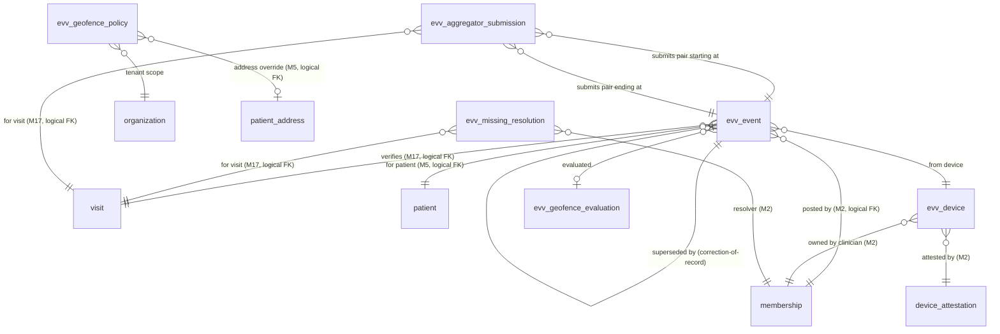
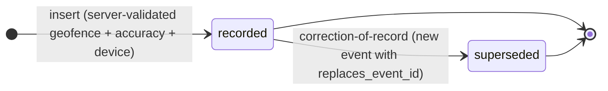
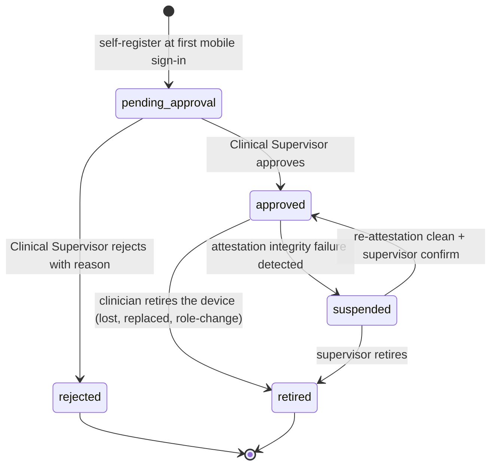
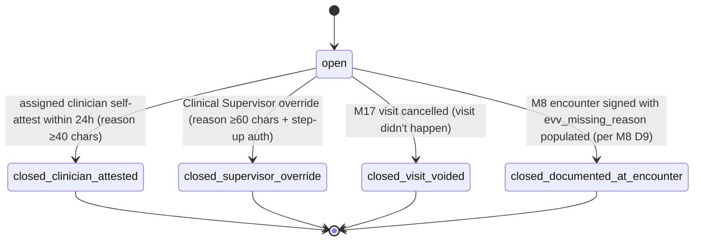
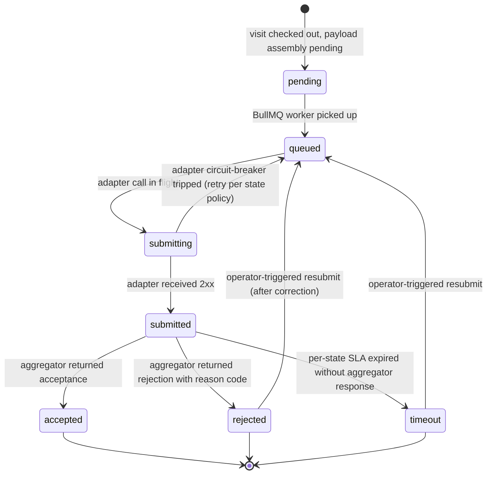

# Module 18 — Electronic Visit Verification (EVV) Specification

**Module ID:** 18
**Phase:** 1 (v1 — required for Engrace go-live; the place every in-home visit's "who, what, where, when" is verified electronically per 21st Century Cures Act §12006 and state EVV mandates; without M18 the M17 visit lifecycle has no authoritative `en_route`/`in_visit` driver, M8 D9's EVV-authoritative bracketing has nothing to bracket against, the state Medicaid aggregator submission stream is empty, the M30 EVV-compliance HQRP measure is blind, and the M20 field-safety supervisor live-awareness dashboard has no "clinician is at patient" signal)
**Depends on:** 17 (Scheduling & Route Optimization — `VisitReader.visitForEncounter` and `VisitAssignmentReader.activeVisitsForMembershipOnDate` are the read paths M18 uses to resolve a check-in to a scheduled visit; `m17.visit.published` is the outbox subscription that seeds the geofence; M17's `visit.id` is the authoritative anchor for every `evv_event.visit_id` — M18 never invents a visit, never permits a check-in without a published or imminently-arriving visit; the bidirectional relationship is the M17 D3 EVV-authoritative posture — M17 listens for `m18.evv.check_in_recorded` / `m18.evv.check_out_recorded` to drive state transitions), 5 (Patient & Demographics — `PatientAddressReader.geocodedAddressFor(patientId, kind='home')` is the source of truth for the geofence center coordinate; per M5 D5 the address is append-only with `effective_from`/`effective_to` so M18 reads the address active *at the visit's scheduled service date*, not the current primary; `patient.status='deceased'` per M5 D7 closes the EVV path for that patient — `m18.visit.subscribed` is no-op'd), 2 (Identity — actor + membership + role + discipline resolution; SESSION_POLICY enforces step-up auth on EVV self-attest at the device level — biometric required per M2 SESSION_POLICY mobile profile; the mobile device id is tied to the membership for the device-attestation chain — per D8 we read M2's `device_attestation` row to confirm the device is not jailbroken/rooted), 3 (Authorization — `evv.check_in`, `evv.check_out`, `evv.late_check_resolve`, `evv.self_attest`, `evv.aggregator_resubmit`, `evv.policy.edit`, `evv.device.register`, `evv.read`, `evv.read_metrics` permission keys; new ABAC predicates `assigned_clinician_for_visit` and `evv_within_visit_window` registered with M3's named-predicate registry; existing `caseload_or_scope` and `step_up_present` reused; the `assigned_clinician_for_visit` predicate is the central authorization seam — only the membership assigned to the M17 visit may emit EVV events for it), 4 (Audit — PHI write-audit trigger generator on every owned table; audit-read declaration on every PHI route; **retention class `compliance` not `operational`** because the EVV record is the *electronic verification of service delivery* and is itself a billing-substantiating clinical artifact under Cures Act §12006 — 7-year retention with state-override per M4 D1; GPS coordinates are denylisted from audit value-capture per the D10 PHI-minimization posture), 1 (Foundation — `organization`, `withOrgContext`, `audit()` helper, outbox dispatcher, idempotency middleware, RLS generator, per-tenant DEK envelope-encryption helper for the rare GPS-stored-encrypted case, BullMQ on Valkey, partitioned-table conventions; the `device` registration shape registers in M2 but per M2's spec the EVV-specific device row is M18-owned and points at M2's `device_attestation` by id), 36 (Secure Messaging & Alerts — geofence-breach alerts, late-checkout alerts, aggregator-submission-failure alerts, GPS-spoofing-suspected alerts, missing-EVV-pending-resolution alerts all ride M36's typed alert payloads; the `m18.evv.late_check_out_detected` flows to the patient's care team and the M19 on-call rotation when applicable), 38 (Clinical Terminology — EVV service-type codes mapped to CMS-defined values per state aggregator vocabulary; the platform-default value set ships in M38 and tenant extension follows the M38 governance pattern; the six Cures Act required data elements are typed in `packages/terminology` to keep the aggregator adapters thin), 40 (Master Data Management — `state` master data drives the per-tenant aggregator-vendor selection; `Location` per M2/M40 boundary for inpatient/contract-facility visits whose EVV anchor is a facility coordinate rather than the patient home; the state-aggregator vendor catalog is M40-managed metadata with the per-state operating model (open/alt-EVV/single-vendor) declared in the master record). Transitively the state-aggregator adapter package `packages/evv-aggregators` is M18-owned and is the only place each state-vendor's URL/credentials/payload-shape lives (D1 pluggable per-state aggregator pattern, mirrors `packages/medicaid-adapters`).
**Consumed by:** 17 (Scheduling — bidirectional: M17 publishes `visit.published` consumed by M18 to seed the geofence subscription; M18 publishes `evv.check_in_recorded` / `evv.check_out_recorded` / `evv.geofence_breach_recorded` / `evv.late_check_resolved` consumed by M17's `evv-event.consumer` worker to advance the visit through `published → en_route → in_visit → completed` per M17 D3), 8 (Encounters & Visit Notes — `encounter.evv_check_in_event_id` and `encounter.evv_check_out_event_id` are logical FKs to `evv_event.id`; M8 reads `EvvBracketResolver.bracketForEncounter(visitId)` to populate `encounter.started_at` / `encounter.ended_at` read-only when EVV is present (M8 D9 EVV-authoritative posture); when EVV is absent the M8 D9 `evv_missing_reason` ≥20 chars path activates, and on encounter sign M18 captures the documented-missing resolution row), 19 (On-Call Triage — consumes `m18.evv.late_check_out_detected` as an inbound triage trigger when no checkout arrives by the tenant-configured grace window and no encounter has signed; M18 does not import M19), 20 (Field Safety — `EvvLocationProvider.lastKnownLocationForClinician(membershipId)` is the read path M20 uses for the supervisor live-awareness dashboard per architecture §F.20; M20's pre-visit safety check-in is M20-owned but reads the M18 geofence-arrived signal to drive the "clinician arrived safely" badge; `m18.evv.check_in_recorded` is the inbound trigger for M20's at-patient alert; M18 *does not* expose continuous-location tracking — only the discrete check-in and check-out coordinates — to keep the surveillance surface narrow per HIPAA §164.502(b)), 22 (Document Management — EVV records optionally rendered as a visit-verification artifact for chart export / surveyor request via M22's typed-payload render seam; M18 emits `m18.evv.verification_pdf_requested` which M22 consumes; M18 does not own document storage), 23 (Billing — Medicare — `BillableEncounterReader` lives on M8; M18 does not write claim fields but the M8 encounter's `evv_bracket_state ∈ {evv_present, evv_missing_documented}` is M23's pre-submission gate per the Pre-Submission Validation Framework §11.A; M18 publishes `EvvComplianceReader.bracketStateForVisit(visitId)` for M23 / M24 consumption), 24 (Billing — Medicaid — per-state Medicaid claim submission requires the EVV reference for personal-care and home-health services per the state's aggregator regime; M24 reads `EvvAggregatorReferenceReader.aggregatorIdForVisit(visitId)` to populate the claim with the state-required aggregator transaction id; M24 does not import M18 schema — it reads via the seam), 25 (Remittance — when state Medicaid 835 acknowledgments reference an EVV-related denial code, M25's denial-categorization worker reads `EvvAggregatorReferenceReader` to back-link the denial to the M18 submission row for ops review), 27 (Cost Report — M18 has no cost-report data path; visit time-on-task computed from M8 mileage and encounter duration is M27's input, not M18's), 28 (FHIR Gateway — `evv_event` projected as FHIR R4 `Observation` with `code='EVV check-in'` / `EVV check-out'`, `subject=Patient`, `performer=Practitioner`, `valueCodeableConcept` for service type, `component` for GPS coordinates; the typed mapping ships now, the projection lands when M28 lands), 30 (HQRP & Quality — EVV-compliance rate (% of personal-care visits with valid EVV bracket), late-check-out rate, geofence-deviation rate, GPS-spoofing-detected rate all read M18's `EvvMetricsProvider`; the Cures Act §12006 self-reported state-aggregator compliance number is calculated from M18 and surfaced to operations), 31 (Patient/Family Portal — `PortalVisitReader` for the upcoming-visits view is M17-owned; M31 reads `EvvVerificationProvider.arrivalEventForVisit(visitId)` only to display "Nurse arrived at 10:14 AM" on the in-progress visit card after the patient/representative-facing summary is consented per M39; clinician GPS coordinates are *never* exposed to portal sessions — only the timestamp), 33 (Reporting — operational dashboards: EVV-compliance-by-discipline, late-checkout-rate-by-clinician, aggregator-submission-success-rate-by-state, GPS-quality-distribution, device-registration-coverage), 37 (Inpatient Unit — IPU visits are facility-anchored not patient-home-anchored; `EvvFacilityAnchorProvider` is the read path M37 uses to confirm the IPU bed's geofence center; an IPU bedside visit checks in against the IPU bed's M37 row, not the patient's home address).
**Spec status:** Re-locked v0.3 (Phase-2 + Phase-5 remediation; supersedes Locked v0.2)

> **Phase-5 remediation (2026-06-11; ADR-0020).** **M18-F01 (BLOCKER):** the EVV state-aggregator
> integration (OR-PTC DCI launch / Sandata-class) is now in the **Integration Catalog** (inventory
> row 26, §5 BAA register, §8 degraded-mode) via the mandatory INT-002 five-step addition. The
> aggregator carries PHI, so its **trading-partner agreement / BAA must be EXECUTED (INT-014 hard
> gate)** before any production submission — and the Phase-1 "done" gate is **no longer conditioned**
> on it. **Phase-2 (ADR-0008):** Cures Act EVV is Medicaid-only; Medicare-hospice EVV is operational
> (never a claim-blocking rule); launch state is **Oregon** (not TX/WI); HQRP has no EVV measure.

## Changelog

- **v0.2 + ADR-0021 remediation (2026-06-13)** — Added four missing §20.B template sections per ADR-0021: **M18-F10** (§8.8 DR Tier 1 declaration, RTO 1h / RPO 5min, degraded-mode offline-continue posture, aggregator queue-during-outage behavior, banner behavior via M36, post-recovery reconciliation steps; DR-010, DR-064). **M18-F11** (`Idempotency-Key` column added to §4.1 route inventory table with per-route required/— declaration and platform-idempotency-middleware header semantics note; SD-053, ARCH-263). **M18-F14** (§4.8 BullMQ queue catalog augmented with `attempts` / `backoff` / `DLQ` columns for all ten queues; per-state aggregator override documented as the explicit exception; §8.9 Audit & Observability section added with structured-logging, M4 PHI write-audit, read-tracking, Prometheus metrics catalog, alerting thresholds, distributed-tracing, and health-probe specifications; ARCH-003, ARCH-262, SD-059, OPS-035). **M18-F16** (§4.9 alert payload OOB restriction note added: push/SMS out-of-band channels carry no PHI payload; in-app rendering only; ARCH-185, SEC-048). No existing decisions, routes, schema, or workflows were altered.
- **v0.2 (Locked)** — Initial publication at lock-grade. Instantiates the architecture §20.B module spec template. Resolves all sixteen open questions into binding decisions (§11). Defines the **pluggable per-state aggregator adapter package `packages/evv-aggregators`** mirroring the `packages/medicaid-adapters` pattern — one adapter per state-aggregator vendor implementing the common `EvvAggregatorAdapter` interface, with the launch-state vendor adapter shipping in Phase 1 and additional states added via new adapter packages without touching M18 core (D1). Defines the **single-row-per-discrete-event model**: `evv_event` carries one row per check-in or check-out with GPS coordinate, device id, accuracy meters, captured-at (device clock), recorded-at (server clock); the *visit's* EVV bracket state lives on M17's `visit` row populated from these events via the cross-module event consumer (D2 — keeps M18's schema narrow and avoids dual-write inconsistency with M17). Defines the **geofence policy in three layers**: platform floor (200m radius, 50m max accuracy), tenant tighten-only (may narrow radius and tighten accuracy threshold, may not loosen), per-patient-address override (apartment buildings, gated communities, rural geocoder imprecision — explicit override row with documented reason, never narrower than tenant policy without break-glass) (D3). Defines the **GPS accuracy gate at the device** — the Capacitor app refuses to submit a check-in until the device-reported accuracy is at or under the tenant threshold or three retake attempts have elapsed; on the third attempt with degraded accuracy the app surfaces a "documented GPS imprecise" attestation that becomes an `evv_event.gps_quality='degraded_attested'` flag (D4). Defines the **offline-capture queue identical in shape to M13's offline eMAR pattern**: SQLCipher-encrypted on-device queue with `device_id` + `local_id` idempotency keys; on reconnect, the sync worker posts each row through the standard `POST /evv/check-in` route with `offline_capture=true` and the device-clock `captured_at`; the route is idempotency-keyed on `(orgId, deviceId, localId)` so retries are no-ops; the *late-entry tier* is computed against `(recordedAt - capturedAt)` mirroring M13 D8 (D5). Defines the **late-checkout detection and resolution workflow**: if no checkout event arrives within (visit's `scheduled_ended_at` + tenant grace window, default 4 hours), the `late-check-sweep` cron creates an `evv_missing_resolution` row in `open` state; the assigned clinician self-attests with reason ≥40 chars (per M17 D3 EVV self-attest reason floor) or a supervisor overrides with reason ≥60 chars; on resolve, the row's status moves to `closed_clinician_attested` or `closed_supervisor_override` and `m18.evv.late_check_resolved` fires for M17 / M8 / M23 consumption (D6). Defines the **per-state aggregator submission state machine**: `pending → queued → submitted → accepted | rejected | timeout`; submission is asynchronous via BullMQ worker per state; idempotent on `(state_code, visit_id, event_pair_hash)` so retries do not double-submit; the per-state retry policy is owned by the state adapter (states have heterogeneous SLAs and acceptable retry windows) (D7). Defines the **device integrity gate**: the Capacitor app's device-attestation result (jailbroken/rooted detected per Security Hardening §12.4) is mandatory at every EVV submission; a device that fails attestation cannot post EVV events — the route returns `DEVICE_INTEGRITY_FAILED` and the client is logged out; the gate consults M2's `device_attestation` row populated by the mobile app at sign-in and refreshed every 60 minutes (D8). Defines the **GPS-spoofing heuristic** as an *advisory-flag-not-block* signal: the `gps-spoof-detector` worker examines (a) sequential position deltas vs reported speed, (b) accuracy-vs-time-of-day patterns, (c) device-attested mock-location-API enablement; on a match the event is flagged `gps_quality='suspected_spoof'` and an M36 warn alert routes to the Clinical Supervisor; the event is *not* refused because a false positive would block a real visit (D9). Defines the **GPS-coordinate PHI-minimization posture**: the lat/lng pair on `evv_event` is encrypted at rest via per-tenant DEK envelope encryption (`coords_cipher`); the audit trigger captures the `<changed>` marker only, never the plaintext coords (D10); the M18 reader seams return coordinates only to routes whose ABAC explicitly carries `evv.read_coords` (a separate permission from `evv.read`); portal projections never include coordinates; the FHIR `Observation` projection includes coordinates only when the consuming endpoint asserts a `consent.evaluate('share_coords')` pass; this is stricter than HIPAA §164.502(b) minimum-necessary because a longitudinal coordinate stream over time reveals patient mobility patterns far beyond the visit-verification need. Defines the **aggregator-submission outbox-only handoff** with M22's PDF render seam for any state that requires a paper-trail confirmation artifact; M18 emits `m18.evv.verification_pdf_requested` and M22 renders from the typed payload — M18 has no PDF code (D11). Defines the **`evv_event` partitioned by month on `event_at`** matching M4 PHI-table conventions with **`compliance` retention class** (not `operational`); `evv_missing_resolution`, `evv_geofence_policy`, `evv_device`, `evv_aggregator_submission` non-partitioned per their lower row volumes (D12). Defines the **AI-block posture identical to M13 D15**: Module 32 (AI Platform) cannot create, modify, witness, or resolve any M18 row; boot-time validation iterates M32's registered prompt templates and any whose `outputType` matches `evv_*` fails boot; dependency-cruiser blocks `packages/ai-platform/*` imports from `apps/backend/src/modules/18-evv/*` and from `packages/evv-aggregators/*`; the per-route guard rejects requests carrying an `actor_kind='ai_*'` header (D13). Defines the **explicit M17/M18 boundary**: M18 owns `evv_event` and never writes to M17's `visit` schema; M17 owns visit lifecycle and reads M18 events via the typed outbox subscription; M17's `visit.evv_check_in_event_id` and `visit.evv_check_out_event_id` columns are logical FKs to M18 — populated by M17's `evv-event.consumer` worker, never enforced cross-module by Postgres; dependency-cruiser asserts M18 does not import `apps/backend/src/modules/17-scheduling` schema and vice versa (D14). Defines the **`EvvBracketResolver` / `EvvComplianceReader` / `EvvAggregatorReferenceReader` / `EvvLocationProvider` / `EvvMetricsProvider` / `EvvVerificationProvider` seams published for M8 / M17 / M19 / M20 / M22 / M23 / M24 / M28 / M30 / M31 / M33 / M37 consumption**, registered at boot via M1's seam registry; missing required upstream seams refuse to start (D15). Defines the **proposed manifest patch** correcting `M18.dependsOn` from `[17]` to `[1, 2, 3, 4, 5, 17, 36, 38, 40]` *(relationship inventory - not the `dependsOn` edge set; per ADR-0005 D1/D4 seam/outbox/foundation consumers are no-edge - see audit/MANIFEST_DEPENDSON_REVIEW.md; do not bulk-apply)* and adding `packages/evv-aggregators` and `packages/evv` (shared types) to `M18.codePaths`; populating `M18.ownedTables` with the seven owned tables (D16). Wires the permission keys this module registers into Module 3 (§4.6), the two ABAC predicates this module registers into Module 3's named-predicate registry (§4.7), the BullMQ queue catalog (§4.8), the M36 typed-alert payloads (§4.9), the `EvvAggregatorAdapter` seam (§4.10), and the destruction `eraseFn` registered with Module 4 (§8.4 — `compliance` retention class because the EVV record is the electronic billing-substantiation artifact).
- **v0.1** — Drafted within the lock-grade pass; not separately published.

> **Phase boundary (binding):** Phase 1 delivers everything in this spec **including the launch-state aggregator adapter** plus the platform-default open-model "no-aggregator" path for tenants in states whose Medicaid program does not impose a single-vendor aggregator (Cures Act open model states). The "done" gate for M18 is: `evv_event` schema and state machine, geofence policy engine with platform/tenant/per-address layers, mobile Capacitor check-in/check-out flow with GPS accuracy gate and offline queue, late-checkout detection cron with resolution workflow, device-integrity gate consuming M2's `device_attestation`, GPS-spoofing advisory worker, aggregator-submission state machine with the launch-state adapter wired against a recorded-fixture sandbox in CI and the real state sandbox in staging, the six published reader seams (`EvvBracketResolver`, `EvvComplianceReader`, `EvvAggregatorReferenceReader`, `EvvLocationProvider`, `EvvMetricsProvider`, `EvvVerificationProvider`) registered at boot, and the test plan green — **not gated** on Modules 19 (on-call late-checkout subscriber wires up when M19 lands; M18 emits the event to the outbox today), 20 (field-safety supervisor dashboard subscribes when M20 lands; the location-provider seam is ready and exercised against a test-double consumer), 22 (verification PDF render lands when M22 lands; the render-payload event is typed today), 23/24 (billing pre-submission gate consumes `EvvComplianceReader` when those modules lock; the seam ships today and is exercised against a test-double consumer), 25 (denial-categorization reads `EvvAggregatorReferenceReader` when M25 lands), 28 (FHIR `Observation` projection lands when M28 lands; the typed mapping ships today), 30/31/33/37 (their respective consumers when they lock). The M17 `visit.published` consumer is wired against the real M17 (M17 is locked). The M8 `encounter.signed` consumer is wired against the real M8 (M8 is locked). The M5 `PatientAddressReader` and `patient.deceased` signals are wired against the real M5 (M5 is locked).

-----


## 1. Purpose & Scope

### 1.1 What This Module Does

Module 18 owns **the electronic verification that a clinical or paraprofessional visit physically happened, at the right address, by the right person, at the right time** — the six data elements the 21st Century Cures Act §12006 makes federally non-negotiable for Medicaid-billable personal-care and home-health services. M17 owns the *scheduled* visit; M8 owns the *clinical record* of the visit; M18 owns the *electronic verification* — the GPS-stamped, device-attested, time-stamped pair of events that says "this clinician was physically present at this patient's home from 10:14 to 10:53 on 2026-06-15." Without M18 the M17 visit lifecycle has no authoritative driver beyond clinician self-attestation; without M18 the M8 encounter's `evv_present` bracket state is never reachable; without M18 the M23/M24 billing pre-submission gate has no EVV reference to satisfy state aggregator submission requirements; without M18 the M30 HQRP EVV-compliance measure reports zero. M18 is the place a clinician answers "I'm here, starting the visit now" and the place the state Medicaid aggregator receives the verified-service-delivery record that turns a hospice claim from "pending review" into "payable."

- **Event row** — one `evv_event` per discrete electronic verification action. Two events per complete visit in the normal path: one `check_in` and one `check_out`. The pair brackets the visit. M18 never collapses the pair into a single "visit-verification" record because the two events have independent failure modes (a check-in succeeds, the clinician's phone dies mid-visit, the check-out is recorded from a backup device or self-attested via the M18 late-resolution flow — both events stand independently on the audit trail). The events are append-only after creation; corrections take the M18 correction-of-record pattern (a new event with `replaces_event_id` set), never an in-place UPDATE.

- **Geofence policy** — the per-tenant configuration that says "a check-in counts as 'at the patient's home' if the device-reported coordinate is within R meters of the patient_address coordinate, given accuracy at most A meters." Three layers per D3: platform floor (200m radius, 50m accuracy max — the floor everyone gets), tenant tighten-only (a tenant may narrow to 100m / 30m max, may not loosen), per-address override (the specific patient_address may extend the radius — apartment buildings, gated communities, rural geocoder imprecision — with documented `override_reason ≥ 30 chars` and never narrower than tenant policy). The geofence is evaluated *server-side* at check-in time using the haversine-distance formula and the device-reported accuracy, not just the raw point — a device reporting 8m accuracy at a coordinate 195m from the geofence center passes; a device reporting 75m accuracy at 100m fails because the *possible* position circle reaches outside.

- **Device registration** — `evv_device` is M18's per-tenant-per-clinician device record (one row per device the clinician uses for EVV). It carries the M2 `device_attestation` row id, the device's platform (`ios`/`android`/`web_unsupported`), an opaque `device_key_fingerprint` for the SecureStore key the device uses to sign the offline-capture envelope, and the registration date. Web sessions cannot post EVV events — only registered mobile devices can — because the architecture's mobile strategy resolution (ADR-008 closed v0.7: Capacitor for field) makes web-EVV a security regression we explicitly reject. The device registration step happens at the clinician's first mobile sign-in via the M18 device-self-register flow and is approved by the Clinical Supervisor on the M18 device-approval queue per D8 (preventing a device from being silently swapped to defeat the integrity gate).

- **Aggregator submission** — `evv_aggregator_submission` is the per-state-aggregator submission record. One row per (visit, state) when the state's regime requires submission to a state aggregator. The submission state machine (D7) carries the row from `pending` (visit checked out, payload assembled, queue not yet drained) → `queued` (BullMQ has it) → `submitted` (the per-state adapter has acknowledged the post) → `accepted` | `rejected` | `timeout` (the per-state adapter reports the aggregator's response). The adapter package `packages/evv-aggregators/` is the only place the per-state aggregator endpoint, credentials, and payload-shape live; mirrors the `packages/medicaid-adapters/` pattern from architecture §11.E / Integrations §6.5. **Open-model states** (some states accept any compliant EVV vendor without a single state aggregator) take the no-aggregator path — the EVV event row exists, the M17 / M8 / M23 / M24 consumers read it, and the row's `aggregator_submission_required=false` flag short-circuits the submission flow.

- **Late-checkout detection and resolution** — the `late-check-sweep` cron runs every 15 minutes. It finds visits where `m17.visit.published` was consumed (geofence is subscribed), a `check_in` event arrived, and no `check_out` event has arrived by (visit's `scheduled_ended_at` + tenant grace window, default 4 hours). It creates an `evv_missing_resolution` row in `open` state, emits `m18.evv.late_check_out_detected` to M36 (warn severity routes to the assigned clinician + their Clinical Supervisor + M19's on-call rotation), and stops creating duplicate rows for the same visit via idempotency on `(visit_id, kind='missing_checkout')`. The resolution workflow (D6) lets the assigned clinician self-attest within the next 24 hours (reason ≥40 chars), or a Clinical Supervisor override after that window (reason ≥60 chars + step-up auth), or in the rare case the visit didn't actually happen the visit is cancelled in M17 with reason and the EVV resolution row closes as `closed_visit_voided`.

- **EVV self-attest path (M17 D3 + M8 D9 anchor)** — when the device path fails entirely (cell signal absent from departure to return, device crashed, GPS hardware fault), the clinician self-attests via M17's `POST /visits/:id/start` route with `evv_missing_reason ≥ 20 chars`. This route writes to M17, not to M18 — M18 does not own self-attestation. But on the M8 encounter sign that consumes a self-attested visit, M8 D9 emits the documented-missing path; M18's `m8.encounter.signed` consumer captures the EVV-missing context as an `evv_missing_resolution` row in `closed_documented_at_encounter` state for surveyor traceability. The reason is preserved in the M8 encounter; the M18 row is the traceability marker.

- **GPS-coordinate privacy** — the lat/lng on every EVV event is encrypted at rest via per-tenant DEK envelope encryption (D10). The audit trigger captures the `<changed>` marker only, never the plaintext coordinates. Reads require the explicit `evv.read_coords` permission, separate from `evv.read`. Portal projections (M31) never expose coordinates — only the timestamp ("Nurse arrived at 10:14 AM"). The FHIR projection (M28) gates coordinates behind a consent.evaluate call. This is stricter than HIPAA §164.502(b) minimum-necessary because a longitudinal stream of patient-home coordinates reveals far more than the visit-verification need — it's a patient mobility surveillance dataset by accumulation. The policy is "coordinates are decrypted at read time only for the audited routes that need them, and never persisted in plaintext on tape, in logs, or in operational backups."

- **Device integrity gate (D8)** — every EVV submission consults M2's `device_attestation` row for the posting device. A device reporting `jailbroken=true` / `rooted=true` / `attestation_invalid=true` is refused with `422 DEVICE_INTEGRITY_FAILED`. The attestation row is refreshed by the mobile app every 60 minutes per Security Hardening §12.4; the gate consults the *latest* row, so a freshly compromised device cannot continue posting under a stale-but-clean attestation. This gate is the operational expression of the architecture's "you cannot run on a jailbroken device" posture.

- **GPS-spoofing heuristic (D9)** — a background worker (`gps-spoof-detector`) examines each new `evv_event` for spoofing signals: (a) the distance-vs-elapsed-time delta between this event and the same clinician's previous event is physically implausible (e.g., 80km in 3 minutes), (b) the device's mock-location-API enablement flag was true at capture (reported by Capacitor's native plugin), (c) the GPS accuracy pattern is statistically anomalous (e.g., constant 5m accuracy across 20 events when natural variation is 8–30m). On match, the event is flagged `gps_quality='suspected_spoof'` and an M36 warn alert routes to the Clinical Supervisor. **The event is not refused** because a false positive would block a real visit; the flag triggers human review, not automated rejection. The flag is visible on the EVV-events-by-visit view and on the surveyor-prep export.

- **AI block (D13)** — Module 32 cannot create, modify, witness, or resolve any M18 row. The architecture is explicit: EVV is the electronic substantiation of physical service delivery; an AI-generated EVV event would be fraud per Cures Act §12006 and 42 CFR §455.20. The block has three layers: boot-time validation refuses any M32 prompt template whose `outputType` matches `evv_*`; dependency-cruiser blocks `packages/ai-platform/*` imports from `apps/backend/src/modules/18-evv/*` and `packages/evv-aggregators/*`; the per-route guard rejects requests carrying `actor_kind='ai_*'` in the M2 session context.

### 1.2 What This Module Does Not Do

- **The scheduled visit.** Module 17 owns `visit`, `visit_state_history`, the eight-state lifecycle, the recurring-visit policies, the proposal flow, the pre-schedule gate. M18 reads `m17.visit.published` to know which visits to subscribe a geofence to; M18 emits `m18.evv.check_in_recorded` / `check_out_recorded` for M17 to advance the visit state machine. M18 cannot import M17's schema; M17 cannot import M18's schema. The boundary is enforced by dependency-cruiser per architecture-fitness §25.15 check #1.

- **The clinical record / encounter.** Module 8 owns the encounter, the narrative, the vitals, the HearthNote pipeline, the signature, the addendum tier. M18 publishes the EVV-event ids that M8 carries as logical FKs on its encounter row (`evv_check_in_event_id`, `evv_check_out_event_id`); M18 reads `m8.encounter.signed` to seal the EVV-missing-documented resolution path. The boundary is the same — neither imports the other's schema.

- **Patient address geocoding.** Module 5 owns address normalization, geocoding, and the `effective_from`/`effective_to` address-history pattern. M18 reads `PatientAddressReader.geocodedAddressFor(patientId, kind='home', asOf=serviceDate)` and accepts whatever coordinate M5 returns. Geocode failures are M5's degraded-mode problem — when M5's `PatientAddressReader` returns a null coordinate (geocoder timeout, address not yet processed), the M18 geofence falls back to *advisory-not-enforcing* mode for that visit — the check-in still records, but `gps_quality='no_geofence_baseline'` flags it and the EVV-compliance metric counts it as a partial.

- **Field-safety supervisor live-awareness dashboard.** Module 20 owns the supervisor's "where are my clinicians right now" surface. M18 publishes `EvvLocationProvider.lastKnownLocationForClinician(membershipId)` which returns the most recent `evv_event` coordinate for that clinician within the last 12 hours; M20 builds the dashboard from this seam plus M20's own pre-visit and SOS check-ins. **M18 explicitly does not stream continuous location** — only the discrete check-in and check-out coordinates per visit. A clinician driving between visits is not tracked. The mid-visit "I'm okay" check-in (different from EVV) is M20's domain.

- **Mileage and time-on-task.** Module 8 D10 owns `mileage` per encounter. M17 D10 owns the route-proposed mileage from optimization. M18 does not store or publish mileage. The clock-time between check-in and check-out is on the EVV events but is not a billable time-on-task figure — billable duration is computed from the encounter's `started_at`/`ended_at` per M8 D9, which may or may not match EVV depending on the documented-missing path.

- **State aggregator vendor selection per tenant.** Module 40 owns master data including the per-state aggregator vendor catalog and the per-state operating model (open / alt-EVV / single-vendor). M18 reads the M40 master record at boot per state and selects the corresponding adapter from `packages/evv-aggregators/`. Adding a new state-aggregator adapter is a new package + a new M40 master entry + a new §6 entry in WARDENX_INTEGRATIONS, not an M18 code change.

- **The aggregator-reported claim acceptance from the state Medicaid trading partner.** The state Medicaid aggregator returns its own acceptance/rejection for the EVV submission; M18 stores that response on the `evv_aggregator_submission` row. The *downstream* claim (837) that references the EVV record is M24's domain; the claim acceptance/rejection (835) is M25's domain. M18 ends its responsibility at the aggregator's EVV-record-level response.

- **Wound-photo capture, vitals capture, or anything else "in the visit."** M18 records the verification brackets only. Everything inside the brackets is M8's domain.

- **Patient/representative-facing notifications about the clinician's arrival.** Module 22 + Module 36 own the channel and the consent layer for caregiver notifications. M18 emits `m18.evv.check_in_recorded`; if the patient opted into arrival reminders via M22's preference layer, M22 builds the SMS/push and M36 fans it out. M18 has no SMS/push code path.

- **Mid-visit re-check.** Some EVV regimes in some states require periodic in-visit verification (every 15 / 30 minutes). Per D2 the M18 v0.2 model is **two events per visit** (check-in + check-out). Mid-visit re-check is a Phase 2 candidate gated on a state requiring it; the schema is extended-not-replaced (new `evv_event.kind='mid_visit_pulse'`); the Phase-1 cut is two events because no Engrace launch state requires more.

### 1.3 Regulatory Drivers

| Driver | Requirement | How Module 18 satisfies it |
|---|---|---|
| **21st Century Cures Act §12006** (Section 1903(l) of the Social Security Act) | Electronic visit verification required for Medicaid-funded personal-care services (since 2020) and home-health services (since 2023) | The single-row-per-discrete-event model captures all six required data elements: (1) type of service performed (`evv_event.service_type_code` ← M38 value set), (2) the individual receiving service (`evv_event.patient_id`), (3) the date of service (`evv_event.event_at::date`), (4) the location of service (`evv_event.coords_cipher` + geofence verification result), (5) the individual providing service (`evv_event.posting_membership_id`), (6) the time service begins and ends (the check-in and check-out timestamps). |
| **42 CFR §455.20** — State Plan Personal Care Services Program Integrity | EVV must be tamper-evident and auditable | Append-only `evv_event` table with M4 PHI write-audit trigger and immutability trigger refusing UPDATE on all columns except the correction-of-record `superseded_at`/`superseded_by_event_id` markers; coordinates encrypted at rest per D10; device-attestation gate per D8 |
| **42 CFR §418.104(a)** | Clinical records — completeness, authentication, retention | The EVV event is *not* the clinical record (M8 is) but is a *billing-substantiation artifact* tied to the clinical record via the visit; M18 carries `compliance` retention class per D12 — 7-year retention with state-override per M4 D1 |
| **HIPAA §164.502(b)** — Minimum necessary | Disclose only what's needed | Coordinates encrypted at rest; reads require explicit `evv.read_coords` permission (separate from `evv.read`); portal projections never include coordinates; FHIR projection gates coordinates behind consent.evaluate; longitudinal coordinate stream is deliberately *not* aggregated for any purpose other than per-visit verification |
| **HIPAA §164.312(b)** — Audit controls | Tamper-evident audit trail | M4 PHI write-audit trigger on every owned table; `coords_cipher` denylisted from value capture (the `<changed>` marker recorded but the encrypted bytes never re-emitted to audit storage to avoid double-encryption cost); device id and posting membership audit-captured on every event |
| **HIPAA §164.502(g)** — Personal representatives | DPOA/healthcare-proxy access to PHI | Coordinates exposed to a portal session require the M39 `family_caregiver_access` consent context; the same patient-stream that's PHI for the patient is PHI for the patient's representative |
| **42 CFR Part 2 (SUD)** — Substance use disorder confidentiality | SUD content requires explicit patient release for disclosure | The EVV event itself does not carry SUD content, but a visit's `visit_purpose` may carry an SUD-flagged service code; in that case the SUD-disclosure-allowed predicate gates downstream consumption of the EVV event in narrative reports — M30 reporting, M28 FHIR — same pattern as M9 D10 / M11 |
| **State EVV mandates** (varies — IL, MN, WI, NY, FL, etc.) | State-specific aggregator vendors, payload schemas, submission cadences, and acceptance rules | The pluggable per-state aggregator adapter pattern (D1) implements the common `EvvAggregatorAdapter` interface; per-state vendor variation isolated to the adapter package; M18 core knows only the interface |
| **State patient-bill-of-rights laws** (varies) | Patients have the right to know who is in their home and for how long | The EVV record is the audit answer; the portal arrival-notification surface (consumed by M31 via `EvvVerificationProvider`) is the patient-facing answer |
| **CMS National Provider Identifier (NPI) Rule** | Practitioner identity must be verifiable | `evv_event.posting_membership_id` resolves through M2 to the user's NPI when applicable; the aggregator submission payload carries the NPI for state-aggregator verification |
| **State medical-practice acts and discipline scope** (varies) | Some EVV regimes accept only specific disciplines (RN, LPN, CHHA) for service-type-specific visits | The `assigned_clinician_for_visit` ABAC predicate (M18-owned, registered with M3) consults M17's `visit.assignedDisciplineAtAssignment` and M2's discipline resolver; a discipline mismatch refuses the check-in |
| **42 CFR §455.21** — Provider screening and enrollment | Provider credentials must be active | The check-in route consults M2's `CredentialReader.activeCredentialsAsOf` for the posting clinician's required credentials on the service date; expired credentials refuse the check-in with `CREDENTIAL_EXPIRED` — same gate M17's pre-schedule predicate 1 enforces, re-evaluated at check-in because credentials may expire between scheduling and arrival |
| **State Medicaid program integrity** (varies — "fraud, waste, and abuse" rules) | Detection and reporting of falsified service delivery | The GPS-spoofing heuristic (D9) emits `m18.evv.gps_spoof_suspected` for Clinical Supervisor review; the late-checkout resolution audit trail is surveyor-grade; the device-integrity gate refuses compromised devices |

### 1.4 Competitive Context

WellSky, MatrixCare, HCHB, FireNote/Axxess, and Hospicelink all ship an EVV module — most of them rebranded integrations with one of the major EVV vendors (Sandata, HHAeXchange, Tellus, CareBridge). The common pattern: **a tightly-coupled vendor wrapper where the EVV vendor's API surface bleeds into the EHR's domain model, where the geofence is a single radius the agency administrator may or may not have configured correctly, where the state-aggregator submission is a fire-and-forget message with no retry policy visible to operations, where device integrity is "the user agreed to terms of service in the mobile app," and where the GPS coordinates are stored in a vendor's cloud at full resolution for the legally-required retention period plus marketing analytics.**

The failure modes are dispiritingly common. A clinician's phone GPS reports 80m accuracy and the check-in records anyway with no audit annotation, then the state surveyor questions the visit and there's no way to reconstruct whether the clinician was actually within the geofence. A state aggregator submission fails silently and the agency only finds out at month-end claim reconciliation when 30 days of EVV records are rejected. An EVV vendor swap requires a six-month re-implementation because the vendor's schema is hardcoded throughout the EHR. A jailbroken device posts hundreds of fake check-ins from a Starbucks parking lot and the EVV record looks pristine. A patient's home coordinate is logged in the vendor's analytics pipeline for "service-area optimization" and the BAA quietly allows it.

WardenX rejects every one of those failure modes at the seam:
- **The geofence is a typed three-layer policy** with platform floor, tenant tighten-only, per-address override — not a single field the administrator may forget. The accuracy threshold is mandatory and the gate is enforced server-side, not on the device.
- **The state-aggregator submission has a state machine** (`pending → queued → submitted → accepted | rejected | timeout`), a typed retry policy per state adapter, and a per-tenant ops dashboard showing pending submissions, failures, and the operator-actionable retry/escalate path. A silent submission failure is impossible — every row is in some terminal or actively-retrying state, and the operator sees it.
- **The aggregator vendor swap is a new adapter package + an M40 master-data update** — never an M18 code change. Mirrors `packages/medicaid-adapters/` per architecture §11.E.
- **Device integrity is a hard gate** consuming M2's device-attestation row; a jailbroken device cannot post EVV; the gate is the operational expression of Security Hardening §12.4's "this app cannot run on jailbroken devices for patient safety."
- **GPS coordinates are encrypted at rest, never aggregated, never exposed outside the audited routes that need them, and never sent to third-party analytics.** The PHI-minimization posture is stricter than HIPAA minimum-necessary because a coordinate stream is a surveillance dataset.
- **AI is structurally blocked from creating, modifying, or resolving EVV rows.** The block has three layers (boot-time validation, dependency-cruiser, per-route guard). The architecture's position is that an AI-generated EVV event is fraud, full stop; the implementation makes the position unreachable from any direction.

The differentiated surface is "EVV that is provably correct, provably auditable, and provably not the wrong vendor's prisoner." This is the same architectural principle as M17 (the scheduler enforces the boundary), M11 (orders can't be active without a signature), M13 (administration of a discontinued med rejects), and M12 (controlled substances cannot ship without the EPCS gate). EVV is verification; verification that the system cannot itself verify is not verification.

-----


## 2. Domain Model

### 2.1 Entity-Relationship Diagram



The diagram is logical. M2 / M5 / M17 entities are referenced by logical FK columns; M18 does **not** import those modules' Drizzle schemas (per architecture-fitness §25.15 check #1). Cross-module reads go through the owners' published reader seams.

### 2.2 Per-Entity Lifecycle

#### 2.2.1 `evv_event` — the discrete check-in or check-out (D2)

One row per check-in or check-out. Append-only after creation; corrections take the correction-of-record pattern (a new event with `replaces_event_id` set; the original's `superseded_at`/`superseded_by_event_id` set in the same transaction).

The event has no lifecycle state of its own — it exists or it doesn't. The *visit's* EVV bracket state lives on M17's `visit` row populated from these events via the M17 `evv-event.consumer` worker.



**Validation guards** (enforced in `evv-event-recorder.ts` and at the DB CHECK level):
- Geofence radius + accuracy must satisfy the policy for the active patient_address at the visit's service_date (D3); failure routes to `gps_quality='outside_geofence'` flag — the event is *recorded* but the visit's bracket state may not flip to `evv_present` automatically (see workflows).
- The posting membership must equal the M17 visit's `assigned_membership_id` per the `assigned_clinician_for_visit` ABAC predicate; failure refuses the route with `422 NOT_ASSIGNED_CLINICIAN`.
- The visit's status at check-in must be in `{proposed, published, en_route}` (proposed is rare — covers the case where the geofence-arrived signal precedes the scheduler's publish action; the consumer auto-publishes if the gate passes); at check-out, status must be in `{en_route, in_visit}`.
- The check-in and check-out must be on the same M17 visit; a check-out for a visit that had no check-in is permitted but creates an `evv_missing_resolution` row in `open_missing_checkin` state with the same workflow as the missing-checkout case.
- The device's M2 `device_attestation.status` must be `attested_clean`; otherwise `422 DEVICE_INTEGRITY_FAILED` (D8).
- Coordinates and accuracy are required; `gps_quality` ∈ {`high`, `acceptable`, `degraded_attested`, `outside_geofence`, `no_geofence_baseline`, `suspected_spoof`}.

#### 2.2.2 `evv_geofence_policy` — three-layer geofence policy (D3)

One platform-level row (created at install, immutable except by platform_ops break-glass), one per tenant (created at tenant onboarding), and per-patient-address override rows as needed. The effective policy for a visit is computed by `geofencePolicyResolver.effectivePolicy(orgId, patientAddressId, serviceDate)` which returns the narrowest applicable layer's settings.

```mermaid
stateDiagram-v2
    [*] --> active
    active --> superseded: edit (creates a new row with new effective_from; old row's effective_to set)
    superseded --> [*]
```



Editing the tenant policy is permitted (within the tighten-only constraint); editing a per-address override is permitted by Clinical Supervisor or above. Edits create a new row rather than UPDATE so the policy history is auditable at the row level — important for surveyor questions like "what was the geofence radius on 2026-03-04 when this visit was recorded?"

#### 2.2.3 `evv_device` — per-clinician registered mobile device (D8)

One row per device per clinician. Lifecycle:



The `evv_device.m2_device_attestation_id` is the logical FK to M2's `device_attestation` row. The two rows are independent — the M2 attestation row is refreshed every 60 minutes per Security Hardening §12.4; the M18 device-registration row carries the approval lifecycle. Both must be in a clean state for an EVV event to record.

#### 2.2.4 `evv_missing_resolution` — late-checkout or missing-checkin resolution (D6)

One row per visit that has an unresolved missing event. Lifecycle:



The `kind` enum: `missing_checkin`, `missing_checkout`, `outside_geofence_at_checkin`, `outside_geofence_at_checkout`, `device_integrity_failed_at_attempt`. The `closed_*` states are terminal; M4 audit trigger captures the resolution decision; the resolver is read on every subsequent visit-state-history query so the surveyor sees the full traceability chain.

#### 2.2.5 `evv_aggregator_submission` — per-state aggregator submission (D7)

One row per (visit, state) where the state regime requires aggregator submission. Lifecycle:



Idempotency on `(state_code, visit_id, event_pair_hash)` — `event_pair_hash` is SHA-256(check_in_event.id || check_out_event.id). A retry posts the same payload with the same idempotency key; the per-state adapter is responsible for honoring it against its vendor's idempotency semantics (most vendors accept and dedupe; some don't, and the adapter's circuit-breaker absorbs the "already submitted" response as a success).

#### 2.2.6 `evv_geofence_evaluation` — per-event geofence evaluation record (informational)

One row per `evv_event` capturing the geofence evaluation result at recording time:
- the effective policy id (which layer applied)
- the patient_address id and geocoded coordinates used
- the device coordinate and accuracy
- the haversine distance
- the pass/fail decision and the reason if fail (`distance_exceeded`, `accuracy_exceeded`, `no_baseline_coordinate`)

The evaluation is a snapshot — the policy or address may change later, but the evaluation row preserves what was checked. Surveyor-grade.

### 2.3 Validation Rules

- An `evv_event` may exist only with a non-NULL `visit_id` (M17) and `patient_id` (M5); the patient_id must match the visit's patient (cross-checked via M17 reader at recording time).
- An `evv_event.kind ∈ {check_in, check_out}` (v0.2; `mid_visit_pulse` reserved for Phase 2).
- A `check_in` for a given visit may exist at most twice on the row before the second is rejected as a correction-of-record (the second must carry `replaces_event_id` and the first must transition to `superseded`); same for `check_out`.
- An `evv_event.captured_at` ≤ `evv_event.recorded_at` is enforced by DB CHECK (clinician's device clock may lag behind server, never lead).
- An `evv_event.accuracy_m > 0` and `≤ 500` are enforced by DB CHECK (a device reporting 1000m accuracy is reporting garbage; refuse at the boundary).
- An `evv_event.coords_cipher` is non-NULL on insert; the decryption fails-loud if the per-tenant DEK is missing at read time (no silent fallback to null).
- An `evv_event.posting_membership_id` must equal the M17 visit's `assigned_membership_id` at the time of recording (re-checked via M17 reader; a reassignment-in-flight race is handled by the M17 outbox event ordering).
- An `evv_event.evv_device_id` must reference an `evv_device.status='approved'` row; otherwise reject with `DEVICE_NOT_APPROVED`.
- An `evv_geofence_policy.radius_m ≥ 50 AND ≤ 1000` (DB CHECK); platform floor 200m, tenant may narrow to 50m, may not loosen above 1000m.
- An `evv_geofence_policy.max_accuracy_m ≥ 5 AND ≤ 100` (DB CHECK); platform floor 50m.
- An `evv_geofence_policy.scope ∈ {platform, tenant, patient_address}` and the resolver applies in that order.
- An `evv_device.platform ∈ {ios, android}` (DB CHECK); web is refused at the route handler level.
- An `evv_missing_resolution` may exist at most once per `(visit_id, kind)` in non-terminal state — enforced by partial unique index.
- An `evv_missing_resolution.resolved_by_membership_id` is required on every closed_* state.
- An `evv_missing_resolution.reason` minimum length depends on the close state per D6 (≥40 chars for clinician attest, ≥60 chars for supervisor override).
- An `evv_aggregator_submission.state_code` must reference an M40-registered state with a configured aggregator adapter (or the no-aggregator open-model flag); otherwise reject at boot.
- An `evv_aggregator_submission.event_pair_hash` is the deterministic SHA-256 of the ordered event ids; recomputed on every state transition and compared to detect drift.
- A correction-of-record (new event with `replaces_event_id`) may only be filed by Clinical Supervisor or above with step-up auth and `correction_reason ≥ 60 chars`; the route is `POST /evv/events/:id/correct` and is audited at `critical` severity.

### 2.4 Side Effects

| Trigger | Side effect |
|---|---|
| `evv_event` inserted (check_in) | Insert `evv_geofence_evaluation`; emit `m18.evv.check_in_recorded` (M17 + M20 + M22 + M36 subscribers); if the geofence evaluation passes (`geofenceDecision='inside_geofence'`), emit `m18.evv.at_patient_address` (M17 subscriber); if `gps_quality='suspected_spoof'`, emit `m18.evv.gps_spoof_suspected` (M36 warn); if `gps_quality='outside_geofence'`, emit `m18.evv.geofence_breach_recorded` (M36 warn + creates `evv_missing_resolution` in `outside_geofence_at_checkin` state) |
| `evv_event` inserted (check_out) | Same as above plus: trigger `aggregator-submission-prep.worker` (if state requires aggregator submission); emit `m18.evv.check_out_recorded` (M17 + M8 + M22 + M36 + M23/M24 subscribers); if the check-out pairs with an in-geofence, non-superseded check-in and no `evv_missing_resolution` is open for the visit, emit `m18.evv.visit_verified` (M30 subscriber); cancel any `evv_missing_resolution` row in `open_missing_checkout` for this visit by transitioning to `closed_clinician_attested` (system-driven; no human action) |
| `evv_event` superseded by correction | Insert `visit_state_history` indirectly via M17's consumer of the new event; emit `m18.evv.event_corrected` (M4 audit at critical; M17 + M8 + M23/M24 subscribers re-evaluate if needed) |
| `late-check-sweep` cron finds match | Insert `evv_missing_resolution` (idempotent on `(visit_id, kind)`); emit `m18.evv.late_check_out_detected` (M19 + M36 + M22-caregiver if opt-in) |
| `evv_missing_resolution` closed | Emit `m18.evv.late_check_resolved` (M17 + M8 + M23/M24 + M36) |
| `evv_device` created (self-register) | Emit `m18.evv.device_pending_approval` (M36 routes to Clinical Supervisor) |
| `evv_device` approved | Emit `m18.evv.device_approved` (M36 confirms to clinician) |
| `evv_device` suspended | Emit `m18.evv.device_suspended` (M36 warn to clinician + supervisor); cancel any in-flight EVV attempts from that device |
| `evv_geofence_policy` edited | Insert new row; emit `m18.evv.geofence_policy_changed` (M4 audit; M22 documents change for surveyor traceability) |
| `evv_aggregator_submission` transitions to `accepted` | Emit `m18.evv.aggregator_accepted` (M24 + M30 + M33 subscribers) |
| `evv_aggregator_submission` transitions to `rejected` | Emit `m18.evv.aggregator_rejected` (M25 denial-categorization + M36 warn to operator) |
| `evv_aggregator_submission` transitions to `timeout` | Emit `m18.evv.aggregator_timeout` (M36 critical to operator + ops dashboard surfaces) |
| `m17.visit.published` consumed | Insert geofence subscription marker (in Valkey; not a DB row) keyed on `(orgId, visitId)` with TTL = scheduled_ended_at + 24h; allows the device's check-in route to resolve the visit fast without a DB lookup |
| `m17.visit.cancelled` consumed | Remove geofence subscription marker; if `evv_event` already exists, mark `evv_aggregator_submission` (if any) as cancelled and emit `m18.evv.aggregator_cancelled` |
| `m8.encounter.signed` consumed (visit_id non-NULL) | If `evv_missing_resolution` is open for this visit, transition to `closed_documented_at_encounter` with `resolved_by_membership_id` = encounter's signing clinician and `reason` = encounter's `evv_missing_reason` |
| `m5.patient.deceased` consumed | Cancel any scheduled visits' geofence subscriptions for that patient; do not retroactively alter existing EVV events |

### 2.5 Concurrency — Optimistic with `version` Column (Where Applicable)

`evv_event` is append-only — no concurrency concerns; the only "update" is the `superseded_at`/`superseded_by_event_id` set on correction, and that's done in the same transaction as the new event's insert.

`evv_geofence_policy` carries `version bigint NOT NULL DEFAULT 0`. PATCH routes (tenant policy edit, per-address override edit) require `If-Match: <version>`; mismatched versions return 412 with the current row state. Pattern mirrors M17 §2.5 verbatim.

`evv_device` carries `version`. State transitions (approve, suspend, retire) use the `If-Match` pattern.

`evv_missing_resolution` carries `version`. The close transition uses `If-Match` to prevent the race where a supervisor and the clinician both attempt to resolve simultaneously — first writer wins, the other gets 412 with the current resolved state.

`evv_aggregator_submission` carries `version`. The state machine transitions (queued → submitting → submitted → accepted/rejected/timeout) use `If-Match`. The BullMQ worker holding the row's state lock during submission re-fetches with the `If-Match` header before each transition to detect a parallel operator-initiated resubmit; conflict resolution is "operator wins, worker drops its lock."

For the per-visit-per-state aggregator submission idempotency, the database is the final authority via the partial unique index `(state_code, visit_id) WHERE status != 'cancelled'` — even if two workers attempt to create submissions for the same (state, visit), the second insert returns `23505 unique_violation` which the route handler translates to `AGGREGATOR_SUBMISSION_EXISTS` with the existing row id in the envelope.

-----


## 3. Drizzle Schema

### 3.1 Package Layout

```
apps/backend/src/modules/18-evv/
├── routes/                    # evv/check-in, evv/check-out, evv/events/:id, evv/events/:id/correct,
│                              # evv/devices, evv/devices/:id/approve, evv/devices/:id/suspend,
│                              # evv/geofence-policy, evv/geofence-policy/:id (PATCH),
│                              # evv/geofence-policy/per-address, evv/missing-resolutions,
│                              # evv/missing-resolutions/:id/clinician-attest,
│                              # evv/missing-resolutions/:id/supervisor-override,
│                              # evv/aggregator-submissions, evv/aggregator-submissions/:id/resubmit,
│                              # evv/offline-sync, evv/metrics
├── services/                  # evv-event-recorder (write path), geofence-policy-resolver,
│                              # geofence-evaluator (haversine + accuracy math),
│                              # missing-resolver (the D6 state machine driver),
│                              # device-registrar, aggregator-orchestrator,
│                              # gps-spoof-detector (the D9 heuristic),
│                              # correction-of-record service
├── workers/                   # late-check-sweep.cron, aggregator-submission-prep.worker,
│                              # aggregator-submitter.worker (per-state queues),
│                              # aggregator-response-poller.cron (for adapters that need polling),
│                              # gps-spoof-detector.worker (post-insert background job),
│                              # visit-published.consumer (M17 → seed geofence subscription),
│                              # visit-cancelled.consumer (M17 → tear down subscription),
│                              # encounter-signed.consumer (M8 → resolve documented-missing),
│                              # patient-deceased.consumer (M5 → tear down active subscriptions)
└── boot.ts

packages/db/src/schema/evv/
├── evv-event.ts                evv-geofence-policy.ts
├── evv-geofence-evaluation.ts  evv-device.ts
├── evv-missing-resolution.ts   evv-aggregator-submission.ts
└── enums.ts

packages/evv-aggregators/        # per-state aggregator adapter package (D1) — the ONLY place each
│                                # state-vendor endpoint, credentials, payload-shape lives
├── src/
│   ├── interface.ts             # EvvAggregatorAdapter TypeScript interface
│   ├── registry.ts              # per-state adapter selector (reads M40 master data)
│   ├── open-model.ts            # the no-aggregator adapter used in open-model states
│   ├── adapters/
│   │   ├── sandata-adapter.ts   # the WI / nationwide-open-model adapter (Phase 1 launch)
│   │   ├── hhaexchange-adapter.ts   # NY/MA/OK adapter (Phase 2 candidate)
│   │   ├── tellus-adapter.ts        # FL/MS/NJ/IL adapter (Phase 2 candidate)
│   │   └── carebridge-adapter.ts    # KY/IN adapter (Phase 2 candidate)
│   ├── circuit-breaker.ts       # per-adapter circuit breaker integration
│   └── degraded-error.ts
└── package.json

packages/evv/                    # shared domain types (read by M8, M17, M23, M24, M28, M30 via seams)
├── src/
│   ├── seams.ts                 # EvvBracketResolver, EvvComplianceReader, EvvAggregatorReferenceReader,
│   │                            # EvvLocationProvider, EvvMetricsProvider, EvvVerificationProvider
│   ├── events.ts                # outbox event payload TypeBox
│   ├── geofence.ts              # the haversine + accuracy math (pure functions; unit-testable)
│   └── service-types.ts         # the Cures Act six-element value set (sourced from M38)
```

### 3.2 Migration Script Phases (`0018_evv.sql`)

- **Phase A — DDL.** Enums (`evv_event_kind`, `evv_event_gps_quality`, `evv_device_platform`, `evv_device_status`, `evv_geofence_policy_scope`, `evv_missing_resolution_kind`, `evv_missing_resolution_status`, `evv_aggregator_submission_status`). Six tables. Partition declaration on `evv_event` by month on `event_at`. Indexes (per §3.4).
- **Phase B — RLS + audit.** Apply `wardenx_enable_rls()` to all six tables; install audit triggers via `wardenx_generate_audit_trigger` for each; install denylist (`coords_cipher`, `accuracy_m_at_capture` for `evv_event`; `correction_reason`, `resolution_reason` for `evv_missing_resolution`; `denial_reason` for `evv_device`; `cancellation_reason` for `evv_aggregator_submission`) per the M11 D11 / M17 §3.6 pattern.
- **Phase C — Immutability trigger.** Install the append-only immutability trigger on `evv_event` refusing UPDATE on every column except `superseded_at` and `superseded_by_event_id`; refusing DELETE entirely. Pattern mirrors M11 / M8 append-only patterns.
- **Phase D — Partition rotation + platform-floor seed.** Register monthly partition rotation worker for `evv_event`. Seed the platform-floor `evv_geofence_policy` row (scope='platform', radius_m=200, max_accuracy_m=50) and the platform-default service-type value set (sourced from M38).
- **Phase E — Unique indexes and exclusion constraints.** Partial unique on `evv_missing_resolution (visit_id, kind) WHERE status = 'open'`; partial unique on `evv_aggregator_submission (state_code, visit_id) WHERE status != 'cancelled'`; partial unique on `evv_device (membership_id, device_key_fingerprint) WHERE status IN ('pending_approval', 'approved', 'suspended')`.

### 3.3 Schema Files (Drizzle)

```typescript
// packages/db/src/schema/evv/enums.ts
import { pgEnum } from 'drizzle-orm/pg-core'

export const evvEventKind = pgEnum('evv_event_kind', ['check_in', 'check_out'])
// 'mid_visit_pulse' reserved for Phase 2 if a state regime requires it

export const evvEventGpsQuality = pgEnum('evv_event_gps_quality', [
  'high',                     // accuracy < 15m, within geofence
  'acceptable',               // accuracy 15-50m, within geofence
  'degraded_attested',        // accuracy > tenant threshold but clinician attested after 3 retakes
  'outside_geofence',         // accuracy ok but distance exceeds geofence
  'no_geofence_baseline',     // patient_address geocode missing — fallback advisory mode
  'suspected_spoof',          // gps-spoof-detector flagged (D9)
])

export const evvDevicePlatform = pgEnum('evv_device_platform', ['ios', 'android'])

export const evvDeviceStatus = pgEnum('evv_device_status', [
  'pending_approval',
  'approved',
  'suspended',
  'rejected',
  'retired',
])

export const evvGeofencePolicyScope = pgEnum('evv_geofence_policy_scope', [
  'platform',
  'tenant',
  'patient_address',
])

export const evvMissingResolutionKind = pgEnum('evv_missing_resolution_kind', [
  'missing_checkin',
  'missing_checkout',
  'outside_geofence_at_checkin',
  'outside_geofence_at_checkout',
  'device_integrity_failed_at_attempt',
])

export const evvMissingResolutionStatus = pgEnum('evv_missing_resolution_status', [
  'open',
  'closed_clinician_attested',
  'closed_supervisor_override',
  'closed_visit_voided',
  'closed_documented_at_encounter',
])

export const evvAggregatorSubmissionStatus = pgEnum('evv_aggregator_submission_status', [
  'pending',
  'queued',
  'submitting',
  'submitted',
  'accepted',
  'rejected',
  'timeout',
  'cancelled',
])
```

```typescript
// packages/db/src/schema/evv/evv-event.ts
import { pgTable, uuid, timestamp, text, bigint, integer, real, jsonb, boolean, index, uniqueIndex } from 'drizzle-orm/pg-core'
import { organization, membership } from '@wardenx/db/schema/m1m2'
import { evvEventKind, evvEventGpsQuality } from './enums'
import { evvDevice } from './evv-device'

export const evvEvent = pgTable('evv_event', {
  id: uuid('id').primaryKey().defaultRandom(),
  organizationId: uuid('organization_id').notNull().references(() => organization.id, { onDelete: 'restrict' }),

  visitId: uuid('visit_id').notNull(),        // logical FK to M17.visit
  patientId: uuid('patient_id').notNull(),    // logical FK to M5.patient (cross-checked from visit)
  patientAddressId: uuid('patient_address_id'),  // logical FK to M5.patient_address; NULL for facility visits

  kind: evvEventKind('kind').notNull(),
  serviceTypeCode: text('service_type_code').notNull(),  // M38 value-set code (Cures Act six-element #1)

  postingMembershipId: uuid('posting_membership_id').notNull().references(() => membership.id, { onDelete: 'restrict' }),
  postingDisciplineAtRecording: text('posting_discipline_at_recording').notNull(),  // stamped at recording
  evvDeviceId: uuid('evv_device_id').notNull().references(() => evvDevice.id, { onDelete: 'restrict' }),

  // The two timestamps (D5):
  capturedAt: timestamp('captured_at', { withTimezone: true }).notNull(),   // device clock
  recordedAt: timestamp('recorded_at', { withTimezone: true }).notNull().defaultNow(),  // server clock
  eventAt: timestamp('event_at', { withTimezone: true }).notNull(),         // = capturedAt; the partition key

  // GPS coordinate, encrypted at rest (D10):
  coordsCipher: text('coords_cipher').notNull(),         // base64-encoded ciphertext of "lat,lng"
  coordsDekVersion: integer('coords_dek_version').notNull(),  // for DEK rotation
  accuracyM: real('accuracy_m').notNull(),               // device-reported accuracy in meters
  gpsQuality: evvEventGpsQuality('gps_quality').notNull(),

  // Offline-capture markers (D5):
  offlineCapture: boolean('offline_capture').notNull().default(false),
  localId: uuid('local_id'),                              // device-generated; idempotency key
  syncedAt: timestamp('synced_at', { withTimezone: true }),  // server-side reconciliation time

  // Correction-of-record (immutable rules per §2.3):
  replacesEventId: uuid('replaces_event_id'),
  supersededAt: timestamp('superseded_at', { withTimezone: true }),
  supersededByEventId: uuid('superseded_by_event_id'),
  correctionReason: text('correction_reason'),  // ≥60 chars when replacesEventId is set

  // Device-attestation snapshot at recording (D8):
  deviceAttestationIdAtRecord: uuid('device_attestation_id_at_record').notNull(),  // M2 device_attestation row

  createdAt: timestamp('created_at', { withTimezone: true }).notNull().defaultNow(),
}, (t) => ({
  // Indexes:
  orgVisit: index('evv_event_org_visit_idx').on(t.organizationId, t.visitId, t.kind),
  orgPatient: index('evv_event_org_patient_idx').on(t.organizationId, t.patientId, t.eventAt),
  orgMembership: index('evv_event_org_membership_idx').on(t.organizationId, t.postingMembershipId, t.eventAt),
  orgDevice: index('evv_event_org_device_idx').on(t.organizationId, t.evvDeviceId, t.eventAt),
  // Offline-capture idempotency:
  offlineIdempotency: uniqueIndex('evv_event_offline_idempotency_uidx')
    .on(t.organizationId, t.evvDeviceId, t.localId)
    .where('local_id IS NOT NULL'),
  // Partition key implicit on event_at — declared in migration phase A
  // Immutability trigger applied in migration phase C
}))

// packages/db/src/schema/evv/evv-geofence-evaluation.ts
export const evvGeofenceEvaluation = pgTable('evv_geofence_evaluation', {
  id: uuid('id').primaryKey().defaultRandom(),
  organizationId: uuid('organization_id').notNull().references(() => organization.id, { onDelete: 'restrict' }),
  evvEventId: uuid('evv_event_id').notNull().references(() => evvEvent.id, { onDelete: 'cascade' }),

  appliedPolicyId: uuid('applied_policy_id').notNull(),
  appliedPolicyScope: evvGeofencePolicyScope('applied_policy_scope').notNull(),
  appliedRadiusM: integer('applied_radius_m').notNull(),
  appliedMaxAccuracyM: integer('applied_max_accuracy_m').notNull(),

  patientAddressCoordsCipher: text('patient_address_coords_cipher'),  // baseline encrypted
  deviceCoordsCipher: text('device_coords_cipher').notNull(),
  computedDistanceM: real('computed_distance_m'),
  decision: text('decision').notNull(),  // 'pass' | 'fail_distance' | 'fail_accuracy' | 'fail_no_baseline'

  evaluatedAt: timestamp('evaluated_at', { withTimezone: true }).notNull().defaultNow(),
}, (t) => ({
  orgEvent: uniqueIndex('evv_geofence_eval_event_uidx').on(t.organizationId, t.evvEventId),
}))
```

```typescript
// packages/db/src/schema/evv/evv-geofence-policy.ts
import { pgTable, uuid, timestamp, text, bigint, integer, date, jsonb, boolean, index, uniqueIndex } from 'drizzle-orm/pg-core'
import { organization, membership } from '@wardenx/db/schema/m1m2'
import { evvGeofencePolicyScope } from './enums'

export const evvGeofencePolicy = pgTable('evv_geofence_policy', {
  id: uuid('id').primaryKey().defaultRandom(),
  organizationId: uuid('organization_id').notNull().references(() => organization.id, { onDelete: 'restrict' }),

  scope: evvGeofencePolicyScope('scope').notNull(),
  patientAddressId: uuid('patient_address_id'),  // non-null only when scope='patient_address'

  radiusM: integer('radius_m').notNull(),         // 50..1000
  maxAccuracyM: integer('max_accuracy_m').notNull(),  // 5..100

  effectiveFrom: date('effective_from').notNull(),
  effectiveTo: date('effective_to'),  // NULL = currently active

  overrideReason: text('override_reason'),  // ≥30 chars for patient_address scope
  setByMembershipId: uuid('set_by_membership_id').notNull().references(() => membership.id, { onDelete: 'restrict' }),

  version: bigint('version', { mode: 'number' }).notNull().default(0),
  createdAt: timestamp('created_at', { withTimezone: true }).notNull().defaultNow(),
  updatedAt: timestamp('updated_at', { withTimezone: true }).notNull().defaultNow(),
}, (t) => ({
  orgScopeActive: index('evv_geofence_policy_org_scope_active_idx')
    .on(t.organizationId, t.scope, t.patientAddressId, t.effectiveFrom)
    .where('effective_to IS NULL'),
}))
```

```typescript
// packages/db/src/schema/evv/evv-device.ts
import { pgTable, uuid, timestamp, text, bigint, integer, jsonb, boolean, index, uniqueIndex } from 'drizzle-orm/pg-core'
import { organization, membership } from '@wardenx/db/schema/m1m2'
import { evvDevicePlatform, evvDeviceStatus } from './enums'

export const evvDevice = pgTable('evv_device', {
  id: uuid('id').primaryKey().defaultRandom(),
  organizationId: uuid('organization_id').notNull().references(() => organization.id, { onDelete: 'restrict' }),
  membershipId: uuid('membership_id').notNull().references(() => membership.id, { onDelete: 'cascade' }),

  platform: evvDevicePlatform('platform').notNull(),
  modelDescription: text('model_description'),                   // "iPhone 14 Pro" etc.
  deviceKeyFingerprint: text('device_key_fingerprint').notNull(),  // SecureStore key hash
  m2DeviceAttestationId: uuid('m2_device_attestation_id').notNull(),  // logical FK to M2.device_attestation

  status: evvDeviceStatus('status').notNull().default('pending_approval'),
  approvedByMembershipId: uuid('approved_by_membership_id'),
  approvedAt: timestamp('approved_at', { withTimezone: true }),
  rejectedByMembershipId: uuid('rejected_by_membership_id'),
  rejectedAt: timestamp('rejected_at', { withTimezone: true }),
  denialReason: text('denial_reason'),
  suspendedAt: timestamp('suspended_at', { withTimezone: true }),
  suspendReason: text('suspend_reason'),
  retiredAt: timestamp('retired_at', { withTimezone: true }),

  lastEventAt: timestamp('last_event_at', { withTimezone: true }),

  version: bigint('version', { mode: 'number' }).notNull().default(0),
  createdAt: timestamp('created_at', { withTimezone: true }).notNull().defaultNow(),
  updatedAt: timestamp('updated_at', { withTimezone: true }).notNull().defaultNow(),
}, (t) => ({
  // Partial unique: one active key per clinician
  membershipKeyActive: uniqueIndex('evv_device_mem_key_active_uidx')
    .on(t.membershipId, t.deviceKeyFingerprint)
    .where("status IN ('pending_approval', 'approved', 'suspended')"),
  orgMembershipStatus: index('evv_device_org_mem_status_idx').on(t.organizationId, t.membershipId, t.status),
}))
```

```typescript
// packages/db/src/schema/evv/evv-missing-resolution.ts
import { pgTable, uuid, timestamp, text, bigint, jsonb, boolean, index, uniqueIndex } from 'drizzle-orm/pg-core'
import { organization, membership } from '@wardenx/db/schema/m1m2'
import { evvMissingResolutionKind, evvMissingResolutionStatus } from './enums'

export const evvMissingResolution = pgTable('evv_missing_resolution', {
  id: uuid('id').primaryKey().defaultRandom(),
  organizationId: uuid('organization_id').notNull().references(() => organization.id, { onDelete: 'restrict' }),
  visitId: uuid('visit_id').notNull(),  // logical FK to M17.visit

  kind: evvMissingResolutionKind('kind').notNull(),
  detectedAt: timestamp('detected_at', { withTimezone: true }).notNull().defaultNow(),
  detectedBySource: text('detected_by_source').notNull(),  // 'cron_late_check_sweep' | 'geofence_evaluator' | 'device_attestation_gate' | 'encounter_signed_consumer'

  status: evvMissingResolutionStatus('status').notNull().default('open'),
  resolvedByMembershipId: uuid('resolved_by_membership_id'),
  resolvedAt: timestamp('resolved_at', { withTimezone: true }),
  resolutionReason: text('resolution_reason'),  // ≥40 chars (clinician attest) or ≥60 chars (supervisor override)
  stepUpAuthRefId: uuid('step_up_auth_ref_id'),  // for supervisor override; logical FK to M2.step_up_session

  // For documented-at-encounter close:
  encounterIdSource: uuid('encounter_id_source'),  // logical FK to M8.encounter

  version: bigint('version', { mode: 'number' }).notNull().default(0),
  createdAt: timestamp('created_at', { withTimezone: true }).notNull().defaultNow(),
  updatedAt: timestamp('updated_at', { withTimezone: true }).notNull().defaultNow(),
}, (t) => ({
  // Partial unique: at most one open resolution per (visit, kind)
  openIdempotency: uniqueIndex('evv_missing_resolution_open_uidx')
    .on(t.organizationId, t.visitId, t.kind)
    .where("status = 'open'"),
  orgVisit: index('evv_missing_resolution_org_visit_idx').on(t.organizationId, t.visitId),
  orgStatus: index('evv_missing_resolution_org_status_idx').on(t.organizationId, t.status, t.detectedAt),
}))
```

```typescript
// packages/db/src/schema/evv/evv-aggregator-submission.ts
import { pgTable, uuid, timestamp, text, bigint, integer, jsonb, index, uniqueIndex } from 'drizzle-orm/pg-core'
import { organization, membership } from '@wardenx/db/schema/m1m2'
import { evvAggregatorSubmissionStatus } from './enums'

export const evvAggregatorSubmission = pgTable('evv_aggregator_submission', {
  id: uuid('id').primaryKey().defaultRandom(),
  organizationId: uuid('organization_id').notNull().references(() => organization.id, { onDelete: 'restrict' }),

  visitId: uuid('visit_id').notNull(),  // logical FK to M17.visit
  checkInEventId: uuid('check_in_event_id'),     // logical FK to evv_event
  checkOutEventId: uuid('check_out_event_id'),
  eventPairHash: text('event_pair_hash'),         // SHA-256(check_in_id || check_out_id); populated at submission-prep

  stateCode: text('state_code').notNull(),        // 'WI', 'NY', etc.; resolved via M40
  aggregatorVendor: text('aggregator_vendor').notNull(),  // 'sandata', 'hhaexchange', 'open_model', etc.

  status: evvAggregatorSubmissionStatus('status').notNull().default('pending'),
  payloadCipher: text('payload_cipher'),          // submission body encrypted at rest
  payloadDekVersion: integer('payload_dek_version'),

  // Adapter call instrumentation:
  attemptCount: integer('attempt_count').notNull().default(0),
  lastAttemptAt: timestamp('last_attempt_at', { withTimezone: true }),
  nextRetryAt: timestamp('next_retry_at', { withTimezone: true }),
  submittedAt: timestamp('submitted_at', { withTimezone: true }),

  // Vendor response:
  aggregatorTransactionId: text('aggregator_transaction_id'),
  aggregatorResponseCipher: text('aggregator_response_cipher'),  // last response body, encrypted
  aggregatorResponseAt: timestamp('aggregator_response_at', { withTimezone: true }),
  aggregatorRejectionCode: text('aggregator_rejection_code'),
  aggregatorRejectionReason: text('aggregator_rejection_reason'),  // free-text, denylisted from audit value-capture

  // Operator action audit:
  cancelledByMembershipId: uuid('cancelled_by_membership_id'),
  cancelledAt: timestamp('cancelled_at', { withTimezone: true }),
  cancellationReason: text('cancellation_reason'),

  resubmitTriggeredByMembershipId: uuid('resubmit_triggered_by_membership_id'),
  resubmitTriggeredAt: timestamp('resubmit_triggered_at', { withTimezone: true }),

  version: bigint('version', { mode: 'number' }).notNull().default(0),
  createdAt: timestamp('created_at', { withTimezone: true }).notNull().defaultNow(),
  updatedAt: timestamp('updated_at', { withTimezone: true }).notNull().defaultNow(),
}, (t) => ({
  // Partial unique: one active submission per (state, visit)
  stateVisitActive: uniqueIndex('evv_aggregator_submission_state_visit_active_uidx')
    .on(t.organizationId, t.stateCode, t.visitId)
    .where("status != 'cancelled'"),
  orgStatusRetry: index('evv_aggregator_submission_org_status_retry_idx')
    .on(t.organizationId, t.status, t.nextRetryAt)
    .where("status IN ('queued', 'rejected', 'timeout')"),
  orgVendorState: index('evv_aggregator_submission_org_vendor_state_idx').on(t.organizationId, t.aggregatorVendor, t.status),
}))
```

### 3.4 Critical Indexes (Beyond Above)

- `evv_event (organization_id, visit_id, kind)` — the hot path for "give me the check-in/check-out pair for this visit" used by M17, M8, M23, M28 readers; partial index on `WHERE superseded_at IS NULL` to skip superseded rows.
- `evv_event (organization_id, posting_membership_id, event_at DESC)` — the M20 field-safety supervisor "where is each of my clinicians right now" path; the `EvvLocationProvider.lastKnownLocationForClinician` seam reads this.
- `evv_event (organization_id, gps_quality, event_at)` — the Clinical Supervisor's review queue: "show me all suspected-spoof and outside-geofence events from last 7 days."
- `evv_geofence_policy (organization_id, scope, patient_address_id, effective_from)` partial WHERE `effective_to IS NULL` — the geofence-policy resolver hot path.
- `evv_missing_resolution (organization_id, status, detected_at)` partial WHERE `status = 'open'` — the resolution queue.
- `evv_aggregator_submission (organization_id, status, next_retry_at)` partial WHERE `status IN ('queued', 'rejected', 'timeout')` — the BullMQ worker's retry-due pickup query.
- `evv_aggregator_submission (organization_id, state_code, status)` — the per-state ops dashboard.
- `evv_device (organization_id, status, last_event_at)` partial WHERE `status = 'pending_approval'` — the Clinical Supervisor approval queue.

### 3.5 RLS Policy Pattern

All six tables follow the standard tenant-scoped pattern (M1 §17):
```sql
ALTER TABLE evv_event ENABLE ROW LEVEL SECURITY;
CREATE POLICY tenant_isolation ON evv_event
  USING (organization_id = current_setting('app.org_id')::uuid);
```

`evv_event` PHI considerations:
- Coordinates encrypted at rest via per-tenant DEK envelope-encryption helper (M1).
- Posting membership and patient id are PHI by joinability.
- Service-type code is not PHI on its own but in combination with patient id is.
- Device id is platform PHI; the device-key fingerprint is not patient-identifying.

### 3.6 Audit Trigger Denylist (M11 D11 / M17 §3.6 Pattern)

Audit triggers on all six owned tables; the following columns are denylisted from value capture (the `<changed>` marker is recorded but the content is not):
- `evv_event`: `coords_cipher` (large; encrypted; denylisted to avoid double-storage in audit table), `accuracy_m`, `correction_reason` (free-text PHI per the M17 §3.6 pattern)
- `evv_geofence_policy`: `override_reason`
- `evv_geofence_evaluation`: `patient_address_coords_cipher`, `device_coords_cipher` (the evaluation row's coords are derived from the event's coords; denylisted to avoid re-emission)
- `evv_device`: `denial_reason`, `suspend_reason`, `device_key_fingerprint` (auth secret; denylisted)
- `evv_missing_resolution`: `resolution_reason`
- `evv_aggregator_submission`: `payload_cipher` (large; encrypted; denylisted), `aggregator_response_cipher` (same), `aggregator_rejection_reason`, `cancellation_reason`

### 3.7 Eraser Registration (M4 Destruction Workflow)

The retention class for all M18 tables is `compliance` (7 years post-discharge with state-override per M4 §6 / M4 D1). The `eraseFn` registered with M4:

```typescript
// apps/backend/src/modules/18-evv/services/eraser.ts
export const evvEraser: DataEraser = {
  dataClass: 'evv_record',
  async eraseForPatient(orgId: string, patientId: string, certId: string): Promise<EraseResult> {
    // For 'evv_record', the eraser cryptographic-shreds the per-tenant DEK and drops the row
    // (full deletion, not soft) because EVV is a compliance-retention class — once the retention
    // window has elapsed and the destruction cert has signed, the record goes.
    // Cascade: evv_geofence_evaluation rows by evv_event_id; evv_missing_resolution rows by visit_id
    // joinable to M17 visits for this patient; evv_aggregator_submission rows by visit_id (same join).
    return { rowsErased: { evv_event: n1, evv_geofence_evaluation: n2, evv_missing_resolution: n3, evv_aggregator_submission: n4 } }
  },
  async eraseForOrganization(orgId: string, certId: string): Promise<EraseResult> {
    // Bulk delete on org-wide destruction certificates (rare; tenant offboarding); cryptographic-shred
    // the tenant DEK after dropping rows to render any backup-tape-recoverable data unreadable.
  },
}

// Registered at boot:
registerEraser('evv_record', evvEraser)
```

The DEK envelope-encryption helper provides the cryptographic-shred path: at destruction-cert sign, the per-tenant DEK version used to encrypt these rows is destroyed (rotated to a tombstone key); any backup tape containing the encrypted coordinate ciphertext is rendered unreadable. Pattern mirrors M5 D6 / M8 D9 destruction.

-----


## 4. API Routes & Seams

### 4.1 Route Inventory

> **M18-F11 (SD-053, ARCH-263):** Every mutating route below carries an `Idempotency-Key` request header enforced by M1's idempotency middleware. Keys are scoped to `(orgId, route, Idempotency-Key value)`, honored for 24 hours, and return `409 Conflict` with the original response body on a body-content mismatch within the same key. Read-only (GET) routes are excluded. The `POST /api/v1/evv/offline-sync` and `POST /api/v1/evv/check-in` / `POST /api/v1/evv/check-out` routes additionally carry the device-level `(deviceId, localId)` idempotency described in D5; both layers stack — the M1 header-level gate fires first.

| Method | Path | Auth | Permission key | Idempotency-Key | Purpose |
|---|---|---|---|---|---|
| POST | `/api/v1/evv/check-in` | mobile session | `evv.check_in` | required | record check-in; runs all guards (visit lookup, geofence, accuracy, device integrity, ABAC) |
| POST | `/api/v1/evv/check-out` | mobile session | `evv.check_out` | required | record check-out; same guards; triggers aggregator-prep |
| POST | `/api/v1/evv/offline-sync` | mobile session | `evv.check_in` OR `evv.check_out` | required | batch sync of offline-captured events; idempotent on (deviceId, localId) |
| GET | `/api/v1/evv/events/:eventId` | session | `evv.read` | — | fetch one (without coords); add `?include=coords` for `evv.read_coords` |
| GET | `/api/v1/evv/events` | session | `evv.read` | — | list by filters (visit, clinician, patient, date range, gps_quality, kind) |
| POST | `/api/v1/evv/events/:eventId/correct` | session + step-up | `evv.correct_record` | required | correction-of-record (Clinical Supervisor+); inserts new event with `replaces_event_id` |
| GET | `/api/v1/evv/visits/:visitId/bracket` | session | `evv.read` | — | M8's `EvvBracketResolver.bracketForEncounter` reads this; returns check-in/check-out pair or missing-resolution context |
| GET | `/api/v1/evv/devices` | session | `evv.device.read` | — | list registered devices (self or supervisor) |
| POST | `/api/v1/evv/devices/self-register` | mobile session | `evv.device.register_self` | required | clinician self-registers a new device; creates `evv_device` in `pending_approval` |
| POST | `/api/v1/evv/devices/:id/approve` | session | `evv.device.approve` | required | Clinical Supervisor approves |
| POST | `/api/v1/evv/devices/:id/reject` | session | `evv.device.approve` | required | Clinical Supervisor rejects with reason |
| POST | `/api/v1/evv/devices/:id/suspend` | session | `evv.device.suspend` | required | suspend (clinician-initiated lost-device flow or supervisor-initiated integrity flow) |
| POST | `/api/v1/evv/devices/:id/retire` | session | `evv.device.retire` | required | terminal retirement (lost, replaced, role-change) |
| GET | `/api/v1/evv/geofence-policy` | session | `evv.policy.read` | — | tenant policy + per-address overrides for review |
| PATCH | `/api/v1/evv/geofence-policy/tenant` | session + If-Match | `evv.policy.edit` | required | edit tenant tighten-only policy (within platform-floor bounds) |
| POST | `/api/v1/evv/geofence-policy/per-address` | session | `evv.policy.edit` | required | create or replace per-address override (reason ≥30 chars) |
| GET | `/api/v1/evv/missing-resolutions` | session | `evv.missing_resolution.read` | — | open + recently-closed resolution queue |
| POST | `/api/v1/evv/missing-resolutions/:id/clinician-attest` | session | `evv.missing_resolution.attest_self` | required | assigned clinician resolves (reason ≥40 chars) |
| POST | `/api/v1/evv/missing-resolutions/:id/supervisor-override` | session + step-up | `evv.missing_resolution.supervisor_override` | required | Clinical Supervisor resolves after 24h window (reason ≥60 chars) |
| GET | `/api/v1/evv/aggregator-submissions` | session | `evv.aggregator.read` | — | per-state submission queue + status; filterable |
| POST | `/api/v1/evv/aggregator-submissions/:id/resubmit` | session | `evv.aggregator.resubmit` | required | operator-initiated resubmit (after rejection / timeout) |
| POST | `/api/v1/evv/aggregator-submissions/:id/cancel` | session | `evv.aggregator.cancel` | required | operator-initiated cancel (visit cancelled in error after submission, etc.) |
| GET | `/api/v1/evv/metrics` | session | `evv.read_metrics` | — | the M30/M33 dashboard source |
| GET | `/api/v1/evv/clinician-current-location` | session | `evv.location.read_team` | — | M20 supervisor live-awareness; returns last_known_location per assigned clinician within the last 12h |
| GET | `/api/v1/portal/visits/:visitId/arrival` | portal session | `portal.evv.read_arrival` | — | M31 portal "Nurse arrived at 10:14 AM" — timestamp only, no coordinates |

> All PHI-reading routes declare `requireReadAudit` so the M4 helper triggers `evv_event.viewed` / `evv_missing_resolution.viewed` automatically. The `/api/v1/portal/...` route declares the portal session class (M2 SESSION_POLICY); the `caseload_or_scope` ABAC does not apply for portal — scope is per-patient via M39 `family_caregiver_access` consent context.

### 4.2 Representative TypeBox Schemas

```typescript
// apps/backend/src/modules/18-evv/routes/schemas.ts
import { Type } from '@sinclair/typebox'

export const CheckInRequest = Type.Object({
  visitId: Type.String({ format: 'uuid' }),
  serviceTypeCode: Type.String({ minLength: 1 }),  // M38-validated at runtime
  capturedAt: Type.String({ format: 'date-time' }),  // device clock at the moment of tap
  coords: Type.Object({
    lat: Type.Number({ minimum: -90, maximum: 90 }),
    lng: Type.Number({ minimum: -180, maximum: 180 }),
  }),
  accuracyM: Type.Number({ minimum: 0, maximum: 500 }),  // D4 boundary
  evvDeviceId: Type.String({ format: 'uuid' }),
  // Offline-capture markers (D5):
  offlineCapture: Type.Optional(Type.Boolean()),
  localId: Type.Optional(Type.String({ format: 'uuid' })),
  // Device attestation snapshot (the route re-fetches from M2 but the client echoes
  // its understanding for fail-loud detection of stale-attestation submissions):
  expectedAttestationId: Type.String({ format: 'uuid' }),
  // Three-retake attest path (D4):
  gpsQualityAttested: Type.Optional(Type.Literal('degraded_attested')),
})

export const CheckInResponse = Type.Object({
  eventId: Type.String({ format: 'uuid' }),
  gpsQuality: Type.Union([
    Type.Literal('high'),
    Type.Literal('acceptable'),
    Type.Literal('degraded_attested'),
    Type.Literal('outside_geofence'),
    Type.Literal('no_geofence_baseline'),
    Type.Literal('suspected_spoof'),
  ]),
  geofence: Type.Object({
    appliedRadiusM: Type.Integer(),
    appliedMaxAccuracyM: Type.Integer(),
    computedDistanceM: Type.Optional(Type.Number()),
    decision: Type.Union([
      Type.Literal('pass'),
      Type.Literal('fail_distance'),
      Type.Literal('fail_accuracy'),
      Type.Literal('fail_no_baseline'),
    ]),
  }),
  visitStateAfterEvent: Type.Optional(Type.String()),  // for client UX; M17 owns the state machine
})

export const CheckOutRequest = Type.Object({
  visitId: Type.String({ format: 'uuid' }),
  capturedAt: Type.String({ format: 'date-time' }),
  coords: Type.Object({
    lat: Type.Number({ minimum: -90, maximum: 90 }),
    lng: Type.Number({ minimum: -180, maximum: 180 }),
  }),
  accuracyM: Type.Number({ minimum: 0, maximum: 500 }),
  evvDeviceId: Type.String({ format: 'uuid' }),
  offlineCapture: Type.Optional(Type.Boolean()),
  localId: Type.Optional(Type.String({ format: 'uuid' })),
  expectedAttestationId: Type.String({ format: 'uuid' }),
  gpsQualityAttested: Type.Optional(Type.Literal('degraded_attested')),
})

export const OfflineSyncRequest = Type.Object({
  evvDeviceId: Type.String({ format: 'uuid' }),
  events: Type.Array(Type.Union([
    Type.Object({ kind: Type.Literal('check_in'), ...CheckInRequest.properties }),
    Type.Object({ kind: Type.Literal('check_out'), ...CheckOutRequest.properties }),
  ]), { minItems: 1, maxItems: 100 }),  // capped at 100 per sync batch
})

export const CorrectEventRequest = Type.Object({
  newEvent: Type.Union([CheckInRequest, CheckOutRequest]),
  correctionReason: Type.String({ minLength: 60 }),
})

export const ClinicianAttestResolutionRequest = Type.Object({
  reason: Type.String({ minLength: 40 }),
})

export const SupervisorOverrideResolutionRequest = Type.Object({
  reason: Type.String({ minLength: 60 }),
  stepUpAuthRefId: Type.String({ format: 'uuid' }),
})

export const EditTenantPolicyRequest = Type.Object({
  radiusM: Type.Integer({ minimum: 50, maximum: 1000 }),
  maxAccuracyM: Type.Integer({ minimum: 5, maximum: 100 }),
})

export const CreatePerAddressOverrideRequest = Type.Object({
  patientAddressId: Type.String({ format: 'uuid' }),
  radiusM: Type.Integer({ minimum: 50, maximum: 1000 }),
  maxAccuracyM: Type.Integer({ minimum: 5, maximum: 100 }),
  overrideReason: Type.String({ minLength: 30 }),
})
```

### 4.3 The Six Published Reader Seams

```typescript
// packages/evv/src/seams.ts
import type { OrgId, PatientId, VisitId, MembershipId, IsoDateTime } from '@wardenx/domain/ids'
import type { EvvEventDto, EvvBracketDto, EvvComplianceDto, EvvLocationDto } from './dtos'

export interface EvvBracketResolver {
  // M8 reads this for encounter authoring + sign — the "is the visit EVV-bracketed" question
  bracketForVisit(orgId: OrgId, visitId: VisitId): Promise<EvvBracketDto | null>
  // Returns: { checkInEvent, checkOutEvent, bracketState: 'present'|'missing_documented'|'missing_open'|'no_evv_path', missingResolution? }
}

export interface EvvComplianceReader {
  // M23/M24 pre-submission gate reads this — "is this visit EVV-compliant for billing"
  bracketStateForVisit(orgId: OrgId, visitId: VisitId): Promise<'compliant' | 'documented_missing' | 'unresolved_missing' | 'not_required'>
  // M30 HQRP measures read this
  complianceRateForWindow(orgId: OrgId, windowIso: { from: IsoDateTime; to: IsoDateTime }, filters?: { discipline?: string }): Promise<EvvComplianceDto>
}

export interface EvvAggregatorReferenceReader {
  // M24 Medicaid claim builder reads this to populate the state-required aggregator transaction id
  aggregatorIdForVisit(orgId: OrgId, visitId: VisitId): Promise<{ aggregatorTransactionId: string; stateCode: string; aggregatorVendor: string } | null>
  // M25 denial-categorization reads this to back-link aggregator-rejected claims
  submissionForVisit(orgId: OrgId, visitId: VisitId): Promise<EvvAggregatorSubmissionDto | null>
}

export interface EvvLocationProvider {
  // M20 field-safety supervisor live-awareness — returns most recent event within last 12h
  // Returns null for clinicians with no recent events
  lastKnownLocationForClinician(orgId: OrgId, membershipId: MembershipId): Promise<EvvLocationDto | null>
  // The roster view — last known location per clinician on shift right now
  lastKnownLocationsForOrgShift(orgId: OrgId): Promise<EvvLocationDto[]>
}

export interface EvvMetricsProvider {
  // M30/M33 dashboards
  getComplianceRate(orgId: OrgId, windowIso: { from: IsoDateTime; to: IsoDateTime }): Promise<number>  // 0..1
  getLateCheckoutRate(orgId: OrgId, windowIso: { from: IsoDateTime; to: IsoDateTime }): Promise<number>
  getGeofenceDeviationRate(orgId: OrgId, windowIso: { from: IsoDateTime; to: IsoDateTime }): Promise<number>
  getGpsSpoofingDetectedRate(orgId: OrgId, windowIso: { from: IsoDateTime; to: IsoDateTime }): Promise<number>
  getAggregatorSubmissionSuccessRate(orgId: OrgId, windowIso: { from: IsoDateTime; to: IsoDateTime }, filters?: { stateCode?: string }): Promise<number>
  getDeviceRegistrationCoverage(orgId: OrgId): Promise<{ totalActiveClinicians: number; clinciansWithApprovedDevice: number }>
}

export interface EvvVerificationProvider {
  // M31 portal — the "Nurse arrived at HH:MM" surface; timestamp only, no coordinates
  arrivalEventForVisit(orgId: OrgId, visitId: VisitId): Promise<{ arrivedAt: IsoDateTime; clinicianFirstName: string; discipline: string } | null>
  // The post-visit summary for portal
  visitVerificationSummaryForPortal(orgId: OrgId, visitId: VisitId): Promise<{ arrivedAt: IsoDateTime; departedAt: IsoDateTime; durationMinutes: number } | null>
}

// Registered at boot via M1 seam registry:
export function setEvvBracketResolver(p: EvvBracketResolver): void
export function setEvvComplianceReader(p: EvvComplianceReader): void
export function setEvvAggregatorReferenceReader(p: EvvAggregatorReferenceReader): void
export function setEvvLocationProvider(p: EvvLocationProvider): void
export function setEvvMetricsProvider(p: EvvMetricsProvider): void
export function setEvvVerificationProvider(p: EvvVerificationProvider): void
```

**Boot validation.** `apps/backend/src/bootstrap/seams.ts` (M1-owned) calls `validateSeams()` which refuses to start the server if any required seam is unregistered. M18's boot module registers all six.

### 4.4 The Seams M18 Consumes

```typescript
// Consumed at boot — registered by their owning modules; verified by validateSeams()
import type { CaseloadProvider } from '@wardenx/auth/seams'                      // M5/M17
import type { PatientAddressReader } from '@wardenx/patient/seams'                // M5
import type { CredentialReader, MembershipReader, DeviceAttestationReader } from '@wardenx/identity/seams'  // M2
import type { VisitReader, VisitAssignmentReader } from '@wardenx/scheduling/seams'  // M17
import type { FacilityReader } from '@wardenx/mdm/seams'                          // M40
import type { ConsentEvaluator } from '@wardenx/consent/seams'                    // M39 (for portal arrival surface)
import type { TerminologyProvider } from '@wardenx/terminology/seams'             // M38 (service-type value set)
import type { StateAggregatorRegistry } from '@wardenx/evv-aggregators'           // M18-owned; per-state adapter selector
```

At M18 init:

```typescript
// apps/backend/src/modules/18-evv/init.ts
export function initM18(reg: SeamRegistry): void {
  // Verify required upstream seams
  reg.require<MembershipReader>('m2.membership-reader')
  reg.require<CredentialReader>('m2.credential-reader')
  reg.require<DeviceAttestationReader>('m2.device-attestation-reader')
  reg.require<PatientAddressReader>('m5.patient-address-reader')
  reg.require<VisitReader>('m17.visit-reader')
  reg.require<VisitAssignmentReader>('m17.visit-assignment-reader')
  reg.require<FacilityReader>('m40.facility-reader')
  reg.require<TerminologyProvider>('m38.terminology')
  reg.require<StateAggregatorRegistry>('m18.aggregator-registry')  // self-published, in-module

  // Optional with deny-stubs (registered by their owning modules when they land)
  reg.optional<ConsentEvaluator>('m39.consent-evaluator', denyStubConsent)  // M39 locked; real eval present

  // Publish M18's six seams
  reg.publish<EvvBracketResolver>('m18.evv-bracket-resolver', realEvvBracketResolver)
  reg.publish<EvvComplianceReader>('m18.evv-compliance-reader', realEvvComplianceReader)
  reg.publish<EvvAggregatorReferenceReader>('m18.evv-aggregator-reference-reader', realEvvAggregatorReferenceReader)
  reg.publish<EvvLocationProvider>('m18.evv-location-provider', realEvvLocationProvider)
  reg.publish<EvvMetricsProvider>('m18.evv-metrics-provider', realEvvMetricsProvider)
  reg.publish<EvvVerificationProvider>('m18.evv-verification-provider', realEvvVerificationProvider)

  // Register new ABAC predicates with M3
  m3.predicateRegistry.register(assignedClinicianForVisit)
  m3.predicateRegistry.register(evvWithinVisitWindow)

  // Register evv_record eraser with M4
  m4.eraserRegistry.register('evv_record', evvEraser)

  // AI-block boot validation (D13) — refuse start if M32 has any prompt template targeting evv_*
  validateAiBlockForEvv()
}
```

### 4.5 The `EvvAggregatorAdapter` Seam (D1)

```typescript
// packages/evv-aggregators/src/interface.ts
import type { OrgId, VisitId } from '@wardenx/domain/ids'

export interface EvvAggregatorAdapter {
  /** Identifier for ops dashboards and the per-state registry */
  readonly vendor: string  // 'sandata' | 'hhaexchange' | 'tellus' | 'carebridge' | 'open_model' | ...
  readonly states: readonly string[]  // ['WI'] | ['NY','MA','OK'] | ['__ALL_OPEN_MODEL__']

  /** Build the payload for a (visit, event-pair). The body is encrypted by the caller before persist. */
  buildSubmissionPayload(args: {
    orgId: OrgId
    visitId: VisitId
    checkInEventId: string
    checkOutEventId: string
    serviceTypeCode: string
    cinicianNpi: string | null
    patientStateIdentifier: string  // state-Medicaid ID or equivalent
    encounterDurationMinutes: number
  }): Promise<{ body: unknown; idempotencyKey: string }>

  /** Submit. Returns the vendor's transaction id + the next-action signal. */
  submit(args: {
    body: unknown
    idempotencyKey: string
    credentials: AggregatorCredentials
  }): Promise<
    | { result: 'accepted'; transactionId: string; acceptedAt: string }
    | { result: 'pending_async'; transactionId: string; nextPollAt: string }
    | { result: 'rejected'; rejectionCode: string; rejectionReason: string; transactionId: string | null }
    | { result: 'transport_failure'; nextRetryAt: string }
  >

  /** Poll for adapters whose vendor responds asynchronously */
  poll(args: {
    transactionId: string
    credentials: AggregatorCredentials
  }): Promise<
    | { result: 'accepted'; acceptedAt: string }
    | { result: 'still_pending'; nextPollAt: string }
    | { result: 'rejected'; rejectionCode: string; rejectionReason: string }
    | { result: 'timeout' }
  >

  /** Health probe for the ops dashboard */
  healthy(): Promise<boolean>
}

export interface AggregatorCredentials {
  readonly providerEntityId: string
  readonly secrets: Record<string, string>  // resolved by the credential-store layer
}
```

The registry:
```typescript
// packages/evv-aggregators/src/registry.ts
import type { EvvAggregatorAdapter } from './interface'
import { SandataAdapter } from './adapters/sandata-adapter'
import { OpenModelAdapter } from './open-model'
// import { HhaeXchangeAdapter } from './adapters/hhaexchange-adapter'  // Phase 2
// import { TellusAdapter } from './adapters/tellus-adapter'           // Phase 2
// import { CareBridgeAdapter } from './adapters/carebridge-adapter'   // Phase 2

export class StateAggregatorRegistry {
  private readonly byVendor = new Map<string, EvvAggregatorAdapter>()
  private readonly byState = new Map<string, EvvAggregatorAdapter>()

  constructor(mdmStateConfigs: ReadonlyArray<{ stateCode: string; aggregatorVendor: string; operatingModel: 'closed_single_vendor' | 'open_alt_evv' | 'open_no_aggregator' }>) {
    this.register(new SandataAdapter())
    this.register(new OpenModelAdapter())

    for (const cfg of mdmStateConfigs) {
      const adapter = this.byVendor.get(cfg.aggregatorVendor) ?? null
      if (!adapter && cfg.operatingModel !== 'open_no_aggregator') {
        throw new Error(`No adapter for vendor ${cfg.aggregatorVendor} required by state ${cfg.stateCode}`)
      }
      if (adapter) this.byState.set(cfg.stateCode, adapter)
      // open_no_aggregator states don't register an adapter — submissions short-circuit per D7
    }
  }

  private register(a: EvvAggregatorAdapter): void {
    this.byVendor.set(a.vendor, a)
    for (const s of a.states) {
      if (s !== '__ALL_OPEN_MODEL__') this.byState.set(s, a)
    }
  }

  adapterForState(stateCode: string): EvvAggregatorAdapter | null {
    return this.byState.get(stateCode) ?? null
  }

  isOpenModelNoAggregator(stateCode: string): boolean {
    // Determined by M40 master record; the registry caches it
    return this.byState.get(stateCode) === undefined
  }
}
```

The dependency-cruiser mandate (architecture §25.14) forbids any module outside `packages/evv-aggregators` from importing a specific aggregator vendor's SDK or hitting a vendor URL directly; the M18 backend consumes only the `EvvAggregatorAdapter` interface.

### 4.6 Permission Keys Registered into Module 3

Module 18 contributes to M3's catalog. Added to `packages/auth/src/permissions/catalog.ts`:

```typescript
// packages/auth/src/permissions/evv.ts
export const evvPermissions = [
  { key: 'evv.check_in', category: 'evv', description: 'Record an EVV check-in event from a registered mobile device' },
  { key: 'evv.check_out', category: 'evv', description: 'Record an EVV check-out event' },
  { key: 'evv.read', category: 'evv', description: 'Read EVV events (without coordinates) for visits in caseload/scope' },
  { key: 'evv.read_coords', category: 'evv', description: 'Read EVV event coordinates (separate permission for audit-prominence)' },
  { key: 'evv.read_metrics', category: 'evv', description: 'Read aggregated EVV metrics' },
  { key: 'evv.correct_record', category: 'evv', description: 'File a correction-of-record on an EVV event (Clinical Supervisor+)' },
  { key: 'evv.device.register_self', category: 'evv', description: 'Self-register a new device for own clinician account' },
  { key: 'evv.device.read', category: 'evv', description: 'Read device registrations (self or team)' },
  { key: 'evv.device.approve', category: 'evv', description: 'Approve or reject a pending device registration' },
  { key: 'evv.device.suspend', category: 'evv', description: 'Suspend a device (lost-device or supervisor integrity action)' },
  { key: 'evv.device.retire', category: 'evv', description: 'Terminally retire a device' },
  { key: 'evv.policy.read', category: 'evv', description: 'Read geofence policy (tenant + per-address overrides)' },
  { key: 'evv.policy.edit', category: 'evv', description: 'Edit tenant policy or create per-address override' },
  { key: 'evv.missing_resolution.read', category: 'evv', description: 'Read open and recent EVV-missing resolutions' },
  { key: 'evv.missing_resolution.attest_self', category: 'evv', description: 'Assigned clinician self-attests a missing-EVV resolution' },
  { key: 'evv.missing_resolution.supervisor_override', category: 'evv', description: 'Supervisor overrides a missing-EVV resolution after the 24h window' },
  { key: 'evv.aggregator.read', category: 'evv', description: 'Read per-state aggregator submission status' },
  { key: 'evv.aggregator.resubmit', category: 'evv', description: 'Operator-initiated resubmit of a rejected/timeout submission' },
  { key: 'evv.aggregator.cancel', category: 'evv', description: 'Operator-initiated cancel of a submission' },
  { key: 'evv.location.read_team', category: 'evv', description: 'Read team clinicians current last-known location (M20 supervisor dashboard)' },
  { key: 'portal.evv.read_arrival', category: 'evv', description: 'Portal session — read arrival timestamp for a visit (no coordinates)' },
] as const
```

**Default role-template assignments (per M3 §7 catalog):**
- **RN / LPN / CHHA / MSW / Chaplain / Volunteer**: `evv.check_in`, `evv.check_out`, `evv.read` (own visits), `evv.device.register_self`, `evv.device.read` (own), `evv.missing_resolution.attest_self` (own visits)
- **Scheduler**: `evv.read` (broad), `evv.missing_resolution.read`, `evv.aggregator.read`
- **Clinical Supervisor**: all of clinician + `evv.read_coords`, `evv.correct_record`, `evv.device.approve`, `evv.device.suspend`, `evv.device.retire`, `evv.policy.read`, `evv.policy.edit`, `evv.missing_resolution.read`, `evv.missing_resolution.supervisor_override`, `evv.aggregator.read`, `evv.aggregator.resubmit`, `evv.aggregator.cancel`, `evv.location.read_team`
- **DON / Compliance Officer**: all read keys + `evv.correct_record`, override paths; `evv.policy.edit`
- **Privacy Officer**: `evv.read`, `evv.read_coords` (with audit-prominence at warn), `evv.read_metrics`
- **Surveyor (engagement)**: `evv.read`, `evv.read_coords` (with audit-prominence at warn), `evv.read_metrics` — bounded to the engagement window
- **Portal (Patient/Caregiver)**: `portal.evv.read_arrival` only

### 4.7 ABAC Predicates Registered with M3

```typescript
// packages/auth/src/abac/evv.ts
export const assignedClinicianForVisit: AbacPredicate = {
  name: 'assigned_clinician_for_visit',
  args: ['visitId', 'membershipId'],
  async evaluate(ctx, args): Promise<boolean> {
    const visit = await visitReader.visitForEncounter(ctx.organizationId, args.visitId as VisitId)
    if (!visit) return false
    return visit.assignedMembershipId === args.membershipId
  },
}

export const evvWithinVisitWindow: AbacPredicate = {
  name: 'evv_within_visit_window',
  args: ['visitId', 'eventCapturedAt'],
  async evaluate(ctx, args): Promise<boolean> {
    const visit = await visitReader.visitForEncounter(ctx.organizationId, args.visitId as VisitId)
    if (!visit) return false
    const captured = new Date(args.eventCapturedAt as string).getTime()
    const start = new Date(visit.scheduledStartedAt).getTime()
    const end = new Date(visit.scheduledEndedAt).getTime()
    // Window: 2h before scheduled start to 4h after scheduled end (tenant-tunable in policy)
    const policy = await tenantPolicyReader.evvCaptureWindow(ctx.organizationId)
    return captured >= start - policy.beforeMs && captured <= end + policy.afterMs
  },
}
```

### 4.8 BullMQ Queue Catalog

> **M18-F14 (ARCH-003, ARCH-262, SD-059, OPS-035):** Every queue below declares full BullMQ job parameters: `attempts`, `backoff`, `removeOnComplete` / `removeOnFail`, and a DLQ (dead-letter queue) destination. Consumers are idempotent by construction — a job replayed after a transient failure produces the same database result as the first execution (enforced by partial-unique-index constraints on the owned tables). Per-state aggregator queues (`m18.aggregator-submitter`) override the platform default backoff with the state adapter's declared retry policy; this per-state override is the documented exception to the platform default.

| Queue | Concurrency | Schedule / trigger | Attempts | Backoff | DLQ | Purpose |
|---|---|---|---|---|---|---|
| `m18.late-check-sweep` | 1 per org | every 15 min (cron) | 3 | exponential, base 30 s | `m18.late-check-sweep.dlq` | Find published visits with check-in but no check-out past grace; create `evv_missing_resolution` rows. Idempotent via partial-unique-index on `(visit_id, kind) WHERE status='open'`. |
| `m18.aggregator-submission-prep` | 4 per org | on `m18.evv.check_out_recorded` outbox | 5 | exponential, base 10 s | `m18.aggregator-submission-prep.dlq` | Assemble payload via per-state adapter; persist `evv_aggregator_submission` in `queued`. Idempotent via partial-unique-index on `(state_code, visit_id) WHERE status != 'cancelled'`. |
| `m18.aggregator-submitter` | 8 per org | on `evv_aggregator_submission` transition to `queued` | Per-state adapter policy (default 5; Sandata: 7, HHAeXchange: 4) | Per-state adapter policy (default exponential base 60 s; Sandata: linear 120 s). **Documented exception:** retry semantics are delegated to the per-state `EvvAggregatorAdapter.retryPolicy` rather than the platform default to match each vendor's idempotency guarantees and SLA windows. | `m18.aggregator-submitter.dlq` | Call adapter `submit()`; transition aggregator submission state machine. DLQ jobs surface in the ops-aggregator-submissions dashboard as `status='dlq'` requiring operator triage. |
| `m18.aggregator-response-poller` | 2 per org | every 5 min (cron) | 3 | fixed 60 s | `m18.aggregator-response-poller.dlq` | For adapters whose vendor responds asynchronously (e.g., polling-mode Sandata), poll for status and transition `submitted → accepted \| rejected \| timeout`. |
| `m18.gps-spoof-detector` | 4 per org | on every `evv_event` insert (background) | 3 | exponential, base 5 s | `m18.gps-spoof-detector.dlq` | Run heuristic (D9); flag `gps_quality='suspected_spoof'` and emit `m18.evv.gps_spoof_suspected` alert. DLQ failure leaves event unflagged; a subsequent audit sweep can re-run the heuristic (separate recovery job). |
| `m18.visit-published.consumer` | 4 per org | on `m17.visit.published` outbox | 5 | exponential, base 5 s | `m18.visit-published.consumer.dlq` | Seed Valkey geofence subscription marker for fast check-in route. Idempotent: SET with NX on `(orgId, visitId)` key. |
| `m18.visit-cancelled.consumer` | 4 per org | on `m17.visit.cancelled` outbox | 5 | exponential, base 5 s | `m18.visit-cancelled.consumer.dlq` | Remove geofence subscription marker; cancel any `evv_aggregator_submission` in non-terminal state for the visit. Idempotent: DEL on missing key is a no-op; cancel on already-cancelled row is a no-op. |
| `m18.encounter-signed.consumer` | 4 per org | on `m8.encounter.signed` outbox | 5 | exponential, base 5 s | `m18.encounter-signed.consumer.dlq` | Close `evv_missing_resolution` in `closed_documented_at_encounter` state when applicable. Idempotent: close on already-closed row is a no-op. |
| `m18.patient-deceased.consumer` | 1 per org | on `m5.patient.deceased` outbox | 3 | exponential, base 10 s | `m18.patient-deceased.consumer.dlq` | Tear down geofence subscriptions for that patient. Idempotent: DEL on missing key is a no-op. |
| `m18.dek-rotation` | 1 per org | quarterly + on-demand | 3 | fixed 300 s | `m18.dek-rotation.dlq` | Rotate per-tenant DEK; re-encrypt active `evv_event.coords_cipher` and `evv_aggregator_submission.payload_cipher` in batches; the old DEK version remains decryptable for ≤7 d for in-flight queries. DLQ failure alerts platform_ops. |

**DLQ policy (platform standard, OPS-035):** Failed jobs reaching their DLQ emit `m18.queue.dlq_entry` at `critical` severity to the OPS alerting channel, surface in the Grafana `m18-workers` dashboard under the "Dead Letters" row, and are retained for 14 days before automatic expiry. Operator triage options per job: retry (re-enqueue with same payload), skip (mark resolved without re-processing), or investigate (view full payload + error stack in the ops console). DLQs are per-queue (not a shared cross-module DLQ) so failures in one queue cannot starve another.

### 4.9 M36 Typed Alert Payloads

> **M18-F16 (ARCH-185, SEC-048):** The payload fields declared below are for **in-app rendering only** (the M36 in-app notification surface and the supervisor alert panel). Out-of-band delivery channels — push notifications and SMS — carry **no PHI payload content**; those channels receive only a generic prompt ("A WardenX alert requires your attention") and a deep-link URL that resolves only within an authenticated session. This restriction applies to all M18 alert types regardless of severity.

```typescript
// packages/messaging/src/alerts/evv.ts (M36 catalog extension, registered by M18 at boot)
export const evvAlerts = {
  // Late checkout — warn severity
  'm18.evv.late_check_out_detected': {
    severity: 'warn' as const,
    recipients: ['assigned_clinician', 'clinical_supervisor', 'on_call_rotation'] as const,
    payload: Type.Object({
      visitId: Type.String({ format: 'uuid' }),
      patientFirstName: Type.String(),                    // first name only, never full PHI in alert
      assignedClinicianMembershipId: Type.String({ format: 'uuid' }),
      scheduledStartedAt: Type.String({ format: 'date-time' }),
      scheduledEndedAt: Type.String({ format: 'date-time' }),
      hoursPastGrace: Type.Number(),
      hasCheckIn: Type.Boolean(),
    }),
  },

  // Geofence breach at check-in — warn severity
  'm18.evv.geofence_breach_recorded': {
    severity: 'warn' as const,
    recipients: ['clinical_supervisor'] as const,
    payload: Type.Object({
      eventId: Type.String({ format: 'uuid' }),
      visitId: Type.String({ format: 'uuid' }),
      kind: Type.Union([Type.Literal('outside_geofence_at_checkin'), Type.Literal('outside_geofence_at_checkout')]),
      computedDistanceM: Type.Number(),
      appliedRadiusM: Type.Integer(),
      postingMembershipId: Type.String({ format: 'uuid' }),
    }),
  },

  // GPS spoofing suspected — warn severity
  'm18.evv.gps_spoof_suspected': {
    severity: 'warn' as const,
    recipients: ['clinical_supervisor', 'compliance_officer'] as const,
    payload: Type.Object({
      eventId: Type.String({ format: 'uuid' }),
      visitId: Type.String({ format: 'uuid' }),
      postingMembershipId: Type.String({ format: 'uuid' }),
      detectionSignals: Type.Array(Type.String()),  // ['implausible_speed', 'mock_location_api_enabled', etc.]
    }),
  },

  // Device pending approval — info severity
  'm18.evv.device_pending_approval': {
    severity: 'info' as const,
    recipients: ['clinical_supervisor'] as const,
    payload: Type.Object({
      deviceId: Type.String({ format: 'uuid' }),
      membershipId: Type.String({ format: 'uuid' }),
      platform: Type.Union([Type.Literal('ios'), Type.Literal('android')]),
      modelDescription: Type.String(),
    }),
  },

  // Device suspended — warn severity
  'm18.evv.device_suspended': {
    severity: 'warn' as const,
    recipients: ['assigned_clinician', 'clinical_supervisor'] as const,
    payload: Type.Object({
      deviceId: Type.String({ format: 'uuid' }),
      membershipId: Type.String({ format: 'uuid' }),
      reason: Type.String(),
    }),
  },

  // Aggregator rejected — warn severity
  'm18.evv.aggregator_rejected': {
    severity: 'warn' as const,
    recipients: ['billing_operations'] as const,
    payload: Type.Object({
      submissionId: Type.String({ format: 'uuid' }),
      visitId: Type.String({ format: 'uuid' }),
      stateCode: Type.String(),
      rejectionCode: Type.String(),
      attemptCount: Type.Integer(),
    }),
  },

  // Aggregator timeout — critical severity
  'm18.evv.aggregator_timeout': {
    severity: 'critical' as const,
    recipients: ['billing_operations', 'platform_ops'] as const,
    payload: Type.Object({
      submissionId: Type.String({ format: 'uuid' }),
      visitId: Type.String({ format: 'uuid' }),
      stateCode: Type.String(),
      attemptCount: Type.Integer(),
    }),
  },
} as const
```

### 4.10 Outbox Event Catalog

| Topic | Severity | Producer transition | Payload (TypeBox in `packages/evv/src/events.ts`) |
|---|---|---|---|
| `m18.evv.check_in_recorded` | info | `evv_event` insert kind=check_in | `{ eventId, visitId, patientId, postingMembershipId, capturedAt, recordedAt, gpsQuality, geofenceDecision }` |
| `m18.evv.check_out_recorded` | info | `evv_event` insert kind=check_out | same shape; plus `pairedCheckInEventId`, `serviceDurationMinutes` |
| `m18.evv.visit_verified` | info | check-out paired with an in-geofence, non-superseded check-in completes the EVV bracket (no open `evv_missing_resolution`) | `{ visitId, patientId, organizationId, verifiedAt }` (consumed by M30 Quality — a visit fully EVV-verified) |
| `m18.evv.event_corrected` | warn | correction-of-record | `{ supersededEventId, newEventId, visitId, correctedByMembershipId, correctionReason }` |
| `m18.evv.geofence_breach_recorded` | warn | event insert with `outside_geofence` | `{ eventId, visitId, computedDistanceM, appliedRadiusM, kind: 'check_in' \| 'check_out' }` |
| `m18.evv.at_patient_address` | info | check-in `evv_event` insert whose geofence evaluation passes (`geofenceDecision='inside_geofence'`) — geofence confirmation that the clinician is at the patient address | `{ eventId, visitId, patientId, postingMembershipId, computedDistanceM, appliedRadiusM, confirmedAt }` (consumed by M17 Scheduling) |
| `m18.evv.gps_spoof_suspected` | warn | gps-spoof-detector flag | `{ eventId, visitId, postingMembershipId, detectionSignals }` |
| `m18.evv.late_check_out_detected` | warn | late-check-sweep cron | `{ visitId, missingResolutionId, hoursPastGrace, hasCheckIn }` |
| `m18.evv.late_check_resolved` | info | `evv_missing_resolution` closed | `{ missingResolutionId, visitId, resolvedByMembershipId, status, resolutionReason }` (reason denylisted in audit) |
| `m18.evv.device_pending_approval` | info | `evv_device` insert | `{ deviceId, membershipId, platform }` |
| `m18.evv.device_approved` | info | device approved | `{ deviceId, membershipId, approvedByMembershipId }` |
| `m18.evv.device_suspended` | warn | device suspended | `{ deviceId, membershipId, reason }` |
| `m18.evv.geofence_policy_changed` | info | policy edited | `{ scope, patientAddressId?, oldRadiusM, newRadiusM, oldMaxAccuracyM, newMaxAccuracyM, setByMembershipId }` |
| `m18.evv.aggregator_submitted` | info | submission → submitted | `{ submissionId, visitId, stateCode, aggregatorVendor, aggregatorTransactionId }` |
| `m18.evv.aggregator_accepted` | info | submission → accepted | `{ submissionId, visitId, stateCode, aggregatorTransactionId, acceptedAt }` |
| `m18.evv.aggregator_rejected` | warn | submission → rejected | `{ submissionId, visitId, stateCode, rejectionCode, rejectionReason }` (reason denylisted in audit) |
| `m18.evv.aggregator_timeout` | critical | submission → timeout | `{ submissionId, visitId, stateCode, attemptCount }` |
| `m18.evv.aggregator_cancelled` | info | submission → cancelled | `{ submissionId, visitId, stateCode, cancelledByMembershipId, reason }` |
| `m18.evv.verification_pdf_requested` | info | M22 PDF render trigger | `{ visitId, checkInEventId, checkOutEventId, requestedByMembershipId, format }` |

Idempotency: every outbox emit is keyed on `(eventId, outboxTopic, recordedAt)` via the M1 outbox helper.

-----


## 5. UI Surfaces

### 5.1 Web Screens

| Screen | Roles | Purpose |
|---|---|---|
| `/app/evv/dashboard` | Clin Supv, DON, Compliance Off | Org-wide EVV health: compliant-rate, missing-resolution backlog, aggregator rejection backlog, devices pending approval, geofence-breach rate (7/30/90 day) |
| `/app/evv/events` | Clin Supv, DON, Compliance Off | Searchable event ledger; filter by clinician, patient (caseload-scoped), date range, gps_quality, geofence_decision; row click opens detail drawer |
| `/app/evv/event/:eventId` | Clin Supv, DON, Compliance Off | Single-event detail; raw + computed fields; coordinates redacted unless `evv.read_coords`; "file correction" action (D-of-record) |
| `/app/evv/missing-resolutions` | Clin Supv, DON, Compliance Off | Open + recent missing-EVV resolutions; per-row status, hours-since-detected, assigned clinician, supervisor-override CTA |
| `/app/evv/missing-resolution/:id` | Clin Supv, DON, Compliance Off | Resolution detail; clinician's attestation reason; supervisor override panel (step-up auth modal) |
| `/app/evv/devices/pending` | Clin Supv, DON | Devices awaiting approval; per-row platform/model/attestation result; approve/reject CTA |
| `/app/evv/devices/:deviceId` | Clin Supv, DON | Device detail; usage history; suspend/retire actions; integrity-attestation status |
| `/app/evv/geofence-policy` | Clin Supv, DON, Compliance Off | Tenant default policy editor (radius + max_accuracy); list of per-address overrides with reason and audit trail |
| `/app/evv/aggregator-submissions` | Billing Ops, Clin Supv, DON | Per-state aggregator submission queue; filter by state_code, status; resubmit/cancel actions; rejection-reason detail |
| `/app/evv/aggregator-submission/:id` | Billing Ops, Clin Supv, DON | Submission detail; full state history; raw aggregator response (PHI-scrubbed); manual resubmit |
| `/app/evv/metrics` | DON, Compliance Off | Trend charts: compliant-event rate, geofence-breach rate, GPS-degraded rate, late-checkout rate, aggregator acceptance rate; 7/30/90-day windows |
| `/app/me/evv/devices` | clinician (any) | Self-service: list my devices, register a new one, see approval status |

### 5.2 Mobile (Capacitor) Variants

The mobile check-in / check-out flow is the operational center of gravity. Visit-detail screens are owned by M17 (`/m17/visit/:id`); M18 contributes the **EVV capture screen** invoked from the M17 visit-detail "Check in" / "Check out" buttons.

- **Check-in screen** — driven by the M17 "Start visit" CTA when EVV bracket is `pending`. Surface shows: visit context (patient name [minimum-necessary], scheduled time, address line 1 only), single "Check in here" button, live GPS-accuracy meter (green/amber/red on 50/100/200m thresholds), live distance-to-geofence meter (when policy radius is known). Tap → device captures `latitude/longitude/horizontal_accuracy_m/captured_at` synchronously, posts to `POST /api/v1/evv/check-in` with deviceId + idempotencyKey. On 200: returns event id, geofence_decision, gps_quality; UI confirms; visit row in M17 advances `published → en_route → in_visit`. On 422 (out-of-window): show error envelope with retake/EVV-missing-resolution affordance. On network failure: enqueue in SQLCipher offline queue (D5); UI says "Saved offline; will sync when online."
- **Check-out screen** — same shape; triggered when visit is `in_visit` and clinician finishes the encounter (M8 unsigned-draft state) or explicitly taps "Check out." Pairs with the existing check-in via the M18 worker, not from the client.
- **GPS-retake flow (D4)** — on horizontal_accuracy_m > policy.max_accuracy_m, UI surfaces "Signal weak — try again" with a 30-second cooldown; up to 3 retakes; after 3 the user can submit with `gps_quality='degraded_attested'` flag (audit logged). Never blocks the visit.
- **Offline capture queue (D5)** — events stored in `SQLCipher` table `evv_outbox` (deviceId-scoped DB, M2-derived key); identical encryption + sync pattern to M13's offline med-administration queue. Background sync on app foreground + on connectivity-restored event. Server side dedups on `(deviceId, localId, kind)` — re-syncs of the same offline event are no-ops.
- **Device registration screen** — `/me/evv/devices/new`; user names the device, app collects integrity attestation (Capacitor `@capacitor-community/safetynet-attestation` or App Attest equivalent), submits to `POST /api/v1/evv/devices`. Until approved, the device cannot post check-in/check-out.

### 5.3 Portal Variants (M31-consumed)

- **Arrival display** — M31 calls `GET /api/v1/portal/evv/visit/:visitId` for a family portal session bound by M39 `family_caregiver_access` consent. Response is `{ visitId, arrivedAt | null, departedAt | null }` only — no coordinates, no clinician name, no device info. Display: "Your nurse arrived at 10:14am" / "Visit completed at 11:02am" / "Your nurse has not yet checked in." This is the only portal-visible EVV signal.

### 5.4 Accessibility (WCAG 2.1 AA)

- Live GPS-accuracy and geofence-distance meters paired with text labels (color-only would fail SC 1.4.1); meters announce status changes via `aria-live=polite`.
- Mobile check-in/check-out buttons are minimum 44×44 CSS pixels (SC 2.5.5 target size); the primary action is always the largest tap target on the screen.
- The geofence-breach decision dialog ("You appear to be outside the patient address. Continue and file a reason?") is announced as a modal, has focus trap, ESC dismisses.
- The supervisor override step-up modal supports keyboard-only flow; biometric prompt is the progressive enhancement, not the requirement.
- The web event ledger (5.1) is a table with proper `<th scope>` semantics, sortable via keyboard, with screen-reader-friendly filter announcements.
- Coordinates display in event detail (when `evv.read_coords` permitted) uses `aria-label="Latitude {lat}, longitude {lng}, accuracy {acc} meters"` not "Lat/Lng/Acc" abbreviations.

-----

## 6. Permissions Matrix

Abbreviated; mirrors M17 §6 shape. Every PHI route requires `caseload_or_scope` ABAC unless tagged `(broad)`. EVV-specific predicates `assigned_clinician_for_visit` and `evv_within_visit_window` apply on top, per §4.7.

| Action | RN | LPN | CHHA | MSW | Chap | Vol | Sched | Clin Supv | DON | Comp Off | Privacy Off | Surveyor | Portal | Billing Ops |
|---|---|---|---|---|---|---|---|---|---|---|---|---|---|---|
| evv.check_in | ✓ (own + window) | ✓ (own + window) | ✓ (own + window) | ✓ (own + window) | ✓ (own + window) | ✓ (own + window) | — | — | — | — | — | — | — | — |
| evv.check_out | ✓ (own + window) | ✓ (own + window) | ✓ (own + window) | ✓ (own + window) | ✓ (own + window) | ✓ (own + window) | — | — | — | — | — | — | — | — |
| evv.read | ✓ ABAC | ✓ ABAC | ✓ ABAC | ✓ ABAC | ✓ ABAC | ✓ ABAC | ✓ (broad) | ✓ (broad) | ✓ | ✓ | ✓ | ✓ (engagement) | — | ✓ |
| evv.read_coords | — | — | — | — | — | — | — | ✓ (audit.warn) | ✓ (audit.warn) | ✓ (audit.warn) | ✓ (audit.warn) | ✓ (engagement audit.warn) | — | — |
| evv.read_metrics | — | — | — | — | — | — | — | ✓ | ✓ | ✓ | ✓ | ✓ (engagement) | — | ✓ |
| evv.correct_record | — | — | — | — | — | — | — | ✓ (step-up) | ✓ (step-up) | ✓ (step-up) | — | — | — | — |
| evv.device.register_self | ✓ | ✓ | ✓ | ✓ | ✓ | ✓ | ✓ | ✓ | ✓ | ✓ | ✓ | — | — | ✓ |
| evv.device.read | ✓ (own) | ✓ (own) | ✓ (own) | ✓ (own) | ✓ (own) | ✓ (own) | — | ✓ (team) | ✓ | ✓ | — | — | — | — |
| evv.device.approve | — | — | — | — | — | — | — | ✓ | ✓ | — | — | — | — | — |
| evv.device.suspend | — | — | — | — | — | — | — | ✓ | ✓ | — | — | — | — | — |
| evv.device.retire | — | — | — | — | — | — | — | ✓ | ✓ | — | — | — | — | — |
| evv.policy.read | — | — | — | — | — | — | ✓ | ✓ | ✓ | ✓ | ✓ | ✓ (engagement) | — | — |
| evv.policy.edit | — | — | — | — | — | — | — | ✓ | ✓ | ✓ | — | — | — | — |
| evv.missing_resolution.read | — | — | — | — | — | — | ✓ | ✓ | ✓ | ✓ | — | ✓ (engagement) | — | — |
| evv.missing_resolution.attest_self | ✓ (own) | ✓ (own) | ✓ (own) | ✓ (own) | ✓ (own) | ✓ (own) | — | — | — | — | — | — | — | — |
| evv.missing_resolution.supervisor_override | — | — | — | — | — | — | — | ✓ (step-up) | ✓ (step-up) | — | — | — | — | — |
| evv.aggregator.read | — | — | — | — | — | — | ✓ | ✓ | ✓ | ✓ | — | — | — | ✓ |
| evv.aggregator.resubmit | — | — | — | — | — | — | — | ✓ | ✓ | — | — | — | — | ✓ |
| evv.aggregator.cancel | — | — | — | — | — | — | — | ✓ | ✓ | — | — | — | — | ✓ |
| evv.location.read_team | — | — | — | — | — | — | — | ✓ (M20 ctx) | ✓ (M20 ctx) | — | — | — | — | — |
| portal.evv.read_arrival | — | — | — | — | — | — | — | — | — | — | — | — | ✓ (scope) | — |

Notes:
- "own + window" means the predicate composition `assigned_clinician_for_visit ∧ evv_within_visit_window` — only the visit's assigned clinician can post EVV, and only inside the configured time window.
- `evv.read_coords` is a **separate permission** from `evv.read` per D10. Every grant emits `audit.warn` severity on read, so coordinate access is prominent in the audit ledger even when authorized.
- Portal sessions are bound by M39 `family_caregiver_access` consent. `portal.evv.read_arrival` returns only `arrivedAt`/`departedAt` timestamps; no coordinates, no clinician identity.
- Volunteer Coordinator and IDG Coordinator have **no EVV permissions** by default — they manage assignments via M17 (Vol Coord) and care-plan decisions via M14, both of which flow through their own modules' permission catalogs.
- Compliance Officer + DON `evv.policy.edit` requires `audit.warn` severity and emits `m18.evv.geofence_policy_changed` to the outbox per §4.10.

-----

## 7. Workflow Acceptance Criteria

### 7.1 Normal check-in → encounter → check-out flow (the happy path)

**Done means:** RN Sarah is at Mr. Whitfield's address for the 10:00 RN visit. M17's mobile "Today" view shows the visit in `published` state with EVV bracket `pending`. Sarah taps "Check in"; M18's mobile capture screen opens. Device captures coordinates `(45.5230, -122.6789)` with `horizontal_accuracy_m=12`. M5's `PatientAddressReader.coordsForAddress(whitfield.primaryAddressId)` returned `(45.5231, -122.6788)` at visit publish. The Haversine distance is 14m; tenant default radius is 100m; geofence decision = `inside`. M2 device-attestation status is `attested` (M18 device approved 14 days ago). The route handler runs `assigned_clinician_for_visit` (✓ Sarah is the assigned), `evv_within_visit_window` (✓ now is between 08:00 and 14:00 — scheduled 10:00 ± policy window), and `device_attestation_valid` (consumed from M2 via the seam — ✓). Server writes `evv_event` row with kind=check_in, version=1, gps_quality=ok, geofence_decision=inside, computed_distance_m=14, applied_radius_m=100. Outbox emits `m18.evv.check_in_recorded`. M17's consumer transitions the visit `published → en_route → in_visit` in one DB tx (per M17 D3). Sarah's UI confirms "Checked in at 10:02 AM". She enters the home and documents the encounter in M8. On the way out, M8 encounter draft is saved; Sarah taps "Check out"; M18 captures coordinates again (distance 16m, inside); writes `evv_event` kind=check_out, version=1, paired against the open check-in via the `(visitId, kind)` partial-unique index lookup; M17 transitions `in_visit → completed`. M8 encounter is signed; visit + EVV bracket are both terminal. Sarah's encounter mileage flows from M8; M17's `route_segment.proposed_inbound_miles` was the planning aid, M8's mileage is the billable truth (per M17 D10).

### 7.2 Offline capture → sync → late-arrival processing

**Done means:** RN Sarah arrives at a patient home in a rural area with no cellular signal. She taps "Check in"; the mobile app captures coordinates locally and detects no connectivity. The event is inserted into the SQLCipher `evv_outbox` table with `localId=uuid()` and `captured_at=now()`. The UI confirms "Saved offline; will sync when online." Sarah completes the visit (documents in M8 offline — M13 / M8 offline queues are separately maintained), checks out (also queued), drives back to a covered area. App foreground sync fires; the offline queue replays in order. Server-side handler receives both events with the same `deviceId` + distinct `localId`s; idempotency keys are `(deviceId, localId, kind)`. The check-in is recorded with `captured_at` from the device's offline timestamp, `recorded_at=now()`. The check-out is recorded similarly. M17 receives both `m18.evv.check_in_recorded` and `m18.evv.check_out_recorded` events; consumer is idempotent (M17 D11 outbox-dedup). M17 transitions the visit through `published → en_route → in_visit → completed` in the ordered sequence. Audit log captures `captured_at` vs `recorded_at` skew with no warning — offline captures are an expected operational pattern, not a flag.

### 7.3 Late-checkout resolution — clinician self-attest path

**Done means:** RN Sarah checks in at 10:02 AM, completes the visit, drives off to lunch — but forgets to check out. M17's `late-check-sweep` cron runs at 14:00 (configurable) and detects: visit in `in_visit` state, `evv_bracket_check_in_recorded_at` is 4h+ old, no check_out paired. M17 publishes `m17.visit.late_check_out_suspected` and M18 inserts an `evv_missing_resolution` row in `open` state. M36 sends a `warn` alert to Sarah ("Visit X is still open; please file a checkout or reason"). Sarah opens the M17 visit detail at 15:30; sees the open resolution; taps "File checkout reason." M18 modal prompts for `resolution_reason ≥ 40 chars`. Sarah enters "Visit completed 11:15 AM; forgot to tap checkout before driving to next visit at 11:30. Departure time confirmed by patient signature on tablet at 11:14." Submits. Server validates: caller is `assigned_clinician_for_visit` (✓), now is within 24h of check-in (✓ — 5.5h elapsed), reason length ≥40 (✓). Status transitions `open → closed_clinician_attested`; resolved_by_membership_id = Sarah's; resolved_at = now. M18 emits `m18.evv.late_check_resolved`. M17 consumer transitions the visit `in_visit → evv_missing_attested`. Audit denylist scrubs the reason from the change record (per §3.6) but the resolution row itself retains it under RLS + caseload-scope.

### 7.4 Supervisor override after 24h window — step-up auth required

**Done means:** A different clinician (RN Mike) had a visit on Monday and never filed a late-checkout. By Wednesday the 24h window for self-attest has closed; Mike's missing-resolution row is still `open`. Clinical Supervisor Lisa opens `/app/evv/missing-resolutions`; the row is highlighted (past 24h, supervisor action required). She clicks "Override and close"; M2 step-up auth modal challenges with biometric (or fallback PIN) per SESSION_POLICY for `evv.missing_resolution.supervisor_override`. Lisa authenticates. Modal prompts for `resolution_reason ≥ 60 chars`. She enters "RN Mike's phone battery died mid-visit per his report; visit completion at 14:30 confirmed by patient family and by the encounter sign timestamp in M8. Resolution closed by supervisor override per policy." Submits. Server validates: caller has `evv.missing_resolution.supervisor_override` (✓), step-up auth fresh within 5 minutes (✓ — M2 token shows step-up at now-2m), now is within 7d of original visit (✓), reason length ≥60 (✓). Status → `closed_supervisor_override`; resolved_by_membership_id = Lisa's; supervisor_override = true. M18 emits `m18.evv.late_check_resolved` with `status=closed_supervisor_override`; M17 transitions visit to `evv_missing_attested`. M4 audit captures the override actor + step-up token id; the reason itself is in the resolution row (denylisted from audit per §3.6).

### 7.5 Geofence breach — clinician attests then proceeds (advisory-not-block per D3)

**Done means:** CHHA James arrives at a patient address. M18 capture screen reads coordinates `(45.5240, -122.6800)`; M5 patient coords are `(45.5230, -122.6789)`. Haversine distance = 187m. Tenant default radius is 100m. Geofence decision = `outside_geofence`; computed_distance_m=187. The mobile UI surfaces a non-blocking dialog: "You appear to be 187m from the patient address. Continue and file a reason?" James taps "Continue"; modal prompts for `geofence_breach_reason ≥ 30 chars`. He enters "Patient asked to be picked up at the assisted living lobby across the parking lot per family request"; submits. Server writes the `evv_event` row with `geofence_decision=outside_geofence`, `geofence_breach_reason` populated, `geofence_breach_attested_by_membership_id` populated. Outbox emits both `m18.evv.check_in_recorded` AND `m18.evv.geofence_breach_recorded`. M36 sends a `warn` alert to Clin Supv with the visit context. The visit proceeds — geofence breach does **not** block care delivery (D3 advisory model). The supervisor reviews the breach later via `/app/evv/dashboard` breach-rate trend.

### 7.6 GPS spoofing suspected — advisory flag, audit-prominent (D9)

**Done means:** A bad actor (or a misconfigured developer mode on an Android device) attempts to fake a check-in from a location not actually at the patient address. The mobile device posts coordinates `(45.5231, -122.6788)` — exactly the patient coordinates to 4 decimals (suspicious precision), with `horizontal_accuracy_m=2` (suspiciously good for cellular GPS), and the M2 device-attestation result includes a flag `developer_mode_enabled=true`. The GPS-spoof heuristic (D9) runs server-side post-write: it scores the event on (a) coordinate precision matching > X decimal places exactly, (b) horizontal_accuracy_m < 5m on a non-tripod-grade device, (c) device dev-mode/jailbreak signals, (d) impossible velocity vs prior event from same device. Score crosses the threshold. The event is **still recorded** (`gps_quality='suspected_spoof'`); the visit proceeds (advisory, not block); M18 emits `m18.evv.gps_spoof_suspected` (warn severity); M36 sends a warn alert to Clin Supv + DON. The audit ledger row for the read of this event by anyone is automatically `audit.warn` severity. The Clin Supv investigates via `/app/evv/event/:id`. If determined to be malicious, the supervisor can file a correction-of-record (§7.7) and (separately) suspend the device.

### 7.7 Correction-of-record (D-of-record) — supersede an event with audit trail

**Done means:** Clin Supv Lisa determines that the suspected-spoof event from §7.6 was genuine fraud. She opens `/app/evv/event/:eventId`; clicks "File correction"; M2 step-up auth challenges. She authenticates. The correction modal prompts: "What is the correction?" (free-text ≥40 chars), "Replacement values" (the supervisor selects "Mark as invalid; do not replace; visit reverts to EVV-missing resolution"). Lisa enters reason "Confirmed GPS spoof on developer-mode device; the clinician was at a different location per patient family report. Marking event invalid; opening missing-resolution for proper attestation." Submits. Server writes a NEW `evv_event` row with `superseded_by_event_id=null`, `correction_of_event_id=originalEventId`, `kind=check_in_correction`, `version=1`. The original event row is updated to `superseded_by_event_id=newEventId` and remains in the table (never deleted — append-only history). Both rows remain visible in the event ledger; the ledger UI shows the supersede chain. M18 inserts a new `evv_missing_resolution` row in `open` state. M18 emits `m18.evv.event_corrected`. M17's consumer rolls back the visit's EVV bracket state: if the visit was `in_visit`, it transitions to `evv_missing_attested` pending resolution. The original event's `recorded_at` and `captured_at` are preserved; the correction does not pretend the original didn't happen.

### 7.8 Aggregator submission → state acceptance → billing-ready

**Done means:** Patient Mr. Whitfield is on Texas Medicaid. The check-out for his 10:00 visit was recorded at 11:02. The post-checkout outbox emit `m18.evv.check_out_recorded` is consumed by M18's `aggregator-submit-decider`. The decider reads `EvvAggregatorReferenceReader.policyForState('TX')`, finds the active adapter is `sandata-tx`, and the visit's payer membership maps to TX Medicaid. The decider inserts an `evv_aggregator_submission` row in `pending` state with `state_code='TX'`, `event_pair_hash=sha256(checkInEventId + checkOutEventId)`. The `aggregator-submit` BullMQ worker picks it up, transitions `pending → queued → submitting`. It loads the adapter via `adapterRegistry.get('TX')`, calls `adapter.buildSubmission({ visit, checkIn, checkOut, patient, provider })` — the adapter returns the Sandata-specific XML payload. The worker POSTs to the Sandata sandbox (or production per config); on 200 with valid transaction id, transitions `submitting → submitted` with `aggregator_transaction_id` populated. M18 emits `m18.evv.aggregator_submitted`. Hours later, Sandata's polled status (or webhook callback) returns `accepted`; the worker transitions `submitted → accepted`. M18 emits `m18.evv.aggregator_accepted`. M23/M24 billing consumers see `EvvAggregatorReferenceReader.statusForVisit(visitId)` returns `accepted` and unblocks the claim. PDF generation per D11 is also kicked off via M22 → renders a verification PDF for the visit.

### 7.9 Aggregator rejection → resubmit workflow

**Done means:** A check-out is submitted to TX Sandata; Sandata returns 400 with code `INVALID_SERVICE_CODE`. The worker transitions the submission row `submitting → rejected` with `rejection_code='INVALID_SERVICE_CODE'`, `rejection_reason='Service code 99509 not recognized for this provider in the Sandata roster'`. M18 emits `m18.evv.aggregator_rejected`. Billing Ops sees the row in `/app/evv/aggregator-submissions`; opens the detail; sees the rejection code mapped to a known issue (provider's TX Medicaid service-code roster missing 99509). They open Sandata's provider portal, update the roster, return to the M18 detail, click "Resubmit." Server validates: caller has `evv.aggregator.resubmit` (✓), the row is in a resubmittable state (rejected or timeout) (✓). The row transitions `rejected → pending`; attempts_count increments. The worker picks it up; submits again; this time 200 + accepted. Audit logs both submission attempts. The resubmit reason is captured in the row but denylisted from audit text per §3.6.

### 7.10 EVV-missing resolved via documented-at-encounter — the M8 boundary

**Done means:** RN Sarah's phone died mid-visit. She finished the visit, drove to the next, and documented Mr. Whitfield's encounter in M8 at the end of the day from her laptop. The encounter is in M8's `unsigned_draft` state. M8 sees: no paired EVV check-in/check-out for this visit; per M8 D9, M8's encounter-sign route requires `evv_missing_reason ≥ 20 chars` on the encounter row before sign is allowed. Sarah enters in the encounter form: "Phone battery died at 9:50 AM at patient home; visit started 10:02 AM and ended 11:18 AM per patient family confirmation; signature page on tablet captured at end of visit." She signs the encounter. M8 publishes `m8.encounter.signed` with `evv_missing_reason` populated. M18's consumer subscribes to this event; finds the visit has an open `evv_missing_resolution`; closes it with `status='closed_documented_at_encounter'`, `resolved_by_membership_id=Sarah's` (the signing clinician), `resolution_reason='[automated: closed by encounter-sign with evv_missing_reason ≥ 20 chars]'`. M18 emits `m18.evv.late_check_resolved`. M17's consumer transitions the visit to `evv_missing_attested → completed`. The M8 encounter-row's `evv_missing_reason` is the survey-record artifact; the M18 resolution row is the M18-internal lifecycle trace. The two are linked by `visit_id`.

-----


## 8. Security & Privacy

### 8.1 RLS

Every M18 table has `organization_id NOT NULL` and RLS via M1's `wardenx_enable_rls()` generator (per §3.5). The cross-tenant test (§9.3) verifies a 3-org × 100-event fixture yields zero leaks under SELECT/INSERT/UPDATE/DELETE on all six owned tables.

### 8.2 ABAC

- **Caseload-or-scope** (`caseload_or_scope`, shared with M5/M6/M7/M8/M9/M11/M17) — every PHI route reading EVV data. A clinician outside the patient's caseload sees zero rows; Sched/Clin Supv/DON/Compliance/Privacy roles bypass via their existing scope.
- **Assigned-clinician-for-visit** (`assigned_clinician_for_visit`, M18-owned, consumes M17 `VisitReader`) — every `evv.check_in` / `evv.check_out` route per §4.7. The clinician must be the visit's assigned clinician; reassignment is M17's domain.
- **EVV-within-visit-window** (`evv_within_visit_window`, M18-owned, consumes M17 `VisitReader` + tenant policy) — every `evv.check_in` / `evv.check_out` route. The capture time must be within the tenant-configured window relative to the scheduled visit times. Default window: 2 hours before scheduled start to 4 hours after scheduled end. Operators can widen or narrow within policy bounds.
- **Device-attestation-valid** (`device_attestation_valid`, M18-owned, consumes M2 `DeviceAttestationReader`) — every `evv.check_in` / `evv.check_out`. The device must be in `evv_device` status `approved` and the M2 attestation status `attested`. Suspended / pending / failed devices cannot post EVV.

ABAC predicates are typed (`(ctx: AbacContext) => Promise<boolean>`), registered with M3 at boot via the M3 named-predicate registry, and exercised in independent unit tests separate from route handlers.

### 8.3 STRIDE Map

| Threat | Mitigation |
|---|---|
| **Spoofing** the assigned clinician by posting EVV as someone else | `assigned_clinician_for_visit` predicate gates every check-in/check-out; M17's `VisitReader` is the single source of truth for who's assigned; reassignment is M17-owned and audited |
| **Spoofing** device identity (registering a "rogue" device) | Device approval workflow: every new device is `pending` until a Clin Supv/DON approves via `/app/evv/devices/pending`; M2 attestation (Play Integrity API on Android, App Attest on iOS) is captured at registration and re-verified at every check-in; jailbroken/rooted devices fail attestation and are refused (D8) |
| **Spoofing** GPS coordinates (developer mode / mock locations) | GPS-spoof heuristic (D9) scores every event on precision, accuracy, device dev-mode signals, and impossible velocity; high-score events flagged `gps_quality='suspected_spoof'`, emit warn alert, and are audit-prominent on every read; visit still proceeds (advisory not block) but the supervisor has the signal to act |
| **Tampering** with an EVV event after the fact | Event rows are append-only by audit trigger; the `correction_of_event_id` / `superseded_by_event_id` pattern means corrections create new rows and supersede old ones; no UPDATE / DELETE on `evv_event` outside the eraser destruction path |
| **Tampering** with a missing-resolution to fabricate compliance | `evv_missing_resolution` history is captured in `evv_event` (kind=missing_resolution_change) or in a sibling history table per §3.3; supervisor override requires step-up auth; reasons captured (but denylisted from audit free-text per §3.6) |
| **Repudiation** of who recorded the EVV event | The `posting_membership_id` is bound to the M2 session at the route handler; `device_id` is bound to the M2 device registration; both are written in the same transaction; M4 audit captures actor + IP + token id |
| **Information disclosure** via coordinates leaking through events ledger | `evv.read_coords` is a **separate permission** from `evv.read` (D10); the default ledger row projection excludes lat/lng; coordinate field-level encryption with per-tenant DEK (M2's KMS path); portal projections never include coordinates |
| **Information disclosure** via the per-state aggregator handoff | Aggregator payloads contain the minimum set the state mandates: provider id, member id, service code, in/out timestamps, location attestation. The adapter is the only place these are constructed; adapter unit tests assert no extraneous PHI is included; the request payload is itself logged for compliance retention but stored with the same RLS / encryption as the source event |
| **Information disclosure** via the portal arrival view | `PortalEvvReader.arrivalForVisit` projects only `arrivedAt` and `departedAt`; the route handler authorizes against M39 `family_caregiver_access` consent scope and rejects any session not bound to the patient; the projection is a typed DTO with a snapshot test |
| **Denial of service** via rapid offline-queue dumps | Rate limit on `/api/v1/evv/check-in` and `/check-out` per `(orgId, deviceId)`: 60 requests / minute (large enough for legitimate offline-queue drains, small enough to refuse loops); legitimate offline-queue rate is bounded by the number of visits per clinician per day (rarely > 8); rate-limit breaches emit `m18.evv.rate_limit_exceeded` warn alert |
| **Denial of service** via aggregator-submit timeouts blocking the queue | The aggregator-submit worker has per-submission HTTP timeout (15s default), circuit-breaker per adapter (10 failures → open for 5m), and bounded concurrency; the queue is non-FIFO with priority for older submissions; `submitting → timeout` is its own state separate from `rejected` |
| **Elevation of privilege** via filing a correction-of-record on someone else's event | `evv.correct_record` is Clin Supv / DON / Compliance Off only, requires step-up auth; the correction row carries the supervisor's `posting_membership_id`; the original event's `posting_membership_id` is preserved (the correction does not impersonate) |
| **Elevation of privilege** via policy edit to widen geofence radius and hide misconduct | `evv.policy.edit` is Clin Supv / DON / Compliance Off only with `audit.warn` severity; every policy change emits `m18.evv.geofence_policy_changed` to the outbox; per-address override requires reason ≥30 chars; the history table preserves prior values |
| **Replay** of an offline-captured event after a correction | Idempotency key is `(deviceId, localId, kind)`; if the client retries after a correction has superseded the original, the server returns 409 `EVENT_ALREADY_SUPERSEDED` with the corrected row's id; the client offline queue is told to discard the local row |
| **Cross-tenant** access to events / devices / policies | RLS on all six tables; integration test fixture (§9.3) covers 3-org × 100-event with concurrent access patterns |
| **Time-of-check / time-of-use** on visit assignment between check-in and check-out | The check-out handler reads the visit's current `assigned_membership_id` (not a cached one from check-in); if the visit was reassigned mid-visit (rare but possible), the new assigned clinician's check-out is accepted with `posting_membership_id` of the new assignee; the original check-in's `posting_membership_id` is preserved on its own row |

### 8.4 Eraser + Retention

EVV events are **compliance-class retention** (7 years per M4 §6, longer than operational metadata) because they are the survey-record artifact for Medicaid EVV mandates and HQRP. The eraser registration (§3.7) wires `evv_event`, `evv_geofence_evaluation`, `evv_missing_resolution`, and `evv_aggregator_submission` to the `evv_record` retention class. `evv_device` is membership-scoped (not patient-scoped) and erases on workforce-member departure per M2 D8. `evv_geofence_policy` is tenant-scoped configuration data, not patient-scoped — retained for the life of the tenant and subject only to tenant-wide destruction certificates. Coordinate fields are field-level encrypted with per-tenant DEK; cryptographic shredding of the DEK on tenant destruction renders all coordinate data unrecoverable.

### 8.5 Adapter Mandate (Architecture §25.14)

The `EvvAggregatorAdapter` contract is the ONLY place a per-state aggregator backend is named. `packages/evv-aggregators/` is M18-owned per the manifest patch (D16); dependency-cruiser fails any import of `sandata-*`, `hhaexchange-*`, `tellus-*`, `carebridge-*` packages from outside `packages/evv-aggregators/`. A new state's adapter is a new implementation behind the same interface (per §4.5); consumers do not change. The Sandata adapter ships enabled at launch; the open-model no-aggregator adapter ships for non-mandate states; HHAeXchange / Tellus / CareBridge ship as scaffolding (interface conformance only) for Phase 2.

### 8.6 AI Boundary (D13)

M18 is an `aiBlocked` module. Per M13 D15's precedent and the architecture §25.18 AI-block pattern:
1. **Boot validation:** `packages/evv/src/boot/validateNoAiBindings.ts` runs at app start and refuses to start if any LLM client, AI SDK, or generative-AI package is imported by the M18 module tree.
2. **Dependency-cruiser rule:** the boundary check fails any import of `@anthropic-ai/*`, `openai`, `langchain`, `@langchain/*`, or any other AI SDK from `apps/backend/src/modules/18-evv/**` or `packages/evv/**`.
3. **Per-route guard:** every M18 route handler is wrapped by `assertNoAiCallSiteInChain()` which scans the request context for AI-enrichment fingerprints (architecture §17 reference); positive detection raises a 500 with `AI_BOUNDARY_VIOLATION` and emits a critical alert.
4. **Reasoning:** EVV is a survey-record / billable-compliance artifact. Any AI enrichment (suggesting that an event "is probably outside the geofence," summarizing a clinician's EVV history, drafting a missing-resolution reason) is a survey-finding vector and a tampering risk. The records are mechanical, geometric, and policy-driven; there is no legitimate enrichment that improves them. The boundary is **block-by-construction**, not policy.

### 8.7 Address Geocoding Boundary (Cross-Reference)

M18 reads patient coordinates only via M5's `PatientAddressReader.coordsForAddress(addressId)`. M18 NEVER geocodes; M18 NEVER reverse-geocodes (translating an EVV coordinate back to an address is forbidden by §1.2 and would re-create the M5 surface). If `coordsForAddress` returns `null` (rare; geocode failure), the geofence-decider degrades to `unknown_no_coords` and the event is recorded without a geofence decision — the visit proceeds but the supervisor sees the gap in `/app/evv/dashboard`. M5's geocode worker retries via M5's own queue.

### 8.8 Disaster Recovery Tier & Degraded Mode (M18-F10, DR-010, DR-064)

**DR Tier: 1 (EVV check-in / check-out is a named Tier-1 service).**

EVV check-in and check-out are Tier-1 services because they are the electronic mechanism by which a Cures Act §12006 service-delivery record is created. Denial of EVV capture during a clinical visit does not stop care delivery, but it does create a Medicaid survey-record gap that is not self-healing — a missed check-in must be resolved through the M18 late-resolution workflow (D6) and may delay billing. Under the DR/BCP framework (WARDENX_DR_BCP_v0.1.md), Tier-1 services must:

| Attribute | M18 Target |
|---|---|
| **RTO (Recovery Time Objective)** | 1 hour — the EVV capture path must be restored within 1 hour of a qualifying outage. Clinicians in the field continue capturing offline (see below); the 1-hour target governs the server-side restore, not the clinician's capture. |
| **RPO (Recovery Point Objective)** | 5 minutes — in-flight captured events must not be lost beyond the last 5 minutes of committed writes. WAL-based streaming replication to the hot standby enforces this; the Valkey geofence-subscription keyspace (non-persistent) is acceptable to lose and is re-seeded from the `m17.visit.published` outbox replay on recovery. |
| **Hot standby** | One hot-standby PostgreSQL replica in the secondary AZ; automatic failover via the platform's PgBouncer + Patroni tier. Valkey for the geofence-subscription keyspace is configured with a replica; loss of the replica during failover is survivable (see degraded mode below). |

**Degraded-mode behavior during an M18 outage (server-side unavailable):**

1. **Offline check-in / check-out continues** — the mobile Capacitor app's SQLCipher offline queue (D5) functions identically during a server outage. Clinicians see the standard "Saved offline; will sync when online" confirmation. No workflow change is required of the clinician. The offline queue's 48-hour TTL (default) is well above the 1-hour RTO, so no events are lost during a compliant outage window.

2. **Aggregator submissions queue during outage** — the `m18.aggregator-submitter` BullMQ queue is backed by Valkey. During a server outage, jobs already in the queue remain durably stored in Valkey (AOF persistence enabled on the EVV queues). The per-state adapters will not be called until workers come back online; this does not constitute a lost submission. On recovery, the queue drains normally. State aggregator SLA windows (typically 24–72 hours for Sandata-class vendors) are not violated by a 1-hour outage.

3. **Banner behavior** — M36 emits an `m18.evv.service_degraded` alert (critical severity) to `platform_ops` and `billing_operations` when the M18 health probe fails three consecutive checks (15 s interval). The web UI displays a yellow banner: "EVV submission service is temporarily unavailable. Mobile check-in/out continues to work offline and will sync automatically." The banner is cleared by M36 when the health probe recovers. The mobile app's offline-queue UI is unaffected by the banner.

4. **Valkey geofence-subscription keyspace loss** — if the Valkey replica is unavailable or the keyspace is lost during failover, the check-in route falls back to a synchronous M17 `VisitReader.visitForEncounter` DB call to resolve the visit context (the Valkey marker is a performance optimization, not a correctness gate). This fallback path is exercised in §9.2 integration tests (`mockValkeyloss` fixture).

**Post-recovery reconciliation:**

On server recovery:

1. The offline-queue drain begins automatically on each mobile client's next app-foreground or connectivity-restored event. No operator action is required.
2. The `m18.aggregator-submitter` worker drains the BullMQ queue in priority order (oldest jobs first within each state's queue). Any jobs that exceeded the per-state retry window during the outage surface in the DLQ (§4.8) for operator triage.
3. The Valkey geofence-subscription keyspace is re-seeded by replaying the `m17.visit.published` outbox events for visits whose `scheduled_ended_at` is in the future. The M17 outbox replay is orchestrated by M18's `m18.visit-published.consumer` worker at startup — no manual re-seed required.
4. If any `evv_missing_resolution` rows were auto-opened during the outage (late-check-sweep cron ran with server up, or the cron caught up on recovery), operators see them in the standard resolution queue at `/app/evv/missing-resolutions`. The normal D6 workflow applies.

The M18 DR posture is audited annually under the WARDENX_DR_BCP_v0.1 §6 BCP test calendar entry for Tier-1 services.

### 8.9 Audit & Observability (M18-F14, ARCH-003, ARCH-262, SD-059, OPS-035)

**Structured logging (ARCH-003):** Every M18 route handler and worker emits structured JSON log lines via the M1 platform logger. Mandatory fields on every log entry: `{ module: 18, traceId, spanId, orgId, actorMembershipId, route | queueName, durationMs, outcome: 'success' | 'error', errorCode? }`. PHI fields (`visitId`, `patientId`, `postingMembershipId`) are included at `info` severity and above; `coords_cipher` is **never** logged.

**M4 PHI write-audit (ARCH-262):** The M4 `wardenx_generate_audit_trigger` is installed on all six owned tables (§3.2 Migration Phase B). Every INSERT / UPDATE / DELETE on any PHI row emits an immutable audit row to the `audit_log` table scoped to `(orgId, table, rowId, actorMembershipId, changedAt, changeType)`. The denylist (§3.6) prevents coordinate ciphertext and free-text reason fields from being re-emitted in the audit payload; they are recorded as `<changed>` markers only.

**Audit read-tracking:** Every PHI-reading route declares `requireReadAudit` (M1 helper). M4 records `evv_event.viewed` / `evv_missing_resolution.viewed` events with actor, timestamp, and scope. `evv.read_coords` grants automatically emit `audit.warn` severity on every exercise (D10). Portal arrival reads emit `audit.info`.

**Metrics (OPS-035):** The following Prometheus metrics are scraped from M18 processes and visible in the `m18-workers` Grafana dashboard:

| Metric | Type | Labels | Purpose |
|---|---|---|---|
| `m18_check_in_duration_ms` | histogram | `orgId`, `gpsQuality`, `geofenceDecision` | Check-in route latency (§9.7 p95 target: 200 ms) |
| `m18_check_out_duration_ms` | histogram | `orgId`, `gpsQuality` | Check-out route latency (p95 target: 250 ms) |
| `m18_geofence_evaluations_total` | counter | `orgId`, `decision` | Geofence pass/fail rate |
| `m18_gps_spoof_detected_total` | counter | `orgId` | Spoofing heuristic trigger rate |
| `m18_offline_events_synced_total` | counter | `orgId`, `kind` | Offline-queue drain volume |
| `m18_missing_resolutions_open` | gauge | `orgId`, `kind` | Current open resolution backlog |
| `m18_aggregator_submission_duration_ms` | histogram | `orgId`, `vendor`, `stateCode`, `outcome` | Aggregator round-trip latency and acceptance/rejection rate |
| `m18_aggregator_queue_depth` | gauge | `orgId`, `stateCode` | BullMQ queue depth per state (alerts if > 500 for > 10 min) |
| `m18_dlq_depth` | gauge | `queueName` | Dead-letter queue depth (alerts at > 0) |
| `m18_dek_rotation_last_completed_at` | gauge | `orgId` | Staleness of last successful DEK rotation (alerts if > 95 days) |

**Alerting thresholds (OPS-035):** `m18_dlq_depth > 0` → critical alert to `platform_ops`; `m18_aggregator_queue_depth > 500` for 10 min → warn alert to `billing_operations`; `m18_check_in_duration_ms p99 > 400 ms` for 5 min → warn alert to `platform_ops`; `m18_missing_resolutions_open > 50` for a single org for > 60 min → warn alert to the org's Clinical Supervisor role.

**Distributed tracing (ARCH-262):** M18 propagates the M1 trace context (`traceparent` / W3C format) through every route handler, BullMQ job, and outbox dispatch. The aggregator adapter calls include the trace context in an `X-Request-ID` header (where the vendor accepts it). Spans are exported to the platform's OpenTelemetry collector; all EVV spans are tagged `module=18` for cross-module latency analysis.

**Health probes:** `GET /health/m18` (internal) returns `{ status: 'healthy' | 'degraded' | 'unavailable', checks: { db, valkey, aggregatorRegistry, seamRegistry } }`. Used by M36's health monitor for the DR banner behavior (§8.8). The probe does not surface PHI.

-----

## 9. Testing

### 9.1 Unit Tests (≥ 90% coverage; ≥ 95% on named services)

- `geofence-decider.ts` — every decision branch (inside / outside / unknown / breach attested); Haversine math verified against fixtures with known great-circle distances; `applied_radius_m` resolution: per-address override → tenant default → platform floor (200m). Three-layer policy precedence (D3) exhaustively tested.
- `gps-quality-classifier.ts` — `ok` / `degraded` / `degraded_attested` / `suspected_spoof` classifications; thresholds parametrized; the spoof heuristic D9's four signals individually + in combination; impossible-velocity check vs prior event from same device.
- `evv-event-writer.ts` — single-row-per-event invariant (D2); partial-unique `(visitId, kind) WHERE superseded_by_event_id IS NULL` violation produces 409; `paired_check_in_event_id` resolution on check-out write.
- `missing-resolution-state-machine.ts` — every transition with every guard combination; 24h window enforced; supervisor-override step-up requirement; reason-length thresholds (40 / 60); idempotency on duplicate close attempts.
- `aggregator-submission-state-machine.ts` — `pending → queued → submitting → submitted → accepted | rejected | timeout`; resubmit valid only from `rejected` / `timeout`; cancel valid only from non-terminal states; idempotent on `(state_code, visit_id, event_pair_hash)`.
- `offline-event-replay.ts` — same `(deviceId, localId, kind)` replayed twice returns the same eventId; replay after correction returns 409 `EVENT_ALREADY_SUPERSEDED`; ordered replay across paired check-in / check-out preserves causal order.
- `correction-of-record.ts` — supersede writes a new row, never deletes the old; the chain is traversable; M17 consumer rollback exercised against test-double M17 publisher.
- `evv-aggregator-adapter.sandata-tx.ts` — request payload XML round-trips against Sandata's published XSD; PHI minimization asserted by snapshot test (no fields outside the documented Sandata schema); circuit-breaker engages on 10 consecutive failures.

### 9.2 Integration Tests (Testcontainers)

- Per-org PostgreSQL with M1 migration baseline + `0018_evv.sql` Phases A–E applied; real Valkey for outbox dedup; real M2 device-attestation stub; real M5 `PatientAddressReader` (M5 locked); real M17 `VisitReader` (M17 locked); test-double M22 PDF consumer; test-double aggregator HTTP endpoint (mountebank container running per-test stubs of Sandata's API).
- E2E flows: §7.1 through §7.10.
- Two new ABAC predicates (`assigned_clinician_for_visit`, `evv_within_visit_window`) exercised against the real M17 reader + tenant policy.
- BullMQ worker integration: aggregator-submit queue end-to-end (submit → poll → accepted); late-check-sweep cron end-to-end (cron fires → resolution opens → clinician closes → M17 transitions).

### 9.3 RLS Isolation Tests

3-org fixture, 100 events per org spread across 30 patients per org. Connect as Org A user; assert SELECT/INSERT/UPDATE/DELETE on Org B's `evv_event` / `evv_geofence_evaluation` / `evv_geofence_policy` / `evv_device` / `evv_missing_resolution` / `evv_aggregator_submission` returns zero rows / 0 affected. Repeated with concurrent connections to surface any RLS-context-bleed risk.

### 9.4 IDOR / Layer-Independence Tests

- Disable application-layer ABAC; assert RLS still blocks cross-tenant.
- Disable RLS; assert application-layer ABAC still blocks cross-caseload (within tenant) — a clinician outside the visit's caseload reading another clinician's visit's EVV events.
- The two layers must each independently block the violation — defense in depth.

### 9.5 Security Tests

- **PHI leak resistance**: snapshot the aggregator submission payload for §7.8's TX Sandata flow; assert it contains only documented Sandata fields; assert no extraneous PHI (no clinician home address, no patient SSN, no diagnosis codes, no encounter notes).
- **Coordinate-encryption resistance**: select rows directly from `evv_event` table bypassing the application; assert `lat`/`lng` columns are ciphertext (not plaintext numerics).
- **GPS-spoof heuristic** (D9): fixture with deliberately spoofed coordinates (precision = 6 decimals + accuracy 1m + dev-mode-true) flags `suspected_spoof`; fixture with legitimate suburban GPS (precision = 4 decimals + accuracy 15m) does not.
- **Adapter mandate**: dependency-cruiser fixture importing `sandata-*` from outside `packages/evv-aggregators/` fails CI.
- **AI-boundary**: fixture importing `@anthropic-ai/sdk` into `packages/evv/` fails CI; fixture invoking an AI client from a route handler trips the per-route guard with `AI_BOUNDARY_VIOLATION`.
- **Step-up auth**: correction-of-record without recent step-up returns 401 `STEP_UP_REQUIRED`; supervisor-override of missing-resolution without recent step-up returns 401.
- **Replay protection**: same `(deviceId, localId, kind)` posted twice in 1s returns same event id (idempotency); same idempotency key replayed after correction returns 409.
- **Rate limit**: 61 check-in requests in 1m from same device returns 429; legitimate offline-drain pattern (8 events in 30s on app foreground) passes.

### 9.6 E2E (Playwright + Capacitor)

- Mobile check-in → server records event → M17 visit advances to `in_visit` (multi-session test bridging mobile + M17 web day-view).
- Offline check-in → connectivity restored → events sync in order → both visit transitions captured.
- Geofence breach: mobile UI surfaces the breach dialog; clinician enters reason; visit proceeds; supervisor sees `m18.evv.geofence_breach_recorded` on dashboard.
- Late-checkout: simulate clock advance past 24h post-check-in; clinician's self-attest path blocked; supervisor's override path works with step-up.
- Aggregator submit → rejection → resubmit: simulate Sandata returning 400 then 200 on retry; billing ops resubmit affordance works; status reflects in `/app/evv/aggregator-submissions`.
- Portal arrival display: M31 portal session for caregiver loads `/portal/visit/:id/arrival`; renders "Your nurse arrived at 10:14 AM"; no coordinates visible in DOM, in network response, or in any client-side store.
- WCAG 2.1 AA on mobile check-in/check-out screens (axe-core scan), web event ledger, missing-resolution detail, aggregator submission detail.

### 9.7 Performance Targets (per System Design §9)

| Operation | p50 | p95 | p99 |
|---|---|---|---|
| POST `/api/v1/evv/check-in` (full validation incl. ABAC + geofence) | 80 ms | 200 ms | 400 ms |
| POST `/api/v1/evv/check-out` (full validation + pairing) | 100 ms | 250 ms | 500 ms |
| GET `/api/v1/evv/events?visitId=...` (single visit, ~2 events) | 30 ms | 80 ms | 150 ms |
| GET `/api/v1/portal/evv/visit/:id/arrival` (portal arrival) | 25 ms | 60 ms | 120 ms |
| Offline-queue replay (8-event drain, single device) | 400 ms | 900 ms | 1500 ms |
| Aggregator-submit worker (one submission, warm Sandata) | 800 ms | 2500 ms | 5000 ms |
| Late-check-sweep cron (10k open in_visit candidates) | < 30 s | < 60 s | < 120 s |
| Geofence-decider (single event) | < 5 ms | < 10 ms | < 20 ms |
| GPS-spoof heuristic (single event vs prior-event lookup) | < 10 ms | < 25 ms | < 50 ms |

### 9.8 Fixtures

- `seedDevices(orgId, { approved: 10, pending: 3, suspended: 1 })` — registered devices with M2 attestation outcomes.
- `seedGeofencePolicies(orgId, { tenantRadiusM: 100, overrides: [{addressId, radiusM: 500, reason: '...'}] })` — three-layer policy fixtures.
- `seedVisitsForEvv(orgId, [{ visitId, patientId, scheduledStart, scheduledEnd, assignedMembershipId, patientCoords }])` — visit fixtures with M17 + M5 coords wired.
- `mockEvvEventCapture({ visitId, clinicianMembershipId, capturedAt, coords, accuracy })` — synthetic capture utility.
- `mockSpoofedEventCapture(visitId, clinicianMembershipId)` — fixture trips the D9 heuristic by construction.
- `mockOfflineDrainSequence(deviceId, [{ kind, capturedAt, coords }])` — emulates the mobile offline-queue replay.
- `mockSandataMountebankStub({ accept: true | false | timeout, rejectionCode? })` — programmable Sandata behavior for §7.8 / §7.9.
- 6 representative event fixtures: clean inside-geofence; outside-geofence-attested; degraded-attested; suspected-spoof; offline-then-synced; corrected-after-the-fact.

-----

## 10. Implementation Tasks

Sized **S** (≤1 day), **M** (1–3 days), **L** (3–7 days). PR boundaries labeled A–L.

| # | Task | Size | Depends on | PR |
|---|---|---|---|---|
| 1 | Drizzle schema for 6 tables (`evv_event`, `evv_geofence_evaluation`, `evv_geofence_policy`, `evv_device`, `evv_missing_resolution`, `evv_aggregator_submission`) in `packages/db/src/schema/evv/` | M | M1 schema package | **A** |
| 2 | Manifest patch (per §13) + `check-table-ownership` green; dependency-cruiser boundary check green for the new `dependsOn` set | S | 1 | A |
| 3 | Drizzle migration `0018_evv.sql` Phase A (tables + enums + indexes + monthly partition declaration on `evv_event` keyed on `event_at`) | M | 1 | A |
| 4 | Migration Phase B (RLS via `wardenx_enable_rls`, M4 write-audit triggers via `wardenx_generate_audit_trigger` with denylists per §3.6, GRANTs to `app_user`) | S | 3 | A |
| 5 | Migration Phase C (partition rotation registration with M4's partition manager) + Phase D (value-set seed for `evv_kind`, `evv_geofence_decision`, `evv_gps_quality`, `evv_missing_resolution_status`, `evv_aggregator_submission_status`) | S | 4 | A |
| 6 | Migration Phase E (eraser registration for `evv_record` retention class; field-level encryption configuration for coordinate columns via M2's KMS path) | S | 5 | A |
| 7 | Migration smoke test: forward + rollback against empty + seeded DBs; partial-unique-index constraint asserted by deliberate duplicate-check-in insert in test | S | 3, 4, 5, 6 | A |
| 8 | Domain types in `packages/evv/` (`seams.ts`, `events.ts`, `machines/aggregatorSubmission.ts` XState, `machines/missingResolution.ts` XState, `geofence/` decider) | M | — | **B** |
| 9 | TypeBox modules per route in `packages/evv/src/schemas/` (events, devices, policies, missing-resolutions, aggregator submissions, portal arrival) | M | 8 | B |
| 10 | Repositories (`packages/evv/src/repos/` over Drizzle) — typed read/write per table including partial-unique-index aware upserts | M | 1, 9 | B |
| 11 | GPS-quality classifier + spoof heuristic (D9) with snapshot-tested thresholds | M | 8 | B |
| 12 | Geofence-decider with three-layer policy precedence (D3); Haversine math against fixtures with known distances | M | 8 | B |
| 13 | Event writer service: idempotency on `(deviceId, localId, kind)`; pair-resolution on check-out; correction-of-record supersede write | M | 10, 11, 12 | B |
| 14 | Missing-resolution state machine + 24h-window enforcement + step-up requirement on supervisor override | M | 8, 10 | B |
| 15 | Route handlers in `apps/backend/src/modules/18-evv/routes/`: events (check-in / check-out / list / detail / correct), devices (register / list / approve / suspend / retire), policies (read / edit), missing-resolutions (list / detail / close / supervisor-override), aggregator submissions (list / detail / resubmit / cancel), portal arrival (read) | L | 9, 10, 13, 14 | **C** |
| 16 | ABAC predicates `assigned_clinician_for_visit` + `evv_within_visit_window` + `device_attestation_valid`; register with M3 named-predicate registry | M | 8, M3 registry | C |
| 17 | Six published reader seams (`EvvBracketResolver`, `EvvComplianceReader`, `EvvAggregatorReferenceReader`, `EvvLocationProvider`, `EvvMetricsProvider`, `EvvVerificationProvider`) in `packages/evv/src/seams.ts`; register at boot | M | 8, 10 | C |
| 18 | Seam consumption setup: `PatientAddressReader` (M5), `VisitReader` (M17), `DeviceAttestationReader` (M2), `EncounterSignedConsumer` (M8), `PolicyReader` (tenant policy) | S | 17 | C |
| 19 | Permission catalog wiring: register ~22 keys (§4.6) into M3; default role-template assignments per §6 | S | M3 registry | C |
| 20 | BullMQ workers (`packages/evv/src/workers/`): `aggregator-submit`, `aggregator-poll`, `late-check-sweep`, `offline-replay-validate`, `device-attestation-refresh`, `aggregator-rejected-resubmit-decider` | L | 13, 14 | **D** |
| 21 | Outbox event publishers per §4.10 catalog (18 topics); typed payload schemas in `packages/evv/src/events.ts`; idempotency key registration | M | 13, 20 | D |
| 22 | M36 typed alert payloads per §4.9 (8 alert kinds); register with M36 schema catalog | S | 21, M36 catalog | D |
| 23 | M22 verification-PDF render trigger emit on `m18.evv.aggregator_accepted`; PDF body composition delegated to M22 per D11 | S | 21, M22 PDF service | D |
| 24 | EvvAggregatorAdapter interface (§4.5) + registry; Sandata-TX adapter implementation; open-model no-aggregator adapter; HHAeXchange / Tellus / CareBridge scaffolding (interface conformance only) | L | 8, 20 | **E** |
| 25 | Sandata adapter integration test (mountebank stub); circuit-breaker test; PHI-minimization snapshot test | M | 24 | E |
| 26 | Outbox consumers for upstream events: `m8.encounter.signed` (closes missing-resolution on documented-at-encounter path); `m17.visit.published` (no-op for now, but creates the EVV bracket placeholder); `m17.visit.cancelled` (cancels any pending aggregator submissions for the visit) | M | 8, 13, 14 | **F** |
| 27 | Web UI shells in `apps/web/src/app/evv/`: dashboard, events ledger, event detail, missing-resolutions list/detail, devices pending/detail, geofence-policy editor, aggregator-submissions list/detail, metrics, self-service device list | L | 15, 17 | **G** |
| 28 | Mobile (Capacitor) check-in screen + check-out screen + GPS-retake flow + offline queue (SQLCipher) + device-registration screen | L | 15, 17 | **H** |
| 29 | Portal arrival display in M31 portal (consumes `PortalEvvReader.arrivalForVisit`); snapshot test asserting PHI minimization | S | 17, M31 portal shell | H |
| 30 | AI-boundary enforcement: `validateNoAiBindings.ts` boot validator; dependency-cruiser rule; per-route guard `assertNoAiCallSiteInChain` | M | — | **I** |
| 31 | Unit tests per §9.1 (≥90% coverage; ≥95% on named services); integration tests per §9.2 | L | through 30 | **J** |
| 32 | RLS isolation tests per §9.3; IDOR layer-independence tests per §9.4 | M | 31 | J |
| 33 | Security tests per §9.5 (PHI leak, coordinate-encryption, GPS-spoof heuristic, adapter mandate, AI-boundary, step-up auth, replay, rate limit) | M | 31 | J |
| 34 | E2E (Playwright + Capacitor) per §9.6 | L | 27, 28, 29 | **K** |
| 35 | Performance / load tests per §9.7; tune indexes; circuit-breaker tuning for aggregator adapter | M | 31, 32 | K |
| 36 | Operational runbook entries: late-check-sweep escalation; aggregator rejection patterns + remediation; device-pending-approval backlog; GPS-spoof investigation playbook; geofence-policy-change audit review | M | through 35 | **L** |
| 37 | Documentation: ADR-018 (per-state aggregator adapter pattern) closed and recorded under `/architecture/adrs/0018-evv-aggregator-adapter.md` (status: Accepted, decision: per-state pluggable adapters, Sandata as launch adapter); ADR-019 (advisory-not-block GPS spoof) closed under `/architecture/adrs/0019-evv-gps-spoof-policy.md` | S | 35 | L |

-----

## 11. Resolved Decisions

All structural and policy decisions for Module 18 are resolved at lock time. The table records the binding choice, rationale, rejected alternatives, and the section of the spec where the decision is realized. No decision below is open or deferred. ADR-018 and ADR-019 are closed by D1 and D9 respectively.

| ID | Decision | Rationale | Rejected alternatives | Realized in |
|---|---|---|---|---|
| D1 | **Per-state aggregator integration uses a pluggable adapter pattern (`packages/evv-aggregators/`) that mirrors the `packages/medicaid-adapters` precedent.** A single `EvvAggregatorAdapter` interface; per-state implementations behind a registry; Sandata adapter (initially serving the largest set of mandate states by population) ships enabled; HHAeXchange, Tellus, CareBridge adapters ship as scaffolding (interface-conformance tests only) for Phase 2; the open-model no-aggregator adapter ships for non-mandate or open-model states; the registry resolves the adapter per (state_code, payer_kind). | The Cures Act §12006 requires state-mandated EVV aggregator submission for Medicaid PCS and HHCS, but each state independently picked an aggregator vendor (or chose the "open model" where any vendor that conforms to the state's data spec is allowed). A hospice serving patients across multiple state lines (the typical multi-state operator profile) cannot pick one aggregator and be done; it must integrate with N aggregators. The adapter pattern is the only way to keep M18's core logic free of vendor-specific XML schemas, polling cadences, and rejection-code dictionaries. Sandata covers a plurality of mandate states; shipping it first delivers the most operator value per engineering hour. Same adapter-mandate precedent as M11 D4 (orders routing), M16 D6 (bereavement risk model), and M17 D1 (routing). | (a) Hardcode one aggregator (e.g., Sandata) and refuse states it doesn't cover — non-starter; loses operators in states like CA / NY / MA. (b) Build a generic "EVV gateway" service that brokers all aggregators behind a unified API — duplicates the adapter pattern with extra hops; the generic gateway becomes a single point of failure for every state. (c) Outsource aggregator integration to a third-party clearinghouse — adds a BAA, adds latency, adds a vendor lock-in that's not justified when the integrations themselves are well-documented per state. (d) No aggregator integration; rely on the open model everywhere — refuses revenue in mandate states; non-viable. | §1.1 (in scope), §4.5 (adapter interface + registry), §7.8 (TX Sandata flow), §7.9 (rejection / resubmit), §8.5 (adapter mandate), §10 task 24 (implementation) |
| D2 | **Each EVV event is a single row per discrete capture event (one `evv_event` row per check-in, one per check-out); the visit-level bracket state (`pending` / `check_in_recorded` / `check_out_recorded` / `complete`) is M17's domain, not M18's, and is derived from the presence and pairing of M18's events.** M18 publishes `m18.evv.check_in_recorded` and `m18.evv.check_out_recorded`; M17 consumes and updates its own `visit.evv_bracket_state` column (M17 owned). | A single "EVV bracket" row that mutates over the visit lifecycle (insert with check-in, UPDATE with check-out) violates the append-only audit principle and conflates two distinct capture events into one editable record. The single-row-per-event model lets the audit trigger be DELETE/UPDATE-deny on `evv_event`, lets the partial-unique-index `(visitId, kind) WHERE superseded_by_event_id IS NULL` enforce "at most one active check-in and one active check-out per visit," and lets correction-of-record be a clean supersede chain. Visit-level bracket state belongs to M17 because M17 owns the visit lifecycle (per M17 D2); M18 owning a `visit_bracket` row would be M18 reaching into M17's lifecycle. | (a) Single mutable `evv_bracket` row per visit — append-only audit violation; correction-of-record becomes destructive UPDATE; survey-record gap. (b) One `evv_event` row with both check-in and check-out timestamps as nullable columns — the second timestamp is an UPDATE; same problem. (c) M18 owns the visit's bracket state column — domain-boundary violation; M17 can't transition the visit lifecycle without M18 cooperation, even on cancel/no-show paths that have no EVV. (d) Event sourcing with an event log only (no current-state table) — over-engineered; the current state is queried often (every day-view load) and computing it from the log is expensive. | §1.1, §2.2 (`evv_event` lifecycle), §3.3 (partial unique index), §7.7 (correction-of-record) |
| D3 | **Geofence policy is three layers with strict precedence: (1) platform floor (≥200m radius default, ≥50m absolute minimum; max_accuracy_m ≤100m); (2) tenant default (radius / max_accuracy_m, can only tighten relative to platform floor); (3) per-address override (radius / max_accuracy_m, requires reason ≥30 chars, audit-prominent, can widen up to platform floor inverse).** Outside-geofence events are advisory-not-block: they are still recorded, the visit still proceeds, but the supervisor receives a warn alert and the clinician must attest with `geofence_breach_reason ≥30 chars`. | A single tenant-wide radius is wrong because hospice patients live in widely varying settings: a 100m radius is fine for suburban single-family-home addresses but fails for sprawling rural farms (where a 500m override may be appropriate) or for high-rise apartment buildings (where the GPS reading at the building's center may be 30m off due to multipath, and a tighter override may help). The per-address override pattern lets operators configure the rare exceptions without sacrificing the default safety. The platform floor (≥50m absolute minimum) prevents operators from defeating the geofence's purpose by setting radius=1m (which would block legitimate captures). The advisory-not-block stance for breaches is grounded in the operational reality that legitimate breaches happen (clinician meets patient at the assisted-living lobby across the lot; patient transferred to a temporary location not yet updated in M5); blocking the visit would either deny care or push clinicians to fabricate locations. The audit-prominent + attestation + warn-alert combination preserves the supervisor's awareness without obstructing care. | (a) Single global radius — too coarse; either too tight for rural patients or too loose for suburban. (b) Hard-block on geofence breach — denies care delivery in legitimate edge cases; pushes clinicians to spoof. (c) No geofence at all — defeats the EVV authenticity guarantee. (d) Two layers (tenant + per-address, no platform floor) — lets operators set radius=1m or radius=10000m, both defeating the purpose. (e) Per-visit override — too granular; the override should belong to the address (a property of the patient's location), not the visit (a moment in time). | §1.1, §2.2 (`evv_geofence_policy` lifecycle), §3.3 (policy table + override table), §7.5 (breach workflow), §8.3 (STRIDE) |
| D4 | **GPS accuracy is gated at the device with a 3-retake-then-attest pattern: when `horizontal_accuracy_m > policy.max_accuracy_m`, the mobile UI prompts for a retake with a 30-second cooldown; up to 3 retakes; after the 3rd, the user can submit with `gps_quality='degraded_attested'`, audit-prominent.** The server validates accuracy against policy but never blocks the capture; degraded-attested events are recorded, alerts are emitted, and the visit proceeds. | The hospice operational reality is that GPS signal quality is environment-dependent (under tree canopy, indoors in steel-frame buildings, in basement assisted-living units, on rural roads with limited cell-tower density). A hard accuracy block would prevent legitimate captures and push clinicians to find workarounds. The 3-retake pattern gives the device a chance to find a better fix (sometimes a 30-second wait yields a much better reading) without infinite retries. The attestation step makes the degradation visible (the clinician acknowledges that accuracy was poor) and audit-prominent (the supervisor can see the rate of degraded-attested events as a signal of either bad locations or technique issues). | (a) Hard block at the server on accuracy threshold — denies care delivery. (b) No accuracy gating — every event treated equally regardless of quality; loses the signal. (c) Server-side gating with retake-via-server-response — every retake is another full HTTP round trip; wasteful and adds latency. (d) Unlimited retakes — clinicians may give up and find a workaround instead of attesting; loses the audit signal. (e) Block visit progression on degraded events — same denial-of-care problem as (a). | §1.1, §2.2 (`evv_event` quality classification), §5.2 (mobile capture UI), §7.* (referenced workflows), §8.3 (STRIDE accuracy threats) |
| D5 | **Offline capture queue uses an identical pattern to M13's offline med-administration queue: SQLCipher table `evv_outbox` (deviceId-scoped, M2-derived encryption key), `localId` UUIDs, server-side idempotency on `(deviceId, localId, kind)`.** Background sync on app foreground + on connectivity-restored event. The server preserves `captured_at` from the device clock and records `recorded_at=now()` at sync; clock skew is operational signal, not a flag. | EVV captures in the field happen often in poor cell-signal environments (rural roads, deep building interiors, multi-unit structures with limited coverage). A check-in that fails because the network is down is a survey-record-gap that pushes the clinician to either lie about the time or skip EVV altogether. The offline queue with eventual sync is the only way to capture genuine in-the-field events that can't reach the server in real time. Sharing the pattern with M13 (which solved the same problem for med administration) lets the mobile codebase share the queue infrastructure (encryption, replay, idempotency, conflict resolution) — one battle-tested pattern instead of two. The server treats `captured_at` (device time) as authoritative for the event time and `recorded_at` (server time) as the audit timestamp; the difference is a routine operational signal, not an alarm. | (a) No offline queue; check-in fails on no-network — denies care or pushes to fabrication. (b) Background sync only on explicit user action ("upload now" button) — clinicians forget; the queue grows; survey-record gaps. (c) Sync only on schedule (e.g., every 30 minutes) — needless battery cost during a typical day. (d) Server-only timestamps (treat captured_at and recorded_at as the same) — destroys the offline-capture signal; survey-record gap for late-synced events. | §1.1, §3.3 (`evv_event.captured_at` vs `recorded_at`), §5.2 (mobile offline queue), §7.2 (offline workflow), §8.3 (STRIDE replay) |
| D6 | **Late-checkout resolution is a state machine (`evv_missing_resolution.status`: `open → closed_clinician_attested | closed_supervisor_override | closed_visit_voided | closed_documented_at_encounter`) with a 24-hour window for self-attest by the assigned clinician (reason ≥40 chars), supervisor override required after 24h (reason ≥60 chars, M2 step-up auth), automatic closure on `m8.encounter.signed` with `evv_missing_reason` populated (`closed_documented_at_encounter`).** Visit transitions to `evv_missing_attested` via M17 consumer per M17 D3. | The operational reality is that clinicians forget to check out (phone dies, drove to next visit, end-of-shift rush). A late check-out is not necessarily a survey-finding problem if there's a documented reason and a verified completion timestamp; it becomes one only if the gap is unexplained. The 24-hour self-attest window is short enough that the clinician's memory is fresh and accurate, long enough to cover the realistic forget-overnight pattern. The supervisor-override path (with step-up auth + longer reason requirement) covers the >24h cases without leaving them stuck open forever. The documented-at-encounter automatic closure path (D6 + M8 D9 collaboration) is the cleanest case: if the M8 encounter is signed with an `evv_missing_reason` per M8's policy, the same reason is the survey-record artifact and M18's resolution closes without further action — single point of truth on the encounter, not duplicated on the resolution. | (a) No formal resolution workflow; missing checkouts just stay open visits — survey-record gap accumulates; operations team has no queue to work. (b) Auto-close after 24h with no reason — loses the audit signal entirely. (c) Hard-block the next visit until prior is resolved — punishes the clinician's next patient. (d) Require supervisor approval for every missing checkout — overwhelms supervisors; clinician's own attestation is sufficient for fresh recent gaps. (e) Reason captured only at encounter sign, never as its own resolution row — loses the M18-internal lifecycle trace; harder to query "what's outstanding" from M18. | §1.1, §2.2 (`evv_missing_resolution` lifecycle), §3.3 (resolution table), §7.3 / §7.4 / §7.10 (workflows), §8.3 (STRIDE) |
| D7 | **Per-state aggregator submission is a state machine: `pending → queued → submitting → submitted → accepted | rejected | timeout | cancelled`; resubmit is valid only from `rejected` or `timeout`; cancel is valid only from non-terminal states; idempotency is enforced on `(state_code, visit_id, event_pair_hash)` where `event_pair_hash=sha256(check_in_event_id, check_out_event_id)`.** | The aggregator handshake has multiple distinct failure modes (the aggregator's API returned an error, the aggregator returned acceptance but later rejected on validation, the aggregator timed out, the aggregator never responded). Conflating these into a single `success | failure` bool loses the operational information needed to triage (e.g., a timeout warrants a retry with backoff; a hard rejection warrants a fix-and-resubmit; a cancel is operator-initiated). The state machine matches the operator's mental model and lets the workers handle each transition idempotently. Idempotency on `(state_code, visit_id, event_pair_hash)` ensures that a retried submission for the same visit + same paired events is a no-op at the aggregator if it already succeeded — no duplicate aggregator records. | (a) Single boolean success flag — loses triage information. (b) Free-text status — drift over time; no way to enforce valid-only transitions in code. (c) Idempotency on `visit_id` alone — misses the case where a correction-of-record changes the event pair and a new submission is required for the new pair (the hash differs, so a new submission is allowed). (d) No idempotency; rely on the aggregator to dedupe — vendor-specific; some aggregators don't dedupe reliably; risks double-submissions. | §1.1, §2.2 (`evv_aggregator_submission` lifecycle), §3.3 (submission table), §4.5 (adapter interface), §4.8 (worker), §7.8 / §7.9 (workflows) |
| D8 | **Device integrity gate consumes M2's `device_attestation` reader; jailbroken / rooted / failed-attestation devices are refused at the `evv.check_in` / `evv.check_out` route (returns 403 `DEVICE_NOT_ATTESTED`).** The `evv_device` registration captures the M2 attestation result at registration time and re-verifies it at every check-in via the seam (not a cached value). Suspended / retired devices are also refused. | EVV is a billable-compliance artifact and the device is one half of the authenticity guarantee (the clinician is the other half, via M2 session + ABAC). A jailbroken or rooted device can spoof Play Integrity / App Attest, can modify the M18 mobile app's binaries, can fake the GPS API — every authenticity guarantee falls if the device is compromised. The refuse-at-route pattern keeps the gate at the single chokepoint where every capture passes. The re-verify-at-each-call pattern (not just at registration) ensures that a device that was clean at registration but later jailbroken can't keep posting. The seam-only consumption preserves the M2 boundary. | (a) No device integrity check — the entire EVV authenticity story is unverifiable. (b) Check at registration only — a device jailbroken post-registration keeps posting. (c) Soft-block (record events from jailbroken devices but flag them) — survey-finding-level evidence in the ledger; defeats the purpose. (d) M18 implements its own attestation (Play Integrity API directly) instead of consuming M2 — duplicates M2's logic; survey-record fragmentation. | §1.1, §4.4 (consumed M2 `DeviceAttestationReader`), §4.7 (`device_attestation_valid` predicate), §7.* (workflow gates), §8.3 (STRIDE spoofing) |
| D9 | **GPS-spoofing detection is heuristic, advisory, and flag-not-block: events suspected of being spoofed are recorded with `gps_quality='suspected_spoof'`, the visit still proceeds, `m18.evv.gps_spoof_suspected` is emitted (warn severity), and every read of the event in the audit log is `audit.warn` severity.** The heuristic scores on (a) coordinate-precision matching > 4 decimals exactly to the patient address, (b) `horizontal_accuracy_m` < 5m on a non-tripod device, (c) M2 device-attestation dev-mode/jailbreak signals, (d) impossible velocity vs prior event from same device (e.g., 200km in 5 minutes). ADR-019 closes this decision. | A hard block on suspected spoofing would (a) generate false-positives that deny legitimate visits, especially in dense urban environments where multiple signals can converge precisely, and (b) be evadable by an adversary who learns the threshold. The advisory-flag pattern lets the supervisor investigate and act with full context (file a correction-of-record, suspend the device, file an HR action) rather than relying on a deterministic block that can be either too aggressive or too easily fooled. The audit-prominent treatment makes flagged events impossible to overlook; the warn alert provides real-time signal. This is the same advisory-not-block stance as D3 (geofence breach) — EVV is a survey-record system, not an access-control system, and the right pattern is "flag, alert, attest, investigate" not "block." | (a) Hard-block on suspected-spoof — false-positive rate denies legitimate visits. (b) No spoof detection at all — bad actors spoof with impunity. (c) Detect at the device only (refuse to submit) — adversary modifies the mobile app to skip the check; server-side detection is necessary. (d) Spoof detection via ML model — premature; the heuristic captures the high-signal cases and has explainable false-positive analysis; an ML model would be a black-box vector for both false-positives and adversarial evasion. (e) Use M18 AI enrichment to "summarize spoof patterns" — D13 AI-block forbids this; spoof investigation is a human-led process. | §1.1, §2.2 (`gps_quality` field), §3.3 (event schema), §7.6 (suspected-spoof workflow), §8.3 (STRIDE spoofing) |
| D10 | **GPS coordinates are PHI at rest: field-level encrypted with per-tenant DEK (M2's KMS path); `evv.read_coords` is a separate permission from `evv.read` with `audit.warn` severity on every read; portal projections never expose coordinates; aggregator submissions include coordinates only when the state's adapter requires them.** | Coordinates pinpoint a patient's residence and movements; under HIPAA Privacy Rule §164.514 they are PHI when linked to a patient record (which they always are, via `visit_id → patient_id`). Field-level encryption at rest defends against database-dump exfiltration; per-tenant DEK enables cryptographic shredding on tenant destruction. The separate `evv.read_coords` permission with audit-prominence makes coordinate access visible in the audit ledger — anyone investigating "who looked at this patient's home addresses" can find every read. The portal projection blacklist is hard-coded in the DTO and snapshot-tested. The aggregator-payload minimization means coordinates leave the system only when a state legally requires them. | (a) Coordinates not encrypted at rest — database dump exposes them. (b) Single `evv.read` permission covering both event metadata and coords — audit-prominence is impossible to apply selectively. (c) Coordinates included in every portal projection — survey-record disclosure problem. (d) Coordinates always included in aggregator payloads — some states don't require them; sending them is gratuitous PHI exposure. (e) Coordinates as plaintext with row-level encryption — row-level encryption protects against backup-dump but not against application-tier compromise; field-level is stronger for the highest-sensitivity columns. | §1.1, §3.3 (coordinate columns), §3.5 (RLS), §4.6 (separate permission), §5.3 (portal projection), §8.3 (STRIDE info disclosure), §8.4 (eraser + cryptographic shredding) |
| D11 | **Aggregator submission handoff is outbox-only (no synchronous HTTP from M18 route handlers); verification PDF rendering is triggered by emit from `m18.evv.aggregator_accepted` to M22's PDF service.** M18's route handlers never call the aggregator HTTP endpoint directly; M18's BullMQ workers do, with circuit breakers, retries, and dead-letter routing. M18 never renders PDFs in-process; M22 owns PDF composition (template, layout, signature blocks). | The aggregator handshake is high-latency (seconds, sometimes minutes), occasionally fails (vendor outages, rejection-fix cycles), and operationally distinct from the user's check-in/check-out interaction. Coupling them synchronously would make every check-out latency-dependent on the aggregator's response time and would create user-visible failures on aggregator outages. The worker-based async pattern lets the user complete the visit without waiting and lets ops triage aggregator issues independently. PDF rendering is M22's domain (per M22's published interface); M18 emits the trigger event with the data references; M22 reads via M18's seams and renders. Same outbox-only-cross-module pattern as M17 D15 caregiver reminders. | (a) Synchronous HTTP from route handlers — couples check-out latency to aggregator availability; user-visible failures. (b) M18 renders PDFs in-process — duplicates M22's template/layout pipeline; survey-record format drift between modules. (c) M18 calls M22 HTTP directly — partial-failure problem; outbox is the established pattern. (d) Aggregator submission triggered by cron sweep instead of outbox — adds latency (events submitted up to interval later) without operational benefit. | §1.1, §1.2 (out of scope: PDF composition), §4.10 (outbox events), §4.8 (workers), §7.8 (TX flow), §8.5 (adapter mandate) |
| D12 | **`evv_event` is monthly-partitioned by `event_at`** with M4's `evv_record` retention class (7 years, longer than the operational class used by M17) applied per partition. `evv_geofence_evaluation` is monthly-partitioned by `evaluated_at`. Other M18 tables (`evv_geofence_policy`, `evv_device`, `evv_missing_resolution`, `evv_aggregator_submission`) are not partitioned. | `evv_event` is the highest-volume M18 table (every clinician × every visit produces 2+ rows for years per tenant); monthly partitions match M4's PHI retention cadence and let the eraseFn drop a partition rather than scan it. `evv_geofence_evaluation` (the historical record of every geofence calculation) is also high-volume and benefits from the same pattern. The other tables are lower-volume: `evv_geofence_policy` is O(addresses with overrides + 1 tenant default); `evv_device` is O(active workforce × ~2 devices each); `evv_missing_resolution` is sparse (most visits don't have missing resolutions); `evv_aggregator_submission` is O(visits in mandate states), still well below the partitioning threshold. The `evv_record` retention class is **longer** than M17's `operational` class because EVV records are the survey-record artifact for the Cures Act and state Medicaid audits — they outlive the visit-metadata retention. Same partitioning logic as M17 D14. | (a) Daily partitions — too many partitions for query planner sanity at 7-year retention. (b) No partitioning — eraseFn becomes a full-table scan. (c) Partition every M18 table — over-engineered for low-volume tables. (d) Use `operational` retention class — undercuts the survey-record requirement for Medicaid audits. (e) Use `clinical_record` retention class (same as encounters) — same 7-year window but different audit category; EVV-specific class makes the audit trail cleaner. | §3.3 (partition declarations), §3.4 (indexes per partition), §3.7 (eraser), §8.4 (retention) |
| D13 | **Module 18 is `aiBlocked`: no LLM clients, no AI SDKs, no generative-AI enrichment, enforced by (a) boot validator, (b) dependency-cruiser rule, (c) per-route guard. ADR-018 / 019 do not contradict; the AI block is independent.** Mirrors M13 D15. | EVV is a mechanical, geometric, and policy-driven survey-record artifact. An LLM "summarizing" an EVV history, suggesting a missing-resolution reason, or classifying a spoof event would (a) introduce non-determinism into the survey record, (b) create a tampering vector (a hallucinated summary differs from the underlying truth), and (c) muddy the chain of custody — an LLM-edited reason is no longer the clinician's attestation. The block-by-construction approach (three independent enforcement mechanisms) ensures the boundary holds even under refactor pressure. Same precedent as M13 D15. | (a) AI enrichment allowed with audit prominence — every audit-prominent path needs review; better to have no path at all. (b) AI for "operational" purposes (suggesting next-visit times, predicting late-checkout risk) — drifts from "operational" to "survey-record-adjacent" over time; cleanest boundary is no AI. (c) AI in the supervisor UI for browsing only — the supervisor's reading of an LLM-summarized record affects their decisions; survey-finding-grade evidence becomes blurry. | §1.2 (no AI enrichment), §8.6 (AI boundary enforcement), §10 task 30 (implementation) |
| D14 | **The M17 / M18 boundary is explicit: M17 owns visit lifecycle; M18 owns EVV events. Neither imports the other's schema. M17 consumes `m18.evv.check_in_recorded` / `m18.evv.check_out_recorded` to transition visit state; M18 consumes `m17.visit.published` (creates the EVV bracket placeholder) and `m17.visit.cancelled` (cancels pending aggregator submissions for the visit).** All cross-module data flow is via published seams (`VisitReader`, `EvvBracketResolver`) and outbox events. dependency-cruiser fails any direct import of M18's schema from M17 or vice versa. | M17 and M18 are tightly coupled in the user flow (every check-in transitions a visit state; every visit publishes a placeholder for the EVV bracket) but must remain loosely coupled in code. Direct schema imports would mean (a) M17 transitively dependsOn M18 and M18 transitively dependsOn M17 — manifest circular dependency, fails `bun run arch:fitness`; (b) a schema change in either module is a breaking change for the other; (c) lifecycle invariants (visit XState, EVV state machines) are spread across both modules and hard to reason about. The seam + outbox pattern is the only one that lets both modules evolve independently while remaining behaviorally integrated. M17 D2 + M17 D3 + this decision are the binding agreement. | (a) Single module owning both (the "ScheduleAndEvv" module) — combined surface is too large; mixes scheduling concerns with billing-compliance concerns. (b) M17 imports M18 schema for the EVV bracket fields — circular dependency. (c) M18 owns the visit row's EVV bracket column — M17 can't transition the visit lifecycle without M18; per-visit-cancel paths break when M18 is unavailable. (d) Cross-module HTTP calls instead of outbox — partial-failure problem; outbox is the architecture standard. | §1.1, §1.2 (out of scope: visit lifecycle = M17), §4.3 (seams), §4.4 (consumed), §4.10 (outbox), §10 task 26 (consumers) |
| D15 | **Six published reader seams in `packages/evv/src/seams.ts`: `EvvBracketResolver` (for M17), `EvvComplianceReader` (for M23/M24 billing), `EvvAggregatorReferenceReader` (for M23/M24 billing + portal status), `EvvLocationProvider` (for M20 field-safety), `EvvMetricsProvider` (for M33 ops dashboards + M30 HQRP), `EvvVerificationProvider` (for M22 verification PDF render).** Each seam is typed, registered at boot, refused on missing binding (validateSeams() fail). | The reader-seam pattern (architecture §25.4) is the only sanctioned cross-module access path. Each consumer needs a different view of EVV data: M17 needs the bracket state (paired or not, current decision); billing needs compliance state (event pair recorded, aggregator status if applicable); field-safety needs the current last-known location of clinicians (for the in-field worker-safety dashboard, with strict ABAC); ops dashboards need aggregated metrics; M22 needs verification-PDF data references. Each consumer gets the minimum-necessary projection; none gets the full event row. The seam boundary lets M18 evolve internally (e.g., schema changes, new fields) without breaking consumers — only the seam interface is the contract. | (a) Single mega-seam `EvvReader` exposing every read pattern — leaks too much; consumers depend on fields they don't need; future schema changes break consumers unnecessarily. (b) No seams; cross-module HTTP — fan-out problem. (c) Cross-module Drizzle imports — schema-import violation. (d) Consumers query the DB directly with read-only roles — RLS context bleed risk; loses the seam-test boundary. | §4.3 (six seam interfaces), §4.4 (consumed by other modules), §10 task 17 (implementation) |
| D16 | **Manifest patch: `M18.dependsOn = [1, 2, 3, 4, 5, 17, 36, 38, 40]`; `M18.codePaths += ['packages/evv', 'packages/evv-aggregators']`; `M18.ownedTables = ['evv_event', 'evv_geofence_evaluation', 'evv_geofence_policy', 'evv_device', 'evv_missing_resolution', 'evv_aggregator_submission']`.** dependency-cruiser boundary check green; `check-table-ownership` green; `bun run arch:fitness` green. | M18 reads from M1 (DB primitives, partition manager), M2 (auth/sessions + device attestation + KMS for coordinate field encryption + SESSION_POLICY step-up), M3 (permissions + ABAC predicate registry), M4 (audit triggers + partition rotation + eraser destruction workflow), M5 (PatientAddressReader for geofence center coords), M17 (VisitReader for the visit's assigned clinician + scheduled window + lifecycle), M36 (typed alert payloads), M38 (outbox dispatcher), M40 (cron scheduler for late-check-sweep + aggregator-poll + device-attestation-refresh). M6 / M7 / M8 / M14 / M15 / M22 / M23 / M24 / M30 / M31 / M33 are *not* direct dependsOn — M18 consumes their seams (or is consumed by them) via the seam registry, and the dependency-cruiser config treats seam-only consumption as boundary-clean. The launch-state manifest has M18 at this dependency depth; adding modules later is a deliberate edit. | The dependsOn list reflects every module M18 imports types from or registers handshakes against at boot. Omitting any of these breaks `validateSeams()` at startup. The seam-only-no-import pattern means downstream consumers (M22, M23, M24, M30, M31, M33) don't appear in M18's dependsOn — they appear in M18's *published seams* but the import direction is consumer→producer, not the reverse. | §4.4 (consumed seams catalog), §13 (manifest patch diff) |

-----

## 12. Acceptance Sign-Off Checklist

- [ ] **D1 per-state aggregator pattern:** `EvvAggregatorAdapter` interface published; registry resolves by `(stateCode, payerKind)`; Sandata-TX adapter passes integration test against mountebank Sandata stub; open-model no-aggregator adapter ships and is the default for non-mandate states; HHAeXchange / Tellus / CareBridge scaffolding compiles and passes the interface-conformance test; ADR-018 status: Accepted.
- [ ] **D2 single-row-per-event:** `evv_event` partial-unique-index `(visit_id, kind) WHERE superseded_by_event_id IS NULL` installed and exercised by the §9.1 unit test; check-in / check-out are separate rows; correction-of-record creates a new row and supersedes (never UPDATE/DELETE the original); the audit trigger denies UPDATE / DELETE on `evv_event` outside the eraser path.
- [ ] **D3 three-layer geofence policy:** platform floor (≥50m absolute, 200m default; max_accuracy_m ≤100m) baked into `geofence-decider.ts` as immutable constants; tenant default editable via `/app/evv/geofence-policy` with audit; per-address override requires reason ≥30 chars; geofence breach is advisory-not-block (visit proceeds, warn alert, attestation required, audit-prominent); §9.1 decider tests cover all three layers exhaustively.
- [ ] **D4 GPS accuracy retake pattern:** mobile capture screen surfaces retake on accuracy > policy.max_accuracy_m with 30s cooldown; 3 retakes max; degraded-attested submission accepted with `gps_quality='degraded_attested'`; server never blocks on accuracy; degraded events are audit-prominent and trigger warn alerts via M36.
- [ ] **D5 offline capture queue:** `SQLCipher` table `evv_outbox` on the mobile client with deviceId-scoped key; idempotency key `(deviceId, localId, kind)` enforced at server; offline-then-online drain in §9.6 E2E passes; replay after correction returns 409 `EVENT_ALREADY_SUPERSEDED`; clock skew between `captured_at` and `recorded_at` is operational signal, not a flag.
- [ ] **D6 late-checkout resolution:** state machine `open → closed_clinician_attested | closed_supervisor_override | closed_visit_voided | closed_documented_at_encounter` compiles with XState exhaustive-transition tests; 24h self-attest window enforced; supervisor-override requires step-up + reason ≥60 chars; M8 consumer closes the resolution on `m8.encounter.signed` with `evv_missing_reason` populated; M17 consumer transitions visit to `evv_missing_attested`.
- [ ] **D7 aggregator submission state machine:** `pending → queued → submitting → submitted → accepted | rejected | timeout | cancelled` XState; idempotency on `(state_code, visit_id, event_pair_hash)`; resubmit valid only from rejected/timeout; cancel valid only from non-terminal; §9.1 unit tests + §9.2 integration tests via mountebank green.
- [ ] **D8 device attestation gate:** every check-in / check-out re-verifies via M2's `DeviceAttestationReader` seam (not a cached value); jailbroken / rooted devices returned 403 `DEVICE_NOT_ATTESTED`; suspended / retired devices same; integration test covers a device that was clean at registration but suspended later.
- [ ] **D9 GPS spoof heuristic:** four-signal heuristic (precision + accuracy + dev-mode + impossible velocity) implemented in `gps-quality-classifier.ts`; suspected-spoof events recorded with flag (not blocked); `m18.evv.gps_spoof_suspected` warn-severity alert emitted; every read of a flagged event is `audit.warn`; ADR-019 status: Accepted.
- [ ] **D10 coordinate encryption + separate permission:** `lat` / `lng` columns field-level encrypted with per-tenant DEK via M2's KMS path; `evv.read_coords` separate permission from `evv.read`; coords-permission grant emits `audit.warn` on read; portal projection (`PortalEvvReader.arrivalForVisit`) snapshot test asserts no coordinate fields in the DTO; aggregator-payload PHI-minimization test asserts coords sent only when state mandates.
- [ ] **D11 outbox-only handoff + M22 PDF trigger:** M18 route handlers never call aggregator HTTP directly; BullMQ workers handle every outbound call with circuit breaker + retries + DLQ; `m18.evv.aggregator_accepted` triggers M22 verification-PDF render (no PDF composition in M18 process); §9.2 integration test exercises both paths.
- [ ] **D12 partitioning + retention class:** `evv_event` and `evv_geofence_evaluation` monthly-partitioned; `evv_record` retention class (7y) registered with M4; eraseFn drops partitions older than retention boundary; field-level DEK cryptographic shredding on tenant destruction certified by §9.5 test.
- [ ] **D13 AI-block:** boot validator `validateNoAiBindings.ts` refuses to start if AI SDK imports appear in `packages/evv/` or `apps/backend/src/modules/18-evv/`; dependency-cruiser rule fails CI on the same; per-route guard `assertNoAiCallSiteInChain` traps any runtime AI invocation; §9.5 security test exercises all three enforcement paths.
- [ ] **D14 M17/M18 boundary:** neither module imports the other's Drizzle schema; cross-module data flow via `VisitReader` (M17-published, M18-consumed) and `EvvBracketResolver` (M18-published, M17-consumed) + outbox events; dependency-cruiser test fixture importing M17's schema from M18 (or vice versa) fails CI.
- [ ] **D15 six published reader seams:** `EvvBracketResolver`, `EvvComplianceReader`, `EvvAggregatorReferenceReader`, `EvvLocationProvider`, `EvvMetricsProvider`, `EvvVerificationProvider` all published in `packages/evv/src/seams.ts`; registered at boot; `validateSeams()` refuses to start if any consumer references a missing implementation; each seam has its own snapshot-tested DTO.
- [ ] **D16 manifest patch:** `M18.dependsOn = [1, 2, 3, 4, 5, 17, 36, 38, 40]`; `M18.codePaths` includes `packages/evv` + `packages/evv-aggregators` (+ `apps/backend/src/modules/18-evv`); `M18.ownedTables` covers all six owned tables; `bun run arch:fitness` green (dependency-cruiser boundary + `check-table-ownership`).
- [ ] Permission keys (per §4.6 list, ~22 keys) registered in Module 3's catalog; default role-template assignments per §6 applied; boot validation enforces presence.
- [ ] Three new ABAC predicates (`assigned_clinician_for_visit`, `evv_within_visit_window`, `device_attestation_valid`) registered with M3's named-predicate registry; missing-binding = deny.
- [ ] Outbox events emitted per §4.10 catalog (18 topics); dispatcher delivers; M17 / M22 / M23 / M24 / M30 / M31 / M33 / M36 can subscribe via documented topics with stable typed payloads (subscribers that don't exist yet attach as forward seams, not blockers).
- [ ] Metrics scraped (check-in-latency p95, check-out-latency p95, geofence-decider-latency, gps-spoof-detection-rate, geofence-breach-rate, late-checkout-rate, aggregator-acceptance-rate, aggregator-rejection-rate, devices-pending-approval-count, offline-queue-drain-latency); dashboards in Grafana per Ops Runbook §10.
- [ ] WCAG 2.1 AA verified on every screen in §5: web dashboard, events ledger, event detail (with and without coords permission), missing-resolutions list / detail, devices pending / detail, geofence-policy editor, aggregator-submissions list / detail, metrics, self-service device list; mobile check-in / check-out / device-registration; portal arrival view. axe-core scan green.
- [ ] Mobile (Capacitor) check-in screen + check-out screen + GPS-retake flow + offline queue (SQLCipher) + device-registration screen operational; offline-then-online drain verified.
- [ ] Family portal `/portal/visit/:id/arrival` consumes `PortalEvvReader` only (no other M18 seam access); PHI-minimized DTO snapshot test green; arrival display renders correctly under M39 `family_caregiver_access` consent scope.
- [ ] Eraser registered with M4 destruction-cert workflow; PHI-bearing fields (coordinates, geofence_breach_reason, resolution_reason, aggregator rejection_reason) cryptographically shredded; destruction-cert records affected-row counts.
- [ ] Performance targets in §9.7 met under load test fixtures (check-in p95 < 200ms; geofence-decider p95 < 10ms; offline-queue-drain p95 < 900ms for 8-event burst; aggregator-submit-worker p95 < 2500ms warm; late-check-sweep-cron < 60s p95 against 10k candidates).

**Lock status:** All 16 decisions (D1–D16) resolved. Module 18 is buildable now. The following items are expected to complete only when their downstream modules exist and are tracked as forward seams, not open decisions: M22 will subscribe to `m18.evv.aggregator_accepted` and render verification PDFs at M22 lock (until then M18 emits the event and the test-double consumer asserts payload shape); M23/M24 billing will consume `EvvComplianceReader` + `EvvAggregatorReferenceReader` to unblock claims at M23/M24 lock; M20 field-safety will consume `EvvLocationProvider` at M20 lock; M30 HQRP will consume `EvvMetricsProvider` at M30 lock; M31 portal will consume `PortalEvvReader.arrivalForVisit` at M31 lock; M33 ops dashboards will consume `EvvMetricsProvider` at M33 lock; per-state aggregator adapter implementations beyond Sandata-TX (HHAeXchange, Tellus, CareBridge) are tracked as Phase 2 deliverables under D1's pluggable pattern, not blockers for Module 18 lock. ADR-018 and ADR-019 are closed and recorded under `/architecture/adrs/`.

-----

## 13. Proposed Manifest Patch (D16)

```ts
// architecture/module-manifest.ts — diff
{ id: 18, name: "EVV",
  codePaths: [
    "apps/backend/src/modules/18-evv",
+   "packages/evv",
+   "packages/evv-aggregators",
  ],
- dependsOn: [17],
+ dependsOn: [1, 2, 3, 4, 5, 17, 36, 38, 40],
- ownedTables: [],
+ ownedTables: [
+   "evv_event",
+   "evv_geofence_evaluation",
+   "evv_geofence_policy",
+   "evv_device",
+   "evv_missing_resolution",
+   "evv_aggregator_submission",
+ ],
},
```

After applying: `bun run arch:fitness` is green (dependency-cruiser boundary check + `check-table-ownership`). The seam registry validates at boot: `M18` publishes `EvvBracketResolver`, `EvvComplianceReader`, `EvvAggregatorReferenceReader`, `EvvLocationProvider`, `EvvMetricsProvider`, `EvvVerificationProvider`, `PortalEvvReader`; consumes `PatientAddressReader` (from M5), `VisitReader` (from M17), `DeviceAttestationReader` (from M2), `EncounterSignedConsumer` (from M8 — registered as consumer not provider), `PolicyReader` (from M2 / M3 tenant-policy infrastructure).

-----

**End of Module 18 — Electronic Visit Verification Specification v0.2 (Locked)**
