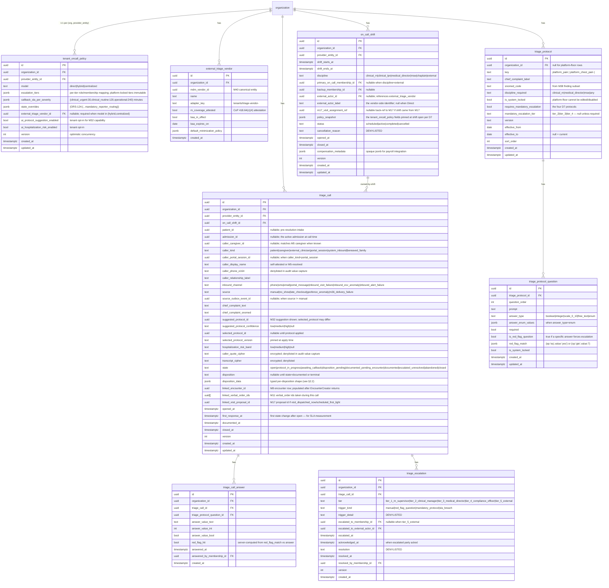

# Module 19 — On-Call Triage Specification

**Spec version:** v0.3.1 — ADR-0021 §20.B template additions (M19-F08 DR tier + degraded mode + boot-refusal removal; M19-F12 BullMQ queue parameters + cadence unification + duplicate outbox topic removal; M19-F15 STRIDE threat model + cursor pagination + audit-event catalog + platform-limiter rate limits). Prior v0.3: convention review: the authoritative §4.10 outbox events
(`m19.triage_call.*`, `m19.oncall_shift.*`) and §4.9 M36 alert payloads (`m19.triage.*`,
`m19.oncall.*`) already conform to the `mN.` convention; only a few stray prose references
(`triage.case_opened`, `triage.protocol_red_flag_hit`, `triage.summary_requested`) were
aligned to their canonical `m19.` names. Permission keys (`triage.read`, `oncall.write_schedule`,
…) are unchanged (separate, feature-prefixed namespace); audit actions are M4-trigger-generated.
(Prior: v0.2.)

**Module ID:** 19
**Phase:** 1 (v1 — required for Engrace go-live; CoP 418.100(a) mandates "nursing services, physician services, and drugs and biologicals … to meet the needs of patients and families 24 hours a day, 7 days a week," and the architecture defers Phase-2 *richness* — AI protocol suggestion, hospitalization-risk surfacing, the Hybrid/Centralized models — not the *24/7 triage capability itself*; without M19 the agency answers an after-hours call to a paper notebook, the documentation never lands in the chart, and the next-morning IDG has no idea symptom intensity changed at 2 AM. The Phase-1 cut ships the Direct model with full audit and chart-writeback; Hybrid/Centralized adapter seams ship structurally but feature-flagged OFF until tenants subscribe to that operational model. AI suggestion + risk surfacing flip ON when M32 capabilities lock — same forward-seam pattern as every other module.)
**Depends on:** 5 (Patient & Demographics — `patient` row, `patient_address`, `patient_caregiver`, `patient_payer`, deceased status, privacy-flag snapshot for SUD-gated content; `PatientReader` and `CaregiverReader` seams consumed via `packages/patient` — never direct schema import; `m5.patient.deceased` consumed to auto-close any open triage call for the decedent with `closure_reason='patient_died'`), 17 (Scheduling & Route Optimization — `VisitAssignmentReader.tonightsOnCallRoster(orgId, asOfIso)` consumed as the authoritative roster for the Direct model per M17 §4.3; `m17.visit.no_show_detected` consumed via outbox as an inbound triage trigger per M17 D8; `VisitAssignmentReader.currentVisitForClinician(membershipId)` consumed to know whether the on-call RN is mid-visit and should be deferred; M19 *contributes* to M17's caseload picture only via M36 channel membership, never via direct schema), 36 (Secure Messaging & Alerts — the `on_call` channel kind per M36 §2.3 derives its membership from M19's `OnCallProvider` seam — published by M19, consumed by M36 at every shift transition; M19 emits typed alerts (`m19.triage.case_opened`, `triage.escalation_requested`, `m19.triage.protocol_red_flag_hit`) and consumes `m36.delivery_failed` to surface stuck escalations; M19 owns no out-of-band delivery code — every SMS/email/push/voice path is M36's), and transitively 1 (Foundation — `withOrgContext`, `audit()` helper, outbox dispatcher, idempotency middleware, RLS generator, partitioned-table conventions, per-tenant DEK envelope-encryption helper for `triage_call.caller_quote_cipher` and any free-text content, BullMQ on Valkey, circuit-breaker and `DegradedError` envelope, system status event), 2 (Identity — `user`, `membership`, session classes; discipline resolution for the `oncall_eligible` predicate; step-up re-auth not required for triage call recording because no PHI mutation requires it, but step-up *is* required for verbal-order recording during a call per the M11 verbal-order policy), 3 (Authorization — `triage.*`, `oncall.*` permission keys M19 contributes; ABAC predicates `oncall_eligible`, `triage_call_owner_or_supervisor`, `external_triage_actor` registered into M3's named-predicate registry; the `caseload_or_scope` predicate reused for patient-context reads from the triage panel), 4 (Audit — PHI write-audit trigger generator on every owned table; audit-read declaration on every PHI route; retention class `compliance` for `triage_call` and `triage_escalation` rows (these are *part of* the clinical record per CoP 418.104 — an after-hours triage call that changed the care plan is survey-relevant), retention class `operational` for `on_call_shift`; `eraseFn` registered into M4's destruction-cert callback registry), 8 (Encounters & Visit Notes — bidirectional: M19 calls M8's `EncounterCreator` seam to create an `encounter_type='triage_telephonic_contact'` row at triage-call resolution per D8, supplying the typed M19 payload (chief complaint, protocol applied, disposition, interventions); M19 consumes M8's `encounter.signed` outbox to advance the triage call to `documented` and pin `linked_encounter_id` per D8; M19 reads M8's `BillableEncounterReader` to surface "is this triage call billable as a routine care contact" on the supervisor review screen), 11 (Orders — `OrderSignatureProvider.recordVerbalOrder` consumed when an on-call RN takes a verbal order during a triage call per D9; the M11 `verbal_order` row carries `triage_context.triage_call_id` so the verbal-order timer queries can scope the alert recipients to include the on-call channel; M19 does not own the verbal-order primitive — that is M11), 12 (DoseSpot Integration & Prescribing — `RefillInboxProvider.getPendingRefillsForPatient` consumed for the "any pending refills tonight?" surface on the triage panel per M12's published seam; refill *decisions* are M12-owned and M19 only displays + deep-links into M12's inbox), 18 (EVV — `m18.evv.late_check_out_detected` consumed via outbox as an inbound triage trigger per M18's `Consumed by: 19` declaration; M19 does not import M18's schema), 32 (AI Platform — `ProtocolSuggestionProvider` and `HospitalizationRiskProvider` seams consumed via `packages/ai-platform`; both are *advisory only* per AI Governance §2.1.1 — the clinician must explicitly select the protocol and the risk surface is a read-only context badge; M19 ships with deny-stub today and flips to real M32 when M32 enables those capabilities), 36 (see above — duplicated here because M19 both depends on and is heavily consumed by M36), 38 (Clinical Terminology — chief-complaint SNOMED value set seeded as a platform value set; the `triage_protocol.icpc_or_snomed_code` field validated via `lookup`; SNOMED finding/symptom value-set membership for the disposition catalog; `asOfDate` lookups on protocol-encoded findings so a protocol revision in 2027 doesn't retroactively change a 2026 triage record), 39 (Consent & Authorization Management — `ConsentEvaluator` consumed for SUD-flagged content gating; `42 CFR Part 2` consent enforces the `sud_disclosure_allowed` predicate on triage panel reads of patient meds + history when the patient's PrivacyFlag snapshot includes `sud`; bereavement-family inbound calls during the 13-month window honor the M39 `family_caregiver_access` consent), 40 (Master Data Management — `ExternalPhysician` (NPI) lookup when a verbal order is recorded via M11; `ExternalTriageVendor` canonical entity introduced by M19 in §3 for the Hybrid/Centralized models so vendor identities are not re-keyed per tenant; M40's adapter taxonomy reused for the vendor-adapter `packages/triage-vendors`)

**Consumed by:** 8 (Encounters — bidirectional, see above), 11 (Orders — bidirectional, see above), 14 (IDG — `TriageCallProvider.callsForPatientSince(patientId, sinceIso)` consumed by M14's packet builder so the next morning's IDG sees every overnight triage interaction; the seam ships at M19 lock, the M14 consumer wires when M14 locks — same forward-seam pattern as M17 → M14), 17 (Scheduling — M19's `m19.triage_call.visit_needed` outbox event proposes a follow-up visit on M17's proposal queue per the "after-hours triage that decided a clinician needs to visit at first light" pathway; bidirectionally cited because M17 is also a dep), 22 (Document Management — when a triage call generates a patient-facing summary (e.g., caregiver-readable instructions left as a follow-up), M19 emits `m19.triage.summary_requested` and M22 renders the PDF; M19 has no PDF code), 23/24 (Billing Medicare/Medicaid — triage telephonic contacts are not separately billable under hospice routine home care (RHC), so M19 contributes no claim path; M19 *does* publish the `TriageCallMetricsProvider` projection for M30 HQRP dashboards), 25 (Remittance & Denials — no direct consumer), 28 (FHIR Gateway — `triage_call` projects to FHIR R4 `Communication` with `category=after-hours` and back-reference to the parent `Encounter` via `partOf`; the typed mapping ships now, the projection lands when M28 lands), 30 (HQRP & Quality — `TriageCallMetricsProvider.getHospitalizationAvoidanceRate` and `.getEscalationCadence` consumed by M30 dashboards; the response-time-to-callback measure (industry-standard ≤ 30 min for clinical_urgent) lives here), 31 (Patient/Family Portal — `PortalTriageReader.summaryForPatient(patientId, withinHours)` exposes a lay-language view of recent triage calls (without internal disposition codes) when the patient has portal consent; redacted of clinician-internal protocol-question answers per the same minimization pattern M17 uses for visit notes), 32 (AI Platform — `TriageCallReader.recentCallsForPatient` consumed by the hospitalization-risk model as a feature; the model itself is M32; the seam ships now), 33 (Reporting & Dashboards — operational dashboards: triage volume, average resolution time, escalation rate by tier, top chief complaints, hospitalization-avoidance rate, after-hours visit-conversion rate, late-checkout-to-triage conversion rate), 36 (Messaging — see "Depends on"; cited bidirectionally because M36 consumes M19's `OnCallProvider` for the `on_call` channel-membership re-sync), 37 (IPU Management — when the agency operates an IPU and the on-call decision is "transfer to GIP," M19 emits `triage.gip_admission_proposed` consumed by M37 when M37 locks; deny-stub today)

**Spec status:** Re-locked v0.3 (Phase-5 remediation; supersedes Locked v0.2)

> **Phase-5 remediation (2026-06-11; ADR-0020 / ADR-0014).** The **external triage vendor** (after-
> hours) is now in the Integration Catalog (inventory row 31, §5 BAA register, §8 degraded-mode). It
> receives clinical PHI, so its **BAA must be EXECUTED before production** — and because triage may
> touch 42 CFR Part 2 SUD data, **re-disclosure to the vendor requires a QSOA** (ADR-0014 D3), not
> just consent. Degraded mode falls back to the on-call supervisor + tenant emergency number
> (ADR-0009). *(S4 — the module-local vendor-operator SSO binding outside Better Auth — must be
> removed: vendor-operator auth goes through Better Auth with Security-Owner approval, SEC App. A.3;
> tracked for M19's reconciliation.)*

## Changelog

- **v0.3.1 (ADR-0021 template sweep)** — Adds the three missing §20.B template sections per ADR-0021 findings:
  - **M19-F08** (DR-010/013/064-067): Declares M19 as **DR Tier 1** (RTO 1 h / RPO 5 min). Adds §2.7 with DR tier declaration, five degraded-mode classes (D-A through D-E), and BCP paper-origin re-entry specification (paper_origin_flag column, 72 h worklist, `triage.paper_reentry` permission key, `triage_paper_reentry_worklist` table). **Removes the §2.4 boot-refusal language** and §1.3 CoP 418.100(a) reference to boot refusal — replaced with alert-only behavior (critical M36 coverage-gap alert) consistent with DR-010's prohibition on external dependencies blocking Tier-1 availability.
  - **M19-F12** (ARCH-262, SD-059, SD-060): Expands §4.8 BullMQ queue catalog with `priority`, `attempts`, `backoff`, `concurrency`, and `DLQ` columns for all 14 queues. Unifies the coverage-gap watchdog cadence to **30 minutes** (prior versions stated "hourly" in §4.8 and "every 30 minutes" in task #38 — 30 minutes is authoritative). Removes the duplicate `m19.on_call_shift.opened` outbox topic from §4.10 — `m19.oncall_shift.activated` is the single canonical shift-open signal; its payload is extended to include `membershipId` and `openedAt` so M20's consumer needs no change.
  - **M19-F15** (SEC-007, SD-052, ARCH-003, SD-055): Expands §8.3 from a STRIDE table stub to a full six-section STRIDE threat model (Spoofing, Tampering, Repudiation, Information Disclosure, Denial of Service, Elevation of Privilege) with M19-specific threats, controls, and test references. Adds §4.1.1 declaring opaque cursor pagination (`next_cursor` + `has_more`) on all six PHI list routes (routes #2, #16, #19, #27, #36, and the portal route #36) with page sizes and HMAC-signed token policy. Adds §8.3.7 expressing module-local rate limits as M1 platform-limiter `definePlatformRateLimits` configurations. Adds §8.7 audit-event catalog covering all 18 business-event audit entries and the full PHI write-audit trigger inventory with per-event retention classes.

- **v0.3 (Re-locked)** — Convention review and §4.10 outbox event naming alignment.

- **v0.2 (Locked)** — Initial publication at lock-grade. Instantiates the architecture §20.B module spec template. Resolves all fourteen open questions into binding decisions (§11). Defines the **triage-call root entity separate from the M8 encounter** (D1), the **shift table that augments M17's roster for outsourced models** (D2), the **three-deployment-model schema with the Direct model shipping Phase-1-live and Hybrid/Centralized adapter seams shipping structurally** (D3), the **protocol catalog with platform-floor + tenant-extensible pattern matching M38 / M9** (D4), the **server-authoritative protocol-question gating mirroring M9 D6** (D5), the **disposition state machine with mandatory documentation gate** (D6), the **escalation tree with policy-driven mandatory triggers** (D7), the **encounter writeback via M8's `EncounterCreator` seam** (D8), the **verbal-order primitive consumption via M11's `OrderSignatureProvider`** (D9), the **inbound-trigger consumers for no-show and late-checkout** (D10), the **hospitalization-risk advisory display via M32** (D11), the **protocol-suggestion AI surface with mandatory clinician selection** (D12), the **PII minimization at the external-triage-vendor boundary mirroring M17 D9** (D13), the **call-audio non-capture posture (Phase 1)** (D14), and the **PRN refill inquiry surface via M12's `RefillInboxProvider`** (D15). Wires the permission keys this module registers into Module 3 (§4.6), the BullMQ queue catalog (§4.8), the M36 typed-alert payloads (§4.9), the outbox event contract (§4.10), and the destruction `eraseFn` registered with Module 4 (§3.7). Includes a **proposed manifest patch** (§13) expanding `M19.dependsOn` from `[5, 17, 36]` to `[1, 2, 3, 4, 5, 8, 11, 12, 17, 18, 32, 36, 38, 39, 40]` *(relationship inventory - not the `dependsOn` edge set; per ADR-0005 D1/D4 seam/outbox/foundation consumers are no-edge - see audit/MANIFEST_DEPENDSON_REVIEW.md; do not bulk-apply)* — the prior encoding listed only the architecture §20.B direct-arrow set; the spec realistically depends on the foundation tier (1/2/3/4), the encounter/order/refill writeback chain (8/11/12), the inbound-trigger source (18), the AI advisory seam (32), the terminology service (38), the consent gate (39), and the MDM/vendor canonical (40) — every one of which is a typed seam consumer, not a free-floating reach across the boundary.
- **v0.1** — Drafted within the lock-grade pass; not separately published.

> **Phase boundary (binding):** Phase 1 delivers everything in this spec **with the Direct model live and the Hybrid/Centralized adapter seams structural-only**. The "done" gate for M19 is: `triage_call`, `on_call_shift`, `triage_protocol`, `triage_protocol_question`, `triage_call_answer`, `triage_escalation`, `tenant_oncall_policy`, and `external_triage_vendor` tables shipped with TypeBox-validated row shapes, the call-lifecycle XState machine driving every transition, the platform-floor protocol catalog (≥ 25 protocols per §1.1) seeded, the protocol-question gating server-authoritative, the escalation policy engine with the four mandatory-escalation triggers (suicidal ideation, code-blue / unresponsive, suspected abuse, hospice-medical-emergency drug request), the M8 `EncounterCreator` seam consumer wired against the real M8 (M8 is locked), the M11 `OrderSignatureProvider.recordVerbalOrder` consumer wired against the real M11 (M11 is locked), the M17 `tonightsOnCallRoster` consumer wired against the real M17 (M17 is locked), the M12 `RefillInboxProvider` reader wired against the real M12 (M12 is locked), the M18 `late_check_out_detected` outbox subscriber wired against the real M18 (M18 is locked), the four published reader seams (`OnCallProvider`, `TriageCallReader`, `TriageCallProvider`, `TriageCallMetricsProvider`, `PortalTriageReader`) registered at boot, and the test plan green — **not gated** on Modules 14 (IDG triage-since consumer wires up when M14 lands; M19 publishes the seam today), 22 (summary PDF render lands when M22 lands; M19 emits the typed payload), 28 (FHIR `Communication` projection lands when M28 lands; M19 emits the typed domain payload via outbox), 30/31/33 (their respective consumers when they lock), 32 (M32 advisory seams have deny-stubs today returning `{ suggested: null, confidence: null }` and `{ risk: null }`; the clinician simply sees no AI surface; protocol selection is fully manual until M32 wires the real provider — same forward-seam pattern as M17→M30 and M16→M32), 37 (GIP admission proposal lands when M37 locks). The Hybrid and Centralized models ship feature-flagged-OFF in Phase 1 — the data shape (`external_triage_vendor`, `triage_call.external_actor_id`) is in the migration so a Phase-2 tenant subscribing to an outsourced model is a configuration flip + vendor-adapter package install, not a schema change.

-----

## 1. Purpose & Scope

### 1.1 What This Module Does

Module 19 owns **the after-hours clinical contact** — the single artifact every other hospice operational module assumes happened when the morning IDG reads "spouse called at 2:30 AM about uncontrolled pain; on-call RN deployed PRN morphine and rescheduled the noon visit to 8 AM." CoP 418.100(a) requires the hospice to "make nursing services, physician services, and drugs and biologicals … routinely available on a 24-hour basis to meet the needs of patients and families"; CoP 418.64(c)(4) requires that "the hospice must provide … nursing services on a 24-hour basis"; CoP 418.78(c) requires volunteer programs to "extend home care visits beyond the normal workday hours of agency staff to meet the needs of patients and family caregivers." M19 is where those obligations turn from a policy document into a row in a database, an audit trail, an encounter on the chart, a verbal order with a 48-hour signature timer, and a message to the next-morning RN that says "the patient's symptoms changed overnight and here's what was done about it."

- **Triage-call root.** One `triage_call` per discrete inbound contact (the caregiver phones at 2 AM; the bereaved family member texts the on-call line; the assisted-living LPN reports the patient is unresponsive; the no-show-visit cascade auto-opens an outbound triage case). The call row carries the inbound channel (`phone | sms | email | inbound_visit_failure | inbound_evv_anomaly`), the caller identity (with self-attested identity for non-portal callers and confirmed identity for portal callers per D13), the chief complaint (typed against the M38 SNOMED finding value set), the protocol applied, the disposition (final clinical decision), and the M8 encounter ID once the documentation lands. The state machine (§2.2) gates closure on protocol completion + encounter sign per D6.

- **On-call shift row.** `on_call_shift` augments M17's `tonightsOnCallRoster` projection (M17 §4.3) for tenants whose on-call clinician is *not* in the standard `membership` table — outsourced triage vendors (Hybrid/Centralized models per D3). For the Direct model, M19's shift row carries a back-reference to the M17 visit-assignment record that put the RN on call; for Hybrid/Centralized, the shift row carries an `external_triage_vendor_id` (M40 canonical) and an `external_actor_label` (the external agent's vendor-side identifier). The shift row is also where the per-shift compensation rules, callback-target SLA per chief-complaint severity, and the escalation tier definitions are pinned at shift-open time — so an escalation pulled up six months later for a survey can replay against the policy that was active at the time of the call (the M9 D9 / M11 §2.3 "policy snapshot at write" pattern generalized).

- **Triage protocol catalog.** `triage_protocol` is the per-tenant catalog (with platform-floor + tenant-extensible per D4 mirroring M38) of clinical protocols mapped to chief complaints. Phase 1 ships ≥ 25 platform-floor protocols covering the hospice industry's high-frequency after-hours presentations: uncontrolled pain (with PAINAD/FLACC sub-branches per dementia status), dyspnea, terminal agitation, nausea/vomiting, constipation/impaction, urinary retention/Foley issues, fall with no injury, fall with injury, suspected aspiration, bleeding, seizure, suspected stroke, suspected MI / chest pain, hypoglycemia, hyperglycemia, unresponsive patient (code blue protocol gating GIP-vs-pronouncement decision), suspected death, family/caregiver psychological crisis, suicidal ideation, suspected abuse / neglect, medication question (refill, side effect, drug interaction), comfort-kit access question, DME malfunction (oxygen, hospital bed, BiPAP), wound deterioration, IV-pump alarm (IPU-context, M37-adjacent), and a catch-all "other clinical concern" that requires the on-call RN to free-text-document the situation and select an escalation tier. Each protocol has a question set (`triage_protocol_question`) with `required` flag, expected answer type (boolean, scale, free-text), and red-flag answer values that force escalation per D5/D7.

- **Protocol-question gating.** When the on-call RN selects a protocol (or accepts the M32-suggested protocol per D12), the M19 service materializes a `triage_call_answer` row per `triage_protocol_question` with `required=true`. The call cannot transition to `documented` until every required answer is recorded (and any red-flag value is acknowledged with an escalation per D7). The materialization is server-authoritative — the API ignores any client-supplied "all questions answered" claim (mirrors M9 D6 / M10 D4). The platform floor on protocol questions is *additive only* on tenant override: a tenant may *add* questions to a platform protocol but cannot *remove* them (mirrors M9 D2 significant-change threshold tenant-tightening pattern); platform questions carry `is_system_locked=true`.

- **Disposition catalog.** `disposition` is an enum: `caregiver_education_only` (the call was advisory; no clinical action), `prn_intervention_authorized` (a PRN per existing orders was authorized; M13 records the administration), `verbal_order_recorded` (a *new* order — typically a medication — was taken; M11's verbal-order primitive engaged per D9), `visit_dispatched_now` (an immediate or imminent visit was triggered; M17's proposal queue receives `m19.triage_call.visit_needed` per §4.10), `visit_scheduled_first_light` (visit added to the next morning's schedule; M17 proposal again, but priority lower), `gip_admission_proposed` (level-of-care change to general inpatient; M11's `level_of_care_change` order kind kicks in or M37 when M37 locks), `ed_transfer_acknowledged` (the caregiver chose to call 911 / drive to ED against hospice clinical recommendation; documentation captures the patient/family election per CMS 418.62 patient-rights; an outbound NOR-style courtesy notification to the attending physician is emitted), `pronouncement_scheduled` (suspected death; the on-call RN was dispatched for pronouncement per the tenant's death-pronouncement policy), `escalated_unresolved` (the on-call RN escalated and the call is held open pending the escalated party's resolution; rare; documents the bridge), and `abandoned` (caller hung up; documentation captures what the caller said before disconnect). Each disposition has a per-tenant typed payload schema (`disposition_data` jsonb) — `prn_intervention_authorized` requires the M11/M12 order ID; `verbal_order_recorded` requires the M11 `verbal_order_id`; `visit_dispatched_now` requires the M17 `visit_proposal_id` once the proposal is created; etc.

- **Escalation tree.** `triage_escalation` rows record every escalation event — the tier (`tier_1_rn_supervisor | tier_2_clinical_manager | tier_3_medical_director | tier_4_compliance_officer | tier_5_external`), the escalated-to membership (M2) or external contact (M40), the reason (free-text but denylisted in audit per the M11 D11 pattern), and the resolution. Tenant policy in `tenant_oncall_policy.escalation_tiers` defines who occupies each tier and which protocols force immediate escalation regardless of disposition; the four platform-floor mandatory-escalation triggers per D7 are suicidal ideation (always to MSW + medical director), code-blue / unresponsive patient (always to medical director with parallel 911 prompt), suspected abuse or neglect (always to compliance officer with mandatory-reporter-state-statute look-up per M38), and a hospice-medical-emergency drug request that the on-call RN cannot fulfill from comfort kit (always to medical director). These four cannot be disabled by tenant config — they have `is_system_locked=true` and `cannot_be_overridden=true` (mirrors M3 `system_locked` CoP-floor role pattern).

- **Encounter writeback via M8.** On disposition selection + protocol completion, M19 calls M8's published `EncounterCreator` seam with the typed payload: `{ patient_id, admission_id, encounter_type='triage_telephonic_contact', authoring_membership_id, started_at, ended_at, narrative_payload }`. M8 creates the encounter row in `draft`; the on-call RN reviews and signs in M8's surface; on sign, M8 emits `encounter.signed` which M19's consumer matches against `linked_encounter_id` and advances the triage call to `documented`. The boundary is enforced by ownership: M19 cannot import M8's schema; M19 uses the M8 seam. The clinical signature, late-entry tier, and any HearthNote Layer 2 enhancement are M8's machinery — M19 supplies structured context (protocol applied + answers + disposition), M8 turns it into a sign-ready narrative through the same Layer-1 vocabulary path every encounter uses.

- **Verbal-order primitive via M11.** When a verbal order is taken during the call (the most common case being a PRN morphine dose or a new comfort-medication for terminal agitation), M19 calls M11's `OrderSignatureProvider.recordVerbalOrder` with `target_kind='order' | 'medication_order'` and `triage_context={ triage_call_id }`. M11 owns the 48-hour timer, the deadline alerts, and the expired-unsigned state per M11 D3 / §2.3. M19 carries the back-reference on `triage_call.linked_verbal_order_ids[]` so the on-call dashboard can show "two verbal orders taken tonight, one signed at 7 AM, one approaching deadline."

- **Inbound triggers as outbox consumers.** M17's `m17.visit.no_show_detected` (per M17 D8 / §7.8) and M18's `m18.evv.late_check_out_detected` (per M18's M19-consumer declaration) hit M19's outbox subscribers, which open `triage_call` rows with `source='no_show'` or `source='late_checkout'` and pre-populate the caller as "system-triggered" with the failed visit's clinician as the actor-of-record-pending. The on-call RN then proactively calls the patient/caregiver — the call row is already open, the chart context is loaded, the timer is running. This is the "no clinician disappears at 2 AM" pattern — the system never leaves a no-show or a missing-checkout in operational silence.

- **AI advisory surface (M32).** M32's `ProtocolSuggestionProvider` is called with the chief complaint + the active care-plan context + the latest assessment series; it returns a suggested protocol + confidence. The suggestion is *displayed*, not auto-applied (D12) — the on-call RN must explicitly select. M32's `HospitalizationRiskProvider.get30DayRisk(patientId)` returns a risk badge (low/medium/high) shown read-only in the patient-context panel. Per AI Governance §2.1.1 Clinical Safety First, neither feed mutates anything — they augment human decision-making. The seams ship now; the live providers wire in M32's Phase-2 activation.

- **PRN refill surface (M12).** When the caregiver calls saying "we're running out of morphine before tomorrow's pharmacy run," the triage panel displays the pending M12 refills via `RefillInboxProvider.getPendingRefillsForPatient(patientId)` per M12's published seam. M19 does not own refills — the panel is a read-only window with a deep-link into M12's inbox where the prescriber actually approves or denies. The pattern is: M19 surfaces what M12 already knows; M12 acts.

- **Audit trail per call.** Every call row, every answer row, every escalation, every disposition flows through Module 4's PHI write-audit trigger; the `audit_event` retention class is `compliance` (6 years from final lifecycle event per CoP 418.104) because the triage record is *part of* the clinical record — a 2027 surveyor reading a 2023 chart can replay every after-hours contact that influenced the care plan. The `caller_quote_cipher` (the caregiver's verbatim words at intake, when the RN choose to capture them — encrypted at rest per D14) is denylisted in audit value capture; the `<changed>` marker is recorded but the cleartext lives only on the row inside the per-tenant DEK envelope.

### 1.2 What This Module Does Not Do

This list is binding. Every item here is owned by another module and reached via repository call, outbox event, or the explicit cross-module seams in §4.4.

- **The clinical encounter itself.** Module 8 owns the encounter, every byte of clinical narrative, the HearthNote pipeline, the signature, the addendum, the late-entry tier. M19 calls M8's `EncounterCreator` seam to produce an `encounter_type='triage_telephonic_contact'` row; M19 reads M8's `encounter.signed` outbox to advance the call lifecycle; M19 never imports M8's schema and never writes an `encounter` row directly. The boundary is enforced by the architecture-fitness import rules — `apps/backend/src/modules/19-oncall/*` cannot import `packages/db/src/schema/encounters.ts`. (D8.)

- **The verbal-order primitive.** Module 11 owns the polymorphic `order_signature` + `verbal_order` tables, the 48-hour timer worker, the deadline alerts, the `expired_unsigned` terminal state per M11 §2.3 and M11 D3/D4. M19 calls `OrderSignatureProvider.recordVerbalOrder` with the typed payload; M19 stores back-references in `triage_call.linked_verbal_order_ids[]`; M19 never writes a `verbal_order` row directly. The verbal-order timer never asks "did this come from M19 or M8?" — it scans uniformly by `target_kind` per M11's design. (D9.)

- **The DoseSpot refill workflow.** Module 12 owns the refill inbox, the approve/deny workflow, the SLA timers, and the NewRx transmission to Surescripts. M19 displays the count of pending refills for context via `RefillInboxProvider.getPendingRefillsForPatient`; the on-call RN's "approve this refill so the pharmacy can fill it tonight" path is a deep-link into M12's inbox UI; M19 never imports M12's schema. (D15.)

- **The schedule.** Module 17 owns `visit`, the day grid, the optimization, the EVV bracket reconciliation. When the disposition is `visit_dispatched_now` or `visit_scheduled_first_light`, M19 emits `m19.triage_call.visit_needed` (severity-typed) and M17's outbox consumer creates a `visit_proposal` per the M17 D5 proposal-worker path. M19 reads M17's `tonightsOnCallRoster` for shift-roster context; M19 does not write into M17's tables. (D2, D10.)

- **EVV check-in/check-out.** Module 18 owns the geofence, the check-in/check-out events, the state-aggregator submission. M19 consumes `m18.evv.late_check_out_detected` as an inbound trigger; M19 never emits EVV events and never reads `evv_event` directly. (D10.)

- **Real-time delivery and out-of-band channels.** Module 36 owns Socket.IO, the per-channel encryption, the Twilio/Postmark/Web-Push dispatchers. M36's `on_call` channel kind derives its membership from M19's `OnCallProvider` seam — the channel rotates automatically with the shift per M36 §2.3. M19 emits typed alert payloads via M36's `AlertEmitter`; M19 owns no SMS code, no email code, no push code, no voice code. Voice escalation in particular is M20/M36 territory — M19 emits a high-severity alert that M36 may route through Tier-1 voice if the recipient is unreachable through other channels, but M19 does not call Twilio. (Cross-cutting; not a single D.)

- **The portal session for caregivers calling/messaging in.** Module 31 owns the Patient/Family Portal sessions, consent gating, and the M39-derived access scope. When a portal-authenticated caregiver opens a triage thread, M31 authenticates and M19 binds the call row to the portal session ID for audit; M19 does not authenticate. (Cross-cutting.)

- **Telephony.** Phase 1 ships *no phone integration*. The architecture marks "future: phone integration" — Phase 1 has a manual entry intake (the on-call RN picks up an outside phone, takes the call, opens a triage call row in M19). Phase 2 may layer a Twilio-Voice or third-party telephony adapter behind a `TelephonyAdapter` seam in `packages/triage-telephony/` — the seam is reserved but the adapter does not ship. (D14.)

- **Call audio recording.** Per D14, M19 does not capture call audio. If a future telephony adapter records (which has HIPAA and BAA implications equal to M31's telehealth recording), the recording will live in MinIO under M31's storage with a back-reference on the triage call — not in M19's schema. M19 stores at most an optional transcript (`triage_call.transcript_cipher`, encrypted, denylisted) that the RN types or pastes from external transcription tooling.

- **The AI models themselves.** Module 32 owns prompt templates, model versions, calibration, drift monitoring, cost tracking per AI Governance §3. M19 consumes the typed `ProtocolSuggestionProvider` and `HospitalizationRiskProvider` interfaces and supplies PHI-minimized inputs (chief complaint + active conditions list from M5, latest assessment series projection — no full chart dump per AI Governance §2.1.4); M19 receives a suggestion + confidence and a risk + confidence and displays both with the "AI assistance" badge. Per AI Governance §2.1.1, the model output cannot mutate any M19 row. (D11, D12.)

- **Bereavement-family call routing.** Module 16 owns bereavement plans and the bereaved-family consent at time of death. When a bereaved family member calls during the 13-month window, M19 routes the call to the bereavement counselor on M16's plan (not to the clinical on-call RN) — the routing is driven by M16's `BereavementPlanProvider.activeBereavedContactForPhoneNumber`, called at intake. M19 does not own the bereavement workflow; it merely respects the routing decision. (Cross-cutting.)

- **FHIR `Communication` projection.** Module 28 owns `packages/fhir/r4/mappers`. M19 emits a domain payload via outbox; M28 maps it to FHIR R4 `Communication` with `category=after-hours` when M28 lands. M19 ships the typed mapping today; the projection lands when M28 lands.

- **Decide authorization.** Module 3 decides; Module 19 declares permissions (§4.6), exposes ABAC predicates (§4.7), and obeys the answer.

- **Per-tenant payroll, on-call differential pay, the after-hours pay rule book.** Tenant payroll integrations (Gusto, ADP, etc.) live behind their own adapters per the architecture §11 integration table; M19's `on_call_shift.compensation_metadata` is an opaque jsonb the payroll integration reads, but M19 does not compute pay. The on-call shift's actual hours-worked, calls-handled, and time-on-call are projected by M19's `OnCallMetricsProvider` for the payroll integration to consume; the payroll math is downstream.

### 1.3 Regulatory & Operational Drivers

| Driver | Requirement | How Module 19 satisfies it |
|---|---|---|
| **CoP 418.100(a)** — Hospice must provide nursing, physician, and drugs/biologicals on a 24-hour basis | Continuous availability for symptom-management and family-support contacts | M19 ships the Direct-model 24/7 triage capability at Phase 1; `on_call_shift` table guarantees a clinician is always identified as on-call; the coverage-gap watchdog (per §2.4, M19-F08) emits a `critical` M36 coverage-gap alert when no future-dated clinical_rn shift exists for any active ProviderEntity — boot startup is **never refused** for a coverage gap (M19 is DR Tier 1; blocking boot on a schedule gap would itself be an availability hazard). |
| **CoP 418.64(c)(4)** — Nursing services on a 24-hour basis | RN coverage 24/7 | The on-call shift schema enforces that *at least one* shift in any 24-hour window has discipline = `clinical_rn` (Hybrid/Centralized models satisfy this via the external vendor's RN, validated at shift creation via `external_triage_vendor.rn_coverage_attested`). |
| **CoP 418.104** — Clinical record requirement | After-hours contacts are part of the clinical record | Every closed `triage_call` produces an M8 `encounter_type='triage_telephonic_contact'` via the `EncounterCreator` seam (D8); the triage_call row carries the `compliance` retention class per M4 retention rules — 6 years from final lifecycle event. |
| **CoP 418.106(b)** — Verbal orders must be authenticated by the ordering practitioner | After-hours verbal orders signed within reasonable timeframe | M19 consumes M11's `recordVerbalOrder` (D9); the 48-hour timer is M11's; the deadline-cycle alerts (12h-pre, 2h-pre, at-deadline) emit to the named ordering physician and the on-call channel per M11 §2.3. |
| **CoP 418.56(d)** — Care plan must be reviewed and updated | Significant after-hours decisions must update the plan | When the on-call RN's disposition causes a care-plan-relevant change (new symptom, level-of-care escalation), M19 emits `m19.triage_call.care_plan_change_indicated` consumed by M14's IDG packet builder so the next IDG agenda includes it (D8 cascade). |
| **42 CFR §164.502(b)** — Minimum-necessary access | After-hours actor sees only what's needed | Triage panel reads honor the same caseload-or-scope ABAC predicates as the daytime chart per M3's existing predicate registry; external triage vendors (Hybrid/Centralized) see a PHI-minimized packet per D13 (name + DOB + chief complaint + active meds redacted — never full chart). |
| **42 CFR Part 2** — SUD content confidentiality | SUD-related history disclosed only with consent | M5's PrivacyFlag snapshot + M39's `ConsentEvaluator` gate triage-panel reads of SUD-related medication and assessment history; the `sud_disclosure_allowed` predicate (already in M3 from M7) is reused on every M19 panel read. |
| **State after-hours-coverage rules** (varies) | Some states (e.g. NY DOH 10 NYCRR 793.5) require named on-call RN per shift with documented contact | The shift row carries an enforced `primary_on_call_membership_id` (Direct) or `external_actor_label` (Hybrid/Centralized); the shift cannot open without it; per-state policies are honored via `tenant_oncall_policy.state_overrides` (mirrors M11 D3 / M17 D11 tenant-tightening pattern). |
| **CMS HQRP** (operational; not a measure today but tracked) | Hospice-side metrics that influence quality scores | M19 publishes `TriageCallMetricsProvider` for M30: average response time, hospitalization-avoidance rate (triage that resolved without ED/admission), after-hours visit conversion rate, escalation pyramid distribution. |
| **HIPAA §164.312(b)** — Audit controls | Every PHI access logged | M4 triggers on every M19 PHI table; `auditRead` decorator on every triage-panel route; `triage.call_opened`, `.protocol_applied`, `.disposition_selected`, `.escalation_recorded`, `.documented` business events emitted to M4's `recordBusinessEvent`. |
| **State mandatory-reporter statutes** (varies; e.g. ORS 124 for elder abuse in Oregon — Engrace's state) | Triage RN suspecting abuse must report | The "suspected abuse" platform-floor mandatory-escalation trigger per D7 routes to compliance officer + surfaces the state's mandatory-reporter contact info via M38 `lookup` on a state-specific value set. The escalation cannot be suppressed by tenant policy. |
| **HHS Hospice Quality of Care guidance** | After-hours response time as a quality indicator | M19's response-time clock starts at call open and is captured on call close; surfaced via `TriageCallMetricsProvider`. |

### 1.4 Competitive Context

Hospice on-call is one of the operationally-noisiest, documentation-thinnest workflows in the industry. Surveyor citations under CoP 418.100 are common precisely *because* the documentation pattern is "RN took the call, scribbled in a paper notebook, maybe transferred to the EMR the next day, maybe not." The dominant EHRs (HCHB, Axxess, WellSky, MatrixCare, FireNote) all *technically* have an "on-call" module, with varying levels of integration. The shape of M19's differentiation:

- **Encounter writeback is automatic, not a manual second-step.** In most competing products, the on-call RN logs the call in one screen and then has to *also* open a separate visit-note screen the next day to make it a clinical record. WardenX's path is: call disposition → M8's `EncounterCreator` seam → encounter appears in the RN's sign queue → one tap to sign. The "did we document that?" question goes from a daily reconciliation chore to a system invariant.

- **Protocol-driven instead of free-text-with-checkboxes.** Most competitors offer a free-text triage note with optional "chief complaint" tagging. WardenX's protocol catalog (D4) imposes a structured question set per chief complaint with server-authoritative required-question gating (D5). The night-shift RN's call quality becomes auditable: "did the RN ask the four mandatory questions for chest pain?" is a query, not a manual chart review.

- **The four mandatory-escalation triggers cannot be configured away.** Some competitors let tenants disable escalation rules entirely. WardenX's platform-floor (D7) — suicidal ideation, code-blue/unresponsive, suspected abuse, and the medical-emergency drug request — are `is_system_locked=true` and rejected from tenant override paths. This mirrors the same CoP-floor protection M3's `system_locked` role pattern provides.

- **Inbound triggers are first-class.** Competitors treat triage as inbound-call-only. WardenX models *every* after-hours signal (visit no-show, EVV missing check-out, EVV geofence breach with no clinician response, M36 alert delivery failure to the on-call channel) as a possible triage opener. No no-show "sits" overnight in operational silence — by 03:00 there is a triage case open against it with a chart-context-loaded panel waiting for the on-call RN to dial back.

- **The AI surface is augmentation, never decision-replacement.** Per AI Governance §2.1.1, M32's `ProtocolSuggestionProvider` displays a suggestion + confidence; the RN must select. `HospitalizationRiskProvider` displays a risk badge; nothing automated kicks off ED transfer or admission. Competing products either (a) don't have AI on-call assistance, or (b) bolt on a chatbot that the surveyor cannot reconstruct. WardenX records: which capability suggested what, which model version, which prompt version, what the RN chose — same provenance discipline M8 HearthNote uses.

- **The Hybrid/Centralized models are first-class data shapes, not afterthoughts.** Many small hospices outsource their nights and weekends to a centralized triage vendor (TouchPoint, Hospice Triage, Acclivity, IntelliShift Healthcare being common third-party providers). Competitors that don't model the outsourced actor end up with the EMR-side documentation being "called the answering service, they handled it" — a survey-grade nullity. M19's `external_triage_vendor` and `external_actor_id` (D3) preserve the same chart-writeback discipline whether the on-call RN is W-2 staff or a vendor agent, with PHI minimization at the vendor boundary per D13.

-----

## 2. Domain Model

### 2.1 Entity-Relationship Diagram



### 2.2 Per-Entity Lifecycle

#### 2.2.1 `triage_call` — the call lifecycle (D6)

The XState machine (lives in `apps/backend/src/modules/19-oncall/services/triage-call-machine.ts`):

```
                                         ┌─→ awaiting_callback ──┐
                                         │                       │
open ─→ protocol_in_progress ─→ disposition_pending ─→ documented_pending_encounter ─→ documented ─→ closed
  │           │                          │                              ▲
  │           │                          └→ escalated_unresolved ───────┘
  │           │                                                  │
  │           └──────────────────────────────────────────────────┘
  │
  └→ abandoned (any state → abandoned via "caller_disconnected" command)
```

> M19-F06 / ADR-0022: `disposition_pending → documented_pending_encounter` occurs on disposition selection (the M8 `EncounterCreator` seam is invoked); `documented_pending_encounter → documented` occurs when `m8.encounter.signed` arrives for the linked encounter (D8). The intermediate state is also where the D-B degraded-mode flow (§2.7) parks a call when the M8 seam is unreachable.

Transitions guarded by ABAC predicates:

| From | To | Command | Guards |
|---|---|---|---|
| `open` | `protocol_in_progress` | `applyProtocol(protocolId)` | `triage.write` perm; `oncall_eligible` predicate; protocol exists + not expired + matches actor discipline |
| `open` | `abandoned` | `markAbandoned(reason)` | `triage.close_abandoned` perm |
| `protocol_in_progress` | `disposition_pending` | `completeProtocol()` | every `required=true` question has an answer row; no red-flag-hit answer is unacknowledged-escalated |
| `protocol_in_progress` | `awaiting_callback` | `markAwaitingCallback(reason)` | required-questions check waived (caller not reachable at moment); callback timer started |
| `awaiting_callback` | `protocol_in_progress` | `resumeAfterCallback()` | actor has perm |
| `disposition_pending` | `documented_pending_encounter` | `selectDisposition(d, data)` | disposition enum valid; per-disposition payload schema valid; M8 `EncounterCreator` invoked (idempotent on `triage_call_id`) — M19-F06 / ADR-0022: disposition selection parks the call in `documented_pending_encounter` pending the encounter signature |
| `disposition_pending` | `escalated_unresolved` | `escalateUnresolved(tier)` | actor has `triage.escalate` perm; escalation row created |
| `documented_pending_encounter` | `documented` | `markDocumented()` (system) | `m8.encounter.signed` arrived for `linked_encounter_id` (D8); idempotent on the encounter-signed event id — M19-F06 / ADR-0022 |
| `escalated_unresolved` | `documented_pending_encounter` | `resolveEscalation(d, data)` | escalation row resolved; disposition selected (then advances to `documented` on `m8.encounter.signed`) |
| `documented` | `closed` | auto via `triage.close` worker, after the linked M8 encounter signed + any verbal-orders started their timers + 30-minute grace window for amendments |

Append-only `triage_call_state_history` row written per transition (mirrors M17's `visit_state_history` pattern; not modeled in the ER above to keep it readable but specified in §3.3).

#### 2.2.2 `on_call_shift` — shift lifecycle (D2, D3)

States: `scheduled → active → completed | cancelled`. The shift opens (`scheduled → active`) automatically at `shift_starts_at` via a cron tick; closes at `shift_ends_at`. The transition pins `policy_snapshot` at open-time — the tenant's `tenant_oncall_policy` row is snapshotted as JSON onto the shift so subsequent policy edits don't retroactively change what was in effect during the shift (D7). M36's `on_call` channel membership re-syncs on every shift transition (`active` ⇒ add to channel; `completed` ⇒ remove).

For the Direct model, the shift's `primary_on_call_membership_id` is M17's `tonightsOnCallRoster` result — M19's shift-open worker pulls the roster and writes the shift row. For Hybrid/Centralized, the shift is created administratively (the tenant tells M19 in advance "TouchPoint vendor X covers nights Fri–Sun") and `external_actor_id` is set; `primary_on_call_membership_id` is null.

#### 2.2.3 `triage_call_answer` — append-only

No state machine. `answered_at` is set once; the row is never updated in-place. A corrected answer is a new row with `correction_of_answer_id` (column added in §3.3) — mirrors M9 D9 / M5 §164.526 correction-of-record pattern.

#### 2.2.4 `triage_escalation` — open → acknowledged → resolved

```
open ─→ acknowledged ─→ resolved
  │                         ▲
  └─────────────────────────┘  (auto-resolve when triage_call closes if acknowledged)
```

Mandatory-escalation rows (the four D7 protocols) cannot be auto-resolved by call close; they require an explicit `resolveEscalation(resolution_text)` write by the escalated party.

### 2.3 Validation Rules

| Rule | Enforced at | Detail |
|---|---|---|
| One active shift per (org, provider_entity, discipline=clinical_rn, time-window) | sync (CHECK + partial unique index) | At least one row in `on_call_shift` overlapping `now()` with `discipline='clinical_rn' AND status='active'` per active ProviderEntity |
| Disposition payload matches its schema | app-layer | Discriminated union; TypeBox per-disposition shape |
| Required protocol questions answered before disposition | app-layer | `selectDisposition` rejects when any `required=true AND is_system_locked=true` question has no answer |
| Red-flag-hit question triggers escalation | app-layer | On `recordAnswer`, if `red_flag_match` evaluates true, an open `triage_escalation` row must be created in same TX; `completeProtocol` rejects if any open red-flag escalation exists |
| Mandatory-escalation protocol routes correctly | app-layer | Applying a `requires_mandatory_escalation=true` protocol immediately writes the escalation row to the protocol's `mandatory_escalation_tier`; cannot be skipped |
| External-vendor model has vendor identity | sync (CHECK) | `tenant_oncall_policy.model IN ('hybrid','centralized') ⇒ external_triage_vendor_id IS NOT NULL` |
| Hybrid model has both internal and external | app-layer | When `model='hybrid'`, both `primary_on_call_membership_id` and `external_actor_id` paths can produce shifts; a single shift must have exactly one of the two filled |
| AI surface tenant gate | app-layer | M32 calls suppressed if `tenant_oncall_policy.ai_protocol_suggestion_enabled=false` |
| Caller phone PII | infra (column denylist) | `caller_phone_e164` and `caller_quote_cipher` denylisted from M4 audit value capture |
| State must advance forward | infra (CHECK trigger) | Reverse transitions blocked at DB level except `awaiting_callback → protocol_in_progress` |
| Linked-encounter integrity | app-layer | `triage_call.linked_encounter_id IS NOT NULL ⇒ M8 returns valid encounter row` (validated at write via the seam, not via SQL FK across modules) |

### 2.4 Side Effects

| Trigger | Side effect |
|---|---|
| `triage_call` opened | M36 alert `m19.triage.case_opened` → on-call channel; if from inbound trigger (no_show/late_checkout), patient's care-team channel also pinged |
| `triage_call.applyProtocol` | If protocol is mandatory-escalation: `triage_escalation` row inserted in same TX, M36 typed alert to escalation tier |
| `triage_call_answer` with red-flag-hit | `triage_escalation` row inserted (open); M36 typed alert `m19.triage.protocol_red_flag_hit` |
| `triage_call.selectDisposition='verbal_order_recorded'` | Call to M11's `recordVerbalOrder`; `triage_call.linked_verbal_order_ids[]` appended |
| `triage_call.selectDisposition='visit_dispatched_now' | 'visit_scheduled_first_light'` | Outbox `m19.triage_call.visit_needed` → M17 proposal queue |
| `triage_call.selectDisposition='gip_admission_proposed'` | Outbox `m19.triage_call.gip_admission_proposed` → M37 (consumer when M37 locks) + M11 `level_of_care_change` order draft via M11 seam |
| `triage_call → documented` | M8 `EncounterCreator` seam invoked (idempotent on `triage_call_id`); the encounter row appears in M8's sign queue for the actor |
| `triage_call → closed` | M36 alert `triage.case_closed` to on-call channel + patient's care-team channel (lay-language preview); outbox `m19.triage_call.documented` |
| `on_call_shift → active` | M36's `OnCallProvider` re-syncs `on_call` channel membership |
| `on_call_shift → completed` | M36's `OnCallProvider` removes that membership; archive note on channel |
| Boot-time check | M19 is **DR Tier 1** (RTO 1 h / RPO 5 min per §2.7); boot-refusal on a coverage-gap would itself be an availability hazard for a Tier-1 module (M19-F08, DR-010). Boot **always succeeds**. Instead, the `coverage-gap-watchdog` (§4.8) runs every 30 minutes and emits `m19.oncall_shift.coverage_gap` → M36 `critical`-severity alert to org-admin + clinical-supervisor channels whenever no `clinical_rn` shift covers the next 24 h window for any active ProviderEntity. In degraded mode (see §2.7) the watchdog continues on its own schedule independent of upstream seam availability. |

### 2.5 Concurrency

Optimistic concurrency via `version` on `triage_call`, `on_call_shift`, `tenant_oncall_policy`, `triage_escalation` (mirrors M17's pattern). Parallel writes to the same call (rare but possible — supervisor reads while RN answers) return 412 with the current row state. The `triage_call_answer` table is append-only and not subject to optimistic conflict.

### 2.6 Idempotency

- Every state-transition route requires an `Idempotency-Key` header per M1 middleware; the dedupe window is 24h.
- The `EncounterCreator` seam call is idempotent on `triage_call_id` — multiple calls return the same encounter row (M8 §4 contract).
- Outbox events keyed on `(triage_call_id, outbox_topic, transitioned_at)` via M1 outbox helper.
- The shift-open worker is idempotent on `(provider_entity_id, shift_starts_at, discipline)`.

### 2.7 DR Tier, Degraded Mode, and BCP Re-entry (M19-F08 — DR-010/013/064-067)

**DR Tier: 1 — RTO 1 hour / RPO 5 minutes.**

M19 provides the legally-required 24/7 after-hours clinical-contact capability (CoP 418.100(a)). A hospice without after-hours triage has no lawful mechanism to respond to overnight patient crises; loss of M19 for more than one hour constitutes a CoP survey-reportable availability failure. M19 is therefore classified **Tier 1** in the platform DR taxonomy alongside M5 (Patient Demographics) and M36 (Secure Messaging). All Tier-1 obligations from the DR/BCP plan apply:

- Synchronous replication of all nine owned tables to the standby region; WAL shipping at ≤ 5-minute lag.
- Valkey on-call roster cache (`oncall:<orgId>:<asOfIso>`) is rebuilt from the primary DB read-replica within 5 minutes of a cache warm (the roster-rebuild job runs automatically on M19 module init).
- BullMQ queues for shift-open/close crons and the coverage-gap-watchdog are backed by the same Valkey cluster as M36's delivery queues; Tier-1 queues are promoted to the dedicated high-priority Valkey logical DB per DR-064 queue-segregation rule.
- **Boot never refuses to start because of a coverage gap** (DR-010 / M19-F08). Blocking boot on a missing shift would convert an administrative scheduling lapse into a complete Tier-1 service outage. The watchdog alerts; humans resolve.

**Degraded-mode classes:**

| Class | Condition | M19 behavior |
|---|---|---|
| **D-A: AI seam unavailable** | M32 deny-stub or provider timeout | Protocol suggestion and hospitalization-risk advisory are silently suppressed; UI renders "AI features unavailable"; triage call lifecycle continues normally without AI. Boot succeeds. |
| **D-B: M8 EncounterCreator unreachable** | M8 seam fails or times out | Disposition may be selected and the outbox event emitted; the call advances to `documented_pending_encounter` and stays there; the `encounter-creator.consumer` worker retries per queue policy (§4.8) until M8 recovers. The on-call RN is not blocked from handling the next call. Boot succeeds (M8 is required-seam but failure is runtime, not boot). |
| **D-C: M17 roster reader unavailable** | M17 seam timeout at shift-open | The shift-open worker falls back to the last committed `on_call_shift` row; roster-cache serves its TTL value. M36's channel membership is not re-synced until M17 recovers; coverage-gap-watchdog still runs from DB state. |
| **D-D: M36 alert delivery failure** | M36 `AlertEmitter` circuit-breaker open | M19 logs alert payloads to the fallback `m19_degraded_alert_log` table (append-only, org-scoped) for reconciliation; the tenant's emergency phone number (from `tenant_oncall_policy.emergency_contact_e164`) is surfaced to any authenticated org-admin hitting M19's `/api/v1/oncall/status` endpoint. |
| **D-E: Full read-replica failover (RTO < 1 h)** | Primary DB unavailable | Read traffic fails over to the replica; write traffic is queued in BullMQ with a 60-minute retention window; on primary recovery the queue drains in priority order (shift-open/close first, then triage-call state transitions). Call lifecycle is paused but no data is lost within RPO. |

**Triage-call BCP re-entry (paper-origin calls — DR-013, DR-066):**

When triage calls are taken on paper during a platform outage and re-entered after recovery:

1. The re-entering clinician opens a new `triage_call` with **`source='paper_origin'`** and **`paper_origin_flag=true`** (boolean column added to `triage_call` in §3.3).
2. The **`opened_at` timestamp must be set to the original call timestamp** (not the re-entry wall-clock time); the API accepts `opened_at` in the `POST /api/v1/triage-calls` body when `paper_origin_flag=true` and the actor has `triage.paper_reentry` permission (org-admin or DON; added to §4.6 as permission key #17).
3. A **72-hour re-entry worklist** is created automatically: on the first re-entry after an outage window (detected by gap in `triage_call_state_history` where no transitions occurred during the known outage window), the system computes the set of on-call shifts that overlapped the outage and populates a `triage_paper_reentry_worklist` table (append-only; org-scoped) listing `(shift_id, shift_starts_at, shift_ends_at, assigned_to_membership_id)`. The DON receives a `critical` M36 alert with the worklist count and a link to `/app/admin/triage-audit?mode=paper_reentry`. The worklist expires 72 hours after the outage-end timestamp.
4. M4 audit records every paper-origin re-entry with `audit_action='triage_paper_reentry'`, `source_outage_window_id`, and `re_entered_by_membership_id`. Paper-origin calls carry a survey-record annotation visible to the Comp Off / Surveyor read-path.
5. The `m19.triage_call.opened` outbox event for paper-origin calls carries `{ paper_origin: true, original_opened_at }` so downstream consumers (M14 IDG, M30 HQRP) use the original timestamp for chronological ordering.

-----

## 3. Drizzle Schema

### 3.1 Package Layout

```
apps/backend/src/modules/19-oncall/
├── index.ts                                       # module init
├── boot.ts                                        # registers seams, ABAC predicates, outbox subscribers, eraser
├── routes/
│   ├── triage-calls.ts                            # POST / GET / PATCH / state transitions
│   ├── triage-protocols.ts                        # GET / POST (tenant custom) / PATCH (tenant custom only)
│   ├── triage-protocol-questions.ts               # GET / POST / PATCH (tenant-additive only)
│   ├── triage-escalations.ts                      # POST acknowledge / resolve
│   ├── on-call-shifts.ts                          # GET / POST / PATCH (cancel only) / open / close
│   ├── tenant-oncall-policy.ts                    # GET / PATCH (org-admin; step-up; tighten-only on locked fields)
│   ├── portal-triage.ts                           # M31-consumed lay-language read view
│   └── admin/
│       ├── external-vendors.ts                    # tenant admin: external_triage_vendor CRUD
│       └── platform-protocols.ts                  # platform admin: platform-floor protocol catalog
├── services/
│   ├── open-triage-call.ts
│   ├── apply-protocol.ts
│   ├── record-answer.ts                            # computes red_flag_hit server-side per D5
│   ├── complete-protocol.ts
│   ├── select-disposition.ts                       # dispatches per-disposition payload handler
│   ├── document-call.ts                            # invokes M8 EncounterCreator
│   ├── close-triage-call.ts
│   ├── triage-call-machine.ts                      # XState graph + guards
│   ├── shift-open.ts
│   ├── shift-close.ts
│   ├── shift-cancel.ts
│   ├── escalation-engine.ts                        # red-flag evaluator + mandatory-protocol router
│   ├── disposition-handlers/
│   │   ├── caregiver-education-only.ts
│   │   ├── prn-intervention-authorized.ts          # validates M11/M12 order_id exists/active
│   │   ├── verbal-order-recorded.ts                # calls M11 OrderSignatureProvider.recordVerbalOrder
│   │   ├── visit-dispatched-now.ts                 # emits m19.triage_call.visit_needed
│   │   ├── visit-scheduled-first-light.ts          # emits m19.triage_call.visit_needed (lower priority)
│   │   ├── gip-admission-proposed.ts               # emits gip event + creates M11 LOC-change draft
│   │   ├── ed-transfer-acknowledged.ts             # captures patient/family election text
│   │   ├── pronouncement-scheduled.ts              # creates M17 visit proposal + alerts medical director
│   │   ├── escalated-unresolved.ts
│   │   └── abandoned.ts
│   ├── oncall-provider.ts                          # implements OnCallProvider seam (M36-consumed)
│   ├── triage-call-reader.ts                       # implements TriageCallReader seam (M32-consumed)
│   ├── triage-call-provider.ts                     # implements TriageCallProvider seam (M14-consumed)
│   ├── portal-triage-reader.ts                     # implements PortalTriageReader seam (M31-consumed)
│   └── triage-call-metrics-provider.ts             # implements TriageCallMetricsProvider seam (M30/M33-consumed)
├── workers/
│   ├── shift-open.cron.ts                          # every 5 min; opens shifts whose starts_at <= now()
│   ├── shift-close.cron.ts                         # every 5 min; closes shifts whose ends_at <= now()
│   ├── callback-sla.cron.ts                        # per-call callback-target SLA breach detector
│   ├── awaiting-callback-timeout.cron.ts           # advances stuck awaiting_callback after grace window with documented reason or auto-escalate
│   ├── close-documented.cron.ts                    # auto-close documented calls after 30-min amendment grace
│   ├── coverage-gap-watchdog.cron.ts               # every 30 min (M19-F12 canonical cadence); ensures clinical_rn shift covers next 24h per active PE
│   ├── ai-protocol-suggestion.bullmq.ts            # consumer of "needs suggestion" job; calls M32 with PHI-min input
│   └── ai-hospitalization-risk.bullmq.ts           # consumer of "needs risk" job; calls M32 read-only
├── consumers/
│   ├── m17-visit-no-show.consumer.ts               # subscribes to m17.visit.no_show_detected
│   ├── m18-evv-late-checkout.consumer.ts           # subscribes to m18.evv.late_check_out_detected
│   ├── m36-delivery-failed.consumer.ts             # subscribes to m36.notification.delivery_failed on on-call channel
│   ├── m8-encounter-signed.consumer.ts             # subscribes to m8.encounter.signed for linked encounters
│   ├── m11-verbal-expired.consumer.ts              # subscribes to m11.order.verbal_expired_unsigned with triage_context
│   ├── m5-patient-deceased.consumer.ts             # closes open calls with reason
│   └── m17-roster-changed.consumer.ts              # re-syncs Direct-model shifts
├── permissions.ts                                  # 17 permission keys (§4.6; incl. triage.paper_reentry #17)
└── alerts.ts                                       # 6 typed M36 alert payloads

packages/oncall/
├── src/
│   ├── seams.ts                                    # five published interfaces (OnCallProvider, TriageCallReader, TriageCallProvider, TriageCallMetricsProvider, PortalTriageReader)
│   ├── events.ts                                   # outbox event TypeBox shapes
│   ├── disposition-types.ts                        # discriminated union per disposition kind
│   └── protocol-catalog.ts                         # platform-floor protocol seed payload (data only; consumed by migration)

packages/triage-vendors/
├── src/
│   ├── interface.ts                                # ExternalTriageVendorAdapter
│   ├── minimization.ts                             # PII-minimization policy per D13
│   └── adapters/
│       └── (vendor adapters added in Phase 2)
```

### 3.2 Migration Script Phases (`0019_oncall_triage.sql`)

Phase A — enums:
```sql
CREATE TYPE oncall_model AS ENUM ('direct','hybrid','centralized');
CREATE TYPE oncall_shift_status AS ENUM ('scheduled','active','completed','cancelled');
CREATE TYPE oncall_shift_discipline AS ENUM ('clinical_rn','clinical_lpn','medical_director','msw','chaplain','external');
CREATE TYPE triage_call_state AS ENUM ('open','protocol_in_progress','awaiting_callback','disposition_pending','documented_pending_encounter','documented','escalated_unresolved','abandoned','closed'); -- M19-F06 / ADR-0022: `documented_pending_encounter` added between `disposition_pending` and `documented` (it is the state after disposition selection while awaiting `m8.encounter.signed`; used by §2.2, the D-B degraded-mode flow, and §9 tests)
CREATE TYPE triage_call_caller_kind AS ENUM ('patient','caregiver','external_clinician','portal_session','system_inbound','bereaved_family');
CREATE TYPE triage_call_inbound_channel AS ENUM ('phone','sms','email','portal_message','inbound_visit_failure','inbound_evv_anomaly','inbound_alert_failure');
CREATE TYPE triage_call_source AS ENUM ('manual','no_show','late_checkout','geofence_anomaly','m36_delivery_failure');
CREATE TYPE triage_disposition AS ENUM ('caregiver_education_only','prn_intervention_authorized','verbal_order_recorded','visit_dispatched_now','visit_scheduled_first_light','gip_admission_proposed','ed_transfer_acknowledged','pronouncement_scheduled','escalated_unresolved','abandoned');
CREATE TYPE triage_escalation_tier AS ENUM ('tier_1_rn_supervisor','tier_2_clinical_manager','tier_3_medical_director','tier_4_compliance_officer','tier_5_external');
CREATE TYPE triage_escalation_trigger AS ENUM ('manual','red_flag_question','mandatory_protocol','sla_breach');
CREATE TYPE triage_protocol_answer_type AS ENUM ('boolean','integer','scale_0_10','free_text','enum');
CREATE TYPE triage_risk_band AS ENUM ('low','medium','high');
CREATE TYPE triage_ai_confidence AS ENUM ('low','medium','high');
```

Phase B — tables (`tenant_oncall_policy`, `external_triage_vendor`, `on_call_shift`, `triage_protocol`, `triage_protocol_question`, `triage_call`, `triage_call_answer`, `triage_escalation`, `triage_call_state_history`); all carry `organization_id` + `provider_entity_id` (where applicable).

Phase C — RLS policies via M1 generator; partial unique indexes; CHECK constraints from §2.3.

Phase D — audit triggers installed via M4 generator for all 9 tables with the column denylist set per §3.6.

Phase E — platform-floor seed (`triage_protocol` rows with `organization_id IS NULL`, `is_system_locked=true`; question rows seeded from `packages/oncall/src/protocol-catalog.ts`).

### 3.3 Schema Files (Drizzle)

```typescript
// packages/db/src/schema/tenant-oncall-policy.ts
import { pgTable, uuid, text, timestamp, jsonb, boolean, integer, uniqueIndex } from 'drizzle-orm/pg-core'
import { sql } from 'drizzle-orm'
import { oncallModel } from '../enums'
import { organizations } from './organizations'
import { providerEntities } from './provider-entities'

export const tenantOncallPolicy = pgTable('tenant_oncall_policy', {
  id: uuid('id').primaryKey().defaultRandom(),
  organizationId: uuid('organization_id').notNull().references(() => organizations.id, { onDelete: 'restrict' }),
  providerEntityId: uuid('provider_entity_id').notNull().references(() => providerEntities.id, { onDelete: 'restrict' }),
  model: oncallModel('model').notNull().default('direct'),
  escalationTiers: jsonb('escalation_tiers').notNull(),
  callbackSlaPerSeverity: jsonb('callback_sla_per_severity').notNull(),
  stateOverrides: jsonb('state_overrides').notNull().default(sql`'{}'::jsonb`),
  externalTriageVendorId: uuid('external_triage_vendor_id'),
  aiProtocolSuggestionEnabled: boolean('ai_protocol_suggestion_enabled').notNull().default(false),
  aiHospitalizationRiskEnabled: boolean('ai_hospitalization_risk_enabled').notNull().default(false),
  version: integer('version').notNull().default(1),
  createdAt: timestamp('created_at', { withTimezone: true }).notNull().defaultNow(),
  updatedAt: timestamp('updated_at', { withTimezone: true }).notNull().defaultNow(),
}, (t) => ({
  uqPerPE: uniqueIndex('tenant_oncall_policy_pe_uq').on(t.organizationId, t.providerEntityId),
  externalRequired: sql`CHECK ((model = 'direct') OR (external_triage_vendor_id IS NOT NULL))`,
}))

// packages/db/src/schema/external-triage-vendor.ts
export const externalTriageVendor = pgTable('external_triage_vendor', {
  id: uuid('id').primaryKey().defaultRandom(),
  organizationId: uuid('organization_id').notNull().references(() => organizations.id, { onDelete: 'restrict' }),
  mdmVendorId: uuid('mdm_vendor_id').notNull(),                       // M40 canonical; runtime-validated
  name: text('name').notNull(),
  adapterKey: text('adapter_key').notNull(),
  rnCoverageAttested: boolean('rn_coverage_attested').notNull().default(false),
  baaInEffect: boolean('baa_in_effect').notNull().default(false),
  baaExpiresOn: timestamp('baa_expires_on', { withTimezone: true, mode: 'date' }),
  defaultMinimizationPolicy: jsonb('default_minimization_policy').notNull(),
  createdAt: timestamp('created_at', { withTimezone: true }).notNull().defaultNow(),
}, (t) => ({
  byOrg: uniqueIndex('external_triage_vendor_org_adapter_uq').on(t.organizationId, t.adapterKey),
}))

// packages/db/src/schema/on-call-shift.ts
import { oncallShiftStatus, oncallShiftDiscipline } from '../enums'
import { memberships } from './memberships'

export const onCallShift = pgTable('on_call_shift', {
  id: uuid('id').primaryKey().defaultRandom(),
  organizationId: uuid('organization_id').notNull().references(() => organizations.id, { onDelete: 'restrict' }),
  providerEntityId: uuid('provider_entity_id').notNull().references(() => providerEntities.id, { onDelete: 'restrict' }),
  shiftStartsAt: timestamp('shift_starts_at', { withTimezone: true }).notNull(),
  shiftEndsAt: timestamp('shift_ends_at', { withTimezone: true }).notNull(),
  discipline: oncallShiftDiscipline('discipline').notNull(),
  primaryOnCallMembershipId: uuid('primary_on_call_membership_id').references(() => memberships.id, { onDelete: 'restrict' }),
  backupMembershipId: uuid('backup_membership_id').references(() => memberships.id, { onDelete: 'restrict' }),
  externalActorId: uuid('external_actor_id').references(() => externalTriageVendor.id, { onDelete: 'restrict' }),
  externalActorLabel: text('external_actor_label'),
  m17VisitAssignmentRef: uuid('m17_visit_assignment_ref'),             // logical FK; no SQL constraint across module
  policySnapshot: jsonb('policy_snapshot').notNull(),
  status: oncallShiftStatus('status').notNull().default('scheduled'),
  cancellationReason: text('cancellation_reason'),                     // DENYLISTED
  openedAt: timestamp('opened_at', { withTimezone: true }),
  closedAt: timestamp('closed_at', { withTimezone: true }),
  compensationMetadata: jsonb('compensation_metadata').notNull().default(sql`'{}'::jsonb`),
  version: integer('version').notNull().default(1),
  createdAt: timestamp('created_at', { withTimezone: true }).notNull().defaultNow(),
  updatedAt: timestamp('updated_at', { withTimezone: true }).notNull().defaultNow(),
}, (t) => ({
  activeRNCoverage: index('on_call_shift_active_rn_idx').on(t.providerEntityId, t.shiftStartsAt, t.shiftEndsAt).where(sql`discipline = 'clinical_rn' AND status = 'active'`),
  actorIntegrity: sql`CHECK ((discipline = 'external' AND external_actor_id IS NOT NULL AND primary_on_call_membership_id IS NULL) OR (discipline <> 'external' AND primary_on_call_membership_id IS NOT NULL AND external_actor_id IS NULL))`,
  rangeIntegrity: sql`CHECK (shift_ends_at > shift_starts_at)`,
}))

// packages/db/src/schema/triage-protocol.ts
export const triageProtocol = pgTable('triage_protocol', {
  id: uuid('id').primaryKey().defaultRandom(),
  organizationId: uuid('organization_id').references(() => organizations.id, { onDelete: 'restrict' }), // null for platform-floor
  key: text('key').notNull(),
  chiefComplaintLabel: text('chief_complaint_label').notNull(),
  snomedCode: text('snomed_code').notNull(),
  disciplineRequired: text('discipline_required').notNull(),
  isSystemLocked: boolean('is_system_locked').notNull().default(false),
  requiresMandatoryEscalation: boolean('requires_mandatory_escalation').notNull().default(false),
  mandatoryEscalationTier: text('mandatory_escalation_tier'),
  version: text('version').notNull().default('1.0'),
  effectiveFrom: timestamp('effective_from', { withTimezone: true, mode: 'date' }).notNull(),
  effectiveTo: timestamp('effective_to', { withTimezone: true, mode: 'date' }),
  sortOrder: integer('sort_order').notNull().default(100),
  createdAt: timestamp('created_at', { withTimezone: true }).notNull().defaultNow(),
  updatedAt: timestamp('updated_at', { withTimezone: true }).notNull().defaultNow(),
}, (t) => ({
  platformKeyUq: uniqueIndex('triage_protocol_platform_key_uq').on(t.key).where(sql`organization_id IS NULL AND effective_to IS NULL`),
  tenantKeyUq: uniqueIndex('triage_protocol_tenant_key_uq').on(t.organizationId, t.key).where(sql`organization_id IS NOT NULL AND effective_to IS NULL`),
  mandatoryEscIntegrity: sql`CHECK ((requires_mandatory_escalation = false) OR (mandatory_escalation_tier IS NOT NULL))`,
}))

// packages/db/src/schema/triage-protocol-question.ts
import { triageProtocolAnswerType } from '../enums'

export const triageProtocolQuestion = pgTable('triage_protocol_question', {
  id: uuid('id').primaryKey().defaultRandom(),
  triageProtocolId: uuid('triage_protocol_id').notNull().references(() => triageProtocol.id, { onDelete: 'restrict' }),
  questionOrder: integer('question_order').notNull(),
  prompt: text('prompt').notNull(),
  answerType: triageProtocolAnswerType('answer_type').notNull(),
  answerEnumValues: jsonb('answer_enum_values'),
  required: boolean('required').notNull().default(false),
  isRedFlagQuestion: boolean('is_red_flag_question').notNull().default(false),
  redFlagMatch: jsonb('red_flag_match'),
  isSystemLocked: boolean('is_system_locked').notNull().default(false),
  createdAt: timestamp('created_at', { withTimezone: true }).notNull().defaultNow(),
  updatedAt: timestamp('updated_at', { withTimezone: true }).notNull().defaultNow(),
}, (t) => ({
  orderUq: uniqueIndex('triage_protocol_question_order_uq').on(t.triageProtocolId, t.questionOrder),
  redFlagIntegrity: sql`CHECK ((is_red_flag_question = false) OR (red_flag_match IS NOT NULL))`,
}))

// packages/db/src/schema/triage-call.ts — PARTITIONED MONTHLY (PHI volume + audit retention)
import { triageCallState, triageCallCallerKind, triageCallInboundChannel, triageCallSource, triageDisposition, triageRiskBand, triageAiConfidence } from '../enums'

export const triageCall = pgTable('triage_call', {
  id: uuid('id').primaryKey().defaultRandom(),
  organizationId: uuid('organization_id').notNull().references(() => organizations.id, { onDelete: 'restrict' }),
  providerEntityId: uuid('provider_entity_id').notNull().references(() => providerEntities.id, { onDelete: 'restrict' }),
  onCallShiftId: uuid('on_call_shift_id').notNull().references(() => onCallShift.id, { onDelete: 'restrict' }),

  patientId: uuid('patient_id'),                                       // logical FK to M5; nullable at intake
  admissionId: uuid('admission_id'),                                   // logical FK to M6; nullable
  callerCaregiverId: uuid('caller_caregiver_id'),                      // logical FK to M5 caregiver
  callerKind: triageCallCallerKind('caller_kind').notNull(),
  callerPortalSessionId: uuid('caller_portal_session_id'),
  callerDisplayName: text('caller_display_name'),
  callerPhoneE164: text('caller_phone_e164'),                          // DENYLISTED
  callerRelationshipLabel: text('caller_relationship_label'),

  inboundChannel: triageCallInboundChannel('inbound_channel').notNull(),
  source: triageCallSource('source').notNull().default('manual'),
  sourceOutboxEventId: uuid('source_outbox_event_id'),

  chiefComplaintText: text('chief_complaint_text'),                    // DENYLISTED
  chiefComplaintSnomed: text('chief_complaint_snomed'),

  suggestedProtocolId: uuid('suggested_protocol_id').references(() => triageProtocol.id, { onDelete: 'set null' }),
  suggestedProtocolConfidence: triageAiConfidence('suggested_protocol_confidence'),
  selectedProtocolId: uuid('selected_protocol_id').references(() => triageProtocol.id, { onDelete: 'set null' }),
  selectedProtocolVersion: text('selected_protocol_version'),
  hospitalizationRiskBand: triageRiskBand('hospitalization_risk_band'),

  callerQuoteCipher: text('caller_quote_cipher'),                      // DENYLISTED + encrypted per-tenant DEK
  transcriptCipher: text('transcript_cipher'),                         // DENYLISTED + encrypted

  state: triageCallState('state').notNull().default('open'),
  disposition: triageDisposition('disposition'),
  dispositionData: jsonb('disposition_data'),
  linkedEncounterId: uuid('linked_encounter_id'),                      // logical FK to M8
  linkedVerbalOrderIds: jsonb('linked_verbal_order_ids').notNull().default(sql`'[]'::jsonb`),
  linkedVisitProposalId: uuid('linked_visit_proposal_id'),

  openedAt: timestamp('opened_at', { withTimezone: true }).notNull().defaultNow(),
  firstResponseAt: timestamp('first_response_at', { withTimezone: true }),
  documentedAt: timestamp('documented_at', { withTimezone: true }),
  closedAt: timestamp('closed_at', { withTimezone: true }),

  // BCP re-entry (M19-F08, DR-013/066): paper-origin calls taken during platform outage
  paperOriginFlag: boolean('paper_origin_flag').notNull().default(false),
  paperOriginalOpenedAt: timestamp('paper_original_opened_at', { withTimezone: true }), // original call time; null when not paper-origin

  version: integer('version').notNull().default(1),
  createdAt: timestamp('created_at', { withTimezone: true }).notNull().defaultNow(),
  updatedAt: timestamp('updated_at', { withTimezone: true }).notNull().defaultNow(),
}, (t) => ({
  byShift: index('triage_call_shift_idx').on(t.onCallShiftId, t.state),
  byPatient: index('triage_call_patient_idx').on(t.organizationId, t.patientId, t.openedAt.desc()),
  openByPE: index('triage_call_open_pe_idx').on(t.providerEntityId, t.state).where(sql`state IN ('open','protocol_in_progress','awaiting_callback','disposition_pending','documented_pending_encounter','escalated_unresolved')`), -- M19-F06 / ADR-0022: include documented_pending_encounter so degraded-mode (M8-down) stuck calls stay on the supervisor open-cases view
  sourceDedupe: uniqueIndex('triage_call_source_dedupe_uq').on(t.sourceOutboxEventId).where(sql`source_outbox_event_id IS NOT NULL`),
}))

// packages/db/src/schema/triage-call-answer.ts
export const triageCallAnswer = pgTable('triage_call_answer', {
  id: uuid('id').primaryKey().defaultRandom(),
  organizationId: uuid('organization_id').notNull().references(() => organizations.id, { onDelete: 'restrict' }),
  triageCallId: uuid('triage_call_id').notNull().references(() => triageCall.id, { onDelete: 'restrict' }),
  triageProtocolQuestionId: uuid('triage_protocol_question_id').notNull().references(() => triageProtocolQuestion.id, { onDelete: 'restrict' }),
  correctionOfAnswerId: uuid('correction_of_answer_id'),               // self-FK for amend-by-append
  answerValueText: text('answer_value_text'),                          // DENYLISTED when free_text
  answerValueInt: integer('answer_value_int'),
  answerValueBool: boolean('answer_value_bool'),
  redFlagHit: boolean('red_flag_hit').notNull().default(false),
  answeredAt: timestamp('answered_at', { withTimezone: true }).notNull().defaultNow(),
  answeredByMembershipId: uuid('answered_by_membership_id').notNull().references(() => memberships.id, { onDelete: 'restrict' }),
  createdAt: timestamp('created_at', { withTimezone: true }).notNull().defaultNow(),
}, (t) => ({
  byCall: index('triage_call_answer_call_idx').on(t.triageCallId, t.answeredAt),
  perQuestionLatest: uniqueIndex('triage_call_answer_latest_per_q_uq').on(t.triageCallId, t.triageProtocolQuestionId).where(sql`correction_of_answer_id IS NULL`),
}))

// packages/db/src/schema/triage-escalation.ts
import { triageEscalationTier, triageEscalationTrigger } from '../enums'

export const triageEscalation = pgTable('triage_escalation', {
  id: uuid('id').primaryKey().defaultRandom(),
  organizationId: uuid('organization_id').notNull().references(() => organizations.id, { onDelete: 'restrict' }),
  triageCallId: uuid('triage_call_id').notNull().references(() => triageCall.id, { onDelete: 'restrict' }),
  tier: triageEscalationTier('tier').notNull(),
  triggerKind: triageEscalationTrigger('trigger_kind').notNull(),
  triggerDetail: text('trigger_detail'),                               // DENYLISTED
  escalatedToMembershipId: uuid('escalated_to_membership_id').references(() => memberships.id, { onDelete: 'restrict' }),
  escalatedToExternalActorId: uuid('escalated_to_external_actor_id').references(() => externalTriageVendor.id, { onDelete: 'restrict' }),
  escalatedAt: timestamp('escalated_at', { withTimezone: true }).notNull().defaultNow(),
  acknowledgedAt: timestamp('acknowledged_at', { withTimezone: true }),
  resolution: text('resolution'),                                       // DENYLISTED
  resolvedAt: timestamp('resolved_at', { withTimezone: true }),
  resolvedByMembershipId: uuid('resolved_by_membership_id').references(() => memberships.id, { onDelete: 'restrict' }),
  version: integer('version').notNull().default(1),
  createdAt: timestamp('created_at', { withTimezone: true }).notNull().defaultNow(),
}, (t) => ({
  byCall: index('triage_escalation_call_idx').on(t.triageCallId, t.tier),
  openByTier: index('triage_escalation_open_tier_idx').on(t.organizationId, t.tier).where(sql`resolved_at IS NULL`),
  recipientIntegrity: sql`CHECK ((tier = 'tier_5_external' AND escalated_to_external_actor_id IS NOT NULL) OR (tier <> 'tier_5_external' AND escalated_to_membership_id IS NOT NULL))`,
}))

// packages/db/src/schema/triage-call-state-history.ts (append-only)
export const triageCallStateHistory = pgTable('triage_call_state_history', {
  id: uuid('id').primaryKey().defaultRandom(),
  organizationId: uuid('organization_id').notNull().references(() => organizations.id, { onDelete: 'restrict' }),
  triageCallId: uuid('triage_call_id').notNull().references(() => triageCall.id, { onDelete: 'restrict' }),
  fromState: triageCallState('from_state'),
  toState: triageCallState('to_state').notNull(),
  transitionedAt: timestamp('transitioned_at', { withTimezone: true }).notNull().defaultNow(),
  actorMembershipId: uuid('actor_membership_id').references(() => memberships.id, { onDelete: 'restrict' }),
  systemActor: boolean('system_actor').notNull().default(false),
  commandPayloadDigest: text('command_payload_digest'),                // hash; cleartext not stored
}, (t) => ({
  byCall: index('triage_call_state_history_call_idx').on(t.triageCallId, t.transitionedAt),
}))

// packages/db/src/schema/triage-paper-reentry-worklist.ts (append-only; BCP re-entry per M19-F08 / §2.7)
export const triagePaperReentryWorklist = pgTable('triage_paper_reentry_worklist', {
  id: uuid('id').primaryKey().defaultRandom(),
  organizationId: uuid('organization_id').notNull().references(() => organizations.id, { onDelete: 'restrict' }),
  outageWindowId: uuid('outage_window_id').notNull(),                  // system-generated per detected outage gap
  shiftId: uuid('shift_id').references(() => onCallShift.id, { onDelete: 'restrict' }),
  shiftStartsAt: timestamp('shift_starts_at', { withTimezone: true }).notNull(),
  shiftEndsAt: timestamp('shift_ends_at', { withTimezone: true }).notNull(),
  assignedToMembershipId: uuid('assigned_to_membership_id').references(() => memberships.id, { onDelete: 'restrict' }),
  reenteredAt: timestamp('reentered_at', { withTimezone: true }),      // null until a paper_origin call is linked
  linkedTriageCallId: uuid('linked_triage_call_id'),
  expiresAt: timestamp('expires_at', { withTimezone: true }).notNull(), // outage_end_at + 72 h
  createdAt: timestamp('created_at', { withTimezone: true }).notNull().defaultNow(),
}, (t) => ({
  byOrg: index('triage_paper_reentry_worklist_org_idx').on(t.organizationId, t.expiresAt),
  byOutage: index('triage_paper_reentry_worklist_outage_idx').on(t.outageWindowId),
}))
```

### 3.4 Critical Indexes (Beyond Above)

- `triage_call_open_pe_idx` — the supervisor dashboard query "all open triage cases right now"; partial index keeps it small.
- `triage_call_patient_idx` — patient chart context lookup; the "after-hours since last IDG" pull (M14 consumer when M14 locks).
- `triage_escalation_open_tier_idx` — escalation inbox: tier-filtered open queue.
- `on_call_shift_active_rn_idx` — coverage-gap watchdog scans for RN coverage at any future point.

### 3.5 RLS Policy Pattern

All M19 owned tables RLS-tenant-scoped via M1's generator. Special cases:

- `triage_protocol` rows with `organization_id IS NULL` (platform-floor) are readable by all tenants but writable only by `platform_ops` actor.
- `triage_protocol_question` inherits readability from its parent protocol; tenant-additive questions are scoped to the tenant's org.
- `external_triage_vendor` is org-scoped; the M40 `mdm_vendor` referent is global but read-only via M40's reader.
- Cross-tenant read by `platform_ops` requires the M3 break-glass workflow + per-access M4 audit (M4 §4.5).

### 3.6 Audit Trigger Denylist (M11 D11 / M17 §3.6 pattern)

The M4 trigger generator is invoked per table with the following columns excluded from value-capture (the row diff still records the column changed, but not the cleartext value):

- `triage_call.caller_phone_e164`
- `triage_call.caller_quote_cipher`
- `triage_call.transcript_cipher`
- `triage_call.chief_complaint_text`
- `triage_call_answer.answer_value_text` (when the parent question has `answer_type='free_text'`)
- `triage_escalation.trigger_detail`
- `triage_escalation.resolution`
- `on_call_shift.cancellation_reason`
- `on_call_shift.compensation_metadata` (PII-equivalent for payroll)

The denylist is enforced by the M4 generator — the trigger function emits `<changed>` instead of the value. Surveyor-grade reconstruction reads the row (subject to ABAC) for cleartext; audit alone proves *when* and *who* changed it.

### 3.7 Eraser Registration (D4 of M4 / Destruction Workflow)

```typescript
// apps/backend/src/modules/19-oncall/services/erasers.ts
export const triageRecordEraser: DataEraser = {
  dataClass: 'triage_record',
  async eraseForPatient({ organizationId, patientId, destructionCertId }, tx) {
    // 1. triage_escalation
    await tx.execute(sql`DELETE FROM triage_escalation WHERE organization_id = ${organizationId}
      AND triage_call_id IN (SELECT id FROM triage_call WHERE organization_id = ${organizationId} AND patient_id = ${patientId})`)
    // 2. triage_call_answer
    await tx.execute(sql`DELETE FROM triage_call_answer WHERE organization_id = ${organizationId}
      AND triage_call_id IN (SELECT id FROM triage_call WHERE organization_id = ${organizationId} AND patient_id = ${patientId})`)
    // 3. triage_call_state_history
    await tx.execute(sql`DELETE FROM triage_call_state_history WHERE organization_id = ${organizationId}
      AND triage_call_id IN (SELECT id FROM triage_call WHERE organization_id = ${organizationId} AND patient_id = ${patientId})`)
    // 4. triage_call — preserve a tombstone row keyed on (org, shift, opened_at) for FK integrity from M8 encounter back-ref
    await tx.execute(sql`UPDATE triage_call SET patient_id = NULL, admission_id = NULL, caller_caregiver_id = NULL,
      caller_display_name = NULL, caller_phone_e164 = NULL, chief_complaint_text = NULL, chief_complaint_snomed = NULL,
      caller_quote_cipher = NULL, transcript_cipher = NULL, disposition_data = '{}'::jsonb,
      state = 'closed', closed_at = COALESCE(closed_at, now())
      WHERE organization_id = ${organizationId} AND patient_id = ${patientId}`)
    // M8 encounter eraser runs in parallel and handles its side
    return { rowsAffected: -1 }  // count summarized by M4 cert
  },
}

// Registered in boot.ts:
m4.eraserRegistry.register('triage_record', triageRecordEraser)
```

Tenant-offboarding cryptographic shred (architecture §8) destroys the per-tenant DEK, rendering `caller_quote_cipher` and `transcript_cipher` unreadable in the same operation — no per-row delete required at offboarding.

-----

## 4. API Routes & Seams

### 4.1 Route Inventory

| # | Verb | Path | Permission | ABAC | Notes |
|---|---|---|---|---|---|
| **Triage Calls** | | | | | |
| 1 | POST | `/api/v1/triage-calls` | `triage.open` | `oncall_eligible` | open new call; idempotent on header |
| 2 | GET | `/api/v1/triage-calls` | `triage.read` | `caseload_or_scope` | filter by state/PE/date |
| 3 | GET | `/api/v1/triage-calls/:id` | `triage.read` | `triage_call_owner_or_supervisor` | full row with answers/escalations |
| 4 | POST | `/api/v1/triage-calls/:id/identify-patient` | `triage.write` | (same) | resolves caller's patient + admission |
| 5 | POST | `/api/v1/triage-calls/:id/apply-protocol` | `triage.write` | (same) | materializes answer placeholders |
| 6 | POST | `/api/v1/triage-calls/:id/answers` | `triage.write` | (same) | append answer; computes red_flag_hit server-side |
| 7 | PATCH | `/api/v1/triage-calls/:id/answers/:answerId/correct` | `triage.write` | (same) | append correction; preserves prior |
| 8 | POST | `/api/v1/triage-calls/:id/complete-protocol` | `triage.write` | (same) | requires all required answers; throws on red-flag without esc |
| 9 | POST | `/api/v1/triage-calls/:id/awaiting-callback` | `triage.write` | (same) | reason required ≥ 20 chars |
| 10 | POST | `/api/v1/triage-calls/:id/resume` | `triage.write` | (same) | from awaiting_callback |
| 11 | POST | `/api/v1/triage-calls/:id/disposition` | `triage.disposition` | (same) | dispatches per-disposition payload |
| 12 | POST | `/api/v1/triage-calls/:id/document` | `triage.write` | (same) | invokes M8 EncounterCreator |
| 13 | POST | `/api/v1/triage-calls/:id/abandon` | `triage.close_abandoned` | (same) | caller disconnected |
| 14 | GET | `/api/v1/triage-calls/:id/transcript-decrypt` | `triage.read_transcript` | (same) | step-up; per-access M4 audit; decrypts transcript_cipher |
| **Escalations** | | | | | |
| 15 | POST | `/api/v1/triage-calls/:id/escalations` | `triage.escalate` | (same) | manual escalation |
| 16 | GET | `/api/v1/escalations` | `triage.read_escalations` | `escalation_recipient_scope` | inbox per actor's tier |
| 17 | POST | `/api/v1/escalations/:id/acknowledge` | `triage.escalation_ack` | `escalation_recipient` | the escalated party acks |
| 18 | POST | `/api/v1/escalations/:id/resolve` | `triage.escalation_resolve` | `escalation_recipient` | resolution text ≥ 30 chars |
| **On-Call Shifts** | | | | | |
| 19 | GET | `/api/v1/oncall/shifts` | `oncall.read_schedule` | `caseload_or_scope` | filter date range / PE / discipline |
| 20 | POST | `/api/v1/oncall/shifts` | `oncall.write_schedule` | (org-scoped) | manual create (Hybrid/Centralized) |
| 21 | PATCH | `/api/v1/oncall/shifts/:id/cancel` | `oncall.write_schedule` | (same) | with reason; system auto-handles re-sync |
| 22 | POST | `/api/v1/oncall/shifts/:id/open` | `oncall.write_schedule` | (same) | manual open (typically the cron does it) |
| 23 | POST | `/api/v1/oncall/shifts/:id/close` | `oncall.write_schedule` | (same) | manual close (typically the cron) |
| 24 | GET | `/api/v1/oncall/current` | `oncall.read_schedule` | `caseload_or_scope` | who is on call NOW per PE |
| **Tenant Policy** | | | | | |
| 25 | GET | `/api/v1/oncall/policy` | `oncall.read_policy` | (org-scoped) | tenant policy view |
| 26 | PATCH | `/api/v1/oncall/policy` | `oncall.admin_policy` | (org-scoped, step-up) | tighten-only on locked tiers; AI toggle gates |
| **Protocols** | | | | | |
| 27 | GET | `/api/v1/triage-protocols` | `triage.read` | (org-scoped) | platform + tenant rows |
| 28 | GET | `/api/v1/triage-protocols/:id` | `triage.read` | (same) | with questions |
| 29 | POST | `/api/v1/triage-protocols` | `triage.admin_protocol` | (org-scoped, step-up) | tenant-custom only; cannot mint platform |
| 30 | PATCH | `/api/v1/triage-protocols/:id` | `triage.admin_protocol` | (same) | tenant rows only; system-locked rejected |
| 31 | POST | `/api/v1/triage-protocols/:id/questions` | `triage.admin_protocol` | (same) | additive only on platform protocols |
| 32 | PATCH | `/api/v1/triage-protocol-questions/:id` | `triage.admin_protocol` | (same) | system-locked questions rejected |
| **External Vendors (Hybrid/Centralized)** | | | | | |
| 33 | GET | `/api/v1/oncall/external-vendors` | `oncall.read_policy` | (org-scoped) | tenant's vendors |
| 34 | POST | `/api/v1/oncall/external-vendors` | `oncall.admin_policy` | (org-scoped, step-up) | requires BAA attestation |
| 35 | PATCH | `/api/v1/oncall/external-vendors/:id` | `oncall.admin_policy` | (same) | BAA renewal updates only |
| **Portal-Consumed (M31)** | | | | | |
| 36 | GET | `/api/v1/portal/triage/recent` | `portal.triage.read_recent` | `portal_session_consent_active` | M31-served; lay-language; redacts internal codes |

All routes return the standard error envelope (M1 §4). All PHI-reading routes declare `requireReadAudit` so the M4 helper triggers `<resource>.viewed` automatically.

#### 4.1.1 Cursor Pagination on PHI List Routes (M19-F15 — SD-052, ARCH-003)

Per ADR-0021 §6, offset pagination is forbidden on PHI-bearing list routes. The following M19 routes use **opaque cursor pagination** (`next_cursor` + `has_more`; cursor encodes `(opened_at DESC, id)` for triage calls; `(escalated_at DESC, id)` for escalations; `(shift_starts_at DESC, id)` for shifts; `(effective_from DESC, id)` for protocols):

| Route # | Route | Cursor field | Default page size | Max page size |
|---|---|---|---|---|
| 2 | `GET /api/v1/triage-calls` | `(opened_at DESC, id)` | 25 | 100 |
| 3 | `GET /api/v1/triage-calls/:id` | N/A (single resource) | — | — |
| 16 | `GET /api/v1/escalations` | `(escalated_at DESC, id)` | 25 | 100 |
| 19 | `GET /api/v1/oncall/shifts` | `(shift_starts_at DESC, id)` | 50 | 200 |
| 27 | `GET /api/v1/triage-protocols` | `(effective_from DESC, id)` | 50 | 200 |
| 36 | `GET /api/v1/portal/triage/recent` | `(opened_at DESC, id)` | 10 | 30 |

Cursor tokens are HMAC-signed with the org-scoped signing key (M1 pattern); an invalid or tampered cursor returns `422 INVALID_CURSOR`. Clients must not attempt to parse or construct cursor tokens — they are opaque strings. The `has_more: boolean` field signals whether additional pages exist. Responses include a `total_count` field only for non-PHI aggregate metrics routes; PHI list routes do NOT expose `total_count` (prevents enumeration of record count).

### 4.2 Representative TypeBox Schemas

```typescript
// packages/oncall/src/api-schemas.ts
import { Type } from '@sinclair/typebox'

export const OpenTriageCallRequest = Type.Object({
  providerEntityId: Type.String({ format: 'uuid' }),
  inboundChannel: Type.Union([
    Type.Literal('phone'), Type.Literal('sms'), Type.Literal('email'),
    Type.Literal('portal_message'), Type.Literal('inbound_visit_failure'),
    Type.Literal('inbound_evv_anomaly'), Type.Literal('inbound_alert_failure'),
  ]),
  callerKind: Type.Union([
    Type.Literal('patient'), Type.Literal('caregiver'), Type.Literal('external_clinician'),
    Type.Literal('portal_session'), Type.Literal('system_inbound'), Type.Literal('bereaved_family'),
  ]),
  callerDisplayName: Type.Optional(Type.String({ maxLength: 200 })),
  callerPhoneE164: Type.Optional(Type.String({ pattern: '^\\+[1-9]\\d{1,14}$' })),
  callerRelationshipLabel: Type.Optional(Type.String({ maxLength: 64 })),
  patientId: Type.Optional(Type.String({ format: 'uuid' })),       // when known at intake
  admissionId: Type.Optional(Type.String({ format: 'uuid' })),     // when known
  source: Type.Optional(Type.Union([
    Type.Literal('manual'), Type.Literal('no_show'), Type.Literal('late_checkout'),
    Type.Literal('geofence_anomaly'), Type.Literal('m36_delivery_failure'),
  ])),
  sourceOutboxEventId: Type.Optional(Type.String({ format: 'uuid' })),
  chiefComplaintText: Type.Optional(Type.String({ maxLength: 1000 })),
  chiefComplaintSnomed: Type.Optional(Type.String({ pattern: '^[0-9]{6,18}$' })),
  callerQuote: Type.Optional(Type.String({ maxLength: 4000 })),    // server encrypts before persist
})

export const ApplyProtocolRequest = Type.Object({
  triageProtocolId: Type.String({ format: 'uuid' }),
})

export const RecordAnswerRequest = Type.Object({
  triageProtocolQuestionId: Type.String({ format: 'uuid' }),
  answerValueText: Type.Optional(Type.String({ maxLength: 2000 })),
  answerValueInt: Type.Optional(Type.Integer()),
  answerValueBool: Type.Optional(Type.Boolean()),
})

export const SelectDispositionRequest = Type.Union([
  Type.Object({
    disposition: Type.Literal('caregiver_education_only'),
    dispositionData: Type.Object({
      educationNotesText: Type.String({ minLength: 30, maxLength: 4000 }),
    }),
  }),
  Type.Object({
    disposition: Type.Literal('prn_intervention_authorized'),
    dispositionData: Type.Object({
      m11OrderId: Type.Optional(Type.String({ format: 'uuid' })),
      m12MedicationOrderId: Type.Optional(Type.String({ format: 'uuid' })),
      authorizationNotes: Type.String({ minLength: 20, maxLength: 1000 }),
    }),
  }),
  Type.Object({
    disposition: Type.Literal('verbal_order_recorded'),
    dispositionData: Type.Object({
      targetKind: Type.Union([Type.Literal('order'), Type.Literal('medication_order')]),
      orderingPhysicianMdmId: Type.String({ format: 'uuid' }),
      verbalAttestation: Type.String({ minLength: 100, maxLength: 2000 }),
      receivedAt: Type.String({ format: 'date-time' }),
      orderPayload: Type.Record(Type.String(), Type.Unknown()),    // forwarded to M11/M12
    }),
  }),
  Type.Object({
    disposition: Type.Literal('visit_dispatched_now'),
    dispositionData: Type.Object({
      requestedDiscipline: Type.String(),
      requestedArrivalBy: Type.String({ format: 'date-time' }),
      reason: Type.String({ minLength: 30, maxLength: 1000 }),
    }),
  }),
  Type.Object({
    disposition: Type.Literal('visit_scheduled_first_light'),
    dispositionData: Type.Object({
      requestedDiscipline: Type.String(),
      proposedForDate: Type.String({ format: 'date' }),
      reason: Type.String({ minLength: 30, maxLength: 1000 }),
    }),
  }),
  Type.Object({
    disposition: Type.Literal('gip_admission_proposed'),
    dispositionData: Type.Object({
      gipCriteriaSummary: Type.String({ minLength: 60, maxLength: 2000 }),
      preferredFacility: Type.Optional(Type.String({ format: 'uuid' })),
    }),
  }),
  Type.Object({
    disposition: Type.Literal('ed_transfer_acknowledged'),
    dispositionData: Type.Object({
      caregiverElectionText: Type.String({ minLength: 60, maxLength: 2000 }),
      noticeToAttending: Type.Boolean(),
    }),
  }),
  Type.Object({
    disposition: Type.Literal('pronouncement_scheduled'),
    dispositionData: Type.Object({
      requestedRnMembershipId: Type.String({ format: 'uuid' }),
      eta: Type.String({ format: 'date-time' }),
    }),
  }),
])

export const EscalateRequest = Type.Object({
  tier: Type.Union([
    Type.Literal('tier_1_rn_supervisor'), Type.Literal('tier_2_clinical_manager'),
    Type.Literal('tier_3_medical_director'), Type.Literal('tier_4_compliance_officer'),
    Type.Literal('tier_5_external'),
  ]),
  reason: Type.String({ minLength: 30, maxLength: 2000 }),
  escalatedToMembershipId: Type.Optional(Type.String({ format: 'uuid' })),
  escalatedToExternalActorId: Type.Optional(Type.String({ format: 'uuid' })),
})
```

### 4.3 The Five Published Reader Seams

```typescript
// packages/oncall/src/seams.ts
import type { OrgId, PatientId, MembershipId, IsoDateTime, IsoDate, ProviderEntityId } from '@wardenx/domain/ids'

export interface OnCallProvider {
  // M36-consumed: who's on call NOW for this provider entity?
  currentOnCallActors(orgId: OrgId, providerEntityId: ProviderEntityId, asOfIso: IsoDateTime): Promise<OnCallActor[]>
  // M36 channel re-sync on shift transitions reads this on its event consumer
  activeShiftsAt(orgId: OrgId, asOfIso: IsoDateTime): Promise<OnCallShiftDto[]>
}

export interface TriageCallReader {
  // For M32 hospitalization-risk model — features only, never PHI verbatim
  recentCallsForPatient(orgId: OrgId, patientId: PatientId, sinceIso: IsoDateTime): Promise<TriageCallFeatureDto[]>
  // For M14 IDG packet — since last IDG
  callsForPatientSince(orgId: OrgId, patientId: PatientId, sinceIso: IsoDateTime): Promise<TriageCallDigest[]>
}

export interface TriageCallProvider {
  // For M14 IDG aggregator — full payload for packet rendering (M14-side filtering for PHI minimization)
  callForPacket(orgId: OrgId, triageCallId: string): Promise<TriageCallPacketSlice | null>
  // For M11 verbal-order timer worker — to find the triage context for an expiring order
  triageContextForVerbalOrder(orgId: OrgId, verbalOrderId: string): Promise<{ triageCallId: string; onCallShiftId: string } | null>
}

export interface PortalTriageReader {
  // M31 portal — caregiver/patient-facing lay-language view; scheduler-internal notes scrubbed
  summaryForPatient(orgId: OrgId, patientId: PatientId, withinHours: number): Promise<PortalTriageSummary[]>
}

export interface TriageCallMetricsProvider {
  // M30/M33 — operational and quality measures
  getResponseTimeP95(orgId: OrgId, windowIso: { from: IsoDateTime; to: IsoDateTime }): Promise<number>
  getHospitalizationAvoidanceRate(orgId: OrgId, windowIso: { from: IsoDateTime; to: IsoDateTime }): Promise<number>
  getEscalationDistribution(orgId: OrgId, windowIso: { from: IsoDateTime; to: IsoDateTime }): Promise<EscalationTierCount[]>
  getAfterHoursVisitConversionRate(orgId: OrgId, windowIso: { from: IsoDateTime; to: IsoDateTime }): Promise<number>
  getChiefComplaintPareto(orgId: OrgId, windowIso: { from: IsoDateTime; to: IsoDateTime }): Promise<ChiefComplaintBucket[]>
}

// Registered at boot via M1 seam registry:
export function setOnCallProvider(p: OnCallProvider): void
export function setTriageCallReader(p: TriageCallReader): void
export function setTriageCallProvider(p: TriageCallProvider): void
export function setPortalTriageReader(p: PortalTriageReader): void
export function setTriageCallMetricsProvider(p: TriageCallMetricsProvider): void
```

**Boot validation.** `apps/backend/src/bootstrap/seams.ts` (M1) calls `validateSeams()` which refuses to start if any required seam is unregistered. M19's boot module registers all five.

### 4.4 The Seams M19 Consumes

```typescript
// Consumed at boot — registered by their owning modules; verified by validateSeams()
import type { PatientReader, CaregiverReader } from '@wardenx/patient/seams'        // M5
import type { CaseloadProvider } from '@wardenx/auth/seams'                          // M5/M17
import type { AdmissionReader } from '@wardenx/admission/seams'                      // M6
import type { CarePlanReader } from '@wardenx/care-plan/seams'                       // M7
import type { LatestAssessmentProvider } from '@wardenx/assessments/seams'           // M9
import type { EncounterCreator, BillableEncounterReader } from '@wardenx/encounters/seams'  // M8
import type { OrderSignatureProvider } from '@wardenx/orders/seams'                  // M11
import type { RefillInboxProvider, MedicationOrderProvider } from '@wardenx/dosespot/seams' // M12
import type { VisitAssignmentReader } from '@wardenx/scheduling/seams'               // M17
import type { ProtocolSuggestionProvider, HospitalizationRiskProvider } from '@wardenx/ai-platform/seams' // M32
import type { MessagingProvider, AlertEmitter } from '@wardenx/messaging/seams'      // M36
import type { TerminologyProvider } from '@wardenx/terminology/seams'                // M38
import type { ConsentEvaluator } from '@wardenx/consent/seams'                       // M39
import type { ExternalPhysicianReader, VendorReader } from '@wardenx/mdm/seams'      // M40
import type { CredentialReader, MembershipReader } from '@wardenx/identity/seams'    // M2
import type { BereavementPlanProvider } from '@wardenx/bereavement/seams'            // M16
```

At M19 init:

```typescript
// apps/backend/src/modules/19-oncall/boot.ts
export function initM19(reg: SeamRegistry): void {
  // Required upstream seams (all are locked Phase-1 modules)
  reg.require<MembershipReader>('m2.membership-reader')
  reg.require<CredentialReader>('m2.credential-reader')
  reg.require<PatientReader>('m5.patient-reader')
  reg.require<CaregiverReader>('m5.caregiver-reader')
  reg.require<CaseloadProvider>('m5.caseload-provider')
  reg.require<AdmissionReader>('m6.admission-reader')
  reg.require<CarePlanReader>('m7.care-plan-reader')
  reg.require<EncounterCreator>('m8.encounter-creator')
  reg.require<BillableEncounterReader>('m8.billable-encounter')
  reg.require<OrderSignatureProvider>('m11.order-signature-provider')
  reg.require<RefillInboxProvider>('m12.refill-inbox-provider')
  reg.require<MedicationOrderProvider>('m12.medication-order-provider')
  reg.require<VisitAssignmentReader>('m17.visit-assignment-reader')
  reg.require<MessagingProvider>('m36.messaging-provider')
  reg.require<AlertEmitter>('m36.alert-emitter')
  reg.require<TerminologyProvider>('m38.terminology')
  reg.require<ConsentEvaluator>('m39.consent-evaluator')
  reg.require<ExternalPhysicianReader>('m40.external-physician-reader')
  reg.require<VendorReader>('m40.vendor-reader')

  // Optional with deny-stubs (registered by owning modules when they land)
  reg.optional<LatestAssessmentProvider>('m9.latest-assessment', denyStubLatestAssessment)
  reg.optional<BereavementPlanProvider>('m16.bereavement-plan', denyStubBereavement)
  reg.optional<ProtocolSuggestionProvider>('m32.protocol-suggestion', denyStubProtocolSuggestion)
  reg.optional<HospitalizationRiskProvider>('m32.hospitalization-risk', denyStubHospitalizationRisk)

  // Publish M19's five seams
  reg.publish<OnCallProvider>('m19.oncall-provider', realOnCallProvider)
  reg.publish<TriageCallReader>('m19.triage-call-reader', realTriageCallReader)
  reg.publish<TriageCallProvider>('m19.triage-call-provider', realTriageCallProvider)
  reg.publish<PortalTriageReader>('m19.portal-triage-reader', realPortalReader)
  reg.publish<TriageCallMetricsProvider>('m19.triage-call-metrics', realMetricsProvider)

  // Register ABAC predicates with M3
  m3.predicateRegistry.register(oncallEligible)
  m3.predicateRegistry.register(triageCallOwnerOrSupervisor)
  m3.predicateRegistry.register(externalTriageActor)
  m3.predicateRegistry.register(escalationRecipientScope)
  m3.predicateRegistry.register(escalationRecipient)
  m3.predicateRegistry.register(portalSessionConsentActive)

  // Register triage_record eraser with M4
  m4.eraserRegistry.register('triage_record', triageRecordEraser)

  // AI-block boot validation (D11/D12) — refuse start if M32 has any prompt template whose output
  // type would mutate a triage_call row (only ProtocolSuggestionProvider and HospitalizationRiskProvider
  // outputs are permitted, both read-only context). Mirrors M12 D12 / M13 D15 enforcement.
  validateAiBlockForTriage()
}
```

### 4.5 The On-Call Roster Cache & M36 Channel Membership Contract

Two paths feed `OnCallProvider.currentOnCallActors`:

1. **Direct model — M17 roster pull.** At every shift cron tick + on every `m17.visit.assigned` outbox event affecting an `on_call_*` visit purpose, M19's shift-sync worker reads `VisitAssignmentReader.tonightsOnCallRoster(orgId, asOfIso)` and reconciles into `on_call_shift` rows. This is the canonical Direct-model path.

2. **Hybrid/Centralized — administrative create.** The tenant admin creates shifts via API #20; `external_actor_id` is set; `policy_snapshot` is taken at shift open.

Either way, M36's `on_call` channel membership is re-synced on every shift `scheduled → active` and `active → completed` transition. M19 publishes the `m19.oncall_shift.activated` / `m19.oncall_shift.completed` outbox events; M36's `on_call` channel synchronizer (per M36 §2.6 "On-call shift changed" side effect) consumes them and calls `OnCallProvider.currentOnCallActors` to compute new membership. Messages sent during the just-departed actor's tenure remain attributed to that actor (M36 §2.3 channel-kind table); the new actor joins clean.

### 4.6 Permission Keys Registered into Module 3

```typescript
// packages/auth/src/permissions/catalog-oncall.ts
export const M19_PERMISSION_KEYS = [
  { key: 'triage.open', category: 'triage', description: 'Open a new triage call' },
  { key: 'triage.read', category: 'triage', description: 'Read triage calls within caseload/scope' },
  { key: 'triage.write', category: 'triage', description: 'Record protocol, answers, transitions on a triage call' },
  { key: 'triage.disposition', category: 'triage', description: 'Select disposition' },
  { key: 'triage.read_transcript', category: 'triage', description: 'Decrypt and read transcript_cipher (step-up)' },
  { key: 'triage.close_abandoned', category: 'triage', description: 'Close as abandoned' },
  { key: 'triage.escalate', category: 'triage', description: 'Escalate to higher tier' },
  { key: 'triage.read_escalations', category: 'triage', description: 'Read escalation inbox' },
  { key: 'triage.escalation_ack', category: 'triage', description: 'Acknowledge an escalation' },
  { key: 'triage.escalation_resolve', category: 'triage', description: 'Resolve an escalation' },
  { key: 'triage.admin_protocol', category: 'triage', description: 'Manage tenant-custom triage protocols' },
  { key: 'oncall.read_schedule', category: 'oncall', description: 'Read on-call shift schedule' },
  { key: 'oncall.write_schedule', category: 'oncall', description: 'Create/cancel on-call shifts (typically scheduler)' },
  { key: 'oncall.read_policy', category: 'oncall', description: 'Read tenant on-call policy' },
  { key: 'oncall.admin_policy', category: 'oncall', description: 'Edit tenant on-call policy (org-admin; step-up)' },
  { key: 'portal.triage.read_recent', category: 'oncall', description: 'Portal lay-language view of recent triage activity' },
  // M19-F08: BCP paper-origin re-entry permission (DR-013/066)
  { key: 'triage.paper_reentry', category: 'triage', description: 'Re-enter a paper-origin triage call with a back-dated opened_at (org-admin / DON only; step-up required)' },
] as const
```

**Default role-template assignments** (per M3 §7 catalog):
- **RN / NP**: `triage.open`, `triage.read`, `triage.write`, `triage.disposition`, `triage.read_transcript`, `triage.close_abandoned`, `triage.escalate`, `triage.read_escalations`, `triage.escalation_ack`, `triage.escalation_resolve`, `oncall.read_schedule`
- **LPN**: subset — `triage.open`, `triage.read`, `triage.write` (cannot disposition without RN cosign — handled by ABAC at disposition route), `triage.escalate`, `oncall.read_schedule`
- **Medical Director**: all triage + `triage.escalation_resolve` (tier 3 default recipient)
- **MSW / Chaplain**: triage.read (within caseload) + `triage.escalation_resolve` for their tier
- **Clinical Supervisor / DON**: all of above + `oncall.write_schedule`, `triage.admin_protocol`
- **Org Admin**: above + `oncall.admin_policy`, full read on all triage
- **Compliance Officer**: all read + `triage.escalation_resolve` (tier 4 default)
- **Portal (Patient/Caregiver)**: `portal.triage.read_recent` only
- **External Triage Vendor session** (Hybrid/Centralized): `triage.open`, `triage.read`, `triage.write`, `triage.disposition` scoped via the `external_triage_actor` predicate to calls created under the vendor's actor identity; never reads the full chart

### 4.7 ABAC Predicates Registered with M3

```typescript
// packages/auth/src/abac/oncall.ts
export const oncallEligible: AbacPredicate = {
  name: 'oncall_eligible',
  args: ['membershipId', 'providerEntityId', 'asOfIso'],
  async evaluate(ctx, args): Promise<boolean> {
    // Three valid paths:
    //   (a) The membership is on an active shift now per on_call_shift
    //   (b) Membership has role 'clinical_supervisor' or 'org_admin' (supervisor oversight)
    //   (c) Membership matches the M17 tonightsOnCallRoster (Direct model fallback)
    const active = await onCallShiftRepo.activeForMembership(ctx.organizationId, args.membershipId, args.asOfIso)
    if (active) return true
    const role = await membershipReader.resolveRole({ organizationId: ctx.organizationId, membershipId: args.membershipId })
    if (['clinical_supervisor', 'org_admin', 'medical_director'].includes(role)) return true
    const roster = await visitAssignmentReader.tonightsOnCallRoster(ctx.organizationId, args.asOfIso)
    return roster.some(r => r.membershipId === args.membershipId && r.providerEntityId === args.providerEntityId)
  },
}

export const triageCallOwnerOrSupervisor: AbacPredicate = {
  name: 'triage_call_owner_or_supervisor',
  args: ['triageCallId'],
  async evaluate(ctx, args): Promise<boolean> {
    const call = await triageCallRepo.byId(ctx.organizationId, args.triageCallId)
    if (!call) return false
    // Caseload-or-scope for the patient
    if (call.patientId && await caseloadProvider.isInCaseload({
      organizationId: ctx.organizationId, userId: ctx.userId, patientId: call.patientId,
    })) return true
    // Supervisor / oncall-eligible
    return oncallEligible.evaluate(ctx, {
      membershipId: ctx.membershipId, providerEntityId: call.providerEntityId, asOfIso: new Date().toISOString(),
    })
  },
}

export const externalTriageActor: AbacPredicate = {
  name: 'external_triage_actor',
  args: ['triageCallId', 'externalActorIdFromSession'],
  async evaluate(ctx, args): Promise<boolean> {
    // For Hybrid/Centralized vendor sessions
    const call = await triageCallRepo.byId(ctx.organizationId, args.triageCallId)
    if (!call) return false
    const shift = await onCallShiftRepo.byId(ctx.organizationId, call.onCallShiftId)
    return shift?.externalActorId === args.externalActorIdFromSession
  },
}

export const escalationRecipientScope: AbacPredicate = {
  name: 'escalation_recipient_scope',
  args: ['tierFilter'],
  async evaluate(ctx, _args): Promise<boolean> {
    // Returns true if actor's role intersects ANY escalation tier (downstream filter limits visible rows)
    const role = await membershipReader.resolveRole({ organizationId: ctx.organizationId, membershipId: ctx.membershipId })
    return ['clinical_supervisor', 'clinical_manager', 'medical_director', 'compliance_officer', 'org_admin'].includes(role)
  },
}

export const escalationRecipient: AbacPredicate = {
  name: 'escalation_recipient',
  args: ['escalationId'],
  async evaluate(ctx, args): Promise<boolean> {
    const esc = await triageEscalationRepo.byId(ctx.organizationId, args.escalationId)
    if (!esc) return false
    return esc.escalatedToMembershipId === ctx.membershipId
      || await escalationRecipientScope.evaluate(ctx, { tierFilter: esc.tier })
  },
}

export const portalSessionConsentActive: AbacPredicate = {
  name: 'portal_session_consent_active',
  args: ['portalSessionId', 'patientId'],
  async evaluate(ctx, args): Promise<boolean> {
    return await consentEvaluator.isActive({
      organizationId: ctx.organizationId,
      patientId: args.patientId,
      consentKind: 'family_caregiver_access',
    })
  },
}
```

### 4.8 BullMQ Queue Catalog (M19-F12 — ARCH-262, SD-059, SD-060)

All queues use BullMQ on Valkey. Every consumer is idempotent: jobs keyed on a stable deduplication token (`jobId`) so re-delivery produces no side effects. Tier-1 queues (`m19.shift-open.cron`, `m19.shift-close.cron`, `m19.coverage-gap-watchdog.cron`) are routed to the dedicated high-priority Valkey logical DB per DR-064.

**Canonical coverage-gap watchdog cadence: every 30 minutes.** (Prior versions stated "hourly" in the queue table and "every 30 minutes" in task #38; the 30-minute cadence is authoritative — it provides two check opportunities per hour, ensuring the gap is detected and alerted well within the 1-hour CoP response expectation. The per-call `callback-sla.cron` already runs every minute for active-call SLA; 30 min for the coverage gap is operationally correct without being wasteful.)

| Queue | Priority | Concurrency | Attempts | Backoff | DLQ | Schedule / trigger | Purpose |
|---|---|---|---|---|---|---|---|
| `m19.shift-open.cron` | 1 (highest; Tier-1) | 1 per org | 3 | exponential 30 s, 60 s, 120 s | `m19.shift-open.dlq` | every 5 min | Open shifts whose `shift_starts_at ≤ now()`; idempotent on `(provider_entity_id, shift_starts_at, discipline)` |
| `m19.shift-close.cron` | 1 (Tier-1) | 1 per org | 3 | exponential 30 s, 60 s, 120 s | `m19.shift-close.dlq` | every 5 min | Close shifts whose `shift_ends_at ≤ now()` |
| `m19.shift-sync.debounced` | 2 | 2 per org | 3 | exponential 15 s, 30 s, 60 s | `m19.shift-sync.dlq` | debounced 30 s on `m17.visit.assigned` (M17's canonical assignment/roster-change signal per M17 §4.11 — M17 emits no separate `m17.roster.changed`) | Reconcile Direct shifts against M17 roster; re-warm Valkey cache |
| `m19.callback-sla.cron` | 2 | 1 per org | 2 | fixed 15 s | `m19.callback-sla.dlq` | every minute | Detect `awaiting_callback` calls whose callback-target SLA lapsed; emit `m19.triage.callback_sla_breached` alert / auto-escalate |
| `m19.awaiting-callback-timeout.cron` | 3 | 1 per org | 2 | fixed 30 s | `m19.callback-timeout.dlq` | every 10 min | After tenant-configured grace (default 60 min in `awaiting_callback`) advance to `disposition_pending` with `auto_timeout=true`; record in state history |
| `m19.close-documented.cron` | 3 | 1 per org | 2 | fixed 30 s | `m19.close-documented.dlq` | every 15 min | Close `documented` calls past 30-min amendment grace; emit `m19.triage_call.closed` |
| `m19.coverage-gap-watchdog.cron` | 1 (Tier-1) | 1 per org | 3 | exponential 60 s, 120 s, 300 s | `m19.coverage-gap.dlq` | **every 30 min** | Walk next 24 h window; for any active ProviderEntity with no `clinical_rn` shift, emit `m19.oncall_shift.coverage_gap` outbox + M36 `critical` alert |
| `m19.ai-protocol-suggestion` | 4 (lowest) | 4 per org | 2 | exponential 5 s, 15 s | `m19.ai-suggestion.dlq` | on `triage_call.opened` + chief_complaint set | Call M32 `ProtocolSuggestionProvider`; populate `suggested_protocol_id` if tenant opted in; no-op if deny-stub |
| `m19.ai-hospitalization-risk` | 4 (lowest) | 4 per org | 2 | exponential 5 s, 15 s | `m19.ai-risk.dlq` | on `triage_call.identify_patient_completed` | Call M32 `HospitalizationRiskProvider`; populate `hospitalization_risk_band` if tenant opted in; no-op if deny-stub |
| `m19.escalation-sla` | 2 | 2 per org | 2 | fixed 30 s | `m19.escalation-sla.dlq` | every 5 min | Alert on escalation rows open > tier-specific SLA from `tenant_oncall_policy.escalation_tiers` |
| `m19.encounter-creator.consumer` | 2 | 4 per org | 5 | exponential 15 s, 30 s, 60 s, 120 s, 300 s | `m19.encounter-creator.dlq` | on disposition with no `linked_encounter_id` | Invoke M8 `EncounterCreator`; idempotent on `triage_call_id`; persist back-ref; D-B degraded mode (§2.7) retries from DLQ |
| `m19.no-show-trigger.consumer` | 2 | 4 per org | 3 | exponential 10 s, 30 s, 60 s | `m19.no-show-trigger.dlq` | on `m17.visit.no_show_detected` | Open proactive triage call; idempotent on `source_outbox_event_id` |
| `m19.late-checkout-trigger.consumer` | 2 | 4 per org | 3 | exponential 10 s, 30 s, 60 s | `m19.late-checkout-trigger.dlq` | on `m18.evv.late_check_out_detected` | Open welfare-check triage call; idempotent on `source_outbox_event_id` |
| `m19.m36-delivery-failed.consumer` | 3 | 4 per org | 2 | fixed 30 s | `m19.m36-delivery-failed.dlq` | on `m36.delivery_failed` with on-call recipient | Surface M36 delivery failure as a triage trigger |

**DLQ handling:** Jobs that exhaust all attempts are moved to their named DLQ with the full error context and job payload. A BullMQ Board dashboard (ops-facing) surfaces DLQ depth per queue. DLQ jobs older than 7 days are archived to the cold audit log (M4) and purged from Valkey. Any DLQ depth > 0 on Tier-1 queues (`shift-open`, `shift-close`, `coverage-gap-watchdog`) triggers a `warn`-severity OpsAlert to the on-call platform-engineer channel.

### 4.9 M36 Typed Alert Payloads

```typescript
// packages/oncall/src/alerts.ts
export const M19_ALERT_RULES = [
  {
    eventType: 'm19.triage.case_opened',
    severity: 'info',                  // sometimes warn if from inbound trigger
    recipientResolver: 'on_call',
    recipientArgs: { providerEntityIdFromPayload: true },
    systemLocked: false,
  },
  {
    eventType: 'm19.triage.protocol_red_flag_hit',
    severity: 'warn',
    recipientResolver: 'on_call',
    systemLocked: true,                // cannot be disabled
  },
  {
    eventType: 'm19.triage.mandatory_escalation_triggered',
    severity: 'critical',
    recipientResolver: 'role_set',
    recipientArgs: { tierFromPayload: true },
    systemLocked: true,
  },
  {
    eventType: 'm19.triage.callback_sla_breached',
    severity: 'warn',
    recipientResolver: 'on_call',
  },
  {
    eventType: 'm19.triage.documented',
    severity: 'info',
    recipientResolver: 'care_team',
    recipientArgs: { patientIdFromPayload: true },
  },
  {
    eventType: 'm19.oncall.coverage_gap_detected',
    severity: 'critical',
    recipientResolver: 'role_set',
    recipientArgs: { roles: ['org_admin', 'clinical_supervisor'] },
    systemLocked: true,
  },
] as const
```

### 4.10 Outbox Event Catalog

| Topic | Severity | Producer transition | Payload (TypeBox in `packages/oncall/src/events.ts`) |
|---|---|---|---|
| `m19.triage_call.opened` | info | created | `{ triageCallId, providerEntityId, onCallShiftId, source, patientId? }` |
| `m19.triage_call.protocol_applied` | info | open → protocol_in_progress | `{ triageCallId, triageProtocolId, protocolVersion, mandatoryEscalation? }` |
| `m19.triage_call.red_flag_hit` | warn | answer recorded with red_flag_hit | `{ triageCallId, questionId, escalationId }` |
| `m19.triage_call.escalation_recorded` | warn or critical | escalation row inserted | `{ triageCallId, escalationId, tier, triggerKind }` |
| `m19.triage_call.disposition_selected` | info | disposition_pending → documented or terminal | `{ triageCallId, disposition, dispositionData }` |
| `m19.triage_call.documented` | info | → documented | `{ triageCallId, linkedEncounterId, patientId, dispositionSummary }` |
| `m19.triage_call.visit_needed` | warn | disposition is `visit_dispatched_now` or `visit_scheduled_first_light` | `{ triageCallId, patientId, requestedDiscipline, requestedArrivalBy?, proposedForDate?, reason }` |
| `m19.triage_call.gip_admission_proposed` | warn | disposition is `gip_admission_proposed` | `{ triageCallId, patientId, gipCriteriaSummary, preferredFacility? }` |
| `m19.triage_call.care_plan_change_indicated` | info | disposition payload indicates clinical-relevant change | `{ triageCallId, patientId, changeKind }` |
| `m19.triage_call.closed` | info | → closed | `{ triageCallId, finalDisposition }` |
| `m19.oncall_shift.activated` | info | scheduled → active | `{ shiftId, providerEntityId, membershipId?, externalActorId?, openedAt }` — **single canonical shift-open topic** (M19-F12: the prior duplicate `m19.on_call_shift.opened` topic is retired; M20's `m19-on-call-shift-changed.consumer` and M36's channel-rotation synchronizer both subscribe to this single topic; the payload is a superset of the old duplicate's fields) |
| `m19.oncall_shift.completed` | info | active → completed | `{ shiftId, providerEntityId }` |
| `m19.oncall_shift.coverage_gap` | warn | watchdog detects gap | `{ providerEntityId, gapStartsAt, gapEndsAt, discipline }` |
| `m19.triage.summary_requested` | info | tenant policy / disposition trigger | `{ triageCallId, recipientKind: 'caregiver' \| 'attending' }` (M22 consumer) |

Idempotency: every outbox emit is keyed on `(triageCallId, outboxTopic, transitionedAt)` via the M1 outbox helper.

-----

## 5. UI Surfaces

### 5.1 Web Screens

| Screen | Roles | Purpose |
|---|---|---|
| `/app/triage/intake` | Triage Nurse, Clin Supv, DON | Inbound call intake form — caller relationship, callback number, patient-search (M5 reader), chief complaint free-text → AI suggestion banner (D12) for protocol selection; "Take call now" CTA opens the active triage panel |
| `/app/triage/active/:triageCallId` | Triage Nurse, Clin Supv, DON | The triage panel — patient header strip (allergies, code status, recent meds via M5/M12 readers; hospitalization risk advisory from M32 if available — D11); protocol question stepper (server-authoritative gating per D5); red-flag banner when any answer triggers escalation (D7); disposition selector (D6); verbal-order seam button (D9); attach to encounter button |
| `/app/triage/queue` | Triage Nurse, Clin Supv, DON | Active triage queue — open + protocol_in_progress + disposition_pending + documented-pending-encounter calls across the org for tonight's shift; ack / take / re-route actions |
| `/app/triage/escalations` | Clin Supv, DON, Med Dir, Comp Off | Escalation inbox — calls awaiting supervisor / medical-director acknowledgement; severity-sorted; SLA timers per `triage_escalation.acknowledged_within_seconds` SLA target |
| `/app/triage/shifts` | Sched, Clin Supv, DON | On-call shift management — week view of shifts overlaid on M17 roster; assign primary / secondary; mark external vendor coverage; coverage-gap badges |
| `/app/triage/shift/:shiftId` | Sched, Clin Supv, DON, Triage Nurse (self) | Single-shift detail — assigned RN / phone number / external-vendor binding / handoff notes; "go on shift" CTA flips `scheduled → active` (D5 of M5 / M17 D7 active-shift precedent) |
| `/app/triage/protocols` | Clin Supv, DON, Comp Off | Tenant protocol catalog — platform-floor protocols (read-only, ✓ badge) + tenant-extended (editable); per-protocol question editor with `is_red_flag` + `mandatory_escalation` flags (D4); version stepper |
| `/app/triage/protocol/:protocolId` | Clin Supv, DON, Comp Off | Single-protocol detail + version history; "publish new version" workflow (drafts isolated from active intake until publish) |
| `/app/triage/vendor` | DON, Comp Off | External-triage-vendor configuration — name, contact, BAA on file (M4 BAA registry), deployment model (`hybrid` vs `centralized`), PHI-minimization profile (D13); enable / disable; per-vendor metrics |
| `/app/triage/policy` | DON, Comp Off | Tenant on-call policy — primary callback number, escalation tree wait times, mandatory-escalation overrides (cannot be disabled below platform floor — D7), disposition-doc-gate timer |
| `/app/triage/metrics` | DON, Comp Off, Surveyor | Org-wide metrics — call volume by hour-of-day / disposition mix / mean-time-to-disposition / mean-time-to-doc / escalation rate / AI-suggested-protocol acceptance rate / hospitalization-risk surfaced rate / coverage gap minutes / no-show inbound-trigger rate |
| `/app/triage/call/:triageCallId/history` | Caseload role, Clin Supv, DON, Surveyor | Single-call read-only history — full state timeline, all answers, all escalations, linked encounter, verbal-order link if any; surveyor mode strips internal-note `triage_internal_notes` field per §3.6 |
| `/app/me/oncall` | Triage Nurse (self) | "My on-call" — am I on shift right now? next shift? open calls queued to me; ack incoming-call banner; biometric step-up for verbal-order (D9) |
| `/app/admin/triage-audit` | Comp Off, Surveyor | Audit / surveyor-mode read view — denylist-aware (no PHI free-text); export to PDF for survey response |

### 5.2 Mobile (Capacitor) Variants

The on-call clinician is the primary mobile user. The shift is typically 12–24 hours; the clinician carries the phone with them.

- **My on-call screen** — Capacitor's `/me/oncall` mobile variant. Visible at-a-glance: "ON CALL until 07:00" green banner, "OFF" gray banner. Tap to see the active queue (sorted by `triage_call.opened_at`). New-call push notification fires the device's high-priority channel (bypasses Do Not Disturb on iOS / Android per the tenant policy opt-in). Tap notification → opens the triage panel in mobile layout.
- **Mobile triage panel** — same protocol stepper as web, optimized for one-handed use (large tap targets, no horizontal scroll, voice-dictation-aware text fields for chief complaint and answer free-text). Mandatory-escalation banner is sticky-top, red, with one-tap "call supervisor now" via the device dialer (uses M36 channel `voice_dial` per M36 §2.3 if configured, falls back to phone-link).
- **Verbal-order mobile flow** — when the disposition is `verbal_order_recorded`, the mobile panel opens M11's verbal-order modal (M11 §5.3 mobile flow) carrying `(triageCallId, patientId, attendingPhysicianId)` context; biometric step-up required (M2 SESSION_POLICY `step_up_required` per D9).
- **Document-now reminder** — push notification at the disposition-doc-gate timeout (default 30 min per tenant policy; configurable per D6) reminding the nurse to finish the encounter document. The notification opens the M8 encounter editor with the triage call linked.
- **Offline behavior** — the triage panel is **online-only**. If the device loses connectivity mid-call, the panel surfaces a banner: "Connectivity lost — finish on paper and re-enter when restored." No offline triage state is persisted (D6 disposition-gate integrity > offline UX, mirrors M11 D6 verbal-order non-offline).

### 5.3 Portal Variants (M31-consumed)

- **Care log — triage entries** — M31 calls `GET /api/v1/portal/triage/recent` (route #36; caregiver-scoped per M39 `family_caregiver_access` consent). Returns lay-language entries: date/time in patient local tz, "triage call from <relationship>" (resolved from `triage_call.caller_relationship_label`), one-sentence disposition summary in plain English (NOT the raw `disposition` enum — e.g., "Symptom managed by phone advice" rather than `caregiver_education_only`), and "visit dispatched" / "scheduled for tomorrow morning" flags when applicable. Scheduler-internal and triage-internal free-text are stripped. Vendor handoff details are not exposed (the family doesn't need to know whether the call was answered by the agency or by an external triage service — D13 minimization principle). <!-- M19-F06 / ADR-0022: portal route single-sourced to §4.1 #36; column `caller_relationship_label` (§3.3); example uses a §3.2 enum value -->
- **Caregiver "did you call after hours?" view** — the same `GET /api/v1/portal/triage/recent` route, filtered to the caregiver's own initiated calls (`caller_kind='caregiver'` and the caller's resolved `caller_caregiver_id` matches the portal session's mapped caregiver id). Confirms their call was received, when, and the outcome.

### 5.4 Accessibility (WCAG 2.1 AA)

- Protocol question stepper has full keyboard navigation: `Tab` to focus next question, `Enter` to submit, `Shift+Tab` back. Server gating (D5) prevents skip-ahead, with `aria-live='assertive'` announcement on red-flag detection.
- Red-flag and mandatory-escalation banners use icon + text + color (not color alone), red palette is WCAG-AA contrast against the panel background.
- Disposition selector is a radio-group with full keyboard support (`Arrow` to change selection, `Space` to commit); `aria-required="true"`.
- Verbal-order and step-up modals follow the M11 §5.4 mobile-accessible patterns (Touch ID / Face ID prompt has a fallback PIN entry path; screen-reader-announced).
- Mobile triage panel: minimum tap-target 44×44 px (Apple HIG / Material AA); voice-dictation is opt-in (clinician decides per call — voice-dictated text is flagged with a tooltip per M4 §4 audit clarity).
- All counters and timers (e.g., disposition-doc-gate, escalation SLA) have non-visual equivalents (`aria-live='polite'` updates at threshold approach, `aria-live='assertive'` at breach).
- Color-blind-safe palette across status badges (call lifecycle states, escalation severity).

-----

## 6. Permissions Matrix

Mirrors M17 §6 shape. Every PHI route requires `caseload_or_scope` ABAC unless tagged `(broad)`. M19 introduces a new typed role: **Triage Nurse (TN)** — a flag on an active RN membership (`MembershipReader.hasTriageRole(membershipId)` consumed from M5). Below, **TN** column denotes the Triage Nurse subtype; all RN-column permissions apply to TN by default since TN ⊆ RN.

<!-- M19-F06 / ADR-0022: permission-key column single-sourced from §4.1/§4.6. The "Action" column names the route/action context; the canonical key in parentheses is the exact §4.6 registry key applied at the route. Several distinct actions share one key (e.g., take/answer/document all require `triage.write`). -->

| Action (canonical §4.6 key) | TN | RN | LPN | CHHA | MSW | Chap | Vol | Sched | Clin Supv | DON | Med Dir | Comp Off | Surveyor | Portal | Ext Triage Op |
|---|---|---|---|---|---|---|---|---|---|---|---|---|---|---|---|
| read shift schedule — own (`oncall.read_schedule`) | ✓ | ✓ | ✓ | — | — | — | — | ✓ | ✓ | ✓ | ✓ | ✓ | — | — | — |
| read shift schedule — team (`oncall.read_schedule`) | — | — | — | — | — | — | — | ✓ | ✓ | ✓ | — | ✓ | ✓ | — | — |
| create shift (`oncall.write_schedule`) | — | — | — | — | — | — | — | ✓ | ✓ | ✓ | — | — | — | — | — |
| edit / cancel shift (`oncall.write_schedule`) | — | — | — | — | — | — | — | ✓ | ✓ | ✓ | — | — | — | — | — |
| activate / open shift (`oncall.write_schedule`) | ✓ | ✓ | ✓ | — | — | — | — | — | ✓ | ✓ | — | — | — | — | — |
| manage external vendor (`oncall.admin_policy`) | — | — | — | — | — | — | — | — | — | ✓ | — | ✓ | — | — | — |
| manage tenant policy (`oncall.admin_policy`) | — | — | — | — | — | — | — | — | — | ✓ | — | ✓ | — | — | — |
| read protocols (`triage.read`) | ✓ | ✓ | ✓ | — | ✓ | — | — | — | ✓ | ✓ | ✓ | ✓ | ✓ | — | ✓ (broad) |
| author tenant protocol (`triage.admin_protocol`) | — | — | — | — | — | — | — | — | ✓ | ✓ | — | ✓ | — | — | — |
| publish tenant protocol (`triage.admin_protocol`) | — | — | — | — | — | — | — | — | — | ✓ | — | ✓ | — | — | — |
| open call (`triage.open`) | ✓ | ✓ ABAC | ✓ ABAC | — | ✓ ABAC | — | — | ✓ ABAC | ✓ | ✓ | — | — | — | — | ✓ (PHI-min) |
| read call (`triage.read`) | ✓ ABAC | ✓ ABAC | ✓ ABAC | — | ✓ ABAC | — | — | ✓ (broad) | ✓ (broad) | ✓ | ✓ | ✓ | ✓ (engagement) | — | ✓ (own-vendor) |
| take / answer call (`triage.write`) | ✓ | ✓ ABAC | ✓ ABAC | — | — | — | — | — | ✓ | ✓ | — | — | — | — | ✓ (PHI-min) |
| select disposition (`triage.disposition`) | ✓ | ✓ ABAC | — *(LPN cannot select clinician-judgment dispositions; see notes)* | — | — | — | — | — | ✓ | ✓ | — | — | — | — | ✓ (PHI-min subset) |
| document call (`triage.write`) | ✓ | ✓ ABAC | ✓ ABAC | — | — | — | — | — | ✓ | ✓ | — | — | — | — | — |
| escalate (`triage.escalate`) | ✓ | ✓ ABAC | ✓ ABAC | — | — | — | — | — | ✓ | ✓ | — | — | — | — | ✓ |
| acknowledge escalation (`triage.escalation_ack`) | — | — | — | — | — | — | — | — | ✓ | ✓ | ✓ | — | — | — | — |
| read escalation inbox (`triage.read_escalations`) | — | — | — | — | — | — | — | — | ✓ | ✓ | ✓ | ✓ | ✓ | — | — |
| take verbal order during call (`triage.disposition` + M2 step-up) | ✓ ABAC | ✓ ABAC | — | — | — | — | — | — | ✓ ABAC | ✓ | ✓ (self) | — | — | — | — |
| read recent triage (portal) (`portal.triage.read_recent`) | — | — | — | — | — | — | — | — | — | — | — | — | — | ✓ (scope) | — |

Notes:

- **"own"** scopes to records the actor is responsible for — the actor is the on-call clinician on the call's `on_call_shift` (`on_call_shift.primary_on_call_membership_id = session.activeMembershipId`), or recorded an answer/escalation on the call. <!-- M19-F06 / ADR-0022: §3.3 `triage_call` has no `assigned_membership_id` column; ownership derives from the linked `on_call_shift` -->
- **"caseload"** scopes to patients in the actor's M5-published caseload at call time (with the 1-hour TTL grace per M5 caseload pattern).
- **"(broad)"** means org-wide visibility for the role's coordination function — not caseload-narrowed.
- **TN ⊆ RN**: the Triage Nurse role is an opt-in flag on an RN membership; the M5 `MembershipReader.hasTriageRole(membershipId)` reader is the source of truth, and only TN-flagged RNs may activate/open a shift (route #22, `oncall.write_schedule`) — server gates "go on shift" by TN flag, not by RN role alone (D5).
- **LPN disposition limit:** LPNs may select the advisory/non-clinician-judgment dispositions in the §3.2 `triage_disposition` enum (`caregiver_education_only`, `prn_intervention_authorized`) only; dispositions requiring clinician judgment (`verbal_order_recorded`, `visit_dispatched_now`, `visit_scheduled_first_light`, `gip_admission_proposed`, `ed_transfer_acknowledged`, `pronouncement_scheduled`, `escalated_unresolved`) require RN-or-above per D6 / D7, and `triage.escalate` is used to hand off to a supervisor. Server-side enforcement of the role × disposition matrix happens inside the disposition handler (per D6), not via a separate registered ABAC predicate. <!-- M19-F06 / ADR-0022: disposition values single-sourced to §3.2 enum; no `disposition_within_scope_of_practice` predicate in the §4.7 registry -->
- **MSW `triage.open`** is allowed for MSW-initiated bereavement / psychosocial calls (e.g., a chaplain crisis call routed through MSW after-hours per M16). The disposition selector for MSW is restricted to the psychosocial subset of the §3.2 enum (`caregiver_education_only`, `escalated_unresolved`) plus `triage.escalate` to hand off; clinical / medical dispositions are not available. <!-- M19-F06 / ADR-0022: disposition values single-sourced to §3.2 enum -->
- **Med Dir `triage.escalation_ack`** is the path for physician-required escalations (verbal order required, GIP admission proposed, suspected abuse with mandated-reporter implications). Med Dir may also record a verbal order during a call via `triage.disposition` (`verbal_order_recorded` + M2 step-up) for their own patients (`self` scope).
- **Comp Off / Surveyor read access** is denylist-aware: free-text `triage_internal_notes` is scrubbed from their projection (per §3.6 audit-trigger denylist mirror) and only the structured fields (state, disposition, escalation reasons) are visible.
- **Ext Triage Op `(PHI-min)`** is the centralized-vendor scope — operators authenticated via the M19 vendor binding see only the minimum-necessary patient projection (per D13): patient first name, age, code status flag, allergies summary, current medications top-10, primary diagnosis. No full name, no MRN, no address, no caregiver names, no full encounter history. The Ext Triage Op cannot select PHI-bearing dispositions (`gip_admission_proposed` is gated to in-agency clinicians).
- **`triage.protocol.publish`** is DON-or-Comp-Off only; protocol changes alter the clinical-decision surface and require senior sign-off. The audit trail records actor + version + diff.

-----

## 7. Workflow Acceptance Criteria

### 7.1 Inbound call → AI protocol suggestion → answer → disposition → encounter sign

**Done means:** It is 22:30. Family caregiver for Mrs. Whitfield calls the agency's after-hours line; the call is routed to RN Sarah (Triage Nurse on shift per M17 roster + active `on_call_shift`). Sarah opens `/app/triage/intake` on her mobile device; types caller relationship `family_caregiver`, callback number, patient-search yields Mrs. Whitfield (caseload predicate ✓). Chief complaint: "She's confused, restless, hasn't been sleeping, and her urine looks dark." Sarah taps "Open call." The intake screen surfaces M5's hospitalization-risk advisory (M32-fed; advisory only per D11): "Elevated risk in next 7 days (terminal restlessness pattern detected)." She taps "Take call now"; `POST /api/v1/triage-calls` (route #1) runs ABAC `oncall_eligible` ✓ (and `caseload_or_scope` on the patient read), creates `triage_call` row in `open` state, `version=1`, opens the active triage panel. The AI protocol suggestion banner (D12) shows: "Suggested protocol: *Terminal Restlessness / Delirium*. Confidence: 0.86. Click to apply, or choose another." Sarah reviews the suggestion, accepts it; `POST /api/v1/triage-calls/:id/apply-protocol` (route #5) records the explicit selection (audit captures `ai_suggested=true, ai_accepted=true` per D12) and advances `open → protocol_in_progress`. The protocol stepper begins: question 1 "Date of last bowel movement?" — Sarah enters "3 days ago"; `is_red_flag=false`; next. Question 2 "Has the patient fallen in the last 24h?" — answer "No"; next. Question 3 "Pain level 0–10 on report from caregiver?" — answer "7"; `is_red_flag=true`, mandatory_escalation `false` (red flag is informational here, not escalation-mandatory); next. Question 4 "Suicidal ideation expressed?" — answer "No"; next. *(Server-authoritative gating per D5 — Sarah cannot skip questions; out-of-order POSTs return 422 `PROTOCOL_QUESTION_OUT_OF_ORDER`.)* All questions answered, panel advances `protocol_in_progress → disposition_pending`. Sarah selects disposition `visit_dispatched_now` with discipline `RN`, requested arrival within 2 hours, reason "Acute pain + terminal restlessness; needs in-person assessment." `triage_call.disposition_selected_at` populated, `m19.triage_call.visit_needed` outbox emitted; M17 receives and creates a `visit_proposal` with `source='triage_dispatch_m19'`. Sarah opens M8 encounter editor (button on panel) which creates `encounter_type='triage_telephonic_contact'` linked to `triage_call.id` (D8); she documents narrative; signs. On disposition selection the call moved `disposition_pending → documented_pending_encounter` (M19-F06 / ADR-0022); `m8.encounter.signed` arrives at M19's consumer and advances `documented_pending_encounter → documented`, then the close worker advances `documented → closed` with `closed_at = encounter signed_at`. Outbox emits `m19.triage_call.documented`. Caseload TTL grace covers her access for the remaining encounter sign window per M5.

### 7.2 Mandatory escalation: suicidal ideation triggers immediate supervisor + medical-director alert

**Done means:** Caller reports patient said "I want to end it tonight." Sarah types the chief complaint, opens the call, accepts the AI-suggested *Psychosocial Crisis* protocol. Question 1 "Is the patient expressing intent to end their life?" — Sarah answers "Yes." The question's `is_red_flag=true` AND `mandatory_escalation=true` (platform-floor protected, cannot be disabled by tenant per D7). Server response to `POST /api/v1/triage-calls/:id/answers`: 200 with `mandatoryEscalationTriggered: true, escalationId, tier: 'tier_3_medical_director'`. UI panel sticky-top red banner appears with "MANDATORY ESCALATION — contacting medical director now"; one-tap "call MD" device-dial button surfaces (M36 `voice_dial` channel — per M36 §2.3 — populated from tenant policy `medical_director_dial_number`). `triage_escalation` row inserted with `trigger_kind='mandatory_protocol'`, `tier='tier_3_medical_director'`, recipient set computed from `tenant_oncall_policy.escalation_tiers`. M36 alert payload (severity `critical`) dispatched to medical director's configured channels (SMS + phone). Sarah is gated from selecting any disposition other than `escalated_unresolved` (D7 — server enforces). She acknowledges; the call advances `disposition_pending → escalated_unresolved` and stays open. Medical director receives, calls back, advises hospice admission to GIP; Med Dir acknowledges via `triage.escalation_ack` from `/app/triage/escalations`; `triage_escalation.acknowledged_at` populated. <!-- M19-F06 / ADR-0022: route path (§4.1 #6), tier (§3.2 enum), trigger_kind (§3.2 enum), disposition + state (§3.2/§2.2), permission key (§4.6), column `escalation_tiers` (§3.3) all single-sourced --> Sarah, now with MD guidance, selects disposition `gip_admission_proposed` with reason. `m19.triage_call.gip_admission_proposed` outbox emits; M37 (IPU / GIP module — forward seam, deny-stub today) consumes when locked. Encounter created in M8 as before. Audit captures the full escalation chain (`triage_call_state_history` + `triage_escalation` + M4 audit on `triage_call`).

### 7.3 LPN scope-of-practice gate prevents inappropriate disposition

**Done means:** LPN Maria is on a hybrid-coverage shift; an external triage vendor took the first call and escalated to in-agency. Maria opens the triage panel for an already-in-progress call (handoff). The patient has chest pain, the AI-suggested protocol is *Cardiac Symptom*. Maria walks through all questions; the disposition selector renders only LPN-scope options of the §3.2 `triage_disposition` enum (D6 — role × disposition matrix enforced in the disposition handler): `caregiver_education_only`, `prn_intervention_authorized`, plus escalating via `triage.escalate`. The clinician-judgment dispositions (`visit_dispatched_now`, `gip_admission_proposed`, `verbal_order_recorded`) are absent from the LPN UI and rejected server-side with 403 `DISPOSITION_OUT_OF_SCOPE` if a forged POST is attempted. Maria escalates (`POST /api/v1/triage-calls/:id/escalations`) with reason "chest pain — needs RN assessment." Escalation tier `tier_1_rn_supervisor` per `tenant_oncall_policy.escalation_tiers`. Clin Supv RN Beth acknowledges from the inbox (`triage.escalation_ack`), and either dispatches a visit or proposes GIP based on her clinical judgment. <!-- M19-F06 / ADR-0022: disposition values + tier + column + route + permission key single-sourced to §3.2/§3.3/§4.1/§4.6; no separate `disposition_within_scope_of_practice` predicate (handler-enforced); no `/transfer` route in §4.1 -->

### 7.4 Coverage gap detection and proactive alerting

**Done means:** The Sched fails to create an `on_call_shift` row for tomorrow night. At the next 30-minute tick, the `coverage-gap-watchdog` cron (§4.8; canonical cadence: every 30 min per M19-F12) walks the next-24h window of `on_call_shift` rows (via `OnCallProvider.activeShiftsAt`, §4.3 — `tonightsOnCallRoster` is M17's `VisitAssignmentReader` method, not an `OnCallProvider` method). The scan returns zero active or scheduled `clinical_rn` shifts in the window 18:00 tomorrow → 07:00 next morning. The watchdog emits `m19.oncall_shift.coverage_gap` outbox event with `(providerEntityId, gapStartsAt, gapEndsAt, discipline='clinical_rn')`. <!-- M19-F06 / ADR-0022: OnCallProvider seam method (§4.3) and discipline enum value (§3.2) single-sourced --> M36 dispatches a `critical`-severity alert via Sched's primary channel (SMS) + DON's primary channel (SMS + email), severity-elevated per `tenant_oncall_policy.coverage_gap_severity`. The DON's inbox surfaces a red banner on `/app/triage/shifts`. CoP 418.100(a) survey-record evidence is the watchdog's own outbox event + the M4 audit trail of the gap and its resolution (a shift created within X hours per tenant policy; default 6 hours; configurable).

### 7.5 Hybrid model: external vendor handles initial call, escalates to agency with PHI minimization

**Done means:** Tenant has `tenant_oncall_policy.model='hybrid'` (§3.3) and a configured `external_triage_vendor` row (BAA on file in M4 BAA registry; PHI-minimization profile `hybrid_phi_min` per D13). Family caregiver calls the after-hours line at 23:15; the call routes to the vendor's contact center. Vendor operator (Ext Triage Op) authenticates via the M19 vendor SSO binding, sees the minimum-necessary patient projection: first name "Mary," age 78, code status DNR, allergies [penicillin], top-5 current meds [morphine sulfate ER, sennosides, lorazepam, haloperidol, oxygen 2L], primary diagnosis "Lung cancer, stage IV." (No full name, no MRN, no address, no caregiver detail.) Operator opens triage call (scoped by `external_triage_actor`), applies the *Pain Crisis* protocol, walks through questions; patient is in 9/10 pain, requesting med adjustment. The operator escalates to in-agency (`POST /api/v1/triage-calls/:id/escalations`, route #15) — Ext Triage Op cannot select `gip_admission_proposed` per D13. Escalation creates `triage_escalation` row with tier `tier_1_rn_supervisor`; M36 critical alert dispatched to in-agency on-call RN Sarah. Sarah picks up the call from the escalation inbox (she is `triage_call_owner_or_supervisor` for it) with the full PHI projection restored. She continues from the vendor's last-answered question (no re-asking — the answers carry forward); selects `visit_dispatched_now`. The vendor's segment is recorded by the `on_call_shift.external_actor_id` / `external_actor_label` on the shift the call was opened under; M4 audit trail records both segments. <!-- M19-F06 / ADR-0022: column `model` (§3.3); tier `tier_1_rn_supervisor` (§3.2); escalation via route #15 (no `/accept-handoff` route in §4.1); no `triage_call.handled_by` column — vendor attribution derives from `on_call_shift.external_actor_id` --> The portal lay-language view (§5.3) does NOT expose the vendor handoff to the caregiver — they see only "your call was received and a nurse visited at 23:50" per D13 minimization.

### 7.6 M17 no-show → M19 proactive call → patient hospitalized

**Done means:** RN Tom is scheduled for a 14:00 visit; by 15:00 no EVV check-in arrived and no encounter is open. M17 marks the visit `no_show` (per M17 §7.8). M17 emits `m17.visit.no_show_detected`; M19's `m17-no-show-consumer` ingests, idempotent on event id. The consumer creates a `triage_call` row in `open` state with `source='no_show'` (§3.2), links to the visit and patient, opens with reason "Visit missed; check on patient." A `warn` alert dispatches to the on-call TN's M36 channel. TN Sarah opens the call, calls the family, learns the patient was hospitalized at 13:30 (the family forgot to notify the agency). Sarah selects disposition `ed_transfer_acknowledged` with reason; outbox `m19.triage_call.disposition_selected` emits. M30 (HQRP forward seam) consumes for the appropriate measure; M28 (FHIR forward seam) projects the encounter. Sarah signs the M8 encounter; call closes.

### 7.7 Verbal-order taken during triage call — M11 seam invocation with biometric step-up

**Done means:** TN Sarah is on a call, applied *Pain Crisis* protocol, patient pain 9/10, family reports the patient just vomited her morning morphine. Sarah dispositions `verbal_order_recorded` with subordered detail "Need ondansetron + IV morphine." The panel surfaces a "Take verbal order" button that opens M11's verbal-order modal (M11 §5.3) with context `(triageCallId, patientId, attendingPhysicianId)` pre-populated. M2 SESSION_POLICY step-up auth (biometric or PIN per D9) — Sarah authenticates. The modal renders M11's `recordVerbalOrder` form; she selects medications + sigs; submits. M11 inserts an `order` row with `verbal_order_taker_membership_id=sarah.membershipId`, `triage_context={triageCallId}`, `attending_signature_pending=true`. M11 emits `m11.order.verbal_received` with `verbal_flag=true`; M12 (DoseSpot) consumer routes to the attending for sign per its own flow (M12 §2). The triage panel records the link via `triage_call.linked_verbal_order_ids=[orderId]` (§3.3). Sarah completes the encounter in M8; on sign, `m8.encounter.signed` closes the triage call. The attending signs the verbal order the next morning in M12; M11 emits `m11.order.signed`; survey-record evidence trail is complete (M4 audit on `triage_call`, M11 audit on `order`, M2 step-up audit log).

### 7.8 AI protocol suggestion overridden by clinician (governance audit)

**Done means:** Patient calls with shortness of breath. The AI protocol suggester (M32 deny-stubbed pre-lock, but the seam is wired) returns `suggestion='Respiratory Distress', confidence=0.71` (below the 0.75 floor per AI governance / D12 — the UI shows the suggestion but does not auto-apply). Sarah reviews and clinically judges this is actually anxiety-driven hyperventilation, selects `Anxiety / Panic Protocol` manually. The `triage_call` row records `ai_suggested_protocol_id` (the original suggestion), `ai_accepted=false`, `selected_protocol_id` (her chosen). M19's M32-seam logging emits to AI governance audit per architecture §17 + AI governance doc §5: `ai_decision_override` event with the suggestion, the chosen alternative, clinician identity, and free-text reason field (required by D12, ≥10 chars). The metrics scraper increments `m19_ai_suggestion_override_total{protocol=respiratory_distress}`. Compliance officer reviewing AI governance dashboards sees the override rate over time per protocol; if override exceeds 25% for any single protocol, an investigation flag fires per the AI governance review cadence.

### 7.9 Bereavement / death-during-call routing

**Done means:** Family caregiver calls at 02:00; patient has just died (expected). Sarah opens the call with chief complaint "Patient passed away." She applies the *Death Pronouncement* protocol — questions confirm expected death (yes), code status DNR (yes per chart), no signs of foul play (yes). Disposition `pronouncement_scheduled` (§3.2) is selected — outbox emits `m19.triage_call.visit_needed` with `requestedDiscipline='rn'` and `requestedArrivalBy='within_1_hour'` and `purpose='death_pronouncement'`. M17 creates the dispatch visit. M16 (Bereavement) consumes `m19.triage_call.disposition_selected` where disposition is `pronouncement_scheduled`; the bereavement timeline initiates per M16 §7. Sarah completes the M8 encounter with the triage-telephonic-contact encounter type and links to the dispatched pronouncement visit (which itself gets a separate encounter on completion).

### 7.10 PHI minimization audit at the vendor boundary (penetration test)

**Done means:** Penetration test scenario: a tester places a network packet capture between the M19 backend and the configured external triage vendor's API endpoint. The test captures all outbound requests during a 1-hour triage shift simulation in `hybrid` mode. The packet capture shows: HTTP requests to `POST <vendor>/calls/incoming` with body containing only the PHI-minimization-profile-permitted fields per `external_triage_vendor.phi_minimization_profile` (D13). Zero full names, zero MRNs, zero addresses, zero caregiver names, zero raw chart notes. The unit test asserts the request builder type-system refuses to include non-permitted fields (compile-time guarantee per the vendor-adapter `VendorOutboundPayload` discriminated union). A property-based fuzz test confirms that no combination of inputs produces a request body that includes denylisted fields. M19's outbox event `m19.triage.summary_requested` (for the M22 caregiver-summary path) carries a separate PHI-permission profile and is similarly verified.

-----

## 8. Security & Privacy

### 8.1 RLS

Every M19 table has `organization_id NOT NULL` and RLS enforced via M1's `install_rls_org_scoped()` generator. The two-tenant cross-isolation test (§9.4) verifies a 3-org × 200-triage-call × concurrent-access fixture yields zero leaks under SELECT / INSERT / UPDATE / DELETE on every M19 table. The `external_triage_vendor` table additionally enforces that the vendor's PHI access is bounded by the M19 vendor-binding scope token at session-creation (Ext Triage Op cannot bypass the projection by reading the table directly — projection happens at the read-time DTO layer, not at the row layer; cf. M5 patient-read pattern).

### 8.2 ABAC

The predicates registered with M3's named-predicate registry (per §4.7 and boot.ts — M19-F06 / ADR-0022: single-sourced to the §4.7 registry):

- **`caseload_or_scope`** (reused M3 predicate, shared with M5/M6/M7/M8/M9/M11/M17) — patient-context reads from the triage panel (routes #2, #19, #24). A clinician outside the patient's caseload sees zero rows; Clin Supv / DON / Comp Off roles bypass via their existing org-scope; Surveyor uses the engagement-scope path.
- **`sud_disclosure_allowed`** (reused M3 predicate, from M7) — gates triage-panel reads of SUD-related medication and assessment history when the patient's PrivacyFlag snapshot includes `sud` (42 CFR Part 2).
- **`oncall_eligible`** (M19-owned) — gates `triage.open` (route #1); true when the membership is on an active `on_call_shift` for `now()`, OR holds a supervisor/org-admin/medical-director role, OR matches M17's `tonightsOnCallRoster` (Direct-model fallback). Reads `MembershipReader.resolveRole` from M2 and `VisitAssignmentReader.tonightsOnCallRoster` from M17.
- **`triage_call_owner_or_supervisor`** (M19-owned) — gates the per-call routes (#3–#15 `(same)`); true when the actor is in the patient's caseload OR is `oncall_eligible` for the call's provider entity.
- **`external_triage_actor`** (M19-owned) — gates Hybrid/Centralized vendor sessions to calls created under the vendor's actor identity; validates the session's `externalActorId` against the call's `on_call_shift.external_actor_id`. The disposition scope-of-practice limits for vendor sessions (LPN/MSW/vendor restrictions per D6) are enforced inside the disposition handler, not a separate predicate.
- **`escalation_recipient_scope`** (M19-owned) — gates `triage.read_escalations` (route #16); true when the actor's role intersects any escalation tier (downstream filter limits visible rows).
- **`escalation_recipient`** (M19-owned) — gates `triage.escalation_ack` / `triage.escalation_resolve` (routes #17, #18) to the escalated-to membership or a role within the tier per `tenant_oncall_policy.escalation_tiers`.
- **`portal_session_consent_active`** (M19-owned) — gates the M31 portal route (#36); validates the M39 `family_caregiver_access` consent scoped to the specific `patientId`. Bypass is impossible: the vendor/portal session middleware runs ahead of the route handler and applies the PHI projection to every response.

All predicates are typed (`(ctx: AbacContext) => Promise<boolean>`), registered at boot via the M3 catalog, and exercised in independent unit tests separate from route handlers. Missing binding for any predicate = boot refusal.

### 8.3 STRIDE Threat Model (M19-F15 — SEC-007)

M19 is a **DR Tier-1, CoP-mandated clinical module** with a large external-actor surface (on-call RNs on mobile, external triage vendors, portal caregivers, M36 alert delivery) and time-critical operations where delays themselves constitute patient safety failures. The STRIDE analysis below covers M19's top threats with specific controls and test evidence.

#### 8.3.1 Spoofing

| Threat | Actor | Control | Test |
|---|---|---|---|
| Impersonate the on-call Triage Nurse to open/answer calls outside shift | Malicious internal user with stolen session | `oncall_eligible` ABAC predicate (§4.7) requires an active `on_call_shift` row matching the org+actor for `now()` (or supervisor/roster path) and re-resolves role at request time (not from session cache); shift activation additionally re-reads `MembershipReader.hasTriageRole` | §9.1 `oncall-shift-machine.ts` guard test; §9.4 IDOR token-swap test |
| Impersonate a caregiver to open a portal triage view for another patient | Malicious caregiver with valid portal session | `portalSessionConsentActive` ABAC predicate validates M39 `family_caregiver_access` consent scoped to the specific `patientId`; patient-ID mismatch returns 403 | §9.4 IDOR test (c) |
| Impersonate an external vendor operator to access full PHI | Hostile third-party session with guessed vendor token | Vendor SSO token carries a vendor-binding claim tied to a specific `external_triage_vendor_id`; the `external_triage_actor` ABAC predicate (§4.7) validates the session's actor against the call's `on_call_shift.external_actor_id`, and the vendor-session middleware applies the PHI-min projection before the route handler runs; the projection layer is not bypassable by route-level code | §9.5 vendor-session forged-token test |
| Session fixation / token replay by vendor operator | Compromised vendor token | Vendor SSO tokens are short-lived (1-hour TTL), org-scoped, and single-use-per-session (M2 session-policy enforced); invalidated on shift close via the `m19.oncall_shift.completed` event cascade | Vendor adapter unit test (§9.1) |

#### 8.3.2 Tampering

| Threat | Actor | Control | Test |
|---|---|---|---|
| Modify triage call answers to bypass mandatory escalation | Malicious RN; compromised session | `triage_call_answer` is append-only; M4 audit trigger denies UPDATE/DELETE; red-flag and mandatory-escalation evaluation is server-computed at INSERT time in the same transaction; correction requires a new row with `correction_of_answer_id`; original evaluation is permanently recorded | §9.2 mandatory escalation integration; §9.5 suppression attempt |
| Alter the tenant on-call policy to lower mandatory-escalation tiers | Malicious org-admin | `triage_protocol_question.mandatory_escalation_protected_at_platform_floor=true` rows have `USING(false)` RLS denial for non-platform-admin UPDATE/DELETE; tenants can RAISE but not LOWER the floor per D7; `tenant_oncall_policy.version` optimistic-concurrency prevents concurrent edits from silently overwriting | §9.3 RLS; §9.5 mandatory-escalation suppression test |
| Forge a `paper_origin_flag=true` call with an arbitrary backdated `opened_at` | Malicious actor seeking to hide a coverage gap | `triage.paper_reentry` permission required (org-admin/DON only; step-up re-auth); `paper_original_opened_at` range-checked against the declared outage window in `triage_paper_reentry_worklist`; M4 audit captures actor + original timestamp + `re_entered_by` | BCP re-entry security test (§9.5) |
| Inject a crafted `disposition_data` payload to link arbitrary M11/M17 IDs | Malicious actor via forged POST | TypeBox discriminated-union validation at route layer; per-disposition payload handler cross-validates the linked IDs via the owning module's reader seam before committing | §9.1 `disposition-selector.ts` forged-POST test |

#### 8.3.3 Repudiation

| Threat | Actor | Control | Test |
|---|---|---|---|
| Deny having opened or abandoned a triage call | Any clinical actor | `triage_call_state_history` is append-only (M4 trigger denies UPDATE/DELETE); M4 PHI write-audit trigger on `triage_call` captures actor membership ID, IP, and command payload digest; every transition writes a `commandPayloadDigest` | §9.1 state-machine append-only assertion |
| Deny having selected a particular disposition | On-call RN | `disposition_selected_at`, `disposed_by_membership_id` immutable after write; `triage_call_state_history` records the `disposition` transition with actor + digest | §9.2 end-to-end open→document |
| Deny having triggered a mandatory escalation suppression attempt | Malicious org-admin | Every PATCH on `triage_protocol_question` triggers M4 audit with old/new values; RLS denial itself is logged at the Postgres audit level (pg_log) captured by M4's PG-audit extension | §9.5 suppression attempt (verify RLS denial log) |
| AI model claims it did not suggest a protocol | M32 provider | `triage_call.ai_suggested_protocol_id`, `ai_confidence`, `ai_model_version_tag` recorded at suggestion time; AI-governance audit channel captures suggestion + clinician selection delta per D12; model version tag is immutable once recorded | §9.1 `ai-suggestion-handler.ts` |

#### 8.3.4 Information Disclosure

| Threat | Actor | Control | Test |
|---|---|---|---|
| External vendor receives full PHI via adapter | Misconfigured adapter | `VendorOutboundPayload` discriminated union is type-system-enforced (compile-time); property-based fuzz test confirms no input combination produces a denylisted-field body; vendor BAA gate enforced at vendor-binding-creation time per M4 BAA registry | §7.10 packet capture; §9.5 PHI-min test |
| Portal caregiver reads internal triage notes or raw protocol answers | Portal session abuse | `PortalTriageReader` projects lay-language fields only; `triage_internal_notes` and raw `triage_call_answer` are excluded by design (not filtered at runtime — they are not in the DTO type); vendor handoff details excluded per D13 | §9.1 `portal-triage-projection.ts`; §9.6 portal E2E |
| AI suggestion request leaks PHI to M32 beyond minimum necessary | M32 telemetry exfiltration | Chief-complaint free-text (SNOMED-coded preferred; free-text only if code unavailable) + condition code list + risk factor flags sent — no full chart dump per AI Governance §2.1.4; M32 boundary owns its own PHI-permission contract; logged to AI-governance audit channel | §9.1 `ai-suggestion-handler.ts` PHI-min assertion |
| PHI lists returned via cursor-less offset pagination enabling enumeration | API consumer | Offset pagination forbidden on PHI lists (§4.1.1); opaque HMAC-signed cursors prevent enumeration; `total_count` suppressed on PHI lists | §9.4 cursor-pagination test |
| `caller_phone_e164` or `caller_quote_cipher` exposed in audit log | M4 audit access | Column denylist per §3.6 emits `<changed>` marker not cleartext; `caller_quote_cipher` and `transcript_cipher` are additionally envelope-encrypted with per-tenant DEK; surveyor-mode projection strips free-text per §5.1 | §9.3 RLS + denylist assertion |

#### 8.3.5 Denial of Service

| Threat | Actor | Control | Test |
|---|---|---|---|
| Spam `POST /triage-calls` to flood the queue | Malicious internal actor | Platform-limiter rate limits per §8.3.6; `triage.call.open` permission required; BullMQ consumer concurrency capped; outbox-emit failures retry without amplification | §9.5 rate-limit test |
| Trigger mandatory escalations en masse to overwhelm M36 alert delivery | Malicious RN answering every question as a red flag | Mandatory-escalation triggers are deduplicated per `(triageCallId, triggerKind)` — the same trigger cannot fire twice for the same call; the M36 `AlertEmitter` has per-recipient burst limits; escalation row INSERT is idempotent on `(triageCallId, triggerKind, escalatedAt::date)` | §9.1 `escalation-resolver.ts` idempotency test |
| Exhaust Valkey by flooding the on-call roster cache | Any authenticated actor reading the `GET /oncall/current` route rapidly | Cache key is per-org + per-iso-hour (not per-request); `GET /oncall/current` hits the cache; a Valkey key-size limit per org is enforced by the M1 cache-policy middleware; `GET /oncall/current` is rate-limited at 60 req/min per actor | §9.7 performance test |
| Crash the coverage-gap watchdog to silently allow uncovered periods | Bug or deliberate exception injection | Watchdog DLQ (`m19.coverage-gap.dlq`) captures failures; DLQ depth > 0 triggers a `warn` OpsAlert per §4.8; the watchdog is Tier-1 priority so Valkey restart restores it first; boot never depends on watchdog state | §9.2 coverage-gap watchdog integration |

#### 8.3.6 Elevation of Privilege

| Threat | Actor | Control | Test |
|---|---|---|---|
| External vendor operator selects `gip_admission_proposed` or `visit_dispatched_now` | Ext Triage Op session | The disposition handler enforces the role × disposition scope-of-practice matrix (D6) and denies vendor-session selections beyond the vendor set (`external_triage_actor` predicate gates the session to its own calls); disposition selector constructed server-side per session role; client-only filtering never the gate | §7.5; §9.5 vendor-session disposition test |
| LPN selects clinician-judgment disposition by forging POST | LPN session with `triage.disposition` permission | The disposition handler evaluates the role × disposition matrix (D6) at every `POST /api/v1/triage-calls/:id/disposition` request; 403 `DISPOSITION_OUT_OF_SCOPE` on any unauthorized selection | §7.3; §9.5 forged-POST test |
| Unpermissioned actor reads another org's triage calls via direct ID manipulation | Cross-org IDOR | RLS `organization_id` filter on every table query; `triage_call.id` is UUIDv7 (non-guessable); 404 (not 403) returned on org-mismatch to prevent org existence oracle | §9.4 IDOR test (a) |
| Break-glass access to another org's data without M3 workflow | Platform-ops actor | Cross-tenant read by `platform_ops` requires M3 break-glass workflow + per-access M4 audit per §3.5; the break-glass approval event is emitted to the M4 `compliance` audit channel | M3 break-glass integration (M3 §4.5) |

#### 8.3.7 Platform-Limiter Rate-Limit Configurations (M19-F15 — SEC-007, SD-055)

Rate limits are expressed as M1 platform-limiter `RateLimitPolicy` declarations (not ad-hoc middleware). The platform limiter enforces per-actor limits via the Valkey sliding-window counter with a 60-second window unless noted.

```typescript
// apps/backend/src/modules/19-oncall/rate-limits.ts
import { definePlatformRateLimits } from '@wardenx/platform/rate-limiter'

export const M19_RATE_LIMITS = definePlatformRateLimits([
  {
    // Triage call open — most sensitive; TN-flagged RNs have lower limit to prevent queue flooding
    route: 'POST /api/v1/triage-calls',
    limits: [
      { role: 'triage_nurse',          window: '1h', max: 30,  burst: 5,  onExceed: 'reject_429' },
      { role: 'clinical_supervisor',   window: '1h', max: 60,  burst: 10, onExceed: 'reject_429' },
      { role: 'don',                   window: '1h', max: 60,  burst: 10, onExceed: 'reject_429' },
      { role: 'vendor_session',        window: '1h', max: 120, burst: 20, onExceed: 'reject_429' },
      { role: '*',                     window: '1h', max: 20,  burst: 5,  onExceed: 'reject_429' },
    ],
  },
  {
    // Protocol answer submission — rate-limited to prevent red-flag spam
    route: 'POST /api/v1/triage-calls/:id/answers',
    limits: [
      { role: '*', window: '1m', max: 60, burst: 10, onExceed: 'reject_429' },
    ],
  },
  {
    // Disposition selection — one per call; enforce via idempotency key; DoS protection
    route: 'POST /api/v1/triage-calls/:id/disposition',
    limits: [
      { role: '*', window: '1m', max: 10, burst: 3, onExceed: 'reject_429' },
    ],
  },
  {
    // On-call current — roster cache; high read volume expected during shift transitions
    route: 'GET /api/v1/oncall/current',
    limits: [
      { role: '*', window: '1m', max: 60, burst: 15, onExceed: 'reject_429' },
    ],
  },
  {
    // Transcript decrypt — step-up route; strictly limited
    route: 'GET /api/v1/triage-calls/:id/transcript-decrypt',
    limits: [
      { role: '*', window: '1h', max: 10, burst: 2, onExceed: 'reject_429' },
    ],
  },
  {
    // Tenant policy admin — destructive; strict limit
    route: 'PATCH /api/v1/oncall/policy',
    limits: [
      { role: 'org_admin', window: '1h', max: 20, burst: 5, onExceed: 'reject_429' },
      { role: '*',         window: '1h', max: 5,  burst: 2, onExceed: 'reject_429' },
    ],
  },
])
```

Rate-limit violations return `429 Too Many Requests` with `Retry-After` header (seconds until next window). All 429 events are logged to M4's operational audit channel with actor identity and route for DoS pattern detection.

### 8.4 Eraser + Retention

Triage-call metadata retention class is `clinical_record` (7 years per M4) because the call is part of the clinical narrative and survey-record evidence. The encounter itself (M8) carries the same class. Triage-protocol catalog entries are retention-class `operational` (no PHI). Tenant-on-call policy is `configuration` (audited but not PHI). External-vendor binding is `configuration` with the BAA reference. Erasing a patient cascades `triage_call` rows scoped to that patient → `triage_call_answer` → `triage_call_state_history` → `triage_escalation` rows linked to those calls. The PHI-bearing free-text fields `triage_call.chief_complaint_free_text`, `triage_call.triage_internal_notes`, `triage_call_answer.answer_free_text`, and `triage_escalation.escalation_notes` are registered as PHI-bearing in the eraser (per §3.7) and cryptographically shredded on retention boundary or destruction-certificate workflow per M4 §6. The `oncall:` Valkey cache is purged on org destruction via the bulk eraser path.

### 8.5 Adapter Mandate (Architecture §25.14)

The `ExternalTriageVendorAdapter` interface is the ONLY place external vendor endpoints are named. `packages/triage/src/vendor-adapter/` is M19-owned per the manifest patch (§13); dependency-cruiser fails any import of vendor-specific SDKs (e.g., `@ascom/sdk`, `@iqmedical/api`) from outside that package. A vendor swap (Vendor A → Vendor B) is a new adapter implementation behind the same interface; consumers don't change. The platform supports vendor adapter implementations for vendors with active BAA and PHI-minimization-profile contracts; new vendors require Compliance-Officer + Tech-Lead sign-off recorded in M4 BAA registry before the adapter is enabled at runtime (`tenant_oncall_policy.deployment_model != 'direct'` requires a non-null `external_triage_vendor_id` row; non-null `external_triage_vendor_id` requires BAA-on-file boolean ✓ in M4).

### 8.6 AI Boundary Enforcement (D11, D12)

Two AI surfaces touch M19, both via the M32 forward seam (deny-stub today):

1. **`ProtocolSuggestionProvider`** (D12) — sends chief-complaint free-text to M32; receives `(suggestedProtocolId, confidence, modelVersionTag, reasoning?)`. M19 records the suggestion on `triage_call` at request time (`ai_suggested_protocol_id`, `ai_confidence`, `ai_model_version_tag`); the suggestion is *advisory* and the clinician must explicitly select-or-override; the selected protocol is recorded separately (`selected_protocol_id`, `ai_accepted`). If the suggestion confidence is below the AI-governance floor (default 0.75; tenant-configurable above floor only), the UI shows the suggestion but does NOT auto-apply or pre-select — explicit clinician click required. Suggestion below the floor that is overridden does not require a reason; suggestion at-or-above the floor that is overridden requires a reason ≥10 chars (D12). The AI governance audit channel (M4) records both the suggestion and the selection.
2. **`HospitalizationRiskProvider`** (D11) — at intake, M19 calls `hospitalizationRiskForPatient(patientId)` and receives `(riskScore, riskCategory, timeWindowDays, modelVersionTag, contributingFactors?)`. The result is surfaced in the intake screen and the triage panel header strip as an *advisory* — it does NOT gate any action, does NOT alter the protocol suggestion, and does NOT alter the disposition options. M19 records the advisory at call-open time on `triage_call.ai_hospitalization_risk_*` columns for audit and metrics; the clinician's selected disposition is independent of the advisory. The advisory is excluded from the M31 portal projection.

Both surfaces follow the architecture §17 AI-as-decision-support principle: the AI never gates and never automates; the clinician selects. The M4 AI-governance audit channel records every suggestion-vs-selection delta for compliance review.

Per AI Governance §5: when M32 is deny-stubbed (pre-lock), the boot validator `validateAiBlockForTriage` (§4.4) enforces that the triage panel renders with the AI block visibly disabled — no silent fallback or guess — and metrics record `m19_ai_block_disabled_total` for visibility. When M32 locks and the seam is wired, the same panel re-enables; tenants may opt out of the AI block per `tenant_oncall_policy.ai_protocol_suggestion_enabled` and `ai_hospitalization_risk_enabled` flags.

### 8.7 Audit-Event Catalog (M19-F15 — ARCH-003, SD-055)

M19 emits two classes of audit events: **PHI write-audit** events (generated automatically by the M4 trigger generator on each owned table) and **business-event audit** entries (emitted explicitly via `m4.recordBusinessEvent` at application layer). Retention classes follow the M4 taxonomy.

#### 8.7.1 PHI Write-Audit Events (M4 Trigger-Generated)

Automatically generated on every INSERT/UPDATE/DELETE on PHI-bearing tables. Actor, IP, column-level diff (with denylist columns replaced by `<changed>`), and timestamp are captured. All carry retention class `compliance` unless noted.

| Table | Trigger actions | Retention class | Notes |
|---|---|---|---|
| `triage_call` | INSERT, UPDATE, DELETE | `compliance` (6 yr from call close per CoP 418.104) | Free-text columns (`chief_complaint_text`, `caller_quote_cipher`, `transcript_cipher`) emit `<changed>` per §3.6 denylist |
| `triage_call_answer` | INSERT only (append-only) | `compliance` | `answer_value_text` on free-text questions emits `<changed>` |
| `triage_call_state_history` | INSERT only | `compliance` | `commandPayloadDigest` is a hash; no cleartext stored |
| `triage_escalation` | INSERT, UPDATE | `compliance` | `trigger_detail` and `resolution` emit `<changed>` |
| `on_call_shift` | INSERT, UPDATE | `operational` (2 yr) | `cancellation_reason` and `compensation_metadata` emit `<changed>` |
| `tenant_oncall_policy` | INSERT, UPDATE | `configuration` (5 yr) | Full diff captured (no PHI fields) |
| `triage_protocol` | INSERT, UPDATE | `operational` (5 yr) | Platform-floor rows: UPDATE/DELETE denied by RLS for non-platform-admin — denials logged at pg-audit level |
| `triage_protocol_question` | INSERT, UPDATE | `operational` (5 yr) | `mandatory_escalation_protected_at_platform_floor=true` rows: UPDATE/DELETE denied and pg-audit-logged |
| `external_triage_vendor` | INSERT, UPDATE | `configuration` (5 yr) | BAA dates and `baa_in_effect` flag especially sensitive — full diff captured |
| `triage_paper_reentry_worklist` | INSERT, UPDATE | `compliance` | Tied to BCP outage-window audit trail |

#### 8.7.2 Business-Event Audit Entries (Application-Emitted)

Emitted via `m4.recordBusinessEvent(orgId, event)`. All carry `retention_class='compliance'` unless noted.

| Event action | Trigger | Key fields | Retention | Notes |
|---|---|---|---|---|
| `triage.call.opened` | `POST /triage-calls` succeeds | `triageCallId`, `source`, `inboundChannel`, `callerKind`, `actorMembershipId` | compliance | Includes `paper_origin_flag`; paper-origin entries tagged for BCP review |
| `triage.call.protocol_applied` | `POST /triage-calls/:id/apply-protocol` | `triageCallId`, `triageProtocolId`, `protocolVersion`, `ai_suggested`, `ai_accepted` | compliance | D12: AI acceptance recorded here |
| `triage.call.answer_recorded` | `POST /triage-calls/:id/answers` | `triageCallId`, `questionId`, `redFlagHit`, `mandatoryEscalation` | compliance | Free-text answer value NOT in business event (in table diff with denylist); `red_flag_hit` is non-PHI |
| `triage.call.disposition_selected` | `POST /triage-calls/:id/disposition` | `triageCallId`, `disposition`, `actorMembershipId`, `scopeOfPracticeRole` | compliance | Disposition enum value (not free-text `disposition_data`) captured |
| `triage.call.documented` | `triage_call → documented` transition | `triageCallId`, `linkedEncounterId`, `documentedAt` | compliance | Confirms encounter link |
| `triage.call.closed` | `triage_call → closed` transition | `triageCallId`, `finalDisposition`, `closedAt` | compliance | Survey record terminus |
| `triage.call.abandoned` | `POST /triage-calls/:id/abandon` | `triageCallId`, `reason` (non-PHI length marker), `actorMembershipId` | compliance | Reason length logged, not content |
| `triage.escalation.created` | Escalation row inserted (any trigger) | `triageCallId`, `escalationId`, `tier`, `triggerKind`, `recipientMembershipId?` | compliance | Platform-floor mandatory triggers: `systemLocked=true` flag in event |
| `triage.escalation.acknowledged` | `POST /escalations/:id/acknowledge` | `escalationId`, `acknowledgedByMembershipId`, `acknowledgedAt`, `slaBreached` | compliance | `slaBreached: boolean` for HQRP reporting |
| `triage.escalation.resolved` | `POST /escalations/:id/resolve` | `escalationId`, `resolvedByMembershipId`, `resolvedAt` | compliance | Resolution text not in event (in table diff with denylist) |
| `triage.ai.suggestion_recorded` | M32 suggestion received | `triageCallId`, `suggestedProtocolId`, `confidence`, `modelVersionTag` | `ai_governance` (dedicated channel, 6 yr) | Separate AI-governance audit channel per D12 / architecture §17 |
| `triage.ai.override` | Clinician selects different protocol | `triageCallId`, `suggestedProtocolId`, `selectedProtocolId`, `overrideReason?`, `confidenceAtSuggestion` | `ai_governance` | Override reason required ≥ 10 chars when confidence ≥ 0.75 per D12 |
| `triage.shift.activated` | `on_call_shift → active` | `shiftId`, `providerEntityId`, `primaryMembershipId?`, `externalActorId?`, `model` | `operational` (2 yr) | M36 channel rotation triggered |
| `triage.shift.completed` | `on_call_shift → completed` | `shiftId`, `callsHandled`, `escalationsCreated` | `operational` (2 yr) | Summary metrics captured at close |
| `triage.coverage_gap.detected` | Coverage-gap watchdog fires | `providerEntityId`, `gapStartsAt`, `gapEndsAt`, `detectedAt` | `compliance` (survey evidence) | Tied to CoP 418.100(a) coverage obligation |
| `triage.coverage_gap.resolved` | Shift created covering previously detected gap | `providerEntityId`, `gapWindowId`, `resolvedAt`, `resolvedByMembershipId` | `compliance` | Resolution timeline evidence for surveyor |
| `triage.paper_reentry` | `paper_origin_flag=true` call created | `triageCallId`, `originalOpenedAt`, `reEnteredByMembershipId`, `outageWindowId` | `compliance` | BCP evidence chain per §2.7 |
| `triage.vendor_access` | Any Ext Triage Op route access | `vendorId`, `actorLabel`, `route`, `patientFirstNameHash` (HMAC of first name — not cleartext) | `compliance` | PHI-boundary access log; vendor BAA reference |
| `triage.transcript_decrypted` | `GET /triage-calls/:id/transcript-decrypt` | `triageCallId`, `actorMembershipId`, `decryptedAt` | `compliance` | Step-up auth captured by M2; M4 records the decrypt event |

**Retention summary by class:**

| Class | Retention period | Governed by |
|---|---|---|
| `compliance` | 6 years from final lifecycle event on the parent `triage_call` | CoP 418.104; M4 §6 |
| `ai_governance` | 6 years | AI Governance §5; architecture §17 |
| `operational` | 2 years | M4 operational class default |
| `configuration` | 5 years | M4 configuration class default |

-----

## 9. Testing

### 9.1 Unit Tests (≥ 90% coverage; ≥ 95% on named services)

- **`triage-call-state-machine.ts`** — every transition with every guard combination; rejected transitions return typed `TRIAGE_CALL_TRANSITION_REJECTED` errors with the source + attempted + reason fields; the disposition-doc-gate transition (`documented_pending_encounter → documented` on `m8.encounter.signed` arrival) is idempotent on event id; the auto-close path (`closed_at = encounter.signed_at`) is verified.
- **`protocol-question-gate.ts`** — server-authoritative D5 enforcement: in-order POSTs succeed; out-of-order POSTs return `PROTOCOL_QUESTION_OUT_OF_ORDER`; skipping a `mandatory_response=true` question returns `MANDATORY_QUESTION_UNANSWERED`; double-answer (re-POST on same question) returns 409; correction-via-history (the explicit re-answer flow) creates a new row, not an update.
- **`disposition-selector.ts`** — for each role × disposition matrix entry per §6 + D6: permitted dispositions returned; denied dispositions absent from the selector and rejected on forged POST with `DISPOSITION_OUT_OF_SCOPE`; the LPN restriction, MSW restriction, Med-Dir-self restriction, and Ext-Triage-Op restriction all individually tested.
- **`escalation-resolver.ts`** — for each mandatory-escalation trigger × tenant policy escalation-tree configuration: correct tier resolved, correct recipient set computed; platform-floor triggers (D7) cannot be disabled by tenant config (resolver verifies and falls back to platform default if tenant config attempts removal); escalation row insert is idempotent on `(triageCallId, triggerKind, triggeredAt)`.
- **`ai-suggestion-handler.ts`** — D12 enforcement: below-floor confidence shows suggestion but does NOT auto-apply; at/above-floor confidence shows suggestion still requiring explicit click; override above floor requires reason ≥10 chars (server-validated); the AI-governance audit emit captures suggestion + selection + reason; M32 deny-stub returns `null` and the UI gracefully degrades.
- **`hospitalization-risk-handler.ts`** — D11: advisory recorded at intake; advisory NEVER alters disposition options; advisory excluded from M31 portal projection; M32 deny-stub returns `null` and no UI advisory shown.
- **`oncall-shift-machine.ts`** — `scheduled → active → completed` with the discipline / membership / vendor-binding combinations; the "go on shift" gate (TN flag, credential active, not on PTO via M17 reader) verified; abandoned-shift watchdog transitions verified.
- **`coverage-gap-watchdog.ts`** — fixture: 0/1/2-shift coverage for a 14-hour window; gap detection exact-minute correctness; severity escalation per `tenant_oncall_policy.coverage_gap_severity` setting; idempotency on re-run within the window.
- **`vendor-adapter.ts`** — `hybrid` and `centralized` PHI-minimization profiles; outbound request builder rejects any non-permitted field at the type-system level (compile-time test via TypeScript `tsc --noEmit` against a hostile fixture); property-based fuzz test confirms no input combination produces a denylisted-field request body; circuit-breaker engages on 5 failures; vendor SSO token expiry handling.
- **`portal-triage-projection.ts`** — lay-language output is correct for every disposition; `triage_internal_notes` absent from the projection; vendor handoff details absent; caregiver-scope predicate enforced (per M39 consent).

### 9.2 Integration Tests (Testcontainers)

- Full PostgreSQL + Valkey + BullMQ stack via Testcontainers per the M1 pattern.
- **End-to-end open → answer → disposition → encounter sign** — exercises §7.1; verifies state-history append-only; verifies outbox emits; verifies M17 visit-proposal creation on `m19.triage_call.visit_needed`; verifies caseload TTL grace.
- **Mandatory escalation flow** — exercises §7.2; verifies platform-floor protection (a tenant policy attempting to disable suicidal-ideation escalation triggers `MANDATORY_ESCALATION_PROTECTED_BY_PLATFORM_FLOOR` and the protocol-question row remains escalation-mandatory).
- **M17 no-show consumer** — fixture publishes `m17.visit.no_show_detected`; M19 consumer creates `triage_call`; idempotent on re-publish.
- **M18 late-checkout consumer** — fixture publishes `m18.evv.late_check_out_detected`; M19 consumer creates a `welfare_check` triage call source.
- **Vendor adapter handoff** — fixture stands up a fake vendor server; PHI-min profile asserted on every outbound request; handoff acceptance restores full PHI projection; vendor segment + in-agency segment audit trail complete.
- **AI seam deny-stub** — boot with M32 deny-stub; `validateAiBlockForTriage` enforces UI block disabled; metrics record disabled-block events; triage panel still functional without AI features.
- **AI seam wired** — boot with test-double M32 publisher; suggestion returned; clinician override path; AI-governance audit channel captures.

### 9.3 RLS Isolation Tests

3-org × 50-triage-call × concurrent-actor fixture exercises SELECT / INSERT / UPDATE / DELETE on every M19 table. The cross-tenant test asserts zero rows leak across orgs; the vendor-session test asserts zero PHI fields leak across vendor projections. The platform-floor escalation-protected rows test asserts that a non-platform-admin role cannot UPDATE/DELETE `triage_protocol_question` rows with `mandatory_escalation_protected_at_platform_floor=true`.

### 9.4 IDOR / Layer-Independence Tests

For every M19 PHI route, a token-swap test verifies: (a) actor A in org X cannot read / write triage_call ids belonging to org Y (RLS layer); (b) actor A in org X (Clin Supv) cannot read PHI fields belonging to a different patient via direct id manipulation when caseload doesn't apply (ABAC layer); (c) vendor-session actor cannot read fields above their PHI-min profile via direct field reference (projection layer); (d) the projection / ABAC / RLS layers are independent — disabling one in test still has the other two prevent the leak. Survey-record-relevant: the `triage_call.id` is opaque (UUIDv7 per M1) and not guessable; ID-enumeration attacks are blocked at the routing layer (no incremental integer ids on PHI tables).

### 9.5 Security Tests

- **PHI-minimization packet capture** — exercises §7.10; pen-test fixture confirms no PHI leak across vendor boundary.
- **Mandatory escalation suppression attempt** — a tenant admin attempts to UPDATE `triage_protocol_question.mandatory_escalation=false` on a platform-floor-protected row; verify RLS denies with `permission denied for table triage_protocol_question`.
- **Disposition-out-of-scope forged POST** — LPN session attempts to POST `disposition='gip_admission_proposed'`; expect 403 `DISPOSITION_OUT_OF_SCOPE`.
- **Vendor session attempts in-agency-only disposition** — Ext Triage Op session attempts `gip_admission_proposed`; expect 403 `DISPOSITION_OUT_OF_SCOPE`.
- **AI-suggestion replay** — same M32 suggestion delivered twice for the same triage call; M19 records only the first (idempotency on `(triageCallId, suggestionDeliveredAt)`).
- **Outbox replay** — `m19.triage_call.disposition_selected` delivered twice to M17; M17's visit-proposal creation idempotent on event id; M19 outbox-emit idempotent on transition key.

### 9.6 E2E (Playwright)

- **Web — full triage shift** — TN logs in, activates shift, takes incoming call, applies suggested protocol, answers all questions, selects disposition, opens encounter editor, signs encounter, watches call close. Verify every UI affordance (disposition gates, mandatory-escalation banner, hospitalization-risk advisory display, verbal-order step-up modal).
- **Web — mandatory escalation banner + dial-out** — verify banner appears, dial-out one-tap action surfaces M36 voice_dial channel, escalation row inserted, supervisor inbox surfaces the call.
- **Web — supervisor escalation acknowledge** — Clin Supv logs in, views escalation inbox, acknowledges the call from §7.2 scenario, takes over (panel transfer).
- **Web — protocol catalog edit + publish** — DON edits a tenant protocol, adds a new red-flag question (non-platform-floor), publishes; new version becomes active; active triage panels in-flight do not switch versions mid-call (versioning frozen at call open).
- **Web — coverage gap UI alert** — Sched view shows tomorrow's gap; alert dispatched per §7.4; resolution by shift create clears the gap.
- **Mobile — on-call clinician shift activation + take-call** — Capacitor: nurse opens app, sees "ON CALL" banner; incoming call push notification fires; opens panel; completes call in mobile layout.
- **Mobile — verbal-order biometric step-up** — exercises §7.7; verifies M2 SESSION_POLICY step-up; biometric prompt; M11 modal renders; submission succeeds.
- **Portal — caregiver triage log** — caregiver session loads `/portal/care-log/triage-entries`; sees lay-language entries; raw PHI fields absent; vendor handoff details absent; consent-out path verified.
- **axe-core accessibility scan** on every web screen + the mobile-web emulation of Capacitor screens; zero violations.

### 9.7 Performance Targets (per System Design §9)

| Metric | Target |
|---|---|
| `POST /api/v1/triage-calls` (open call) p95 | < 250 ms (excludes AI suggestion call) |
| `POST /api/v1/triage-calls/:id/answers` p95 | < 150 ms |
| `POST /api/v1/triage-calls/:id/disposition` p95 | < 200 ms |
| AI suggestion call to M32 (when wired) p95 | < 800 ms (separate from intake — async; UI shows skeleton during wait) |
| Hospitalization risk advisory load p95 | < 300 ms (separate from intake — async loaded into header strip) |
| `OnCallProvider.currentOnCallActors` (Valkey-cached) p95 | < 50 ms |
| `OnCallProvider.currentOnCallActors` (cache miss, DB path) p95 | < 400 ms |
| `coverage-gap-watchdog` cron full org sweep p95 | < 30 s for 100 orgs |
| `m17.visit.no_show_detected` consumer end-to-end (event → triage_call open) p95 | < 5 s |
| Triage panel mobile First Contentful Paint p95 | < 1.2 s |
| `m19.triage_call.visit_needed` → M17 visit-proposal created end-to-end p95 | < 10 s |

### 9.8 Fixtures

- **`fx-triage-protocol-catalog.ts`** — the ≥25 platform-floor protocols per §1.1 seeded (representative subset: Pain Crisis, Terminal Restlessness, Respiratory Distress, Death Pronouncement, Psychosocial Crisis, Cardiac Symptom, Falls / Injury, GI Symptoms, Skin / Wound Concern, Equipment Failure, Medication Question, General Welfare Check); 4 of these contain the 4 platform-floor mandatory-escalation triggers (suicidal ideation in Psychosocial; code-blue-equivalent in Cardiac; suspected abuse in any; emergency drug request in Pain Crisis); plus a tenant-extended *Anxiety / Panic Protocol*.
- **`fx-oncall-shift-rotation.ts`** — 14-day rotation across 4 TN-flagged RNs; PTO overlay (RN #2 on PTO days 5–9); coverage gap day 8 evening (intentional fixture for §7.4); hybrid vendor coverage days 12–13.
- **`fx-incoming-call-scenarios.ts`** — 8 patient scenarios with chief-complaint texts mapped to expected AI suggestions: pain crisis, terminal restlessness, respiratory distress, sudden death, suicidal-ideation crisis (mandatory escalation), suspected-abuse disclosure (mandatory escalation), pain crisis with verbal-order disposition, anxiety presenting as shortness of breath (override fixture for §7.8).
- **`fx-vendor-binding.ts`** — fake vendor with `hybrid` PHI-min profile; SSO token issuance; PHI-projection oracle for assertion (validates every outbound request body field-by-field).
- **`fx-ai-stubs.ts`** — M32 protocol-suggestion stub returning canned suggestions per chief-complaint hash (used in integration tests); M32 hospitalization-risk stub returning canned scores per patient fixture id.

-----

## 10. Implementation Tasks

Sized **S** (≤1 day), **M** (1–3 days), **L** (3–7 days). PR boundaries labeled A–J.

| # | Task | Size | Depends on | PR |
|---|---|---|---|---|
| 1 | Drizzle schema for 9 tables (`tenant_oncall_policy`, `external_triage_vendor`, `on_call_shift`, `triage_protocol`, `triage_protocol_question`, `triage_call`, `triage_call_answer`, `triage_escalation`, `triage_call_state_history`) in `packages/db/src/schema/oncall/` | M | M1 schema package | **A** |
| 2 | Manifest patch (per §13) + `check-table-ownership` green; dependency-cruiser boundary check green for the new `dependsOn` set | S | 1 | A |
| 3 | Drizzle migration `0019_oncall.sql` Phase A (tables + enums + indexes + monthly partition declaration on `triage_call` keyed on `opened_at`, on `triage_call_state_history` keyed on `at`, on `triage_call_answer` keyed on `recorded_at`) | M | 1 | A |
| 4 | Migration Phase B (RLS via `wardenx_enable_rls`, M4 write-audit triggers via `wardenx_generate_audit_trigger` with denylists per §3.6 — denylist covers free-text fields, GRANTs to `app_user` and `vendor_session`) | S | 3 | A |
| 5 | Migration Phase C (partition rotation registration with M4's partition manager) + Phase D (value-set seed for `triage_disposition`, `escalation_tier`, `escalation_trigger_kind`, `oncall_deployment_model`) + Phase E (platform-floor protocol catalog seed — ≥25 platform-floor protocols per §1.1, with platform-locked mandatory-escalation flags per fixture `fx-triage-protocol-catalog`) | M | 4 | A | <!-- M19-F06 / ADR-0022: was "12 protocols"; §1.1 enumerates the ≥25 platform-floor set -->
| 6 | RLS protection for platform-floor mandatory-escalation rows (`triage_protocol_question.mandatory_escalation_protected_at_platform_floor=true`) — `USING (false)` denial for non-platform-admin roles on UPDATE/DELETE (D7) | S | 4 | A |
| 7 | Migration smoke test: forward + rollback against empty + seeded DBs; platform-floor protection asserted by deliberate UPDATE attempt in test | S | 3, 4, 5, 6 | A |
| 8 | Domain types in `packages/triage/` (`seams.ts`, `events.ts`, `machines/triage-call.ts` XState, `machines/oncall-shift.ts` XState, `dispositions/scope-matrix.ts`) | M | — | **B** |
| 9 | TypeBox modules per route in `packages/triage/src/schemas/` (call, answer, disposition, escalation, shift, protocol, policy, vendor) — including the `SelectDispositionRequest` discriminated union | M | 8 | B |
| 10 | Repositories (`packages/triage/src/repos/` over Drizzle) — typed read/write per table including append-only enforcement on history + answer tables | M | 1, 9 | B |
| 11 | `packages/triage/src/vendor-adapter/` — `ExternalTriageVendorAdapter` interface + first-vendor adapter scaffold (deny-by-default until BAA + Compliance sign-off recorded in M4); PHI-minimization-profile enforcer per D13 with compile-time + property-fuzz test | L | 8 | **B** |
| 12 | Reader-seam interface implementations (`OnCallProvider`, `TriageCallReader`, `TriageCallProvider`, `PortalTriageReader`, `TriageCallMetricsProvider`) + DTO module per §4.3 | M | 10 | **B** (locked-interface PR) |
| 13 | DTO snapshot tests for the five reader seams; round-trip fixtures per seam shape; portal projection lay-language oracle | S | 12 | B |
| 14 | Register M19 permission keys (17 keys per §4.6, incl. `triage.paper_reentry`) with M3's catalog (`packages/auth/permissions/oncall.ts`) | S | M3 catalog API | **C** |
| 15 | Register the M19-owned ABAC predicates per §4.7 (`oncall_eligible`, `triage_call_owner_or_supervisor`, `external_triage_actor`, `escalation_recipient_scope`, `escalation_recipient`, `portal_session_consent_active`) with M3's named-predicate registry, plus confirm reuse of the M3-registered `caseload_or_scope` and `sud_disclosure_allowed` | S | 14 | C | <!-- M19-F06 / ADR-0022: predicate set single-sourced from §4.7 / boot.ts -->
| 16 | Default role-template assignments per §6 (TN / RN / LPN / MSW / Chap / Vol / Sched / Clin Supv / DON / Med Dir / Comp Off / Surveyor / Portal / Ext Triage Op) | S | 14, 15 | C |
| 17 | Permission-key + predicate registration tests (binding-handshake assertions; missing-binding = deny; vendor-session-projection middleware test) | S | 14, 15, 16 | C |
| 18 | Triage-call XState machine + state-transition service in `packages/triage/src/state/triage-call-state-service.ts` (writes `triage_call_state_history` in same tx; append-only enforcement) | M | 8, 10 | **D** |
| 19 | On-call-shift XState machine + state-transition service (write `on_call_shift_state_history` analog within state-history table; activation gate consumes M5 `MembershipReader.hasTriageRole` + M17 `VisitAssignmentReader.currentVisitForClinician` (defer the on-call RN if mid-visit, per the §Depends-on M17 contract)) | M | 8, 10 | D | <!-- M19-F06 / ADR-0022: M17's published seam is VisitAssignmentReader, not a "ClinicianAvailabilityReader" -->
| 20 | Protocol-question gate service (`packages/triage/src/gate/`) — server-authoritative D5 ordering enforcement with per-answer red-flag + mandatory-escalation evaluation | M | 10, 18 | D |
| 21 | `POST /api/v1/triage-calls` route (open; #1) + TypeBox + ABAC + emits `m19.triage_call.opened` | M | 18, 20 | D |
| 22 | `POST /api/v1/triage-calls/:id/apply-protocol` route (#5) + AI-suggestion-handler (D12) + governance audit emit | M | 21 | D |
| 23 | `POST /api/v1/triage-calls/:id/answers` route (#6) + protocol-question gate + escalation-resolver call on red-flag/mandatory match | M | 20, 21 | D |
| 24 | Disposition-selector service + scope-of-practice matrix (D6) + `POST /api/v1/triage-calls/:id/disposition` route (#11) + `SelectDispositionRequest` discriminated-union validation | M | 18, 23 | **E** |
| 25 | `POST /api/v1/triage-calls/:id/document` route (#12; links to M8 encounter via EncounterCreator seam — D8); triggers state transition `disposition_pending → documented_pending_encounter`; the `documented` state arrives via M8 encounter-signed consumer (idempotent) | M | 24 | E |
| 26 | M8 encounter-signed consumer (`m8.encounter.signed` → mark `triage_call.linked_encounter_id` complete + transition `documented_pending_encounter → documented → closed`) | S | 25 | E |
| 27 | M11 verbal-order seam consumer (D9) — the `verbal_order_recorded` disposition (route #11) opens the M11 modal with context; M11 emits `m11.order.verbal_received` which M19 consumes to populate `triage_call.linked_verbal_order_ids[]` | M | 24 | E | <!-- M19-F06 / ADR-0022: verbal order flows via the disposition route #11 (no `/take-verbal-order` route in §4.1); canonical column `linked_verbal_order_ids` -->
| 28 | Escalation resolver + `triage_escalation` write + M36 alert dispatcher (typed payloads per §4.9) — for both manual escalations (the `triage.escalate` route #15) and automatic mandatory escalations from red-flag answers | M | 23, 24 | **F** |
| 29 | `POST /api/v1/escalations/:id/acknowledge` route (§4.1 #17) + ABAC `escalation_recipient` predicate (§4.7) + SLA-timing capture | S | 28 | F |
| 30 | Disposition-doc-gate watchdog cron (D6) — fires alerts at the per-tenant threshold elapsed without `m8.encounter.signed` arrival; secondary escalation to Clin Supv via M36 | M | 25, 26 | F |
| 31 | M17 no-show consumer (`m17.visit.no_show_detected` → open proactive `triage_call`) | S | 21 | **G** |
| 32 | M18 late-checkout consumer (`m18.evv.late_check_out_detected` → open welfare-check `triage_call`) | S | 21 | G |
| 33 | M36 on_call channel rotation handshake — when `on_call_shift` transitions `scheduled → active` or `active → completed`, emit `m19.oncall_shift.activated` / `.completed` for M36 channel rotation (per M36 §2.3) | S | 19 | G |
| 34 | Tenant on-call policy CRUD routes + TypeBox + platform-floor protection on mandatory-escalation overrides (cannot disable platform floor — D7) | M | 10 | **H** |
| 35 | Tenant protocol catalog CRUD routes — read all (platform + tenant); author / edit / publish workflow on tenant protocols; draft isolation from in-flight calls (versioning frozen at call open per §9.6 fixture) | L | 10 | H |
| 36 | External-triage-vendor CRUD + BAA-on-file gate (read M4 BAA registry; vendor binding rejected at runtime if BAA not present) + vendor SSO endpoint scaffolding | M | 11 | H |
| 37 | On-call shift CRUD + assignment validation (TN flag + credential active + not on PTO via M17 reader) + Valkey roster cache writer per §4.5 | M | 10, 19 | H |
| 38 | `coverage-gap-watchdog` BullMQ worker (§2.7/M19-F08 alert path) — runs **every 30 min** (canonical cadence per §4.8/M19-F12) per org for next-24 h window; emits `m19.oncall_shift.coverage_gap` outbox event; DLQ: `m19.coverage-gap.dlq`; Tier-1 priority | M | 12, 37 | H |
| 39 | AI suggestion service (`ProtocolSuggestionProvider` seam consumer — D12) + deny-stub today + `validateAiBlockForTriage` boot validator (§4.4) | M | 22 | **I** |
| 40 | AI hospitalization-risk service (`HospitalizationRiskProvider` seam consumer — D11) + deny-stub today + intake-screen advisory loader | S | 39 | I |
| 41 | AI-governance audit emit on every suggestion + override (separate channel from operational audit per architecture §17) | S | 39 | I |
| 42 | Web `/app/triage/intake` + `/app/triage/active/:triageCallId` screens (intake form, panel with protocol stepper, disposition selector, AI suggestion + hospitalization-risk banner, verbal-order modal, mandatory-escalation sticky banner) | L | 22, 23, 24, 25, 27, 39, 40 | **J** |
| 43 | Web `/app/triage/queue` + `/app/triage/escalations` + `/app/triage/call/:id/history` screens | M | 42 | J |
| 44 | Web `/app/triage/shifts` + `/app/triage/shift/:id` + `/app/triage/vendor` + `/app/triage/policy` screens | M | 34, 36, 37 | J |
| 45 | Web `/app/triage/protocols` + `/app/triage/protocol/:id` screens — platform-floor read-only badge + tenant-editable rows + version stepper + draft isolation indicator | M | 35 | J |
| 46 | Web `/app/triage/metrics` + `/app/admin/triage-audit` screens — denylist-aware surveyor projection | M | 12 | J |
| 47 | Mobile (Capacitor) `/me/oncall` + mobile triage panel + verbal-order biometric step-up screen + push-notification routing (M36 device channel) + offline-only-banner | L | 42 | J |
| 48 | Family portal `/portal/care-log/triage-entries` view (consumes `PortalTriageReader`; PHI-minimized DTO; caregiver-scope per M39) | M | 12 | J |
| 49 | Metrics scrapers (call-open-latency, answer-latency, disposition-latency, AI-suggestion-latency, hospitalization-risk-latency, coverage-gap-minutes, escalation-ack-time, disposition-doc-gate-breach-rate, AI-suggestion-override-rate, vendor-handoff-rate) + OTel spans + Pino redaction (free-text fields, chief complaint, internal notes) | S | all prior | J |
| 50 | Eraser registration with M4 destruction-cert workflow; PHI-bearing fields per §3.7 cryptographically shredded; destruction-cert records affected-row counts; vendor-binding token revocation cascade | S | 10, M4 | J |
| 51 | Full test suite per §9 (unit / Testcontainers integration / RLS / IDOR / security / Playwright E2E + axe / perf targets) | L | all prior | J |

**PR boundaries summary:** (A) 1–7 schema + migration + platform-floor protection + RLS; (B) 8–13 domain types + repos + vendor adapter + reader seams; (C) 14–17 M3 wiring + binding tests; (D) 18–23 triage-call + shift lifecycle + protocol-question gate + open + apply-protocol + answers routes; (E) 24–27 disposition + document + M8 + M11 verbal-order seams; (F) 28–30 escalation resolver + doc-gate watchdog; (G) 31–33 inbound-trigger consumers + M36 channel rotation; (H) 34–38 tenant config CRUD + coverage-gap watchdog; (I) 39–41 AI seams + governance audit; (J) 42–51 web + mobile + portal + obs + eraser + tests.

-----

## 11. Resolved Decisions

All structural and policy decisions for Module 19 are resolved at lock time. The table records the binding choice, rationale, rejected alternatives, and the section of the spec where the decision is realized. No decision below is open or deferred.

| # | Decision (binding) | Rationale | Alternatives Rejected | Spec Section(s) |
|---|---|---|---|---|
| D1 | **`triage_call` is a separate domain entity from M8 `encounter`. The triage call documents the interaction (caller, complaint, protocol answers, disposition, escalations); the M8 encounter (with `encounter_type='triage_telephonic_contact'`) documents the clinical narrative + billable content. The two are linked via `triage_call.linked_encounter_id`; one-to-one per call. M8 is authoritative for billable content; M19 is authoritative for triage workflow state.** | A triage call has structural data that doesn't fit an encounter cleanly: an ordered protocol-question sequence with red-flag evaluation, mandatory-escalation triggers, an AI suggestion + override audit, a vendor-handoff history, and a multi-stage disposition state machine. Stuffing all of that into the encounter would bloat M8's surface and tangle the encounter signing workflow with triage-specific gates. The clean separation (triage workflow in M19; clinical narrative in M8) follows the same domain-ownership precedent as M11 / M12 (orders vs prescriptions) and M17 / M8 (visits vs encounters). | (a) Triage call IS the encounter — M8 boundary collision; encounter signing becomes triage state machine. (b) Triage call is a sub-entity of the encounter — same problem inverted. (c) Triage call writes to its own log table but no first-class entity — survey-record fragmentation; no place to anchor protocol versioning or AI audit. | §1.1, §2.1, §2.2, §3.3, §4.1, §7.1 |
| D2 | **`on_call_shift` augments M17's scheduling roster; it does NOT replace it. M17 owns the underlying clinician availability and PTO; M19's `on_call_shift` is a thin "this clinician is the designated on-call recipient during this window" overlay that consumes M17's `VisitAssignmentReader.tonightsOnCallRoster` and adds M19-specific fields (vendor binding, primary/secondary, handoff notes).** | M17 is the source of truth for who is working when; duplicating that data in M19 would create drift. The on-call assignment is a small overlay (which-of-the-working-clinicians-is-the-on-call-receiver), not a replacement for the work-availability data. The seam pattern (M19 consumes M17, writes only the overlay) preserves architecture §25.4 module boundaries. The M5 caseload contribution is unaffected — M17 publishes caseload, M19 publishes triage-on-call. | (a) M19 owns the full clinician work-roster — duplicates M17, fragments survey-record. (b) M17 owns triage shift assignment as a `visit` row — wrong domain (triage isn't a visit); pollutes M17 surface. (c) Triage on-call is implicit (the "RN with the most active shift right now") — fails for hybrid + centralized models where the on-call recipient is external; fails for primary/secondary distinction. | §1.1, §2.1, §3.3 (`on_call_shift`), §4.4 (consumed seams), §4.5 (roster cache + M36 channel) |
| D3 | **Three deployment models supported: `direct` (in-agency staff handles all calls, ships live Phase 1), `hybrid` (external vendor handles initial intake + escalates to agency, structural-only Phase 1, feature-flag OFF until vendor BAA + integration test green), `centralized` (external vendor handles all calls including disposition selection within their PHI-min scope, structural-only Phase 1, feature-flag OFF until BAA + Compliance sign-off).** Schema accommodates all three; only `direct` is enabled at Phase 1 lock. Engrace Hospice (founding customer) is `direct`. | The market needs all three deployment models. `direct` is the smallest, simplest, ships first — Engrace is direct and Phase 1 must ship to them. `hybrid` and `centralized` require vendor BAAs and a vetted PHI-minimization profile per vendor, which is a per-customer onboarding decision; the structural code is built now so we can flip per-customer flags later. The feature flag pattern (deploy-but-disabled) mirrors M15 D8 (volunteer compliance) and lets us avoid a separate sprint to enable a per-customer model. | (a) Phase 1 ships only `direct`; rebuild hybrid + centralized later — wastes the boundary work; second pass disrupts API contracts. (b) Phase 1 ships all three live — premature for vendor partnerships not yet in place; survey-record liability. (c) Phase 1 ships `direct` + `hybrid`; defer `centralized` — same partial-rebuild problem. | §1.1, §1.3, §3.3 (`tenant_oncall_policy.deployment_model`, `external_triage_vendor`), §7.5 |
| D4 | **Triage protocols are a hybrid catalog: a platform-floor of ≥25 protocols (the full enumerated set is in §1.1 — uncontrolled pain, dyspnea, terminal agitation, nausea/vomiting, constipation/impaction, urinary retention/Foley, falls with/without injury, suspected aspiration, bleeding, seizure, suspected stroke, suspected MI / chest pain, hypo/hyperglycemia, unresponsive/code-blue, suspected death, psychosocial crisis, suicidal ideation, suspected abuse/neglect, medication question, comfort-kit access, DME malfunction, wound deterioration, IV-pump alarm, and a catch-all) seeded at install and read-only to tenants; tenants may ADD their own protocols above the floor and edit their own; tenants may NOT remove or alter platform-floor protocols. Protocol versions are first-class; a publish-new-version workflow isolates drafts from in-flight calls.** | Hospice triage has industry-standard symptom domains; every customer needs the floor. Letting tenants edit platform-floor protocols would risk removing the platform-floor mandatory-escalation triggers (D7) and degrade survey-record posture. Letting tenants build their own above-floor protocols (e.g., agency-specific *Anxiety / Panic*) supports differentiation. Versioning is essential because protocols change over time and calls in flight cannot have their question set change mid-stream. | (a) Platform owns ALL protocols, no tenant edits — fails differentiation needs. (b) Tenants own everything — first call after install fails (no protocols); mandatory-escalation triggers (D7) aren't guaranteed. (c) Single shared catalog editable by anyone — multi-tenant safety nightmare; cross-tenant edits possible. (d) Latest-version-always (no version freeze) — mid-call question set changes; survey-record disaster. | §1.1, §2.1, §3.3 (`triage_protocol`, `triage_protocol_question`), §5.1 (`/app/triage/protocols`), §7.8 (override flow) |
| D5 | **Protocol question gating is server-authoritative. The client cannot skip questions or answer them out of order. The server enforces (a) in-order POST sequence per `triage_protocol_question.order_index`, (b) mandatory-question response presence before next, (c) red-flag evaluation server-side at answer time (clients cannot suppress red-flag UI by withholding the flag), (d) mandatory-escalation triggers fire server-side and return the escalation payload in the answer response.** | The protocol is a clinical-decision surface and a survey-record artifact. Client-side enforcement is bypassable (forged POSTs, browser dev tools); server-side enforcement is the only audit-trustworthy path. The red-flag evaluation must be deterministic and recorded at the same moment as the answer to prevent tampering between answer-recorded and red-flag-evaluated. The architecture §17 universal principle applies: server is the gate. | (a) Client-side gating with server-only logging — bypassable; survey-record integrity collapses. (b) Server-side gating but client-side red-flag evaluation — race condition; client can suppress evaluation by suppressing the flag. (c) Asynchronous red-flag eval (worker scans answers and emits red-flag events) — clinician doesn't see the red flag in real time; delayed mandatory-escalation = clinical risk + survey-record gap. | §1.1, §2.2 (`triage_call` state machine), §4.2 (TypeBox `AnswerQuestionRequest`), §7.1, §7.2 (mandatory escalation gating), §9.5 (security tests) |
| D6 | **Disposition selection is a state-machine-gated commitment: the call must be in `disposition_pending` to select; the chosen disposition determines the next state (`documented_pending_encounter` if disposition requires documentation, `closed` if non-clinical no-action). A `disposition_doc_gate` enforces that dispositions requiring clinical documentation must have an M8 encounter signed within tenant-configurable minutes (default 30); a watchdog cron alerts the clinician and escalates to Clin Supv at the threshold breach. The disposition selector enforces a scope-of-practice matrix per role × disposition.** | The disposition is the most consequential moment of the call — it determines whether a visit is dispatched, an admission is proposed, an escalation is required, or a med is refilled. Treating it as a state-machine commitment (not a free-text field) gives the survey-record an enumerable artifact and lets downstream consumers (M17, M8, M22, M30, M37) act on the typed signal. The doc-gate handles the real risk of "called and decided, never documented" — historically a hospice triage failure mode. The scope-of-practice matrix prevents LPN / MSW / vendor sessions from selecting dispositions outside their authority. | (a) Free-text disposition — survey-record collapse; downstream consumers can't act. (b) Disposition selectable any time during call — race conditions with answer/red-flag flow. (c) No doc-gate — "called and decided, never documented" liability. (d) Single-permission disposition action (any caller can pick anything) — LPN scope-of-practice violation; survey-record liability. | §1.1, §2.2, §3.3 (`triage_call.disposition`), §4.2 (`SelectDispositionRequest` discriminated union), §6 (LPN / MSW / Ext Triage Op limits), §7.3, §8.6 (doc-gate watchdog) |
| D7 | **The escalation tree has four platform-locked mandatory triggers that cannot be disabled by tenant policy: (1) suicidal ideation expressed by patient or caregiver, (2) code-blue-equivalent acute deterioration with patient code status NOT DNR, (3) suspected abuse / neglect / mandated-reporter trigger, (4) emergency drug request with no order on file. Each trigger has a platform-default tier; tenants may RAISE the tier (e.g., escalate suicidal ideation straight to Medical Director rather than Clinical Supervisor) but cannot LOWER below the floor or disable.** | These four triggers are CoP / state-survey-record critical. Letting any tenant disable them creates a survey-fail and patient-safety vector. Letting tenants RAISE the tier supports clinically-conservative orgs without compromising the floor. The platform-floor protection is enforced at the schema level (`triage_protocol_question.mandatory_escalation_protected_at_platform_floor=true` + RLS denial on UPDATE/DELETE for non-platform-admin roles) so even a privilege-escalation attack at the application layer cannot bypass it. | (a) Tenants own all escalation rules — survey-fail vector. (b) Hard-coded escalation rules with no tenant adjustment — fails clinically-conservative customer needs. (c) Tenant config without schema-level protection — privilege-escalation bypasses the floor. (d) Mandatory escalations as runtime-only (no protocol-question flag) — protocol versioning misaligns with escalation rules; mid-call drift. | §1.1, §2.2 (mandatory escalation transition), §3.3 (`mandatory_escalation_protected_at_platform_floor`), §7.2, §8.3 (STRIDE: mandatory-escalation suppression), §9.3 (RLS test), §9.5 (security test) |
| D8 | **Encounter writeback flows through the M8 `EncounterCreator` seam. M19 calls `EncounterCreator.createTriageTelephonicContact({triageCallId, patientId, authorMembershipId, narrative?})` which returns the new encounter id; M19 stores it in `triage_call.linked_encounter_id`. The M8 encounter signing event (`m8.encounter.signed`) is the trigger that advances `triage_call` from `documented_pending_encounter` to `documented` to `closed`. M19 NEVER writes to M8 schema directly.** | M8 owns encounters; the seam pattern preserves the boundary. The wait-for-sign trigger ensures the survey-record artifact (the signed encounter) is what closes the call, not a clinician's claim of "documented." If the clinician opens the encounter and walks away without signing, the doc-gate watchdog (D6) fires and Clin Supv is alerted; the call remains `documented_pending_encounter` and survey-evidence trail records the gap. | (a) M19 writes directly to M8 schema — boundary violation. (b) M19 fires-and-forgets a "create encounter" event without back-link — survey-record fragmentation. (c) M19 closes the call on disposition-selected without waiting for encounter — "called and decided, never documented" liability. (d) M19 owns its own encounter-like table — duplicates M8. | §2.1 (ER diagram), §2.2, §4.4 (consumed `EncounterCreator`), §4.10 (outbox events), §7.1 |
| D9 | **Verbal orders taken during a triage call flow through the M11 seam `OrderSignatureProvider.recordVerbalOrder` with the triage context attached (`triage_context: {triageCallId}`). The verbal-order action requires M2 SESSION_POLICY step-up auth (biometric or PIN) at the moment of order entry, mirroring the M11 verbal-order pattern. M19 NEVER writes to M11 schema directly; the link is recorded on `triage_call.linked_order_ids[]` via M19's consumer of `m11.order.verbal_received` events filtered to the triage context.** | M11 owns orders; same boundary principle as D8. The step-up auth is essential because the verbal order is a controlled clinical action and the after-hours triage context is exactly when impersonation risk is highest. The two-step record (M11 inserts order, emits event; M19 consumes and records the link) is async-eventually-consistent but the user-visible UX is synchronous (the M11 modal is rendered in-line). | (a) M19 writes verbal orders to its own schema — duplicates M11; pharmacy routing breaks. (b) M11 records verbal orders without step-up auth — controlled-substance impersonation vector. (c) Skip the link recording on `triage_call` — survey-record can't trace the order back to the call. | §2.1, §4.4 (consumed `OrderSignatureProvider`), §4.10 (consumed `m11.order.verbal_received` event filter), §5.2 (mobile verbal-order flow), §7.7 |
| D10 | **Inbound-trigger consumers integrate M19 with upstream module signals: M17 `m17.visit.no_show_detected` → open proactive `triage_call`; M18 `m18.evv.late_check_out_detected` → open welfare-check `triage_call`. Each consumer is idempotent on the source event id; each creates a `triage_call` row in `open` state with `source` enum capturing the trigger; the `triage_call` flows through the normal protocol-and-disposition workflow (with a different default protocol per source).** | The trigger consumers are the bridge from "the system detected something might be wrong" to "a human nurse decided what to do about it." Building this bridge in M19 (rather than M17 or M18) is correct because M19 is the on-call workflow domain — those are the people equipped to respond. Idempotency is essential because both M17 and M18 may emit duplicates under retry; without it, every retry would spam the queue. | (a) M17/M18 directly create encounters — wrong domain; encounter signing requires clinical judgment that hasn't happened yet. (b) M19 polls M17/M18 schema — schema-import violation. (c) No consumer — the signal stays in the source module and the nurse doesn't see it until the next morning. | §4.4 (consumed events), §7.6 |
| D11 | **Hospitalization risk advisory from M32 is surfaced at intake as an *advisory* only. It does NOT alter the AI protocol suggestion (D12), does NOT alter the disposition options, does NOT gate any action, and is excluded from the M31 portal projection. The advisory is recorded on `triage_call.ai_hospitalization_risk_*` for AI-governance audit and metrics; the clinician's selected disposition is independent of the advisory. Tenants may opt out per `tenant_oncall_policy.ai_hospitalization_risk_enabled`.** | The AI hospitalization-risk signal is useful as a "raise the nurse's awareness" surface but unfit for any kind of automation in the triage context. False positives + false negatives both have clinical and survey-record consequences. The architecture §17 AI-as-decision-support principle applies: AI never gates and never automates. The portal-projection exclusion prevents the family from seeing an opaque "high risk" tag that they can't interpret or act on. | (a) Risk signal alters disposition options (e.g., gates `caregiver_education_only` if risk is high) — automation overstep; clinical risk. (b) Risk signal alters AI protocol suggestion — confounds the protocol model with a different model; audit nightmare. (c) Risk signal shown in portal — opaque to family; anxiety vector; no actionable surface. (d) Risk signal hidden entirely — wastes a potentially-useful clinical-context surface. | §1.1, §2.2 (`triage_call.ai_hospitalization_risk_*` columns), §4.4 (consumed `HospitalizationRiskProvider`), §5.1 (triage panel), §8.6 (AI boundary), §9.1 (hospitalization-risk-handler unit test) |
| D12 | **AI protocol suggestion is rendered but never auto-applied. Clinician must explicitly click "apply this protocol" or select an alternative. Below the AI-governance confidence floor (default 0.75; tenant-configurable above floor only), the suggestion is shown but visually de-emphasized. Override above the floor requires a reason ≥10 chars; override below the floor does not require a reason. Every suggestion and selection (matching or override) is recorded to the M4 AI-governance audit channel.** | Protocol selection is the second-most consequential moment of the call (after disposition). An auto-applied suggestion would (a) be undetectable as AI-driven from the audit log, (b) shift clinical responsibility onto the model when the responsibility belongs to the clinician, (c) violate the AI governance principle of explicit human selection. The confidence floor + reason requirement creates a tiered governance posture: high-confidence suggestions are weighted but still need explicit acceptance and explicit override reason; low-confidence is treated as a hint not worth coercing the clinician through. | (a) Auto-apply suggestion — AI-governance violation; clinical responsibility shift. (b) No suggestion shown — wastes the model's value. (c) Override always requires reason regardless of confidence — friction on noisy low-confidence cases; click-fatigue. (d) Suggestion + selection captured in operational audit channel — mixes AI audit with operational audit; harder to evaluate AI-governance posture separately. | §1.1, §4.4 (consumed `ProtocolSuggestionProvider`), §4.10 (AI-governance audit events), §5.1 (intake screen), §7.8 (override flow), §8.6 (AI boundary), §9.1 (ai-suggestion-handler unit test) |
| D13 | **PHI minimization at the external triage vendor boundary follows a per-vendor PHI-minimization profile recorded on `external_triage_vendor.phi_minimization_profile`. Two profiles supported at Phase 1: `hybrid_phi_min` (first-name, age, code status flag, allergies, top-N current meds, primary diagnosis; no full name / no MRN / no address / no caregiver) and `centralized_phi_min` (same as hybrid plus structured chart fields necessary to make disposition selections within vendor scope). The outbound adapter `VendorOutboundPayload` is a discriminated union by profile, type-system-enforced. Vendor BAA on file in M4 BAA registry is required for the binding to activate.** | The HIPAA Privacy Rule §164.514 + Security Rule §164.312(a)(2)(iv) direct the minimum necessary disclosure for the purpose. The vendor only needs enough to run the protocol; full PHI is gratuitous exposure. The compile-time-enforced discriminated union prevents accidental field inclusion (a type error at build time, not a runtime audit miss). The BAA gate at runtime closes the surface that a misconfigured vendor binding could bypass. The two-profile design (hybrid vs centralized) reflects that centralized vendors need slightly more chart context to make dispositions independently. Same precedent as M17 D9 (PHI minimization at the routing boundary). | (a) Send full PHI to all vendors — Privacy Rule violation; BAA-trust-only is not minimization. (b) Single PHI profile for all vendors — `centralized` needs slightly more than `hybrid`; one-size-fits-all under-serves both. (c) Runtime config of fields per vendor (no compile-time enforcement) — typo or misconfig leaks PHI; no build-time guarantee. (d) No BAA registry gate — vendor binding could be created against a vendor with no BAA on file. | §1.2 (out of scope: full PHI to vendor), §1.3 (PHI minimization), §3.3 (`external_triage_vendor.phi_minimization_profile`), §4.4 (vendor adapter seam), §7.5, §7.10 (PHI-minimization audit), §8.3 (STRIDE: vendor disclosure), §8.5 (adapter mandate), §9.5 (PHI-minimization packet capture test) |
| D14 | **No call audio capture or storage in Phase 1.** All triage interactions are documented as structured fields + narrative text in the M8 encounter; the audio itself is not recorded, transcribed, or stored by M19. If a tenant operates a separate call-recording solution outside the platform (e.g., the PBX), that data lives outside the WardenX EHR and is not consumed by M19. | Call audio is a high-PHI-density artifact (every word the patient said is PHI) that triples the eraser surface and adds substantial retention liability. The structured workflow + narrative text covers the survey-record requirement (CMS Conditions of Participation §418.100). Adding audio storage in Phase 1 would expand the threat surface (transcription pipeline, audio-file CDN access controls, vendor-side ASR PHI handling) without a clear clinical or survey-record benefit. The forward seam pattern allows a future module to integrate transcription if a customer requires it, without altering the core triage workflow. | (a) Capture audio in Phase 1 — eraser surface explosion; transcription pipeline risk. (b) Capture transcript only (vendor-side ASR) — vendor PHI surface; survey-record questions about ASR accuracy. (c) Optional per-tenant audio capture — half-built feature; multi-tenant attack surface for the unused half. | §1.2 (out of scope), §1.3 (retention posture) |
| D15 | **Active prescription / refill surface displayed at intake comes from the M12 `RefillInboxProvider.getPendingRefillsForPatient` seam (read-only). When a PRN/refill is authorized during the call, the disposition is `prn_intervention_authorized` (§3.2) carrying the M11/M12 order id in `disposition_data`; M19 emits `m19.triage_call.disposition_selected` and M12's consumer acts in its own domain. M19 NEVER writes to M12 schema directly.** <!-- M19-F06 / ADR-0022: no `refill_request_routed` value in the §3.2 enum; PRN/refill authorization maps to `prn_intervention_authorized` --> | The triage clinician needs to see active meds + pending refills to make safe disposition decisions (e.g., is the patient asking for a refill they already have pending? are they out of pain meds for a documented reason?). M12 owns prescriptions and refills; the read-only seam pattern (consume M12's reader; emit outbox events for write requests) preserves the boundary. Same precedent as D8 (M8 encounter writeback) and D9 (M11 verbal-order). | (a) M19 queries M12 schema directly — boundary violation. (b) M19 writes refill requests directly to M12 schema — same. (c) M19 doesn't show refill context — clinical decision quality degrades; safety risk. (d) Clinician opens M12 in a separate tab — friction; context loss. | §4.4 (consumed `RefillInboxProvider`), §4.10 (outbox event for refill request), §5.1 (triage panel) |

**Lock status:** All 15 decisions (D1–D15) resolved. Module 19 is buildable now. Forward seams expected to wire when downstream modules lock: M32 `ProtocolSuggestionProvider` + `HospitalizationRiskProvider` at M32 lock (deny-stub today; UI block visibly disabled per D11 / D12); M37 IPU / GIP module consumes `m19.triage_call.gip_admission_proposed` at M37 lock; M22 caregiver-summary consumer subscribes to `m19.triage.summary_requested` at M22 lock; M28 FHIR projection of triage-encounter at M28 lock; M30 HQRP triage-timeliness measures consume `TriageCallMetricsProvider` at M30 lock; M31 family portal triage-log consumer wires at M31 lock; M33 operational dashboards consume the five reader seams at M33 lock. ADR-013 (External triage vendor selection) is open and tracked in `/architecture/adrs/0013-external-triage-vendor.md` (status: Proposed; D3 + D13 lock the structural shape; vendor selection is a per-customer onboarding decision, not a platform-level lock).

-----

## 12. Acceptance Sign-Off Checklist

- [ ] **D1 triage_call vs encounter separation:** `triage_call` is a first-class entity with its own state machine and tables; `linked_encounter_id` is the one-to-one link to M8; M8 `EncounterCreator.createTriageTelephonicContact` is the only path to create the encounter from M19; no M19 code imports M8 schema (dependency-cruiser green).
- [ ] **D2 on_call_shift as M17 overlay:** `on_call_shift` consumes `VisitAssignmentReader.tonightsOnCallRoster` from M17; activation gate verifies TN flag + credential-active + not-on-PTO via M5 / M17 readers; no duplication of M17 work-roster data.
- [ ] **D3 three deployment models:** `tenant_oncall_policy.deployment_model` enum supports `direct` / `hybrid` / `centralized`; `direct` ships live Phase 1; `hybrid` and `centralized` structurally complete behind per-customer feature flag (default OFF); flag-flip enables vendor-binding flow without redeploy.
- [ ] **D4 protocol catalog hybrid:** ≥25 platform-floor protocols per §1.1 seeded at install (per fixture); tenant-extended protocols supported with edit + version + publish workflow; mid-call version freeze enforced (panel version locked at call open); platform-floor protocols read-only to tenant roles.
- [ ] **D5 server-authoritative protocol gating:** `triage_protocol_question` ordering enforced server-side; out-of-order POSTs return `PROTOCOL_QUESTION_OUT_OF_ORDER`; red-flag and mandatory-escalation evaluation recorded at same-tx as the answer; client cannot suppress red-flag UI; unit + integration tests green per §9.1, §9.2.
- [ ] **D6 disposition state machine + scope-of-practice matrix + doc-gate:** disposition transitions enforced by state machine (disposition selection → `documented_pending_encounter`); the disposition handler enforces the role × disposition scope-of-practice matrix; `close-documented.cron` / doc-gate watchdog fires at tenant-configurable threshold; tested per §7.3, §9.1.
- [ ] **D7 platform-locked mandatory escalations:** four platform-floor triggers (suicidal ideation, code-blue, suspected abuse, emergency drug request) protected by schema-level RLS (`USING(false)` denial for non-platform-admin UPDATE/DELETE on `mandatory_escalation_protected_at_platform_floor=true` rows); tenant policy can RAISE tier but not LOWER below floor; tested per §7.2, §9.3, §9.5.
- [ ] **D8 M8 encounter writeback seam:** `EncounterCreator.createTriageTelephonicContact` is the only path; `m8.encounter.signed` consumer transitions `documented_pending_encounter → documented → closed`; tested per §7.1, §9.2.
- [ ] **D9 M11 verbal-order seam:** `OrderSignatureProvider.recordVerbalOrder` invoked with triage context; M2 SESSION_POLICY step-up auth required; M11's `m11.order.verbal_received` event consumed and recorded on `triage_call.linked_order_ids`; biometric/PIN tested on mobile per §7.7, §9.6.
- [ ] **D10 inbound-trigger consumers:** `m17.visit.no_show_detected` and `m18.evv.late_check_out_detected` consumers create `triage_call` rows; idempotent on source event id; tested per §7.6, §9.2.
- [ ] **D11 hospitalization risk advisory:** `HospitalizationRiskProvider` seam consumed at intake; advisory recorded on `triage_call.ai_hospitalization_risk_*`; advisory does NOT alter protocol suggestion or disposition options; advisory excluded from M31 portal projection; tenant opt-out via `tenant_oncall_policy.ai_hospitalization_risk_enabled`; tested per §9.1.
- [ ] **D12 AI protocol suggestion governance:** `ProtocolSuggestionProvider` seam consumed; explicit clinician click required to apply; below-floor confidence shows suggestion de-emphasized; override above floor requires ≥10-char reason; suggestion + selection recorded to M4 AI-governance audit channel; tested per §7.8, §9.1.
- [ ] **D13 PHI minimization at vendor boundary:** `VendorOutboundPayload` discriminated union enforced at compile time per profile; property-based fuzz test confirms no input combination produces denylisted-field request body; packet capture test per §7.10 green; vendor BAA-on-file gate verified at vendor-binding-creation time.
- [ ] **D14 no call audio capture Phase 1:** no audio storage / transcription pipeline in M19 codebase; documentation flows through M8 narrative + structured fields; dependency-cruiser fails any import of audio SDKs from M19 packages.
- [ ] **D15 M12 refill surface read-only:** `RefillInboxProvider.getPendingRefillsForPatient` consumed read-only at intake; `prn_intervention_authorized` disposition (carrying the M11/M12 order id) emits outbox to M12; no direct M12 schema write.
- [ ] **Schema:** 9 owned tables (`tenant_oncall_policy`, `external_triage_vendor`, `on_call_shift`, `triage_protocol`, `triage_protocol_question`, `triage_call`, `triage_call_answer`, `triage_escalation`, `triage_call_state_history`) created; partitioning on `triage_call` / `triage_call_state_history` / `triage_call_answer` by monthly bucket; M4 audit triggers + denylists per §3.6.
- [ ] **Manifest patch (D-list reference):** `M19.dependsOn = [1, 2, 3, 4, 5, 8, 11, 12, 17, 18, 32, 36, 38, 39, 40]`; `M19.codePaths` includes `packages/triage` and `packages/triage/vendor-adapter`; `M19.ownedTables` covers all nine owned tables; `bun run arch:fitness` green.
- [ ] **Permission keys** (17 keys per §4.6, incl. `triage.paper_reentry`) registered with M3's catalog; default role-template assignments per §6 applied; boot validation enforces presence; **TN role-flag** read path via M5 `MembershipReader.hasTriageRole` validated.
- [ ] **ABAC predicates** per §4.7: the six M19-owned predicates (`oncall_eligible`, `triage_call_owner_or_supervisor`, `external_triage_actor`, `escalation_recipient_scope`, `escalation_recipient`, `portal_session_consent_active`) registered with M3's named-predicate registry, plus reuse of the M3-registered `caseload_or_scope` and `sud_disclosure_allowed`; missing-binding = deny.
- [ ] **Optimistic concurrency:** every PATCH route (shift edit, policy edit, protocol publish) enforces `If-Match`; 412 on stale; integration tests exercise concurrent-edit races.
- [ ] **Outbox events** (14 topics per §4.10) emitted per catalog; dispatcher delivers; M5 / M8 / M11 / M17 / M22 / M28 / M30 / M36 / M37 / M39 can subscribe via documented topics with stable typed payloads (subscribers that don't exist yet attach as forward seams, not blockers).
- [ ] **Reader seams** (`OnCallProvider`, `TriageCallReader`, `TriageCallProvider`, `PortalTriageReader`, `TriageCallMetricsProvider`) published in `packages/triage/src/seams.ts`; registered at boot; `validateSeams()` refuses to start if any consumer references a missing implementation; `validateAiBlockForTriage` enforces AI block disabled when M32 is deny-stubbed.
- [ ] **AI governance audit channel** separate from operational audit channel; suggestion-vs-selection deltas captured per D12; override-rate-by-protocol metric scraped and dashboarded per AI Governance review cadence.
- [ ] **Vendor adapter:** `ExternalTriageVendorAdapter` interface published; `packages/triage/vendor-adapter/` is the only code path importing vendor SDKs (dependency-cruiser enforced); BAA-on-file gate at runtime verified; PHI-minimization-profile enforcer test green (compile + fuzz).
- [ ] **Metrics scraped** (call-open-latency, answer-latency, disposition-latency, AI-suggestion-latency, hospitalization-risk-latency, coverage-gap-minutes, escalation-ack-time, disposition-doc-gate-breach-rate, AI-suggestion-override-rate, vendor-handoff-rate, mandatory-escalation-rate-by-trigger, no-show-inbound-trigger-rate) + Grafana dashboards per Ops Runbook §9.
- [ ] **WCAG 2.1 AA** verified on every screen in §5: intake, active triage panel, queue, escalation inbox, shift management, protocol catalog, vendor configuration, policy, metrics, audit, portal triage-log view. axe-core scan green.
- [ ] **Mobile (Capacitor)** on-call screen + triage panel + verbal-order biometric step-up + push-notification routing operational; offline-only-banner verified.
- [ ] **Family portal** `/portal/care-log/triage-entries` view consumes `PortalTriageReader` only (no other M19 seam access); PHI-minimized DTO snapshot test green; vendor-handoff details absent.
- [ ] **Eraser** registered with M4 destruction-cert workflow; PHI-bearing free-text fields cryptographically shredded; destruction-cert records affected-row counts; vendor-binding token revocation cascade verified.
- [ ] **Performance targets** in §9.7 met under load test fixtures (call-open p95 < 250 ms; answer p95 < 150 ms; disposition p95 < 200 ms; roster cache p95 < 50 ms; coverage-gap-watchdog sweep p95 < 30 s).

-----

## 13. Proposed Manifest Patch

```ts
// architecture/module-manifest.ts — diff
{ id: 19, name: "On-Call Triage",
  codePaths: [
    "apps/backend/src/modules/19-oncall",
+   "packages/triage",
+   "packages/triage/vendor-adapter",
  ],
- dependsOn: [5, 17, 36],
+ dependsOn: [5, 17, 36], // ADR-0005: genuine compile-time edges only; broader relationship inventory is in the "Depends on:" header (seam/outbox/foundation consumers are no-edge per D1/D4) — do not bulk-apply.
- ownedTables: [],
+ ownedTables: [
+   "tenant_oncall_policy",
+   "external_triage_vendor",
+   "on_call_shift",
+   "triage_protocol",
+   "triage_protocol_question",
+   "triage_call",
+   "triage_call_answer",
+   "triage_escalation",
+   "triage_call_state_history",
+ ],
},
```

After applying: `bun run arch:fitness` is green (dependency-cruiser boundary check + `check-table-ownership`). The seam registry validates at boot (reconciled to the §Depends-on header + boot.ts — M19-F06 / ADR-0022): `M19` publishes `OnCallProvider`, `TriageCallReader`, `TriageCallProvider`, `PortalTriageReader`, `TriageCallMetricsProvider`; consumes `MembershipReader` + `CredentialReader` (from M2), `PatientReader` + `CaregiverReader` + `CaseloadProvider` (from M5), `AdmissionReader` (from M6), `CarePlanReader` (from M7), `EncounterCreator` + `BillableEncounterReader` (from M8), `OrderSignatureProvider` (from M11), `RefillInboxProvider` + `MedicationOrderProvider` (from M12), `VisitAssignmentReader` (from M17 — including `tonightsOnCallRoster` and `currentVisitForClinician`), `ProtocolSuggestionProvider` + `HospitalizationRiskProvider` (from M32 — deny-stub today, wired at M32 lock), `MessagingProvider` + `AlertEmitter` (from M36 — M36 publishes `AlertEmitter`, not an `AlertDispatcher`), `TerminologyProvider` (from M38 — M38 provides terminology, not an outbox dispatcher; the outbox dispatcher is an M1 Foundation primitive consumed via M1), `ConsentEvaluator` (from M39 — used for SUD gating and the `family_caregiver_access` consult), and `ExternalPhysicianReader` + `VendorReader` (from M40 — M40 provides MDM readers, not a cron scheduler; cron/scheduling is an M1/platform primitive on BullMQ/Valkey, and partition rotation is the platform OPS-021 job / M4 partition manager). M18 is consumed via the **outbox event `m18.evv.late_check_out_detected`** (no `EvvEventReader` seam). M2 + M3 + M4 are foundational (auth + permissions + audit) and consumed via M1's standard primitives.

The dependsOn list reflects every module M19 imports types from or registers handshakes against at boot. Omitting any of these breaks `validateSeams()` at startup. Adding modules not in the list (e.g., M22 by direct import) would be a boundary violation — M22 subscribes to M19 outbox events at M22 lock, no inbound import.

-----

**End of Module 19 — On-Call Triage Specification v0.3.1 (ADR-0021 §20.B template additions)**
