# Module 22 — Document Management Specification

**Spec version:** v0.5 — the §4.10 outbox events + §4.9 M36 alert payloads migrated to the
`m22.` namespace per M01 D8 / M36 D10 / M03 D9 (47 names across `m22.document.*`,
`m22.intake.*`, `m22.extraction.*`, `m22.form_template.published`, `m22.tenant_overlay.published`,
`m22.signed_url.*`, `m22.phi_bundle.exported`, `m22.media.disclosure_restricted`, `m22.eraser.*`,
`m22.lab_results_pdf.*`, `m22.results_pdf.*`, `m22.critical_results_render.*`,
`m22.external_source_discharge.*`); stray bare refs aligned, consumer refs updated
(M05/M14/M16/M33). Permission keys (`documents.read`, `documents.upload`, …) and schema field
names (`document.status`, `document.retention_class`, …) are unchanged. (Prior: v0.4.)

**Module ID:** 22
**Phase:** 1 for the form-render + storage halves; 2 for the DocLens extraction half (DocLens depends on M32 AI Platform binding the real classifier/extractor/vision providers; until then DocLens ships behind a feature flag with a deny-stub on `DocLensExtractor` and `DocLensClassifier`, exactly the M16 D2 / M8 D7 pattern with `NarrativeEnhancementProvider`).
**Depends on:** 1 (Foundation — `packages/db`, `packages/tenancy`, `withOrgContext`, RLS generator, `audit()` / `auditRead()` helpers, outbox helper, idempotency middleware, BullMQ on Valkey, error envelope, per-tenant DEK envelope-encryption helper for `intake_extraction_candidate.value_cipher` and `document_version.byte_payload_cipher` columns, the MinIO client with per-tenant bucket scope, the partition manager for monthly partitions of `extraction_job` / `extraction_candidate` / `document_access_log`, the typed `SeamRegistry` with boot validation; the M1 outbox event catalog where the `m22.document.rendered_critical_results` event is registered), 2 (Identity — actor resolution; per-membership credentialing for reviewer eligibility; SESSION_POLICY step-up enforcement for the `documents.export_phi_bundle` and DocLens `extraction.commit` paths; M2 funeral magic-link is **not** how external reviewers authenticate — external reviewer access is M31 portal + M39 grant), 3 (Authorization — `documents.*` and `intake.*` permission keys; the named ABAC predicate registry M22 contributes to and consumes from: `caseload_or_scope` (consumed), `sud_consent_present` (consumed), `document_owner_or_caseload` (registered), `extraction_reviewer_eligible` (registered), `extraction_high_risk_field_per_field_only` (registered), `form_template_publish_authority` (registered), `tenant_template_overlay_edit_authority` (registered); the `REQUIRED_SEAMS` list where `BaaStatusProvider` presence is validated before the signed-URL service is ready; the step-up flow that the lab-results renderer must never bypass for SUD unredact), 4 (Audit — write-audit trigger generator with per-table denylist (§3.6); `auditRead()` helper invoked on every document content access; destruction-cert workflow + `eraseFn` registration for the `document_record` and `intake_extraction` data classes; the `compliance`, `clinical_record`, `bereavement`, `operational`, the `intake_artifact`, and the `compliance_42cfr_part2` retention classes; the `eraseAuditRows` Part 2 refusal-during-patient-lifetime semantic that M22's destruction worker passes through to; legal-hold tombstone propagation), 5 (Patient — `PatientReader` for chart-target resolution at upload + writeback and for the lab-results / external-source discharge patient header; the `patient.bereavement_opt_out` flag observed during letter-render dispatch; the `patient.merged → merged_into_id` redirect resolved at every document fetch so a document attached pre-merge stays reachable post-merge; the `patient.privacy_flag_snapshot` consulted via M3's `sud_consent_present` predicate; the M5 `clinical_record` retention class anchored to the patient lifecycle), 6 (Hospice Lifecycle — the `m6.discharge.created` event with the `source` field discriminator (`m29_proposal_accept`) for external-source death-discharge variants, and `m6.discharge.cosigned` for the medical-director cosign render), 11 (Orders — the `m11.order.results_received` and `m11.order.results_received_critical` outbox events consumed on lab observation attachment to render the lab results PDF; the `OrderProvider` seam for order resolution during lab-results rendering), 29 (External Interfaces — the `LabObservationReader` seam for SUD-aware observation loading; the `lab_observation.sud_redaction_status` field that drives D20 redaction; the M29 proposal traceability surfaced on the external-source discharge variant; the `SudUnredactProvider` that the renderer NEVER calls), 32 (AI Platform — `packages/ai-platform` SDK for DocLens classifier (`DocLensClassifier`), extractor (`DocLensExtractor`), and vision verification (`DocLensVisionVerifier`); the prompt registry where M22's DocLens prompt templates land; the M32 hard-block list for AI-prohibited mutations; until M32 lands, the three seams ship as deny-stubs and the DocLens routes return `503 EXTRACTION_DISABLED` with `Retry-After: 0`), 36 (Secure Messaging & Alerts — typed alert payloads (`m22.document.render_failed`, `m22.extraction.review_required`, `m22.extraction.discrepancy_detected`, `extraction.sud_detected`, `m22.document.legal_hold_applied`, `document.retention_destruction_pending`); the M36 alert-rule catalog where M22 contributes 14 rule keys; the `extraction_reviewer_for_intake` resolver M22 registers with M36; the per-tenant channel-membership scope for the intake-review channel), 38 (Terminology — `TerminologyProvider` for code lookups during extraction (ICD-10, RxNorm, NDC, LOINC, SNOMED) so the extractor's per-type schemas can resolve human strings to canonical codes; the LOINC binding for medication-list documents; the SNOMED binding for advance-directive documents), 40 (MDM — `ExternalPhysicianReader` / `PharmacyReader` / `FacilityReader` / `ReferralSourceReader` for NPI-based resolution of names appearing in extracted documents to canonical M40 IDs; the `external_physician.nppes_synced_at` checked before binding extracted prescriber names to M40 entities; M40's MergeRequest workflow followed when DocLens proposes a new physician that may match an existing one; the `FacilityReader.findByMdmId` used to resolve the external source facility name on the discharge variant; the focused `BaaStatusProvider.baaStatusByMdmEntity` seam consumed by the signed-URL service before presigning any URL targeting an external partner, with the `MdmEntityProvider.baaStatus` call path preserved via the M40 compatibility shim).
**Consumed by:** M5 (SUD-detected interim PrivacyFlag, amendment-denied → Statement of Disagreement round-trip), M6/M8/M11/M12/M13/M14/M15/M16/M17/M18/M23/M39 (form-render handshake back-refs), M14 (the `m22.document.rendered_critical_results` event for high-priority inbox push), M28 (FHIR `DocumentReference` / `DiagnosticReport` projection of `m22.document.rendered`), M30 (HQRP AI-governance provenance signal), M31 (portal document list via `PortalDocumentReader`), M33 (reporting via `DocumentReader` / `IntakeMetricsProvider`).
**Owns:** `apps/backend/src/modules/22-documents`, `packages/forms`, `packages/intake-extraction`, the canonical document spine, the form-render service, the DocLens patient-intake extraction pipeline, and the 17 tables enumerated in §13.
**Spec status:** Re-locked v0.5 (Phase-5 remediation; supersedes Locked v0.4)

> **Phase-5 remediation (2026-06-11; ADR-0020).** **M22 (BLOCKER):** the **print/mail vendor** and
> the **fax/email document-ingest** surfaces are now in the Integration Catalog (inventory rows 29–30,
> §5 BAA register, §8 degraded-mode) via the INT-002 five-step addition. Both carry PHI (patient name,
> address, document content / inbound clinical), so each vendor's **BAA must be EXECUTED (INT-014 hard
> gate)** before production PHI flows, with a SEC-099 vendor review. *(M22's earlier-audited items —
> S2 PHI-in-signed-URL-filename, S15 file-upload MIME/magic-byte validation, the 13-month bereavement
> retention, and the manifest 22↔39 resolution (ADR-0006) — are Phase-6 reconciliation / already
> ADR-pinned.)*

## Changelog

- **v0.4 (Consolidated)** — Rolls the v0.2 base and v0.3 delta into a single self-contained specification. No scope change; no decision reversals.

- **v0.3 (Locked)** — Closed the M11 v0.3 + M6 v0.3 downstream forward-stubs and aligned with the M4 v0.3 + M40 v0.3 platform consolidations:
  - **New consumer** `m11.order.results_received` — when M11 emits this event on lab observation attachment, M22 renders the `lab_results_pdf` form template. Includes the result values (with SUD-aware redaction per M4 D10), abnormal-flag highlighting, the ordering provider's chart-banner context, and an audit-clean back-ref to the M29 observation ID. **Defense in depth on SUD:** when `m11.order.results_received` carries `attachmentKind` referencing a SUD-class observation, M22's renderer DOES NOT include the result-value plaintext in the rendered PDF; instead, it renders a redacted placeholder with a banner ("SUD-class result; use M29 unredact grant to view value") that links to the unredact request flow.
  - **New consumer variant** `m11.order.results_received_critical` — renders a higher-priority `lab_results_pdf` variant with critical-flag banners and a separate watermark; queued at high-priority in BullMQ; M14 inbox notification is dispatched in parallel.
  - **Extended consumer behavior** for `m6.discharge.created` — when the payload's source field is `m29_proposal_accept` (per M6 W-M6-31), M22 renders the **`discharge_summary_v2_external_source`** template variant. The variant includes: source facility name (from M40 `BaaStatusProvider` / `FacilityReader`), the M29 proposal ID for surveys-readiness traceability, the medical-director cosign requirement banner (per M6 §5.3 cosign_required flag), and the bereavement-eligibility status (resolved via M16 when M16 lands). Critically, the `discharge_summary_v2_external_source` does NOT print the actual cause-of-death — the external ADT notification doesn't carry it; the rendering shows "Cause of death: pending medical director attestation."
  - **New form templates seeded** — `lab_results_pdf` (versions: standard, critical-variant), `discharge_summary_v2_external_source`, `discharge_summary_v2_external_source_cosigned` (rendered when the medical director cosigns the external death). Total form template count goes from 28 to 31.
  - **M4 Part 2 retention alignment** — M22 documents whose underlying clinical content is SUD-class (e.g., a `lab_results_pdf` for a methadone-related observation) carry `retention_class='compliance_42cfr_part2'` rather than the default `clinical_record`. The eraser refusal semantic from M4 D8 applies — M22's destruction worker passes through to M4's `eraseAuditRows` which refuses Part 2 during patient lifetime.
  - **M40 `BaaStatusProvider` seam consumption** — M22's signed-URL service calls `BaaStatusProvider.baaStatusByMdmEntity` (with `asOf: new Date()`) before generating any presigned MinIO URL targeting an external partner. The `MdmEntityProvider.baaStatus` call path is preserved via the M40 compatibility shim; M22's existing call sites work unchanged. New disclosure paths (lab results to partner labs, etc.) use the focused seam directly.
  - **Four new decisions** — D20 (lab results PDF template + SUD-aware redaction), D21 (external-source discharge variant), D22 (critical results priority routing), D23 (Part 2 retention auto-tagging on render).
  - **Four new workflow acceptance criteria** — W-M22-22 (lab results PDF rendered + back-ref linked), W-M22-23 (SUD-class result renders redacted placeholder), W-M22-24 (external-source discharge summary rendered with M29 traceability), W-M22-25 (critical results PDF priority-routed to M14).
  - **Four new implementation tasks** — T-M22-27 through T-M22-30.

- **v0.2 (Locked)** — Initial publication at lock-grade. Instantiates the architecture §20.B module spec template. Resolves 19 decisions (D1–D19) including the storage-and-version model, the form-render handshake contract published to all consuming modules (M6/M8/M11/M12/M13/M14/M15/M16/M17/M18), the DocLens pipeline with the "never auto-commit" hard-rule, the chart-writeback-via-outbox pattern (D5), AI boundary enforcement (DocLens is M32-backed, not M22-backed), retention-class taxonomy with the new `intake_artifact` class, eraser registration with cryptographic shred, and the manifest patch correcting the prior `dependsOn: [1, 5, 39]` to the actual import set `[1, 2, 3, 4, 5, 32, 36, 38, 40]` (removing the spurious M39 dep — M39 → M22 is the real direction since M39's signed consent PDFs land in M22).

- **v0.1** — Initial draft.

-----

## 1. Purpose & Scope

### 1.1 What This Module Does

Module 22 is **the single rendering, storage, and intake-extraction surface for every document the WardenX platform creates, receives, or stores.** It is the terminal renderer of any PDF the chart shows or any letter the agency mails, and the gatekeeper between intake-fax-bundles and chart-data. Three functional pillars share one module boundary:

**Pillar 1 — Document Storage & Versioning.** The platform's canonical store for binary documents (PDFs, scanned images, signed forms, vendor-print artifacts). Per-tenant MinIO bucket scope. Immutable-version model: every "edit" inserts a new `document_version` row pointing at a new MinIO object; the original is preserved for audit and statement-of-disagreement workflows. Per-version sha256 integrity hash, mime type, byte size, uploader membership, and source classification. Signed URL generation with short-lived presigned MinIO URLs (configurable TTL, default 5 minutes, capped at 60 minutes by platform-floor policy). Retention-class assignment (`compliance` / `clinical_record` / `bereavement` / `operational` / `intake_artifact` / `compliance_42cfr_part2`) drives partition lifecycle and destruction-cert eligibility. Cross-module `document_id` FKs land on the originating module's row (M6 `election_statement.document_id`, M8 `encounter_signed_document_id`, M11 `order_record.document_id`, etc.); M22 holds the authoritative `document` row and the per-tenant MinIO object; the cross-module FK is **app-side**, never enforced as a DB constraint (preserves the outbox-only-cross-module boundary).

**Pillar 2 — Form Rendering (the canonical renderer).** M22 owns the FormTemplate library and is the *terminal* PDF/letter renderer for the platform. M6 (election, CTI, F2F, revocation, discharge, NOR, external-source discharge variant), M8 (encounter PDF), M11 (signed order PDF, lab results PDF), M12 (signed Rx PDF, patient med list), M13 (eMAR snapshot, medication reconciliation worksheet, comfort-kit receipt), M14 (IDG patient packet, IDG minutes), M15 (Aide POC, MSW Plan, Spiritual Plan, Volunteer Plan PDFs), M16 (sympathy/anniversary/closeout/complicated-grief-referral letters), M17 (visit-confirmation letter), M18 (EVV aggregator verification PDF), M23 (ABN), M39 (signed consent docs), and M5 (patient amendment statement of disagreement) all emit typed outbox payloads; M22's render workers consume, materialize the document via `packages/forms/`, persist a `document_version`, and emit `m22.document.rendered` (and optionally `m22.document.delivered`) with a back-ref `{aggregateType, aggregateId, documentId, versionId}`. Every consuming module owns a small `consumers/m22-document-backref.ts` that applies the `document_id` to the originating row. The handshake is identical across all source modules — the *form template* differs but the *boundary protocol* is one. Two consumer roles within Pillar 2 render downstream artifacts:

> - **Lab results PDF rendering.** When M11 emits `m11.order.results_received` on a successful lab observation attachment from M29's inbound listener (per T-29.07), M22 renders a lab results PDF with the resolved values, abnormal-flag highlighting, and provenance back-ref to the M29 observation. SUD-class results render a redacted placeholder with a banner directing the viewer to the unredact request flow — M22 NEVER includes SUD plaintext in the rendered output, even when the ordering provider has the appropriate role.
> - **External-source discharge summary variant.** When M6's `AdmissionEventApplier` records a death-discharge from an external HL7 notification (per W-M6-31), M22 renders a variant of the discharge summary that surfaces the M29 proposal traceability and the pending medical-director cosign requirement. The cause-of-death is intentionally left as "pending attestation" — the external ADT doesn't authoritatively carry it.

**Pillar 3 — DocLens Patient Intake Extraction.** The structured extraction pipeline for inbound patient referral documents (hospital discharge summaries, medication-reconciliation lists, H&Ps, lab reports, imaging reports, specialist consult notes, insurance cards, photo IDs, advance directives/POLST/MOLST, DPOA, prior-hospice/home-health transfer records). Upload → Docling layout extraction → classifier pass (per page) → per-type LangExtract structured extraction → Claude vision verification on high-risk fields (medications, allergies, doses, code status, advance-directive content) → discrepancy detection (cross-source conflicts and chart-existing-value conflicts) → side-by-side review UI (extracted candidates left; source PDF right with bounding-box highlight per field) → per-field approve/edit/reject by the reviewer → **chart writeback via outbox event to the owning module** (M5 demographics/payer/photo-ID, M7 problem list via care plan, M9 PPS/ESAS-r/PAINAD scale values, M11 lab/DME orders, M12 medications, M22 source-document storage with provenance link). Every committed field carries a full `extraction_provenance` row linking it back to source Document, page, bounding box, ExtractionJob, ExtractedCandidate, reviewer membership, decision timestamp, and AI model versions used.

Concretely M22 delivers:

- **The Document spine** — `document` (logical identity + retention class + chart context) + `document_version` (immutable bytes + sha256 + mime) + `document_tag` (free-form + structured tags) — for every binary the platform stores.
- **The Form Render service** — `packages/forms/` with `react-pdf` for structured clinical forms (NOE, NOTR, election, CTI, F2F, NOR, discharge summary, encounter PDF, signed order, lab results PDF, IDG packet, discipline plans, bereavement letters) and `Puppeteer` for complex-layout artifacts (cost report worksheets, EVV aggregator verification, medication-reconciliation worksheet). One renderer interface, two backends.
- **The Form Template Library** — versioned `form_template` entries (31 v1 templates per §4.5) with per-tenant `tenant_template_overlay` for branding (letterhead, logo, footer text, signature block style). Templates are platform-published; overlays are tenant-tightened only.
- **The DocLens Pipeline** — `packages/intake-extraction/` with per-document-type TypeBox schemas (11 v1 types), LangExtract prompt templates, post-processing rules, and the M32-backed classifier/extractor/vision-verifier seam consumers. The 8-stage pipeline (upload → docling → classify → extract → verify → discrepancy → review → writeback) drives the review UI and the chart-writeback outbox events.
- **The Review UI** — side-by-side per-field-approve/edit/reject workflow with mandatory source highlight, discrepancy resolution gates, chart-overwrite confirmation, and the per-field-only enforcement for high-risk fields (medications, allergies, doses, code status, advance-directive content, DPOA agents) — bulk-approve permitted only for low-risk fields below confidence threshold with a per-batch audit row.
- **The Chart Writeback Contract** — outbox-only emit to M5/M7/M9/M11/M12 (not direct schema imports); each target module's consumer creates a *draft* in the target module's domain (draft `medication_order`, draft `clinical_assessment`, draft `payer_coverage`, etc.); the reviewer attests the writeback, the target module's downstream signing workflow finishes the record. No DocLens writeback ever commits a record in `active`/`signed` state — every writeback creates a draft that the appropriate clinician must finalize.
- **The Provenance Chain** — every approved chart field carries an `extraction_provenance` row linking back through `extraction_decision` → `extraction_candidate` → `extraction_job` → `classified_page` → `document_version` → `document` → original upload. Surveyors can reconstruct exactly why any extracted field is in the chart and which AI passes touched it.
- **The Signed URL Service** — short-lived presigned MinIO URLs gated by ABAC `document_owner_or_caseload` predicate and, for any URL targeting an external partner, the M40 `BaaStatusProvider` BAA gate; every signed-URL grant emits a `document.download_url_issued` audit event; every URL is keyed on `(documentVersionId, requesterMembershipId, expiresAt)` and a Valkey TTL key the audit query joins for "who downloaded what."
- **The SUD-Detection Bridge** — DocLens classifier and extractor flag SUD-related content (per 42 CFR Part 2 §2.31 — methadone/buprenorphine/naltrexone in a med list, SUD diagnosis in an H&P, substance-use history in social history); M22 emits `m22.intake.sud_detected` which M5 consumes to create an *interim* PrivacyFlag with `source_consent_version=null`; the SUD-flagged extraction is gated by `sud_consent_present` before commit can complete. The lab-results renderer applies the same defense-in-depth: SUD-class observation values never appear in the rendered PDF binary, and the SUD-class rendered document auto-tags `compliance_42cfr_part2` retention.
- **The Statement-of-Disagreement Pipeline** — per M5 §164.526 right-to-amend, when an amendment is denied, M5 emits `m5.patient.amendment_decided` (with `decision='denied'`); M22 renders the Statement of Disagreement form, stores it as `compliance` class, and tags it `attach_to_disclosures=true`; M28 (FHIR) and M22's own outbound-disclosure subsetter attach the statement to every subsequent disclosure of the underlying record.
- **The Audit & Compliance Surface** — `auditRead()` on every PHI document access; the M4 write-audit trigger on every M22 table with the documented denylist (§3.6); cryptographic shred of the per-tenant DEK on destruction-cert sign per the M5 D6 / M8 D9 / M18 D8 pattern; `compliance` retention class anchors signed clinical documents; `intake_artifact` retention class (defined in §3.7) anchors raw upload PDFs; `compliance_42cfr_part2` retention class anchors SUD-class rendered documents and triggers M4's eraser-refusal-during-lifetime semantic.

### 1.2 What This Module Does Not Do

This list is binding. Every item here is owned by another module and reached via repository call, outbox event, or the explicit cross-module seams in §4.4.

- **Decide what fact is true.** M22 renders what M6/M8/M11/M12/M13/M14/M15/M16/M17/M18/M23/M5/M39 tell it to render; M22 does not author clinical content, does not author election content, does not author bereavement narrative content, does not author signed orders. The render payload carries everything; M22's job is layout + binding + storage. If the source module needs to change what's printed, the source module changes the payload — not M22.
- **Authorize the clinical write.** When DocLens commits an extracted medication to M12, M12 owns the draft-creation and the subsequent signing workflow; M22 does not bypass M12's `prescriber_eligible` predicate, does not create a `medication_order` in `signed` status, does not emit any M12 outbox event. M22 emits `m22.extraction.commit_requested` with a target-module discriminator; the target module's consumer does the M22-unaware draft create.
- **Own consent.** Module 39 owns every consent. M22 stores M39's signed-consent PDF (M39 → M22 boundary); M22 does not own consent records, does not own consent state, does not own consent revocation. The DocLens-detected SUD signal is delivered to M5 (which already owns the PrivacyFlag snapshot per M5 D3); M5 in turn drives M39 enrollment. The lab-results renderer NEVER calls M29's `SudUnredactProvider.exercise()` — granting unredact via the renderer would bypass the M3 step-up flow.
- **Run the AI model.** Module 32 owns the AI Platform. DocLens classifier, extractor, and vision verifier are M32 capabilities consumed via `packages/ai-platform/`. M22 has no Anthropic SDK import, no Ollama HTTP client, no DistilBERT inference code. Until M32 publishes `DocLensClassifier` / `DocLensExtractor` / `DocLensVisionVerifier`, M22 ships deny-stubs and the DocLens routes return 503.
- **Run the AI infrastructure.** Model routing, prompt versioning, token accounting, per-tenant cost ceilings, BAA-bounded model selection — all M32. M22 references the prompt template by name + version (`doclens/extract_meds_v2`); M32 resolves the template to a model + backend + provider at runtime.
- **Own terminology / value-set resolution.** Module 38 owns ICD-10, RxNorm, NDC, LOINC, SNOMED. The DocLens extractor's "medication name → RxCUI" resolution is a `TerminologyProvider.lookupRxNorm()` call; M22 stores the resolved code but does not maintain code tables.
- **Own canonical external entities.** Module 40 owns ExternalPhysician, Pharmacy, Facility, ReferralSource. When DocLens proposes a binding from "Dr. Patel, NPI 1234567890" to an M40 ExternalPhysician, M22 calls M40's `findOrProposeByNpi()`; the merge-or-create decision is M40's. M22 stores the resolved `external_physician_mdm_id` only.
- **Own routing of operational alerts.** Module 36 owns alert delivery. M22 emits typed alert payloads; M36 fans out to channels, devices, and emails.
- **Own clinical retention math.** Module 4 owns retention classes, partition rotation, destruction-cert workflow, legal-hold tombstones, state-retention overrides. M22 declares the retention class on each document; M4 schedules and runs the destruction.
- **Own the FHIR projection of any document.** Module 28 owns `DocumentReference` and `Binary` FHIR projections. M22 publishes the typed mapping (`document` → FHIR `DocumentReference` with `content[].attachment.url` pointing at a per-disclosure signed URL); M28 maps to FHIR R4 when M28 lands.
- **Own the patient/family portal session for downloading documents.** Module 31 owns portal authentication. M22 publishes `PortalDocumentReader.documentsForPatient(patientId, kind?)` consumed by M31's portal-side document list; portal sessions are M31 + M39 grants.
- **Own scheduling, EVV, medication administration, orders.** Source modules own their clinical content; M22 only renders + stores their artifacts.
- **Own external print-vendor adapters.** When a tenant uses an external print/mail vendor (e.g., Lob, PostalMethods) for letter delivery, the adapter lives in `packages/forms/print-vendors/` per the Architecture §25.14 adapter mandate — M22 owns the adapter contract; the per-tenant configuration is on `tenant_template_overlay`. When no print vendor is configured, M22 emits the rendered PDF as a tenant-downloadable artifact and the originating module's workflow surfaces a "Counselor confirmed mailed" capture (per M16 §7.6 pattern).
- **Decide authorization.** Module 3 decides; Module 22 declares permissions (§4.6), exposes ABAC predicates (§4.7), and obeys the answer.

### 1.3 Regulatory & Operational Drivers

| Driver | Requirement | How Module 22 satisfies it |
|---|---|---|
| HIPAA §164.502(b) — Minimum necessary | Disclosure limited to those needing access | Signed URLs gated by ABAC `document_owner_or_caseload`; per-disclosure URL with audit; signed-URL TTL defaults 5min, capped at 60min platform-floor; portal documents filtered through `sud_consent_present` per disclosed kind |
| HIPAA §164.508 — Authorizations for disclosure | Document-signing + per-recipient consent tracking | M39 owns the consent; M22 stores the signed-consent PDF (M39 → M22) as `compliance` class; signed consent surfaces in subsequent disclosure attestation |
| HIPAA §164.520 — Notice of Privacy Practices | NPP acknowledged at admission | M22 owns the `hipaa_privacy_notice_acknowledgment` template; M6 emits `m6.nor.acknowledged` (which includes the M22 form_version_id used) — M22 renders the acknowledgment record |
| HIPAA §164.524 — Right of Access | Patient/family on-request export | M22's `documents.export_phi_bundle` route generates a zip of patient-facing documents; gated by `documents.export_phi_bundle` permission + step-up; emits `document.phi_bundle_exported` audit event with hash manifest |
| HIPAA §164.526 — Right to amend | Statement of disagreement attaches to disclosures | M22 renders the Statement of Disagreement; the document carries `attach_to_disclosures=true`; M28 + M22's outbound disclosure subsetter include the statement when disclosing the underlying record (D13) |
| HIPAA §164.528 — Accounting of disclosures | Per-disclosure log queryable per patient | Every `documents.disclose` + `documents.download_url_issued` emits an audit event with recipient (or recipient class), patient, time, purpose; M4 owns the queryable accounting surface |
| HIPAA §164.312(a) — Access controls | Unique user identification, automatic logoff, encryption | M2 session bound; signed URLs short-lived (≤60min) and single-use idempotency-keyed; AES-256 at rest in MinIO; per-tenant DEK envelope encryption on PHI-bearing version-content (cipher columns); TLS 1.3 transit |
| HIPAA §164.312(b) — Audit controls | Every PHI access logged | M4 trigger on every M22 table; `auditRead()` on every document fetch route; signed-URL generation audited; download confirmation captured via MinIO access-log webhook (D17) |
| HIPAA §164.316(b)(2) — Retention | 6+ year clinical record retention | `compliance` class = 7y default per M4 D1; `clinical_record` class anchored to patient lifecycle; `intake_artifact` class = original disposition + 7y if writeback occurred else original disposition + 30d, never less than the M4 `audit_event` retention for the corresponding disclosure events |
| 42 CFR §418.104(a) — Clinical records authentication, completeness, retention | Immutable, attributed, timestamped, retained | Append-only `document_version`; original preserved; correction inserts a new version with `replaces_version_id`; the M4 audit trigger captures every state mutation; sha256 integrity on every byte payload |
| 42 CFR §418.104(b) — Authentication of entries | Author identified, signature on file | Every render carries the source module's signature data inside the typed payload; M22 renders the signature block from the typed data; M22 does not authenticate but it does *render the attestation block verbatim* and the source module's `signed_at_attested_by` is preserved in the document_version metadata |
| 42 CFR §418.106(e) — Patient medication list | Written list to patient or representative | The `patient_medication_list` template renders the M12 active orders + M13 administration summary; the M12 + M13 outbox events drive the render |
| 42 CFR §418.78(d) — Volunteer recordkeeping | Background checks, training documented | M15 stores the gates; M22 stores the *source documents* (uploaded background-check report, training certificate, TB screening result); the `volunteer_gates` document tag links them to the M15 gate row |
| 42 CFR Part 2 §2.31 / §2.32 — SUD record confidentiality | Heightened access; redaction on re-disclosure | DocLens classifier + extractor flag SUD content; emit `m22.intake.sud_detected` to M5 (D8); M5 creates interim PrivacyFlag; ABAC `sud_consent_present` predicate gates SUD-tagged document access; the lab-results renderer redacts SUD-class observation values from the PDF binary (D20); SUD-class rendered documents auto-tag `compliance_42cfr_part2` retention (D23) and pass through M4's `eraseAuditRows` Part 2 refusal; outbound disclosure subsetter redacts SUD content when consent absent |
| 21 CFR Part 11 — Electronic signatures | Validated system, audit trail, attribution | The signed-form template renders the typed signature block from the source module; M22 does not capture signatures (the source module does); M22 preserves the entire signature attestation block + cryptographic hash; the document_version's sha256 + uploadedBy + per-tenant DEK envelope form the integrity chain |
| 21st Century Cures Act / ONC Information Blocking | Patient-facing access to clinical data | `PortalDocumentReader` surfaces patient-facing documents; the `patient_facing` tag is set on every document the portal may render; no information-blocking pattern allowed (no "hold for review before release") in v1 — that would be a separate D-blocked decision |
| CMS NOMNC requirement (Notice of Medicare Non-Coverage) | 2-day advance notice before discharge | M6 emits `m6.discharge.created` with `requiresNomnc=true`; M22 renders NOMNC; the document is captured at the patient signature/refusal; M6 stores the back-ref |
| ABN (Advance Beneficiary Notice) | Beneficiary notice when non-covered service possible | M23 emits `m23.abn.required`; M22 renders the ABN template; the beneficiary's signature is captured in M5/M6 and back-ref'd |
| State variation — print/mail vendor laws (e.g., postage-paid return envelopes, state-specific letterhead) | Per-state addenda on letterhead and footer | Per-tenant `tenant_template_overlay` carries the state-specific addendum text; the platform-floor template guarantees compliance; the tenant tightens — never weakens |

### 1.4 Competitive Context

Legacy hospice EHRs (Homecare Homebase, WellSky Hospice & Palliative, MatrixCare, Axxess, Netsmart MyUnity) all bolt document management on as a side concern. The dominant operational pattern is one of these two anti-patterns, both of which M22 deliberately rejects:

- **The "scan and forget" filing cabinet.** The EHR has a scan-upload page that drops the PDF into a flat folder with a free-form tag, and that's where it stays. There is no per-document retention awareness, no version model, no link from extracted chart data back to the source document, and surveyors cannot reconstruct which extracted field came from which document or who reviewed it. Auditors looking for the signed CTI form spend twenty minutes searching the patient's "documents tab" because the artifact wasn't classified at upload and the EHR has no concept of a `compliance`-class document that lives 7 years vs an `intake_artifact` that should have been purged at admission close + 30 days.

- **The "manually transcribe everything" intake.** The hospital sends 60 pages of records; the intake nurse opens the PDF in a separate viewer and types every medication, every diagnosis, every advance-directive line into the EHR by hand. This is the *dominant time sink at intake* — agencies report 90 minutes of pure transcription per admission, with predictable transcription-error patterns (transposed doses, wrong drug names, missed allergies). The "AI document assistant" features that competitors have rolled out are typically opaque LLM endpoints that drop ostensibly-structured JSON into the chart with no source highlight, no per-field provenance, no chart-overwrite confirmation, no SUD-content gating, and no never-auto-commit enforcement — exactly the surveyor failure mode the AI Governance v0.2 framework forbids.

WardenX's M22 takes both pains seriously:

- **Every document is classified at upload and lives under a retention class.** The intake fax bundle arrives, the classifier splits it into a hospital discharge summary + a medication list + an insurance card + an advance directive; each gets the correct retention class (clinical_record / clinical_record / clinical_record / compliance) with the correct destruction-cert path. The source upload PDF lives under `intake_artifact` (30 days post-disposition unless writeback occurred). The fully-rendered NOE, CTI, F2F lives under `compliance` for 7 years.

- **DocLens proposes, never auto-commits.** The extraction pipeline produces structured candidates with confidence scores, source page references, and bounding-box coordinates per field. The reviewer sees a side-by-side: candidate on the left, source PDF on the right with the field's location highlighted. Per-field approve / edit / reject. High-risk fields (medications, allergies, doses, code status, DPOA, advance-directive content) cannot be bulk-approved. Low-risk fields below confidence threshold cannot be bulk-approved without an audited per-batch row. Source highlight is mandatory and the reviewer cannot approve a field whose source-PDF view they haven't opened (the audit captures the per-field source-view confirmation).

- **The chart-writeback path goes through the owning module's draft.** When the reviewer approves a medication, M22 emits `m22.extraction.commit_requested` with `targetModule='m12'` and the typed payload; M12's consumer creates a *draft* `medication_order`; the prescriber signs through M12's normal flow. No M22 → M12 schema import. No "DocLens-imported, no review" status. Every approved field is the reviewer's attestation, and every signed order is the prescriber's. This is the surveyor-defensible architecture the AI Governance v0.2 §7.3.2 mandates.

- **The provenance chain survives forever.** The `extraction_provenance` row links every committed chart field back to the document, page, bounding box, extraction job, AI model versions (classifier + extractor + vision), reviewer membership, decision timestamp, and per-field decision rationale. When a surveyor asks "where did this medication come from?" the chart traces back through M12 (draft → signed by Dr. X) → M22 (`extraction_provenance` row) → source document (hospital discharge summary, page 4, bounding box `(120, 340, 480, 360)` → uploaded by intake-nurse on date Y) → AI passes (`classifier=claude-haiku-2026-01-v3`, `extractor=langextract-meds-2026-01-v2`, `vision=claude-opus-2026-01-v1`) → reviewer (RN Sarah, approved field after viewing source highlight at time Z).

The WardenX bet is that a precise, opinionated document spine with classification at upload, per-version immutability, mandatory provenance, never-auto-commit AI, and the same render-handshake contract across all source modules is a real competitive advantage in survey readiness — exactly the surface where the larger vendors have allowed the most operational rot.

-----
## 2. Domain Model

### 2.1 Entity-Relationship Diagram

```mermaid
erDiagram
    organization ||--o{ document : "scope (M1 RLS)"
    document ||--o{ document_version : "immutable history"
    document ||--o{ document_tag : "free-form + structured"
    document ||--o{ document_access_log : "auditRead capture"
    document ||--o| document_legal_hold : "M4 hold marker (one active per doc)"
    document_version ||--o{ extraction_provenance : "source of extracted chart field"

    form_template ||--o{ form_template_version : "immutable history"
    form_template_version ||--o{ form_fill : "render instance"
    form_template_version ||--o{ tenant_template_overlay : "per-tenant branding"
    form_fill ||--o| document : "1:1 - the rendered output"

    intake_upload_batch ||--o{ document : "uploaded bundle"
    intake_upload_batch ||--o{ classified_page : "classifier output"
    classified_page ||--o{ extraction_job : "per-document-type job"
    extraction_job ||--o{ extraction_candidate : "field-level proposals"
    extraction_candidate ||--o{ extraction_discrepancy : "cross-source disagreement"
    extraction_candidate ||--o{ extraction_decision : "reviewer per-field action"
    extraction_decision ||--o{ extraction_provenance : "writeback provenance"
    extraction_job ||--o{ extraction_review : "review session header"
    extraction_review ||--o{ extraction_decision : "decisions within review"

    document {
        uuid id PK
        uuid organization_id FK
        uuid patient_id "nullable - some docs are org-level"
        uuid admission_id "nullable"
        enum retention_class "compliance|clinical_record|bereavement|operational|intake_artifact|compliance_42cfr_part2"
        enum source_kind "form_render|user_upload|api_ingest|fax_ingest|portal_upload|extraction_writeback|consent_capture"
        enum aggregate_type "election_statement|cti|f2f|nor|encounter|order_record|medication_order|idg_patient_packet|idg_minutes|aide_poc|msw_plan|spiritual_plan|volunteer_plan|bereavement_letter|visit_confirmation|evv_verification|patient_amendment|consent_record|intake_source|other"
        uuid aggregate_id "FK app-side to the owning module's row"
        text title
        boolean patient_facing "exposed in M31 portal"
        boolean attach_to_disclosures "Statement of Disagreement carry-through"
        enum status "active|superseded|legal_hold|destroyed_tombstone"
        uuid active_version_id FK "current version"
        uuid created_by_membership_id
        timestamptz created_at
        timestamptz updated_at
    }

    document_version {
        uuid id PK
        uuid organization_id FK
        uuid document_id FK
        int version_number "1, 2, 3..."
        uuid replaces_version_id "nullable; null for v1"
        text minio_object_key "tenant-bucket scoped"
        text mime_type
        bigint byte_size
        text sha256_hex "integrity hash"
        jsonb byte_payload_cipher "DEK-encrypted PHI metadata if needed"
        uuid uploaded_by_membership_id
        text uploaded_by_kind "user|system_render|api|portal|fax"
        uuid render_form_fill_id "nullable; populated when source_kind=form_render"
        timestamptz created_at
    }

    document_tag {
        uuid id PK
        uuid organization_id FK
        uuid document_id FK
        text tag_kind "free|structured"
        text tag_key
        text tag_value
        uuid added_by_membership_id
        timestamptz added_at
    }

    document_access_log {
        uuid id PK
        uuid organization_id FK
        uuid document_id FK
        uuid document_version_id FK
        uuid accessor_membership_id
        text access_kind "metadata_read|content_download|signed_url_issued|signed_url_consumed|portal_view|disclosure_export"
        text purpose "treatment|payment|operations|disclosure|patient_access|amendment_review|survey_export"
        uuid recipient_membership_id "nullable for self"
        text recipient_class "nullable - for non-user recipients"
        text correlation_id
        timestamptz accessed_at
    }

    form_template {
        uuid id PK
        text template_key "platform-published; e.g. 'election_statement', 'cti'"
        enum aggregate_type "matches document.aggregate_type"
        text title
        text description
        enum render_engine "react_pdf|puppeteer"
        text retention_class "compliance|clinical_record|bereavement|operational"
        boolean patient_facing "default false"
        uuid published_active_version_id FK
        timestamptz created_at
    }

    form_template_version {
        uuid id PK
        uuid template_id FK
        text version_label "semver-ish, e.g. v1.2.0"
        text source_path "packages/forms/templates/election_statement/v1_2_0.tsx"
        jsonb payload_schema "TypeBox schema for renderPayload"
        text status "draft|published|deprecated"
        uuid published_by_membership_id
        timestamptz published_at
        timestamptz created_at
    }

    tenant_template_overlay {
        uuid id PK
        uuid organization_id FK
        uuid template_id FK
        jsonb branding "letterhead, logo_url, footer_text, signature_block_style"
        jsonb state_addendum "per-state addendum text"
        boolean is_active
        uuid published_by_membership_id
        timestamptz published_at
        timestamptz created_at
    }

    form_fill {
        uuid id PK
        uuid organization_id FK
        uuid template_version_id FK
        uuid tenant_overlay_id "nullable; null = use platform default"
        enum aggregate_type
        uuid aggregate_id "back-ref to source module's row"
        jsonb render_payload "validated against template_version.payload_schema"
        enum status "queued|rendering|rendered|failed|delivered"
        uuid result_document_id FK "nullable; populated on success"
        text failure_reason "nullable"
        int render_attempts
        text correlation_id
        timestamptz created_at
        timestamptz rendered_at
        timestamptz delivered_at
    }

    intake_upload_batch {
        uuid id PK
        uuid organization_id FK
        uuid patient_id "may be null at upload; assigned at review"
        uuid initial_document_id FK "the first version of the uploaded PDF"
        enum source_channel "fax|email_ingest|portal_upload|admin_upload|api"
        text source_metadata "free-form provenance"
        enum status "uploaded|docling_complete|classifier_complete|extraction_complete|in_review|writeback_complete|discarded"
        uuid uploaded_by_membership_id
        text correlation_id
        timestamptz uploaded_at
        timestamptz disposition_at "set when status reaches terminal"
    }

    classified_page {
        uuid id PK
        uuid organization_id FK
        uuid intake_upload_batch_id FK
        uuid source_document_id FK
        int page_range_start "1-indexed"
        int page_range_end "inclusive"
        enum document_type "discharge_summary|med_recon|hp|lab|imaging|consult|insurance_card|photo_id|advance_directive|dpoa|transfer_record|unknown"
        decimal confidence "0..1"
        boolean human_confirmed
        uuid human_confirmed_by_membership_id "nullable"
        timestamptz human_confirmed_at "nullable"
        uuid classifier_model_version_ref "M32 prompt-registry ref"
        timestamptz classified_at
    }

    extraction_job {
        uuid id PK
        uuid organization_id FK
        uuid classified_page_id FK
        enum document_type
        enum status "queued|extracting|verifying|discrepancy_check|ready_for_review|in_review|committed|discarded|failed"
        uuid extractor_model_version_ref
        uuid vision_verifier_model_version_ref "nullable; only for high-risk-field-bearing types"
        decimal aggregate_confidence "min of per-field confidences"
        int retry_count
        text failure_reason "nullable"
        text correlation_id
        timestamptz queued_at
        timestamptz completed_at "nullable"
    }

    extraction_candidate {
        uuid id PK
        uuid organization_id FK
        uuid extraction_job_id FK
        text field_path "e.g. medications[0].dose"
        text field_kind "text|code|date|boolean|measurement|enum"
        enum risk_level "low|medium|high"
        text value_text "the extracted human string"
        text value_code "resolved to canonical code if applicable (RxCUI, ICD-10, etc.)"
        text value_code_system "rxnorm|icd10|loinc|snomed|ndc"
        jsonb value_cipher "DEK-encrypted PHI value if field contains PHI"
        decimal confidence "0..1"
        int source_page
        jsonb source_bounding_box "{x1,y1,x2,y2} on the PDF page in points"
        boolean vision_verified
        text vision_disagreement "nullable; verbatim Claude vision disagreement note"
        timestamptz extracted_at
    }

    extraction_discrepancy {
        uuid id PK
        uuid organization_id FK
        uuid intake_upload_batch_id FK
        enum discrepancy_kind "cross_source|chart_existing"
        text field_path
        uuid candidate_a_id FK
        uuid candidate_b_id "nullable - null when chart_existing"
        text chart_existing_value "nullable - value found in chart"
        enum chart_target_module "m5|m7|m9|m11|m12|m13|m22|m40"
        enum status "open|resolved"
        text resolution "nullable - 'choose_a'|'choose_b'|'choose_chart'|'manual_override'"
        text resolution_value "nullable"
        uuid resolved_by_membership_id "nullable"
        timestamptz resolved_at "nullable"
        timestamptz detected_at
    }

    extraction_review {
        uuid id PK
        uuid organization_id FK
        uuid intake_upload_batch_id FK
        uuid reviewer_membership_id
        enum status "in_progress|complete|abandoned"
        int candidates_total
        int candidates_decided
        text correlation_id
        timestamptz opened_at
        timestamptz closed_at "nullable"
    }

    extraction_decision {
        uuid id PK
        uuid organization_id FK
        uuid extraction_candidate_id FK
        uuid extraction_review_id FK
        enum decision "approve|approve_with_edit|reject"
        text edited_value "nullable; populated when decision=approve_with_edit"
        text edited_code "nullable"
        boolean source_view_confirmed "reviewer opened the source-PDF highlight before deciding"
        boolean chart_overwrite_confirmed "nullable; required when discrepancy.chart_existing for this field"
        text reason "nullable; required for reject and approve_with_edit"
        boolean part_of_bulk_approve "true if decision was part of a low-risk bulk action"
        uuid bulk_approve_batch_id "nullable"
        timestamptz decided_at
    }

    extraction_provenance {
        uuid id PK
        uuid organization_id FK
        uuid extraction_decision_id FK
        uuid extraction_candidate_id FK
        uuid source_document_id FK
        uuid source_document_version_id FK
        int source_page
        jsonb source_bounding_box
        text classifier_model_version_ref
        text extractor_model_version_ref
        text vision_verifier_model_version_ref "nullable"
        enum target_module "m5|m7|m9|m11|m12|m13|m22|m40"
        text target_field_path "e.g. m12.medication_order.rxnormRxcui"
        uuid target_aggregate_id "nullable; populated after the target module creates the draft"
        timestamptz committed_at
    }

    document_legal_hold {
        uuid id PK
        uuid organization_id FK
        uuid document_id FK
        uuid legal_hold_event_id "M4 hold-event ref"
        timestamptz applied_at
        timestamptz released_at "nullable"
    }
```



> **Note on `audit_event`:** Per the helper-only-tables policy (`module-manifest.ts` §HELPER_ONLY_TABLES), M22 never imports `audit_event` directly. Write capture flows through Module 4's PHI write-audit trigger installed in this module's migration; application-layer reads call `auditRead(...)` from `packages/audit`.

> **Note on cross-module FKs.** Every `aggregate_id` column is an **app-side reference**, never a DB foreign-key constraint. The dependency-cruiser config enforces that M22 imports no other module's schema; the back-ref consumer (`apps/backend/src/modules/<NN>/consumers/m22-document-backref.ts`) in each source module applies the `document_id` to its own row when M22 emits `m22.document.rendered`.

### 2.2 Per-Entity Lifecycle

#### 2.2.1 Document (`document.status`)

```mermaid
stateDiagram-v2
    [*] --> active: insert with active_version_id pointing at v1
    active --> active: new version inserted; active_version_id flips
    active --> legal_hold: M4 legal_hold.applied event lands
    legal_hold --> active: M4 legal_hold.released event lands
    active --> destroyed_tombstone: destruction-cert eraseFn executes; row preserved with content tombstoned
    legal_hold --> active: never destroyed while on hold
    destroyed_tombstone --> [*]
```



- The `active` state is the steady state; new versions never transition the document, they flip `active_version_id`.
- `legal_hold` blocks the destruction path and is reversible.
- `destroyed_tombstone` preserves the document row (with metadata) while the MinIO bytes and PHI-bearing cipher columns are cryptographically shredded; the tombstone is required for FK integrity from cross-module rows that still hold the `document_id` reference (M4 D2 / M5 D4 / M11 D9 pattern).

#### 2.2.2 Document Version (`document_version`)

`document_version` rows are **append-only**. There is no state column; the rows simply exist. The `document.active_version_id` points at the current one. Older versions remain readable for audit / statement-of-disagreement carry-through / version history surfaces. A version with `replaces_version_id IS NOT NULL` is a correction; the document UI shows the version history with each correction's rationale stored on the `document_tag` row tagged `correction_reason`. The external-source discharge two-PDF model (D21) uses this append-only shape: the pre-cosign PDF persists with `document.status='superseded'` once the post-cosign version lands.

#### 2.2.3 Form Template (`form_template_version.status`)

```mermaid
stateDiagram-v2
    [*] --> draft: developer drafts a new template version
    draft --> published: platform_admin publishes; sets template.published_active_version_id
    published --> deprecated: a later version is published; old version preserved for replay
    deprecated --> [*]
```



- A `form_template_version` row is **never deleted** once published — older renderings depend on the version's `payload_schema` and `source_path` to be replayable.
- `tenant_template_overlay` is independently versioned at the overlay level; an overlay change does not bump the template version.

#### 2.2.4 Form Fill (`form_fill.status`)

```mermaid
stateDiagram-v2
    [*] --> queued: outbox subscriber inserts row
    queued --> rendering: BullMQ worker picks up
    rendering --> rendered: render succeeds; result_document_id populated
    rendering --> failed: render throws; failure_reason set; retry per BullMQ policy
    failed --> rendering: retry
    failed --> failed: terminal after max retries; M36 critical alert
    rendered --> delivered: optional - print vendor webhook fires
    rendered --> rendered: idempotent terminal if no delivery vendor
```



#### 2.2.5 Intake Upload Batch (`intake_upload_batch.status`)

```mermaid
stateDiagram-v2
    [*] --> uploaded: PDF lands in MinIO; intake_upload_batch row inserted
    uploaded --> docling_complete: docling-worker pass complete
    docling_complete --> classifier_complete: classifier pass + human confirmation done
    classifier_complete --> extraction_complete: every extraction_job in ready_for_review or failed
    extraction_complete --> in_review: reviewer opens extraction_review session
    in_review --> writeback_complete: every approved candidate's extraction_provenance row emitted to target module
    in_review --> discarded: reviewer marks batch as non-actionable (e.g. wrong patient)
    uploaded --> discarded: classifier returns all unknown; reviewer discards
    writeback_complete --> [*]
    discarded --> [*]
```



#### 2.2.6 Extraction Job (`extraction_job.status`)

```mermaid
stateDiagram-v2
    [*] --> queued: classified_page accepted; per-doc-type job enqueued
    queued --> extracting: langextract-worker picks up
    extracting --> verifying: extraction complete; high-risk fields routed to vision verifier
    extracting --> failed: extraction throws
    verifying --> discrepancy_check: vision pass complete
    verifying --> ready_for_review: no high-risk fields; vision skipped
    discrepancy_check --> ready_for_review: cross-source + chart-existing checks complete
    ready_for_review --> in_review: reviewer opens job inside an extraction_review session
    in_review --> committed: every candidate has an extraction_decision
    in_review --> discarded: reviewer discards entire job
    committed --> [*]
    discarded --> [*]
    failed --> [*]
```

#### 2.2.7 Extraction Review (`extraction_review.status`)

```mermaid
stateDiagram-v2
    [*] --> in_progress: reviewer opens; lock acquired on the batch
    in_progress --> complete: every candidate in scope has a decision; reviewer attests
    in_progress --> abandoned: reviewer closes without finishing; lock released; next reviewer continues from same state
    complete --> [*]
    abandoned --> [*]
```



### 2.3 Validation Rules

| Rule | Statement | Enforced where |
|---|---|---|
| Version monotonicity | `document_version.version_number` strictly increases within a document | DB CHECK + service |
| Active version integrity | `document.active_version_id` MUST point at a version with `document_id = self.id` | DB CHECK |
| Sha256 immutability | `document_version.sha256_hex` is never updated post-insert | M4 audit denylist on UPDATE; service refuses |
| MinIO key uniqueness | `document_version.minio_object_key` is unique platform-wide (tenant-prefixed) | DB unique index |
| Retention-class consistency | `document.retention_class` cannot change post-insert except `compliance ← clinical_record` upgrade (never downgrade); SUD-driven `compliance_42cfr_part2` is set at INSERT only and never mutated post-insert except via the M4 legal-hold workflow (D23) | service + M4 trigger denylist on column |
| Patient binding stability | `document.patient_id` cannot change post-insert except via `patient.merged` cascade (always to `merged_into_id`) | service |
| Form fill schema | `form_fill.render_payload` validates against `form_template_version.payload_schema` (TypeBox) | service at enqueue time |
| Classifier confidence floor | `classified_page.confidence < 0.60` blocks human-confirmation = false (must be manually labelled) | service |
| Extraction candidate source | every `extraction_candidate` MUST carry `source_page` AND `source_bounding_box` (architecture §10.6.3) | DB NOT NULL CHECK |
| High-risk field bulk-approve block | `extraction_decision.part_of_bulk_approve = true` AND `extraction_candidate.risk_level = 'high'` REJECTED at insert | DB CHECK |
| Source-view confirmation | `extraction_decision.decision IN ('approve','approve_with_edit')` AND `source_view_confirmed = false` REJECTED | service (route-layer) |
| Chart-overwrite confirmation | When an open discrepancy of `kind='chart_existing'` exists for the candidate, `chart_overwrite_confirmed = true` is REQUIRED to approve | service |
| Per-tenant overlay tightening | `tenant_template_overlay.branding` cannot remove mandatory regulatory fields (NPP wording, ABN required text, NOMNC text) — overlay is a strict superset of the platform-floor template | service + golden-template diff at publish |
| Disposition timestamp | `intake_upload_batch.disposition_at` MUST be set when status reaches `writeback_complete` or `discarded` and ONLY then | DB CHECK |
| Legal-hold immutability | A `document` in `legal_hold` state cannot transition to `destroyed_tombstone`; the destruction-cert eraseFn skips legally-held documents (D12) | service + M4 worker |
| SUD-class redaction | A `lab_results_pdf` document whose source observation is SUD-class MUST be persisted with no plaintext SUD value in the rendered binary and `metadata.sudRedacted=true` (D20) | renderer + PDF-binary-grep test |

### 2.4 Side Effects

| When | What | Where consumed |
|---|---|---|
| `document.created` (first version) | outbox `m22.document.created` + audit | M28 (FHIR `DocumentReference`); M33 |
| `document_version.created` (new version, n≥2) | outbox `m22.document.versioned` + audit; original `document_version` preserved | M33 |
| `form_fill.rendered` | outbox `m22.document.rendered` with `{aggregateType, aggregateId, documentId, versionId}` + audit | Every source module's `consumers/m22-document-backref.ts` |
| `form_fill.rendered` (critical lab results) | outbox `m22.document.rendered_critical_results` in addition to `m22.document.rendered` | M14 (high-priority inbox push) |
| `form_fill.failed` (terminal) | outbox `m22.document.render_failed` + M36 critical alert to org_admin + ops-on-call | M36; the source module's row carries a pending-render indicator |
| `form_fill.delivered` (print-vendor webhook) | outbox `m22.document.delivered` + audit | M16 (mark outreach delivered); M22 own analytics |
| `signed-url issued` | audit `document.download_url_issued` + Valkey TTL key | M4 accounting-of-disclosures surface |
| `signed-url consumed` (MinIO access log) | audit `document.download_url_consumed` | M4 |
| `intake_upload_batch.created` | outbox `m22.intake.uploaded` | M36 (intake-reviewer alert); M33 |
| `classified_page.created` | outbox `m22.intake.page_classified` | M33 |
| `extraction_job.ready_for_review` | outbox `m22.extraction.review_required` + M36 alert | M36 fan-out to reviewer channel |
| `extraction_discrepancy.detected` (kind=cross_source) | outbox `m22.extraction.discrepancy_detected` + M36 alert | M36; the reviewer queue surfaces the discrepancy |
| `extraction_discrepancy.detected` (kind=chart_existing) | outbox `m22.extraction.chart_overwrite_required` | M36; the reviewer queue surfaces |
| `extraction_candidate.sud_flagged` | outbox `m22.intake.sud_detected` | M5 (creates interim PrivacyFlag — D8); M36 alert to compliance officer |
| `extraction_decision.approved` (any) | (no outbox until commit) | — |
| `extraction_review.complete` → batch writeback | outbox `m22.extraction.commit_requested` per approved candidate, with `targetModule` discriminator | M5/M7/M9/M11/M12/M13 consumers create drafts (D5) |
| `document.amendment_denied_statement_render_required` (from M5) | M22 renders Statement of Disagreement; sets `document.attach_to_disclosures=true` | M28; M22 outbound-disclosure subsetter |
| `patient.merged` (from M5) | re-point `document.patient_id` via `merged_into_id` resolver on every read | M22's `PatientDocumentRedirect` helper |
| `legal_hold.applied` (from M4) | insert `document_legal_hold` row; transition `document.status='legal_hold'`; emit `m22.document.legal_hold_applied` | M4 retention worker skips |
| `legal_hold.released` (from M4) | update `document_legal_hold.released_at`; transition back to `active` | M4 retention worker resumes |
| `destruction_cert.signed` (from M4) | eraseFn invoked; cryptographic-shred per-tenant DEK for version cipher columns; drop partition for `document_access_log` if applicable; tombstone the `document` row | M4 destruction-cert workflow |

### 2.5 Concurrency

- **One render per `form_fill`.** The BullMQ worker holds an advisory lock keyed on `form_fill.id` for the duration of the render; retries acquire a fresh lock; idempotency-keyed on `(aggregateType, aggregateId, payloadHash)` so duplicate enqueues from outbox-redelivery are no-ops.
- **One review session per batch.** `extraction_review.opened_at` row holds a database-level advisory lock keyed on `intake_upload_batch.id`; a second reviewer opening the same batch is rejected with `409 BATCH_IN_REVIEW, byMembershipId=...`. The first reviewer must `abandon` or `complete` to release.
- **Per-field decision ordering.** Decisions on the same candidate are last-write-wins within a single review session; an `abandon → reopen` carries the decisions forward (they don't reset).
- **Bulk-approve atomicity.** A bulk-approve action inserts N `extraction_decision` rows in one transaction with the same `bulk_approve_batch_id`; if any row fails (e.g., one is high-risk and the DB CHECK rejects), the entire batch fails.
- **Critical-results lane.** Critical lab-results renders run on a separate BullMQ queue (`forms-render-critical`, concurrency 5, timeout 30s) from the standard `forms-render` queue (D22) so a routine render backlog never delays a critical result.

### 2.6 Idempotency

- Every outbox-consumed event handler keys on `(eventId, m22ConsumerName)` per the M1 outbox-dedup registry. Re-delivery is a no-op.
- Every external print-vendor webhook is verified by HMAC + dedup by `(vendor_message_id, organization_id)`.
- Every signed-URL request that lands within a 5-second window with the same `(documentVersionId, requesterMembershipId)` returns the same URL (5-second client-retry safety net); after the window, a new URL is minted and audited as a separate event.
- The render handshake is **at-least-once** at the outbox layer; M22's `form_fill` is the dedup key (one row per source-module event-id × payloadHash), so an at-least-once redelivery from the source module's outbox produces exactly one render. The `m11.order.results_received` and `m11.order.results_received_critical` consumers carry their own dedup keys (`m22.lab-results-pdf-renderer` and `m22.lab-results-pdf-renderer-critical`).

-----
## 3. Drizzle Schema

### 3.1 Package Layout

```
packages/forms/                                # Pillar 2: form rendering
├── src/
│   ├── index.ts                                # barrel re-exports
│   ├── adapters/
│   │   ├── react-pdf-renderer.ts               # react-pdf adapter
│   │   ├── puppeteer-renderer.ts               # Puppeteer adapter
│   │   └── print-vendors/
│   │       ├── interface.ts                    # PrintVendorAdapter contract
│   │       ├── deny-stub.ts                    # default; no print vendor
│   │       ├── lob.ts                          # Lob.com adapter (optional)
│   │       └── postal-methods.ts               # PostalMethods adapter (optional)
│   ├── templates/
│   │   ├── interface.ts                        # FormTemplate type
│   │   ├── election-statement/
│   │   │   ├── v1_0_0.tsx                      # react-pdf component
│   │   │   ├── payload-schema.ts               # TypeBox
│   │   │   └── index.ts
│   │   ├── cti/
│   │   ├── f2f/
│   │   ├── nor/
│   │   ├── revocation/
│   │   ├── discharge-summary/
│   │   ├── discharge-summary-v2-external-source/   # external-source death-discharge variant (D21)
│   │   ├── discharge-summary-v2-external-source-cosigned/ # cosigned variant (D21)
│   │   ├── nomnc/
│   │   ├── abn/
│   │   ├── hipaa-privacy-notice/
│   │   ├── code-status-directive/
│   │   ├── encounter-pdf/
│   │   ├── order-record/
│   │   ├── lab-results-pdf/                     # lab results PDF (D20, D22)
│   │   ├── medication-order/
│   │   ├── patient-medication-list/
│   │   ├── medication-reconciliation-worksheet/
│   │   ├── emar-snapshot/
│   │   ├── comfort-kit-receipt/
│   │   ├── idg-patient-packet/
│   │   ├── idg-minutes/
│   │   ├── aide-poc/
│   │   ├── msw-plan/
│   │   ├── spiritual-plan/
│   │   ├── volunteer-plan/
│   │   ├── bereavement-letters/
│   │   │   ├── condolence-letter/
│   │   │   ├── welcome-packet/
│   │   │   ├── anniversary-letter/
│   │   │   ├── scheduled-contact-letter/
│   │   │   ├── complicated-grief-referral/
│   │   │   ├── opt-out-confirmation/
│   │   │   └── closeout-letter/
│   │   ├── visit-confirmation-letter/
│   │   ├── evv-verification/
│   │   └── patient-amendment-statement-of-disagreement/
│   ├── overlay/
│   │   └── overlay-composer.ts                 # tenant overlay binding
│   ├── tests/
│   │   ├── golden/                             # golden-output PDFs per template
│   │   └── fixtures/                           # render payload fixtures
│   └── boot.ts                                 # seam registration

packages/intake-extraction/                    # Pillar 3: DocLens
├── src/
│   ├── index.ts
│   ├── schemas/
│   │   ├── interface.ts                        # ExtractionSchema contract
│   │   ├── discharge-summary.ts                # TypeBox + risk levels + writeback targets
│   │   ├── med-recon.ts
│   │   ├── hp.ts
│   │   ├── lab.ts
│   │   ├── imaging.ts
│   │   ├── consult.ts
│   │   ├── insurance-card.ts
│   │   ├── photo-id.ts
│   │   ├── advance-directive.ts
│   │   ├── dpoa.ts
│   │   └── transfer-record.ts
│   ├── adapters/
│   │   ├── docling-client.ts                   # docling-worker HTTP client
│   │   └── deny-stub.ts                        # M32 deny-stub
│   ├── discrepancy/
│   │   └── detector.ts                         # cross-source + chart-existing
│   ├── sud-detection/
│   │   └── flagger.ts                          # SUD pattern detector
│   ├── tests/
│   │   ├── fixtures/                           # per-type test PDFs + expected candidates
│   │   └── extractor-stub.ts
│   └── boot.ts                                 # seam registration

packages/domain/documents/                     # Shared domain types
├── src/
│   ├── document-kind.ts                        # RetentionClass, AggregateType, SourceKind enums
│   ├── render-payload-types.ts                 # Shared render-payload base types
│   ├── seam-interfaces.ts                      # PortalDocumentReader, DocumentReader, etc.
│   └── index.ts

apps/backend/src/modules/22-documents/         # Routes + services + consumers
├── routes/
│   ├── documents.ts
│   ├── intake.ts
│   ├── extraction-review.ts
│   ├── form-templates.ts
│   ├── tenant-overlays.ts
│   ├── signed-urls.ts
│   ├── admin.ts                                # platform admin: template publish
│   └── schemas/                                # TypeBox schemas
├── services/
│   ├── document-service.ts
│   ├── form-render-service.ts
│   ├── intake-pipeline-service.ts
│   ├── extraction-review-service.ts
│   ├── signed-url-service.ts
│   ├── chart-writeback-dispatcher.ts
│   ├── disclosure-subsetter.ts                 # statement-of-disagreement attachment
│   └── eraser.ts                               # M4 destruction-cert eraseFn
├── workers/
│   ├── form-render.worker.ts                   # BullMQ: queued -> rendering -> rendered
│   ├── form-render-critical.worker.ts          # BullMQ: critical lab-results lane (D22)
│   ├── docling-pass.worker.ts                  # BullMQ: uploaded -> docling_complete
│   ├── classifier-pass.worker.ts               # BullMQ: docling_complete -> classifier_complete
│   ├── extraction-pass.worker.ts               # BullMQ: classifier_complete -> extraction_complete
│   ├── vision-verification.worker.ts           # BullMQ: high-risk fields
│   ├── discrepancy-detection.worker.ts         # BullMQ: cross-source + chart-existing
│   ├── retention-rotation.worker.ts            # cron: intake_artifact disposition+30d sweep
│   └── ai-block-validator.cron.ts              # boot-time + nightly check vs M32 prompt registry
├── consumers/                                  # outbox subscribers
│   ├── m5-amendment-denied.ts                  # render Statement of Disagreement
│   ├── m5-patient-merged.ts                    # document patient_id redirect
│   ├── m6-document-requested.ts                # election/CTI/F2F/NOR/discharge renders (+ external-source variant)
│   ├── m8-encounter-document-requested.ts
│   ├── m11-order-document-requested.ts
│   ├── m11-order-results-received.ts           # lab results PDF render (D20, D22, D23)
│   ├── m12-medication-order-document-requested.ts
│   ├── m13-emar-document-requested.ts
│   ├── m14-idg-document-requested.ts
│   ├── m15-discipline-plan-document-requested.ts
│   ├── m16-bereavement-letter-render-requested.ts
│   ├── m17-visit-confirmation-render-requested.ts
│   ├── m18-evv-verification-render-requested.ts
│   ├── m23-abn-render-requested.ts             # forward seam; deny-stub until M23 lands
│   ├── m39-consent-document-render-requested.ts # forward seam; deny-stub until M39 lands real path
│   ├── m4-legal-hold-applied.ts
│   ├── m4-legal-hold-released.ts
│   └── minio-access-log.ts                     # MinIO access-log webhook for download confirmation
├── db/
│   ├── schema/
│   │   ├── documents.ts
│   │   ├── document-versions.ts
│   │   ├── document-tags.ts
│   │   ├── document-access-log.ts
│   │   ├── document-legal-hold.ts
│   │   ├── form-templates.ts
│   │   ├── form-template-versions.ts
│   │   ├── tenant-template-overlays.ts
│   │   ├── form-fills.ts
│   │   ├── intake-upload-batches.ts
│   │   ├── classified-pages.ts
│   │   ├── extraction-jobs.ts
│   │   ├── extraction-candidates.ts
│   │   ├── extraction-discrepancies.ts
│   │   ├── extraction-reviews.ts
│   │   ├── extraction-decisions.ts
│   │   ├── extraction-provenance.ts
│   │   └── enums.ts
│   └── migrations/
│       ├── 0022_documents.sql
│       └── 0037_m22_v03_new_form_templates.sql # seed lab_results_pdf + external-source discharge variants
├── boot.ts                                     # seams + permissions + ABAC + erase + alert rules
└── tests/
    ├── unit/
    ├── integration/
    ├── rls/
    ├── e2e/
    └── perf/
```

### 3.2 Migration Script Phases (`0022_documents.sql`)

Forward-only, two-phase per architecture §25.12: schema in one transaction, RLS + grants + triggers + partitions in a second.

Phase 1:
1. Create enums: `document_retention_class`, `document_source_kind`, `document_aggregate_type`, `document_status`, `form_render_engine`, `form_fill_status`, `intake_batch_status`, `classified_page_doc_type`, `extraction_job_status`, `extraction_candidate_risk_level`, `extraction_candidate_field_kind`, `extraction_candidate_code_system`, `extraction_discrepancy_kind`, `extraction_discrepancy_status`, `extraction_decision_kind`, `extraction_review_status`, `chart_target_module`, `document_access_kind`, `document_access_purpose`.
2. Create tables 1–17 with NOT NULL + CHECK constraints.
3. Partition declarations:
   - `extraction_job` PARTITION BY RANGE (`queued_at`) — monthly partitions.
   - `extraction_candidate` PARTITION BY RANGE (`extracted_at`) — monthly.
   - `document_access_log` PARTITION BY RANGE (`accessed_at`) — monthly.
   - `form_fill` PARTITION BY RANGE (`created_at`) — monthly.
4. Create base indexes per §3.4.

Phase 2:
1. Install RLS via M1's generator: `SELECT wardenx_enable_rls('document', 'document_version', ...)` for every M22 table.
2. Install audit triggers via M4's generator per §3.6 with denylist applied.
3. GRANTs: `wardenx_app` has `SELECT, INSERT, UPDATE` on every M22 table and `DELETE` only on `document_tag` (tags are user-removable); soft-delete via status flip elsewhere.
4. Install partition-create function calls for first 3 future months per M1's partition manager.
5. Create the `tenant_template_overlay` golden-template-diff CHECK helper function (validates overlay is a strict superset of platform-floor mandatory fields — D16).

The `compliance_42cfr_part2` value is added to the `document_retention_class` enum by M4's migration `0035`; M22 exercises the value (it does not own the enum extension). The renderer's auto-tagging (D23) writes this value at INSERT time on the `document.retention_class` column.

### 3.3 Schema Files (Drizzle)

```typescript
// db/schema/enums.ts
import { pgEnum } from 'drizzle-orm/pg-core'

export const documentRetentionClass = pgEnum('document_retention_class', [
  'compliance',          // 7y default, anchored to original disposition
  'clinical_record',     // anchored to patient lifecycle per M5
  'bereavement',         // 13 months per M16
  'operational',         // 1y
  'intake_artifact',     // raw upload; disposition+30d (no writeback) | promoted to clinical_record (writeback occurred)
  'compliance_42cfr_part2', // SUD-class content; M4 0035 enum value; eraser refused during patient lifetime (D23)
])

export const documentSourceKind = pgEnum('document_source_kind', [
  'form_render', 'user_upload', 'api_ingest', 'fax_ingest',
  'portal_upload', 'extraction_writeback', 'consent_capture',
])

export const documentAggregateType = pgEnum('document_aggregate_type', [
  'election_statement', 'cti', 'f2f', 'nor', 'revocation', 'discharge_summary',
  'nomnc', 'abn', 'hipaa_privacy_notice', 'code_status_directive',
  'encounter', 'order_record', 'medication_order', 'medication_administration_record',
  'medication_reconciliation_worksheet', 'patient_medication_list', 'comfort_kit_receipt',
  'idg_patient_packet', 'idg_minutes',
  'aide_poc', 'msw_plan', 'spiritual_plan', 'volunteer_plan',
  'bereavement_letter', 'visit_confirmation', 'evv_verification',
  'patient_amendment_statement_of_disagreement', 'consent_record',
  'intake_source', 'other',
])

export const documentStatus = pgEnum('document_status', [
  'active', 'superseded', 'legal_hold', 'destroyed_tombstone',
])

export const formRenderEngine = pgEnum('form_render_engine', ['react_pdf', 'puppeteer'])

export const formFillStatus = pgEnum('form_fill_status', [
  'queued', 'rendering', 'rendered', 'failed', 'delivered',
])

export const intakeBatchStatus = pgEnum('intake_batch_status', [
  'uploaded', 'docling_complete', 'classifier_complete', 'extraction_complete',
  'in_review', 'writeback_complete', 'discarded',
])

export const classifiedPageDocType = pgEnum('classified_page_doc_type', [
  'discharge_summary', 'med_recon', 'hp', 'lab', 'imaging', 'consult',
  'insurance_card', 'photo_id', 'advance_directive', 'dpoa', 'transfer_record', 'unknown',
])

export const extractionJobStatus = pgEnum('extraction_job_status', [
  'queued', 'extracting', 'verifying', 'discrepancy_check',
  'ready_for_review', 'in_review', 'committed', 'discarded', 'failed',
])

export const extractionCandidateRiskLevel = pgEnum('extraction_candidate_risk_level', [
  'low', 'medium', 'high',
])

export const extractionCandidateFieldKind = pgEnum('extraction_candidate_field_kind', [
  'text', 'code', 'date', 'boolean', 'measurement', 'enum',
])

export const extractionCandidateCodeSystem = pgEnum('extraction_candidate_code_system', [
  'rxnorm', 'icd10', 'loinc', 'snomed', 'ndc', 'none',
])

export const extractionDiscrepancyKind = pgEnum('extraction_discrepancy_kind', [
  'cross_source', 'chart_existing',
])

export const extractionDiscrepancyStatus = pgEnum('extraction_discrepancy_status', [
  'open', 'resolved',
])

export const extractionDecisionKind = pgEnum('extraction_decision_kind', [
  'approve', 'approve_with_edit', 'reject',
])

export const extractionReviewStatus = pgEnum('extraction_review_status', [
  'in_progress', 'complete', 'abandoned',
])

export const chartTargetModule = pgEnum('chart_target_module', [
  'm5', 'm7', 'm9', 'm11', 'm12', 'm13', 'm22', 'm40',
])

export const documentAccessKind = pgEnum('document_access_kind', [
  'metadata_read', 'content_download', 'signed_url_issued',
  'signed_url_consumed', 'portal_view', 'disclosure_export',
])

export const documentAccessPurpose = pgEnum('document_access_purpose', [
  'treatment', 'payment', 'operations', 'disclosure',
  'patient_access', 'amendment_review', 'survey_export',
])
```

```typescript
// db/schema/documents.ts
import { pgTable, uuid, text, timestamp, boolean, index, uniqueIndex, check } from 'drizzle-orm/pg-core'
import { sql } from 'drizzle-orm'
import { organization } from '@wardenx/db/schema'
import {
  documentRetentionClass, documentSourceKind, documentAggregateType, documentStatus,
} from './enums'

export const documents = pgTable('document', {
  id: uuid('id').primaryKey().defaultRandom(),
  organizationId: uuid('organization_id').notNull().references(() => organization.id),
  patientId: uuid('patient_id'),                                  // app-side FK to M5
  admissionId: uuid('admission_id'),                              // app-side FK to M6
  retentionClass: documentRetentionClass('retention_class').notNull(),
  sourceKind: documentSourceKind('source_kind').notNull(),
  aggregateType: documentAggregateType('aggregate_type').notNull(),
  aggregateId: uuid('aggregate_id'),                              // app-side FK; nullable for some intake_source
  title: text('title').notNull(),
  patientFacing: boolean('patient_facing').notNull().default(false),
  attachToDisclosures: boolean('attach_to_disclosures').notNull().default(false),
  status: documentStatus('status').notNull().default('active'),
  activeVersionId: uuid('active_version_id'),                     // populated immediately after v1 insert
  createdByMembershipId: uuid('created_by_membership_id').notNull(),
  createdAt: timestamp('created_at', { withTimezone: true }).notNull().defaultNow(),
  updatedAt: timestamp('updated_at', { withTimezone: true }).notNull().defaultNow(),
}, (t) => ({
  byOrgPatient: index('document_org_patient_idx').on(t.organizationId, t.patientId),
  byOrgAggregate: index('document_org_aggregate_idx').on(t.organizationId, t.aggregateType, t.aggregateId),
  byRetention: index('document_retention_idx').on(t.retentionClass, t.status),
  patientFacingIdx: index('document_patient_facing_idx').on(t.organizationId, t.patientId).where(sql`patient_facing = true`),
  legalHoldIdx: index('document_legal_hold_idx').on(t.organizationId).where(sql`status = 'legal_hold'`),
  attachDisclosuresIdx: index('document_attach_disclosures_idx').on(t.organizationId, t.patientId).where(sql`attach_to_disclosures = true`),
}))

// db/schema/document-versions.ts
export const documentVersions = pgTable('document_version', {
  id: uuid('id').primaryKey().defaultRandom(),
  organizationId: uuid('organization_id').notNull().references(() => organization.id),
  documentId: uuid('document_id').notNull().references(() => documents.id),
  versionNumber: text('version_number').notNull(),                // app-side serial within document
  replacesVersionId: uuid('replaces_version_id'),
  minioObjectKey: text('minio_object_key').notNull(),
  mimeType: text('mime_type').notNull(),
  byteSize: text('byte_size').notNull(),                          // bigint stored as text per M1 convention
  sha256Hex: text('sha256_hex').notNull(),
  bytePayloadCipher: text('byte_payload_cipher'),                  // DEK-encrypted PHI metadata if version contains in-row PHI
  uploadedByMembershipId: uuid('uploaded_by_membership_id'),       // nullable for system_render
  uploadedByKind: text('uploaded_by_kind').notNull(),              // user|system_render|api|portal|fax
  renderFormFillId: uuid('render_form_fill_id'),                   // populated when source_kind=form_render
  createdAt: timestamp('created_at', { withTimezone: true }).notNull().defaultNow(),
}, (t) => ({
  byDocumentVersion: uniqueIndex('document_version_doc_version_uk').on(t.documentId, t.versionNumber),
  byMinioKey: uniqueIndex('document_version_minio_key_uk').on(t.minioObjectKey),
  bySha256: index('document_version_sha256_idx').on(t.sha256Hex),
  byOrgCreated: index('document_version_org_created_idx').on(t.organizationId, t.createdAt.desc()),
  uploaderShape: check('document_version_uploader_shape',
    sql`(uploaded_by_kind = 'user') = (uploaded_by_membership_id IS NOT NULL)`),
}))

// db/schema/document-tags.ts
export const documentTags = pgTable('document_tag', {
  id: uuid('id').primaryKey().defaultRandom(),
  organizationId: uuid('organization_id').notNull().references(() => organization.id),
  documentId: uuid('document_id').notNull().references(() => documents.id),
  tagKind: text('tag_kind').notNull(),                            // free|structured
  tagKey: text('tag_key').notNull(),
  tagValue: text('tag_value'),
  addedByMembershipId: uuid('added_by_membership_id').notNull(),
  addedAt: timestamp('added_at', { withTimezone: true }).notNull().defaultNow(),
}, (t) => ({
  byDocument: index('document_tag_doc_idx').on(t.documentId, t.tagKey),
  byOrgKey: index('document_tag_org_key_idx').on(t.organizationId, t.tagKey, t.tagValue),
}))

// db/schema/document-access-log.ts (PARTITIONED monthly on accessed_at)
export const documentAccessLog = pgTable('document_access_log', {
  id: uuid('id').primaryKey().defaultRandom(),
  organizationId: uuid('organization_id').notNull().references(() => organization.id),
  documentId: uuid('document_id').notNull(),
  documentVersionId: uuid('document_version_id').notNull(),
  accessorMembershipId: uuid('accessor_membership_id').notNull(),
  accessKind: text('access_kind').notNull(),                       // FK to enum
  purpose: text('purpose').notNull(),
  recipientMembershipId: uuid('recipient_membership_id'),
  recipientClass: text('recipient_class'),
  correlationId: text('correlation_id').notNull(),
  accessedAt: timestamp('accessed_at', { withTimezone: true }).notNull().defaultNow(),
}, (t) => ({
  byDocument: index('doc_access_log_doc_idx').on(t.documentId, t.accessedAt.desc()),
  byAccessor: index('doc_access_log_accessor_idx').on(t.organizationId, t.accessorMembershipId, t.accessedAt.desc()),
  byPurpose: index('doc_access_log_purpose_idx').on(t.organizationId, t.purpose, t.accessedAt.desc()),
}))

// db/schema/document-legal-hold.ts
export const documentLegalHold = pgTable('document_legal_hold', {
  id: uuid('id').primaryKey().defaultRandom(),
  organizationId: uuid('organization_id').notNull().references(() => organization.id),
  documentId: uuid('document_id').notNull().references(() => documents.id),
  legalHoldEventId: uuid('legal_hold_event_id').notNull(),
  appliedAt: timestamp('applied_at', { withTimezone: true }).notNull().defaultNow(),
  releasedAt: timestamp('released_at', { withTimezone: true }),
}, (t) => ({
  oneActivePerDoc: uniqueIndex('doc_legal_hold_active_uk').on(t.documentId).where(sql`released_at IS NULL`),
}))
```

```typescript
// db/schema/form-templates.ts
import { pgTable, uuid, text, timestamp, boolean, jsonb, index, uniqueIndex } from 'drizzle-orm/pg-core'
import { sql } from 'drizzle-orm'
import { documentRetentionClass, documentAggregateType, formRenderEngine, formFillStatus } from './enums'

export const formTemplates = pgTable('form_template', {
  id: uuid('id').primaryKey().defaultRandom(),
  templateKey: text('template_key').notNull(),                      // platform-published key
  aggregateType: documentAggregateType('aggregate_type').notNull(),
  title: text('title').notNull(),
  description: text('description'),
  renderEngine: formRenderEngine('render_engine').notNull(),
  retentionClass: documentRetentionClass('retention_class').notNull(),
  patientFacing: boolean('patient_facing').notNull().default(false),
  publishedActiveVersionId: uuid('published_active_version_id'),
  createdAt: timestamp('created_at', { withTimezone: true }).notNull().defaultNow(),
}, (t) => ({
  byKey: uniqueIndex('form_template_key_uk').on(t.templateKey),
}))

// db/schema/form-template-versions.ts
export const formTemplateVersions = pgTable('form_template_version', {
  id: uuid('id').primaryKey().defaultRandom(),
  templateId: uuid('template_id').notNull().references(() => formTemplates.id),
  versionLabel: text('version_label').notNull(),                    // e.g. v1.2.0
  sourcePath: text('source_path').notNull(),
  payloadSchema: jsonb('payload_schema').notNull(),                  // TypeBox schema serialized
  status: text('status').notNull().default('draft'),                 // draft|published|deprecated
  publishedByMembershipId: uuid('published_by_membership_id'),
  publishedAt: timestamp('published_at', { withTimezone: true }),
  createdAt: timestamp('created_at', { withTimezone: true }).notNull().defaultNow(),
}, (t) => ({
  byTemplateVersion: uniqueIndex('form_template_version_uk').on(t.templateId, t.versionLabel),
}))

// db/schema/tenant-template-overlays.ts
export const tenantTemplateOverlays = pgTable('tenant_template_overlay', {
  id: uuid('id').primaryKey().defaultRandom(),
  organizationId: uuid('organization_id').notNull(),
  templateId: uuid('template_id').notNull().references(() => formTemplates.id),
  branding: jsonb('branding').notNull(),                              // letterhead, logo_url, footer_text, signature_block_style
  stateAddendum: jsonb('state_addendum'),                             // per-state addendum text
  isActive: boolean('is_active').notNull().default(true),
  publishedByMembershipId: uuid('published_by_membership_id').notNull(),
  publishedAt: timestamp('published_at', { withTimezone: true }).notNull().defaultNow(),
  createdAt: timestamp('created_at', { withTimezone: true }).notNull().defaultNow(),
}, (t) => ({
  oneActivePerOrgTemplate: uniqueIndex('tenant_overlay_active_uk').on(t.organizationId, t.templateId).where(sql`is_active = true`),
}))

// db/schema/form-fills.ts (PARTITIONED monthly on created_at)
export const formFills = pgTable('form_fill', {
  id: uuid('id').primaryKey().defaultRandom(),
  organizationId: uuid('organization_id').notNull(),
  templateVersionId: uuid('template_version_id').notNull().references(() => formTemplateVersions.id),
  tenantOverlayId: uuid('tenant_overlay_id'),
  aggregateType: documentAggregateType('aggregate_type').notNull(),
  aggregateId: uuid('aggregate_id').notNull(),
  renderPayload: jsonb('render_payload').notNull(),
  status: formFillStatus('status').notNull().default('queued'),
  resultDocumentId: uuid('result_document_id'),                       // populated on success
  failureReason: text('failure_reason'),
  renderAttempts: text('render_attempts').notNull().default('0'),
  correlationId: text('correlation_id').notNull(),
  createdAt: timestamp('created_at', { withTimezone: true }).notNull().defaultNow(),
  renderedAt: timestamp('rendered_at', { withTimezone: true }),
  deliveredAt: timestamp('delivered_at', { withTimezone: true }),
}, (t) => ({
  // Idempotency: one fill per (templateVersionId, aggregateType, aggregateId, payload-hash); enforced at service layer via Sha256 dedup key
  byAggregate: index('form_fill_aggregate_idx').on(t.organizationId, t.aggregateType, t.aggregateId, t.createdAt.desc()),
  byStatus: index('form_fill_status_idx').on(t.status, t.createdAt.desc()).where(sql`status IN ('queued','rendering','failed')`),
}))
```

```typescript
// db/schema/intake-upload-batches.ts
import { pgTable, uuid, text, timestamp, decimal, integer, jsonb, boolean, index, uniqueIndex } from 'drizzle-orm/pg-core'
import { sql } from 'drizzle-orm'
import {
  intakeBatchStatus, classifiedPageDocType, extractionJobStatus,
  extractionCandidateRiskLevel, extractionCandidateFieldKind, extractionCandidateCodeSystem,
  extractionDiscrepancyKind, extractionDiscrepancyStatus,
  extractionDecisionKind, extractionReviewStatus, chartTargetModule,
} from './enums'

export const intakeUploadBatches = pgTable('intake_upload_batch', {
  id: uuid('id').primaryKey().defaultRandom(),
  organizationId: uuid('organization_id').notNull(),
  patientId: uuid('patient_id'),
  initialDocumentId: uuid('initial_document_id').notNull(),
  sourceChannel: text('source_channel').notNull(),                    // fax|email_ingest|portal_upload|admin_upload|api
  sourceMetadata: text('source_metadata'),
  status: intakeBatchStatus('status').notNull().default('uploaded'),
  uploadedByMembershipId: uuid('uploaded_by_membership_id').notNull(),
  correlationId: text('correlation_id').notNull(),
  uploadedAt: timestamp('uploaded_at', { withTimezone: true }).notNull().defaultNow(),
  dispositionAt: timestamp('disposition_at', { withTimezone: true }),
}, (t) => ({
  byOrgPatient: index('intake_batch_org_patient_idx').on(t.organizationId, t.patientId),
  pendingReview: index('intake_batch_pending_review_idx').on(t.organizationId).where(sql`status IN ('extraction_complete','in_review')`),
  dispositionShape: sql`CHECK ((status IN ('writeback_complete','discarded')) = (disposition_at IS NOT NULL))`,
}))

// db/schema/classified-pages.ts
export const classifiedPages = pgTable('classified_page', {
  id: uuid('id').primaryKey().defaultRandom(),
  organizationId: uuid('organization_id').notNull(),
  intakeUploadBatchId: uuid('intake_upload_batch_id').notNull().references(() => intakeUploadBatches.id),
  sourceDocumentId: uuid('source_document_id').notNull(),
  pageRangeStart: integer('page_range_start').notNull(),
  pageRangeEnd: integer('page_range_end').notNull(),
  documentType: classifiedPageDocType('document_type').notNull(),
  confidence: decimal('confidence', { precision: 4, scale: 3 }).notNull(),
  humanConfirmed: boolean('human_confirmed').notNull().default(false),
  humanConfirmedByMembershipId: uuid('human_confirmed_by_membership_id'),
  humanConfirmedAt: timestamp('human_confirmed_at', { withTimezone: true }),
  classifierModelVersionRef: text('classifier_model_version_ref').notNull(),
  classifiedAt: timestamp('classified_at', { withTimezone: true }).notNull().defaultNow(),
}, (t) => ({
  byBatch: index('classified_page_batch_idx').on(t.intakeUploadBatchId, t.pageRangeStart),
  pageRangeShape: sql`CHECK (page_range_end >= page_range_start)`,
  humanConfirmShape: sql`CHECK ((human_confirmed = true) = (human_confirmed_by_membership_id IS NOT NULL))`,
}))

// db/schema/extraction-jobs.ts (PARTITIONED monthly on queued_at)
export const extractionJobs = pgTable('extraction_job', {
  id: uuid('id').primaryKey().defaultRandom(),
  organizationId: uuid('organization_id').notNull(),
  classifiedPageId: uuid('classified_page_id').notNull().references(() => classifiedPages.id),
  documentType: classifiedPageDocType('document_type').notNull(),
  status: extractionJobStatus('status').notNull().default('queued'),
  extractorModelVersionRef: text('extractor_model_version_ref').notNull(),
  visionVerifierModelVersionRef: text('vision_verifier_model_version_ref'),
  aggregateConfidence: decimal('aggregate_confidence', { precision: 4, scale: 3 }),
  retryCount: integer('retry_count').notNull().default(0),
  failureReason: text('failure_reason'),
  correlationId: text('correlation_id').notNull(),
  queuedAt: timestamp('queued_at', { withTimezone: true }).notNull().defaultNow(),
  completedAt: timestamp('completed_at', { withTimezone: true }),
}, (t) => ({
  byStatus: index('extraction_job_status_idx').on(t.status, t.queuedAt),
  byClassifiedPage: index('extraction_job_classified_page_idx').on(t.classifiedPageId),
}))

// db/schema/extraction-candidates.ts (PARTITIONED monthly on extracted_at)
export const extractionCandidates = pgTable('extraction_candidate', {
  id: uuid('id').primaryKey().defaultRandom(),
  organizationId: uuid('organization_id').notNull(),
  extractionJobId: uuid('extraction_job_id').notNull(),
  fieldPath: text('field_path').notNull(),
  fieldKind: extractionCandidateFieldKind('field_kind').notNull(),
  riskLevel: extractionCandidateRiskLevel('risk_level').notNull(),
  valueText: text('value_text'),
  valueCode: text('value_code'),
  valueCodeSystem: extractionCandidateCodeSystem('value_code_system').notNull().default('none'),
  valueCipher: text('value_cipher'),                                   // DEK-encrypted PHI value if applicable
  confidence: decimal('confidence', { precision: 4, scale: 3 }).notNull(),
  sourcePage: integer('source_page').notNull(),
  sourceBoundingBox: jsonb('source_bounding_box').notNull(),
  visionVerified: boolean('vision_verified').notNull().default(false),
  visionDisagreement: text('vision_disagreement'),
  extractedAt: timestamp('extracted_at', { withTimezone: true }).notNull().defaultNow(),
}, (t) => ({
  byJobField: index('extraction_candidate_job_field_idx').on(t.extractionJobId, t.fieldPath),
  byRisk: index('extraction_candidate_risk_idx').on(t.riskLevel, t.confidence.desc()),
  sourceBboxShape: sql`CHECK (source_bounding_box ? 'x1' AND source_bounding_box ? 'y1' AND source_bounding_box ? 'x2' AND source_bounding_box ? 'y2')`,
}))

// db/schema/extraction-discrepancies.ts
export const extractionDiscrepancies = pgTable('extraction_discrepancy', {
  id: uuid('id').primaryKey().defaultRandom(),
  organizationId: uuid('organization_id').notNull(),
  intakeUploadBatchId: uuid('intake_upload_batch_id').notNull().references(() => intakeUploadBatches.id),
  discrepancyKind: extractionDiscrepancyKind('discrepancy_kind').notNull(),
  fieldPath: text('field_path').notNull(),
  candidateAId: uuid('candidate_a_id').notNull(),
  candidateBId: uuid('candidate_b_id'),                                // null for chart_existing
  chartExistingValue: text('chart_existing_value'),                    // null for cross_source
  chartTargetModule: chartTargetModule('chart_target_module'),
  status: extractionDiscrepancyStatus('status').notNull().default('open'),
  resolution: text('resolution'),
  resolutionValue: text('resolution_value'),
  resolvedByMembershipId: uuid('resolved_by_membership_id'),
  resolvedAt: timestamp('resolved_at', { withTimezone: true }),
  detectedAt: timestamp('detected_at', { withTimezone: true }).notNull().defaultNow(),
}, (t) => ({
  byBatch: index('extraction_discrepancy_batch_idx').on(t.intakeUploadBatchId, t.status),
  shape: sql`CHECK (
    (discrepancy_kind = 'cross_source' AND candidate_b_id IS NOT NULL AND chart_existing_value IS NULL)
    OR
    (discrepancy_kind = 'chart_existing' AND candidate_b_id IS NULL AND chart_existing_value IS NOT NULL AND chart_target_module IS NOT NULL)
  )`,
}))

// db/schema/extraction-reviews.ts
export const extractionReviews = pgTable('extraction_review', {
  id: uuid('id').primaryKey().defaultRandom(),
  organizationId: uuid('organization_id').notNull(),
  intakeUploadBatchId: uuid('intake_upload_batch_id').notNull().references(() => intakeUploadBatches.id),
  reviewerMembershipId: uuid('reviewer_membership_id').notNull(),
  status: extractionReviewStatus('status').notNull().default('in_progress'),
  candidatesTotal: integer('candidates_total').notNull().default(0),
  candidatesDecided: integer('candidates_decided').notNull().default(0),
  correlationId: text('correlation_id').notNull(),
  openedAt: timestamp('opened_at', { withTimezone: true }).notNull().defaultNow(),
  closedAt: timestamp('closed_at', { withTimezone: true }),
}, (t) => ({
  oneInProgressPerBatch: uniqueIndex('extraction_review_in_progress_uk').on(t.intakeUploadBatchId).where(sql`status = 'in_progress'`),
}))

// db/schema/extraction-decisions.ts
export const extractionDecisions = pgTable('extraction_decision', {
  id: uuid('id').primaryKey().defaultRandom(),
  organizationId: uuid('organization_id').notNull(),
  extractionCandidateId: uuid('extraction_candidate_id').notNull(),
  extractionReviewId: uuid('extraction_review_id').notNull().references(() => extractionReviews.id),
  decision: extractionDecisionKind('decision').notNull(),
  editedValue: text('edited_value'),
  editedCode: text('edited_code'),
  sourceViewConfirmed: boolean('source_view_confirmed').notNull(),
  chartOverwriteConfirmed: boolean('chart_overwrite_confirmed'),
  reason: text('reason'),
  partOfBulkApprove: boolean('part_of_bulk_approve').notNull().default(false),
  bulkApproveBatchId: uuid('bulk_approve_batch_id'),
  decidedAt: timestamp('decided_at', { withTimezone: true }).notNull().defaultNow(),
}, (t) => ({
  oneDecisionPerCandidate: uniqueIndex('extraction_decision_per_candidate_uk').on(t.extractionCandidateId, t.extractionReviewId),
  // D4 hard rule: high-risk candidate cannot be part of bulk approve.  We can't reference the candidate's risk_level
  // directly in a CHECK constraint, but the service layer enforces and an INSERT trigger validates against the
  // joined candidate row.
}))

// db/schema/extraction-provenance.ts
export const extractionProvenance = pgTable('extraction_provenance', {
  id: uuid('id').primaryKey().defaultRandom(),
  organizationId: uuid('organization_id').notNull(),
  extractionDecisionId: uuid('extraction_decision_id').notNull().references(() => extractionDecisions.id),
  extractionCandidateId: uuid('extraction_candidate_id').notNull(),
  sourceDocumentId: uuid('source_document_id').notNull(),
  sourceDocumentVersionId: uuid('source_document_version_id').notNull(),
  sourcePage: integer('source_page').notNull(),
  sourceBoundingBox: jsonb('source_bounding_box').notNull(),
  classifierModelVersionRef: text('classifier_model_version_ref').notNull(),
  extractorModelVersionRef: text('extractor_model_version_ref').notNull(),
  visionVerifierModelVersionRef: text('vision_verifier_model_version_ref'),
  targetModule: chartTargetModule('target_module').notNull(),
  targetFieldPath: text('target_field_path').notNull(),
  targetAggregateId: uuid('target_aggregate_id'),                       // populated after target module creates draft
  committedAt: timestamp('committed_at', { withTimezone: true }).notNull().defaultNow(),
}, (t) => ({
  byDecision: uniqueIndex('extraction_provenance_decision_uk').on(t.extractionDecisionId),
  byTargetAggregate: index('extraction_provenance_target_idx').on(t.targetModule, t.targetAggregateId),
  bySourceDocument: index('extraction_provenance_source_idx').on(t.sourceDocumentId),
}))
```

### 3.4 Critical Indexes (Beyond Above)

- `document(organization_id, retention_class, status)` — destruction-cert worker scan.
- `document(organization_id, attach_to_disclosures, patient_id) WHERE attach_to_disclosures = true` — disclosure subsetter.
- `document_version(sha256_hex)` — sha256 dedup detection.
- `extraction_provenance(target_module, target_aggregate_id)` — "what extraction produced this chart row?" surveyor query.
- `form_fill(status, created_at) WHERE status IN ('queued','rendering','failed')` — render-worker pickup.
- `intake_upload_batch(organization_id, status) WHERE status IN ('extraction_complete','in_review')` — reviewer queue.

### 3.5 RLS Policy Pattern

Every M22 table has `organization_id NOT NULL` and RLS via M1's `install_rls_org_scoped()` generator. The cross-tenant test in §9.3 verifies a 3-org × 100-document × 50-extraction-candidate fixture yields zero leaks under SELECT/INSERT/UPDATE/DELETE.

Extra ABAC overlay (applied at route layer, not as RLS):
- `document_version.byte_payload_cipher` and `extraction_candidate.value_cipher` decryption requires `documents.read_phi_content` permission + `document_owner_or_caseload` ABAC pass.
- Documents tagged `sud_content=true` require `sud_consent_present` predicate pass (M3 named-predicate registry).
- DocLens review session enforces `extraction_reviewer_eligible` predicate at the route layer.

### 3.6 Audit Trigger Denylist (M11 D11 / M22 §3.6 pattern)

The M4 write-audit trigger captures every mutation; the denylist substitutes `<scrubbed:N chars>` for free-text PHI columns in the audit payload. The original lives in-row, encrypted at rest per M1 §17.

| Table | Denylisted columns | Reason |
|---|---|---|
| `document` | `title` (may carry patient name) | PHI |
| `document_version` | `byte_payload_cipher`, `minio_object_key` (object key contains tenant + patient prefix) | PHI / structural |
| `document_tag` | `tag_value` when `tag_kind='free'` | may carry PHI |
| `document_access_log` | `purpose`, `recipient_class` | not PHI but audit-of-audit churn |
| `form_fill` | `render_payload` (PHI-bearing typed payload) | PHI |
| `intake_upload_batch` | `source_metadata` | may carry fax sender info |
| `extraction_candidate` | `value_text`, `value_cipher`, `vision_disagreement`, `source_bounding_box` | PHI |
| `extraction_discrepancy` | `chart_existing_value`, `resolution_value` | PHI |
| `extraction_decision` | `edited_value`, `reason` | PHI / free-form rationale |
| `extraction_provenance` | `source_bounding_box`, `target_field_path` | structural; field-paths may reveal clinical context |
| `tenant_template_overlay` | `branding`, `state_addendum` | tenant-confidential |
| `form_template_version` | `payload_schema` | structural; not PHI |

Read-audit (`auditRead`) is invoked on every document content fetch route and every signed-URL issuance. The accumulated audit feeds M4's accounting-of-disclosures surface (HIPAA §164.528).

### 3.7 Eraser Registration (D12)

M22 registers two erasers with the M4 destruction-certificate registry at boot:

```typescript
// apps/backend/src/modules/22-documents/services/eraser.ts
import { registerEraser } from 'packages/audit/destruction'

registerEraser({
  dataClass: 'document_record',
  scope: 'patient',
  fn: async ({ patientId, organizationId, certificateId, retentionAsOf }) => {
    // 1) Find every document with patient_id = patientId AND status != 'legal_hold' AND created_at < retentionAsOf.
    // 2) For each, cryptographic-shred the per-tenant DEK for byte_payload_cipher columns.
    // 3) Delete MinIO objects per document_version.minio_object_key (bulk delete via tenant-bucket prefix).
    // 4) Insert tombstone: UPDATE document SET status='destroyed_tombstone', active_version_id=NULL,
    //    where retention has elapsed; preserve the row + retention_class + aggregate_type/id for FK integrity.
    // 5) Cascade-delete document_version, document_tag, document_access_log (partition drop where possible),
    //    document_legal_hold rows.
    // 6) Cascade-delete form_fill rows whose result_document_id is being destroyed.
    // 7) compliance_42cfr_part2-class documents are passed through to M4's eraseAuditRows, which REFUSES
    //    destruction during the patient's lifetime (M4 v0.3 D8); the eraser skips them and reports the refusal.
    // 8) Return { rowsErased: {...}, partitionsDropped, certificateRef }.
  },
})

registerEraser({
  dataClass: 'intake_extraction',
  scope: 'patient',
  fn: async ({ patientId, organizationId, certificateId, retentionAsOf }) => {
    // For intake_artifact-class documents (raw uploads with no writeback) past disposition+30d:
    // 1) Drop intake_upload_batch rows + cascade classified_page, extraction_job (partition drop),
    //    extraction_candidate (partition drop), extraction_discrepancy, extraction_review, extraction_decision.
    // 2) For extraction_provenance rows whose source_document_version is being destroyed — KEEP the provenance
    //    row but null source_bounding_box and set a tombstone marker; provenance audit-trail is itself a
    //    compliance-class record per AI Governance §8.3.  The originating source_document_id reference is
    //    preserved (the source document is destroyed but the link record remains for survey reconstruction).
    // 3) Tenant DEK cryptographic-shred for value_cipher columns.
    // 4) Return { rowsErased, partitionsDropped, certificateRef }.
  },
})

registerEraser({
  dataClass: 'document_record',
  scope: 'tenant',
  fn: async ({ organizationId, certificateId }) => {
    // Tenant-offboarding path: bulk-delete every M22 row for the org; cryptographic-shred the tenant DEK after
    // dropping rows to render any backup-tape-recoverable data unreadable.  M4 files the destruction cert.
  },
})
```

The destruction-cert workflow (M4 §7) issues the cert, the platform compliance officer approves, the eraseFn runs under audit, and the certificate persists 6+ years post-destruction in the `compliance` retention class.

> **The `intake_artifact` retention class (D9).** Defined in M4's retention catalog: raw upload PDF + classifier/extraction byproducts retained from `intake_upload_batch.disposition_at` for 30 days **only if no writeback occurred**. If any approved `extraction_decision` produced an `extraction_provenance` row pointing at any version of this batch's documents, the source document is **promoted** to `clinical_record` retention class (the eraser does the promotion at disposition time; the source document then participates in M5's clinical-record retention math anchored to the patient). The provenance row survives both retention classes — provenance is itself a compliance-class record.

> **The `compliance_42cfr_part2` retention class (D23).** Defined in M4's retention catalog by M4 migration `0035`. M22's renderer auto-tags a rendered document with this class when the rendered content is SUD-class (see §11 D23 for the full condition set). M4's `eraseAuditRows` refuses destruction of Part 2 documents during the patient's lifetime; M22's destruction worker passes through to that refusal. The class is set at INSERT only; the only path to changing it is the M4 legal-hold workflow.

### 3.8 Schema Additions — Migration `0037_m22_v03_new_form_templates.sql` (seed only)

M22 adds no new tables, columns, or indexes for the lab-results and external-source-discharge work. The renderer's auto-tagging (D23) writes to the existing `document.retention_class` column using the M4 enum value `compliance_42cfr_part2` (added by M4's migration `0035`). Migration `0037` seeds three new form templates and their v1 versions:

```sql
-- Migration 0037_m22_v03_new_form_templates.sql

-- Phase A: lab_results_pdf template + v1 version
INSERT INTO form_template (id, template_key, aggregate_type, title, description, render_engine, retention_class, patient_facing, created_at)
VALUES
  ('22000000-0000-4000-8000-000000000022', 'lab_results_pdf', 'order_record',
   'Lab Results', 'Lab results PDF rendered on M11 v0.3 m11.order.results_received',
   'react_pdf', 'clinical_record', false, NOW());

INSERT INTO form_template_version (id, template_id, version_label, payload_schema, source_path, status, published_at)
VALUES
  ('22000000-0000-4000-8000-0000000000a2', '22000000-0000-4000-8000-000000000022', 'v1',
   '{"type":"object","required":["orderId","organizationId","observationId","resultValues","orderingProviderName","patientHeader"],
     "properties":{
       "orderId":{"type":"string"},
       "organizationId":{"type":"string"},
       "observationId":{"type":"string"},
       "attachmentKind":{"type":"string","enum":["full","partial"]},
       "resultValues":{"type":"array","items":{"type":"object","required":["loincCode","loincText","value","unit","referenceRange","abnormalFlag","isSudClass"],
         "properties":{
           "loincCode":{"type":"string"},
           "loincText":{"type":"string"},
           "value":{"type":["string","null"]},
           "unit":{"type":["string","null"]},
           "referenceRange":{"type":["string","null"]},
           "abnormalFlag":{"type":["string","null"]},
           "isSudClass":{"type":"boolean"},
           "criticalFlag":{"type":["string","null"]}
         }
       }},
       "orderingProviderName":{"type":"object","properties":{"given":{"type":"string"},"family":{"type":"string"}}},
       "patientHeader":{"type":"object","properties":{"familyName":{"type":"string"},"givenName":{"type":"string"},"dateOfBirth":{"type":"string"},"mrn":{"type":"string"}}},
       "criticalResultsBanner":{"type":"boolean","default":false}
     }}'::jsonb,
   'packages/forms/templates/lab_results_pdf.tsx', 'published', NOW());

-- Phase B: discharge_summary_v2_external_source template + v1 version
INSERT INTO form_template (id, template_key, aggregate_type, title, description, render_engine, retention_class, patient_facing, created_at)
VALUES
  ('22000000-0000-4000-8000-000000000023', 'discharge_summary_v2_external_source', 'discharge_summary',
   'Discharge Summary (External Source)',
   'Discharge summary variant rendered for external-source HL7 notifications (M6 v0.3 W-M6-31)',
   'react_pdf', 'compliance', true, NOW());

INSERT INTO form_template_version (id, template_id, version_label, payload_schema, source_path, status, published_at)
VALUES
  ('22000000-0000-4000-8000-0000000000a3', '22000000-0000-4000-8000-000000000023', 'v1',
   '{"type":"object","required":["dischargeEventId","admissionId","patientHeader","dischargeReason","dischargeDate","externalSource"],
     "properties":{
       "dischargeEventId":{"type":"string"},
       "admissionId":{"type":"string"},
       "patientHeader":{"type":"object"},
       "dischargeReason":{"type":"string","enum":["death"]},
       "dischargeDate":{"type":"string","format":"date"},
       "externalSource":{"type":"object","required":["sourceFacilityName","sourceFacilityMdmId","m29ProposalId","sourceMessageId"],
         "properties":{
           "sourceFacilityName":{"type":"string"},
           "sourceFacilityMdmId":{"type":"string"},
           "m29ProposalId":{"type":"string"},
           "sourceMessageId":{"type":"string"}
         }
       },
       "cosignStatus":{"type":"string","enum":["pending","cosigned"],"default":"pending"},
       "medicalDirectorSignature":{"type":["object","null"]}
     }}'::jsonb,
   'packages/forms/templates/discharge_summary_v2_external_source.tsx', 'published', NOW());

-- Phase C: discharge_summary_v2_external_source_cosigned (variant with cosign block populated)
INSERT INTO form_template (id, template_key, aggregate_type, title, description, render_engine, retention_class, patient_facing, created_at)
VALUES
  ('22000000-0000-4000-8000-000000000024', 'discharge_summary_v2_external_source_cosigned', 'discharge_summary',
   'Discharge Summary (External Source, Cosigned)',
   'Cosigned variant of discharge_summary_v2_external_source',
   'react_pdf', 'compliance', true, NOW());

INSERT INTO form_template_version (id, template_id, version_label, payload_schema, source_path, status, published_at)
VALUES
  ('22000000-0000-4000-8000-0000000000a4', '22000000-0000-4000-8000-000000000024', 'v1',
   '<inherits discharge_summary_v2_external_source payload schema; cosignStatus=cosigned and medicalDirectorSignature required>'::jsonb,
   'packages/forms/templates/discharge_summary_v2_external_source_cosigned.tsx', 'published', NOW());
```

(The `<inherits …>` syntax in the seed is a placeholder; the actual payload_schema is a copy of `discharge_summary_v2_external_source`'s with `cosignStatus.enum=["cosigned"]` and `medicalDirectorSignature.required=true`.)

-----
## 4. API Routes & Seams

### 4.1 Route Inventory

| Method | Path | Auth | Permission key | Purpose |
|---|---|---|---|---|
| POST | `/api/v1/documents` | session | `documents.upload` | upload new document (multipart); creates `document` + `document_version` v1 |
| POST | `/api/v1/documents/:id/versions` | session | `documents.upload` | upload new version of existing document |
| GET | `/api/v1/documents/:id` | session | `documents.read` | read document metadata + current version metadata |
| GET | `/api/v1/documents/:id/versions` | session | `documents.read` | list version history |
| GET | `/api/v1/documents/:id/versions/:versionId` | session | `documents.read` | read version metadata |
| GET | `/api/v1/documents/:id/versions/:versionId/content` | session | `documents.read_phi_content` | mint signed URL + redirect (302) to MinIO |
| GET | `/api/v1/documents` | session | `documents.read` | list (filtered by patient, aggregate_type, retention_class) |
| PATCH | `/api/v1/documents/:id` | session | `documents.edit_metadata` | edit title, tags, patient_facing flag |
| POST | `/api/v1/documents/:id/tags` | session | `documents.edit_metadata` | add tag |
| DELETE | `/api/v1/documents/:id/tags/:tagId` | session | `documents.edit_metadata` | remove tag |
| POST | `/api/v1/documents/:id/export-phi-bundle` | session + step-up | `documents.export_phi_bundle` | export zip of patient documents (§164.524 right of access) |
| POST | `/api/v1/intake/uploads` | session | `intake.upload` | upload a new intake batch (PDF, multi-page, mixed-type); creates `intake_upload_batch` + initial document |
| GET | `/api/v1/intake/uploads/:id` | session | `intake.read` | read batch metadata + pipeline status |
| GET | `/api/v1/intake/uploads/:id/classification` | session | `intake.read` | read classifier output (classified_page list) |
| POST | `/api/v1/intake/uploads/:id/classification/confirm` | session | `intake.confirm_classification` | human-confirm classifier results (may adjust page ranges) |
| GET | `/api/v1/intake/uploads/:id/jobs` | session | `intake.read` | list extraction_jobs for the batch |
| GET | `/api/v1/intake/jobs/:id` | session | `intake.read` | read job + candidates |
| POST | `/api/v1/intake/uploads/:id/review` | session | `intake.review` | open extraction_review session (acquires lock) |
| GET | `/api/v1/intake/reviews/:id` | session | `intake.review` | read review state (candidates + decisions so far) |
| POST | `/api/v1/intake/reviews/:id/decisions` | session | `intake.review` | record per-candidate decision (approve/edit/reject) |
| POST | `/api/v1/intake/reviews/:id/decisions:bulk-approve` | session | `intake.review` | bulk-approve low-risk candidates; rejected if any high-risk in scope |
| POST | `/api/v1/intake/reviews/:id/discrepancies/:discrepancyId/resolve` | session | `intake.review` | resolve a discrepancy |
| POST | `/api/v1/intake/reviews/:id/complete` | session | `intake.review` | attest and trigger writeback dispatcher |
| POST | `/api/v1/intake/reviews/:id/abandon` | session | `intake.review` | release lock; decisions preserved |
| POST | `/api/v1/intake/uploads/:id/discard` | session | `intake.discard_batch` | mark batch as non-actionable |
| GET | `/api/v1/form-templates` | session | `documents.read_templates` | list all templates |
| GET | `/api/v1/form-templates/:key` | session | `documents.read_templates` | read template + active version |
| GET | `/api/v1/form-templates/:key/versions/:versionId` | session | `documents.read_templates` | read specific version |
| POST | `/api/v1/admin/form-templates/:key/versions` | session + platform_admin | `documents.publish_template` | publish new version (platform-only) |
| GET | `/api/v1/tenant-overlays` | session | `documents.read_templates` | list org's overlays |
| PUT | `/api/v1/tenant-overlays/:templateKey` | session + step-up | `documents.manage_overlay` | publish overlay (golden-template diff enforced) |
| GET | `/api/v1/admin/form-fills/:id` | session + platform_admin | `documents.admin_read_fills` | inspect a form fill record (debug) |
| POST | `/api/v1/admin/form-fills/:id/retry` | session + platform_admin | `documents.admin_retry_render` | manually retry a failed render; audited as elevated |

All `/api/v1/admin/*` routes are audited as `audit.elevated_access` per M4 §6. All PHI-reading routes declare `requireReadAudit` so the M4 helper triggers a `<resource>.viewed` event automatically.

### 4.2 Representative TypeBox Schemas

```typescript
// apps/backend/src/modules/22-documents/routes/schemas/upload-document.ts
import { Type } from '@sinclair/typebox'

export const UploadDocumentRequest = Type.Object({
  patientId: Type.Optional(Type.String({ format: 'uuid' })),
  admissionId: Type.Optional(Type.String({ format: 'uuid' })),
  retentionClass: Type.Union([
    Type.Literal('compliance'), Type.Literal('clinical_record'),
    Type.Literal('bereavement'), Type.Literal('operational'), Type.Literal('intake_artifact'),
  ]),
  aggregateType: Type.String(),                                       // matches documentAggregateType enum
  aggregateId: Type.Optional(Type.String({ format: 'uuid' })),
  title: Type.String({ minLength: 1, maxLength: 500 }),
  tags: Type.Optional(Type.Array(Type.Object({
    tagKind: Type.Union([Type.Literal('free'), Type.Literal('structured')]),
    tagKey: Type.String(),
    tagValue: Type.Optional(Type.String()),
  }))),
  patientFacing: Type.Optional(Type.Boolean({ default: false })),
})

export const DocumentDto = Type.Object({
  id: Type.String({ format: 'uuid' }),
  organizationId: Type.String({ format: 'uuid' }),
  patientId: Type.Union([Type.String({ format: 'uuid' }), Type.Null()]),
  admissionId: Type.Union([Type.String({ format: 'uuid' }), Type.Null()]),
  retentionClass: Type.String(),
  sourceKind: Type.String(),
  aggregateType: Type.String(),
  aggregateId: Type.Union([Type.String({ format: 'uuid' }), Type.Null()]),
  title: Type.String(),
  patientFacing: Type.Boolean(),
  attachToDisclosures: Type.Boolean(),
  status: Type.String(),
  activeVersion: Type.Object({
    id: Type.String({ format: 'uuid' }),
    versionNumber: Type.String(),
    mimeType: Type.String(),
    byteSize: Type.Integer(),
    sha256Hex: Type.String(),
    uploadedByKind: Type.String(),
    uploadedAt: Type.String({ format: 'date-time' }),
  }),
  versionsCount: Type.Integer(),
  tags: Type.Array(Type.Object({
    tagKind: Type.String(),
    tagKey: Type.String(),
    tagValue: Type.Union([Type.String(), Type.Null()]),
  })),
  createdAt: Type.String({ format: 'date-time' }),
  updatedAt: Type.String({ format: 'date-time' }),
})

// schemas/signed-url.ts
export const SignedUrlRequest = Type.Object({
  purpose: Type.Union([
    Type.Literal('treatment'), Type.Literal('payment'), Type.Literal('operations'),
    Type.Literal('disclosure'), Type.Literal('patient_access'),
    Type.Literal('amendment_review'), Type.Literal('survey_export'),
  ]),
  recipientMembershipId: Type.Optional(Type.String({ format: 'uuid' })),
  recipientClass: Type.Optional(Type.String()),
  ttlSeconds: Type.Optional(Type.Integer({ minimum: 30, maximum: 3600, default: 300 })),
})

export const SignedUrlResponse = Type.Object({
  url: Type.String({ format: 'uri' }),
  expiresAt: Type.String({ format: 'date-time' }),
  documentVersionId: Type.String({ format: 'uuid' }),
  correlationId: Type.String(),
})

// schemas/intake-upload.ts
export const IntakeUploadRequest = Type.Object({
  patientId: Type.Optional(Type.String({ format: 'uuid' })),
  sourceChannel: Type.Union([
    Type.Literal('fax'), Type.Literal('email_ingest'), Type.Literal('portal_upload'),
    Type.Literal('admin_upload'), Type.Literal('api'),
  ]),
  sourceMetadata: Type.Optional(Type.String({ maxLength: 2000 })),
})

export const IntakeBatchDto = Type.Object({
  id: Type.String({ format: 'uuid' }),
  patientId: Type.Union([Type.String({ format: 'uuid' }), Type.Null()]),
  status: Type.String(),
  uploadedAt: Type.String({ format: 'date-time' }),
  dispositionAt: Type.Union([Type.String({ format: 'date-time' }), Type.Null()]),
  pages: Type.Integer(),
  documentTypes: Type.Array(Type.String()),
  candidatesTotal: Type.Integer(),
  candidatesDecided: Type.Integer(),
  discrepanciesOpen: Type.Integer(),
})

// schemas/extraction-decision.ts
export const RecordDecisionRequest = Type.Object({
  candidateId: Type.String({ format: 'uuid' }),
  decision: Type.Union([
    Type.Literal('approve'), Type.Literal('approve_with_edit'), Type.Literal('reject'),
  ]),
  editedValue: Type.Optional(Type.String({ maxLength: 4000 })),
  editedCode: Type.Optional(Type.String()),
  sourceViewConfirmed: Type.Literal(true),
  chartOverwriteConfirmed: Type.Optional(Type.Boolean()),
  reason: Type.Optional(Type.String({ minLength: 5, maxLength: 1000 })),
})
// Responses: 201 -> { decisionId }; 422 SOURCE_VIEW_NOT_CONFIRMED; 422 CHART_OVERWRITE_REQUIRED;
// 422 HIGH_RISK_FIELD_BULK_DENIED (returned on bulk-approve path when high-risk in scope)

export const BulkApproveRequest = Type.Object({
  candidateIds: Type.Array(Type.String({ format: 'uuid' }), { minItems: 1, maxItems: 200 }),
})
// 201 -> { bulkApproveBatchId, decisionsCreated }; 422 HIGH_RISK_FIELD_BULK_DENIED with field list

// schemas/tenant-overlay-publish.ts
export const PublishOverlayRequest = Type.Object({
  branding: Type.Object({
    letterhead: Type.Optional(Type.Object({
      logoUrl: Type.Optional(Type.String({ format: 'uri' })),
      orgName: Type.String({ minLength: 1, maxLength: 200 }),
      addressLines: Type.Array(Type.String(), { maxItems: 6 }),
      phone: Type.Optional(Type.String()),
      fax: Type.Optional(Type.String()),
    })),
    footerText: Type.Optional(Type.String({ maxLength: 1000 })),
    signatureBlockStyle: Type.Optional(Type.Union([Type.Literal('typed'), Type.Literal('cursive')])),
  }),
  stateAddendum: Type.Optional(Type.Object({
    stateCode: Type.String({ pattern: '^[A-Z]{2}$' }),
    addendumText: Type.String({ minLength: 1, maxLength: 4000 }),
  })),
})
// 200 -> { overlayId }; 422 OVERLAY_REMOVES_MANDATORY_FIELD with diff against platform-floor
```

### 4.3 The Five Published Reader Seams

```typescript
// packages/domain/documents/seam-interfaces.ts

/** Used by every source module's `m22-document-backref.ts` consumer. */
export interface RenderedDocumentProvider {
  getRenderedDocumentForAggregate(args: {
    aggregateType: DocumentAggregateType
    aggregateId: string
    organizationId: string
  }): Promise<{ documentId: string; versionId: string; renderedAt: string } | null>
}

/** Used by M28 (FHIR DocumentReference), M31 (portal document list), M33 (reporting). */
export interface DocumentReader {
  documentsForPatient(args: {
    patientId: string
    organizationId: string
    aggregateType?: DocumentAggregateType
    sinceCursor?: string
    limit?: number
  }): Promise<ReadonlyArray<DocumentDigest>>

  documentMetadata(args: { documentId: string; organizationId: string }): Promise<DocumentDigest | null>
}

/** Used by M31 portal — strips internal-only tags + filters SUD content per consent. */
export interface PortalDocumentReader {
  documentsForPatient(args: {
    patientId: string
    organizationId: string
    aggregateType?: DocumentAggregateType
    sinceCursor?: string
  }): Promise<ReadonlyArray<PortalDocumentDigest>>

  mintPortalDownloadUrl(args: {
    documentVersionId: string
    portalSessionId: string
    patientId: string
    organizationId: string
  }): Promise<{ url: string; expiresAt: string } | { denied: true; reason: 'sud_consent_absent' | 'not_patient_facing' | 'not_owner' }>
}

/** Used by M33 reporting + M30 quality measures: how many intake bundles processed, time-to-review, etc. */
export interface IntakeMetricsProvider {
  metricsForOrg(args: { organizationId: string; from: string; to: string }): Promise<IntakeMetrics>
}

/** Used by M28 (FHIR Provenance) + M30 (HQRP AI-governance signal): per-chart-field provenance. */
export interface ExtractionProvenanceReader {
  provenanceForTargetAggregate(args: {
    targetModule: ChartTargetModule
    targetAggregateId: string
    organizationId: string
  }): Promise<ReadonlyArray<ProvenanceRecord>>
}
```

All five seams are registered in M22's `boot.ts` and published via the M1 `SeamRegistry`. `apps/backend/src/bootstrap/seams.ts` (M1-owned) calls `validateSeams()` which refuses to start the server if any required seam is unregistered.

### 4.4 The Seams M22 Consumes

```typescript
// Consumed at boot — registered by their owning modules; verified by validateSeams()
import type { PatientReader } from '@wardenx/patient/seams'                    // M5
import type { CaseloadProvider } from '@wardenx/identity/seams'                // M5/M17
import type { TerminologyProvider } from '@wardenx/terminology/seams'          // M38
import type { ExternalPhysicianReader, PharmacyReader, FacilityReader, ReferralSourceReader, BaaStatusProvider } from '@wardenx/mdm/seams' // M40
import type { OrderProvider } from '@wardenx/orders/seams'                     // M11
import type { LabObservationReader } from '@wardenx/external-interfaces/seams' // M29
import type {
  DocLensClassifier, DocLensExtractor, DocLensVisionVerifier,
} from '@wardenx/ai-platform/seams'                                            // M32
```

At M22 init:

```typescript
// apps/backend/src/modules/22-documents/init.ts
export function initM22(reg: SeamRegistry): void {
  // Verify required upstream seams
  reg.require<PatientReader>('m5.patient-reader')
  reg.require<CaseloadProvider>('m5.caseload-provider')
  reg.require<TerminologyProvider>('m38.terminology')
  reg.require<ExternalPhysicianReader>('m40.external-physician-reader')
  reg.require<PharmacyReader>('m40.pharmacy-reader')
  reg.require<FacilityReader>('m40.facility-reader')
  reg.require<ReferralSourceReader>('m40.referral-source-reader')
  reg.require<BaaStatusProvider>('m40.baa-status-provider')     // M40 v0.3; gates external-partner signed URLs
  reg.require<OrderProvider>('m11.order-provider')              // M11 v0.3; lab-results render order lookup
  reg.require<LabObservationReader>('m29.lab-observation-reader') // M29 v0.3; SUD-aware observation loading

  // M32 DocLens seams: optional with deny-stubs (registered by M32 when it lands)
  reg.optional<DocLensClassifier>('m32.doclens-classifier', denyStubDocLensClassifier)
  reg.optional<DocLensExtractor>('m32.doclens-extractor', denyStubDocLensExtractor)
  reg.optional<DocLensVisionVerifier>('m32.doclens-vision-verifier', denyStubDocLensVisionVerifier)

  // Publish M22's reader seams
  reg.publish<RenderedDocumentProvider>('m22.rendered-document-provider', realRenderedDocumentProvider)
  reg.publish<DocumentReader>('m22.document-reader', realDocumentReader)
  reg.publish<PortalDocumentReader>('m22.portal-document-reader', realPortalDocumentReader)
  reg.publish<IntakeMetricsProvider>('m22.intake-metrics', realIntakeMetricsProvider)
  reg.publish<ExtractionProvenanceReader>('m22.extraction-provenance-reader', realExtractionProvenanceReader)

  // Register ABAC predicates with M3
  m3.predicateRegistry.register(documentOwnerOrCaseload)
  m3.predicateRegistry.register(extractionReviewerEligible)
  m3.predicateRegistry.register(extractionHighRiskFieldPerFieldOnly)
  m3.predicateRegistry.register(formTemplatePublishAuthority)
  m3.predicateRegistry.register(tenantTemplateOverlayEditAuthority)

  // Register erasers with M4
  m4.eraserRegistry.register('document_record', documentRecordEraser)
  m4.eraserRegistry.register('intake_extraction', intakeExtractionEraser)

  // Register alert rules with M36
  m36.alertRuleRegistry.register(...M22_ALERT_RULES)

  // Register the resolver M36 needs for intake-review channel membership
  m36.recipientResolverRegistry.register('extraction_reviewer_for_intake', resolveExtractionReviewerForIntake)
}
```

`validateSeams()` (called in `bootSeams()` per the `boot.ts` pattern) refuses to start if any required seam is missing. The `BaaStatusProvider` is registered in M3's `REQUIRED_SEAMS` list per M40 v0.3 D9; M22's boot validates its presence before the signed-URL service is ready.

### 4.5 The Form Template Library (D14, D20, D21)

M22 ships with 31 v1 templates. Each lives at `packages/forms/src/templates/<key>/` with a `react-pdf` component (or Puppeteer HTML) at `v<X>_<Y>_<Z>.tsx`, a TypeBox `payload-schema.ts`, and an `index.ts` exporting `{template, currentVersion, retentionClass}`. The platform-floor template is the source of truth; tenant overlays tighten only.

| Template Key | Source Module | Aggregate Type | Engine | Retention Class | Patient-Facing |
|---|---|---|---|---|---|
| `election_statement` | M6 | `election_statement` | react_pdf | compliance | yes |
| `revocation` | M6 | `revocation` | react_pdf | compliance | yes |
| `cti` | M6 | `cti` | react_pdf | compliance | no |
| `f2f` | M6 | `f2f` | react_pdf | compliance | no |
| `nor` | M6 | `nor` | react_pdf | compliance | yes |
| `discharge_summary` | M6 | `discharge_summary` | react_pdf | compliance | yes |
| `discharge_summary_v2_external_source` | M6 | `discharge_summary` | react_pdf | compliance | yes |
| `discharge_summary_v2_external_source_cosigned` | M6 | `discharge_summary` | react_pdf | compliance | yes |
| `nomnc` | M6 | `nomnc` | react_pdf | compliance | yes |
| `abn` | M23 | `abn` | react_pdf | compliance | yes |
| `hipaa_privacy_notice` | M6 | `hipaa_privacy_notice` | react_pdf | compliance | yes |
| `code_status_directive` | M5/M7 | `code_status_directive` | react_pdf | compliance | yes |
| `encounter_pdf` | M8 | `encounter` | react_pdf | clinical_record | no |
| `order_record` | M11 | `order_record` | react_pdf | clinical_record | no |
| `lab_results_pdf` | M11 | `order_record` | react_pdf | clinical_record \| compliance_42cfr_part2 (D23) | no |
| `medication_order` | M12 | `medication_order` | react_pdf | clinical_record | no |
| `patient_medication_list` | M12 + M13 | `patient_medication_list` | react_pdf | clinical_record | yes |
| `medication_reconciliation_worksheet` | M13 | `medication_reconciliation_worksheet` | react_pdf | clinical_record | no |
| `emar_snapshot` | M13 | `medication_administration_record` | react_pdf | clinical_record | no |
| `comfort_kit_receipt` | M13 | `comfort_kit_receipt` | react_pdf | clinical_record | yes |
| `idg_patient_packet` | M14 | `idg_patient_packet` | puppeteer | clinical_record | no |
| `idg_minutes` | M14 | `idg_minutes` | puppeteer | clinical_record | no |
| `aide_poc` | M15 | `aide_poc` | react_pdf | clinical_record | no |
| `msw_plan` | M15 | `msw_plan` | react_pdf | clinical_record | no |
| `spiritual_plan` | M15 | `spiritual_plan` | react_pdf | clinical_record | no |
| `volunteer_plan` | M15 | `volunteer_plan` | react_pdf | clinical_record | no |
| `bereavement_letter` (7 sub-templates: condolence, welcome_packet, anniversary, scheduled_contact, complicated_grief_referral, opt_out_confirmation, closeout) | M16 | `bereavement_letter` | react_pdf | bereavement | yes |
| `visit_confirmation_letter` | M17 | `visit_confirmation` | react_pdf | operational | yes |
| `evv_verification` | M18 | `evv_verification` | puppeteer | compliance | no |
| `patient_amendment_statement_of_disagreement` | M5 | `patient_amendment_statement_of_disagreement` | react_pdf | compliance | yes |
| `consent_record` | M39 | `consent_record` | react_pdf | compliance | yes |

The `bereavement_letter` template is a single template_key with a `letterKind` discriminator in the payload selecting one of seven sub-layouts; this matches the M16 D14 outbox event design (M16 emits `m16.bereavement.outreach_artifact_requested` with `letterKind` in the payload).

The `lab_results_pdf` template renders observation values with abnormal-flag highlighting except for SUD-class values, which render as a redacted placeholder per D20; the critical variant carries a "CRITICAL RESULT" watermark per D22. The `discharge_summary_v2_external_source` and `_cosigned` variants render the external-source death-discharge per D21.

### 4.6 Permission Keys Registered into Module 3

M22 contributes these keys to M3's permission catalog (`packages/auth/src/permissions/documents.ts`) and assigns them to default role templates. **Binding handshake: boot validation fails if any key is missing from M3's catalog at startup.**

| Key | Default roles | Description |
|---|---|---|
| `documents.upload` | clinical_admin, intake_nurse, clinical_manager, all clinical disciplines | upload new document |
| `documents.read` | clinical_*, compliance_officer, org_admin | read document metadata |
| `documents.read_phi_content` | clinical_* (within caseload), compliance_officer, medical_director, org_admin | mint signed URL / download |
| `documents.edit_metadata` | clinical_admin, clinical_manager, compliance_officer | edit title / tags / patient_facing |
| `documents.export_phi_bundle` | clinical_admin, compliance_officer (with step-up) | §164.524 right-of-access bundle |
| `documents.read_templates` | all roles | read template catalog |
| `documents.publish_template` | platform_admin | publish new template version (platform-only) |
| `documents.manage_overlay` | org_admin (with step-up) | publish tenant overlay |
| `documents.admin_read_fills` | platform_admin | inspect form_fill records |
| `documents.admin_retry_render` | platform_admin (with step-up) | manually retry failed render |
| `intake.upload` | intake_nurse, clinical_admin, intake_supervisor | upload intake batch |
| `intake.read` | intake_nurse, clinical_*, compliance_officer | read intake batch state |
| `intake.confirm_classification` | intake_nurse, clinical_admin | human-confirm classifier results |
| `intake.review` | rn (any), intake_nurse, clinical_admin, clinical_manager, np | open + work review session |
| `intake.discard_batch` | clinical_admin, intake_supervisor | mark batch non-actionable |

> **D-AUTHZ-01.** DocLens reviewer eligibility: only roles with a documented clinical scope of practice for the field's risk level may approve high-risk fields. Aides cannot review medication candidates. Volunteers cannot review any clinical fields. Enforced by the `extraction_reviewer_eligible` ABAC predicate (§4.7).

### 4.7 ABAC Predicates Registered with M3

M22 registers these predicates into M3's named-predicate registry (M3 §3.4). Each predicate is a typed function `(ctx: AbacContext) => boolean` evaluated server-side after RBAC passes; M22 never authorizes by reading the request body. Identifiers in `ctx.resource` are resolved by `loadResource(req)` declared per route.

| Predicate | What it checks | Where applied |
|---|---|---|
| `document_owner_or_caseload` | The document's patient is in the actor's caseload (consumes M5 `CaseloadProvider`) OR the actor holds a scope-bypass role (compliance_officer, medical_director, survey_auditor); OR the document is org-level (`patient_id IS NULL`) and the actor holds a relevant role | every `documents.read_phi_content` route + signed-URL mint |
| `extraction_reviewer_eligible` | The actor's discipline is permitted to review the field's risk level — RN/NP/MD may review high-risk medication candidates; LPN may review medium; aide may review none; volunteer may review none; intake_nurse may review low-risk demographic candidates only | every `intake.review` route at per-candidate decision time |
| `extraction_high_risk_field_per_field_only` | At bulk-approve time, no candidate in scope has `risk_level='high'`; if any does, the predicate returns false and the route rejects with `422 HIGH_RISK_FIELD_BULK_DENIED` listing the offending candidates | `POST /api/v1/intake/reviews/:id/decisions:bulk-approve` |
| `form_template_publish_authority` | The actor holds `documents.publish_template` AND is on the platform team (platform_admin role); tenant org_admin cannot publish a platform template version | `POST /api/v1/admin/form-templates/:key/versions` |
| `tenant_template_overlay_edit_authority` | The actor holds `documents.manage_overlay` AND is org_admin for the target organization; step-up auth verified ≤5 min stale | `PUT /api/v1/tenant-overlays/:templateKey` |

The `document_owner_or_caseload` predicate composes M5's `caseload_or_scope` predicate via M3's named-predicate-composition mechanism (M3 D5); it does not duplicate caseload-lookup code.

### 4.8 BullMQ Queue Catalog

| Queue | Trigger | Work | Concurrency |
|---|---|---|---|
| `form-render` | `form_fill` row inserted (`status='queued'`) | render via react-pdf or Puppeteer adapter; store version; emit `m22.document.rendered` | 4 |
| `forms-render-critical` | `m11.order.results_received_critical` consumed (D22) | render critical lab-results PDF at priority 1; 30s timeout; emit `m22.document.rendered` + `m22.document.rendered_critical_results` | 5 |
| `docling-pass` | `intake_upload_batch.status='uploaded'` | call docling-worker; persist layout markdown + page coordinates | 2 |
| `classifier-pass` | `docling_complete` | call `DocLensClassifier` per page; create `classified_page` rows | 4 |
| `extraction-pass` | `classified_page` confirmed by human | call `DocLensExtractor` per page-range × document_type; create `extraction_candidate` rows | 4 |
| `vision-verification` | candidate with `risk_level='high'` | call `DocLensVisionVerifier`; set `vision_verified`, `vision_disagreement` | 2 |
| `discrepancy-detection` | extraction_job exits `verifying` | detect cross-source + chart-existing disagreements; create `extraction_discrepancy` rows; emit M36 alerts | 4 |
| `chart-writeback-dispatch` | `extraction_review.complete` | emit one `m22.extraction.commit_requested` per approved candidate; insert `extraction_provenance` rows | 1 (sequential per review) |
| `retention-rotation` | cron daily 03:00 org-TZ | scan `intake_artifact`-class documents past `disposition_at + 30d` with no writeback; promote-or-erase | 1 (per tenant) |
| `ai-block-validator` | cron nightly 02:00 + boot-time | scan M32 prompt registry for any prompt template whose output schema includes a structured chart mutation; fail boot if found (D7) | 1 |
| `minio-access-log-ingestor` | webhook from MinIO bucket-notification | append `document_access_log` row with `access_kind='signed_url_consumed'` | 8 |

### 4.9 M36 Typed Alert Payloads

M22 emits the following typed alerts to M36. M36's alert-rule catalog has the matching rule keys with default severities and tenant-tightenable cadences.

| Alert key | Severity | Recipient resolver | Payload |
|---|---|---|---|
| `m22.document.render_failed` | critical | `org_admin_and_platform_ops` | `{aggregateType, aggregateId, formFillId, failureReason, retryCount}` |
| `m22.extraction.review_required` | info | `extraction_reviewer_for_intake` | `{intakeBatchId, candidatesTotal, patientId?}` |
| `extraction.review_overdue_8h` | warn | `extraction_reviewer_for_intake + clinical_supervisor` | `{intakeBatchId, hoursOpen, patientId?}` |
| `m22.extraction.discrepancy_detected` | warn | `extraction_reviewer_for_intake` | `{intakeBatchId, discrepancyId, kind, fieldPath}` |
| `m22.extraction.chart_overwrite_required` | warn | `extraction_reviewer_for_intake` | `{intakeBatchId, discrepancyId, fieldPath, targetModule}` |
| `extraction.sud_detected` | warn | `compliance_officer + privacy_officer + extraction_reviewer_for_intake` | `{intakeBatchId, patientId, candidateCount, suggestedSudKind}` |
| `extraction.high_risk_field_failed_verification` | warn | `extraction_reviewer_for_intake + clinical_supervisor` | `{intakeBatchId, candidateId, fieldPath, visionDisagreement}` |
| `m22.document.legal_hold_applied` | info | `compliance_officer` | `{documentId, legalHoldEventId}` |
| `document.retention_destruction_pending` | info | `compliance_officer` | `{documentId, retentionClass, scheduledFor}` |
| `document.phi_bundle_exported` | warn | `compliance_officer + privacy_officer` | `{documentBundleId, patientId, exportedByMembershipId, recipientClass}` |
| `intake.classifier_uncertain` | warn | `extraction_reviewer_for_intake` | `{intakeBatchId, pagesWithUnknownType, lowestConfidence}` |
| `intake.classifier_unsupported_type` | info | `extraction_reviewer_for_intake` | `{intakeBatchId, pagesWithUnsupportedType}` |
| `m22.form_template.published` | info | `org_admin + compliance_officer` | `{templateKey, versionLabel}` |
| `m22.tenant_overlay.published` | info | `compliance_officer` | `{templateKey, overlayId}` |

### 4.10 Outbox Event Catalog

Every state transition publishes one event in the same transaction as the state change. Subscribers (M5/M6/M7/M8/M11/M12/M13/M14/M15/M16/M17/M18/M28/M30/M31/M33/M36) read these via the M1 outbox dispatcher.

| Topic | Severity | Producer transition | Payload (TypeBox in `packages/types/events/m22.ts`) |
|---|---|---|---|
| `m22.document.created` | info | first `document_version` insert | `{documentId, organizationId, patientId?, aggregateType, aggregateId?, retentionClass, sourceKind}` |
| `m22.document.versioned` | info | new version inserted (n≥2) | `{documentId, newVersionId, replacesVersionId, versionNumber, reason?}` |
| `m22.document.rendered` | info | `form_fill` transitions to `rendered` | `{aggregateType, aggregateId, documentId, versionId, formTemplateKey, templateVersionLabel, renderedAt, correlationId}` |
| `m22.document.rendered_critical_results` | warn | critical lab-results `form_fill` transitions to `rendered` (D22) | `{documentId, versionId, organizationId, orderId, observationId, orderingPhysicianMdmId}` |
| `m22.document.render_failed` | critical | `form_fill` terminal failure | `{aggregateType, aggregateId, formFillId, failureReason, retryCount, correlationId}` |
| `m22.document.delivered` | info | print-vendor delivery confirmation | `{aggregateType, aggregateId, documentId, versionId, deliveredAt, vendorMessageId}` |
| `m22.document.legal_hold_applied` | info | M4 hold event consumed | `{documentId, legalHoldEventId}` |
| `m22.document.legal_hold_released` | info | M4 release event consumed | `{documentId, legalHoldEventId}` |
| `m22.document.tombstoned` | warn | destruction-cert eraseFn ran | `{documentId, certificateId, tombstonedAt}` |
| `m22.document.statement_of_disagreement_published` | info | M5 amendment-denied → SoD rendered | `{documentId, patientId, originalAmendmentRequestId}` |
| `m22.intake.uploaded` | info | `intake_upload_batch` inserted | `{intakeBatchId, organizationId, patientId?, sourceChannel, pages}` |
| `m22.intake.docling_complete` | info | docling-worker pass complete | `{intakeBatchId, pageCount}` |
| `m22.intake.page_classified` | info | classified_page inserted | `{intakeBatchId, classifiedPageId, documentType, confidence}` |
| `m22.intake.classification_confirmed` | info | human confirmed split | `{intakeBatchId, confirmedByMembershipId, pagesClassified}` |
| `m22.intake.sud_detected` | warn | any candidate flagged SUD by extractor/classifier | `{intakeBatchId, patientId, candidateCount, suggestedSudKind}` |
| `m22.intake.completed` | info | `intake_upload_batch` reaches terminal `writeback_complete` (all classified documents stored + any chart writebacks committed) | `{intakeBatchId, organizationId, patientId?, documentCount, completedAt}` (consumer: M31 portal intake-status surface) |
| `m22.intake.rejected` | warn | `intake_upload_batch` reaches terminal `discarded` (virus/quarantine, unprocessable, or operator-rejected upload) | `{intakeBatchId, organizationId, patientId?, reason, rejectedAt}` (consumer: M31 portal intake-status surface) |
| `m22.extraction.job_ready_for_review` | info | extraction_job transitions to `ready_for_review` | `{intakeBatchId, extractionJobId, documentType, candidatesCount, highRiskCount}` |
| `m22.extraction.review_required` | info | first job in batch ready | `{intakeBatchId, candidatesTotal}` |
| `m22.extraction.discrepancy_detected` | warn | discrepancy inserted | `{intakeBatchId, discrepancyId, kind, fieldPath, chartTargetModule?}` |
| `m22.extraction.review_opened` | info | extraction_review row inserted | `{intakeBatchId, reviewId, reviewerMembershipId}` |
| `m22.extraction.review_completed` | info | extraction_review.complete | `{intakeBatchId, reviewId, decisionsTotal, approvedCount, rejectedCount}` |
| `m22.extraction.commit_requested` | info | per-approved-candidate writeback dispatch | `{intakeBatchId, candidateId, decisionId, provenanceId, targetModule, targetFieldPath, payload, correlationId}` |
| `m22.extraction.commit_completed` | info | target module replies with `targetAggregateId` | `{provenanceId, targetAggregateId, targetModule, completedAt}` |
| `m22.extraction.commit_failed` | warn | target module reports inability to create draft | `{provenanceId, targetModule, failureReason}` |
| `m22.form_template.published` | info | platform admin published version | `{templateKey, versionLabel, publishedByMembershipId}` |
| `m22.tenant_overlay.published` | info | tenant published overlay | `{organizationId, templateKey, overlayId, publishedByMembershipId}` |
| `m22.signed_url.issued` | info | signed URL minted | `{documentVersionId, accessorMembershipId, purpose, expiresAt, correlationId}` |
| `m22.signed_url.consumed` | info | MinIO access-log webhook | `{documentVersionId, accessorMembershipId, consumedAt, correlationId}` |
| `m22.phi_bundle.exported` | warn | §164.524 export route succeeded | `{patientId, bundleManifestSha256, documentCount, exportedByMembershipId, recipientClass}` |
| `m22.media.disclosure_restricted` | warn | `media_release` consent revoked → prior-rendered media artifacts located and tagged `disclosure_restricted=true` (M39 cascade) | `{patientId, organizationId, consentRecordId, restrictedDocumentIds, restrictedAt}` |

> **Schema envelope.** Every event conforms to M1's outbox envelope: `{ id, occurredAt, tenantId, organizationId, eventType, aggregateType, aggregateId, payload, traceId }`. Subscribers register on `eventType` prefix. The `m22.document.rendered_critical_results` event is registered in the M1 v0.3 outbox event catalog.

> **Form rendering handshake.** The `m22.document.rendered` event is the single canonical return signal from M22 to every consuming source module. Each source module's `consumers/m22-document-backref.ts` filters on `aggregateType` and applies the `document_id` to the appropriate row. M22 emits exactly one `m22.document.rendered` per `form_fill` row; idempotent consumers per the M1 outbox-dedup contract. For critical lab results, M22 emits BOTH the standard `m22.document.rendered` (which drives the chart-banner refresh and the M28 FHIR projection) AND `m22.document.rendered_critical_results` (which M14 consumes for an immediate high-priority inbox push); both events carry the same `documentId` and `versionId`, so the chart-banner shows one document, not two.

> **Chart writeback handshake.** When the source module (e.g., M12) receives `m22.extraction.commit_requested`, it creates a draft in its own domain (a draft `medication_order`) and replies via outbox `m12.medication_order.draft_created_from_extraction` carrying the back-ref. M22's `m12-draft-created` consumer applies `target_aggregate_id` to the `extraction_provenance` row and emits `m22.extraction.commit_completed`. The downstream signing workflow is the source module's responsibility.

### 4.11 Outbox Subscriptions (Consumers)

M22's outbox consumers — events from other modules that drive M22 state — are wired in `apps/backend/src/modules/22-documents/consumers/`:

| Event subscribed | Source | M22 consumer | Effect |
|---|---|---|---|
| `m5.patient.merged` | M5 | `m5-patient-merged.ts` | UPDATE document SET patient_id = mergedIntoId WHERE patient_id = sourceId; outbox event for downstream re-link |
| `m5.patient.amendment_decided` (filter `decision='denied'`) | M5 | `m5-amendment-denied.ts` | Render `patient_amendment_statement_of_disagreement` template; set `document.attach_to_disclosures=true`; tag with `original_amendment_request_id=<id>` |
| `m6.election.signed` | M6 | `m6-document-requested.ts` | Render `election_statement` template; emit `m22.document.rendered` |
| `m6.cti.signed` | M6 | `m6-document-requested.ts` | Render `cti` template |
| `m6.f2f.attested` | M6 | `m6-document-requested.ts` | Render `f2f` template |
| `m6.nor.acknowledged` | M6 | `m6-document-requested.ts` | Render `nor` template |
| `m6.revocation.created` | M6 | `m6-document-requested.ts` | Render `revocation` template |
| `m6.discharge.created` | M6 | `m6-document-requested.ts` | Render `discharge_summary` template; when `payload.source='m29_proposal_accept'`, render `discharge_summary_v2_external_source` variant instead (D21) |
| `m6.discharge.cosigned` | M6 | `m6-document-requested.ts` | Render `discharge_summary` v2 (cosigned variant); for the external-source case, render `discharge_summary_v2_external_source_cosigned` as a new version (prior version → `superseded`) |
| `m6.transfer.created` | M6 | `m6-document-requested.ts` | Render `discharge_summary` (transfer variant) |
| `m8.encounter.signed` | M8 | `m8-encounter-document-requested.ts` | Render `encounter_pdf` template |
| `m8.encounter.addendum_signed` | M8 | `m8-encounter-document-requested.ts` | Render new version of encounter_pdf with addendum appended |
| `m11.order.document_requested` | M11 | `m11-order-document-requested.ts` | Render `order_record` template |
| `m11.order.results_received` | M11 | `m11-order-results-received.ts` | Render `lab_results_pdf` (standard) with SUD-aware redaction (D20) + retention auto-tag (D23); emit `m22.document.rendered` |
| `m11.order.results_received_critical` | M11 | `m11-order-results-received.ts` | Render `lab_results_pdf` (critical variant) on the high-priority queue; emit `m22.document.rendered` + `m22.document.rendered_critical_results` (D22) |
| `m12.medication_order.document_requested` | M12 | `m12-medication-order-document-requested.ts` | Render `medication_order` template |
| `m12.medication_order.list_changed` | M12 | `m12-medication-order-document-requested.ts` | Re-render `patient_medication_list` if there is a pending portal-pull request |
| `m13.administration_record.recorded` | M13 | `m13-emar-document-requested.ts` | (passive — emar_snapshot rendered on demand via M13 worksheet route, not on every administration) |
| `m13.reconciliation.finalized` | M13 | `m13-emar-document-requested.ts` | Render `medication_reconciliation_worksheet` |
| `m14.packet.render_requested` | M14 | `m14-idg-document-requested.ts` | Render `idg_patient_packet` template |
| `m14.minutes.signed` | M14 | `m14-idg-document-requested.ts` | Render `idg_minutes` template |
| `m15.plan.version_signed` (one event; `kind ∈ {aide_poc, msw_plan, spiritual_plan, volunteer_plan}` discriminates) | M15 | `m15-discipline-plan-document-requested.ts` | Render the template corresponding to `payload.kind` |
| `m16.bereavement.outreach_artifact_requested` | M16 | `m16-bereavement-letter-render-requested.ts` | Render `bereavement_letter` with `letterKind` discriminator |
| `bereavement.anniversary_due` | M16 | `m16-bereavement-letter-render-requested.ts` | Render anniversary letter |
| `m17.visit.scheduled` (when patient/caregiver requested reminder) | M17 | `m17-visit-confirmation-render-requested.ts` | Render `visit_confirmation_letter` |
| `m18.evv.aggregator_accepted` | M18 | `m18-evv-verification-render-requested.ts` | Render `evv_verification` template |
| `m29.document.upload_requested` | M29 | `m29-document-upload.ts` | Store the supplied PDF bytes as a new `document` (retention `clinical_record`); emit `m22.document.created` with the back-ref so M29 can wire `lab_observation.attached_document_id` |
| `m23.abn.required` | M23 (forward seam) | `m23-abn-render-requested.ts` | Render `abn` template (deny-stub until M23 lands) |
| `m39.consent.signed` | M39 (forward seam) | `m39-consent-document-render-requested.ts` | Render `consent_record` template (deny-stub until M39 lands real signed-consent flow) |
| `m39.consent.revoked` (filter `cascadeKind='media_release'`) | M39 | `m39-media-release-revoked.ts` | Locate prior-rendered media artifacts for the patient; set `document.disclosure_restricted=true`; emit `m22.media.disclosure_restricted` (M39 §1832 cascade) |
| `m4.legal_hold.applied` | M4 | `m4-legal-hold-applied.ts` | For each matching document, insert `document_legal_hold`, flip `document.status='legal_hold'` |
| `m4.legal_hold.released` | M4 | `m4-legal-hold-released.ts` | Update `document_legal_hold.released_at`, flip status back to `active` |
| `m4.destruction_cert.signed` | M4 | (handled by registered eraser, not a separate consumer) | — |
| `m12.medication_order.draft_created_from_extraction` | M12 (forward seam) | `m12-draft-created.ts` | Apply `target_aggregate_id` to `extraction_provenance`; emit `m22.extraction.commit_completed` |
| `m5.patient.draft_created_from_extraction` | M5 | `m5-draft-created.ts` | Apply `target_aggregate_id` for demographics writeback |
| (analogous for M7, M9, M11) | each | per-module consumer | apply `target_aggregate_id` |

**Consumer idempotency:** keyed off `(eventId, m22ConsumerName)` in M1's outbox-dedup registry. Re-delivery is safe.

#### 4.11.1 `m11.order.results_received` consumer implementation

```ts
// apps/backend/src/modules/22-documents/consumers/m11-order-results-received.ts

import type { Outbox } from '@wardenx/foundation/outbox'
import type { Logger } from 'pino'
import { db } from '@wardenx/db'
import { document, documentVersion } from '@wardenx/db/schema/documents'
import { renderFormTemplate } from '@wardenx/forms'
import { withTenantContext } from '@wardenx/tenancy'

interface M11ResultsReceivedPayload {
  readonly orderId: string
  readonly organizationId: string
  readonly observationId: string
  readonly attachmentKind: 'full' | 'partial'
  readonly orderingPhysicianMdmId: string | null
  readonly signedAt: string
}

export function registerM11OrderResultsReceivedConsumer(outbox: Outbox, logger: Logger): void {
  outbox.registerConsumer<M11ResultsReceivedPayload>({
    eventName: 'm11.order.results_received',
    consumerName: 'm22.lab-results-pdf-renderer',
    handler: async ({ payload }) => {
      await renderLabResultsPdf(payload, { logger, critical: false })
    },
  })

  outbox.registerConsumer<M11ResultsReceivedPayload & { criticalFlags: readonly string[] }>({
    eventName: 'm11.order.results_received_critical',
    consumerName: 'm22.lab-results-pdf-renderer-critical',
    handler: async ({ payload }) => {
      await renderLabResultsPdf(payload, { logger, critical: true })
    },
  })
}

async function renderLabResultsPdf(
  payload: M11ResultsReceivedPayload,
  opts: { logger: Logger; critical: boolean },
): Promise<void> {
  await withTenantContext(db, { organizationId: payload.organizationId }, async (tx) => {
    // 1. Load the observation via M29's LabObservationReader seam (NOT direct schema import)
    const observation = await SeamRegistry.get('LabObservationReader').loadById(
      payload.organizationId, payload.observationId,
    )
    if (!observation) {
      opts.logger.warn({ observationId: payload.observationId }, 'm22.results_pdf.observation_not_found')
      return
    }

    // 2. Load the order via M11's OrderProvider seam
    const order = await SeamRegistry.get('OrderProvider').findOrder(payload.organizationId, payload.orderId)
    if (!order) {
      opts.logger.warn({ orderId: payload.orderId }, 'm22.results_pdf.order_not_found')
      return
    }

    // 3. Build the result-values list with SUD-aware redaction per D20
    const resultValues = observation.values.map((v: any) => ({
      loincCode: v.loincCode,
      loincText: v.loincText,
      // D20: redact SUD-class values
      value: v.isSudClass ? null : v.value,
      unit: v.unit,
      referenceRange: v.referenceRange,
      abnormalFlag: v.abnormalFlag,
      isSudClass: v.isSudClass,
      criticalFlag: v.criticalFlag,
    }))

    // 4. Resolve ordering provider name via M40
    const orderingProvider = order.orderingPhysicianMdmId
      ? await SeamRegistry.get('MdmEntityProvider').resolvePhysician(
          payload.organizationId, order.orderingPhysicianMdmId,
        )
      : null

    // 5. Load patient header via M5 PatientReader (M5 v0.3)
    const patient = await SeamRegistry.get('PatientReader').findById({
      organizationId: payload.organizationId,
      patientId: order.patientId,
    })

    // 6. Determine retention class per D23
    const anySudClass = observation.values.some((v: any) => v.isSudClass)
    const retentionClass = anySudClass ? 'compliance_42cfr_part2' : 'clinical_record'

    // 7. Render via the templated renderer
    const rendered = await renderFormTemplate({
      templateKey: 'lab_results_pdf',
      versionLabel: 'v1',
      payload: {
        orderId: payload.orderId,
        organizationId: payload.organizationId,
        observationId: payload.observationId,
        attachmentKind: payload.attachmentKind,
        resultValues,
        orderingProviderName: orderingProvider?.canonical
          ? { given: orderingProvider.canonical.firstName ?? '', family: orderingProvider.canonical.lastName ?? '' }
          : { given: '', family: '' },
        patientHeader: {
          familyName: patient?.familyName ?? '',
          givenName: patient?.givenName ?? '',
          dateOfBirth: patient?.dateOfBirth ?? '',
          mrn: patient?.primaryMrn ?? '',
        },
        criticalResultsBanner: opts.critical,
      },
    })

    // 8. Persist document + version with the correct retention class
    const [doc] = await tx
      .insert(document)
      .values({
        organizationId: payload.organizationId,
        patientId: order.patientId,
        templateKey: 'lab_results_pdf',
        retentionClass: retentionClass as any,            // D23 auto-tagging
        status: 'active',
        // PDF metadata (D20): sudRedacted flag, source IDs
        metadata: {
          sudRedacted: anySudClass,
          observationId: payload.observationId,
          m11OrderId: payload.orderId,
          critical: opts.critical,
        },
      })
      .returning()

    const [version] = await tx
      .insert(documentVersion)
      .values({
        documentId: doc.id,
        organizationId: payload.organizationId,
        sha256: rendered.sha256,
        byteSize: rendered.byteSize,
        mimeType: 'application/pdf',
        minioObjectKey: rendered.minioObjectKey,
      })
      .returning()

    // 9. Emit m22.document.rendered with back-ref for M11 to apply document_id
    await SeamRegistry.get('Outbox').publish('m22.document.rendered', {
      documentId: doc.id,
      versionId: version.id,
      organizationId: payload.organizationId,
      aggregateType: 'order_record',
      aggregateId: payload.orderId,
      templateKey: 'lab_results_pdf',
      retentionClass: retentionClass,
    })

    // 10. For critical results, also emit the critical-specific event for M14 priority routing
    if (opts.critical) {
      await SeamRegistry.get('Outbox').publish('m22.document.rendered_critical_results', {
        documentId: doc.id,
        versionId: version.id,
        organizationId: payload.organizationId,
        orderId: payload.orderId,
        observationId: payload.observationId,
        orderingPhysicianMdmId: payload.orderingPhysicianMdmId,
      })
    }
  })
}
```

#### 4.11.2 `m6.discharge.created` consumer — external-source branch

The discharge-render consumer branches on `payload.source`:

```ts
// apps/backend/src/modules/22-documents/consumers/m6-document-requested.ts (extension)

async function handleDischargeCreated(payload: any): Promise<void> {
  const isExternalSource = payload.source === 'm29_proposal_accept'

  if (!isExternalSource) {
    // standard discharge_summary template
    return await renderStandardDischargeSummary(payload)
  }

  // external-source variant per D21
  await renderExternalSourceDischargeSummary(payload)
}

async function renderExternalSourceDischargeSummary(payload: any): Promise<void> {
  // Resolve source facility via M40
  const sourceFacility = await SeamRegistry.get('MdmEntityProvider').resolveFacility(
    payload.organizationId, payload.sourceFacilityMdmId,
  )

  await renderFormTemplate({
    templateKey: 'discharge_summary_v2_external_source',
    versionLabel: 'v1',
    payload: {
      dischargeEventId: payload.dischargeEventId,
      admissionId: payload.admissionId,
      patientHeader: /* loaded from M5 PatientReader */,
      dischargeReason: payload.reason,                      // 'death'
      dischargeDate: payload.dischargeDate,
      externalSource: {
        sourceFacilityName: sourceFacility?.canonical?.name ?? 'Unknown facility',
        sourceFacilityMdmId: payload.sourceFacilityMdmId,
        m29ProposalId: payload.sourceProposalId,
        sourceMessageId: payload.sourceMessageId,
      },
      cosignStatus: 'pending',
    },
  })
  // ... persist + emit m22.document.rendered ...
}
```

A separate consumer on `m6.discharge.cosigned` triggers the cosigned variant render — the consumer recognizes the external-source case and selects `discharge_summary_v2_external_source_cosigned` instead of the standard `discharge_summary` cosigned variant.

### 4.12 M40 BaaStatusProvider — Signed-URL Service Update

M22's signed-URL service (§4.3) gates external-disclosure URL grants via a BAA check. The check calls the focused `BaaStatusProvider.baaStatusByMdmEntity(...)` with `asOf: new Date()`. The `documents.export_phi_bundle` route signature and behavior are unchanged. The M40 compatibility shim ensures any remaining `MdmEntityProvider.baaStatus(orgId, kind, id)` callers in M22 work without modification.

For new disclosure paths (signing a URL targeting a partner-lab feed for results export), M22 calls the focused seam directly:

```ts
// apps/backend/src/modules/22-documents/services/signed-url-service.ts (external-partner path)

async function grantUrlForExternalLabPartner(input: {
  organizationId: string
  documentVersionId: string
  partnerFacilityMdmId: string
  requesterMembershipId: string
}): Promise<{ url: string; expiresAt: Date }> {
  // explicit BAA gate before signed URL generation
  const baa = await SeamRegistry.get('BaaStatusProvider').baaStatusByMdmEntity({
    orgId: input.organizationId,
    kind: 'facility',
    id: input.partnerFacilityMdmId,
    asOf: new Date(),
  })

  if (!baa.isActive) {
    throw new BaaGateBlockedError(`baa_inactive: status=${baa.status}, facility=${input.partnerFacilityMdmId}`)
  }

  // ... signed URL generation logic ...
}
```

The `BaaStatusProvider` is registered in M3's `REQUIRED_SEAMS` list per M40 v0.3 D9; M22's boot validates its presence before this service is ready.

-----
## 5. UI Surfaces

M22 ships three categories of UI: (a) **clinician-facing web surfaces** under `apps/frontend/src/modules/22-documents/`, (b) **field-clinician mobile surfaces** under `apps/mobile/src/modules/22-documents/` (Capacitor), and (c) **portal surfaces** under `apps/portal/src/modules/22-documents/` consumed by M31 (Patient/Family Portal — forward-seam). All three share the same TanStack Query keys and TanStack Router routes (`/documents`, `/documents/:documentId`, `/intake`, `/intake/:batchId`) where applicable.

### 5.1 Screen Inventory (Web)

| Screen ID | Route | Purpose | Primary roles |
|---|---|---|---|
| `DOC.Explorer` | `/documents` | Tenant-wide document browse + filter (by patient, type, status, date, legal hold) | clinicians, billing, QA, admin |
| `DOC.PatientChart.DocumentsTab` | `/patients/:patientId/documents` | Per-patient document list grouped by category (clinical, election, billing, intake, bereavement, EVV, other) | clinicians, social workers, chaplains |
| `DOC.VersionHistory` | `/documents/:documentId/versions` | Side-by-side version diff with author, reason, and signed-URL preview per version | clinicians, QA, compliance |
| `DOC.SignedUrlPreview` | (modal) | In-browser preview of a single rendered PDF via a 5-minute signed URL; falls back to download if browser cannot inline-render | all |
| `DOC.UploadDialog` | (modal from Explorer or chart) | Multi-file upload with category picker; routes payer/clinical scans into intake batch, non-intake uploads (e.g. patient photo, attachment to encounter) into direct-attach flow | clinicians, intake staff |
| `DOC.TagEditor` | (drawer) | Add/remove tags on a document version with key/value picker and audit reason | QA, compliance, admin |
| `DOC.LegalHoldBanner` | (overlay) | Banner across any document with active legal hold; blocks delete/redact actions; surfaces hold ID, applied-by, reason | all |
| `INTAKE.Queue` | `/intake` | Worklist of `intake_upload_batch` rows pending classification, extraction, or review; SLA-coloured rows; filters by status, source, assignee, document type | intake staff, clinicians, RN case managers |
| `INTAKE.BatchDetail` | `/intake/:batchId` | Per-batch view: original-document thumbnails strip on left, classified-pages list on center, extraction status per page on right | intake staff, RN case managers |
| `INTAKE.FaxSplitter` | (modal from BatchDetail) | Multi-doc fax splitter (D10) — accepts AI-suggested page boundaries; user can drag to adjust splits before confirming; on confirm, M22 emits split documents into the batch | intake staff |
| `INTAKE.ReviewSideBySide` | `/intake/:batchId/review/:jobId` | The DocLens review UI (D4) — left pane is the source page rendered as image, right pane is per-field candidates with confidence and bounding-box anchors; user accepts/rejects/edits each field | RN case manager, MD reviewer |
| `INTAKE.DiscrepancyDrawer` | (drawer from ReviewSideBySide) | When `extraction_discrepancy` rows exist (current chart value ≠ extracted value), shows a separate confirmation dialog distinct from "approve all" | RN case manager, MD reviewer |
| `INTAKE.HighRiskFieldDialog` | (modal from ReviewSideBySide) | For HIGH-risk capability outputs (medication order extraction, allergy extraction), each field must be approved individually — no "approve all" CTA is rendered (D4) | RN, MD |
| `FORM.TemplateLibrary` | `/admin/forms/templates` | Browse the 31 platform-floor templates with version history; preview each | admin, compliance |
| `FORM.TemplateOverlayEditor` | `/admin/forms/templates/:templateId/overlay` | Tenant overlay editor — visual diff against platform golden template; warns and blocks if overlay loosens a platform-floor field (D16) | tenant admin |
| `FORM.RenderPreview` | (modal) | Dry-run render of a template with stub data so QA can validate layout pre-publish | admin, compliance |
| `DOC.Disclosures.StatementOfDisagreement` | (drawer from M5 disclosure UI) | Read-only display, when a disclosure is being assembled, of all `statement_of_disagreement` documents flagged `attach_to_disclosures=true` for that patient (D13) | privacy officer, compliance |

### 5.2 Screen Inventory (Mobile — Capacitor)

| Screen ID | Purpose | Primary roles |
|---|---|---|
| `DOC.Mobile.PatientDocuments` | Per-patient documents list (subset of categories — clinical, election, EVV); offline-cached up to 50 most-recent versions per patient | field clinicians |
| `DOC.Mobile.UploadPhotoToChart` | Camera-driven upload (e.g. wound photo attached to encounter); routes through `directAttach` flow with M11/M8 context | field nurses, aides |
| `DOC.Mobile.SignedConsentReview` | (forward-seam for M39) Read-only display of a previously-signed consent PDF | field clinicians |
| `INTAKE.Mobile.UploadFromCamera` | Field-staff capture of a paper document at the patient's home (e.g. hospital discharge summary); uploads to intake batch tagged with the visit context | field nurses, RN case managers |

Mobile surfaces never render the side-by-side DocLens review UI — reviews are clinical-desktop work. Mobile screens are list/upload/read-only.

### 5.3 Screen Inventory (Portal — M31 forward-seam)

These screens are owned by the portal app shell (M31) but consume M22 reader seams. Listed here for clarity:

| Screen ID | Purpose | Reader seam consumed |
|---|---|---|
| `PORTAL.MyDocuments` | Patient/family browses documents disclosed to them via M5 portal-share consent | `PortalDocumentReader.listDisclosedDocuments` |
| `PORTAL.DocumentPreview` | Inline PDF preview with watermarked signed URL (TTL 60min cap per M22 D11) | `PortalDocumentReader.getSignedUrl` |
| `PORTAL.RequestAmendment` | Patient initiates an amendment request — surfaces via M5 amendment workflow; portal does NOT directly write to M22 | (none — routed via M5) |

### 5.4 Component Library Integration

All screens use the `@wardenx/ui` design system (M1-owned). M22-specific components ship from `packages/forms/components/` and `apps/frontend/src/modules/22-documents/components/`:

- `<DocumentList />` — virtualized list, server-side pagination via TanStack Query infinite query; columns are user-configurable and persisted in M40 user preferences
- `<DocumentPreview />` — wraps `<iframe>` / PDF.js per browser capability; falls back to download link
- `<VersionDiff />` — side-by-side version comparison; calls `RenderedDocumentProvider.getVersionDiff` seam
- `<DocLensReviewPanel />` — the high-risk side-by-side UI with bounding-box overlay on source image and per-field confidence chips
- `<FaxSplitterCanvas />` — drag-handles between pages with rasterized thumbnails from MinIO
- `<TemplateOverlayDiffViewer />` — diffs tenant overlay against platform-floor golden template; highlights any field where the overlay loosens a constraint
- `<LegalHoldBadge />` — surfaces hold metadata; appears wherever a held document is referenced

### 5.5 Real-time Updates

The DocLens pipeline is long-running (Docling parse, classification, extraction can each take 30s–5min). UI updates use:

1. **TanStack Query polling** for `extraction_job` status, 3-second cadence, automatic stop on terminal states.
2. **WebSocket push** via M1's tenant-scoped event channel for high-priority events: `extraction_job.completed`, `extraction_review.required` (assigned to current user), `legal_hold.applied` (affects open document in current view).
3. **Optimistic updates** on `extraction_decision` mutations — the UI applies the user's accept/reject locally and reconciles when the server confirms.

### 5.6 Accessibility (WCAG 2.1 AA)

- All PDF preview surfaces ship with a "View as accessible HTML" toggle that calls `RenderedDocumentProvider.getAccessibleHtml` (seam returns the same content tree the renderer used, marked up with semantic HTML, ARIA landmarks, and skip-to-content anchors).
- The DocLens review UI is keyboard-driven (Tab cycles through fields; Enter accepts; Esc rejects with reason prompt) — pointer interaction is the secondary path.
- All bounding-box overlays on the source image have a non-visual alternative — focused field announces "page 3, bounding box rows 12 to 18, columns 200 to 480" via aria-live polite region.
- Color is never the sole signal for status; status chips include text and icon.
- Contrast ratios verified against the M1 design system color tokens (existing audit covers M22 needs).
- High-risk per-field confirmation dialogs follow the M11 D12 alert dialog pattern (focus-trap, escape returns to prior field).

### 5.7 Empty / Error / Loading States

Every screen specifies:

- **Empty**: e.g. `DOC.Explorer` with no documents → "No documents for the selected filters. Try widening the date range or clear the patient filter." with a CTA to clear filters.
- **Loading**: skeleton rows in lists; progress indicator with stage label on extraction jobs ("Parsing PDF (Docling)…", "Classifying pages…", "Extracting fields…").
- **Error**: distinguishes (i) authorization denial ("You don't have access to this document — request access from your supervisor"); (ii) legal-hold block ("This document is under legal hold applied by Compliance on YYYY-MM-DD. Delete and redact are disabled."); (iii) extraction failure ("Extraction couldn't complete: …" with a "Retry" CTA that re-enqueues the job with `attempt+1`); (iv) overlay-publish block ("Your overlay loosens the platform-floor required field 'patient.dob'. Tighten or remove the override to publish.").

### 5.8 Out-of-Scope UI

The following are explicitly **not** M22 UI:

- Signing/cosigning ceremonies for clinical artifacts — owned by M6, M8, M11, M12, M14 (each module's own UI invokes M22 render after sign).
- E-signature collection on consents — owned by M39.
- Amendment request submission flow — owned by M5 (M22 only renders the Statement of Disagreement on M5's behalf when an amendment is denied).
- Bereavement letter compose UI — owned by M16 (M22 only renders the final letter PDF).

-----


## 6. Permissions Matrix

All access to M22 surfaces is gated by RBAC role + ABAC predicate combinations registered with M3. The matrix below is the **platform-floor**; tenants may tighten via M3 tenant policy overlays but never loosen (M3 platform-floor / tenant-tighten-only invariant).

### 6.1 Role × Action Matrix

| Action | Permission key | Admin | Compliance Officer | Privacy Officer | RN Case Mgr | Field RN | Aide | MSW / Chaplain | Volunteer | Billing | QA | Patient/Family (Portal) |
|---|---|---|---|---|---|---|---|---|---|---|---|---|
| List patient documents | `document:read` | ✓ | ✓ | ✓ | ✓ (assigned patients) | ✓ (assigned patients) | ✓ (assigned, limited types) | ✓ (assigned) | ✗ | ✓ | ✓ | ✓ (only documents flagged disclosed) |
| View document (signed URL) | `document:read` | ✓ | ✓ | ✓ | ✓ (assigned) | ✓ (assigned) | ✓ (assigned, limited types) | ✓ (assigned) | ✗ | ✓ | ✓ | ✓ (watermarked URL, 60min cap) |
| View version history | `document:read_history` | ✓ | ✓ | ✓ | ✓ (assigned) | ✗ | ✗ | ✗ | ✗ | ✓ | ✓ | ✗ |
| View access log for a document | `document:read_access_log` | ✓ | ✓ | ✓ | ✗ | ✗ | ✗ | ✗ | ✗ | ✗ | ✓ | ✗ |
| Upload non-intake document (direct attach to chart) | `document:upload_direct` | ✓ | ✗ | ✗ | ✓ (assigned) | ✓ (assigned) | ✓ (limited types: wound photo, comfort kit receipt) | ✓ (assigned) | ✗ | ✗ | ✗ | ✗ |
| Upload intake batch (paper-payer-intake-fax flow) | `intake:upload` | ✓ | ✗ | ✗ | ✓ | ✗ | ✗ | ✗ | ✗ | ✗ | ✗ | ✗ |
| Trigger reclassification of a batch | `intake:reclassify` | ✓ | ✗ | ✗ | ✓ | ✗ | ✗ | ✗ | ✗ | ✗ | ✗ | ✗ |
| Approve extraction (low-risk fields, bulk) | `intake:approve_low_risk` | ✗ | ✗ | ✗ | ✓ | ✗ | ✗ | ✗ | ✗ | ✗ | ✗ | ✗ |
| Approve extraction (high-risk fields, per-field only — D4) | `intake:approve_high_risk` | ✗ | ✗ | ✗ | ✓ (RN reviewer required for medication, allergy, dx) | ✗ | ✗ | ✗ | ✗ | ✗ | ✗ | ✗ |
| Reject extraction | `intake:reject_extraction` | ✗ | ✗ | ✗ | ✓ | ✗ | ✗ | ✗ | ✗ | ✗ | ✗ | ✗ |
| Resolve discrepancy with chart-overwrite | `intake:resolve_discrepancy_overwrite` | ✗ | ✗ | ✗ | ✓ (with explicit confirmation dialog) | ✗ | ✗ | ✗ | ✗ | ✗ | ✗ | ✗ |
| Split multi-doc fax batch | `intake:split_batch` | ✓ | ✗ | ✗ | ✓ | ✗ | ✗ | ✗ | ✗ | ✗ | ✗ | ✗ |
| Tag a document | `document:tag` | ✓ | ✓ | ✓ | ✗ | ✗ | ✗ | ✗ | ✗ | ✗ | ✓ | ✗ |
| Mark document `attach_to_disclosures=true` | `document:attach_to_disclosures` | ✗ | ✗ | ✓ | ✗ | ✗ | ✗ | ✗ | ✗ | ✗ | ✗ | ✗ |
| Apply legal hold (write through to M22) | (driven by M4 event — no direct M22 permission) | — | — | — | — | — | — | — | — | — | — | — |
| Soft-delete document | `document:soft_delete` | ✓ | ✓ | ✗ | ✗ | ✗ | ✗ | ✗ | ✗ | ✗ | ✗ | ✗ |
| Cryptographically shred (eraser pathway) | (driven by M4 destruction-cert event — no direct UI permission) | — | — | — | — | — | — | — | — | — | — | — |
| List platform-floor templates | `form_template:read` | ✓ | ✓ | ✓ | ✗ | ✗ | ✗ | ✗ | ✗ | ✗ | ✓ | ✗ |
| Publish tenant template overlay | `form_template:overlay_publish` | ✓ | ✗ | ✗ | ✗ | ✗ | ✗ | ✗ | ✗ | ✗ | ✗ | ✗ |
| Preview-render any template | `form_template:preview` | ✓ | ✓ | ✗ | ✗ | ✗ | ✗ | ✗ | ✗ | ✗ | ✓ | ✗ |
| Query extraction provenance for any chart row | `extraction:read_provenance` | ✓ | ✓ | ✓ | ✓ (own patients) | ✗ | ✗ | ✗ | ✗ | ✗ | ✓ | ✗ |

### 6.2 ABAC Predicate Gates

Beyond RBAC, the following ABAC predicates apply (registered in M3 named-predicate registry — D7):

- **`assigned_to_patient`** — for every document-read action, the user must be on the patient's care team (consumed from M5 `PatientCareTeamProvider`) OR have an `intake_assignment` row for the in-flight batch, OR have admin/QA/compliance/billing role bypass.
- **`document_within_admission_window`** — bereavement letters and post-discharge documents (statement of disagreement created after discharge, post-discharge survey) remain readable for 13 months past discharge for care-team members; after that, only compliance/QA can read.
- **`legal_hold_aware`** — write actions (`soft_delete`, `tag`) check `document_legal_hold` table and deny if any active hold exists, regardless of permission grant.
- **`high_risk_capability_floor`** — `intake:approve_high_risk` requires user has RN-or-above licensure stored in M2 user-attribute (`user.licensure.type ∈ {RN, NP, PA, MD, DO}`); platform-floor cannot be loosened.
- **`overlay_does_not_loosen`** — `form_template:overlay_publish` evaluated against the golden-template-diff validator at publish time; overlay rejected if any platform-floor required field is dropped, any platform-floor field-format constraint is broadened, or any platform-required watermark is removed.

### 6.3 Negative Tests (Sample — full coverage in §9)

- A field RN attempting `intake:approve_high_risk` on a medication-order extraction → denied with reason `high_risk_capability_floor: licensure RN required (actual: LPN)`. NOTE: an RN reviewer is required even at the RN-or-above tier; LPNs are not eligible. The deny event is logged to M4 with the policy decision payload.
- A clinician without assignment to patient X attempts to read X's documents → RLS strips rows server-side; UI shows the empty state, never the deny banner (RLS is a silent filter, not a permission error).
- A tenant admin publishes an overlay that removes the "physician signature block" from the F2F template → `overlay_does_not_loosen` rejects with field-level diff in the error payload; no rows written.
- A compliance officer attempts to delete a document under legal hold → `legal_hold_aware` blocks; UI shows the legal-hold banner with hold metadata.

-----
## 7. Workflow Acceptance Criteria

Each workflow lists actors, preconditions, the sequence of events, postconditions, and Given/When/Then acceptance criteria. These are the binding behaviors against which §9's E2E test plan asserts.

### 7.1 W1 — Intake Upload → Classification → Extraction → Review → Chart Writeback (D4, D5, the canonical "happy path" for DocLens)

**Actors:** Intake staff (uploader); RN case manager (reviewer); ML worker (M32-backed, via DocLens seams).

**Preconditions:** Patient exists in M5; uploader has `intake:upload` permission; tenant has DocLens feature flag enabled (M32 capability registered and not denied).

**Sequence:**

1. Uploader navigates to `INTAKE.Queue`, selects a patient, drops a multi-page PDF (e.g., 18-page hospital discharge packet) into the upload zone.
2. M22 creates `intake_upload_batch` (status=`uploaded`), writes the original PDF to MinIO under `tenant-{tenantId}/intake/{batchId}/original.pdf`, emits `m22.intake.uploaded` outbox event.
3. `intake-docling-parse` queue worker calls `DoclingParser.parse` (M32 deny-stub initially returns deny; with capability registered, returns parsed page-by-page JSON + per-page images). Status → `parsed`.
4. `intake-classify` worker calls `DoclingClassifier.classifyPages` for each page. Writes `classified_page` rows with predicted `documentType` and confidence. Pages with confidence < threshold (default 0.75) are flagged for human classification. Status → `classified`.
5. `intake-extract` worker for each contiguous run of same-document-type pages creates an `extraction_job`; calls `DocLensExtractor.extract` for low-risk types and `DocLensVisionVerifier.verify` afterwards for HIGH-risk types. Writes `extraction_candidate` rows per field. Status → `extracted`.
6. M22 computes discrepancies: for each candidate field that maps to an existing M5/M7/M9/M11/M12 chart value, fetches current value via reader seam, writes `extraction_discrepancy` row if values differ.
7. M22 emits `m22.extraction.review_required` outbox event → M36 routes alert to the RN case manager assigned to the patient.
8. Reviewer opens `INTAKE.ReviewSideBySide`, sees source-page image on left, per-field candidates on right with confidence chips and bounding-box overlays.
9. For LOW-risk fields (demographics, address), reviewer may use "Approve all" CTA which creates one `extraction_decision` row per candidate with `decision=accepted`. For HIGH-risk fields (medication, allergy, diagnosis), the "Approve all" CTA is not rendered (D4); reviewer must accept/reject/edit each field individually.
10. For each discrepancy, reviewer must explicitly confirm in the discrepancy drawer whether to overwrite the chart or keep the chart value.
11. When all candidates have decisions, M22 emits `m22.extraction.commit_requested` per target chart aggregate (M5 patient demographics, M11 order, M12 medication order, M9 assessment, M7 care plan), with `targetModule` and `targetAggregateId` discriminator.
12. Each target module's consumer creates the chart row (or draft) and emits `m{N}.{aggregate}.draft_created_from_extraction` back. M22 consumes that event, populates `extraction_provenance` with the resolved target aggregate ID, marks the job `committed`. Status → `committed`.
13. M22 emits `m22.extraction.commit_completed`.

**Postconditions:** `extraction_job.status='committed'`; `extraction_provenance` rows link every chart row created/updated to (jobId, candidateId, decisionId, sourceDocumentId, sourcePageNumber, sourceBoundingBox); target modules hold the new data (either as drafts pending sign-off or committed depending on per-module rules — M22 does not finalize, it only writes drafts/proposed values per target module's policy).

**Acceptance criteria:**

- **GIVEN** an 18-page upload **WHEN** Docling fails on page 7 (corrupt content) **THEN** the job marks page 7 with `error_class='docling_parse_failed'` and continues parsing remaining pages; the review UI surfaces page 7 as `parse_failed` with a "Skip and continue" CTA.
- **GIVEN** a 3-page medication order document **WHEN** extracted with confidence < 0.90 on dose **THEN** the reviewer sees a visible "low confidence" badge on the dose field and the "Approve all" CTA is absent.
- **GIVEN** an extraction job that has produced 5 candidates **WHEN** the reviewer rejects 1 and accepts 4 **THEN** `extraction_decision` has 5 rows; M22 emits commit_requested for the 4 accepted candidates only; the 1 rejected candidate persists with `decision=rejected` for audit.
- **GIVEN** an in-flight job **WHEN** M32 deny-stub returns `unavailable` (e.g. capability disabled mid-pipeline) **THEN** the job marks `status=stalled`, alerts ops via M36 with `severity=high`, does not auto-retry until ops re-enables capability.
- **GIVEN** a committed extraction **WHEN** a 90-day audit query asks "where did this medication order come from?" **THEN** `ExtractionProvenanceReader.lookupByChartRow(M12, orderId)` returns the source document, page, bounding box, and reviewer decision.

### 7.2 W2 — Form Render Handshake (D3, D6 — used by M5, M6, M8, M11, M12, M13, M14, M15, M16, M17, M18, M23, M39)

**Actors:** Source module (event emitter); M22 form-render worker; same source module's M22-doc-backref consumer.

**Preconditions:** Source module has typed outbox payload defined; M22 has matching consumer in `consumers/{moduleId}-document-requested.ts`; template version is published.

**Sequence:**

1. Source module emits a render event with typed payload, e.g. `m6.cti.signed` carries `{ patientId, ctiId, signedAt, signedBy, certPeriodStart, certPeriodEnd }`.
2. M22 consumer matches the event, selects the template by key (`cti`), version (resolved by published-at-render-time policy — usually current published version), loads the template + active tenant overlay.
3. M22 hydrates the template with the payload + any additional context fetched through reader seams (e.g., `PatientReader.findById` for header block; `OrgReader.findHospiceProfile` for letterhead).
4. M22 renders to PDF via the adapter (`react-pdf` or `puppeteer` per template manifest).
5. M22 stores the PDF in MinIO under `tenant-{tenantId}/documents/{patientId}/{documentType}/{documentId}/{versionId}.pdf`, creates `document` + `document_version` rows.
6. M22 emits `m22.document.rendered` with `{ aggregateType: 'M6:cti', aggregateId: ctiId, patientId, documentId, versionId, renderedAt }`.
7. Source module's `consumers/m22-document-backref.ts` updates own row (e.g., `cti.set documentId/versionId`).

**Acceptance criteria:**

- **GIVEN** a CTI signed event **WHEN** M22 renders **THEN** within p95=15s a rendered PDF is queryable via `RenderedDocumentProvider.getLatestVersion(M6:cti, ctiId)` and M6's CTI row references the M22 documentId/versionId.
- **GIVEN** a rendering failure (template version missing, adapter crash) **WHEN** the worker retries 3 times **THEN** on terminal failure the document is created with `status='render_failed'`, M36 alerts the compliance officer, the source module's row is NOT linked, and the source module's downstream workflow (e.g., M6 CTI must reach `documented` state) is blocked until manual re-render.
- **GIVEN** an addendum on an encounter **WHEN** M8 emits `encounter.addendum_signed` **THEN** M22 creates a NEW `document_version` (not a new `document`); version chain is `v1, v1.addendum1`; both versions are independently retrievable; the addendum version contains the addendum block appended after the original.
- **GIVEN** a tenant overlay that customizes the encounter PDF header colors **WHEN** the template is rendered **THEN** the overlay is applied; if the overlay attempts to remove the platform-required "for hospice use only" footer, the render fails fast with `overlay_loosens_platform_floor` (caught earlier at overlay publish time per W8).

### 7.3 W3 — Multi-Doc Fax Bundle Split (D10)

**Actors:** Intake staff; AI classifier (M32-backed).

**Sequence:**

1. Fax arrives via a configured fax-to-email or fax-to-MinIO drop; M22 creates `intake_upload_batch` with `source='fax'`, captures sender, date, page count.
2. Classifier suggests document-type boundaries (e.g. pages 1-3 are a discharge summary, pages 4-6 are a medication list, pages 7-9 are an order).
3. M22 emits `m22.intake.multidoc_detected` → M36 alert to intake staff worklist.
4. Intake staff opens `INTAKE.FaxSplitter`, sees AI-suggested split lines as draggable handles between page thumbnails.
5. Staff confirms (or adjusts) the splits and submits.
6. M22 creates one child `intake_upload_batch` per split, copies the relevant pages from the parent batch's PDF (Docling extracts and re-bundles), marks the parent batch `status='split_into_children'` with `child_batch_ids` array, and emits `m22.intake.split_completed`.
7. Each child batch enters the normal classification → extraction → review pipeline.

**Acceptance criteria:**

- **GIVEN** a 15-page fax bundle **WHEN** AI suggests 4 docs (5 + 3 + 4 + 3 pages) **THEN** the splitter renders 4 default boundaries which the user can drag; submitting creates 4 child batches.
- **GIVEN** AI suggests boundaries the user disagrees with **WHEN** the user drags handles to create 3 docs of (6 + 6 + 3) **THEN** the children are created per user-defined boundaries; AI suggestions are persisted in `intake_upload_batch.audit_metadata` for ML feedback even though they were overridden.
- **GIVEN** a confirm action **WHEN** the user has not specified at least one boundary for a multi-doc-detected batch **THEN** the submit button is disabled; if user insists no split is needed (everything is one doc), they click "Treat as single document" which marks the batch `status='split_resolved_no_split'`.

### 7.4 W4 — SUD Detection During Intake (D8)

**Actors:** AI extractor; M22 SUD detection rule; M5 (PrivacyFlag interim creation); M39 (eventual consent capture).

**Sequence:**

1. During W1 extraction, classifier or extractor flags one or more pages with high probability of SUD content (ICD-10 F10-F19 codes, methadone/buprenorphine medication names, behavioral health facility headers, MAT terminology).
2. M22 writes `extraction_candidate` rows tagged with `sud_detected=true` for the matching fields.
3. Independent of reviewer decisions, M22 emits `m22.intake.sud_detected` with `{ patientId, batchId, jobId, detectionEvidence }`.
4. M5 consumes the event and creates an interim `PrivacyFlag(scope='sud', source='m22-intake', status='unconfirmed')` per M5 D10.
5. The reviewer in W1's review UI sees a banner: "This document contains potential SUD content. A privacy flag has been created. Confirm SUD status with the patient at the next visit; a §2.31 consent will be required before any disclosure."
6. The reviewer may confirm or reject the SUD status in the review UI; on confirm, M22 emits `m22.intake.sud_confirmed` → M5 promotes flag to `confirmed`. On reject (false positive), M22 emits `m22.intake.sud_rejected` → M5 retires the flag.
7. Later (separate workflow): when a clinician at next visit captures the actual §2.31 consent, M39 creates the consent record and emits `m39.consent.signed`. M22 then renders the consent document per W2.

**Acceptance criteria:**

- **GIVEN** a discharge summary referencing methadone **WHEN** classifier flags SUD **THEN** within the same job an interim PrivacyFlag exists in M5 marked unconfirmed.
- **GIVEN** the reviewer marks SUD as a false positive (e.g., patient is on methadone for pain, not for opioid use disorder) **WHEN** the rejection is submitted **THEN** the PrivacyFlag retires and a `sud_rejected_audit` row is written to extraction_decision metadata for ML feedback.
- **GIVEN** a SUD-confirmed document **WHEN** any downstream disclosure attempt is made by M5 disclosures workflow **THEN** M5 blocks the disclosure if no §2.31 consent is on file (M5 + M39 enforcement; M22's role here is detection only).

### 7.5 W5 — Statement of Disagreement Attachment (D13)

**Actors:** M5 (amendment workflow); M22 consumer.

**Sequence:**

1. M5 records an amendment request from a patient; goes through M5's review workflow.
2. If the privacy officer denies the amendment, M5 emits `m5.patient.amendment_decided` with `{ amendmentId, patientId, organizationId, decision: 'denied' }` (per M5 §4.6); M22 reads the statement-of-disagreement text and denial detail via M5's `PatientReader`/amendment-request lookup keyed on `amendmentId`.
3. M22 renders the `patient_amendment_statement_of_disagreement` template hydrated with the statement text and patient/amendment metadata.
4. M22 creates the document with `attach_to_disclosures=true` and tags it with `original_amendment_request_id=<id>`.
5. M22 emits `m22.document.rendered` → M5 backref consumer.
6. From this point forward, any time M5 (or M22 portal seam) assembles a disclosure for this patient, it must include all attached statements of disagreement that match the disclosed content.

**Acceptance criteria:**

- **GIVEN** an amendment denial **WHEN** M22 finishes rendering **THEN** `document.attach_to_disclosures=true` is set and the document is queryable via `DocumentReader.listAttachToDisclosures(patientId)`.
- **GIVEN** a disclosure assembly **WHEN** the patient has 2 statements of disagreement attached to 2 different historical records being disclosed **THEN** the disclosure packet pulls both statements via the M22 reader; absence of an expected statement is a hard error.

### 7.6 W6 — Chart-Overwrite Confirmation (D4)

**Actors:** RN reviewer; M22 discrepancy resolver.

**Sequence:**

1. During W1 review, a discrepancy is detected: chart has `patient.allergy: penicillin (reaction: rash)`, extracted candidate has `patient.allergy: penicillin (reaction: anaphylaxis)`.
2. Reviewer opens the discrepancy drawer for that field.
3. Reviewer is presented with three choices: (a) Keep chart, ignore extraction; (b) Replace chart with extraction; (c) Edit and replace.
4. If (b) or (c), a confirmation dialog appears: "You are about to overwrite a HIGH-risk field. Type the patient's last name to confirm: ___" with the patient's last name shown above the input.
5. On confirmation, an `extraction_decision` row is written with `decision=accept_overwrite` and the reviewer's typed confirmation; M22 emits `m22.extraction.commit_requested` with `overwriteFlag=true`.

**Acceptance criteria:**

- **GIVEN** an allergy discrepancy **WHEN** the reviewer attempts to overwrite without typing the last name **THEN** the confirm button is disabled; an attempt to bypass via the API requires the `overwriteConfirmationToken` field which is checked server-side against the patient name.
- **GIVEN** a successful overwrite **WHEN** the commit lands **THEN** M5's audit log records the change with `actor=<reviewer>`, `reason='extraction_chart_overwrite'`, `sourceDocumentId/Version`, `priorValue`, `newValue`.

### 7.7 W7 — Tenant Template Overlay Publishing (D14, D16)

**Actors:** Tenant admin; golden-template-diff validator.

**Sequence:**

1. Tenant admin opens `FORM.TemplateOverlayEditor` for, e.g., the F2F template.
2. Admin makes changes: adds a custom letterhead logo, narrows the date format to MM/DD/YYYY (platform-floor accepts MM/DD/YYYY or DD-Mon-YYYY).
3. On save-draft, the overlay is persisted with `status='draft'`.
4. On publish-attempt, the golden-template-diff validator runs: it produces a per-field diff between the platform-floor template and the overlay's effective output, then evaluates each diff against the loosening rules.
5. If the overlay narrows constraints (tightens), publish proceeds: `tenant_template_overlay.status='published'`, version incremented. Next render uses the overlay.
6. If the overlay loosens any constraint (drops a required field, widens an enum, removes a platform-required watermark), publish is rejected with field-level error details.

**Acceptance criteria:**

- **GIVEN** an overlay that adds a logo and tightens date format **WHEN** publish is attempted **THEN** it succeeds; subsequent renders use the overlay.
- **GIVEN** an overlay that removes the platform-required "for hospice use only" footer **WHEN** publish is attempted **THEN** rejection with `errorCode='overlay_removes_required_field'` and `field='footer.hospice_use_only_disclaimer'`.
- **GIVEN** a published overlay **WHEN** the platform-floor template is updated (new platform-floor version) **THEN** the overlay is automatically marked `revalidation_required=true`; next render uses the previous overlay version with a warning in audit metadata; admin must re-publish to acknowledge the new platform-floor.

### 7.8 W8 — High-Risk Per-Field-Only Enforcement (D4)

**Actors:** Server-side authorization on `intake:approve_high_risk` endpoint.

**Sequence:**

1. Reviewer submits a bulk decision request with `decisions: [{candidateId, decision: 'accepted'}, ...]` for a HIGH-risk job.
2. Server checks each candidate's capability tier (recorded from M32 capability registry at extraction time).
3. If any candidate is from a HIGH-risk capability and the request contains > 1 decisions in a single call, the request is rejected with `errorCode='high_risk_bulk_not_permitted'`.
4. The UI never offers "Approve all" for HIGH-risk jobs (per §5), but server enforcement is the source of truth — a malicious client cannot bypass.

**Acceptance criteria:**

- **GIVEN** a HIGH-risk extraction job **WHEN** the API receives an `approveAll` action **THEN** 422 with the error code above.
- **GIVEN** a job with mixed LOW + HIGH-risk candidates **WHEN** the reviewer approves all 5 LOW-risk in one call **THEN** allowed; the 3 HIGH-risk remain pending per-field.

### 7.9 W9 — Document Version History

**Actors:** RN; QA; compliance.

**Sequence:**

1. User opens a document in `DOC.VersionHistory`.
2. UI lists all `document_version` rows with version number, created_at, created_by, reason, mime_type.
3. User clicks a version to preview via signed URL (5-min TTL).
4. User selects two versions to diff; UI renders side-by-side via `<VersionDiff />` component.
5. Each preview access writes a `document_access_log` row with `actor`, `versionId`, `accessType='preview'`, `signedUrlExpiry`.

**Acceptance criteria:**

- **GIVEN** a document with 3 versions **WHEN** user previews v2 **THEN** access log row written; signed URL is valid for 5 minutes and 5 minutes only.
- **GIVEN** a soft-deleted version **WHEN** queried via the standard reader **THEN** not returned (excluded by RLS) unless user has `document:read_history` + admin/compliance role.

### 7.10 W10 — Signed URL TTL (D11 — free-text PHI denylist applies to filename only)

**Actors:** Any document reader.

**Sequence:**

1. User requests a signed URL for a document version.
2. Server constructs URL with TTL = min(requestedTtl, 5min for non-portal / 60min for portal — D11).
3. URL includes a watermark parameter passed to a server-side rasterization layer that overlays "DOWNLOADED BY <user> AT <timestamp>" on each page of the rendered PDF for portal access; non-portal access does not watermark (it's a direct stream).
4. URL filename pattern: `{documentType}-{patientLastName}-{patientFirstInitial}-{shortVersionId}.pdf`. The free-text PHI denylist (D11) ensures no SSN, MRN, full DOB appears in filename.

**Acceptance criteria:**

- **GIVEN** a 5-min URL **WHEN** accessed at minute 6 **THEN** MinIO returns 403; the access log captures the failed access.
- **GIVEN** a portal access **WHEN** the rendered PDF is downloaded **THEN** every page bears the watermark; the watermark is on a separate rasterization layer (cannot be removed by editing the PDF source).
- **GIVEN** a filename construction attempt with SSN in the patient demographics (unlikely but possible mis-store) **WHEN** filename is computed **THEN** the SSN field is stripped before composition; the filename never contains a digit run of 9 or more (denylist regex).

### 7.11 W11 — Bereavement Letter Render

**Actors:** M16 (event emitter); M22 form-render worker.

**Sequence:**

1. M16 emits `m16.bereavement.outreach_artifact_requested` with `{ patientId, deceasedDate, recipientName, recipientRelationship, letterKind, scheduledFor }`.
2. M22 renders the `bereavement_letter` template with letterKind discriminator (acknowledgment, 30-day, 90-day, 6-month, anniversary, holiday, final-resource).
3. Template inserts the tenant's hospice letterhead, the deceased's name, the recipient's salutation, the letterKind-specific body text (which is loaded from the M22 template — M16 does not author the prose).
4. M22 emits `m22.document.rendered` → M16 backref consumer associates the document with the bereavement outreach record.

**Acceptance criteria:**

- **GIVEN** a 6-month bereavement letter render **WHEN** the recipient name contains diacritical marks (e.g., "García") **THEN** the rendered PDF preserves the diacritics in both display and metadata.
- **GIVEN** a tenant overlay on the bereavement letter that changes the body text **WHEN** published **THEN** subsequent renders use the overlay body (this is one of the templates with the most expected tenant customization — explicit support).

### 7.12 W12 — EVV Verification Render

**Actors:** M18 (event emitter); M22 form-render worker.

**Sequence:**

1. M18 emits `m18.evv.aggregator_accepted` with `{ patientId, visitId, evvRecordId, aggregatorRefId, acceptedAt, visitWindow, geoVerification, alternateMethodReason? }`.
2. M22 renders the `evv_verification` template using Puppeteer (complex layout with map snapshot if geo verification is present, exception narrative if `alternateMethodReason` is set).
3. M22 emits `m22.document.rendered` → M18 backref consumer attaches documentId to the EVV record.

**Acceptance criteria:**

- **GIVEN** a geo-verified EVV record **WHEN** rendered **THEN** the map snapshot is embedded as a raster image with the visit-location pin (no live API call from the rendered PDF — the snapshot is captured at render time and stored with the document).
- **GIVEN** an alternate-method visit (geo unavailable, caregiver attestation used) **WHEN** rendered **THEN** the exception narrative section is populated; the map section reads "Geographic verification unavailable; alternate method used: <reason>".

### 7.13 W13 — Encounter PDF Render

**Actors:** M8 (event emitter); M22 form-render worker.

**Sequence:**

1. M8 emits `m8.encounter.signed` with the encounter ID and signature metadata.
2. M22 consumer fetches the encounter via M8 reader seam, hydrates the `encounter_pdf` template (uses react-pdf for the standard form, falls back to Puppeteer if the encounter includes embedded narrative-enhanced sections from M32).
3. M22 emits `m22.document.rendered`.

**Acceptance criteria:**

- **GIVEN** a signed encounter with no addenda **WHEN** rendered **THEN** version 1 contains the encounter content; future addenda will trigger v2, v3, etc.
- **GIVEN** an encounter with narrative-enhancement annotations from M32 (M8 Layer 2) **WHEN** rendered **THEN** the enhancement appears in the "AI-assisted narrative" sidebar block, clearly marked "AI-suggested, reviewed by <clinician>"; the rendered PDF carries the M32 capability disclosure footer.

### 7.14 W14 — Cryptographic Shred (Eraser pathway, D12)

**Actors:** M4 destruction-certificate flow; M22 eraser.

**Sequence:**

1. M4 finalizes a destruction certificate for a patient or document set; emits `m4.destruction_cert.signed`.
2. M22 eraser (registered with M40 via `DataEraser` seam at boot) receives the destruction request scope (patientId or documentId list).
3. For each affected document, the eraser checks `document_legal_hold` — if any active hold, the destruction skips that document and emits `m22.eraser.legal_hold_skip` for M4 audit.
4. For each non-held document, the eraser: (a) overwrites the MinIO object with zeros (single-pass; MinIO encryption-at-rest provides the cryptographic shred), (b) marks `document.status='shredded'` and zeroes the `document_version.sha256` and `document_version.mime_type` fields, (c) writes a `document_access_log` row with `accessType='shred'`, (d) emits `m22.eraser.completed`. `compliance_42cfr_part2`-class documents are passed through to M4's `eraseAuditRows`, which refuses destruction during the patient's lifetime — the eraser skips them and reports the refusal.

**Acceptance criteria:**

- **GIVEN** a destruction certificate covering 100 documents, 3 of which are under legal hold **WHEN** eraser runs **THEN** 97 are shredded; 3 are reported in `m22.eraser.legal_hold_skip` event; M4 audits both outcomes.
- **GIVEN** a shredded document **WHEN** a portal reader attempts to fetch **THEN** 404 with `errorCode='document_shredded'`; the access attempt is logged.

### 7.15 W-M22-22 — Lab results PDF rendered with back-ref

**Setup:** M11 v0.3 W-M11-13 happy path is in flight. M11 emits `m11.order.results_received` with `orderId, organizationId, observationId, attachmentKind='full', orderingPhysicianMdmId, signedAt`.

**Expected:**
- M22's `m22.lab-results-pdf-renderer` consumer fires.
- Loads the observation via M29's `LabObservationReader` seam (no direct schema import).
- Loads the order via M11's `OrderProvider` seam.
- Resolves the ordering provider via M40 `MdmEntityProvider.resolvePhysician`.
- Loads the patient header via M5 v0.3 `PatientReader.findById`.
- All observation values have `isSudClass=false`; full plaintext values render in the PDF.
- Retention class is `clinical_record` (no SUD).
- `document` row inserted with `metadata.sudRedacted=false`.
- `document_version` row inserted; PDF stored in MinIO.
- `m22.document.rendered` emitted with `aggregateType='order_record', aggregateId=<orderId>`.
- M11's existing `m22.document.rendered` back-ref consumer updates `order_record.document_id`.
- The PDF is visible in the chart-banner via M11's "Results received" queue link.

### 7.16 W-M22-23 — SUD-class result renders redacted placeholder

**Setup:** A lab observation with LOINC `19357-1` (Methadone, urine quantitative) returns positive. M29's parser flags the observation as SUD-class (`sud_redaction_status='redacted_consent_absent'`). M11 v0.3 emits `m11.order.results_received` with `attachmentKind='full'`.

**Expected:**
- M22's consumer fires.
- Observation values list shows `isSudClass=true` for the methadone result.
- The renderer applies D20 — the `value` field is set to `null` in the render payload's `resultValues[i].value` for the SUD-class entry.
- The rendered PDF shows: `[SUD-CLASS RESULT — value not displayed]` for the methadone row.
- The PDF includes the SUD banner above the result block.
- `document.retention_class = 'compliance_42cfr_part2'` per D23.
- `document.metadata.sudRedacted = true`, `metadata.observationId` set.
- The PDF passes through M22's storage with no plaintext SUD value anywhere in the binary — confirmed by an integration test that greps the rendered PDF text.
- A user with `external_interfaces.sud_unredact:exercise` permission can EITHER (a) request an unredact grant via M29 then view the in-app un-redacted result table, OR (b) re-render the PDF after unredact grant — but the EXISTING PDF in MinIO stays redacted forever; new privilege does not retroactively reveal prior renders.

### 7.17 W-M22-24 — External-source discharge summary

**Setup:** Per M6 v0.3 W-M6-31, an external death notification is processed; M6 emits `m6.discharge.created` with `source='m29_proposal_accept'`, `sourceProposalId='hl7p_w24'`, `sourceMessageId='msg_w24'`, `sourceFacilityMdmId='fac_st_marys'`.

**Expected:**
- M22's `m6-document-requested.ts` consumer fires.
- Branches on `payload.source === 'm29_proposal_accept'`.
- Calls `renderExternalSourceDischargeSummary`.
- Resolves `St. Mary's Hospital` name via M40.
- Renders the `discharge_summary_v2_external_source` template with:
  - Source facility: "St. Mary's Hospital"
  - Source proposal ID: "hl7p_w24"
  - Banner: "DISCHARGE RECORDED FROM EXTERNAL NOTIFICATION — PENDING MEDICAL DIRECTOR REVIEW"
  - Cause of death: "Pending medical director attestation"
  - Cosign status: "pending"
- `m22.document.rendered` emitted; M6's back-ref consumer updates `discharge_event.document_id`.
- When the medical director cosigns later, M6 emits `m6.discharge.cosigned` with `dischargeEventId`; M22's consumer renders `discharge_summary_v2_external_source_cosigned` as a NEW `document_version` (the prior version becomes `superseded`).

### 7.18 W-M22-25 — Critical results PDF priority routing

**Setup:** A potassium level returns at 7.2 mEq/L (critical high). M29 marks the observation with `criticalFlag='HH'`. M11 v0.3 emits BOTH `m11.order.results_received` AND `m11.order.results_received_critical`.

**Expected:**
- The standard consumer enqueues a render job in the `forms-render` queue (priority 5).
- The critical consumer enqueues a render job in the `forms-render-critical` queue (priority 1, concurrency 5, timeout 30s).
- The critical queue processes first.
- The rendered PDF has a "CRITICAL RESULT" watermark in 18pt red across each page.
- BOTH `m22.document.rendered` AND `m22.document.rendered_critical_results` are emitted.
- M14 consumes `m22.document.rendered_critical_results` and dispatches a high-severity inbox push to the ordering provider.
- The standard `m22.document.rendered` event also fires — M28's FHIR DiagnosticReport projection consumes it normally.
- Both events carry the same `documentId` and `versionId`; the chart-banner shows ONE document, not two.

-----
## 8. Security, Privacy & Compliance

### 8.1 Threat Model (STRIDE)

| Threat | Vector | Mitigation |
|---|---|---|
| **Spoofing** — actor X reads document of patient not assigned to them | API call with crafted documentId | RLS strips rows where patient is outside care-team scope; ABAC `assigned_to_patient` predicate enforced at route layer; access_log captures every attempt |
| **Spoofing** — fake outbox event "M6 CTI signed" triggers render of fraudulent CTI | Direct write to outbox table or upstream event injection | Outbox writes are owned by source modules only (RLS + ownedTables boundary); M22 consumer validates event payload signature when M1 envelope signing is enabled; event-replay invariant enforced via `(eventId, m22ConsumerName)` dedup |
| **Tampering** — modify a document_version after the fact | Direct DB write | `document_version` table has UPDATE trigger that rejects all updates except `status`, `is_current`, `sha256_verified_at` columns; full audit captured via M4 |
| **Tampering** — modify a rendered PDF in MinIO | Direct S3 client access | SHA256 stored at write time; `RenderedDocumentProvider.getVersionWithIntegrityCheck` re-hashes on read; mismatch raises `integrity_violation` alert |
| **Repudiation** — clinician denies approving an extraction | Claim of unauthorized session | Every `extraction_decision` row carries the user ID, session ID, IP, user-agent fingerprint, and overwrite-confirmation token where applicable; M4 audit captures the policy decision payload |
| **Information Disclosure** — signed URL leaked via screenshot/share | User-shared URL | TTL ≤ 5min (non-portal) / ≤ 60min (portal); portal URLs are watermarked with user identity on every page; access log captures every URL-redemption; M5 disclosure-tracking flow records the consent under which the URL was generated |
| **Information Disclosure** — full PDF reachable via filename guessing | URL pattern prediction | Filenames include a short version ID (random 12-char), making enumeration infeasible; MinIO bucket policy denies anonymous reads; signed URLs are the only access path |
| **Information Disclosure** — SUD plaintext leaks via the rendered lab-results PDF | Cached/exported/printed PDF | The renderer NEVER writes SUD-class observation values into the PDF binary (D20); a PDF-binary-grep test asserts no plaintext SUD value in metadata or embedded font streams; the renderer never calls `SudUnredactProvider.exercise()` |
| **Information Disclosure** — PHI leaked via OCR field cached on M32 ML worker | Worker disk persists between jobs | M32 capability contract requires per-job ephemeral disk (cleared on job completion); contract verified via M32 boot validation; M22 sets `phi_handling=ephemeral_only` on every job request |
| **Information Disclosure** — log lines contain PHI (e.g. extracted SSN) | Standard error log | All log lines pass through the M1 PHI scrubber (D11 denylist); free-text content from extractions is never logged at info+ level; debug-level logs are off in production |
| **Denial of Service** — flood of fax uploads exhausts MinIO | Single tenant abuse | Per-tenant rate limits on `intake:upload` (configured in M40 policy; default 100 batches/hour, 500MB/batch); MinIO bucket-level quota; queue backpressure |
| **Denial of Service** — extraction-job queue jam | M32 ML worker outage | Circuit breaker on DocLensExtractor seam; on open circuit, new extraction jobs queue with `status=awaiting_capability`; M36 alerts ops; reviewer UI shows "Extraction temporarily unavailable" instead of failing job rows |
| **Elevation of Privilege** — non-RN approves HIGH-risk extraction | API call bypassing UI | Server-side `high_risk_capability_floor` ABAC predicate checks licensure; W8 prevents bulk; audit catches any drift |
| **Elevation of Privilege** — tenant admin loosens platform-floor template | Tenant overlay publish | Golden-template-diff validator runs at publish time AND at every render (defense in depth); W7 covers |
| **PHI breach via misrouted document** | Wrong patient ID on intake upload | M22 cross-checks the document's extracted patient identifiers (name, DOB) against the upload's claimed patientId at extraction completion; mismatch → `extraction_review.required_with_patient_mismatch_warning` |

### 8.2 RLS Policy Catalog

All tables in §3.3 ship with RLS enabled. Policy patterns:

- **`document`, `document_version`, `document_tag`, `document_access_log`, `document_legal_hold`**: SELECT/INSERT/UPDATE/DELETE policies all check `tenant_id = current_setting('app.tenant_id')::uuid`. Additionally, SELECT on `document` and `document_version` checks `EXISTS (assigned_to_patient_or_role_bypass)` via a SECURITY INVOKER function `m22.user_can_read_document(document_id)` that wraps M5 care-team checks.
- **`form_template`, `form_template_version`**: tenant_id is nullable for platform-floor rows; SELECT policy: `tenant_id IS NULL OR tenant_id = current_setting('app.tenant_id')::uuid`. INSERT/UPDATE/DELETE on platform-floor rows requires the special `platform_owner_session` setting (set only by platform-level migration/admin processes, never by tenant sessions).
- **`tenant_template_overlay`**: standard tenant_id RLS.
- **`form_fill`**: standard tenant_id RLS; additionally, an `executor_id` check restricts non-admin to their own fills.
- **`intake_upload_batch`, `classified_page`, `extraction_job`, `extraction_candidate`, `extraction_discrepancy`, `extraction_review`, `extraction_decision`, `extraction_provenance`**: standard tenant_id RLS plus, for non-admin roles, an additional check that the user is in the patient's care team OR is the assigned reviewer.

### 8.3 Field-Level Encryption

M22 does NOT add field-level encryption beyond what M1 provides at the database level (PG TDE) and MinIO provides at the object level (SSE-KMS). Reasons: (i) M22 holds composite documents that are themselves encrypted at rest; (ii) extraction candidates are short-lived and replaced by chart writes which carry their own field-level controls per target module; (iii) provenance metadata is non-PHI structurally (job IDs, page coords, decisions, not the content itself — the content lives in MinIO objects under SSE-KMS).

Exceptions where additional encryption is applied:
- `intake_upload_batch.source_metadata` may contain fax sender names and phone numbers; this column is encrypted via M1's column-encryption helper (`pgcrypto`-backed, tenant-keyed).
- `extraction_candidate.extracted_value` is encrypted at the column level for HIGH-risk capability outputs (medication, allergy, diagnosis) — defense in depth, even though the row is short-lived.

### 8.4 Adapter Mandate (D15)

Per M1 governance: no direct imports of Puppeteer, react-pdf, Docling SDK, or any ML framework outside of `packages/forms/adapters/` and `packages/intake-extraction/adapters/`. Dependency-cruiser rules in `.dependency-cruiser.cjs`:

```js
{
  name: 'no-direct-puppeteer-outside-forms',
  severity: 'error',
  from: { pathNot: '^packages/forms/adapters/puppeteer' },
  to: { path: '^node_modules/puppeteer' }
},
{
  name: 'no-direct-react-pdf-outside-forms',
  severity: 'error',
  from: { pathNot: '^packages/forms/adapters/react-pdf' },
  to: { path: '^node_modules/@react-pdf' }
},
{
  name: 'no-docling-outside-intake-extraction',
  severity: 'error',
  from: { pathNot: '^packages/intake-extraction/adapters/docling' },
  to: { path: '^node_modules/docling' }
}
```

Adapters expose a single typed function each: `renderToPdf(template, data) -> Buffer`, `parseDocument(pdfBuffer) -> ParsedPages`. All other code consumes these typed interfaces.

### 8.5 AI Boundary Enforcement (D7)

M22 holds no AI capability code. Every AI surface goes through M32 seams:

- `DocLensClassifier`, `DocLensExtractor`, `DocLensVisionVerifier`, `DocLensSudDetector` — all are M32 capabilities registered in the AI Governance v0.2 catalog at the documented risk tiers.
- M22 calls these seams via the `AiCapabilityProvider<TCapability>` interface from M32. On capability unavailable, the seam returns a deny-stub response that M22 catches: queue worker pauses, alerts ops, does NOT proceed with extraction.
- Every AI-derived value in `extraction_candidate` carries `capability_id`, `capability_version`, and `model_version_at_extraction_time` for full provenance.
- AI outputs are NEVER autonomous writes to chart tables. The pipeline always terminates at a human decision (`extraction_decision`) before any commit. This is enforced both at the M22 layer (no extraction_candidate ever directly inserts to M5/M11/M12) and at the M32 capability tier (capabilities return only candidates, not write-through actions).

Boot validation: a startup check enumerates all M22 outbox subscribers and verifies each AI capability seam used resolves to a registered M32 capability OR a deny-stub. If a capability is referenced but neither registered nor deny-stubbed, boot fails.

### 8.6 Eraser & Retention

Per D9 + D12 + D23:

- **Retention classes used**: `clinical_record` (most rendered documents), `billing_record` (claims-related forms after M23 integration), `intake_artifact` (default disposition + 30 days if no writeback; promoted to `clinical_record` retention class if writeback occurred — promotion writes the new class to the row at commit time), `compliance_42cfr_part2` (SUD-class rendered documents per D23 — M4's `eraseAuditRows` refuses destruction during the patient's lifetime).
- **`intake_artifact` class definition (D9)**: applies to `intake_upload_batch`, `classified_page`, `extraction_job`, `extraction_candidate`, `extraction_review`, `extraction_decision` rows; also applies to MinIO objects under `tenant-{tenantId}/intake/{batchId}/...` for unwritten-back batches. Default retention: 30 days post final disposition (`status='rejected'`, `status='split_resolved_no_split'`, or `status='committed'` with all candidates rejected). Tenants may tighten to as low as 7 days post-disposition. On promotion (any candidate accepted and committed), the entire batch upgrades to `clinical_record` retention class effective from that moment, and the disposition+30 timer is cancelled.
- **Eraser pathway** (W14): registered with M40 via `DataEraser` seam at M22 boot. Eraser receives a destruction scope (patientId, dateRange, or documentIdList) from M4, walks the affected rows, respects legal hold, and shreds. `compliance_42cfr_part2`-class documents are passed through to M4's `eraseAuditRows`, which refuses destruction during the patient's lifetime.
- **Legal hold interaction**: any document under active `document_legal_hold` is skipped by eraser; the entire associated batch (if intake) is preserved including all child rows; M4 audit captures the skip with hold metadata.

### 8.7 Audit & Compliance Log (M4) Integration

M22 emits to M4 audit log:

- Every read/write/preview/download on `document` and `document_version` via `document_access_log` (which itself is the M4-feed pattern — M4 ingests document_access_log via outbox subscription).
- Every authorization decision (deny, allow) via the standard M4 policy-decision pattern.
- Every render attempt — success or failure — with template version, overlay version, source event ID.
- Every extraction commit with full provenance payload (target module/aggregate, source document, page, bounding box, decision metadata).
- Every legal hold apply/release.
- Every eraser action (shred completed, legal-hold skip).

The following audit actions are recorded for the lab-results and external-source-discharge render paths:

| Action | Retention class | Payload (keys) |
|---|---|---|
| `m22.lab_results_pdf.rendered` | `clinical_record` or `compliance_42cfr_part2` (per D23) | `orderId, observationId, sudRedacted, critical, retentionClass` |
| `m22.lab_results_pdf.sud_redacted_render` | `compliance_42cfr_part2` | `orderId, observationId, redactedValueCount` |
| `m22.external_source_discharge.rendered` | `compliance` | `dischargeEventId, m29ProposalId, sourceFacilityMdmId, cosignStatus` |
| `m22.external_source_discharge.cosigned_render` | `compliance` | `dischargeEventId, priorVersionId, cosignedVersionId, medicalDirectorMembershipId` |
| `m22.critical_results_render.completed` | `compliance` | `orderId, observationId, criticalFlags, latencyMs` |
| `m22.critical_results_render.timeout` | `operational` | `orderId, observationId, latencyMs` |

Standard M4 immutability guarantees apply — no UPDATE on audit rows post-insert.

**Metrics** exported for the v0.3 render paths:

```
m22_lab_results_pdf_rendered_total                labels: sud_redacted ('true'|'false'), critical ('true'|'false')
m22_external_source_discharge_rendered_total      labels: cosign_status
m22_critical_results_render_latency_seconds       histogram
m22_critical_results_render_timeout_total
m22_baa_gate_blocked_total                        labels: kind, status (from BaaStatusProvider result)
```

### 8.8 Cross-Tenant Isolation Tests

A baseline integration test in §9 verifies, for each table M22 owns: with two tenants A and B and one user per tenant, user A cannot SELECT, INSERT, UPDATE, or DELETE any row owned by tenant B, even with crafted IDs. Tests run with the actual JIT RLS context the API uses (not bypassed via superuser).

-----
## 9. Test Plan

### 9.1 Coverage Targets

- **Unit tests** ≥ 90% line coverage on `packages/forms/`, `packages/intake-extraction/`, `packages/domain/documents/`, and `apps/backend/src/modules/22-documents/`. Coverage measured by Vitest. New lab-results / external-source-discharge consumers + renderer target ~95% line coverage.
- **Integration tests** (Testcontainers — PostgreSQL 18, MinIO, Valkey, BullMQ) cover every API route in §4.1 plus every outbox consumer in §4.11 with at least one happy path and one error path each.
- **End-to-end tests** (Playwright on the deployed staging environment) cover W1, W2 (one source module), W3, W6, W7, W9 explicitly; W4, W5, W8, W10–W14, W-M22-22 through W-M22-25 covered as part of integration with browser-level smoke screening.
- **Performance tests** (k6) cover signed-URL p95 latency, render queue throughput, extraction queue saturation, critical-results render latency.

### 9.2 Unit Tests (Selected Critical Cases)

**`packages/forms/templates/cti.test.ts`**
- Renders CTI template with valid payload; verifies all required platform-floor fields appear.
- Rejects render when `signedAt` is null (platform-floor required).
- Applies tenant overlay logo when overlay is published.

**`packages/forms/adapters/puppeteer.test.ts`**
- Renders simple template; PDF buffer is non-empty and valid PDF (magic bytes %PDF-).
- Times out at 60s; returns typed timeout error.
- Disposes browser context after each render (no zombie processes).

**`packages/intake-extraction/discrepancy.test.ts`**
- Given candidate value `penicillin (anaphylaxis)` and chart value `penicillin (rash)`, detects discrepancy.
- Given identical normalized values (whitespace, case differences), no discrepancy.
- Given a chart value that is null/absent, no discrepancy (the extraction is additive, not an overwrite).

**`packages/domain/documents/version-chain.test.ts`**
- A new render creates a new document with version 1; subsequent re-render with same source creates version 2 with previous-version pointer.
- Addendum source creates `version_kind='addendum'` not a new document.
- Soft-delete on v2 makes v1 the current version again automatically.

**`apps/backend/src/modules/22-documents/policies/overlay-diff.test.ts`** (D16 validator)
- Overlay that drops a required field → rejected with field-level error.
- Overlay that narrows an enum (`['M','F','U']` → `['M','F']`) → rejected with widening-detection.
- Wait, narrowing the enum is tightening — verify the test asserts the opposite direction (widening the enum is the loosening case).
- Overlay that adds a custom logo (no constraint change) → accepted.
- Overlay that tightens date format → accepted.

**`apps/backend/src/modules/22-documents/consumers/__tests__/m11-order-results-received.test.ts`**
- Standard path (non-SUD): full plaintext values render; retention class `clinical_record`.
- SUD path: values redacted per D20; retention class `compliance_42cfr_part2`; `metadata.sudRedacted=true`.
- Critical path: critical watermark applied + secondary `m22.document.rendered_critical_results` event emitted.
- Idempotency keyed on `(eventId, m22.lab-results-pdf-renderer)`.

**`apps/backend/src/modules/22-documents/consumers/__tests__/m6-document-requested.test.ts`**
- External-source variant selected when `source='m29_proposal_accept'`; standard variant otherwise.
- Cosigned variant rendered on `m6.discharge.cosigned` for the external-source case.

**`apps/backend/src/modules/22-documents/services/__tests__/retention-auto-tag.test.ts`** (D23)
- SUD-class observation → `compliance_42cfr_part2`; non-SUD → `clinical_record`; explicit `partTwoOverride: true` honored.

**`packages/forms/templates/lab_results_pdf.test.ts`**
- SUD redaction layer applied; metadata layer present; abnormal-flag highlighting correct.

**`packages/forms/templates/discharge_summary_v2_external_source.test.ts`**
- Source facility resolved; M29 proposal ID in footer; cosign-pending banner present.

### 9.3 Integration Tests (Testcontainers)

**`POST /documents/upload-direct` lifecycle**
- Upload, verify MinIO object exists, verify `document` + `document_version` rows, verify `document_access_log` entry with `accessType='write'`.
- Re-upload with same content (same sha256) → returns existing document (idempotent on direct attach with same payload).

**Outbox consumer: `m6.cti.signed` → render → backref**
- Emit event via fixture, await BullMQ job completion, assert `document.status='active'`, `document_version.template_key='cti'`, `m22.document.rendered` outbox event present in test outbox table.

**RLS: cross-tenant isolation**
- Setup: 2 tenants × 5 documents each. Switch JIT RLS context to tenant A user, verify SELECT on `document` returns only 5 rows. Attempt SELECT with explicit `WHERE tenant_id = '<tenantB>'` — returns 0 rows (RLS strips, no error). Same for INSERT, UPDATE, DELETE.

**Outbox idempotency**
- Replay the same `m6.cti.signed` event twice. Verify only one document_version is created; the second delivery is no-op via `(eventId, m22ConsumerName)` dedup.

**Eraser legal-hold skip**
- Setup: 10 documents in tenant A, 3 with active legal_hold. Trigger eraser via fixture `m4.destruction_cert.signed`. Verify 7 documents shredded, 3 preserved, `m22.eraser.legal_hold_skip` event emitted with 3 documentIds.

**DocLens deny-stub when M32 capability unavailable**
- Disable the `DocLensExtractor` capability in M32 capability registry. Trigger an extraction. Verify the job ends in `status='awaiting_capability'`, M36 alert is emitted, no further state changes occur until capability is re-enabled.

**High-risk per-field bulk rejection (W8)**
- Direct API POST to `/intake/extraction-jobs/:id/decisions:bulkApprove` with HIGH-risk candidates → 422 with `errorCode='high_risk_bulk_not_permitted'`.

**Overlay publish blocks loosening (W7)**
- Publish overlay that drops F2F template required physician signature → 422 with field-level diff in error payload.

**Document access log: portal access TTL**
- Create a portal signed URL with TTL=120min → server caps at 60min; verify the URL expiry header.
- Access the URL at minute 70 → 403.

**SHA256 integrity (8.1 Tampering)**
- Manually corrupt an object in MinIO (test-only path). Call `RenderedDocumentProvider.getVersionWithIntegrityCheck`. Verify it returns `integrity_violation` and emits M36 alert.

**W-M22-22 lab results PDF end-to-end**
- M11 → M22 → MinIO; PDF retrievable; back-ref applied to `order_record.document_id`.

**W-M22-23 SUD redaction**
- Grep the rendered PDF binary; assert no methadone value text present in metadata or embedded font streams; `retention_class='compliance_42cfr_part2'`.

**W-M22-24 external-source discharge**
- M6 → M22; PDF includes the M29 proposal ID and cosign-pending banner; subsequent `m6.discharge.cosigned` renders a new version and supersedes the prior.

**W-M22-25 critical priority**
- BullMQ test asserts the critical queue is dispatched first; PDF has the "CRITICAL RESULT" watermark; both `m22.document.rendered` and `m22.document.rendered_critical_results` emitted with the same documentId/versionId.

### 9.3.1 Cross-Module Assertion Tests

- M22 doesn't import M11/M29/M40 schemas directly (dependency-cruiser check).
- M22 uses `LabObservationReader`, `OrderProvider`, `PatientReader`, `MdmEntityProvider`, `BaaStatusProvider` exclusively for the lab-results and external-source paths.
- M22 doesn't call `SudUnredactProvider.exercise()` even in the renderer path (D20 — defense in depth).

### 9.4 End-to-End Tests (Playwright on Staging)

**W1 E2E happy path**
- Login as intake staff. Upload an 18-page test PDF. Wait for status `extracted`. Login as RN. Open review UI, approve all LOW-risk fields and 3 HIGH-risk fields individually. Verify each target module (M5, M11, M12) has the new chart data marked `source=extraction_provenance`. Verify `extraction_provenance.lookupByChartRow` returns the source.

**W7 E2E overlay publish**
- Login as tenant admin. Open F2F template overlay editor. Upload a custom letterhead. Attempt publish. Confirm it succeeds. Edit again, attempt to remove the platform-required signature block. Confirm publish is rejected with the field-level error visible in the UI.

**W9 E2E version history**
- Render a CTI for a test patient. Re-render (e.g., via an updated source CTI). Open the document. Verify version history shows 2 entries. Diff v1 vs v2 — verify both render correctly and the diff component highlights changed sections.

### 9.5 Performance Budgets (k6)

| Scenario | Budget | Failure threshold |
|---|---|---|
| Render-queue throughput | 60 PDFs/minute per worker | < 30/minute fails |
| Form render p95 latency (react-pdf) | 5s | > 10s fails |
| Form render p95 latency (Puppeteer) | 12s | > 25s fails |
| Critical lab-results render p95 | 5s | > 10s fails |
| Standard lab-results render p95 | 15s | > 30s fails |
| Extraction-job p95 end-to-end (parse → classify → extract for 10-page document) | 90s | > 180s fails |
| Signed-URL issuance p95 | 200ms | > 500ms fails |
| Signed-URL preview load (50-page PDF, hot MinIO) | 2s p95 | > 5s fails |
| Document list p95 (1000 documents in tenant) | 400ms | > 1s fails |
| Intake queue load p95 (100 batches with 10 jobs each) | 800ms | > 2s fails |

### 9.6 Fixtures

Test fixtures live at `apps/backend/test/fixtures/22-documents/`:

- `cti-signed.event.json`, `encounter-signed.event.json`, `bereavement-letter-requested.event.json`, `m11-order-results-received.event.json`, `m11-order-results-received-critical.event.json`, `m6-discharge-created-external-source.event.json` — sample outbox payloads matching the typed contracts.
- `sample-discharge-summary.pdf` — 18-page synthetic discharge summary covering medication list, allergies, F2F encounter, and SUD content (for W1, W4, W6 coverage).
- `sample-multidoc-fax.pdf` — 15-page bundle of 4 documents (for W3).
- `overlay-tightening.json`, `overlay-loosening.json` — sample overlay payloads (for W7).
- `expected-renders/` — golden-master PDFs for each of the 31 templates with diff tolerance (page-level pixel hash with whitelist for tenant-specific elements like logo).

### 9.7 Failure-Injection Suite

A separate `failure-injection/` test suite runs nightly in staging:

- MinIO unavailable mid-render → expect retry with backoff, eventual `render_failed` after 3 attempts, M36 alert.
- BullMQ Valkey crash mid-job → expect job resume on next worker pickup, no duplicate side effects (idempotency keys hold).
- M32 capability returns malformed JSON → expect parse-error captured in extraction_candidate.error_class, no partial commits.
- Postgres connection pool exhausted → expect 503 with retry-after, no data corruption.
- Outbox publisher fails → expect transactional rollback (Drizzle outbox helper guarantees atomicity), no orphaned side effects.

### 9.8 Compliance Acceptance Tests

These are not unit tests but auditor-facing checks documented under `tests/compliance/22-documents/`:

- For each of the 31 templates: verify the rendered PDF contains every regulatory-mandated element (HOPE field set for HOPE-driven templates, EVV elements for EVV form, ABN required language for ABN template, etc.).
- Verify the §1.3 regulatory drivers table: each cited regulation has at least one test that exercises the M22 behavior that satisfies it.
- Verify §2.31 SUD content never appears in a non-§2.31-consented disclosure assembly (this is M5's enforcement, but M22 supplies the `sud_detected` flag that drives it — the test asserts both modules together) and never appears in a rendered `lab_results_pdf` binary (D20 PDF-binary-grep; the redaction is mechanical, with no plaintext leak even via PDF metadata or embedded font streams).

-----
## 10. Implementation Tasks

Ordered, PR-bounded task list. Each task is independently shippable behind a feature flag where applicable; the order is the suggested merge order. Tasks assume the lock-grade ADRs and seam contracts in this spec are merged first into `module-manifest.ts`.

### Phase A — Foundation (no external module dependencies beyond M1–M5)

**A1. Manifest patch + dependency-cruiser rules** — Apply D18 manifest patch (corrected `dependsOn`, populated `ownedTables`). Add dependency-cruiser rules for adapter mandate (D15). PR scope: `module-manifest.ts`, `.dependency-cruiser.cjs`. CI must pass with no new boundary violations.

**A2. Drizzle schema migration `0022_documents.sql`** — Phase 1+2+3 per §3.2 (enums, tables, RLS policies). Includes audit-trigger denylist (§3.6). Tested via Testcontainers; rolled back cleanly.

**A3. Eraser registration + retention class `intake_artifact`** — `DataEraser` seam implementation; M40 retention class registration. Includes legal-hold skip pathway. Test via fixture `m4.destruction_cert.signed`.

**A4. Permission keys + ABAC predicates registered in M3** — All 15 permission keys (§4.6) and 5 ABAC predicates (§4.7) registered. Includes boot-time validation that the predicates resolve.

**A5. MinIO bucket provisioning** — Per-tenant bucket creation on tenant onboarding (consumes M2 `m2.organization.created` event); IAM policies, SSE-KMS configuration, lifecycle rules (TTL on intake artifacts per D9 promotion logic).

### Phase B — Document & Versioning Core

**B1. Document direct-attach upload** — `POST /documents/upload-direct` route + service + worker. SHA256 dedup. Access-log row. M4 audit. PR includes `directAttach` happy path tests.

**B2. RenderedDocumentProvider seam (read-only impl)** — Reader implementation for currently-rendered documents (M22's published seams). Used by every source module's backref consumer pre-render-pipeline. Includes signed URL TTL enforcement.

**B3. Document access log + portal watermark service** — `document_access_log` partitioned monthly; signed-URL service with watermark rasterization layer for portal access; M36 alert wiring for integrity_violation.

**B4. Legal hold consumers** — `m4.legal_hold.applied` and `m4.legal_hold.released` consumers; UI banner integration via TanStack Query invalidation.

### Phase C — Form Render Pipeline

**C1. `packages/forms/` adapter mandate** — Create `packages/forms/adapters/react-pdf/index.ts` and `packages/forms/adapters/puppeteer/index.ts` with typed `renderToPdf` interface. Dependency-cruiser rules enforce no direct imports outside these paths.

**C2. Template library — first 8 templates** — `cti`, `f2f`, `nor`, `election_statement`, `revocation`, `discharge_summary`, `encounter_pdf`, `consent_record`. Each with platform-floor schema validation and golden-master test.

**C3. Form-render handshake — M6 wiring** — Consumers for `m6.cti.signed`, `m6.election.signed`, `m6.f2f.attested`, `m6.nor.acknowledged`, `m6.revocation.created`, `m6.discharge.created`, `m6.discharge.cosigned`, `m6.transfer.created`. Emits `m22.document.rendered`. M6's backref consumer also lands in same PR (cross-module, but the spec is locked together).

**C4. Form-render handshake — M8 (encounter) and M11 (orders)** — Consumers for `m8.encounter.signed`, `m8.encounter.addendum_signed`, `m11.order.document_requested`. Encounter addendum handling (new version, not new document — per W2).

**C5. Form-render handshake — M12, M13, M14, M15** — Remaining medication-order, eMAR worksheet, IDG, discipline-plan consumers. Templates: `medication_order`, `patient_medication_list`, `emar_snapshot`, `medication_reconciliation_worksheet`, `idg_patient_packet`, `idg_minutes`, `aide_poc`, `msw_plan`, `spiritual_plan`, `volunteer_plan`.

**C6. Form-render handshake — M16, M17, M18** — Templates: `bereavement_letter` (with 7 letterKind sub-variants), `visit_confirmation_letter`, `evv_verification`. Puppeteer-backed renders for the complex layouts.

**C7. Template overlay editor + golden-template-diff validator (D16)** — Tenant admin UI + server-side validator. Includes the loosening detection logic and field-level diff error reporting. Re-validation flag when platform-floor template is updated.

**C8. Forward-seam consumers M23 (ABN) and M39 (consent)** — Deny-stub implementations until those modules land; emit no-op events with `m22.document.deferred` for observability.

### Phase D — DocLens Intake Extraction Pipeline

**D1. M32 AI capability deny-stub wiring** — All four capabilities (`DocLensClassifier`, `DocLensExtractor`, `DocLensVisionVerifier`, `DocLensSudDetector`) registered as deny-stubs in M32 capability registry. M22 calls succeed against the stubs with appropriate "capability_unavailable" returns until real M32 implementations land.

**D2. Intake upload + Docling parse stage** — `POST /intake/batches` + worker `intake-docling-parse`. Uploads, batch creation, Docling parse via adapter. Status transitions `uploaded → parsing → parsed | parse_failed`.

**D3. Classification stage** — Worker `intake-classify`. Calls `DoclingClassifier.classifyPages`. Writes `classified_page` rows. Multi-doc detection (D10) fires `m22.intake.multidoc_detected`.

**D4. Multi-doc fax splitter UI + API** — `INTAKE.FaxSplitter` screen + `POST /intake/batches/:id/split` route. Creates child batches with content copied from parent.

**D5. Extraction stage** — Worker `intake-extract` (LOW-risk) + `intake-extract-high-risk` (HIGH-risk with vision verifier). Writes `extraction_candidate` rows. SUD detection runs in parallel (D8) and emits `m22.intake.sud_detected`.

**D6. Discrepancy detection** — Worker `intake-discrepancy-check`. Uses reader seams from each target module to fetch current chart values. Writes `extraction_discrepancy` rows for divergent fields.

**D7. Review UI (LOW-risk bulk approve)** — `INTAKE.ReviewSideBySide` with bounding-box overlay. "Approve all" CTA for LOW-risk only. Writes `extraction_decision` rows.

**D8. Review UI (HIGH-risk per-field) + chart-overwrite confirmation dialog (D4, W6)** — Per-field UI. Last-name confirmation dialog. Server-side W8 enforcement.

**D9. Commit + writeback pathway (D5)** — `m22.extraction.commit_requested` outbox emission. Per-target-module consumers (M5, M7, M9, M11, M12) land in same PR or via paired PRs in each target module's spec. M22's `m{N}.{aggregate}.draft_created_from_extraction` consumers populate `extraction_provenance.target_aggregate_id`.

**D10. SUD detection consumer wiring to M5** — `m22.intake.sud_detected` consumed by M5; interim PrivacyFlag creation; `m22.intake.sud_confirmed` and `m22.intake.sud_rejected` round-trips.

**D11. ExtractionProvenanceReader seam** — Published reader for downstream chart-lookup queries ("where did this medication order come from?"). Used by M4 audit, M5 disclosure assembly, QA tooling.

### Phase E — Compliance, Observability, Polish

**E1. Statement of Disagreement attachment (D13, W5)** — `m5.patient.amendment_decided` (filter `decision='denied'`) consumer; `attach_to_disclosures=true` flag; M5 disclosure-assembly reader integration.

**E2. Free-text PHI denylist (D11)** — M1 log scrubber integration; filename construction PHI-strip; column-encryption for HIGH-risk extraction candidates.

**E3. M36 alert payloads** — All 14 typed payloads (§4.9) registered with M36. Escalation routing per role and severity.

**E4. Observability dashboards** — Grafana dashboards: render queue throughput, extraction pipeline latency, signed-URL issuance rate, MinIO storage usage per tenant, integrity_violation alert rate, deny-rate per ABAC predicate.

**E5. Accessibility audit** — WCAG 2.1 AA verification on all M22 web screens. Keyboard navigation through DocLens review UI. Screen-reader announcement of bounding boxes.

**E6. Compliance acceptance test suite** — §9.8 auditor-facing checks. Documented PDF outputs for each template.

**E7. Boot validations** — AI seam reference check (§8.5), eraser registration check, predicate registry check, MinIO bucket existence check on tenant boot.

**E8. Migration of any existing pre-M22 documents** — Importer for organizations with pre-existing document stores migrating into WardenX. Bulk-import path with provenance tags marking the migration source. Out of scope for v0.2 lock — referenced for Phase 2.

### Phase F — Lab Results & External-Source Discharge

| Task | Description | Files | Deps |
|------|-------------|-------|------|
| **T-M22-27** | Migration `0037_m22_v03_new_form_templates.sql` — seed new template entries + versions | `apps/backend/src/modules/22-documents/db/migrations/0037_m22_v03_new_form_templates.sql` | None |
| **T-M22-28** | `lab_results_pdf` template implementation in `packages/forms/templates/lab_results_pdf.tsx` with SUD-aware redaction layer + critical watermark; `discharge_summary_v2_external_source*.tsx` templates | `packages/forms/templates/*.tsx` | T-M22-27 |
| **T-M22-29** | New consumers + extended consumer branch (`m11-order-results-received.ts`, `m22-document-rendered-critical-results` outbox event registration in M1 catalog via M1 v0.3 mechanism; extended `m6-document-requested.ts`); D23 auto-tagging logic in renderer service | `apps/backend/src/modules/22-documents/consumers/*.ts`; renderer service extension | T-M22-28 |
| **T-M22-30** | Tests at lock-grade per §9 — unit (~95% on new consumers + renderer), integration (W-M22-22 through W-M22-25), cross-module cruiser assertions, PDF-binary-grep test for SUD redaction | `apps/backend/src/modules/22-documents/consumers/__tests__/*.test.ts`; `test/integration/m22/*.test.ts` | T-M22-29 |

Sequencing: T-M22-27 → T-M22-28 → T-M22-29 → T-M22-30.

### PR-Boundary Discipline

- Every PR includes the spec section(s) it implements, the migration if any, the dependency-cruiser update if any, the unit tests, and the at-least-one integration test.
- No PR touches more than one tier of dependencies (foundation → core → render → extraction → compliance).
- The `module-manifest.ts` patch (A1) is the first PR and CI gate; subsequent PRs trip the manifest if dependencies are wrong.

-----


## 11. Resolved Decisions

Each decision below was resolved during spec authoring. Format: question → decision → rationale → rejected alternatives → surfaces (which spec sections enforce it).

### D1 — Object storage model

- **Question:** How are document objects physically stored per-tenant?
- **Decision:** **MinIO with per-tenant bucket scoping.** Each tenant owns one bucket (`tenant-{tenantId}`); objects pathed by `documents/{patientId}/{documentType}/{documentId}/{versionId}.pdf` for rendered and `intake/{batchId}/...` for intake artifacts. SSE-KMS encryption-at-rest with per-tenant KMS key.
- **Why:** Per-tenant bucket gives bulk-export and bulk-destruction at the bucket-level (eraser pathway), aligns with the existing M1 MinIO deployment, lets us apply per-tenant IAM and lifecycle policies cleanly.
- **Rejected:** (i) Single shared bucket with object-tag-based isolation — RLS-equivalent enforcement at the object layer is fragile, no atomic tenant-wide destruction. (ii) Per-tenant database large-object storage — pushes binary content into Postgres, degrades RLS query performance, kills point-in-time recovery economics.
- **Surfaces:** §3.7 eraser pathway; §8.6 retention; §4.10 outbox events; §1.3 regulatory drivers.

### D2 — Document + Version immutable-version shape

- **Question:** How does versioning work? One row per version, or version inline?
- **Decision:** **Two-table immutable-version shape.** `document` is the aggregate (one row per logical document — e.g., one CTI for one cert period), `document_version` is the immutable artifact (one row per rendered output, including addenda which are version variants with `version_kind='addendum'`). `document.current_version_id` is denormalized for fast reads but is recomputed by trigger on any `document_version` insert/soft-delete.
- **Why:** Matches the version-chain pattern M11 orders use; lets the source module backref a `documentId` (stable across re-renders) while M22 can re-render without disturbing referential integrity. Soft-delete of a version cleanly demotes to the previous version.
- **Rejected:** (i) Single-table with `version_number` column and natural-key uniqueness — addendum chains get awkward, current-version queries require window function on every read. (ii) Event-sourced version reconstruction — overkill, hard to query.
- **Surfaces:** §3.3 schema; §7.9 version-history workflow.

### D3 — Single canonical form-render handshake

- **Question:** Should each source module roll its own document-creation flow, or use a single handshake?
- **Decision:** **Single canonical handshake** for all 12 source modules. Source emits typed outbox payload → M22 renders → M22 emits `m22.document.rendered` with discriminated aggregateType/aggregateId → source backref consumer updates own row.
- **Why:** Codifies a single integration surface; M22 owns the rendering pipeline; source modules own their data shapes. Already established by M6 D7, M11 D8, M12, M14 D9, M16 D14, M17 D15, M18 D11. M22 lock formalizes the pattern across all 12.
- **Rejected:** (i) Direct service-call API from source modules to M22 — couples source modules to M22's API surface, breaks under M22 transient unavailability. (ii) Per-module bespoke render endpoints — fragments the rendering logic across modules, breaks adapter mandate.
- **Surfaces:** §4.11 outbox subscriptions; §7.2 W2 workflow; §10 Phase C tasks.

### D4 — DocLens never auto-commits; HIGH-risk per-field only

- **Question:** Can the extraction pipeline auto-commit any field to a chart row?
- **Decision:** **No auto-commit, ever.** Every committed field passes through a human `extraction_decision`. For LOW-risk capability outputs, the reviewer may use "Approve all" to bulk-create decisions. For HIGH-risk outputs (medication, allergy, diagnosis), each field requires individual accept/reject/edit. Chart-overwrites of existing values additionally require a last-name typed confirmation.
- **Why:** AI Governance v0.2 HITL invariant; clinical-risk floor on high-stakes data; protects against silent extraction errors corrupting the chart.
- **Rejected:** (i) Confidence-threshold auto-commit — fragile, model regressions silently flood the chart. (ii) Bulk-approve for everything — loses per-field auditability for high-risk decisions.
- **Surfaces:** §5.1 UI screens; §6 permissions matrix; §7.1 W1; §7.6 W6; §7.8 W8; §8.5 AI boundary.

### D5 — Chart writeback via outbox events

- **Question:** When extraction commits, does M22 write directly to M5/M11/M12 schemas?
- **Decision:** **No direct cross-schema writes.** M22 emits `m22.extraction.commit_requested` with `targetModule`, `targetAggregateId` discriminators. Each target module's consumer ingests the event, applies its own validation and creates/updates the chart row (typically as a draft pending sign-off per the target module's own rules). Target module emits `m{N}.{aggregate}.draft_created_from_extraction` back to M22 to populate `extraction_provenance.target_aggregate_id`.
- **Why:** Honors outbox-only cross-module communication invariant; each target module owns its own data shapes and validation; M22 is not coupled to M11's order schema.
- **Rejected:** (i) Direct INSERTs from M22 — violates dependency-cruiser boundary; fragile to target-module schema changes. (ii) Synchronous API call to target module — same coupling, breaks under transient downtime.
- **Surfaces:** §3.3 `extraction_provenance` table; §4.10 outbox event catalog; §7.1 W1.

### D6 — Form-render handshake unified across 12 source modules

- **Question:** Same as D3 — codification check.
- **Decision:** Confirmed across M5, M6, M8, M11, M12, M13, M14, M15, M16, M17, M18, plus forward-seams M23 and M39. M22 holds 14 consumers, one per source-module-and-event-class.
- **Surfaces:** §4.11 outbox subscriptions table.

### D7 — AI as M32-backed capability, not M22-backed

- **Question:** Should the DocLens classifier/extractor/verifier live in `packages/intake-extraction/` as M22 owned code, or as M32 capabilities?
- **Decision:** **M32 capabilities.** M22 holds the orchestration (job state, candidate storage, decision UI), M32 holds the model invocation and capability versioning. M22 calls M32 via the `AiCapabilityProvider` seam interface and consumes deny-stubs until real implementations land.
- **Why:** AI Governance v0.2 puts all model invocations under M32 for centralized governance, risk-tier registration, model-version audit, kill-switch. Decouples M22 ship from M32 model rollouts.
- **Rejected:** (i) M22-local model invocation — duplicates governance infrastructure, breaks the single source of AI capability truth. (ii) Direct calls to external model APIs from M22 — same problems plus loses the M32 abstraction layer.
- **Surfaces:** §4.4 consumed seams; §8.5 AI boundary; §10 Phase D tasks.

### D8 — SUD detection emits to M5

- **Question:** When the extractor flags SUD content, who creates the PrivacyFlag?
- **Decision:** **M22 emits `m22.intake.sud_detected`; M5 creates an interim PrivacyFlag.** M22 does NOT directly manage privacy flags. The reviewer's confirmation/rejection round-trips via `m22.intake.sud_confirmed` / `m22.intake.sud_rejected`.
- **Why:** PrivacyFlag is M5-owned data per M5 D10. Outbox-only cross-module communication.
- **Rejected:** (i) M22-owned privacy flags — duplicates M5 ownership. (ii) Direct M5 schema write — boundary violation.
- **Surfaces:** §4.10 outbox events; §7.4 W4.

### D9 — `intake_artifact` retention class

- **Question:** What's the retention policy for upload batches, classified pages, extraction candidates, decisions, and provenance rows that never resulted in a writeback?
- **Decision:** **New retention class `intake_artifact`.** Default: disposition + 30 days (configurable tighter per tenant, never looser per platform-floor). Promotes automatically to `clinical_record` retention class if any candidate is committed. Eraser respects the same legal-hold rules as other retention classes.
- **Why:** Intake artifacts hold PHI but are not the chart of record; once they have served their extraction purpose, they accrue regulatory exposure without adding clinical value. 30-day floor allows audit lookback for QA before disposal. Promotion on writeback retains provenance for the chart's lifetime.
- **Rejected:** (i) Permanent retention for all intake — unbounded storage growth, unnecessary PHI accumulation. (ii) Immediate disposal on disposition — kills QA review window.
- **Surfaces:** §3.7 eraser registration; §8.6 retention.

### D10 — Multi-doc fax splitting with human confirmation

- **Question:** Auto-split multi-doc faxes, or require human confirmation?
- **Decision:** **Human confirmation required.** AI suggests boundaries; user adjusts via drag-handle UI; user must explicitly confirm before children are created. If user disagrees with multi-doc detection entirely, they click "Treat as single document" which marks `status='split_resolved_no_split'`.
- **Why:** Fax-bundle composition is a clinical-quality decision; auto-split errors create chart-quality issues that ripple. Human-in-the-loop matches AI Governance v0.2.
- **Rejected:** (i) Auto-split on high confidence — quality risk. (ii) No auto-suggest, manual split only — wastes the AI signal, slower workflow.
- **Surfaces:** §5.1 `INTAKE.FaxSplitter`; §7.3 W3.

### D11 — Free-text PHI denylist

- **Question:** How do we prevent PHI from leaking into log lines, filenames, error messages, audit metadata strings?
- **Decision:** **M1 PHI scrubber + denylist patterns.** Free-text strings emitted by M22 (log lines, error messages, signed-URL filenames) pass through the M1 scrubber which strips/redacts SSN-like sequences, MRN-like sequences, full DOB patterns, and any value flagged by the scrubber's regex bank. M22 ships its own additions: never include extracted SUD content in any free-text emission. Signed-URL filenames are pattern-controlled (§7.10) and stripped of digit-runs >= 9.
- **Why:** Defense in depth against PHI leakage outside the structured PHI-bearing tables. M1's scrubber is the single source of truth for redaction; M22 contributes patterns and consumes the scrubber.
- **Rejected:** (i) Module-by-module ad-hoc scrubbing — inconsistent coverage. (ii) No scrubbing, trust the developers — audit failure mode.
- **Surfaces:** §8.1 STRIDE table; §8.3 field-level encryption; §7.10 W10.

### D12 — Cryptographic shred via eraser, legal-hold skip

- **Question:** What's the M22 eraser implementation?
- **Decision:** **Register with M40 via `DataEraser` seam at boot.** On `m4.destruction_cert.signed`, for each affected document: check `document_legal_hold` (skip if active hold, emit `m22.eraser.legal_hold_skip`); else overwrite the MinIO object with zeros (single-pass; MinIO SSE-KMS provides the cryptographic shred since the per-tenant KMS key can additionally be rotated), zero `document_version.sha256` and `mime_type`, mark `document.status='shredded'`, write a `document_access_log` entry, emit `m22.eraser.completed`.
- **Why:** HIPAA-aligned destruction; cryptographic shred via key-rotation is more robust than overwrite alone but the overwrite step is belt-and-suspenders; legal-hold skip is non-negotiable.
- **Rejected:** (i) Direct DELETE without zero-overwrite — relies entirely on KMS key rotation; brittle if rotation policy lapses. (ii) Eraser ignores legal hold — illegal.
- **Surfaces:** §3.7 eraser registration; §7.14 W14; §8.6 retention.

### D13 — Statement of Disagreement attach_to_disclosures

- **Question:** How does an amendment denial result in the statement of disagreement following the patient's record into every future disclosure?
- **Decision:** **`document.attach_to_disclosures=true` flag** set when M22 renders the statement on `m5.patient.amendment_decided` (`decision='denied'`). Tagged with `original_amendment_request_id`. M5 disclosure-assembly reader queries M22 via `DocumentReader.listAttachToDisclosures(patientId)` and includes the statements in every disclosure packet.
- **Why:** HIPAA §164.526 right of patient to attach statement of disagreement; needs durable propagation across all future disclosures.
- **Rejected:** (i) M5-owned flag — fragments the document-attribute model. (ii) M22 maintains a "follow-set" outside the document table — adds complexity for one use case.
- **Surfaces:** §3.3 `document` table; §6.1 permissions matrix; §7.5 W5.

### D14 — 28 v1 form templates with platform-floor + tenant overlay tightening

- **Question:** Which templates ship in v1 and how customizable?
- **Decision:** **28 platform-floor templates** (NOE, NOTR, election, CTI, F2F, NOR, discharge, NOMNC, ABN, HIPAA Privacy Notice, code status, encounter PDF, order, medication order, patient med list, med recon worksheet, eMAR snapshot, comfort kit receipt, IDG packet, IDG minutes, aide POC, MSW plan, spiritual plan, volunteer plan, bereavement letters [7 sub-kinds counted as one template with letterKind discriminator], visit confirmation, EVV verification, statement of disagreement, consent record). Three additional templates ship via Phase F — `lab_results_pdf`, `discharge_summary_v2_external_source`, `discharge_summary_v2_external_source_cosigned` — bringing the published total to 31. Tenants may overlay with tightening-only changes per D16. Some templates (bereavement letters, encounter PDF) have explicit support for tenant text customization.
- **Why:** Covers all in-scope source-module render needs for v1 lock. Additional templates can land via incremental phase B/C/F adds without re-locking M22 architecture.
- **Rejected:** (i) Fewer templates with tenant-built customization — fragments quality. (ii) Hundreds of templates — over-engineered.
- **Surfaces:** §4.5 template library.

### D15 — Adapter mandate for Puppeteer / react-pdf / Docling

- **Question:** Where do PDF and ML library imports live?
- **Decision:** **Adapter-only.** Puppeteer imports under `packages/forms/adapters/puppeteer/`; react-pdf under `packages/forms/adapters/react-pdf/`; Docling under `packages/intake-extraction/adapters/docling/`. Dependency-cruiser enforces. Every other code path consumes the typed `renderToPdf` / `parseDocument` interface.
- **Why:** Library volatility (Puppeteer Chromium version pinning, react-pdf API changes) contained to a single thin adapter; swapping or upgrading a library doesn't ripple. Same pattern as M1's other adapter mandates.
- **Rejected:** Direct imports throughout the codebase — coupling and upgrade pain.
- **Surfaces:** §8.4; §10 Phase C task C1.

### D16 — Tenant overlay with golden-template-diff validator

- **Question:** What stops a tenant overlay from loosening platform-required constraints?
- **Decision:** **Golden-template-diff validator** runs at overlay publish time AND at every render (defense in depth). Compares overlay's effective output against platform-floor golden template; any drop of platform-required field, widening of an enum, removal of a watermark, or change to a regulatory-mandated element is rejected with field-level error.
- **Why:** Tenant customization must never compromise regulatory compliance. Catching at publish time gives the tenant admin immediate feedback; catching at render time prevents drift if the platform-floor evolves and the overlay isn't re-validated.
- **Rejected:** (i) Trust the tenant admin — compliance failure mode. (ii) Lock all templates fully — kills legitimate customization (logos, addresses, prose tightening).
- **Surfaces:** §5.1 `FORM.TemplateOverlayEditor`; §6.2 ABAC `overlay_does_not_loosen`; §7.7 W7.

### D17 — Outbox subscribers + idempotency keyed on `(eventId, m22ConsumerName)`

- **Question:** How is outbox-replay handled to avoid duplicate side effects?
- **Decision:** **Per-consumer dedup keyed on `(eventId, m22ConsumerName)`.** Same eventId can be consumed by multiple M22 consumers (e.g., `m6.discharge.created` might trigger both a discharge_summary render and a metric update), but the same consumer must not process the same event twice. The dedup table lives in M1 outbox infrastructure; M22 consumer wrappers handle the lookup automatically.
- **Why:** Standard outbox-resilience pattern; aligns with M1 outbox helper.
- **Rejected:** (i) Per-event dedup (no consumer key) — breaks multi-consumer-per-event use cases. (ii) Application-level dedup with custom keys per consumer — error-prone.
- **Surfaces:** §4.11 consumer-idempotency note.

### D18 — Manifest patch

- **Question:** What does M22 depend on, and what does it own?
- **Decision:** **`dependsOn: [1, 2, 3, 4, 5, 32, 36, 38, 40]`** (removes the incorrect `[1, 5, 39]` entry, removes M39 circular dependency, adds the actually-used deps; M6, M11, and M29 dependencies are added in Phase F per the lab-results and external-source-discharge work). **`ownedTables: [document, document_version, document_tag, document_access_log, document_legal_hold, form_template, form_template_version, tenant_template_overlay, form_fill, intake_upload_batch, classified_page, extraction_job, extraction_candidate, extraction_discrepancy, extraction_review, extraction_decision, extraction_provenance]`** (17 tables — was empty). `codePaths` unchanged.
- **Why:** Manifest must reflect actual dependencies. M39 depended-on by M22 was a documented manifest bug; M39 actually depends on M22 (consumes M22 to render signed consent PDFs). The added dependencies are real consumers — M2 for tenant identity in MinIO bucket scoping; M3 for permission/predicate registry; M4 for legal-hold events and audit ingest; M5 for patient/care-team reader and SUD detection target; M32 for AI capabilities; M36 for alerts; M38 for terminology consumption (extraction value normalization); M40 for retention class registry, eraser registration, and the BaaStatusProvider gate; M6/M11/M29 for the lab-results and external-source-discharge render paths.
- **Surfaces:** §13 manifest patch; ripples into every dependency-cruiser check.
- **Rejected:** Status-quo manifest with circular dep and empty ownedTables.

### D19 — Print-vendor render fallback contract

- **Question:** Some legacy hospices print large numbers of certain templates (election statements, bereavement letters) via external print-vendor services. Does M22 own the print-vendor adapter?
- **Decision:** **No. Print-vendor adapter is a forward-seam (`PrintVendorDispatcher`) to be introduced in Phase 2.** v1 ships PDF rendering + signed-URL distribution; tenants who use a print vendor download the PDFs and submit through their existing vendor channel. M22 emits `m22.document.rendered` with an optional `print_vendor_dispatch_hint` field; consumers can route accordingly when the seam lands.
- **Why:** Print-vendor integrations vary widely (UPS, Mimeo, PaperMate, Lob); each has its own API; v1 scope-control demands deferring this to a dedicated module slot. Hint field future-proofs the data path.
- **Rejected:** (i) Build a print-vendor adapter in v1 — scope blowout for diminishing return given small initial tenant base. (ii) Ignore print-vendor needs entirely — leaves the hint field unspecified, harder to retrofit.
- **Surfaces:** §4.10 outbox event field; mentioned for Phase 2 in §10.

### D20 — Lab results PDF template + SUD-aware redaction

- **Question:** How does the `lab_results_pdf` template render observation values when the underlying observation is SUD-class?
- **Decision:** **The `lab_results_pdf` form template renders observation values with abnormal-flag highlighting EXCEPT when the parent observation is SUD-class (per M29 `lab_observation.sud_redaction_status` field). For SUD-class results, the PDF renders a redacted placeholder with format `[SUD-CLASS RESULT — value not displayed]` and a banner above the result block: "This result is subject to 42 CFR Part 2 protections. To view the value, request an unredact grant via the SUD Disclosure workflow." The PDF's metadata layer (not visible to readers but searchable in M22) includes `{ sudRedacted: true, observationId: ..., m11OrderId: ... }` so M22's audit query can identify Part 2 documents without parsing the PDF text. The renderer NEVER calls M29's `SudUnredactProvider.exercise()` even when the rendering actor has the `external_interfaces.sud_unredact:exercise` permission — the renderer is a one-shot disclosure surface; granting unredact via the renderer would bypass the M3 step-up flow.**
- **Why:** Defense in depth: M11 D17 establishes that result attachment doesn't auto-complete the order; M4 D8/D10 establishes Part 2 retention + denylist; M22 D20 ensures the rendered artifact (which lives in MinIO and can be cached, exported, printed) never contains SUD plaintext regardless of caller permission. The PDF metadata layer is invisible to readers but lets M22's catalog identify and isolate Part 2 documents for retention enforcement.
- **Surfaces:** §1.1 Pillar 2; §2.3 SUD-class redaction rule; §3.8 migration `0037`; §4.5 template library; §4.11.1 consumer; §7.16 W-M22-23; §8.1 STRIDE; §9.3.1 cross-module assertions.

### D21 — External-source discharge variant

- **Question:** How does M22 render a death-discharge that originated from an external HL7 notification rather than a hospice clinician?
- **Decision:** **The `discharge_summary_v2_external_source` template variant is selected by M22's `m6-document-requested.ts` consumer when the `m6.discharge.created` event payload's `source` field equals `m29_proposal_accept` (per M6 §5.1 `recordExternalDeath` flow). The variant includes: (a) source facility name resolved via `M40.FacilityReader.findByMdmId` (NOT raw sending facility code; the human-readable name is what surveyors need); (b) the M29 proposal ID rendered in a small "Source" footer for surveys traceability; (c) a banner stating "DISCHARGE RECORDED FROM EXTERNAL NOTIFICATION — PENDING MEDICAL DIRECTOR REVIEW" until the cosign is received; (d) cause-of-death field shows "Pending medical director attestation" rather than blank or N/A; (e) when M6 emits `m6.discharge.cosigned` for the same discharge_event_id, M22 renders the `discharge_summary_v2_external_source_cosigned` variant with the cosign signature block populated. The two-PDF model (pre-cosign + post-cosign) keeps the audit trail clean — pre-cosign PDFs persist with `status='superseded'` once the post-cosign PDF lands.**
- **Why:** The external-source variant signals to readers that this is a procedurally distinct discharge — it didn't go through the normal hospice-clinician-records-death workflow. Surveys-readiness requires the M29 proposal traceability so a CMS surveyor can trace from PDF back to the source ADT message. The two-PDF model is consistent with the general pattern of rendering a new version per state change rather than mutating prior versions.
- **Surfaces:** §1.1 Pillar 2; §2.2.2 version lifecycle; §3.8 migration `0037`; §4.5 template library; §4.11.2 consumer branch; §7.17 W-M22-24.

### D22 — Critical results priority routing

- **Question:** How are critical lab-results PDFs rendered and routed so the clinician sees them fast?
- **Decision:** **Critical results PDFs (rendered from `m11.order.results_received_critical`) are queued at BullMQ priority 1 (highest) in a separate queue `forms-render-critical` from the standard `forms-render`. The render worker for this queue has higher concurrency (5 vs the standard 2) and a shorter timeout (30s vs 120s — critical results should render fast or fail fast so M14 can be notified). On render completion, M22 emits BOTH `m22.document.rendered` (the standard event) AND `m22.document.rendered_critical_results` (a new event); M14 consumes the latter for an immediate high-priority inbox push, while the standard event still drives the chart-banner refresh and the FHIR projection on M28. The critical PDF carries a distinct watermark "CRITICAL RESULT" in 18-point red text across each page; surveyors can identify critical-result documents at a glance during a chart review.**
- **Why:** The M29 / T-29.07 § 4.5 critical-flag routing already dispatches the M36 alert directly; M22's role is to ensure the PDF backing that alert is rendered quickly. The separate queue + watermark + new outbox event create a clear operational lane for critical results that's distinct from routine lab PDFs.
- **Surfaces:** §2.5 concurrency; §4.8 queue catalog; §4.10 outbox events; §4.11 consumers; §7.18 W-M22-25.

### D23 — Part 2 retention auto-tagging on render

- **Question:** Which code path determines that a rendered document is 42 CFR Part 2 SUD-class, and when?
- **Decision:** **M22's renderer auto-tags a rendered document with `retention_class='compliance_42cfr_part2'` when ANY of the following hold: (a) the rendered template is `lab_results_pdf` AND the source observation has `sud_redaction_status != 'not_applicable'`; (b) the rendered template references SUD-class content via the M22 D9 SUD-detection bridge (DocLens-classified SUD documents); (c) the render payload explicitly includes `partTwoOverride: true` (caller-asserted; rare). The tag is applied at the `document.retention_class` column and triggers the M4 D8 eraser refusal logic during patient lifetime. The auto-tagging runs in the renderer BEFORE the `document_version` row is created — the retention class is part of the initial INSERT, never updated after the fact (mutability of retention class is an M4 legal-hold workflow, not a renderer concern).**
- **Why:** The renderer is the right place to make this determination — it has the full render payload and can inspect both the template and the source content. Letting downstream readers retroactively reclassify Part 2 documents would create audit gaps. The "never updated after the fact" rule is consistent with M4 D1's append-only audit-event invariant; the legal-hold workflow is the only path to retention-class change.
- **Surfaces:** §2.3 retention-class consistency rule; §3.7 `compliance_42cfr_part2` retention note; §4.11.1 consumer; §7.16 W-M22-23; §8.6 eraser & retention.

-----
## 12. Acceptance Sign-Off Checklist

Before declaring v0.4 of M22 locked-and-shippable, the following must each be ✅:

### 12.1 Architectural Invariants

- [ ] `module-manifest.ts` updated per D18; `npm run check:manifest` passes.
- [ ] Dependency-cruiser rules updated for adapter mandate (D15); `npm run check:boundaries` passes with no new violations.
- [ ] Table-ownership lint passes — every M22 table appears in `module-manifest.ts:M22.ownedTables`; no other module claims these tables.
- [ ] Seam registry (`SeamRegistry`) registers all 5 published seams (§4.3); boot validation passes.
- [ ] AI seam reference check (§8.5) passes — every `AiCapabilityProvider` call resolves to a registered M32 capability or a deny-stub.
- [ ] M22 doesn't import M11/M29/M40 schemas directly; uses published seams (`LabObservationReader`, `OrderProvider`, `MdmEntityProvider`, `BaaStatusProvider`).

### 12.2 Schema & Data

- [ ] Migration `0022_documents.sql` applies cleanly on a clean tenant database.
- [ ] Migration rolls back cleanly without orphan rows.
- [ ] Migration `0037_m22_v03_new_form_templates.sql` lands; 3 new template seed rows + matching versions present.
- [ ] All 17 owned tables have RLS enabled and tested via cross-tenant isolation suite (§9.3).
- [ ] All UPDATE triggers on `document_version`, `extraction_decision`, `extraction_provenance` reject column-level tampering as designed.
- [ ] Eraser registration with M40 succeeds at boot; legal-hold skip pathway verified; `compliance_42cfr_part2` Part 2 refusal-during-lifetime verified.
- [ ] D23 retention auto-tagging verified: SUD observations → `compliance_42cfr_part2`; standard → `clinical_record`.

### 12.3 API & Seams

- [ ] All 33 routes (§4.1) implemented with TypeBox schemas and OpenAPI auto-generation passes.
- [ ] All 5 reader seams have working implementations + Vitest unit tests covering happy + error paths.
- [ ] All outbox consumers (§4.11) registered with the M1 outbox dispatcher and idempotency-tested (D17), including `m11.order.results_received`, `m11.order.results_received_critical`, and the extended `m6.discharge.created` branch.
- [ ] All outbox events (§4.10) defined in typed payload registry, including `m22.document.rendered_critical_results`; consumer modules verified to subscribe to expected events.
- [ ] M40 `BaaStatusProvider` consumed for new external-disclosure paths; legacy callers still work via compatibility shim.

### 12.4 UI

- [ ] Web screens (§5.1) shipped behind feature flag; flagged-off tenants see no M22-specific surfaces.
- [ ] Mobile screens (§5.2) ship in the Capacitor bundle and pass platform-store review for the iOS/Android variants.
- [ ] WCAG 2.1 AA audit (§5.6) signed off by accessibility reviewer.
- [ ] Real-time updates (§5.5) verified — WebSocket push lands within 2s of server-side state change for relevant events.

### 12.5 Permissions

- [ ] All 15 permission keys (§4.6) registered in M3 RBAC catalog.
- [ ] All 5 ABAC predicates (§4.7) registered in M3 named-predicate registry.
- [ ] Permission matrix (§6.1) verified via per-role × per-action negative-test suite (§9.3).
- [ ] Platform-floor invariants verified — tenant policy overlay cannot loosen any matrix cell.

### 12.6 Workflows

- [ ] W1 (intake → review → writeback) passes E2E on staging with a synthetic 18-page discharge summary fixture.
- [ ] W2 (form render handshake) passes E2E for at least M6 (CTI), M8 (encounter), M11 (order), M12 (medication order), M16 (bereavement letter), M18 (EVV verification).
- [ ] W3 (multi-doc fax split) passes E2E.
- [ ] W4 (SUD detection) verified with M5 PrivacyFlag creation round-trip.
- [ ] W5 (statement of disagreement) verified with M5 amendment-denied trigger.
- [ ] W6 (chart-overwrite confirmation) passes per-field UI test.
- [ ] W7 (overlay publishing with loosening rejection) passes E2E.
- [ ] W8 (HIGH-risk per-field-only) passes negative test (bulk-approve API returns 422).
- [ ] W9 (version history diff) passes E2E.
- [ ] W10 (signed-URL TTL) passes — URL fails at minute 6 for non-portal, minute 70 for portal.
- [ ] W11 (bereavement letter render) passes E2E with diacritic preservation.
- [ ] W12 (EVV verification render with map snapshot) passes E2E.
- [ ] W13 (encounter PDF render) passes E2E.
- [ ] W14 (eraser shred with legal-hold skip) passes E2E.
- [ ] W-M22-22 (lab results PDF rendered + back-ref) passes.
- [ ] W-M22-23 (SUD-class result renders redacted placeholder) passes; PDF-binary-grep confirms no SUD plaintext.
- [ ] W-M22-24 (external-source discharge summary with M29 traceability) passes; cosign renders a new superseding version.
- [ ] W-M22-25 (critical results PDF priority-routed to M14) passes; critical queue dispatched first; watermark present.
- [ ] No regressions on the v0.2 W-* workflows.

### 12.7 Security & Compliance

- [ ] STRIDE threat model (§8.1) signed off by security reviewer.
- [ ] RLS policy catalog (§8.2) verified by cross-tenant isolation suite.
- [ ] Field-level encryption (§8.3) verified for `intake_upload_batch.source_metadata` and HIGH-risk `extraction_candidate.extracted_value`.
- [ ] AI boundary enforcement (§8.5) verified — boot fails if any AI seam reference is dangling.
- [ ] Free-text PHI denylist (D11) verified by log-line audit on a synthetic high-PHI extraction job.
- [ ] Eraser & retention (§8.6) verified for `intake_artifact` promotion logic and `compliance_42cfr_part2` Part 2 refusal.
- [ ] PDF-binary-grep test: SUD redaction is mechanical (no plaintext leak even via PDF metadata or embedded font streams).

### 12.8 Test Coverage

- [ ] Unit test coverage ≥ 90% on M22 packages (Vitest report attached); ~95% on the new lab-results / external-source-discharge consumers + renderer.
- [ ] Integration test suite (§9.3) green in CI on `main`.
- [ ] E2E test suite (§9.4) green in staging.
- [ ] k6 performance tests meet all budgets (§9.5), including critical-results render p95 < 5s and standard results render p95 < 15s.
- [ ] Compliance acceptance tests (§9.8) signed off by compliance reviewer.
- [ ] Failure-injection suite (§9.7) runs nightly with green results.

### 12.9 Observability

- [ ] M36 alert payloads (§4.9) wired with appropriate routing per severity and role.
- [ ] Grafana dashboards (E4) provisioned per tenant + global aggregate.
- [ ] Audit trail (§8.7) verified — every M22 state change is queryable from M4 audit log within 60 seconds of occurrence.

### 12.10 Documentation

- [ ] `SEAMS.md` updated with M22's 5 published seams.
- [ ] `RUNBOOK_M22.md` published with operational procedures (queue saturation, capability-unavailable, MinIO eviction, legal-hold escalation, integrity violation investigation).
- [ ] Tenant admin documentation: template overlay editor user guide, intake operator quickstart.
- [ ] Field-clinician documentation: when to upload from the mobile app, photo capture best practices.

### 12.11 Cross-Module Coordination

- [ ] M6, M8, M11, M12, M14, M16, M18 spec PRs (or paired PRs) include their M22-document-backref consumers.
- [ ] M5 spec PR includes the SUD-detected and amendment-denied → M22 round-trip consumers.
- [ ] M4 confirms its destruction-cert and legal-hold flows include the M22 event subscriptions.
- [ ] M32 capability registry contains the 4 DocLens capabilities (registered, deny-stub or real implementation as appropriate for the launch tier).
- [ ] M36 message-template catalog includes the 14 M22 alert payloads.
- [ ] **M11 owner** sign-off on the `m11.order.results_received` payload shape consumed by M22.
- [ ] **M6 owner** sign-off on the `source='m29_proposal_accept'` branch behavior.
- [ ] **M29 owner** sign-off on the SUD redaction enforcement in the rendered output (M22 doesn't bypass M29's redaction state).
- [ ] **M40 owner** sign-off on the focused `BaaStatusProvider` consumption pattern (M22's signed-URL service update).
- [ ] **M4 owner** sign-off on the D23 retention auto-tagging using `compliance_42cfr_part2`.
- [ ] **Compliance officer** sign-off on the W-M22-23 SUD redaction acceptance criteria.
- [ ] **Privacy engineer** sign-off on the PDF-binary-grep test approach.
- [ ] **M14** consumer registration for `m22.document.rendered_critical_results` (downstream of M22).

### 12.12 Lock Approval

- [ ] Spec author sign-off: ___________________ Date: ___________
- [ ] Security reviewer sign-off: ___________________ Date: ___________
- [ ] Compliance reviewer sign-off: ___________________ Date: ___________
- [ ] Architecture reviewer sign-off: ___________________ Date: ___________
- [ ] M22 v0.4 LOCKED — no breaking changes without a v0.5 spec.

-----


## 13. Proposed Manifest Patch

The following diff applies to `module-manifest.ts`. Apply as PR A1 (§10 Phase A) before any subsequent M22 implementation PR lands; the M6/M11/M29 dependency additions land with the Phase F PRs.

### 13.1 Patch

```diff
diff --git a/module-manifest.ts b/module-manifest.ts
--- a/module-manifest.ts
+++ b/module-manifest.ts
@@ -169,12 +169,40 @@
   22: {
     id: 22,
     name: "Document Management",
-    dependsOn: [1, 5, 39],
-    ownedTables: [],
+    dependsOn: [1, 5], // M22-F01/ADR-0005/ADR-0006: genuine compile-time import edges ONLY. 2/3/4 are foundation helpers (D4 — no edge); 6/11/29/32/36/38/40 are seam/outbox/terminology consumers (D1 — no edge); 39 removed (real direction is M39→M22). The §13.2 table below is the relationship inventory, NOT the edge set — do not bulk-apply it.
+    ownedTables: [
+      "document",
+      "document_version",
+      "document_tag",
+      "document_access_log",
+      "document_legal_hold",
+      "form_template",
+      "form_template_version",
+      "tenant_template_overlay",
+      "form_fill",
+      "intake_upload_batch",
+      "classified_page",
+      "extraction_job",
+      "extraction_candidate",
+      "extraction_discrepancy",
+      "extraction_review",
+      "extraction_decision",
+      "extraction_provenance",
+    ],
     codePaths: [
       "packages/forms",
       "packages/intake-extraction",
       "apps/backend/src/modules/22-documents",
     ],
+    // M22-F01/ARCH-146/ADR-0005: ModuleDef carries ONLY {id,name,codePaths,dependsOn,ownedTables}.
+    // Published seams (RenderedDocumentProvider, DocumentReader, PortalDocumentReader,
+    // IntakeMetricsProvider, ExtractionProvenanceReader) and the M23/M39 forward-seam deny-stubs
+    // are registered at boot against the M1 SeamRegistry (see §4.3 / §13.3), NOT in the manifest.
   },
```

### 13.2 Rationale for Each Dependency Change

| Dep | Old | New | Why |
|---|---|---|---|
| 1 (Foundation) | ✓ | ✓ | Outbox infrastructure, MinIO client, scrubber, Drizzle base; the M1 outbox event catalog where `m22.document.rendered_critical_results` is registered. |
| 2 (Identity & Org) | ✗ | ✓ | Tenant provisioning event consumed for MinIO bucket creation; user identity for access_log. |
| 3 (Authorization) | ✗ | ✓ | Permission keys and ABAC predicates registered; runtime authorization calls; the `REQUIRED_SEAMS` list validating `BaaStatusProvider`. |
| 4 (Audit & Compliance Log) | ✗ | ✓ | Legal-hold events consumed; destruction-cert events consumed; audit emissions to M4; the `compliance_42cfr_part2` retention class + `eraseAuditRows` Part 2 refusal. |
| 5 (Patient & Demographics) | ✓ | ✓ | Patient reader for chart context in renders; SUD-detected target; amendment-denied source; lab-results / external-source discharge patient header. |
| 6 (Hospice Lifecycle) | ✗ | ✓ | `m6.discharge.created` with `source` discriminator for the external-source death-discharge variant; `m6.discharge.cosigned`. |
| 11 (Orders) | ✗ | ✓ | `m11.order.results_received` and `m11.order.results_received_critical` events; `OrderProvider` seam for lab-results render order lookup. |
| 29 (External Interfaces) | ✗ | ✓ | `LabObservationReader` seam; `lab_observation.sud_redaction_status` field; M29 proposal traceability; never calls `SudUnredactProvider.exercise()`. |
| 32 (AI Platform) | ✗ | ✓ | All DocLens AI capabilities backed by M32. |
| 36 (Secure Messaging & Alerts) | ✗ | ✓ | All M22 alerts (extraction-review-required, integrity-violation, ops-escalations) routed through M36. |
| 38 (Terminology) | ✗ | ✓ | Code-set lookup during extraction-value normalization (e.g., medication NDC validation, ICD-10 validation). |
| 39 (Consent Records) | ✓ | ✗ | **Circular dep removed.** M39 depends on M22 (renders signed consent PDFs); M22 had M39 in deps as a manifest bug. Resolved by replacing with forward-seam deny-stub for `M39.ConsentRenderRequester`. |
| 40 (MDM) | ✗ | ✓ | Retention-class registry (`intake_artifact` registration); `DataEraser` seam registration; `FacilityReader.findByMdmId` for external source facility name; the focused `BaaStatusProvider` gate on external-partner signed URLs. |

### 13.3 Side-Effects of the Patch

- **CI:** Dependency-cruiser will re-check M22 imports against the new manifest. Pre-patch, any cross-import to M2/M3/M4/M6/M11/M29/M32/M36/M38/M40 (which previously didn't exist anyway) flagged as violations; post-patch, these are sanctioned. Any cross-import from M22 to M39 will now be flagged as a violation (correct outcome). M22 must use the published seams (`LabObservationReader`, `OrderProvider`, `MdmEntityProvider`, `BaaStatusProvider`) and never import M11/M29/M40 schemas directly.
- **Boot validation:** `module-manifest.ts:M22.ownedTables` will be cross-referenced by the table-ownership lint script. The 17 listed tables must exist with matching schema after migration `0022_documents.sql` applies; absence raises a boot error.
- **Forward-seam deny-stubs:** M22 ships `forward-seam-stubs/m23-abn.ts` and `forward-seam-stubs/m39-consent.ts` until those modules land. Each stub: (i) registers its consumer; (ii) on receipt of the relevant event, logs the deferral, emits `m22.document.deferred`, does not render. When M23/M39 specs lock and ship their event payloads, these stubs are replaced with the real handlers.

### 13.4 Migration Concerns

- The `0022_documents.sql` migration is non-destructive — only CREATE statements for new tables, types, indexes, RLS policies, triggers. No existing data is touched.
- The `0037_m22_v03_new_form_templates.sql` migration is seed-only — INSERTs of three new template rows + versions; it relies on the `compliance_42cfr_part2` enum value added by M4 migration `0035`.
- MinIO bucket provisioning runs on tenant boot (`m2.organization.created` consumer) and is idempotent.
- For tenants that exist pre-M22, a one-time boot-side script provisions the bucket on next boot. Documented in `RUNBOOK_M22.md` under "Provisioning existing tenants."

### 13.5 Reverse-Cycle Check

After applying the patch, the dependency graph remains a DAG:

- M22 → M1, M2, M3, M4, M5, M6, M11, M29, M32, M36, M38, M40 (no cycles among these).
- M23, M39 will eventually depend on M22 (forward seam consumers). Those edges will be added when M23 and M39 lock; M22's deny-stub pattern decouples the rollout order.
- M14 depends on M22 (consumes `m22.document.rendered_critical_results`); the edge is M14 → M22, no cycle.
- The previous M22 → M39 → M22 cycle is eliminated.

### 13.6 Sign-Off

This patch must be reviewed and applied as the first M22 PR. Subsequent M22 PRs (Phase A through F in §10) MUST pass the boundary check against this patched manifest.

-----

## End of Specification

**Document version:** v0.4 (Consolidated)
**Module:** 22 — Document Management
**Authors:** WardenX Architecture Team (Fabrice V. Adjam, FabWebDev)
**Date:** 2026-06-10
**Status:** Locked v0.4 (Consolidated) — rolls the v0.2 base and v0.3 delta into one self-contained specification
**Decisions in force:** D1 through D23 (23 total)
**Owned tables:** 17 (document, document_version, document_tag, document_access_log, document_legal_hold, form_template, form_template_version, tenant_template_overlay, form_fill, intake_upload_batch, classified_page, extraction_job, extraction_candidate, extraction_discrepancy, extraction_review, extraction_decision, extraction_provenance)
**Form templates:** 31 (28 base + lab_results_pdf, discharge_summary_v2_external_source, discharge_summary_v2_external_source_cosigned)
**Workflows:** W1–W14 plus W-M22-22 through W-M22-25 (18 total)
**Outbox events published:** 28 (including `m22.document.rendered_critical_results`)
**Implementation tasks:** Phases A–E plus Phase F (T-M22-27 through T-M22-30)
**Migrations:** `0022_documents.sql`, `0037_m22_v03_new_form_templates.sql`
**Sibling specs locked at same caliber:** M1, M2, M3, M4, M5, M6, M7, M8, M9, M10, M11, M12, M14, M15 (referenced), M16, M17, M18, M19, M20, M36, M38, M40
