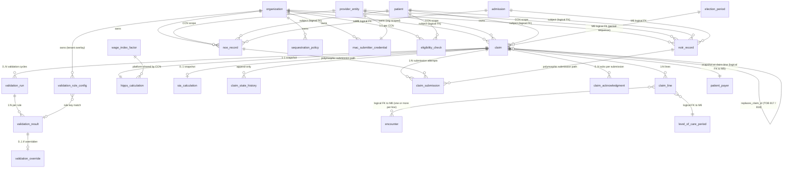

# Module 23 — Billing — Medicare Specification

> **Authority note:** This spec is an **implementation proposal** (repo authority rule): [`docs/architecture/`](../architecture/) and the ratified ADRs in [`docs/adr/`](../adr/) win on conflict, and the code plus [`docs/BUSINESS_LOGIC.md`](../BUSINESS_LOGIC.md) are ground truth for as-built behavior. Mechanism choices named here may be superseded — see ADR-0036…0040 and ADR-0030/0032/0035 for the recorded divergences (outbox not Socket.IO, TypeScript not Python sidecars, app-layer AES-256-GCM not pgcrypto, pure transition tables not XState, hand-rolled HTTP hardening not `@fastify/*`, Vite + react-router not TanStack Start).


**Module ID:** 23
**Phase:** 1 (v1 — required for Engrace go-live; the place every Medicare hospice claim is assembled, validated against the §11.A Pre-Submission Validation Framework, submitted to the MAC (NGS J6 for Engrace), acknowledged via 999/277CA, paid via 835, and reconciled into the patient's election period accrual; without M23 the agency renders care into an EHR but cannot get paid for it — NOE/NOTR windows lapse silently, election periods drift without claim coverage, the §11.A "31-point audit equivalent" architectural promise of >99% claim acceptance has nowhere to run, the M25 denial worklist starves, the M26 cap projection has no claim history to project against, the M27 cost report's per-LOC patient-day rollup reads from an empty `claim` table, the M30 HQRP HCI measure (calculated from claims data) reports zero, and the founding-tenant revenue cycle does not exist. M23 is the convergence module: every clinical artifact (active election period, signed CTI, attested F2F, signed and cosigned encounter, EVV-bracketed visit, terminal-diagnosis-primary ICD-10 sequencing, level-of-care periods with Q-code-and-revenue-code coherence) is consumed here, assembled into a TOB-typed claim, run through the configurable rule library, and dispatched to the MAC as an idempotent 837I file with the claim's deterministic control number)
**Depends on:** 5 (Patient & Demographics — `PatientReader` and `PatientPayerReader` consumed via `packages/patient` — never direct schema import; `m5.patient.deceased` consumed via outbox to close out final claims and freeze new-claim creation for the decedent; `patient_payer` ranking + `coverage_kind` consulted at claim assembly to verify Medicare Part A is the active primary payer on every service date in the claim's from-through range; the M5 `MBI` field (encrypted-at-rest per M5 §3) is decrypted only at submission time and never persisted in M23's tables — M23 stores the M5 `patient_payer.id` snapshot, not the MBI digits), 6 (Admission, Election & Certification — `ElectionPeriodReader.findActivePeriodForPatient`, `ElectionPeriodReader.listPeriodsForAdmission`, the new `CertificationReader.signedCtiForPeriod`, `FaceToFaceReader.attestedF2FForPeriod`, `LevelOfCareReader.periodsForAdmissionInRange` consumed for every claim assembled; M23 subscribes to the full M6 outbox catalog — `m6.election.signed` (NOE submission trigger), `m6.election.period_started` / `m6.election.period_ended` (claim-period anchoring), `m6.cti.signed` / `m6.f2f.attested` (unblocks recert claim per CMS 418.22), `m6.loc.changed` (HIPPS recomputation trigger for the affected claim's date range), `m6.revocation.created` (NOTR submission trigger), `m6.transfer.created` (transfer-out NOTR or transfer-in inherited-sequence claim), `m6.discharge.created` and `m6.discharge.death` (discharge claim with TOB 814 and bereavement-period claim path); M6 schemas are never imported by M23 — every cross-cut is via the reader seam or the outbox), 8 (Encounters & Visit Notes — `BillableEncounterReader.billability(encounterIds)` consumed as the authoritative gate for "this visit goes onto a claim line"; per M8 D3 a non-cosigned LPN/CHHA visit returns `billable: false, reason: 'awaiting_cosignature'` and M23 holds it out of claim assembly until the M8 `encounter.cosigned` outbox event arrives; per M8 D12 volunteer visits return `billable: false, reason: 'volunteer_non_billable'` and never appear on a claim line; `SignedEncountersReader.signedEncountersForPatientSince` consumed during claim assembly to enumerate every billable visit in the from-through range; the M8 `encounter.signed` outbox event drives the daily claim-eligibility recomputation per provider entity), 18 (EVV — `EvvComplianceReader.bracketStateForVisit(visitId)` is the per-encounter EVV gate for the §11.A validation framework; values `compliant` and `not_required` pass silently, `documented_missing` allows submission with the in-encounter `evv_missing_reason` attestation per M18 D6 + M8 D9, `unresolved_missing` is a hard `error`-severity rule failure that blocks the claim per CMS interpretive guidance on Cures Act §12006 self-attestation; M23 does not import M18 schemas — only the reader seam), 22 (Document Management — claim-related rendered artifacts (NOE confirmation receipt, NOTR confirmation receipt, claim acknowledgment letter for the patient's chart per CMS retention requirement, denial-appeal cover letter when M25 is triggered) emit `m23.billing.document_render_requested` consumed by M22; M22 renders the PDF from the typed payload, persists under retention class `compliance` (7 years per M4 / SecHard §9), and the back-ref `document_id` is recorded on the originating M23 row; M23 has no PDF code and M22 schemas are never imported by M23), 26 (Cap Management — bidirectional in the architecture sense but in lock-time-direction M23 is the producer for M26; M23 publishes `ClaimDayProjectionProvider.daysForPatientInCapYear(patientId, capYear)` and `.aggregateForOrgInCapYear(orgId, capYear)` consumed by M26; M23 *also* consumes M26's `CapProjectionProvider.projectionForPatient` and `.projectionForOrg` as a §11.A-rule input (the "aggregate cap projection not exceeded" rule reads this; per M23 D8 M23 does not compute the cap — that is M26's responsibility — but M23 reads the projection to gate submission); the bidirectional flow is non-circular at boot because M23 publishes its seam at M23 init and M26's deny-stub lands today, then M26 wires the real reader when M26 locks), 36 (Secure Messaging & Alerts — M23 emits typed alerts for `claim.rule_failed_at_submission`, `claim.ack_received` (999 or 277CA), `claim.rejected`, `claim.paid`, `noe.window_warning`, `noe.window_breached`, `notr.window_warning`, `notr.window_breached`, `eligibility.expired`, `mac_portal.unavailable`, `claim.submission_stalled`, `claim.cap_projection_at_threshold`, `claim.aggregate_cap_breach`; M23 emits typed payloads through M36's `AlertEmitter` — no out-of-band delivery code lives in M23), 38 (Clinical Terminology — `TerminologyProvider.validate`, `.lookup`, `.lookupBatch`, `.isMemberOf` consumed per the §11.A ICD-10 sequencing rule, the revenue-code-coherence rule, the modifier-codes rule, the Q-code value-set rule, and the CARC/RARC denial-mapping rule (the last consumed when M25 lands); `asOfDate` set to the claim's `service_from` date so a 2026 claim validates against the 2026 ICD-10-CM revision and an October cutover does not retroactively invalidate prior claims; the value sets for revenue codes (`vs.ub04-revenue-hospice`), Q-codes (`vs.hcpcs-hospice-place-of-service`), modifiers (`vs.cms-hospice-modifiers`), and CARC/RARC (`vs.x12-carc-rarc-hospice`) are platform-shipped per M38 D1), 40 (Master Data Management — `MdmEntityProvider.resolvePhysician(orgId, physicianId)` consulted for every NPI on the claim (attending physician, hospice physician, certifying physician); `MdmEntityProvider.resolvePayer(orgId, payerId)` consulted to confirm Medicare-FFS canonical payer identity; `MdmEntityProvider.resolveFacility(orgId, facilityId)` consulted for IPU/SNF/hospital Q-code-determining places of service when claim lines reference an external facility; M40's NPI lookup (per ARCH §11 NPPES sync) is the authoritative source for physician credential validity on every service date in the claim — the §11.A `physician credentials` rule reads M40, not M23-internal copies; the per-provider-entity MAC submitter id and the per-tenant Medicaid-state-adapter selection (when applicable for M24 hand-off) are both M40-managed canonical metadata), and transitively 1 (Foundation — `withOrgContext`, `audit()` helper, outbox dispatcher, idempotency middleware, RLS generator, partitioned-table conventions, per-tenant DEK envelope-encryption helper for `mac_submitter_credential.client_secret_cipher` and any free-text claim-narrative fields, BullMQ on Valkey, circuit-breaker and `DegradedError` envelope for the `x12-worker` HTTP client, system status event for MAC portal availability), 2 (Identity — actor + membership + role + discipline resolution; per M2 SESSION_POLICY a step-up re-auth is required on claim submission for the Billing Manager role per M23 D2 — the human action of pressing "Submit to MAC" is the moral equivalent of signing a Medicare bill and is treated as a privileged action; the `device_attestation` row is not consulted because billing is a desktop-only surface (per M23 §5.1)), 3 (Authorization — `billing.claim.*`, `billing.noe.*`, `billing.notr.*`, `billing.rule.*`, `billing.override.*`, `billing.eligibility.*`, `billing.remit.read` (forward-seam to M25), `billing.cap.read` (forward-seam to M26), `billing.mac_portal.read`, `billing.mac_portal.admin` permission keys M23 contributes; ABAC predicates `provider_entity_billing_scope`, `claim_in_billing_manager_caseload`, `override_role_eligible`, `regulatory_required_rule_protected` registered into M3's named-predicate registry; the standard `caseload_or_scope` predicate reused for patient-context reads from the claim editor), 4 (Audit — PHI write-audit trigger generator on every owned table; audit-read declaration on every PHI route; retention class `compliance` for `claim`, `claim_line`, `claim_submission`, `claim_acknowledgment`, `noe_record`, `notr_record`, `validation_run`, `validation_result`, `validation_override`, `eligibility_check` (these are *part of* the billing record under 42 CFR §424 / §405 retention rules — 7 years past final action plus state-override per M4 D1); retention class `operational` for `validation_rule_config`, `sequestration_policy`, `mac_submitter_credential`; the `wage_index_factor` table is platform-shared reference data (no PHI, no per-tenant retention concern); `eraseFn` registered into M4's destruction-cert callback registry; the MBI digits never enter the audit value-capture stream per the §3.6 denylist; the `client_secret_cipher` and any encrypted secret columns are denylisted from audit; the patient-payer subscriber id is denylisted to the masked form), and 28 (FHIR Gateway — M23 publishes `ClaimReader.fhirProjection(claimId)` for M28 to consume when M28 lands; the typed projection maps to FHIR R4 `Claim`, `ClaimResponse`, and `ExplanationOfBenefit` per US Core 6.0 hospice profile; M23 ships the contract today, the projection lands when M28 lands — forward seam pattern).

**Consumed by:** 22 (Document Management — bidirectional, see above; additionally M22 consumes `m23.abn.required` — emitted when M23's coverage determination resolves a service line as non-covered / likely-to-be-denied before the service is furnished — to render the ABN / CMS-R-131 form for the beneficiary to sign), 24 (Billing — Medicaid — `ClaimReader.medicareSecondaryContext(patientId, dateRange)` consumed when a state's Medicaid program requires the Medicare-primary EOB as a coordination-of-benefits attachment; M23 publishes the typed reader and M24 wires when M24 locks; M23 does not know Medicaid claim shape — that is M24's adapter pattern), 25 (Remittance & Denials — `ClaimSubmissionReader.acceptedSubmissionsInWindow` and `ClaimReader.claimByControlNumber(controlNumber)` consumed by M25 when 835 remittance is posted and the M25 denial worklist needs to link an 835 line item back to its originating claim; M23 also emits `m23.claim.submitted` and `m23.claim.acknowledged` for M25 to track the inbound 835 expectation window; per the architecture §11 separation M23 owns the *outbound* claim and the *acceptance* ack, M25 owns the *remittance* and the *denial worklist* — the boundary is sharp), 26 (Cap Management — bidirectional, see above; M26 is the lone consumer of `ClaimDayProjectionProvider`), 27 (Cost Report — `ClaimDayProjectionProvider.aggregateForOrgInFiscalYear(orgId, fyEnd)` and `.daysAtLevelOfCareInFiscalYear(orgId, fyEnd)` consumed by M27 to populate worksheet S-3 (statistical data — patient days by LOC) and Worksheet D (Medicare apportionment); the §11.B cost-report rule "Statistical data (S-3): patient days by level of care match Module 23 claim history" reads through this seam at M27 spec time; M27 does not import M23 schemas), 28 (FHIR Gateway — see above; M23 published the reader at M23 lock and M28 wires when M28 locks), 30 (HQRP & Quality — the HCI (Hospice Care Index) measure is calculated from 10 claims-derived indicators per ARCH §11; M30 consumes `ClaimReader.measureFeatureSetForPatient(patientId, measurementPeriod)` returning the indicator inputs (visit timing, SIA presence, GIP transitions, etc.) without M30 importing M23 schemas; M23 ships the contract today and the projection lands when M30 locks), 33 (Reporting & Dashboards — operational dashboards: AR aging by claim state, denial rate by rule, override rate by rule, NOE-window-breach rate, NOTR-window-breach rate, mean-time-to-acknowledgment by MAC, MAC portal availability rolling-window, sequestration write-off total, projected revenue by election period; the wide reader `ClaimMetricsProvider.windowAggregate(orgId, windowIso, dim)` is M23-published and M33-consumed), 34 (SaaS Tenant Platform — M34's MAC setup wizard (per ARCH §11 onboarding) calls `MacCredentialAdmin.upsertCredentials(orgId, providerEntityId, credentials)` published by M23 to write the per-ProviderEntity MAC submitter id and trading-partner credentials; the wizard's "Test 837I passes MAC syntax" go-live checklist item drives a synthetic claim through M23's pipeline against the MAC test environment per Integrations §6.3), 35 (Subscription Billing — completely orthogonal: M35 is WardenX's Stripe-based subscription billing for the SaaS itself, M23 is Medicare claims for the tenant's hospice care; the name-collision is in the architecture's English, not the code — there is no seam or shared schema and the dependency-cruiser rule asserts non-overlap), 37 (IPU Management — M37 consumes `ClaimReader.gipDaysForPatientInPeriod(patientId, dateRange)` to project IPU bed utilization for census planning when M37 locks; M23 publishes the typed reader today).

**Spec status:** Re-locked v0.3.2 (claim assembly completeness — visit lines, admission codes, CBSA value codes; on top of v0.3.1 (FY2027 G0679 telehealth-F2F line + rule); on top of v0.3 — Phase-4 remediation — Medicare claim correctness; supersedes Locked v0.2)

> **Phase-4 remediation (2026-06-11; ADR-0001/0002/0016) — 6 BLOCKERs.** M23 is re-specced against
> the corrected rate/wire model:
> - **RHC day-60 two-tier** (RHC-High days 1–60 / RHC-Low days 61+, cumulative election count, >60-day
>   gap reset; **no HIPPS code**) and the **SIA** (RHC days only, 15-min units, ≤4 hr/day, G0299/G0155)
>   per **ADR-0001** (`PerDiemRateCalculation`, not `HippsCalculation`). (M23-F01/F03)
> - **Payment math (M23-F02):** CMS annual **base-rate table**; the wage index adjusts the **labor
>   share only**, keyed by the **site-of-service CBSA** (not the CCN); **CHC = hourly 15-min units**
>   (≥8 h skilled nursing/day); **IRC 5-day limit, day 6+ reprices to RHC** (ADR-0016 D1/D2).
> - **837I wire content (M23-F04):** claim-level terminal ICD + sequence, attending (matched to the
>   election-designated attending, M23-F15) + certifying physician, value codes 61/G8, occurrence/
>   condition codes, patient status, per-LOC revenue lines + site-of-service Q-codes, per-discipline
>   visit G-codes — validated pre-submission (ADR-0016 D3).
> - **Late-NOE (M23-F05):** only admission→NOE-receipt days are **provider-liable** (occurrence span
>   **77**); covered days from the NOE date forward still bill; CMS exception path encoded.
> - **Cap year Oct 1 – Sep 30** (ADR-0002, M23-F14); MA carve-out modeled (M23-F09).

## Changelog

- **v0.3.2 (claim assembly completeness; 2026-10-08)** — closes the gaps between assembly and a payable 837I (CMS Pub. 100-04 ch. 11 §30.3; ch. 25 §75.1). **Visit lines:** every billable M8 visit becomes its own line (revenue 042x/043x/044x/055x/056x/057x, HCPCS G-code, 15-minute units); CHC (0652) is one dated line per day in 15-minute units; the claim total is the sum of line charges (SIA and other payment add-ons never enter the billed total) and the new `claim_total_matches_lines` rule blocks a mismatch. **Visit charge:** tenant-entered, effective-dated, append-only per discipline per 15-minute unit in `hospice_visit_charge_schedule` (migration 1056; `billing.visit_charge.read/admin`, admin step-up); NULL = not entered ⇒ assembly fails closed `VISIT_CHARGE_MISSING`, 0 = deliberately free. A visit with no documented duration is skipped and surfaced by the warn rule `visit_lines_reportable` (encounter ids only). **Therapy disciplines:** M8 gains `pt`/`ot`/`slp` disciplines and `pt_visit`/`ot_visit`/`slp_visit` encounter types (migration 1055). **Physician NPIs:** attending/certifying NPI on the claim (migration 1054). **Admission codes:** M6 owns UB-04 Type of Admission (FL 14) and Point of Origin (FL 15) (`admission.admission_type_code`/`admission_source_code`, migration 1057; NUBC sets in `@wardenx/types`); nullable — never backfilled — snapshotted to `claim` and refreshed each validation; new blocking rule `admission_codes_present`; the 837I document carries both (CL101/CL102). **CBSA value codes:** value code 61 (residence CBSA, home levels) / G8 (latest inpatient facility CBSA) resolved from the patient's / facility's ZIP via platform tables `hospice_zip_county`, `hospice_cbsa_county`, `hospice_cbsa_wage_index` (migration 1058; generated from the CMS FY2026/FY2027 hospice wage-index files, OMB 23-01 delineation and the Census 2020 ZCTA crosswalk by `scripts/data/hospice-cbsa/build_hospice_cbsa_migration.py` — sources and rule in its header); `claim.value_codes` (migration 1059); new blocking rule `cbsa_value_codes_present`. **Connecticut:** resolved through the 2022 planning regions (Census town→planning-region crosswalk + the Census ZCTA→town relationship + OMB 23-01; CMS lists the same regions). **PO-box / non-ZCTA ZIPs:** placed by their 3-digit prefix (\`hospice_zip3_area\`) only when every ZIP sharing the prefix is in the same area for the fiscal year (unanimous); a mixed prefix, an unknown or a malformed ZIP stays unresolved and blocks — nothing defaults to rural. **Pricing:** home levels (routine, continuous) are wage-adjusted with the beneficiary's residence-area index and GIP / inpatient respite with the facility's area index, not the provider CCN's (CMS Pub. 100-04 ch. 11 §30.3 — value codes 61 / G8 and the Pricer's BENE-CBSA / PROV-CBSA inputs, verified against the manual text; 42 CFR 418.306(c) supplies only the OMB-CBSA labor market and the 5% cap); pure function \`wageIndexFactorForLevelOfCare\`, each HIPPS segment records the factor it used; an unresolved needed area is a 422 \`WAGE_INDEX_AREA_UNRESOLVED\`, never the provider's index. **Tenant wage index:** \`bun run db:seed:wage-index -- --ccn <CCN> --zip <ZIP>\` derives the \`tenant_wage_index\` entry from \`hospice_cbsa_wage_index\` (no production default; demo fixture CCN 381588 = Engrace Hospice, Pendleton OR, ZIP 97801 — confirmed against CMS Provider Data). **Known gaps:** a ZCTA approximates a USPS ZIP; the facility address key is \`facility.primary_address.postalCode\`; G8 is the LATEST facility that served the inpatient (0655/0656) level-of-care periods, taken from M37 (`ipu_admission`, keyed by the M6 level-of-care period; owned unit or arranged remote facility) and, for a stay M37 does not know, from the overlapping M5 facility residence span (a tie on the last inpatient day between different or missing ZIPs, or no facility at all, blocks); a claim spanning Oct 1 is priced day by day with each fiscal year's own rate table and with that year's published index for the SAME end-of-period CBSA codes the claim reports, as the Pricer does (a mid-claim move does not change the codes); PM modifier, Q5006 and diagnoses are deferred. Default rule count 26 (23 regulatory).
- **v0.3.1 (FY2027 CoP — telehealth F2F G0679; 2026-10-06)** — CR 14495 (Pub 100-04 Transmittal 13944, MLN MM14495; ch. 11 § 30.3) implementing 42 CFR 418.22(a)(4)(ii) as revised by CMS-1851-F (source: [`docs/research/FY2027_HOSPICE_COP_RESEARCH.md`](../research/FY2027_HOSPICE_COP_RESEARCH.md) §4). **Assembly:** `FaceToFaceSnapshot` gains `modality` (`telehealth` / `in_person` / null, from M6 `encounter_location`); M6's range read also returns a later — including still-pending — period's telehealth F2F dated inside the span (a recert F2F precedes its period). For each telehealth F2F dated in the claim span on/after **2027-01-01**, assembly appends one separately dated `claim_line` with `hcpcs_code = 'G0679'`, `revenue_code = '0657'`, `service_date_from = service_date_to = encounter date`, on the LOC period covering that date and the claim's site Q-code (the 837I emits the HCPCS for a HCPCS-bearing line). **UNCONFIRMED** (no primary source): units (`G0679_UNITS_PER_ENCOUNTER = 1`) and charge (`G0679_UNIT_CHARGE_CENTS = 0`, administrative expense; included in `total_charge_cents`, never in the expected payment), whether MACs edit G0679 against the benefit period (not applied), and modifier GV for NP performers (not applied) — named constants in `packages/billing/src/rules/f2f-telehealth-g0679.ts` with a TODO. In-person F2Fs are never reported. **Rule:** new 20th default rule `f2f_telehealth_g0679` (f2f, error, regulatory, billing_manager): missing G0679/0657 line for an in-span telehealth F2F (DOS ≥ 2027-01-01), G0679 on a revenue code other than 0657 (BR 14495.3), G0679 dated before 2027-01-01 (BR 14495.1), or G0679 on a TOB other than 81X/82X (BR 14495.2). `level_of_care_coherence` leaves G0679 lines to it. **TOB 82X (hospital-based hospice) is out of scope:** `deriveTypeOfBill` emits 81X only and `provider_entity` carries no hospital-based indicator; the rule's TOB check accepts 82X so it holds when 82X derivation lands.
- **Implementation note (FY2027 rates & HQRP, 2026-10-06)** — the CMS national FY2027 per-diem base rates
  (CORRECTED per CMS-1851-CN, 91 FR 61791, 2026-09-30, which supersedes the final rule's Tables 1–4) ship as a
  platform REFERENCE in `packages/billing/src/rate-table/national-rates.ts` — both HQRP columns (compliant +2.3%;
  non-compliant −1.7%, the 4-percentage-point reduction of 42 CFR 418.306(b)(2)) with Federal Register citations.
  Pricing still reads ONLY the tenant-entered `hospice_rate_table`. `hospice_rate_table.hqrp_compliant` (migration
  0394, append-only like the rates, NULL = undeclared) records each version's declared status; every rate-table
  view carries advisory `nationalReferenceWarnings` (keyed rates vs the declared column; never blocks a save).
  `GET /billing/rate-tables/national-reference?providerEntityId=&fiscalYearStarting=` serves the reference to the
  new web screen `/billing/rate-tables` (HQRP toggle, "Prefill from CMS national rates", live mismatch warning).
  See §1.3 "FY2027 national rates and HQRP".
- **FY2027 amendment (2026-10-06; version unchanged)** — New regulatory rule `election_addendum_signed` (category `election`; `packages/billing/src/rules/election-addendum-signed.ts`) for the mandatory 42 CFR 418.24(c) election statement addendum (CMS-1851-F; facts in [`docs/research/FY2027_HOSPICE_COP_RESEARCH.md`](../research/FY2027_HOSPICE_COP_RESEARCH.md) §1). Effective dates are rule parameters (`applyToElectionsFrom`, `enforceFrom`), so no new registry mechanism; the context gains an optional `electionAddendum` snapshot read from M6's `electionAddendumComplianceForOrg` through an optional `ClaimAssemblySeams.electionAddendum` reader (unbound ⇒ the rule skips `seam_not_bound`). The platform default set is now 21 rules (19 regulatory, with `f2f_telehealth_g0679`). See §4.5.
- **v0.2 (Locked)** — Initial publication at lock-grade. Instantiates the architecture §20.B module spec template. Resolves all sixteen open questions into binding decisions (§11). Defines the **§11.A Pre-Submission Validation Framework as a TypeScript-typed rule registry with platform-floor `regulatory_required` protection** (D1) — the rule predicates are code in `packages/billing/src/rules/`, the per-tenant enablement and parameter overlay live in `validation_rule_config`, the rule outputs are recorded in `validation_run` / `validation_result`, and overrides require an elevated approver per `validation_override` — the architectural answer to the >99% claim acceptance promise. Defines the **outbox-only MAC submission posture** (D2) — the `claim` row transitions DRAFT → VALIDATING → READY → SUBMITTED inside a single transaction with the outbox emit, the `x12-worker` HTTP call is made exclusively by the `claim.submit` BullMQ worker draining the outbox, the claim's `claim_control_number` (deterministic from `(provider_entity_id, claim_id, attempt_index)`) is the idempotency key, and retries are no-ops at the MAC by construction. Defines the **NOE/NOTR fast-path as parallel-but-independent entities** (D3) — `noe_record` and `notr_record` are their own state machines with their own submission worker, independent from claim assembly, but the §11.A `NOE timeliness` rule binds the two surfaces so a claim cannot SUBMIT if its admission's NOE is unfiled or rejected past the 5-day window without an override. Defines the **control-number-keyed idempotency and replacement-chain model** (D4) — resubmission of a previously-accepted claim requires explicit TOB 817 (replacement) or 818 (void) with `replaces_claim_id` set, never a re-use of the original control number; the chain is audit-prominent and the original claim transitions to REPLACED or VOIDED on acceptance of the replacement/void. Defines the **regulatory-required-rule platform-floor protection** (D5) — rules tagged `regulatory_required=true` cannot be disabled by tenants; the `validation_rule_config` row for a regulatory-required rule has RLS `USING (false)` on UPDATE/DELETE for non-platform roles, mirroring the M19 platform-floor-mandatory-escalation pattern. Defines the **SIA add-on calculator owned by M23** (D6) — `sia_calculation` rows are produced at claim assembly by walking M8 `SignedEncountersReader` for the last 7 days of the patient's life looking for RN/MSW visits per CMS rules; the calculator is a pure function in `packages/billing/src/sia/` for testability. Defines the **HIPPS calculator owned by M23** (D7) — `hipps_calculation` rows are produced by mapping M6's `LevelOfCarePeriod` segments within the claim's from-through range to the HIPPS code per CMS payment-period model (first 7 days RHC payment rate vs. days 8+); the calculator is a pure function in `packages/billing/src/hipps/`. Defines the **cap-projection-via-seam pattern** (D8) — M26 owns the cap calculation; M23 reads the projection via `CapProjectionProvider.projectionForPatient` to gate submission via the §11.A `aggregate cap projection` rule; M23 publishes `ClaimDayProjectionProvider` to feed M26; bidirectional but non-circular at boot. Defines the **EVV-gate behavior with three resolutions** (D9) — every billable encounter's M18 `EvvComplianceReader.bracketStateForVisit` is consulted; `compliant`/`not_required` passes, `documented_missing` allows with attestation surfacing the M8/M18 missing-reason audit row, `unresolved_missing` is an `error`-severity rule failure that blocks submission. Defines the **cosignature-wait posture** (D10) — `BillableEncounterReader.billability(encounterIds)` returning `awaiting_cosignature` excludes the visit from claim assembly entirely; the visit is added to the claim only after `m8.encounter.cosigned` arrives; if the claim is already SUBMITTED without that visit, no retroactive add — the next claim period (or a TOB 817 replacement) is the path. Defines the **sequestration-percentage configuration as platform-floor + tenant-forward-only** (D11) — `sequestration_policy.percentage` per provider entity per effective-date range; platform default tracks the CMS-announced percentage (currently 2% restored from 1% temporary reduction); tenants may not edit historical periods, may only forward-date a new entry under the platform-floor pattern. Defines the **wage-index reference table as platform-shared CCN-keyed annual data** (D12) — `wage_index_factor` is platform-shared (no `organization_id`), loaded by the platform-only loader on annual CMS hospice rate update, and read by the HIPPS/per-diem calculator at claim assembly time; tenants cannot edit. Defines the **AI-block posture identical to M13 D15 / M18 D13 / M19 D11** (D13) — Module 32 cannot create, modify, witness, or resolve any M23 row; boot-time validation iterates M32's registered prompt templates and any whose `outputType` matches `claim_*`/`validation_*`/`noe_*`/`notr_*`/`hipps_*`/`sia_*` fails boot; dependency-cruiser blocks `packages/ai-platform/*` imports from `apps/backend/src/modules/23-billing-medicare/*` and from `packages/billing/*`; the per-route guard rejects requests carrying an `actor_kind='ai_*'` header; the *only* AI surface M23 admits is a read-only `validation_ai_advisory` projection that M32 may write (advisory remediation hints for failed rules, surfaced in the validation worklist UI) and that never appears as a row on `claim` or `validation_override`. Defines the **voided / replaced / adjustment claim model** (D14) — TOB 817 (replacement) and 818 (void) are first-class state transitions with `replaces_claim_id` FK; original claim transitions to REPLACED or VOIDED on acceptance of the void/replacement at 277CA; the chain is preserved indefinitely (no garbage collection of replaced claims) because every link is part of the seven-year billing record. Defines the **Medicare-primary-payer-only scope** (D15) — M23 handles Medicare-FFS only; if the patient's primary payer on any service date is not Medicare-FFS, the claim is rejected at assembly with a structured error directing the user to M24 (Medicaid) or to commercial billing (out of scope for Phase 1); the §11.A `Medicaid (when applicable)` rule is a M24-hand-off contract, not a M23-internal rule. Defines the **proposed manifest patch** (D16) correcting `M23.dependsOn` from `[6, 8, 22, 38, 40]` to `[1, 2, 3, 4, 5, 6, 8, 18, 22, 26, 28, 36, 38, 40]` *(relationship inventory - not the `dependsOn` edge set; per ADR-0005 D1/D4 seam/outbox/foundation consumers are no-edge - see audit/MANIFEST_DEPENDSON_REVIEW.md; do not bulk-apply)* and adding `packages/x12-worker-client` to `M23.codePaths`; populating `M23.ownedTables` with the seventeen owned tables. Wires the permission keys this module registers into Module 3 (§4.6), the four ABAC predicates this module registers into Module 3's named-predicate registry (§4.7), the BullMQ queue catalog (§4.8), the M36 typed-alert payloads (§4.9), the outbox event catalog (§4.10), the four published reader seams (§4.3), and the destruction `eraseFn` registered with Module 4 (§3.7).
- **v0.1** — Drafted within the lock-grade pass; not separately published.

> **Phase boundary (binding):** Phase 1 delivers everything in this spec **including the full §11.A Pre-Submission Validation Framework with all seventeen default rule categories, the NOE/NOTR fast-path with submission worker, the 837I outbound submission worker against the MAC test environment with `x12-worker` HTTP integration, the 999 / 277CA acknowledgment parser, the eligibility (270/271) check cache with 30-day freshness, the HIPPS and SIA calculators, the sequestration policy engine, and the wage-index reference loader**. The "done" gate for M23 is: claim assembly produces a TOB-811 admission-through-discharge claim and a TOB-812 first-interim claim that pass the validation framework end-to-end, the `x12-worker` `/generate-837i` round-trip produces a syntactically-MAC-acceptable 837I file in CI against a recorded MAC test-environment fixture (and in staging against the real MAC test environment), the 999/277CA parser correctly maps acknowledgment codes back to the claim state machine, the NOE 5-day window enforcement blocks claim submission when the admission has no signed NOE, the seventeen reader-seam contracts are published at boot and `validateSeams()` is green, the outbox events are emitted per catalog, and the test plan is green — **not gated** on Modules 24 (Medicaid claim secondary-payer hand-off contract ships today; M24 wires when M24 locks), 25 (denial worklist consumer subscribes to `m23.claim.acknowledged` and `m23.claim.rejected` when M25 lands; the 835 posting worker is M25-owned), 26 (cap-projection bidirectional pair ships with deny-stub on the M26-side today; the §11.A `aggregate cap projection` rule degrades to `warn` with `cap_projection_unavailable` annotation when M26 is deny-stubbed and tightens to `error` when M26 locks), 27 (cost-report consumer subscribes via the published reader when M27 locks), 28 (FHIR projection lands when M28 lands; the typed mapping ships today), 30 (HQRP HCI feature-set consumer lands when M30 locks), 33 (reporting dashboards land when M33 locks), 34 (MAC setup wizard surfaces in M34 ship; the underlying `MacCredentialAdmin` is M23-owned and ships today), 37 (IPU GIP-day reader lands when M37 locks). The M5 / M6 / M8 / M18 / M22 / M36 / M38 / M40 consumers are wired against the real modules (all are locked); the M22 PDF-rendering consumer is a *Phase-1 emission* by M23 (the typed render request) and the *Phase-1 fallback* is to surface "Submitted on (date), MAC control number XXX" in the claim detail screen without a PDF artifact until M22 locks and the actual render lands — at which point the back-ref `document_id` populates retroactively via the M22 backref-consumer pattern (per M6 §4.4 form rendering handshake).

-----

## 1. Purpose & Scope

### 1.1 What This Module Does

Module 23 owns **the assembly, validation, submission, and acknowledgment of Medicare Part A hospice claims** — the end-to-end electronic billing artifact that converts a clinically-documented hospice episode into a Medicare-paid revenue event, plus the parallel NOE/NOTR fast-path that registers and unregisters the hospice election with CMS within the 5-day windows the regulation requires. M6 owns the *regulatory state* of the hospice relationship (election, certification, F2F, level-of-care periods, revocation, transfer, discharge); M8 owns the *clinical record* of each visit; M18 owns the *electronic verification* of each visit; M40 owns the *canonical physician/payer/facility identity*; M38 owns the *coded terminology*; M23 owns the *billing assembly* that joins these together into a claim Medicare will pay.

- **Claim assembly.** A `claim` row groups one or more `claim_line` rows under a single Type of Bill (TOB — 811 admission-through-discharge, 812 first interim, 813 continuing interim, 814 last interim before discharge, 817 replacement, 818 void), bound to one `patient`, one `provider_entity` (CCN), one `patient_payer` snapshot (the active Medicare-FFS row at service-date), one election period sequence range, one HIPPS calculation, one optional SIA calculation, one sequestration policy snapshot, and the full set of ICD-10 codes with sequence positions. Assembly is **server-authoritative** — the route accepts the from-through range and the assembly service derives every line, every code, every modifier, every revenue code, every Q-code from the M6/M8/M18/M40 readers; the client never posts a fully-formed claim because the server does not trust client-side assembly.

- **The §11.A Pre-Submission Validation Framework.** Every claim runs through a configurable rule library before SUBMITTED state. The framework is the architectural answer to the >99% claim acceptance promise: each rule is a typed predicate (`(claim, context) => ValidationResult`) registered in `packages/billing/src/rules/`; the seventeen default categories cover patient eligibility, election period validity, CTI completeness, F2F attestation, level-of-care coherence, HIPPS coding, SIA add-on math, ICD-10 sequencing, physician credentials, NOE timeliness, TOB/dates consistency, duplicate billing, place-of-service consistency, aggregate cap projection, IPU cap projection, bereavement/discharge legitimacy, and modifier codes; rules tagged `regulatory_required=true` are platform-locked and cannot be disabled by tenants; non-regulatory rules can be disabled per tenant; tenants may add custom rules with TypeScript-or-JSON-DSL predicates; failed rules block the claim until either resolved (data correction → re-validate) or explicitly overridden by an elevated approver with a typed reason. The framework's running execution is recorded in `validation_run` (one per validation cycle) with one `validation_result` per rule per run; an `validation_override` row carries the override audit trail.

- **NOE/NOTR fast-path.** `noe_record` (Notice of Election) and `notr_record` (Notice of Termination/Revocation) are parallel-but-independent submission entities with their own state machines (`DRAFT → READY → SUBMITTED → ACK_PENDING → ACK_ACCEPTED | ACK_REJECTED`), their own submission worker, and their own 5-day window enforcement. M23 listens for `m6.election.signed` (triggers NOE draft), `m6.revocation.created` and `m6.transfer.created` direction-out and `m6.discharge.created` (triggers NOTR draft). The fast-path is *fast* because it does not wait for any full claim to be ready — the regulation requires the NOE within 5 days of admission regardless of whether any visits have been documented yet; an NOE submitted late triggers an automatic non-coverable period and a §11.A rule failure on the next claim.
- **Transfer notice (TOB 8xC / 8xD) — as-built 2026-10, migration 0375.** The receiving hospice's Change of Provider / Transfer Notice (CMS Pub. 100-04 ch. 11 §20.1.3, Rev. 12847, eff. 2024-06-03) is a third notice entity, `transfer_notice_record`, over the NOE/NOTR state alphabet (`noe_state`) and the shared `claim_submission` (kind `transfer_notice`) / `claim_acknowledgment` rows. It is drafted by `m23.m6-transfer-in-notice` off `m6.transfer.created` direction `in` (the NOTR binding keeps `out`; the NOE draft keeps skipping the inherited period — an 8xA opens an election, an 8xC "creates" none, §20.1.6 summary chart). Unlike the NOE it races no clock: CGS's CR 8877 FAQ states 8XC transactions "are not subject to the 5-day timely filing requirement" (https://www.cgsmedicare.com/hhh/education/faqs/searchable_faqs/cr_8877_faqs.html), so there is no window watchdog. Instead it is HELD in DRAFT until staff confirm the transferring hospice "has finalized their billing" (§20.1.3) — no WardenX data can observe another hospice's claims, so the hold is an attested fact (their final claim's Through date + patient status 50/51, confirming membership + time). `assemble` is guarded on zero blockers from `evaluateTransferNotice` (`@wardenx/billing`): same CCN (also refused at M6 capture, 422 `TRANSFER_SAME_PROVIDER`), a second change of hospice in the benefit period (also refused at M6, 409 `TRANSFER_LIMIT_EXCEEDED`), the hold, From ≠ transferring Through (the CR 12619 CWF gap edit, MLN MM12619), our admission date after the transfer date, a transfer date before the benefit period start. TOB 81C (no provider entity is flagged hospital-based, as for claims); Statement From = transfer date; our own admission date; OC 27 only when the transfer date is the first day of the next benefit period; no condition codes on an original. A correction is a new row (From = corrected date, OC 56 = date on file, CC D0 — both or neither); a transfer submitted in error is removed by an 8xD void row (§20.1.4: From and admit date = the transfer date). Routes `/api/v1/billing/transfer-notices` (list, detail, `confirm-prior-billing`, `submit` [step-up, 202], `cancel` [reason], `correct-date`, `void`, `redraft`) ride the `billing.noe.*` keys (CMS calls it a "transfer Notice of Election") and `provider_entity_billing_scope`. The `transfer_notice.submit` worker hands the X12 gateway the PHI-free `TransferNoticeDocument837i` (`POST /generate-transfer-notice`); `build837iTransferNotice` in `@wardenx/x12-837-client` is the golden-tested reference 837I per the CMS 837I NOE Companion Guide v1.2 (CLM02 0, CLM05 `81:A:C`, CL1 `9*1*30`, one SV2 0650/Q5009). The 999/277CA crons route an acknowledgment to the notice by its submission's kind. Events `m23.transfer_notice.{draft_created,submit_requested,submitted,accepted,rejected}`. UI: Billing → Transfers.
- **Corrected NOE / NOTR, payer status date, late-NOE OSC 77 — as-built 2026-10, migration 0378.** A NOE or NOTR the 999 / 277CA rejected never posted at the CWF, so the fix is a NEW original 8xA / 8xB (§2.2 "corrected NOE is its own row"; not the OC 56 + CC D0 correction of a *posted* date in ch. 11 §20.1.1 / §20.1.2, nor the §20.1.4 8xD cancel). `POST /api/v1/noe-records/:id/correct` and `/api/v1/notr-records/:id/correct` (`billing.noe|notr.submit` + `provider_entity_billing_scope`, AI-block, `Idempotency-Key`; 201 created / 200 replay) draft a copy of the rejected notice linked by `corrects_notice_id`, with the notice date optionally corrected (re-validated; the filing window is never extended and the NOE timeliness clock starts at the earliest date along the correction chain, so a correction cannot turn a late NOE timely), a fresh D4 control number (attempt = chain depth) and the biller's reason (`correction_reason`, never in an event; shredded by the M4 eraser). Only a rejected notice is corrected; one correction at a time (`*_open_correction_uq`, replayed idempotently); a rejected correction is corrected in turn. Events `m23.noe|notr.draft_created` + `.correction_created`. The draft goes through the ordinary submit queue and ack routing; once accepted it is the effective NOE (`findEffectiveByAdmission`) / filed NOTR (`priorElectionClosureTx`). The ack crons now also store Medicare's own date for the answer, `payer_status_date` + `payer_status_date_source` (277CA STC02; a 999's GS04, else ISA09; else our receipt date as an Eastern calendar day — `accepted_at` / `rejected_at` stay our receipt time; reference reader `read277caStatusDates` / `read999EnvelopeDates` in `@wardenx/x12-837-client`). `noe_timeliness_5d` judges an accepted NOE on that date (timely = accepted within admission + 5 calendar days, ch. 11 §20.1.1); a late NOE is non-blocking `info` and every validation derives the claim's `occurrence_spans` (OSC 77, admission through the day before acceptance, clipped to the claim period), sent to the gateway as `ClaimDocument837i.occurrenceSpans` (`HI*BI:77:RD8`). Open: the CMS late-NOE exception path (§20.1.1's four circumstances) is not modelled; the line-level non-covered charges for OSC 77 days are the gateway's to report; correcting an ACCEPTED NOE (OC 56 / CC D0, or 8xD + new NOE) is not built. UI: NOE / NOTR detail and queue preview — "File corrected NOE/NOTR" with the rejection stage + codes, the "Corrects" / "Corrected by" links, Medicare's date.

- **MAC submission via outbox-only path.** A claim leaves M23's process boundary only through the `m23.claim.submit_requested` outbox event, drained by the `claim.submit` BullMQ worker, which calls the `x12-worker` Python sidecar's `POST /generate-837i` endpoint with the typed claim payload, receives the 837I file bytes back, uploads to the MAC portal (NGS file drop in the launch case), records the upload as a `claim_submission` row, and transitions the claim to `SUBMITTED`. The claim's `claim_control_number` is deterministic from `(provider_entity_id, claim.id, attempt_index)` and is the idempotency key both internally and at the MAC — a retried submission for the same control number is a no-op at the MAC because the MAC has already received that file. Replacement (TOB 817) and void (TOB 818) submissions follow the same path with their own new control numbers and a `replaces_claim_id` FK.

- **Acknowledgment parsing.** The MAC returns 999 (functional acknowledgment — was the 837I file structurally valid?) and 277CA (claim acknowledgment — was the claim *content* valid at the MAC's edits?) and later 835 (remittance — was the claim paid, and at what rate, with what adjustments?). M23 owns 999/277CA parsing and the claim's transitions through `ACK_PENDING → ACK_ACCEPTED | ACK_REJECTED | ACK_PARTIAL`. 835 remittance parsing is M25's responsibility but M25 reads `ClaimReader.claimByControlNumber` to match the 835 line items back to the originating claim.

- **Eligibility (270/271).** Before claim submission, the §11.A `Patient eligibility` rule consults the most recent 270/271 result for the patient. The `eligibility_check` cache stores results with `checked_at` timestamps; the 30-day-freshness rule reads from this cache; if no fresh result is on file, the framework emits a `warn` with `eligibility_stale` and offers to refresh via `x12-worker`'s `POST /eligibility/270`. The MBI is encrypted at rest per M5 §3 and is decrypted only at HETS request time; M23 stores `eligibility_check.outcome` (`active` / `inactive` / `unknown`) and the as-of date, never the MBI digits.

- **HIPPS, SIA, sequestration.** Three claim-time calculations live in M23 as pure functions in `packages/billing/src/`: per-diem rate derivation per the CMS hospice model (ADR-0001: RHC-High for election days 1–60, RHC-Low for day 61+ — no HIPPS code is emitted on hospice claims; the per-diem from the wage-index-adjusted CMS rate); SIA add-on (RN or MSW visits in the last 7 days of life add to RHC per-diem per CMS rules); sequestration write-off (the platform-default percentage from `sequestration_policy.percentage` for the claim's service period). Each calculation is recorded as a snapshot row (`hipps_calculation`, `sia_calculation`) on the claim so the per-diem math is reproducible at any later point.

- **MAC submitter credentials per Provider Entity.** Every ProviderEntity (CCN) has its own MAC submitter id, trading-partner credentials, and portal login — different CCNs in the same Organization can land on different MAC jurisdictions (NGS, CGS, Palmetto, etc.). `mac_submitter_credential` carries the per-PE credential set with the `client_secret_cipher` encrypted under the per-tenant DEK per M1 §6. The `MacCredentialAdmin` seam is M23-published for M34's MAC setup wizard.

- **The TOB lifecycle and replacement chain.** Most Engrace claims will be TOB 812 (first interim) for the current month with TOB 813 (continuing interim) for subsequent months until discharge, capped by TOB 814 (last interim before discharge). A patient who admits and discharges within a single month gets a single TOB 811 (admission-through-discharge). When a claim is accepted by the MAC and a clinical correction (a missed visit, a corrected ICD-10 code, an LOC-period boundary shift, a HIPPS recomputation) is discovered, the path is TOB 817 (replacement) referencing the original via `replaces_claim_id`; the replacement carries the corrected claim lines and the MAC accepts it with an implicit void of the original. When a claim was accepted but is fundamentally incorrect (wrong patient, wrong period, never should have been billed), the path is TOB 818 (void) which zeros the claim; the original transitions to VOIDED on acceptance. The chain is the audit-record-of-truth — every original and every replacement and every void persists as its own `claim` row indefinitely under the 7-year compliance retention.

### 1.2 What This Module Does Not Do

- **Own the clinical record, the election state, the encounter, the EVV event, the physician identity, the terminology version, or the cap calculation.** Every one of these is a separate module (M5, M6, M8, M18, M40, M38, M26). M23 reads them all via typed reader seams.

- **Calculate the aggregate cap or the IPU cap.** Those are M26 Cap Management's responsibility. M23 reads M26's projection via `CapProjectionProvider` to drive the §11.A `aggregate cap projection` rule and to fire the M36 alert when a claim brings the projection over the threshold. M23 *publishes* `ClaimDayProjectionProvider` *for* M26 to consume — the day-by-LOC aggregation that M26 needs as input — but M23 does not divide, project, or threshold.

- **Submit Medicaid claims.** That is M24 Billing — Medicaid. M23 hands the patient + dates off to M24 via the `ClaimReader.medicareSecondaryContext` seam when a Medicare-paid claim's EOB needs to attach to a Medicaid coordination-of-benefits filing. The state-specific Medicaid claim shape, eligibility (state 270/271), and submission channels are entirely M24's adapter pattern.

- **Process remittance (835) or build the denial worklist.** That is M25 Remittance & Denials. M23 publishes `ClaimSubmissionReader.acceptedSubmissionsInWindow` so M25's 835-posting worker can match remittance line items back to originating claims, but the 835 parsing, the CARC/RARC categorization, the denial-aging workflow, and the appeal-case lifecycle are all M25's.

- **Render any PDF, letter, or printable artifact.** The NOE confirmation receipt, the NOTR confirmation receipt, the claim-acknowledgment letter for the patient's chart, and the denial-appeal cover letter all emit `m23.billing.document_render_requested` for M22 to render from a typed payload. M23 has zero PDF code.

- **Speak HL7 v2 or the iQIES batch format or CMS-1984-14 cost report.** M29 (External Interfaces) owns inbound/outbound HL7. M10 (HOPE Engine) owns iQIES submission. M27 (Cost Report) owns CMS-1984-14. M23 reads from these where relevant (e.g., M27 reads M23's claim history for S-3) but never produces those wire formats.

- **Make autonomous billing decisions through AI.** Per M23 D13 the AI block is absolute. M32 may surface *advisory* remediation hints on the validation worklist UI through the `validation_ai_advisory` read-only projection, but every rule pass/fail, every override, every claim transition is an actor decision recorded by an elevated approver per the §11.A workflow. WardenX's claim flow stands up to MAC/UPIC/RAC/OIG scrutiny because every action has a human signature behind it.

- **Speak the MAC portal HTML.** The portal upload step is delegated to the `x12-worker` Python sidecar that handles the file drop. M23 owns the typed claim payload and the post-upload state transitions; the HTTP details of every MAC portal are confined to `packages/x12-worker-client` (the TypeScript client to the Python sidecar) per the architecture §25.14 adapter mandate.

### 1.3 Regulatory & Operational Drivers

| Regulation / Standard | Requirement | M23 realization |
|---|---|---|
| **42 CFR §424.32** — Medicare claim filing | Claims filed in the form, manner, and within the timeframe CMS requires (1 year from service date) | The §11.A `Bill type and dates` rule; the `noe_record.window_breach_at` field; the claim's `service_to` to `submitted_at` aging on the AR dashboard |
| **42 CFR §418.24** — NOE filing within 5 days of admission | NOE submitted within 5 calendar days of the hospice election effective date; late NOE produces a non-coverable period | The NOE fast-path with 5-day enforcement; the §11.A `NOE timeliness` rule that warns at day 3 and blocks claim submission past day 5 unless overridden; the `m23.noe.window_warning` and `m23.noe.window_breached` M36 alerts |
| **42 CFR §418.26** — NOTR filing within 5 days of discharge or revocation | NOTR submitted within 5 calendar days of the discharge/revocation effective date | The NOTR fast-path with 5-day enforcement; the §11.A `Discharge / bereavement` rule; the `m23.notr.window_warning` and `m23.notr.window_breached` M36 alerts |
| **42 CFR §418.22** — Certification of Terminal Illness | CTI signed before each benefit period; F2F within 30 days prior to recert period start from period 3 onward | The §11.A `Certification of Terminal Illness` rule reading `CertificationReader.signedCtiForPeriod`; the §11.A `Face-to-Face encounter` rule reading `FaceToFaceReader.attestedF2FForPeriod` |
| **42 CFR §418.302** — Payment categories (RHC, CHC, IRC, GIP) | Each claim line carries the correct level of care; Q-code matches place of service; revenue code matches LOC | The §11.A `Level of care coherence` rule reading `LevelOfCareReader.periodsForAdmissionInRange`; the `claim_line.revenue_code` + `claim_line.q_code` cross-check |
| **HIPAA §162** — HHS-adopted code sets | ICD-10-CM/PCS, HCPCS, NDC, CARC/RARC used in transactions | M23 reads codes through `TerminologyProvider` (M38); ICD-10 sequencing is asOfDate-bound to the claim's `service_from` |
| **CMS Hospice Payment Manual** — HIPPS code | HIPPS code calculated correctly per CMS payment-period model (RHC first 7 days vs. days 8+); SIA add-on for RN/MSW visits in last 7 days of life | The `hipps_calculation` snapshot; the `sia_calculation` snapshot; the §11.A `HIPPS coding` and `SIA add-on` rules |
| **Budget Control Act sequestration** | 2% reduction on Medicare hospice payments (post-COVID restoration) | The `sequestration_policy.percentage` per-effective-date table; the claim's `sequestration_applied_pct` snapshot at submission |
| **CMS wage index** | Per-CCN annual wage index adjusts the per-diem payment rates | The platform-shared `wage_index_factor` table loaded annually; the HIPPS calculator multiplies by the factor at claim assembly |
| **21st Century Cures Act §12006** — EVV | Personal-care and home-health Medicaid visits require electronic verification | The §11.A EVV-coherence rule reading `EvvComplianceReader.bracketStateForVisit`; `unresolved_missing` blocks submission, `documented_missing` allows with attestation, `compliant`/`not_required` passes silently |
| **CMS EDI Trading Partner Agreement** — 837I, 999, 277CA, 835, 270/271 | Wire-format conformance and submitter-credential enrollment per MAC | `mac_submitter_credential` per-ProviderEntity; the `x12-worker` Python sidecar (pyx12) handles every X12 transaction; the synthetic claim against the MAC test environment runs in CI |
| **State Medicaid Coordination of Benefits** | Medicare-primary EOB attachment to Medicaid filing in dual-eligible states | `ClaimReader.medicareSecondaryContext` published for M24 to consume |
| **CMS retention** — 7 years past final claim action | Claim records, acknowledgments, NOEs/NOTRs retained 7 years past final action | Retention class `compliance` on every owned PHI/billing table; M4 retention policy; MinIO object lock on the `claims/` bucket for the same 7 years |
| **OIG Workplan — hospice billing fraud** | OIG audits hospice billing for false-visit claims, ineligible elections, GIP overuse | Every claim assembly reads M18 EVV state; every claim's level-of-care periods read from M6 are immutable post-attestation; GIP days flagged for IPU cap projection per M26; every override carries an elevated-approver audit |

#### FY2027 national rates and HQRP (2026-10-06)

| Rev | Level of care | HQRP compliant | HQRP non-compliant |
|---|---|---|---|
| 0651 | RHC days 1–60 | $236.33 | $227.09 |
| 0651 | RHC days 61+ | $186.33 | $179.04 |
| 0652 | CHC (24 h) / hourly (SIA rate) | $1,726.16 / $71.92 | $1,658.66 / $69.11 |
| 0655 | IRC | $545.93 | $524.58 |
| 0656 | GIP | $1,231.51 | $1,183.35 |

Source: CMS-1851-F (91 FR 49118) as corrected by CMS-1851-CN (91 FR 61791–61793). The rates are a reference for
prefill and sanity-checking only; the rate table stays tenant-entered and is the single pricing input. A version's
`hqrp_compliant` says which column it was keyed under; a mismatch is a warning, not a validation failure, so a
tenant can key a later CMS correction before the platform reference is updated. The FY2027 wage index is NOT
bundled: CMS republished the corrected FY2027 hospice wage index file (floors 0.8916 / 0.8298) on its Hospice Wage
Index page; tenants key it per CCN through `tenant_wage_index` (F-211).

### 1.4 Competitive Context

- **The validation framework is a code-level rule registry, not a hardcoded audit.** Industry-leading hospice EHRs ship a "31-point pre-submission audit" as a hardcoded set of checks somewhere in the claim-submission path; tenants can rarely see it, never modify it, and the audit is opaque when a rule fires. WardenX's §11.A framework is the explicit answer: each rule is a code-grade TypeScript predicate in a registry with platform-floor `regulatory_required` protection; tenants can disable non-regulatory rules per their own risk profile (e.g., disable the `eligibility_check_freshness_30d` rule for a tenant whose HETS access is intermittent); tenants can add their own custom rules (e.g., "no claim with revenue code 0656 GIP unless an IPU bed assignment row exists for the period" for a tenant with a facility-specific business rule); every rule's pass/fail is recorded in `validation_result` and visible on the validation worklist UI; overrides require elevated approval. The result: when a MAC rejection arrives with a code WardenX didn't catch, the rule library auto-suggests a new rule for tenant review (per ARCH §11.A workflow), and the next claim's framework catches it. The library tightens over time across the platform.

- **NOE/NOTR is fast-path, not a slow consequence of a full claim assembly.** Industry-typical agencies file NOEs by manually keying them into the MAC portal at the same time they file the first interim claim — which routinely lands past the 5-day window because clinicians haven't documented enough yet to assemble a claim. WardenX's NOE fast-path is its own submission entity with its own 5-day enforcement that fires the moment the M6 `election.signed` event arrives — even if no clinical visit has happened yet, the NOE is on its way to CMS within minutes. The same applies to NOTR on `revocation.created` / `discharge.created` / `transfer.created`. The 5-day-late non-coverable-period failure mode is structurally hard to hit in WardenX because the path that creates it is a different code path than the path that creates a claim.

- **The control-number-keyed replacement chain is the audit narrative survey reviewers want.** When a UPIC auditor asks "what happened to this claim, then this one, then this one for the same patient and period?", the answer in WardenX is a `replaces_claim_id` chain on `claim` rows that traces every original → replacement → void with timestamps, actors, and reasons; the original is preserved with its original line items, the replacement is preserved with its corrected line items, and the difference is computable. Industry-typical EHRs let billers "edit" a claim in place and resubmit, which destroys the audit narrative the surveyor wants.

- **The cap projection is read-only consumption of M26's source-of-truth.** Some EHRs duplicate the cap-projection math inside the billing module ("here's our projection; trust us") and a separate cap-management module ("here's our projection; trust us") and the two diverge silently. WardenX's M23 consults M26's `CapProjectionProvider` at validation time and surfaces M26's number — there is one cap projection in the system; M23 doesn't compute it; if M26 says "this patient is at 97% of the aggregate cap for the cap year," the §11.A rule fires that way; if the user disagrees, the discussion is about M26's inputs, not "which of the two projections do we believe."

- **The AI surface is advisory remediation only, never autonomous billing.** Competing products are starting to bolt on "AI claim review" in ways that opaque the human accountability for billing fraud. WardenX's M23 D13 makes the AI block absolute: AI may produce a remediation hint for a failed rule ("the F2F window appears to be off by two days; the F2F was on 2026-05-01, the recert period starts 2026-06-02; the window is 30 days prior so this is outside the window — verify with the medical director") and surface it on the validation worklist UI, but every claim transition, every override, every submission is a human action with an audit trail; the AI never *fixes* a rule failure, never overrides, never submits.

- **The validation worklist tightens the platform across tenants.** When a MAC rejection arrives with a code that maps to no existing rule, M23 records the rejection code, the claim, the surrounding clinical state, and the gap — and emits a platform-aggregate signal (anonymized) that proposes a new default rule for the rule library. The next platform release ships the rule by default (with `regulatory_required=false` unless the rejection code is a regulatory citation). Every tenant benefits from every other tenant's denial. Industry-typical EHRs treat each tenant's denials as opaque to the platform; WardenX treats them as platform learning signal.

-----

## 2. Domain Model

### 2.1 Entity-Relationship Diagram



The entity inventory:

- **`claim`** — the root billing entity. Carries TOB, from-through dates, `patient_payer_id` snapshot, election-period reference, total charge, total payment expected (pre-sequestration), sequestration percentage applied, the deterministic `claim_control_number`, the `replaces_claim_id` for replacement/void chains, and the lifecycle state. One claim per ProviderEntity per from-through range (no overlapping date ranges; enforced by partial unique index per §3).
- **`claim_line`** — one row per billable visit OR per LOC-day-grouped per-diem segment within the claim's from-through range, plus (FY2027, CR 14495) one separately dated `G0679` / revenue `0657` line per telehealth recertification face-to-face dated in the range on/after 2027-01-01 (see §4.5 `f2f_telehealth_g0679`). For RHC days the typical pattern is one line per RHC-LOC-period segment per service-date range (per-diem rolled up); for CHC/IRC/GIP days one line per LOC-period segment. Lines carry `revenue_code`, `q_code`, `service_date` (or range), `unit_count` (days or visits), `unit_rate` (per-diem from wage-index-adjusted CMS rate), `line_charge`, the encounter ids backing the line (when applicable), and the ICD-10-CM sequencing position (lines may carry their own pointer to the claim-level ICD list per X12 837I semantics).
- **`hipps_calculation`** — 1:1 with claim. Snapshots the HIPPS code derivation: the LOC-period segments within the claim range, the wage-index factor applied (FK to `wage_index_factor` row by CCN + effective fiscal year), the first-7-days-vs-days-8+ split per RHC pattern, the resulting HIPPS code string, the resulting per-diem rate, and the calculation timestamp. Reproducible at any later point — if a clinical correction changes the LOC periods, a replacement claim (TOB 817) produces a *new* `hipps_calculation` row; the original is preserved on the original claim.
- **`sia_calculation`** — 0..1 with claim. Snapshots the SIA (Service Intensity Add-on) calculation: the patient's date of death (from M5 `patient.deceased_date`), the seven-day-pre-death window, the RN/MSW visits that landed in that window (from M8's `SignedEncountersReader`), the per-visit-minute aggregation, the SIA add-on dollars per CMS rule. Only present on claims spanning the last 7 days of life; absent when the claim is not a discharge-by-death claim or no qualifying visit landed in the window.
- **`claim_state_history`** — append-only state-transition log per claim. Every transition through the state machine writes a row with from-state, to-state, actor, reason, validation-run-id (when transitioning out of VALIDATING), submission-id (when transitioning to/from SUBMITTED), and the timestamp. The M4 audit trigger denies UPDATE/DELETE on this table per the §3.6 immutability pattern.
- **`claim_submission`** — one row per dispatch attempt to the MAC. Carries the `claim_control_number`, the `claim_id` OR the `noe_id` OR the `notr_id` (polymorphic — discriminated by `submission_kind ∈ {claim_837i, noe, notr}`), the `x12_file_uri` (MinIO path to the generated 837I bytes), the `submitted_at`, the dispatch outcome (`success` / `portal_failure` / `worker_failure`), and the dispatch correlation ids. Subsequent acknowledgments link back via `acknowledgment.submission_id`. Retried submissions (after a portal failure) produce additional rows with `attempt_index` incremented; the control number is `${baseControlNumber}-${attemptIndex}` so the MAC sees distinct attempts.
- **`claim_acknowledgment`** — one row per inbound 999 / 277CA / 835 acknowledgment file processed. `kind ∈ {ack_999, ack_277ca, ack_835}` (835 rows are M25-written but M23 owns the schema since the link is by `claim.id` / `claim_control_number`); the parsed status codes; the raw acknowledgment file uri (MinIO `claims/<org>/acks/`); the acknowledgment timestamp from the MAC; the M23-side processing timestamp. The claim's state machine transitions are driven from these rows.
- **`noe_record`** — Notice of Election. One per admission per benefit-period-1 election. Carries the admission FK (logical to M6), the patient FK (logical to M5), the election effective date, the 5-day-window-target submission date, the state machine state, the submission and acknowledgment refs. Submission goes through `claim_submission` with `submission_kind='noe'`.
- **`notr_record`** — Notice of Termination/Revocation. One per terminating event (revocation, transfer-out, discharge). Carries the terminating event FK (revocation_event / transfer_event / discharge_event — logical to M6 since the discriminator is M6-owned), the effective end date, the 5-day-window-target submission date, the state machine state, the submission and acknowledgment refs.
- **`validation_rule_config`** — per-tenant overlay on the platform's rule registry. One row per (org_id, rule_key) where the tenant has either disabled a non-regulatory rule, parameterized a configurable rule, or added a custom rule. The rule registry itself is code; this table is the tenant's overlay. Rows for rules tagged `regulatory_required=true` on the *code-side* registry are blocked at INSERT/UPDATE by an application-level guard AND by a database-level CHECK constraint that asserts `regulatory_required IS DISTINCT FROM true` — the platform-floor protection per D5.
- **`validation_run`** — one row per claim validation cycle. Carries the claim_id, the run timestamp, the run trigger (`initial_assembly` / `pre_submission` / `re_validation_after_correction` / `re_validation_after_override`), the run outcome (`all_pass` / `failures_present` / `overrides_required` / `ready_for_submission`), the run duration, and the actor (system or user) that initiated. Append-only.
- **`validation_result`** — one row per (validation_run, rule). Carries the rule key, the rule version (rule registry is versioned), the result (`pass` / `fail` / `warn` / `info`), the structured remediation hint (typed shape per rule kind), and the linked override (`validation_override_id` if applicable). Append-only.
- **`validation_override`** — one row per overridden failed result. Carries the result_id, the override actor's membership_id, the override role (must be `override_role_eligible` per the rule's `override_role_required`), the typed reason (≥40 chars), the override timestamp, and the override-justification audit reference (the M4 audit row id).
- **`sequestration_policy`** — per-provider-entity effective-dated sequestration percentage. One row per (provider_entity_id, effective_from) with `effective_to` NULL for the current active policy. Platform default tracks CMS-announced percentage; tenants may forward-date only (per D11). Insert/update for past or current effective dates is blocked by application-level guard.
- **`wage_index_factor`** — platform-shared (no `organization_id` column) per-CCN annual wage index factor. Loaded by the platform-only loader on CMS annual hospice rate update. Carries `ccn`, `fiscal_year_starting`, `factor_decimal`, `cbsa_code` (Core-Based Statistical Area), the load source ref. Read by HIPPS calculator at claim assembly time.
- **`mac_submitter_credential`** — per-ProviderEntity MAC submitter credentials. Carries the MAC jurisdiction code (`ngs_j6` / `cgs_j15` / `palmetto_jj` / `palmetto_jm` / `ngs_jk` / `noridian_jf` / `noridian_je` — the seven MAC jurisdictions per CMS), the submitter id, the trading-partner id, the portal credentials (`client_id`, `client_secret_cipher` encrypted under per-tenant DEK), the BAA-on-file reference (FK to M4 BAA registry — logical), the credential expiration date for the portal access, and the last-tested-against-MAC-sandbox timestamp.
- **`eligibility_check`** — 270/271 result cache per (patient, as-of-date). Carries the patient FK (logical M5), the `checked_at` timestamp, the as-of service date for the check, the parsed outcome (`active_part_a` / `inactive_part_a` / `mbi_invalid` / `unknown_response` / `hets_error`), the response correlation id, the response storage uri (MinIO `claims/<org>/eligibility/`), and the 30-day-staleness target date. Reads of "is eligibility fresh?" join here. The MBI digits are never persisted to this table — the request payload to HETS is built at request time from M5's encrypted MBI; the response is parsed for outcome only.

### 2.2 Per-Entity Lifecycle

#### `claim` state machine

```
DRAFT
  ├── (assembly service walks readers; produces claim_line + hipps + sia + sequestration snapshot) ──> VALIDATING
VALIDATING
  ├── (all rules pass) ──> READY
  ├── (any rule fail without override) ──> VALIDATING (stays; worklist surfaces failures)
  ├── (failures present but all overridden by elevated approver) ──> READY
  ├── (data correction outside M23 triggers re-validate via m6/m8/m18 outbox) ──> VALIDATING (new validation_run)
READY
  ├── (Billing Manager presses Submit + step-up auth) ──> SUBMITTED
  ├── (correction triggers re-validate) ──> VALIDATING
SUBMITTED
  ├── (999 acknowledgment parsed, file syntactically accepted) ──> ACK_PENDING
  ├── (999 acknowledgment parsed, file rejected at syntax) ──> ACK_REJECTED
  ├── (submission worker reports portal failure) ──> READY (re-queueable; attempt_index increments)
ACK_PENDING
  ├── (277CA acknowledgment parsed, claim accepted) ──> ACK_ACCEPTED
  ├── (277CA acknowledgment parsed, claim rejected) ──> ACK_REJECTED
  ├── (277CA partial acceptance — some lines accepted, some rejected) ──> ACK_PARTIAL
ACK_ACCEPTED
  ├── (835 remittance posted by M25 with full payment) ──> PAID
  ├── (835 remittance posted with denial codes — partial or zero payment) ──> DENIED
  ├── (replacement TOB 817 acknowledged in its place) ──> REPLACED
  ├── (void TOB 818 acknowledged in its place) ──> VOIDED
ACK_REJECTED
  ├── (correction + new claim assembled and submitted) ──> terminal for this claim; corrected claim is its own row
ACK_PARTIAL
  ├── (replacement TOB 817 submitted to correct the rejected lines) ──> REPLACED on TOB 817 acceptance
PAID
  ├── (post-payment correction discovered; replacement TOB 817 submitted) ──> REPLACED on TOB 817 acceptance
  ├── (post-payment void required; TOB 818 submitted) ──> VOIDED on TOB 818 acceptance
DENIED
  ├── (M25 appeal succeeds + 835 re-posted with payment) ──> PAID
  ├── (M25 appeal fails; no further action) ──> terminal
REPLACED, VOIDED, terminal-PAID-no-further-action — terminal states, preserved indefinitely
```

State transitions are recorded in `claim_state_history` (append-only). The transition out of VALIDATING records the `validation_run_id`. The transition into SUBMITTED records the `claim_submission_id`. The transition into any ACK_* state records the `claim_acknowledgment_id`. The transition into PAID/DENIED records the `m25_remittance_advice_id` (logical FK to M25 when M25 lands).

#### `noe_record` state machine

```
DRAFT (created on m6.election.signed outbox arrival)
  ├── (assembly service derives effective_date + window_target_at + content) ──> READY
READY
  ├── (NOE submitter cron picks up READY rows whose admission's first-billing-period falls in the window) ──> SUBMITTED
SUBMITTED
  ├── (999 ack parsed, accepted) ──> ACK_PENDING
  ├── (999 ack parsed, rejected) ──> ACK_REJECTED
ACK_PENDING
  ├── (277CA ack parsed, accepted) ──> ACK_ACCEPTED (terminal)
  ├── (277CA ack parsed, rejected) ──> ACK_REJECTED
ACK_REJECTED
  ├── (correction + new NOE submitted) ──> terminal; corrected NOE is its own row
```

The 5-day window enforcement happens at two points: (a) the `noe-window-watchdog` cron emits `m23.noe.window_warning` at day 3 and `m23.noe.window_breached` at day 5+1 if the NOE has not reached `ACK_ACCEPTED`; (b) the §11.A `NOE timeliness` rule on any *claim* for that admission blocks claim submission until the NOE has reached `ACK_ACCEPTED` (or an override is recorded). The NOE submission worker does *not* wait for any clinical data; it draws every READY row whose admission is past the activation timestamp.

#### `notr_record` state machine

```
DRAFT (created on m6.revocation.created / m6.transfer.created [direction=out] / m6.discharge.created outbox arrival)
  ├── (assembly service derives effective_date + window_target_at + content) ──> READY
  ├── (auto-cancel if terminating event reversed via m6 outbox) ──> CANCELLED
READY
  ├── (NOTR submitter cron picks up READY rows in window) ──> SUBMITTED
SUBMITTED
  ├── (999 ack) ──> ACK_PENDING
ACK_PENDING
  ├── (277CA ack accepted) ──> ACK_ACCEPTED (terminal)
  ├── (277CA ack rejected) ──> ACK_REJECTED
ACK_REJECTED
  ├── (correction + new NOTR submitted) ──> terminal; corrected NOTR is its own row
```

The 5-day window enforcement is identical in shape to NOE.

#### `validation_run` lifecycle

A validation run is created at three triggers:

1. **Initial assembly** — when a claim row first enters VALIDATING from DRAFT after assembly.
2. **Pre-submission** — when the Billing Manager clicks "Submit" on a READY claim, a final pre-submission run executes to catch any data-drift between READY arrival and submission (e.g., a CTI was voided in M6 in the intervening time).
3. **Re-validation after correction** — when an upstream module (M5/M6/M8/M18/M40) emits an outbox event that mutates a fact the claim depends on (e.g., `m6.cti.signed`, `m8.encounter.cosigned`), M23's re-validation consumer re-runs the framework against the claim if the claim is still in VALIDATING or READY.

A run records its outcome and is terminal — runs are append-only. The claim row's `latest_validation_run_id` pointer updates to the most recent run; the claim's lifecycle decisions read from the latest run's results.

#### `claim_submission` lifecycle

```
queued (outbox dispatch picked up by claim.submit worker)
  ├── x12-worker.POST /generate-837i → 837I bytes returned, persisted to MinIO ──> generated
  ├── x12-worker call fails ──> failed_worker (retry per BullMQ policy)
generated
  ├── MAC portal upload via packages/x12-worker-client → portal accepts ──> submitted
  ├── MAC portal upload fails ──> failed_portal (retry per BullMQ policy + outbox redelivery)
submitted (terminal for the submission row; the claim transitions to SUBMITTED in parallel)
```

Retries with backoff per the System Design §6 worker pattern; idempotency on `(provider_entity_id, claim_control_number)` so a retried submission for the same control number is a no-op at the MAC.

### 2.3 Validation Rules

Validation rules are described in §4.6 (rule catalog) and §7 (workflow). At the entity level the structural invariants enforced by the schema (CHECK constraints, partial unique indexes, FK validation) are:

| Invariant | Enforcement |
|---|---|
| `claim.service_to >= claim.service_from` | CHECK constraint `claim_service_dates_valid` |
| `claim.service_to <= today` at submission time | Application-level guard at READY→SUBMITTED |
| One TOB-811/812/813/814 claim per (provider_entity_id, patient_id) per from-through range | Partial unique index on `(provider_entity_id, patient_id, service_from, service_to)` WHERE `tob IN ('811','812','813','814') AND state NOT IN ('VOIDED','REPLACED')` |
| TOB 817/818 requires `replaces_claim_id NOT NULL` | CHECK constraint `claim_replacement_requires_predecessor` |
| `claim_line.service_date` within `claim.service_from..claim.service_to` | CHECK constraint `claim_line_within_claim_range` |
| `claim_line.unit_count > 0` AND `claim_line.unit_rate >= 0` | CHECK constraints |
| `claim_line.revenue_code` ∈ `('0651','0652','0655','0656','0657','0659','0294','0942')` | CHECK constraint (codes from M38 platform value set duplicated for DB-level enforcement) |
| `hipps_calculation` 1:1 with claim | UNIQUE constraint on `claim_id` |
| `sia_calculation` 0..1 with claim | UNIQUE constraint on `claim_id` |
| `claim_submission.claim_control_number` UNIQUE per (provider_entity_id, attempt_index) | UNIQUE INDEX |
| `noe_record.admission_id` UNIQUE — one NOE per admission | UNIQUE constraint with WHERE state NOT IN ('CANCELLED','ACK_REJECTED') |
| `notr_record` polymorphic event id — exactly one of (revocation_event_id, transfer_event_id, discharge_event_id) NOT NULL | CHECK constraint `notr_one_event_kind` |
| `validation_rule_config.regulatory_required IS DISTINCT FROM true` (cannot insert/update a regulatory_required overlay row) | CHECK constraint `validation_rule_config_non_regulatory_only` |
| `validation_override.reason` length ≥ 40 chars | CHECK constraint `validation_override_reason_floor` |
| `sequestration_policy.effective_from > CURRENT_DATE` on INSERT and existing rows immutable on past effective dates | Application-level guard (D11 — tenant forward-only); platform loader is the only path to write past entries |
| `wage_index_factor` rows have `organization_id IS NULL` (platform-shared) | CHECK constraint AND insert guarded by platform-loader role only |
| `mac_submitter_credential.client_secret_cipher` populated AND `client_id` populated | CHECK constraint `mac_credential_complete` |
| `eligibility_check.outcome` ∈ value set (`'active_part_a'`, `'inactive_part_a'`, `'mbi_invalid'`, `'unknown_response'`, `'hets_error'`) | CHECK constraint |

### 2.4 Side Effects

Every M23 mutation produces side effects via the outbox in the same transaction:

| Mutation | Outbox emissions | Downstream consumers |
|---|---|---|
| `claim` created (DRAFT) | `m23.claim.draft_created` | M33 (reporting), M22 (no render yet — wait for SUBMITTED) |
| `claim` enters VALIDATING | `m23.claim.validation_started` | M33 |
| `validation_run` completes with failures | `m23.claim.validation_failed` | M36 (alert to Billing Manager), M33 |
| `claim` enters READY | `m23.claim.ready_for_submission` | M36 (info-level surface), M33 |
| `claim` enters SUBMITTED | `m23.claim.submitted` | M22 (render acknowledgment-pending letter for chart), M25 (track 835 expectation window), M33 |
| `claim` enters ACK_ACCEPTED | `m23.claim.acknowledged` | M22 (render acceptance letter), M25 (track 835 expectation), M33, M26 (update cap projection) |
| `claim` enters ACK_REJECTED | `m23.claim.rejected` | M36 (critical alert), M22 (render rejection letter), M33 |
| `claim` enters PAID | `m23.claim.paid` | M33, M26 (final cap accrual), M27 (final cost-report S-3 input) |
| `claim` enters DENIED | `m23.claim.denied` | M25 (denial worklist), M36 (warn alert), M33 |
| `claim` reaches terminal adjudication (PAID / PARTIAL_PAID / DENIED) | `m23.claim.adjudicated` | M30 (claims-derived HCI recompute), M33 |
| each `claim_line` reaches its final adjudicated state | `m23.claim.line_finalized` | M26 (inpatient-day projection — rev codes 0655 / 0656), M33 |
| `claim` enters REPLACED | `m23.claim.replaced` | M33, M26 (cap-projection recompute) |
| `claim` enters VOIDED | `m23.claim.voided` | M33, M26 (cap-projection recompute) |
| `noe_record` created | `m23.noe.draft_created` | M33 |
| `noe_record` enters SUBMITTED | `m23.noe.submitted` | M22 (render NOE confirmation), M33 |
| `noe_record` enters ACK_ACCEPTED | `m23.noe.accepted` | M33, M6 (close NOE compliance window) |
| `noe_record` enters ACK_REJECTED | `m23.noe.rejected` | M36 (critical alert), M33 |
| NOE window warning threshold reached (day 3) | `m23.noe.window_warning` | M36 (warn alert), M33 |
| NOE window breach (day 5+1) | `m23.noe.window_breached` | M36 (critical alert), M33, M30 (HQRP signal) |
| `notr_record` mirror events | `m23.notr.*` | parallel to NOE |
| `validation_override` recorded | `m23.claim.override_applied` | M33, M4 (audit reflection for surveyor mode) |
| `mac_submitter_credential` upserted | `m23.mac_credential.updated` | M34 (wizard completion signal), M33 |
| `eligibility_check` completed | `m23.eligibility.checked` | M33 |
| coverage determination at assembly finds a non-covered / likely-to-be-denied service line | `m23.abn.required` | M22 (render the ABN / CMS-R-131 form for beneficiary signature), M33 |

**ABN-required coverage trigger.** During claim or claim-line assembly, M23 runs its coverage determination over each proposed service line — the same pass that consults `PatientPayerReader.coverage_kind_on(date)`, the `place_of_service_consistency` / `level_of_care_coherence` rules, and the M38 LCD/NCD-backed terminology lookups. When that determination concludes a service is non-covered, falls outside its limited-coverage parameters, or fails an LCD/NCD coverage check *before the service is furnished*, the beneficiary must be given an Advance Beneficiary Notice of Noncoverage (ABN, CMS-R-131) so they may elect to receive the service and accept financial responsibility. At that point — and only before furnishing — M23 emits `m23.abn.required` so M22 can render the ABN PDF for the beneficiary to sign. M23 owns the *determination* (the coverage-decision point at which an ABN becomes mandatory); M22 owns the *rendering* of the notice, and the signature is captured and back-ref'd through the existing M5/M6 signature path. M23 does not model the full ABN workflow (option-box election, signed-copy retention) in v0.2 — it owns the trigger and the typed render request.

The outbox-only path is the architecture's invariant — no M23 mutation produces a side effect that does not also produce an outbox event row, and no downstream module receives an M23 fact through any path other than these events or the published reader seams.

### 2.5 Concurrency

Optimistic concurrency on the mutable entities via the standard `version` column pattern (per System Design §6):

- `claim` carries `version int NOT NULL DEFAULT 0`. Every PATCH route requires `If-Match: <version>`; 412 Precondition Failed on stale. State transitions are protected (concurrent attempts to transition from VALIDATING to READY by two concurrent re-validation runs serialize via row-level lock + version-check).
- `noe_record` and `notr_record` carry `version`; same pattern.
- `mac_submitter_credential` carries `version`; rare-edit; the M34 wizard's upsert serializes via version.
- `sequestration_policy` is effective-date-immutable; no version needed.
- `validation_rule_config` carries `version`; rare-edit by org_admin / compliance_officer.

Append-only entities (`claim_state_history`, `claim_submission`, `claim_acknowledgment`, `validation_run`, `validation_result`, `validation_override`, `claim_line` after claim leaves DRAFT, `hipps_calculation`, `sia_calculation`, `eligibility_check`) have no version column — they are insert-only and the M4 audit trigger denies UPDATE/DELETE per §3.6.

The cross-module re-validation race condition (an M6/M8/M18 outbox event arriving while a Billing Manager is mid-click on Submit) is resolved by the pre-submission validation run (trigger #2 of `validation_run` lifecycle) — the Submit click always re-runs validation in the same transaction as the state transition, so a fact-drift between READY arrival and submission click cannot result in a SUBMITTED claim built on stale data.

### 2.6 Idempotency

Idempotency is the spine of the submission path:

- **`claim_control_number`** is deterministic from `(provider_entity_id, claim.id, attempt_index)` per D4. A retried submission for the same control number is a no-op at the MAC by construction — the MAC has already received that file and returns its existing 999/277CA acknowledgment if asked again. The control number format is `{ccn}-{yymmdd}-{base36(claim_id_prefix)}-{attempt_index:02d}`; the format is documented in `packages/billing/src/control-number.ts` and asserted by property test.
- **`claim_submission` row** is keyed on `(provider_entity_id, claim_control_number)` with a unique index; the outbox dispatcher's idempotency key on the `claim.submit` BullMQ queue is the same tuple; retries collapse to a single row.
- **`m23.claim.*` outbox events** are keyed on `(claim_id, event_type, transitioned_at)` via the M1 outbox helper; subscribers (M22, M25, M26, M33, M36) consume idempotently on the same key — a redelivered `m23.claim.submitted` to M22 produces zero duplicate render requests.
- **`noe_record` and `notr_record` submissions** follow the same control-number-keyed pattern with their own control number namespaces (NOE / NOTR have distinct file types at the MAC).
- **`eligibility_check`** is keyed on `(patient_id, as_of_date)` with `checked_at` recorded; a re-check on the same as-of-date inserts a new row (so the staleness check has the latest timestamp) but the §11.A rule reads the most-recent row only.
- **Inbound 999 / 277CA acknowledgment parsing** is keyed on `(mac_jurisdiction, ack_file_uri)` with a unique index; the same acknowledgment file processed twice produces no duplicate `claim_acknowledgment` rows.
- **The `validation_run` for a given (claim_id, trigger, run_input_hash)** — runs are append-only; the same input state (same claim version + same readers' state hashes) produces an idempotent run via the run-input-hash key, so triggering re-validate twice in quick succession against unchanged upstream state produces one run row, not two.

-----

## 3. Drizzle Schema

### 3.1 Package Layout

```
apps/backend/src/modules/23-billing-medicare/
├── index.ts                                       # module init
├── boot.ts                                        # registers seams, ABAC predicates, outbox subscribers, eraser
├── routes/
│   ├── claims.ts                                  # POST / GET / PATCH; state transitions
│   ├── claim-lines.ts                             # GET (read-only after claim leaves DRAFT)
│   ├── claim-submissions.ts                       # POST submit (action), GET per-claim attempts
│   ├── claim-acknowledgments.ts                   # GET (read-only — written by worker)
│   ├── noe-records.ts                             # GET / PATCH (state transitions); creation is via M6 consumer
│   ├── notr-records.ts                            # parallel to noe
│   ├── validation-runs.ts                         # POST /claims/:id/re-validate; GET per-claim
│   ├── validation-overrides.ts                    # POST (apply override); GET worklist
│   ├── validation-rule-config.ts                  # GET / PATCH (tenant overlay editing; org-admin)
│   ├── eligibility-checks.ts                      # POST refresh; GET per-patient
│   ├── sequestration-policy.ts                    # GET / POST (forward-dated only)
│   ├── mac-submitter-credentials.ts               # POST upsert (M34 wizard); GET per-PE (admin-only)
│   ├── ar-dashboard.ts                            # GET aggregate metrics for the AR view
│   └── admin/
│       ├── platform-rules.ts                      # platform admin: regulatory_required rule registry write
│       └── wage-index-loader.ts                   # platform admin: annual wage-index load
├── services/
│   ├── claim-assembly.ts                          # walks readers; produces claim + lines + hipps + sia + sequestration
│   ├── claim-state-service.ts                     # XState + transition writes; emits outbox
│   ├── claim-validation-service.ts                # executes the rule registry against a claim; writes validation_run + validation_result
│   ├── claim-submission-service.ts                # builds the outbox payload for the claim.submit worker
│   ├── claim-acknowledgment-service.ts            # 999/277CA parser dispatcher (calls x12-worker-client.parse-999 / .parse-277ca)
│   ├── claim-replacement-service.ts               # builds TOB 817/818 with replaces_claim_id and the corrected lines
│   ├── noe-assembly.ts                            # on m6.election.signed: builds noe_record + ready_at
│   ├── noe-state-service.ts                       # XState + transition writes
│   ├── notr-assembly.ts                           # on m6.revocation.created / m6.transfer.created[out] / m6.discharge.created
│   ├── notr-state-service.ts                      # XState + transition writes
│   ├── eligibility-service.ts                     # 270/271 cache + refresh path (calls x12-worker-client.eligibility-270)
│   ├── override-service.ts                        # apply override with elevated-approver predicate check
│   ├── mac-credential-service.ts                  # MacCredentialAdmin seam impl; KMS-wrapped client_secret persist
│   ├── seam/
│   │   ├── claim-reader.ts                        # ClaimReader seam impl (consumed by M24/M25/M27/M28/M30/M37)
│   │   ├── claim-day-projection-provider.ts       # ClaimDayProjectionProvider seam impl (consumed by M26/M27)
│   │   ├── claim-metrics-provider.ts              # ClaimMetricsProvider seam impl (consumed by M33)
│   │   ├── claim-submission-reader.ts             # ClaimSubmissionReader seam impl (consumed by M25)
│   │   └── mac-credential-admin.ts                # MacCredentialAdmin seam impl (consumed by M34)
│   └── rules/                                     # the §11.A registry: one file per default rule
│       ├── _registry.ts                           # central registration; rule version + regulatory_required tag
│       ├── patient-eligibility.ts
│       ├── election-period-validity.ts
│       ├── cti-completeness.ts
│       ├── f2f-attestation.ts
│       ├── level-of-care-coherence.ts
│       ├── hipps-coding.ts
│       ├── sia-add-on.ts
│       ├── icd10-sequencing.ts
│       ├── physician-credentials.ts
│       ├── noe-timeliness.ts
│       ├── tob-and-dates.ts
│       ├── duplicate-billing.ts
│       ├── place-of-service-consistency.ts
│       ├── aggregate-cap-projection.ts
│       ├── ipu-cap-projection.ts
│       ├── bereavement-discharge.ts
│       ├── modifier-codes.ts
│       └── evv-coherence.ts                       # the M18 EvvComplianceReader gate (D9)
├── workers/
│   ├── claim-submit.bullmq.ts                     # drains m23.claim.submit_requested outbox; calls x12-worker
│   ├── claim-submit-retry.bullmq.ts               # portal-failure retry handler
│   ├── ack-pull-999.cron.ts                       # every 15 min per MAC; pulls + parses 999 files
│   ├── ack-pull-277ca.cron.ts                     # every 15 min per MAC; pulls + parses 277CA files
│   ├── noe-submit.bullmq.ts                       # drains m23.noe.submit_requested outbox
│   ├── notr-submit.bullmq.ts                      # parallel to NOE
│   ├── noe-window-watchdog.cron.ts                # every 30 min; emits window_warning / window_breached
│   ├── notr-window-watchdog.cron.ts               # parallel
│   ├── eligibility-stale-watchdog.cron.ts         # daily; flags eligibility_check rows past the 30d freshness
│   ├── re-validate-on-upstream-change.bullmq.ts   # consumes m5/m6/m8/m18/m40 outbox events that mutate facts a claim depends on
│   └── mac-portal-health.cron.ts                  # every 5 min per MAC; probes portal availability; emits m23.mac_portal.unavailable on down
├── consumers/
│   ├── m6-election-signed.consumer.ts             # creates noe_record DRAFT
│   ├── m6-revocation-created.consumer.ts          # creates notr_record DRAFT
│   ├── m6-transfer-created.consumer.ts            # creates notr_record DRAFT if direction=out
│   ├── m6-discharge-created.consumer.ts           # creates notr_record DRAFT
│   ├── m6-cti-signed.consumer.ts                  # triggers re-validate on any open claim covering the period
│   ├── m6-f2f-attested.consumer.ts                # triggers re-validate on any open claim covering the period
│   ├── m6-loc-changed.consumer.ts                 # triggers HIPPS recomputation + re-validate
│   ├── m8-encounter-signed.consumer.ts            # daily claim-eligibility recompute trigger
│   ├── m8-encounter-cosigned.consumer.ts          # adds the visit to claim assembly if pending
│   ├── m5-patient-deceased.consumer.ts            # triggers final claim assembly; freezes new-claim creation
│   ├── m18-evv-late-resolved.consumer.ts          # triggers re-validate
│   ├── m25-remit-posted.consumer.ts               # transitions claim to PAID/DENIED/PARTIAL_PAID (M25 emits m25.remittance.claim_paid / .claim_partial_paid / .claim_denied / .claim_adjusted; M23 consumes for state transition)
│   ├── m26-cap-projection-changed.consumer.ts     # triggers re-validate on any claim in VALIDATING that depends on the projection
│   └── m22-document-rendered.consumer.ts          # updates back-ref document_id on NOE/NOTR/claim row
├── permissions.ts                                 # 28 permission keys
└── alerts.ts                                      # 12 typed M36 alert payloads

packages/billing/
├── src/
│   ├── seams.ts                                   # ClaimReader, ClaimDayProjectionProvider, ClaimMetricsProvider, ClaimSubmissionReader, MacCredentialAdmin
│   ├── events.ts                                  # outbox event TypeBox shapes
│   ├── machines/
│   │   ├── claim.ts                               # XState graph for claim
│   │   ├── noe.ts                                 # XState graph for noe
│   │   └── notr.ts                                # XState graph for notr
│   ├── control-number.ts                          # deterministic claim_control_number derivation (D4)
│   ├── hipps/
│   │   ├── calculator.ts                          # pure HIPPS code derivation per CMS payment-period model (D7)
│   │   └── codes.ts                               # CMS HIPPS code table snapshot
│   ├── sia/
│   │   └── calculator.ts                          # pure SIA add-on derivation (D6)
│   ├── sequestration/
│   │   └── apply.ts                               # pure sequestration percentage application
│   ├── rules/
│   │   └── types.ts                               # ValidationRule, ValidationResult, ValidationContext, OverrideRoleRequired
│   └── tob/
│       └── derivation.ts                          # TOB selection per admission state + claim cadence

packages/x12-worker-client/
├── src/
│   ├── client.ts                                  # the only place packages outside this one call the Python sidecar
│   ├── generate-837i.ts                           # POST /generate-837i adapter
│   ├── generate-837i-noe.ts                       # POST /generate-noe adapter
│   ├── generate-837i-notr.ts                      # POST /generate-notr adapter
│   ├── parse-999.ts                               # POST /parse-999 adapter
│   ├── parse-277ca.ts                             # POST /parse-277ca adapter
│   ├── eligibility-270.ts                         # POST /eligibility-270 adapter
│   └── mac-portal/
│       ├── ngs-j6.ts                              # NGS J6 portal client (file drop + status poll)
│       ├── cgs-j15.ts                             # CGS J15
│       └── …                                      # one per MAC jurisdiction; deny-stub for non-active MACs
```

The split follows the same conventions as M18 / M19: pure functions and domain types in `packages/billing/`, the sole vendor adapter (the Python `x12-worker` sidecar) reached through `packages/x12-worker-client/`, the route handlers + services + workers + consumers in the backend module dir. The `packages/x12-worker-client/` is the single dependency-cruiser-enforced boundary for X12 wire-format work — no other package may speak HTTP to the sidecar.

### 3.2 Migration Script Phases (`0023_billing_medicare.sql`)

The migration runs in seven phases:

- **Phase A — enums.** All M23 enum types are created first (claim state, NOE/NOTR state, TOB, revenue code, Q-code, level-of-care, validation severity, override role, MAC jurisdiction, submission kind, acknowledgment kind, eligibility outcome, validation-run trigger, validation-run outcome).
- **Phase B — tables.** All seventeen tables, partition declarations (LIST on `provider_entity_id` then RANGE on `created_at` quarterly for `claim` / `claim_line`; LIST on `organization_id` then RANGE on `at` monthly for `claim_state_history`; LIST on `organization_id` then RANGE on `started_at` monthly for `validation_run` / `validation_result`; non-partitioned for the rest per their lower row volumes), CHECK constraints, FKs (only within M23 — cross-module FKs are logical only and validated at runtime).
- **Phase C — indexes.** All indexes per §3.4.
- **Phase D — RLS.** RLS policies installed via M1's `wardenx_enable_rls` generator for every owned table; the `wage_index_factor` table is platform-shared (no `organization_id`) with a SELECT-only policy `USING (true)` for `app_user` and full-CRUD policy for `platform_loader` role only.
- **Phase E — audit triggers.** M4's `wardenx_generate_audit_trigger` installed on every PHI/compliance-bearing table with the column denylist per §3.6.
- **Phase F — partition rotation.** Registration with M4's partition manager for the partitioned tables (quarterly for `claim` / `claim_line`, monthly for `claim_state_history` / `validation_run` / `validation_result`).
- **Phase G — seed.** Platform-default `wage_index_factor` rows for the launch fiscal year (CMS FY2026 hospice wage index file); platform-default `sequestration_policy` row (2% effective from BCA restoration); platform value-set membership for the revenue-code, Q-code, modifier-code, and CARC/RARC value sets registered in M38.

### 3.3 Schema Files (Drizzle)

```typescript
// packages/db/src/schema/billing/enums.ts
import { pgEnum } from 'drizzle-orm/pg-core'

export const claimState = pgEnum('claim_state', [
  'DRAFT',
  'VALIDATING',
  'READY',
  'SUBMITTED',
  'ACK_PENDING',
  'ACK_ACCEPTED',
  'ACK_REJECTED',
  'ACK_PARTIAL',
  'PAID',
  'DENIED',
  'REPLACED',
  'VOIDED',
])

export const claimTob = pgEnum('claim_tob', [
  '811',  // admission-through-discharge
  '812',  // first interim
  '813',  // continuing interim
  '814',  // last interim before discharge
  '817',  // replacement
  '818',  // void
])

export const claimLineRevenueCode = pgEnum('claim_line_revenue_code', [
  '0651',  // routine home care (RHC)
  '0652',  // continuous home care (CHC)
  '0655',  // inpatient respite care (IRC)
  '0656',  // general inpatient (GIP)
  '0657',  // physician services
  '0659',  // other hospice services
  '0294',  // SNF R&B (hospice in SNF)
  '0942',  // bereavement services
])

export const claimLineQCode = pgEnum('claim_line_q_code', [
  'Q5001',  // home
  'Q5002',  // assisted living facility
  'Q5003',  // SNF / NF
  'Q5004',  // SNF as residence
  'Q5005',  // inpatient hospice unit (IPU)
  'Q5006',  // unspecified
  'Q5007',  // hospice facility
  'Q5008',  // hospital
  'Q5009',  // unidentified
  'Q5010',  // hospice home in facility
])

export const claimLineLevelOfCare = pgEnum('claim_line_level_of_care', [
  'RHC',
  'CHC',
  'IRC',
  'GIP',
])

export const noeState = pgEnum('noe_state', [
  'DRAFT',
  'READY',
  'SUBMITTED',
  'ACK_PENDING',
  'ACK_ACCEPTED',
  'ACK_REJECTED',
  'CANCELLED',
])

export const notrState = pgEnum('notr_state', noeState.enumValues as unknown as readonly string[])  // identical shape

export const notrTriggerKind = pgEnum('notr_trigger_kind', [
  'revocation',
  'transfer_out',
  'discharge',
])

export const validationSeverity = pgEnum('validation_severity', [
  'error',
  'warn',
  'info',
])

export const validationResultOutcome = pgEnum('validation_result_outcome', [
  'pass',
  'fail',
  'warn',
  'info',
])

export const validationRunTrigger = pgEnum('validation_run_trigger', [
  'initial_assembly',
  'pre_submission',
  're_validation_after_correction',
  're_validation_after_override',
  'manual_re_run',
])

export const validationRunOutcome = pgEnum('validation_run_outcome', [
  'all_pass',
  'failures_present',
  'overrides_required',
  'ready_for_submission',
])

export const overrideRoleRequired = pgEnum('override_role_required', [
  'billing_manager',
  'compliance_officer',
  'medical_director',
  'org_admin',
])

export const macJurisdiction = pgEnum('mac_jurisdiction', [
  'ngs_j6',      // National Government Services — Jurisdiction 6 (incl. Engrace OR)
  'ngs_jk',      // NGS — Jurisdiction K
  'cgs_j15',     // CGS — Jurisdiction 15
  'palmetto_jj', // Palmetto — Jurisdiction J
  'palmetto_jm', // Palmetto — Jurisdiction M
  'noridian_jf', // Noridian — Jurisdiction F
  'noridian_je', // Noridian — Jurisdiction E
])

export const claimSubmissionKind = pgEnum('claim_submission_kind', [
  'claim_837i',
  'noe',
  'notr',
])

export const claimSubmissionOutcome = pgEnum('claim_submission_outcome', [
  'queued',
  'generated',
  'submitted',
  'failed_worker',
  'failed_portal',
])

export const claimAcknowledgmentKind = pgEnum('claim_acknowledgment_kind', [
  'ack_999',
  'ack_277ca',
  'ack_835',
])

export const eligibilityOutcome = pgEnum('eligibility_outcome', [
  'active_part_a',
  'inactive_part_a',
  'mbi_invalid',
  'unknown_response',
  'hets_error',
])
```

```typescript
// packages/db/src/schema/billing/claim.ts
import { pgTable, uuid, text, timestamp, date, integer, bigint, jsonb, boolean, index, uniqueIndex } from 'drizzle-orm/pg-core'
import { sql } from 'drizzle-orm'
import { organizations } from '../organizations'
import { providerEntities } from '../provider-entities'
import { memberships } from '../memberships'
import { claimState, claimTob, macJurisdiction } from './enums'

export const claim = pgTable('claim', {
  id: uuid('id').primaryKey().defaultRandom(),
  organizationId: uuid('organization_id').notNull().references(() => organizations.id, { onDelete: 'restrict' }),
  providerEntityId: uuid('provider_entity_id').notNull().references(() => providerEntities.id, { onDelete: 'restrict' }),

  // Logical FKs (validated at runtime; cross-module FK constraints are forbidden by architecture):
  patientId: uuid('patient_id').notNull(),                 // M5
  admissionId: uuid('admission_id').notNull(),             // M6
  electionPeriodIdFrom: uuid('election_period_id_from').notNull(),  // first period covered
  electionPeriodIdTo: uuid('election_period_id_to').notNull(),      // last period covered (may equal _from)
  patientPayerId: uuid('patient_payer_id').notNull(),      // M5 patient_payer snapshot at assembly time

  // Claim shell:
  tob: claimTob('tob').notNull(),
  serviceFrom: date('service_from').notNull(),
  serviceTo: date('service_to').notNull(),
  state: claimState('state').notNull().default('DRAFT'),

  // Identifiers:
  claimControlNumber: text('claim_control_number').notNull(),    // deterministic per D4
  payerClaimControlNumber: text('payer_claim_control_number'),   // returned by MAC at 277CA
  macJurisdiction: macJurisdiction('mac_jurisdiction').notNull(),

  // Aggregates (snapshot at assembly):
  totalChargeCents: bigint('total_charge_cents', { mode: 'number' }).notNull().default(0),
  totalExpectedPaymentCents: bigint('total_expected_payment_cents', { mode: 'number' }).notNull().default(0),
  sequestrationAppliedPct: text('sequestration_applied_pct').notNull(),  // decimal as text e.g. "2.00"
  sequestrationPolicyId: uuid('sequestration_policy_id').notNull(),      // FK to sequestration_policy

  // Replacement chain (D14):
  replacesClaimId: uuid('replaces_claim_id'),
  replacedByClaimId: uuid('replaced_by_claim_id'),         // back-ref populated when a TOB 817/818 against this lands
  replacementReason: text('replacement_reason'),           // ≥40 chars when replaces_claim_id IS NOT NULL

  // Latest validation/submission pointers:
  latestValidationRunId: uuid('latest_validation_run_id'),
  latestSubmissionId: uuid('latest_submission_id'),

  // Document back-ref (populated by m22.document.rendered consumer):
  acknowledgmentDocumentId: uuid('acknowledgment_document_id'),    // M22 — set after ACK_ACCEPTED + render

  // Optimistic concurrency + timestamps:
  version: integer('version').notNull().default(0),
  createdAt: timestamp('created_at', { withTimezone: true }).notNull().defaultNow(),
  createdByMembershipId: uuid('created_by_membership_id').notNull().references(() => memberships.id, { onDelete: 'restrict' }),
  updatedAt: timestamp('updated_at', { withTimezone: true }).notNull().defaultNow(),
}, (t) => ({
  orgPe: index('claim_org_pe_idx').on(t.organizationId, t.providerEntityId),
  patient: index('claim_patient_idx').on(t.organizationId, t.patientId, t.serviceFrom),
  state: index('claim_state_idx').on(t.organizationId, t.state, t.serviceFrom),
  controlNumberUq: uniqueIndex('claim_control_number_uq').on(t.providerEntityId, t.claimControlNumber),
  // partial unique: at most one non-superseded claim per (PE, patient, exact from-through) for non-replacement TOBs
  uniqueActiveByRange: uniqueIndex('claim_active_by_range_uq')
    .on(t.providerEntityId, t.patientId, t.serviceFrom, t.serviceTo)
    .where(sql`tob IN ('811','812','813','814') AND state NOT IN ('VOIDED','REPLACED','ACK_REJECTED')`),
  replacesIdx: index('claim_replaces_idx').on(t.replacesClaimId).where(sql`replaces_claim_id IS NOT NULL`),
  serviceDatesValid: sql`CHECK (service_to >= service_from)`,
  replacementRequiresPredecessor: sql`CHECK ((tob IN ('817','818')) = (replaces_claim_id IS NOT NULL))`,
  replacementReasonFloor: sql`CHECK (replaces_claim_id IS NULL OR length(replacement_reason) >= 40)`,
}))

export type Claim = typeof claim.$inferSelect
```

```typescript
// packages/db/src/schema/billing/claim-line.ts
import { pgTable, uuid, text, date, integer, bigint, jsonb, index, uniqueIndex } from 'drizzle-orm/pg-core'
import { sql } from 'drizzle-orm'
import { organizations } from '../organizations'
import { claim } from './claim'
import { claimLineRevenueCode, claimLineQCode, claimLineLevelOfCare } from './enums'

export const claimLine = pgTable('claim_line', {
  id: uuid('id').primaryKey().defaultRandom(),
  organizationId: uuid('organization_id').notNull().references(() => organizations.id, { onDelete: 'restrict' }),
  claimId: uuid('claim_id').notNull().references(() => claim.id, { onDelete: 'restrict' }),

  lineNumber: integer('line_number').notNull(),  // 1..N within a claim

  revenueCode: claimLineRevenueCode('revenue_code').notNull(),
  qCode: claimLineQCode('q_code').notNull(),
  levelOfCare: claimLineLevelOfCare('level_of_care').notNull(),
  hcpcsCode: text('hcpcs_code'),                // optional ancillary HCPCS

  serviceDateFrom: date('service_date_from').notNull(),
  serviceDateTo: date('service_date_to').notNull(),
  unitCount: integer('unit_count').notNull(),   // days for per-diem; visits for SIA visits
  unitRateCents: bigint('unit_rate_cents', { mode: 'number' }).notNull(),
  lineChargeCents: bigint('line_charge_cents', { mode: 'number' }).notNull(),

  // Logical FKs back to M6/M8:
  levelOfCarePeriodId: uuid('level_of_care_period_id').notNull(),     // M6
  backingEncounterIds: jsonb('backing_encounter_ids').notNull().default(sql`'[]'::jsonb`),  // M8 encounter UUIDs

  // ICD-10 pointer positions (claim-level ICD list maintained on the parent claim's payload at submission):
  icdPointerPositions: jsonb('icd_pointer_positions').notNull().default(sql`'[]'::jsonb`),  // int[] referencing the claim's ICD list 1..12

  // Modifier codes (M38 value set vs.cms-hospice-modifiers):
  modifiers: jsonb('modifiers').notNull().default(sql`'[]'::jsonb`),  // string[] up to 4 per X12

  createdAt: timestamp('created_at', { withTimezone: true }).notNull().defaultNow(),
}, (t) => ({
  claimIdx: index('claim_line_claim_idx').on(t.claimId, t.lineNumber),
  uniqueLine: uniqueIndex('claim_line_unique_line_uq').on(t.claimId, t.lineNumber),
  serviceDateInRange: sql`CHECK (service_date_to >= service_date_from)`,
  unitPositive: sql`CHECK (unit_count > 0 AND unit_rate_cents >= 0)`,
  chargeMatches: sql`CHECK (line_charge_cents = unit_count * unit_rate_cents)`,
}))
```

```typescript
// packages/db/src/schema/billing/claim-state-history.ts
// Append-only — partitioned by month on `at`.
import { pgTable, uuid, text, timestamp, jsonb, index } from 'drizzle-orm/pg-core'
import { organizations } from '../organizations'
import { memberships } from '../memberships'
import { claim } from './claim'
import { claimState } from './enums'

export const claimStateHistory = pgTable('claim_state_history', {
  id: uuid('id').primaryKey().defaultRandom(),
  organizationId: uuid('organization_id').notNull().references(() => organizations.id, { onDelete: 'restrict' }),
  claimId: uuid('claim_id').notNull().references(() => claim.id, { onDelete: 'restrict' }),

  fromState: claimState('from_state'),  // NULL on initial creation
  toState: claimState('to_state').notNull(),
  at: timestamp('at', { withTimezone: true }).notNull().defaultNow(),
  actorMembershipId: uuid('actor_membership_id').references(() => memberships.id, { onDelete: 'restrict' }),  // NULL for system-driven transitions
  actorKind: text('actor_kind').notNull(),  // 'user'|'system'|'consumer'|'worker'
  reason: text('reason'),                   // free-text marker on overrides / corrections

  // Transition-context FKs (populated per transition kind):
  validationRunId: uuid('validation_run_id'),         // set when transitioning out of VALIDATING
  submissionId: uuid('submission_id'),                // set when transitioning to/from SUBMITTED
  acknowledgmentId: uuid('acknowledgment_id'),        // set when transitioning to ACK_*
  remittanceAdviceId: uuid('remittance_advice_id'),   // set when transitioning to PAID/DENIED (M25 logical FK)
}, (t) => ({
  claimAt: index('claim_state_history_claim_at_idx').on(t.claimId, t.at),
  orgAt: index('claim_state_history_org_at_idx').on(t.organizationId, t.at),
}))
```

```typescript
// packages/db/src/schema/billing/claim-submission.ts
// Append-only; one row per dispatch attempt.
import { pgTable, uuid, text, timestamp, integer, jsonb, index, uniqueIndex } from 'drizzle-orm/pg-core'
import { organizations } from '../organizations'
import { providerEntities } from '../provider-entities'
import { claim } from './claim'
import { claimSubmissionKind, claimSubmissionOutcome } from './enums'

export const claimSubmission = pgTable('claim_submission', {
  id: uuid('id').primaryKey().defaultRandom(),
  organizationId: uuid('organization_id').notNull().references(() => organizations.id, { onDelete: 'restrict' }),
  providerEntityId: uuid('provider_entity_id').notNull().references(() => providerEntities.id, { onDelete: 'restrict' }),

  kind: claimSubmissionKind('kind').notNull(),  // claim_837i | noe | notr
  claimId: uuid('claim_id').references(() => claim.id, { onDelete: 'restrict' }),  // NULL for noe/notr
  noeId: uuid('noe_id'),    // logical FK; populated when kind='noe'
  notrId: uuid('notr_id'),  // logical FK; populated when kind='notr'

  claimControlNumber: text('claim_control_number').notNull(),
  attemptIndex: integer('attempt_index').notNull(),

  outcome: claimSubmissionOutcome('outcome').notNull().default('queued'),
  outcomeReason: text('outcome_reason'),  // populated for failed_* outcomes

  generatedFileUri: text('generated_file_uri'),     // MinIO path to the 837I/NOE/NOTR file
  submittedAt: timestamp('submitted_at', { withTimezone: true }),
  workerCorrelationId: text('worker_correlation_id'),    // x12-worker request id

  createdAt: timestamp('created_at', { withTimezone: true }).notNull().defaultNow(),
}, (t) => ({
  controlAttemptUq: uniqueIndex('claim_submission_control_attempt_uq').on(t.providerEntityId, t.claimControlNumber, t.attemptIndex),
  claimIdx: index('claim_submission_claim_idx').on(t.claimId).where(sql`claim_id IS NOT NULL`),
  exactlyOneSubject: sql`CHECK ((claim_id IS NOT NULL)::int + (noe_id IS NOT NULL)::int + (notr_id IS NOT NULL)::int = 1)`,
  kindMatchesSubject: sql`CHECK (
    (kind = 'claim_837i' AND claim_id IS NOT NULL) OR
    (kind = 'noe' AND noe_id IS NOT NULL) OR
    (kind = 'notr' AND notr_id IS NOT NULL)
  )`,
}))
```

```typescript
// packages/db/src/schema/billing/claim-acknowledgment.ts
// Append-only; one row per inbound 999/277CA/835 ack file processed.
import { pgTable, uuid, text, timestamp, jsonb, index, uniqueIndex } from 'drizzle-orm/pg-core'
import { organizations } from '../organizations'
import { claim } from './claim'
import { claimSubmission } from './claim-submission'
import { claimAcknowledgmentKind, macJurisdiction } from './enums'

export const claimAcknowledgment = pgTable('claim_acknowledgment', {
  id: uuid('id').primaryKey().defaultRandom(),
  organizationId: uuid('organization_id').notNull().references(() => organizations.id, { onDelete: 'restrict' }),
  submissionId: uuid('submission_id').notNull().references(() => claimSubmission.id, { onDelete: 'restrict' }),
  claimId: uuid('claim_id').references(() => claim.id, { onDelete: 'restrict' }),  // back-link for fast claim->acks lookup; populated for kind in (ack_999, ack_277ca, ack_835)

  kind: claimAcknowledgmentKind('kind').notNull(),
  macJurisdiction: macJurisdiction('mac_jurisdiction').notNull(),

  ackFileUri: text('ack_file_uri').notNull(),       // MinIO path to the raw 999/277CA/835 file
  ackReceivedAt: timestamp('ack_received_at', { withTimezone: true }).notNull(),
  parsedAt: timestamp('parsed_at', { withTimezone: true }).notNull().defaultNow(),

  // Parsed payload (typed by kind):
  parsedPayload: jsonb('parsed_payload').notNull(),  // { status, reasonCodes, lineLevelResults?, ... }

  // High-level outcome cached for index:
  outcomeStatus: text('outcome_status').notNull(),   // 'accepted'|'rejected'|'partial'|'paid'|'denied'

  createdAt: timestamp('created_at', { withTimezone: true }).notNull().defaultNow(),
}, (t) => ({
  fileUq: uniqueIndex('claim_ack_file_uq').on(t.macJurisdiction, t.ackFileUri),
  claimRecent: index('claim_ack_claim_recent_idx').on(t.claimId, t.ackReceivedAt).where(sql`claim_id IS NOT NULL`),
  submission: index('claim_ack_submission_idx').on(t.submissionId),
}))
```

```typescript
// packages/db/src/schema/billing/noe-record.ts
import { pgTable, uuid, text, timestamp, date, integer, jsonb, index, uniqueIndex } from 'drizzle-orm/pg-core'
import { sql } from 'drizzle-orm'
import { organizations } from '../organizations'
import { providerEntities } from '../provider-entities'
import { noeState } from './enums'

export const noeRecord = pgTable('noe_record', {
  id: uuid('id').primaryKey().defaultRandom(),
  organizationId: uuid('organization_id').notNull().references(() => organizations.id, { onDelete: 'restrict' }),
  providerEntityId: uuid('provider_entity_id').notNull().references(() => providerEntities.id, { onDelete: 'restrict' }),

  // Logical FKs (M5/M6):
  patientId: uuid('patient_id').notNull(),
  admissionId: uuid('admission_id').notNull(),
  electionPeriodId: uuid('election_period_id').notNull(),

  state: noeState('state').notNull().default('DRAFT'),

  electionEffectiveDate: date('election_effective_date').notNull(),
  windowTargetAt: date('window_target_at').notNull(),  // = electionEffectiveDate + 5 days
  windowBreachedAt: date('window_breached_at'),         // set on watchdog tick when state ∉ ACK_ACCEPTED past windowTargetAt

  // Identifiers (similar shape to claim):
  noeControlNumber: text('noe_control_number').notNull(),
  payerNoeControlNumber: text('payer_noe_control_number'),

  // Submission / acknowledgment pointers (latest):
  latestSubmissionId: uuid('latest_submission_id'),
  latestAcknowledgmentId: uuid('latest_acknowledgment_id'),

  // Doc back-ref (M22):
  confirmationDocumentId: uuid('confirmation_document_id'),

  version: integer('version').notNull().default(0),
  createdAt: timestamp('created_at', { withTimezone: true }).notNull().defaultNow(),
  updatedAt: timestamp('updated_at', { withTimezone: true }).notNull().defaultNow(),
}, (t) => ({
  // One NOE per admission (excluding cancelled/rejected which can repeat)
  uniqueByAdmission: uniqueIndex('noe_record_admission_uq')
    .on(t.admissionId)
    .where(sql`state NOT IN ('CANCELLED','ACK_REJECTED')`),
  controlNumberUq: uniqueIndex('noe_control_number_uq').on(t.providerEntityId, t.noeControlNumber),
  windowWatchIdx: index('noe_window_watch_idx').on(t.organizationId, t.state, t.windowTargetAt),
}))
```

```typescript
// packages/db/src/schema/billing/notr-record.ts
import { pgTable, uuid, text, timestamp, date, integer, index, uniqueIndex } from 'drizzle-orm/pg-core'
import { sql } from 'drizzle-orm'
import { organizations } from '../organizations'
import { providerEntities } from '../provider-entities'
import { notrState, notrTriggerKind } from './enums'

export const notrRecord = pgTable('notr_record', {
  id: uuid('id').primaryKey().defaultRandom(),
  organizationId: uuid('organization_id').notNull().references(() => organizations.id, { onDelete: 'restrict' }),
  providerEntityId: uuid('provider_entity_id').notNull().references(() => providerEntities.id, { onDelete: 'restrict' }),

  patientId: uuid('patient_id').notNull(),
  admissionId: uuid('admission_id').notNull(),

  triggerKind: notrTriggerKind('trigger_kind').notNull(),
  revocationEventId: uuid('revocation_event_id'),
  transferEventId: uuid('transfer_event_id'),
  dischargeEventId: uuid('discharge_event_id'),

  effectiveEndDate: date('effective_end_date').notNull(),
  windowTargetAt: date('window_target_at').notNull(),
  windowBreachedAt: date('window_breached_at'),

  state: notrState('state').notNull().default('DRAFT'),

  notrControlNumber: text('notr_control_number').notNull(),
  payerNotrControlNumber: text('payer_notr_control_number'),

  latestSubmissionId: uuid('latest_submission_id'),
  latestAcknowledgmentId: uuid('latest_acknowledgment_id'),
  confirmationDocumentId: uuid('confirmation_document_id'),

  version: integer('version').notNull().default(0),
  createdAt: timestamp('created_at', { withTimezone: true }).notNull().defaultNow(),
  updatedAt: timestamp('updated_at', { withTimezone: true }).notNull().defaultNow(),
}, (t) => ({
  oneEventKind: sql`CHECK (
    (revocation_event_id IS NOT NULL)::int +
    (transfer_event_id IS NOT NULL)::int +
    (discharge_event_id IS NOT NULL)::int = 1
  )`,
  triggerMatchesEvent: sql`CHECK (
    (trigger_kind = 'revocation' AND revocation_event_id IS NOT NULL) OR
    (trigger_kind = 'transfer_out' AND transfer_event_id IS NOT NULL) OR
    (trigger_kind = 'discharge' AND discharge_event_id IS NOT NULL)
  )`,
  controlNumberUq: uniqueIndex('notr_control_number_uq').on(t.providerEntityId, t.notrControlNumber),
  uniqueByEvent: uniqueIndex('notr_unique_by_event_uq')
    .on(t.revocationEventId, t.transferEventId, t.dischargeEventId)
    .where(sql`state NOT IN ('CANCELLED','ACK_REJECTED')`),
  windowWatchIdx: index('notr_window_watch_idx').on(t.organizationId, t.state, t.windowTargetAt),
}))
```

```typescript
// packages/db/src/schema/billing/hipps-calculation.ts
// Append-only; 1:1 with claim.
import { pgTable, uuid, text, timestamp, jsonb, integer, bigint, uniqueIndex, index } from 'drizzle-orm/pg-core'
import { organizations } from '../organizations'
import { claim } from './claim'

export const hippsCalculation = pgTable('hipps_calculation', {
  id: uuid('id').primaryKey().defaultRandom(),
  organizationId: uuid('organization_id').notNull().references(() => organizations.id, { onDelete: 'restrict' }),
  claimId: uuid('claim_id').notNull().references(() => claim.id, { onDelete: 'restrict' }),

  hippsCode: text('hipps_code').notNull(),           // 5-char HIPPS string e.g. "C2HJF"
  hippsRateCents: bigint('hipps_rate_cents', { mode: 'number' }).notNull(),

  // Wage-index applied at calculation time (snapshot, not pointer — wage-index file is platform-shared but the math must be reproducible):
  wageIndexCcn: text('wage_index_ccn').notNull(),
  wageIndexFiscalYear: integer('wage_index_fiscal_year').notNull(),
  wageIndexFactor: text('wage_index_factor').notNull(),      // decimal as text e.g. "0.9234"

  // Period-segment breakdown (typed):
  segments: jsonb('segments').notNull(),  // [{ levelOfCare, dateFrom, dateTo, ratePerDiemCents, hippsCharPosition }]

  // First-7-days-vs-days-8+ for RHC (CMS payment-period model):
  rhcDays1to7: integer('rhc_days_1_to_7').notNull().default(0),
  rhcDays8Plus: integer('rhc_days_8_plus').notNull().default(0),

  calculatedAt: timestamp('calculated_at', { withTimezone: true }).notNull().defaultNow(),
}, (t) => ({
  oneToOne: uniqueIndex('hipps_calculation_claim_uq').on(t.claimId),
}))
```

```typescript
// packages/db/src/schema/billing/sia-calculation.ts
// Append-only; 0..1 with claim.
import { pgTable, uuid, text, timestamp, date, integer, bigint, jsonb, uniqueIndex } from 'drizzle-orm/pg-core'
import { organizations } from '../organizations'
import { claim } from './claim'

export const siaCalculation = pgTable('sia_calculation', {
  id: uuid('id').primaryKey().defaultRandom(),
  organizationId: uuid('organization_id').notNull().references(() => organizations.id, { onDelete: 'restrict' }),
  claimId: uuid('claim_id').notNull().references(() => claim.id, { onDelete: 'restrict' }),

  patientDeceasedDate: date('patient_deceased_date').notNull(),
  windowStart: date('window_start').notNull(),  // = deceasedDate - 6 days (inclusive 7-day window)

  // The qualifying visits (one row per visit captured here as a flat breakdown):
  qualifyingVisits: jsonb('qualifying_visits').notNull(),  // [{ encounterId, visitDate, discipline, durationMinutes }]
  totalQualifyingMinutes: integer('total_qualifying_minutes').notNull(),
  siaAddOnCents: bigint('sia_add_on_cents', { mode: 'number' }).notNull(),

  calculatedAt: timestamp('calculated_at', { withTimezone: true }).notNull().defaultNow(),
}, (t) => ({
  oneToOne: uniqueIndex('sia_calculation_claim_uq').on(t.claimId),
}))
```

```typescript
// packages/db/src/schema/billing/validation-rule-config.ts
// Tenant overlay on the platform's rule registry.
import { pgTable, uuid, text, timestamp, jsonb, boolean, integer, index, uniqueIndex } from 'drizzle-orm/pg-core'
import { sql } from 'drizzle-orm'
import { organizations } from '../organizations'
import { memberships } from '../memberships'
import { validationSeverity, overrideRoleRequired } from './enums'

export const validationRuleConfig = pgTable('validation_rule_config', {
  id: uuid('id').primaryKey().defaultRandom(),
  organizationId: uuid('organization_id').notNull().references(() => organizations.id, { onDelete: 'restrict' }),

  ruleKey: text('rule_key').notNull(),       // e.g. 'noe_timeliness_5d', or 'tenant_custom_xyz'
  ruleVersion: integer('rule_version').notNull().default(1),
  isCustom: boolean('is_custom').notNull().default(false),  // true if tenant-added; false if overlay on a platform rule

  enabled: boolean('enabled').notNull().default(true),
  severity: validationSeverity('severity').notNull(),
  overrideRoleRequired: overrideRoleRequired('override_role_required').notNull().default('billing_manager'),

  // Tenant parameter overlay (typed by rule kind; validated by the rule registry):
  parameters: jsonb('parameters').notNull().default(sql`'{}'::jsonb`),

  // Platform-locked indicator — read from the code-side registry at write-time and snapshot here:
  regulatoryRequiredSnapshot: boolean('regulatory_required_snapshot').notNull().default(false),

  // Custom-rule predicate (JSON-DSL or TypeScript ref id — populated only when is_custom=true):
  predicateDsl: jsonb('predicate_dsl'),

  setByMembershipId: uuid('set_by_membership_id').notNull().references(() => memberships.id, { onDelete: 'restrict' }),
  setReason: text('set_reason'),  // ≥20 chars when overlay disables a non-regulatory rule

  version: integer('version').notNull().default(0),
  createdAt: timestamp('created_at', { withTimezone: true }).notNull().defaultNow(),
  updatedAt: timestamp('updated_at', { withTimezone: true }).notNull().defaultNow(),
}, (t) => ({
  uniqueByRule: uniqueIndex('validation_rule_config_org_rule_uq').on(t.organizationId, t.ruleKey),
  nonRegulatoryOnly: sql`CHECK (regulatory_required_snapshot IS DISTINCT FROM true)`,  // D5 platform-floor protection
  disableReasonFloor: sql`CHECK (enabled OR length(coalesce(set_reason,'')) >= 20)`,
}))
```

```typescript
// packages/db/src/schema/billing/validation-run.ts
// Append-only; one per claim validation cycle.
import { pgTable, uuid, text, timestamp, jsonb, integer, index } from 'drizzle-orm/pg-core'
import { organizations } from '../organizations'
import { memberships } from '../memberships'
import { claim } from './claim'
import { validationRunTrigger, validationRunOutcome } from './enums'

export const validationRun = pgTable('validation_run', {
  id: uuid('id').primaryKey().defaultRandom(),
  organizationId: uuid('organization_id').notNull().references(() => organizations.id, { onDelete: 'restrict' }),
  claimId: uuid('claim_id').notNull().references(() => claim.id, { onDelete: 'restrict' }),

  trigger: validationRunTrigger('trigger').notNull(),
  outcome: validationRunOutcome('outcome').notNull(),

  // Idempotency: identical (claim_id, trigger, run_input_hash) collapses to one row
  runInputHash: text('run_input_hash').notNull(),  // sha256 of claim version + upstream-reader fingerprints

  // Run stats:
  rulesExecuted: integer('rules_executed').notNull(),
  rulesPassed: integer('rules_passed').notNull(),
  rulesFailed: integer('rules_failed').notNull(),
  rulesWarn: integer('rules_warn').notNull(),
  rulesInfo: integer('rules_info').notNull(),

  startedAt: timestamp('started_at', { withTimezone: true }).notNull().defaultNow(),
  completedAt: timestamp('completed_at', { withTimezone: true }).notNull(),
  durationMs: integer('duration_ms').notNull(),

  initiatedByMembershipId: uuid('initiated_by_membership_id').references(() => memberships.id, { onDelete: 'restrict' }),  // NULL for system triggers
}, (t) => ({
  claimRecent: index('validation_run_claim_recent_idx').on(t.claimId, t.startedAt),
  idempotency: uniqueIndex('validation_run_idempotency_uq').on(t.claimId, t.trigger, t.runInputHash),
}))
```

```typescript
// packages/db/src/schema/billing/validation-result.ts
// Append-only; one per (run, rule).
import { pgTable, uuid, text, timestamp, jsonb, index } from 'drizzle-orm/pg-core'
import { organizations } from '../organizations'
import { validationRun } from './validation-run'
import { validationResultOutcome, validationSeverity } from './enums'

export const validationResult = pgTable('validation_result', {
  id: uuid('id').primaryKey().defaultRandom(),
  organizationId: uuid('organization_id').notNull().references(() => organizations.id, { onDelete: 'restrict' }),
  validationRunId: uuid('validation_run_id').notNull().references(() => validationRun.id, { onDelete: 'restrict' }),

  ruleKey: text('rule_key').notNull(),
  ruleVersion: integer('rule_version').notNull(),
  severity: validationSeverity('severity').notNull(),
  outcome: validationResultOutcome('outcome').notNull(),

  // Structured remediation hint (typed per rule kind in packages/billing/src/rules/types.ts):
  remediation: jsonb('remediation').notNull().default(sql`'{}'::jsonb`),

  // Override link (populated when an override row exists; lookup via validation_override.result_id):
  overrideId: uuid('override_id'),

  recordedAt: timestamp('recorded_at', { withTimezone: true }).notNull().defaultNow(),
}, (t) => ({
  runIdx: index('validation_result_run_idx').on(t.validationRunId),
  failedIdx: index('validation_result_failed_idx').on(t.organizationId, t.outcome).where(sql`outcome = 'fail'`),
}))
```

```typescript
// packages/db/src/schema/billing/validation-override.ts
// Append-only; one per overridden failed result.
import { pgTable, uuid, text, timestamp, jsonb, index, uniqueIndex } from 'drizzle-orm/pg-core'
import { sql } from 'drizzle-orm'
import { organizations } from '../organizations'
import { memberships } from '../memberships'
import { validationResult } from './validation-result'
import { overrideRoleRequired } from './enums'

export const validationOverride = pgTable('validation_override', {
  id: uuid('id').primaryKey().defaultRandom(),
  organizationId: uuid('organization_id').notNull().references(() => organizations.id, { onDelete: 'restrict' }),
  resultId: uuid('result_id').notNull().references(() => validationResult.id, { onDelete: 'restrict' }),

  overrideMembershipId: uuid('override_membership_id').notNull().references(() => memberships.id, { onDelete: 'restrict' }),
  overrideRoleApplied: overrideRoleRequired('override_role_applied').notNull(),
  reason: text('reason').notNull(),         // ≥40 chars

  // M4 audit reference (the audit_event row id captured at the same transaction):
  m4AuditEventId: uuid('m4_audit_event_id').notNull(),

  appliedAt: timestamp('applied_at', { withTimezone: true }).notNull().defaultNow(),
}, (t) => ({
  resultUq: uniqueIndex('validation_override_result_uq').on(t.resultId),  // at most one override per result
  reasonFloor: sql`CHECK (length(reason) >= 40)`,
}))
```

```typescript
// packages/db/src/schema/billing/sequestration-policy.ts
import { pgTable, uuid, text, timestamp, date, integer, index, uniqueIndex } from 'drizzle-orm/pg-core'
import { sql } from 'drizzle-orm'
import { organizations } from '../organizations'
import { providerEntities } from '../provider-entities'
import { memberships } from '../memberships'

export const sequestrationPolicy = pgTable('sequestration_policy', {
  id: uuid('id').primaryKey().defaultRandom(),
  organizationId: uuid('organization_id').notNull().references(() => organizations.id, { onDelete: 'restrict' }),
  providerEntityId: uuid('provider_entity_id').notNull().references(() => providerEntities.id, { onDelete: 'restrict' }),

  percentage: text('percentage').notNull(),    // decimal as text e.g. "2.00"
  effectiveFrom: date('effective_from').notNull(),
  effectiveTo: date('effective_to'),  // NULL = currently active

  setByMembershipId: uuid('set_by_membership_id').notNull().references(() => memberships.id, { onDelete: 'restrict' }),
  setReason: text('set_reason'),

  createdAt: timestamp('created_at', { withTimezone: true }).notNull().defaultNow(),
}, (t) => ({
  activeUq: uniqueIndex('sequestration_policy_active_uq')
    .on(t.providerEntityId, t.effectiveFrom)
    .where(sql`effective_to IS NULL`),
  byPe: index('sequestration_policy_by_pe_idx').on(t.providerEntityId, t.effectiveFrom),
  forwardOnly: sql`CHECK (effective_from > CURRENT_DATE OR effective_to IS NOT NULL)`,  // app-level guard handles initial seed
}))
```

```typescript
// packages/db/src/schema/billing/wage-index-factor.ts
// Platform-shared (no organization_id). Loaded by platform-only loader.
import { pgTable, uuid, text, timestamp, date, integer, uniqueIndex, index } from 'drizzle-orm/pg-core'
import { sql } from 'drizzle-orm'

export const wageIndexFactor = pgTable('wage_index_factor', {
  id: uuid('id').primaryKey().defaultRandom(),

  ccn: text('ccn').notNull(),                      // 6-char CMS CCN
  fiscalYearStarting: integer('fiscal_year_starting').notNull(),   // e.g. 2026 for FY2026 (Oct 1, 2025–Sep 30, 2026)
  cbsaCode: text('cbsa_code'),                     // optional — some CCNs are non-CBSA
  factorDecimal: text('factor_decimal').notNull(), // e.g. "0.9234"

  loadSourceRef: text('load_source_ref').notNull(),  // CMS file URI loaded from
  loadedAt: timestamp('loaded_at', { withTimezone: true }).notNull().defaultNow(),
}, (t) => ({
  uniqueByCcnFy: uniqueIndex('wage_index_factor_ccn_fy_uq').on(t.ccn, t.fiscalYearStarting),
  byFy: index('wage_index_factor_fy_idx').on(t.fiscalYearStarting),
  // RLS policy DOES NOT scope by organization (platform-shared); CHECK keeps anyone from forging an org-scoped row:
  // Enforced at migration via REVOKE INSERT on this table from app_user; only platform_loader role can INSERT.
}))
```

```typescript
// packages/db/src/schema/billing/mac-submitter-credential.ts
import { pgTable, uuid, text, timestamp, integer, jsonb, uniqueIndex, index } from 'drizzle-orm/pg-core'
import { sql } from 'drizzle-orm'
import { organizations } from '../organizations'
import { providerEntities } from '../provider-entities'
import { memberships } from '../memberships'
import { macJurisdiction } from './enums'

export const macSubmitterCredential = pgTable('mac_submitter_credential', {
  id: uuid('id').primaryKey().defaultRandom(),
  organizationId: uuid('organization_id').notNull().references(() => organizations.id, { onDelete: 'restrict' }),
  providerEntityId: uuid('provider_entity_id').notNull().references(() => providerEntities.id, { onDelete: 'restrict' }),

  macJurisdiction: macJurisdiction('mac_jurisdiction').notNull(),

  // Submitter / trading-partner identifiers (not secret; kept plaintext for ops):
  submitterId: text('submitter_id').notNull(),
  tradingPartnerId: text('trading_partner_id').notNull(),

  // Portal credentials (encrypted under per-tenant DEK):
  clientId: text('client_id').notNull(),
  clientSecretCipher: text('client_secret_cipher').notNull(),
  clientSecretDekVersion: integer('client_secret_dek_version').notNull(),

  // BAA + lifecycle:
  baaRecordRef: text('baa_record_ref'),     // M4 BAA registry ref
  credentialExpiresAt: timestamp('credential_expires_at', { withTimezone: true }),
  lastSandboxTestAt: timestamp('last_sandbox_test_at', { withTimezone: true }),

  setByMembershipId: uuid('set_by_membership_id').notNull().references(() => memberships.id, { onDelete: 'restrict' }),

  version: integer('version').notNull().default(0),
  createdAt: timestamp('created_at', { withTimezone: true }).notNull().defaultNow(),
  updatedAt: timestamp('updated_at', { withTimezone: true }).notNull().defaultNow(),
}, (t) => ({
  uniquePerPe: uniqueIndex('mac_submitter_credential_pe_uq').on(t.providerEntityId),
  complete: sql`CHECK (length(client_id) > 0 AND length(client_secret_cipher) > 0)`,
}))
```

```typescript
// packages/db/src/schema/billing/eligibility-check.ts
// Append-only; one row per HETS 270/271 round-trip.
import { pgTable, uuid, text, timestamp, date, jsonb, index } from 'drizzle-orm/pg-core'
import { organizations } from '../organizations'
import { providerEntities } from '../provider-entities'
import { eligibilityOutcome } from './enums'

export const eligibilityCheck = pgTable('eligibility_check', {
  id: uuid('id').primaryKey().defaultRandom(),
  organizationId: uuid('organization_id').notNull().references(() => organizations.id, { onDelete: 'restrict' }),
  providerEntityId: uuid('provider_entity_id').notNull().references(() => providerEntities.id, { onDelete: 'restrict' }),

  patientId: uuid('patient_id').notNull(),                  // M5 logical FK
  asOfServiceDate: date('as_of_service_date').notNull(),    // the date the check was for

  outcome: eligibilityOutcome('outcome').notNull(),
  // Parsed response payload (typed; MBI is NEVER persisted here):
  parsedPayload: jsonb('parsed_payload').notNull(),  // { partAActive, planEffective, planEnd, otherCoverages, raw271Ref }

  rawResponseFileUri: text('raw_response_file_uri'),  // MinIO path; not always present (some responses are inline)
  workerCorrelationId: text('worker_correlation_id'),

  checkedAt: timestamp('checked_at', { withTimezone: true }).notNull().defaultNow(),
  staleAt: timestamp('stale_at', { withTimezone: true }).notNull(),  // checkedAt + 30 days
}, (t) => ({
  patientRecent: index('eligibility_check_patient_recent_idx').on(t.organizationId, t.patientId, t.checkedAt),
  staleScan: index('eligibility_check_stale_idx').on(t.organizationId, t.staleAt),
}))
```

### 3.4 Critical Indexes (Beyond Above)

- **`claim_org_pe_state_partial`** — partial index on `(organization_id, provider_entity_id, state)` WHERE `state IN ('VALIDATING','READY','SUBMITTED','ACK_PENDING')` to make the AR-aging dashboard fast on the open-claims slice.
- **`claim_patient_state_partial`** — partial on `(organization_id, patient_id, state)` WHERE `state NOT IN ('PAID','VOIDED','REPLACED','DENIED')` for the patient-history-of-active-claims view.
- **`claim_service_from_brin`** — BRIN index on `service_from` (block-range, near-zero overhead) for the multi-month dashboard queries; partition pruning still does the heavy lifting.
- **`claim_acknowledgment_outcome_partial`** — partial on `(organization_id, claim_id, outcome_status)` WHERE `outcome_status IN ('rejected','partial','denied')` for the denial-worklist hand-off to M25.
- **`validation_result_failed_per_claim`** — on `(organization_id, validation_run_id)` WHERE `outcome='fail'` to make the per-claim worklist queries scan the smallest possible set.
- **`noe_window_watch_partial`** — already declared inline on `noe_record` but explicitly partial on `state NOT IN ('ACK_ACCEPTED','CANCELLED','ACK_REJECTED')` for the cron watchdog scan to touch only watch-eligible rows.
- **`eligibility_check_recent_per_patient`** — partial index on `(organization_id, patient_id, checked_at DESC)` WHERE `outcome IN ('active_part_a','inactive_part_a')` so the §11.A eligibility-freshness rule's `SELECT … ORDER BY checked_at DESC LIMIT 1` is one index seek.
- **`hipps_calculation_ccn_fy`** — index on `(wage_index_ccn, wage_index_fiscal_year)` for the platform-side reporting on which CCN's hipps calculations consumed which wage-index file (audit trail for CMS rate-update reconciliations).
- **`claim_state_history_recent_per_claim`** — on `(claim_id, at DESC)` for the per-claim "show me the transition timeline" panel.

### 3.5 RLS Policy Pattern

All M23 tables except `wage_index_factor` follow the standard org-scoped RLS pattern via M1's `wardenx_enable_rls` generator:

```sql
CREATE POLICY claim_org_isolation ON claim
  USING (organization_id = current_setting('app.org_id')::uuid);
-- Identical policy on every owned table that has organization_id.
```

The `wage_index_factor` table is platform-shared:

```sql
-- Platform-shared read; platform-only write:
ALTER TABLE wage_index_factor ENABLE ROW LEVEL SECURITY;
CREATE POLICY wage_index_factor_read_all ON wage_index_factor FOR SELECT USING (true);
CREATE POLICY wage_index_factor_write_platform_only ON wage_index_factor FOR ALL
  TO platform_loader
  USING (true) WITH CHECK (true);
REVOKE INSERT, UPDATE, DELETE ON wage_index_factor FROM app_user;
GRANT SELECT ON wage_index_factor TO app_user;
```

The `validation_rule_config` table additionally has a CHECK-and-RLS layered guard for D5 platform-floor protection — the CHECK constraint `regulatory_required_snapshot IS DISTINCT FROM true` blocks the insertion of an overlay row for a regulatory-required rule at the column level, and an application-level guard in `validation-rule-config.ts` route handler reads the platform registry to verify the rule's regulatory_required tag before writing the overlay. The combination forbids both the "tenant tries to insert overlay for a regulatory rule" path AND the "platform-side bug forgets to update the snapshot" path.

The `sequestration_policy` table has a CHECK constraint that the `effective_from` must be in the future on INSERT (D11 — tenant forward-only); the platform-loader role bypasses this via its own SECURITY DEFINER function `seed_sequestration_policy_baseline(provider_entity_id, percentage, effective_from)` that the platform uses to seed historical/current entries.

### 3.6 Audit Trigger Denylist

M4's `wardenx_generate_audit_trigger` installed on every owned PHI/billing table. The denylist (columns whose value is not captured in the audit row's value-capture payload — replaced by `<changed>`) is conservative because billing tables are scrutinized by surveyors and the audit shape matters:

| Table | Denylisted columns | Rationale |
|---|---|---|
| `claim` | `(none — all columns captured)` | Surveyors need the full audit of every claim mutation |
| `claim_line` | `(none — all columns captured)` | Same |
| `claim_state_history` | append-only — UPDATE/DELETE-deny trigger (not just audit denylist) | Immutable lifecycle log |
| `claim_submission` | `worker_correlation_id` (internal trace id, no compliance value) | append-only otherwise |
| `claim_acknowledgment` | `parsed_payload` captured as `<size>` only (the raw parsed object is large and reads via the file uri) | append-only |
| `noe_record` | `(none)` | Full audit |
| `notr_record` | `(none)` | Full audit |
| `hipps_calculation` | `segments` captured as `<size>` only (the breakdown is large; the resulting `hipps_code` + `hipps_rate_cents` are the audit-essential fields) | append-only |
| `sia_calculation` | `qualifying_visits` as `<size>` (same) | append-only |
| `validation_rule_config` | `predicate_dsl` captured as `<size>` only | Full audit on enabled/severity/parameters |
| `validation_run` | `run_input_hash` (large; not surveyor-readable) | append-only |
| `validation_result` | `remediation` as `<size>` only | append-only |
| `validation_override` | `(none — all columns)` | Override is the most audit-sensitive surface in M23 |
| `sequestration_policy` | `(none)` | Full audit |
| `mac_submitter_credential` | `client_secret_cipher` (encrypted secret — captured as `<changed>` marker only); `client_id` captured (operational visibility) | The denylist on the secret is enforced by an additional schema-level audit-trigger guard that refuses to install the trigger without the secret column denylisted (per M4 SecHardening §12.7 pattern) |
| `eligibility_check` | `parsed_payload` as `<size>` only (the raw response is large; the parsed `outcome` is the audit-essential field) | append-only |
| `wage_index_factor` | `(none — platform-shared, low-volume, full audit)` | Platform-side audit channel |

The append-only tables (`claim_state_history`, `claim_submission`, `claim_acknowledgment`, `hipps_calculation`, `sia_calculation`, `validation_run`, `validation_result`, `validation_override`, `claim_line` after its parent claim leaves DRAFT, `eligibility_check`) have an additional immutability trigger that denies UPDATE and DELETE (returns an exception with code `M23_TABLE_APPEND_ONLY`). Corrections-of-record on `claim_line` go through the replacement-chain pattern (a new claim row with TOB 817 carrying corrected lines) rather than in-place edits.

The MBI digit value is denylisted globally from any M23 audit value-capture — the request-side payload that the `eligibility-service` builds before calling HETS is constructed in memory only, never persisted, and the M5 `MembershipReader` boundary returns an MBI redaction marker to anyone except the `eligibility-service` itself, which receives the decrypted value through a single-purpose internal seam `MbiUnlockReader` (M5-published, M23-only-consumer).

### 3.7 Eraser Registration (M4 Destruction Workflow)

```typescript
// apps/backend/src/modules/23-billing-medicare/eraser.ts
import { registerEraser } from '@wardenx/audit/destruction-cert'

export const billingMedicareEraser: DataEraser = {
  retentionClass: 'compliance',  // 7 years per CMS / M4 D1
  fields: [
    // Free-text fields that may contain PHI mentions (rare but possible — e.g. override reasons):
    'claim.replacement_reason',
    'validation_override.reason',
    'sequestration_policy.set_reason',
    'mac_submitter_credential.client_secret_cipher',  // cryptographic shred (rotate DEK, zero-fill ciphertext)
    // Structured-PHI fields (cascaded through the eraser worker):
    'noe_record.patient_id_ref',
    'notr_record.patient_id_ref',
    'claim.patient_id_ref',
    'eligibility_check.patient_id_ref',
  ],
  cascade: [
    // Per-patient cascade order:
    'eligibility_check',
    'claim_acknowledgment',
    'claim_submission',
    'claim_state_history',
    'validation_override',
    'validation_result',
    'validation_run',
    'sia_calculation',
    'hipps_calculation',
    'claim_line',
    'claim',
    'noe_record',
    'notr_record',
  ],
  // Platform-shared tables are not cascaded (wage_index_factor, sequestration_policy at the platform-default row level)
  // mac_submitter_credential is at org-destruction, not patient-erasure
}

registerEraser('billing_record', billingMedicareEraser)
```

The eraser is keyed on `billing_record` retention class. Per-patient erasure (e.g., the rare HIPAA §164.522 patient amendment-by-redaction request, or a tenant-destruction) cascades through every owned table in the order shown so FKs unwind cleanly. The `mac_submitter_credential` row is destroyed at organization-destruction time, not at patient-erasure (the credentials are organization-scoped, not patient-scoped). The `wage_index_factor` and `sequestration_policy.percentage` platform-default rows are *not* destroyed — they are platform-shared reference data with no PHI.

The eraser produces a destruction certificate per M4 §6 with row counts per table; the certificate is signed and stored under retention class `compliance_indefinite`.

-----

## 4. API Routes & Seams

### 4.1 Route Inventory

All routes live under `apps/backend/src/modules/23-billing-medicare/routes/` and follow the architecture's `/api/v1/...` convention. Every PHI-touching route requires `requirePermission` (Biome `require-explicit-authz` enforced) and an audit-read or audit-write declaration (Biome `require-read-audit` enforced) per the Module 3 + Module 4 invariants. The `caseload_or_scope` ABAC predicate is reused for patient-context reads from the claim editor; new M23 predicates per §4.7 gate provider-entity scope and override eligibility.

| # | Method | Path | Permission | ABAC | Purpose |
|---|---|---|---|---|---|
| 1 | POST | `/api/v1/billing/claims/assemble` | `billing.claim.assemble` | `provider_entity_billing_scope` | Server-authoritative claim assembly: takes `(provider_entity_id, patient_id, service_from, service_to, tob)` and produces a DRAFT `claim` with lines + HIPPS + SIA snapshots |
| 2 | GET | `/api/v1/billing/claims` | `billing.claim.read` | `provider_entity_billing_scope` | List claims with filters (state, patient, PE, service-date range, AR-age bucket); cursor-paginated |
| 3 | GET | `/api/v1/billing/claims/:id` | `billing.claim.read` | `caseload_or_scope` (via patient FK resolution) | Single-claim detail incl. lines, HIPPS, SIA, latest validation run, submissions, acknowledgments |
| 4 | PATCH | `/api/v1/billing/claims/:id` | `billing.claim.update_draft` | `caseload_or_scope` | DRAFT-only edits (TOB choice, override of an assembly-time auto-derived value with rationale) |
| 5 | DELETE | `/api/v1/billing/claims/:id` | `billing.claim.delete_draft` | `caseload_or_scope` | DRAFT-only delete |
| 6 | POST | `/api/v1/billing/claims/:id/validate` | `billing.validation.run` | `caseload_or_scope` | Manually trigger a `validation_run` (the `manual_re_run` trigger) |
| 7 | POST | `/api/v1/billing/claims/:id/submit` | `billing.claim.submit` | `provider_entity_billing_scope` + step-up | Transition READY → SUBMITTED; emits `m23.claim.submit_requested` outbox; **M2 step-up auth required per D2** |
| 8 | POST | `/api/v1/billing/claims/:id/replace` | `billing.claim.replace` | `provider_entity_billing_scope` + step-up | Build a TOB 817 referencing this claim; returns the new claim id in DRAFT |
| 9 | POST | `/api/v1/billing/claims/:id/void` | `billing.claim.void` | `provider_entity_billing_scope` + step-up | Build a TOB 818 referencing this claim; returns the new claim id in DRAFT |
| 10 | GET | `/api/v1/billing/claims/:id/lines` | `billing.claim.read` | `caseload_or_scope` | List claim_line rows |
| 11 | GET | `/api/v1/billing/claims/:id/state-history` | `billing.claim.read` | `caseload_or_scope` | Full transition timeline (the per-claim audit narrative) |
| 12 | GET | `/api/v1/billing/claims/:id/submissions` | `billing.claim.read` | `caseload_or_scope` | All dispatch attempts |
| 13 | GET | `/api/v1/billing/claims/:id/acknowledgments` | `billing.claim.read` | `caseload_or_scope` | All 999/277CA/835 acks |
| 14 | GET | `/api/v1/claims/:id/validation-runs` | `billing.validation.read_run` | `caseload_or_scope` | Validation-run history (the per-claim §11.A worklist) |
| 15 | GET | `/api/v1/claims/:id/validation-runs/:runId` | `billing.validation.read_run` | `caseload_or_scope` | Single run with all results |
| 16 | POST | `/api/v1/claims/:id/validation-runs/:runId/results/:resultId/override` | `billing.validation.override` | `override_role_eligible` | Apply an override on a failed result (typed reason ≥40 chars) |
| 17 | GET | `/api/v1/billing/validation-overrides` | `billing.validation.read_override` | `provider_entity_billing_scope` | Org-wide override audit view (compliance officer / surveyor) **DEFERRED (unbuilt):** no list route; overrides are read per run via row 15 and the audit trail. |
| 18 | GET | `/api/v1/billing/rule-configs` | `billing.rule_config.read` | `provider_entity_billing_scope` | List tenant overlay rows + platform registry snapshot (for the editor UI) |
| 19 | PATCH | `/api/v1/billing/rule-configs/:id` | `billing.rule_config.edit` | `regulatory_required_rule_protected` (denies regulatory-required) | Tenant overlay edit (disable, parameterize) |
| 20 | POST | `/api/v1/billing/rule-configs/custom` | `billing.rule_config.edit` | `provider_entity_billing_scope` | Create a tenant custom rule with predicate DSL |
| 21 | DELETE | `/api/v1/billing/rule-configs/:id` | `billing.rule_config.edit` | `regulatory_required_rule_protected` | Remove tenant overlay (revert to platform default) |
| 22 | POST | `/api/v1/billing/eligibility/check` | `billing.eligibility.check` | `caseload_or_scope` | Force a fresh 270/271 round-trip for a patient + as-of date |
| 23 | GET | `/api/v1/billing/eligibility` | `billing.eligibility.read` | `caseload_or_scope` | List per-patient eligibility-check history |
| 24 | GET | `/api/v1/noe-records` | `billing.noe.read` | `provider_entity_billing_scope` | List NOEs (filters by state + window age) |
| 25 | GET | `/api/v1/noe-records/:id` | `billing.noe.read` | `caseload_or_scope` | Single NOE detail |
| 26 | POST | `/api/v1/noe-records/:id/submit` | `billing.noe.submit` | `provider_entity_billing_scope` + step-up | READY → SUBMITTED; emits `m23.noe.submit_requested` |
| 27 | POST | `/api/v1/noe-records/:id/cancel` | `billing.noe.cancel` | `provider_entity_billing_scope` | DRAFT/READY → CANCELLED (typically when M6 cancels the election before submission) |
| 28 | GET | `/api/v1/notr-records` | `billing.notr.read` | `provider_entity_billing_scope` | List NOTRs |
| 29 | GET | `/api/v1/notr-records/:id` | `billing.notr.read` | `caseload_or_scope` | Single NOTR detail |
| 30 | POST | `/api/v1/notr-records/:id/submit` | `billing.notr.submit` | `provider_entity_billing_scope` + step-up | NOTR submission |
| 31 | POST | `/api/v1/notr-records/:id/cancel` | `billing.notr.cancel` | `provider_entity_billing_scope` | NOTR cancel |
| 32 | GET | `/api/v1/billing/sequestration-policies` | `billing.sequestration_policy.read` | `provider_entity_billing_scope` | Effective-dated policy timeline |
| 33 | POST | `/api/v1/billing/sequestration-policies` | `billing.sequestration_policy.edit` | `provider_entity_billing_scope` | Forward-date a new policy row |
| 34 | GET | `/api/v1/billing/mac-credentials` | `billing.mac_credential.read` | `provider_entity_billing_scope` | List per-PE credentials (secrets masked) |
| 35 | POST | `/api/v1/billing/mac-credentials` | `billing.mac_credential.admin` | `provider_entity_billing_scope` + step-up | Upsert MAC credentials (M34 wizard) |
| 36 | POST | `/api/v1/billing/mac-credentials/:id:test` | `billing.mac_credential.admin` | `provider_entity_billing_scope` | Send a synthetic claim through to MAC sandbox; record `last_sandbox_test_at` **DEFERRED (unbuilt):** no sandbox-test route; `last_sandbox_test_at` is not written. As-built read: `GET /api/v1/billing/mac-credentials/:providerEntityId`. |
| 37 | GET | `/api/v1/billing/ar-dashboard` | `billing.claim.read_ar_dashboard` | `provider_entity_billing_scope` | AR aging buckets, denial rate, NOE/NOTR window state |
| 38 | GET | `/api/v1/billing/metrics` | `billing.claim.read_metrics` | `provider_entity_billing_scope` | Per-window aggregate metrics for the M33 reporting consumer |
| 39 | GET | `/api/v1/internal/billing/claim-day-projection` | `system_principal` (M26 service-to-service) | system-scope | `ClaimDayProjectionProvider` seam endpoint |
| 40 | GET | `/api/v1/internal/billing/submissions` | `system_principal` (M25) | system-scope | `ClaimSubmissionReader.acceptedSubmissionsInWindow` seam endpoint |
| 41 | POST | `/api/v1/admin/billing/platform-rules` | `billing.rule_config.platform_admin` | platform-only | Platform admin: register a new platform rule (with regulatory_required tag) **DEFERRED (unbuilt):** platform rules ship in code (the platform registry); no admin registration route. |
| 42 | POST | `/api/v1/admin/billing/wage-index:load` | `billing.rule_config.platform_admin` | platform-only | Platform admin: trigger the annual wage-index loader against a CMS file URI **As built:** `POST /api/v1/admin/billing/wage-indexes/load` takes the parsed CMS rows in the body (the server never fetches a file URI), all-or-nothing; see the as-built route note below. Platform-admin UI: `apps/admin` screen `admin.billing.wage-index-load` (`/admin/billing/wage-indexes/load`). Tenant-entered CRUD stays at `/api/v1/billing/wage-indexes` (F-211). |

> **As-built routes the table above does not number (GAP-184):** NOE/NOTR `POST /api/v1/{noe,notr}-records/:id/correct`; `/api/v1/billing/transfer-notices` (+ `/:id`, and `POST` `/:id/{submit,cancel,void,redraft,correct-date,confirm-prior-billing}`); `/api/v1/billing/rate-tables` (+ `/:id`, `/:id/supersede`, `/effective`, `/national-reference`); `/api/v1/billing/wage-indexes` and `/api/v1/billing/sequestration-policies` (`/:id`, `/:id/supersede`, `/effective`, `/active`); `GET /api/v1/billing/eligibility/{latest,hospice-periods}`; `POST /api/v1/claims/:id/validate`.

> **All PATCH / POST mutation routes carry `If-Match` for optimistic concurrency where the target carries a `version` column (§2.5). 412 Precondition Failed on stale.**

#### 4.1.1 Implemented-route reconciliation (GAP-142 / GAP-144 — the code is the inventory of record)

Architecture wins over this table where they disagree; where the *implementation* differs from the 42-row
inventory above only in path shape, the shipped path below is binding (the OpenAPI document is generated from it).

**Path-shape differences (same operation, shipped path).** Google-style `:verb` suffixes shipped as `/verb`
sub-resources (Fastify's router treats `:` as a parameter marker), the collection nouns are plural, and the
validation surface hangs off `/claims/:id`:

| Spec # | Spec path | Shipped path |
|---|---|---|
| 1 | `POST /billing/claims:assemble` | `POST /billing/claims/assemble` |
| 6-9 | `POST /billing/claims/:id:validate\|submit\|replace\|void` | `POST /billing/claims/:id/validate\|submit\|replace\|void` |
| 6, 14, 15 | `POST /billing/claims/:id:validate`, `GET /billing/claims/:id/validation-runs`, `GET /billing/validation-runs/:runId` | `POST /claims/:id/validate`, `GET /claims/:id/validation-runs`, `GET /claims/:id/validation-runs/:runId` |
| 16 | `POST /billing/validation-results/:resultId:override` | `POST /claims/:id/validation-runs/:runId/results/:resultId/override` |
| 18-21 | `/billing/rule-config[/:ruleKey]`, `rule-config:custom` | `GET /billing/rule-configs`, `GET\|PATCH\|DELETE /billing/rule-configs/:id`, `POST /billing/rule-configs/custom` (keyed by overlay row `:id`, not `ruleKey`) |
| 22-23 | `POST /billing/eligibility:check`, `GET /billing/eligibility` | `POST /billing/eligibility/check`, `GET /billing/eligibility` |
| 24-31 | `/billing/noe-records…`, `/billing/notr-records…` (`:submit`, `:cancel`) | `/noe-records…`, `/notr-records…` (no `/billing` prefix; `/submit`, `/cancel` sub-resources) |
| 32-33 | `/billing/sequestration-policy` | `GET\|POST /billing/sequestration-policies` (plural) |
| 34-35 | `GET\|POST /billing/mac-credentials` | `GET\|POST /billing/mac-credentials`, plus `GET /billing/mac-credentials/:providerEntityId` |

**Implemented routes with no inventory row** (previously present only in the generated OpenAPI):

| Method | Path | Purpose |
|---|---|---|
| `GET` | `/billing/rate-tables`, `/billing/rate-tables/:id`, `/billing/rate-tables/effective`, `/billing/rate-tables/national-reference` | Effective-dated hospice rate tables + the CMS national reference rates |
| `POST` | `/billing/rate-tables`, `/billing/rate-tables/:id/supersede` | Tenant rate-table authoring and supersession (forward-dated, never in-place) |
| `GET` | `/billing/wage-indexes`, `/billing/wage-indexes/:id`, `/billing/wage-indexes/effective` | Effective-dated wage-index factors by CBSA |
| `POST` | `/billing/wage-indexes`, `/billing/wage-indexes/:id/supersede` | Wage-index row authoring and supersession |
| `GET` | `/billing/sequestration-policies/:id`, `/billing/sequestration-policies/active`, `/billing/sequestration-policies/effective` | Policy reads by id / currently active / as-of date |
| `POST` | `/billing/sequestration-policies/:id/supersede` | Supersede a policy row |
| `GET` | `/billing/eligibility/latest`, `/billing/eligibility/hospice-periods` | Latest 271 per patient; hospice benefit-period view |
| `GET` | `/billing/transfer-notices`, `/billing/transfer-notices/:id` | Transfer-notice (inter-hospice transfer) worklist and detail |
| `POST` | `/billing/transfer-notices/:id/submit\|cancel\|void\|redraft\|correct-date\|confirm-prior-billing` | Transfer-notice lifecycle |
| `POST` | `/noe-records/:id/correct`, `/notr-records/:id/correct` | NOE / NOTR correction (re-draft with a corrected date) |

**Spec routes built after the first reconciliation (GAP-144), with their shipped paths and exact limits.**

| # | Spec route | Shipped route | Notes |
|---|---|---|---|
| 17 | `GET /billing/validation-overrides` | same, `?providerEntityId=` required (the §4.7 `provider_entity_billing_scope` target) | Org-wide override audit view, newest first, keyset-paginated; filters `ruleKey`, `overrideMembershipId`, `appliedFrom/To`. Each row carries the claim id, rule key and the `m4_audit_event_id`. |
| 36 | `POST /billing/mac-credentials/:id:test` | `POST /billing/mac-credentials/:providerEntityId/test` | `billing.mac_credential.admin` + provider scope + step-up + Idempotency-Key. **Limit:** the probe is the launch gateway's MAC **portal health probe**, not a synthetic 837I — the gateway contract has no test-interchange (ISA15=T) flag or MAC sandbox credential flow, so the secret is first exercised by the first real submission. Stamps `last_sandbox_test_at` only on success; 503 when no MAC gateway is configured. |
| 41 | `POST /admin/billing/platform-rules` | same | `billing.rule_config.platform_admin` + step-up + Idempotency-Key. **Limit:** platform rules are code (`DEFAULT_BILLING_RULES`, each a `check` function shipped with a release); there is no dynamic platform-rule store and no engine that evaluates a stored rule DSL (not even tenant custom rules are evaluated today). The route validates the body, answers 409 `PLATFORM_RULE_EXISTS` for an existing key and an honest 501 `PLATFORM_RULES_ARE_CODE_DEFINED` for a new one — never a 2xx that registered nothing. Needs: a platform-rule table plus a DSL evaluation engine in `packages/billing`. |
| 42 | `POST /admin/billing/wage-index:load` | `POST /admin/billing/wage-indexes/load` | Same gates. Body is the parsed CMS rows (`fiscalYearStarting`, `sourceReference`, `rows[{ccn, cbsaCode?, factorDecimal}]`, <= 7000); the server does **not** fetch `sourceReference` (no outbound fetch of a caller-supplied URI: SSRF/egress). All-or-nothing: every row is validated first (422 names up to 20 problems), then upserted in one transaction through the SECURITY DEFINER bridge `billing_platform_load_wage_index` (migration 0450), because the platform table is not writable by the app role. |

### 4.2 Representative TypeBox Schemas

```typescript
// packages/billing/src/schemas/claim-assemble.ts
import { Type, Static } from '@sinclair/typebox'

export const ClaimAssembleRequest = Type.Object({
  providerEntityId: Type.String({ format: 'uuid' }),
  patientId: Type.String({ format: 'uuid' }),
  serviceFrom: Type.String({ format: 'date' }),
  serviceTo: Type.String({ format: 'date' }),
  tob: Type.Union([
    Type.Literal('811'),
    Type.Literal('812'),
    Type.Literal('813'),
    Type.Literal('814'),
  ]),  // 817 / 818 go through dedicated :replace / :void routes
  // Optional explicit election-period scope (otherwise derived from serviceFrom/serviceTo + M6 reader):
  electionPeriodScope: Type.Optional(Type.Object({
    electionPeriodIdFrom: Type.String({ format: 'uuid' }),
    electionPeriodIdTo: Type.String({ format: 'uuid' }),
  })),
})
export type ClaimAssembleRequest = Static<typeof ClaimAssembleRequest>

export const ClaimAssembleResponse = Type.Object({
  claimId: Type.String({ format: 'uuid' }),
  state: Type.Literal('DRAFT'),
  totalChargeCents: Type.Integer(),
  hippsCode: Type.String(),
  hippsRateCents: Type.Integer(),
  lineCount: Type.Integer(),
  initialValidationRunId: Type.String({ format: 'uuid' }),
  initialValidationOutcome: Type.Union([
    Type.Literal('all_pass'),
    Type.Literal('failures_present'),
    Type.Literal('overrides_required'),
  ]),
})

// Errors:
// 409 PATIENT_NOT_ELECTED            (no active election covering serviceFrom..serviceTo per M6)
// 409 NON_MEDICARE_PRIMARY_PAYER     (D15)
// 409 PATIENT_DECEASED_BEFORE_FROM   (the patient died before the claim's service_from)
// 409 OVERLAPPING_ACTIVE_CLAIM       (a non-superseded claim already covers this range)
// 422 ASSEMBLY_VALIDATION_FAILED     (the rule registry found failures even before SUBMIT)
// 412 IF_MATCH_REQUIRED              (on duplicate-call without version)
```

```typescript
// packages/billing/src/schemas/claim-submit.ts
export const ClaimSubmitRequest = Type.Object({
  ifVersion: Type.Integer(),
  acknowledgeAllOverrides: Type.Boolean({ default: false }),  // server checks every fail-without-override blocks; this is belt-and-suspenders
})

export const ClaimSubmitResponse = Type.Object({
  claimId: Type.String({ format: 'uuid' }),
  state: Type.Literal('SUBMITTED'),
  claimControlNumber: Type.String(),
  submissionId: Type.String({ format: 'uuid' }),
  enqueuedAt: Type.String({ format: 'date-time' }),
})

// Errors:
// 409 CLAIM_NOT_READY                (state != READY)
// 412 STALE_VERSION                  (If-Match mismatch)
// 422 VALIDATION_FAILURES_PRESENT    (last validation_run.outcome != ready_for_submission; the response includes the failing rule keys)
// 403 STEP_UP_REQUIRED               (M2 SESSION_POLICY billing-submit profile not satisfied)
// 503 MAC_PORTAL_UNAVAILABLE         (claim still moves to SUBMITTED but submission queues per Tier-2 fallback)
```

```typescript
// packages/billing/src/schemas/validation-override.ts
export const ValidationOverrideRequest = Type.Object({
  reason: Type.String({ minLength: 40, maxLength: 2000 }),
  ifResultVersion: Type.Integer(),   // resultId implicit from URL; this guards against an override being applied to a stale result
})

export const ValidationOverrideResponse = Type.Object({
  overrideId: Type.String({ format: 'uuid' }),
  appliedAt: Type.String({ format: 'date-time' }),
  m4AuditEventId: Type.String({ format: 'uuid' }),
})

// Errors:
// 403 OVERRIDE_ROLE_INSUFFICIENT     (actor role does not match the rule's override_role_required)
// 403 OVERRIDE_FORBIDDEN_REGULATORY  (the result's rule is regulatory_required — override blocked by D5)
// 409 RESULT_NOT_FAILED              (the result is pass/warn/info; only fail can be overridden)
// 422 REASON_TOO_SHORT               (server-side floor enforcement)
```

```typescript
// packages/billing/src/schemas/eligibility-check.ts
export const EligibilityCheckRequest = Type.Object({
  patientId: Type.String({ format: 'uuid' }),
  asOfServiceDate: Type.String({ format: 'date' }),
  force: Type.Boolean({ default: false }),  // if false and a fresh result exists, returns the cached row
})

export const EligibilityCheckResponse = Type.Object({
  checkId: Type.String({ format: 'uuid' }),
  outcome: Type.Union([
    Type.Literal('active_part_a'),
    Type.Literal('inactive_part_a'),
    Type.Literal('mbi_invalid'),
    Type.Literal('unknown_response'),
    Type.Literal('hets_error'),
  ]),
  checkedAt: Type.String({ format: 'date-time' }),
  staleAt: Type.String({ format: 'date-time' }),
  details: Type.Object({
    partAActive: Type.Boolean(),
    planEffective: Type.Optional(Type.String({ format: 'date' })),
    planEnd: Type.Optional(Type.String({ format: 'date' })),
    otherCoverages: Type.Array(Type.String()),
  }),
})

// Errors:
// 503 HETS_UNAVAILABLE   (Tier-3; cached result returned with `outcome='hets_error'` and a `staleAt=now()` to force the next service to surface staleness)
// 422 MBI_MISSING        (the patient_payer row has no MBI on file)
```

```typescript
// packages/billing/src/schemas/noe-submit.ts
export const NoeSubmitRequest = Type.Object({
  ifVersion: Type.Integer(),
})

export const NoeSubmitResponse = Type.Object({
  noeId: Type.String({ format: 'uuid' }),
  state: Type.Literal('SUBMITTED'),
  noeControlNumber: Type.String(),
  submissionId: Type.String({ format: 'uuid' }),
  enqueuedAt: Type.String({ format: 'date-time' }),
})

// Errors mirror claim submit; the NOE-specific:
// 422 NOE_OUTSIDE_WINDOW             (windowTargetAt < today; the regulation has already breached — submission still proceeds with a structured warning)
// 409 NOE_NOT_READY                  (state != READY)
```

(Additional TypeBox schemas for NOTR submit, MAC credential upsert, replacement/void, manual re-validate, rule-config CRUD, sequestration policy POST, and the AR-dashboard / metrics responses follow the same patterns; the full schema module is `packages/billing/src/schemas/*.ts`.)

### 4.3 The Five Published Reader Seams

```typescript
// packages/billing/src/seams.ts
import type {
  OrgId, ProviderEntityId, PatientId, MembershipId, ClaimId,
  IsoDate, IsoDateTime, CapYear, FiscalYear,
} from '@wardenx/domain/ids'

export interface ClaimReader {
  // M28 FHIR Gateway projection (R4 Claim/ClaimResponse/EOB per US Core 6.0 hospice)
  fhirProjection(orgId: OrgId, claimId: ClaimId): Promise<ClaimFhirProjectionDto | null>

  // M30 HQRP — HCI feature inputs per patient per measurement period
  measureFeatureSetForPatient(
    orgId: OrgId, patientId: PatientId, measurementPeriod: { from: IsoDate; to: IsoDate },
  ): Promise<HciFeatureSetDto>

  // M37 IPU census — GIP day count
  gipDaysForPatientInPeriod(
    orgId: OrgId, patientId: PatientId, range: { from: IsoDate; to: IsoDate },
  ): Promise<{ gipDays: number; chgipTransitionCount: number }>

  // M24 Medicaid coordination-of-benefits — Medicare-primary EOB context
  medicareSecondaryContext(
    orgId: OrgId, patientId: PatientId, range: { from: IsoDate; to: IsoDate },
  ): Promise<MedicareSecondaryContextDto[]>

  // Single-claim accessors (used widely):
  claimById(orgId: OrgId, claimId: ClaimId): Promise<ClaimSummaryDto | null>
  claimByControlNumber(orgId: OrgId, controlNumber: string): Promise<ClaimSummaryDto | null>
}

export interface ClaimDayProjectionProvider {
  // M26 cap projection — per-patient day rollup by LOC within a cap year (Nov 1 – Oct 31)
  daysForPatientInCapYear(orgId: OrgId, patientId: PatientId, capYear: CapYear): Promise<DaysByLevelOfCareDto>

  // M26 cap projection — org-wide aggregate
  aggregateForOrgInCapYear(orgId: OrgId, providerEntityId: ProviderEntityId, capYear: CapYear): Promise<OrgCapAccrualDto>

  // M27 cost report — per-fiscal-year statistical data (worksheet S-3)
  aggregateForOrgInFiscalYear(orgId: OrgId, providerEntityId: ProviderEntityId, fyEnd: IsoDate): Promise<OrgFyDaysDto>
  daysAtLevelOfCareInFiscalYear(orgId: OrgId, providerEntityId: ProviderEntityId, fyEnd: IsoDate): Promise<DaysByLevelOfCareDto>
}

export interface ClaimSubmissionReader {
  // M25 — to match 835 line items back to originating claims
  acceptedSubmissionsInWindow(
    orgId: OrgId, providerEntityId: ProviderEntityId, windowIso: { from: IsoDateTime; to: IsoDateTime },
  ): Promise<AcceptedSubmissionDto[]>

  submissionByControlNumber(orgId: OrgId, controlNumber: string): Promise<SubmissionDto | null>
}

export interface ClaimMetricsProvider {
  // M33 operational dashboards
  windowAggregate(
    orgId: OrgId, providerEntityId: ProviderEntityId | 'all',
    windowIso: { from: IsoDateTime; to: IsoDateTime },
    dim: 'state' | 'tob' | 'denial_reason' | 'rule_failure' | 'override_role' | 'mac_jurisdiction',
  ): Promise<MetricsBucket[]>
  arAgingBuckets(orgId: OrgId, providerEntityId: ProviderEntityId | 'all'): Promise<ArAgingDto>
  denialRateForWindow(orgId: OrgId, windowIso: { from: IsoDateTime; to: IsoDateTime }): Promise<number>
  noeWindowBreachRate(orgId: OrgId, windowIso: { from: IsoDateTime; to: IsoDateTime }): Promise<number>
  macPortalAvailabilityRolling(orgId: OrgId, providerEntityId: ProviderEntityId): Promise<MacPortalAvailabilityDto>
}

export interface MacCredentialAdmin {
  // M34 MAC setup wizard
  listForOrg(orgId: OrgId): Promise<MacCredentialSummaryDto[]>
  upsertCredentials(orgId: OrgId, providerEntityId: ProviderEntityId, payload: UpsertMacCredentialsDto, actorId: MembershipId): Promise<MacCredentialSummaryDto>
  testAgainstSandbox(orgId: OrgId, credentialId: string, actorId: MembershipId): Promise<{ ok: boolean; lastSandboxTestAt: IsoDateTime; errorMessage?: string }>
}

// Registered at boot via M1 seam registry:
export function setClaimReader(p: ClaimReader): void
export function setClaimDayProjectionProvider(p: ClaimDayProjectionProvider): void
export function setClaimSubmissionReader(p: ClaimSubmissionReader): void
export function setClaimMetricsProvider(p: ClaimMetricsProvider): void
export function setMacCredentialAdmin(p: MacCredentialAdmin): void
```

**Boot validation.** `apps/backend/src/bootstrap/seams.ts` (M1) calls `validateSeams()` which refuses to start if any required seam is unregistered. M23's boot module registers all five.

### 4.4 The Seams M23 Consumes

```typescript
// Consumed at boot — registered by their owning modules; verified by validateSeams()
import type { PatientReader, PatientPayerReader, MbiUnlockReader } from '@wardenx/patient/seams'      // M5
import type { CaseloadProvider } from '@wardenx/identity/seams'                                        // M5/M17
import type {
  ElectionPeriodReader, AdmissionStatusReader, CertificationReader,
  FaceToFaceReader, LevelOfCareReader,
} from '@wardenx/admission/seams'                                                                      // M6
import type { BillableEncounterReader, SignedEncountersReader } from '@wardenx/encounters/seams'      // M8
import type { EvvComplianceReader } from '@wardenx/evv/seams'                                          // M18
import type { CapProjectionProvider } from '@wardenx/cap/seams'                                          // M26 (deny-stub until M26 lands)
import type { MessagingProvider, AlertEmitter } from '@wardenx/messaging/seams'                       // M36
import type { TerminologyProvider } from '@wardenx/terminology/seams'                                 // M38
import type { MdmEntityProvider } from '@wardenx/mdm'                                                  // M40
import type { MembershipReader, CredentialReader } from '@wardenx/identity/seams'                     // M2
import type { X12WorkerClient } from '@wardenx/x12-worker-client'                                      // M23-owned vendor adapter
```

At M23 init:

```typescript
// apps/backend/src/modules/23-billing-medicare/boot.ts
export function initM23(reg: SeamRegistry): void {
  // Required upstream seams — every one is locked Phase-1 except M26
  reg.require<MembershipReader>('m2.membership-reader')
  reg.require<CredentialReader>('m2.credential-reader')
  reg.require<PatientReader>('m5.patient-reader')
  reg.require<PatientPayerReader>('m5.patient-payer-reader')
  reg.require<MbiUnlockReader>('m5.mbi-unlock-reader')             // M23-only consumer per §3.6 MBI denylist
  reg.require<CaseloadProvider>('m5.caseload-provider')
  reg.require<ElectionPeriodReader>('m6.election-period-reader')
  reg.require<AdmissionStatusReader>('m6.admission-status-reader')
  reg.require<CertificationReader>('m6.certification-reader')
  reg.require<FaceToFaceReader>('m6.face-to-face-reader')
  reg.require<LevelOfCareReader>('m6.level-of-care-reader')
  reg.require<BillableEncounterReader>('m8.billable-encounter')
  reg.require<SignedEncountersReader>('m8.signed-encounters')
  reg.require<EvvComplianceReader>('m18.evv-compliance-reader')
  reg.require<MessagingProvider>('m36.messaging-provider')
  reg.require<AlertEmitter>('m36.alert-emitter')
  reg.require<TerminologyProvider>('m38.terminology')
  reg.require<MdmEntityProvider>('m40.entity-provider')
  reg.require<X12WorkerClient>('m23.x12-worker-client')             // self-published in packages/x12-worker-client

  // Optional with deny-stubs (registered by their owning modules when they land):
  reg.optional<CapProjectionProvider>('m26.cap-projection-reader', denyStubCapProjection)

  // Publish M23's five seams
  reg.publish<ClaimReader>('m23.claim-reader', realClaimReader)
  reg.publish<ClaimDayProjectionProvider>('m23.claim-day-projection-provider', realClaimDayProjectionProvider)
  reg.publish<ClaimSubmissionReader>('m23.claim-submission-reader', realClaimSubmissionReader)
  reg.publish<ClaimMetricsProvider>('m23.claim-metrics-provider', realClaimMetricsProvider)
  reg.publish<MacCredentialAdmin>('m23.mac-credential-admin', realMacCredentialAdmin)

  // Register ABAC predicates with M3
  m3.predicateRegistry.register(providerEntityBillingScope)
  m3.predicateRegistry.register(claimInBillingManagerCaseload)
  m3.predicateRegistry.register(overrideRoleEligible)
  m3.predicateRegistry.register(regulatoryRequiredRuleProtected)

  // Register billing_record eraser with M4
  m4.eraserRegistry.register('billing_record', billingMedicareEraser)

  // Register the rule registry (loads packages/billing/src/rules/_registry.ts; freezes at boot)
  billingRuleRegistry.freeze()

  // AI-block boot validation (D13) — refuse start if M32 has any prompt template whose output type
  // would mutate a claim_* / validation_* / noe_* / notr_* / hipps_* / sia_* row. Mirrors M13 D15 / M18 D13 / M19 D11.
  validateAiBlockForBilling()
}
```

> **`MbiUnlockReader` is a new M5 seam introduced by M23's needs.** M5 publishes it at M5 lock revision (post-M23 lock, since this seam is consumed only by M23); deny-stub until then. The seam takes `(orgId, patientPayerId)` and returns the decrypted MBI as a `string` for the duration of the request only — the caller is contractually obligated not to persist it. The HETS adapter (`packages/x12-worker-client/src/eligibility-270.ts`) is the only place this string is held in memory; it is zeroed after the 270 request is built.

> **As built (2026-10):** the seam is `MbiUnlockReader.unlockForEligibility({ organizationId, patientId, onDate })` in `@wardenx/types` (it resolves the in-force `medicare_ffs` coverage itself and also returns the legal name + DOB HETS matches on), registered by M5 (`apps/backend/src/modules/05-patient/mbi-unlock-reader.ts`). Per ADR-0037 the 270 builder / 271 parser are TypeScript in `packages/x12-837-client/src/eligibility/` (no sidecar); the bound port is `apps/backend/src/modules/23-billing-medicare/jobs/hets-eligibility.ts`. The 271 hospice section (NOEs, billed benefit periods, revocation codes, hospice NPI) is persisted in `eligibility_check.parsed_payload` and served by `GET /api/v1/billing/eligibility/hospice-periods`. The raw 271 is not stored (HETS echoes the MBI). Connectivity + citations: `WARDENX_INTEGRATIONS` §6.4.

### 4.5 The Validation Rule Registry (§11.A — Implementation Shape of D1)

The rule registry lives in `packages/billing/src/rules/`. Each rule is a typed predicate with metadata; the central `_registry.ts` registers every rule at module load; `billingRuleRegistry.freeze()` at boot makes the set immutable.

```typescript
// packages/billing/src/rules/types.ts
import type { TerminologyProvider } from '@wardenx/terminology/seams'
import type { ElectionPeriodReader, CertificationReader, FaceToFaceReader, LevelOfCareReader } from '@wardenx/admission/seams'
import type { BillableEncounterReader, SignedEncountersReader } from '@wardenx/encounters/seams'
import type { EvvComplianceReader } from '@wardenx/evv/seams'
import type { CapProjectionProvider } from '@wardenx/cap/seams'
import type { MdmEntityProvider } from '@wardenx/mdm'
import type { PatientPayerReader } from '@wardenx/patient/seams'

export type ValidationSeverity = 'error' | 'warn' | 'info'

export interface ValidationContext {
  orgId: string
  asOfDate: Date          // = claim.service_from for terminology lookups
  terminology: TerminologyProvider
  electionPeriods: ElectionPeriodReader
  certification: CertificationReader
  faceToFace: FaceToFaceReader
  levelOfCare: LevelOfCareReader
  billableEncounters: BillableEncounterReader
  signedEncounters: SignedEncountersReader
  evvCompliance: EvvComplianceReader
  capProjection: CapProjectionProvider
  mdm: MdmEntityProvider
  patientPayer: PatientPayerReader
}

export interface ValidationResultPayload {
  outcome: 'pass' | 'fail' | 'warn' | 'info'
  remediation?: {
    summary: string                      // human-readable
    blameTarget?: 'claim' | 'claim_line' | 'patient' | 'admission' | 'election_period' | 'encounter' | 'mac_credential'
    blameTargetId?: string
    fixAction?: string                   // e.g. 'edit_in_m6', 'cosign_in_m8', 'refresh_eligibility'
    fixDeepLink?: string                 // URL to the M6/M8/M18 edit screen
  }
}

export interface ValidationRule {
  key: string                          // e.g. 'noe_timeliness_5d'
  version: number                      // increments on rule revision
  category: string                     // for grouping in UI: 'eligibility' | 'period' | 'cert' | 'f2f' | 'loc' | 'hipps' | 'sia' | 'icd' | 'physician' | 'noe' | 'tob_dates' | 'duplicates' | 'pos' | 'cap' | 'discharge' | 'modifiers' | 'evv'
  title: string                        // shown in worklist UI
  description: string
  severity: ValidationSeverity
  regulatoryRequired: boolean          // platform-locked per D5 if true — cannot be disabled by tenant
  overrideRoleRequired?: 'billing_manager' | 'compliance_officer' | 'medical_director' | 'org_admin'
  defaultParameters?: Record<string, unknown>
  check: (claim: ClaimSnapshot, ctx: ValidationContext, params: Record<string, unknown>) => Promise<ValidationResultPayload>
}
```

The seventeen default rule categories (each one rule, registered in `_registry.ts`):

| Category | Rule key | Severity | Reg-required | Override role | Brief |
|---|---|---|---|---|---|
| Eligibility | `patient_eligibility_part_a_active` | error | ✓ | billing_manager | Reads `eligibility_check` for the patient + claim's service-from; `active_part_a` required; `inactive_part_a` blocks |
| Eligibility | `eligibility_check_freshness_30d` | warn | — | billing_manager | The most-recent eligibility_check is within 30 days of submission |
| Period | `election_period_active` | error | ✓ | medical_director | `ElectionPeriodReader.findActivePeriodForPatient` returns a period covering every service date; revoked patients claim ends on revocation date |
| Cert | `cti_signed_per_period` | error | ✓ | medical_director | `CertificationReader.signedCtiForPeriod` returns a signed CTI for every period in the claim's range; attending co-sign for period 1 if patient has attending |
| F2F | `f2f_attested_for_recert` | error | ✓ | medical_director | `FaceToFaceReader.attestedF2FForPeriod` returns attested F2F for periods ≥ 3 |
| F2F | `f2f_telehealth_g0679` (FY2027) | error | ✓ | billing_manager | CR 14495: every telehealth recert F2F dated in the span on/after 2027-01-01 has a separately dated G0679 line on revenue code 0657; G0679 never on another revenue code (BR 14495.3), before 2027-01-01 (BR 14495.1), or on a TOB other than 81X/82X (BR 14495.2) |
| LOC | `level_of_care_coherence` | error | ✓ | billing_manager | Every claim_line's `revenue_code` + `q_code` + `level_of_care` align with the active LOC period at that service date; CHC requires 8+ hours documented; GIP requires admission criteria documented |
| HIPPS | `hipps_coding_correct` | error | ✓ | billing_manager | `hipps_calculation.hipps_code` derives correctly from the LOC-period segments and the wage-index factor; RHC days-1-to-7 vs. days-8+ split correct |
| SIA | `sia_calculation_correct` | error | ✓ | billing_manager | `sia_calculation` (if present) reflects qualifying RN/MSW visits in the last 7 days of life per CMS rule; not double-counted with other adjustments |
| ICD | `icd10_sequencing` | error | ✓ | medical_director | Primary ICD-10 is the terminal diagnosis; related conditions secondary; unrelated conditions explicitly excluded or flagged; no truncated codes (M38 lookup with asOfDate=service_from); specificity sufficient |
| Physician | `physician_credentials_active` | error | ✓ | billing_manager | Attending NPI valid + active in NPPES (M40); hospice physician NPI valid + active; required state license unexpired on service dates |
| NOE | `noe_timeliness_5d` | error | ✓ | compliance_officer | The admission's NOE is in `ACK_ACCEPTED` state; if not, blocks per D3; warn at day 3 of admission, block at day 5+1 unless overridden |
| TOB | `tob_and_dates_consistency` | error | ✓ | billing_manager | TOB matches claim semantics (811 admission-through-discharge requires discharge in range; 812 first interim requires no prior claim for the admission; 813 continuing interim requires a prior 812 or 813; 814 last-interim-before-discharge); service dates within benefit period; from-through contiguous with prior claim |
| Duplicates | `duplicate_billing_check` | error | ✓ | billing_manager | No overlapping date ranges within same patient + CCN (partial unique index in §3.4 enforces structurally; this rule is the user-facing surfacing); no duplicate of a previously-accepted claim |
| POS | `place_of_service_consistency` | error | ✓ | billing_manager | Q-code matches the patient's documented place of service (home / ALF / SNF / IPU) per M5 / M40 facility lookup; place-of-service changes documented with effective dates per M6 |
| Cap | `aggregate_cap_projection` | warn (until M26 locks; tightens to error) | ✓ | compliance_officer | `CapProjectionProvider.projectionForPatient` is below the cap; warn if claim brings agency-wide projection within 5% of cap |
| Cap | `ipu_cap_projection` | warn (until M26 locks) | ✓ | compliance_officer | GIP + IRC day projection below the IPU cap per cap period |
| Discharge | `bereavement_discharge_legitimacy` | error | ✓ | billing_manager | Discharge claims have discharge reason + date; bereavement-period claims (revenue code 0942) restricted to allowable post-death services per CMS rule |
| Modifiers | `modifier_codes_valid` | error | ✓ | billing_manager | Required modifiers present where applicable; modifier codes valid per current CMS lists via M38 `vs.cms-hospice-modifiers` (asOfDate=service_from) |
| EVV (D9) | `evv_bracket_coherence` | error | ✓ | compliance_officer | Every claim_line's backing encounters that are EVV-relevant pass `EvvComplianceReader.bracketStateForVisit` ∈ {`compliant`,`not_required`,`documented_missing`}; `unresolved_missing` blocks |
| Election (FY2027) | `election_addendum_signed` | error (warn during enforcement discretion) | ✓ | compliance_officer | Applies when the election's effective date ≥ `applyToElectionsFrom` (default `2026-10-01`; earlier elections pass). Passes when any addendum version is signed, refused with the reason documented, or documented not-required / signature-not-required (418.24(d)(3)/(4)), or was furnished and the patient has since died, revoked or been discharged. Otherwise fails: **warn** (non-blocking) while the claim's **through date** (`serviceTo`) is before `enforceFrom` (default `2027-01-01`, the end of CMS's 2026-10-01..2026-12-31 enforcement discretion per MLN Connects 2026-10-01), **error** (blocking) from then on. The through date is deliberate: a claim spanning the boundary is held to the enforced standard. Skips `seam_not_bound` when M6's addendum reader is not bound. |
| Charges | `claim_total_matches_lines` | error | ✓ | billing_manager | The claim total equals the sum of its line charges (837I CLM02 balances to the SV2 line charges); payment add-ons the MAC derives from visit lines (the SIA) are never billed charges. The visit lines (revenue codes 042x/043x/044x/055x/056x/057x with G0151–G0156/G0299/G0300, 15-minute units) and CHC (0652) 15-minute units follow CMS Pub. 100-04 ch. 11 §30.3 |

**FY2027 parameters (`election_addendum_signed`).** `applyToElectionsFrom` and `enforceFrom` are `defaultParameters` on the rule, overlayable per tenant through `validation_rule_config.parameters` (the same merge every rule uses). They are not a new effective-dating mechanism: a rule whose scope depends on dates reads them from its parameters.

The eighteenth-and-beyond — **tenant custom rules** — register at the per-tenant overlay via `validation_rule_config.is_custom=true` with a `predicate_dsl` JSON-DSL evaluated by the rule executor's DSL interpreter. The DSL supports field paths on `ClaimSnapshot`, comparators (`eq`, `gt`, `in`, `between`), and reader calls limited to: `patientPayer.coverage_kind_on(date)`, `terminology.is_member_of(systemId, code, valueSetId, asOfDate)`, `billableEncounters.billability(encounterIds)`. The DSL deliberately excludes any path that would require an unbounded computation; complex tenant rules must be staffed as a platform PR.

**The `regulatoryRequired=true` invariant** — every rule above is `regulatoryRequired: true`. A platform release may add a new rule with `regulatoryRequired: false` (e.g. an optional best-practice rule); tenants can disable those. The eighteen above cannot be disabled — the `validation_rule_config` table's CHECK constraint blocks the overlay, and the application-level guard in route 19 reads the platform registry and denies the overlay if the rule's `regulatoryRequired=true`.

### 4.6 Permission Keys Registered into Module 3

```typescript
// packages/auth/src/permissions/catalog-billing.ts
export const M23_PERMISSION_KEYS = [
  { key: 'billing.claim.assemble', category: 'billing', description: 'Assemble a claim from clinical artifacts' },
  { key: 'billing.claim.read', category: 'billing', description: 'Read claims + lines + history within PE scope' },
  { key: 'billing.claim.update_draft', category: 'billing', description: 'Edit a DRAFT claim' },
  { key: 'billing.claim.delete_draft', category: 'billing', description: 'Delete a DRAFT claim' },
  { key: 'billing.claim.submit', category: 'billing', description: 'Submit a READY claim to the MAC (step-up)' },
  { key: 'billing.claim.replace', category: 'billing', description: 'Build a TOB 817 replacement' },
  { key: 'billing.claim.void', category: 'billing', description: 'Build a TOB 818 void' },
  { key: 'billing.claim.read_ar_dashboard', category: 'billing', description: 'Read the AR aging dashboard' },
  { key: 'billing.claim.read_metrics', category: 'billing', description: 'Read M33-feeding metrics' },
  { key: 'billing.noe.read', category: 'billing', description: 'Read NOE records' },
  { key: 'billing.noe.submit', category: 'billing', description: 'Submit a READY NOE (step-up)' },
  { key: 'billing.noe.cancel', category: 'billing', description: 'Cancel a DRAFT/READY NOE' },
  { key: 'billing.notr.read', category: 'billing', description: 'Read NOTR records' },
  { key: 'billing.notr.submit', category: 'billing', description: 'Submit a READY NOTR (step-up)' },
  { key: 'billing.notr.cancel', category: 'billing', description: 'Cancel a DRAFT/READY NOTR' },
  { key: 'billing.validation.read_run', category: 'billing', description: 'Read validation runs and results' },
  { key: 'billing.validation.run', category: 'billing', description: 'Trigger a manual re-validate' },
  { key: 'billing.validation.override', category: 'billing', description: 'Apply an override on a failed result' },
  { key: 'billing.validation.read_override', category: 'billing', description: 'Read the org-wide override audit view' },
  { key: 'billing.rule_config.read', category: 'billing', description: 'Read the rule overlay + platform registry' },
  { key: 'billing.rule_config.edit', category: 'billing', description: 'Edit tenant overlay on non-regulatory rules; create custom rules' },
  { key: 'billing.rule_config.platform_admin', category: 'billing', description: 'Platform-only: register platform rules; load wage-index file' },
  { key: 'billing.eligibility.check', category: 'billing', description: 'Force a fresh HETS 270/271 round-trip' },
  { key: 'billing.eligibility.read', category: 'billing', description: 'Read eligibility-check history' },
  { key: 'billing.sequestration_policy.read', category: 'billing', description: 'Read sequestration policy timeline' },
  { key: 'billing.sequestration_policy.edit', category: 'billing', description: 'Forward-date a new sequestration policy row' },
  { key: 'billing.mac_credential.read', category: 'billing', description: 'Read per-PE MAC credentials (secrets masked)' },
  { key: 'billing.mac_credential.admin', category: 'billing', description: 'Upsert per-PE MAC credentials (step-up)' },
] as const
```

**Default role-template assignments** (per M3 §7 catalog):

- **Biller**: `billing.claim.assemble`, `billing.claim.read`, `billing.claim.update_draft`, `billing.claim.delete_draft`, `billing.noe.read`, `billing.notr.read`, `billing.validation.read_run`, `billing.validation.run`, `billing.rule_config.read`, `billing.eligibility.check`, `billing.eligibility.read`, `billing.sequestration_policy.read`, `billing.mac_credential.read`, `billing.claim.read_ar_dashboard`
- **Billing Manager**: above + `billing.claim.submit`, `billing.claim.replace`, `billing.claim.void`, `billing.noe.submit`, `billing.noe.cancel`, `billing.notr.submit`, `billing.notr.cancel`, `billing.validation.override` (with `override_role_required ∈ {billing_manager}` rules only), `billing.claim.read_metrics`, `billing.mac_credential.admin`
- **Coder**: `billing.claim.read`, `billing.claim.update_draft` (ICD-only edits), `billing.validation.read_run`, `billing.rule_config.read`
- **Accounts Receivable**: `billing.claim.read`, `billing.claim.read_ar_dashboard`, `billing.eligibility.read`, `billing.validation.read_run`
- **Intake Coordinator / Intake Supervisor** (M6 readmission flow): `billing.eligibility.read` only (`INTAKE_DEFAULT_GRANTS`, migration `0374`). `GET /billing/eligibility/hospice-periods` composes `caseload_or_scope` OR M6's `admission_intake_scope` (an intake role, a patient of the org, no active / on-hold admission — M6 §6.7); the other eligibility reads keep `caseload_or_scope` alone
- **Admitting clinicians** (rn, lpn, rn_case_manager, director_of_nursing, md / physician, hospice_physician, medical_director, attending_clinician, np / nurse_practitioner, pa — M6 §6.8): `billing.eligibility.read` only (`ADMITTING_CLINICIAN_DEFAULT_GRANTS`, migration `0379`). `GET /billing/eligibility/hospice-periods` additionally composes M6's `admission_clinical_site_scope` (a patient of the caller's own provider entity / location with no active / on-hold admission); the other eligibility reads keep `caseload_or_scope` alone.
- **Compliance Officer**: `billing.claim.read` (broad), `billing.claim.read_ar_dashboard`, `billing.validation.read_run`, `billing.validation.read_override`, `billing.validation.override` (for `compliance_officer`-required rules), `billing.rule_config.read`, `billing.rule_config.edit` (non-regulatory), `billing.sequestration_policy.read`, `billing.sequestration_policy.edit`
- **Medical Director**: `billing.validation.override` (for `medical_director`-required rules only — CTI / F2F / ICD), `billing.claim.read`, `billing.validation.read_run`
- **Org Admin**: all of the above + `billing.rule_config.edit` (full tenant scope, still gated by `regulatory_required_rule_protected`)
- **Platform Admin**: `billing.rule_config.platform_admin` only — the other surfaces are tenant-scope-only
- **Surveyor**: `billing.claim.read`, `billing.validation.read_run`, `billing.validation.read_override`, `billing.noe.read`, `billing.notr.read`, `billing.claim.read_ar_dashboard`, `billing.sequestration_policy.read` — read-only, scoped by engagement per M3 auditor-engagement pattern

### 4.7 ABAC Predicates Registered with M3

```typescript
// packages/auth/src/abac/billing.ts
export const providerEntityBillingScope: AbacPredicate = {
  name: 'provider_entity_billing_scope',
  args: ['providerEntityId'],
  async evaluate(ctx, args): Promise<boolean> {
    // Three paths:
    // (a) Actor's membership default_provider_entity_ids ∋ providerEntityId
    // (b) Actor has org-wide scope (role: org_admin, compliance_officer, surveyor — engagement-scoped)
    // (c) Actor is a system principal (M26/M25 service-to-service calls into internal seam routes)
    // M5/M40 readers resolve the actor's PE memberships.
  },
}

export const claimInBillingManagerCaseload: AbacPredicate = {
  name: 'claim_in_billing_manager_caseload',
  args: ['claimId'],
  async evaluate(ctx, args): Promise<boolean> {
    // Resolves to (1) the claim's patient_id (logical FK), then
    // (2) the caseload_or_scope predicate against the M5 CaseloadProvider, then
    // (3) the provider_entity_billing_scope predicate against the claim's provider_entity_id.
    // ALL three must pass for non-broad-scope roles.
  },
}

export const overrideRoleEligible: AbacPredicate = {
  name: 'override_role_eligible',
  args: ['resultId'],
  async evaluate(ctx, args): Promise<boolean> {
    // Reads the validation_result row, gets the rule's override_role_required from the platform registry,
    // checks the actor holds that role on the active membership. The role check follows the M3 RoleKey union
    // so this is a typed check, not a string match.
  },
}

export const regulatoryRequiredRuleProtected: AbacPredicate = {
  name: 'regulatory_required_rule_protected',
  args: ['ruleKey'],
  async evaluate(ctx, args): Promise<boolean> {
    // Returns FALSE (deny) when ruleKey is regulatoryRequired=true in the platform registry.
    // Used on routes 19, 20, 21 (rule-config edit / custom / delete) AND on route 16 (override apply)
    // for the override-applies-to-regulatory-rule path — overrides ARE permitted on regulatory rules
    // by an actor with the matching override_role_required role; the predicate here denies only the
    // OVERLAY EDITING surface, not the per-instance override surface (D5 fine-grained distinction).
  },
}
```

All four predicates are typed (`(ctx, args) => Promise<boolean>`), registered at boot via the M3 catalog, exercised in independent unit tests, and the missing-binding-at-boot pattern refuses to start the server if any are unregistered.

### 4.8 BullMQ Queue Catalog

| Queue | Worker concurrency | Schedule / trigger | Purpose |
|---|---|---|---|
| `m23.claim.submit` | 2 per org | on `m23.claim.submit_requested` outbox | Drain outbox; call `x12-worker.POST /generate-837i`; upload to MAC portal; write `claim_submission` row; transition claim DRAFT/READY → SUBMITTED |
| `m23.claim.submit.retry` | 2 per org | on `m23.claim.submission_failed` outbox (portal failure) | Retry MAC portal upload with exponential backoff; max 5 attempts; on exhaustion emit `m23.claim.submission_stalled` alert |
| `m23.noe.submit` | 2 per org | on `m23.noe.submit_requested` outbox | Drain outbox; call `x12-worker.POST /generate-noe`; upload to MAC portal; write submission row; transition NOE READY → SUBMITTED |
| `m23.notr.submit` | 2 per org | on `m23.notr.submit_requested` outbox | Parallel to NOE |
| `m23.ack.pull-999` | 1 per MAC jurisdiction | cron every 15 min | Pull pending 999 files from MAC portal; call `x12-worker.POST /parse-999`; write `claim_acknowledgment` rows; drive claim state transitions |
| `m23.ack.pull-277ca` | 1 per MAC jurisdiction | cron every 15 min | Same as 999 but for 277CA; drives ACK_PENDING → ACK_ACCEPTED / ACK_REJECTED / ACK_PARTIAL |
| `m23.eligibility.refresh` | 4 per org | on `m23.eligibility.refresh_requested` outbox | Drain outbox; resolve patient MBI via `MbiUnlockReader`; call `x12-worker.POST /eligibility-270`; write `eligibility_check` row |
| `m23.noe.window-watch` | 1 per org | cron every 30 min | Walk NOE rows with state ∉ ACK_ACCEPTED and `windowTargetAt` approaching; emit window_warning at day 3, window_breached at day 5+1 |
| `m23.notr.window-watch` | 1 per org | cron every 30 min | Parallel to NOE |
| `m23.eligibility.stale-watch` | 1 per org | cron daily 06:00 org TZ | Mark eligibility_check rows past staleAt; emit `m23.eligibility.expired` alert per affected patient |
| `m23.mac-portal.health` | 1 per MAC jurisdiction | cron every 5 min | Probe MAC portal availability (HEAD on portal-status-page via x12-worker-client/mac-portal/<juris>.ts); emit `m23.mac_portal.unavailable` on transition to down; `m23.mac_portal.recovered` on transition back up |
| `m23.revalidate.consumer` | 4 per org | on `m5.patient.*`, `m6.election.*`, `m6.cti.*`, `m6.f2f.*`, `m6.loc.changed`, `m6.revocation.*`, `m6.transfer.*`, `m6.discharge.*`, `m8.encounter.signed`, `m8.encounter.cosigned`, `m18.evv.late_check_resolved`, `m26.cap.projection_updated.v1`, `mdm.canonical_updated` (M40 — NPI/physician canonical change) outbox | For each event, find every M23 claim in VALIDATING or READY that depends on the changed fact; enqueue `validation_run` with trigger `re_validation_after_correction` |

All consumer-style queues are idempotent on `(event_id, target_claim_id)` so redelivery is a no-op; cron-style queues are scoped per-org or per-MAC-jurisdiction to keep one tenant's billing storm from blocking another's.

### 4.9 M36 Typed Alert Payloads

```typescript
// packages/billing/src/alerts.ts
export const M23_ALERT_RULES = [
  {
    eventType: 'm23.claim.validation_failed',
    severity: 'warn',
    recipientResolver: 'role_set',
    recipientArgs: { roles: ['billing_manager', 'biller', 'compliance_officer'] },
    systemLocked: false,
  },
  {
    eventType: 'm23.claim.submitted',
    severity: 'info',
    recipientResolver: 'role_set',
    recipientArgs: { roles: ['billing_manager', 'biller'] },
    systemLocked: false,
  },
  {
    eventType: 'm23.claim.acknowledged',
    severity: 'info',
    recipientResolver: 'role_set',
    recipientArgs: { roles: ['billing_manager', 'biller'] },
    systemLocked: false,
  },
  {
    eventType: 'm23.claim.acknowledgment_partial',
    severity: 'warn',
    recipientResolver: 'role_set',
    recipientArgs: { roles: ['billing_manager', 'compliance_officer'] },
    systemLocked: false,
  },
  {
    eventType: 'm23.claim.rejected',
    severity: 'critical',
    recipientResolver: 'role_set',
    recipientArgs: { roles: ['billing_manager', 'compliance_officer', 'org_admin'] },
    systemLocked: true,            // cannot be disabled — survey-defense critical
  },
  {
    eventType: 'm23.claim.paid',
    severity: 'info',
    recipientResolver: 'role_set',
    recipientArgs: { roles: ['biller', 'accounts_receivable'] },
    systemLocked: false,
  },
  {
    eventType: 'm23.claim.denied',
    severity: 'warn',
    recipientResolver: 'role_set',
    recipientArgs: { roles: ['billing_manager', 'biller', 'accounts_receivable'] },
    systemLocked: false,
  },
  {
    eventType: 'm23.noe.window_warning',
    severity: 'warn',
    recipientResolver: 'role_set',
    recipientArgs: { roles: ['billing_manager', 'biller', 'clinical_admin', 'intake_supervisor'] },
    systemLocked: true,            // cannot be disabled — CMS regulatory floor
  },
  {
    eventType: 'm23.noe.window_breached',
    severity: 'critical',
    recipientResolver: 'role_set',
    recipientArgs: { roles: ['billing_manager', 'compliance_officer', 'org_admin', 'clinical_admin'] },
    systemLocked: true,
  },
  {
    eventType: 'm23.notr.window_warning',
    severity: 'warn',
    recipientResolver: 'role_set',
    recipientArgs: { roles: ['billing_manager', 'biller'] },
    systemLocked: true,
  },
  {
    eventType: 'm23.notr.window_breached',
    severity: 'critical',
    recipientResolver: 'role_set',
    recipientArgs: { roles: ['billing_manager', 'compliance_officer', 'org_admin'] },
    systemLocked: true,
  },
  {
    eventType: 'm23.eligibility.expired',
    severity: 'warn',
    recipientResolver: 'role_set',
    recipientArgs: { roles: ['biller'] },
    systemLocked: false,
  },
  {
    eventType: 'm23.mac_portal.unavailable',
    severity: 'critical',
    recipientResolver: 'role_set',
    recipientArgs: { roles: ['billing_manager', 'org_admin'] },
    systemLocked: true,            // Tier-3 system-status event
  },
] as const
```

The system-locked alerts (rejected, NOE/NOTR window breach/warning, MAC portal unavailable) cannot be disabled by tenants — the architecture's standard pattern for compliance-critical surfaces. The platform-floor for the rejection-alert recipient set is `{billing_manager, compliance_officer, org_admin}`; tenants may *add* recipient roles (tighten-only).

### 4.10 Outbox Event Catalog

Every state change in M23 emits exactly one outbox event row in the same transaction as the mutation. The envelope conforms to M1's standard `{ id, occurredAt, tenantId, organizationId, eventType, aggregateType, aggregateId, payload, traceId }`. Only `payload` keys are listed below.

| Topic | Severity | Producer transition | Payload (TypeBox in `packages/billing/src/events.ts`) | Consumers |
|---|---|---|---|---|
| `m23.claim.draft_created` | info | created | `{ claimId, providerEntityId, patientId, admissionId, tob, serviceFrom, serviceTo }` | M33 |
| `m23.claim.validation_started` | info | DRAFT → VALIDATING | `{ claimId, validationRunId, trigger }` | M33 |
| `m23.claim.validation_failed` | warn | validation run with failures | `{ claimId, validationRunId, failedRuleKeys }` | M36, M33 |
| `m23.claim.ready_for_submission` | info | VALIDATING → READY | `{ claimId, validationRunId }` | M33, M36 |
| `m23.claim.submit_requested` | info | user clicks Submit (drives worker) | `{ claimId, submissionId, claimControlNumber, attemptIndex }` | M23 self (worker) |
| `m23.claim.submitted` | info | READY → SUBMITTED | `{ claimId, submissionId, claimControlNumber, macJurisdiction, submittedAt }` | M22, M25, M33, M36 |
| `m23.claim.submission_failed` | warn | submission worker reports portal failure | `{ claimId, submissionId, attemptIndex, reason }` | M23 self (retry worker), M33 |
| `m23.claim.submission_stalled` | critical | retry worker exhausts attempts | `{ claimId, submissionId, attemptIndex, reason }` | M36, M33 |
| `m23.claim.acknowledged` | info | ACK_PENDING → ACK_ACCEPTED (277CA accepted) | `{ claimId, acknowledgmentId, payerClaimControlNumber }` | M22, M25, M26, M33, M36 |
| `m23.claim.acknowledgment_partial` | warn | ACK_PENDING → ACK_PARTIAL | `{ claimId, acknowledgmentId, acceptedLineNumbers, rejectedLineNumbers, rejectionCodes }` | M25, M33, M36 |
| `m23.claim.rejected` | critical | SUBMITTED → ACK_REJECTED (999 syntax fail) or ACK_PENDING → ACK_REJECTED (277CA reject) | `{ claimId, acknowledgmentId, rejectionStage, rejectionCodes }` | M22, M25, M33, M36 |
| `m23.claim.paid` | info | ACK_ACCEPTED → PAID (driven by M25 `m25.remittance.claim_paid`) | `{ claimId, remittanceAdviceId, paidAmountCents, paidAt }` | M26, M27, M33 |
| `m23.claim.denied` | warn | ACK_ACCEPTED → DENIED (driven by M25) | `{ claimId, remittanceAdviceId, denialCodes }` | M25, M33, M36 |
| `m23.claim.adjudicated` | info | claim reaches a terminal adjudication outcome (emitted alongside `paid` / `denied` / on a `partial_paid` posting) — the single "adjudication complete" signal for claims-derived measure recompute | `{ claimId, providerEntityId, outcome, remittanceAdviceId, adjudicatedAt }` (`outcome ∈ {paid, partial_paid, denied}`) | M30, M33 |
| `m23.claim.line_finalized` | info | a `claim_line` reaches a final adjudicated state (per posted remittance line) — emitted once per finalized line so day-level consumers can accrue without parsing the whole claim | `{ claimId, claimLineId, revenueCode, serviceDate, days, finalizedAt }` | M26 (inpatient-day projection — rev codes 0655 / 0656), M33 |
| `m23.claim.replaced` | info | ACK_ACCEPTED → REPLACED (by TOB 817 acceptance) | `{ originalClaimId, replacementClaimId, reason }` | M26, M27, M33 |
| `m23.claim.voided` | info | ACK_ACCEPTED → VOIDED (by TOB 818 acceptance) | `{ originalClaimId, voidClaimId, reason }` | M26, M27, M33 |
| `m23.claim.override_applied` | info | validation_override inserted | `{ claimId, validationRunId, resultId, overrideId, ruleKey, overrideRoleApplied }` | M33, M4 (surveyor mode reflect) |
| `m23.noe.draft_created` | info | NOE created from m6.election.signed | `{ noeId, providerEntityId, admissionId, electionEffectiveDate, windowTargetAt }` | M33 |
| `m23.noe.submit_requested` | info | NOE READY → submit worker pickup | `{ noeId, submissionId, noeControlNumber }` | M23 self (worker) |
| `m23.noe.submitted` | info | NOE READY → SUBMITTED | `{ noeId, submissionId, submittedAt }` | M22, M33 |
| `m23.noe.accepted` | info | NOE ACK_PENDING → ACK_ACCEPTED | `{ noeId, acknowledgmentId, payerNoeControlNumber }` | M6 (close NOE compliance window), M33 |
| `m23.noe.rejected` | critical | NOE → ACK_REJECTED | `{ noeId, rejectionCodes }` | M36, M33 |
| `m23.noe.window_warning` | warn | day 3 watchdog tick | `{ noeId, admissionId, daysIntoWindow: 3 }` | M36, M33 |
| `m23.noe.window_breached` | critical | day 5+1 watchdog tick | `{ noeId, admissionId, breachedAt }` | M36, M33, M30 (HQRP signal) |
| `m23.notr.*` (mirror of NOE) | (mirror) | (mirror) | (mirror) | (mirror) |
| `m23.eligibility.refresh_requested` | info | route 22 triggers (or claim assembly auto-triggers when stale) | `{ patientId, asOfServiceDate }` | M23 self (worker) |
| `m23.eligibility.checked` | info | eligibility_check row inserted | `{ checkId, patientId, asOfServiceDate, outcome, checkedAt, staleAt }` | M33 |
| `m23.eligibility.expired` | warn | stale-watch cron tick | `{ patientId, lastCheckedAt }` | M36, M33 |
| `m23.mac_credential.updated` | info | mac_submitter_credential upsert | `{ providerEntityId, macJurisdiction, version }` | M34 (wizard completion), M33 |
| `m23.mac_portal.unavailable` | critical | health-cron transition to down | `{ macJurisdiction, lastSeenUpAt, downedAt }` | M36, M33, M1 system_status |
| `m23.mac_portal.recovered` | info | health-cron transition back up | `{ macJurisdiction, downedAt, recoveredAt }` | M36, M33, M1 system_status |
| `m23.billing.document_render_requested` | info | NOE submitted / NOTR submitted / claim acknowledged | `{ kind, aggregateId, payload }` (typed per kind: `noe_confirmation_receipt` / `notr_confirmation_receipt` / `claim_acknowledgment_letter` / `denial_appeal_cover_letter`) | M22 |
| `m23.abn.required` | info | coverage determination at claim/line assembly resolves a service line as non-covered, limited-coverage-exceeded, or LCD/NCD-failed, before the service is furnished | `{ abnId, patientId, organizationId, claimId, serviceDescription, estimatedCost, reasonNoncovered, requiredBy }` (`claimId` optional — null when the determination precedes claim assembly; `estimatedCost` in cents; `requiredBy` = ISO timestamp by which the signed notice is needed, i.e. before the service date) | M22 (renders the `abn` / CMS-R-131 template for beneficiary signature) |

> **Subscription contract.** Every M5/M6/M8/M18/M22/M25/M26/M28/M30/M33/M34/M36/M37 module documents which `m23.*` topics it subscribes to in its own spec; M23 ships the typed payloads at lock time so subscribers wire against stable contracts. The `m23.notr.*` family duplicates the NOE shape; the catalog lists NOE explicitly and references NOTR as a mirror to keep the table readable.

-----

## 5. UI Surfaces

### 5.1 Web Screens

All M23 screens live under `apps/web/src/modules/23-billing-medicare/`, built on TanStack Router + TanStack Query + Mantine v7. All `/app/billing/...` routes are gated by `requirePermission` at the route loader; the route loader fetches the seam-defined DTOs (not the raw Drizzle rows). WCAG 2.1 AA is held to the same floor as every other Phase-1 module (§5.4).

| # | Screen | Route | Primary roles | Purpose |
|---|---|---|---|---|
| 1 | AR Dashboard | `/app/billing` | Billing Manager, Biller, AR, Compliance, Org Admin | Landing surface: AR aging buckets (0-30 / 31-60 / 61-90 / 90+), denial rate trend, NOE/NOTR window state pie, MAC portal availability indicator, pending validation-failure worklist count |
| 2 | Claim Workbench | `/app/billing/claims` | Billing Manager, Biller, Coder | Filterable claim list (state, TOB, PE, patient, service-date range, AR age); inline action menu (Assemble, Submit, Replace, Void); export to CSV for ops |
| 3 | Claim Editor | `/app/billing/claims/:claimId` | Billing Manager, Biller, Coder | Full claim detail: lines, HIPPS, SIA, sequestration, ICD list, modifiers, latest validation run with worklist drawer, submissions timeline, acknowledgments timeline, replacement chain breadcrumb |
| 4 | Claim Assembly Wizard | `/app/billing/claims/new` | Billing Manager, Biller | 4-step wizard: pick PE + patient + service-date range → derive TOB → preview lines + HIPPS + SIA → confirm assembly; route 1 (`/api/v1/billing/claims/assemble`) is the server action |
| 5 | Claim Validation Worklist | `/app/billing/claims/:claimId/validation` | Billing Manager, Biller, Coder, Compliance, Medical Director | The §11.A worklist: per-rule status, remediation hints with deep-links (Edit in M6, Cosign in M8, Refresh Eligibility), Override button per failed rule (gated by `override_role_eligible`) |
| 6 | Validation Override Modal | (drawer on screen 5) | Billing Manager, Compliance, Medical Director | Apply override: reason text area (≥40 chars), confirm + M4 audit-event capture; the modal surfaces the rule's regulatoryRequired tag prominently when applicable |
| 7 | Submission Confirmation | (modal on screen 3) | Billing Manager | Submit modal: shows the claim control number that will be assigned, the active MAC jurisdiction, the latest validation outcome, the M2 step-up auth prompt |
| 8 | Submissions Timeline | `/app/billing/claims/:claimId/submissions` | Billing Manager, Biller, Compliance, Surveyor | All `claim_submission` rows for the claim with attempt index, outcome, generated file link (MinIO presigned), correlation id |
| 9 | Acknowledgments Timeline | `/app/billing/claims/:claimId/acknowledgments` | Billing Manager, Biller, Compliance, Surveyor | All `claim_acknowledgment` rows: 999 / 277CA / 835 with parsed payload viewer |
| 10 | Replacement / Void Builder | (modal on screen 3) | Billing Manager | Pick "Replace" (TOB 817) or "Void" (TOB 818); reason ≥40 chars; opens the new draft claim in screen 3 |
| 11 | NOE Queue | `/app/billing/noe` | Billing Manager, Biller, Clinical Admin, Intake Supervisor | NOEs grouped by state with countdown timers to windowTargetAt; "in window" / "at risk" / "breached" badges with color + icon |
| 12 | NOE Detail | `/app/billing/noe/:noeId` | (same) | Single NOE detail, submission button, cancellation flow |
| 13 | NOTR Queue | `/app/billing/notr` | Billing Manager, Biller | Parallel to NOE queue |
| 14 | NOTR Detail | `/app/billing/notr/:notrId` | (same) | Parallel to NOE detail |
| 15 | Validation Rule Config | `/app/billing/rule-config` | Compliance, Org Admin | Tenant overlay editor: full rule list with regulatory-required badges; toggle non-regulatory rules off; parameterize configurable rules; add custom rules (DSL editor) |
| 16 | Eligibility Center | `/app/billing/eligibility` | Biller, Billing Manager | Per-patient eligibility history with "Refresh" action (route 22); staleness highlight |
| 17 | Sequestration Policy | `/app/billing/sequestration-policy` | Compliance, Org Admin | Effective-dated policy timeline; forward-date a new row |
| 18 | MAC Credentials | `/app/billing/mac-credentials` | Billing Manager, Org Admin | Per-PE credential list with masked secrets; upsert flow with step-up; "Test Sandbox" action (route 36) |
| 19 | Override Audit View | `/app/billing/overrides` | Compliance, Surveyor | Org-wide override audit: every override row across all claims with rule key, actor, reason, timestamp; export for survey response |
| 20 | Metrics Surface | `/app/billing/metrics` | Billing Manager, Compliance, Org Admin | Per-window aggregate metrics drill-down (the M33-feeding view exposed here for ops self-service) |
| 21 | Surveyor Read View | `/app/admin/billing-audit` | Compliance, Surveyor (engagement-scoped) | Read-only denylist-aware projection: claim state timeline, all validation runs, all overrides, all submissions, all acknowledgments; redacts internal worker-correlation ids |

> **Real-time updates.** The AR Dashboard (1), the Claim Workbench (2), the Claim Editor (3), the NOE/NOTR Queues (11, 13), and the MAC Credentials health badge subscribe to M36's notification socket for `m23.*` events; affected rows pulse on update (3s highlight). Stale data warning surfaces if `lastSync > 30s`.

### 5.2 Mobile (Capacitor) Variants

**None.** Billing is a desktop-only surface for v0.2. The Engrace operational reality is that billing work is a billing-desk activity, not a field activity; the validation worklist requires multi-window context (the claim editor + the M6 admission detail + the M8 encounter list open side-by-side) that does not survive a phone screen; M2 step-up authentication for the Submit action assumes a desktop-class authenticator chain. The architecture's §17 mobile policy explicitly excludes billing from the mobile surface.

The dependency-cruiser rule asserts no `apps/web/src/modules/23-billing-medicare/` import from `apps/web/src/capacitor/*` to make this a build-time enforcement, not a guideline. A future tablet-class field surface (e.g. for the rare case where a Billing Manager travels with a clinical team for an audit) would be a Phase 2 introduction with its own ADR.

### 5.3 Portal Variants (M31-consumed)

**None.** M23 has no patient-facing or family-facing surface. Patient-facing billing communication (the "your claim was paid / denied" letter, the bereavement-period billing summary) is rendered as a PDF by M22 from M23's `m23.billing.document_render_requested` outbox payload and surfaces on the patient's chart, not on the portal. The M31 portal's billing-related surface — "your hospice billing summary" — is a Phase 2 introduction that will consume a future M23 `PortalBillingReader` seam with consent-gated, PHI-minimized output; the seam is not part of M23 v0.2.

### 5.4 Accessibility (WCAG 2.1 AA)

- The §11.A worklist is a `role="table"` with full keyboard navigation; per-rule rows have an aria-expanded toggle for the remediation drawer; the Override button has an aria-label that includes the rule title to disambiguate when multiple rules fail.
- The Submit confirmation modal's step-up auth prompt is screen-reader-announced via `aria-live="assertive"`; the M2 SESSION_POLICY step-up failure (e.g., expired step-up token) surfaces as an in-modal error with a Refocus-to-error pattern, not a toast.
- The countdown timers on NOE/NOTR queue cards have non-visual equivalents: `aria-live="polite"` updates at threshold approach (day 3 → day 4 → day 5), `aria-live="assertive"` at breach.
- The replacement-chain breadcrumb on Claim Editor uses `nav` + `aria-label="Replacement chain"` with structured prev/next links; each link is keyboard-traversable.
- The AR aging bucket pie has both visual color and pattern fill for color-blind-safety, plus a tabular alternate view toggle (icon + screen-reader-announced label).
- All form fields (override reason, sequestration percentage, MAC credentials, rule-config parameters) have explicit `aria-label`/`aria-describedby` with error-message linkage; the form-submit button is `aria-disabled="true"` until validation passes (validated server-side; client-side mirror is a hint only).
- The metrics drill-down screen (20) uses `aria-roledescription="data visualization"` with a textual summary alternate for every chart.
- axe-core scan green on every screen.

-----

## 6. Permissions Matrix

Every PHI route requires `caseload_or_scope` ABAC unless tagged `(broad)` for coordination roles. The M23 column **"BM"** denotes Billing Manager; **"Biller"** is the standard billing-operations role; **"AR"** is Accounts Receivable; **"Code"** is Coder (ICD-only edit scope); **"CO"** is Compliance Officer; **"MD"** is Medical Director; **"OA"** is Org Admin; **"PA"** is Platform Admin; **"Surv"** is Surveyor (engagement-scoped).

| Action | BM | Biller | AR | Code | CO | MD | OA | PA | Surv |
|---|---|---|---|---|---|---|---|---|---|
| billing.claim.assemble | ✓ | ✓ ABAC | — | — | — | — | ✓ | — | — |
| billing.claim.read | ✓ ABAC | ✓ ABAC | ✓ ABAC | ✓ ABAC | ✓ (broad) | ✓ ABAC | ✓ (broad) | — | ✓ (engagement) |
| billing.claim.update_draft | ✓ ABAC | ✓ ABAC | — | ✓ ABAC (ICD only) | — | — | ✓ | — | — |
| billing.claim.delete_draft | ✓ ABAC | ✓ ABAC | — | — | — | — | ✓ | — | — |
| billing.claim.submit | ✓ ABAC + step-up | — | — | — | — | — | ✓ ABAC + step-up | — | — |
| billing.claim.replace | ✓ ABAC + step-up | — | — | — | — | — | ✓ + step-up | — | — |
| billing.claim.void | ✓ ABAC + step-up | — | — | — | — | — | ✓ + step-up | — | — |
| billing.claim.read_ar_dashboard | ✓ | ✓ | ✓ | — | ✓ | — | ✓ | — | ✓ |
| billing.claim.read_metrics | ✓ | — | — | — | ✓ | — | ✓ | — | ✓ |
| billing.noe.read | ✓ | ✓ ABAC | — | — | ✓ (broad) | — | ✓ | — | ✓ (engagement) |
| billing.noe.submit | ✓ ABAC + step-up | — | — | — | — | — | ✓ + step-up | — | — |
| billing.noe.cancel | ✓ ABAC | — | — | — | — | — | ✓ | — | — |
| billing.notr.read | ✓ | ✓ ABAC | — | — | ✓ (broad) | — | ✓ | — | ✓ (engagement) |
| billing.notr.submit | ✓ ABAC + step-up | — | — | — | — | — | ✓ + step-up | — | — |
| billing.notr.cancel | ✓ ABAC | — | — | — | — | — | ✓ | — | — |
| billing.validation.read_run | ✓ | ✓ ABAC | ✓ ABAC | ✓ ABAC | ✓ (broad) | ✓ ABAC | ✓ | — | ✓ |
| billing.validation.run | ✓ ABAC | ✓ ABAC | — | — | ✓ | — | ✓ | — | — |
| billing.validation.override | ✓ (rules tagged `billing_manager`) | — | — | — | ✓ (rules tagged `compliance_officer`) | ✓ (rules tagged `medical_director`) | ✓ (any rule, scoped by override_role_required) | — | — |
| billing.validation.read_override | — | — | — | — | ✓ (broad) | — | ✓ | — | ✓ |
| billing.rule_config.read | ✓ | ✓ | — | — | ✓ | — | ✓ | ✓ | — |
| billing.rule_config.edit | — | — | — | — | ✓ ABAC `regulatory_required_rule_protected` | — | ✓ ABAC `regulatory_required_rule_protected` | — | — |
| billing.rule_config.platform_admin | — | — | — | — | — | — | — | ✓ + step-up | — |
| billing.eligibility.check | ✓ ABAC | ✓ ABAC | — | — | — | — | ✓ | — | — |
| billing.eligibility.read | ✓ | ✓ ABAC | ✓ ABAC | — | ✓ (broad) | — | ✓ | — | ✓ |
| billing.sequestration_policy.read | ✓ | ✓ | — | — | ✓ | — | ✓ | — | ✓ |
| billing.sequestration_policy.edit | — | — | — | — | ✓ | — | ✓ | — | — |
| billing.mac_credential.read | ✓ | — | — | — | — | — | ✓ | — | — |
| billing.mac_credential.admin | ✓ ABAC + step-up | — | — | — | — | — | ✓ + step-up | — | — |

**Notes:**

- **"ABAC"** without a named predicate defaults to `provider_entity_billing_scope` for org-side roles + `caseload_or_scope` for patient-context reads. The Claim Editor (route 3) composes both; the AR Dashboard (route 37) is PE-scope only since it's an aggregate view.
- **"(broad)"** denotes org-wide read access for coordination roles (Compliance, Org Admin, Surveyor). Compliance Officer reads every claim across the org by role assignment; this is documented as a survey-defense necessity.
- **"(engagement)"** denotes the engagement-scoped read pattern for Surveyor sessions — time-bound, scope-bound per M3 auditor-engagement model. The Surveyor cannot read every claim; the engagement scope (e.g. "all GIP claims in Q3 2025") gates the read.
- **`override_role_eligible`** is a fine-grained predicate per route 16 — the actor's role must match the *specific failed rule's* `override_role_required`. The matrix above shows BM holding override permission, but only for rules tagged `billing_manager`; the actor sees a 403 with `OVERRIDE_ROLE_INSUFFICIENT` for a rule tagged `medical_director`.
- **The Coder's `billing.claim.update_draft`** is restricted by an ABAC predicate `coder_icd_only_scope` that allows PATCH only on the claim's ICD-10 list + sequencing positions, not on TOB, dates, lines, or HIPPS/SIA snapshots. The predicate is implemented in the route handler via a field-allowlist on the PATCH body.
- **M23 introduces no Medical-Director-driven write surface other than overrides** — the MD's editorial role on billing is to attest CTI/F2F in M6 and to override a CTI/F2F-related rule failure in M23. Direct claim-line edit is not an MD permission.
- **Platform Admin (`PA`)** is the only role for platform-side rule-registry writes (route 41) and wage-index loader (route 42). PA has no tenant-scope read access — those rows belong to tenants; PA reads its own platform-scoped surfaces.
- **System-Principal routes** (39, 40) are not in the matrix because they are service-to-service — M26 / M25 call those internal seam endpoints via the system-principal authentication chain; no human role applies.
- **MSW, Chaplain, RN, LPN, CHHA, Volunteer, On-Call Triage Nurse, Scheduler, Clinical Supervisor, DON** all have *zero* permissions in M23. Clinical roles never touch billing surfaces directly; the only clinical input to billing flows through the M6 / M8 / M18 / M40 readers M23 consumes.

-----

## 7. Workflow Acceptance Criteria

### 7.1 Happy path — TOB 812 first interim claim assembly + validate + submit + accept

**Done means:** A Billing Manager opens the Claim Workbench (5.1.2), filters to "patients with closed prior month and no submitted interim claim yet," picks Mrs. Whitfield (Engrace patient, admitted 2026-05-10 under benefit period 1, RHC, attending physician on file), and clicks Assemble Claim. The wizard steps her through: PE = Engrace (CCN 381588), patient = Whitfield, service_from = 2026-06-01, service_to = 2026-06-30, TOB derived as 812 (first interim — no prior claim for this admission, patient not discharged). The route invokes `claim-assembly.ts`: it reads `ElectionPeriodReader.findActivePeriodForPatient(whitfield, 2026-06-15)` returning period 1 (sequence 1, RHC, 2026-05-10 → 2026-08-07); reads `LevelOfCareReader.periodsForAdmissionInRange` returning the single RHC LOC-period covering all 30 days; reads `SignedEncountersReader.signedEncountersForPatientSince(whitfield, 2026-06-01)` returning 14 RN visits, 6 HHA visits, 2 MSW visits, 2 chaplain visits — all signed and cosigned where required; reads `BillableEncounterReader.billability(allIds)` returning `billable: true` for every one (the cosignatures are all complete); reads `EvvComplianceReader.bracketStateForVisit` for each in-home visit returning `compliant`; reads `MdmEntityProvider.resolvePhysician` for the attending NPI returning `status: 'active'`; reads `PatientPayerReader` returning Medicare-FFS as primary on all service dates. The HIPPS calculator runs: 30 days RHC, of which days 1–7 of the patient's hospice stay are 2026-05-10 → 2026-05-16 (outside this claim) and the claim is days 22 onward — so all 30 days bill at the days-8+ RHC rate. Wage-index factor for CCN 381588 / FY2026 is loaded (`0.9234`); per-diem computed; HIPPS code derived as `C2HJF` (illustrative); `hipps_calculation` row written. No qualifying RN/MSW visits in the last 7 days of life because the patient is not deceased; no `sia_calculation`. Sequestration applied at 2% per the active `sequestration_policy` row. A single `claim` row + 30 `claim_line` rows (per-diem segments, one row per service-date when assembly groups by date) + 1 `hipps_calculation` + 0 `sia_calculation` are written in one transaction; the initial `validation_run` executes all 18 default rules; every rule passes; `validation_run.outcome='ready_for_submission'`; the claim transitions DRAFT → VALIDATING → READY in the same transaction. The wizard returns the claim id + READY state. The Billing Manager clicks Submit; the M2 step-up prompt fires; biometric/passkey succeeds; `claim-submit.ts` writes a `claim_submission` row in `queued`, emits `m23.claim.submit_requested` to the outbox, transitions READY → SUBMITTED in the same transaction. The `claim.submit` BullMQ worker picks up the outbox event within 5 seconds: calls `x12-worker.POST /generate-837i` with the claim payload; receives the 837I bytes; persists to MinIO at `claims/<orgId>/submissions/<claimId>/837i-<attemptIndex>.x12`; calls `packages/x12-worker-client/mac-portal/ngs-j6.ts` to upload to NGS J6; receives upload confirmation; updates `claim_submission.outcome='submitted'` + `submittedAt=now()`; emits `m23.claim.submitted` for M22 / M25 / M33 / M36 consumption. M36 routes the info-level alert to BM + Biller per the alert rules. ~3 hours later the `ack.pull-999` cron picks up the 999 file from NGS J6; `x12-worker.POST /parse-999` parses it as syntax-accepted; the claim transitions SUBMITTED → ACK_PENDING. ~24 hours after that the `ack.pull-277ca` cron picks up the 277CA; the parser reports `claim accepted`; the claim transitions ACK_PENDING → ACK_ACCEPTED; emits `m23.claim.acknowledged` with the payer claim control number; M22 renders the acknowledgment letter; M25 begins watching for the 835. Two to four weeks later, M25 posts the 835 with full payment; M25 emits `m25.remittance.claim_paid`; M23's consumer transitions ACK_ACCEPTED → PAID; emits `m23.claim.paid` for M26 / M27 / M33. The claim's `paid_amount_cents` is recorded; the AR dashboard's "30-day-or-less" bucket counts up; the cap projection (M26) updates.

### 7.2 Validation failure — overridable rule + override workflow

**Done means:** Mrs. Whitfield's claim assembly (per 7.1) is identical except: `eligibility_check_freshness_30d` rule fails because the most recent eligibility check is 35 days old. The rule severity is `warn`, `regulatory_required=false` (not a CMS regulatory rule per CMS 2024 guidance on freshness — the freshness floor is a tenant-platform best-practice rule); `override_role_required='billing_manager'`. The `validation_run` outcome is `overrides_required` (not `failures_present`, because warns alone do not block; but the rule registers as `outcome='fail'` because the freshness threshold was breached — the framework distinguishes "severity warn but threshold fail" from "passing-with-info"). The claim sits in VALIDATING. The Billing Manager opens the Validation Worklist (5.1.5): the failed rule shows up with remediation hint "Eligibility check is 35 days old; refresh via Eligibility Center, or override with reason if you have already confirmed eligibility outside the system." The BM clicks Refresh; route 22 fires; a fresh 270/271 round-trip writes a new `eligibility_check` row; the consumer triggers re-validate; the new run passes all rules; the claim transitions VALIDATING → READY. **Alternative path — override:** the BM determines the patient's eligibility is confirmed via a recent payer call, no need to consume an extra HETS transaction. The BM clicks Override on the failed rule. The override modal prompts for reason ≥40 chars: "Confirmed Part A active via NGS provider services call on 2026-06-28; payer rep agent ID NGS-44231." Submit. Route 16 fires; the override_role_eligible predicate confirms BM holds the role; the `validation_override` row writes with the typed reason and the M4 audit-event linkage; the result's `override_id` populates; the next `validation_run` (triggered by the override emit) sees the result as effectively-resolved; outcome becomes `ready_for_submission`; the claim transitions to READY. The override appears in the Override Audit View (5.1.19) immediately.

### 7.3 Validation failure — regulatory-required rule cannot be tenant-disabled, must fix data upstream

**Done means:** Mrs. Whitfield is admitted in benefit period 3 (a long-stay patient now on her recert cycle); the recert period started 2026-06-02; her F2F was scheduled for 2026-05-15 but the NP did not complete it until 2026-05-20 — still within the 30-days-prior window (2026-05-03 → 2026-06-01), but a junior coder accidentally voided it in M6 and re-entered with date 2026-06-03 (after the period start). The claim assembly's `f2f_attested_for_recert` rule fails — `regulatory_required=true`, `severity=error`, `override_role_required=medical_director`. The Billing Manager sees the failure; the remediation hint says "F2F encounter for period 3 (start 2026-06-02) attested on 2026-06-03; window was 2026-05-03 → 2026-06-01; resolution: medical director must either (a) edit the F2F in M6 if the actual date was different from the recorded date, or (b) apply an override here, which will be visible to surveyors." The BM tries to override; the route 16 path returns 403 `OVERRIDE_ROLE_INSUFFICIENT` because the rule requires `medical_director` and the BM is not the MD. The BM messages the MD via M36 (in-app); the MD reviews the F2F encounter note in M8, confirms the actual F2F date was 2026-05-20 not 2026-06-03 (the coder's data-entry error), opens M6, voids the incorrect F2F row, re-enters with the correct date. The `m6.f2f.attested` outbox event fires; M23's `revalidate.consumer` picks it up; the new `validation_run` runs with `trigger='re_validation_after_correction'`; the f2f rule now passes; the claim transitions to READY. **Alternative outcome — override path:** if the actual F2F date *was* late (the NP genuinely did the F2F on 2026-06-03 because of patient travel), the MD takes the override path via route 16 with `override_role_required='medical_director'` and reason "F2F genuinely conducted on 2026-06-03 due to patient hospitalization 2026-05-15 → 2026-06-02; window override required per CMS interpretive guidance; documentation in M22 doc id <uuid>." The override row writes; the claim transitions to READY. **D5 cannot-be-disabled invariant:** at no point can the org admin disable this rule via the Rule Config screen — the `regulatory_required_rule_protected` ABAC predicate denies route 19 with 403 `OVERRIDE_FORBIDDEN_REGULATORY` and surfaces a message explaining the platform-floor protection.

### 7.4 NOE fast-path — election signed → NOE submitted → ACK_ACCEPTED → M6 compliance window closed

**Done means:** Mr. Pham is admitted Engrace 2026-06-15 morning; the intake nurse completes the admission wizard in M6; the election statement is signed by the patient's legal rep at 11:14 AM; the M6 `election.signed` outbox event fires at 11:14:03 AM. M23's `m6-election-signed.consumer.ts` picks up the event within seconds: writes a `noe_record` in DRAFT with `electionEffectiveDate=2026-06-15`, `windowTargetAt=2026-06-20`, the M6-derived attending NPI, hospice physician NPI, election period 1 id; runs the NOE-specific validation subset (a smaller registry — eligibility check fresh, MAC credentials present, CCN active); writes a validation_run for the NOE (using a parallel NOE-validation table not detailed here for brevity — implementation reuses the `validation_run` table with a `noe_id` polymorphic column and a separate rule subset registered in `packages/billing/src/noe-rules/`); transitions DRAFT → READY since all NOE-specific rules pass. The `noe.submit` BullMQ worker is configured to drain the `m23.noe.submit_requested` outbox events immediately (no batching); the NOE state transition to READY triggers the auto-emit; within 30 seconds the worker calls `x12-worker.POST /generate-noe` with the NOE payload; receives the NOE 837I-shape file bytes; persists to MinIO at `claims/<orgId>/noes/<noeId>/noe-<attemptIndex>.x12`; uploads to NGS J6; transitions NOE READY → SUBMITTED; emits `m23.noe.submitted`. M22 renders the NOE confirmation receipt PDF for the patient's chart. ~12 hours later the 999 arrives; ~24 hours after that the 277CA arrives accepting the NOE; the NOE transitions to ACK_ACCEPTED; emits `m23.noe.accepted`; M6's consumer picks up the event and closes the M6 NOE compliance window for Mr. Pham's admission — surfacing "NOE on file, accepted by NGS J6 on 2026-06-16" on the M6 admission detail screen. Total elapsed: ~36 hours from election sign to MAC accept — well within the 5-day window. The `noe-window-watchdog.cron` never emits a warning for this admission because the state reaches ACK_ACCEPTED before day 3.

### 7.5 NOE window breach — day 3 warning, day 5+1 breach, claim submission blocked

**Done means:** A hypothetical admission has its election signed, but the MAC portal experiences an extended outage starting 12 hours after submission (the 999 ack never arrives). At day 3 (relative to `electionEffectiveDate`), the `noe-window-watchdog.cron` walks the NOE table, finds the row with state `SUBMITTED` (not `ACK_ACCEPTED`), `windowTargetAt - today = 2 days`; emits `m23.noe.window_warning` with payload `{ noeId, admissionId, daysIntoWindow: 3 }`. M36 routes the warn-severity alert to BM + Biller + Clinical Admin + Intake Supervisor (system-locked recipient list). The BM checks the AR Dashboard: MAC portal availability indicator shows "NGS J6 down (since 2026-06-15 23:14)" — Tier-3 outage in progress. Per DR/BCP §10.4.5, claims sit queued; this is not patient-care affecting; the system status banner already informs operations. At day 5+1 (the 5-day window has lapsed), the watchdog fires again: `m23.noe.window_breached`; M36 routes the critical-severity alert to BM + Compliance + Org Admin + Clinical Admin; M30's HQRP-feeding consumer records the breach signal for the agency-level reporting view. **The §11.A claim-submission gate:** when a Biller later assembles the first interim claim (TOB 812) for this admission, the `noe_timeliness_5d` rule fires: `severity=error`, the NOE for this admission has not reached ACK_ACCEPTED, the window has breached. The claim cannot SUBMIT. The Compliance Officer (the `override_role_required` for this rule) opens the validation worklist, reviews the case (the MAC outage is documented in the M23 mac_portal availability history), applies the override with reason "MAC outage 2026-06-15 → 2026-06-22; NOE submission queued at 23:14 on 2026-06-15 within window; outage rendered acceptance impossible; CMS guidance permits late acceptance under documented system outage." The override row writes; the claim moves to READY. (The NOE itself eventually reaches ACK_ACCEPTED when the MAC portal recovers and processes the queued submission; the rule then passes naturally for any future claim. But the breach signal in M30 is preserved indefinitely as part of the survey record.)

### 7.6 NOTR fast-path — discharge created → NOTR submitted → accepted

**Done means:** Mrs. Whitfield is discharged on 2026-08-07 (her benefit period 1 ends; discharge reason is "no longer terminal" per CMS criteria, signed by hospice MD and attending in M6). The M6 `discharge.created` outbox event fires; M23's `m6-discharge-created.consumer.ts` writes a `notr_record` in DRAFT with `triggerKind='discharge'`, `dischargeEventId=<uuid>`, `effectiveEndDate=2026-08-07`, `windowTargetAt=2026-08-12`; the NOTR-specific validation subset passes; transitions DRAFT → READY. The `notr.submit` worker dispatches within 30 seconds; the 999 arrives within 12 hours; the 277CA accepts within 24 hours; the NOTR transitions to ACK_ACCEPTED; M22 renders the NOTR confirmation receipt. M6's consumer closes the relevant compliance window. The final interim claim (TOB 814 — last interim before discharge) for July 2026 is already in flight; the next claim wraps service dates 2026-08-01 → 2026-08-07; it is TOB 814 since the patient discharged within the period and there was no prior 814 for this admission cycle; the `tob_and_dates_consistency` rule confirms the TOB choice. **Alternative trigger paths:** the same NOTR fast-path activates on `m6.revocation.created` (patient revokes hospice election) and on `m6.transfer.created` with `direction=out` (patient transfers to another hospice); the `notr_trigger_kind` enum distinguishes which event-id-column carries the back-reference.

### 7.7 Cosignature-wait — LPN visit not yet cosigned during claim assembly window

**Done means:** Mrs. Whitfield's June 2026 claim assembly (TOB 812) is initiated 2026-07-02 at 09:00. The assembly service reads `BillableEncounterReader.billability(allEncounterIds)` returning `billable: true` for 19 visits and `billable: false, reason: 'awaiting_cosignature'` for 1 visit — an LPN visit on 2026-06-30 whose RN-cosignature has not yet been recorded in M8. Per M23 D10, the LPN visit is excluded from claim assembly entirely; the claim is built with 19 visits and 29 RHC days (not 30 — the day of the LPN visit still has other RN visits providing care so the day itself bills, but the LPN visit contributes nothing on its own; if no other visit had landed on that day the per-diem still applies because RHC is a per-diem regardless of visit presence — but the LPN visit is not a *separately-listable* line). The claim transitions to READY without the LPN visit. The Billing Manager submits; the claim transitions to SUBMITTED; ~12 hours later the RN logs into M8 and signs the cosignature on the 2026-06-30 LPN visit; the M8 `encounter.cosigned` outbox fires; M23's `m8-encounter-cosigned.consumer.ts` picks it up, checks whether the visit's service date falls within any non-paid M23 claim's from-through range; finds Mrs. Whitfield's June claim is SUBMITTED. Per D10, *no retroactive add to the SUBMITTED claim* — the cosignature timing missed the assembly window. The visit will be picked up either (a) by a corrective TOB 817 replacement that the Billing Manager initiates after reviewing the June claim acceptance, or (b) on the next month's claim cycle if it represents a separately-billable adjustment under CMS rules. The consumer records a `claim_cosignature_late_arrival` audit marker (no row mutation on the claim itself) so the M33 dashboards surface the rate of late-cosignature arrivals as an operational metric.

### 7.8 EVV-gate failure — unresolved_missing blocks claim, resolve in M18, re-validate passes

**Done means:** Mrs. Whitfield's claim assembly reads `EvvComplianceReader.bracketStateForVisit` for each in-home visit; for one visit on 2026-06-22 the bracket state is `unresolved_missing` (the clinician forgot to check out, the M18 late-checkout watchdog created an `evv_missing_resolution` row 4 hours after the scheduled end, but no clinician self-attest or supervisor override has resolved it yet). The `evv_bracket_coherence` rule fails: `severity=error`, `regulatory_required=true`, `override_role_required=compliance_officer`. The Billing Manager sees the failure with remediation hint "EVV bracket unresolved for visit 2026-06-22 (encounter id X); resolution required in M18 missing-resolution worklist before claim can submit." The BM messages the assigned clinician via M36; the clinician opens the M18 worklist, attests with reason ≥40 chars per M18 D6 ("Forgot to check out; patient transferred to family home at 16:30 and I left at 16:45; visit time was 14:30 → 16:45, 2h15m"). The M18 `evv.late_check_resolved` outbox fires; M23's `m18-evv-late-resolved.consumer.ts` picks it up, triggers re-validate on Mrs. Whitfield's claim; the new run sees `bracketStateForVisit` now returns `documented_missing`; the rule's logic accepts `documented_missing` as a pass-with-attestation (`outcome='pass'`, the remediation summary reads "EVV bracket documented missing with clinician attestation; survey-defensible"); the claim transitions to READY. **Alternative path:** the clinician is unreachable (out on PTO); the Compliance Officer opens the worklist, applies the override (per the M18 supervisor-override path with M18's higher reason floor + step-up auth in M18); the M18 row transitions to `closed_supervisor_override`; the same M18 outbox fires; re-validate runs; the rule now accepts the documented state.

### 7.9 Replacement chain — paid claim discovered to be wrong, TOB 817 replacement

**Done means:** Mrs. Whitfield's June 2026 claim was PAID at $4,250.00 in early August. On 2026-08-25 the agency's Coder reviews the chart and notices the primary ICD-10 was coded as `I50.21` (Acute systolic CHF) but the medical director's prognosis narrative for the period clearly identifies the terminal diagnosis as `C61` (Prostate cancer with metastasis) — the CHF was a comorbidity, not the terminal condition; the ICD sequence is wrong, the diagnosis-related grouping is wrong. The Billing Manager opens the June claim in the Claim Editor; clicks Replace; the Replacement Builder modal asks for the reason; she enters "Primary ICD recoded from I50.21 to C61 per medical director's terminal-diagnosis narrative review; the original claim's ICD sequencing was incorrect and the related-conditions list misordered." She clicks Build. Route 8 fires: a new `claim` row is created with TOB=817, `replaces_claim_id=<june claim id>`, `replacementReason=<the text>`; the assembly service copies the line items from the original, prompts the Coder to update the ICD list; the Coder corrects the sequence; the validation framework runs against the new claim; passes; transitions to READY. The Billing Manager submits with step-up; the 837I generated marks this as a replacement claim with the original payer claim control number referenced (per X12 837I replacement semantics); the MAC processes the replacement; the 277CA acceptance arrives; the replacement claim transitions to ACK_ACCEPTED; emits `m23.claim.replaced` with the original + replacement claim ids; the original claim transitions ACK_ACCEPTED → REPLACED (driven by the m23 self-consumer on the `replaced` event); M26 recomputes the cap projection (the line items are the same; only the ICD changed, so the cap math is unchanged); M27 recomputes the cost-report S-3 patient-day inputs (also unchanged). The 835 remittance for the replacement processes normally; the original claim's $4,250 is netted against the replacement's $4,250 (zero net additional payment); the replacement claim transitions to PAID. The breadcrumb on the Claim Editor for the original claim shows "Replaced by claim <new uuid> on 2026-08-30"; the breadcrumb on the replacement shows "Replaces claim <original uuid>"; the audit narrative survives any future UPIC review.

### 7.10 Void chain — paid claim should never have billed, TOB 818 void

**Done means:** A different scenario — Mr. Aoki's June 2026 claim was paid at $4,100. On 2026-09-10 a payer audit reveals that Mr. Aoki was never actually elected to hospice on the dates billed: his election statement signed on 2026-05-30 was for a different patient (a data-entry crossover between two same-day admissions), and Mr. Aoki was never legitimately on hospice for June 2026. The Billing Manager opens the June claim, clicks Void; the reason is "Election statement on file for Mr. Aoki for June 2026 was incorrectly attributed during admission; the actual signed election was for patient Mr. B (separate admission); Mr. Aoki was not on hospice during June 2026 per CMS election-validity rules; full void required." Step-up; the void TOB 818 claim is built; the validation framework runs (a void claim's rule subset is narrower — most rules become moot — but the eligibility / election / TOB-and-dates rules must still confirm the void is valid; here the rules pass because the void is *acknowledging* the election error rather than asserting an active election); the claim transitions to READY → SUBMITTED. The MAC accepts the void; the original claim transitions to VOIDED; the 835 for the void carries a $4,100 recoupment which the agency must refund; M26 removes the patient's days from the cap accrual for the cap year; M27 recomputes; the breadcrumb on the original claim shows "Voided by claim <void uuid>"; the audit trail is preserved indefinitely.

### 7.11 MAC portal outage — degraded operation, claims queue, auto-resume on recovery

**Done means:** NGS J6 experiences an extended outage starting 2026-07-15 14:00 (the portal returns 503 to upload attempts). The `mac-portal.health` cron picks this up within 5 minutes: emits `m23.mac_portal.unavailable` with payload `{ macJurisdiction: 'ngs_j6', lastSeenUpAt: '2026-07-15T13:55:00Z', downedAt: '2026-07-15T14:00:00Z' }`; M36 routes the critical alert to BM + Org Admin; the AR Dashboard's MAC portal indicator flips to red. New claim submissions that occur during the outage: the Billing Manager clicks Submit; the claim transitions to SUBMITTED; the `claim.submit` worker calls x12-worker → 837I bytes generated → upload to NGS J6 fails; worker writes `claim_submission.outcome='failed_portal'`; emits `m23.claim.submission_failed`; the `claim.submit.retry` worker picks up with exponential backoff. The claim's state remains SUBMITTED (the generated file is on disk; the submission row records the failure; the claim has not regressed to READY because the worker is responsible for the dispatch, not the user). The AR Dashboard shows "8 claims awaiting MAC portal" badge. Tier-3 (billing) per DR/BCP §10.4.5: no patient-care impact; system status banner shows the outage. NGS J6 recovers at 2026-07-22 09:30. The health-cron detects recovery; emits `m23.mac_portal.recovered`; the retry worker drains the failed submissions in the next backoff window; each claim's `claim_submission` row gets a new attempt with `attempt_index += 1` and a new control number suffix (`-02`, `-03`, etc.); uploads succeed; outcome flips to `submitted`; the 999/277CA cycle proceeds normally. No claim is lost; no manual intervention required; the retry worker's max-attempts limit (5) would only trigger the `submission_stalled` critical alert if the outage extended for many days — at which point a human would be making the call about manual MAC contact.

### 7.12 277CA partial acceptance — some lines accepted, some rejected, TOB 817 for rejected portion

**Done means:** A claim is submitted; the 999 accepts the file syntactically; the 277CA returns with status `partial`: 25 lines accepted, 5 lines rejected with rejection code citing a place-of-service mismatch on those 5 lines (the Q5005 IPU code was used but the patient was in fact at home — a data error in the assembly). The `ack.pull-277ca` cron parses the 277CA; writes the `claim_acknowledgment` row with `outcome_status='partial'`; the claim transitions ACK_PENDING → ACK_PARTIAL; emits `m23.claim.acknowledgment_partial` with the accepted + rejected line numbers and the rejection codes; M36 routes the warn alert to BM + Compliance. The MAC pays the 25 accepted lines via 835; M25 posts the partial payment. The Billing Manager opens the claim, sees the partial state with the 5 line-level rejections; clicks Replace for the rejected portion; the Replacement Builder offers two paths: (a) replace the entire claim with corrected lines (TOB 817 replacing all 30 lines), or (b) build a corrective claim for the rejected lines only. The architecture's choice (D14): the replacement is always a full TOB 817 (one replacement claim represents the corrected full-period claim, the MAC processes it as an implicit void of the original + a new accepted whole claim); the 5 rejected lines are corrected in the new claim (Q-code changed from Q5005 to Q5001), all 30 lines submitted; the replacement is accepted; the original goes to REPLACED. The audit narrative: original ACK_PARTIAL → REPLACED, replacement DRAFT → ... → PAID. The 835 for the replacement nets against the partial payment of the original.

### 7.13 Cap projection at threshold — warning surfaces, override possible

**Done means:** A Coder assembles a claim for a long-stay patient who is approaching the aggregate cap for the 2026 cap year (Nov 1, 2025 → Oct 31, 2026). The `aggregate_cap_projection` rule reads `CapProjectionProvider.projectionForPatient(patientId, capYear=2026)` returning `0.96` (96% of cap consumed) and `cap_remaining_cents=$8,400`. The rule outcome: `outcome='warn'`, `severity='warn'`, the remediation hint reads "Patient is at 96% of the 2026 aggregate cap; this claim brings projected utilization to $cap_amount_remaining / $cap_total; consult Compliance before submission." The Coder cannot directly submit (the Coder doesn't have submit permission); the claim transitions VALIDATING → READY because warns alone don't block (the `validation_run` outcome is `overrides_required` only when there are non-overridden `fail` outcomes; a warn-with-`outcome='warn'` is informational). The Billing Manager reviews the claim, considers the warning, decides the claim is legitimate. She clicks Submit; the pre-submission validation run executes; the warning still surfaces but does not block; she acknowledges via the submit confirmation modal's "I've reviewed the cap warning" checkbox; the claim submits. **Alternative path — claim brings the patient OVER the cap:** the rule outcome is `outcome='fail'`, the §11.A workflow blocks submission; the Compliance Officer must apply an override with reason explaining the business decision (e.g. "the claim is for documented services rendered; cap remediation will be addressed at year-end via M26's cap remediation workflow; submission proceeds with awareness of expected payback"); the override carries to the M4 audit channel and shows on the Override Audit View.

### 7.14 Eligibility stale at submission time — assembly forces fresh 270/271

**Done means:** A claim is assembled at 2026-07-15; the most recent `eligibility_check` for the patient is 2026-06-08 (37 days old). The `eligibility_check_freshness_30d` rule fires `outcome='warn'` (severity warn, override_role_required=`billing_manager`). The assembly service has the option to auto-trigger a refresh during assembly (configured per tenant via `validation_rule_config.parameters['auto_refresh_on_stale']=true`); for Engrace this is enabled. The assembly emits `m23.eligibility.refresh_requested` for the patient + as-of date; the eligibility worker picks up within seconds; calls `MbiUnlockReader.unlock(orgId, patientPayerId)` for the in-memory MBI; calls `x12-worker.POST /eligibility-270` with the constructed 270 payload; receives the 271 response; parses to `outcome='active_part_a'`; writes the new `eligibility_check` row with `checkedAt=now()`, `staleAt=now()+30d`; emits `m23.eligibility.checked`. The MBI string is zeroed in memory after the 270 request is built — never persisted to M23 tables, never to the audit row, never logged. The re-validate consumer picks up the new check; the new validation run sees the fresh eligibility; the rule now passes; the claim transitions VALIDATING → READY. Total elapsed: ~5 seconds from assembly trigger to READY arrival, transparent to the user except for a brief "Refreshing eligibility..." spinner on the assembly wizard's review step.

-----

## 8. Security & Privacy

### 8.1 RLS

Every M23 table except `wage_index_factor` has `organization_id NOT NULL` and RLS enforced via M1's `wardenx_enable_rls()` generator. The standard pattern (`USING (organization_id = current_setting('app.org_id')::uuid)`) covers all sixteen org-scoped tables. The `wage_index_factor` platform-shared table follows the M38-terminology platform-shared pattern: SELECT-only policy `USING (true)` for `app_user`; full-CRUD policy restricted to the `platform_loader` PostgreSQL role; INSERT / UPDATE / DELETE explicitly REVOKEd from `app_user` at migration time per §3.5.

The two-tenant cross-isolation test (§9.3) verifies a 3-org × 200-claim × 100-NOE × concurrent-access fixture yields zero leaks under SELECT / INSERT / UPDATE / DELETE on every M23 table. Cross-org SELECT attempts via crafted SQL (the `'_OR_1=1'` family) return zero rows because the RLS policy is enforced at the planner level, not at the result-set filter level. The `claim_control_number` global namespace is provider-entity-scoped via the unique index `(provider_entity_id, claim_control_number)`, not org-scoped — two organizations operating different ProviderEntities under the same parent Organization (corporate-parent scenario per ARCH §3.5) can have non-colliding control numbers per CCN, which is the CMS-side namespace anyway.

The `validation_rule_config` table has a CHECK-and-RLS layered guard for D5 platform-floor protection per §3.5; the additional application-level guard in route 19 reads the *code-side* platform registry's `regulatoryRequired` tag and refuses to write the overlay if the rule's tag is `true`. The combination forbids both the "tenant tries to insert overlay for a regulatory rule" path (CHECK constraint) AND the "platform-side bug forgets to update the snapshot" path (application guard reads source-of-truth registry).

The `mac_submitter_credential` table's `client_secret_cipher` column is additionally guarded by an application-level read policy in the route 34 handler: the secret is **never** returned over the wire to any client, ever; the route returns the masked form `'****' + last_4(client_id)` for ops display. The decrypted secret is loaded into memory only by the `claim.submit` BullMQ worker at the moment of MAC-portal-upload, held for the duration of the upload request only, then zeroed. The M2 SESSION_POLICY billing-credential-admin profile enforces step-up auth on route 35 (upsert) so the credential write path is protected by biometric/passkey re-authentication.

### 8.2 ABAC

The four predicates registered with M3's named-predicate registry (per §4.7):

- **`provider_entity_billing_scope`** (M23-owned) — every PE-scoped route. A Biller outside the claim's provider-entity sees zero rows; Compliance / Org Admin / Surveyor bypass via their existing org-scope or engagement-scope; system-principals (M25 / M26 internal-seam calls) bypass via the system-principal authentication chain.
- **`claim_in_billing_manager_caseload`** (M23-owned) — composition predicate: claim's provider-entity must be in the actor's PE scope, AND the claim's patient must be in the actor's M5 caseload (via `caseload_or_scope`). Used on routes that touch patient-context data (claim editor 3, validation worklist 5, override apply 16).
- **`override_role_eligible`** (M23-owned) — per-result-per-actor predicate that reads the result's `rule_key`, looks up the rule's `override_role_required` in the platform registry, and verifies the actor's active membership holds that role. Used on route 16 (override apply); the predicate is fine-grained so a Billing Manager who attempts to override a Medical-Director-required rule sees 403 `OVERRIDE_ROLE_INSUFFICIENT` with the surfaced required role.
- **`regulatory_required_rule_protected`** (M23-owned) — denies overlay-edit on rules tagged `regulatoryRequired=true`; used on routes 19 / 20 / 21 (rule-config edit/custom/delete). Does *not* deny per-instance overrides on regulatory-required rules — those follow the actor-role-eligibility path; the predicate's scope is the *overlay-editing* surface only.

All four predicates are typed (`(ctx, args) => Promise<boolean>`), registered at boot via the M3 catalog, exercised in independent unit tests separate from route handlers. Missing binding for any predicate = boot refusal. Existing M3 predicates reused: `caseload_or_scope` (every claim-editor read path), `step_up_present` (M2 SESSION_POLICY billing-submit + billing-credential-admin profiles).

### 8.3 STRIDE Map

| Threat | Mitigation |
|---|---|
| **Spoofing** a Billing Manager session to submit a claim | M2 SESSION_POLICY billing-submit profile requires step-up auth (biometric/passkey) for every Submit click; the session class transition is server-enforced; a leaked Billing-Manager session without step-up cannot click Submit. The submission worker re-validates the step-up token's freshness at outbox-dispatch time per M2 D-5min-step-up. |
| **Tampering** with a claim line to inflate the unit_rate | Claim assembly is server-authoritative — the route accepts only the assembly *parameters* (PE, patient, date range, TOB); every line's `unit_rate_cents` is derived from the wage-index-factor + HIPPS calculator + sequestration-policy snapshot inside the assembly service. The client cannot post a forged `unit_rate_cents`. The `chargeMatches` CHECK constraint (line_charge = unit_count × unit_rate) is the structural backstop. |
| **Tampering** with a HIPPS calculation post-hoc to inflate the per-diem | `hipps_calculation` is append-only (M4 audit trigger denies UPDATE/DELETE); a corrected HIPPS produces a *new* row on a *new* claim (TOB 817 replacement); the original row persists indefinitely as the audit narrative. The wage-index factor used is *snapshotted into* the row (not just pointed at) so a later change to `wage_index_factor` cannot retroactively alter the historic calculation. |
| **Tampering** with an override reason to fake compliance | `validation_override` is append-only; the M4 audit-event linkage stamps the actor + IP + timestamp in the same transaction; the reason length floor (≥40 chars) is a CHECK constraint; the Override Audit View (5.1.19) is the surveyor's read path and the denylist makes the audit row's full text visible to Compliance / Surveyor roles. A forged-after-the-fact override reason would create a new audit-event row visible to the surveyor — the structural pattern makes tampering audit-visible rather than audit-invisible. |
| **Repudiation** of who submitted a claim | The `claim_state_history` row for the READY → SUBMITTED transition records the `actor_membership_id` + the M4 audit-event linkage; the `claim_submission.workerCorrelationId` ties to the x12-worker request log; the M2 step-up token's audit row records the biometric/passkey signature; the trail is end-to-end signed at every step. |
| **Repudiation** of who applied an override | Same pattern as submission: `validation_override.override_membership_id` + `m4_audit_event_id` + the route handler's M4 write-audit at the same transaction; the audit-event row carries the M2 session-class snapshot. The Override Audit View shows the chain. |
| **Information disclosure** via the MBI being persisted to an M23 row | Per §3.6 the MBI is **globally denylisted** from M23 audit value-capture; per §4.4 `MbiUnlockReader` is the M5-published seam consumed *only* by M23's `eligibility-service`; the decrypted MBI is held in memory for the duration of the 270-request-build only and zeroed thereafter; the `eligibility_check.parsedPayload` field is denylisted at the schema level from including the MBI digits in its JSON shape (a schema-validator at the parser layer rejects any 271 response that would include the MBI string in the persisted payload). A regression test (§9.5) asserts no MBI digits appear in any M23 audit row or eligibility_check JSON across the full fixture set. |
| **Information disclosure** via the MAC submitter credential client_secret being exposed | `client_secret_cipher` is encrypted under per-tenant DEK per M1 §6; the M4 audit denylist captures `<changed>` marker only; route 34 returns the masked form; the BullMQ worker that unwraps the secret holds it in memory for the upload-request lifetime only; the dependency-cruiser rule asserts no `client_secret_cipher` field name appears in any log statement (a `no-secret-logging` Biome rule installed for this module). |
| **Information disclosure** via cross-tenant claim leakage | RLS at every table; the cross-isolation test (§9.3) is the regression guard; the system-principal seam-call routes (39, 40) accept an `orgId` parameter and the RLS policy on the underlying tables enforces the same boundary — a M26 / M25 service call cannot read another org's claims even with system-principal credentials, because the seam call applies `withOrgContext(orgId)` before executing the query. |
| **Information disclosure** via a surveyor session reading PHI they shouldn't | The Surveyor role's M3 engagement-scope binds the read paths to the engagement's specified scope (e.g. "GIP claims in Q3 2025"); the Surveyor Read View (5.1.21) is denylist-aware — internal worker-correlation ids, internal validation_run metadata (`runInputHash`), MAC credential fields, and the raw acknowledgment file URIs are scrubbed; the M4 audit-read declaration captures every surveyor access. |
| **Information disclosure** via the §11.A remediation hint containing PHI | The remediation hint shape (`packages/billing/src/rules/types.ts ValidationResultPayload`) constrains the payload to typed fields: `summary` (≤200 chars, must not include patient-identifying free-text per a content-policy lint), `blameTarget`, `blameTargetId` (a UUID — not a name), `fixAction`, `fixDeepLink`. The lint rule `no-phi-in-remediation-summary` (a custom Biome rule) scans rule predicate source for string-concatenation patterns that would embed patient names; CI fails on violation. |
| **Denial of service** via spamming claim assembly | Per-actor rate limit on route 1 (`/api/v1/billing/claims/assemble` — 60/hour per Billing Manager, 120/hour per Biller; rate-limit reset surfaces in the response headers); the rate-limit is per-actor-membership not per-IP so a NAT-shared agency office doesn't have one user starving another. The validation worklist refresh (route 14) is the cheap path; the assembly route is the expensive one. |
| **Denial of service** via the MAC portal flooding | The `claim.submit.retry` worker enforces exponential backoff per MAC jurisdiction; the `mac-portal.health` cron's circuit-breaker pattern (per ARCH §10) opens the circuit on consecutive failures and blocks further dispatch until the health check passes; the architecture's standard `DegradedError` envelope surfaces the outage to operations without breaking the submission queue. |
| **Elevation of privilege** via a Coder editing a non-ICD field on a DRAFT claim | The Coder's `billing.claim.update_draft` permission is augmented by the field-allowlist ABAC `coder_icd_only_scope` per §6 notes; the route handler validates the PATCH body against the allowlist (ICD list + sequencing positions only); any other field in the body returns 403 `FIELD_OUT_OF_SCOPE`. |
| **Elevation of privilege** via an actor applying an override outside their role-eligibility | `override_role_eligible` denies; the route returns 403 `OVERRIDE_ROLE_INSUFFICIENT` with the required role surfaced. The pattern mirrors M19's mandatory-escalation tier-recipient ABAC. |
| **Time-of-check / time-of-use on validation framework + Submit click** | The READY → SUBMITTED transition runs a fresh `validation_run` with `trigger='pre_submission'` *inside the same transaction* as the state transition; a fact-drift between the previous validation run and the Submit click (e.g. an upstream M6 mutation in the intervening minutes) is caught by the pre-submission run, which fails the transition with 422 `VALIDATION_FAILURES_PRESENT` and surfaces the new failures. The Submit button cannot "approve once and submit later" — every submit is its own validation cycle. |
| **Replay of outbox events** | Every M23 outbox emit is keyed via the M1 outbox helper on `(aggregate_id, event_type, transitioned_at)`; consumers (M22 / M25 / M26 / M33 / M36) are idempotent on the same key per the standard outbox pattern; a replayed `m23.claim.submitted` does not produce duplicate render requests at M22, duplicate 835-expectation rows at M25, or duplicate cap-projection-deltas at M26. |
| **Replay of MAC portal acknowledgment files** | The `claim_acknowledgment_file_uq` unique index on `(macJurisdiction, ackFileUri)` makes processing the same 999/277CA file twice a no-op at insert time; the worker's idempotency on `(provider_entity_id, claim_control_number)` makes the per-claim state transition idempotent. |
| **Tampering with the wage_index_factor** | Platform-shared with REVOKE INSERT/UPDATE/DELETE on `app_user`; only the `platform_loader` role can write; the platform-side loader runs in a separate hardened deployment role with M4 audit on every loader invocation; the per-CCN-per-FY uniqueness constraint prevents accidental duplicate loads; the load source ref records the CMS file URI loaded from. |

### 8.4 Eraser + Retention

Per §3.7, the M23 eraser is registered under retention class `billing_record` (compliance retention class — 7 years past final action per CMS / M4 D1). Erasing a patient cascades through every owned table in the order:

`eligibility_check → claim_acknowledgment → claim_submission → claim_state_history → validation_override → validation_result → validation_run → sia_calculation → hipps_calculation → claim_line → claim → noe_record → notr_record`.

The PHI-bearing free-text fields (`claim.replacement_reason`, `validation_override.reason`, `sequestration_policy.set_reason`) are cryptographically shredded on retention boundary per the M4 §6 cryptographic-shred pattern (DEK rotated, ciphertext zero-filled, key derivation rendered impossible). The `mac_submitter_credential.client_secret_cipher` is destroyed at organization-destruction time (organization-scope, not patient-scope) via the same cryptographic-shred pattern.

The `wage_index_factor` and the platform-default `sequestration_policy` rows (the initial 2% platform seed at the platform-loader-role grant level) are platform-shared reference data with no PHI and are not destroyed on patient or org erasure.

Per the standard destruction-certificate workflow (M4 §6), the eraser produces a per-table affected-row-count tally; the certificate is signed and stored under retention class `compliance_indefinite` per Security Hardening §9. The destruction certificate for an M23 erasure is unusual in its size — a long-stay patient may have 30+ claims, 100+ submissions, 100+ acknowledgments, dozens of validation runs with hundreds of result rows — and the certificate records each table count so the surveyor can reconstruct the audit narrative if asked.

The 7-year retention floor is enforced at the partition-rotation layer: M4's partition manager refuses to drop a quarterly `claim` partition or a monthly `claim_state_history` partition whose age is less than 7 years; the platform-side rotation runbook (Ops Runbook §5.2) documents the partition-attach/detach pattern that preserves indefinite retention via cold-storage attach rather than drop. The MinIO object lock on `tenants/<org>/claims/` enforces the same 7-year floor at the file-store layer per DR/BCP §6.

### 8.5 Adapter Mandate (Architecture §25.14)

The `packages/x12-worker-client/` package is M23-owned per the manifest patch (§13). It is the **only** place outside the Python `x12-worker` sidecar itself where X12 wire-format work is performed; it is the **only** place outside this package where the MAC portal URLs / endpoints / credentials are named in code. Dependency-cruiser fails any import of `pyx12`-related TypeScript shims from outside this package; the MAC portal client modules (`packages/x12-worker-client/src/mac-portal/<juris>.ts`) are individually dependency-cruiser-isolated so an NGS-specific endpoint cannot leak into a CGS-targeted call path.

The Python `x12-worker` sidecar itself (per ARCH §6) is a separate process and not part of the M23 codepath; M23 reaches it only via the TypeScript client. A vendor swap — e.g. replacing `pyx12` with a commercial X12 library — is a new `x12-worker` sidecar implementation behind the same HTTP interface (`POST /generate-837i`, `POST /parse-999`, etc.); the TypeScript client surface does not change; M23 does not change. This isolation is the architecture's promise that the X12 wire-format dependency is replaceable.

The per-MAC-jurisdiction portal clients (`mac-portal/ngs-j6.ts`, `mac-portal/cgs-j15.ts`, ...) are individually deny-stubbed for jurisdictions not yet operational; the launch case is NGS J6 (Engrace's MAC); the other six are scaffolded with conformance tests against the common interface and ship with `throw new NotImplementedError()` bodies, lighting up as future tenants land in those jurisdictions. The conformance test ensures the addition of a new portal client is a code-change-and-test, not a M23-surface-change.

### 8.6 AI Boundary Enforcement (D13)

The AI block on M23 is absolute. Concretely:

1. **No M32 prompt template may have an `outputType` that maps to any M23 owned table.** The boot validator `validateAiBlockForBilling()` iterates M32's registered prompt templates at startup; any template whose `outputType` matches the regex `^(claim|claim_line|claim_state_history|claim_submission|claim_acknowledgment|noe_record|notr_record|hipps_calculation|sia_calculation|validation_rule_config|validation_run|validation_result|validation_override|sequestration_policy|mac_submitter_credential|eligibility_check|wage_index_factor)_.*$` fails boot with `M32_AI_BLOCK_VIOLATION` and a message naming the offending template. The startup invariant matches the M13 D15 / M18 D13 / M19 D11 pattern.

2. **Dependency-cruiser blocks `packages/ai-platform/*` imports from `apps/backend/src/modules/23-billing-medicare/*` and `packages/billing/*` and `packages/x12-worker-client/*`.** Compile-time guarantee. The boundary check is in the manifest's vendor-adapter section (the `@anthropic-ai/sdk` vendor mandate restricts that import to `packages/ai-platform` only, so even an attempt to side-load the SDK into a billing path fails the boundary check).

3. **The per-route guard rejects any request carrying an `actor_kind='ai_*'` header.** A 403 `AI_ACTOR_FORBIDDEN_M23` is returned. The header is set by the M3 actor-kind resolver; an AI-driven actor (e.g., a M32-driven background worker) is structurally blocked from touching M23 endpoints. Even a system-principal token does not bypass this — the `actor_kind` is orthogonal to the principal type; an AI-actor with system-principal credentials still fails the guard.

4. **The only AI-related surface M23 admits is the read-only `validation_ai_advisory` projection.** This is a *new optional surface* introduced by D13: M32 may write to a separate `validation_ai_advisory` table (M32-owned, not listed in M23's ownedTables) keyed on `(validation_result_id, advisory_text, model_version)`; M23's Claim Validation Worklist UI (5.1.5) renders these advisories below each failed rule as a "AI suggestion" hint *if* the tenant has opted in via `tenant_billing_policy.ai_advisory_enabled=true` (a tenant-policy field outside M23's owned surface). M23 reads M32's table via a typed `AiAdvisoryReader` seam (M32-published when M32 locks; deny-stub today); M23 never writes to that table, and the advisory never gates a rule outcome or transitions a claim — it is purely a remediation hint surfaced for the human's review. Every advisory rendered to a user is audit-captured to the M4 AI-governance channel per AI Governance §17 separation.

5. **The AI-governance audit channel separation.** Every claim transition, every override, every submission is captured in M4's *operational* audit channel. The AI advisory display events (if the optional surface is enabled) are captured in M4's *AI-governance* audit channel — a separate stream per AI Governance §17 — so an auditor reviewing the AI surface's footprint can do so without filtering through operational noise. The two streams are not mergable in M4.

### 8.7 MBI and Secret Handling — M23-Specific Patterns

- **MBI digit confinement.** The Medicare Beneficiary Identifier is stored encrypted at rest by M5 (`patient_payer.subscriber_id_cipher` per M5 §3). M23's only consumer of the decrypted form is the `eligibility-service` worker, which calls `MbiUnlockReader.unlock(orgId, patientPayerId)` (M5-published seam, M23-only consumer), receives the plaintext for the duration of one HETS 270 request build, hands the constructed payload to `x12-worker-client.eligibility-270.ts`, then explicitly zeroes the local string via `safeZero(plaintext)` per M1 secure-zero helper. The string never enters Drizzle context, never enters a log line, never enters an audit value-capture payload, never enters the `eligibility_check.parsedPayload` JSON (the parser is configured to reject any 271 response that would persist the MBI back into the response payload).
- **MAC credential client_secret.** Encrypted under per-tenant DEK at rest; held in memory by the `claim.submit` worker for the duration of one MAC portal upload; zeroed thereafter; never logged; never returned over the wire (the route returns the masked form); the M4 audit-trigger denylist captures `<changed>` only; the dependency-cruiser `no-secret-logging` rule prevents accidental log inclusion.
- **Payer claim control number** (the MAC-returned number on 277CA) is *not* a secret but is captured in `claim.payer_claim_control_number` for the 835 reconciliation; it appears in the M4 audit value-capture (no denylist) because it is operational, not secret.
- **The deterministic `claim_control_number`** is *not* a secret — it is the public namespace identifier for the claim at the MAC; it appears in audit, in logs, in URLs (route 40 path), in M36 alert payloads.

-----

## 9. Testing

### 9.1 Unit Tests (≥ 90% coverage; ≥ 95% on named services)

The named services with stricter coverage floor:

- `packages/billing/src/control-number.ts` — deterministic control-number derivation per D4; property-based tests against (provider_entity_id, claim_id, attempt_index) for collision freedom (≥10,000-tuple fuzz); format conformance to `{ccn}-{yymmdd}-{base36}-{aa}` regex; idempotency on identical inputs.
- `packages/billing/src/hipps/calculator.ts` — pure HIPPS code derivation; ≥30 fixture cases covering days-1-to-7-RHC vs. days-8+, CHC interrupting RHC, GIP block mid-period, IRC 5-day-max enforcement, wage-index factor application; the days-1-to-7 boundary case (patient admits 2025-05-10, claim 2025-06-01 → 2025-06-30 — all days bill at days-8+ rate) is the canary test from §7.1.
- `packages/billing/src/sia/calculator.ts` — pure SIA derivation; fixtures for: deceased-patient with RN visit in last 7 days, deceased with MSW visit only, deceased with no qualifying visit (no SIA row), patient not-deceased (no SIA row), edge case of visit at minute-zero of day 7.
- `packages/billing/src/sequestration/apply.ts` — pure sequestration application; fixtures for the platform-default 2%, a 0% historical period (pre-BCA-restoration), the 1% temporary COVID period (historical seed); rounding rules (cents-level half-up).
- `packages/billing/src/rules/_registry.ts` — registry freeze invariant: post-freeze attempts to register a new rule throw; the regulatoryRequired tag is read-only post-registration.
- Each rule in `packages/billing/src/rules/*.ts` — per-rule fixture set with pass case + fail case + warn case (where applicable); the `evv_bracket_coherence` rule's three resolutions (compliant/documented_missing/unresolved_missing per D9) are individually tested.
- `apps/backend/src/modules/23-billing-medicare/services/claim-assembly.ts` — assembly produces the same claim shape for the same inputs (idempotency); the cosignature-wait posture (D10) is tested by injecting a `billable: false, reason: 'awaiting_cosignature'` from the M8 reader stub and asserting the visit is excluded.
- `apps/backend/src/modules/23-billing-medicare/services/claim-state-service.ts` — every state transition is in the XState graph; invalid transitions throw `INVALID_STATE_TRANSITION`; concurrent transition attempts serialize.
- `apps/backend/src/modules/23-billing-medicare/services/claim-validation-service.ts` — running the full registry against a fixture claim produces a deterministic outcome; the `runInputHash` is stable across identical runs.
- `apps/backend/src/modules/23-billing-medicare/services/override-service.ts` — `override_role_eligible` predicate enforcement; the regulatory-required path's permitted-override-with-correct-role test; the regulatory-required path's denied-override-with-wrong-role test.

Overall M23 backend module coverage ≥90% per the architecture floor.

### 9.2 Integration Tests (Testcontainers)

Full Postgres + Valkey + MinIO containers; tests run end-to-end against the real schema with real RLS:

- **Claim happy path (per §7.1):** assemble, validate, submit, ack-pull, ack-accept; verifies every outbox event row, every state transition, every audit row.
- **Validation override workflow (per §7.2):** failure surfaced, override applied with correct role, claim transitions to READY; verifies the M4 audit-event linkage.
- **Regulatory-required-rule path (per §7.3):** override denied for wrong role, override succeeds for correct role, M6 data correction triggers re-validate via outbox.
- **NOE fast-path (per §7.4):** m6.election.signed → noe_record DRAFT → submit → ACK_ACCEPTED → m23.noe.accepted; M6 consumer-side window-close is mocked.
- **NOE window breach (per §7.5):** time-travel fixture (Jest fake timers + Postgres `pg_settings` for now-override); watchdog fires at day 3 and day 5+1; claim submission blocked.
- **NOTR fast-path variants (per §7.6):** discharge / revocation / transfer-out triggers; the three event-id columns + `triggerKind` enum are exercised.
- **Cosignature-wait (per §7.7):** claim assembly with a non-cosigned LPN visit; the visit is excluded; the m8.encounter.cosigned event arrives after SUBMITTED; the late-arrival audit marker is recorded.
- **EVV-gate three resolutions (per §7.8):** compliant passes, documented_missing passes with attestation, unresolved_missing blocks.
- **TOB 817 replacement (per §7.9):** original PAID, replacement built and submitted, original transitions to REPLACED; the replacement chain breadcrumb is computable.
- **TOB 818 void (per §7.10):** original PAID, void built and submitted, original transitions to VOIDED.
- **MAC portal outage (per §7.11):** health-cron detects down, claims queue, retry worker resumes on recovery; max-attempts exhaustion surfaces the stalled alert.
- **277CA partial acceptance (per §7.12):** ACK_PARTIAL state; replacement for the full claim corrects the rejected lines.
- **Cap projection at threshold (per §7.13):** the M26 deny-stub returns the projection; the rule surfaces warn; override path tested with both BM (warn-acknowledgment) and Compliance (fail-override) trees.
- **Eligibility stale auto-refresh (per §7.14):** stale check triggers automatic refresh; the MBI string never appears in audit rows or in the `eligibility_check.parsedPayload`; a regex scan of the audit dump confirms.

### 9.3 RLS Isolation Tests

- **Two-tenant cross-isolation** — 3 organizations × 200 claims × 100 NOEs × concurrent SELECT/INSERT/UPDATE/DELETE; zero rows leaked across orgs on every owned table; `SET app.org_id = '<org1>'; SELECT count(*) FROM claim WHERE organization_id = '<org2>';` returns 0.
- **Platform-shared `wage_index_factor`** — every tenant reads the same rows; INSERT as `app_user` fails with `permission denied`; INSERT as `platform_loader` succeeds.
- **ProviderEntity cross-isolation within an org** — two PEs in the same org; a Biller with PE-A scope cannot read PE-B claims via `provider_entity_billing_scope` predicate (RLS does not enforce PE-scope — application-level guard does; the test verifies the guard).
- **MBI denylist regression** — fixture inserts 100 eligibility_check rows with parsed payloads; a regex scan of the audit-event payloads asserts no 10-digit-MBI-pattern matches.

### 9.4 IDOR / Layer-Independence Tests

- **Forged claim id in URL** — actor with `billing.claim.read` for org-A attempts GET `/api/v1/billing/claims/<org-B claim id>` → 404 (RLS returns zero rows; the route returns 404 rather than 403 to avoid leakage of claim-id existence).
- **Forged validation_result id in override route** — actor attempts to override a result from another org → 404.
- **Forged claim id in submit route** — actor attempts to submit a READY claim from another org → 404.
- **Submit on a DRAFT claim** — actor attempts to submit a claim in state `DRAFT` (skipping the validation cycle) → 409 `CLAIM_NOT_READY`.
- **Submit on a SUBMITTED claim (double-submit)** — 409 `CLAIM_NOT_READY`; the idempotency on the submission worker also catches the redelivered outbox event.
- **Override on a passed result** — 409 `RESULT_NOT_FAILED`.
- **Override on a result whose run is stale** (the claim has had a newer validation_run since this result was emitted) — 409 `RESULT_FROM_STALE_RUN`; the override has no effect on the current run's outcome.
- **Coder PATCH on non-ICD claim field** — 403 `FIELD_OUT_OF_SCOPE`.
- **Layer-independence — client-side PATCH bypass attempt** — a forged client request with a constructed `claim_line` payload (attempting to bypass the server-authoritative assembly) is rejected because the PATCH route never accepts `claim_line` writes from clients; the only path to mutate `claim_line` is the assembly service, which is server-internal.

### 9.5 Security Tests

- **MBI not in audit rows** — exhaustive regex scan of every audit_event payload across the full fixture set; zero matches against the 10-digit-MBI pattern AND the 11-digit-Medicare-Card-ID pattern.
- **MAC client_secret not in logs** — log capture during the full Testcontainers run; zero matches against the secret value (the test uses a known synthetic secret to make grep determinative).
- **MAC client_secret not in audit rows** — same exhaustive scan against audit payloads.
- **Override on regulatory-required rule with wrong role** — 403 `OVERRIDE_ROLE_INSUFFICIENT`.
- **Tenant-overlay-edit on regulatory-required rule** — 403 `OVERRIDE_FORBIDDEN_REGULATORY`.
- **AI actor header rejection** — request with `actor_kind: ai_validator` → 403 `AI_ACTOR_FORBIDDEN_M23`.
- **AI prompt template scan at boot** — fixture M32 boot config with a prompt template `outputType: 'claim_line_correction'` → `validateAiBlockForBilling()` throws `M32_AI_BLOCK_VIOLATION`; server refuses to start.
- **Dependency-cruiser scan** — `bun run arch:fitness` runs the full boundary check; M23 importing from M12 fails; M23 importing `@anthropic-ai/sdk` fails; `packages/billing/*` importing from `packages/ai-platform/*` fails.
- **Step-up auth bypass attempt** — submit-without-step-up returns 403 `STEP_UP_REQUIRED`; the worker re-validates the step-up token's freshness and refuses dispatch on stale step-up.
- **Replay of 999 file** — same 999 file delivered twice; the unique index on `(macJurisdiction, ackFileUri)` makes the second a no-op; no duplicate claim state transitions.
- **Replay of outbox event** — `m23.claim.submitted` redelivered twice to a M22 stub; M22 stub records exactly one render request (idempotency on the M1 outbox-helper key).
- **Concurrent override attempts on the same result** — two actors POST override simultaneously; one succeeds, the other gets 409 `OVERRIDE_ALREADY_APPLIED` (the unique index on `validation_override.result_id` is the structural backstop).
- **Concurrent submit attempts on the same claim** — two BMs click Submit at the same instant; one succeeds (transitions to SUBMITTED), the other gets 412 `STALE_VERSION` (optimistic concurrency on `claim.version`).
- **Claim_control_number collision attempt** — synthetic fuzz of 100,000 (PE, claim-id, attempt-index) tuples produces 100,000 unique control numbers; zero collisions; the deterministic derivation is stable.

### 9.6 E2E (Playwright)

- **Web — full claim happy path** (per §7.1): Billing Manager logs in, opens AR Dashboard, clicks "+ Assemble Claim," walks the wizard, sees READY, clicks Submit, completes step-up biometric, sees the SUBMITTED confirmation; the test then time-travels to simulate the 999 / 277CA arrival via cron mocks; the claim's state progresses to PAID over the test run; the AR Dashboard reflects the state transitions in real-time via M36 socket pulse.
- **Web — validation worklist + override path** (per §7.2): the worklist surfaces the failed rule; the BM clicks Override; the modal validates the reason floor (≥40 chars; submit disabled until valid); the override applies; the claim moves to READY.
- **Web — regulatory-required path** (per §7.3): the BM tries to override an MD-required rule; 403; messages the MD via M36 in-app; the MD applies the override; the claim moves to READY.
- **Web — NOE fast-path** (per §7.4): admit flow in M6 completes; NOE queue updates in real-time; auto-submission fires; the NOE detail screen reflects state transitions.
- **Web — NOE window breach UI** (per §7.5): time-travel to day 3 — warning surfaces; day 5+1 — breach surfaces; the breached NOE row has a red "BREACHED" badge with the days-since-breach count.
- **Web — claim editor + replacement chain breadcrumb** (per §7.9): from a PAID claim, click Replace; the new draft opens; the breadcrumb on both original and new claim shows the chain.
- **Web — MAC portal outage degraded operation** (per §7.11): the MAC portal indicator on the AR Dashboard flips to red; claim submission UI still allows submit but surfaces an info banner "Submission queued — MAC portal currently unavailable"; the claim shows SUBMITTED state with a "queued for dispatch" sub-status.
- **Web — surveyor read view** (Surveyor session): engagement-scoped read of the Q3 2025 GIP claims; PHI denylist applied (no MBI, no worker-correlation-id, no client_secret); export to PDF for survey response.
- **axe-core accessibility scan** on every screen in §5.1; zero violations.

### 9.7 Performance Targets (per System Design §9)

| Metric | Target |
|---|---|
| `POST /api/v1/billing/claims/assemble` p95 (30-day RHC claim with 20 visits) | < 800 ms (excludes any forced eligibility refresh) |
| `POST /api/v1/billing/claims/:id/validate` (manual re-run) p95 | < 500 ms (18 rules against a fully-assembled claim) |
| `POST /api/v1/billing/claims/:id/submit` p95 | < 250 ms (the state transition itself; the actual MAC dispatch is async via the BullMQ worker) |
| `claim.submit` BullMQ worker end-to-end (outbox pickup → 837I generated → MAC upload accepted) p95 | < 30 s (excluding MAC portal latency, which is portal-dependent and not in our SLO) |
| `noe.submit` worker end-to-end p95 | < 30 s |
| `ack.pull-999` worker (per file) p95 | < 5 s |
| `ack.pull-277ca` worker (per file) p95 | < 8 s |
| `ClaimReader.fhirProjection(claimId)` (M28-consumed) p95 | < 200 ms |
| `ClaimDayProjectionProvider.daysForPatientInCapYear` (M26-consumed; cold cache) p95 | < 400 ms |
| `ClaimDayProjectionProvider.daysForPatientInCapYear` (warm Valkey) p95 | < 50 ms |
| `ClaimSubmissionReader.acceptedSubmissionsInWindow` (M25-consumed) p95 | < 300 ms for a 30-day window |
| `GET /api/v1/billing/ar-dashboard` p95 | < 600 ms for an org with 5,000 active claims |
| `eligibility-stale-watch` cron full org sweep p95 | < 60 s for 100 orgs |
| `noe-window-watch` cron full org sweep p95 | < 30 s for 100 orgs |
| `mac-portal.health` cron per-jurisdiction probe p95 | < 5 s |
| AR Dashboard First Contentful Paint p95 (web) | < 1.2 s |
| Claim Editor First Contentful Paint p95 (web) | < 1.5 s |
| Validation Worklist First Contentful Paint p95 (web) | < 1.2 s |
| End-to-end p95 from `m6.election.signed` → `m23.noe.submitted` | < 60 s |
| End-to-end p95 from BM-clicks-Submit → MAC upload accepted | < 60 s |

### 9.8 Fixtures

- **`fx-claim-happy-path.ts`** — Engrace PE, Whitfield patient, period 1 active 2026-05-10 → 2026-08-07, 14 RN + 6 HHA + 2 MSW + 2 Chap visits in June 2026, all signed + cosigned where required, all EVV-compliant, wage-index FY2026 = 0.9234, sequestration 2%. The canonical happy-path fixture for §7.1 and §9.1 / §9.2.
- **`fx-validation-failure-overridable.ts`** — same as happy path with eligibility_check 35 days old; the `eligibility_check_freshness_30d` rule fails (warn-severity, billing_manager override).
- **`fx-validation-failure-regulatory.ts`** — period 3 recert with F2F dated outside the 30-day window; the `f2f_attested_for_recert` rule fails (regulatory_required, medical_director override).
- **`fx-noe-fast-path.ts`** — Pham patient, election signed 2026-06-15 11:14, expected NOE flow per §7.4.
- **`fx-noe-window-breach.ts`** — same admit + 7-day MAC portal outage starting 12h after submit; the day 3 / day 5+1 watchdog fires.
- **`fx-notr-three-triggers.ts`** — three NOTR cases: discharge, revocation, transfer-out; verifies the `notr_trigger_kind` enum and event-id column matchup.
- **`fx-cosignature-wait.ts`** — claim assembly with one non-cosigned LPN visit on 2026-06-30; the cosignature arrives 12h after SUBMITTED; the late-arrival audit marker is recorded.
- **`fx-evv-three-resolutions.ts`** — three visits in one claim: one compliant, one documented_missing, one unresolved_missing; rule outcomes are pass/pass/fail respectively; the failed one resolves via M18 outbox.
- **`fx-replacement-chain.ts`** — June claim PAID; replacement built in August with ICD correction; the chain is preserved across original → replacement → paid.
- **`fx-void-chain.ts`** — June claim PAID; void built in September for an election-attribution-error case; the chain is preserved.
- **`fx-mac-portal-outage.ts`** — NGS J6 portal returns 503 for 7 days starting 2026-07-15 14:00; 8 claim submissions queue; portal recovers; retry worker drains the queue.
- **`fx-277ca-partial.ts`** — 30-line claim where 25 lines accept and 5 lines reject for Q-code mismatch; ACK_PARTIAL state; TOB 817 replacement built.
- **`fx-cap-projection-threshold.ts`** — M26 deny-stub returns 96% projection; the rule surfaces warn; the BM submits with acknowledgment; alternate fixture returns 102% (over cap); the rule surfaces fail; Compliance applies override.
- **`fx-eligibility-stale-refresh.ts`** — assembly triggers 37-days-old eligibility; auto-refresh fires; new check writes; the MBI never appears in any audit row.
- **`fx-mbi-denylist-regression.ts`** — 100 eligibility checks across 50 patients; a regex scanner confirms zero MBI digit patterns in any audit_event payload or eligibility_check.parsedPayload JSON.
- **`fx-mac-credential-secret-handling.ts`** — synthetic credential `client_secret='SECRET-TEST-VALUE-1234'`; full Testcontainers run; log + audit scan confirms zero matches.
- **`fx-step-up-bypass.ts`** — submit attempt without M2 step-up token; 403; step-up token expired (>5 min old); 403; fresh step-up; success.
- **`fx-control-number-fuzz.ts`** — 100,000 (PE, claim_id, attempt_index) tuples through `control-number.ts`; zero collisions; all match the format regex.
- **`fx-replay-outbox.ts`** — `m23.claim.submitted` redelivered 3× to M22 stub + M25 stub + M26 stub; each consumer records exactly one effect.
- **`fx-platform-rule-protection.ts`** — tenant POST overlay on a regulatory_required rule → 403; tenant POST overlay on a non-regulatory rule → 200.
- **`fx-validation-run-idempotency.ts`** — two re-validate triggers in 100ms against unchanged claim state produce one validation_run row (the `(claim_id, trigger, run_input_hash)` unique index collapses the second).
- **`fx-wage-index-load.ts`** — platform loader writes FY2026 + FY2027 rows for CCN 381588; subsequent claim assemblies for service dates in each FY use the correct factor. *(Status 2026-10-06: no platform wage-index loader exists — the 0080 rows remain `TODO(cms-fixture)` placeholders marked non-authoritative by 0280 — and no FY2027 CMS wage-index data is bundled; the corrected FY2027 file is published by CMS and is keyed per CCN via `tenant_wage_index`. This fixture stays unbuilt until a loader exists.)*

-----

## 10. Implementation Tasks

Sized **S** (≤1 day), **M** (1–3 days), **L** (3–7 days). PR boundaries labeled A–K. Tasks within a PR may parallelize where dependencies permit; cross-PR ordering reflects schema-before-routes-before-workers-before-frontend.

| # | Task | Size | Depends on | PR |
|---|---|---|---|---|
| 1 | Drizzle schema for 17 tables (`claim`, `claim_line`, `claim_state_history`, `claim_submission`, `claim_acknowledgment`, `noe_record`, `notr_record`, `hipps_calculation`, `sia_calculation`, `validation_rule_config`, `validation_run`, `validation_result`, `validation_override`, `sequestration_policy`, `wage_index_factor`, `mac_submitter_credential`, `eligibility_check`) in `packages/db/src/schema/billing/` | L | M1 schema package | **A** |
| 2 | Manifest patch (per §13) + `check-table-ownership` green; dependency-cruiser boundary check green for the new `dependsOn` set | S | 1 | A |
| 3 | Drizzle migration `0023_billing_medicare.sql` Phase A (enums) + Phase B (tables + partition declarations: `claim` / `claim_line` LIST(provider_entity_id) RANGE(created_at) quarterly; `claim_state_history` / `validation_run` / `validation_result` LIST(organization_id) RANGE month) | M | 1 | A |
| 4 | Migration Phase C (indexes per §3.4) + Phase D (RLS via `wardenx_enable_rls` for the 16 org-scoped tables, platform-shared policy for `wage_index_factor`) | M | 3 | A |
| 5 | Migration Phase E (M4 audit triggers via `wardenx_generate_audit_trigger` with denylists per §3.6; MBI-globally-denylisted invariant enforced via additional schema-level guard) + Phase F (partition rotation registration with M4's partition manager) | M | 4 | A |
| 6 | Migration Phase G (platform seed: `wage_index_factor` for CMS FY2026 hospice wage index file; platform-default `sequestration_policy` row at 2%; M38 value-set seeds for hospice revenue codes, Q-codes, modifiers, CARC/RARC) | S | 4 | A |
| 7 | Append-only enforcement triggers on the eight append-only tables; M4 immutability trigger throws `M23_TABLE_APPEND_ONLY` on UPDATE/DELETE | S | 4 | A |
| 8 | Migration smoke test: forward + rollback against empty + seeded DBs; platform-floor protection on `validation_rule_config.regulatory_required_snapshot` asserted by deliberate INSERT attempt | S | 3, 4, 5, 6, 7 | A |
| 9 | Domain types in `packages/billing/src/` (`seams.ts`, `events.ts`, `machines/claim.ts` XState, `machines/noe.ts` XState, `machines/notr.ts` XState, `rules/types.ts`) | M | — | **B** |
| 10 | `packages/billing/src/control-number.ts` — deterministic claim_control_number derivation per D4; property-based test suite | S | 9 | B |
| 11 | `packages/billing/src/hipps/calculator.ts` — pure HIPPS code derivation per CMS payment-period model per D7; ≥30 fixture cases | M | 9 | B |
| 12 | `packages/billing/src/sia/calculator.ts` — pure SIA add-on derivation per D6 | S | 9 | B |
| 13 | `packages/billing/src/sequestration/apply.ts` — pure sequestration application per D11 | S | 9 | B |
| 14 | `packages/billing/src/tob/derivation.ts` — TOB selection per admission state + claim cadence | S | 9 | B |
| 15 | TypeBox modules per route in `packages/billing/src/schemas/` (assemble, submit, replace, void, validate, override, noe-submit, notr-submit, eligibility-check, rule-config CRUD, sequestration-policy, mac-credential) | M | 9 | B |
| 16 | Repositories (`packages/billing/src/repos/` over Drizzle) — typed read/write per table including append-only enforcement on history + result + run + override tables; the `claim_line` write surface is internal-only (assembly service writes; no external mutator) | M | 1, 9 | B |
| 17 | Reader-seam interface implementations stubbed (`ClaimReader`, `ClaimDayProjectionProvider`, `ClaimSubmissionReader`, `ClaimMetricsProvider`, `MacCredentialAdmin`) + DTO module per §4.3 | M | 16 | **B** (locked-interface PR) |
| 18 | DTO snapshot tests for the five reader seams; round-trip fixtures per seam shape | S | 17 | B |
| 19 | `packages/x12-worker-client/` — TypeScript client to the Python `x12-worker` sidecar; `generate-837i`, `generate-837i-noe`, `generate-837i-notr`, `parse-999`, `parse-277ca`, `eligibility-270` adapters; `mac-portal/ngs-j6.ts` for the launch case + deny-stub `NotImplementedError` for the other six MAC-jurisdiction clients with conformance-test scaffolding | L | 9 | **B** |
| 20 | Dependency-cruiser rules: `packages/billing/*` and `apps/backend/src/modules/23-billing-medicare/*` may not import `@anthropic-ai/sdk`; `packages/x12-worker-client/src/mac-portal/<juris>.ts` may not import another juris's module; no other module may import `pyx12`-related shims | S | 19 | B |
| 21 | Register M23 permission keys (28 keys per §4.6) with M3's catalog (`packages/auth/permissions/billing.ts`) | S | M3 catalog API | **C** |
| 22 | Register 4 ABAC predicates (`provider_entity_billing_scope`, `claim_in_billing_manager_caseload`, `override_role_eligible`, `regulatory_required_rule_protected`) with M3's named-predicate registry | S | 21 | C |
| 23 | Default role-template assignments per §6 (BM / Biller / AR / Coder / CO / MD / OA / PA / Surveyor); the Coder field-allowlist guard `coder_icd_only_scope` implemented in the route 4 PATCH handler | S | 21, 22 | C |
| 24 | Permission-key + predicate registration tests (binding-handshake assertions; missing-binding = deny; the `override_role_eligible` fine-grained check per rule's `override_role_required`) | S | 21, 22, 23 | C |
| 25 | Claim XState machine + state-transition service in `packages/billing/src/state/claim-state-service.ts` (writes `claim_state_history` in same tx; append-only enforcement) | M | 9, 16 | **D** |
| 26 | NOE / NOTR XState machines + state-transition services (parallel to claim) | M | 9, 16 | D |
| 27 | Rule registry implementation per §4.5: `packages/billing/src/rules/_registry.ts` + 18 default rules in `packages/billing/src/rules/*.ts`; the registry freeze invariant at boot | L | 9, 16 | D |
| 28 | `claim-validation-service.ts` — executes the rule registry against a claim; writes `validation_run` + `validation_result` rows; computes the `runInputHash` for idempotency | M | 16, 25, 27 | D |
| 29 | `override-service.ts` — `override_role_eligible` predicate check; `validation_override` row write with M4 audit-event linkage | S | 22, 27, 28 | D |
| 30 | `claim-assembly.ts` — walks readers; produces `claim` + `claim_line` + `hipps_calculation` + `sia_calculation` + sequestration snapshot; cosignature-wait posture (D10) implemented as a filter on `BillableEncounterReader.billability` | L | 11, 12, 13, 14, 16, 25 | **E** |
| 31 | `POST /api/v1/billing/claims/assemble` route + TypeBox + ABAC + emits `m23.claim.draft_created` | M | 30 | E |
| 32 | `POST /api/v1/billing/claims/:id/validate` route + manual re-run trigger | S | 28 | E |
| 33 | `POST /api/v1/billing/claims/:id/submit` route + M2 step-up auth gate + emits `m23.claim.submit_requested` | M | 25, 28 | E |
| 34 | `POST /api/v1/billing/claims/:id:replace` + `POST /api/v1/billing/claims/:id:void` routes (TOB 817 / 818 builders per D14) | M | 30, 31 | E |
| 35 | GET routes (claims list, claim detail, lines, state-history, submissions, acknowledgments, validation-runs) per §4.1 routes 2, 3, 10, 11, 12, 13, 14, 15 | M | 16, 17 | E |
| 36 | PATCH route for DRAFT claim edits (`coder_icd_only_scope` enforcement) + DELETE route | S | 35 | E |
| 37 | `POST /api/v1/claims/:id/validation-runs/:runId/results/:resultId/override` route + override-service wiring | S | 29 | E |
| 38 | Rule-config CRUD routes (GET / PATCH / POST custom / DELETE) per §4.1 routes 18, 19, 20, 21; `regulatory_required_rule_protected` predicate enforcement | M | 21, 22, 27 | E |
| 39 | `claim.submit` BullMQ worker — drains `m23.claim.submit_requested` outbox; calls `x12-worker-client.generate-837i`; uploads to MAC portal via `mac-portal/ngs-j6.ts`; writes `claim_submission`; transitions claim to SUBMITTED | L | 16, 19, 25 | **F** |
| 40 | `claim.submit.retry` worker — exponential backoff on portal failure; max 5 attempts; `submission_stalled` alert emit on exhaustion | M | 39 | F |
| 41 | `ack.pull-999` cron — per MAC jurisdiction; pulls files; calls `parse-999`; writes `claim_acknowledgment`; drives claim state transitions | M | 19, 25, 39 | F |
| 42 | `ack.pull-277ca` cron — parallel to 999; drives ACK_PENDING → ACK_ACCEPTED / ACK_REJECTED / ACK_PARTIAL | M | 41 | F |
| 43 | `mac-portal.health` cron per MAC jurisdiction — emits `m23.mac_portal.unavailable` / `m23.mac_portal.recovered`; circuit-breaker against the `claim.submit` worker | M | 19 | F |
| 44 | `eligibility-service.ts` + `eligibility.refresh` worker — `MbiUnlockReader` consumer; HETS 270/271 round-trip via `x12-worker-client.eligibility-270`; `eligibility_check` row write with MBI not persisted | M | 19 | F |
| 45 | `POST /api/v1/billing/eligibility/check` route + `GET /api/v1/billing/eligibility` route + auto-refresh-on-stale wiring per fixture `fx-eligibility-stale-refresh` | S | 44 | F |
| 46 | `eligibility-stale-watch.cron` — daily; flags `eligibility_check` rows past `staleAt`; emits `m23.eligibility.expired` alert | S | 44 | F |
| 47 | `noe-assembly.ts` + `m6-election-signed.consumer.ts` — creates `noe_record` DRAFT on `m6.election.signed` outbox arrival | M | 16, 26 | **G** |
| 48 | `noe.submit` BullMQ worker — drains `m23.noe.submit_requested`; calls `generate-noe`; uploads to MAC portal; writes submission row | M | 19, 26, 47 | G |
| 49 | `noe-window-watchdog.cron` — emits `m23.noe.window_warning` at day 3, `m23.noe.window_breached` at day 5+1 | S | 47, 48 | G |
| 50 | `notr-assembly.ts` + three M6 consumers (`m6-revocation-created`, `m6-transfer-created` for direction=out, `m6-discharge-created`) — parallel to NOE | M | 16, 26 | G |
| 51 | `notr.submit` worker + `notr-window-watchdog.cron` — parallel to NOE | M | 50 | G |
| 52 | NOE / NOTR routes per §4.1 routes 24–31 (GET list, GET detail, POST submit, POST cancel) | M | 47, 50 | G |
| 53 | M5 / M6 / M8 / M18 / M40 outbox consumers per §4.4 — `m5-patient-deceased`, `m6-cti-signed`, `m6-f2f-attested`, `m6-loc-changed`, `m8-encounter-signed`, `m8-encounter-cosigned`, `m18-evv-late-resolved`, `mdm-canonical-updated` (subscribes to M40 `mdm.canonical_updated`); each maps to a re-validate trigger or a freeze-new-claim signal | L | 28, 30 | **H** |
| 54 | `revalidate.consumer` BullMQ worker — for each consumed event, find affected claims in VALIDATING/READY; enqueue `validation_run` with `trigger='re_validation_after_correction'`; idempotency on `(event_id, target_claim_id)` | M | 53 | H |
| 55 | `m25-remit-posted.consumer.ts` — transitions claim to PAID / DENIED / PARTIAL_PAID based on M25 outbox (`m25.remittance.claim_paid` / `.claim_partial_paid` / `.claim_denied` / `.claim_adjusted`); emits `m23.claim.paid` / `m23.claim.denied`; the M25 spec subscribes when M25 lands, deny-stub today | S | 25 | H |
| 56 | `m26-cap-projection-changed.consumer.ts` — triggers re-validate on claims dependent on the projection; deny-stub today | S | 54 | H |
| 57 | `m22-document-rendered.consumer.ts` — updates back-ref `document_id` on `noe_record` / `notr_record` / `claim` row on `m22.document.rendered` arrival | S | 47, 50 | H |
| 58 | `m23.billing.document_render_requested` outbox emit at NOE submit / NOTR submit / claim ack-accept / claim rejection — typed payload per kind per §4.10 | S | 25, 26, 41, 42, 48, 51 | H |
| 59 | AI-block boot validator `validateAiBlockForBilling()` per D13 — iterates M32 prompt templates; fails boot on `outputType` match against M23 owned tables | S | 27 | **I** |
| 60 | Per-route `actor_kind='ai_*'` guard — middleware rejecting AI actors on every M23 route | S | 21 | I |
| 61 | `validation_ai_advisory` read-only consumer (M32-published seam; deny-stub today) — `AiAdvisoryReader.advisoriesForResult(resultId)` consumed by route 14 / 15 to surface advisories in the worklist UI when tenant policy enables | S | 27 | I |
| 62 | AI-governance audit channel separation — every advisory-rendered event is captured in M4's AI-governance channel, not the operational channel; integration test confirms separation | S | 61 | I |
| 63 | Web `/app/billing` AR Dashboard screen — aging buckets, denial rate, NOE/NOTR window state, MAC portal indicator, validation-failure worklist count | M | 17, 35 | **J** |
| 64 | Web `/app/billing/claims` Claim Workbench + `/app/billing/claims/:id` Claim Editor screens — list with filters, inline actions, detail with lines/HIPPS/SIA/validation drawer/submissions timeline/acknowledgments timeline/replacement chain breadcrumb | L | 30, 31, 33, 34, 35 | J |
| 65 | Web `/app/billing/claims/new` Claim Assembly Wizard | M | 31 | J |
| 66 | Web `/app/billing/claims/:id/validation` Validation Worklist screen + Override Modal | M | 28, 29, 37 | J |
| 67 | Web Submit Confirmation modal with M2 step-up auth prompt | S | 33 | J |
| 68 | Web `/app/billing/noe` + `/app/billing/noe/:id` NOE queue and detail screens; parallel `/app/billing/notr` + `/app/billing/notr/:id` | M | 47, 50, 52 | J |
| 69 | Web `/app/billing/rule-config` Validation Rule Config screen — tenant overlay editor; regulatory-required badges; custom rule DSL editor | M | 38 | J |
| 70 | Web `/app/billing/eligibility` Eligibility Center; `/app/billing/sequestration-policy`; `/app/billing/mac-credentials` admin screens | M | 45 | J |
| 71 | Web `/app/billing/overrides` Override Audit View + `/app/billing/metrics` Metrics Surface + `/app/admin/billing-audit` Surveyor Read View (denylist-aware) | M | 17, 37 | J |
| 72 | Web real-time updates via M36 socket — AR Dashboard pulse on `m23.claim.*` events, Claim Editor pulse on validation/state changes, NOE/NOTR queues pulse on window-watchdog ticks | S | 63, 64, 68 | J |
| 73 | `MacCredentialAdmin` seam impl + `POST /api/v1/billing/mac-credentials` route + M34 wizard integration test (the wizard surfaces in M34 ship; M23's underlying admin is ready) | M | 17, 70 | **K** |
| 74 | `ClaimMetricsProvider` seam impl + `GET /api/v1/billing/metrics` route + Valkey caching for hot aggregate queries | M | 17, 71 | K |
| 75 | `ClaimDayProjectionProvider` seam impl + `GET /api/v1/internal/billing/claim-day-projection` route (system-principal-only; M26 consumer) + Valkey cache with invalidation on `m23.claim.paid` / `m23.claim.voided` / `m23.claim.replaced` events | M | 17 | K |
| 76 | `ClaimSubmissionReader` seam impl + `GET /api/v1/internal/billing/submissions` route (system-principal-only; M25 consumer) | S | 17 | K |
| 77 | `ClaimReader` seam impl with the four method paths (`fhirProjection`, `measureFeatureSetForPatient`, `gipDaysForPatientInPeriod`, `medicareSecondaryContext`, plus the single-claim accessors) | M | 17 | K |
| 78 | Performance test harness: k6 scenarios per §9.7 targets — assemble p95 < 800ms (30-day claim with 20 visits), submit p95 < 250ms, ack-pull p95 < 5s/8s; gates the PR | M | 39, 41, 42 | K |
| 79 | Eraser registration with M4 destruction-cert workflow per §3.7 — cascade order tested with a 30-claim long-stay patient; cryptographic shred of free-text + MAC credential cipher | S | 1, 16 | K |
| 80 | Acceptance sign-off checklist (§12) verified end-to-end; `bun run arch:fitness` green; `validateSeams()` green at boot; spec promoted to lock | S | all above | K |

**PR sequencing & boot-validation invariants:**

- PR-A (1–8) is schema-only and may merge without backend wiring; the manifest patch must merge atomically with the schema to keep `arch:fitness` green.
- PR-B (9–20) introduces the domain types and the calculators; integration with the backend modules is deferred to PR-D / PR-E.
- PR-C (21–24) is the M3 catalog patch — no M23 route is reachable until permission keys + predicates are registered.
- PR-D (25–29) is the framework heart — claim XState + rule registry + validation service + override service. The `validateAiBlockForBilling()` boot check runs against the registry at boot in PR-I, so PR-D must merge before PR-I.
- PR-E (30–38) lights up the user-facing routes. The cosignature-wait posture (D10) is implemented in task 30; the regulatory-required-rule platform-floor protection (D5) is implemented as predicate enforcement on task 38.
- PR-F (39–46) is the submission workers + x12-worker integration + eligibility cache. The MAC portal launch case (NGS J6) goes live here; the six other MAC clients ship as deny-stubs with conformance tests.
- PR-G (47–52) is the NOE/NOTR fast-path. The 5-day window enforcement is the survey-defense floor and lives here.
- PR-H (53–58) wires the consumers and the M22 document-render handshake. The forward-seam pattern means M25 / M26 land as deny-stubs at PR-H and tighten at their own locks.
- PR-I (59–62) installs the AI block. The block is *boot-enforced*, not run-time-enforced, so a future M32 prompt template addition that targets M23 will fail boot rather than silently work.
- PR-J (63–72) is the frontend. The web bundle is the heaviest PR by surface area.
- PR-K (73–80) closes the published-seam surface, performance gates, and the eraser wiring. The acceptance sign-off (task 80) is the lock-grade gate.

-----

## 11. Resolved Decisions

All structural and policy decisions for Module 23 are resolved at lock time. The table records the binding choice, rationale, rejected alternatives, and the section of the spec where the decision is realized. No decision below is open or deferred.

| ID | Decision | Rationale | Rejected alternatives | Realized in |
|---|---|---|---|---|
| D1 | **The §11.A Pre-Submission Validation Framework is a TypeScript-typed rule registry in `packages/billing/src/rules/` — each rule a typed predicate with metadata (`key`, `version`, `category`, `severity`, `regulatoryRequired`, `overrideRoleRequired`, `defaultParameters`, `check`); the per-tenant enablement and parameter overlay lives in the `validation_rule_config` table; rule outputs are recorded in `validation_run` (one per validation cycle) + `validation_result` (one per rule per run); overrides require an elevated approver per `validation_override` with reason ≥40 chars and M4 audit-event linkage.** The framework is the architectural answer to the >99% claim acceptance promise — competitors' typical 31-point pre-submission audits codified and extended into a rule-engine model with platform-floor protection and tenant extensibility. | The hard-coded-audit alternative would let WardenX claim ">99% acceptance" without exposing the rule library to the tenant or the surveyor; this fails on both differentiation grounds (the rule library *is* the differentiator) and on operational grounds (when a MAC rejection arrives with a code we didn't catch, the platform learns by adding a new rule — visible to the tenant, audit-trackable). The typed-predicate-with-metadata pattern lets the framework's runtime ask each rule for its severity + override role without the framework hardcoding it. | (a) Hardcode the 30-something rules inline in the validation service — fails the "platform learning from MAC rejections" pattern; opaque to tenants and surveyors. (b) JSON-DSL-only rule definition — fails on the "rule predicate needs to call typed reader seams (M6 / M8 / M18 / M38 / M40)" requirement; the DSL becomes a half-baked language. (c) Per-tenant rule-code authoring — fails the platform-floor protection; a tenant could disable a regulatory rule by writing a passing predicate. The TypeScript-registry + tenant-overlay pattern keeps both axes. | §1.1 (rule framework), §3.3 (`validation_rule_config` / `validation_run` / `validation_result` / `validation_override` schemas), §4.5 (registry implementation shape + 18 default rule table), §7.2 / §7.3 (override workflows), §10 tasks 27–29 |
| D2 | **MAC submission is outbox-only.** The claim transitions DRAFT → VALIDATING → READY → SUBMITTED inside a single transaction with the `m23.claim.submit_requested` outbox emit; the `x12-worker` HTTP call is made exclusively by the `claim.submit` BullMQ worker draining the outbox; the claim's `claim_control_number` is the idempotency key both internally (via the `(provider_entity_id, claim_control_number, attempt_index)` unique index) and at the MAC (the MAC's own deduplication on control numbers makes retries no-ops). The submission worker re-validates the M2 step-up token's freshness at dispatch time per M2's 5-min step-up policy. | A non-outbox path (the route handler directly calls the x12-worker) would couple the claim's state transition to the MAC portal's availability — a portal outage would either block the state transition or leave the claim in an inconsistent state. The outbox pattern is the architecture's standard for cross-perimeter dispatch (Integrations §3.2); using it for claims is consistency-by-default. The control-number idempotency is the architecture's promise that retries never double-bill — the deterministic format from D4 makes it computable from `(provider_entity_id, claim_id, attempt_index)` so the dispatch worker doesn't need to coordinate with the route handler about ID generation. | (a) Route handler dispatches directly to x12-worker — couples claim state to portal availability; outage causes inconsistent state. (b) Worker dispatches but generates the control number itself — the route handler can't return the control number to the caller until dispatch completes; UI lag. (c) Worker is responsible for state transitions too — the route handler returns 202 Accepted with no state change until the worker completes; loses the strong-consistency guarantee. The outbox-in-same-transaction + worker-dispatches-with-known-control-number is the cleanest. | §1.1 (MAC submission), §2.4 (side effects), §2.6 (idempotency), §3.3 (`claim_submission` schema), §4.8 (BullMQ queue), §7.1 / §7.11 (happy path + outage workflows) |
| D3 | **NOE and NOTR are first-class parallel entities (`noe_record`, `notr_record`) with their own state machines, their own submission workers, and their own 5-day window enforcement — independent from claim assembly.** The NOE fast-path fires the moment the M6 `election.signed` outbox arrives; no clinical visit needs to have happened. The NOTR fast-path fires on `revocation.created` / `transfer.created` (direction=out) / `discharge.created`. The §11.A `noe_timeliness_5d` rule binds the surfaces so a claim cannot SUBMIT if its admission's NOE is not in `ACK_ACCEPTED` past the 5-day window without an override. | The 5-day window for NOE is a CMS regulatory floor that an industry-typical "submit NOE with the first claim" workflow routinely misses. By making the NOE a separate entity with a separate worker that runs immediately on `election.signed`, the structural pattern makes late-NOE *hard* to hit — no clinical-documentation dependency, no claim-assembly dependency, just the M6 signal. The same applies to NOTR on terminating events. The §11.A rule binding ensures the surveyor's audit narrative shows the NOE/NOTR state at every claim assembly. | (a) NOE submitted as part of the first interim claim — the industry default; late-NOE failure mode is endemic. (b) NOE in a single entity with the claim — the state machine becomes a tangle (a claim that's ACK_PENDING with an NOE that's ACK_REJECTED is ambiguous). (c) NOE/NOTR in M6 — M6 owns the *election state*; M23 owns the *submission to CMS*; the boundary is sharp. (d) NOE/NOTR as outbox events with no row — no audit row to surface in the NOE Queue UI; ops can't work it. | §1.1 (NOE/NOTR fast-path), §2.2 (state machines), §3.3 (schemas), §4.5 (NOE-specific rule subset), §7.4 / §7.5 / §7.6 (workflows) |
| D4 | **`claim_control_number` is deterministic from `(provider_entity_id, claim.id, attempt_index)` with format `{ccn}-{yymmdd}-{base36(claim_id_prefix)}-{attempt_index:02d}`.** It is the idempotency key both internally (via the `(provider_entity_id, claim_control_number, attempt_index)` unique index on `claim_submission`) and at the MAC. Resubmission of a previously-accepted claim requires explicit TOB 817 (replacement) or 818 (void) with `replaces_claim_id` set, never a re-use of the original control number; the chain is audit-prominent. | A random control number would lose the audit-traceability between an internal claim_id and an external MAC reference; a sequential control number across an organization would leak claim volume to anyone with portal access (a privacy leak via metadata). The deterministic format incorporates the CCN, the service-month, an opaque base36 of the claim's UUID prefix (un-correlatable), and the attempt index — making the namespace per-CCN per-month with no cross-CCN inferability. The format conforms to MAC field-length conventions (under 23 chars) so no truncation surprises. | (a) Use the M1 outbox idempotency key — fine internally but the MAC needs its own field; we'd be duplicating. (b) Pass-through the patient_payer_id — leaks payer-id structure. (c) Use the claim UUID directly — too long for the MAC's control-number field. (d) Use a sequential per-PE counter — leaks claim volume; reset semantics ambiguous across deployments. | §1.1 (control-number-keyed idempotency), §2.6 (idempotency), §3.3 (`claim`, `claim_submission` schemas with unique indexes), §10 task 10 (implementation), §9.5 (collision-freedom test) |
| D5 | **Rules tagged `regulatoryRequired=true` in the platform registry cannot be disabled by tenants.** The `validation_rule_config.regulatory_required_snapshot` column is a CHECK constraint denying INSERT/UPDATE on rows for regulatory-required rules; the application-level guard in the rule-config-edit route reads the *code-side* registry and refuses the overlay if the rule's tag is `true`; the layered protection means both a tenant SQL bypass and a platform-side snapshot-update bug fail. The `regulatory_required_rule_protected` ABAC predicate denies the overlay-edit surface (routes 19 / 20 / 21) — distinct from the per-instance override surface (route 16), which permits overrides on regulatory-required rules by an actor holding the rule's `override_role_required`. | The 18 default rules cover CMS regulatory requirements (CTI, F2F, NOE timeliness, level-of-care coherence, etc.); allowing a tenant to disable any of these would let the tenant submit claims that violate CMS rules — a billing-fraud vector and a platform-liability risk. The override surface (per-instance, with elevated approver + reason + audit) is the legitimate path to handle edge cases. The dual CHECK + application-level guard is belt-and-suspenders against either layer failing; the fine-grained ABAC predicate (overlay-edit denied; per-instance override permitted) preserves the legitimate override path. | (a) Allow tenants to disable any rule, including regulatory — billing-fraud risk; platform-liability risk. (b) Block override on regulatory rules entirely — denies legitimate edge cases (e.g. MAC outage forcing late NOE). (c) Single CHECK without application-level guard — a platform-side bug forgetting to update the snapshot would let a regulatory rule's overlay row insert silently. (d) Single application-level guard without CHECK — a SQL bypass via crafted INSERT would slip through. | §3.3 (CHECK constraint), §3.5 (RLS + CHECK layered), §4.5 (regulatoryRequired tag in rule type), §4.7 (`regulatory_required_rule_protected` predicate), §7.3 (workflow) |
| D6 | **The SIA add-on calculation is owned by M23 as a pure function in `packages/billing/src/sia/calculator.ts`.** `sia_calculation` rows are produced at claim assembly time by walking `SignedEncountersReader.signedEncountersForPatientSince` (M8) for the last 7 days of the patient's life looking for RN/MSW visits per CMS rules. The calculator does not depend on M9 (assessments) or M10 (HOPE) or M14 (IDG) — it is purely encounter-derived. The result is snapshotted to the row so the per-diem math is reproducible. | The SIA is a billing-time calculation, not a clinical-time one; ownership belongs to the module that needs the result. The pure-function pattern is testable in isolation (≥30 fixture cases per §9.1) and lets the M27 cost-report module reuse it for the Settlement worksheet without taking a transitive dep on M23 (M27 reads the snapshotted `sia_calculation` row through the `ClaimReader` seam, not the calculator directly). | (a) Calculator in M8 — fails the layering; M8 owns the clinical record, not the billing math. (b) Calculator in a shared `packages/clinical-math/` — pollutes the clinical-math package with billing logic. (c) Calculator as an M32 prompt — clinical-decision-replacement; the AI block (D13) prohibits. (d) Calculator in a separate `packages/sia/` — over-fragmentation; `packages/billing/` is the right home. | §1.1 (SIA snapshot), §3.3 (`sia_calculation` schema), §4.5 (rule references the snapshot), §10 task 12 (implementation), §9.1 (test coverage floor) |
| D7 | **The HIPPS code calculation is owned by M23 as a pure function in `packages/billing/src/hipps/calculator.ts`.** `hipps_calculation` rows are produced at claim assembly by mapping M6's `LevelOfCarePeriod` segments within the claim's from-through range to the HIPPS code per CMS payment-period model (first 7 days RHC payment rate vs. days 8+; wage-index-adjusted per CCN per FY); the calculator is a pure function with ≥30 fixture cases. The wage-index factor used is *snapshotted into the row* (not just pointed at) so a later wage-index file load does not retroactively alter the historic calculation. | The HIPPS code is the CMS payment classifier — getting it wrong means under- or over-billing on every claim. The pure-function pattern is testable; the snapshot-the-wage-index pattern ensures audit-record reproducibility. The calculator's domain expertise (the days-1-to-7 boundary, the LOC-period mid-claim transitions, the wage-index multiplication) is M23-internal — M6 should not know HIPPS, M27 should not duplicate the math. | (a) Calculator in M6 — fails the layering; M6 owns the LOC periods, not the billing math. (b) Calculator at submit time only (no snapshot) — a wage-index file load between submission and audit would change historic answers. (c) Calculator as a database stored procedure — opaque to TypeScript tests; harder to evolve. (d) Use the MAC's own HIPPS calculator via x12-worker round-trip — adds latency to every claim; the calculator itself is well-documented CMS arithmetic. | §1.1 (HIPPS snapshot), §3.3 (`hipps_calculation` schema), §4.5 (rule references the snapshot), §10 task 11 (implementation), §9.1 (test coverage floor) |
| D8 | **M26 owns the aggregate cap and IPU cap calculation; M23 reads M26's projection via `CapProjectionProvider` to drive the §11.A `aggregate_cap_projection` rule; M23 publishes `ClaimDayProjectionProvider` for M26 to consume — the day-by-LOC aggregation M26 needs as input.** The bidirectional pair is non-circular at boot: M23 publishes its seam at M23 init and M26's deny-stub lands today, then M26 wires the real reader when M26 locks. The rule's severity is `warn` while M26 is deny-stubbed (the projection returns "unavailable"); the rule tightens to `error` when M26 locks. | The cap calculation is a complex per-cap-year aggregate that depends on multiple agencies' claims for a beneficiary (per-beneficiary cap travels with the patient across hospice transfers). M26 is the right owner of the calculation; duplicating it in M23 would create two-sources-of-truth divergence. The bidirectional-but-non-circular pattern (M23 publishes a feed for M26; M26 publishes a projection for M23) is the architecture's standard solution to mutually-dependent reads. The deny-stub-degraded-warn pattern means M23 ships Phase 1 without requiring M26 to lock first. | (a) Duplicate the cap math in M23 — two-sources-of-truth divergence. (b) M23 reads M26's raw data — fails the seam pattern; M23 would need M26's schema. (c) Cap rule disabled until M26 locks — the rule's intent (block claims that would breach the cap) is too important to defer. The deny-stub-warn pattern keeps the rule active in a degraded form. (d) M26 owns the M23 seam — cross-module ownership confusion. | §1.1 (cap-projection seam), §1.2 (what M23 does not do), §4.3 (`ClaimDayProjectionProvider`), §4.4 (`CapProjectionProvider` consumed), §4.5 (`aggregate_cap_projection` rule), §7.13 (workflow) |
| D9 | **The EVV-gate has three resolutions on each visit's `EvvComplianceReader.bracketStateForVisit`: `compliant` and `not_required` pass silently; `documented_missing` allows submission with the in-encounter `evv_missing_reason` attestation per M18 D6 + M8 D9 surfaced as audit context; `unresolved_missing` is an `error`-severity rule failure (regulatory_required, compliance_officer override) that blocks submission.** The rule is implemented as `evv_bracket_coherence` in `packages/billing/src/rules/evv-coherence.ts`. | The Cures Act §12006 EVV requirement is Medicaid-specific by federal regulation; Medicare hospice is not categorically subject but CMS interpretive guidance treats EVV bracket state as a survey-defensibility signal. Blocking on `unresolved_missing` is the survey-defense posture; allowing `documented_missing` with attestation matches M18 D6 + M8 D9 (the attestation IS the audit record); passing silently on `compliant` / `not_required` (not_required = visit not in an EVV-mandated category) keeps the surface narrow. The three-resolution pattern aligns with M18's published seam shape exactly. | (a) Block on any missing EVV — denies legitimate documented-missing cases that M18/M8 explicitly handle with attestation. (b) Pass on all missing — defeats the purpose; OIG / UPIC scrutiny finds the unattested gaps. (c) Override path only — every documented_missing would require an override row; over-administrative. (d) Read M18 schema directly to avoid the seam — boundary violation. | §1.1 (EVV-gate), §4.4 (`EvvComplianceReader`), §4.5 (`evv_bracket_coherence` rule), §7.8 (workflow), §9.2 (integration test) |
| D10 | **The cosignature-wait posture: `BillableEncounterReader.billability(encounterIds)` returning `awaiting_cosignature` excludes the visit from claim assembly entirely; the visit is added to the claim only after `m8.encounter.cosigned` arrives.** If the claim is already SUBMITTED without that visit, no retroactive add — the next claim period (or a TOB 817 replacement) is the path. The late-arrival-after-submitted case writes an audit marker (`claim_cosignature_late_arrival`) so M33 dashboards surface the rate as an operational metric. | Per M8 D3 a non-cosigned LPN/CHHA visit is non-billable; including it in claim assembly would build the claim on a fact that may never become true (the cosignature may never land, or may land days after submission). The exclude-and-wait pattern matches the M8-side billing-block (`BillableEncounterReader` returns `billable: false` for awaiting_cosignature). The no-retroactive-add posture is the audit-narrative simplicity: every claim's lines reflect what was billable at assembly time, not a mutable set; corrections go through the replacement chain. The audit marker for late arrivals lets ops see the rate without making the claim's content mutable. | (a) Include the visit speculatively, retract if cosignature doesn't land — claim mutability is anti-audit; a SUBMITTED claim with a retracted line is a survey-record nightmare. (b) Block assembly until all visits cosigned — denies the operational reality (a 30-day claim has dozens of visits; one stuck cosignature would block the whole month). (c) Add retroactively on `m8.encounter.cosigned` arrival — same mutability problem. (d) Wait one cosignature cycle then auto-include — arbitrary timing; corrections-via-replacement-chain is the cleaner architectural pattern. | §1.1 (D10 description), §2.4 (side effects), §3.3 (no `claim_line` mutation post-assembly), §4.4 (`BillableEncounterReader`), §7.7 (workflow), §10 task 30 (assembly implementation) |
| D11 | **Sequestration percentage is a platform-floor + tenant-forward-only pattern: `sequestration_policy.percentage` per provider entity per effective-date range; platform default tracks the CMS-announced percentage; tenants may not edit historical periods, may only forward-date a new entry.** Past entries are immutable; the CHECK constraint `effective_from > CURRENT_DATE OR effective_to IS NOT NULL` enforces; the platform-loader role bypasses via a SECURITY DEFINER function for the initial seed and any platform-wide policy update. | The sequestration percentage is set by CMS / federal law (BCA + restoration / temporary COVID reduction); a tenant editing a historical period would retroactively change the per-diem of paid claims — billing fraud. The forward-only pattern aligns with the architecture's standard for compliance-sensitive policy tables (mirrors M19's mandatory-escalation platform-floor pattern, M18's geofence platform-floor pattern). The platform-loader path lets WardenX update the platform default on CMS announcement without granting tenants the same power. | (a) Tenant edit historical — billing fraud risk. (b) Platform-only — no flexibility if a tenant needs a forward-dated exception (rare but legitimate — e.g. an audit demands a different rate prospectively). (c) Per-claim sequestration percentage — too granular; the percentage is policy-level not claim-level. (d) Sequestration not snapshotted on claim — a later policy change would alter historic claim math; reproduce-the-audit-narrative fails. | §1.1 (sequestration), §3.3 (`sequestration_policy` schema with CHECK), §3.5 (RLS pattern), §10 task 13 (calculator) |
| D12 | **Wage-index factor is platform-shared reference data: `wage_index_factor` has no `organization_id` column, is loaded by the platform-only `platform_loader` role on annual CMS hospice rate update, is read by every tenant's HIPPS calculator at claim assembly time, and is snapshotted into the `hipps_calculation` row so historic claim math is reproducible.** Tenants cannot edit. The CHECK constraint asserts `organization_id IS NULL` (the column doesn't exist on this table) and the migration REVOKEs INSERT/UPDATE/DELETE from `app_user`. | The CMS wage index is a public reference file updated annually (October cutover); every tenant operating in a given CBSA pays the same wage-index-adjusted rate by CMS rule. Per-tenant copies of the file would create per-tenant divergence (and per-tenant load operations). The platform-shared pattern mirrors M38's terminology pattern. The snapshot-into-hipps-calculation pattern means a wage-index update doesn't retroactively change paid claims' audit records. | (a) Per-tenant table with per-tenant load — divergence; redundant loads. (b) Read CMS file at claim time — file is large; latency. (c) No snapshot, just FK — a wage-index update would change historic answers. (d) Cache in Valkey only — loses durability and ops visibility. | §1.1 (wage-index), §3.3 (`wage_index_factor` schema), §3.5 (platform-shared RLS), §10 task 6 (seed) + task 42 (loader admin route) |
| D13 | **The AI block on M23 is absolute and identical-in-shape to M13 D15 / M18 D13 / M19 D11.** Boot validator iterates M32 prompt templates and fails boot on `outputType` match against M23 owned tables; dependency-cruiser blocks `packages/ai-platform/*` imports from M23 paths; per-route guard rejects `actor_kind='ai_*'` headers. The *only* AI-related surface M23 admits is an optional read-only `validation_ai_advisory` projection that M32 may write (advisory remediation hints for failed rules) and that M23 reads via a typed `AiAdvisoryReader` seam — the advisory never gates a rule outcome, never transitions a claim, never appears as a row on `claim` or `validation_override`; every advisory display is audit-captured to the M4 AI-governance channel (separate from operational audit). | Medicare claims are a billing-fraud surface under OIG / UPIC / RAC scrutiny; any AI-driven decision on a claim is a survey-defense liability. The absolute block ensures every claim transition, every override, every submission is a human action with a clear audit trail. The optional advisory surface is the only AI integration that preserves the audit narrative — it's purely a UI hint, not a state change, captured in the AI-governance audit stream so an auditor can review the AI footprint independently. | (a) Allow AI to apply overrides — billing-fraud liability; survey-defense failure. (b) Allow AI to auto-correct ICD sequencing — clinical-decision-replacement; AI-governance failure. (c) Allow AI advisories in operational audit channel — pollutes the operational audit narrative; auditors can't separate AI vs. human signal. (d) No AI surface at all — leaves the BM without a remediation hint mechanism that competing products (with looser AI postures) will market against; the read-only-advisory keeps WardenX competitive without compromising the audit narrative. | §1.2 (what M23 does not do), §3 (no AI surface in schema), §4.5 (no AI in rule registry), §8.6 (boundary enforcement), §10 tasks 59–62 (implementation), §9.5 (security test against AI actor) |
| D14 | **The voided / replaced / adjustment claim model: TOB 817 (replacement) and 818 (void) are first-class state transitions with `replaces_claim_id` FK; original claim transitions to REPLACED or VOIDED on acceptance of the void/replacement at 277CA; the chain is preserved indefinitely (no garbage collection) because every link is part of the seven-year billing record.** Replacements are full-claim replacements (TOB 817 carries the full corrected line set; the MAC processes as implicit void of the original + a new accepted claim). Voids zero the claim with TOB 818 referencing the original. | The replacement-and-void chain is the audit narrative survey reviewers want. The chain-with-original-preserved pattern means the corrected claim and the original both stand as their own audit records; a partial-line-correction approach (replacing only the rejected lines) would create ambiguity about "what's the current canonical line set?" The full-replacement pattern matches X12 837I semantics directly. The 7-year-indefinite retention is the CMS retention floor; the chain is never collected. | (a) Edit-in-place on a PAID claim — destroys the audit narrative. (b) Partial-line replacement — ambiguity about canonical claim state. (c) Treat TOB 817 as a brand-new claim with no link — loses the audit narrative. (d) Garbage-collect replaced claims after N years — would violate retention; loses the chain. | §1.1 (TOB lifecycle + replacement chain), §2.2 (state machine), §3.3 (`replaces_claim_id` FK + CHECK constraint), §7.9 / §7.10 (workflows) |
| D15 | **M23 handles Medicare Part A FFS only.** If the patient's primary payer on any service date in the claim's range is not Medicare-FFS, the claim is rejected at assembly with `NON_MEDICARE_PRIMARY_PAYER` directing the user to M24 (Medicaid) or commercial billing (out of scope for Phase 1). The §11.A `Medicaid (when applicable)` rule from the architecture's §11.A draft is a M24-hand-off contract via `ClaimReader.medicareSecondaryContext` for dual-eligible coordination-of-benefits, *not* a M23-internal rule. | M23 ships Phase 1 against Medicare FFS only because Engrace's primary payer is NGS J6 Medicare and the multi-payer complexity (Medicare Advantage, commercial hospice carve-out, dual-eligible coordination-of-benefits) is M24/M35 territory or out-of-scope for v0.2. The scope-fence at assembly time prevents a tenant from accidentally submitting a Medicaid claim through the M23 pipeline (which would be MAC-rejected anyway, but the early failure is the survey-defense path). The `medicareSecondaryContext` seam ships at M23 lock so M24 has a stable hand-off when M24 locks. | (a) M23 handles all payers — explodes scope; M24's adapter pattern doesn't survive. (b) M23 silently rejects non-Medicare — loses the directive UX ("submit via M24 instead"). (c) M23 attempts Medicare claim for non-Medicare patient — MAC rejection, late failure. (d) Coordination-of-benefits in M23 — M24 owns Medicaid; the seam is the boundary. | §1.1 (Medicare-only scope), §1.2 (what M23 does not do), §2.3 (assembly validation), §4.2 (`NON_MEDICARE_PRIMARY_PAYER` error), §4.3 (`medicareSecondaryContext` seam) |
| D16 | **Proposed manifest patch:** `M23.dependsOn = [1, 2, 3, 4, 5, 6, 8, 18, 22, 26, 28, 36, 38, 40]` (expanded from `[6, 8, 22, 38, 40]`); `M23.codePaths = ["packages/billing", "apps/backend/src/modules/23-billing-medicare", "packages/x12-worker-client"]` (adds `x12-worker-client`); `M23.ownedTables = [<17 tables>]` per §13. The expanded dependencies reflect: foundation tier (1/2/3/4) consumed via M1 primitives; M5 patient + payer + MBI seams; M6 election/CTI/F2F/LOC/admission seams; M8 billable-encounter + signed-encounters; M18 EVV-compliance gate; M22 PDF render handshake; M26 cap-projection bidirectional pair; M28 FHIR projection forward-seam; M36 alerts; M38 terminology; M40 MDM. | The original manifest encoding listed only the §20.B direct-arrow set from the architecture draft; the spec realistically depends on every module whose typed seam it consumes at boot or whose outbox event it subscribes to. The architecture's `validateSeams()` discipline means every seam consumed must appear in `dependsOn`; the dependency-cruiser boundary check enforces the import surface; the manifest patch is the deliberate-edit-of-a-reviewed-boundary per architecture §25.15. | (a) Keep the smaller `[6, 8, 22, 38, 40]` — fails `validateSeams()` at boot for the missing M5 / M18 / M26 / M36 seams. (b) Wider set including M24 / M25 / M27 / M33 — those modules consume *from* M23, not the other way; including them would invert the dependency direction. (c) Skip the `packages/x12-worker-client` codepath — the adapter mandate requires the path to be M23-owned for the dependency-cruiser boundary. | §13 (manifest patch diff) |

-----

## 12. Acceptance Sign-Off Checklist

Lock-grade sign-off requires every item below to be green. Each item is verifiable from CI or runtime check.

- [ ] **D1 §11.A rule registry framework:** registry frozen at boot; 18 default rules registered with metadata; per-rule unit tests green; `validation_rule_config` tenant overlay tested with both regulatory and non-regulatory rules; rule-version bumping tested.
- [ ] **D2 outbox-only MAC submission:** `claim.submit` worker is the sole producer of x12-worker calls; the route handler emits the outbox event only; the M2 step-up token freshness re-validation at dispatch time tested; portal-failure retry with exponential backoff tested; max-attempts exhaustion emits the `submission_stalled` alert.
- [ ] **D3 NOE/NOTR fast-path:** `m6.election.signed` → `noe_record` DRAFT → READY → SUBMITTED → ACK_ACCEPTED tested end-to-end; `m6.revocation.created` / `m6.transfer.created` / `m6.discharge.created` → `notr_record` parallel flow tested; 5-day window watchdog crons emit warning at day 3 and breach at day 5+1; §11.A `noe_timeliness_5d` rule binds.
- [ ] **D4 control-number idempotency:** deterministic derivation per `(provider_entity_id, claim.id, attempt_index)`; collision-freedom property-based test ≥10K tuples; resubmission requires explicit TOB 817 / 818 with `replaces_claim_id`; CHECK constraint `claim_replacement_requires_predecessor` asserted.
- [ ] **D5 regulatory-required rule platform-floor protection:** CHECK constraint on `validation_rule_config.regulatory_required_snapshot`; application-level guard in route 19 reading the code-side registry; `regulatory_required_rule_protected` ABAC predicate denies overlay edit; per-instance overrides on regulatory rules permitted by actor with matching `override_role_required`.
- [ ] **D6 SIA calculator owned by M23:** pure function in `packages/billing/src/sia/calculator.ts`; ≥30 fixture cases; `sia_calculation` row snapshotted at claim assembly; only present on claims spanning last 7 days of life with qualifying RN/MSW visits.
- [ ] **D7 HIPPS calculator owned by M23:** pure function in `packages/billing/src/hipps/calculator.ts`; ≥30 fixture cases; wage-index factor snapshotted into `hipps_calculation` row for audit reproducibility; days-1-to-7 vs. days-8+ RHC boundary tested.
- [ ] **D8 cap-projection via seam:** `ClaimDayProjectionProvider` published by M23; `CapProjectionProvider` consumed (deny-stub today, real reader when M26 locks); `aggregate_cap_projection` rule degrades to warn when M26 deny-stubbed; tightens to error when M26 locks.
- [ ] **D9 EVV-gate three resolutions:** `EvvComplianceReader.bracketStateForVisit` consumed for every billable encounter; `compliant` and `not_required` pass; `documented_missing` passes with attestation; `unresolved_missing` blocks; the `evv_bracket_coherence` rule registered with regulatory_required + compliance_officer override role.
- [ ] **D10 cosignature-wait posture:** `BillableEncounterReader.billability` returning `awaiting_cosignature` excludes the visit from assembly; no retroactive add to SUBMITTED claim; late-arrival audit marker recorded; the corrective TOB 817 replacement path tested.
- [ ] **D11 sequestration tenant forward-only:** CHECK constraint enforces `effective_from > CURRENT_DATE`; platform-loader role bypasses via SECURITY DEFINER function for seed; `sequestration_policy.percentage` snapshotted onto each claim at assembly.
- [ ] **D12 wage-index platform-shared:** `wage_index_factor` has no `organization_id`; INSERT REVOKEd from `app_user`; platform-loader role only writes; FY2026 seed loaded; per-tenant claim assembly reads the correct CCN + FY factor.
- [ ] **D13 AI block absolute:** `validateAiBlockForBilling()` boot validator implemented; dependency-cruiser rules block `packages/ai-platform/*` imports; per-route `actor_kind='ai_*'` guard rejects; `validation_ai_advisory` read-only projection lands as deny-stub today; AI-governance audit channel separation tested.
- [ ] **D14 replacement / void chain:** TOB 817 + 818 first-class transitions; `replaces_claim_id` FK + `replacedByClaimId` back-ref populated on acceptance; original transitions to REPLACED/VOIDED on `m23.claim.replaced` / `m23.claim.voided` self-consumer; chain breadcrumb computable on Claim Editor.
- [ ] **D15 Medicare-primary-only scope:** assembly route 1 rejects non-Medicare-FFS primary payer with `NON_MEDICARE_PRIMARY_PAYER`; `ClaimReader.medicareSecondaryContext` published for M24 hand-off; the §11.A "Medicaid (when applicable)" rule is the M24-side contract, not M23-internal.
- [ ] **D16 manifest patch applied:** `M23.dependsOn = [1, 2, 3, 4, 5, 6, 8, 18, 22, 26, 28, 36, 38, 40]`; `M23.codePaths` includes `packages/x12-worker-client`; `M23.ownedTables` covers all 17 owned tables; `bun run arch:fitness` green.
- [ ] **Schema:** 17 owned tables (`claim`, `claim_line`, `claim_state_history`, `claim_submission`, `claim_acknowledgment`, `noe_record`, `notr_record`, `hipps_calculation`, `sia_calculation`, `validation_rule_config`, `validation_run`, `validation_result`, `validation_override`, `sequestration_policy`, `wage_index_factor`, `mac_submitter_credential`, `eligibility_check`) created; partitioning on `claim`/`claim_line` quarterly by PE + created_at; `claim_state_history`/`validation_run`/`validation_result` monthly by org + at; M4 audit triggers + denylists per §3.6; MBI globally denylisted from value-capture.
- [ ] **Permission keys** (28 keys per §4.6) registered with M3's catalog; default role-template assignments per §6 applied; boot validation enforces presence.
- [ ] **ABAC predicates** (4 per §4.7: `provider_entity_billing_scope`, `claim_in_billing_manager_caseload`, `override_role_eligible`, `regulatory_required_rule_protected`) registered with M3's named-predicate registry; missing-binding = deny.
- [ ] **Optimistic concurrency:** every PATCH / POST mutation route enforces `If-Match`; 412 on stale; integration tests exercise concurrent-edit races on `claim`, `noe_record`, `notr_record`, `mac_submitter_credential`, `validation_rule_config`.
- [ ] **Outbox events** (31 topics per §4.10) emitted per catalog; dispatcher delivers; M5 / M6 / M22 / M25 / M26 / M28 / M30 / M33 / M34 / M36 / M37 can subscribe via documented topics with stable typed payloads.
- [ ] **Reader seams** (`ClaimReader`, `ClaimDayProjectionProvider`, `ClaimSubmissionReader`, `ClaimMetricsProvider`, `MacCredentialAdmin`) published in `packages/billing/src/seams.ts`; registered at boot; `validateSeams()` refuses to start if any consumer references a missing implementation.
- [ ] **Consumed seams** (`PatientReader`, `PatientPayerReader`, `MbiUnlockReader`, `CaseloadProvider`, `ElectionPeriodReader`, `AdmissionStatusReader`, `CertificationReader`, `FaceToFaceReader`, `LevelOfCareReader`, `BillableEncounterReader`, `SignedEncountersReader`, `EvvComplianceReader`, `CapProjectionProvider` deny-stub, `MessagingProvider`, `AlertEmitter`, `TerminologyProvider`, `MdmEntityProvider`, `MembershipReader`, `CredentialReader`, `X12WorkerClient`) all wired at boot.
- [ ] **MBI globally denylisted from audit value-capture** — regression test `fx-mbi-denylist-regression` scans 100+ eligibility checks across 50 patients; zero MBI digit-pattern matches in audit_event or eligibility_check.parsedPayload.
- [ ] **MAC client_secret never logged or in audit** — regression test `fx-mac-credential-secret-handling` scans logs + audit; zero matches.
- [ ] **AI governance audit channel separate** from operational audit; advisory-display events captured exclusively to M4 AI-governance stream.
- [ ] **Adapter mandate:** `packages/x12-worker-client/` is the only path to the Python x12-worker sidecar; per-MAC-jurisdiction client modules deny-stubbed for non-active MACs with conformance tests green; dependency-cruiser enforced.
- [ ] **Metrics scraped** (claim-assemble-latency, claim-submit-latency, ack-pull-999-latency, ack-pull-277ca-latency, MAC-portal-availability-rolling, NOE-window-breach-rate, NOTR-window-breach-rate, validation-rule-failure-frequency-by-key, override-rate-by-rule, denial-rate-rolling, eligibility-staleness-rate, control-number-attempt-distribution) + Grafana dashboards per Ops Runbook §9.
- [ ] **WCAG 2.1 AA** verified on every screen in §5.1: AR Dashboard, Claim Workbench, Claim Editor, Claim Assembly Wizard, Validation Worklist, Override Modal, Submission Confirmation, Submissions Timeline, Acknowledgments Timeline, Replacement/Void Builder, NOE Queue + Detail, NOTR Queue + Detail, Validation Rule Config, Eligibility Center, Sequestration Policy, MAC Credentials, Override Audit View, Metrics Surface, Surveyor Read View. axe-core scan green.
- [ ] **No mobile / no portal surface** — dependency-cruiser asserts no `apps/web/src/modules/23-billing-medicare/` import from `apps/web/src/capacitor/*` or `apps/portal/*`.
- [ ] **Eraser** registered with M4 destruction-cert workflow under retention class `billing_record`; 7-year retention enforced at partition-rotation + MinIO object-lock layers; PHI-bearing free-text fields cryptographically shredded; MAC credential cipher cryptographically shredded at org-destruction; destruction-cert records affected-row counts per table.
- [ ] **Performance targets** in §9.7 met under load-test fixtures (assemble p95 < 800 ms; submit p95 < 250 ms; ack-pull-999 p95 < 5 s; ack-pull-277ca p95 < 8 s; AR Dashboard p95 < 600 ms for 5,000 active claims; cron sweeps within their windows).
- [ ] **DR/BCP scenarios** per §10.4.5 (MAC portal outage Tier-3) tested: claims queue, portal recovery, auto-resume; no claim loss; no manual intervention required for outages under 5 days.
- [ ] **Architecture fitness** — `bun run arch:fitness` green; dependency-cruiser boundary check green; `check-table-ownership` green for all 17 owned tables; vendor adapter mandate green for `x12-worker-client`.
- [ ] **Validate seams at boot** — `validateSeams()` green; every consumed seam has a real or deny-stubbed implementation; every published seam is registered exactly once.

-----

## 13. Proposed Manifest Patch (D16)

```ts
// architecture/module-manifest.ts — diff
{ id: 23, name: "Billing — Medicare",
  codePaths: [
    "apps/backend/src/modules/23-billing-medicare",
    "packages/billing",
+   "packages/x12-worker-client",
  ],
- dependsOn: [6, 8, 22, 38, 40],
+ dependsOn: [6, 8, 22, 38, 40], // ADR-0005: genuine compile-time edges only; broader relationship inventory is in the "Depends on:" header (seam/outbox/foundation consumers are no-edge per D1/D4) — do not bulk-apply.
- ownedTables: [],
+ ownedTables: [
+   "claim",
+   "claim_line",
+   "claim_state_history",
+   "claim_submission",
+   "claim_acknowledgment",
+   "noe_record",
+   "notr_record",
+   "hipps_calculation",
+   "sia_calculation",
+   "validation_rule_config",
+   "validation_run",
+   "validation_result",
+   "validation_override",
+   "sequestration_policy",
+   "wage_index_factor",
+   "mac_submitter_credential",
+   "eligibility_check",
+ ],
},
```

After applying: `bun run arch:fitness` is green (dependency-cruiser boundary check + `check-table-ownership`). The seam registry validates at boot: M23 publishes `ClaimReader`, `ClaimDayProjectionProvider`, `ClaimSubmissionReader`, `ClaimMetricsProvider`, `MacCredentialAdmin`; consumes `PatientReader` + `PatientPayerReader` + `MbiUnlockReader` + `CaseloadProvider` (from M5), `ElectionPeriodReader` + `AdmissionStatusReader` + `CertificationReader` + `FaceToFaceReader` + `LevelOfCareReader` (from M6), `BillableEncounterReader` + `SignedEncountersReader` (from M8), `EvvComplianceReader` (from M18), `CapProjectionProvider` (from M26 — deny-stub today, wired at M26 lock), `MessagingProvider` + `AlertEmitter` (from M36), `TerminologyProvider` (from M38), `MdmEntityProvider` (from M40), `MembershipReader` + `CredentialReader` (from M2); `X12WorkerClient` is self-published in `packages/x12-worker-client`. M1 / M3 / M4 are foundational (outbox + permissions + audit) and consumed via M1's standard primitives. M22 / M25 / M27 / M28 / M30 / M33 / M34 / M37 are *consumers of* M23 and not in `dependsOn`; they subscribe to M23 outbox events or consume M23 reader seams when their own modules lock — the forward-seam pattern.

The dependsOn list reflects every module M23 imports types from or registers handshakes against at boot. Omitting any of these breaks `validateSeams()` at startup. Adding modules not in the list (e.g., M24 by direct import) would be a boundary violation — M24 consumes M23 reader seams at M24 lock, no inbound import.

-----

**End of Module 23 — Billing — Medicare Specification v0.2 (Locked)**
