# Module 31 — Patient/Family Portal & Telehealth Specification

> **Authority note:** This spec is an **implementation proposal** (repo authority rule): [`docs/architecture/`](../architecture/) and the ratified ADRs in [`docs/adr/`](../adr/) win on conflict, and the code plus [`docs/BUSINESS_LOGIC.md`](../BUSINESS_LOGIC.md) are ground truth for as-built behavior. Mechanism choices named here may be superseded — see ADR-0036…0040 and ADR-0030/0032/0035 for the recorded divergences (outbox not Socket.IO, TypeScript not Python sidecars, app-layer AES-256-GCM not pgcrypto, pure transition tables not XState, hand-rolled HTTP hardening not `@fastify/*`, Vite + react-router not TanStack Start).


**Module ID:** 31
**Phase:** 2 (engagement tier — buildable when the upstream clinical surfaces are locked; M5/M6/M7/M8/M9/M10/M11/M12/M13/M15/M16/M17/M18/M19/M21/M22/M36/M38/M39/M40 are all locked at v0.2 at the time of this lock, so every consumed reader-seam is live, not deny-stubbed)
**Depends on:** 1 (Foundation — `packages/db`, `packages/tenancy`, `withOrgContext`, RLS generator, `audit()` helper, outbox helper + idempotency middleware, BullMQ on Valkey, error envelope, per-tenant DEK envelope-encryption helper, MinIO presigned-URL helper, circuit breaker + `DegradedError`), 2 (Identity — `portal` session class per M2 SESSION_POLICY, `mintAuditorSession`-style minter pattern for portal sessions, magic-link invitation primitives (collaborator-invite pattern from M2 §1.1 / §5.1.7), TOTP step-up for high-PHI actions, passkey support, organization-scoped session binding, screen-lock and idle policies), 3 (Authorization — `portal.*` permission keys this module contributes; ABAC predicates `portal_account_active`, `portal_grant_active_for_patient`, `portal_caregiver_is_primary_or_dpoa`, `bereaved_portal_window_open`, `telehealth_consent_active`, `state_two_party_recording_consent_present` registered into M3's named-predicate registry; the `caseload_or_scope` predicate is **not** used for portal sessions — portal scope is per-patient via grant, not per-clinician via caseload), 4 (Audit — write-audit trigger generator with per-table denylist, `auditRead()` helper on every portal-PHI read for §164.528 disclosure-accounting, dedicated `portal_engagement` retention class (6-year baseline + state-extension) and the `telehealth_recording` retention class (10-year hospice clinical record retention per 42 CFR §418.104), destruction-cert + `eraseFn` registration, legal-hold tombstone propagation), 5 (Patient — `PatientReader`, `CaregiverReader`, `PatientCaregiverReader`, `PatientAddressReader` consumed for portal landing context; M5's `patient_caregiver.portal_invitation_consented` flag is M31's permission-to-invite gate; M5's `patient.status='deceased'` triggers the bereaved-mode flip via M16 lookup; M5's amendment-request surface is the destination of portal-issued amendment submissions per M5 §4.7 `patient.amend_request_submit` permission), 6 (Admission — `ElectionPeriodReader`, `AdmissionStatusReader` consumed; portal access auto-revokes on `m6.admission.discharged` with `reason!='death'` after the 30-day post-discharge grace; `bereavement.eligible` triggers the bereaved-mode portal flip in coordination with M16), 7 (Care Plan — `/care-plans/:planId/summary` consumed for the lay-language care-plan view per M7 §5.4), 8 (Encounters — `SignedEncountersReader` consumed for the lay-language visit-summary view; the M19 portal-triage-log path attribute's the caller's portal session to the M8-linked encounter), 9 (Clinical Assessments — `LatestAssessmentProvider`, `ScaleSeriesProvider` consumed for symptom-trend visualization in lay language; AIMS / SUD-flagged scales are SQL-filtered behind `sud_disclosure_allowed` ABAC), 10 (HOPE Engine — `HopeTimepointProvider` consumed for patient-facing symptom-impact view (Pain Impact, Non-Pain Symptom Impact) per FY 2028 measure cadence; HOPE-internal items NOT exposed — only the trend visualization), 11 (Orders — `OrderProvider.getPortalOrderSummary` consumed for the lay-language non-medication-order view (e.g., DME ordered, supplies ordered, lab ordered) — same redaction pattern as M12), 12 (DoseSpot — `MedicationOrderProvider.getPortalMedicationSummary` consumed for the lay-language active-medication list per M12 D-portal-summary; SUD-treatment meds redacted per M5 PrivacyFlag snapshot; controlled-substance witness identities NEVER displayed), 13 (eMAR — `MedicationAdministrationProvider.getPortalAdministrationSummary` consumed for the lay-language administration history; `POST /administrations/caregiver-attested` is M31's primary write path into M13 per M13 D10; the cosign queue is M13's surface, not M31's), 15 (Discipline Care Plans — `/api/v1/discipline-plans/:planId/summary` consumed for the discipline-specific lay-language summary (Aide POC tasks, MSW plan, Spiritual plan, Volunteer plan); SUD / family-violence content SQL-filtered), 16 (Bereavement — `BereavedPortalScopeProvider.bereaved_contact_for_portal_session(portalAccountId)` consumed at session-mint time to bind the session to the bereavement plan when the patient is deceased; the `bereavement_window` ABAC predicate enforced server-side; the post-13-month window expiry redirects to the M22 forms-workflow continuation surface per M16 §5.3), 17 (Scheduling — `PortalVisitReader.upcomingForPatient(patientId, withinHours)` consumed for the upcoming-visits view per M17 §5.3 / §4.3; the visit's `telehealth_room_id` is back-referenced to M31's `telehealth_visit.id` per D8; visit-reminder opt-in is M22's domain (caregiver-channel preferences) but exposed in M31's preference UI), 18 (EVV — the EVV-verification document (M18's `evv_verification` rendered by M22 on `m18.evv.aggregator_accepted`) surfaces in M31's documents view as a state-compliance artifact when the tenant operates in an EVV-mandate state; M31 does NOT read M18's geofence data directly), 19 (On-Call Triage — `GET /api/v1/portal/triage-entries?patientId=...` and `GET /api/v1/portal/triage-entries/me?within=7d` consumed for the care-log triage-history view per M19 §5.3; portal-initiated calls bind `triage_call.caller_portal_session_id` for audit per M19 cross-cutting note), 21 (Supplies, DME & Comfort Kits — `SupplyFulfillmentProvider.getPortalDeliveryView(patientId)` consumed for the "your upcoming supply delivery" view per M21 §1.2; comfort-kit deployment / drawdown internal-only fields filtered), 22 (Document Management — `PortalDocumentReader.documentsForPatient` + `PortalDocumentReader.mintPortalDownloadUrl` consumed for the documents view; the M22 watermark + 60-min cap + SUD-consent gate enforced by M22; M31 itself stores no document bytes; portal-issued uploads (`m31.portal_document.uploaded`) are routed to M22's intake pipeline per D10), 36 (Secure Messaging & Alerts — M31 holds NO message bodies; `channel_member.role='portal_caregiver'` is the M36-side representation of a portal user's care-team-channel membership; M31 publishes `m31.portal_account.activated` + `m31.portal_access_grant.granted` which M36's `CareTeamProvider` integration consumes for membership reconciliation; bereavement channel membership flows the same way through M16's plan_opened + M31's bereaved scope flip), 38 (Clinical Terminology — `TerminologyProvider.layLabel(code)` consumed for lay-language label resolution on every patient-facing label (e.g. SNOMED `42343007` → "Heart failure"; LOINC `LL5144-2` pronoun set as native labels)), 39 (Consent & Authorization Management — `ConsentEvaluator.evaluateForPortalAccess(portalAccountId, patientId)` is the foundation gate on every portal route; consent types consulted: `portal_access` (the prerequisite), `family_caregiver_access` (per-caregiver-per-patient scope), `dpoa_healthcare` (agent authority scope), `telehealth_consent` (per-visit precondition + state two-party recording handling per D9), `42_cfr_part_2_release` (SUD content visibility), `personal_representative_authority_post_death` (post-death access by personal representative); `ConsentEvaluator.isActive` is called at every page-load), 40 (Master Data Management — `DisciplineTaxonomyReader` consumed for discipline labels in lay-language form ("RN" → "Your nurse"); `ExternalGriefResourceReader` consumed for the bereavement-resources portal view; `FacilityReader` for facility names on confirmation letters)
**Consumed by:** 28 (FHIR Gateway — Phase 2 SMART user-launch (EHR-launch with `aud`/`launch`/`launch/patient` scope grammar) consumes M31's `PortalSessionMinter` + `PortalAccessGrantReader`; Phase 1 returns Phase-2-deferred per M28 D1, but the seam contract is wired today via the deny-stub pattern), 30 (HQRP & Quality — `PortalEngagementProvider.engagementMetricsForOrg` consumed for the patient-engagement quality measure family (forthcoming HQRP FY 2028 cadence per architecture §J) when M30 locks; the Cures Act §4004 patient-access-rate metric reads M31 disclosure-accounting), 33 (Reporting & Dashboards — `PortalEngagementProvider`, `TelehealthMetricsProvider`, `PortalSessionMetricsProvider` consumed for operational dashboards (telehealth completion rate, audio-only-fallback rate, portal-DAU/MAU, caregiver-attested-administration cadence, document-upload throughput) when M33 locks), 34 (SaaS Tenant Platform — `PortalAccountReader.tenantPortalAccountCount(orgId)` consumed for the per-tenant onboarding console when M34 locks; per-tenant feature flag (`enable_telehealth_for_tenant`) read at M31 boot via M2's flag store), 35 (Subscription Billing — Phase-2 telehealth-volume metering reads `TelehealthMetricsProvider.minutesByTenant` when M35 locks per ADR-001 (per-seat / per-patient-month / hybrid open)), and every clinical module that uses the outbox-only `m31.*` event family (M5 for `m31.portal_amendment_request.submitted`, M22 for `m31.portal_document.uploaded`, M36 for membership reconciliation, M16 for bereaved-scope confirmations)
**Spec status:** Locked v0.2

## Changelog

- **v0.2 (Locked)** — Initial publication at lock-grade. Instantiates the architecture §20.B module spec template. Resolves all twenty-two open questions into binding decisions (§11). Closes ADR-003 (Telehealth Video Vendor) with D1.

-----

## 1. Purpose & Scope

### 1.1 What This Module Does

Module 31 owns the **patient + family + caregiver + bereaved-family-member portal** and the **telehealth video stack**. The portal is the single point of patient-facing engagement with the hospice agency; telehealth is the video-visit surface for clinicians to see patients without a home visit. Both are explicit ONC Information-Blocking / Cures Act §4004 patient-access surfaces and the primary expression of "patient as a first-class participant in their care" outside the clinical chart.

- **Portal account model.** A `portal_account` is an M31-owned root that ties an M2 `user` to one or more `patient` records through `portal_access_grant` rows. Each grant is gated by an M39 consent record (`portal_access` at minimum; `family_caregiver_access` / `dpoa_healthcare` / `personal_representative_authority_post_death` for scope) and carries a `scope_set` tightening which features the account may use for that patient (D5). One M2 user may carry multiple portal_accounts — one per relationship — and each session is scoped to exactly one patient (D2 / D18). The relationships M31 supports are: `patient_self`, `family_caregiver` (most common), `dpoa_healthcare_agent`, `personal_representative_post_death`, `bereaved_family_member`. The caregiver-to-account link is the M5 `patient_caregiver.portal_invitation_consented=true` row joined to `portal_caregiver_link.caregiver_id`.
- **Portal session lifecycle.** Sessions are minted by M2's session subsystem under the `portal` session class (M2 SESSION_POLICY: 30-min idle re-auth, 8-hr hard expiry, TOTP step-up on high-PHI actions, no org-switch — one org per session). M31 augments with `portal_session_context.active_patient_id` (the patient this session is currently scoped to) and `portal_session_context.active_grant_id` (the grant in force). Multi-patient users (a daughter caring for both parents) hit a patient-select screen at login (D2). M2 owns the session record; M31 owns the per-session patient/grant binding.
- **Invitation flow.** Initial onboarding is magic-link issued by clinical staff via the M2 `/api/v1/collaborators/invite` primitive with `scope='portal_account_setup'`. The magic link sets password + enrolls 2FA + optionally sets up biometric on mobile (D4). After setup, future logins are password+TOTP or passkey (M2 standard). Bereaved family members receive a post-death magic link minted from M16's `bereaved_contact_for_portal_session` lookup — same primitive, different scope.
- **Per-patient access surface.** Once authenticated and patient-selected, the portal renders a unified care surface that aggregates **upstream module reads only** — M31 stores no clinical PHI of its own. The surface (D17 lay-language redaction enforced as a typed DTO discriminated union) includes: upcoming visits (M17), care plan summary (M7), discipline plan summaries (M15), active medications + administration summary (M12 + M13), clinical assessments trend (M9), HOPE timepoints (M10), recent visit summaries (M8 — lay language), documents disclosed by clinical (M22), upcoming supply deliveries (M21), triage-call history (M19), EVV verification artifacts where state-mandated (M18 via M22), bereavement resources (M16), secure messaging with the care team (M36), amendment requests (M5).
- **Portal write surfaces (the four).** The portal can write into the clinical record via four explicit, ABAC-gated paths: (a) **caregiver-attested medication administration** (M13 D10 path — `POST /administrations/caregiver-attested` with five-rights validation); (b) **document upload** (M22 intake-extraction path per D10 — insurance card scans, hospital discharge summaries, wound photos go through M22's DocLens review pipeline, never auto-applied to chart); (c) **amendment request** (M5 §164.526 surface — patient or DPOA submits a request, clinical reviews with 60-day SLA); (d) **secure messages** to the care team (M36's portal_caregiver channel role — content lands in the patient's care-team channel with all the M36 retention + audit guarantees). No other portal write paths exist; that is enforced at the route registry layer (boot-time check refuses any portal route not in the four-path allowlist).
- **Telehealth video — Daily.co (ADR-003 closed by ADR-0041).** The video stack is wrapped in `packages/telehealth-client/` exposing a typed `TelehealthProvider` interface; the Daily.co adapter ships enabled (D1), Twilio Video and a native-WebRTC adapter ship scaffold-only behind the same interface for future swap. The adapter sends NO PHI to the vendor — only opaque per-visit `external_room_id` and short-TTL `participant_token`s (D1). When M17 emits a visit with `visit_setting='telephonic'` AND the visit carries a telehealth flag, M31 creates a `telehealth_visit` row, mints a vendor room, and back-references the room via `m31.telehealth.room_created` outbox event consumed by M17. Per-participant tokens are minted on-demand at join-time (TTL 30 min). The clinician joins from `apps/web` or `apps/mobile`; the patient/caregiver joins from `apps/portal` via the same vendor SDK; the M8 encounter rolls forward from the visit (M8's existing telephonic-visit encounter type — M31 attaches the room metadata).
- **Telehealth recording — opt-in, state-aware, two-party-consent gated (D9).** Recording defaults OFF. If (a) the tenant has enabled `telehealth_recording_default_on`, (b) the patient's `telehealth_consent` (M39) carries `allows_recording=true`, AND (c) the clinician explicitly clicks "Record" at room start, the room records. Recording goes to MinIO under `tenant_{org}/telehealth_recording/{visitId}/` with per-tenant DEK envelope encryption and the `telehealth_recording` retention class (10-year hospice clinical-record retention per 42 CFR §418.104). Two-party-consent states (CA, CT, DE, FL, HI, IL, MA, MD, MI, MT, NH, NV, PA, WA — the §3.8 state matrix) require the M39 `telehealth_consent.two_party_recording_acknowledged=true` flag before the Record button is enabled.
- **Audio-only fallback (D14, Tier-3 degraded).** When Daily.co returns 5xx OR the breaker is open OR the vendor reports `quality_low`, M31 surfaces a "switch to audio-only" affordance. The room stays; video tracks disable. Breaker-open-past-5min reschedules the visit to in-person via M17 — never a chart-write blocker, never a no-show.
- **The outbox-only cross-module pattern (D16).** M31 emits 14 typed outbox events covering portal-account lifecycle, grant lifecycle, telehealth lifecycle, document upload, amendment submission, session telemetry, and messaging fan-out signals. M31 consumes 10 typed event families from M5/M6/M7/M16/M17/M19/M22/M36/M39 for state reconciliation (consent revocation, patient deceased, plan close, etc.). No direct cross-module schema imports — dependency-cruiser enforces.
- **The seven published reader seams.** `PortalAccountReader` (M28 / M30 / M33 / M34 consume), `PortalAccessGrantReader` (M28 SMART user-launch / M30 / M33), `PortalEngagementProvider` (M30 patient-engagement measure / M33 operational dashboards), `TelehealthMetricsProvider` (M30 telehealth-completion measure / M33 / M35 Phase-2 billing), `TelehealthVisitReader` (M8 attaching to encounters / M17 visit-lifecycle reconciliation), `PortalSessionMinter` (M28 Phase-2 SMART user-launch), `PortalDisclosureAccountingProvider` (M30 §164.528 scorecard / M22 amendment-disclosure-tracking). Each is a typed TypeScript interface in `packages/domain/portal/`; M31 implements each in its boot wiring; `validateSeams()` refuses startup if any are missing or improperly registered.
- **AI-prohibited zone for portal write paths (D12).** Per AI Governance §2.1.1 + the M12 D12 / M13 D15 / M21 D15 / M28 D14 pattern: M32 may NOT register any prompt template with output type `portal_caregiver_administration_*`, `portal_document_share_*`, `portal_message_send_*`, `portal_amendment_*`, `portal_telehealth_join_*`, `portal_consent_*`. Boot validator `validatePortalAIBlock()` walks M32's prompt registry and refuses startup if any prohibited template exists. M31 MAY consume M32's READ-ONLY summarization (lay-language care-plan polish per M7 D7, lay-language administration-summary polish per M13's HearthNote Layer 2) — those are advisory display surfaces, never write paths.

### 1.2 What This Module Does Not Do

This list is binding. Every item here is owned by another module and reached via repository call, outbox event, or the explicit cross-module seams in §4.4.

- **Own message bodies, encryption, or delivery.** Module 36 owns secure messaging end-to-end — per-tenant DEK envelope encryption on `message.body_cipher`, Socket.IO realtime delivery, out-of-band dispatchers (Twilio SMS, Postmark email, web-push), the `bereavement` channel kind, the `care_team` channel kind. M31 holds the `channel_member.role='portal_caregiver'` semantic; M36 holds the member row. Portal users send messages by calling M36's existing `messaging.send` route from `apps/portal`; M31 publishes outbox membership-reconciliation signals (`m31.portal_account.activated` / `m31.portal_access_grant.granted` / `m31.portal_access_grant.revoked`) that M36's CareTeamProvider integration consumes.
- **Own clinical PHI.** M31 stores ZERO clinical PHI of its own — every clinical surface is a read through an upstream typed reader seam. The only PHI M31's database holds is: portal account identity (name, email, phone — all envelope-encrypted), consent record back-references (the consent bytes are M39's), document-upload provenance (the bytes are M22's), telehealth recording references (the bytes are MinIO under M22's tenant-DEK), telehealth participant join/leave events (transient operational telemetry).
- **Own consent records.** Module 39 owns consents. M31 reads M39's `ConsentEvaluator` at every page-load and at every session-mint. The consent BYTES are M22's (signed-consent PDFs as `compliance`-class documents). M31 has no consent-record table — `portal_access_grant.source_consent_id` is a soft-ref into M39.
- **Own portal identity authentication itself.** Module 2 owns authentication (password, TOTP, passkey, magic-link consumption, session issuance). M31 calls M2's portal-session minter; M2's session class enforces the idle/hard timeouts; M2 owns the cookie attributes (HttpOnly, SameSite=Strict). M31 owns the per-session patient/grant binding and the patient-select screen post-login.
- **Own caseload, scheduling, encounters, orders, medications, administrations, assessments, HOPE, care plan, discipline plan, bereavement plan, supplies, EVV, triage, documents.** Each is an upstream module reached via reader seam. M31 is a thin lay-language UI layer over those reads.
- **Own the FHIR Gateway / SMART user-launch HTTP surface.** Module 28 owns the FHIR Gateway. Phase 2's SMART user-launch (EHR-launch with `aud`/`launch`/`launch/patient` scopes) lives in M28; M28 consumes M31's `PortalSessionMinter` + `PortalAccessGrantReader` seams. M31 does not publish FHIR endpoints.
- **Own the document bytes for portal uploads or outbound shares.** Module 22 owns document bytes, MinIO storage, intake-extraction (DocLens), retention, watermarking. M31 streams portal uploads directly into M22's intake pipeline (signed-URL pattern per M22 §1.1); M31 stores only the `portal_document_upload` provenance row (who uploaded, when, from which session, which patient context, the M22 `intake_upload_batch_id` returned).
- **Own the M8 encounter narrative when telehealth converts to a documented visit.** M8 owns the encounter row. M31 emits `m31.telehealth.visit_ended` with the room metadata; M8's existing telephonic-visit encounter type consumes the event and attaches the room id (M8's existing `encounter.telehealth_room_id` field per M8's M31 forward-seam) — M31 has no encounter table.
- **Decide whether a clinician can join a telehealth room.** Module 3 decides. M31 declares `telehealth.join_clinician` and `telehealth.join_patient_or_caregiver` permission keys, exposes ABAC predicates (§4.7), and obeys the answer. The clinician needs `caseload_or_scope` for the patient; the caregiver needs `portal_grant_active_for_patient` + `telehealth_consent_active`.
- **Run AI on patient-facing or caregiver-facing write paths.** D12 hard-block — see §1.1. M32 cannot register a prompt template that mutates anything via M31.
- **Mint long-lived video room URLs.** Daily.co rooms are minted just-in-time at telehealth_visit creation; participant tokens are TTL 30 min minted at join-time. There is no "permanent room URL" surface — every join requires a fresh-token mint through M31's authenticated `POST /telehealth/visits/:id/join` route.
- **Persist video or audio streams ourselves.** Recordings (when on) are MinIO-stored under M22's tenant DEK; the WebRTC stream is vendor-managed end-to-end. M31 holds only the metadata reference.
- **Stream HL7 v2, run ADT, run EVV aggregator submission, run claim submission, run cost reports.** All M29 / M18 / M23 / M27 — irrelevant to portal.
- **Handle billing-facing surfaces.** Per M23 §5.3 + M24 §5.3 — billing artifacts (claims, ABN, R&B contracts, MCO assignments, remittance) are NOT in M31's portal scope. M5 patient-profile shows active payers (informational); M22 renders patient-facing remittance summaries when state law requires; M31 does not surface a "billing" tab.
- **Schedule or reschedule visits.** Module 17 owns scheduling. M31's upcoming-visits view is read-only; reschedule requests are messages to the care team via M36, not direct calendar writes.
- **Decide authorization.** Module 3 decides; Module 31 declares permissions (§4.6), exposes ABAC predicates (§4.7), and obeys the answer.

### 1.3 Regulatory & Operational Drivers

| Driver | Requirement | How Module 31 satisfies it |
|---|---|---|
| 21st Century Cures Act §4004 — Patient Access to EHI | Patient must have access to their EHI without information-blocking | The portal surface renders all USCDI v3+ data elements via the upstream reader seams in lay language; no clinical-team "hold for review" gate; SUD-flagged data is excluded only when M39 `42_cfr_part_2_release` is absent (regulator-permitted information-blocking exception) |
| 42 CFR §164.524 — Right of Access | Patient on-request export within 30 days | M22's `documents.export_phi_bundle` is the canonical export path; M31 surfaces a "Request my records" action that submits an M5 right-of-access request; the M22 bundle includes M31's `portal_disclosure_log` summary so the patient knows what was disclosed via portal |
| 42 CFR §164.526 — Right to Amend | Patient may request amendment; 60-day SLA | M31 hosts the `portal_amendment_request.submit` write path; M5 owns the queue + the 60-day SLA + the accept/deny + Statement-of-Disagreement workflow |
| 42 CFR §164.528 — Disclosure Accounting | Patient may request accounting of disclosures for 6 years | M31's `portal_audit_view` row is written on every portal page-load that surfaces PHI; M28's per-FHIR-client disclosure log + M31's portal-page disclosure log together feed M28's `FhirGatewayMetricsProvider.disclosureMetricsForOrg` per M28 D17; the `PortalDisclosureAccountingProvider` seam is the M30 §164.528 scorecard source |
| 42 CFR §164.502(b) — Minimum Necessary | Limit PHI to what is needed for the purpose | The portal DTO discriminated-union per route guarantees no clinical-internal field leaks; lay-language transformations strip ICD-10 codes, NPIs, scheduler-internal notes, audit IDs, encounter rough drafts, DEA labels, witness identities (D17) |
| 42 CFR Part 2 (SUD record confidentiality) | SUD-treatment data requires explicit patient release | Every portal route runs `ConsentEvaluator.evaluateForPortalAccess` with `sud_disclosure_allowed` resolution; SUD content (medications, assessments like AIMS, problems flagged `sud_related`) is SQL-filtered upstream — M31 never sees it in the seam response unless consent is on file |
| 42 CFR §418.64(d) — Bereavement Services | Up to 1 year following death | M16 owns the program; M31 owns the portal continuity — the bereaved spouse who had a portal account during care keeps the same login post-death, scoped to bereavement context, with the same counselor reachable via M36 |
| 42 CFR §418.104 — Clinical record retention | Authenticated, complete, retained | Telehealth recordings (when captured) are `compliance`-class via M4 retention; portal session events are `portal_engagement` class (6-year); portal-page disclosure log is `compliance` class for §164.528 |
| State two-party-recording consent laws (CA, CT, DE, FL, HI, IL, MA, MD, MI, MT, NH, NV, PA, WA) | Both parties must consent to a recorded call | M39's `telehealth_consent` capture in two-party states sets `two_party_recording_acknowledged=true` at the portal user side; the clinician's consent is the M2 staff session itself; the `state_two_party_recording_consent_present` ABAC predicate gates the Record button |
| State telehealth-consent laws (varies; most states require pre-visit informed consent) | Patient/representative consents to receive care via telehealth before the visit | M39's `telehealth_consent` (per architecture §39) is the source of truth; M31 enforces presence at room-create time; the M22 telehealth-consent template is rendered + signed at first telehealth visit per tenant policy |
| ONC Health IT Certification — Patient Access via API | Patient may use a third-party app to access their data | Phase-2 SMART user-launch in M28 consumes M31's `PortalSessionMinter` to mint a patient-context FHIR session; the patient-facing SMART app catalog is M28's surface |
| HIPAA §164.312(b) — Audit controls | Every access logged | Every portal page-load writes a `portal_audit_view` row; every PHI read seam call is wrapped with `auditRead()`; every write is M4-trigger-audited; M22 access log captures every document URL mint |
| HIPAA §164.312(e) — Transmission security | Encrypted PHI transmission | TLS 1.3 on every portal route; Daily.co WebRTC SRTP-encrypted media; recording bytes per-tenant-DEK encrypted at rest |
| ADA / WCAG 2.1 AA | Effective communication, accessibility | Every portal screen passes axe-core scan; lay-language transforms are at the architecture's reading-level target (Flesch-Kincaid 6th-grade per AI Governance §2.4); language switching honors M5 `patient_communication_preference.language` |

### 1.4 Competitive Context

The hospice EHR competitive landscape ships portals with predictable failure modes:

- **The "patient portal" that's actually empty.** HCHB, MatrixCare, WellSky all ship a "portal" but the typical patient-facing surface is two things: documents the agency uploaded (usually NPP + election form) and a contact-the-office form. There is no upcoming-visit view, no medication summary, no care-plan summary, no telehealth, no bereavement continuity — the surface exists to satisfy the §164.524 right-of-access checkbox, not to be used. Engagement metrics (DAU/MAU) are not collected because the answer is "nobody uses it."
- **The "telehealth" that's actually Zoom links pasted into email.** Several vendors offer telehealth but the integration is a clinician copies a Zoom URL into a calendar invite — no consent capture, no per-state recording rules, no per-visit room mint, no audio-only fallback, no recording-retention story, no PHI-out-of-vendor-payload guarantee. The recording (if anyone clicks Record) ends up in someone's individual Zoom cloud account, outside the tenant DEK boundary, outside the hospice retention schedule.
- **The "bereavement portal" that's actually a marketing site.** Bereavement-portal continuity is rare; what most vendors ship is a content-management site with grief-resource articles and a "contact your counselor" form. The bereaved spouse who had a real account during care must re-register; their messaging history vanishes; there is no anniversary-letter delivery; the 13-month closeout is invisible to the family.
- **The "AI summary" that hallucinates.** A few newer vendors ship LLM-polished care-plan summaries — without versioning, without audit, without a confidence floor, with no guard against the model inventing facts. The patient sees a confident-sounding paragraph that doesn't match what the nurse documented.

WardenX wins four ways the others structurally cannot:

1. **The reader-seam-only architecture.** M31 cannot display clinical data the owning module hasn't exposed via a typed reader seam with lay-language redaction baked in. A new "I want to show X on the portal" requires the owning module to publish a typed reader seam first — same pattern as M28 §1.4. This is the architectural fitness rule applied to the engagement layer.
2. **The vendor-pluggable telehealth with per-visit room minting and no-PHI-to-vendor guarantee.** ADR-003 closes with Daily.co as the default behind `TelehealthProvider`; Twilio Video and native WebRTC ship behind the same interface. Vendor swap is a new adapter, not a system-wide change. Per-visit rooms with opaque ids and short-TTL participant tokens — the vendor never knows the patient's name, MRN, or condition.
3. **The state-aware two-party-consent-gated recording.** The §3.8 state matrix and the M39 `telehealth_consent.two_party_recording_acknowledged` flag together close the recording-consent surface — the Record button is server-disabled in 14 two-party states unless the consent is on file. The recording's retention is the hospice clinical-record class (10-year) under the tenant DEK; tenant offboarding cryptographically shreds.
4. **The bereavement continuity through M39 + M36 + M16 + M31.** The bereaved spouse who had a portal account during care keeps the same login post-death; the M39 consent state flips to `bereavement_outreach_consent`; M16's plan opens; M36's `bereavement` channel materializes with the assigned counselor; the anniversary-letter cadence (M16 + M22) lands in the same documents view; the 13-month closeout is a typed event the family experiences as continuity, not as "the EHR forgot you."

The bar isn't "WardenX has a portal" — every EHR has one. The bar is "WardenX has the only patient portal a HIPAA-trained Privacy Officer would actually defend to a CMS surveyor in 2027 as meeting both §4004 patient-access and §418.64(d) bereavement-services obligations through the same UI." That's what lock-grade for M31 means.

-----

## 2. Domain Model

### 2.1 Entity-Relationship Diagram

```mermaid
erDiagram
    organization ||--o{ portal_account : "scope (M1 RLS)"
    user ||--o{ portal_account : "M2 identity"
    portal_account ||--o{ portal_access_grant : "per-patient"
    portal_account ||--o{ portal_invitation : "outstanding invites"
    portal_account ||--o{ portal_session_context : "per-session binding"
    portal_account ||--o{ portal_notification_preference : "per-user prefs"
    portal_account ||--o{ portal_caregiver_link : "to M5 caregiver"
    portal_access_grant }o--|| patient : "M5 — soft ref"
    portal_access_grant }o--|| consent_record : "M39 — soft ref"
    portal_session_context }o--|| session : "M2 — soft ref"
    portal_session_context }o--|| portal_access_grant : "active_grant"
    portal_caregiver_link }o--|| caregiver : "M5 caregiver"
    portal_caregiver_link }o--|| patient_caregiver : "M5 relationship"

    visit ||--o| telehealth_visit : "M17 visit -> M31 room"
    telehealth_visit ||--o{ telehealth_session_participant : "join/leave"
    telehealth_visit ||--o| telehealth_recording : "0..1 recording"
    telehealth_visit ||--o{ telehealth_consent_capture : "per-party"
    telehealth_visit ||--o{ telehealth_webhook_event : "vendor lifecycle"

    portal_account ||--o{ portal_document_share : "outbound (M22 doc)"
    portal_account ||--o{ portal_document_upload : "inbound (M22 intake)"
    portal_account ||--o{ portal_amendment_request_ref : "M5 amendment ref"
    portal_account ||--o{ portal_audit_view : "page-load disclosure log"

    portal_account {
        uuid id PK
        uuid organization_id FK
        uuid user_id FK "M2 user — required"
        text relationship "patient_self|family_caregiver|dpoa_healthcare_agent|personal_representative_post_death|bereaved_family_member"
        text status "invited|active|suspended|revoked|bereaved"
        text display_name_cipher "DEK envelope-encrypted"
        text email_cipher "DEK envelope-encrypted; primary contact"
        text phone_cipher "DEK envelope-encrypted; nullable"
        text preferred_language_iso639 "default en; honors M5 patient_communication_preference"
        boolean two_factor_enrolled "M2-reported; cached for read"
        boolean passkey_enrolled "M2-reported; cached for read"
        timestamptz invited_at
        timestamptz activated_at "first successful login post-invite"
        timestamptz suspended_at "nullable; reason on portal_account_suspension"
        timestamptz revoked_at "nullable; eraser path"
        timestamptz last_login_at
        timestamptz last_active_at
        integer version "optimistic concurrency"
        timestamptz created_at
        timestamptz updated_at
    }

    portal_invitation {
        uuid id PK
        uuid organization_id FK
        uuid portal_account_id FK "nullable until acceptance"
        uuid issued_by_membership_id FK "M2 staff who issued"
        uuid target_patient_id FK "M5 — the patient this account is for"
        uuid target_caregiver_id FK "M5 caregiver — nullable for patient_self"
        text relationship "matches portal_account.relationship at acceptance"
        text token_hash "SHA256 of magic-link token; raw never stored"
        text scope_set_proposed_jsonb "the floor scope at issuance; tenant may pre-tighten"
        timestamptz issued_at
        timestamptz expires_at "default 7 days from issued_at"
        timestamptz accepted_at "nullable"
        timestamptz revoked_at "nullable; reason captured"
        text revoke_reason_cipher "denylisted in audit"
        timestamptz created_at
    }

    portal_access_grant {
        uuid id PK
        uuid organization_id FK
        uuid portal_account_id FK
        uuid patient_id FK "M5 — soft ref"
        text grant_kind "family_caregiver|dpoa_healthcare|patient_self|personal_representative|bereaved_family"
        text scope_set_jsonb "the platform-floor + tenant-tighten resolved scope"
        uuid source_consent_record_id "M39 — soft ref; the consent record authorizing this grant"
        text source_consent_version "M39 consent version pinned at grant time"
        timestamptz granted_at
        uuid granted_by_membership_id FK "M2 staff"
        timestamptz revoked_at "nullable"
        text revoke_reason_cipher "denylisted in audit"
        uuid revoked_by_membership_id FK "nullable"
        text revoke_cascade_source "user_action|consent_revoked|patient_deceased|admission_discharged|bereavement_window_expired|legal_hold|destruction"
        integer version
        timestamptz created_at
        timestamptz updated_at
    }

    portal_session_context {
        uuid id PK
        uuid organization_id FK
        uuid session_id FK "M2 session — soft ref"
        uuid portal_account_id FK
        uuid active_patient_id FK "M5 — the patient this session is scoped to"
        uuid active_grant_id FK "the grant in force for this session"
        text ip_address_hash "salted SHA256; not raw IP"
        text user_agent_fingerprint "hashed"
        timestamptz opened_at
        timestamptz closed_at "nullable"
        text close_reason "logout|idle_timeout|hard_expiry|revocation|consent_revoked|step_up_failed"
        boolean step_up_present "TOTP step-up active in this session"
        timestamptz step_up_present_until "TTL on the step-up"
        timestamptz created_at
    }

    portal_caregiver_link {
        uuid id PK
        uuid organization_id FK
        uuid portal_account_id FK
        uuid caregiver_id FK "M5 caregiver"
        uuid patient_caregiver_id FK "M5 patient_caregiver — the relationship row"
        timestamptz linked_at
        timestamptz unlinked_at "nullable"
        timestamptz created_at
    }

    portal_notification_preference {
        uuid id PK
        uuid organization_id FK
        uuid portal_account_id FK
        text channel "in_app|push|sms|email"
        text category "care_team_message|visit_reminder|document_shared|anniversary|administrative"
        boolean enabled
        text quiet_hours_start "HH:MM local; nullable"
        text quiet_hours_end "HH:MM local; nullable"
        text time_zone "IANA; honors patient_communication_preference"
        timestamptz updated_at
        timestamptz created_at
    }

    telehealth_visit {
        uuid id PK
        uuid organization_id FK
        uuid m17_visit_id FK "the M17 visit this room serves"
        uuid patient_id FK "M5"
        uuid assigned_membership_id FK "M2 — primary clinician"
        text lifecycle_state "room_minted|patient_joined|clinician_joined|in_progress|ended_clean|ended_aborted|reconciled"
        text vendor "daily_co|twilio_video|native_webrtc"
        text vendor_room_id_cipher "DEK envelope-encrypted; opaque vendor identifier"
        text vendor_room_url_cipher "DEK envelope-encrypted; opaque join URL"
        text scheduled_visit_setting "telephonic|patient_home_with_video"
        boolean audio_only_fallback_active "true when video disabled mid-call"
        boolean recording_enabled "computed at create from D9 gating"
        boolean recording_requested "clinician clicked Record"
        timestamptz room_minted_at
        timestamptz first_participant_joined_at "nullable"
        timestamptz visit_started_at "both parties present"
        timestamptz visit_ended_at "vendor reported ended"
        integer total_duration_sec "computed at end"
        text end_reason "clean|patient_dropped|clinician_dropped|both_dropped|vendor_outage|recording_consent_absent|other"
        text end_reason_detail_cipher "denylisted in audit"
        uuid linked_encounter_id "M8 — populated by M8 consumer when encounter signs"
        integer version
        timestamptz created_at
        timestamptz updated_at
    }

    telehealth_session_participant {
        uuid id PK
        uuid organization_id FK
        uuid telehealth_visit_id FK
        text participant_kind "clinician|patient|family_caregiver|interpreter|observer|portal_account"
        uuid participant_membership_id "M2 — when kind=clinician|interpreter|observer"
        uuid participant_portal_account_id "M31 — when kind=patient|family_caregiver|portal_account"
        text vendor_participant_token_hash "SHA256; raw never stored"
        text device_kind "web|ios|android|phone_audio_only"
        timestamptz joined_at
        timestamptz left_at "nullable"
        integer duration_sec "computed at leave"
        boolean video_used
        boolean audio_only_from_start
        text leave_reason "clean|network|user_action|vendor"
        timestamptz created_at
    }

    telehealth_recording {
        uuid id PK
        uuid organization_id FK
        uuid telehealth_visit_id FK "0..1 — one recording per visit"
        text minio_object_path_cipher "DEK envelope-encrypted; tenant_{org}/telehealth_recording/{visitId}/..."
        text minio_object_sha256 "integrity hash at write"
        integer byte_size
        text container_format "mp4|webm"
        timestamptz recording_started_at
        timestamptz recording_ended_at
        integer duration_sec
        uuid clinician_started_recording_membership_id "M2 — the clinician who clicked Record"
        uuid consent_capture_id "telehealth_consent_capture row at recording start"
        text state_two_party_jurisdiction "two-letter state code at time of recording"
        boolean two_party_consent_verified "computed against D9 state matrix"
        boolean shredded "true after eraser runs"
        timestamptz shredded_at
        uuid shredded_by_destruction_cert_id "M4 destruction_cert"
        timestamptz created_at
    }

    telehealth_consent_capture {
        uuid id PK
        uuid organization_id FK
        uuid telehealth_visit_id FK
        uuid portal_account_id FK "the party whose consent this is"
        uuid m39_consent_record_id "M39 — soft ref"
        text m39_consent_version "pinned at capture"
        boolean acknowledges_telehealth "patient/caregiver acknowledges they are receiving care via video"
        boolean acknowledges_recording "patient/caregiver acknowledges recording if active"
        text state_code "USCDI state at capture; drives D9 two-party gating"
        timestamptz captured_at
        text capture_method "portal_click_through|verbal_documented_by_clinician|signed_pdf"
        timestamptz created_at
    }

    telehealth_webhook_event {
        uuid id PK
        uuid organization_id FK
        uuid telehealth_visit_id FK "nullable until correlated"
        text vendor "daily_co|twilio_video|native_webrtc"
        text vendor_event_id "vendor's unique id; idempotency key"
        text vendor_event_kind "room_started|room_ended|participant_joined|participant_left|recording_started|recording_completed|quality_low|error"
        jsonb vendor_payload_minimal "vendor payload stripped of any PHI-leakable fields"
        timestamptz received_at
        boolean signature_verified
        boolean idempotency_hit "true if duplicate vendor_event_id"
        text processed_status "received|processed|failed|deferred"
        text processed_error_cipher "denylisted in audit"
        timestamptz processed_at
        timestamptz created_at
    }

    portal_document_share {
        uuid id PK
        uuid organization_id FK
        uuid portal_account_id FK
        uuid patient_id FK "M5"
        uuid m22_document_id "M22 — soft ref"
        uuid m22_document_version_id "M22 — soft ref"
        text initiated_by "clinical_disclosure|portal_request"
        uuid initiated_by_membership_id "M2 staff when initiated_by=clinical_disclosure"
        timestamptz first_viewed_at "nullable"
        integer view_count
        timestamptz last_viewed_at
        timestamptz expires_at "default 60 min from each URL mint per M22 D11"
        boolean revoked "true if revoked before expiry"
        timestamptz revoked_at
        timestamptz created_at
    }

    portal_document_upload {
        uuid id PK
        uuid organization_id FK
        uuid portal_account_id FK
        uuid patient_id FK "M5"
        uuid m22_intake_upload_batch_id "M22 — soft ref; returned by M22 intake on stream-complete"
        text purpose "insurance_card|prior_records|wound_photo|advance_directive_copy|other"
        text purpose_detail_cipher "denylisted in audit"
        integer byte_size
        text mime_type
        text status "streaming|uploaded|m22_received|m22_classified|m22_committed|rejected"
        text rejection_reason "size_limit|mime_not_allowed|virus_scan|m22_intake_failed"
        timestamptz uploaded_at
        timestamptz m22_received_at
        timestamptz created_at
    }

    portal_amendment_request_ref {
        uuid id PK
        uuid organization_id FK
        uuid portal_account_id FK
        uuid patient_id FK
        uuid m5_amendment_request_id "M5 — soft ref; M5 owns the request entity + 60-day SLA"
        timestamptz submitted_at
        text submitted_via "portal_session"
        uuid submitted_via_session_id "M2 session"
        timestamptz created_at
    }

    portal_audit_view {
        uuid id PK
        uuid organization_id FK
        uuid portal_account_id FK
        uuid patient_id FK
        uuid session_id FK "M2 session"
        text route_path "the portal route requested"
        text data_categories_disclosed_jsonb "lay categories: care_plan|medications|administrations|assessments|visits|documents|messages|supplies|triage|bereavement"
        timestamptz viewed_at
        text ip_address_hash
        text user_agent_fingerprint
        timestamptz created_at
    }
```



### 2.2 Per-Entity Lifecycle

#### 2.2.1 `portal_account` — account lifecycle (D2, D4)

States: `invited → active ⇄ suspended → revoked` plus the post-death cross-cut `active → bereaved (lateral)` which preserves the row identity but flips scope.

- **`invited`**: A `portal_invitation` row exists; no successful login yet. The magic-link token is single-use, 7-day TTL.
- **`active`**: First successful login post-invite. `activated_at` set. The account holds 1..N `portal_access_grant` rows.
- **`suspended`**: Org-admin or platform-ops temporary disable (e.g., suspected credential compromise). Cannot log in; existing sessions are revoked at next request. Reason captured in `portal_account_suspension` audit row.
- **`revoked`**: Permanent. Set when (a) the patient is deceased AND no surviving bereaved grant lands within the 30-day window, (b) all grants are revoked and the account has no remaining patient context, (c) eraser runs from M4 destruction-cert workflow. Sessions purged.
- **`bereaved`**: A lateral flip — the row remains `status='active'` operationally but a flag `bereaved_mode=true` (composed from active `portal_access_grant.grant_kind='bereaved_family'`) governs scope at runtime. M16's `BereavedPortalScopeProvider` returns the bereavement-window resolution; outside the window the grant flips to revoked.

State transitions audited as discrete `portal.account.*` events to M4; UPDATE-on-status outside the documented service paths denied by the audit-trigger generator (mirror of M11 D11 / M13 D8 patterns).

#### 2.2.2 `portal_access_grant` — per-patient access (D5, D6, D7)

States: `granted → revoked` (one-way; no un-revoke; re-grant = new row).

Granted at:
- Magic-link acceptance — the invitation carried the proposed scope_set; resolution applies platform-floor + tenant-tighten.
- M39 consent created — `m39.consent.created` outbox event with `consent_type IN ('portal_access','family_caregiver_access','dpoa_healthcare','personal_representative_authority_post_death','bereavement_outreach_consent')` triggers M31's consent-driven grant creation (after the invitation acceptance and 2FA enrollment complete).
- Post-death bereavement transition — M16's `m16.bereavement.plan_opened` event consumed; if the bereaved contact has an existing M5 caregiver linked to a portal_account, the existing care-time grant is revoked with `revoke_cascade_source='patient_deceased'` and a new bereaved grant is inserted with `grant_kind='bereaved_family'`.

Revoked at:
- User-side action (the portal_account holder opts out themselves).
- Consent revocation cascade — `m39.consent.revoked` for any consent type in the grant chain.
- Patient discharged with `reason!='death'` after 30-day post-discharge grace window (configurable per tenant; floor is 30 days).
- Patient deceased AND no bereaved grant within the 30-day window (orphan cleanup).
- Bereavement window expired (13 months after death per M16 D4 — or state-extended).
- Legal-hold blocks revocation; revocation is held until hold is released (per M4 retention pattern).
- Eraser from M4 destruction-cert workflow.

#### 2.2.3 `telehealth_visit` — visit lifecycle (D8, D14)

States: `room_minted → patient_joined → clinician_joined → in_progress → ended_clean | ended_aborted → reconciled`.

- **`room_minted`**: M31 created the row + minted the Daily.co room. The M17 visit is scheduled for the future. Webhook from vendor not yet received.
- **`patient_joined`**: First webhook indicating a `portal_account`-mapped participant joined. Clinician absent.
- **`clinician_joined`**: First webhook indicating a `staff_membership`-mapped participant joined. Patient may not yet be present.
- **`in_progress`**: Both a clinician AND a portal/patient participant are present. The visit is "live."
- **`ended_clean`**: Vendor reports `room_ended`; both parties were present for the M8-encounter-attached portion (defined as ≥ 2 min of overlap).
- **`ended_aborted`**: Vendor reports `room_ended` without ever reaching `in_progress`, OR one party never joined within the 15-min visit-window grace. M17 may surface a "missed visit" alert via M36.
- **`reconciled`**: M8 emits `m8.encounter.signed` for the M8 encounter whose `m17_visit_id` matches; M31's consumer flips `linked_encounter_id` and `lifecycle_state='reconciled'`. Terminal.

Audio-only fallback (D14): a separate flag `audio_only_fallback_active=true` on the row indicates video tracks were disabled; lifecycle states unchanged.

#### 2.2.4 `portal_invitation` — outstanding invites

Append-only after issuance. Acceptance flips `accepted_at` + sets `portal_account_id`. Expiry is `issued_at + 7 days` (configurable per tenant; floor 24h, ceiling 30 days). Revoke before acceptance is a soft state with `revoked_at` + denied-reason. M2's magic-link consumer is the entry point; M31's `acceptInvitation()` service runs after M2 validates the token and creates the session.

#### 2.2.5 `telehealth_recording` — recording row (D9)

States: `recording_started → recording_completed → shredded`.

Recording row exists only when (a) tenant has `telehealth_recording_default_on=true`, (b) M39 telehealth_consent grants `allows_recording=true` for this patient, AND (c) the clinician clicked "Record" at visit start. The row is created on the first webhook `recording_started` from the vendor; on `recording_completed` the MinIO object path + sha256 + byte_size are written. Shredded via M4 eraser path with cryptographic erasure of the per-tenant DEK envelope.

### 2.3 Validation Rules

| Rule | Subject | Enforcement |
|---|---|---|
| `portal_account.user_id` must reference an M2 user with `status='active'` | INSERT/UPDATE on portal_account | DB FK + service guard + M2 seam check at activation |
| `portal_access_grant` cannot exist without an active M39 consent record matching the grant_kind | INSERT/UPDATE on grant | Service guard consulting `ConsentEvaluator.verifyConsentBackingGrant`; integration test |
| `portal_session_context.active_patient_id` must be reachable via at least one active grant for the portal_account at session-mint time | INSERT on portal_session_context | Service guard at session-mint; mid-session consent revocation closes the session (D5) |
| `telehealth_visit.m17_visit_id` must reference an M17 visit with `visit_setting='telephonic'` | INSERT | Service guard reading M17 VisitReader; CHECK at DB level on insert-time field copy |
| Telehealth recording cannot be enabled in a two-party state without M39 telehealth_consent `two_party_recording_acknowledged=true` | INSERT on telehealth_recording | Service guard consulting D9 state matrix + ConsentEvaluator; CHECK constraint on derived flag |
| `portal_document_upload.byte_size` ≤ 50 MB (platform floor; tenant may tighten) | INSERT | Streaming guard at signed-URL mint; rejection emits `m31.portal_document.upload_rejected` |
| `portal_document_upload.mime_type` must be in allowlist (PDF, JPEG, PNG, HEIC, TIFF) | INSERT | Streaming guard; reject with `mime_not_allowed` |
| `portal_invitation.token_hash` unique per organization | INSERT | partial-unique-index `WHERE accepted_at IS NULL AND revoked_at IS NULL` |
| `portal_caregiver_link` must reference an M5 patient_caregiver with `portal_invitation_consented=true` | INSERT | Service guard reading M5 `PatientCaregiverReader`; integration test |
| `telehealth_session_participant.participant_membership_id` and `participant_portal_account_id` are mutually exclusive | INSERT | CHECK constraint |
| `portal_audit_view` row written on every PHI-route handler return | route middleware | M4 `auditRead()` wrapper enforced; missing rows fail the §164.528 disclosure-accounting test |
| `portal_access_grant.scope_set_jsonb` must conform to the platform-floor scope schema after tenant tightening | INSERT/UPDATE | Service guard runs `validateScopeSet(scope_set, kind, tenantOverlay)`; refuses if tenant tightening would loosen any floor |

### 2.4 Side Effects

Every state transition emits 1 outbox event (per §4.10 catalog) inside the same transaction as the row mutation. The M1 outbox dispatcher delivers; consumers are idempotent on event ID. Key transitions:

- `portal_account.activated_at` set → `m31.portal_account.activated`
- `portal_access_grant.granted_at` set → `m31.portal_access_grant.granted`
- `portal_access_grant.revoked_at` set → `m31.portal_access_grant.revoked`
- `telehealth_visit.lifecycle_state='room_minted'` → `m31.telehealth.room_created` (consumed by M17 to back-reference `visit.telehealth_room_id`)
- `telehealth_visit.lifecycle_state='in_progress'` → `m31.telehealth.visit_started`
- `telehealth_visit.lifecycle_state IN ('ended_clean','ended_aborted')` → `m31.telehealth.visit_ended` (consumed by M8 to attach to encounter via existing M8 telephonic-visit consumer)
- `telehealth_recording.recording_started_at` set → `m31.telehealth.recording_started`
- `telehealth_recording.recording_ended_at` set → `m31.telehealth.recording_completed`
- `portal_document_upload.m22_received_at` set → `m31.portal_document.uploaded` (consumed by M22 intake)
- `portal_amendment_request_ref.created_at` set → `m31.portal_amendment_request.submitted` (consumed by M5)

### 2.5 Concurrency

Every PATCH-style mutation enforces `If-Match: <version>` optimistic concurrency, returning `412 Precondition Failed` on stale version. The `version` column on `portal_account` and `portal_access_grant` increments on every mutation. The two-writer race on grant revocation is the canonical test case in §9.

### 2.6 Idempotency

- **Outbox events**: idempotent on `(eventId, consumerName)` via M1's outbox-dedup registry.
- **Vendor webhooks**: idempotent on `(vendor, vendor_event_id)` via unique index on `telehealth_webhook_event`.
- **Invitation acceptance**: idempotent on `token_hash` — a replayed acceptance returns the existing session, not a new one.
- **Caregiver-attested administration** (M13 D10 path): M13 owns idempotency on `(patientId, medicationOrderId, administeredAt)`; M31 passes through.
- **Document upload**: M22 owns intake-batch idempotency; M31's upload row carries the M22 batch id once returned.

-----

## 3. Drizzle Schema

### 3.1 Package Layout

```
packages/
  domain/
    portal/
      seam-interfaces.ts      # PortalAccountReader, PortalAccessGrantReader, ...
      schemas.ts              # TypeBox + zod schemas for cross-module DTOs
      lay-language.ts         # the redaction + label transforms (D17)
  telehealth-client/
    src/
      provider.ts             # TelehealthProvider interface
      daily-co-adapter.ts     # the active adapter (D1)
      twilio-video-adapter.ts # scaffold-only behind same interface
      native-webrtc-adapter.ts # scaffold-only
      webhook-verifier.ts     # signature verification
      circuit.ts              # circuit breaker per architecture §25.14

apps/
  portal/                     # the patient/family Next.js PWA
    src/
      routes/
        login.tsx
        select-patient.tsx
        care-summary.tsx
        medications.tsx
        ...
  backend/
    src/
      modules/
        31-portal/
          routes/             # 38 routes per §4.1
          services/           # session-mint, grant-resolve, telehealth-orchestrator
          consumers/          # 10 outbox subscribers
          workers/            # 5 BullMQ workers
          init.ts             # boot wiring + seam registration
          schemas.ts          # TypeBox request/response shapes
          dto/                # lay-language DTO discriminated unions (D17)

apps/backend/src/db/schema/portal/
  portal-accounts.ts
  portal-invitations.ts
  portal-access-grants.ts
  portal-session-contexts.ts
  portal-caregiver-links.ts
  portal-notification-preferences.ts
  portal-document-shares.ts
  portal-document-uploads.ts
  portal-amendment-request-refs.ts
  portal-audit-views.ts
  telehealth-visits.ts
  telehealth-session-participants.ts
  telehealth-recordings.ts
  telehealth-consent-captures.ts
  telehealth-webhook-events.ts
```

### 3.2 Migration Script Phases (`0031_portal_telehealth.sql`)

Phase A — schema (tables, types, constraints, indexes); Phase B — partition declarations for `portal_audit_view` and `telehealth_webhook_event` (monthly RANGE by `created_at`); Phase C — install RLS via `install_rls_org_scoped()` on all 15 tables; Phase D — install audit triggers with denylists per §3.6; Phase E — register erasers per §3.7; Phase F — seed two-party-recording state matrix into `m38_state_recording_rule` (M38 reference table — M31 reads, never owns).

### 3.3 Schema Files (Drizzle)

```typescript
// packages/db/src/schema/portal/portal-accounts.ts
import { pgTable, uuid, text, boolean, integer, timestamp, index, uniqueIndex, check } from 'drizzle-orm/pg-core'
import { sql } from 'drizzle-orm'
import { organizations } from '../foundation/organizations'
import { users } from '../foundation/users'

export const portalAccountRelationship = pgEnum('portal_account_relationship', [
  'patient_self', 'family_caregiver', 'dpoa_healthcare_agent',
  'personal_representative_post_death', 'bereaved_family_member',
])

export const portalAccountStatus = pgEnum('portal_account_status', [
  'invited', 'active', 'suspended', 'revoked', 'bereaved',
])

export const portalAccounts = pgTable('portal_account', {
  id: uuid('id').primaryKey().defaultRandom(),
  organizationId: uuid('organization_id').notNull()
    .references(() => organizations.id, { onDelete: 'restrict' }),
  userId: uuid('user_id').notNull()
    .references(() => users.id, { onDelete: 'restrict' }),
  relationship: portalAccountRelationship('relationship').notNull(),
  status: portalAccountStatus('status').notNull().default('invited'),
  displayNameCipher: text('display_name_cipher').notNull(),
  emailCipher: text('email_cipher').notNull(),
  phoneCipher: text('phone_cipher'),
  preferredLanguageIso639: text('preferred_language_iso639').notNull().default('en'),
  twoFactorEnrolled: boolean('two_factor_enrolled').notNull().default(false),
  passkeyEnrolled: boolean('passkey_enrolled').notNull().default(false),
  invitedAt: timestamp('invited_at', { withTimezone: true }).notNull().defaultNow(),
  activatedAt: timestamp('activated_at', { withTimezone: true }),
  suspendedAt: timestamp('suspended_at', { withTimezone: true }),
  revokedAt: timestamp('revoked_at', { withTimezone: true }),
  lastLoginAt: timestamp('last_login_at', { withTimezone: true }),
  lastActiveAt: timestamp('last_active_at', { withTimezone: true }),
  version: integer('version').notNull().default(0),
  createdAt: timestamp('created_at', { withTimezone: true }).notNull().defaultNow(),
  updatedAt: timestamp('updated_at', { withTimezone: true }).notNull().defaultNow(),
}, (t) => ({
  orgIdx: index('portal_account_org_idx').on(t.organizationId),
  userIdx: index('portal_account_user_idx').on(t.userId),
  // A single (organization, user, relationship) is unique IF an active row exists —
  // the same user may re-enroll after revocation.
  activeOrgUserRelUnique: uniqueIndex('portal_account_active_org_user_rel_unique')
    .on(t.organizationId, t.userId, t.relationship)
    .where(sql`revoked_at IS NULL`),
  activatedRequiresInvited: check('portal_account_activated_requires_invited',
    sql`activated_at IS NULL OR invited_at IS NOT NULL`),
  revokedTerminal: check('portal_account_revoked_terminal',
    sql`revoked_at IS NULL OR status = 'revoked'`),
}))

// packages/db/src/schema/portal/portal-access-grants.ts
export const portalAccessGrantKind = pgEnum('portal_access_grant_kind', [
  'family_caregiver', 'dpoa_healthcare', 'patient_self',
  'personal_representative', 'bereaved_family',
])

export const portalAccessGrants = pgTable('portal_access_grant', {
  id: uuid('id').primaryKey().defaultRandom(),
  organizationId: uuid('organization_id').notNull()
    .references(() => organizations.id, { onDelete: 'restrict' }),
  portalAccountId: uuid('portal_account_id').notNull()
    .references(() => portalAccounts.id, { onDelete: 'restrict' }),
  patientId: uuid('patient_id').notNull(),  // M5 soft ref
  grantKind: portalAccessGrantKind('grant_kind').notNull(),
  scopeSetJsonb: jsonb('scope_set_jsonb').notNull(),
  sourceConsentRecordId: uuid('source_consent_record_id').notNull(),  // M39 soft ref
  sourceConsentVersion: text('source_consent_version').notNull(),
  grantedAt: timestamp('granted_at', { withTimezone: true }).notNull().defaultNow(),
  grantedByMembershipId: uuid('granted_by_membership_id').notNull(),  // M2 soft ref
  revokedAt: timestamp('revoked_at', { withTimezone: true }),
  revokeReasonCipher: text('revoke_reason_cipher'),
  revokedByMembershipId: uuid('revoked_by_membership_id'),
  revokeCascadeSource: text('revoke_cascade_source'),
  version: integer('version').notNull().default(0),
  createdAt: timestamp('created_at', { withTimezone: true }).notNull().defaultNow(),
  updatedAt: timestamp('updated_at', { withTimezone: true }).notNull().defaultNow(),
}, (t) => ({
  orgIdx: index('portal_access_grant_org_idx').on(t.organizationId),
  accountPatientIdx: index('portal_access_grant_account_patient_idx')
    .on(t.portalAccountId, t.patientId),
  // Only one active grant per (account, patient) — re-grant after revocation = new row
  accountPatientActiveUnique: uniqueIndex('portal_access_grant_account_patient_active_unique')
    .on(t.portalAccountId, t.patientId)
    .where(sql`revoked_at IS NULL`),
  revokedRequiresSource: check('portal_access_grant_revoked_requires_source',
    sql`revoked_at IS NULL OR revoke_cascade_source IS NOT NULL`),
}))

// packages/db/src/schema/portal/telehealth-visits.ts
export const telehealthLifecycleState = pgEnum('telehealth_lifecycle_state', [
  'room_minted', 'patient_joined', 'clinician_joined',
  'in_progress', 'ended_clean', 'ended_aborted', 'reconciled',
])

export const telehealthVendor = pgEnum('telehealth_vendor', [
  'daily_co', 'twilio_video', 'native_webrtc',
])

export const telehealthVisits = pgTable('telehealth_visit', {
  id: uuid('id').primaryKey().defaultRandom(),
  organizationId: uuid('organization_id').notNull()
    .references(() => organizations.id, { onDelete: 'restrict' }),
  m17VisitId: uuid('m17_visit_id').notNull(),  // M17 soft ref
  patientId: uuid('patient_id').notNull(),  // M5 soft ref
  assignedMembershipId: uuid('assigned_membership_id').notNull(),  // M2 soft ref
  lifecycleState: telehealthLifecycleState('lifecycle_state').notNull().default('room_minted'),
  vendor: telehealthVendor('vendor').notNull(),
  vendorRoomIdCipher: text('vendor_room_id_cipher').notNull(),
  vendorRoomUrlCipher: text('vendor_room_url_cipher').notNull(),
  scheduledVisitSetting: text('scheduled_visit_setting').notNull(),
  audioOnlyFallbackActive: boolean('audio_only_fallback_active').notNull().default(false),
  recordingEnabled: boolean('recording_enabled').notNull().default(false),
  recordingRequested: boolean('recording_requested').notNull().default(false),
  roomMintedAt: timestamp('room_minted_at', { withTimezone: true }).notNull().defaultNow(),
  firstParticipantJoinedAt: timestamp('first_participant_joined_at', { withTimezone: true }),
  visitStartedAt: timestamp('visit_started_at', { withTimezone: true }),
  visitEndedAt: timestamp('visit_ended_at', { withTimezone: true }),
  totalDurationSec: integer('total_duration_sec'),
  endReason: text('end_reason'),
  endReasonDetailCipher: text('end_reason_detail_cipher'),
  linkedEncounterId: uuid('linked_encounter_id'),  // M8 soft ref
  version: integer('version').notNull().default(0),
  createdAt: timestamp('created_at', { withTimezone: true }).notNull().defaultNow(),
  updatedAt: timestamp('updated_at', { withTimezone: true }).notNull().defaultNow(),
}, (t) => ({
  orgIdx: index('telehealth_visit_org_idx').on(t.organizationId),
  visitIdx: uniqueIndex('telehealth_visit_m17_visit_unique').on(t.m17VisitId),
  patientIdx: index('telehealth_visit_patient_idx').on(t.patientId, t.roomMintedAt),
  recordingRequiresEnabled: check('telehealth_visit_recording_requires_enabled',
    sql`recording_requested = false OR recording_enabled = true`),
  endedRequiresEndReason: check('telehealth_visit_ended_requires_end_reason',
    sql`lifecycle_state NOT IN ('ended_clean','ended_aborted') OR end_reason IS NOT NULL`),
}))
```

Remaining schemas (`portal-invitations.ts`, `portal-session-contexts.ts`, `portal-caregiver-links.ts`, `portal-notification-preferences.ts`, `portal-document-shares.ts`, `portal-document-uploads.ts`, `portal-amendment-request-refs.ts`, `portal-audit-views.ts`, `telehealth-session-participants.ts`, `telehealth-recordings.ts`, `telehealth-consent-captures.ts`, `telehealth-webhook-events.ts`) follow the same Drizzle pattern with appropriate enums, indexes, and CHECK constraints per the §2.1 ERD. Partition declarations for `portal_audit_view` and `telehealth_webhook_event` (both high-volume time-keyed tables) emit in Phase B of the migration — monthly RANGE by `created_at`, matching M4 / M13 / M17 / M19 conventions.

### 3.4 Critical Indexes (Beyond Above)

- `portal_invitation (organization_id, token_hash) WHERE accepted_at IS NULL AND revoked_at IS NULL` — magic-link consumption lookup
- `portal_session_context (session_id) WHERE closed_at IS NULL` — active-session resolution per request
- `portal_audit_view (organization_id, patient_id, viewed_at)` — §164.528 disclosure-accounting scan
- `portal_audit_view (organization_id, portal_account_id, viewed_at)` — per-account engagement metric
- `telehealth_webhook_event (vendor, vendor_event_id)` UNIQUE — idempotency
- `telehealth_session_participant (telehealth_visit_id, joined_at)` — per-visit timeline reconstruction
- `portal_document_upload (organization_id, status, uploaded_at)` — intake-pipeline observability
- `portal_access_grant (organization_id, patient_id) WHERE revoked_at IS NULL` — caseload-equivalent lookup for "who has portal access to this patient"

### 3.5 RLS Policy Pattern

Every M31 table has `organization_id NOT NULL` and `install_rls_org_scoped()` applied. RLS isolation tests (§9.3) exercise a 3-org × 200-account × concurrent-access fixture and verify zero leaks under SELECT / INSERT / UPDATE / DELETE.

**Special RLS rule for portal_session_context**: the read policy additionally checks that `current_setting('app.portal_account_id')::uuid = portal_account_id` when the session class is `portal` — preventing an org-scoped query from a staff session leaking session context for other accounts in the same org. The staff-side `port.session.read` permission carries a separate ABAC predicate `portal_account_in_caseload` for clinical staff-side debugging of caregiver issues.

### 3.6 Audit Trigger Denylist

The M4 PHI audit-trigger generator denylists these columns from value capture:

| Table | Denylisted columns |
|---|---|
| `portal_account` | `display_name_cipher`, `email_cipher`, `phone_cipher` |
| `portal_invitation` | `token_hash`, `revoke_reason_cipher` |
| `portal_access_grant` | `scope_set_jsonb` (large; metadata logged), `revoke_reason_cipher` |
| `portal_session_context` | `ip_address_hash`, `user_agent_fingerprint` (hashed already; double-suppression in audit) |
| `portal_document_upload` | `purpose_detail_cipher` |
| `telehealth_visit` | `vendor_room_id_cipher`, `vendor_room_url_cipher`, `end_reason_detail_cipher` |
| `telehealth_recording` | `minio_object_path_cipher` |
| `telehealth_webhook_event` | `vendor_payload_minimal` (already minimized; audit captures kind only), `processed_error_cipher` |

### 3.7 Eraser Registration (D15)

M31 registers `eraseFnForPortal(orgId, patientId, certificateId)` with M4's destruction-cert workflow. Order of operations:

1. Halt active telehealth visits for the patient (force `lifecycle_state='ended_aborted'`).
2. Shred `telehealth_recording` MinIO bytes via `M22.RenderedDocumentProvider.shredObjectByPath` (M22 handles MinIO + DEK cryptographic erasure); flip `shredded=true`.
3. Delete `portal_document_upload` rows (M22 handles the intake-batch shred under its own eraser).
4. Revoke active `portal_access_grant` rows with `revoke_cascade_source='destruction'`.
5. Close active `portal_session_context` rows with `close_reason='revocation'`.
6. Flip `portal_account.status='revoked'` if no other active grants remain across other patients.
7. Emit `m31.portal_account.shredded` and `m31.telehealth.recordings_shredded` outbox events with hash manifest for the destruction certificate.

The destruction certificate records affected-row counts per table per M4 §24.5.

### 3.8 Two-Party-Recording State Matrix (D9)

Sourced from `m38_state_recording_rule` (M38 reference table; M31 reads):

| State Code | Two-Party Required | Notes |
|---|---|---|
| CA | Yes | Cal. Penal Code §632 |
| CT | Yes | Conn. Gen. Stat. §52-570d |
| DE | Yes | Del. Code Title 11 §1335 (de facto) |
| FL | Yes | Fla. Stat. §934.03 |
| HI | Yes | Haw. Rev. Stat. §711-1111 (in private places) |
| IL | Yes | 720 ILCS 5/14-2 |
| MA | Yes | Mass. Gen. Laws ch. 272 §99 |
| MD | Yes | Md. Code Cts. & Jud. Proc. §10-402 |
| MI | Yes | Mich. Comp. Laws §750.539c (interpreted) |
| MT | Yes | Mont. Code §45-8-213 |
| NH | Yes | N.H. Rev. Stat. §570-A:2 |
| NV | Yes | Nev. Rev. Stat. §200.620 |
| PA | Yes | 18 Pa. Cons. Stat. §5704 |
| WA | Yes | Wash. Rev. Code §9.73.030 |
| All others | No | One-party-consent default |

The matrix is platform-floor; tenants in one-party states may opt-in to two-party as a policy choice (tighten allowed), never opt-out of two-party in two-party states (loosen forbidden).

-----

## 4. API Routes & Seams

### 4.1 Route Inventory

All routes under `apps/backend/src/modules/31-portal/routes/`. Routes are split across two surfaces: **Portal-side routes** (consumed by `apps/portal`, run under the `portal` session class) and **Staff-side routes** (consumed by `apps/web` and `apps/mobile`, run under the standard staff session class). Telehealth and webhook routes are their own surface. Every PHI route declares `requireReadAudit` so M4 triggers a `portal.view` audit row automatically.

| Method | Route | Session class | Permission | Step-up | Description |
|---|---|---|---|---|---|
| POST | `/api/v1/portal/sessions/select-patient` | portal | `portal.session.select_patient` | no | Patient-select screen post-login; binds `active_patient_id` and `active_grant_id` (D2) |
| GET | `/api/v1/portal/sessions/current` | portal | `portal.session.read_own` | no | Returns current session context (account, active patient, scope_set) |
| POST | `/api/v1/portal/sessions/logout` | portal | none | no | Server-side session close |
| POST | `/api/v1/portal/sessions/step-up` | portal | `portal.session.step_up_own` | n/a | TOTP step-up for high-PHI actions |
| GET | `/api/v1/portal/care-summary` | portal | `portal.care_summary.read` | no | The home view — aggregates upstream reader seams; lay-language DTO |
| GET | `/api/v1/portal/care-plan/summary` | portal | `portal.care_plan.read_summary` | no | Calls M7 `/care-plans/:planId/summary` per M7 §5.4 |
| GET | `/api/v1/portal/discipline-plans/summary` | portal | `portal.discipline_plans.read_summary` | no | Calls M15 discipline-plan summaries per M15 §5.3 |
| GET | `/api/v1/portal/visits/upcoming` | portal | `portal.visits.read_upcoming` | no | Calls M17 `PortalVisitReader.upcomingForPatient` per M17 §5.3 |
| GET | `/api/v1/portal/visits/history` | portal | `portal.visits.read_history` | no | Calls M8 `SignedEncountersReader` with lay-language DTO |
| GET | `/api/v1/portal/medications/active` | portal | `portal.medications.read_summary` | no | Calls M12 `MedicationOrderProvider.getPortalMedicationSummary` per M12 D-portal-summary |
| GET | `/api/v1/portal/administrations/recent` | portal | `portal.administrations.read_summary` | no | Calls M13 `MedicationAdministrationProvider.getPortalAdministrationSummary` |
| POST | `/api/v1/portal/administrations/caregiver-attested` | portal | `portal.administration.attest` | yes (TOTP) | Calls M13 `POST /administrations/caregiver-attested` per M13 D10; five-rights validation upstream |
| GET | `/api/v1/portal/assessments/trend` | portal | `portal.assessments.read_trend` | no | Calls M9 `ScaleSeriesProvider` with lay-language transformation |
| GET | `/api/v1/portal/hope/timepoints` | portal | `portal.hope.read_summary` | no | Calls M10 `HopeTimepointProvider` (patient-facing subset only) |
| GET | `/api/v1/portal/orders/non-medication` | portal | `portal.orders.read_summary` | no | Calls M11 `OrderProvider.getPortalOrderSummary` (DME, supplies, labs in lay language) |
| GET | `/api/v1/portal/supplies/upcoming` | portal | `portal.supplies.read_upcoming` | no | Calls M21 `SupplyFulfillmentProvider.getPortalDeliveryView` |
| GET | `/api/v1/portal/triage-entries` | portal | `portal.triage.read_log` | no | Calls M19 `/api/v1/portal/triage-entries` |
| GET | `/api/v1/portal/triage-entries/me` | portal | `portal.triage.read_own` | no | Calls M19 `/api/v1/portal/triage-entries/me` |
| GET | `/api/v1/portal/documents` | portal | `portal.documents.read_list` | no | Calls M22 `PortalDocumentReader.documentsForPatient` |
| GET | `/api/v1/portal/documents/:documentId/download-url` | portal | `portal.documents.download` | no | Calls M22 `PortalDocumentReader.mintPortalDownloadUrl` (60-min watermarked) |
| POST | `/api/v1/portal/documents/upload-init` | portal | `portal.documents.upload` | no | Stages M22 intake upload; returns signed URL |
| POST | `/api/v1/portal/documents/upload-complete/:uploadId` | portal | `portal.documents.upload` | no | Confirms M22 intake batch received; emits outbox |
| POST | `/api/v1/portal/amendments/submit` | portal | `portal.amendment.submit` | yes (TOTP) | Calls M5 `patient.amend_request_submit` |
| GET | `/api/v1/portal/amendments` | portal | `portal.amendment.read_own` | no | Calls M5 amendment-request list filtered to portal-submitted |
| GET | `/api/v1/portal/messages/channel` | portal | `portal.messages.read_channel` | no | Returns M36 channel id + last-read pointer; the message bodies are M36's GET |
| POST | `/api/v1/portal/messages/send` | portal | `portal.messages.send` | no | Thin pass-through to M36 `messaging.send` with portal_caregiver role check |
| GET | `/api/v1/portal/bereavement/program` | portal | `portal.bereavement.read_program` | no | Calls M16 `BereavementPlanProvider.publicView` (bereavement-window-gated) |
| GET | `/api/v1/portal/bereavement/resources` | portal | `portal.bereavement.read_resources` | no | Calls M40 `ExternalGriefResourceReader` + M22 tenant catalog |
| POST | `/api/v1/portal/bereavement/opt-out` | portal | `portal.bereavement.opt_out_own` | no | Calls M16 opt-out route |
| GET | `/api/v1/portal/notification-preferences` | portal | `portal.preferences.read_own` | no | Per-channel + quiet-hours preferences |
| PATCH | `/api/v1/portal/notification-preferences/:id` | portal | `portal.preferences.write_own` | no | Optimistic concurrency |
| POST | `/api/v1/portal/telehealth/visits/:visitId/join` | portal | `telehealth.join_patient_or_caregiver` | no | Mints participant token; verifies consent + ABAC; returns vendor join URL |
| POST | `/api/v1/portal/telehealth/visits/:visitId/leave` | portal | `telehealth.join_patient_or_caregiver` | no | Records leave; idempotent on session id |
| POST | `/api/v1/telehealth/visits/:visitId/join` | staff | `telehealth.join_clinician` | no | Clinician-side join; mints participant token |
| POST | `/api/v1/telehealth/visits/:visitId/leave` | staff | `telehealth.join_clinician` | no | Clinician-side leave |
| POST | `/api/v1/telehealth/visits/:visitId/start-recording` | staff | `telehealth.record_start` | yes | State-aware gate (D9); only when consent + recording-default + state-rule allow |
| POST | `/api/v1/telehealth/visits/:visitId/stop-recording` | staff | `telehealth.record_stop` | no | Idempotent |
| POST | `/api/v1/telehealth/visits/:visitId/end` | staff | `telehealth.end_visit` | no | Server-forced end (e.g., clinician calls "End for both") |
| POST | `/api/v1/telehealth/webhooks/daily-co` | none (HMAC) | n/a (webhook) | no | Signature-verified webhook ingest per D13 |
| POST | `/api/v1/telehealth/webhooks/twilio-video` | none (HMAC) | n/a (webhook) | no | Same shape, vendor-pluggable |
| POST | `/api/v1/admin/portal-invitations` | staff | `portal.invitation.issue` | no | Clinical staff issues magic-link invite (D4); calls M2 collaborator-invite primitive |
| GET | `/api/v1/admin/portal-invitations` | staff | `portal.invitation.read` | no | Per-patient invite list |
| POST | `/api/v1/admin/portal-invitations/:id/revoke` | staff | `portal.invitation.revoke` | no | Revoke before acceptance |
| POST | `/api/v1/admin/portal-accounts/:id/suspend` | staff | `portal.account.suspend` | yes | Org-admin temporary disable |
| POST | `/api/v1/admin/portal-accounts/:id/reinstate` | staff | `portal.account.reinstate` | yes | Org-admin reverse of suspend |
| GET | `/api/v1/admin/portal-accounts` | staff | `portal.account.read_list` | no | Per-tenant account list |
| GET | `/api/v1/admin/portal-accounts/:id/access-grants` | staff | `portal.account.read_grants` | no | Per-account grant list |
| GET | `/api/v1/admin/portal-accounts/:id/audit-views` | staff | `portal.account.read_audit` | no | Per-account disclosure-accounting view |
| GET | `/api/v1/admin/telehealth/visits` | staff | `telehealth.read_list` | no | Per-tenant telehealth visit list |
| GET | `/api/v1/admin/telehealth/visits/:id` | staff | `telehealth.read` | no | Per-visit detail with participants + recording metadata |
| POST | `/api/v1/admin/telehealth/visits/:id/halt-recording` | staff | `telehealth.record_halt_admin` | yes | Compliance officer emergency stop |
| GET | `/api/v1/auditor/portal-engagement/:engagementId` | staff (auditor) | `portal.engagement.read_auditor` | no | Engagement-scoped auditor view per M3 |
| POST | `/api/v1/admin/portal-accounts/:id/invite-bereaved` | staff | `portal.invitation.invite_bereaved` | no | Issues post-death bereaved invite (M16-coordinated) |

**Total: 47 routes.** Every route accepting PHI input runs `validatePortalDto(input)` (the typed lay-language DTO) at the request-input boundary; every route emitting PHI runs `validatePortalDto(output)` at the response boundary — type-system-enforced D17 leak prevention.

### 4.2 Representative TypeBox Schemas

```typescript
// apps/backend/src/modules/31-portal/routes/schemas.ts
import { Type } from '@sinclair/typebox'

export const SelectPatientRequest = Type.Object({
  patientId: Type.String({ format: 'uuid' }),
})
export const SelectPatientResponse = Type.Object({
  sessionId: Type.String({ format: 'uuid' }),
  activePatientId: Type.String({ format: 'uuid' }),
  activeGrantId: Type.String({ format: 'uuid' }),
  scopeSet: Type.Array(Type.String()),
  layPatientLabel: Type.String(),  // e.g. "Your mom — Jane Doe"
})

export const CareSummaryResponse = Type.Object({
  patient: Type.Object({
    layLabel: Type.String(),
    pronouns: Type.Optional(Type.String()),
    preferredName: Type.Optional(Type.String()),
  }),
  carePlanLayLanguage: Type.Object({
    activeProblems: Type.Array(Type.Object({ layLabel: Type.String() })),
    patientStatedGoals: Type.Array(Type.Object({ layText: Type.String() })),
    activeInterventions: Type.Array(Type.Object({ layLabel: Type.String(), frequency: Type.String() })),
  }),
  upcomingVisitsCount: Type.Integer(),
  recentVisitsCount: Type.Integer(),
  activeMedicationsCount: Type.Integer(),
  unreadMessagesCount: Type.Integer(),
  pendingDocumentSharesCount: Type.Integer(),
})

export const CaregiverAttestedAdministrationRequest = Type.Object({
  medicationOrderId: Type.String({ format: 'uuid' }),
  administeredAt: Type.String({ format: 'date-time' }),
  administeredAmount: Type.Number({ minimum: 0 }),
  administeredUnit: Type.String(),
  route: Type.String(),
  notes: Type.Optional(Type.String({ maxLength: 2000 })),
  caregiverAttestationText: Type.String({ minLength: 5, maxLength: 500 }),
})

export const TelehealthJoinResponse = Type.Object({
  vendor: Type.Union([Type.Literal('daily_co'), Type.Literal('twilio_video'), Type.Literal('native_webrtc')]),
  vendorJoinUrl: Type.String({ format: 'uri' }),
  vendorParticipantToken: Type.String(),
  tokenExpiresAt: Type.String({ format: 'date-time' }),
  audioOnlyFallbackActive: Type.Boolean(),
  recordingActive: Type.Boolean(),
})

export const StartRecordingRequest = Type.Object({
  acknowledgesStateRules: Type.Literal(true),
  acknowledgesPatientConsent: Type.Literal(true),
})

export const PortalDocumentUploadInitRequest = Type.Object({
  purpose: Type.Union([
    Type.Literal('insurance_card'),
    Type.Literal('prior_records'),
    Type.Literal('wound_photo'),
    Type.Literal('advance_directive_copy'),
    Type.Literal('other'),
  ]),
  purposeDetail: Type.Optional(Type.String({ maxLength: 500 })),
  mimeType: Type.String(),
  expectedByteSize: Type.Integer({ minimum: 1, maximum: 52428800 }),  // 50 MB
})
export const PortalDocumentUploadInitResponse = Type.Object({
  uploadId: Type.String({ format: 'uuid' }),
  signedUploadUrl: Type.String({ format: 'uri' }),
  signedUploadUrlExpiresAt: Type.String({ format: 'date-time' }),
})

export const PortalInvitationIssueRequest = Type.Object({
  patientId: Type.String({ format: 'uuid' }),
  relationship: Type.Union([
    Type.Literal('patient_self'),
    Type.Literal('family_caregiver'),
    Type.Literal('dpoa_healthcare_agent'),
    Type.Literal('personal_representative_post_death'),
  ]),
  caregiverId: Type.Optional(Type.String({ format: 'uuid' })),  // M5 caregiver — required when relationship=family_caregiver
  inviteeDisplayName: Type.String({ minLength: 1, maxLength: 200 }),
  inviteeEmail: Type.String({ format: 'email' }),
  inviteePhone: Type.Optional(Type.String()),
  proposedScopeSet: Type.Array(Type.String()),  // tenant may pre-tighten; floor applies regardless
})

export const PortalDtoLayLanguageGuard = Type.Object({
  // every portal DTO is a discriminated union per route — this is the runtime guard the
  // validatePortalDto function dispatches on. Any clinical-internal field (ICD-10 code,
  // NPI, scheduler-internal note, etc.) appearing in a portal response is a type error
  // at compile time AND a runtime guard failure (D17).
  dtoKind: Type.String(),
  layVersion: Type.Literal('v0.2'),
})
```

### 4.3 The Seven Published Reader Seams

```typescript
// packages/domain/portal/seam-interfaces.ts
import type { OrgId, PatientId, PortalAccountId, PortalSessionId, MembershipId, IsoDateTime } from '@wardenx/domain/ids'

/** Used by M28 SMART user-launch, M30 quality, M33 reporting, M34 SaaS console. */
export interface PortalAccountReader {
  // Per-tenant volumetric — for M34 onboarding console
  tenantPortalAccountCount(orgId: OrgId): Promise<{ active: number; invited: number; revoked: number; bereaved: number }>
  // Per-patient — for M28 SMART user-launch resolving a launch token to an account
  accountsForPatient(orgId: OrgId, patientId: PatientId): Promise<PortalAccountDigest[]>
  // Per-user — for M2 / M34 — does this M2 user have a portal account?
  accountByUserId(orgId: OrgId, userId: string): Promise<PortalAccountDigest | null>
}

/** Used by M28 SMART user-launch + Phase-2 EHR-launch + M30 §4004 patient-access-rate. */
export interface PortalAccessGrantReader {
  activeGrantsForAccount(orgId: OrgId, portalAccountId: PortalAccountId): Promise<PortalAccessGrantDigest[]>
  activeGrantForAccountAndPatient(orgId: OrgId, portalAccountId: PortalAccountId, patientId: PatientId): Promise<PortalAccessGrantDigest | null>
  // For M30 — Cures Act §4004 patient-access rate
  patientsWithActiveGrantsInOrg(orgId: OrgId, asOf: IsoDateTime): Promise<{ patientId: PatientId; grantCount: number }[]>
}

/** Used by M30 patient-engagement measure family (HQRP FY 2028+), M33 ops dashboards. */
export interface PortalEngagementProvider {
  // Per-patient — has this patient (or their caregiver) engaged with the portal recently?
  engagementForPatient(orgId: OrgId, patientId: PatientId, withinDays: number): Promise<{
    hasActiveAccount: boolean
    daysActive: number
    lastViewedAt: IsoDateTime | null
    messagesSent: number
    documentsViewed: number
    amendmentsSubmitted: number
    administrationsAttested: number
  }>
  // Per-org aggregate — for M33 ops dashboards
  engagementMetricsForOrg(orgId: OrgId, fromIso: IsoDateTime, toIso: IsoDateTime): Promise<PortalEngagementMetrics>
}

/** Used by M30 telehealth-completion measure, M33 ops dashboards, M35 Phase-2 billing. */
export interface TelehealthMetricsProvider {
  // Per-org aggregate
  metricsForOrg(orgId: OrgId, fromIso: IsoDateTime, toIso: IsoDateTime): Promise<{
    visitsTotal: number
    visitsCompletedClean: number
    visitsCompletedAborted: number
    audioOnlyFallbackRate: number
    recordingRate: number
    vendorOutageDurationMin: number
  }>
  // Per-tenant minutes billed (M35 Phase-2)
  minutesByTenant(orgId: OrgId, fromIso: IsoDateTime, toIso: IsoDateTime): Promise<{ totalMinutes: number; recordedMinutes: number }>
}

/** Used by M8 to attach the encounter on `m31.telehealth.visit_ended`. */
export interface TelehealthVisitReader {
  getById(orgId: OrgId, telehealthVisitId: string): Promise<TelehealthVisitDigest | null>
  getByM17VisitId(orgId: OrgId, m17VisitId: string): Promise<TelehealthVisitDigest | null>
}

/** Used by M28 Phase-2 SMART user-launch to mint a patient-context FHIR session. */
export interface PortalSessionMinter {
  // M28 calls this to mint a portal-equivalent session for a patient launching a SMART app
  mintSessionForSmartLaunch(input: {
    orgId: OrgId
    portalAccountId: PortalAccountId
    patientId: PatientId
    requestedScopes: string[]
    smartLaunchContext: { iss: string; launchTokenHash: string }
  }): Promise<{ sessionId: PortalSessionId; activeGrantId: string; resolvedScopes: string[] }>
}

/** Used by M30 §164.528 disclosure-accounting scorecard + M22 amendment-disclosure-tracking. */
export interface PortalDisclosureAccountingProvider {
  // Per-patient disclosure log for §164.528 6-year accounting
  disclosuresForPatient(orgId: OrgId, patientId: PatientId, fromIso: IsoDateTime, toIso: IsoDateTime): Promise<PortalDisclosureRecord[]>
}

// Registered at boot via M1 SeamRegistry:
export function setPortalAccountReader(p: PortalAccountReader): void
export function setPortalAccessGrantReader(p: PortalAccessGrantReader): void
export function setPortalEngagementProvider(p: PortalEngagementProvider): void
export function setTelehealthMetricsProvider(p: TelehealthMetricsProvider): void
export function setTelehealthVisitReader(p: TelehealthVisitReader): void
export function setPortalSessionMinter(p: PortalSessionMinter): void
export function setPortalDisclosureAccountingProvider(p: PortalDisclosureAccountingProvider): void
```

### 4.4 The Seams M31 Consumes

```typescript
// Consumed at boot — registered by their owning modules; verified by validateSeams()
import type { MembershipReader, CredentialReader, AuditorSessionMinter } from '@wardenx/auth/seams'  // M2
import type { PatientReader, CaregiverReader, PatientCaregiverReader, PatientAddressReader } from '@wardenx/patient/seams'  // M5
import type { ElectionPeriodReader, AdmissionStatusReader } from '@wardenx/admission/seams'  // M6
import type { CarePlanReader } from '@wardenx/care-plan/seams'  // M7
import type { SignedEncountersReader } from '@wardenx/encounters/seams'  // M8
import type { LatestAssessmentProvider, ScaleSeriesProvider } from '@wardenx/assessments/seams'  // M9
import type { HopeTimepointProvider } from '@wardenx/hope/seams'  // M10
import type { OrderProvider } from '@wardenx/orders/seams'  // M11
import type { MedicationOrderProvider } from '@wardenx/dosespot/seams'  // M12
import type { MedicationAdministrationProvider } from '@wardenx/emar/seams'  // M13
import type { DisciplinePlanReader } from '@wardenx/discipline-plans/seams'  // M15
import type { BereavedPortalScopeProvider, BereavementPlanProvider } from '@wardenx/bereavement/seams'  // M16
import type { PortalVisitReader, VisitReader } from '@wardenx/scheduling/seams'  // M17
import type { SupplyFulfillmentProvider } from '@wardenx/supplies/seams'  // M21
import type { PortalDocumentReader, DocumentReader } from '@wardenx/documents/seams'  // M22
import type { MessagingProvider, RecipientResolver } from '@wardenx/messaging/seams'  // M36
import type { TerminologyProvider } from '@wardenx/terminology/seams'  // M38
import type { ConsentEvaluator } from '@wardenx/consent/seams'  // M39
import type { DisciplineTaxonomyReader, ExternalGriefResourceReader, FacilityReader } from '@wardenx/mdm/seams'  // M40
import type { TelehealthProvider } from '@wardenx/telehealth-client'  // M31-owned adapter (Daily.co default per D1)
```

At M31 init:

```typescript
// apps/backend/src/modules/31-portal/init.ts
export function initM31(reg: SeamRegistry): void {
  // Verify required upstream seams (all are live since M5–M22 are locked)
  reg.require<MembershipReader>('m2.membership-reader')
  reg.require<CredentialReader>('m2.credential-reader')
  reg.require<PatientReader>('m5.patient-reader')
  reg.require<CaregiverReader>('m5.caregiver-reader')
  reg.require<PatientCaregiverReader>('m5.patient-caregiver-reader')
  reg.require<ElectionPeriodReader>('m6.election-period-reader')
  reg.require<AdmissionStatusReader>('m6.admission-status-reader')
  reg.require<CarePlanReader>('m7.care-plan-reader')
  reg.require<SignedEncountersReader>('m8.signed-encounters')
  reg.require<LatestAssessmentProvider>('m9.latest-assessment')
  reg.require<ScaleSeriesProvider>('m9.scale-series')
  reg.require<HopeTimepointProvider>('m10.hope-timepoint')
  reg.require<OrderProvider>('m11.order-provider')
  reg.require<MedicationOrderProvider>('m12.medication-order-provider')
  reg.require<MedicationAdministrationProvider>('m13.medication-administration-provider')
  reg.require<DisciplinePlanReader>('m15.discipline-plan-reader')
  reg.require<BereavedPortalScopeProvider>('m16.bereaved-portal-scope')
  reg.require<BereavementPlanProvider>('m16.bereavement-plan-provider')
  reg.require<PortalVisitReader>('m17.portal-visit-reader')
  reg.require<VisitReader>('m17.visit-reader')
  reg.require<SupplyFulfillmentProvider>('m21.supply-fulfillment-provider')
  reg.require<PortalDocumentReader>('m22.portal-document-reader')
  reg.require<MessagingProvider>('m36.messaging-provider')
  reg.require<TerminologyProvider>('m38.terminology')
  reg.require<ConsentEvaluator>('m39.consent-evaluator')
  reg.require<DisciplineTaxonomyReader>('m40.discipline-taxonomy')
  reg.require<ExternalGriefResourceReader>('m40.external-grief-resource')
  reg.require<TelehealthProvider>('m31.telehealth-provider')  // self-published adapter

  // Publish M31's seven seams
  reg.publish<PortalAccountReader>('m31.portal-account-reader', realAccountReader)
  reg.publish<PortalAccessGrantReader>('m31.portal-access-grant-reader', realGrantReader)
  reg.publish<PortalEngagementProvider>('m31.portal-engagement', realEngagementProvider)
  reg.publish<TelehealthMetricsProvider>('m31.telehealth-metrics', realTelehealthMetrics)
  reg.publish<TelehealthVisitReader>('m31.telehealth-visit-reader', realTelehealthVisitReader)
  reg.publish<PortalSessionMinter>('m31.portal-session-minter', realSessionMinter)
  reg.publish<PortalDisclosureAccountingProvider>('m31.portal-disclosure-accounting', realDisclosureAccounting)

  // Register six new ABAC predicates with M3
  m3.predicateRegistry.register(portalAccountActive)
  m3.predicateRegistry.register(portalGrantActiveForPatient)
  m3.predicateRegistry.register(portalCaregiverIsPrimaryOrDpoa)
  m3.predicateRegistry.register(bereavedPortalWindowOpen)
  m3.predicateRegistry.register(telehealthConsentActive)
  m3.predicateRegistry.register(stateTwoPartyRecordingConsentPresent)

  // Boot-time AI block validation
  validatePortalAIBlock(m32.promptRegistry)  // refuses startup if any prohibited prompt exists per D12

  // Boot-time vendor adapter validation
  validateTelehealthAdapterBaa(tenantConfig)  // refuses startup if telehealth feature flag is on but adapter BAA not on file
}
```

### 4.5 Telehealth Adapter Contract (D1)

```typescript
// packages/telehealth-client/src/provider.ts
export interface TelehealthProvider {
  vendor: 'daily_co' | 'twilio_video' | 'native_webrtc'

  // Idempotent on telehealthVisitId; returns the same room metadata on replay.
  // PHI-free input: NO patient name, NO clinician name, NO MRN, NO condition.
  mintRoom(input: {
    telehealthVisitId: string  // M31-owned, opaque to vendor
    scheduledStartedAt: string  // ISO; vendor uses this only for room TTL
    recordingEnabled: boolean
  }): Promise<{ vendorRoomId: string; vendorRoomUrl: string }>

  // Mint a per-participant short-TTL token. Participant kind is opaque "patient" or "clinician"
  // — vendor never sees actual identity.
  mintParticipantToken(input: {
    vendorRoomId: string
    participantKind: 'patient' | 'clinician'
    ttlSeconds: number  // platform floor 1800 (30 min), ceiling 7200 (2h)
  }): Promise<{ token: string; expiresAt: string }>

  // Force-end a room (server-side close)
  endRoom(vendorRoomId: string): Promise<void>

  // Start / stop recording on an active room
  startRecording(vendorRoomId: string): Promise<{ vendorRecordingId: string }>
  stopRecording(vendorRoomId: string, vendorRecordingId: string): Promise<{ recordingUrl: string; durationSec: number }>

  // Verify an inbound webhook signature
  verifyWebhookSignature(headers: Record<string, string>, rawBody: string): boolean
}
```

The adapter wraps the circuit-breaker (Architecture §25.14) and emits `DegradedError` on outage. Daily.co adapter ships enabled by default; Twilio Video and native WebRTC ship as scaffold-only with the same interface and a compile-time conformance test.

### 4.6 Permission Keys Registered into Module 3

M31 contributes these keys to M3's permission catalog (`packages/auth/src/permissions/portal.ts` + `packages/auth/src/permissions/telehealth.ts`). **Binding handshake: boot validation fails if any key is missing from M3's catalog at startup.**

| Key | Default roles | Description |
|---|---|---|
| `portal.session.select_patient` | portal_caregiver, portal_patient, portal_dpoa, portal_personal_rep, portal_bereaved | Bind session to patient |
| `portal.session.read_own` | portal_* | Read own session context |
| `portal.session.step_up_own` | portal_* | TOTP step-up |
| `portal.care_summary.read` | portal_caregiver, portal_patient, portal_dpoa | Home view |
| `portal.care_plan.read_summary` | portal_caregiver, portal_patient, portal_dpoa | Care plan lay summary |
| `portal.discipline_plans.read_summary` | portal_caregiver, portal_patient, portal_dpoa | Discipline plan summaries |
| `portal.visits.read_upcoming` | portal_caregiver, portal_patient, portal_dpoa | Upcoming visits |
| `portal.visits.read_history` | portal_caregiver, portal_patient, portal_dpoa | Visit history lay summary |
| `portal.medications.read_summary` | portal_caregiver, portal_patient, portal_dpoa | Medication list lay summary |
| `portal.administrations.read_summary` | portal_caregiver, portal_patient, portal_dpoa | Administration history lay summary |
| `portal.administration.attest` | portal_caregiver (primary or DPOA only via ABAC) | Caregiver-attested administration |
| `portal.assessments.read_trend` | portal_caregiver, portal_patient, portal_dpoa | Symptom trend lay view |
| `portal.hope.read_summary` | portal_caregiver, portal_patient, portal_dpoa | HOPE patient-facing subset |
| `portal.orders.read_summary` | portal_caregiver, portal_patient, portal_dpoa | Non-med orders lay summary |
| `portal.supplies.read_upcoming` | portal_caregiver, portal_patient, portal_dpoa | Supply delivery view |
| `portal.triage.read_log` | portal_caregiver, portal_patient, portal_dpoa | Triage call log lay view |
| `portal.triage.read_own` | portal_caregiver | Own-initiated triage entries |
| `portal.documents.read_list` | portal_caregiver, portal_patient, portal_dpoa | Disclosed documents list |
| `portal.documents.download` | portal_caregiver, portal_patient, portal_dpoa | Mint watermarked URL |
| `portal.documents.upload` | portal_caregiver, portal_patient, portal_dpoa | Upload to intake pipeline |
| `portal.amendment.submit` | portal_patient, portal_dpoa | §164.526 request |
| `portal.amendment.read_own` | portal_patient, portal_dpoa | Read own amendment requests |
| `portal.messages.read_channel` | portal_caregiver, portal_patient, portal_dpoa | Read care-team channel |
| `portal.messages.send` | portal_caregiver, portal_patient, portal_dpoa | Send to care-team |
| `portal.bereavement.read_program` | portal_bereaved | Bereavement program overview |
| `portal.bereavement.read_resources` | portal_bereaved | External grief resources |
| `portal.bereavement.opt_out_own` | portal_bereaved | Self opt-out |
| `portal.preferences.read_own` | portal_* | Notification preferences |
| `portal.preferences.write_own` | portal_* | Update preferences |
| `telehealth.join_patient_or_caregiver` | portal_caregiver, portal_patient, portal_dpoa | Portal-side video join |
| `telehealth.join_clinician` | clinical_* (with caseload ABAC) | Staff-side video join |
| `telehealth.record_start` | clinical_rn_case_manager, clinical_lpn, clinical_msw, clinical_chaplain, clinical_aide_supervised, np, md | Start recording (D9-gated) |
| `telehealth.record_stop` | (whoever started) | Stop recording |
| `telehealth.end_visit` | clinical_rn_case_manager, np, md | Force-end visit |
| `telehealth.record_halt_admin` | compliance_officer (with step-up) | Emergency stop |
| `telehealth.read_list` | clinical_admin, compliance_officer, org_admin, qa | Per-tenant list |
| `telehealth.read` | clinical_*, compliance_officer, qa | Per-visit detail |
| `portal.invitation.issue` | clinical_admin, rn_case_manager, msw, np, md, org_admin | Issue magic-link |
| `portal.invitation.read` | clinical_admin, rn_case_manager, msw, np, md, org_admin, compliance_officer | Read invite list |
| `portal.invitation.revoke` | clinical_admin, rn_case_manager, msw, np, md, org_admin | Revoke before acceptance |
| `portal.invitation.invite_bereaved` | clinical_admin, bereavement_counselor, org_admin | Post-death invite |
| `portal.account.suspend` | org_admin, compliance_officer (with step-up) | Suspend account |
| `portal.account.reinstate` | org_admin, compliance_officer (with step-up) | Reverse suspend |
| `portal.account.read_list` | org_admin, compliance_officer, clinical_admin | Per-tenant list |
| `portal.account.read_grants` | org_admin, compliance_officer, clinical_admin, privacy_officer | Per-account grants |
| `portal.account.read_audit` | compliance_officer, privacy_officer | §164.528 audit view |
| `portal.engagement.read_auditor` | auditor (with engagement scope) | Auditor surface |

**Total: 47 keys** (one per route + the cross-cutting bereavement/admin extras). Default role templates per §6.

### 4.7 ABAC Predicates Registered with M3

M31 registers these predicates into M3's named-predicate registry. Each is a typed function `(ctx: AbacContext, args: Record<string, any>) => Promise<boolean>` evaluated server-side after RBAC passes.

```typescript
// packages/auth/src/abac/portal-predicates.ts
import type { AbacContext, AbacPredicate } from '@wardenx/auth/abac'

export const portalAccountActive: AbacPredicate = {
  name: 'portal_account_active',
  args: ['portalAccountId'],
  async evaluate(ctx, args): Promise<boolean> {
    const account = await portalAccountRepo.byId(ctx.organizationId, args.portalAccountId)
    return account?.status === 'active' || account?.status === 'bereaved'
  },
}

export const portalGrantActiveForPatient: AbacPredicate = {
  name: 'portal_grant_active_for_patient',
  args: ['portalAccountId', 'patientId'],
  async evaluate(ctx, args): Promise<boolean> {
    const grant = await portalAccessGrantRepo.activeForAccountAndPatient(
      ctx.organizationId, args.portalAccountId, args.patientId
    )
    if (!grant) return false
    // The consent must be live too
    return await consentEvaluator.isActive({
      organizationId: ctx.organizationId,
      patientId: args.patientId,
      consentRecordId: grant.sourceConsentRecordId,
    })
  },
}

export const portalCaregiverIsPrimaryOrDpoa: AbacPredicate = {
  name: 'portal_caregiver_is_primary_or_dpoa',
  args: ['portalAccountId', 'patientId'],
  async evaluate(ctx, args): Promise<boolean> {
    // Gates the caregiver-attested-administration route (M13 D10): only the primary
    // caregiver or an active DPOA agent may attest. Other family caregivers see the
    // medication list (read scope) but cannot attest a dose.
    const grant = await portalAccessGrantRepo.activeForAccountAndPatient(
      ctx.organizationId, args.portalAccountId, args.patientId
    )
    if (!grant) return false
    if (grant.grantKind === 'dpoa_healthcare' || grant.grantKind === 'patient_self') return true
    if (grant.grantKind !== 'family_caregiver') return false
    const link = await portalCaregiverLinkRepo.activeForAccount(ctx.organizationId, args.portalAccountId)
    if (!link) return false
    const patientCaregiver = await patientCaregiverReader.byId(ctx.organizationId, link.patientCaregiverId)
    return patientCaregiver?.isPrimary === true
  },
}

export const bereavedPortalWindowOpen: AbacPredicate = {
  name: 'bereaved_portal_window_open',
  args: ['portalAccountId', 'patientId'],
  async evaluate(ctx, args): Promise<boolean> {
    // Gates the bereavement-portal-routes: the 13-month window from patient death
    // (or state-extended per M16 D4) must be open.
    return await bereavedPortalScopeProvider.isWindowOpen({
      organizationId: ctx.organizationId,
      portalAccountId: args.portalAccountId,
      patientId: args.patientId,
      asOf: new Date().toISOString(),
    })
  },
}

export const telehealthConsentActive: AbacPredicate = {
  name: 'telehealth_consent_active',
  args: ['patientId'],
  async evaluate(ctx, args): Promise<boolean> {
    return await consentEvaluator.isActive({
      organizationId: ctx.organizationId,
      patientId: args.patientId,
      consentKind: 'telehealth_consent',
    })
  },
}

export const stateTwoPartyRecordingConsentPresent: AbacPredicate = {
  name: 'state_two_party_recording_consent_present',
  args: ['patientId', 'telehealthVisitId'],
  async evaluate(ctx, args): Promise<boolean> {
    // Gates the Record button per D9. Reads the patient's state of residence from
    // M5 PatientAddressReader and compares against the §3.8 state matrix.
    const address = await patientAddressReader.primaryForPatient(ctx.organizationId, args.patientId)
    if (!address) return false
    const stateRule = await stateRecordingRuleReader.forState(address.stateCode)
    if (!stateRule.twoPartyRequired) return true  // one-party state: clinician's session is sufficient
    // Two-party state: require explicit consent flag
    const consent = await consentEvaluator.getLatest({
      organizationId: ctx.organizationId,
      patientId: args.patientId,
      consentKind: 'telehealth_consent',
    })
    return consent?.allowsRecording === true && consent?.twoPartyRecordingAcknowledged === true
  },
}
```

All six predicates are typed, registered at boot via the M3 catalog, exercised in independent unit tests separate from route handlers. Missing binding for any predicate = boot refusal.

### 4.8 BullMQ Queue Catalog

| Queue | Worker concurrency | Schedule / trigger | Purpose |
|---|---|---|---|
| `m31.invite-expiry.cron` | 1 per org | every 30 min | Revoke `portal_invitation` rows past `expires_at` |
| `m31.grant-revoke-cascade` | 2 per org | on `m39.consent.revoked` | Cascade revoke grants whose `source_consent_record_id` matches |
| `m31.bereaved-transition` | 2 per org | on `m16.bereavement.plan_opened` | Flip existing portal accounts of bereaved contacts to bereaved scope |
| `m31.bereavement-window-close.cron` | 1 per org | daily 02:00 UTC | Revoke bereaved grants past M16 13-month window |
| `m31.post-discharge-grace.cron` | 1 per org | daily 02:30 UTC | Revoke care-time grants past 30-day post-discharge grace |
| `m31.telehealth-room-mint` | 4 per org | on `m17.visit.published` with telehealth flag | Mint Daily.co room, write `m31.telehealth.room_created` |
| `m31.telehealth-late-join-watchdog.cron` | 1 per org | every 5 min | Abort rooms past 15-min visit-window with no joiner |
| `m31.telehealth-recording-finalize` | 2 per org | on `recording_completed` webhook | Pull recording bytes from vendor → MinIO under tenant DEK |
| `m31.upload-intake-handoff` | 4 per org | on `portal_document_upload` row created | Stream signed-URL upload bytes into M22 intake batch |
| `m31.disclosure-accounting-rotate` | 1 per org | daily 03:00 UTC | M4 partition manager rotates `portal_audit_view` monthly partitions |

### 4.9 M36 Typed Alert Payloads

M31 emits these typed alert payloads via M36's `AlertEmitter` (per M36 §4.9 alert-rule registry):

| Alert type | Severity | Recipient resolver | Payload |
|---|---|---|---|
| `m31.invite.unread_72h` | info | `recipient_resolver=user_list` (the inviter) | `{ inviteId, patientId, hoursOutstanding }` |
| `m31.telehealth.vendor_outage` | critical | `recipient_resolver=role_set` (tenant_admins) | `{ vendor, breakerState, affectedVisitsCount }` |
| `m31.telehealth.recording_consent_absent_in_two_party_state` | warn | `recipient_resolver=role_set` (compliance_officer, clinical_admin) | `{ telehealthVisitId, patientId, stateCode }` |
| `m31.portal_document.upload_failed_intake` | warn | `recipient_resolver=role_set` (clinical_admin, intake_supervisor) | `{ uploadId, patientId, rejectionReason }` |
| `m31.portal_account.activation_anomaly` | warn | `recipient_resolver=role_set` (compliance_officer) | `{ portalAccountId, detail }` (e.g., activation from unexpected geo) |
| `m31.telehealth.audio_only_fallback_persistent` | warn | `recipient_resolver=user_list` (the assigned_membership_id) | `{ telehealthVisitId, fallbackDurationSec }` |
| `m31.bereaved_window_closing_soon` | info | `recipient_resolver=role_set` (bereavement_counselor) | `{ portalAccountId, patientId, daysUntilClose }` |

All registered in M36's alert-type registry at boot (§4.10 of M36).

### 4.10 Outbox Event Catalog

Every event below is emitted in the same transaction as the row mutation that triggered it. Consumers are idempotent on `event_id`.

| Event | Triggered by | Consumed by | Payload (lean) |
|---|---|---|---|
| `m31.portal_account.invited` | invitation issued | M4 audit | `{ portalAccountId, patientId, relationship, issuedByMembershipId }` |
| `m31.portal_account.activated` | first successful login post-invite | M36 (channel membership), M4, M30 metric | `{ portalAccountId, patientId, relationship, activatedAt }` |
| `m31.portal_account.suspended` | admin suspend | M2 (revoke sessions), M36 (suspend channel membership), M4 | `{ portalAccountId, reason }` |
| `m31.portal_account.revoked` | terminal revocation | M2 (revoke sessions), M36 (remove member), M22 (revoke active shares), M4 | `{ portalAccountId, reason, affectedPatientIds }` |
| `m31.portal_account.shredded` | eraser | M4 (destruction-cert hash manifest) | `{ portalAccountId, certificateId }` |
| `m31.portal_access_grant.granted` | grant insert | M36 (add channel member), M30 (engagement-eligible-population count), M4 | `{ grantId, portalAccountId, patientId, grantKind }` |
| `m31.portal_access_grant.revoked` | grant revoke | M36 (remove channel member), M22 (revoke active shares for that patient/account), M4 | `{ grantId, portalAccountId, patientId, revokeCascadeSource }` |
| `m31.telehealth.room_created` | room mint | M17 (back-ref `visit.telehealth_room_id`), M4 | `{ telehealthVisitId, m17VisitId, patientId, vendor }` |
| `m31.telehealth.visit_started` | both parties present | M33 metric, M4 | `{ telehealthVisitId, m17VisitId, startedAt }` |
| `m31.telehealth.visit_ended` | vendor `room_ended` webhook | M8 (encounter consumer attaches `telehealth_room_id`), M17 (close), M30, M33, M4 | `{ telehealthVisitId, m17VisitId, lifecycleState, endReason, totalDurationSec, audioOnlyFallback }` |
| `m31.telehealth.recording_started` | vendor `recording_started` webhook | M30 (recording rate metric), M4 | `{ telehealthVisitId, recordingId, twoPartyVerified, stateCode }` |
| `m31.telehealth.recording_completed` | vendor `recording_completed` webhook | M22 (associate as `compliance` document of type `telehealth_recording`), M30, M4 | `{ telehealthVisitId, recordingId, durationSec, byteSize, sha256 }` |
| `m31.telehealth.recordings_shredded` | eraser | M4 (destruction-cert hash manifest) | `{ recordingIds, certificateId }` |
| `m31.portal_document.upload_started` | upload-init route | M4 | `{ uploadId, portalAccountId, patientId, purpose }` |
| `m31.portal_document.uploaded` | upload-complete route | M22 (intake batch consumer per M22 §4.5), M4 | `{ uploadId, portalAccountId, patientId, purpose, byteSize, mimeType, m22IntakeBatchId }` |
| `m31.portal_document.upload_rejected` | rejection at intake | M36 alert, M4 | `{ uploadId, portalAccountId, patientId, rejectionReason }` |
| `m31.portal_amendment_request.submitted` | amendment submit route | M5 (amendment-request consumer), M4 | `{ amendmentRequestRefId, m5AmendmentRequestId, portalAccountId, patientId }` |
| `m31.portal_session.opened` | session-mint | M30 engagement metric, M4 | `{ sessionId, portalAccountId, patientId, ipHash }` |
| `m31.portal_session.closed` | session-close | M4 | `{ sessionId, closeReason }` |
| `m31.portal_message.sent_via_m36` | post-message hook | M30 engagement metric | `{ portalAccountId, patientId, channelId }` (M36 owns the message; this is the metric signal only) |
| `m31.portal_account.bereaved_mode_entered` | bereaved transition | M36 (flip channel from care_team to bereavement), M4 | `{ portalAccountId, patientId, bereavementPlanId }` |
| `m31.portal_account.bereaved_window_closed` | window expiry | M36 (archive channel), M22 (forward to forms-workflow continuation), M4 | `{ portalAccountId, patientId }` |

**M31 consumes** these events from upstream modules:

| Source event | Source | M31 consumer | Effect |
|---|---|---|---|
| `m39.consent.created` (`portal_access`, `family_caregiver_access`, `dpoa_healthcare`, `personal_representative_authority_post_death`, `bereavement_outreach_consent`) | M39 | `m39-consent-created.ts` | Create or update `portal_access_grant` rows |
| `m39.consent.revoked` (any consent type backing an active grant) | M39 | `m39-consent-revoked.ts` | Cascade revoke grants; close active sessions |
| `m6.admission.discharged` (`reason='death'`) | M6 | `m6-admission-discharged-death.ts` | Trigger M16-coordinated bereaved transition |
| `m6.admission.discharged` (`reason!='death'`) | M6 | `m6-admission-discharged-non-death.ts` | Enqueue 30-day grace timer |
| `m16.bereavement.plan_opened` | M16 | `m16-bereavement-plan-opened.ts` | Flip portal accounts of bereaved contacts to bereaved scope |
| `m16.bereavement.plan_closed_completed` | M16 | `m16-bereavement-plan-closed.ts` | Revoke bereaved grants |
| `m17.visit.published` (with telehealth flag) | M17 | `m17-visit-published-telehealth.ts` | Enqueue `m31.telehealth-room-mint` |
| `m17.visit.rescheduled` (telehealth visit) | M17 | `m17-visit-rescheduled-telehealth.ts` | Update room TTL or re-mint room if necessary |
| `m17.visit.cancelled` (telehealth visit) | M17 | `m17-visit-cancelled-telehealth.ts` | Force-end vendor room |
| `m22.document.rendered` (patient-facing kinds) | M22 | `m22-document-rendered-patient-facing.ts` | Create `portal_document_share` row for active grants |
| `m8.encounter.signed` (telehealth-attached) | M8 | `m8-encounter-signed-telehealth.ts` | Flip `telehealth_visit.lifecycle_state='reconciled'` |
| `m4.legal_hold.applied` | M4 | `m4-legal-hold-applied.ts` | Suspend grant revocation cascade for held subjects |
| `m4.legal_hold.released` | M4 | `m4-legal-hold-released.ts` | Resume cascade |

**Consumer idempotency:** keyed off `(eventId, m31ConsumerName)` in M1's outbox-dedup registry. Re-delivery is safe.

-----

## 5. UI Surfaces

M31 owns two front-end packages — **`apps/portal`** (the consumer-facing PWA at `portal.<tenant>.wardenx.health`) and the **portal-admin pane** inside the staff app (`apps/staff/portal-admin`). Both consume the same backend through different identity classes (portal vs. staff). All UI is WCAG 2.1 AA per architecture §M and ADR-008.

### 5.1 Web Screens — `apps/portal` (Caregiver / Bereaved Surface)

The portal is a TanStack-Router SPA. Hard navigation boundaries map 1:1 to permission keys; an unauthorized navigation 404s rather than 403s (route guard pattern, prevents PHI leakage via error verbosity per architecture §G).

| Route | Screen | Primary Components | Gated By | Notes |
|---|---|---|---|---|
| `/` | Landing / sign-in | `<PortalSignIn>` | none | Magic-link entry, password fallback for established accounts, TOTP prompt for step-up |
| `/setup/:inviteToken` | Account setup wizard | `<InviteAcceptWizard>` | valid invitation token | Reads M2 collaborator-invite; binds to portal_account; consent capture for the granted scope set |
| `/patient-picker` | Patient selector | `<ActiveGrantList>`, `<BereavedScopeBanner>` | `portal.account.active` | Only shown when account has >1 active grant; otherwise auto-routes to single grant |
| `/p/:patientId` | Patient dashboard | `<PatientSummaryCard>`, `<UpcomingVisitList>`, `<RecentMessages>`, `<MedicationSummary>` | `portal.grant.active_for_patient` | The session-context anchor; binds `portal_session_context.patient_id` |
| `/p/:patientId/care-plan` | Care plan view | `<PortalCarePlanView>` | `portal.care_plan.view` | Reads M7 via `PortalCarePlanReader`; PHI-minimized DTO (no internal coordinator notes) |
| `/p/:patientId/visits` | Visit list | `<PortalVisitList>` | `portal.visit.view` | Reads M17 via `PortalVisitReader`; telehealth join button shown when `<= 15min` from start |
| `/p/:patientId/visits/:visitId/telehealth` | Telehealth waiting room | `<TelehealthWaitingRoom>`, `<PreVisitConsentSheet>` | `portal.telehealth.join` + ABAC `telehealth_consent_active` | Pre-visit checklist (consent capture, audio test, identity reaffirm); transitions to `<VideoRoom>` once admitted |
| `/p/:patientId/visits/:visitId/room` | Active video room | `<VideoRoom>` (Daily.co `<DailyProvider>` wrapper), `<DegradedModeControls>` | `portal.telehealth.join` + WS `vendor_session_ready` | Audio-only fallback button always visible; in-room chat is M36-backed, NOT vendor chat (PHI minimization) |
| `/p/:patientId/medications` | Medication list + admin log | `<MedicationList>`, `<CaregiverAttestPanel>` | `portal.medication.view` (read) + `portal.medication.attest_administration` (write) | Attestation flow gated by `portal_caregiver_is_primary_or_dpoa` |
| `/p/:patientId/documents` | Document library | `<PortalDocumentList>`, `<DocumentUploadButton>` | `portal.document.view` (read) + `portal.document.upload` (write) | Outbound: M22 PortalDocumentReader. Inbound: 50MB cap, MIME allowlist (PDF, JPEG, PNG, HEIC, TIFF), virus-scan via M22 intake pipeline |
| `/p/:patientId/messages` | Secure messaging | `<MessageThreadList>`, `<MessageComposer>` | `portal.message.view` (read) + `portal.message.send` (write) | M36 channels — M31 is NOT the message store, only the renderer + composer |
| `/p/:patientId/amendments` | Amendment request | `<AmendmentRequestForm>`, `<AmendmentStatusList>` | `portal.amendment.request` (write) + `portal.amendment.view` (read) | HIPAA §164.526; submits to M5; M31 holds only the reference + status mirror |
| `/p/:patientId/access-log` | Accounting of disclosures | `<DisclosureAccountingView>` | `portal.disclosure_accounting.view` | HIPAA §164.528; reads M4 audit + M39 consent log via `PortalDisclosureAccountingProvider` |
| `/p/:patientId/preferences` | Notification preferences | `<NotificationPreferenceForm>` | `portal.notification.manage` | Writes `portal_notification_preference`; channels (email, SMS, push) reconciled against tenant's M36 channel availability |
| `/p/:patientId/bereavement` | Bereavement support hub | `<BereavementResourceLibrary>`, `<BereavementMessageThread>`, `<BereavementSurveyList>` | `portal.bereaved.view` + ABAC `bereaved_portal_window_open` | Active only when grant.bereaved_mode=true; M16 owns content; M31 owns the surface |
| `/account` | Account settings | `<AccountSecurity>`, `<DeviceList>`, `<EnableTotp>` | `portal.account.manage_self` | Step-up for sensitive changes (email, phone, TOTP enrollment) |
| `/help` | Help & support | `<HelpCenter>` | none | No PHI; static + tenant-configurable content via M40 |
| `/legal/notice-of-privacy-practices` | NPP | `<NoticeOfPrivacyPractices>` | none | Tenant-customizable via M40; acknowledgement captured in M39 |

**Screens that are deliberately absent:**
- No "all patients across all relationships" search (out of scope; one-patient-at-a-time per D2).
- No internal staff directory (out of scope per §1.2).
- No direct vendor (Daily.co) UI; we wrap their SDK so that brand, telemetry, and PHI boundary all stay under M31's control.

### 5.2 Mobile / PWA Surface (ADR-008)

Per architecture ADR-008, the portal is a **PWA-first** experience with a Capacitor wrapper for native push notifications and biometric unlock. M31 specifically does NOT ship a separate React Native codebase.

| Capability | PWA implementation | Capacitor wrapper |
|---|---|---|
| Push notifications | Web Push API with VAPID | Native APNs/FCM via `@capacitor/push-notifications`, registered token written to `portal_notification_preference.native_push_token_hash` |
| Biometric unlock | WebAuthn platform authenticator | `@capacitor/biometric-auth` for older OS fallback |
| Camera (for document upload) | `<input type="file" capture>` | `@capacitor/camera` |
| Telehealth video | Daily.co SDK over WebRTC | Same — Daily.co's iOS/Android SDKs are not used; web SDK runs inside the WebView |
| Offline read | Service Worker caches last-fetched DTOs for `/care-plan`, `/visits`, `/medications` for read-only viewing; offline-write is **NOT** supported (no offline attestation, no offline message send) | — |

**Offline-write deliberately excluded:** A caregiver attesting administration must be online for the M13 outbox event to fire synchronously enough to satisfy EVV-adjacent timing. Offline attestation would require a portal-local outbox with conflict resolution that is out of M31 v0.2 scope.

### 5.3 Staff-Facing Admin Pane — `apps/staff/portal-admin`

This pane lives inside the staff application under `/admin/portal` and is gated by the staff `portal.admin.*` permission keys (distinct namespace from the consumer portal's `portal.*` keys).

| Route | Screen | Primary Components | Permission |
|---|---|---|---|
| `/admin/portal/accounts` | Portal account roster | `<PortalAccountTable>` (filterable by patient, role, status) | `portal.admin.account.view` |
| `/admin/portal/accounts/:accountId` | Account detail | `<AccountDetail>`, `<GrantList>`, `<InviteHistory>`, `<SessionHistory>` | `portal.admin.account.view` |
| `/admin/portal/accounts/:accountId/grants/new` | Issue grant | `<IssueGrantForm>` (binds to a M39 consent) | `portal.admin.grant.issue` |
| `/admin/portal/accounts/:accountId/grants/:grantId/revoke` | Revoke grant | `<RevokeGrantConfirm>` | `portal.admin.grant.revoke` |
| `/admin/portal/invitations` | Pending invitations | `<PendingInvitationList>`, `<ResendInviteAction>` | `portal.admin.invitation.manage` |
| `/admin/portal/telehealth/visits` | Telehealth visit roster | `<TelehealthVisitTable>` (filterable by date, clinician, lifecycle_state) | `portal.admin.telehealth.view` |
| `/admin/portal/telehealth/visits/:visitId` | Visit detail | `<VisitTimeline>`, `<ParticipantList>`, `<RecordingPlayer>` (consent-gated), `<WebhookEventLog>` | `portal.admin.telehealth.view` + ABAC `telehealth_consent_active` for recording playback |
| `/admin/portal/telehealth/policy` | Telehealth tenant policy | `<TelehealthPolicyEditor>` (vendor selection per ADR-003 — Daily.co is default, vendor swap is platform-floor controlled) | `portal.admin.telehealth.configure` |
| `/admin/portal/audit/views` | Portal access audit | `<PortalAuditView>` | `portal.admin.audit.view` |
| `/admin/portal/disclosure-accounting/:patientId` | Generate accounting of disclosures | `<DisclosureAccountingExport>` | `portal.admin.disclosure_accounting.export` |

### 5.4 Accessibility — WCAG 2.1 AA

All consumer-facing screens MUST satisfy:

- **1.4.3 Contrast (Minimum):** all text ≥ 4.5:1 vs. background; large text ≥ 3:1. Verified via axe-core in CI.
- **1.4.10 Reflow:** content reflows at 320 CSS px wide without horizontal scroll, including telehealth waiting room.
- **2.1.1 Keyboard:** all interactive elements (including video room controls, mute/camera/leave) reachable and operable via keyboard.
- **2.4.7 Focus Visible:** focus ring visible on all interactive elements in the video room (Daily.co default styles overridden where insufficient).
- **3.3.1 Error Identification:** form errors announced via `aria-live="polite"` regions; never color-only.
- **4.1.2 Name, Role, Value:** video controls labeled (`aria-label="Mute microphone"`, `aria-pressed` for toggles).
- **Telehealth-specific:** live captions toggle (Daily.co transcription opt-in, off by default; when on, captions render in the M31 DOM, not vendor overlay, so they're styleable and screen-reader-accessible). Auto-captioning is a tenant-policy opt-in per `tenant_telehealth_policy.captions_enabled_default`.

Bereavement screens additionally observe:
- Restrained color palette (avoid celebratory color usage in this section).
- Optional reduced-motion mode for content with subtle animations (e.g., resource carousel).

-----

## 6. Permissions Matrix

M31 introduces **two distinct permission namespaces**:

1. **`portal.*`** — consumer-side permissions held by portal accounts (caregivers, bereaved contacts, patients-self, DPOA agents). These are scoped to a single `(portal_account_id, patient_id)` pair via ABAC predicates.
2. **`portal.admin.*`** — staff-side permissions held by hospice staff acting on portal accounts. These follow normal M3 staff-RBAC patterns and are tenant-scoped via standard membership.

### 6.1 Consumer Portal Roles (`portal.*` namespace)

| Role | Description | Permission set |
|---|---|---|
| `portal_primary_caregiver` | Designated primary caregiver per M5/M15; deepest portal access short of patient-self | `portal.account.*` + `portal.grant.active_for_patient` + `portal.care_plan.view` + `portal.visit.view` + `portal.telehealth.join` + `portal.medication.view` + `portal.medication.attest_administration` + `portal.document.view` + `portal.document.upload` + `portal.message.*` + `portal.amendment.*` + `portal.disclosure_accounting.view` + `portal.notification.manage` |
| `portal_family_caregiver` | Non-primary family member with portal access | Same as primary EXCEPT `portal.medication.attest_administration` (denied by ABAC `portal_caregiver_is_primary_or_dpoa`) |
| `portal_dpoa_healthcare` | Healthcare DPOA agent (D7 — `dpoa_full_clinical_access` scope) | Full primary-caregiver set + `portal.medication.attest_administration` regardless of caregiver primary status |
| `portal_personal_representative_post_death` | Estate executor / personal representative post-death | `portal.account.*` + `portal.care_plan.view` (historical) + `portal.visit.view` (historical) + `portal.medication.view` (historical) + `portal.document.view` + `portal.disclosure_accounting.view` + `portal.amendment.request`. Excludes: live messaging, telehealth join, attestation. |
| `portal_bereaved_contact` | Bereaved contact during M16 bereavement window | `portal.account.*` + `portal.bereaved.view` (M16-backed surface) + `portal.message.*` (limited to bereavement channel) + `portal.notification.manage`. Excludes: care plan, visit list, medication, amendment, telehealth. |
| `portal_patient_self` | Patient operating their own portal account (D18) | Full primary-caregiver set + `portal.amendment.request` is direct (no delegation). Note: hospice patient self-use is uncommon but supported. |

### 6.2 Permission Key Catalog with ABAC Bindings

| Permission key | Action | ABAC predicates evaluated | Notes |
|---|---|---|---|
| `portal.account.manage_self` | edit own account settings | `portal_account_active` | Step-up TOTP required for email/phone changes |
| `portal.account.active` | hold any active portal session | `portal_account_active` | Implicit gate on all other portal permissions |
| `portal.grant.active_for_patient` | scope a session to a patient | `portal_grant_active_for_patient` | Anchors session_context |
| `portal.care_plan.view` | read care plan | `portal_grant_active_for_patient` + scope_set contains `care_plan_read` | Reads M7 |
| `portal.visit.view` | read visit list | `portal_grant_active_for_patient` + scope_set contains `visit_read` | Reads M17 |
| `portal.telehealth.join` | join telehealth video room | `portal_grant_active_for_patient` + scope_set contains `telehealth_participate` + `telehealth_consent_active` | Mints vendor token |
| `portal.medication.view` | read medication list | `portal_grant_active_for_patient` + scope_set contains `medication_read` | Reads M12 |
| `portal.medication.attest_administration` | submit caregiver-attested admin via M13 D10 | `portal_grant_active_for_patient` + scope_set contains `medication_attest_administration` + `portal_caregiver_is_primary_or_dpoa` | M13 receives the attestation event |
| `portal.document.view` | read patient-facing docs | `portal_grant_active_for_patient` + scope_set contains `document_read` | Reads M22 via `PortalDocumentReader` |
| `portal.document.upload` | upload doc to intake | `portal_grant_active_for_patient` + scope_set contains `document_upload` | 50MB, MIME allowlist, M22 intake pipeline |
| `portal.message.view` | read message threads | `portal_grant_active_for_patient` + scope_set contains `message_read` | Reads M36 |
| `portal.message.send` | send messages | `portal_grant_active_for_patient` + scope_set contains `message_send` | Writes M36 |
| `portal.amendment.request` | submit HIPAA §164.526 amendment | `portal_grant_active_for_patient` + scope_set contains `amendment_request` | Submits to M5 |
| `portal.amendment.view` | view amendment status | `portal_grant_active_for_patient` | Mirror of M5 status |
| `portal.disclosure_accounting.view` | view HIPAA §164.528 accounting | `portal_grant_active_for_patient` + scope_set contains `disclosure_accounting_view` | Reads M4 + M39 |
| `portal.notification.manage` | edit notification preferences | `portal_account_active` | No grant required — account-level |
| `portal.bereaved.view` | view bereavement surface | `portal_account_active` + `bereaved_portal_window_open` | M16 content |

### 6.3 Staff Admin Permissions (`portal.admin.*` namespace)

| Permission key | Role bindings (default templates) | Notes |
|---|---|---|
| `portal.admin.account.view` | `intake_coordinator`, `clinical_manager`, `compliance_officer`, `administrator` | Read portal account roster + detail |
| `portal.admin.account.merge` | `compliance_officer`, `administrator` | Merge two portal_account rows representing same person (M40 MDM-coordinated) |
| `portal.admin.account.deactivate` | `compliance_officer`, `administrator` | Deactivate a portal account (e.g., after death of grant-holder); does not delete |
| `portal.admin.invitation.manage` | `intake_coordinator`, `clinical_manager`, `administrator` | Send/resend/revoke invitations |
| `portal.admin.grant.issue` | `intake_coordinator`, `clinical_manager` | Issue access grant bound to existing M39 consent |
| `portal.admin.grant.revoke` | `clinical_manager`, `compliance_officer`, `administrator` | Manual revocation (in addition to consent-revocation cascade) |
| `portal.admin.telehealth.view` | `clinician`, `clinical_manager`, `administrator` | View telehealth visit roster + detail |
| `portal.admin.telehealth.configure` | `clinical_manager`, `administrator` | Edit telehealth tenant policy |
| `portal.admin.telehealth.recording_playback` | `clinical_manager`, `compliance_officer`, `administrator` | Playback an active recording — additional ABAC `telehealth_consent_active` |
| `portal.admin.audit.view` | `compliance_officer`, `administrator` | View portal access audit (M4-backed) |
| `portal.admin.disclosure_accounting.export` | `compliance_officer`, `administrator` | Generate accounting of disclosures export (HIPAA §164.528) |

All `portal.admin.*` permissions are tenant-scoped via standard membership; cross-tenant access is impossible (RLS-enforced).

### 6.4 Platform-Floor Policy

Per architecture §J, M31 publishes the following platform-floor constraints (tenants may tighten but not loosen):

| Constraint | Platform floor | Tenant-tighten example |
|---|---|---|
| Portal session idle timeout | 30 minutes | tighten to 15 minutes |
| Portal session hard timeout | 8 hours | tighten to 4 hours |
| Portal TOTP step-up window | 15 minutes | tighten to 5 minutes |
| Magic-link invite TTL | 72 hours | tighten to 24 hours |
| Document upload max size | 50 MB | tighten to 25 MB |
| Telehealth room token TTL | 60 minutes | tighten to 30 minutes (operationally rare) |
| Telehealth audio-only fallback offered after | 2 failed connect attempts | tighten to 1 |
| Recording retention | 10 years (M4-backed) | NOT tightenable below regulatory floor |
| Bereaved portal window | M16-derived (typically 13 months) | NOT tightenable below 13 months without compliance override |

Boot validation in `M31.validatePolicyFloors()` rejects any tenant policy row attempting to loosen.

-----

## 7. Workflow Acceptance Criteria

Ten end-to-end scenarios. Each is the binding behavior contract; deviation requires re-spec.

### 7.1 Caregiver Onboarding (Invite → First Login → Patient Dashboard)

**Given** a staff user holding `portal.admin.invitation.manage` is on the patient detail page for patient P,
**And** M39 holds an active consent of type `family_caregiver_access` for contact C (granted to caregiver C by the patient's surrogate decision-maker),

**When** the staff user clicks "Invite to portal" and submits with C's email and the `portal_family_caregiver` role template,

**Then:**
1. M31 creates a `portal_invitation` row with `status='pending'`, `invite_token` (cryptographically random, hashed at rest), TTL = 72h (or tenant-tightened value).
2. M31 calls M2 `collaborator-invite.create(scope='portal_account_setup', payload={inviteId})`.
3. M36 delivers the invite via the contact's preferred channel (email default, SMS if opted).
4. Audit row written to M4 (`portal.invitation.sent`).
5. Outbox event `m31.portal_invitation.sent` emitted.

**When** C clicks the invite link and completes account setup (password + TOTP enrollment + consent acknowledgement),

**Then:**
1. M2 binds C's identity to a new `portal_account` row.
2. `portal_access_grant` is created linking the account to patient P with scope_set derived from the consent's scope.
3. `portal_invitation.status='accepted'`, `consumed_at=now()`.
4. C is auto-redirected to `/p/:patientId` for patient P (or `/patient-picker` if multiple grants).
5. Audit + outbox events `m31.portal_account.activated` and `m31.portal_access_grant.issued`.

**Negative path:** Invite token expired → 410 Gone, message "This invitation has expired. Contact your care team for a new invite." Audit event `m31.portal_invitation.expired_attempt`.

**Acceptance metric:** Time from invite send to first successful login ≤ 5 minutes in 95th-percentile happy-path testing.

### 7.2 Telehealth Visit Happy Path

**Given** a telehealth-flagged visit V is published to M17 with start time T (T-15min < now < T+30min),
**And** caregiver C holds `portal.telehealth.join` for patient P,
**And** M39 holds an active `telehealth_consent` record acknowledged within tenant's consent-validity window,

**When** C navigates to `/p/:patientId/visits/:visitId/telehealth`,

**Then:**
1. M31 verifies ABAC `telehealth_consent_active`; if false, present `<PreVisitConsentSheet>` and capture consent into `telehealth_consent_capture` before continuing.
2. M31 calls Daily.co `createRoom` via the TelehealthProvider adapter using opaque room ID `tlh_<random>` (NOT visit ID, NOT patient ID).
3. `telehealth_visit` row created with `lifecycle_state='room_minted'`, `vendor_room_id=tlh_<random>`.
4. M31 mints a short-TTL Daily.co meeting token (15 min) for C with `is_owner=false`, displays the `<TelehealthWaitingRoom>`.
5. Outbox event `m31.telehealth_visit.room_minted` (consumed by M17 to update visit status).

**When** the clinician joins from the staff app (clinician already has `portal.admin.telehealth.view` + standard visit access),

**Then:**
1. `telehealth_session_participant` row inserted for the clinician.
2. `lifecycle_state` transitions `room_minted → clinician_joined → in_progress` (when first patient-side participant also joined).
3. M36 sends a "Your visit is starting" push notification to caregiver C (if not already in the waiting room).

**When** both parties leave the room normally (Daily.co `meeting-ended` webhook),

**Then:**
1. `lifecycle_state='ended_clean'`, `ended_at=now()`, `duration_seconds` computed from join/leave events.
2. Webhook event verified via HMAC signature + idempotency key (D13).
3. Outbox event `m31.telehealth_visit.ended` emitted with `{visitId, m17VisitId, duration_seconds, ended_reason: 'clean'}`.
4. M8 receives the event and creates a draft encounter pre-filled with visit metadata; clinician completes documentation, signs the encounter.
5. On encounter signing, M8 emits `m8.encounter.signed` → M31 consumer flips `lifecycle_state='reconciled'`.

**Acceptance metric:** P95 time from `clinician_joined` to first frame visible on caregiver's screen ≤ 4 seconds.

### 7.3 Telehealth Audio-Only Fallback (Tier-3 Degraded Mode)

**Given** the same setup as 7.2, but caregiver C's device or network cannot establish a video connection (Daily.co WebRTC negotiation fails after 2 attempts — platform floor per D14),

**When** the second failure event fires,

**Then:**
1. `<DegradedModeControls>` becomes prominent: "Switch to audio only" button surfaces with `aria-live="polite"` announcement.
2. On click, M31 calls `TelehealthProvider.degradeToAudioOnly(roomId, participantId)`; Daily.co disables video tracks for the participant.
3. `telehealth_session_participant.degraded_mode='audio_only'`, `degraded_at=now()`.
4. M36 alert dispatched to the clinician's pager channel: "Caregiver C is on audio only for this visit" (typed alert payload `telehealth_visit_degraded`, ack required).
5. Outbox event `m31.telehealth_visit.degraded_to_audio` emitted.

**Critical invariant:** The chart-writing path is NEVER blocked by degraded mode. The clinician's documentation flow in M8 proceeds normally; the encounter notes a `telehealth_degraded_audio_only` flag for compliance review.

**Negative path:** Caregiver loses connection entirely → `lifecycle_state='ended_aborted'`, `ended_reason='participant_disconnect'`, M36 alert, outbox event. Clinician is prompted to either retry connection or document the visit as attempted-not-completed in M8.

### 7.4 Recording with Two-Party-Consent State (D9)

**Given** the patient's billing/service state is California (a two-party-consent state per §3.8 matrix),
**And** the tenant has `tenant_telehealth_policy.recording_default='off'` (per platform-floor recommendation),

**When** the clinician toggles "Record this visit" in the staff app,

**Then:**
1. M31 evaluates ABAC `state_two_party_recording_consent_present`:
   - Reads patient state from M5 (residence + service state).
   - Looks up scope of M39 `telehealth_recording_consent` records for ALL session participants.
   - Returns true only if all participants in two-party-consent states have an active recording consent.
2. If false → recording control is disabled, tooltip explains "Recording requires consent from all participants in [state list]."
3. If true → recording starts via `TelehealthProvider.startRecording`; `telehealth_recording` row created with `recording_status='active'`, `consent_basis_ref` linking M39 consent records.
4. Outbox event `m31.telehealth_recording.started` emitted.

**When** recording stops (either toggled off or call ends),

**Then:**
1. Daily.co webhook `recording.ready` received, HMAC-verified.
2. Recording artifact downloaded to M31-controlled object storage (NOT left on vendor); reference URL stored encrypted at rest.
3. `telehealth_recording.recording_status='available'`, `duration_seconds`, `byte_size`, `storage_uri_encrypted` populated.
4. Retention timer set to 10 years (M4 retention class) via M40 cron registration.
5. Outbox event `m31.telehealth_recording.available` emitted.

**Negative path:** Vendor recording fails → `recording_status='failed'`, M4 audit event, M36 alert to compliance officer; visit proceeds without recording, no chart-writing impact.

### 7.5 Bereaved Transition (Patient Death → Portal Mode Flip)

**Given** patient P expires; M6 emits `m6.admission.discharged` with `reason='death'`,
**And** M16 opens a bereavement plan for the family,

**When** M16 emits `m16.bereavement.plan_opened` with the list of bereaved contacts,

**Then for each bereaved contact's portal account:**
1. M31's `m16-bereavement-plan-opened.ts` consumer queries `BereavedPortalScopeProvider` (M16 seam — D6) for the scope set for this contact.
2. Active `portal_access_grant` rows for that account are transitioned to `bereaved_mode=true`, `scope_set=<bereaved-scope>` (typically: bereavement messaging, resource library, survey participation; revokes care_plan, visit, medication, telehealth, attestation).
3. New session_context records will land on `/p/:patientId/bereavement` by default; old routes redirect.
4. M36 channels for this patient flip from `care_team` to `bereavement` (M31 emits `m31.portal_account.bereaved_mode_entered`; M36 acts on it).
5. Audit + outbox events emitted.

**Account identity is preserved:** the same `portal_account` row, the same login credentials, the same TOTP enrollment. Only the grant scope changes (per D6 lateral flip).

**When** M16 emits `m16.bereavement.plan_closed_completed` (typically 13 months post-death, tenant-tightened),

**Then:**
1. Grants are revoked (`portal_access_grant.status='revoked'`, `revoke_reason='bereavement_window_closed'`).
2. Account stays active (account ≠ grant); contact may have other patient grants.
3. If this was the account's last active grant, account enters dormant state (no auto-deletion; manual deactivation by staff if desired).
4. Outbox event `m31.portal_account.bereaved_window_closed` (consumed by M22 for any forms-workflow continuation, e.g., final bereavement survey).

**Acceptance metric:** Bereaved transition completes within 60 seconds of `m16.bereavement.plan_opened` consumption in P95 testing.

### 7.6 Post-Discharge Non-Death Revocation Cascade

**Given** patient P is discharged alive (e.g., transfer to skilled nursing, revocation of hospice benefit), M6 emits `m6.admission.discharged` with `reason!='death'`,

**When** M31 consumes the event,

**Then:**
1. A 30-day grace timer is enqueued (`m31.discharge-grace-period` BullMQ delayed job).
2. During the grace period, active grants remain active but are **read-only** (writes — message send, attestation, document upload, amendment — are denied with explanation: "This patient was discharged. You retain read access for 30 days for record review.").
3. M36 sends a one-time notification to active grant-holders explaining the change.

**When** the grace period elapses,

**Then:**
1. All grants for patient P are revoked (`status='revoked'`, `revoke_reason='post_discharge_grace_expired'`).
2. M39 consents are marked expired through the standard consent-expiry path (not M31's responsibility, but M31's revocation triggers M39's update via outbox).
3. Audit + outbox events; M30 receives the metric signal for engagement analytics.

**Negative path:** Patient is re-admitted before grace expires → M6 emits `m6.admission.created` (re-admission) → M31 cancels the delayed grace job, restores grant write capabilities, audits the restoration.

### 7.7 Caregiver-Attested Medication Administration (M13 D10 Path)

**Given** caregiver C is the primary caregiver (per M5 designation; M31's `portal_caregiver_is_primary_or_dpoa` predicate evaluates true),
**And** an active medication order O exists in M12 for patient P with `is_caregiver_administered=true`,

**When** C is on `/p/:patientId/medications` and taps the "Log dose given" button for order O,

**Then:**
1. M31 presents `<CaregiverAttestPanel>` with: medication name, dose, time fields (default = now, editable within ±2h), notes field, attestation checkbox ("I confirm this dose was administered as recorded; I understand this becomes part of the medical record.").
2. On submit, M31 validates: order is still active, dose time is within ±2h of now, attestation checkbox is checked.
3. M31 calls M13's `CaregiverAttestedAdministrationCreator` seam (M13 D10) with the payload + `portal_account_id` + `attesting_relationship='primary_caregiver'`.
4. M13 creates the administration record with `source='caregiver_attested'`.
5. M31 receives the M13-issued administration ID and links it via outbox event `m31.caregiver_attestation.recorded`.
6. Audit + outbox events; M4 records the disclosure (HIPAA accounting).

**Negative paths:**
- C is not primary caregiver and not DPOA → 403 Forbidden, predicate evaluation logged.
- Order is inactive → 410 Gone, user message "This medication order is no longer active."
- Dose time outside ±2h → form validation error, M31 does not send to M13.
- M13 rejects (e.g., duplicate detection) → user error message, no portal-side row created.

### 7.8 Document Upload to M22 Intake

**Given** caregiver C holds `portal.document.upload` for patient P,

**When** C uploads a 12MB photo of a hospital discharge summary via `<DocumentUploadButton>`,

**Then:**
1. M31 validates: ≤ 50MB (or tenant-tightened), MIME ∈ allowlist {PDF, JPEG, PNG, HEIC, TIFF}, content-type matches magic bytes (server-side re-check after upload).
2. M31 streams the upload directly to M22's intake-pipeline pre-signed URL (M31 never holds the bytes — it owns only the metadata row `portal_document_upload`).
3. `portal_document_upload` row created with `intake_pipeline_status='submitted'`, `m22_intake_ref=<uuid>`.
4. M22 runs its standard pipeline (virus scan, OCR, classification, indexing).
5. M22 emits `m22.intake.completed` (terminal `writeback_complete`) or `m22.intake.rejected` (terminal `discarded` — virus/quarantine/unprocessable) — M31 consumes and updates `intake_pipeline_status`. (Both events are published from M22's intake outbox catalog §4.10; distinct from `m22.intake.sud_rejected`, which is a SUD false-positive flag retraction.)
6. On success, M31 emits outbox `m31.portal_document.uploaded`.
7. On rejection, M31 emits `m31.portal_document.upload_rejected` and sends a portal notification to C with the rejection reason (sanitized — never leak internal pipeline details).

**Negative paths:**
- File exceeds size → 413 Payload Too Large at the gateway, M31 emits no event.
- MIME mismatch → 415 Unsupported Media Type.
- Virus detected by M22 → `intake_pipeline_status='rejected'`, M31 emits `upload_rejected`, M36 alert to clinical_manager + compliance_officer.

### 7.9 Amendment Request Submission (HIPAA §164.526)

**Given** caregiver C (or patient self) holds `portal.amendment.request`,

**When** C submits an amendment request via `<AmendmentRequestForm>` (target = M5 demographics field, e.g., "Date of birth should be 1942-03-15, not 1943-03-15"; or M8 encounter narrative correction),

**Then:**
1. M31 packages the request and calls M5's `AmendmentRequestCreator` seam.
2. M5 creates the canonical amendment_request record with `source='portal'`, `originating_portal_account_id=<account>`.
3. M31 stores a reference row in `portal_amendment_request_ref` mirroring the M5 ID + status for the portal user's view.
4. M5 emits `m5.patient.amendment_request_received` → M31's consumer keeps status in sync.
5. Outbox event `m31.portal_amendment_request.submitted`.

**Status mirroring:** As M5 progresses the amendment (under-review → accepted | rejected | partial), M5 emits status events that M31's consumer mirrors into `portal_amendment_request_ref.status`. The portal screen reads from M31's mirror; the canonical record lives in M5.

**HIPAA timing:** §164.526 requires response within 60 days (extensible to 90). M5 owns the timer; M31 shows countdown only.

### 7.10 Vendor (Daily.co) Outage Degraded Mode

**Given** Daily.co is experiencing an outage (TelehealthProvider health check failing or webhook backlog > 5 min),

**When** M31's adapter circuit-breaker trips (per architecture §F integration-resilience pattern),

**Then:**
1. New telehealth room mints fail fast with structured error `TELEHEALTH_VENDOR_UNAVAILABLE`.
2. The staff app's visit detail surfaces an in-line banner: "Telehealth vendor is currently unavailable. Affected visits may proceed by phone; document in the visit note."
3. M31 does NOT silently downgrade to phone — the clinician makes the call. The visit's `lifecycle_state` stays `pending` until either retry succeeds or the visit is rebooked / documented as a phone visit.
4. M36 alert to administrator + clinical_manager: typed payload `telehealth_vendor_outage` with adapter health snapshot.
5. M31 emits `m31.telehealth.vendor_outage_detected` (consumed by M30 for incident metrics + M40 ops dashboard).
6. When the circuit-breaker resets (after vendor health restored), M31 emits `m31.telehealth.vendor_recovered` and pending visits become mint-eligible again.

**Critical invariant:** Vendor outage never blocks chart writes. Clinicians can document a "telehealth attempted, completed by phone" encounter in M8 throughout.

-----

## 8. Security & Privacy

M31 is the most consumer-exposed module in WardenX. Its threat model and security controls are commensurately heavier than a back-office module.

### 8.1 Authentication & Session Management

| Control | Implementation | Reference |
|---|---|---|
| Identity binding | Better Auth (M2), portal user class | M2 spec §4 |
| Magic-link invite | M2 collaborator-invite primitive, scope=`portal_account_setup`, 72h TTL platform floor | D4 |
| Step-up authentication | TOTP enrollment required at account setup; step-up triggered for sensitive routes (email/phone change, recording playback by admins) | D3 |
| Session class | `SESSION_POLICY.portal`: 30min idle / 8h hard / TOTP step-up window 15min / no org-switch | D3, architecture §G |
| Multi-account-same-person | One M2 user can hold N portal_account rows, one per relationship; session scopes to one at a time via `portal_session_context` | D2 |
| Native push token storage | Hashed (SHA-256 + per-tenant pepper); raw token never persisted | §3.3 schema |
| Biometric unlock | WebAuthn platform authenticator; local-device-only; never an M31-recognized auth factor for compliance-grade actions | §5.2 |

### 8.2 Authorization Layering (RLS + RBAC + ABAC)

The three layers apply in order. A request must pass all three to proceed.

**Layer 1 — RLS (PostgreSQL Row-Level Security):**
- All M31 tables enforce `organization_id = current_setting('app.org_id')::uuid` (M31-F09 / ADR-0010 D2 — canonical `app.org_id`; the banned `app.tenant_id` / `tenant_id` is never set and matches no M31 column, which all use `organization_id` per §3.3). Policies carry both `USING` and `WITH CHECK`.
- `portal_account`, `portal_access_grant`, `portal_session_context`: additional policy `EXISTS (SELECT 1 FROM portal_session_context psc WHERE psc.session_id = current_setting('app.session_id') AND psc.portal_account_id = portal_account.id)` for portal-class requests.
- Staff-class requests bypass the portal_account-scoping RLS clause but remain org-scoped (`app.org_id`).

**Layer 2 — RBAC (M3 role bindings):**
- Portal accounts hold one role from §6.1 set; staff accounts hold their standard staff roles.
- Permission keys catalogued in §6.2 / §6.3.

**Layer 3 — ABAC (named predicates from M3 registry):**
- The six new predicates per §4.7: `portal_account_active`, `portal_grant_active_for_patient`, `portal_caregiver_is_primary_or_dpoa`, `bereaved_portal_window_open`, `telehealth_consent_active`, `state_two_party_recording_consent_present`.
- Each route declares which predicates it evaluates (via decorator metadata read by `validateAbacRoutes()` at boot).
- A missing predicate evaluation on a portal route fails boot (we don't allow "forgot ABAC" to be a deploy-time miss).

### 8.3 STRIDE Threat Model

| Threat category | M31 vector | Mitigation |
|---|---|---|
| **Spoofing** | Caregiver impersonation via stolen invite link | Invite token is single-use, 72h TTL, bound to email at send; account setup requires the original email to authenticate via Better Auth before binding |
| | Phishing portal users into giving up credentials | Mandatory TOTP enrollment; M2 implements password-pwned check; portal domain visibly distinct from staff domain |
| | Vendor (Daily.co) account compromise | Adapter sends no PHI to vendor; opaque room IDs; webhook HMAC signature; rotation procedure in ops runbook |
| **Tampering** | Modifying caregiver attestation in flight | TLS end-to-end; M13 D10 path includes server-side validation; attestation can't be edited post-submit (correction = new attestation event) |
| | Document-upload content swap | Pre-signed URLs are single-use; M22 re-validates content type server-side via magic bytes |
| | Outbox event spoofing (cross-module) | M38 outbox dispatcher signs events; consumers verify; replay protection via `(eventId, consumerName)` idempotency |
| **Repudiation** | Caregiver denies attestation | M4 audit captures `portal_account_id`, `attested_at`, source IP hash, user-agent; attestation is non-repudiable disclosure under HIPAA accounting |
| | Clinician denies recording start | `telehealth_recording.recording_started_by_user_id` + audit row; vendor webhook independently confirms |
| **Information Disclosure** | Cross-patient IDOR | RLS + ABAC `portal_grant_active_for_patient` per request; integration test suite specifically attempts IDOR against every patient-scoped route |
| | PHI to vendor (Daily.co) | Adapter contract (D1) forbids PHI in vendor payloads; CI lint scans for patient/encounter IDs in TelehealthProvider call sites |
| | PHI in URL / logs | TanStack-Router config disables URL-bar parameters for sensitive routes; `pino` logger has redaction list including all known PHI field names |
| | DTO over-disclosure | `validatePortalDto` runtime guard (D17) blocks responses containing un-allowlisted fields; CI also runs static schema-diff to catch new fields |
| | Recording playback by unauthorized staff | `portal.admin.telehealth.recording_playback` permission + ABAC `telehealth_consent_active` + step-up TOTP within 5min |
| | Bereaved seeing live patient data | Bereaved grants have separate scope_set (D6); routes for live patient data 404 (not 403) for bereaved sessions |
| **Denial of Service** | Magic-link bombing | Per-recipient invite rate limit (max 3 active invites per email per patient per 24h); CAPTCHA on invite-accept page if abuse signature detected |
| | Telehealth room flood | Per-account telehealth room mint rate limit (10 / hour); fail-fast circuit breaker on adapter |
| | Document upload DoS | Per-account upload rate limit (20 / hour); per-tenant aggregate quota |
| **Elevation of Privilege** | Bereaved → live patient surface | Scope_set is server-side authoritative; the route guard reads `portal_session_context.scope_set` (not client claims) |
| | Caregiver → primary caregiver (for attestation) | `portal_caregiver_is_primary_or_dpoa` evaluates current M5/M15 state at request time; portal cannot self-elevate |
| | Portal-class session → staff-class session | M2 session-class is immutable for the lifetime of the session; no portal-to-staff escalation path exists |

### 8.4 PHI Minimization & DTO Discipline (D17)

Every M31 response goes through a **typed DTO discriminated union** with runtime validation. The pattern:

```ts
// packages/portal-api-contracts/src/dto.ts
export type PortalDto =
  | { kind: 'portal.patient_summary'; payload: PortalPatientSummaryDto }
  | { kind: 'portal.visit_list'; payload: PortalVisitListDto }
  | { kind: 'portal.care_plan'; payload: PortalCarePlanDto }
  | { kind: 'portal.medication_list'; payload: PortalMedicationListDto }
  | { kind: 'portal.document_list'; payload: PortalDocumentListDto }
  // ... ~30 portal-facing DTO kinds total

export const validatePortalDto = (
  raw: unknown,
  kind: PortalDto['kind'],
): PortalDto => {
  const schema = portalDtoSchemas[kind]; // TypeBox runtime schema
  return Value.Check(schema, raw) ? { kind, payload: raw } as PortalDto
    : (() => { throw new PortalDtoViolation(kind); })();
};
```

Every portal-facing route's response goes through `validatePortalDto`. A failed validation returns 500 (not a PHI leak), audit row, M36 alert to compliance_officer. CI runs `bun run lint:portal-dto` which static-analyzes that every portal route handler uses one of the registered DTO kinds.

**Specific minimization rules:**
- Care plan view excludes coordinator-internal-notes field, AI-suggestion advisory fields (M32), interdisciplinary team comment field.
- Visit list excludes clinician scheduling availability metadata, internal routing notes.
- Medication list shows order detail but not formulary cost data or M12 internal flags.
- Document list shows patient-facing kinds only (per M22's `is_patient_facing` flag); internal-only kinds are excluded server-side, never reach the portal API at all.

### 8.5 Telehealth Adapter Boundary (D1)

The **TelehealthProvider** adapter is the only code allowed to call vendor APIs. Enforced by:

1. **Dependency-cruiser rule:** Any import of `@daily-co/daily-js` from outside `packages/telehealth-client/vendor-adapter/**` fails CI.
2. **Adapter contract:** No method accepts patient/visit/encounter IDs. Methods accept only opaque adapter-internal handles (`AdapterRoomHandle`, `AdapterParticipantHandle`).
3. **CI grep guard:** `bun run lint:telehealth-phi-boundary` greps the adapter source for any reference to identifier patterns matching internal entity IDs.
4. **Audit:** Every vendor API call is logged with the request body redacted of any field not in the adapter's allowlist (`{ roomName: 'tlh_<random>', exp: <unix>, isOwner: <bool>, ... }`).
5. **Vendor swap test:** A fake `MockTelehealthProvider` implementation must satisfy the same interface; the integration test suite runs against the mock to prove no real-vendor dependency leaks into routes / DTOs.

### 8.6 Eraser & Retention (D15)

M31 registers the following `DataEraser` seam implementations:

| Eraser scope | Affected tables | Behavior |
|---|---|---|
| Patient-erase (M40 patient eraser cascade) | `portal_access_grant`, `portal_caregiver_link`, `portal_document_share`, `portal_document_upload`, `portal_amendment_request_ref`, `portal_audit_view`, `telehealth_visit`, `telehealth_session_participant`, `telehealth_recording`, `telehealth_consent_capture`, `telehealth_webhook_event` | Cryptoshred record-keys; emit `m31.eraser.patient_completed` with destruction-cert hash manifest for compliance archive |
| Portal-account-erase (account holder exercises HIPAA right or staff deactivates) | `portal_account`, `portal_session_context`, `portal_notification_preference`, `portal_invitation` (where account_id matches) | Cryptoshred; account row retained as tombstone with `status='erased'` for FK referential integrity in audit log |
| Telehealth-recording-erase (recording-specific retention expiry or right-to-erasure) | `telehealth_recording` (specific row) | Cryptoshred the encrypted storage URI key; row retained with `recording_status='erased'`, `erased_at` for compliance log |

**Retention classes per M4:**
- `portal_audit_view` rows: HIPAA accounting class, 6 years from event date.
- `telehealth_recording` artifacts: 10 years from recording date (clinical-record class).
- `telehealth_visit` metadata (without recording): retained alongside M8 encounter (10 years).
- `portal_invitation` consumed rows: 2 years for audit support.
- `portal_invitation` expired rows: 90 days.
- `portal_session_context` rows: 1 year (security audit class).
- `telehealth_webhook_event` rows: 90 days (operational class).

**Legal hold:** When M4 emits `m4.legal_hold.applied` for a patient, M31's consumer suspends eraser execution for that patient. Held data is flagged in admin UI. `m4.legal_hold.released` resumes.

### 8.7 AI Boundary Enforcement (D12)

M31 declares a hard boundary against M32 (AI Platform): **no AI surface may mutate portal write paths**.

Implementation:
- `M31.validatePortalAIBlock()` runs at boot, scanning M32's `AIPromptRegistry` for any prompt whose declared `effectScope` includes a route owned by M31 (`/portal/**`) and whose `effect` is `write` or `mutate`. If found → boot fails.
- M32 may register **read-only** prompts for portal — e.g., a M32 `NarrativeEnhancementProvider` could power a "summarize my recent visits" prompt — but only after M32 ships the provider and only via a M31-mediated route that returns AI output as a clearly-labeled `kind: 'portal.ai_summary'` DTO (decision-support layer per HOTL governance).

Until M32 ships `NarrativeEnhancementProvider`, this boundary is enforced by deny-stub — any attempted M32 invocation from M31 returns `AI_PROVIDER_NOT_AVAILABLE`.

### 8.8 Outbox Discipline & Cross-Module Boundary

Per architecture, cross-module communication is **outbox-only**. M31 owns 15 tables and never imports schemas from other modules. Inbound data comes via:
- **Read paths:** Published reader seams from upstream modules (`PortalPatientReader`, `PortalCarePlanReader`, `PortalVisitReader`, `PortalMedicationReader`, `PortalDocumentReader`, `PortalConsentReader`, etc.) — see §4.4.
- **Event paths:** Outbox subscriptions, listed in §4.10 consumer table.

Outbound:
- **Write events:** 22 outbox events listed in §4.10.
- **Provider seams:** 7 published reader/provider seams (§4.3).

Dependency-cruiser rules enforce:
```
{
  name: 'm31-no-cross-schema-imports',
  severity: 'error',
  from: { path: '^apps/backend/src/modules/31-portal' },
  to: { path: '^apps/backend/src/modules/(?!31-portal)\\d+', pathNot: '/seams/' }
}
```
Any import of another module's schema, repo, or service from M31 fails CI.

-----

## 9. Testing

M31's test pyramid targets ≥90% line coverage with weighted emphasis on RLS isolation, IDOR resistance, ABAC predicate correctness, and adapter PHI-boundary tests.

### 9.1 Unit Tests (`bun test`)

**Coverage target:** ≥90% line coverage across `apps/backend/src/modules/31-portal/**` and `packages/telehealth-client/**`.

Key unit-test areas:
- Lifecycle state machine transitions (telehealth_visit, portal_access_grant, portal_invitation) — every legal transition + every illegal transition rejection.
- ABAC predicate logic (six new predicates) with mocked upstream-seam fixtures.
- DTO validation (`validatePortalDto`) — every DTO kind has positive + negative cases including field over-disclosure attempts.
- TelehealthProvider adapter contract conformance — fake/mock implementation passes the same test suite as the Daily.co implementation.
- Two-party-recording state matrix (§3.8) — table-driven test, every state × every participant configuration.
- Outbox event payload schemas — every emitted event validates against its registered Zod schema.
- Eraser execution — given a patient_id, all 11 affected tables are cryptoshredded; destruction-cert hash is reproducible.

### 9.2 Integration Tests (Testcontainers + Real Postgres)

Each integration test boots a Postgres container with the M31 migration applied + minimal fixtures from upstream modules (M2, M3, M4, M5, M6, M7, M8, M17, M22, M36, M39).

**RLS isolation suite:** For each M31 table, verify:
- Cross-tenant query returns 0 rows.
- Same-tenant + wrong-session_context (portal_account_id mismatch) returns 0 rows for portal-class.
- Staff class can read same-tenant rows regardless of portal session context.

**IDOR suite:** For each patient-scoped route, attempt:
- Caregiver C (holds grant for patient P1) requests `/p/P2/...` → 404 (not 403, to avoid existence disclosure).
- Caregiver C with revoked grant requests `/p/P1/...` → 404.
- Bereaved-mode caregiver requests `/p/P1/care-plan` → 404.

**Lifecycle integration tests:**
- Full caregiver-onboarding flow (§7.1) — staff sends invite, caregiver accepts, lands on dashboard, audit + outbox events fire.
- Full telehealth happy path (§7.2) — room mint, both parties join, recording (consent-permitted state), webhook receipt, encounter draft creation in M8.
- Full bereaved transition (§7.5) — `m6.admission.discharged(death)` → M16 plan opened → M31 grant flip → message channel flip.

**Webhook idempotency tests:**
- Replay same vendor webhook 5x with same `vendor_event_id` → only one effect.
- Webhook with invalid HMAC signature → rejected, audit row, no state change.

**Outbox-consumer tests:**
- Consume each of the 12 inbound event types (§4.10), verify M31 state changes are correct + idempotent under re-delivery.

### 9.3 Security Tests

Run via `bun run test:security` (gated CI job):
- **PHI-boundary lint:** Grep all TelehealthProvider call sites; fail if any patient/encounter/visit ID appears.
- **DTO-leak detector:** Compare all portal route response schemas against allowlisted DTO kinds; fail on any union member that includes a non-allowlisted field.
- **URL parameter PHI lint:** Static analysis of TanStack-Router config; fail if any sensitive ID appears in querystring rather than path-segment.
- **Audit completeness check:** Every route writing portal data emits an audit event; static analysis enforces.
- **TLS / cookie config check:** `Secure; HttpOnly; SameSite=Strict` on session cookies; HSTS preload-eligible header.

### 9.4 End-to-End Tests (Playwright)

Run in CI against an ephemeral preview environment. Covers:
- Magic-link invite → password + TOTP setup → dashboard land — desktop browser + mobile viewport.
- Telehealth join → waiting room → admitted → audio-only fallback drill (forced via test-only `?force=audio_only_after_n=1` flag) → leave → encounter draft visible in staff app.
- Document upload (12MB PDF) → M22 intake-pipeline success → notification.
- Bereaved transition rehearsal — staff in test mode triggers `m16.bereavement.plan_opened`; verify caregiver portal session lands on bereavement hub on next page load.
- Accessibility scan via axe-core on every screen in §5.1 — zero violations of WCAG 2.1 AA criteria.

### 9.5 Performance Tests (k6)

Run nightly against preview environment:
- **Sustained portal browse:** 200 concurrent caregivers, 1 req/sec each, P95 < 800ms on `/p/:patientId` (dashboard).
- **Telehealth concurrency:** 50 concurrent active video rooms, vendor health probe stays green, M31's adapter wrapper P95 < 300ms.
- **Document upload throughput:** 20 concurrent 25MB uploads, all complete < 60s.
- **Outbox consumer throughput:** Burst 1000 `m17.visit.published` events → all consumed within 30s, no lag accumulation.

### 9.6 Fixtures Catalog

Located in `apps/backend/src/modules/31-portal/test/fixtures/`:
- `fixture.minimal-tenant.ts` — one tenant, three patients, two clinicians, two portal accounts, one active telehealth visit.
- `fixture.two-party-states.ts` — patients in CA, OR, TX, WA, NV to exercise the state matrix.
- `fixture.bereavement-window.ts` — patient discharged-death 6 months ago, M16 plan open, two bereaved contacts.
- `fixture.adapter-mock.ts` — `MockTelehealthProvider` configurations for happy / fail / slow / outage modes.

### 9.7 Coverage Gating

CI fail thresholds:
- Line coverage < 90% on `apps/backend/src/modules/31-portal/**`.
- Branch coverage < 85% on the same.
- Any ABAC predicate without a positive + negative + edge-case test.
- Any new DTO kind without a validation test.
- Any new outbox event without a schema test.

-----

## 10. Implementation Tasks

M31 is the largest module by surface area; implementation is decomposed into nine PR-boundaried phases (A–I). Each phase delivers a green CI build, including dependency-cruiser boundary check, seam-registry boot validation, and the test gates from §9.

### Phase A — Foundation, Schema, Permissions

**Goal:** Database + permissions live; no routes yet. Other modules can begin emitting consumed events to M31's outbox subscription stubs.

- **A1.** Create `apps/backend/src/modules/31-portal/` directory tree per §3.1 (routes/, services/, repos/, consumers/, queues/, seams/, dto/, abac/, fixtures/, test/).
- **A2.** Author migration `0031_portal_telehealth.sql` per §3.2 phases. Apply on dev DB; verify schema diff against the Drizzle definitions in §3.3.
- **A3.** Register the 15 owned tables in `module-manifest.ts` (table-ownership lint passes).
- **A4.** Register `tenant_id` RLS on all 15 tables; register portal_session_context-scoped RLS on `portal_account`, `portal_access_grant`, `portal_session_context`. Add `bun run test:rls-isolation` cases.
- **A5.** Register the 47 permission keys (§6.2 + §6.3) and 6 role templates (§6.1) with M3.
- **A6.** Register the 6 new ABAC predicates (§4.7) into M3's named-predicate registry; ship deny-stubs for any upstream seam they depend on but isn't yet available (none expected — all dependencies are locked modules).
- **A7.** Register the 22 emitted outbox event schemas with M38.
- **A8.** Register `M31.validatePolicyFloors()` and `M31.validatePortalAIBlock()` with the platform boot validator.

**Exit criteria:** `bun run arch:fitness` is green. RLS isolation suite (§9.2) passes. Manifest patch (§13) applied except `dependsOn` (deferred to Phase I).

### Phase B — Portal Account Lifecycle & Invitations

**Goal:** Caregiver-onboarding flow (§7.1) works end-to-end against fixture data.

- **B1.** Implement `portal_account` repo + service: create, activate, deactivate, get-by-user-id, get-by-id.
- **B2.** Implement `portal_invitation` repo + service: create, accept, expire, resend, list-pending.
- **B3.** Implement consumer for `m39.consent.created(portal_access | family_caregiver_access | dpoa_healthcare | personal_representative_authority_post_death | bereavement_outreach_consent)` → creates/updates grants per §3.3 schema.
- **B4.** Implement consumer for `m39.consent.revoked` → cascade revoke grants, close sessions.
- **B5.** Wire M2 collaborator-invite primitive for invite delivery (`scope='portal_account_setup'`); M36 notification dispatch.
- **B6.** Implement staff routes: `POST /admin/portal/invitations`, `POST /admin/portal/invitations/:id/resend`, `DELETE /admin/portal/invitations/:id`.
- **B7.** Implement staff routes: `POST /admin/portal/accounts/:id/grants`, `DELETE /admin/portal/accounts/:id/grants/:grantId` (revoke).
- **B8.** Implement portal routes: `POST /setup/:inviteToken/accept` (the account-setup wizard backend).
- **B9.** Emit outbox events: `m31.portal_invitation.sent`, `m31.portal_invitation.accepted`, `m31.portal_account.activated`, `m31.portal_access_grant.issued`, `m31.portal_access_grant.revoked`.
- **B10.** Playwright E2E: §7.1 happy path.

**Exit criteria:** Caregiver can be invited, accept, and land at a stub patient dashboard. Audit + outbox events visible in dev console.

### Phase C — Portal Session, Step-Up, Account Self-Management

**Goal:** Portal-class session works with the architecture §G `SESSION_POLICY.portal` semantics.

- **C1.** Implement `portal_session_context` repo + service: open, switch-patient, close, list-by-account.
- **C2.** Wire M2 portal session class; verify idle/hard timeouts; TOTP step-up window.
- **C3.** Implement `POST /portal/session/scope` (set patient context); enforce ABAC `portal_grant_active_for_patient`.
- **C4.** Implement portal routes: `GET /account`, `PATCH /account` (email, phone, name), `POST /account/totp/enroll`, `POST /account/totp/verify`, `GET /account/devices`, `DELETE /account/devices/:id`.
- **C5.** Implement `PortalSessionMinter` seam (§4.3) for downstream use.
- **C6.** Emit `m31.portal_session.opened`, `m31.portal_session.closed`.

**Exit criteria:** Caregiver session lifecycle works; step-up gates sensitive routes; M2 session-class test coverage passes.

### Phase D — Patient-Scoped Read Routes (Care Plan, Visits, Medications, Documents, Messages)

**Goal:** Read-only portal surface fully renders patient data via upstream seams.

- **D1.** Implement `GET /p/:patientId` (dashboard summary) — composes data from M5 (`PortalPatientReader`), M17 (`PortalVisitReader`), M36 (recent message preview), M12 (`PortalMedicationReader` summary).
- **D2.** Implement `GET /p/:patientId/care-plan` — reads M7 via `PortalCarePlanReader`; DTO validation.
- **D3.** Implement `GET /p/:patientId/visits` and `GET /p/:patientId/visits/:visitId` — reads M17.
- **D4.** Implement `GET /p/:patientId/medications` — reads M12 via `PortalMedicationReader`.
- **D5.** Implement `GET /p/:patientId/documents` and `GET /p/:patientId/documents/:docId` — reads M22 via `PortalDocumentReader`; respects M22's `is_patient_facing` flag.
- **D6.** Implement `GET /p/:patientId/messages` and `GET /p/:patientId/messages/:threadId` — reads M36.
- **D7.** Implement `GET /p/:patientId/access-log` — reads M4 + M39 via `PortalDisclosureAccountingProvider`.
- **D8.** Implement `validatePortalDto` runtime guard (D17); wrap all read-route handlers.
- **D9.** Apply `portal_grant_active_for_patient` ABAC to every patient-scoped route via decorator.
- **D10.** Integration test suite: IDOR for every route (§9.2).

**Exit criteria:** Caregiver can navigate the read-only portal surface; all DTOs validate; IDOR test suite passes.

### Phase E — Portal Write Routes (Messages, Documents, Amendments, Attestations)

**Goal:** Write-capable portal interactions land in upstream modules' canonical stores via M31's mediator pattern.

- **E1.** Implement `POST /p/:patientId/messages` — writes to M36 via `PortalMessageSender` seam (M36-owned); M31 emits `m31.portal_message.sent_via_m36` metric event.
- **E2.** Implement `POST /p/:patientId/documents/upload` — streams to M22 intake; create `portal_document_upload` row; emit `m31.portal_document.uploaded` on success.
- **E3.** Implement consumer for `m22.intake.completed | m22.intake.rejected` (both published from M22's intake outbox catalog §4.10) → update `portal_document_upload.intake_pipeline_status`; emit `m31.portal_document.upload_rejected` on rejection.
- **E4.** Implement `POST /p/:patientId/amendments` — calls M5 `AmendmentRequestCreator`; creates `portal_amendment_request_ref`; emit `m31.portal_amendment_request.submitted`.
- **E5.** Implement consumer for `m5.patient.amendment_request_received` and `m5.patient.amendment_decided` status events → mirror status into `portal_amendment_request_ref`.
- **E6.** Implement `POST /p/:patientId/medications/:orderId/attest` — calls M13 `CaregiverAttestedAdministrationCreator` (M13 D10 path); ABAC `portal_caregiver_is_primary_or_dpoa`; emit `m31.caregiver_attestation.recorded`.
- **E7.** Implement `POST /portal/preferences/notifications` — writes `portal_notification_preference`; reconciles against M36 channel availability.
- **E8.** Implement consumer for `m6.admission.discharged` (non-death) → enqueue 30-day grace timer (§7.6).
- **E9.** Playwright E2E: §7.7 caregiver attestation, §7.8 document upload, §7.9 amendment submission.

**Exit criteria:** All portal write paths land canonical records in the correct upstream module; no M31-owned write goes to a foreign schema.

### Phase F — Telehealth (Vendor Adapter, Room Mint, Visit Lifecycle, Webhooks)

**Goal:** §7.2 happy path through end-to-end; vendor adapter complete with PHI-boundary tests.

- **F1.** Scaffold `packages/telehealth-client/vendor-adapter/` with the `TelehealthProvider` interface (D1).
- **F2.** Implement `DailyCoTelehealthProvider` against the interface; opaque room ID generation; short-TTL token minting; HMAC webhook verification.
- **F3.** Implement `MockTelehealthProvider` for tests + scaffolds for Twilio + native-WebRTC (interface-conformant stubs only).
- **F4.** Implement consumer for `m17.visit.published(telehealth)` → enqueue `m31.telehealth-room-mint` BullMQ job.
- **F5.** Implement room-mint worker → calls adapter, persists `telehealth_visit` row with `lifecycle_state='room_minted'`, emits `m31.telehealth_visit.room_minted`.
- **F6.** Implement `POST /p/:patientId/visits/:visitId/telehealth/join` (caregiver side) — verifies ABAC `telehealth_consent_active`; presents consent capture if needed; returns adapter token + room metadata.
- **F7.** Implement `POST /admin/portal/telehealth/visits/:visitId/join` (clinician side).
- **F8.** Implement webhook router: `POST /webhooks/telehealth/:vendor` — HMAC verify, idempotency by `(vendor, vendor_event_id)`, dispatch to event-typed handler (participant-joined, participant-left, meeting-ended, recording-ready, recording-failed).
- **F9.** Implement lifecycle state machine for `telehealth_visit` per §2.2; all transitions tested.
- **F10.** Implement consumer for `m17.visit.rescheduled(telehealth)` and `m17.visit.cancelled(telehealth)` → re-mint or force-end as appropriate.
- **F11.** Implement consumer for `m8.encounter.signed(telehealth-attached)` → flip `lifecycle_state='reconciled'`.
- **F12.** Implement circuit-breaker around vendor calls (§7.10); emit `m31.telehealth.vendor_outage_detected` / `m31.telehealth.vendor_recovered`.
- **F13.** Playwright E2E: §7.2 happy path; §7.3 audio-only fallback (forced via test flag).

**Exit criteria:** Telehealth visits work end-to-end with Daily.co; PHI-boundary lint clean; outage drill succeeds.

### Phase G — Recording & Two-Party-Consent Matrix

**Goal:** §7.4 recording flow with state-aware consent gate.

- **G1.** Implement `state_two_party_recording_consent_present` ABAC predicate (§4.7) — table-driven per §3.8 matrix.
- **G2.** Implement `POST /admin/portal/telehealth/visits/:visitId/recording/start` — ABAC gate + `telehealth_recording` row creation + adapter call.
- **G3.** Implement webhook handler for `recording.ready` → download artifact from vendor, encrypt-at-rest in M31 object storage, populate `telehealth_recording.storage_uri_encrypted`, emit `m31.telehealth_recording.available`.
- **G4.** Implement webhook handler for `recording.failed` → set status, emit M36 alert.
- **G5.** Implement `GET /admin/portal/telehealth/visits/:visitId/recording/playback` — step-up TOTP required, ABAC `telehealth_consent_active`, audit row per playback.
- **G6.** Register 10-year retention with M4; ensure eraser shreds the storage URI (§8.6).
- **G7.** Table-driven test per state in §3.8 matrix; verify recording-start succeeds/fails per consent profile.

**Exit criteria:** §7.4 acceptance criteria pass; state matrix tests green; retention timer set.

### Phase H — Bereavement, Discharge Cascade, Eraser

**Goal:** §7.5 bereavement transition + §7.6 discharge cascade + eraser execution.

- **H1.** Implement `BereavedPortalScopeProvider` consumer (per D6) — calls M16 seam for bereaved scope set.
- **H2.** Implement consumer for `m6.admission.discharged(death)` → enqueue bereavement transition orchestration.
- **H3.** Implement consumer for `m16.bereavement.plan_opened` → flip grants per H1's scope set; emit `m31.portal_account.bereaved_mode_entered`.
- **H4.** Implement consumer for `m16.bereavement.plan_closed_completed` → revoke bereaved grants; emit `m31.portal_account.bereaved_window_closed`.
- **H5.** Implement bereaved-mode portal routes: `GET /p/:patientId/bereavement` (composes M16 resource library + bereavement-channel messages).
- **H6.** Implement discharge-grace 30-day delayed worker (Phase E E8 finalization) — on elapse, revoke grants per §7.6.
- **H7.** Implement `DataEraser` seams (§8.6) for patient-erase + portal-account-erase + telehealth-recording-erase; emit `m31.eraser.patient_completed` with destruction-cert hash manifest.
- **H8.** Implement consumer for `m4.legal_hold.applied | m4.legal_hold.released` → suspend/resume eraser execution for held subjects.
- **H9.** Playwright E2E: §7.5 bereaved transition (forced via test-mode trigger).

**Exit criteria:** Bereavement transition lateral-flip works; discharge cascade revokes on schedule; eraser dry-run produces correct destruction-cert manifest.

### Phase I — Admin Pane, Disclosure Accounting, Final Wiring

**Goal:** Staff admin surface complete; all 7 published seams live; manifest patch committed.

- **I1.** Implement staff admin pane (`apps/staff/portal-admin/`) per §5.3.
- **I2.** Implement `PortalDisclosureAccountingProvider` seam end-to-end (D-line 4.3 #7) — generates HIPAA §164.528 accounting from M4 + M39 sources, formatted for the patient view + the admin export.
- **I3.** Implement `GET /admin/portal/disclosure-accounting/:patientId/export` — PDF/CSV generation via M22 letter-rendering seam.
- **I4.** Publish all 7 reader/provider seams to M31's `SeamRegistry` entry; verify `validateSeams()` passes at boot.
- **I5.** Apply the manifest patch (§13) — `dependsOn` from `[5,7,8,22,36,39]` to the full 24-entry list; `ownedTables` populated with the 15-table list.
- **I6.** Run `bun run arch:fitness` — dependency-cruiser, seam-validation, table-ownership, ABAC-registry-completeness all green.
- **I7.** Final security pass: PHI-boundary lint, DTO-leak detector, URL-PHI lint, audit-completeness scan all clean (§9.3).
- **I8.** Full Playwright suite run on preview env; axe-core accessibility scans clean.
- **I9.** Performance suite (§9.5) baseline established and committed to `perf/baselines/m31-v0.2.json`.
- **I10.** Compliance documentation: update WARDENX_SECURITY_HARDENING_v0_2 with M31's portal-specific controls; update WARDENX_DR_BCP_v0_1 with telehealth-vendor failover procedure.

**Exit criteria:** M31 v0.2 locked; all gates green; ADR-003 marked closed.

-----

## 11. Resolved Decisions

Twenty-two binding decisions. Each is realized somewhere in this spec; alternative rejected paths are recorded for the audit trail.

| # | Decision | Rationale | Rejected alternatives | Realized in |
|---|---|---|---|---|
| **D1** | ADR-003 closed (ratified as ADR-0041): **Daily.co** is the default `TelehealthProvider` implementation; Twilio Video + native WebRTC ship as interface-conformant scaffolds. Adapter forbids PHI in vendor payloads (opaque room IDs + short-TTL tokens). | Daily.co's HIPAA-eligible plan, mature webhook ecosystem, and stable React SDK fit our needs without forcing native mobile-app development. The interface-first design preserves vendor optionality. | Twilio Video (more expensive at our scale, heavier SDK); native-WebRTC (multi-quarter build cost, deferred to Phase 2 only if vendor lock becomes intolerable); Zoom for Healthcare (least branding control, weakest webhook fidelity). | §4.5, §8.5, Phase F |
| **D2** | One M2 user can hold **N portal_account rows** (one per relationship); a session is scoped to one patient via `portal_session_context.patient_id`. | A real adult often has multiple relationships (mother, father-in-law, friend) across one or more tenants. Forcing one account per person breaks this; forcing one account per relationship preserves audit clarity. | One account globally (breaks audit attribution when person has two relationships); one account per tenant (still breaks multi-relationship-within-tenant). | §2, §3, §8.1 |
| **D3** | Portal session class = `SESSION_POLICY.portal` (30min idle / 8h hard / TOTP step-up window 15min / no org-switch). | Aligns with M2's existing portal session class. Tighter than staff defaults (60min idle / 12h hard) because portal devices are less trusted. | Match staff defaults (insufficient for consumer-device risk); single short 15min idle (forces too-frequent re-auth during long caregiving days). | §6.4, §8.1 |
| **D4** | Magic-link invite via M2 collaborator-invite primitive, scope `portal_account_setup`, 72h TTL platform floor. | Reuses M2's audited, rate-limited, single-use token primitive. | Custom invite token system (re-implements M2 primitive, duplicates audit + rate-limit logic); raw email link with embedded JWT (no single-use enforcement). | §7.1, Phase B |
| **D5** | Per-patient access is a `portal_access_grant` tied to a M39 consent; scope_set is platform-floor + tenant-tighten. | Decouples "this caregiver exists" (account) from "this caregiver can see this patient" (grant) so that revocation is clean. Consent backing ensures HIPAA defensibility. | Single account-level scope (can't model multi-patient differences); scope-as-RBAC-only (loses consent linkage required for audit). | §2.1, §3.3, §6.4 |
| **D6** | Bereaved scope via `BereavedPortalScopeProvider` seam (M16-owned); transition is a **lateral grant flip** that preserves account identity. | Bereaved contact is the same person; preserving their login + TOTP enrollment is humane and operationally simpler than forcing them to create a new account. The seam keeps bereavement-specific policy in M16. | Force new account on bereavement (humanly inappropriate, operationally noisy); hardcode bereaved scope in M31 (couples M31 to M16 bereavement policy, blocks bereavement-policy evolution). | §7.5, §4.4 |
| **D7** | DPOA agent scope = `dpoa_full_clinical_access` — still PHI-minimized via DTO discriminated union, but includes attestation rights. | A healthcare DPOA must have agent-level access to act on the patient's behalf, including signing-equivalent actions (attestation). Other portal users can't. | Treat DPOA as elevated caregiver (insufficient — caregivers can't attest by default per D11); treat DPOA as patient-self (incorrect — DPOA acts for the patient, not as the patient). | §6.1, §6.2 |
| **D8** | Telehealth visit lifecycle: `room_minted → patient_joined → clinician_joined → in_progress → ended_clean | ended_aborted → reconciled`. | Captures the operational reality (someone joins first, the call may abort, encounter signing reconciles). Reconciliation tie to M8 signed encounter prevents orphan visits. | Linear states (`scheduled → in_progress → ended`) — too coarse for billing + compliance; vendor-event-driven only — couples lifecycle to vendor semantics. | §2.2, §3.3, Phase F |
| **D9** | Recording is **opt-in** + **state-aware** (14 two-party-consent states per §3.8 matrix); 10-year retention via M4 compliance class. | Telehealth recording is regulatorily fraught; opt-in default + state-aware ABAC gate keeps us defensible. 10 years matches clinical-record retention. | Recording-on-by-default (legally risky in two-party states); 6-year retention (matches HIPAA accounting but not clinical-record standard); per-state hardcoded list outside DB (drift risk). | §3.8, §7.4, Phase G |
| **D10** | Two-way document share — outbound via M22 `PortalDocumentReader`; inbound via M22 intake-extraction pipeline. 50MB cap, MIME allowlist {PDF, JPEG, PNG, HEIC, TIFF}. | Reuses M22's existing storage + intake + virus-scan pipeline. M31 holds only metadata, not bytes — keeps PHI surface small. | M31-owned document store (duplicates M22 infrastructure, doubles storage cost + audit surface); no inbound uploads at all (loses major portal use case — caregivers photographing hospital paperwork). | §3.3, §4.4, §7.8 |
| **D11** | Caregiver-attested administration via M13 D10 path; primary caregiver or DPOA only (ABAC `portal_caregiver_is_primary_or_dpoa`). | M13 owns the canonical administration record + dual-attestation policy. M31 is just the entry point. Limiting to primary/DPOA matches M5/M15 designated-caregiver policy. | Allow any family caregiver to attest (too lax for medical record integrity); M31 holds its own attestation table (creates split-brain with M13). | §7.7, Phase E E6 |
| **D12** | Portal AI block: M32 cannot register prompts that mutate portal write paths. Enforced by `validatePortalAIBlock()` at boot. | HOTL governance per WARDENX_AI_GOVERNANCE_v0_2 — AI is decision-support, never autonomous. Portal is a consumer surface; an AI mutating it through a portal route would be especially difficult to audit. | Allow AI writes if rate-limited (audit complexity remains); forbid AI entirely on portal (over-broad — read-only AI summaries are valuable). | §8.7, Phase A A8 |
| **D13** | Webhook integrity: HMAC signature verification + idempotency on `(vendor, vendor_event_id)`. | Standard vendor-webhook security pattern. Idempotency tuple matches Daily.co's event_id semantics. | Signature only without idempotency (replay risk); idempotency only without signature (forgery risk); signing-secret rotation procedure deferred to ops runbook. | §3.3 telehealth_webhook_event, §7.2, §8.3 |
| **D14** | Audio-only fallback is a **Tier-3 degraded mode** offered after 2 connect-attempt failures (platform floor). Never a chart-write blocker. | Caregivers in rural or low-bandwidth situations need an out. Two attempts is enough to distinguish transient from persistent. The "never blocks charting" invariant is core to clinical safety. | One attempt (too aggressive, masks transient blips as outages); always-audio-by-default (degrades visit quality for the majority); video-only-no-fallback (excludes vulnerable populations). | §7.3, Phase F F13 |
| **D15** | Eraser shreds recordings + uploads + grants + sessions; emits destruction-cert hash manifest. | HIPAA-right-to-erasure compliance + M40 patient-erasure cascade. Hash manifest enables compliance auditor to verify destruction without re-exposing the data. | Soft-delete only (insufficient for right-to-erasure); hard-delete without manifest (loses audit trail of erasure event itself). | §8.6, Phase H H7 |
| **D16** | Cross-module communication is **outbox-only**. 22 emitted + 12 consumed events catalogued. Dependency-cruiser rule blocks direct schema imports. | Architectural constant. Direct cross-schema imports would break the modular-monolith invariant. | Allow read-only direct imports (still couples build-time graphs, defeats independent module deployability story); message-broker-only without outbox (breaks transactional consistency between local write + event emit). | §4.10, §8.8 |
| **D17** | PHI minimization via typed DTO discriminated union + `validatePortalDto` runtime guard. | Type system blocks at compile; runtime guard blocks at request boundary; CI lint blocks at PR. Triple-redundant defense against the highest-impact PHI leak class. | Type system only (runtime drift over time); manual code review only (humans miss); DTO-per-route ad-hoc (no central enforcement point). | §8.4, Phase D D8 |
| **D18** | `patient_self` portal accounts are supported (uncommon in hospice but legitimate). | Some hospice patients (especially in early admit + non-imminent decline) remain capable of self-management; excluding them is unkind and HIPAA-suspect. | Exclude patient-self (over-restrictive); patient-self is the default (mismatched with hospice population). | §6.1, §6.2 |
| **D19** | Manifest dependsOn expands from `[5,7,8,22,36,39]` to `[1,2,3,4,5,6,7,8,9,10,11,12,13,15,16,17,18,19,21,22,36,38,39,40]` *(relationship inventory - not the `dependsOn` edge set; per ADR-0005 D1/D4 seam/outbox/foundation consumers are no-edge - see audit/MANIFEST_DEPENDSON_REVIEW.md; do not bulk-apply)* (24 entries). 15 owned tables. | Reflects M31's actual consumer surface across the platform. Pre-spec dependsOn was a placeholder; spec authoring revealed the full true set. | Keep smaller dependsOn (would fail `validateSeams()` at boot — many seams M31 imports types from would be unreachable). | §13 |
| **D20** | Forward seam: M28 SMART-on-FHIR user-launch is **Phase 2** (deferred). Today, FHIR app launch via portal account is not supported. | M28 is unlocked; user-launch requires its own consent + authorization model. Deferring keeps M31 v0.2 scope tractable. | Ship a partial user-launch (high regression risk during M28 lock); block M31 on M28 (multi-quarter blocker on a low-volume Phase 2 feature). | §1.2, future work |
| **D21** | Forward seam: M30 (Quality & Analytics) consumes M31's `PortalEngagementProvider` + `TelehealthMetricsProvider` once locked. M31 publishes the seams now; M30 consumes via deny-stub until lock. | Forward-seam deny-stub pattern per architecture §K. Lets M31 ship metric emission without waiting for M30. | Wait for M30 (multi-quarter blocker); publish seam without deny-stub (breaks boot validation when M30 isn't ready). | §4.3, Phase I |
| **D22** | Forward seams: M33 (Telephony) and M34 (Family-Facing AI) consume M31 via deny-stubs. M33 may join a telehealth visit as a phone participant; M34 may surface AI summaries on the portal. Both wait for downstream lock. | Same pattern as D21. Identifies the boundary now so M33/M34 lock authors know what to consume. | Defer the boundary decision (forces M33/M34 to redesign their entry points); design without forward seams (forces back-spec when M33/M34 lock). | §4.3, §8.7 |

-----

## 12. Acceptance Sign-Off Checklist

This checklist is the gate for declaring M31 v0.2 locked. Every box must be checked, with evidence linked.

### 12.1 Architecture & Boundary

- [ ] `bun run arch:fitness` green (dependency-cruiser + seam-validation + table-ownership + ABAC-registry-completeness).
- [ ] `module-manifest.ts` patched per §13; `bun run check-table-ownership` green.
- [ ] `SeamRegistry` entry for M31 declares the 7 published seams (§4.3) and the ~25 consumed seams (§4.4); `validateSeams()` green at boot.
- [ ] Dependency-cruiser rule `m31-no-cross-schema-imports` active and enforced in CI.
- [ ] Dependency-cruiser rule `telehealth-vendor-sdk-isolation` active (vendor SDK only importable from `packages/telehealth-client/vendor-adapter/**`).
- [ ] All 47 permission keys (§6.2 + §6.3) registered with M3; all 6 ABAC predicates (§4.7) in M3's named registry.
- [ ] `M31.validatePolicyFloors()` and `M31.validatePortalAIBlock()` wired into platform boot validator.

### 12.2 Schema & Data

- [ ] Migration `0031_portal_telehealth.sql` applied on dev + staging; schema diff against §3.3 Drizzle definitions = empty.
- [ ] RLS policies on all 15 tables verified by RLS isolation suite (§9.2).
- [ ] Audit-trigger denylist (§3.6) applied; portal_audit_view writes only via service-layer.
- [ ] Eraser (§8.6) registered with M40 for all three eraser scopes; dry-run produces correct destruction-cert manifest.

### 12.3 Compliance

- [ ] HIPAA §164.528 (accounting of disclosures) — `PortalDisclosureAccountingProvider` returns valid accounting for a fixtured tenant; admin export PDF/CSV reviewed by compliance officer.
- [ ] HIPAA §164.526 (amendment requests) — submission via portal lands canonical record in M5; status mirror reflects timely-response timer.
- [ ] State two-party-recording-consent matrix (§3.8) reviewed by counsel; sign-off recorded.
- [ ] M16 bereavement transition scope (D6) approved by clinical leadership.
- [ ] 42 CFR §418 hospice CoP — portal does not introduce any CoP-relevant clinical decisions (read-only into clinical surfaces, write-via-mediator only).
- [ ] BAA with Daily.co (or current vendor per ADR-003) on file; HIPAA-eligible plan active.

### 12.4 Security

- [ ] STRIDE threat model (§8.3) reviewed; mitigations all implemented or accepted-risk-documented.
- [ ] PHI-boundary lint (`bun run lint:telehealth-phi-boundary`) green.
- [ ] DTO-leak detector (`bun run lint:portal-dto`) green; all portal routes use registered DTO kinds.
- [ ] URL-PHI lint green; no sensitive ID in querystring.
- [ ] Audit-completeness scan green; every portal write route emits an audit row.
- [ ] Penetration test (external vendor) report on file with critical/high findings remediated; medium findings tracked.
- [ ] Web Push VAPID key rotation procedure documented in ops runbook.
- [ ] Daily.co webhook HMAC secret rotation procedure documented; alarm wired for upcoming expiration.

### 12.5 Testing

- [ ] Unit coverage ≥ 90% line / ≥ 85% branch on `apps/backend/src/modules/31-portal/**` and `packages/telehealth-client/**`.
- [ ] Integration test suite (§9.2) — RLS isolation, IDOR, lifecycle, webhook idempotency, outbox consumers — all green.
- [ ] Playwright E2E for all 10 workflow acceptance scenarios (§7.1–§7.10) green.
- [ ] Axe-core accessibility scans clean on every consumer-facing screen (§5.1).
- [ ] k6 performance baseline (§9.5) recorded; targets met.
- [ ] Fixtures (§9.6) checked into repo + documented.

### 12.6 Operations

- [ ] WARDENX_OPS_RUNBOOK_v0_1 updated with M31 procedures: telehealth vendor outage drill, recording retention audit, magic-link rate-limit override, portal account merge.
- [ ] WARDENX_DR_BCP_v0_1 updated with telehealth-vendor failover (Twilio scaffold activation procedure, RTO targets).
- [ ] WARDENX_SECURITY_HARDENING_v0_2 updated with portal-specific controls.
- [ ] On-call runbook entries for: M31 boot failure, vendor circuit-breaker stuck open, webhook backlog, portal session minter health.
- [ ] Tenant onboarding checklist updated to include portal policy configuration (recording defaults, session timeouts, channel preferences).

### 12.7 Documentation

- [ ] This spec at v0.2 committed to `/architecture/specs/WARDENX_MODULE_31_PORTAL_TELEHEALTH_SPEC_v0_2.md`.
- [ ] ADR-003 marked closed in `WARDENX_ARCHITECTURE_v0_11.md`.
- [ ] Public-facing portal user help center authored (M40 content); reviewed by clinical leadership for tone + accessibility.
- [ ] Staff training materials for portal admin pane authored.

### 12.8 Final Sign-Off

- [ ] Engineering lead (Fabrice V. Adjam) — sign-off on architecture, schema, decisions.
- [ ] Clinical leadership (Engrace Hospice clinical director) — sign-off on workflow acceptance criteria.
- [ ] Compliance officer — sign-off on HIPAA + state-recording matrix + audit completeness.
- [ ] Security review — sign-off on STRIDE + pen-test + PHI-boundary controls.
- [ ] Tenant founding-customer pilot acceptance — Engrace Hospice signs onto v0.2 portal access for at least one caregiver-of-record on at least three active patients during pilot week.

-----

## 13. Proposed Manifest Patch

```ts
// architecture/module-manifest.ts — diff
{ id: 31, name: "Patient/Family Portal & Telehealth",
  codePaths: [
    "apps/backend/src/modules/31-portal",
    "apps/portal",
    "packages/telehealth-client",
+   "packages/telehealth-client/vendor-adapter",
+   "packages/portal-api-contracts",
+   "apps/staff/portal-admin",
  ],
- dependsOn: [5, 7, 8, 22, 36, 39],
+ dependsOn: [5, 7, 8, 22, 36, 39], // ADR-0005: genuine compile-time edges only; broader relationship inventory is in the "Depends on:" header (seam/outbox/foundation consumers are no-edge per D1/D4) — do not bulk-apply.
- ownedTables: [],
+ ownedTables: [
+   "portal_account",
+   "portal_invitation",
+   "portal_access_grant",
+   "portal_session_context",
+   "portal_caregiver_link",
+   "portal_notification_preference",
+   "portal_document_share",
+   "portal_document_upload",
+   "portal_amendment_request_ref",
+   "portal_audit_view",
+   "telehealth_visit",
+   "telehealth_session_participant",
+   "telehealth_recording",
+   "telehealth_consent_capture",
+   "telehealth_webhook_event",
+ ],
},
```

**After applying:** `bun run arch:fitness` is green (dependency-cruiser boundary check + `check-table-ownership`). The seam registry validates at boot.

**M31 publishes** the following seams (per §4.3):
- `PortalAccountReader` (consumers: M4 audit attribution; M30 engagement metrics; M16 bereavement contact resolution)
- `PortalAccessGrantReader` (consumers: M22 patient-facing document distribution; M36 channel-routing decisions; M40 cron-driven grant-status sweeps)
- `PortalEngagementProvider` (consumer: M30 quality-analytics — deny-stub until M30 lock per D21)
- `TelehealthMetricsProvider` (consumer: M30 — deny-stub until M30 lock)
- `TelehealthVisitReader` (consumers: M8 encounter creation; M17 visit-status reconciliation)
- `PortalSessionMinter` (consumer: M2 — M31 mints portal-class sessions through M2's session primitive)
- `PortalDisclosureAccountingProvider` (consumer: portal self-view + admin export; reads from M4 + M39 sources)

**M31 consumes** the following seams (per §4.4):
- From M2: `IdentityResolver`, `SessionPrimitive`, `CollaboratorInvitePrimitive`
- From M3: `RbacEnforcer`, `AbacPredicateRegistry`, `PermissionKeyRegistry`
- From M4: `AuditWriter`, `RetentionRegistrar`, `LegalHoldReader`
- From M5: `PortalPatientReader`, `AmendmentRequestCreator`, `DesignatedCaregiverReader`
- From M6: `AdmissionStatusReader`, `DischargeReasonReader`
- From M7: `PortalCarePlanReader`
- From M8: `PortalEncounterReader`, `EncounterCreator` (for telehealth-attached encounter drafts)
- From M9: `PortalAssessmentSummaryReader`
- From M10: `PortalHopeReader` (patient-facing HOPE outcome summary)
- From M11: `PortalOrderSummaryReader`
- From M12: `PortalMedicationReader`
- From M13: `CaregiverAttestedAdministrationCreator` (M13 D10 path)
- From M15: `DisciplineCarePlanSummaryReader` (patient-facing scope)
- From M16: `BereavedPortalScopeProvider`, `BereavementContentReader`
- From M17: `PortalVisitReader`, `TelehealthVisitMetadataReader`
- From M18: `EvvVisitSummaryReader` (patient-facing scope)
- From M19: `PortalTriageReader` (patient-facing scope; outbound triage call summary)
- From M21: `PortalAdvanceDirectiveReader`
- From M22: `PortalDocumentReader`, `IntakePipelineSubmitter`, `LetterRenderer` (for disclosure-accounting export)
- From M36: `PortalMessageSender`, `AlertDispatcher`, `ChannelAvailabilityReader`
- From M38: `OutboxDispatcher`, `EventSchemaRegistry`
- From M39: `ConsentEvaluator`, `ConsentRevocationSubscriber`
- From M40: `CronScheduler`, `MdmReader` (portal account ↔ M5 patient relationship resolver), `DataEraserRegistrar`

The `dependsOn` list reflects every module M31 imports types from or registers handshakes against at boot. Omitting any of these breaks `validateSeams()` at startup. Adding modules not in the list (e.g., M28 by direct import) would be a boundary violation — M28 subscribes to M31 outbox events at M28 lock if SMART user-launch ships (D20 Phase 2), no inbound import today.

**ABAC predicate registry entries** registered with M3 by M31:
- `portal_account_active`
- `portal_grant_active_for_patient`
- `portal_caregiver_is_primary_or_dpoa`
- `bereaved_portal_window_open`
- `telehealth_consent_active`
- `state_two_party_recording_consent_present`

**Outbox events** registered with M38: 22 emitted events (§4.10) and 12 consumed event subscriptions (§4.10).

-----

**End of Module 31 — Patient/Family Portal & Telehealth Specification v0.2 (Locked)**
