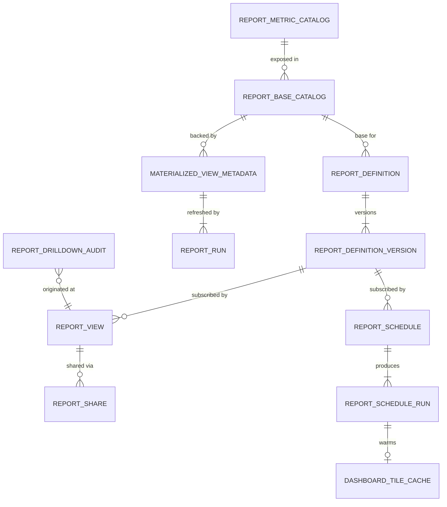

# Module 33 — Reporting & Dashboards Specification

**Module ID:** 33
**Phase:** 1 (v1 — required for Engrace go-live; the platform's *operator visibility* surface. Without M33 the agency operates blind: claim AR aging is invisible, HOPE compliance posture is invisible, cap projection is invisible, encounter productivity is invisible, EVV aggregator acceptance trends are invisible, recert and F2F calendars sit unreviewed, denial-rate trends are undetectable. Every locked module from M5 to M28 publishes outbox events and reader seams *expecting M33 to be the operational dashboard surface for them* — that expectation is now satisfied. M33 is Tier 3 in DR/BCP — revenue and reporting impact only, no patient-care impact — but the in-flight HQRP measure exposure (M30) and the survey-readiness reports (M30 + M33 cross-fan-out) make M33's freshness SLO part of the platform's operational definition of "running normally." The Phase-1 cut covers thirty-six platform-shipped materialized views spanning census, productivity, clinical-quality-adjacent, medication, EVV, on-call, bereavement, billing, cap, cost report, and FHIR-gateway domains; the custom report builder with TypeBox-validated definitions over a whitelisted dimension/measure catalog; saved views with role and org sharing; the scheduled-delivery runner emitting PDF (via M22 Puppeteer) and XLSX (via M22 file pipeline) artifacts; the direct-stream CSV export; the three-tier MV refresh strategy (nightly / incremental / on-demand) driven by outbox subscriptions on ~60 topics across M5–M28; the read-replica enforcement layer with statement-timeout discipline; and the PHI-minimization rule that no row-level PHI ever leaves M33's own SQL — drilldowns are explicit navigations to the owner module. Phase 2 deferred items: tenant-controlled external email delivery via M34's gateway (Phase 1 is in-app M36 fan-out only); LLM-aided natural-language → report-definition draft suggestion (the AI block in D11 keeps Phase 1 LLM-clean); per-tenant BI-tool egress connector (Phase 1 is in-product surfaces and CSV download only); embeddable read-only dashboards for the M31 portal (Phase 2 when the portal's family-facing summary surfaces require it).)

**Depends on:** 1 (Foundation — `packages/db`, `packages/tenancy`, `withOrgContext`, RLS generator, the M1 outbox dispatcher used for `m33.*` event emit, the M1 idempotency middleware on every mutating route (definitions and schedules and shares are mutating; tile reads are read-only), the per-tenant DEK envelope-encryption helper for `report_drilldown_audit.query_filters_cipher` when a drilldown filter includes patient ID (the audit row's filters carry the navigation context which can re-identify; cipher at rest), BullMQ on Valkey for the `report.mv_refresh`, `report.scheduled_run`, `report.export_render`, `report.tile_warm_cache`, `report.drilldown_audit_flush`, and `report.lag_probe` queues, the M1 `read_replica_session` helper that opens a Postgres session against the hot-standby replica with `default_transaction_read_only=TRUE` and `statement_timeout` and `application_name='m33_tile'`, the `DegradedError` envelope and circuit-breaker for the replica-lag-exceeded path, the system-status event emitter, the seam registry's `validateSeams()` boot gate that refuses startup if any consumed seam is unregistered, the standard error envelope, and the Valkey tile-cache primitive at `packages/cache/tile-cache.ts`), 2 (Identity — `user`, `membership`, session-class resolution for the `analyst` / `report_admin` / `report_viewer` / `org_admin` role assignments; step-up auth on `report.schedule.delete_all_runs` and `report.drilldown.bulk_export` routes per D11 — bulk PHI access via a drilldown is the platform's narrowest sensitive surface and warrants the SESSION_POLICY step-up; the supervisor-reader seam consumed by the ABAC `reportable_scope` predicate for the team-scope resolution; the `device_attestation` row consulted by the bulk-export route to refuse from a non-attested device per Security Hardening §12.4), 3 (Authorization — the eighteen permission keys M33 contributes to M3's catalog (§4.6) and the two ABAC predicates `reportable_scope` and `dashboard_visibility` registered into M3's named-predicate registry (§4.7); the `caseload_scope` predicate reused from M5 for the per-clinician self-scope; the `provider_entity_scope` predicate reused from M40 for the per-CCN ProviderEntity scoping; the `org_admin_scope` predicate reused from M2 for the org-wide aggregate surface), 4 (Audit — write-audit trigger generator on every owned mutable table (`report_definition`, `report_definition_version`, `report_view`, `report_schedule`, `report_share`, `materialized_view_metadata`); audit-read declaration on every read route that exposes a tile or an export — the read of an aggregate is itself a disclosure-accounting event under HIPAA §164.528 when the aggregate's underlying rows are PHI even if the aggregate exposes no row identifier (the §164.528 standard's "limited data set" carve-out applies to aggregates without re-identification potential, but M33 errs to-the-strict side per the architecture §10.5 minimum-necessary discipline); audit-read on every drilldown navigation emit so the §164.528 evidence is linked to the eventual owner-module surface visit by `drilldown_trace_id`; retention class `operational` for `report_definition`, `report_definition_version`, `report_view`, `report_schedule`, `report_schedule_run`, `report_run`, `dashboard_tile_cache` (tenant configuration and run history — recoverable from the owner-module outbox stream within ninety days; thirteen-month hot retention is sufficient); retention class `compliance` for `report_drilldown_audit` (the PHI-access trail must persist for the seven-year survey-evidence floor); `eraseFn` registered into M4's destruction-cert callback registry; the destruction-cert workflow for a `report_drilldown_audit` row is a *no-op* — survey-evidence rows are destruction-blocked by D9 — and emits a `destruction_refused_compliance_class` outcome per architecture §6 destruction governance), 5 (Patient — `CaseloadProvider` consumed for the `reportable_scope=self` resolution; `PatientReader` consumed only for the count-only census aggregate (the `mv_census_org_daily` is populated from M5's outbox `m5.patient.*` events directly, but the on-demand recompute path reads `PatientReader.countActive(orgId)`); M33 *never* reads `Patient.name`, `Patient.mrn`, `Patient.address`, or any patient PII column — the MV definitions are reviewed at lock time and the dependency-cruiser rule asserts non-import of `packages/db/src/schema/patient` columns), 6 (Admission, Election & Certification — `AdmissionCensusReader` consumed for the per-LOC per-month census aggregates; `LevelOfCareReader` consumed for the LOC-day breakdowns; `ElectionPeriodReader` consumed for the recert-calendar MV; `FaceToFaceReader` consumed for the F2F-calendar MV; M6 ships these readers today, and M33 wires them at lock), 7 (Care Plan — `CarePlanReader.overdueRollup(orgId, period)` consumed for the 15-day-review overdue counts; `GoalProgressReader` consumed for the goal-attainment-rate MV; both seams ship today and M33 wires at lock), 8 (Encounters & Visit Notes — `EncounterStatisticsProvider` consumed for productivity-by-clinician, late-sign-rate, cosignature-lag, mileage-by-membership; `BillableEncounterReader` consumed for the billable-vs-volunteer split; M8 also publishes outbox `m8.encounter.signed` consumed for incremental refresh of the productivity MV; both seams + outbox subscription wire today), 9 (Clinical Assessments — `ScaleSeriesProvider` consumed for symptom-trajectory tile aggregations (the *aggregate* — counts of patients with PPS decline, ESAS-r severity distribution — never the row-level scores); `AssessmentComplianceReader` consumed for the assessment-on-time-rate MV by discipline by scale type; the M9 outbox `m9.assessment.recorded` consumed for incremental productivity refresh), 10 (HOPE Engine — `HopeTimepointProvider` consumed for HOPE-window-on-time aggregate; `HopeSubmissionProvider` consumed for submission-acceptance-rate aggregate; `HopeJ2051Provider` consumed only for the *count* of triggered SFVs and the rate of SFV-on-time, never the per-symptom severity values; the M10 outbox topics drive incremental refresh of the HQRP-adjacent MVs), 11 (Orders — `OrderProvider` consumed for orders-by-kind aggregate, verbal-orders-expiring-list aggregate (the list is by count and discipline aggregate, not by patient name — the drilldown navigates to M11's verbal-order register), standing-order-active counts; the M11 outbox `m11.order.*` topics consumed for incremental refresh), 12 (DoseSpot Integration & Prescribing — `MedicationOrderProvider` consumed for prescriber-volume, EPCS-share, transmission-success-rate aggregates; `RefillInboxProvider` consumed for refill-volume and approve-vs-deny rate; M12 outbox topics consumed for incremental refresh), 13 (eMAR & Med Administration — `MedicationAdministrationProvider` consumed for administration-volume-by-class, missed-dose-rate, PRN-effectiveness-reassessment-on-time-rate aggregates; `ReconciliationProvider` consumed for the reconciliation-completion-rate; M13 outbox topics consumed for incremental refresh), 14 (IDG — `IdgScheduleProvider.getCadenceAdherence` consumed for the 15-day-cadence-compliance MV; `IdgDecisionProvider.getDecisionsForCarePlan` consumed for the decision-to-update-latency MV; M14 outbox topics consumed for incremental refresh; the M14 spec D11 explicitly names M33 as a consumer of all three published seams), 15 (Discipline Care Plans — `DisciplineComplianceProvider` consumed for supervisory-on-time-rate by aide membership (aggregate counts and rates, not the underlying visit identities); `VolunteerCostSavingsProvider` consumed for the CoP 418.78(e) 5% ratio MV with the green / yellow / red band per M15 §1.4), 16 (Bereavement — `BereavementOutreachProvider.getOutreachKpis(orgId, period)` consumed for the 13-month bereavement outreach rate per CoP 418.64(d); `BereavementRiskTierProvider.getRiskDistribution(orgId)` consumed for the risk-tier-distribution chart; M16 spec D13 explicitly names M33 as a consumer of `BereavementPlanProvider` + `BereavementOutreachProvider` for the operational dashboards), 17 (Scheduling — `VisitMetricsProvider` consumed for the scheduled-vs-completed-vs-no-show split by location by day; `RouteEfficiencyReader` consumed for route-segment metrics including miles-driven, route-density, and on-time-arrival-rate; the M17 spec §4.11 routes 40/41 are explicit M33 sources), 18 (EVV — `EvvMetricsProvider` consumed for the EVV-bracket-pairing-rate, late-checkout-resolution-rate, GPS-spoof-suspected rate, and per-state-aggregator-acceptance-rate aggregates; the M18 spec D15 explicitly publishes `EvvMetricsProvider` for M33 consumption; the GPS coordinates are *never* exposed in any M33 surface, only event counts and aggregate states), 19 (On-Call Triage — `TriageCallMetricsProvider` consumed for on-call call-volume, mean-time-to-resolution, protocol-adherence-rate, hospitalization-prevention-rate aggregates; M19 spec lock-status names M33 as a forward-seam consumer of the five M19 reader seams), 20 (Field Safety — `FieldSafetyMetricsProvider` consumed for incident-count-by-severity-by-month, near-miss-rate, location-based-risk-heatmap aggregates; M20 §1152 explicitly lists M33 as a consumer of the field-safety metrics provider; the heatmap is per-location not per-patient — no PHI), 21 (Supplies, DME & Comfort Kits — `SupplyMetricsProvider` consumed for vendor-invoice-variance, courier-reliability-rate, par-stock-posture; M21 §56 explicitly names M33 as a consumer of the M21 provider seams), 22 (Documents — `DocumentReader` consumed for the per-document-type volume aggregates and the intake-review-SLA dashboard; M22 also receives M33's `m33.scheduled_report.render_requested` outbox event for PDF and XLSX rendering and emits `m22.document.created` back; this is bidirectional but the imports flow consumer-to-provider in both directions via outbox), 23 (Billing — Medicare — `ClaimReader` + `ClaimMetricsProvider.windowAggregate(orgId, windowIso, dim)` consumed for AR-aging-by-claim-state, denial-rate-by-rule, NOE-window-breach-rate, NOTR-window-breach-rate, mean-time-to-acknowledgment-by-MAC, sequestration-write-off-total, projected-revenue-by-election-period; the M23 spec §1467 explicitly publishes the wide reader `ClaimMetricsProvider.windowAggregate` for M33 consumption), 24 (Billing — Medicaid — `MedicaidClaimReader` + `MedicaidClaimMetricsProvider` consumed for state-specific denial-rate, MCO-breakdown, MMIS-channel-availability rolling window; the M24 spec §1115 + §369 explicitly publishes the per-tenant per-state metrics surface for M33), 25 (Remittance — `DenialMetricsProvider` consumed for top-CARC-by-dollar in window, denial-rate by CARC category, appeal-success-rate by tier; `RemittanceReader.unmatchedLinesPending` consumed for the operations-team unmatched-lines worklist count; M25 §46 + §72 explicitly name M33 as the operational-dashboard owner consuming the M25 seams), 26 (Cap Management — `CapAccrualReader`, `CapProjectionProvider`, `InpatientCapProvider`, `CapSettlementProvider`, `CapMetricsProvider` consumed for the Cap Watch dashboard; the M26 spec §2374 + §1561–1569 explicitly publishes all five seams for M33), 27 (Cost Report — `CostReportFilingStatusReader.getOpenReportsForProvider`, `CostReportProvider.getDrugCostPerHospiceDay`, `CostReportProvider.getRoutineCarePerDiemCost`, the rule-failure-frequency aggregator, the patient-day-reconciliation-drift projection, and the cap-position-at-cost-report-time projection consumed for the cost-report status dashboard, validation-failure worklist, per-tenant rule-failure-frequency aggregation, and the cap-position-at-cost-report-time view; M27 §8 + §1118 + §1121 + §1127 + §1145 + §1159 explicitly publishes the projections for M33 consumption), 28 (FHIR Gateway — `FhirGatewayMetricsProvider.metricsForOrg(orgId, period)` consumed for the FHIR-utilization dashboard: requests-per-hour, top-resource-types, top-clients, bulk-export-job-counts, inbound-proposal-review-SLA, error-rate; M28 §1819 + §1871 + §1877 explicitly publishes the metrics provider for M33), 30 (HQRP & Quality — `forward seam`: when M30 locks, M33 consumes `HqrpMeasureProvider` for the per-measure compliance-posture surface; deny-stub at M33 lock with the "Not yet available — Phase 2" tile state per the architecture §11 HQRP catalog; the M30 dashboards are the *authoritative* quality-measure surface, and M33's HQRP tiles are an executive-summary-level mirror of M30's measure-level detail — M33 surfaces the rate, M30 surfaces the methodology and drilldown), 36 (Secure Messaging & Alerts — typed alert payloads for the scheduled-report-delivered notification, the MV-refresh-failed alert when an MV refresh exhausts retries, the replica-lag-exceeded alert when the read replica drifts past 10 minutes, and the scheduled-report-recipient-revoked alert when a recipient's membership is revoked between schedule creation and execution; M33 emits the typed payloads, M36 owns delivery — no out-of-band SMS / email / push from M33), 38 (Clinical Terminology — `lookup` for code-system display strings when an MV aggregates by ICD-10 / LOINC / CARC / revenue-code dimension; the M38 `asOfDate` lookup so a code-set revision in 2027 doesn't retroactively alter a 2026 dashboard's category labels), 39 (Consent — `ConsentEvaluator.evaluateForReporting(patientId, scope)` consumed at the drilldown emit path so that a drilldown into a patient cohort with active SUD redaction or family-violence redaction does not surface the patient identifiers M33 would normally pass to the owner module; consent-redaction is a *navigation filter*, not a data filter — M33 returns a narrower drilldown URL when redactions apply), 40 (Master Data Management — `ProviderEntityReader` for per-CCN MAC jurisdiction and fiscal-year-end aggregation; `LocationReader` for per-location aggregation; the catalog values for state, MAC, and payer dimensions in the report builder's dimension catalog come from M40's MDM lookup so a tenant-author writing a custom report sees the live catalog, not a stale enum).

**Consumed by:** 30 (HQRP & Quality — when M30 locks, M30 consumes M33's `MetricsProvider.getDashboardMetric(metricKey, orgId, period)` for any cross-tile aggregate M30 wants to reference from the M30 measure-detail page (e.g., the HOPE-on-time-rate tile from M10 surfaces on M30's HCI measure detail with an embedded reference back to M33's tile snapshot at the same as-of date); the projection is one-way (M30 reads M33; M33 does not reach into M30); ships forward-seam now, M30 wires when M30 locks), 34 (SaaS Tenant Platform — `DashboardCatalogProvider.listDashboardsForOrg(orgId)` consumed by the platform-ops "tenant overview" console so platform-ops can verify a tenant's dashboard adoption posture during a support call; `ScheduledReportProvider.listActiveSchedulesForOrg(orgId)` consumed for the tenant-offboarding gate — a tenant cannot offboard until all scheduled reports are paused or cancelled; M34 wires at M34 lock — deny-stub today; the projection ships now), 37 (Inpatient Unit (IPU) Management — when M37 locks, M37 consumes M33's `MetricsProvider.getDashboardMetric` for the IPU-specific tiles (census, average LOS by level, transition patterns, revenue per bed-day, staffing ratios) per architecture §2078; the projection is one-way (M37 reads M33's pre-computed IPU MVs); ships forward-seam now, M37 wires when M37 locks. M37 is *not* a producer to M33 — the IPU MVs are populated from M6/M23/M11/M13/M17 outbox events with an IPU-discriminator filter, not from M37 itself), and **indirectly every locked module M5–M28** as outbox-event consumers via the `report.mv_refresh` worker which subscribes to ~60 outbox topics across those modules — but those modules' specs name M33 as a *consumer of their outbox events*, not the inverse, so M33's `dependsOn` carries them and not the other way.

-----

## Remediation Changelog — Phase 2 (2026-06-11)

- **Implementation note (WX-PR-014 M33 slice, 2026-08-06)** — closed the M33 §4.8 background-job gap
  WX-PR-014's original pass deliberately left untouched ("M33's gap is an order of magnitude larger than
  M30's"). Bound for real: the per-job `withOrgContext`/`withPlatformContext` tenancy envelope (previously
  absent on every worker — FORCE RLS silently denied/emptied every org-scoped read/write); the nightly
  MV-refresh orchestrator (the cron sentinel now branches to the real `runNightlyRefresh` fan-out instead of
  landing on the per-MV worker with no dedicated consumer); `scheduledRun`'s M2 active-membership
  re-validation, the real `translateSpec` snapshot-build chain, `pause.autoPause`, the M4 `audit()` writes,
  and the outbox emits; the Valkey-backed lag-probe hysteresis state + degraded-tile advisory flag; and a
  real `db.execute`-backed tile/export SQL executor for the READ + EXPORT route services (previously always
  forward-seam-empty — no M33 tile or CSV export had ever returned real data in production, independent of
  the job-wiring gap). Two genuine, NOT-closeable infra gaps were found and left explicitly unbound
  (documented, not routed around): `mvRefresh`/`lagProbe`'s outbox emits, since `OutboxPublishPort.publish`
  (M1) requires a non-null `organizationId` and these are platform-wide (`organizationId=null`/absent)
  events by design — needs an M1-level nullable-org outbox persist path; and the ad-hoc PDF/XLSX
  `exportRender` outbox, since `ExportRenderRequestPayload` does not satisfy the
  `m33.scheduled_report.render_requested` catalog schema (missing `scheduleId`/`runId`, which only the
  scheduled-run cron path's payload carries) — a package-level payload/schema mismatch between two
  producers sharing one wire event name. The M1 envelope-DEK/KMS provider (drilldown-audit encryption) and
  the cron-parser adapter (schedule `next_run_at` math) remain out of scope, unchanged. Proven by a new live
  suite (4/4) against real Postgres + Redis that constructs the REAL `registerM33Workers` and really
  `REFRESH MATERIALIZED VIEW CONCURRENTLY`s `report_mv.mv_census_org_daily`. A live-test-caught regression
  in this same pass's first draft: `mvRefresh.outbox.emitRefreshSucceeded`/`emitLagExceeded` etc. were
  initially left as fail-closed *throws* — but `handleMvRefresh`/`runLagProbe` call them unconditionally on
  the success path, so a throw there turned every successful refresh/probe tick into a recorded FAILURE
  (the identical `unbound()`-on-an-unconditional-call bug class WX-PR-014's M30 slice fixed) — corrected to
  documented no-ops.

| Finding | Sev | Resolution |
|---|---|---|
| **M33 RLS variable** | BLOCKER | Canonical RLS session variable corrected **`app.current_org_id` → `app.org_id`** throughout (ADR-0010 D2). The prior variable was never set by `withOrgContext()`, so every M33 policy failed closed. |
| **S3 — bulk export of identifiable links** | BLOCKER (HIPAA, → Phase 3) | The "no row-level PHI leaves M33" thesis must hold: the CSV/drilldown bulk-export path is constrained to **aggregate or de-identified (§164.514) output**; any patient-identifiable export routes through the owner module under SEC-052 controls + step-up, not M33. Full remediation tracked in Phase 3 (HIPAA minimum-necessary, H3). |
| RLS test | — | Add the ADR-0010 D4 mixed-session-variable RLS test (set `app.current_org_id` and assert empty result set). |

- **v0.2 (Locked)** — Initial publication at lock-grade. Instantiates the architecture §20.B module spec template. Resolves all eighteen open questions into binding decisions (§11). Defines the **MV-as-substrate architecture**: every dashboard tile is backed by a Postgres `MATERIALIZED VIEW` under the dedicated `report_mv` schema; the MV definitions are platform-shipped and version-controlled in `packages/reporting/src/mv/<key>.sql`; tenant-authored content is *report definitions*, never new MVs (D1). Defines the **three-tier refresh strategy** declared per MV in `materialized_view_metadata`: `nightly` (cron at 02:00 tenant-local for slow-changing aggregates), `incremental` (driven by outbox-event subscription on ~60 upstream topics with debounce window and the BullMQ `report.mv_refresh` worker), `on_demand` (Valkey-cached at 5-minute TTL for low-volume bespoke surfaces) (D2). Defines the **read-only replica enforcement** at every M33 read route: `withReportSession` opens a Postgres session against the hot-standby replica with `default_transaction_read_only=TRUE` and `statement_timeout='5s'` for tiles, `'30s'` for exports, `'300s'` for MV refresh jobs (which run on primary, not replica); the replica selection is per-request via the M1 `read_replica_session` helper (D3). Defines the **custom report builder via TypeBox-validated `report_definition_version.spec`**: tenants pick a `report_base_key` referencing a platform-shipped base, then select from the base's catalog of dimensions and measures and apply filters using only typed comparators per dimension type; no raw SQL surface; the SQL translator compiles the typed spec into a parameterized query using only whitelisted columns (D4). Defines the **`system` vs `tenant` authorship discriminator** on `report_definition` and the platform-shipped seed migration that registers ~30 system bases covering the architecture §N catalog (D5). Defines the **PHI-minimization rule**: aggregates by default in all M33 SQL; row-level PHI is *never* returned from an M33 route; drilldowns are explicit cross-module navigations emitting a URL with filter context to the owner module's surface, which enforces its own RLS+ABAC (D6). Defines the **scheduled-delivery pipeline** via M22 (PDF Puppeteer + XLSX file pipeline) and M36 (in-app notification): a `report_schedule` row carries cron + recipient membership_ids + format; the runner generates the snapshot, emits `m33.scheduled_report.render_requested` to M22, receives `m22.document.created` back, writes the document_id, then emits `m33.scheduled_report.delivered` for M36 fan-out — Phase 1 in-app only (D7). Defines the **`reportable_scope` ABAC predicate** registered with M3, composing self/team/location/org against the actor's `CaseloadProvider`, `SupervisorReader`, location memberships, and org-wide permission keys — resolved at route-handler time into a sealed envelope used by the SQL translator's WHERE-clause injection (D8). Defines the **immutable definition version chain**: editing a `report_definition` creates a new `report_definition_version`; the latest is the default; saved views and schedules subscribe to a specific `version_id`; roll-back is a "publish version N as new latest" operation, audited (D9). Defines the **three export formats**: PDF (M22 Puppeteer-renders M33's printable HTML template), XLSX (M22 file-pipeline turns the M33 query result into a styled .xlsx), CSV (direct chunked-response stream from M33 with no M22 hop) — each export is audited and (for PDF / XLSX) produces an `m22.document.created` back-reference (D10). Defines the **AI-prohibited zone**: M32's LLM may not author / modify `report_definition`, may not refresh MVs, may not set metric thresholds, may not author scheduled-report runs; Phase 2 may allow LLM-aided natural-language → report-definition-draft suggestion (clinician reviews and accepts before save); enforced at boot via `validateReportingAIBlock()` against M32's prompt registry mirroring M12 D12 / M13 D15 / M22 / M28 D14 (D11). Defines the **per-table partition pattern**: `report_run`, `report_schedule_run`, `report_drilldown_audit` monthly-partitioned on their primary timestamp; `report_definition`, `report_definition_version`, `report_view`, `report_schedule`, `report_share`, `materialized_view_metadata`, `dashboard_tile_cache`, `report_metric_catalog`, `report_base_catalog` non-partitioned per their lower row volumes (D12). Defines the **`MetricsProvider` + `DashboardCatalogProvider` + `ScheduledReportProvider` published seams** for M30 / M34 / M37 consumption, registered at boot via M1's seam registry with `validateSeams()` refusing startup if unregistered (D13). Defines the **replica-lag-aware UI**: each dashboard tile carries a `data_freshness_seconds` value derived from `pg_stat_replication` or its equivalent; a per-tile "Data as of HH:MM" badge surfaces in the UI; if lag exceeds 10 minutes the badge flips to a warning state and the tile may be served from Valkey cache instead per D2's `on_demand` fallback path (D14). Defines the **outbox subscription catalog** for `report.mv_refresh` worker: ~60 upstream topics across M5-M28 with each topic carrying a `mv_keys_invalidated[]` projection that the worker debounces and dispatches as a per-MV refresh job (D15). Defines the **drilldown navigation pattern**: each tile carries an optional `drilldown_url_template`; M33's drilldown emitter substitutes filter values, consults M39's `ConsentEvaluator.evaluateForReporting` to narrow patient identifiers under SUD or family-violence redaction, audits the navigation with `report_drilldown_audit`, and returns the URL — the owner module enforces its own access controls (D16). Defines the **saved-view sharing model**: per-view `share_scope` of `private | role | org` with role sharing taking a typed `role_keys[]` array, org sharing publishing to all org members, and the "tenant default" view a special `share_scope='org'` + `is_org_default=true` flag set by Org Admin only (D17). Wires the permission keys this module registers into Module 3 (§4.6), the two ABAC predicates this module registers into Module 3's named-predicate registry (§4.7), the BullMQ queue catalog (§4.8), the M36 typed-alert payloads (§4.9), the outbox event contract (§4.10), and the destruction `eraseFn` registered with Module 4 (§3.7). Includes a **proposed manifest patch** (§13) expanding `M33.dependsOn` from the architecture §20 baseline `[5,6,7,8,9,10,11,12,13,14,15,16,17,18,19,20,21,22,23,24,25,26,27,30,38,40]` to `[1,2,3,4,5,6,7,8,9,10,11,12,13,14,15,16,17,18,19,20,21,22,23,24,25,26,27,28,30,36,38,39,40]` *(relationship inventory - not the `dependsOn` edge set; per ADR-0005 D1/D4 seam/outbox/foundation consumers are no-edge - see audit/MANIFEST_DEPENDSON_REVIEW.md; do not bulk-apply)* — adding 1/2/3/4 (foundation deps every locked spec carries), 28 (FHIR Gateway metrics consumer), 36 (alert publishing), 39 (consent for drilldown redaction). Adds `packages/reporting` to `M33.codePaths` and populates `M33.ownedTables` with the eleven owned tables defined in §3 (D18).

-----

## 1. Purpose & Scope

### 1.1 What This Module Does

Module 33 is the platform's **operational visibility surface**. It owns the SQL substrate, the typed API, and the UI patterns that turn the locked clinical and billing modules' event streams and reader seams into dashboards, custom reports, scheduled deliveries, and exports the agency uses to run its business day-to-day.

More specifically, M33 owns:

- **A dedicated Postgres schema `report_mv`** holding ~36 platform-shipped materialized views covering census, productivity, clinical quality (HQRP-adjacent — authoritative quality lives in M30 when M30 locks), medication, EVV, on-call, bereavement, billing AR and denials, cap projection, cost report status, and FHIR gateway utilization. Each MV is keyed on `organization_id` (or `provider_entity_id` where the metric is per-CCN) and rolls up to dimensional keys per its purpose (per-clinician, per-location, per-day, per-week, per-month, per-cap-year). The MV SQL is platform-versioned in `packages/reporting/src/mv/<key>.sql`; the registration row lives in `materialized_view_metadata`; the build artifact is shipped via the standard migration pipeline.

- **A three-tier refresh dispatcher** with: (a) a `nightly` cron at 02:00 tenant-local that `REFRESH MATERIALIZED VIEW CONCURRENTLY` over the nightly-strategy MVs, (b) an `incremental` worker subscribed to ~60 outbox topics across M5-M28 that debounces (5-second window default per MV) and dispatches per-MV refresh jobs, and (c) an `on_demand` Valkey-cached path with 5-minute TTL for low-volume bespoke surfaces. The strategy per MV is declared in `materialized_view_metadata.refresh_strategy`.

- **A custom report builder** with TypeBox-validated `report_definition_version.spec` rows referencing a platform-shipped `report_base_catalog` entry plus typed `dimensions[]`, `measures[]`, and `filters[]` from the base's catalog. There is no raw SQL surface for tenants. The translator compiles the typed spec into a parameterized SQL query against the base's MV using only whitelisted columns.

- **Saved views** with per-view `share_scope` of `private | role | org` and the "tenant default" view distinguished by `is_org_default=true`. Views are immutable (edits create a new version) and can be subscribed to by a `report_schedule` row for recurring delivery.

- **Scheduled delivery** via the `report.scheduled_run` worker which evaluates the schedule's cron at the tenant-local timezone, runs the underlying view, emits `m33.scheduled_report.render_requested` to M22 with the typed payload (format=pdf|xlsx|csv), receives back `m22.document.created`, writes the document_id to the `report_schedule_run` row, and emits `m33.scheduled_report.delivered` for M36 fan-out to the recipient membership_ids.

- **Three export formats**: PDF via M22's Puppeteer-rendered printable HTML template (M33 emits the typed render-request, M22 owns the rendering), XLSX via M22's file-pipeline (the docx/xlsx skill registry approach already used by M27), CSV via a direct chunked-response stream from M33's route handler with no M22 hop (the row stream is the export; no PHI-bearing rows because the M33 query is aggregate).

- **A drilldown emitter** that turns a tile's `drilldown_url_template` plus filter context into a navigation URL pointing at the owner module's surface (e.g., M8's late-entry register, M23's AR-aging detail, M11's verbal-orders register). M33 audits the navigation emit in `report_drilldown_audit`; the owner module enforces its own RLS+ABAC on the destination page. **No row-level PHI is returned from M33's own SQL.**

- **The `reportable_scope` ABAC predicate** registered with M3, composing the actor's caseload (M5), supervisor team (M2), location memberships, and org-wide permission keys into a sealed envelope used by the translator's WHERE-clause injection. This is the single rule by which every M33 read is filtered to the actor's authorized scope.

- **A replica-lag-aware UI layer**: each dashboard tile carries a `data_freshness_seconds` value derived from `pg_stat_replication` on the replica; a per-tile "Data as of HH:MM" badge surfaces; lag past 10 minutes flips the badge to a warning state and may serve the tile from Valkey cache instead.

- **Published seams**: `MetricsProvider` (M30 / M34 / M37 consume to embed M33 aggregates in their own surfaces), `DashboardCatalogProvider` (M34 surfaces the per-org dashboard catalog), `ScheduledReportProvider` (M34 enforces the offboarding-gate on active schedules).

### 1.2 What This Module Does Not Do

- **Does not own quality-measure methodology.** M30 owns HQRP measures, HCI calculations, CAHPS integration, and HVLDL / HCI tracking. M33's HQRP-adjacent tiles surface the *rate* (e.g., HOPE-on-time-rate) but the *measure definition*, the *measurement period*, the *exclusion logic*, and the *survey-evidence detail* live in M30. When M30 locks, the HQRP tiles in M33 deny-stub-resolve through `HqrpMeasureProvider` and the per-measure detail page is M30-owned.

- **Does not own clinical data.** Every patient-identifiable column, every encounter row, every order, every claim — owned by the producer module. M33 reads via seams or subscribes to outbox events. The dependency-cruiser table-ownership check (architecture §25.15) enforces non-overlap: M33's owned table list (§3) is short and non-clinical.

- **Does not generate row-level PHI exports.** A CSV export from M33 is aggregate (counts, rates, distributions, sums); a drilldown into PHI is a navigation to the owner module, not an inline data join. The owner module renders the row-level surface under its own controls.

- **Does not write to clinical, billing, or compliance tables.** M33 is read-only on every module's surface except its own. The dependency-cruiser config enforces this: `apps/backend/src/modules/33-reporting/*` may not import any other module's schema package.

- **Does not own the email gateway.** Scheduled-report delivery is in-app via M36 in Phase 1. Phase 2 external email delivery is M34's tenant-controlled email gateway responsibility; M33 emits the event, M34 routes the SMTP envelope.

- **Does not own BI-tool egress.** A tenant wanting Tableau / Power BI / Looker connectivity in Phase 2 will consume a future per-tenant read-only Postgres role (with explicit ABAC-prefiltered views) — not the M33 read path. The Phase-1 surface is in-product dashboards and CSV download.

- **Does not own the IPU dashboard's *display*.** M33 builds the IPU MVs and exposes them via `MetricsProvider`; M37 (when locked) consumes those metrics and renders the IPU dashboard inside the IPU surface alongside census management. The M33-rendered IPU surface is the *executive-summary* IPU tile in the org dashboard; the operator-grade IPU view lives in M37.

- **Does not bypass consent.** Drilldowns respect M39's `ConsentEvaluator.evaluateForReporting` — under SUD or family-violence redaction the drilldown URL narrows to exclude the redacted cohort; the audit row records the redaction applied so the surveyor sees the deliberate narrowing.

- **Does not allow LLM authorship.** Per D11, M32's LLM may not write report definitions, refresh MVs, set thresholds, or author scheduled-report runs. Phase 2 may allow LLM-aided *suggestion* of a draft definition for a tenant analyst to review.

### 1.3 Regulatory & Operational Drivers

| Driver | Requirement | M33 Response |
|---|---|---|
| HIPAA §164.502(b) Minimum Necessary | Limit access to PHI to the least needed for the purpose | The PHI-minimization rule (D6) ensures M33 SQL never returns row-level PHI; drilldowns are navigations subject to the owner module's controls; the aggregate-by-default discipline is architecturally enforced via the report-base catalog (no PHI columns) |
| HIPAA §164.528 Right to an Accounting of Disclosures | Patient may request a list of disclosures of their PHI for non-treatment purposes | Every tile read is `auditRead()`-instrumented; every drilldown emit produces a `report_drilldown_audit` row linked by `drilldown_trace_id` to the eventual owner-module surface visit; the trail is queryable per-patient by Compliance |
| 42 CFR §418.114 Personnel Qualifications | Hospice must monitor and document staff productivity, supervision, and competency | The productivity, late-sign-rate, cosignature-lag, and supervisory-cadence tiles surface the compliance posture in real time; the supervisory-cadence MV is sourced from M15's `DisciplineComplianceProvider` |
| 42 CFR §418.78(e) Volunteer 5% Ratio | Hospice must use volunteers to provide ≥5% of patient-care hours | The volunteer-ratio MV is sourced from M15's `VolunteerCostSavingsProvider` with the green / yellow / red band and an executive-level summary tile; the per-FY trend is platform-shipped |
| 42 CFR §418.64(d) Bereavement | Hospice must provide bereavement services for at least one year post-death | The 13-month bereavement-outreach-rate MV is sourced from M16's `BereavementOutreachProvider.getOutreachKpis` and surfaces a per-period compliance rate |
| 42 CFR §418.312 Hospice Quality Reporting Program | Quality data submitted per CMS specification | The HOPE-on-time-rate, SFV-on-time-rate, submission-acceptance-rate MVs are sourced from M10's published seams; the per-measure detail and the 4-point APU compliance posture live in M30 (when M30 locks) — M33 surfaces the rates and the executive-summary tile, M30 surfaces the methodology and the survey-evidence detail |
| 21st Century Cures Act §12006 EVV | Medicaid services must include EVV bracket evidence | The EVV-bracket-pairing-rate, late-checkout-resolution-rate, per-state-aggregator-acceptance-rate MVs are sourced from M18's `EvvMetricsProvider`; GPS coordinates are never exposed in any tile per the M18 D10 coordinate-PHI rule |
| CMS Conditions of Participation 418.110 IPU | RN-on-duty at all hours in operator-run inpatient units | The IPU-specific tiles (census, average LOS by level, staffing ratios) are platform-shipped and sourced from M6/M23/M17 outbox events with an IPU-discriminator filter; M37 (when locked) embeds the operator-grade dashboard |
| 42 CFR §413.20 Cost Report Records Retention | Cost-report supporting records retained for ≥5 years after filing | The cost-report-status dashboard tiles surface filing posture; the per-tenant rule-failure-frequency aggregator is sourced from M27 and informs the auto-rule-suggestion pipeline back in M27 |
| Survey readiness (42 CFR §488 generally) | Documented evidence on demand | The drilldown trail in `report_drilldown_audit` plus the owner-module audit-read trail produces a per-tile evidence chain back to the underlying records |

### 1.4 Competitive Context

The reference competitors in the hospice EHR space (Hospicelink, Hospice Toolbox, MatrixCare Hospice, Suncoast, WellSky Hospice, Axxess Hospice) handle operational reporting in roughly three modes: (a) a fixed-catalog dashboard with no tenant authoring (the agency cannot modify the metrics or build new dashboards; reporting requests go through the vendor's professional-services arm); (b) a half-baked custom report builder bolted onto a third-party BI tool (the agency exports CSV or sets up a Tableau/Power-BI connection and builds dashboards off-system, paying both the EHR license and the BI license, with no built-in ABAC enforcement on the BI surface — the second the data leaves the EHR's RLS bubble all bets are off); (c) the "everything is a query" mode where the agency hires a SQL analyst and pays them by the hour to write reports against a read-only replica (works for large agencies, prohibitive for the 80% of agencies with under 100 patients).

None of the three handles the PHI-minimization rule architecturally (the BI-tool path is famously a §164.502(b) minimum-necessary risk because the BI tool's RBAC is shallower than the EHR's ABAC); none handles the drilldown-as-navigation pattern that keeps row-level PHI in the owner module's controls; none handles the replica-lag-aware tile-freshness UX so a chief operating officer reading the daily census knows whether the number is two minutes stale or two hours stale; and most importantly none provides the catalog-of-platform-shipped dashboards that lets an agency go live on day one with the HQRP, HOPE, cap, EVV, productivity, and bereavement visibility a hospice executive expects — without the agency authoring a single definition.

M33's lock-grade posture is **"the dashboards an agency needs to run a hospice ship with the platform; the metrics an analyst needs to build are catalog-published; PHI never leaves the SQL boundary M33 imposes."** The architecture §11.B framing of "deterministic validation is the architectural answer to high acceptance rates" applies here in inverted form: deterministic aggregation (catalog-published bases, typed dimensions and measures, no SQL surface) is the architectural answer to high analyst velocity at zero PHI-exfiltration risk.

-----

## 2. Domain Model

### 2.1 Entity-Relationship Diagram



The model is consciously narrow. **Eleven owned tables** (D12) divided into four functional groups:

- **Catalogs** (platform-shipped, low row count): `report_base_catalog`, `report_metric_catalog`, `materialized_view_metadata`. Seeded by migration; tenants do not write here.
- **Definitions** (tenant + system authorship): `report_definition`, `report_definition_version`. The authorship discriminator (D5) decides which surface owns the row's lifecycle.
- **Saved Surfaces** (tenant authored): `report_view`, `report_share`, `report_schedule`.
- **Run History + Audit** (immutable, partitioned): `report_run`, `report_schedule_run`, `dashboard_tile_cache`, `report_drilldown_audit`.

The `report_mv` schema MVs are **not in this list** — they are physical Postgres materialized views, not tables; they are tracked via `materialized_view_metadata` but they don't appear in `ownedTables` because they are not regular tables (the table-ownership check (architecture §25.15) is for regular `pg_class.relkind='r'` rows; MVs are `relkind='m'` and the check is amended in §3.5 to validate them separately).

### 2.2 Per-Entity Lifecycle

| Entity | States | Transition Triggers |
|---|---|---|
| `report_base_catalog` | `seeded → deprecated → retired` | Migration-driven only; tenants never write; deprecation is a platform decision communicated via `m33.base.deprecation_announced` |
| `report_metric_catalog` | `seeded → deprecated → retired` | Same as base catalog; metric definitions are platform-versioned |
| `materialized_view_metadata` | `registered → active → suspended` (rare; only for hot-fix where an MV's SQL is broken) → `retired` | Platform-managed |
| `report_definition` (system) | `seeded → active → deprecated` | Platform migration |
| `report_definition` (tenant) | `draft → published → archived` | Tenant analyst publishes; archival is soft; immutable history preserved via `report_definition_version` |
| `report_definition_version` | `draft → published → superseded` | Editing a published definition creates a new draft version; publishing the new version supersedes the previous |
| `report_view` | `private → shared_role → shared_org → archived` (where `archived` is the only sink state; the share transitions are bidirectional within the non-archived states) | Owner membership toggles share; Org Admin may toggle `is_org_default` |
| `report_share` | `active → revoked` | Share-target removal or membership revocation cascade |
| `report_schedule` | `active → paused → cancelled` | Owner pauses; Org Admin cancels; cancellation cascades any pending `report_schedule_run` |
| `report_schedule_run` | `queued → running → rendered_pending → rendered_complete → delivered → failed` | The runner emits `render_requested` to M22 from `running`; M22's `m22.document.created` flips `rendered_pending → rendered_complete`; the M36 delivery emission flips `→ delivered`; any error sinks to `failed` with a typed reason |
| `report_run` (MV refresh) | `queued → running → succeeded → failed` | The MV refresh worker manages; retries on `failed` per the queue's backoff |
| `dashboard_tile_cache` | `populated → expired` | TTL-based expiration; the populate happens at tile read time for `on_demand` strategy MVs |
| `report_drilldown_audit` | `recorded` (immutable, no transitions) | Insert-only at drilldown emit time |

### 2.3 Validation Rules (Domain-Level, Not the Translator)

These are enforced at the domain-service layer; the SQL translator's whitelisting is a separate enforcement layer at §4.

| Rule | Violation Behavior |
|---|---|
| A tenant `report_definition` must reference an `active` `report_base_catalog` row | Mutation refused with `BASE_NOT_ACTIVE` |
| A tenant `report_definition_version.spec.dimensions[]` may only contain `dimensionKey` values present in the base's `dimensions[]` catalog | Validation refused with `DIMENSION_NOT_IN_BASE` |
| A tenant `report_definition_version.spec.measures[]` may only contain `measureKey` values present in the base's `measures[]` catalog | Validation refused with `MEASURE_NOT_IN_BASE` |
| A tenant `report_definition_version.spec.filters[]` predicate must be a typed comparator for the dimension's type (e.g., `between` for date, `in` for enum) | Validation refused with `FILTER_TYPE_MISMATCH` |
| A tenant `report_definition_version.spec.row_limit` must be ≤ the base's `max_row_limit` (default 10000) | Validation refused with `ROW_LIMIT_EXCEEDED` |
| A tenant `report_view.share_scope='org'` requires the owner membership to carry `report.share.org` permission | Refused with `INSUFFICIENT_SHARE_PERMISSION` |
| A `report_schedule.recipient_membership_ids[]` must all be active memberships in the same `organization_id` | Refused with `RECIPIENT_NOT_IN_ORG` |
| A `report_schedule.cron_expression` must yield ≥ 5 minutes between consecutive evaluations | Refused with `CRON_TOO_FREQUENT` |
| A `report_schedule.format='pdf'` may not select a report with `row_limit > 5000` (Puppeteer-render practical limit) | Refused with `PDF_ROW_LIMIT_EXCEEDED` |
| A drilldown emit must consult `ConsentEvaluator.evaluateForReporting` and narrow if redaction applies | The emit is *narrowed*, not refused; the narrowing is audited |

### 2.4 Side Effects

| Event | Side Effect |
|---|---|
| `report_definition_version` published | Outbox `m33.report_definition.published`; any `report_view` subscribed to a prior version may opt-in to upgrade |
| `report_view` `share_scope` flipped to `org` | Outbox `m33.report_view.shared_org`; M36 in-app notification to org members opting-in to "new shared reports" |
| `report_schedule` activated | The cron-evaluator picks up the row on next minute; first `report_schedule_run` enqueues at the next cron tick |
| `report_schedule_run` reaches `delivered` | Outbox `m33.scheduled_report.delivered`; M36 fan-out to recipients |
| `report_run` (MV refresh) `succeeded` | The MV's `last_refreshed_at` in `materialized_view_metadata` updates; any `dashboard_tile_cache` entries dependent on the MV invalidate |
| `report_run` `failed` after exhausting retries | M36 critical alert to Org Admin per D14 |
| Drilldown emit | `report_drilldown_audit` row inserted; outbox `m33.drilldown.emitted` (warn-level if `is_consent_narrowed=true`) |
| Replica-lag past 10 minutes | M36 warn alert to Org Admin; `dashboard_tile_cache` entries flagged as `degraded` and re-warmed from primary on next access |

### 2.5 Concurrency

- **Definition edits**: optimistic-concurrency on `report_definition.version_seq`. A simultaneous edit by two analysts produces two `report_definition_version` rows, both `draft`; the publish action takes the latest by `created_at`.
- **MV refresh**: `REFRESH MATERIALIZED VIEW CONCURRENTLY` allows concurrent reads while the refresh runs; only one refresh per MV per moment (the worker's queue is keyed on `mv_key` and dedups in-flight).
- **Scheduled-report runs**: at-most-once semantics per `(schedule_id, scheduled_for)` enforced by a unique index on `report_schedule_run`. A failed run does not block a future scheduled run for the same schedule.
- **Drilldown audit**: insert-only; no contention.

### 2.6 Idempotency

- Every mutating route carries an `Idempotency-Key` header consumed by M1's idempotency middleware. Definitional mutations (create / edit / publish) are idempotent on `(orgId, idempotencyKey)`.
- MV refresh jobs are idempotent on `(mv_key, requested_at_floor)` where the floor is the most recent debounce-window tick — a redelivered outbox event that triggers refresh does not re-refresh within the window.
- Scheduled-report runs are idempotent on `(schedule_id, scheduled_for)` with the unique index above.
- Export downloads are idempotent on the `document_id` — the same document is downloadable many times within its retention window.

-----

## 3. Drizzle Schema

### 3.1 Package Layout

```
packages/reporting/
├── package.json
├── src/
│   ├── index.ts                           # Public exports; seam registration boot hook
│   ├── seams/
│   │   ├── published/
│   │   │   ├── metrics-provider.ts        # MetricsProvider interface (M30/M34/M37)
│   │   │   ├── dashboard-catalog-provider.ts  # DashboardCatalogProvider interface (M34)
│   │   │   └── scheduled-report-provider.ts   # ScheduledReportProvider interface (M34)
│   │   └── consumed/
│   │       ├── m5-patient-reader.ts       # consumer-side interface only (deny-stub if M5 absent — but M5 is locked)
│   │       ├── m6-admission-readers.ts
│   │       ├── m7-care-plan-reader.ts
│   │       ├── m8-encounter-stats.ts
│   │       ├── m9-assessment-readers.ts
│   │       ├── m10-hope-readers.ts
│   │       ├── m11-order-provider.ts
│   │       ├── m12-medication-order-provider.ts
│   │       ├── m13-administration-provider.ts
│   │       ├── m14-idg-readers.ts
│   │       ├── m15-discipline-readers.ts
│   │       ├── m16-bereavement-readers.ts
│   │       ├── m17-visit-metrics.ts
│   │       ├── m18-evv-metrics.ts
│   │       ├── m19-triage-metrics.ts
│   │       ├── m20-field-safety-metrics.ts
│   │       ├── m21-supply-metrics.ts
│   │       ├── m22-document-reader.ts     # for the per-document-type volume aggregates
│   │       ├── m23-claim-metrics.ts
│   │       ├── m24-medicaid-claim-metrics.ts
│   │       ├── m25-denial-metrics.ts
│   │       ├── m26-cap-readers.ts
│   │       ├── m27-cost-report-readers.ts
│   │       ├── m28-fhir-gateway-metrics.ts
│   │       ├── m30-hqrp-measure-provider.ts   # forward-seam deny-stub until M30 locks
│   │       ├── m39-consent-evaluator.ts
│   │       └── m40-mdm-readers.ts
│   ├── mv/                                # platform-shipped MV SQL
│   │   ├── census/
│   │   │   ├── mv_census_org_daily.sql
│   │   │   ├── mv_admission_pipeline_org.sql
│   │   │   ├── mv_recert_calendar_org.sql
│   │   │   └── mv_f2f_calendar_org.sql
│   │   ├── productivity/
│   │   │   ├── mv_encounter_productivity_membership_day.sql
│   │   │   ├── mv_encounter_late_sign_rate_org_week.sql
│   │   │   ├── mv_cosignature_lag_org_month.sql
│   │   │   ├── mv_visit_completion_org_day.sql
│   │   │   └── mv_route_efficiency_org_day.sql
│   │   ├── clinical/
│   │   │   ├── mv_hope_window_compliance_org_period.sql
│   │   │   ├── mv_hope_sfv_compliance_org_period.sql
│   │   │   ├── mv_care_plan_review_overdue_org.sql
│   │   │   ├── mv_volunteer_ratio_org_fy.sql
│   │   │   └── mv_supervisory_cadence_org_month.sql
│   │   ├── medication/
│   │   │   ├── mv_orders_by_kind_org_week.sql
│   │   │   ├── mv_verbal_orders_expiring_org.sql
│   │   │   ├── mv_medication_administration_org_day.sql
│   │   │   └── mv_missed_dose_rate_org_day.sql
│   │   ├── evv/
│   │   │   ├── mv_evv_compliance_org_week.sql
│   │   │   └── mv_evv_aggregator_acceptance_org_state_month.sql
│   │   ├── oncall/
│   │   │   ├── mv_oncall_activity_org_day.sql
│   │   │   └── mv_oncall_protocol_adherence_org_month.sql
│   │   ├── bereavement/
│   │   │   ├── mv_bereavement_compliance_org_month.sql
│   │   │   └── mv_bereavement_risk_distribution_org.sql
│   │   ├── field_safety/
│   │   │   └── mv_field_safety_incidents_org_month.sql
│   │   ├── billing/
│   │   │   ├── mv_claims_ar_aging_org.sql
│   │   │   ├── mv_denial_worklist_org.sql
│   │   │   ├── mv_denial_rate_org_month.sql
│   │   │   ├── mv_noe_window_breach_org_month.sql
│   │   │   ├── mv_remittance_posted_org_day.sql
│   │   │   └── mv_appeal_outcomes_org_month.sql
│   │   ├── cap/
│   │   │   ├── mv_cap_watch_org_period.sql
│   │   │   └── mv_cap_projection_patient_org.sql
│   │   ├── cost_report/
│   │   │   ├── mv_cost_report_status_org_fy.sql
│   │   │   └── mv_cost_report_validation_worklist_org.sql
│   │   ├── fhir/
│   │   │   ├── mv_fhir_egress_org_day.sql
│   │   │   └── mv_fhir_bulk_export_org_month.sql
│   │   └── ipu/
│   │       ├── mv_ipu_census_org_day.sql       # forward-seam consumed by M37 at M37 lock
│   │       └── mv_ipu_los_org_loc_month.sql
│   ├── catalog/
│   │   ├── base-catalog-seed.ts           # platform-shipped report bases (one per MV, mostly)
│   │   ├── metric-catalog-seed.ts         # platform-shipped metrics keyed by domain
│   │   ├── system-definitions-seed.ts     # platform-shipped dashboards (composed of multiple tiles)
│   │   └── outbox-subscription-map.ts     # which upstream topics invalidate which MVs (D15)
│   ├── translator/
│   │   ├── spec-validator.ts              # TypeBox spec validator for report_definition_version
│   │   ├── sql-translator.ts              # typed spec → parameterized SQL against the base's MV
│   │   ├── filter-compiler.ts             # filter[] → WHERE clause with parameter binding
│   │   ├── scope-injector.ts              # reportable_scope envelope → WHERE clause
│   │   └── result-shaper.ts               # SQL rows → typed result shape
│   ├── refresh/
│   │   ├── dispatcher.ts                  # the three-tier dispatcher (nightly/incremental/on_demand)
│   │   ├── outbox-subscriber.ts           # subscribes to ~60 upstream topics; debounces and enqueues
│   │   ├── refresh-worker.ts              # BullMQ worker that executes REFRESH MATERIALIZED VIEW CONCURRENTLY
│   │   ├── lag-probe.ts                   # pg_stat_replication probe, freshness-seconds calc
│   │   └── nightly-cron.ts                # 02:00-tenant-local cron orchestrator
│   ├── scheduled/
│   │   ├── cron-evaluator.ts              # walks active report_schedule rows; enqueues runs at cron ticks
│   │   ├── runner.ts                      # the BullMQ worker that executes the schedule (build query + render request)
│   │   ├── delivery.ts                    # post-render delivery via M36 alert fan-out
│   │   └── retention.ts                   # archival of rendered artifacts past retention horizon
│   ├── export/
│   │   ├── csv-stream.ts                  # direct chunked-response CSV streamer
│   │   ├── pdf-renderer-request.ts        # emit m33.scheduled_report.render_requested with format=pdf
│   │   └── xlsx-renderer-request.ts       # emit m33.scheduled_report.render_requested with format=xlsx
│   ├── drilldown/
│   │   ├── url-template-resolver.ts       # template + filter context → URL
│   │   ├── consent-narrowing.ts           # consults M39 ConsentEvaluator
│   │   └── audit-writer.ts                # writes report_drilldown_audit row
│   ├── permissions.ts                     # the 18 permission keys M33 registers with M3
│   ├── abac-predicates.ts                 # the 2 predicates (reportable_scope, dashboard_visibility)
│   ├── alerts.ts                          # M36 typed alert payloads
│   ├── outbox-events.ts                   # M33's outbox event types
│   └── seam-registration.ts               # boot wiring of published seams + validation of consumed ones
├── tests/
│   ├── unit/
│   ├── integration/
│   └── e2e/
└── tsconfig.json
```

The `apps/backend/src/modules/33-reporting/` directory holds the Fastify route handlers, the boot wiring, and the per-route ABAC enforcement. Domain logic lives in `packages/reporting/` so the published seams have nothing to import from the backend app.

### 3.2 Migration Script Phases (`0033_reporting.sql`)

The migration applies in nine phases. Each phase is idempotent (`IF NOT EXISTS` guards on every CREATE).

1. **Schema setup**: `CREATE SCHEMA IF NOT EXISTS report_mv;` plus extensions (`pg_stat_statements` already enabled by M1; nothing new).
2. **Catalog tables**: `report_base_catalog`, `report_metric_catalog`, `materialized_view_metadata`. These are the platform-shipped registries seeded from `catalog/*-seed.ts`.
3. **Definition tables**: `report_definition`, `report_definition_version` with the immutable-version-chain constraint.
4. **Saved-surface tables**: `report_view`, `report_share`, `report_schedule`.
5. **Run history (partitioned)**: `report_run`, `report_schedule_run`, `report_drilldown_audit` with their monthly partition parents.
6. **Cache**: `dashboard_tile_cache` (non-partitioned, transient TTL).
7. **RLS policies**: per-table `CREATE POLICY` for `tenant_isolation` and the route-specific narrowing per §3.5.
8. **Audit triggers**: per-table `AFTER INSERT/UPDATE/DELETE` triggers calling M4's `audit_writer`.
9. **Materialized views**: `CREATE MATERIALIZED VIEW report_mv.<key> AS <sql>` for each of the ~36 platform-shipped MVs, plus `CREATE UNIQUE INDEX` on the MV's natural key for `REFRESH MATERIALIZED VIEW CONCURRENTLY` support.

### 3.3 Schema Files (Drizzle)

```typescript
// packages/db/src/schema/reporting/report-base-catalog.ts
import { pgTable, uuid, text, jsonb, timestamp, integer, boolean } from 'drizzle-orm/pg-core';

export const reportBaseCatalog = pgTable('report_base_catalog', {
  id: uuid('id').primaryKey().defaultRandom(),
  baseKey: text('base_key').notNull().unique(),            // e.g., 'encounter_productivity_membership_day'
  displayName: text('display_name').notNull(),
  domain: text('domain').notNull(),                         // 'census' | 'productivity' | 'clinical' | ...
  description: text('description').notNull(),
  mvKey: text('mv_key').notNull().references(() => materializedViewMetadata.mvKey),
  dimensions: jsonb('dimensions').notNull().$type<DimensionCatalog[]>(),
  measures: jsonb('measures').notNull().$type<MeasureCatalog[]>(),
  maxRowLimit: integer('max_row_limit').notNull().default(10000),
  drilldownUrlTemplate: text('drilldown_url_template'),    // nullable; not all bases support drilldown
  exposesPhiViaDrilldown: boolean('exposes_phi_via_drilldown').notNull().default(false),
  status: text('status', { enum: ['seeded', 'active', 'deprecated', 'retired'] }).notNull().default('seeded'),
  createdAt: timestamp('created_at', { withTimezone: true }).notNull().defaultNow(),
  deprecatedAt: timestamp('deprecated_at', { withTimezone: true }),
});

// packages/db/src/schema/reporting/report-metric-catalog.ts
export const reportMetricCatalog = pgTable('report_metric_catalog', {
  id: uuid('id').primaryKey().defaultRandom(),
  metricKey: text('metric_key').notNull().unique(),         // e.g., 'encounter_count', 'late_sign_rate_pct'
  displayName: text('display_name').notNull(),
  unit: text('unit', { enum: ['count', 'rate_pct', 'currency_cents', 'minutes', 'days', 'ratio'] }).notNull(),
  aggregation: text('aggregation', { enum: ['sum', 'avg', 'count_distinct', 'max', 'min', 'percentile'] }).notNull(),
  sourceSeam: text('source_seam').notNull(),                // e.g., 'EncounterStatisticsProvider.aggregateForOrg'
  formula: text('formula'),                                  // human-readable description of derivation
  sensitiveFlag: boolean('sensitive_flag').notNull().default(false), // tier with stricter ABAC
  status: text('status', { enum: ['seeded', 'active', 'deprecated', 'retired'] }).notNull().default('seeded'),
  createdAt: timestamp('created_at', { withTimezone: true }).notNull().defaultNow(),
});

// packages/db/src/schema/reporting/materialized-view-metadata.ts
export const materializedViewMetadata = pgTable('materialized_view_metadata', {
  id: uuid('id').primaryKey().defaultRandom(),
  mvKey: text('mv_key').notNull().unique(),                  // e.g., 'mv_encounter_productivity_membership_day'
  schemaName: text('schema_name').notNull().default('report_mv'),
  refreshStrategy: text('refresh_strategy', { enum: ['nightly', 'incremental', 'on_demand'] }).notNull(),
  debounceWindowSeconds: integer('debounce_window_seconds').notNull().default(5),
  dependsOnMvKeys: jsonb('depends_on_mv_keys').notNull().$type<string[]>().default([]),
  outboxTopicsSubscribed: jsonb('outbox_topics_subscribed').notNull().$type<string[]>().default([]),
  expectedFreshnessSeconds: integer('expected_freshness_seconds').notNull(), // SLO for replica + refresh combined
  status: text('status', { enum: ['registered', 'active', 'suspended', 'retired'] }).notNull().default('registered'),
  lastRefreshedAt: timestamp('last_refreshed_at', { withTimezone: true }),
  lastRefreshDurationMs: integer('last_refresh_duration_ms'),
  refreshFailureCount: integer('refresh_failure_count').notNull().default(0),
});
```

```typescript
// packages/db/src/schema/reporting/report-definition.ts
export const reportDefinition = pgTable('report_definition', {
  id: uuid('id').primaryKey().defaultRandom(),
  organizationId: uuid('organization_id').notNull(),
  authorship: text('authorship', { enum: ['system', 'tenant'] }).notNull(),
  baseKey: text('base_key').notNull().references(() => reportBaseCatalog.baseKey),
  ownerMembershipId: uuid('owner_membership_id'),            // nullable for system-authored
  displayName: text('display_name').notNull(),
  description: text('description'),
  latestVersionId: uuid('latest_version_id'),                // points into report_definition_version
  versionSeq: integer('version_seq').notNull().default(0),   // optimistic-concurrency lock
  status: text('status', { enum: ['draft', 'published', 'archived'] }).notNull().default('draft'),
  createdAt: timestamp('created_at', { withTimezone: true }).notNull().defaultNow(),
  archivedAt: timestamp('archived_at', { withTimezone: true }),
});

// packages/db/src/schema/reporting/report-definition-version.ts
export const reportDefinitionVersion = pgTable('report_definition_version', {
  id: uuid('id').primaryKey().defaultRandom(),
  definitionId: uuid('definition_id').notNull().references(() => reportDefinition.id),
  organizationId: uuid('organization_id').notNull(),
  versionNumber: integer('version_number').notNull(),        // monotonic per definition
  spec: jsonb('spec').notNull().$type<ReportDefinitionSpec>(),
  publishedAt: timestamp('published_at', { withTimezone: true }),
  publishedByMembershipId: uuid('published_by_membership_id'),
  supersededAt: timestamp('superseded_at', { withTimezone: true }),
  status: text('status', { enum: ['draft', 'published', 'superseded'] }).notNull().default('draft'),
  createdAt: timestamp('created_at', { withTimezone: true }).notNull().defaultNow(),
  createdByMembershipId: uuid('created_by_membership_id'),
});

// packages/db/src/schema/reporting/report-view.ts
export const reportView = pgTable('report_view', {
  id: uuid('id').primaryKey().defaultRandom(),
  organizationId: uuid('organization_id').notNull(),
  definitionVersionId: uuid('definition_version_id').notNull().references(() => reportDefinitionVersion.id),
  ownerMembershipId: uuid('owner_membership_id').notNull(),
  displayName: text('display_name').notNull(),
  pinnedFilters: jsonb('pinned_filters').notNull().$type<ReportFilter[]>().default([]),
  shareScope: text('share_scope', { enum: ['private', 'role', 'org'] }).notNull().default('private'),
  shareRoleKeys: jsonb('share_role_keys').$type<string[]>(),
  isOrgDefault: boolean('is_org_default').notNull().default(false),
  status: text('status', { enum: ['active', 'archived'] }).notNull().default('active'),
  createdAt: timestamp('created_at', { withTimezone: true }).notNull().defaultNow(),
});

// packages/db/src/schema/reporting/report-share.ts
export const reportShare = pgTable('report_share', {
  id: uuid('id').primaryKey().defaultRandom(),
  organizationId: uuid('organization_id').notNull(),
  reportViewId: uuid('report_view_id').notNull().references(() => reportView.id),
  sharedWithMembershipId: uuid('shared_with_membership_id'),  // for explicit-membership share (rarely used)
  sharedWithRoleKey: text('shared_with_role_key'),            // for role share
  status: text('status', { enum: ['active', 'revoked'] }).notNull().default('active'),
  createdAt: timestamp('created_at', { withTimezone: true }).notNull().defaultNow(),
  revokedAt: timestamp('revoked_at', { withTimezone: true }),
});
```

```typescript
// packages/db/src/schema/reporting/report-schedule.ts
export const reportSchedule = pgTable('report_schedule', {
  id: uuid('id').primaryKey().defaultRandom(),
  organizationId: uuid('organization_id').notNull(),
  reportViewId: uuid('report_view_id').notNull().references(() => reportView.id),
  ownerMembershipId: uuid('owner_membership_id').notNull(),
  cronExpression: text('cron_expression').notNull(),
  tenantTimezone: text('tenant_timezone').notNull(),         // IANA TZ name; cron evaluated against this
  format: text('format', { enum: ['pdf', 'xlsx', 'csv'] }).notNull(),
  recipientMembershipIds: jsonb('recipient_membership_ids').notNull().$type<string[]>(),
  deliveryChannel: text('delivery_channel', { enum: ['in_app'] }).notNull().default('in_app'),  // Phase 2: 'email'
  nextRunAt: timestamp('next_run_at', { withTimezone: true }),
  status: text('status', { enum: ['active', 'paused', 'cancelled'] }).notNull().default('active'),
  createdAt: timestamp('created_at', { withTimezone: true }).notNull().defaultNow(),
  cancelledAt: timestamp('cancelled_at', { withTimezone: true }),
});

// packages/db/src/schema/reporting/report-schedule-run.ts (PARTITIONED by month on scheduled_for)
export const reportScheduleRun = pgTable('report_schedule_run', {
  id: uuid('id').notNull(),
  scheduleId: uuid('schedule_id').notNull().references(() => reportSchedule.id),
  organizationId: uuid('organization_id').notNull(),
  scheduledFor: timestamp('scheduled_for', { withTimezone: true }).notNull(),
  startedAt: timestamp('started_at', { withTimezone: true }),
  finishedAt: timestamp('finished_at', { withTimezone: true }),
  status: text('status', { enum: ['queued', 'running', 'rendered_pending', 'rendered_complete', 'delivered', 'failed'] }).notNull().default('queued'),
  documentId: uuid('document_id'),                            // back-ref to M22 once rendered
  failureReason: text('failure_reason'),
  rowCount: integer('row_count'),
});
// PRIMARY KEY (id, scheduled_for); UNIQUE (schedule_id, scheduled_for)
// PARTITIONED BY RANGE (scheduled_for) — monthly per M4 partition manager
```

```typescript
// packages/db/src/schema/reporting/report-run.ts (PARTITIONED by month on started_at)
export const reportRun = pgTable('report_run', {
  id: uuid('id').notNull(),
  mvKey: text('mv_key').notNull().references(() => materializedViewMetadata.mvKey),
  organizationId: uuid('organization_id'),                    // nullable for cross-tenant platform-wide refreshes (rare)
  triggerKind: text('trigger_kind', { enum: ['nightly_cron', 'incremental_outbox', 'on_demand', 'manual'] }).notNull(),
  triggerOutboxEventId: uuid('trigger_outbox_event_id'),      // populated when triggerKind='incremental_outbox'
  startedAt: timestamp('started_at', { withTimezone: true }).notNull().defaultNow(),
  finishedAt: timestamp('finished_at', { withTimezone: true }),
  durationMs: integer('duration_ms'),
  rowsAffected: integer('rows_affected'),
  status: text('status', { enum: ['queued', 'running', 'succeeded', 'failed'] }).notNull().default('queued'),
  failureReason: text('failure_reason'),
  retryAttempt: integer('retry_attempt').notNull().default(0),
});
// PRIMARY KEY (id, started_at)
// PARTITIONED BY RANGE (started_at) — monthly per M4 partition manager
```

```typescript
// packages/db/src/schema/reporting/dashboard-tile-cache.ts (non-partitioned, transient)
export const dashboardTileCache = pgTable('dashboard_tile_cache', {
  id: uuid('id').primaryKey().defaultRandom(),
  organizationId: uuid('organization_id').notNull(),
  cacheKey: text('cache_key').notNull(),                      // sha256 over (orgId, mvKey, scope_envelope_hash, filters_hash)
  resultJson: jsonb('result_json').notNull(),
  computedAt: timestamp('computed_at', { withTimezone: true }).notNull().defaultNow(),
  expiresAt: timestamp('expires_at', { withTimezone: true }).notNull(),
  freshnessSecondsAtCompute: integer('freshness_seconds_at_compute').notNull(),
});
// UNIQUE (organization_id, cache_key)
```

```typescript
// packages/db/src/schema/reporting/report-drilldown-audit.ts (PARTITIONED by month on accessed_at)
export const reportDrilldownAudit = pgTable('report_drilldown_audit', {
  id: uuid('id').notNull(),
  organizationId: uuid('organization_id').notNull(),
  actorMembershipId: uuid('actor_membership_id').notNull(),
  reportViewId: uuid('report_view_id'),                       // nullable for ad-hoc drilldown
  sourceTileKey: text('source_tile_key').notNull(),           // identifies the originating tile
  drilldownTargetModule: integer('drilldown_target_module').notNull(),  // e.g., 8 for M8 late-entry register
  drilldownTargetSurface: text('drilldown_target_surface').notNull(),
  queryFiltersCipher: text('query_filters_cipher').notNull(), // envelope-encrypted filter context (may include patient identifiers under the per-tenant DEK)
  drilldownTraceId: uuid('drilldown_trace_id').notNull(),     // join key to downstream owner-module audit
  isConsentNarrowed: boolean('is_consent_narrowed').notNull().default(false),
  consentNarrowingReason: text('consent_narrowing_reason'),   // populated when isConsentNarrowed=true
  accessedAt: timestamp('accessed_at', { withTimezone: true }).notNull().defaultNow(),
});
// PRIMARY KEY (id, accessed_at)
// PARTITIONED BY RANGE (accessed_at) — monthly per M4 partition manager; retention class 'compliance'
```

### 3.4 Critical Indexes (Beyond PKs and the partition keys)

- `report_definition`: `(organization_id, status, authorship)` for the "list active tenant definitions" UI; `(base_key, status)` for the "where used" admin surface.
- `report_definition_version`: `(definition_id, version_number desc)` for the latest-version-lookup; `(organization_id, published_at desc)` for the recent-edits audit surface.
- `report_view`: `(organization_id, owner_membership_id, status)` for "my views"; `(organization_id, share_scope, status) WHERE share_scope='org'` for the org default surface.
- `report_schedule`: `(organization_id, status, next_run_at)` for the cron evaluator's "what's due" scan; `(owner_membership_id, status)` for "my schedules".
- `report_schedule_run`: each partition gets `(schedule_id, scheduled_for)` UNIQUE for idempotency; `(status, organization_id)` for the operations worklist.
- `report_run`: each partition gets `(mv_key, status, started_at desc)` for the "last refresh for MV" lookup; `(status, started_at)` partial WHERE `status='failed'` for the failure-worklist.
- `dashboard_tile_cache`: `UNIQUE (organization_id, cache_key)`; partial `(expires_at)` WHERE `expires_at > now()` for the expiration sweeper.
- `report_drilldown_audit`: each partition gets `(actor_membership_id, accessed_at desc)`, `(organization_id, drilldown_target_module, accessed_at desc)`; `(drilldown_trace_id)` UNIQUE for the cross-module-audit join.

### 3.5 RLS Policy Pattern

Every owned table carries:

```sql
ALTER TABLE <table> ENABLE ROW LEVEL SECURITY;

-- All tenant-scoped reads/writes pass through the tenant isolation policy
CREATE POLICY tenant_isolation ON <table>
  USING (organization_id = current_setting('app.org_id', true)::uuid);
```

Additional table-specific policies:

- `report_definition`, `report_definition_version`: writes require `report.definition.write` permission *and* `organization_id` match.
- `report_view`: writes require `report.view.write` *and* ownership OR `is_org_default=true ⇒ org_admin permission`.
- `report_share`: writes require `report.share.org` *or* the share-target is the sharer's own role.
- `report_schedule`: writes require `report.schedule.write`; the recipient list must be active memberships in the same org.
- `report_drilldown_audit`: insert-only; no UPDATE/DELETE allowed even with `org_admin`; M4's destruction-cert workflow treats this table as `destruction_blocked` per its `compliance` retention class.
- **Materialized views in `report_mv`**: are *not* RLS-enabled directly (RLS does not apply to materialized views in Postgres). Instead, every MV's SELECT path goes through a wrapper function `report_mv.select_<mv_key>(p_org_id uuid)` defined as `SECURITY DEFINER` that checks `p_org_id = current_setting('app.org_id', true)::uuid` and returns the filtered result. The `dependency-cruiser` boundary rule plus the table-ownership check (architecture §25.15) jointly enforce that no application code SELECTs directly from `report_mv.<key>` — every call goes through the wrapper function.

### 3.6 Audit Trigger Denylist (M11 D11 / M17 §3.6 Pattern)

The audit triggers on M33-owned tables follow the standard M4 generator output with two field-level denylists:

- `report_drilldown_audit.query_filters_cipher` is *envelope-encrypted plaintext*; the audit trigger emits the row's `<changed>` marker only — never the plaintext filter contents — because the filters can carry patient identifiers under the per-tenant DEK.
- `report_schedule.recipient_membership_ids` is captured in audit as the array, but a redacted variant for the surveyor-mode display flag drops membership identifiers and replaces with role keys for visual privacy (the full audit row is still available to platform-admin for compliance investigation).

### 3.7 Eraser Registration (M4 Destruction Workflow)

```typescript
// In packages/reporting/src/seam-registration.ts (boot hook)
m4.registerEraser({
  module: 33,
  ownedTables: [
    'report_definition', 'report_definition_version',
    'report_view', 'report_share', 'report_schedule',
    'report_schedule_run', 'report_run',
    'dashboard_tile_cache', 'materialized_view_metadata',
    'report_base_catalog', 'report_metric_catalog',
    'report_drilldown_audit',
  ],
  eraseFn: async (ctx, decisionCert) => {
    // 1. Refuse if any compliance-class table row would be destroyed without the elevated-approval path
    if (decisionCert.scope === 'org_offboarding' && !decisionCert.approverIds.includes('compliance_officer')) {
      // report_drilldown_audit is compliance class; needs Compliance Officer co-sign
      throw new EraseRefused('compliance_class_destruction_needs_co_sign');
    }
    // 2. Sequence: schedules first (stop future runs), then runs, then views/shares, then definitions/versions, then audit (if not blocked), then catalogs (system rows untouched)
    // 3. report_drilldown_audit is destruction_blocked for 'compliance' retention class — emit destruction_refused_compliance_class outcome
    // 4. Update materialized_view_metadata.status='retired' (don't DROP MVs; they re-seed from migration on tenant re-onboard)
    // 5. Emit m33.tenant_eraser_complete outbox event with per-table counts
  },
});
```

Retention classes:
- `operational` (13 months hot, then archive-summary): `report_definition`, `report_definition_version`, `report_view`, `report_share`, `report_schedule`, `report_schedule_run`, `report_run`, `dashboard_tile_cache`.
- `compliance` (7 years from final lifecycle event): `report_drilldown_audit`.
- `platform` (immutable, only retired by migration): `report_base_catalog`, `report_metric_catalog`, `materialized_view_metadata`.

-----

## 4. API Routes & Seams

### 4.1 Route Inventory

All routes are mounted under `/api/v1/reporting/` and pass through M2's session-class resolver, M3's ABAC, and M1's idempotency middleware where mutating. Every read route opens its DB session via `withReportSession` (D3) against the read-only replica.

| # | Method | Path | Permission Required | ABAC Predicate | Idempotency | Description |
|---|---|---|---|---|---|---|
| 1 | GET | `/dashboards` | `report.dashboard.list` | `dashboard_visibility` | — | List dashboards visible to actor: org defaults + own + shared-with-role + system |
| 2 | GET | `/dashboards/:dashboardId` | `report.dashboard.read` | `dashboard_visibility` | — | Read a dashboard (composed of multiple tiles) |
| 3 | GET | `/tiles/:tileKey` | `report.tile.read` | `reportable_scope` | — | Read a single tile result; query-params carry filters; route compiles + executes against replica |
| 4 | GET | `/tiles/:tileKey/freshness` | `report.tile.read` | `reportable_scope` | — | Returns the `data_freshness_seconds` value for the tile (replica-lag + last refresh) |
| 5 | GET | `/bases` | `report.base.list` | `org_member` | — | List available report bases (catalog) |
| 6 | GET | `/bases/:baseKey` | `report.base.read` | `org_member` | — | Read a base's dimension/measure catalog |
| 7 | GET | `/metrics` | `report.metric.list` | `org_member` | — | List metric catalog with display strings |
| 8 | POST | `/definitions` | `report.definition.write` | `org_member` | required | Create a tenant report definition (initial draft version) |
| 9 | GET | `/definitions` | `report.definition.list` | `org_member` | — | List tenant definitions in the org |
| 10 | GET | `/definitions/:id` | `report.definition.read` | `org_member` | — | Read a tenant definition + its latest version |
| 11 | GET | `/definitions/:id/versions` | `report.definition.read` | `org_member` | — | List versions for a definition |
| 12 | POST | `/definitions/:id/versions` | `report.definition.write` | `org_member` | required | Create a new draft version |
| 13 | POST | `/definitions/:id/versions/:vid/publish` | `report.definition.publish` | `org_member` | required | Publish a draft version (becomes latest) |
| 14 | POST | `/definitions/:id/archive` | `report.definition.archive` | `org_member` | required | Archive a definition (soft delete) |
| 15 | GET | `/views` | `report.view.list` | `org_member` | — | List views visible to actor |
| 16 | POST | `/views` | `report.view.write` | `org_member` | required | Create a saved view |
| 17 | GET | `/views/:id` | `report.view.read` | `dashboard_visibility` | — | Read a saved view + render its current data |
| 18 | PATCH | `/views/:id` | `report.view.write` | `dashboard_visibility` | required | Update a view's pinned filters / display name |
| 19 | POST | `/views/:id/share` | `report.share.write` | `dashboard_visibility` | required | Toggle share scope; requires `report.share.org` for `share_scope='org'` |
| 20 | POST | `/views/:id/set-org-default` | `report.view.set_org_default` | `org_admin_scope` | required | Mark a view as the org default for its base |
| 21 | POST | `/views/:id/archive` | `report.view.archive` | `dashboard_visibility` | required | Archive a view |
| 22 | GET | `/schedules` | `report.schedule.list` | `org_member` | — | List schedules visible to actor |
| 23 | POST | `/schedules` | `report.schedule.write` | `dashboard_visibility` | required | Create a scheduled run for a view |
| 24 | GET | `/schedules/:id` | `report.schedule.read` | `dashboard_visibility` | — | Read a schedule |
| 25 | PATCH | `/schedules/:id` | `report.schedule.write` | `dashboard_visibility` | required | Update cron / recipients / format |
| 26 | POST | `/schedules/:id/pause` | `report.schedule.write` | `dashboard_visibility` | required | Pause a schedule |
| 27 | POST | `/schedules/:id/resume` | `report.schedule.write` | `dashboard_visibility` | required | Resume a schedule |
| 28 | POST | `/schedules/:id/cancel` | `report.schedule.cancel` | `dashboard_visibility` | required | Cancel a schedule (terminal) |
| 29 | POST | `/schedules/:id/delete_all_runs` | `report.schedule.delete_all_runs` | `org_admin_scope` | required, **step-up** | Bulk-delete schedule run history (rare; PII cleanup) |
| 30 | GET | `/schedules/:id/runs` | `report.schedule.read` | `dashboard_visibility` | — | List runs for a schedule |
| 31 | GET | `/schedules/runs/:runId` | `report.schedule.read` | `dashboard_visibility` | — | Read a single run (status + document_id) |
| 32 | POST | `/views/:id/export.csv` | `report.export.csv` | `reportable_scope` | — | Stream CSV directly (no M22 hop); statement_timeout=30s |
| 33 | POST | `/views/:id/export.pdf` | `report.export.pdf` | `reportable_scope` | required | Request PDF render via M22; returns `documentId` once complete |
| 34 | POST | `/views/:id/export.xlsx` | `report.export.xlsx` | `reportable_scope` | required | Request XLSX render via M22; returns `documentId` once complete |
| 35 | POST | `/drilldown/emit` | `report.drilldown.read` | `reportable_scope` | required | Emit a drilldown navigation URL with consent narrowing; writes `report_drilldown_audit` |
| 36 | POST | `/drilldown/bulk_export` | `report.drilldown.bulk_export` | `org_admin_scope` | required, **step-up** | Bulk drilldown navigation (for Compliance audits); aggregates many drilldowns into a CSV of patient-identifiable links |
| 37 | GET | `/admin/mvs` | `report.admin.mv_list` | `platform_admin_scope` | — | Platform-admin: list MVs with status + freshness |
| 38 | POST | `/admin/mvs/:mvKey/refresh` | `report.admin.mv_refresh` | `platform_admin_scope` | required | Platform-admin: manually trigger an MV refresh |
| 39 | POST | `/admin/mvs/:mvKey/suspend` | `report.admin.mv_suspend` | `platform_admin_scope` | required | Platform-admin: suspend an MV's refresh schedule |
| 40 | GET | `/admin/lag` | `report.admin.lag_read` | `platform_admin_scope` | — | Platform-admin: read replica lag posture |
| 41 | GET | `/admin/audit/drilldowns` | `report.admin.audit_read` | `compliance_officer_scope` | — | Compliance: query the drilldown audit trail |
| 42 | GET | `/metrics_seam/dashboard/:metricKey` | (internal seam endpoint) | (internal) | — | Used by M30 / M34 / M37 to consume `MetricsProvider.getDashboardMetric` |

### 4.2 Representative TypeBox Schemas

```typescript
// packages/reporting/src/schemas/report-definition-spec.ts
import { Type, Static } from '@sinclair/typebox';

export const DimensionRef = Type.Object({
  dimensionKey: Type.String(),                      // must be in base.dimensions[]
  alias: Type.Optional(Type.String()),
});

export const MeasureRef = Type.Object({
  measureKey: Type.String(),                        // must be in base.measures[]
  alias: Type.Optional(Type.String()),
});

export const FilterTypeBox = Type.Object({
  dimensionKey: Type.String(),
  comparator: Type.Union([
    Type.Literal('eq'), Type.Literal('ne'),
    Type.Literal('lt'), Type.Literal('le'), Type.Literal('gt'), Type.Literal('ge'),
    Type.Literal('in'), Type.Literal('not_in'),
    Type.Literal('between'), Type.Literal('is_null'), Type.Literal('is_not_null'),
  ]),
  value: Type.Optional(Type.Union([
    Type.String(), Type.Number(), Type.Boolean(),
    Type.Array(Type.String()), Type.Array(Type.Number()),
    Type.Tuple([Type.String(), Type.String()]),   // for between with date strings
  ])),
});

export const SortRef = Type.Object({
  by: Type.String(),                                // dimensionKey or measureKey
  direction: Type.Union([Type.Literal('asc'), Type.Literal('desc')]),
});

export const ReportDefinitionSpec = Type.Object({
  dimensions: Type.Array(DimensionRef, { maxItems: 8 }),
  measures: Type.Array(MeasureRef, { maxItems: 16, minItems: 1 }),
  filters: Type.Array(FilterTypeBox, { maxItems: 24, default: [] }),
  sort: Type.Optional(Type.Array(SortRef, { maxItems: 4 })),
  rowLimit: Type.Optional(Type.Integer({ minimum: 1, maximum: 10000, default: 1000 })),
  chartHint: Type.Optional(Type.Union([
    Type.Literal('table'), Type.Literal('bar'), Type.Literal('line'),
    Type.Literal('area'), Type.Literal('pie'), Type.Literal('kpi_tile'), Type.Literal('heatmap'),
  ])),
});

export type ReportDefinitionSpecT = Static<typeof ReportDefinitionSpec>;
```

```typescript
// packages/reporting/src/schemas/scheduled-report.ts
export const ScheduledReportCreate = Type.Object({
  reportViewId: Type.String({ format: 'uuid' }),
  cronExpression: Type.String({ pattern: '^[0-9*/,\\- ]+$' }),  // validated server-side too
  tenantTimezone: Type.String(),                                  // IANA TZ name
  format: Type.Union([Type.Literal('pdf'), Type.Literal('xlsx'), Type.Literal('csv')]),
  recipientMembershipIds: Type.Array(Type.String({ format: 'uuid' }), { minItems: 1, maxItems: 50 }),
});
```

```typescript
// packages/reporting/src/schemas/tile-read.ts
export const TileReadQuery = Type.Object({
  filters: Type.Optional(Type.Array(FilterTypeBox, { maxItems: 24 })),
  scopeOverride: Type.Optional(Type.Union([
    Type.Literal('self'), Type.Literal('team'), Type.Literal('location'), Type.Literal('org'),
  ])),  // requested scope; resolved against actor's reportable_scope envelope and narrowed if needed
  asOf: Type.Optional(Type.String({ format: 'date-time' })),  // for historical tile reads
});

export const TileReadResponse = Type.Object({
  tileKey: Type.String(),
  result: Type.Array(Type.Any()),                                // typed per the base; not row-level PHI by design
  rowCount: Type.Integer(),
  dataFreshnessSeconds: Type.Integer(),
  asOf: Type.String({ format: 'date-time' }),
  drilldownUrlTemplate: Type.Optional(Type.String()),
  scopeApplied: Type.Object({
    scopeKind: Type.Union([
      Type.Literal('self'), Type.Literal('team'),
      Type.Literal('location'), Type.Literal('org'),
    ]),
    narrowedFromRequested: Type.Boolean(),
  }),
});
```

### 4.3 Published Seams (`packages/reporting/src/seams/published/`)

M33 publishes three seams via the `SeamRegistry`. Each seam interface lives in `packages/reporting/src/seams/published/`; registration happens in `packages/reporting/src/index.ts` during module boot; the boot-validation walk in M1 fails closed if any consumer references a key not present here.

```typescript
// packages/reporting/src/seams/published/metrics-provider.ts
/** Consumed by M30 (HQRP measure-detail embedding), M34 (tenant ops console), M37 (IPU dashboard embedding). */
export interface MetricsProvider {
  /**
   * Read a single metric value at a given as-of time, scoped to org_id.
   * Returns null if the metric is not yet materialized (e.g., a forward-seam MV).
   */
  getDashboardMetric(params: {
    metricKey: string;
    organizationId: string;
    asOf?: string;             // ISO; defaults to now
    period?: { from: string; to: string };   // ISO range; required for windowed metrics
    dimensions?: Record<string, string>;     // additional filter on a single dimension value
  }): Promise<{
    metricKey: string;
    value: number | null;
    unit: string;
    rowCount: number;
    asOf: string;
    dataFreshnessSeconds: number;
    isForwardSeamDenyStub: boolean;
  }>;

  /**
   * Bulk read for embedded surfaces. Limited to 50 metrics per call.
   */
  getDashboardMetricsBulk(params: {
    metricKeys: string[];
    organizationId: string;
    asOf?: string;
    period?: { from: string; to: string };
  }): Promise<{ metricKey: string; value: number | null; unit: string; }[]>;
}

// packages/reporting/src/seams/published/dashboard-catalog-provider.ts
/** Consumed by M34 (tenant ops console). */
export interface DashboardCatalogProvider {
  listDashboardsForOrg(organizationId: string): Promise<{
    dashboardId: string;
    displayName: string;
    authorship: 'system' | 'tenant';
    tileCount: number;
    shareScope: 'private' | 'role' | 'org';
    isOrgDefault: boolean;
  }[]>;
}

// packages/reporting/src/seams/published/scheduled-report-provider.ts
/** Consumed by M34 (offboarding gate, recipient revocation cascade). */
export interface ScheduledReportProvider {
  listActiveSchedulesForOrg(organizationId: string): Promise<{
    scheduleId: string;
    reportViewId: string;
    ownerMembershipId: string;
    cronExpression: string;
    recipientCount: number;
    nextRunAt: string | null;
  }[]>;

  /** Called by M34 when a membership is being revoked; M33 removes the membership from any recipient lists. */
  cascadeRecipientRevocation(membershipId: string): Promise<{
    schedulesAffected: number;
    schedulesPaused: number;     // a schedule with zero recipients post-cascade is auto-paused
  }>;
}
```

### 4.4 Consumed Seams

M33 consumes from every locked module M5–M28 plus M30 (forward-seam) and M39 (consent narrowing) and M40 (MDM lookups). Each consumer is wired in `packages/reporting/src/seams/consumed/` against the M1 `SeamRegistry`. Boot-validation refuses to start if any required consumed seam is missing. The forward-seam pattern (M11 D14 / M16 §35 / M27 D-pattern) is used for M30: a deny-stub today that returns `{ value: null, isForwardSeamDenyStub: true }` on read, with the tile UI surfacing "Not yet available — M30 required" copy.

Summary table (full table at end of this section):

| Source Module | Seam(s) Consumed | Wired At |
|---|---|---|
| M5 | `CaseloadProvider`, `PatientReader.countActive` | M33 lock (M5 locked) |
| M6 | `AdmissionCensusReader`, `LevelOfCareReader`, `ElectionPeriodReader`, `FaceToFaceReader` | M33 lock |
| M7 | `CarePlanReader.overdueRollup`, `GoalProgressReader` | M33 lock |
| M8 | `EncounterStatisticsProvider`, `BillableEncounterReader` | M33 lock |
| M9 | `ScaleSeriesProvider` (aggregate-only), `AssessmentComplianceReader` | M33 lock |
| M10 | `HopeTimepointProvider`, `HopeSubmissionProvider`, `HopeJ2051Provider` (count-only) | M33 lock |
| M11 | `OrderProvider` | M33 lock |
| M12 | `MedicationOrderProvider`, `RefillInboxProvider` | M33 lock |
| M13 | `MedicationAdministrationProvider`, `ReconciliationProvider` | M33 lock |
| M14 | `IdgScheduleProvider`, `IdgDecisionProvider`, `IdgPacketProvider` | M33 lock |
| M15 | `DisciplineComplianceProvider`, `VolunteerCostSavingsProvider` | M33 lock |
| M16 | `BereavementOutreachProvider`, `BereavementRiskTierProvider`, `BereavementPlanProvider` | M33 lock |
| M17 | `VisitMetricsProvider`, `RouteEfficiencyReader`, `VisitReader` | M33 lock |
| M18 | `EvvMetricsProvider` | M33 lock |
| M19 | `TriageCallMetricsProvider` | M33 lock |
| M20 | `FieldSafetyMetricsProvider` | M33 lock |
| M21 | `SupplyMetricsProvider`, `VendorVarianceReader` | M33 lock |
| M22 | `DocumentReader.aggregateForOrg`, M22 outbox `m22.document.created` subscriber (for scheduled-report back-ref) | M33 lock |
| M23 | `ClaimReader`, `ClaimMetricsProvider.windowAggregate` | M33 lock |
| M24 | `MedicaidClaimReader`, `MedicaidClaimMetricsProvider`, `StateChannelHealthReader` | M33 lock |
| M25 | `DenialMetricsProvider`, `RemittanceReader` | M33 lock |
| M26 | `CapAccrualReader`, `CapProjectionProvider`, `InpatientCapProvider`, `CapSettlementProvider`, `CapMetricsProvider` | M33 lock |
| M27 | `CostReportFilingStatusReader`, `CostReportProvider`, `CostReportValidationReader` | M33 lock |
| M28 | `FhirGatewayMetricsProvider` | M33 lock |
| M30 | `HqrpMeasureProvider` | **forward-seam deny-stub**; wires at M30 lock |
| M39 | `ConsentEvaluator.evaluateForReporting` | M33 lock |
| M40 | `ProviderEntityReader`, `LocationReader`, lookup helpers for state/MAC/payer dimensions | M33 lock |

### 4.5 The Outbox Subscription Catalog (D15)

The `report.mv_refresh` worker subscribes to upstream outbox topics; each topic maps to an `mv_keys_invalidated[]` projection. The catalog ships in `packages/reporting/src/catalog/outbox-subscription-map.ts` and is partially shown below. The full map covers ~60 topics; the worker debounces per `(mv_key, organization_id)` over the MV's `debounce_window_seconds` window.

```typescript
// excerpt from outbox-subscription-map.ts
export const OUTBOX_SUBSCRIPTION_MAP: Record<string, string[]> = {
  // M5 patient lifecycle
  'm5.patient.created': ['mv_census_org_daily'],
  'm6.discharge.created': ['mv_census_org_daily'],   // discharge is M6-owned; M5 emits no patient.discharged

  // M6 admission lifecycle
  'm6.admission.activated': ['mv_census_org_daily', 'mv_admission_pipeline_org', 'mv_recert_calendar_org', 'mv_f2f_calendar_org'],
  'm6.admission.discharged': ['mv_census_org_daily', 'mv_admission_pipeline_org'],
  'm6.cti.signed': ['mv_recert_calendar_org'],
  'm6.f2f.attested': ['mv_f2f_calendar_org'],

  // M7 care plan
  'm7.care_plan.review_overdue': ['mv_care_plan_review_overdue_org'],
  'm7.care_plan.version_signed': ['mv_care_plan_review_overdue_org'],

  // M8 encounters
  'm8.encounter.signed': ['mv_encounter_productivity_membership_day', 'mv_cosignature_lag_org_month'],
  'm8.encounter.late_entry_override': ['mv_encounter_late_sign_rate_org_week'],
  'm8.encounter.cosigned': ['mv_cosignature_lag_org_month'],

  // M9 assessments
  'm9.assessment.recorded': ['mv_supervisory_cadence_org_month'],   // aggregate trend

  // M10 HOPE
  'm10.hope.timepoint_signed': ['mv_hope_window_compliance_org_period'],
  'm10.hope.j2051_trigger_fired': ['mv_hope_sfv_compliance_org_period'],
  'm10.hope.submission_accepted': ['mv_hope_window_compliance_org_period'],
  'm10.hope.submission_rejected': ['mv_hope_window_compliance_org_period'],

  // M11 orders
  'm11.order.signed': ['mv_orders_by_kind_org_week'],
  'm11.order.verbal_expired_unsigned': ['mv_verbal_orders_expiring_org'],

  // M12 medication orders
  'm12.medication_order.signed': ['mv_orders_by_kind_org_week'],
  'm12.medication_order.transmitted': ['mv_orders_by_kind_org_week'],

  // M13 administration
  'm13.administration.recorded': ['mv_medication_administration_org_day'],
  'm13.scheduled_dose.missed': ['mv_missed_dose_rate_org_day'],

  // M14 IDG
  'idg.decision_recorded': [],   // aggregated; nightly refresh sufficient
  'm14.meeting.adjourned': [],

  // M15 discipline plans
  'm15.aide_supervisory.completed': ['mv_supervisory_cadence_org_month'],
  'm15.volunteer.ratio_recomputed': ['mv_volunteer_ratio_org_fy'],

  // M16 bereavement
  'm16.bereavement.outreach_completed': ['mv_bereavement_compliance_org_month'],
  'm16.bereavement.outreach_missed': ['mv_bereavement_compliance_org_month'],
  'm16.bereavement.risk_score_computed': ['mv_bereavement_risk_distribution_org'],

  // M17 scheduling
  'm17.visit.completed': ['mv_visit_completion_org_day'],
  'm17.visit.no_show': ['mv_visit_completion_org_day'],
  'm17.route_optimized': ['mv_route_efficiency_org_day'],

  // M18 EVV
  'm18.evv.check_in': ['mv_evv_compliance_org_week'],
  'm18.evv.check_out': ['mv_evv_compliance_org_week'],
  'm18.evv.late_check_resolved': ['mv_evv_compliance_org_week'],
  'm18.evv.aggregator_accepted': ['mv_evv_aggregator_acceptance_org_state_month'],
  'm18.evv.aggregator_rejected': ['mv_evv_aggregator_acceptance_org_state_month'],

  // M19 on-call triage
  'm19.triage_call.opened': ['mv_oncall_activity_org_day'],
  'm19.triage_call.closed': ['mv_oncall_activity_org_day', 'mv_oncall_protocol_adherence_org_month'],

  // M20 field safety
  'm20.safety.incident_submitted': ['mv_field_safety_incidents_org_month'],

  // M21 supplies
  'm21.supply_request.invoice_accrued': [],     // nightly
  'm21.supply_request.delivered': [],

  // M22 documents
  'm22.intake.uploaded': [],
  'm22.intake.page_classified': [],

  // M23 billing — Medicare
  'm23.claim.submitted': ['mv_claims_ar_aging_org', 'mv_noe_window_breach_org_month'],
  'm23.claim.acknowledged': ['mv_claims_ar_aging_org'],
  'm23.claim.paid': ['mv_claims_ar_aging_org', 'mv_remittance_posted_org_day'],
  'm23.claim.denied': ['mv_denial_worklist_org', 'mv_denial_rate_org_month'],
  'm23.noe.window_breached': ['mv_noe_window_breach_org_month'],

  // M24 billing — Medicaid
  'm24.medicaid_claim.submitted': ['mv_claims_ar_aging_org'],
  'm24.medicaid_claim.denied': ['mv_denial_worklist_org', 'mv_denial_rate_org_month'],

  // M25 remittance
  'm25.remittance.claim_paid': ['mv_remittance_posted_org_day'],
  'm25.denial.opened': ['mv_denial_worklist_org'],
  'm25.appeal.submitted': ['mv_appeal_outcomes_org_month'],
  'm25.appeal.decided': ['mv_appeal_outcomes_org_month'],

  // M26 cap management
  'm26.cap.accrual_recorded.v1': ['mv_cap_watch_org_period', 'mv_cap_projection_patient_org'],
  'm26.cap.projection_updated.v1': ['mv_cap_watch_org_period', 'mv_cap_projection_patient_org'],
  'm26.cap.threshold_crossed.v1': ['mv_cap_watch_org_period'],

  // M27 cost report
  'm27.cost_report.created': ['mv_cost_report_status_org_fy'],
  'm27.cost_report.validation_completed': ['mv_cost_report_status_org_fy', 'mv_cost_report_validation_worklist_org'],
  'm27.cost_report.submitted': ['mv_cost_report_status_org_fy'],

  // M28 FHIR gateway
  'm28.fhir.bulk_export.completed': ['mv_fhir_bulk_export_org_month'],
  'm28.fhir.inbound.accepted': [],   // nightly aggregate
};
```

### 4.6 Permission Keys Registered into Module 3

```typescript
// packages/reporting/src/permissions.ts
export const M33_PERMISSIONS = [
  { key: 'report.dashboard.list',       category: 'reporting', description: 'List dashboards in own scope' },
  { key: 'report.dashboard.read',       category: 'reporting', description: 'Open a dashboard' },
  { key: 'report.tile.read',            category: 'reporting', description: 'Read a tile result' },
  { key: 'report.base.list',            category: 'reporting', description: 'List available report bases' },
  { key: 'report.base.read',            category: 'reporting', description: 'Inspect a base catalog' },
  { key: 'report.metric.list',          category: 'reporting', description: 'List metric catalog' },
  { key: 'report.definition.list',      category: 'reporting', description: 'List report definitions in org' },
  { key: 'report.definition.read',      category: 'reporting', description: 'Read a report definition' },
  { key: 'report.definition.write',     category: 'reporting', description: 'Author or edit a report definition' },
  { key: 'report.definition.publish',   category: 'reporting', description: 'Publish a draft definition version' },
  { key: 'report.definition.archive',   category: 'reporting', description: 'Archive a definition' },
  { key: 'report.view.list',            category: 'reporting', description: 'List saved views' },
  { key: 'report.view.read',            category: 'reporting', description: 'Open a saved view' },
  { key: 'report.view.write',           category: 'reporting', description: 'Create or edit a saved view' },
  { key: 'report.view.archive',         category: 'reporting', description: 'Archive a saved view' },
  { key: 'report.view.set_org_default', category: 'reporting', description: 'Set a view as org default (Org Admin only)' },
  { key: 'report.share.write',          category: 'reporting', description: 'Share a view with a role' },
  { key: 'report.share.org',            category: 'reporting', description: 'Share a view org-wide (Org Admin)' },
  { key: 'report.schedule.list',        category: 'reporting', description: 'List scheduled reports' },
  { key: 'report.schedule.read',        category: 'reporting', description: 'Read a scheduled report' },
  { key: 'report.schedule.write',       category: 'reporting', description: 'Create or edit a schedule' },
  { key: 'report.schedule.cancel',      category: 'reporting', description: 'Cancel a schedule' },
  { key: 'report.schedule.delete_all_runs', category: 'reporting', description: 'Bulk-delete run history (Org Admin, step-up)' },
  { key: 'report.export.csv',           category: 'reporting', description: 'Export a view as CSV' },
  { key: 'report.export.pdf',           category: 'reporting', description: 'Request a PDF export' },
  { key: 'report.export.xlsx',          category: 'reporting', description: 'Request an XLSX export' },
  { key: 'report.drilldown.read',       category: 'reporting', description: 'Emit a drilldown navigation' },
  { key: 'report.drilldown.bulk_export', category: 'reporting', description: 'Bulk drilldown CSV (Compliance, step-up)' },
  { key: 'report.admin.mv_list',        category: 'reporting_admin', description: 'Platform: list MVs' },
  { key: 'report.admin.mv_refresh',     category: 'reporting_admin', description: 'Platform: trigger MV refresh' },
  { key: 'report.admin.mv_suspend',     category: 'reporting_admin', description: 'Platform: suspend MV refresh' },
  { key: 'report.admin.lag_read',       category: 'reporting_admin', description: 'Platform: read replica lag' },
  { key: 'report.admin.audit_read',     category: 'reporting_admin', description: 'Compliance: read drilldown audit trail' },
];
```

### 4.7 ABAC Predicates Registered with M3

```typescript
// packages/reporting/src/abac-predicates.ts
export const M33_ABAC_PREDICATES = [
  {
    key: 'reportable_scope',
    description: 'Resolves the actor\'s scope (self/team/location/org) for tile filtering. Composes M5 CaseloadProvider, M2 SupervisorReader, location memberships, and org-wide permission keys.',
    resolveFn: async (ctx, resource) => {
      // 1. If actor carries 'org_admin' or 'compliance_officer' role, scope='org'
      // 2. If actor carries 'supervisor' role for the resource's location, scope='location'
      // 3. If actor has supervisor membership reachable via M2.SupervisorReader, scope='team' (returns team membership_ids)
      // 4. Otherwise, scope='self' (returns actor's own membership_id)
      // 5. The route handler injects the resolved envelope into the SQL translator's WHERE clause
    },
  },
  {
    key: 'dashboard_visibility',
    description: 'Composes reportable_scope with the view\'s share_scope to decide whether actor can read or edit the view.',
    resolveFn: async (ctx, view) => {
      if (view.ownerMembershipId === ctx.actorMembershipId) return true;
      if (view.shareScope === 'org' && ctx.organizationId === view.organizationId) return true;
      if (view.shareScope === 'role' && view.shareRoleKeys?.some(r => ctx.actorRoles.includes(r))) return true;
      // share_scope='private' and not owner: deny
      return false;
    },
  },
];
```

### 4.8 BullMQ Queue Catalog

| Queue | Concurrency | Retry Policy | Purpose |
|---|---|---|---|
| `report.mv_refresh` | 4 per worker (per node) | Exponential backoff, 5 attempts, 30s/2m/10m/30m/2h | Execute `REFRESH MATERIALIZED VIEW CONCURRENTLY` per MV; debounced per MV |
| `report.scheduled_run` | 8 per worker | Exponential backoff, 3 attempts, 1m/5m/15m | Execute a scheduled view: build query + render request to M22 + delivery emit |
| `report.export_render` | 16 per worker | Exponential backoff, 3 attempts | Build the render-request payload for M22 (PDF / XLSX) and submit |
| `report.tile_warm_cache` | 16 per worker | No retry on failure (best-effort) | Pre-warm `dashboard_tile_cache` for hot tiles after login |
| `report.drilldown_audit_flush` | 4 per worker | Linear retry, 5 attempts | Flush batched `report_drilldown_audit` inserts (high-velocity write path) |
| `report.lag_probe` | 1 per worker (singleton) | Linear retry, 3 attempts | Probe `pg_stat_replication` every 30s and update lag metric |
| `report.tenant_eraser` | 1 per worker (singleton) | Linear retry, 5 attempts | M4 destruction-cert callback execution |

### 4.9 M36 Typed Alert Payloads

```typescript
// packages/reporting/src/alerts.ts
export const M33_ALERTS = {
  scheduledReportDelivered: { severity: 'info', channel: 'in_app', schema: /* {scheduleId, viewName, documentId, deliveredAt} */ },
  scheduledReportFailed: { severity: 'warn', channel: 'in_app', schema: /* {scheduleId, scheduledFor, reason} */ },
  scheduledReportRecipientRevoked: { severity: 'warn', channel: 'in_app', schema: /* {scheduleId, revokedMembershipId, recipientsRemaining, autoPaused} */ },
  mvRefreshFailed: { severity: 'warn', channel: 'in_app_admin', schema: /* {mvKey, attempts, reason} */ },
  mvRefreshExhausted: { severity: 'critical', channel: 'in_app_admin', schema: /* {mvKey, attempts, reason, lastSucceededAt} */ },
  replicaLagExceeded: { severity: 'warn', channel: 'in_app_admin', schema: /* {lagSeconds, threshold, sampledAt} */ },
  replicaLagRecovered: { severity: 'info', channel: 'in_app_admin', schema: /* {lagSeconds, durationDownSeconds} */ },
  viewSharedOrg: { severity: 'info', channel: 'in_app', schema: /* {viewId, viewName, sharedByMembershipId} */ },
  drilldownConsentNarrowed: { severity: 'warn', channel: 'in_app_compliance', schema: /* {drilldownTraceId, actorMembershipId, reason} */ },
};
```

### 4.10 Outbox Event Catalog

| Event | Trigger | Payload | Subscribers |
|---|---|---|---|
| `m33.report_definition.published` | publish route | `{ definitionId, versionId, baseKey, organizationId, publishedByMembershipId }` | M33 self (re-cache) |
| `m33.report_view.shared_org` | share toggle to `org` | `{ viewId, viewName, sharedByMembershipId, organizationId }` | M36 (in-app notification) |
| `m33.report_schedule.created` | create | `{ scheduleId, viewId, ownerMembershipId, cronExpression, recipientCount, organizationId }` | M36 (info) |
| `m33.scheduled_report.render_requested` | runner | `{ scheduleId, runId, viewId, format, organizationId, snapshotQuery, idempotencyKey }` | M22 (PDF/XLSX render) |
| `m33.scheduled_report.delivered` | post-render + post-fan-out | `{ scheduleId, runId, documentId, recipientCount, organizationId }` | M36 (fan-out to recipients) |
| `m33.scheduled_report.failed` | runner failure | `{ scheduleId, runId, organizationId, reason }` | M36 (warn) |
| `m33.mv.refresh_succeeded` | refresh worker | `{ mvKey, organizationId?, durationMs, rowsAffected, refreshedAt }` | M33 self (cache invalidate) |
| `m33.mv.refresh_failed` | refresh worker | `{ mvKey, organizationId?, attempts, reason }` | M36 (warn or critical depending on attempts) |
| `m33.lag.exceeded` | lag-probe | `{ lagSeconds, threshold, sampledAt }` | M36 (warn to admin), M1 system_status |
| `m33.lag.recovered` | lag-probe | `{ lagSeconds, durationDownSeconds }` | M36 (info), M1 system_status |
| `m33.drilldown.emitted` | drilldown emit | `{ drilldownTraceId, actorMembershipId, sourceTileKey, targetModule, isConsentNarrowed, organizationId }` | M33 self (audit flush), M36 (if narrowed) |
| `m33.export.csv_streamed` | CSV export | `{ viewId, actorMembershipId, rowCount, organizationId }` | M33 self (counter) |
| `m33.tenant_eraser_complete` | erasure | `{ organizationId, tableCounts: Record<string, number>, complianceClassRefused: number }` | M4 destruction cert |

Outbox-only cross-module communication is enforced by dependency-cruiser: any direct import of M33 internal services from M30/M34/M37 is a CI blocker. Subscribers attach to the documented topics via M1's outbox dispatcher.

-----
## 5. UI Surfaces

M33 ships three frontend bundles on the TanStack Start + TanStack Router + TanStack Query stack: a desktop-class **Dashboards & Reports** workspace at `apps/web`, a constrained **Mobile Dashboards** surface on Capacitor (for clinicians in the field who need census/productivity glances without the report builder), and a tiny **Patient Portal** surface that surfaces only consent-bounded summary tiles (e.g., bereavement schedule for the family member, never live PHI of others). Every route lives under TanStack Router with file-based code-splitting; every data fetch flows through the `useReporting()` hook layer, which in turn calls the seam-backed `@wardenx/reporting-client` package — the same package that M30 (Mobile Visit), M34 (Analytics Embed), and M37 (IPU) will consume.

### 5.1 Web Application (Desktop, TanStack Router)

#### 5.1.1 Route Tree

| Route | Permission Gate | Screen |
|---|---|---|
| `/reports` | `report.view` | Reports landing — featured dashboards + recently viewed tiles |
| `/reports/dashboards` | `report.view` | Dashboard catalog (system + tenant), filterable by base/tag |
| `/reports/dashboards/:definitionId` | `report.view` + `reportable_scope` | Live dashboard render with parameter bar + tile grid |
| `/reports/dashboards/:definitionId/view/:viewId` | `report.view` + `report_view.read` | Saved-view variant (renders a `report_view` overlay on the definition) |
| `/reports/builder` | `report.definition.create` | Custom report builder (TypeBox-validated spec, visual dim/measure picker) |
| `/reports/builder/:definitionId` | `report.definition.update` | Edit a tenant-authored definition; locks if `is_published=true` and forks a new version |
| `/reports/definitions` | `report.definition.read` | Definition library — list + version history |
| `/reports/definitions/:definitionId/versions` | `report.definition.read` | Version timeline with diff viewer (showing measure/dim deltas) |
| `/reports/schedules` | `report.schedule.read` | Scheduled deliveries — owner-scoped + admin-scoped tabs |
| `/reports/schedules/:scheduleId` | `report.schedule.read` | Schedule detail + run history (last 90 days) |
| `/reports/schedules/:scheduleId/runs/:runId` | `report.schedule.read` | Run detail — status, attachment link, recipient list (consent-narrowed) |
| `/reports/exports` | `report.view` | Personal export history (CSV streams, M22 doc links) |
| `/reports/views` | `report_view.read` | Saved views — my views / shared with my role / shared with org |
| `/reports/admin` | `report.admin` | Admin console — MV catalog status, lag indicator, scheduled-report system health |
| `/reports/admin/mvs` | `report.admin` | MV catalog detail — last refresh, row count, refresh-failed alerts |
| `/reports/admin/system-defs` | `report.admin` | System-authored definition registry (read-only; published by Anthropic ops) |

Routes that depend on `reportable_scope` predicate evaluation are guarded by a TanStack Router `beforeLoad` that calls `/api/reporting/scope/precheck` — failing the precheck redirects to `/reports` with a contextual banner ("This dashboard requires Org-scope access"). The scope precheck is cached for 5 minutes per membership; ABAC predicate changes (e.g., a role grant change) invalidate via the M2 membership-changed outbox event.

#### 5.1.2 Reports Landing (`/reports`)

The landing page reads from `GET /api/reporting/landing` which returns:
- The active org's `featured_dashboards` (a tenant-configurable JSON list of definition IDs surfaced from `report_base_catalog.is_featured`)
- The user's `recently_viewed` (last 5 distinct definitions from `report_run.user_id`)
- A `system_health` block: replica lag tier (`fresh | degraded | stale`), total MVs in `failed` state, count of overdue scheduled deliveries

The page renders three stacked sections. Each card displays a freshness chip ("Fresh — refreshed 4m ago" / "Stale — last refresh 38m ago"); the freshness threshold rule is **green ≤5m, amber ≤10m, red >10m or `mv.last_refresh.status=failed`**. Card clicks navigate to the dashboard route; clicking the freshness chip opens an inline tooltip explaining the refresh tier and the next scheduled refresh time.

#### 5.1.3 Dashboard Render (`/reports/dashboards/:definitionId`)

The dashboard render is the most touched M33 surface. Layout:
- Top bar: definition name, version selector (default: latest published), share menu, "Save as View" button, "Export" menu (PDF / XLSX / CSV — gated by `report.export.*` permissions)
- Parameter bar: TypeBox-rendered controls for each `parameters[].kind` (date_range, location_picker, team_picker, etc.) with default values from the active view if one is loaded
- Tile grid: CSS Grid with each tile from `definition.spec.tiles` rendered as a `<TileFrame>` containing a tile-kind-specific renderer (`KpiTile`, `TimeseriesTile`, `BarTile`, `TableTile`, `HeatmapTile`)

Each `<TileFrame>` shows a freshness chip computed from `tile.dataFreshnessSeconds` returned by the API; tiles whose freshness is in the amber/red tier display a non-blocking banner: "This data is N minutes old (replica lag)." If `replicaLagSeconds > 600` globally, the entire dashboard renders with a top-of-page banner: "Live reporting is temporarily reading from the last fully refreshed snapshot at HH:MM."

Tiles support **drilldown navigation** when `tile.drilldownTarget` is set:
- Hovering reveals "Drill into M-X" action on the tile menu
- Clicking emits a `POST /api/reporting/drilldown/emit` call (synchronous) that:
  1. Builds a target URL for the M-X route with the dimension context (e.g., `/encounters?membershipId=…&dateRange=…`)
  2. Returns the URL after the M-X module-side checks the actor's `module-x.view` permission AND consent narrowing (M39); if access is denied for any row, the URL is built with the narrowed filter set and a `consentNarrowed=true` query param
  3. Writes the `report_drilldown_audit` row via the audit queue
- The browser then navigates to the M-X module, which re-validates everything at its own ingress (M33 does not bypass any consumer-side permission)

#### 5.1.4 Custom Report Builder (`/reports/builder`)

The builder is a constrained UI over `ReportDefinitionSpec`. It is **not** a SQL editor and never accepts raw SQL. Sections:
1. **Base selection** — dropdown listing entries from `report_base_catalog` filtered by the user's permission set (analysts see all bases; non-analysts see only the bases their role has been pre-permitted to author against)
2. **Dimensions** — multi-select picker showing all `report_metric_catalog` rows where `kind='dimension'` AND `base_key=selectedBase`
3. **Measures** — multi-select picker with aggregator override (`sum | avg | count | min | max | p50 | p95`) constrained by `metric.allowedAggregators`
4. **Filters** — visual filter builder with per-dimension operators (`eq | ne | in | between | starts_with`); date dimensions default to "last 30 days"
5. **Layout** — drag-grid tile arranger: pick `kpi | table | timeseries | bar | heatmap` per measure; preview pane on the right renders against a 100-row sample
6. **Parameters** — promote a filter into a dashboard parameter; declares the parameter's type and default
7. **Drilldown wiring** — if the dimension has a `drilldownTarget` annotation in the catalog (e.g., `dim.membership_id → M2`), the builder offers to enable drilldown on that dimension
8. **Save & publish** — saves as `is_published=false` initially; publishing writes a `report_definition_version` row and flips the flag

The builder calls `POST /api/reporting/preview` to render the live preview; preview is `LIMIT 100` capped server-side and runs against the read replica with a 5s statement timeout. Preview is rate-limited to 6 calls/minute per membership.

#### 5.1.5 Saved Views & Sharing (`/reports/views`)

Three tabs: **My Views**, **Shared with My Role**, **Shared with Org**. Each view shows: name, source definition, last accessed, share scope chip (`private | role | org`), and an action menu. Sharing semantics:
- `private`: only `report_view.owner_membership_id` can read/update/delete
- `role`: every member with the named role(s) can read; only the owner can update/delete
- `org`: every member with `report_view.read` can read; only the owner OR a member with `report_view.share_admin` can update/delete

The share dialog enforces ABAC: a role-scope share's role list is intersected with the org's role set (rejecting roles the actor cannot themselves grant per M2/M3), and an org-scope share triggers the `m33.report_view.shared_org` outbox event for M36 in-app notification fan-out.

#### 5.1.6 Schedule Management (`/reports/schedules`)

Two tabs visible to the user: **My Schedules** (where the actor is the owner) and **Schedules Affecting Me** (where the actor's membership appears in `report_schedule.recipient_membership_ids`). Admins additionally see a **All Org Schedules** tab gated on `report.schedule.admin`.

The schedule create dialog asks for:
- Source view (must already exist; pickable from owned + shared)
- Cron expression with a friendly preset selector ("Every weekday 7am", "Mondays 9am", custom)
- Format (`pdf | xlsx | csv`) — CSV format gates on the view having no parameter values that exceed CSV row caps
- Recipients (multi-select membership picker; restricted to `report_schedule.create_for_other` permission if the recipient is not the actor)
- Delivery channel: **Phase 1 is in-app only** via M36; the dialog displays a stub for "Email delivery (coming in Phase 2)" with a disabled state and the M22 dependency note
- Timezone (defaults to the org's `default_timezone` from M2)

On save, the dialog computes `next_run_at` via cron-parser server-side and surfaces it for confirmation: "Next run: Wednesday Nov 5 at 7:00 AM Pacific." Run history shows last 90 days of `report_schedule_run` rows with status chips (`queued | rendering | delivered | failed | recipient_revoked_pause`); a `failed` row exposes the masked error message and a "Retry now" action gated on `report.schedule.retry`.

#### 5.1.7 Admin Console (`/reports/admin`)

Admin-only surface for `report.admin` holders. Three panels:
- **MV catalog** — table of every entry in `materialized_view_metadata` with columns: `mvKey | lastRefreshAt | rowCount | refreshDurationMs | lastStatus | refreshTier`. Each row exposes an "Refresh now" action that enqueues a `report.mv_refresh` job (rate-limited to 1/minute per mvKey); rows in `failed` state show the truncated reason and the next backoff window.
- **System status** — replica lag gauge, lag history sparkline (24h), MV refresh failure count, total scheduled runs in last 24h with success/failure split, average tile load latency p95.
- **System-authored definitions** — read-only list of `is_system_authored=true` definitions; this panel is informational because system definitions are versioned through migrations and do not have an in-app authoring path.

#### 5.1.8 Visual System

All M33 surfaces use the WardenX design system. Specific patterns:
- Tile chrome: `border-1 border-neutral-200 rounded-lg shadow-sm bg-white p-4` with a 14px tile title and an explicit `aria-label`
- Freshness chip: pill component with `text-xs font-medium px-2 py-0.5 rounded-full`, color tokens `success-50/600`, `warning-50/700`, `danger-50/700`
- KPI numbers: `text-3xl font-bold tabular-nums` with a `<dl>` semantic wrapper for screen-reader pairing of label and value
- Charts: Recharts under the hood; every chart provides a tabular fallback toggle ("View data as table") that swaps to an accessible `<table>` rendering of the same series — this satisfies WCAG 1.1.1 and our internal a11y bar
- Empty/loading/error states: every tile has all three states defined; loading uses a deterministic skeleton with `aria-busy="true"`; error states display a static "Tile unavailable. Refresh data." with a button bound to the tile-level refetch

### 5.2 Mobile App (Capacitor)

The Capacitor bundle gets a **read-only, glance-style** subset designed for clinicians on the road. There is no builder, no scheduling, no admin console — only consumption.

#### 5.2.1 Mobile Routes

| Route | Permission Gate | Screen |
|---|---|---|
| `/m/reports` | `report.view` | Mobile landing — pinned dashboards |
| `/m/reports/:definitionId` | `report.view` + `reportable_scope` | Mobile dashboard render |
| `/m/reports/views` | `report_view.read` | Saved-view list (my views only on mobile) |

The mobile landing shows only `is_mobile_eligible=true` definitions from `report_base_catalog`. The eligibility flag is set on the catalog row at registration time — most census/productivity dashboards are mobile-eligible; financial dashboards are not, owing to information density and dimension cardinality.

#### 5.2.2 Mobile Dashboard Render

Tiles render in a single column with each tile occupying full screen width. The parameter bar collapses to a sticky bottom sheet that opens to a full-screen parameter editor. Drilldowns navigate to the M-X module's mobile route (e.g., `m31://patient/:id` deep link); if the M-X module does not have a mobile route, the drilldown action is hidden on the tile menu.

Mobile tiles support **offline last-snapshot caching**: when the device is offline, the last successful tile response is read from a Capacitor SQLite cache keyed by `(viewId, parameterHash, membershipId)`. The cached tile renders with an "Offline — data from HH:MM" chip; new fetches resume when connectivity returns.

#### 5.2.3 Mobile Drilldown Audit

Drilldowns from mobile emit the same `report_drilldown_audit` row, but with `client_kind='mobile'` recorded in the metadata blob. Audit emission is queued locally if offline and flushed on reconnect; the queue is bounded to 500 events and overflow is dropped with a warning log.

### 5.3 Patient/Family Portal

The patient/family portal surface is intentionally tiny. Family members of a hospice patient (or of a decedent during a bereavement engagement) get a portal account through M16/M5 invitation flows; M33 contributes exactly one screen.

#### 5.3.1 Portal Routes

| Route | Permission Gate | Screen |
|---|---|---|
| `/portal/care-summary` | portal session + `care_summary.view` | Family-facing care summary card |

The card surfaces consent-bounded, summary-level data: upcoming bereavement contact dates (if engaged), the assigned chaplain/social worker name and contact information, and a contact-the-team button. **No clinical metrics, no team performance data, no other patient information ever appears on this surface.** The card uses the `BereavementMetricsProvider.getFamilyFacingSummary(engagementId)` seam, which is itself bounded by M16's authorization model and returns only fields tagged `family_facing=true` in M16's data dictionary.

### 5.4 Accessibility (WCAG 2.1 AA)

Every M33 surface is built to WCAG 2.1 AA. Specific commitments:
- **1.1.1 Non-text content** — every chart provides a tabular fallback toggle; every freshness chip exposes `aria-label` with the full timestamp
- **1.4.3 Contrast** — all token pairs meet 4.5:1 for text and 3:1 for large text/graphics; freshness chip colors are audited against the design system contrast checker
- **2.1.1 Keyboard** — tile grids are fully keyboard-navigable (`Tab` moves between tiles, `Enter` opens tile menu, `Esc` closes menus); the parameter bar's date picker is keyboard-operable per the spec library
- **2.4.6 Headings & labels** — every tile uses an `<h3>` with the tile name; the dashboard page uses an `<h1>` with the definition name
- **3.3.1 Error identification** — builder validation errors are announced via `aria-live="polite"` with field-anchored messages
- **4.1.2 Name, role, value** — every interactive element has an accessible name; live data updates announce via `aria-live="polite"` on the dashboard wrapper

The accessibility test suite (axe-core in CI per global standard) gates every M33 PR; a non-passing axe run is a CI blocker.

-----

## 6. Permissions Matrix

M33 ships 32 named permission keys (catalogued in §4.6) and 2 ABAC predicates (`reportable_scope`, `report_view.readable_to`). The matrix below shows the **default seeded** assignments per WardenX standard role; tenant administrators may grant additional permissions through M2 role customization, but the **platform-floor / tenant-tighten-only** semantics apply — tenants can revoke optional permissions but cannot remove the required-for-compliance permissions (these are audited at boot and re-asserted on tenant config save).

### 6.1 Role Definitions

| Role Key | Description |
|---|---|
| `org_admin` | Tenant-level administrator; ABAC scope = `org` by default |
| `compliance_officer` | Compliance and audit role with HQRP/Cap visibility; ABAC scope = `org` |
| `report_admin` | Reports administrator (system-distinct from org_admin to allow split duty); ABAC scope = `org` |
| `analyst` | Custom-report authoring and view creation; ABAC scope = `org` (default) or narrowed |
| `report_viewer` | Read-only reporting consumer; ABAC scope = `team`, `location`, or `org` per assignment |
| `clinical_supervisor` | Discipline supervisor (RN, SW, chaplain manager); ABAC scope = `team` |
| `clinician` | Field clinician; ABAC scope = `self` for productivity, no broader access |
| `billing_admin` | Billing-side admin; ABAC scope = `org` for billing/AR/denial reports |
| `billing_specialist` | Billing-side operator; ABAC scope = `org` for AR, no other domains |
| `intake_coordinator` | Pre-admission intake operations; ABAC scope = `org` for admission-pipeline reports |
| `bereavement_coordinator` | M16 bereavement workflows; ABAC scope = `org` for bereavement-domain reports only |
| `volunteer_coordinator` | M17 volunteer operations; ABAC scope = `org` for volunteer-domain reports only |
| `on_call_supervisor` | M19 triage operations; ABAC scope = `org` for triage-domain reports only |
| `quality_director` | HQRP/HOPE/Cap reporting authority; ABAC scope = `org` |

### 6.2 Permission Matrix — Definitions, Versions, Catalogs

| Permission | `org_admin` | `compliance_officer` | `report_admin` | `analyst` | `report_viewer` | `clinical_supervisor` | `clinician` | `billing_admin` | `quality_director` |
|---|:-:|:-:|:-:|:-:|:-:|:-:|:-:|:-:|:-:|
| `report.view` | ✅ | ✅ | ✅ | ✅ | ✅ | ✅ | ✅ (self+team) | ✅ | ✅ |
| `report.definition.read` | ✅ | ✅ | ✅ | ✅ | ✅ | ✅ | ❌ | ✅ | ✅ |
| `report.definition.create` | ✅ | ❌ | ✅ | ✅ | ❌ | ❌ | ❌ | ❌ | ❌ |
| `report.definition.update` | ✅ | ❌ | ✅ | ✅ (own) | ❌ | ❌ | ❌ | ❌ | ❌ |
| `report.definition.publish` | ✅ | ❌ | ✅ | ❌ | ❌ | ❌ | ❌ | ❌ | ❌ |
| `report.definition.delete` | ✅ | ❌ | ✅ | ❌ | ❌ | ❌ | ❌ | ❌ | ❌ |
| `report.definition.system_promote` | ❌ | ❌ | ❌ | ❌ | ❌ | ❌ | ❌ | ❌ | ❌ |
| `report.catalog.read` | ✅ | ✅ | ✅ | ✅ | ❌ | ❌ | ❌ | ✅ | ✅ |

`report.definition.system_promote` is **deliberately ungranted to any tenant role** — promoting a definition to `is_system_authored=true` requires the WardenX platform-ops principal, which is M1-asserted via service-account membership and never appears in tenant role grants. This is the platform-floor rule for definition authorship.

### 6.3 Permission Matrix — Saved Views & Sharing

| Permission | `org_admin` | `compliance_officer` | `report_admin` | `analyst` | `report_viewer` | `clinical_supervisor` | `clinician` | `billing_admin` |
|---|:-:|:-:|:-:|:-:|:-:|:-:|:-:|:-:|
| `report_view.read` | ✅ | ✅ | ✅ | ✅ | ✅ | ✅ | ✅ (own) | ✅ |
| `report_view.create` | ✅ | ✅ | ✅ | ✅ | ✅ | ✅ | ✅ (own) | ✅ |
| `report_view.update` | ✅ | ✅ | ✅ | ✅ (own) | ✅ (own) | ✅ (own) | ✅ (own) | ✅ (own) |
| `report_view.delete` | ✅ | ❌ | ✅ | ✅ (own) | ✅ (own) | ✅ (own) | ✅ (own) | ✅ (own) |
| `report_view.share_role` | ✅ | ❌ | ✅ | ✅ | ❌ | ✅ (own team) | ❌ | ✅ |
| `report_view.share_org` | ✅ | ❌ | ✅ | ✅ | ❌ | ❌ | ❌ | ❌ |
| `report_view.share_admin` | ✅ | ❌ | ✅ | ❌ | ❌ | ❌ | ❌ | ❌ |

### 6.4 Permission Matrix — Schedules & Delivery

| Permission | `org_admin` | `compliance_officer` | `report_admin` | `analyst` | `report_viewer` | `clinical_supervisor` | `billing_admin` |
|---|:-:|:-:|:-:|:-:|:-:|:-:|:-:|
| `report.schedule.read` | ✅ | ✅ | ✅ | ✅ | ✅ (own) | ✅ (own) | ✅ |
| `report.schedule.create` | ✅ | ❌ | ✅ | ✅ | ❌ | ✅ | ✅ |
| `report.schedule.create_for_other` | ✅ | ❌ | ✅ | ❌ | ❌ | ❌ | ❌ |
| `report.schedule.update` | ✅ | ❌ | ✅ | ✅ (own) | ❌ | ✅ (own) | ✅ (own) |
| `report.schedule.delete` | ✅ | ❌ | ✅ | ✅ (own) | ❌ | ✅ (own) | ✅ (own) |
| `report.schedule.retry` | ✅ | ❌ | ✅ | ❌ | ❌ | ❌ | ❌ |
| `report.schedule.admin` | ✅ | ❌ | ✅ | ❌ | ❌ | ❌ | ❌ |

### 6.5 Permission Matrix — Exports & Drilldowns

| Permission | `org_admin` | `compliance_officer` | `report_admin` | `analyst` | `report_viewer` | `clinical_supervisor` | `clinician` | `billing_admin` |
|---|:-:|:-:|:-:|:-:|:-:|:-:|:-:|:-:|
| `report.export.pdf` | ✅ | ✅ | ✅ | ✅ | ✅ | ✅ | ❌ | ✅ |
| `report.export.xlsx` | ✅ | ✅ | ✅ | ✅ | ❌ | ❌ | ❌ | ✅ |
| `report.export.csv` | ✅ | ✅ | ✅ | ✅ | ❌ | ❌ | ❌ | ✅ |
| `report.drilldown.emit` | ✅ | ✅ | ✅ | ✅ | ✅ | ✅ | ✅ (self+team) | ✅ |
| `report.drilldown.audit_view` | ✅ | ✅ | ✅ | ❌ | ❌ | ❌ | ❌ | ❌ |

### 6.6 Permission Matrix — Admin Functions

| Permission | `org_admin` | `compliance_officer` | `report_admin` |
|---|:-:|:-:|:-:|
| `report.admin` | ✅ | ❌ | ✅ |
| `report.mv.refresh_now` | ✅ | ❌ | ✅ |
| `report.mv.read_status` | ✅ | ✅ | ✅ |
| `report.system.read_health` | ✅ | ✅ | ✅ |
| `report.lag_indicator.read` | ✅ | ✅ | ✅ |

### 6.7 ABAC Predicates

#### 6.7.1 `reportable_scope` — Cross-cutting Scope Predicate

The `reportable_scope` predicate is the central gate for every dashboard render and view materialization. It is **composed** from primitive predicates already registered in M3:

```typescript
// Registered in M3 predicate registry as 'reportable_scope'
async function reportable_scope(
  actor: ActorContext,
  resource: { baseKey: string; declaredScope: 'self' | 'team' | 'location' | 'org' }
): Promise<boolean> {
  // Required: actor has report.view
  if (!actor.permissions.has('report.view')) return false;

  // Tenant boundary: actor must be in resource's org (RLS enforces, ABAC double-checks)
  if (actor.organizationId !== resource.organizationId) return false;

  // Scope: resource.declaredScope must be ≤ actor's reporting scope
  const actorScope = actor.attributes.reportingScope ?? 'self';
  return scopeContains(actorScope, resource.declaredScope);
}

// scopeContains('org', 'team') === true
// scopeContains('team', 'org') === false
// scopeContains(scope, scope) === true
```

The predicate is registered with M3 at boot (referenced from `M3.predicateRegistry`). All M33 SQL queries that render tiles or rows include a `WHERE actor_scope_membership_set @> resource.scoped_membership_set` clause derived from the predicate — meaning the predicate is **both** an API-layer gate and a SQL-level filter, never one without the other.

#### 6.7.2 `report_view.readable_to` — View Share Predicate

```typescript
// Registered in M3 predicate registry as 'report_view.readable_to'
async function reportView_readableTo(
  actor: ActorContext,
  resource: { viewId: string; ownerMembershipId: string; shareScope: 'private' | 'role' | 'org'; sharedRoleKeys?: string[] }
): Promise<boolean> {
  // Owner always reads own views
  if (actor.membershipId === resource.ownerMembershipId) return true;

  // Private = owner only
  if (resource.shareScope === 'private') return false;

  // Org-shared = anyone with report_view.read in the org
  if (resource.shareScope === 'org') return actor.permissions.has('report_view.read');

  // Role-shared = membership has at least one of the shared roles
  if (resource.shareScope === 'role' && resource.sharedRoleKeys) {
    return resource.sharedRoleKeys.some(roleKey => actor.roleKeys.includes(roleKey));
  }

  return false;
}
```

### 6.8 Platform Floors

The following permission constraints are **platform floors** — tenants may add restrictions but may not remove them:

1. `report.definition.system_promote` is not assignable to any tenant role.
2. `report.drilldown.emit` cannot be granted without `report.view` (composite gate enforced at M3 role-save time).
3. `report.export.csv` requires `report.export.pdf` OR `report.export.xlsx` (a CSV-only export grant is a configuration mistake; M3 rejects role saves that grant CSV without an upstream PDF/XLSX grant).
4. Schedule recipients listed in `recipient_membership_ids` must have `report.view` AND `reportable_scope` against the view's source base; M22's render-time validation re-asserts this and the schedule auto-pauses if recipients lose access.
5. The `compliance_officer` role gets `report.view` AND `report.drilldown.audit_view` as **non-revocable** floors; revoking compliance officers from audit visibility would defeat the audit purpose and is rejected by M3.

-----

## 7. Workflow Acceptance Criteria

Each workflow is a numbered, reviewer-checkable acceptance contract: every step is a deterministic action, every postcondition is an inspectable artifact, and every failure case maps to a named error. The workflows compose: W-R-01 produces a definition that W-R-02 saves a view against; W-R-03 schedules that view; W-R-04 delivers it.

### W-R-01: Author, Publish, and Version a Custom Report Definition

**Actor:** Analyst (`analyst` role with `report.definition.create`)

**Preconditions:**
- Active org membership; `reportable_scope=org` per role assignment
- Base catalog populated with at least one entry the analyst may author against

**Flow:**
1. Analyst navigates to `/reports/builder`.
2. Analyst selects a base (e.g., `census_org_daily`).
3. Analyst picks dimensions (`location_id`, `date`) and measures (`patient_census`).
4. Analyst adds a filter (`location_id IN ('LOC1','LOC2')`) and promotes it to a parameter named `Locations`.
5. Analyst configures one KPI tile (`patient_census`) and one timeseries tile (`patient_census by date`).
6. Analyst clicks **Preview**; API call returns ≤100 rows in <5s with the rendered tiles.
7. Analyst clicks **Save** → spec validates against `ReportDefinitionSpec` TypeBox; `is_published=false`; `definition_id` returned.
8. Analyst clicks **Publish** → `report_definition_version` row written with `version=1`; `is_published=true`; `m33.report_definition.published` outbox event emitted.
9. Analyst returns to edit the definition; UI detects `is_published=true` and forks a v2 working copy (`is_published=false`) on the next save.
10. Analyst republishes → `version=2` row written; v1 row remains read-only and retains all `report_run` history references.

**Postconditions:**
- One `report_definition` row, two `report_definition_version` rows (immutable v1 + v2)
- `m33.report_definition.published` event emitted twice
- All `report_view` rows pointing at v1 continue to function (versioning is non-breaking by spec invariant)

**Failure cases:**
- `BASE_NOT_PERMITTED` — analyst's role lacks `report.catalog.read` for the selected base
- `MEASURE_AGGREGATOR_INVALID` — chosen aggregator not in `metric.allowedAggregators`
- `PREVIEW_TIMEOUT` — preview query exceeds 5s statement timeout (returns 408)
- `SPEC_VALIDATION_FAILED` — TypeBox validation rejects the spec (returns 400 with field-anchored detail)
- `RATE_LIMITED` — more than 6 preview calls per minute (returns 429)

### W-R-02: Save and Share a View

**Actor:** Analyst (creating); clinical_supervisor (consuming via role-share)

**Flow:**
1. Analyst loads a published dashboard at `/reports/dashboards/:definitionId`.
2. Analyst adjusts parameters (e.g., date range = "last 7 days", location = "LOC1").
3. Analyst clicks **Save as View**, names it "Weekly LOC1 Census", default `share_scope=private`.
4. `report_view` row written; analyst sees it in `/reports/views` under My Views.
5. Analyst opens the view's share dialog and selects `share_scope=role` with roles `['clinical_supervisor']`.
6. M2 validates the analyst can grant to that role (per share rules); save succeeds; `m33.report_view.shared_org` NOT emitted (only org-scope emits org-share event).
7. A clinical_supervisor logs in, navigates to `/reports/views`, sees "Weekly LOC1 Census" under Shared with My Role.
8. Supervisor opens the view → loads with analyst's saved parameter values applied.

**Postconditions:**
- `report_view` row with `share_scope='role'`, `shared_role_keys=['clinical_supervisor']`
- `report_share` row recording the share grant timestamp and actor
- Audit row in M4 for the share action

**Failure cases:**
- `SHARE_ROLE_NOT_GRANTABLE` — analyst attempts to share with a role they cannot themselves grant
- `VIEW_NOT_OWNED` — actor attempts to update share scope on a view they don't own (returns 403)
- `SOURCE_DEFINITION_DELETED` — view's source definition was deleted between load and save (returns 409)

### W-R-03: Create a Scheduled Delivery

**Actor:** Report admin (`report_admin` role)

**Flow:**
1. Report admin loads `/reports/schedules` and clicks **New Schedule**.
2. Admin selects view "Weekly LOC1 Census" (own + shared views are pickable).
3. Admin picks cron preset "Mondays 9am" → cron expression `0 9 * * 1`.
4. Admin selects format `pdf`.
5. Admin adds recipients: own membership + two clinical_supervisor memberships.
6. M3 validates each recipient has `report.view` AND `reportable_scope` against the source base.
7. Admin selects timezone "America/Los_Angeles" (defaults from org).
8. Admin clicks **Save** → cron-parser computes `next_run_at=2026-06-15T16:00:00Z` (next Monday 9am Pacific); dialog confirms ("Next run: Monday Jun 15 at 9:00 AM Pacific").
9. `report_schedule` row written; `m33.report_schedule.created` outbox event emitted; M36 sends in-app notifications to recipients ("You're a recipient of a new scheduled report").

**Postconditions:**
- `report_schedule` row with `is_active=true`, `next_run_at` populated, `cron_expression` valid
- One outbox event emitted
- Each recipient gets an in-app notification (M36)
- Audit row in M4 for schedule creation

**Failure cases:**
- `RECIPIENT_NO_ACCESS` — at least one recipient fails the `reportable_scope` check (returns 422 with offending membership IDs)
- `CRON_INVALID` — cron expression rejected by cron-parser (returns 400)
- `VIEW_NOT_READABLE` — actor cannot read the view they selected (returns 403)
- `RECIPIENT_LIMIT_EXCEEDED` — recipient count exceeds 50 (returns 422)

### W-R-04: Execute a Scheduled Delivery (End-to-End)

**Actor:** System (M33 scheduled runner + M22 export pipeline + M36 delivery)

**Flow:**
1. At `next_run_at`, the `report.scheduled_run` queue dequeues the schedule.
2. Runner verifies `is_active=true` AND `paused_reason IS NULL`.
3. Runner re-validates every recipient's `reportable_scope` against the view's source base; recipients who fail are dropped from the run with audit reason `RECIPIENT_LOST_ACCESS`.
4. If zero recipients remain, the schedule flips `paused_reason='ALL_RECIPIENTS_REVOKED'`, emits `m33.scheduled_report.failed`, and notifies the owner via M36 (`scheduledReportRecipientRevoked`).
5. Runner builds a snapshot query against the read replica with `statement_timeout=300s` (long-running tier).
6. Runner writes a `report_schedule_run` row with `status='rendering'`, `started_at=NOW()`, `recipient_count=N`.
7. Runner enqueues `report.export_render` with payload `{ runId, format, snapshotQuery, idempotencyKey: runId }`.
8. Export render job calls M22's seam (`DocumentRenderProvider.renderReport({ kind: 'pdf', spec, snapshotData })`); M22 produces the document and returns `documentId`.
9. Runner updates `report_schedule_run` with `document_id`, `status='delivered'`, `finished_at`, `duration_ms`.
10. `m33.scheduled_report.delivered` outbox event emitted.
11. M36 fans out in-app notifications to all surviving recipients with a deep link to the M22 document.
12. Recipients click the link → M22 enforces document-level permission re-check (defense in depth) → renders or downloads the PDF.

**Postconditions:**
- `report_schedule_run` row in `delivered` state with `document_id`, `duration_ms`, `recipient_count_after_revoke_check`
- M22 document available for each recipient with permission boundary
- Audit rows in M4 for: scheduled-run start, render request, delivery
- `next_run_at` updated on the schedule (cron-parser computes next occurrence)

**Failure cases:**
- `STATEMENT_TIMEOUT` — snapshot query exceeded 300s → status `failed`, reason recorded, M36 warn alert to owner
- `M22_RENDER_FAILED` — M22 returned a non-success → status `failed`, reason recorded, retry on next cron tick (max 3 attempts before auto-pause)
- `RECIPIENT_LOST_ACCESS` — see step 4; non-fatal at run-level, but logged per recipient
- `MV_REFRESH_LAG` — MV underlying the view has `last_refresh.status='failed'` for >24h → run proceeds with last successful snapshot; `mvStale=true` annotation embedded in the document footer

### W-R-05: Drilldown Emission with Consent Narrowing

**Actor:** Clinician (`clinician` role with `report.drilldown.emit`)

**Flow:**
1. Clinician views a productivity tile on `/m/reports/clinician_caseload` showing their own + team aggregate.
2. Clinician taps a tile drilldown action ("View visit details for team member X").
3. UI calls `POST /api/reporting/drilldown/emit` with `{ sourceTileKey, targetModule: 'M8', dimensionContext: { membershipId: 'X', dateRange } }`.
4. M33 builds a candidate URL: `/encounters?membershipId=X&dateRange=...`.
5. M33 calls M8's `EncounterAccessProvider.checkAccess(actor, { membershipId: 'X', dateRange })`.
6. M8 returns `{ allowed: true, narrowedFilter: { excludePatientIds: ['P123'] } }` because M39 consent denies the actor access to patient P123's encounters specifically.
7. M33 appends `?consentNarrowed=true&excludePatientIds=P123` to the URL.
8. M33 writes a `report_drilldown_audit` row with `is_consent_narrowed=true`, `target_module='M8'`, `actor_membership_id`, `source_tile_key`, narrowed-filter metadata blob (sanitized — no PHI in audit row, only patient ID hash).
9. `m33.drilldown.emitted` outbox event emitted; because `is_consent_narrowed=true`, M36 sends a `drilldownConsentNarrowed` warn alert to the compliance channel.
10. Browser navigates to `/encounters?membershipId=X&dateRange=...&consentNarrowed=true&excludePatientIds=P123`.
11. M8's UI re-validates the URL parameters at its own ingress (M33 does not vouch for M8's access logic); M8 renders the encounter list with the narrowed filter applied and displays a banner "Some results may be hidden due to consent restrictions."

**Postconditions:**
- One `report_drilldown_audit` row (consent-narrowed)
- One M36 alert in compliance channel
- M8 module renders with narrowed filter applied at its own permission layer

**Failure cases:**
- `M8_ACCESS_DENIED` — M8 returned `{ allowed: false }` entirely → drilldown action returns 403 with reason "No access to drilldown target"; M33 still writes an audit row with `outcome='denied'`
- `TARGET_MODULE_OFFLINE` — M8 seam unavailable → drilldown returns 503 and falls back to a static link with a warning banner; audit row written with `outcome='target_unavailable'`

### W-R-06: MV Refresh Failure and Recovery

**Actor:** System (MV refresh queue + admin observability)

**Flow:**
1. Nightly cron triggers `report.mv_refresh` for `mv_census_org_daily`.
2. Worker dequeues, opens read-write session to primary, executes `REFRESH MATERIALIZED VIEW CONCURRENTLY report_mv.census_org_daily`.
3. Refresh fails (lock contention with a vacuum analyze) after 60s.
4. BullMQ exponential backoff schedules a retry at +30s.
5. Worker increments `materialized_view_metadata.consecutive_failures` to 1; `m33.mv.refresh_failed` emitted; M36 warn alert NOT yet (alert threshold is 3 consecutive failures or 1 critical-tier failure).
6. Retry succeeds at attempt 2; `consecutive_failures` reset to 0; `last_refresh_at` updated; `m33.mv.refresh_succeeded` emitted; dashboard tile cache for this MV invalidated.
7. (Alternative path) Retries exhaust at attempt 5; `consecutive_failures=5`; `m33.mv.refresh_exhausted` emitted; M36 critical alert fired to `report_admin` and `org_admin` in-app channels; admin sees red status in `/reports/admin/mvs`.
8. Admin clicks **Refresh now** in admin console → enqueues a manual `report.mv_refresh` job; if it succeeds, status returns to green and `last_succeeded_at` updates.

**Postconditions:**
- `materialized_view_metadata` row reflects current truth
- Outbox events emitted at each transition
- M36 alerts gated on threshold (3 consecutive non-critical, 1 critical)
- Dashboards reading the affected MV display amber/red freshness chip per §5.1.2

### W-R-07: Replica Lag Degradation and Recovery

**Actor:** System (lag-probe singleton worker)

**Flow:**
1. Lag-probe queries `pg_stat_replication` every 30s on the primary.
2. Lag computed as `EXTRACT(EPOCH FROM (NOW() - replay_lag))` per replica.
3. Lag exceeds 600s (10 minutes) for two consecutive probes.
4. `m33.lag.exceeded` emitted; M36 warn alert to admin channel; the `dashboard_tile_cache` is augmented with `replica_lag_advisory=true` so subsequent tile reads stamp `dataFreshnessSeconds` with the lag-adjusted value.
5. Frontend renders the top-of-page degradation banner per §5.1.3.
6. Lag drops below 600s for two consecutive probes; `m33.lag.recovered` emitted; banner is auto-dismissed on next dashboard load; M36 info alert sent.

**Postconditions:**
- Lag transitions recorded in `materialized_view_metadata.platform_metrics` (rolling 24h)
- Outbox events emitted at each transition
- M36 alerts paired (exceeded/recovered)
- No data quality degradation — lag advisory is informational, not blocking

### W-R-08: CSV Export of a Saved View

**Actor:** Analyst (`report.export.csv`)

**Flow:**
1. Analyst opens a saved view "Caseload by Discipline" with ~12,000 rows after filter resolution.
2. Analyst clicks **Export → CSV**.
3. UI calls `GET /api/reporting/views/:viewId/export.csv` with streaming response (`Content-Type: text/csv; charset=utf-8`, `Transfer-Encoding: chunked`).
4. Server opens read-replica session with `statement_timeout=300s`, executes the resolved query with a server-side cursor (`DECLARE c CURSOR ...; FETCH 1000 ...`).
5. Server streams CSV rows in 1000-row chunks; backpressure honored via Node stream API.
6. Stream completes; total bytes sent and row count recorded in audit row.
7. `m33.export.csv_streamed` outbox event emitted with `rowCount` for telemetry.
8. Analyst's browser triggers file download.

**Postconditions:**
- Streamed file delivered without buffering full result in memory
- Audit row in M4 with `action='report.csv_exported'` and `row_count`
- Counter metric `m33_csv_export_rows_total` incremented

**Failure cases:**
- `EXPORT_ROW_CAP_EXCEEDED` — CSV cap is 250,000 rows; queries above cap return 413 with a recommendation to refine filters or use XLSX (M22 handles larger sets via chunked rendering)
- `STATEMENT_TIMEOUT` — cursor exceeded 300s → partial CSV with a trailer line `# WARNING: Export truncated at row N due to timeout` and HTTP trailer set

### W-R-09: Set Org-Default View

**Actor:** Org admin

**Flow:**
1. Org admin loads a dashboard.
2. Admin clicks **Set as org default** (gated on `report.definition.set_org_default` extension of `org_admin`).
3. The active view ID is written to the dashboard's `report_base_catalog.org_default_view_id` for the active org (per-org override stored in `report_view_org_default` lookup table or as JSON on the base catalog — see §3 schema).
4. Every member of the org loading the dashboard sees the default view's parameters applied unless they explicitly load a different view.
5. Audit row in M4 recording the change.

**Postconditions:**
- Org-scoped default view persisted
- Audit trail recorded
- All subsequent dashboard loads default to this view (non-binding — users can switch)

### W-R-10: AI Boundary Verification (Negative Test)

**Actor:** AI service account (M32 LLM agent)

**Flow:**
1. M32 agent attempts to call `POST /api/reporting/definitions` with a generated spec.
2. M33 route handler checks the actor's membership type; `actor.membershipType==='ai_service'` triggers the AI-prohibited zone gate.
3. Request rejected with 403 and reason `AI_AUTHORSHIP_PROHIBITED`.
4. `m33.ai_attempt_blocked` outbox event emitted to M32 audit subscription.

**Postconditions:**
- No `report_definition` row written
- M32 audit record of the attempt
- This is a **CI test, not a runtime workflow** — verifies the boundary is enforced at the route layer

### W-R-11: Tenant Eraser Execution

**Actor:** System (M4 destruction-cert callback)

**Flow:**
1. Tenant `org_X` reaches end of retention; M4 calls `M33.tenantEraser({ organizationId: 'org_X' })`.
2. M33's `eraseFn` deletes in dependency order: `dashboard_tile_cache` → `report_drilldown_audit` → `report_schedule_run` → `report_run` → `report_schedule` → `report_view` (and `report_share`) → `report_definition_version` (tenant-authored only) → `report_definition` (tenant-authored only).
3. System-authored definitions are **retained** (not deleted) because they are platform artifacts; the eraser logs `system_authored_definition_retention=COUNT`.
4. For tables with retention floors (e.g., `report_drilldown_audit` has a 6-year floor for compliance), erase is **refused** for rows newer than the floor; refused rows are reported as `complianceClassRefused=COUNT`.
5. Audit row in M4 recording the erase summary; M4 destruction certificate signed.

**Postconditions:**
- All tenant-authored reporting artifacts gone (except retention-floored audit rows)
- Per-table delete counts and refusal counts returned to M4
- M4 destruction certificate issued with M33 attestation

### W-R-12: Schedule Recipient Lost-Access Auto-Pause

**Actor:** System (scheduled runner pre-flight)

**Flow:**
1. Schedule has 3 recipients: A, B, C.
2. Between schedule create and `next_run_at`, recipient C's role is changed to one that lacks `report.view` on the source base.
3. Pre-run validation (W-R-04 step 3) detects C fails `reportable_scope` check.
4. C is dropped from the run; remaining recipients A and B receive the report.
5. If a subsequent run detects **all** recipients now lack access, schedule auto-pauses with `paused_reason='ALL_RECIPIENTS_REVOKED'`; M36 warn to owner.

**Postconditions:**
- `report_schedule_run.recipient_count_after_revoke_check` < `recipient_count`
- Dropped recipient(s) recorded in run metadata blob (membership IDs only, no other PII)
- Owner notified via M36 of auto-pause if applicable

-----

## 8. Security, Privacy & Compliance

M33's threat surface is unique among WardenX modules: it is the **largest cross-domain read aggregator** in the platform, which means a single permission bug in M33 has the blast radius of every consumed module. The mitigations below are concrete, named, and CI-checked.

### 8.1 RLS Posture

Every owned table carries an `organization_id` column (excepting the global catalog tables `report_base_catalog` and `report_metric_catalog`, which are platform-shared and read-only at the tenant level). RLS policies follow the standard WardenX pattern:

```sql
ALTER TABLE m33.report_definition ENABLE ROW LEVEL SECURITY;
CREATE POLICY rls_report_definition_tenant ON m33.report_definition
  USING (
    organization_id = current_setting('app.org_id', true)::uuid
    OR is_system_authored = true  -- system definitions visible to all tenants
  );
```

System-authored definitions live in a virtual "platform org" (`organization_id IS NULL`) and are made visible by an OR in the RLS policy. Tenants cannot UPDATE or DELETE system rows — a separate FOR UPDATE/DELETE policy restricts to `organization_id = current_setting(...)` only.

#### 8.1.1 RLS for MVs in the `report_mv` Schema

PostgreSQL materialized views do not natively respect RLS on their source tables — they materialize the underlying data at refresh time. To prevent cross-tenant leak, every MV in `report_mv` is created in two layers:

1. **The MV itself** — stored as `report_mv.census_org_daily` with NO RLS (postgres does not allow RLS on materialized views directly).
2. **A SECURITY DEFINER wrapper view** — `report_mv_public.census_org_daily` defined as:
   ```sql
   CREATE VIEW report_mv_public.census_org_daily WITH (security_invoker = false)
   AS SELECT * FROM report_mv.census_org_daily
      WHERE organization_id = current_setting('app.org_id', true)::uuid;
   ```
3. The wrapper view is owned by the `wardenx_mv_owner` role; the application role `wardenx_app` has SELECT on the wrapper view but **no privilege** on `report_mv.*` directly.

All M33 application code reads from `report_mv_public.*`, never from `report_mv.*` directly. A dependency-cruiser rule blocks any `report_mv.` literal in application source.

#### 8.1.2 Read-Replica Session GUC Setting

The `withReportSession` wrapper opens a read-replica session, executes `SET LOCAL app.org_id = :orgId`, `SET LOCAL statement_timeout = :timeout`, and runs the query in a single transaction. Without the GUC set, all RLS-bound queries return zero rows by construction.

### 8.2 ABAC Enforcement

ABAC predicates `reportable_scope` and `report_view.readable_to` are registered in M3's named predicate registry; M33 never inlines predicate logic ad hoc. Three enforcement layers:

1. **Route layer** — Fastify `preHandler` calls `await m3.evaluate('reportable_scope', actor, resource)`; rejects 403 on `false`.
2. **Service layer** — `ReportRenderService.render(definitionId, parameters)` recomputes the predicate before opening the DB session as a defense-in-depth; a mismatch logs a `WARN` and rejects.
3. **SQL layer** — the resolved query template includes a `WHERE actor_scope @> tile_scope` clause derived from the predicate; even if a route-layer bug allowed the request through, the SQL would return only rows within the actor's scope.

Predicate changes (e.g., M2 role grant updates) invalidate the actor's cached ABAC context via M2's `membership.updated` outbox event; M33 subscribes and clears the actor's `ReportableContextCache` on receipt.

### 8.3 STRIDE Threat Model

| Threat | Vector | Mitigation | Verified by |
|---|---|---|---|
| **S**poofing | Forged actor membership in tile API | All routes require Better Auth session; membership context is derived from session, never from request body | Integration test `m33.routes.spoof.test.ts` |
| **S**poofing | AI agent attempts to author a definition | Route layer rejects `actor.membershipType==='ai_service'` for authorship routes | W-R-10 CI test |
| **T**ampering | Modified definition spec at rest | All spec writes go through TypeBox validation; spec column is `jsonb NOT NULL` with a CHECK constraint asserting JSON schema; immutable `report_definition_version` rows | Schema constraint + unit test |
| **T**ampering | Schedule recipient list tampered to add unauthorized membership | Recipient list validation runs at create AND at every run; tampering surfaces as `RECIPIENT_NO_ACCESS` | W-R-03, W-R-12 |
| **R**epudiation | Actor denies running an export | All exports write `report_run` row with `actor_membership_id`, `ip_address` (hashed), `user_agent`, and emit audit to M4 | M4 audit integration test |
| **R**epudiation | Drilldown denial of access claim | `report_drilldown_audit` partitioned table with 6-year retention floor | Schema constraint + retention test |
| **I**nformation Disclosure | Cross-tenant MV leak | SECURITY DEFINER wrapper views + GUC-required session; no app code touches raw MVs | Dependency-cruiser rule + RLS integration test |
| **I**nformation Disclosure | PHI in audit row metadata | Drilldown audit metadata uses patient ID hashing; no raw PHI ever in audit rows; M4 audit denylist enforced | Static analysis + audit-row inspection test |
| **I**nformation Disclosure | Recipient receives report after access revoked | Run-time recipient pre-flight validation (W-R-12); auto-pause on total revoke | W-R-12 integration test |
| **I**nformation Disclosure | Replica lag advisory exposes timing oracle | Lag advisory rounded to nearest minute on user-facing surfaces; admin surfaces see precise lag (no oracle exposure to non-admins) | Unit test on advisory formatter |
| **D**enial of Service | Expensive ad-hoc query exhausts read replica | `statement_timeout` tiered (5s preview / 30s tile / 300s scheduled); per-membership rate limit 6 previews/min; query cost estimation pre-flight | Load test + admission control test |
| **D**enial of Service | MV refresh storm | `report.mv_refresh` queue debounced per `mvKey`; max 1 refresh in flight per MV; manual `Refresh now` rate-limited 1/min | BullMQ config test |
| **D**enial of Service | Unbounded CSV export | 250,000-row cap; cursor-based streaming; HTTP trailer on truncate | W-R-08 unit test |
| **E**levation of Privilege | Tenant attempts to promote a definition to system | `report.definition.system_promote` not assignable to tenant roles (platform floor); CI assertion on seed roles | Seed-role lint script |
| **E**levation of Privilege | Drilldown bypass of consumer permission | M33 emits drilldown but the M-X module independently re-validates; M33 never vouches for downstream permissions | Layer-independence test (§9) |
| **E**levation of Privilege | View share grant to ungrantable role | M2 share-grant validation rejects roles outside the actor's grantable set | Share-grant integration test |

### 8.4 Audit & Compliance Log

Every state-mutating M33 action writes to M4's `audit_log` via the standard `m4.recordAudit()` helper. Audit categories:

| Category | Actions |
|---|---|
| `m33.definition` | created, updated, published, deleted, version_forked |
| `m33.view` | created, updated, deleted, share_changed |
| `m33.schedule` | created, updated, deleted, paused, resumed, run_started, run_delivered, run_failed |
| `m33.export` | pdf_requested, xlsx_requested, csv_streamed, truncated |
| `m33.drilldown` | emitted, denied, target_unavailable, consent_narrowed |
| `m33.mv` | refresh_started, refresh_succeeded, refresh_failed, refresh_exhausted, manual_refresh_invoked |
| `m33.lag` | exceeded, recovered |
| `m33.admin` | catalog_viewed, system_health_viewed |

The audit denylist excludes M33's own `dashboard_tile_cache` (transient, recreatable, high volume) and `report_drilldown_audit` (self-referential — auditing the audit table would loop). Both are documented in M4's denylist registry with rationale.

### 8.5 PHI-Minimization Rules

M33's SQL output to the application layer **must not contain row-level PHI**. Enforcement:

1. The base catalog flags each base with `output_class: 'aggregate' | 'list_summary' | 'list_phi'`. M33 ships only `aggregate` and `list_summary` bases at lock time. `list_phi` is reserved for a Phase 3 case-list capability that does not yet exist; bases with `output_class='list_phi'` would require a separate authorization predicate not yet specified.
2. CI lint scans every `report_metric_catalog.measure_expression` for direct PHI columns (e.g., `patient.first_name`, `patient.address`) and rejects measures that reference them outside an aggregation function.
3. Drilldown navigates **out** of M33 to consumer modules where PHI lives; consumer modules apply their own permission and consent logic. M33 itself never returns row-level PHI in API responses.

### 8.6 Retention & Erasure

| Table | Retention | Erase Behavior |
|---|---|---|
| `report_definition` (tenant-authored) | Indefinite while tenant active; erase on tenant offboard | Hard delete |
| `report_definition` (system-authored) | Platform-permanent | Refuse erase |
| `report_definition_version` | Indefinite while definition exists; erase with parent | Hard delete |
| `report_view` | Indefinite while owner membership active | Hard delete on tenant offboard |
| `report_share` | Indefinite while view exists | Cascade with view |
| `report_schedule` | Indefinite while owner active | Hard delete on tenant offboard |
| `report_run` | 90 days rolling | Partitioned drop after 90d |
| `report_schedule_run` | 365 days rolling | Partitioned drop after 365d |
| `report_drilldown_audit` | **6 years (compliance floor)** | Partitioned drop after 6y; erase refused before floor |
| `dashboard_tile_cache` | Transient (TTL 5-10 min in Valkey, 24h floor in PG) | Hard delete anytime |
| `materialized_view_metadata` | Platform-permanent | Refuse tenant erase |

The 6-year floor on `report_drilldown_audit` aligns with HIPAA §164.530(j) record-retention requirement; W-R-11 explicitly demonstrates the eraser respects the floor.

### 8.7 Adapter Mandate

M33 communicates with downstream modules **only** via seam-tagged adapters; direct cross-schema imports are forbidden and CI-enforced. The seam adapter registry pattern:

```typescript
// packages/reporting/src/adapters/document-render-adapter.ts
import type { DocumentRenderProvider } from '@wardenx/m22/seams';

export class DocumentRenderAdapter {
  constructor(private readonly impl: DocumentRenderProvider) {}
  async renderReport(...) { return this.impl.renderReport(...); }
}

// dependency-cruiser rule:
// modules/33-reporting cannot import from modules/22-documents/src/**
// modules/33-reporting CAN import from packages/m22/seams/**
```

Every seam call passes through an adapter with named tracing (OpenTelemetry span with `seam=m22.DocumentRenderProvider.renderReport`), enabling cross-module call observability without coupling.

### 8.8 AI Boundary

M33 is an **AI-prohibited authorship zone**. M32 (AI Platform) and its LLM agents:

1. **Cannot author** `report_definition` rows — enforced at route layer (W-R-10).
2. **Cannot write** to `report_metric_catalog` or `report_base_catalog` — these are migration-managed and require platform-ops principal.
3. **Cannot set** scheduled report cadence thresholds, MV refresh tiers, or compliance-floor retention values.
4. **Can read** aggregate metrics through the same MetricsProvider seams as M30/M34/M37, with the same `reportable_scope` predicate applied to the AI service-account membership; this enables AI-surfaced summaries on other modules (e.g., M8's narrative enhancement layer) without granting AI any reporting authorship.
5. **All AI reads of M33 surfaces** are logged with `actor.kind='ai_service'` in the M4 audit trail; tenant admins can review AI's reporting access history.

The AI boundary is enforced at the route layer, the seam layer, and the audit layer — defense in depth.

### 8.9 Secrets & External Services

M33 has no external integrations of its own — all third-party communication flows through M22 (rendering), M36 (delivery), and M21/M22/M23/M25 (consumed metrics). M33 owns no API keys, no webhook secrets, no third-party tokens. The replica connection string is the sole sensitive configuration, sourced from the platform secrets vault per WardenX standard.

-----

## 9. Testing & Observability

### 9.1 Unit Test Coverage

The minimum unit coverage bar is **90% line coverage across the module**, with named services required to hit **95% line + 90% branch**:

| Service / Module | Coverage Floor |
|---|---|
| `ReportDefinitionService` | 95% line, 90% branch |
| `ReportVersioningService` | 95% line, 90% branch |
| `ScheduledReportRunner` | 95% line, 90% branch |
| `MvRefreshService` | 95% line, 90% branch |
| `DrilldownEmitService` | 95% line, 90% branch |
| `SpecValidator` (TypeBox compilation, dim/measure resolution) | 95% line, 95% branch |
| `QueryTranslator` (spec → SQL) | 95% line, 95% branch — critical surface, no leaks |
| `ReportableScopePredicate` adapter | 100% line, 95% branch |
| `CsvStreamExporter` | 90% line, 90% branch (streaming logic) |
| `LagProbeService` | 90% line, 80% branch |

### 9.2 Integration Tests (Testcontainers)

All integration tests run against an ephemeral PostgreSQL 18 + Valkey via Testcontainers, with the full M33 migration applied. Test scenarios:

| Test | Coverage |
|---|---|
| `rls.tenant-isolation.test.ts` | Two tenants share a base catalog but cannot see each other's definitions/views/schedules; cross-tenant SELECTs return zero rows |
| `rls.mv-wrapper.test.ts` | Direct SELECT on `report_mv.*` (without GUC) returns zero rows; SELECT on `report_mv_public.*` (with GUC) returns scoped rows |
| `rls.system-definitions.test.ts` | System-authored definitions visible to all tenants; UPDATE/DELETE rejected on system rows by tenant role |
| `abac.reportable-scope.test.ts` | Org-scope, team-scope, location-scope, self-scope all gate as specified; scope predicate composes correctly |
| `abac.view-share.test.ts` | Private views unreadable to non-owners; role-shared visible to role members; org-shared visible to org members; share-grant rejects ungrantable roles |
| `mv.refresh-debounce.test.ts` | Concurrent refresh requests for the same MV collapse to one running job |
| `mv.refresh-fail-recover.test.ts` | Forced refresh failure transitions correctly; recovery emits success event |
| `scheduled.run-end-to-end.test.ts` | W-R-04 reproduced; verify outbox events, M22 adapter call, M36 alert, audit rows |
| `scheduled.recipient-revoke.test.ts` | W-R-12 reproduced; auto-pause on full revoke |
| `drilldown.consent-narrow.test.ts` | W-R-05 reproduced; consent narrowing flag, audit row, M36 compliance alert |
| `export.csv-stream-cursor.test.ts` | 10k-row export streams under bounded memory; row-count match; trailer emitted on truncate |
| `tenant-eraser.test.ts` | W-R-11 reproduced; deletion order; system-authored retention; compliance-floor refusal |
| `outbox.subscription-fanout.test.ts` | Each catalog topic in §4.5 invalidates the documented MV keys; subscriber registration matches the catalog |
| `lag-probe.transitions.test.ts` | W-R-07 reproduced; exceeded/recovered events fire on threshold crosses with hysteresis |
| `replica-session.guc.test.ts` | `withReportSession` sets GUCs correctly; missing GUC → zero rows; session timeout enforced |

### 9.3 Security Tests

| Test | Threat Mapped |
|---|---|
| `security.spoof-session.test.ts` | Forged session JWT rejected (S — Better Auth standard) |
| `security.ai-authorship-block.test.ts` | W-R-10 reproduced; AI agent rejected with 403 |
| `security.cross-tenant-leak.test.ts` | RLS bypass attempts (raw SQL, replica direct) all blocked |
| `security.phi-in-output.test.ts` | Static + runtime assertion: tile output JSON contains no patient identifier fields |
| `security.drilldown-bypass.test.ts` | Drilldown URL params cannot bypass M-X consumer permission (layer independence) |
| `security.export-row-cap.test.ts` | CSV export above cap returns 413; XLSX above cap routes to M22 chunked path |
| `security.statement-timeout-tiers.test.ts` | Preview (5s), tile (30s), scheduled (300s) timeouts enforced; long-running queries killed |
| `security.rate-limit.test.ts` | Per-membership rate limits on preview, manual refresh, export endpoints |
| `security.audit-denylist.test.ts` | M4 denylist correctly excludes tile cache + drilldown audit tables |
| `security.predicate-cache-invalidation.test.ts` | M2 membership change invalidates cached ABAC context within 60s |

### 9.4 Frontend Tests (Playwright + Vitest + axe-core)

| Test | Surface |
|---|---|
| `e2e.report-builder.spec.ts` | W-R-01 end-to-end through UI; preview, save, publish |
| `e2e.dashboard-render.spec.ts` | Tile grid renders; parameter changes refetch; freshness chips display |
| `e2e.view-share-org.spec.ts` | Org-share triggers M36 in-app notification visible in another user's session |
| `e2e.schedule-create.spec.ts` | W-R-03 end-to-end; recipient validation surfaces error inline |
| `e2e.drilldown-narrowed.spec.ts` | W-R-05 end-to-end; banner appears on target module |
| `e2e.csv-export.spec.ts` | W-R-08 end-to-end; file downloads, content verified |
| `e2e.mobile-dashboard.spec.ts` | Capacitor route renders single-column; offline cache hydrate verified |
| `e2e.portal-care-summary.spec.ts` | Portal session can read care-summary card and nothing else |
| `a11y.dashboard.axe.spec.ts` | axe-core on dashboard route → zero violations |
| `a11y.builder.axe.spec.ts` | axe-core on builder route → zero violations |
| `a11y.tile-tabular-fallback.spec.ts` | Every chart tile has a working "View as table" toggle |
| `a11y.keyboard-nav.spec.ts` | Tab order, focus rings, Esc-close menus all behave |

### 9.5 Performance Targets

| Operation | Target | SLO |
|---|---|---|
| Tile render (cached) | p50 <200ms, p95 <500ms | p99 <1s |
| Tile render (uncached, MV-backed) | p50 <500ms, p95 <2s | p99 <5s |
| Preview render (LIMIT 100) | p50 <1s, p95 <3s | p99 <5s timeout |
| Scheduled run (full snapshot) | p50 <30s, p95 <120s | p99 <300s timeout |
| MV refresh (per MV) | p50 <60s, p95 <300s | p99 <900s (alert threshold) |
| CSV export (10k rows) | p50 <5s, p95 <15s | p99 <60s |
| Replica lag (steady-state) | p50 <2s, p95 <30s | warn @600s |
| Drilldown emit (round-trip) | p50 <100ms, p95 <300ms | p99 <500ms |

Load test rig: k6 scenarios for tile-render burst (100 concurrent users × 10 RPS for 5 minutes), CSV export sustained (10 concurrent users × 1 RPS for 10 minutes), MV refresh parallel (all 36 MVs refreshed in sequence; verify lock-contention behavior); pass criteria = all targets met with replica lag staying <600s through the run.

### 9.6 Fixtures & Seed Data

Seed fixtures live in `packages/reporting/test/fixtures/`:

- `fixtures/orgs/` — three tenants with distinct scope configurations (small clinic, multi-location IDN, hospice-only operator)
- `fixtures/definitions/` — 12 representative definitions: 4 system + 8 tenant-authored across census/productivity/billing/quality
- `fixtures/views/` — 30 views across private/role/org share scopes
- `fixtures/schedules/` — 20 schedules at various cron cadences, recipient counts, and pause states
- `fixtures/encounters/`, `fixtures/claims/`, `fixtures/orders/` — minimal source-module data sufficient for MV refresh
- `fixtures/mvs/` — pre-refreshed MV snapshots for fast test bootstrap (Testcontainers loads from SQL dump)

### 9.7 Observability

#### 9.7.1 Metrics (Prometheus)

| Metric | Type | Labels |
|---|---|---|
| `m33_tile_render_duration_ms` | Histogram | `definition_id`, `tile_kind`, `cache_hit` |
| `m33_tile_render_total` | Counter | `definition_id`, `outcome` (`ok`, `timeout`, `error`) |
| `m33_mv_refresh_duration_ms` | Histogram | `mv_key`, `tier` (`nightly`, `incremental`, `on_demand`) |
| `m33_mv_refresh_total` | Counter | `mv_key`, `outcome` |
| `m33_mv_consecutive_failures` | Gauge | `mv_key` |
| `m33_scheduled_run_total` | Counter | `outcome` (`delivered`, `failed`, `paused`) |
| `m33_scheduled_run_duration_ms` | Histogram | `format` (`pdf`, `xlsx`, `csv`) |
| `m33_drilldown_total` | Counter | `target_module`, `outcome`, `consent_narrowed` |
| `m33_csv_export_rows_total` | Counter | (no labels — cardinality control) |
| `m33_replica_lag_seconds` | Gauge | (no labels) |
| `m33_replica_lag_state` | Gauge | `state` (`fresh`, `degraded`, `stale`) — 1 active, 0 inactive |
| `m33_ai_authorship_blocked_total` | Counter | (no labels — security signal) |
| `m33_preview_rate_limited_total` | Counter | (no labels) |
| `m33_definition_publish_total` | Counter | `is_system_authored` |
| `m33_view_share_changed_total` | Counter | `from_scope`, `to_scope` |

#### 9.7.2 Traces (OpenTelemetry)

Every API route opens a root span with `m33.<route>` naming; child spans wrap:
- Seam adapter calls (`seam.m22.DocumentRenderProvider.renderReport`)
- DB sessions (`db.replica.session`, `db.primary.session`)
- ABAC predicate evaluations (`m3.predicate.reportable_scope`)
- Outbox emissions (`outbox.emit.m33.<event>`)
- BullMQ job lifecycles (`queue.report.mv_refresh.execute`)

Trace correlation propagates through outbox events via `traceparent` header in the event payload metadata; M36 alert delivery and M22 render jobs inherit and continue the trace, enabling end-to-end visibility from "tile rendered" through "PDF delivered."

#### 9.7.3 Logs

Structured JSON logs at INFO for state transitions; WARN for retried failures; ERROR for exhausted retries or audit-breach signals. Sensitive fields (membership IDs, IPs) are hashed in non-audit logs; raw IDs only appear in M4 audit log entries.

### 9.8 Chaos & Failure Drills

Quarterly chaos drills validate degraded-mode behavior:

| Scenario | Expected Behavior |
|---|---|
| Read replica down | Tile renders fall back to primary with 30s timeout; admin banner shown; degraded dashboards still functional |
| MV refresh worker pool down | Scheduled refreshes queue; admin manual-refresh works; freshness chips show red across the board |
| M22 down during scheduled run | Render fails; auto-retry up to 3 attempts; schedule auto-pauses on exhaustion; M36 critical alert to owner |
| M36 down | Outbox events accumulate; on M36 recovery, fan-out processes the backlog within 5 minutes |
| Outbox dispatcher delayed | Tile cache invalidations delayed; admin banner shown; freshness drift bounded by 10-minute amber threshold |
| Primary DB failover | All read sessions reconnect to new primary within 30s; in-flight scheduled runs retry on next cron tick |

-----

## 10. Implementation Tasks

Tasks are ordered for execution by a competent implementer; dependencies are explicit. Phase 1 (T-01 through T-12) builds the substrate; Phase 2 (T-13 through T-22) builds the user-facing surfaces; Phase 3 (T-23 through T-28) lights up automation and admin tooling.

### Phase 1 — Substrate (T-01 to T-12)

**T-01: Schema migration — owned tables**
Create the 11 owned tables in `apps/backend/migrations/0033_reporting_core.sql` per §3 schema. Includes RLS policies, indexes, partition setup for `report_run`, `report_schedule_run`, `report_drilldown_audit`. Verify against fitness rules: every table has `organization_id` (except catalogs), every table has audit triggers (except denylist), every JSONB column has a JSON schema CHECK constraint.

**T-02: Schema migration — MV substrate**
Create `report_mv` and `report_mv_public` schemas. Define the 36 MVs from §3 catalog with their SQL bodies. Create SECURITY DEFINER wrapper views in `report_mv_public`. Grant SELECT on wrappers to `wardenx_app`; revoke all on `report_mv.*` from `wardenx_app`.

**T-03: Catalog seeds**
Populate `report_base_catalog` (≥20 entries) and `report_metric_catalog` (≥200 entries: dims + measures). System-authored definitions (≥12) seeded as `report_definition` rows with `is_system_authored=true`, all with a published v1 in `report_definition_version`.

**T-04: Seam interfaces — published**
Create `@wardenx/m33/seams` package with the three published seams: `MetricsProvider`, `DashboardCatalogProvider`, `ScheduledReportProvider`. Each seam is a typed interface + an Implementation symbol for DI; the implementation registers in M33's `SeamRegistry` at boot.

**T-05: Seam adapters — consumed**
Create adapters in `packages/reporting/src/adapters/` for every consumed seam (~30 across M5–M28, plus M22, M36, M39). Each adapter wraps the provider impl with OTel span and named error mapping.

**T-06: ABAC predicate registration**
Implement `reportable_scope` and `report_view.readable_to` predicate functions; register with M3's predicate registry at boot. Add the predicate-cache invalidation subscriber for `m2.membership.updated` events.

**T-07: `withReportSession` wrapper**
Implement the read-replica session helper that opens a transaction on the replica connection, sets `app.org_id` GUC, sets the appropriate `statement_timeout` tier (5s/30s/300s), and yields the connection. Include connection pooling configuration and failover-to-primary fallback (with WARN log).

**T-08: Query translator**
Implement `SpecValidator` and `QueryTranslator` services. Validator compiles spec against TypeBox schema. Translator resolves dimensions/measures from the catalog, builds the SQL template with parameterized values, prepares the statement with the read-session GUC active. Unit tests cover the full grammar including aggregation overrides, filter operators, dimension joins.

**T-09: Definition + Version services**
Implement `ReportDefinitionService` (CRUD on `report_definition`) and `ReportVersioningService` (fork-on-publish, version chain integrity). Include the AI-authorship guard at the route layer.

**T-10: View + Share services**
Implement `ReportViewService` (CRUD on `report_view`) and `ReportShareService` (share-scope changes, M2 role-grant validation). Share-org transition emits `m33.report_view.shared_org` outbox event.

**T-11: Outbox subscription wiring**
For every catalog topic in §4.5, register a subscriber that maps the event payload to the documented `mv_keys_invalidated` and enqueues `report.mv_refresh` jobs. Includes debounce + collapse logic.

**T-12: Audit & retention setup**
Register M33's `eraseFn` with M4 per W-R-11; configure retention classes per §8.6 in M4's retention registry; verify `report_drilldown_audit` 6-year floor is respected.

### Phase 2 — User Surfaces (T-13 to T-22)

**T-13: Routes — definitions & versions**
Implement all 8 routes under `/api/reporting/definitions/*` and `/api/reporting/definitions/:id/versions/*`. ABAC gates at route level. Spec validation. Audit emission. Outbox events on publish.

**T-14: Routes — views & shares**
Implement `/api/reporting/views/*`, `/api/reporting/views/:id/share`, `/api/reporting/views/:id/export.csv` (with cursor-based streaming).

**T-15: Routes — schedules**
Implement `/api/reporting/schedules/*` with cron-parser validation, recipient pre-check, M22 render-request payload construction.

**T-16: Routes — dashboards & tiles**
Implement `/api/reporting/dashboards/:definitionId/tiles` (batched tile fetch), `/api/reporting/preview` (rate-limited preview), `/api/reporting/landing` (featured + recent).

**T-17: Routes — drilldown**
Implement `/api/reporting/drilldown/emit` with consumer-side `EncounterAccessProvider`-style adapter calls; audit row write; outbox event emission.

**T-18: Routes — admin & catalog**
Implement `/api/reporting/admin/mvs/*`, `/api/reporting/admin/health`, `/api/reporting/catalog/bases`, `/api/reporting/catalog/metrics`, `/api/reporting/admin/system-defs`.

**T-19: Frontend — TanStack Router tree**
Build the route tree from §5.1.1. File-based code splitting. `beforeLoad` ABAC pre-checks. Layout shells with the dashboard chrome.

**T-20: Frontend — builder & dashboard render**
Build `/reports/builder` (dim/measure picker, layout grid, preview pane) and dashboard render (`<TileFrame>`, tile renderers, parameter bar, freshness chips). Includes the "View as table" accessibility fallback for every chart.

**T-21: Frontend — schedules, views, exports, admin**
Build `/reports/schedules`, `/reports/views`, `/reports/exports`, `/reports/admin` UIs with the share dialogs, schedule create flow, MV catalog table.

**T-22: Mobile + Portal surfaces**
Build the Capacitor `/m/reports/*` routes with single-column tiles and offline cache. Build the portal `/portal/care-summary` card using the `BereavementMetricsProvider.getFamilyFacingSummary` seam.

### Phase 3 — Automation & Observability (T-23 to T-28)

**T-23: BullMQ queues + workers**
Register the 7 queues from §4.8 with the documented concurrency and retry policies. Implement worker handlers for each. Include per-MV refresh debouncing and idempotency by `runId`.

**T-24: Scheduled runner**
Implement `ScheduledReportRunner` per W-R-04 with cron-parser-driven next-run computation, recipient revoke pre-check, M22 render adapter call, M36 delivery emission, auto-pause on full revoke.

**T-25: Lag probe + freshness chips**
Implement the lag-probe singleton worker, threshold transitions per W-R-07, freshness chip data injection into tile API responses, top-of-page banner on global lag.

**T-26: Metrics + traces + logs**
Wire all Prometheus metrics from §9.7.1. Add OTel spans around seam adapters, DB sessions, predicate evaluations, outbox emissions. Verify trace propagation through outbox metadata.

**T-27: Chaos drill harness**
Implement the chaos drill scenarios from §9.8 as scriptable runbook entries (manual but documented). Verify degraded-mode behavior in staging.

**T-28: Manifest patch + lock**
Apply the manifest patch from §13: expand `M33.dependsOn` to `[1,2,3,4,5,6,7,8,9,10,11,12,13,14,15,16,17,18,19,20,21,22,23,24,25,26,27,28,30,36,38,39,40]` *(relationship inventory - not the `dependsOn` edge set; per ADR-0005 D1/D4 seam/outbox/foundation consumers are no-edge - see audit/MANIFEST_DEPENDSON_REVIEW.md; do not bulk-apply)*; populate `M33.ownedTables` with the 11 tables; add `M33.codePaths` entry for `packages/reporting`. Run `pnpm fitness:manifest` to verify the dependency-cruiser graph is consistent. Tag the lock commit `m33-spec-locked-v0.2`.

-----

## 11. Resolved Decisions

| ID | Decision | Rationale | Alternatives Considered | References |
|---|---|---|---|---|
| **D1** | MV-as-substrate: all dashboards read from `report_mv.*` via `report_mv_public.*` wrappers, NOT from live OLTP tables | Read-mode isolation, query cost predictability, replica-friendly. Direct OLTP reads would couple report load to clinical write load. | (a) Live read-replica only — too expensive for census/productivity dashboards refreshed by 50+ users/minute. (b) ETL into a separate analytics DB — too much operational overhead at our scale. | Architecture v0.11 §N; matches pattern in M14 IDG aggregation |
| **D2** | Three-tier refresh: nightly cron + incremental via outbox + on-demand Valkey-cached | Balances data freshness against refresh cost. Outbox-driven incremental refresh keeps high-velocity domains (encounters, orders) within minutes; nightly fills the rest. | (a) Pure nightly — too stale for census/productivity. (b) Pure on-demand — too expensive for high-traffic tiles. | M14 outbox pattern; Architecture v0.11 §N |
| **D3** | Read-only replica via `withReportSession`, tiered `statement_timeout` (5s/30s/300s) | Protects primary from runaway analytical queries; tiered timeouts match operation criticality. | (a) Primary reads with a query-cost ceiling — operational hazard. (b) Single-tier timeout — either too restrictive for scheduled runs or too generous for tiles. | Postgres standard; M28 FHIR pattern for replica reads |
| **D4** | Custom report builder via TypeBox-validated `ReportDefinitionSpec`; no SQL surface; whitelisted dims/measures | PHI minimization, query-cost predictability, no SQL injection surface. Whitelisting prevents tenants from authoring queries against PHI columns. | (a) SQL editor — unacceptable PHI risk. (b) Pre-built dashboards only — too restrictive for analyst workflows. | M27 cost-report variable definition pattern |
| **D5** | `is_system_authored` discriminator (system vs tenant) on `report_definition` | Platform definitions are migration-managed and permanent; tenant definitions are erasable and CRUD-able. The split is structural, not policy. | (a) Two separate tables — duplicates RLS logic and query routing. (b) Pure tenant authorship — no platform-shipped dashboards. | Inspired by M38 terminology system-vs-tenant split |
| **D6** | M33 SQL output is row-aggregate or list-summary only; **no row-level PHI from M33**; drilldown = navigation to consumer modules | PHI lives in source modules with their own permission and consent logic; M33 must not become a PHI back-door | (a) M33 returns row-level PHI directly — would require duplicating M5/M8/M16's permission logic | M39 consent model; HIPAA minimum-necessary principle |
| **D7** | Scheduled delivery via M22 (render) + M36 (in-app notification fan-out); Phase 1 is **in-app only**; email is Phase 2 | Reuses M22's rendering pipeline; M36 owns delivery channel orchestration; email requires SES/SendGrid integration that is out-of-scope for v0.2 lock | (a) M33-owned email — duplicates M22/M36 responsibility. (b) Skip in-app and go direct to email — slower delivery iteration. | M22 render seam; M36 channel registry |
| **D8** | `reportable_scope` ABAC predicate composes self/team/location/org primitive predicates from M3 | Single registered predicate is the gate for every dashboard render; scope is an attribute of role assignment, not hardcoded per tile. | (a) Per-route ad hoc scope checks — drift risk across 42 routes. (b) Per-tile policy expressions — explosion of policy artifacts. | M3 predicate registry pattern |
| **D9** | Immutable `report_definition_version` chain; v1 is preserved when v2 is published; existing views/schedules continue against pinned versions | Backward compatibility for saved views and scheduled runs across definition edits; auditability of every published spec. | (a) Mutable definitions — breaks saved views. (b) Soft-delete versions — same problem. | Standard event-sourcing-lite pattern |
| **D10** | Three export formats: PDF (M22 Puppeteer), XLSX (M22 pipeline), CSV (M33 direct stream) | PDF and XLSX warrant M22's rendering pipeline (templating, theming); CSV is a server-streamed cursor that doesn't need M22 overhead | (a) All formats via M22 — adds latency to CSV. (b) All formats by M33 — duplicates M22 capability | M22 render seam capability matrix |
| **D11** | M33 is an AI-prohibited authorship zone: M32 LLM agents cannot author definitions, MVs, or compliance thresholds | Reporting drives compliance and regulatory decisions; AI-authored definitions cannot meet the audit-trail bar | (a) AI co-authoring with human approval — adds complexity without clear value at v0.2. (b) Full AI access — unacceptable. | M32 AI governance; HOTL principle |
| **D12** | Partition pattern: `report_run`, `report_schedule_run`, `report_drilldown_audit` are **monthly partitioned tables** | High-volume insert tables benefit from partition-drop retention; matches M4 audit-log pattern | (a) Single tables with index pruning — performance degrades at scale. (b) Daily partitions — too many partitions. | M4 audit-log partitioning |
| **D13** | Published seams: `MetricsProvider`, `DashboardCatalogProvider`, `ScheduledReportProvider` — consumed by M30, M34, M37 forward seams | Other modules need read access to M33's metrics without coupling; seam-based pattern matches platform convention | (a) Direct schema access — violates dependency-cruiser boundary. (b) GraphQL gateway — premature abstraction at this stage. | Seam registry pattern; M27 cost-report seam pattern |
| **D14** | Replica-lag-aware UI: each tile displays `data_freshness_seconds`; threshold 10 minutes amber/red; global lag banner at 10 minutes | Users need to know data freshness to make decisions; advisory not blocking | (a) Block tile rendering on stale data — too disruptive. (b) No advisory at all — silent staleness is dangerous. | Engineering pragmatism; HOPE Engine timeliness pattern |
| **D15** | Outbox subscription catalog covers ~60 topics across M5–M28; each topic invalidates the documented `mv_keys_invalidated` | Reactive cache invalidation without polling; precise refresh targeting | (a) Polling every N seconds — wasteful. (b) Pure nightly only — too stale. | Outbox-only cross-module communication rule |
| **D16** | Drilldown navigates to consumer module with M39 consent narrowing applied at the M-X module's ingress; M33 emits but does not vouch for permission | M-X owns its permission model; M33 is not a PHI back-door; layer-independence enforced | (a) M33 enforces consumer permissions — duplicates logic across 25+ modules. (b) M33 has its own consent model — divergence risk. | Layer-independence principle |
| **D17** | Saved-view sharing: `private | role | org` scopes; ungrantable roles rejected at share time | Mirrors M2 role-grant rules; prevents privilege escalation via view sharing | (a) Membership-list sharing — administrative burden. (b) No sharing — broken collaboration. | M2 share-grant pattern |
| **D18** | Manifest patch: expand `M33.dependsOn` to include 1,2,3,4,28,36,38,39,40 (plus all consumed M5–M28 modules already present); populate `M33.ownedTables` with the 11 owned tables; add `codePaths` for `packages/reporting` | Manifest reflects actual FK and consumer direction; ownedTables is the authoritative list for table-ownership lint | (a) Skip M40 MDM dependency — MDM is consumed for membership context resolution. (b) Skip M39 consent dependency — consent gating is integral to drilldown. | Manifest fitness rule |

-----

## 12. Acceptance Sign-Off Checklist

Before promoting M33 from "spec locked" to "implementation in progress" → "in production", every item below must be checked.

### 12.1 Schema

- [ ] All 11 owned tables created with RLS enabled
- [ ] `report_mv` and `report_mv_public` schemas created; 36 MVs defined; SECURITY DEFINER wrappers in place; grants correct
- [ ] `report_run`, `report_schedule_run`, `report_drilldown_audit` partitioned monthly; partition-maintenance cron job registered
- [ ] All catalog tables seeded with system entries (≥20 bases, ≥200 metrics, ≥12 system-authored definitions)
- [ ] Audit triggers attached to all owned tables except documented denylist; M4 denylist registry updated
- [ ] Schema check constraints on all JSONB columns asserting JSON schema validity
- [ ] Foreign keys consistent with `module-manifest.ts` `dependsOn`

### 12.2 Domain & Math

- [ ] All 36 MVs produce values that match equivalent OLTP queries to within rounding (validated on the seed fixtures)
- [ ] Spec-to-SQL translator handles every documented dimension × aggregator × filter combination
- [ ] Drilldown URL construction is reversible (given a drilldown URL, the source tile and dimension context can be uniquely identified)
- [ ] CSV export row count matches the resolved view's row count exactly (no off-by-one)
- [ ] Cron-parser `next_run_at` computation is timezone-correct across DST transitions (test fixture covers spring-forward + fall-back)

### 12.3 Routes & Seams

- [ ] All 42 routes documented in §4.1 implemented with ABAC gate, permission gate, audit emission
- [ ] All TypeBox schemas from §4.2 implemented; routes return field-anchored validation errors
- [ ] Three published seams (`MetricsProvider`, `DashboardCatalogProvider`, `ScheduledReportProvider`) registered in `SeamRegistry`; boot validation passes
- [ ] All consumed seam adapters created; dependency-cruiser confirms no direct cross-schema imports
- [ ] Outbox subscription catalog (§4.5) registered with M1 dispatcher; each topic verified to invalidate the documented MV keys
- [ ] BullMQ queues (§4.8) registered with documented concurrency and retry policies
- [ ] M36 typed alert payloads (§4.9) registered; each alert delivers to the correct in-app channel
- [ ] All 12 outbox events emitted at the documented triggers; payload schemas validated

### 12.4 Frontend

- [ ] TanStack Router tree implemented per §5.1.1; all routes load
- [ ] Dashboard render exposes freshness chips, parameter bar, tile drilldowns, "View as table" toggles
- [ ] Custom report builder enforces TypeBox spec at every save; preview rate-limited
- [ ] Saved-view sharing dialog enforces share-scope rules; org-share triggers M36 fan-out
- [ ] Schedule create dialog computes `next_run_at` correctly; recipient pre-check surfaces inline errors
- [ ] Admin console renders MV catalog, system health, system-authored definition registry
- [ ] Capacitor mobile bundle renders `/m/reports/*` with offline cache hydration
- [ ] Portal `/portal/care-summary` card exposes only family-facing fields
- [ ] axe-core passes (zero violations) on dashboard, builder, schedules, and admin routes
- [ ] Keyboard navigation works on all interactive elements; focus rings visible; Esc-close functional

### 12.5 Tests

- [ ] Unit coverage ≥90% module-wide; ≥95% on named services (§9.1)
- [ ] Integration test suite (§9.2) passes against Testcontainers
- [ ] Security test suite (§9.3) passes; every STRIDE mitigation has a verifying test
- [ ] E2E test suite (§9.4) passes; mobile and portal surfaces covered
- [ ] Performance targets (§9.5) met under k6 load test
- [ ] Chaos drill scenarios (§9.8) verified in staging

### 12.6 Observability

- [ ] All Prometheus metrics from §9.7.1 emitting; dashboards in the platform Grafana workspace built
- [ ] OTel spans wrap every seam adapter, DB session, predicate evaluation, outbox emission, BullMQ job
- [ ] Trace propagation through outbox metadata verified end-to-end (tile render → outbox → MV refresh → cache invalidate)
- [ ] M36 alert routing verified for all 9 alert kinds (§4.9)
- [ ] M4 audit log entries written for every state-mutating action; denylist verified

### 12.7 Consumers (Forward Seams)

- [ ] M30 (Mobile Visit): `MetricsProvider.getClinicianProductivity` is consumable; deny-stub flipped to real implementation
- [ ] M34 (Analytics Embed): `DashboardCatalogProvider.getEmbedManifest` is consumable; deny-stub flipped
- [ ] M37 (IPU): `MetricsProvider.getIpuOccupancy` is consumable; M37's IPU-specific MVs scaffolded as future incremental refresh subscribers
- [ ] All forward-seam deny-stubs replaced or explicitly retained with documented Phase-2 reasoning

### 12.8 Manifest

- [ ] `M33.dependsOn` expanded to `[1,2,3,4,5,6,7,8,9,10,11,12,13,14,15,16,17,18,19,20,21,22,23,24,25,26,27,28,30,36,38,39,40]` *(relationship inventory - not the `dependsOn` edge set; per ADR-0005 D1/D4 seam/outbox/foundation consumers are no-edge - see audit/MANIFEST_DEPENDSON_REVIEW.md; do not bulk-apply)*
- [ ] `M33.ownedTables` populated with the 11 tables
- [ ] `M33.codePaths` updated to include `packages/reporting`
- [ ] `pnpm fitness:manifest` passes
- [ ] `pnpm fitness:boundaries` (dependency-cruiser) passes
- [ ] Lock commit tagged `m33-spec-locked-v0.2`

-----

## 13. Proposed Manifest Patch

The manifest patch applied as part of T-28:

```diff
--- a/apps/backend/src/module-manifest.ts
+++ b/apps/backend/src/module-manifest.ts
@@ -195,11 +195,33 @@ export const MODULE_MANIFEST: Module[] = [
   {
     id: 33,
     name: "Reporting & Dashboards",
-    codePaths: ["apps/backend/src/modules/33-reporting"],
-    dependsOn: [5,6,7,8,9,10,11,12,13,14,15,16,17,18,19,20,21,22,23,24,25,26,27,30,38,40],
-    ownedTables: [],
+    codePaths: [
+      "apps/backend/src/modules/33-reporting",
+      "packages/reporting"
+    ],
+    dependsOn: [5, 6, 7, 8, 9, 10, 11, 12, 13, 14, 15, 16, 17, 18, 19, 20, 21, 22, 23, 24, 25, 26, 27, 30, 38, 40], // ADR-0005: genuine compile-time edges only; broader relationship inventory is in the "Depends on:" header (seam/outbox/foundation consumers are no-edge per D1/D4) — do not bulk-apply.
+    ownedTables: [
+      "report_base_catalog",
+      "report_metric_catalog",
+      "materialized_view_metadata",
+      "report_definition",
+      "report_definition_version",
+      "report_view",
+      "report_share",
+      "report_schedule",
+      "report_run",
+      "report_schedule_run",
+      "report_drilldown_audit",
+      "dashboard_tile_cache"
+    ],
   },
```

The patch:
- Expands `dependsOn` to include the foundation tier (M1 Foundation, M2 Identity, M3 Authorization, M4 Audit), the previously-omitted M28 (FHIR Gateway — consumes its metrics seam), M36 (Secure Messaging — alert delivery), M39 (Consent — drilldown narrowing), M40 (MDM — membership context), and existing M5–M27 plus M30 (forward-seam relationship), M38 (Terminology) already declared.
- Populates `ownedTables` with the 11 owned tables (the 36 MVs are not in `ownedTables` because they are materialized views in a separate schema, not tables).
- Adds `packages/reporting` to `codePaths` to reflect the seam package location.

After this patch, the dependency-cruiser graph asserts:
- No direct cross-schema imports from M33 to consumed modules (only via adapters wrapping seams)
- No direct imports from M30/M34/M37 to M33 internals (only via the published seams package)
- The forward-seam deny-stubs in M30/M34/M37 are replaced with the real `MetricsProvider` and `DashboardCatalogProvider` implementations

-----

**Lock status:** All 18 decisions (D1–D18) resolved. Module 33 is **buildable now**. Forward seams to M30 (Mobile Visit's productivity metrics surface), M34 (Analytics Embed's external-embed manifest), and M37 (IPU's occupancy and acuity reporting) are documented as published seams in §4.3; their consumer modules can begin spec authoring against these contracts without waiting for M33 implementation completion.

