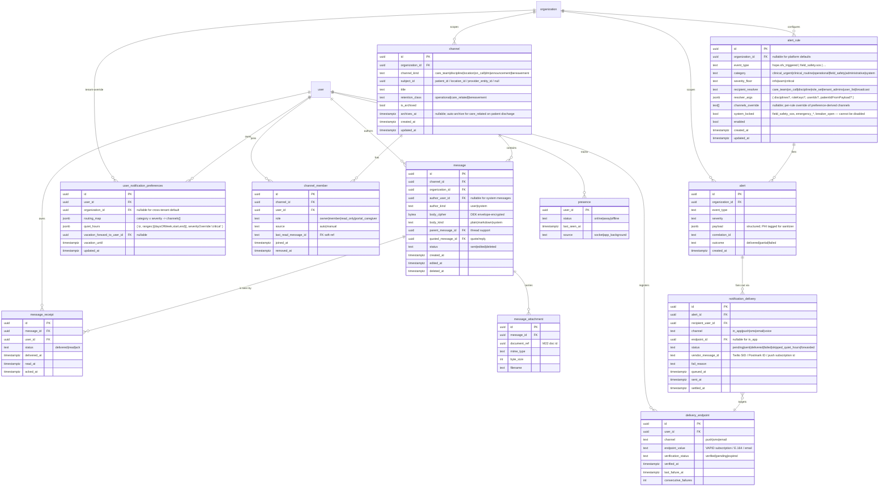

# Module 36 — Secure Messaging & Alerts Specification

**Module ID:** 36
**Phase:** 1 (foundation tier — lands immediately after Module 4, alongside Modules 38 and 40, before Module 5 and every clinical/operational consumer)
**Depends on:** 1 (Foundation — Socket.IO+Valkey adapter wired in `apps/backend/src/bootstrap`, `withOrgContext`/`withPlatformContext`, outbox dispatcher, idempotency middleware, RLS generator, `audit()` helper, per-tenant DEK envelope-encryption helper, BullMQ on Valkey, system status event; outbox events newly consumed), 2 (Identity — user/membership/session for actor + recipient resolution; per-user notification preferences attach to the M2 user; `m2.session.step_up_lockout` alert payload), 3 (Authorization — `messaging.*` and `alert.*` permission keys; channel visibility joins ABAC predicates like `caseload_membership` for per-patient care-team channels), 4 (Audit — every message-read, every alert-delivered, every channel-membership change is audited via M4 triggers; cross-tenant operational support requires break-glass). **M36-F01 (BLOCKER) — `dependsOn` stays `[1,2,3,4]`.** M36 is a foundation-tier module that lands **before** every clinical module (ARCH-230); adding 5/6/11/22/40 would create cycles (M5/M11 each depend on 36 → `36→5→36`, `36→11→36`) and invert the build order. The typed alert payloads from those modules are **contributed**, not consumed via an import edge: each source module (which already depends on 36) registers its `alerts-by-mN.ts` entries at its own boot, with payload **types in the leaf `packages/types`** — M36 validates the catalog at boot without importing any later module (ADR-0005 D1; `packages/foundation` is banned, ADR-0005 D3). Outbox-event consumption likewise needs no edge.
**Consumed by:** every clinical and operational module that needs realtime delivery or alerting. Direct Phase-1+2 consumers: 5 (patient creation auto-creates the per-patient care-team channel; demographics changes broadcast), 6 (admission/election alerts, F2F-due alerts), 7 (care plan updates broadcast to care team), 8 (encounter signed event; HearthNote thread notes), 9 (assessment significant-change alerts), 10 (HOPE SFV trigger — the canonical `clinical_urgent` example), 11 (order placed/signed events), 12 (DoseSpot refill-request inbox), 13 (eMAR — missed-dose escalation), 14 (IDG packet-ready notifications), 16 (bereavement counselor↔family channel — 13-month TTL), 17 (schedule-conflict, late-visit alerts), 18 (EVV geofence violation), 19 (on-call active channel — membership rotates with shift; triage call broadcast), 20 (field-safety SOS — voice escalation), 22 (document share notifications), 23 (claim ack/denial alerts), 25 (denial worklist), 26 (cap projection alerts), 30 (incident-report routing), 31 (caregiver↔clinical-team messaging via portal; consent gating), 34 (tenant admin announcements; SaaS notifications), 37 (IPU census/transition alerts), and any module needing the typed alert surface in future
**Owns:** `apps/backend/src/modules/36-messaging`, the realtime + notification backbone, the in-app inbox + push/SMS/email fan-out, the typed-alert-rule registry, the typed alert payload catalog, the **notification-template catalog + per-tenant overlay** (`notification_template`, `tenant_notification_template_overlay` — moved here from M14 per **ADR-0024**: notification composition + recipient resolution for cross-module events is M36's per SD-017), and the cross-module **notification-composition + recipient-resolution** role for the referral / critical-results / transmission-failure events, the 13-month bereavement channel. **Owned tables: 15** (13 messaging/alert tables + the 2 ADR-0024 notification-template tables).
**Spec status:** Re-locked v0.5 (Phase-6 per-spec reconciliation — the cross-cutting alert bus; supersedes Locked v0.4)

## Remediation Changelog — Phase 6 reconciliation (v0.5, 2026-06-11)

Full disposition of every `audit/AUDIT_M19_M36.md` Module-36 finding (1 BLOCKER / 8 MAJOR / 5 MINOR).
As the alert bus every `m*.` outbox event flows through, M36's coherence gates the whole corpus — so
the two parallel alert subsystems are unified, the migration-breaking duplicate enum is fixed, and
the illegal DDL is removed. The spec now passes `arch:fitness` (checks 10/12).

| Finding | Sev | Resolution |
|---|---|---|
| **M36-F01** | BLOCKER | **`dependsOn` reverted to `[1,2,3,4]` *(relationship inventory - not the `dependsOn` edge set; per ADR-0005 D1/D4 seam/outbox/foundation consumers are no-edge - see audit/MANIFEST_DEPENDSON_REVIEW.md; do not bulk-apply)*** — the 36→5 / 36→11 cycles (and the build-order inversion) are removed. The alert payloads from 5/6/11/22/40 are **contributed** by those modules at their own boot (they already depend on 36), with payload **types in the leaf `packages/types`**; `packages/foundation` is banned (ADR-0005 D1/D3). M36 validates the catalog at boot without importing any later module (header). |
| **M36-F06b** | MAJOR (X9) | **Duplicate `alert_severity` enum fixed:** the payload-catalog enum is renamed to the distinct type **`alert_payload_severity`** (`INFO…CRITICAL`); the legacy `alert_severity` (`info\|warn\|critical`) stays on `alert`/`alert_rule`. The migration no longer fails with a duplicate-type error — **caught by `check-ddl-legality`** (§3.2/§3.11.1, tasks, sign-off). |
| **M36-F06a** | MAJOR (X9) | **The two alert subsystems are unified:** `alerts.dispatch(payloadType)` is the **single catalog-validated entry point**; `alert_rule` is the per-tenant **routing layer** beneath it (it does not define a parallel dispatch path). One path, one severity ladder per layer. |
| **M36-F06c** | MAJOR | The tighten-only trigger compares the **enums directly** (Postgres orders by definition order INFO<…<CRITICAL) — the `::text` casts that forced lexicographic collation (wrongly rejecting WARN→CRITICAL) are removed. |
| **M36-F06d** | MAJOR | The `notification_delivery` voice-SOS CHECK no longer uses an `EXISTS (SELECT … FROM alert)` **subquery** (illegal in PostgreSQL): `alert_category`/`alert_severity` are denormalized onto the row and the CHECK is a local-column comparison — **caught by `check-ddl-legality`**. |
| M36-F06e/f/g | MINOR | Table count reconciled to 13 (11 core + 2 catalog); the promised `Conversation` entity is dropped (Channel/Message is the model); `m36.notification.delivery_failed` payload field corrected to `recipientUserId` (matches the table). *(ADR-0024 (2026-06-13) subsequently moved `notification_template` + `tenant_notification_template_overlay` from M14 to M36 — owned-table count is now **15** = 13 + 2; see §3.13 / §4.11.)* |
| **M36-F02** | MAJOR | Retention corrected to the §24.1 matrix: clinical-coordination channels (`care_team`/`discipline`/`location`/`on_call`/`dm`/`bereavement`) are **`care_related` (6+ yr)**; only the non-clinical `announcement` channel stays `operational`. Author "delete" is a **visibility tombstone** — `body_cipher` is retained until retention expiry, not zeroed (record integrity, §164.530(j)). Bereavement's 13-month window is the channel display/program window (M16-F01), not a destruction clock. |
| **M36-F03** | MAJOR | **Message-body integrity** added (HIPAA §164.312(c)/ARCH-206): a `body_sha256` over plaintext (pre-encryption) on `message` + a scheduled **hash-verification job** with audit output. |
| **M36-F04** | MAJOR | `message` partitioned **LIST `organization_id` → RANGE `created_at`** (SD-027) and registered in `partition.rotate`; **`organization_id` added to `channel_member` and `message_receipt`** with the canonical RLS template + SD-028 composite index; PE/location columns added/deviation documented (ARCH-011). |
| **M36-F05** | MAJOR | Clinical-urgent platform rules (`hope.sfv_triggered`, `emar.dose_missed`, `patient.pps_drop_20`) carry `channels_override = ['in_app','push','sms']` so they reach SMS by default per the §11 routing matrix (ARCH-184); `patient.hospitalization_risk_high` reconciled with AI-032 (predictions don't auto-alert) before seeding. |
| **M36-F07** | MAJOR | **TCPA / SMS opt-out (S14):** a Twilio **inbound-message webhook** handles STOP/START/HELP; `opted_out_at` on `delivery_endpoint` with **dispatcher suppression + audit**; consent text required at SMS endpoint registration; carrier opt-out semantics documented in INT §6.12. |
| **M36-F08** | MAJOR | The four AI features (response drafts, urgency triage, thread summarization, auto-categorization) **register in M32's capability catalog** with risk classes (urgency triage = High — HITL + deterministic fallback + clinical review), `ai.<cap>_kill` switches, per-clinician opt-out, "Report this output", prompt-template versioning, and **thread-content PHI minimization / local-backend default** (ADR-0012). Default-off ≠ ungated. |
| **M36-F09** | MAJOR | Vendor SDKs (`twilio`/`postmark`/`web-push`) confined to **`packages/messaging`** sub-paths per the manifest `VENDOR_ADAPTERS` (the standalone `<vendor>-client` packages dropped, DC-1 resolved on the manifest side); **STRIDE threat model** added (spoofed webhooks, PHI exfil via notification payloads, room-membership tampering, presence info-disclosure, alert-suppression DoS, cross-tenant DM). |
| M36-F10..F14 | MINOR | Push-token 90-day-from-last-success TTL (ADR/§24.1); portal-view **watermark** + immediate M39-revocation channel-sync (ARCH-185/190); per-queue retry/backoff/concurrency/DLQ + deterministic job IDs (SD-059); webhook 5-min replay window + Postmark verification aligned (SD-056); legal-hold skip on retention scans, M19 `OnCallProvider` **deny-stub for Phase-1 boot**, dispatch namespace guard, user-scoped-pattern documentation. |

**Net:** the BLOCKER (cycles) is cleared, the two subsystems are one, the migration-breaking duplicate
enum and the illegal CHECK subquery are fixed (CI-verifiable), and tenancy/retention/TCPA are
corrected — M36 is re-lockable.

## Changelog

- **ADR-0024 applied (2026-06-13)** — Notification **composition + recipient resolution** for cross-module events moved from M14 to M36 (SD-017). Added the two notification-template tables `notification_template` + `tenant_notification_template_overlay` (§3.13 — versioned `(organization_id, template_key, version)`, per-tenant tighten-only overlay, mirroring M22's `form_template` pattern), bringing M36's owned-table count to **15** (manifest already reflects this). Added the cross-module composition + recipient-resolution role (§4.11) for `m6.referral.{received,accepted,declined,withdrawn}`, `m22.document.rendered_critical_results`, and `m11.order.transmission_terminal_failed`; registered the corresponding payload types in `alert_payload_catalog` (§3.12.5) and the `ordering_provider` / `intake_supervisor` / `admissions_team` `RecipientResolver` entries (§4.6). New task T-M36-13.
- **v0.4 (Consolidated)** — Rolls the v0.2 base and v0.3 delta into a single self-contained specification. No scope change; no decision reversals.
- **v0.3 (Locked)** — Consolidated the typed alert payloads contributed across the v0.3 spec track:
  - **Typed alert payload catalog** mirroring M4 v0.3's `audit_action_catalog` and M1 v0.3's `outbox_event_catalog` patterns. New platform-shared table `alert_payload_catalog` plus per-module contribution files in `packages/foundation/src/alert-payloads/`. Module owners contribute their typed payloads via `alerts-by-mN.ts` files; M36 boot UPSERTs into the catalog and refuses startup on namespace violations or unregistered payload usage at runtime.
  - **Payload registrations from v0.3 modules** — 9 net new payload types: from M11 v0.3 (`m11.lab_transmission.terminal_failed` HIGH, `m11.lab_results.overdue` MEDIUM, `m11.lab_results.critical` CRITICAL), from M22 v0.3 (`m22.document.rendered_critical_results` CRITICAL — drives physician inbox + Socket.IO push), from M40 v0.3 (`mdm.physician_deactivated` WARN — per-tenant routing to operations + ordering providers with active orders), from M6 v0.3 (`m6.referral.withdrawn` INFO — distinct template from `referral.declined`; `m6.compliance.window.opened` INFO variant for the 3 new external-signal window types), from M2 v0.3 (`m2.session.step_up_lockout` HIGH — security-significant session termination), from M5 v0.3 (`m5.patient.mutator_applied` INFO when material fields changed; suppressed for routine address-version inserts).
  - **Tenant routing extension** — a new `tenant_alert_routing_override` table lets tenants tighten the platform-floor routing (e.g., escalate `m11.lab_results.critical` from physician inbox to physician + medical director + on-call simultaneously). Tighten-only ratchet per the platform-floor pattern; tenants may NEVER suppress or weaken a platform-mandated alert.
  - **Decisions D10 (`alert_payload_catalog` registry pattern), D11 (tenant routing tighten-only ratchet), and D12 (CRITICAL severity alerts ride parallel channels — Socket.IO push + in-app inbox + SMS for the recipient's primary mobile, simultaneously).**
  - **Workflow acceptance criteria W-M36-08 (lab critical CRITICAL alert reaches all four channels), W-M36-09 (tenant tightens lab critical routing to add medical director), W-M36-10 (boot fails when module uses unregistered alert payload).**
  - **Implementation tasks T-M36-10 through T-M36-12.**
- **v0.2 (Locked)** — Resolved all nine open questions into binding decisions (§11). Wrote full Drizzle for the 12 owned tables. Expanded §3 to complete migration DDL (`0036_messaging`: role split, per-tenant DEK envelope-encryption for `message.body_cipher`, all tables, RLS for per-channel ABAC plus tenant-scoping, audit triggers via M4 generator, alert-rule catalog seed, notification-preference defaults). Added complete per-route TypeBox schemas (§4.2), the full Socket.IO event + room contract (§4.3), the exact permission-key set this module registers into Module 3 (§4.5), the `MessagingProvider` + `AlertEmitter` + `RecipientResolver` seam contracts (§4.6), and the PHI-sanitization wrapper that is the only path to out-of-band notification payloads (§4.7). Destruction `eraseFn` (D9) defined — message bodies cryptographically erased via DEK destruction; structural rows redacted-then-deleted per retention class. Phase boundary fixed: AI features (D8) ship behind flags default-off; voice escalation (Tier-1 SOS) ships Phase 1 and is the single Tier-1 dependency in the platform.
- **v0.1** — Initial draft. Defines the realtime backbone (Socket.IO 4.x + Valkey adapter for multi-instance pub/sub), the unified Channel/Conversation/Message model (single discriminated `channel_kind` rather than a table per kind), the typed AlertEngine with data-driven rules per tenant, the per-user notification preferences (routing map × category × severity, quiet hours, vacation forwarding), and the no-PHI-in-out-of-band-payloads HIPAA constraint enforced as code via the sanitization wrapper (D9). Channel membership for per-patient care-team is auto-managed against M5/M17 caseload (D5). Encryption-at-rest for message bodies via per-tenant DEK envelope (D2).

> **Phase boundary (binding):** Phase 1 delivers everything in this spec **including** Tier-1 Voice escalation for SOS field-safety (architecture/integrations §6.13), because Module 20 ships Phase 1 and depends on it. AI features (response drafts, urgency triage, thread summarization, auto-categorization — D8) ship Phase 1 with `messaging_ai_*` feature flags default-off; per-tenant opt-in unlocks each independently. The `MessagingProvider` + `AlertEmitter` seams, channel kinds (care-team / discipline / location / on-call / dm / announcement / bereavement), all 12 tables (now **15** with the alert-payload catalog + tenant routing override + the two ADR-0024 notification-template tables), fan-out across in-app/push/SMS/email/voice, alert-rule catalog with `system_locked` safety set, and per-user preferences all ship Phase 1.

-----

## 1. Purpose & Scope

### 1.1 What This Module Does

Module 36 is the system's **realtime backbone** — the one place that owns Socket.IO, Valkey pub/sub, notification fan-out across channels, and the data model for human-to-human and event-to-human delivery. Earlier foundation modules built the *floor* the rest of the system stands on; M36 builds the *nervous system*:

- **Persistent conversations and messages.** A Channel/Conversation/Message model with read receipts, attachments, threading, presence, and edit/delete with audit. The single `channel_kind` discriminator covers seven distinct lifecycles (per-patient care team, discipline, location, on-call rotation, DM, tenant announcement, bereavement) without seven schemas — they share the same Message table and the same Socket.IO event surface.
- **Typed alert engine with data-driven rules.** Source modules emit `event_type`s (`hope.sfv_triggered`, `claim.denied`, `field_safety.sos`, …) with payload + severity; M36 resolves recipients dynamically against `alert_rule` rows per tenant, writes `alert` + `notification_delivery` rows, and fans out to the right channels per the recipient's preferences. Rules are per-tenant configurable; a system-locked set (SOS, emergency, critical operational) cannot be disabled.
- **Multi-channel notification fan-out.** In-app (Socket.IO), PWA push (web-push VAPID), SMS (Twilio with BAA), email (Postmark with BAA), voice (Twilio Voice — SOS only). Each channel is a `NotificationDispatcher` implementation behind one interface; adding a new channel (e.g. native FCM/APNs via Capacitor — Phase 2) is a new dispatcher, not a system-wide change. In-app is the always-available floor — no external dependency can prevent an alert from being delivered to a connected client.
- **Per-user notification preferences.** A routing map (category × severity → channel set), quiet hours (with severity-override threshold), vacation forwarding to a backup user (auditable, time-bounded). Preferences attach to the M2 user and apply across tenants the user belongs to (with per-tenant override possible).
- **The HIPAA no-PHI-in-out-of-band-payloads constraint as code.** SMS, email, and push payloads carry "You have a new message" + a deep link to the authenticated app — never the message body, never the patient name, never the diagnosis. Enforced by a `sanitizeForOutOfBand()` wrapper that every channel dispatcher *must* go through; a lint rule (architecture §25.15 extension) blocks direct calls to `twilio.send` / `postmark.send` / `webpush.send` outside the sanitizer. In-app and the bereavement channel (which is itself authenticated PHI surface) are the only paths that carry full message content.
- **Per-tenant DEK envelope encryption of message bodies.** Stored as `message.body_cipher` using the per-tenant DEK established by M1's envelope-encryption helper. Decrypt happens at read time within the perimeter. Tenant offboarding destroys the DEK — the message bodies become unreadable in the same operation (architecture §8(2) cryptographic erasure).
- **The typed `MessagingProvider` + `AlertEmitter` + `RecipientResolver` seam contracts.** Source modules import only the interfaces; the per-table queries, the Valkey pub/sub, and the dispatchers live behind them. Adding a new alert source is a one-call insertion (`alerts.emit({ eventType, payload, severity })`), not a fan-out concern; opening a new channel kind is a discriminator addition, not a new module.
- **Maintain the typed alert payload catalog** as the central registry of every alert payload any module emits. Modules contribute typed schemas via per-module contribution files; M36 boot validates the catalog (namespace ownership, unique payload-type identifiers, severity assignment) and refuses startup on violations. Runtime alert dispatch validates the payload against its registered schema.
- **Govern tenant routing tightening** — per-tenant overrides may TIGHTEN the platform-floor routing (escalate, add channels, add recipients) but never LOOSEN (suppress channels, remove recipients, downgrade severity). The override registry is loaded at dispatch time; conflicts between platform and tenant favor tenant only in the tighten direction.

### 1.2 What This Module Does Not Do

- **Decide whether the message can be sent.** Module 3 decides authorization (`messaging.send` permission; ABAC `caseload_membership` predicate for per-patient channels). Module 39 decides patient consent (e.g. `family_caregiver_access` consent must be active for a portal caregiver to be in the patient's care-team channel). M36 enforces those decisions at the channel boundary; it doesn't make them.
- **Own caregiver/portal identity.** Module 31 owns the Patient/Family Portal (sessions, consent-gated access). M36 holds the channel membership and the per-portal-user notification preferences; identity is M2 + M31.
- **Own the care-team source of truth.** Module 5 owns the patient; Module 17 owns scheduled caseload. M36's per-patient channel membership is derived (D5) — a CareTeamProvider seam (boot-validated) tells M36 who's on the team, and channel membership updates follow it.
- **Own the on-call rotation source of truth.** Module 19 owns on-call shifts. M36's on-call channel membership rotates automatically from `OnCallProvider` (the same seam pattern). Channel kind is the only thing M36 owns about on-call.
- **Persist video/audio.** Telehealth (Module 31, Daily.co adapter) records into MinIO; M36 holds neither the WebRTC stream nor the recording — at most a message-attachment reference to the recording.
- **Own AI capability orchestration.** Module 32 owns the AI Platform (`packages/ai-platform`). M36 *consumes* capabilities (response drafts, urgency triage, summarization, auto-categorization) through the M32 typed SDK, behind per-tenant feature flags. M36 doesn't choose models, doesn't manage prompts, doesn't track cost — that's all M32.
- **Provide bulk messaging to external recipients.** External communications (claim disclosures to MAC, lab orders) are M22/M23/M29's job. M36 is *internal* (staff + portal caregivers + bereavement family) realtime delivery.
- **Define `event_type` taxonomies for individual source modules.** Each source module owns its own event_types and registers them with M36's alert-rule catalog at boot.
- **Author alert content or author the source events.** M36 doesn't author content; it doesn't author the source events; it doesn't bypass M4 audit; PHI never appears in out-of-band payloads (the sanitization wrapper is the enforcement).

### 1.3 Regulatory & Operational Drivers

| Driver | Requirement | How Module 36 satisfies it |
|---|---|---|
| HIPAA §164.312(e) — Transmission security | Encrypted PHI transmission | TLS 1.3 + Socket.IO over WSS; out-of-band channels carry no PHI by rule |
| HIPAA §164.312(a)(1) — Encryption at rest | PHI at rest encrypted | Per-tenant DEK envelope encryption on `message.body_cipher` |
| HIPAA §164.312(b) — Audit controls | Every PHI access logged | M4 triggers on every table + dedicated audit on message read + alert delivery (D7 sub-rule); `message.read` events written individually |
| HIPAA §164.316(b)(2) — Retention | 6+ year clinical record retention | `care_related` retention class on care-team & bereavement channels; aligns to M4 `compliance` |
| HIPAA §164.502(b) — Minimum necessary | Limit PHI to what's needed | Channel membership scoped to care team / consented caregivers / role; no broadcast of patient content beyond intended audience |
| 42 CFR §418 — CoP communication of patient information | Care plan changes communicated to team | Source events on care-plan update fan out to the per-patient care-team channel |
| 42 CFR Part 2 (SUD) | Strict consent on disclosure | Care-team channel members filtered against M39 consent if patient has SUD-related diagnoses |
| HHS guidance on patient communications via SMS/email | "Reasonable safeguards"; permitted with limits | No PHI in payload; deep links only; opt-in per portal user |
| Field-safety obligations (state OSHA-equivalents; agency safety policy) | Reliable life-safety escalation for lone clinicians | Tier-1 voice escalation for SOS; multi-channel redundancy; ops-paged if voice channel degrades |
| State retention overrides | State law may extend retention | Honors the same `state_retention_override` table M4 owns; tenant location-state-aware |

### 1.4 Competitive Context

Most hospice EHRs bolt messaging on later, which guarantees one of two failure modes: PHI leaks into SMS/email payloads (regulatory exposure), or messaging never quite integrates with the alert surface (clinicians end up running on two notification systems). WardenX's differentiators: **one realtime + notification backbone** every clinical module consumes from day one; **no-PHI-in-out-of-band-payloads enforced as code** (sanitization wrapper + lint rule), not by per-developer discipline; **typed alert rules per tenant** instead of buried `if`-trees per module; **always-available in-app floor** so no external dependency blocks an alert; and a **single 13-month bereavement channel** that lives past death without each module reinventing it.

-----

## 2. Domain Model

### 2.1 Resolution & Fan-Out Architecture

One emit path, one fan-out path, one provider interface.

```mermaid
flowchart TD
    subgraph Sources["Source modules (M5/M6/M7/M8/M10/M11/M13/M17/M18/M19/M20/M23/M25/M26/M30/M31/M37)"]
      S1[hope.sfv_triggered]
      S2[field_safety.sos]
      S3[claim.denied]
      S4[message sent in care-team channel]
    end
    subgraph M36["packages/messaging — Provider + AlertEngine"]
      MP[MessagingProvider\nsendMessage / openChannel /\nmarkRead / listConversations]
      AE[AlertEmitter\nemit(eventType, payload, severity)]
      RR[RecipientResolver registry\ncare-team / on-call / discipline /\ntenant-admin / role-set / user-list]
      SAN[sanitizeForOutOfBand]
    end
    subgraph DB["PostgreSQL"]
      CH[(channel)]
      MEM[(channel_member)]
      MSG[(message — body_cipher = DEK envelope)]
      ATT[(message_attachment)]
      REC[(message_receipt)]
      PRE[(presence)]
      RUL[(alert_rule — per tenant, seeded)]
      ALR[(alert)]
      ND[(notification_delivery)]
      UNP[(user_notification_preferences)]
      DEL[(delivery_endpoint — push tokens, verified SMS, etc.)]
    end
    subgraph RT["Realtime + Out-of-band"]
      SIO[Socket.IO + Valkey adapter\nrooms: user / careteam / location / discipline / org]
      WP[web-push VAPID]
      TWS[Twilio SMS]
      TWV[Twilio Voice]
      PM[Postmark]
    end

    S1 --> AE
    S2 --> AE
    S3 --> AE
    S4 --> MP

    MP --> MSG
    MP --> REC
    MP --> SIO

    AE --> RUL
    AE --> RR
    RR --> ALR
    ALR --> ND
    ND --> UNP
    ND --> SAN
    SAN --> SIO
    SAN --> WP
    SAN --> TWS
    SAN --> TWV
    SAN --> PM

    SIO -.online.- PRE
```

Three principles drive the picture:

1. **In-app is the always-available floor.** Every alert delivery starts with a Socket.IO emit to the recipient's `user:<id>` room. Out-of-band channels (push/SMS/email/voice) are *additive* per preference, never replacements. If Twilio and Postmark are both down, a connected user still gets the alert.
2. **`sanitizeForOutOfBand` is the only path to out-of-band payloads.** Every dispatcher (`packages/messaging/dispatchers/{twilio-sms,twilio-voice,postmark,web-push}.ts`) takes its payload from the sanitizer's output, never from the source emit. The sanitizer's contract: no field tagged `phi: true`, no message body, no patient identifiers beyond a content-free `notification_delivery_id` that deep-links into the authenticated app. A lint rule (§4.7) blocks direct vendor calls outside the sanitizer.
3. **Recipient resolution is dynamic at emit time, not static on the rule.** `alert_rule` names a `RecipientResolver` (e.g. `care_team(patient_id)`, `on_call(provider_entity_id)`, `discipline(org_id, 'RN')`, `tenant_admins`), not a frozen user list. The resolver consults the source-of-truth seam (M5 caseload, M19 on-call) at emit time, so on-call escalation always goes to who's actually on shift right now, not who was on shift when the rule was written.

### 2.2 Entity-Relationship Diagram



### 2.3 Channel Kinds (the single discriminator that drives lifecycle, membership, and retention)

| Kind | Subject | Membership source | Retention class | Notes |
|---|---|---|---|---|
| `care_team` | `patient_id` (M5) | auto via `CareTeamProvider` seam (M5/M17); portal caregivers added via M39 consent; manual edits forbidden (admin-only override audited) | `care_related` (6+ yr; aligns to M4 compliance) | Auto-created on patient admission (M5 event); auto-archived on discharge (M5 event); membership re-synced on care-team change |
| `discipline` | `org_id` + discipline string | auto via M2 membership filter (role like `clinical_rn`, `clinical_aide`, `msw`, `chaplain`); changes follow role grants | `care_related` (6+ yr) | M36-F02: clinical coordination between disciplines is clinical communication (§24.1 secure-messages 6 yr, no carve-out) |
| `location` | `location_id` (M1) | auto via M2 membership default_location_ids | `care_related` (6+ yr) | M36-F02: shift handoffs are clinical coordination |
| `on_call` | `provider_entity_id` | auto via `OnCallProvider` seam (M19) — rotates with shift | `care_related` (6+ yr) | M36-F02: after-hours clinical coordination is survey-relevant (M19); membership snapshot at shift start/end |
| `dm` | none | manual (1:1; cannot be expanded) | `care_related` (6+ yr) | M36-F02: clinician DMs routinely discuss patients — clinical communication, not 1-yr operational |
| `announcement` | none | broadcast (read-only for everyone except sender; org_admin sends) | `operational` (1 yr) | The one genuinely non-clinical, tenant-wide admin-broadcast channel — operational per the §24.1 system-noise carve-out |
| `bereavement` | `bereavement_plan_id` (M16) | bereavement counselor + named bereaved family member(s) via M39 consent | `care_related` (6+ yr) | M36-F02 / M16-F01: bereavement messages are records of care; the **13-month** window is the channel **display/program** window (auto-archive at plan close), NOT a retention/destruction clock |

> The discriminator is **enforced at the schema level** with a `channel_kind` enum + a per-kind CHECK constraint on `subject_id` (e.g., `channel_kind = 'care_team'` requires `subject_id IS NOT NULL`; `channel_kind = 'dm'` requires `subject_id IS NULL`). Kind cannot be changed after creation (CHECK on UPDATE).

### 2.4 Entity Lifecycle States

#### 2.4.1 Channel

```mermaid
stateDiagram-v2
    [*] --> active: created (auto on M5/M16/M19 event OR manual)
    active --> archived: subject closed (patient discharged, bereavement plan closed, on-call shift ended) OR org_admin archived
    archived --> active: subject reopened (rare; care_team on un-discharge)
    archived --> destroyed: retention expired + destruction certificate approved (via M4)
    destroyed --> [*]
```

#### 2.4.2 Message

```mermaid
stateDiagram-v2
    [*] --> sent: author posts; body_cipher written; receipts seeded for current members
    sent --> edited: author edits within edit window (default 5 min); audit retained
    sent --> deleted: author deletes; body_cipher zeroed; deleted_at set; tombstone visible
    edited --> deleted: same
    deleted --> [*]: at retention expiry, full row destroyed (with channel)
```



#### 2.4.3 Alert

```mermaid
stateDiagram-v2
    [*] --> pending: alert row written; notification_delivery rows enqueued
    pending --> delivered: at least in_app delivered to all resolved recipients
    pending --> partial: some recipients delivered; some failed/skipped
    pending --> failed: no recipient could be reached on any channel; ops-paged for Tier-1
    delivered --> [*]
    partial --> [*]
    failed --> [*]
```

#### 2.4.4 Notification delivery (per recipient × channel)

```mermaid
stateDiagram-v2
    [*] --> pending
    pending --> sent: dispatcher accepted
    pending --> skipped_quiet_hours: severity below preference override threshold during quiet hours
    pending --> forwarded: vacation forwarding active; redirected to backup
    sent --> delivered: vendor callback acks delivery (in-app: socket acked; SMS/email: webhook)
    sent --> failed: vendor reports terminal failure
    skipped_quiet_hours --> [*]
    forwarded --> [*]
    delivered --> [*]
    failed --> [*]
```



### 2.5 Validation Rules

| Rule | Type | Detail |
|---|---|---|
| Channel kind immutability | sync (CHECK on UPDATE) | `channel_kind` cannot be changed after row insert |
| Subject-by-kind | sync (CHECK) | `(channel_kind = 'care_team') = (subject_id IS NOT NULL AND retention_class = 'care_related')` etc. per kind |
| Auto-managed membership locked | app-layer | for `care_team`/`discipline`/`location`/`on_call`, `channel_member.source = 'auto'` rows can only be modified by the auto-sync job; manual edits require admin override and audit |
| DM is exactly two members | sync (constraint) | `channel_kind = 'dm'` → exactly two non-removed members at all times |
| Bereavement channel lifecycle | invariant | `channel_kind = 'bereavement'` → `retention_class = 'bereavement'`; archives_at automatically set to `plan.opened_at + 13 months` on create |
| Message body encryption | infra | `message.body_cipher` is always envelope-encrypted under the tenant's DEK; cleartext never persisted |
| No PHI in out-of-band payloads | infra (lint) + runtime | architecture §25.15 dependency-cruiser extension blocks `twilio.send`/`postmark.send`/`webpush.send` outside `packages/messaging/notification/sanitize.ts`; runtime test asserts no `phi:true`-tagged field survives `sanitizeForOutOfBand()` |
| Receipts seeded on send | invariant | on message INSERT, `message_receipt` rows are written for all current `channel_member.removed_at IS NULL` members; missing receipts after send = bug |
| Alert rule integrity | sync | `recipient_resolver` value must be in the registered resolver set; `system_locked` rules cannot be disabled or have their `recipient_resolver` changed |
| Notification preference defaults | invariant | on user creation, defaults seeded (in-app: all; push: if endpoint registered; SMS: critical only; email: routine digest) |
| Quiet-hours override | sync | quiet_hours has a `severityOverride` floor (default `critical`); alerts at/above that severity bypass quiet hours and are still delivered |
| Vacation forwarding bounded | sync (CHECK) | `vacation_until > now()` required when `vacation_forward_to_user_id` set; expires automatically |
| Voice channel SOS-only | app-layer + RLS | `notification_delivery.channel = 'voice'` only for alerts with `category = 'field_safety'` and `severity = 'critical'`; enforced at dispatcher entry |
| Same-tenant fan-out | infra (RLS) | every table tenant-scoped except `presence` (user-scoped) and `delivery_endpoint` (user-scoped); cross-tenant message read = denied even with break-glass unless audited as `audit.elevated_access` |
| Alert payload registration | infra (boot) + runtime | every `payload_type` dispatched must be registered in `alert_payload_catalog`; M36 boot UPSERTs the catalog and refuses startup on namespace violations; runtime `alerts.dispatch()` refuses unregistered payload types and payloads that fail their TypeBox schema |
| Tenant routing tighten-only | sync (trigger) + runtime | `tenant_alert_routing_override` may only ADD channels/recipients or ESCALATE severity; the DB trigger rejects any escalated severity below the catalog default; the dispatch path applies overrides as a union, never a replacement |

### 2.6 Side Effects

| Trigger | Side effect |
|---|---|
| Patient created (M5 event) | `care_team` channel created; CareTeamProvider seam queried; members seeded |
| Patient discharged (M5 event) | `care_team` channel archived; `archives_at` set; no new messages allowed |
| Care team membership change (M5/M17) | `channel_member` rows added/removed (auto source); audit row per change |
| On-call shift changed (M19) | `on_call` channel membership re-synced (old member removed, new member added); audit row per change |
| Bereavement plan opened (M16) | `bereavement` channel created with 13-month `archives_at` |
| Bereavement plan closed (M16) | `bereavement` channel archived immediately |
| Source emits an event matching an enabled `alert_rule` | `alert` row written; recipient resolver called; `notification_delivery` per recipient × channel enqueued; per-channel dispatchers fire |
| Message sent | `message_receipt` rows seeded for active members; Socket.IO `message.new` event emitted to channel room; M4 audit row written; channel `updated_at` bumped |
| Message read by user | `message_receipt.read_at` set; Socket.IO `message.read` emitted to other members; M4 audit row written |
| Push endpoint returns 404/410 | endpoint pruned from `delivery_endpoint`; user re-prompted to re-subscribe on next session |
| Quiet hours block delivery on a non-critical alert | `notification_delivery.status = 'skipped_quiet_hours'`; in-app still delivered |
| Voice dispatcher fails on SOS | `alert.outcome = 'partial'` (other channels may have succeeded); WardenX ops paged via system status event; supervisor SMS+push escalated explicitly (Tier-1 redundancy) |
| `alerts.dispatch()` called with a CRITICAL payload | Socket.IO push + in-app inbox + SMS to primary mobile + email to primary email fan out in parallel via `Promise.allSettled`; per-channel failures recorded but the call succeeds if at least one channel acknowledged (D12) |
| Tenant routing override present for the dispatched payload | effective channels = default ∪ added; effective recipients = default ∪ added; severity = escalated (if set, ≥ default); audit row records the override applied |
| Cross-module event consumed for composition (ADR-0024): `m6.referral.{received,accepted,declined,withdrawn}`, `m22.document.rendered_critical_results`, `m11.order.transmission_terminal_failed` | matching `notification_template` loaded (tenant overlay applied if present); title/body placeholders rendered from the source event payload; recipients resolved via the `RecipientResolver` registry (ordering-provider / intake-supervisor / admissions-team); `alerts.dispatch()` validates against `alert_payload_catalog` and fans out (§3.13/§4.11) |
| Tenant offboarding (D9) | M36 `eraseFn` triggers tenant DEK destruction (cryptographic erasure of all message bodies); structural rows redacted then deleted; destruction certificate filed by M4 |

-----

## 3. Drizzle Schema

### 3.1 Package Layout

```
packages/messaging/
├── src/
│   ├── interfaces/
│   │   ├── provider.ts                 # MessagingProvider seam (the contract consumers import)
│   │   ├── alert-emitter.ts            # AlertEmitter seam
│   │   ├── recipient-resolver.ts       # RecipientResolver registry contract
│   │   └── kinds.ts                    # channel kind union + result shapes
│   ├── channels/
│   │   ├── care-team-sync.ts           # consumes CareTeamProvider; reconciles membership
│   │   ├── on-call-sync.ts             # consumes OnCallProvider
│   │   ├── discipline-sync.ts          # consumes M2 membership/role state
│   │   └── location-sync.ts            # consumes M2 default_location_ids
│   ├── messages/
│   │   ├── send.ts                     # write message; seed receipts; encrypt body
│   │   ├── read.ts                     # decrypt; mark receipts; emit message.read
│   │   ├── edit.ts                     # edit within window; audit
│   │   └── delete.ts                   # tombstone + zero body_cipher
│   ├── presence/
│   │   ├── tracker.ts                  # Socket.IO connect/disconnect → presence
│   │   └── room-membership.ts          # compute Socket.IO room joins from channel_member at connect
│   ├── alerts/
│   │   ├── emit.ts                     # AlertEmitter implementation
│   │   ├── dispatch.ts                 # catalog-validated dispatch (payload registry + tenant override)
│   │   ├── resolver-registry.ts        # named recipient resolvers
│   │   ├── fan-out.ts                  # per-recipient channel selection from preferences
│   │   └── deduplicate.ts              # collapse identical alerts within debounce window
│   ├── notification/
│   │   ├── sanitize.ts                 # **the only path** to out-of-band payloads
│   │   ├── preferences.ts              # routing-map evaluation + quiet hours + vacation forwarding
│   │   └── dispatchers/
│   │       ├── in-app-socket.ts        # the always-available floor
│   │       ├── web-push.ts             # adapter wrapper over packages/webpush
│   │       ├── twilio-sms.ts           # adapter wrapper over packages/twilio-client
│   │       ├── twilio-voice.ts         # SOS only; Tier-1
│   │       └── postmark-email.ts       # adapter wrapper over packages/postmark-client
│   ├── ai/                              # M32-consuming features (all flag-gated, D8)
│   │   ├── response-draft.ts
│   │   ├── urgency-triage.ts
│   │   ├── thread-summary.ts
│   │   └── auto-categorize.ts
│   └── destruction/
│       └── eraseFn.ts                  # registered with M4 destruction registry (D9)
packages/db/src/schema/messaging/
├── channels.ts
├── channel-members.ts
├── messages.ts
├── message-attachments.ts
├── message-receipts.ts
├── presence.ts
├── alert-rules.ts
├── alerts.ts
├── notification-deliveries.ts
├── user-notification-preferences.ts
├── delivery-endpoints.ts
├── alert-payload-catalog.ts
├── tenant-alert-routing-override.ts
├── notification-template.ts                 # ADR-0024: moved from M14 — versioned notification-copy catalog
└── tenant-notification-template-overlay.ts  # ADR-0024: per-tenant tighten-only overlay
packages/foundation/src/alert-payloads/  # per-module alert-payload contribution registry (D10)
packages/twilio-client/                  # adapter packages (M1 §6.12/§6.13)
packages/postmark-client/                # M1 §6.14
packages/webpush/                        # M1 §6.15
```

### 3.2 Enums

```typescript
// packages/db/src/enums.ts (additions)
export const channelKind = pgEnum('channel_kind',
  ['care_team','discipline','location','on_call','dm','announcement','bereavement'])
export const channelRetentionClass = pgEnum('channel_retention_class',
  ['operational','care_related','bereavement'])
export const channelMemberRole = pgEnum('channel_member_role',
  ['owner','member','read_only','portal_caregiver'])
export const channelMemberSource = pgEnum('channel_member_source',
  ['auto','manual'])
export const messageAuthorKind = pgEnum('message_author_kind', ['user','system'])
export const messageBodyKind = pgEnum('message_body_kind', ['plain','markdown','system'])
export const messageStatus = pgEnum('message_status', ['sent','edited','deleted'])
export const messageReceiptStatus = pgEnum('message_receipt_status',
  ['delivered','read','ack'])
export const presenceStatus = pgEnum('presence_status', ['online','away','offline'])
export const alertCategory = pgEnum('alert_category',
  ['clinical_urgent','clinical_routine','operational','field_safety','administrative','system'])
export const alertSeverity = pgEnum('alert_severity', ['info','warn','critical'])
export const alertRecipientResolver = pgEnum('alert_recipient_resolver',
  ['care_team','on_call','discipline','role_set','tenant_admins','user_list','broadcast'])
export const alertOutcome = pgEnum('alert_outcome', ['delivered','partial','failed'])
export const notificationChannel = pgEnum('notification_channel',
  ['in_app','push','sms','email','voice'])
export const notificationStatus = pgEnum('notification_status',
  ['pending','sent','delivered','failed','skipped_quiet_hours','forwarded'])
export const deliveryEndpointChannel = pgEnum('delivery_endpoint_channel',
  ['push','sms','email'])
export const deliveryEndpointVerification = pgEnum('delivery_endpoint_verification',
  ['verified','pending','expired'])
```

The alert payload catalog (§3.11) introduces a second, broader severity enum that formalizes the platform-floor severity ladder used by the typed payload registry:

```typescript
// packages/db/src/schema/messaging/enums.ts (addition)
// M36-F06b / ADR-0022 D1.3: the payload-catalog enum is a DISTINCT Postgres type named
// `alert_payload_severity` — NOT a second `alert_severity`. The prior spec defined TWO pgEnums both
// named 'alert_severity' (the legacy `info|warn|critical` and this `INFO|…|CRITICAL`), so the
// migration's second `CREATE TYPE alert_severity` failed (duplicate type). Renaming the catalog type
// makes both definitions legal and now passes `check-ddl-legality` (fitness #12).
export const alertPayloadSeverity = pgEnum('alert_payload_severity', ['INFO', 'WARN', 'MEDIUM', 'HIGH', 'CRITICAL'])
```

> The **`alert_payload_severity`** Postgres enum used by the payload catalog (`INFO | WARN | MEDIUM | HIGH | CRITICAL`) is the platform-floor severity ladder for typed alert payloads; tenants may TIGHTEN it via the D11 override but not loosen. The **separate** legacy `info|warn|critical` `alert_severity` enum continues to back the v0.2 `alert`/`alert_rule` rows. (M36-F06a: the two paths are unified — see the §2.x dispatch-path reconciliation note — with `alerts.dispatch()` as the single catalog-validated entry point and `alert_rule` as the per-tenant routing layer beneath it.)

### 3.3 Channels & Membership

```typescript
// channels.ts
export const channels = pgTable('channel', {
  id: uuid('id').primaryKey().defaultRandom(),
  organizationId: uuid('organization_id').notNull()
    .references(() => organizations.id, { onDelete: 'restrict' }),
  channelKind: channelKind('channel_kind').notNull(),
  subjectId: uuid('subject_id'),                          // patient_id | location_id | provider_entity_id | bereavement_plan_id | null
  title: text('title').notNull(),
  retentionClass: channelRetentionClass('retention_class').notNull(),
  isArchived: boolean('is_archived').notNull().default(false),
  archivesAt: timestamp('archives_at', { withTimezone: true }),  // pre-computed for bereavement
  createdAt: timestamp('created_at', { withTimezone: true }).notNull().defaultNow(),
  updatedAt: timestamp('updated_at', { withTimezone: true }).notNull().defaultNow(),
}, (t) => ({
  orgKindIdx: index('channel_org_kind_idx').on(t.organizationId, t.channelKind),
  subjectIdx: index('channel_subject_idx').on(t.channelKind, t.subjectId)
    .where(sql`subject_id IS NOT NULL`),
  uniqueSubject: uniqueIndex('channel_unique_subject')
    .on(t.organizationId, t.channelKind, t.subjectId)
    .where(sql`subject_id IS NOT NULL AND channel_kind IN ('care_team','on_call','bereavement','location','discipline')`),
  kindSubjectShape: check('channel_kind_subject_shape', sql`
    CASE channel_kind
      WHEN 'care_team' THEN subject_id IS NOT NULL AND retention_class = 'care_related'
      WHEN 'bereavement' THEN subject_id IS NOT NULL AND retention_class = 'bereavement' AND archives_at IS NOT NULL
      WHEN 'dm' THEN subject_id IS NULL AND retention_class = 'operational'
      WHEN 'announcement' THEN subject_id IS NULL AND retention_class = 'operational'
      ELSE subject_id IS NOT NULL AND retention_class = 'operational'
    END
  `),
}))

// channel-members.ts
export const channelMembers = pgTable('channel_member', {
  id: uuid('id').primaryKey().defaultRandom(),
  // M36-F04 / ADR-0010: organization_id is carried directly (not derived via a subquery into
  // channel) so the canonical SD-029 RLS template applies and the SD-028 composite
  // (organization_id, channel_id) index is possible. Same column added to message_receipt.
  organizationId: uuid('organization_id').notNull().references(() => organization.id, { onDelete: 'restrict' }),
  channelId: uuid('channel_id').notNull()
    .references(() => channels.id, { onDelete: 'cascade' }),
  userId: uuid('user_id').notNull().references(() => users.id, { onDelete: 'restrict' }),
  role: channelMemberRole('role').notNull().default('member'),
  source: channelMemberSource('source').notNull(),
  lastReadMessageId: uuid('last_read_message_id'),    // soft FK (no constraint to avoid cycles)
  joinedAt: timestamp('joined_at', { withTimezone: true }).notNull().defaultNow(),
  removedAt: timestamp('removed_at', { withTimezone: true }),
}, (t) => ({
  activeMembership: uniqueIndex('channel_member_active_unique')
    .on(t.channelId, t.userId).where(sql`removed_at IS NULL`),
  byUser: index('channel_member_user_idx').on(t.userId).where(sql`removed_at IS NULL`),
  byChannel: index('channel_member_channel_idx').on(t.channelId).where(sql`removed_at IS NULL`),
}))
```

### 3.4 Messages, Attachments, Receipts

```typescript
// messages.ts
export const messages = pgTable('message', {
  id: uuid('id').primaryKey().defaultRandom(),
  channelId: uuid('channel_id').notNull()
    .references(() => channels.id, { onDelete: 'restrict' }),
  organizationId: uuid('organization_id').notNull()
    .references(() => organizations.id, { onDelete: 'restrict' }),
  authorUserId: uuid('author_user_id').references(() => users.id),  // null = system author
  authorKind: messageAuthorKind('author_kind').notNull(),
  bodyCipher: customType<{ data: Buffer }>({
    dataType() { return 'bytea' },
  })('body_cipher').notNull(),                          // envelope-encrypted under tenant DEK
  bodyKind: messageBodyKind('body_kind').notNull().default('plain'),
  parentMessageId: uuid('parent_message_id').references((): any => messages.id),
  quotedMessageId: uuid('quoted_message_id').references((): any => messages.id),
  status: messageStatus('status').notNull().default('sent'),
  createdAt: timestamp('created_at', { withTimezone: true }).notNull().defaultNow(),
  editedAt: timestamp('edited_at', { withTimezone: true }),
  deletedAt: timestamp('deleted_at', { withTimezone: true }),
}, (t) => ({
  byChannelCreatedIdx: index('message_channel_created_idx').on(t.channelId, t.createdAt),
  byAuthorIdx: index('message_author_idx').on(t.authorUserId).where(sql`author_user_id IS NOT NULL`),
  byOrgIdx: index('message_org_idx').on(t.organizationId),
  byParentIdx: index('message_parent_idx').on(t.parentMessageId).where(sql`parent_message_id IS NOT NULL`),
  authorShape: check('message_author_shape',
    sql`(author_kind = 'user') = (author_user_id IS NOT NULL)`),
  statusShape: check('message_status_shape', sql`
    (status = 'edited') = (edited_at IS NOT NULL)
    AND (status = 'deleted') = (deleted_at IS NOT NULL)
  `),
}))

// message-attachments.ts
export const messageAttachments = pgTable('message_attachment', {
  id: uuid('id').primaryKey().defaultRandom(),
  messageId: uuid('message_id').notNull()
    .references(() => messages.id, { onDelete: 'cascade' }),
  documentRef: uuid('document_ref').notNull(),         // M22 doc id (FK app-side; M22 not yet built at Phase 1 start)
  mimeType: text('mime_type').notNull(),
  byteSize: integer('byte_size').notNull(),
  filename: text('filename').notNull(),
  createdAt: timestamp('created_at', { withTimezone: true }).notNull().defaultNow(),
}, (t) => ({
  byMessageIdx: index('message_attachment_message_idx').on(t.messageId),
}))

// message-receipts.ts
export const messageReceipts = pgTable('message_receipt', {
  id: uuid('id').primaryKey().defaultRandom(),
  // M36-F04 / ADR-0010: organization_id carried directly (canonical RLS, SD-028 composite index);
  // co-partitioned with `message` LIST organization_id → RANGE created_at (SD-027, registered in
  // partition.rotate, M36-F04).
  organizationId: uuid('organization_id').notNull().references(() => organization.id, { onDelete: 'restrict' }),
  messageId: uuid('message_id').notNull()
    .references(() => messages.id, { onDelete: 'cascade' }),
  userId: uuid('user_id').notNull().references(() => users.id, { onDelete: 'restrict' }),
  status: messageReceiptStatus('status').notNull().default('delivered'),
  deliveredAt: timestamp('delivered_at', { withTimezone: true }).notNull().defaultNow(),
  readAt: timestamp('read_at', { withTimezone: true }),
  ackedAt: timestamp('acked_at', { withTimezone: true }),
}, (t) => ({
  uniquePerMessageUser: uniqueIndex('message_receipt_unique')
    .on(t.messageId, t.userId),
  byUserReadIdx: index('message_receipt_user_read_idx')
    .on(t.userId, t.status).where(sql`status = 'delivered'`),     // unread inbox query path
  byMessage: index('message_receipt_message_idx').on(t.messageId),
}))
```

### 3.5 Presence & Delivery Endpoints

```typescript
// presence.ts (per-user single row, mutated on connect/disconnect)
export const presence = pgTable('presence', {
  userId: uuid('user_id').primaryKey().references(() => users.id, { onDelete: 'cascade' }),
  status: presenceStatus('status').notNull().default('offline'),
  lastSeenAt: timestamp('last_seen_at', { withTimezone: true }).notNull().defaultNow(),
  source: text('source').notNull().default('socket'),
}, (t) => ({
  statusIdx: index('presence_status_idx').on(t.status),
}))

// delivery-endpoints.ts (per-user; tenant-agnostic — endpoints belong to the human, not the tenant)
export const deliveryEndpoints = pgTable('delivery_endpoint', {
  id: uuid('id').primaryKey().defaultRandom(),
  userId: uuid('user_id').notNull().references(() => users.id, { onDelete: 'cascade' }),
  channel: deliveryEndpointChannel('channel').notNull(),
  endpointValue: text('endpoint_value').notNull(),     // VAPID sub | E.164 | email
  verificationStatus: deliveryEndpointVerification('verification_status').notNull().default('pending'),
  verifiedAt: timestamp('verified_at', { withTimezone: true }),
  lastFailureAt: timestamp('last_failure_at', { withTimezone: true }),
  consecutiveFailures: integer('consecutive_failures').notNull().default(0),
  createdAt: timestamp('created_at', { withTimezone: true }).notNull().defaultNow(),
}, (t) => ({
  uniquePerUserChannel: uniqueIndex('delivery_endpoint_unique')
    .on(t.userId, t.channel, t.endpointValue),
  byUserChannel: index('delivery_endpoint_user_channel_idx').on(t.userId, t.channel),
}))
```

### 3.6 Alert Rules, Alerts, Deliveries, Preferences

```typescript
// alert-rules.ts
export const alertRules = pgTable('alert_rule', {
  id: uuid('id').primaryKey().defaultRandom(),
  organizationId: uuid('organization_id')
    .references(() => organizations.id, { onDelete: 'cascade' }),  // null = platform default
  eventType: text('event_type').notNull(),                          // 'hope.sfv_triggered' etc.
  category: alertCategory('category').notNull(),
  severityFloor: alertSeverity('severity_floor').notNull(),
  recipientResolver: alertRecipientResolver('recipient_resolver').notNull(),
  resolverArgs: jsonb('resolver_args').notNull().default({}),       // { disciplines?, roleKeys?, patientIdPath?, ... }
  channelsOverride: text('channels_override').array(),              // null = use recipient preferences
  systemLocked: boolean('system_locked').notNull().default(false),  // cannot be disabled
  enabled: boolean('enabled').notNull().default(true),
  createdAt: timestamp('created_at', { withTimezone: true }).notNull().defaultNow(),
  updatedAt: timestamp('updated_at', { withTimezone: true }).notNull().defaultNow(),
}, (t) => ({
  byEvent: index('alert_rule_event_idx').on(t.eventType),
  byOrgEvent: index('alert_rule_org_event_idx').on(t.organizationId, t.eventType, t.enabled),
  uniquePerOrgEvent: uniqueIndex('alert_rule_unique')
    .on(t.organizationId, t.eventType, t.severityFloor),
}))

// alerts.ts
export const alerts = pgTable('alert', {
  id: uuid('id').primaryKey().defaultRandom(),
  organizationId: uuid('organization_id').notNull()
    .references(() => organizations.id, { onDelete: 'restrict' }),
  eventType: text('event_type').notNull(),
  severity: alertSeverity('severity').notNull(),
  payload: jsonb('payload').notNull(),                  // PHI-tagged at field level; sanitizer enforces
  correlationId: text('correlation_id').notNull(),
  outcome: alertOutcome('outcome').notNull().default('delivered'),
  createdAt: timestamp('created_at', { withTimezone: true }).notNull().defaultNow(),
}, (t) => ({
  byOrgCreated: index('alert_org_created_idx').on(t.organizationId, t.createdAt),
  byEventType: index('alert_event_type_idx').on(t.eventType),
}))

// notification-deliveries.ts
export const notificationDeliveries = pgTable('notification_delivery', {
  id: uuid('id').primaryKey().defaultRandom(),
  alertId: uuid('alert_id').notNull()
    .references(() => alerts.id, { onDelete: 'cascade' }),
  recipientUserId: uuid('recipient_user_id').notNull().references(() => users.id),
  // M36-F06d: alert category + severity DENORMALIZED from the parent alert at row creation
  // (immutable), so the voice-SOS-only CHECK is a local-column comparison — PostgreSQL forbids a
  // subquery in a CHECK constraint.
  alertCategory: alertCategory('alert_category').notNull(),
  alertSeverity: alertSeverity('alert_severity').notNull(),
  channel: notificationChannel('channel').notNull(),
  endpointId: uuid('endpoint_id').references(() => deliveryEndpoints.id),
  status: notificationStatus('status').notNull().default('pending'),
  vendorMessageId: text('vendor_message_id'),           // Twilio SID / Postmark / push sub
  failReason: text('fail_reason'),
  queuedAt: timestamp('queued_at', { withTimezone: true }).notNull().defaultNow(),
  sentAt: timestamp('sent_at', { withTimezone: true }),
  settledAt: timestamp('settled_at', { withTimezone: true }),
}, (t) => ({
  byAlert: index('notification_delivery_alert_idx').on(t.alertId),
  byRecipient: index('notification_delivery_recipient_idx').on(t.recipientUserId, t.queuedAt),
  byVendorMessage: index('notification_delivery_vendor_idx').on(t.vendorMessageId)
    .where(sql`vendor_message_id IS NOT NULL`),
  // M36-F06d / ADR-0022 D1.2: local-column CHECK (no subquery) — voice only for a critical
  // field-safety alert. Now passes `check-ddl-legality` (fitness #12).
  voiceSosOnly: check('notification_delivery_voice_sos_only', sql`
    channel <> 'voice' OR (alert_category = 'field_safety' AND alert_severity = 'critical')
  `),
}))

// user-notification-preferences.ts
export const userNotificationPreferences = pgTable('user_notification_preferences', {
  id: uuid('id').primaryKey().defaultRandom(),
  userId: uuid('user_id').notNull().references(() => users.id, { onDelete: 'cascade' }),
  organizationId: uuid('organization_id').references(() => organizations.id, { onDelete: 'cascade' }),  // null = cross-tenant default
  routingMap: jsonb('routing_map').notNull(),           // {category: {severity: ['in_app','push',...]}}
  quietHours: jsonb('quiet_hours').notNull().default({
    tz: 'America/Los_Angeles', ranges: [], severityOverride: 'critical',
  }),
  vacationForwardToUserId: uuid('vacation_forward_to_user_id').references(() => users.id),
  vacationUntil: timestamp('vacation_until', { withTimezone: true }),
  updatedAt: timestamp('updated_at', { withTimezone: true }).notNull().defaultNow(),
}, (t) => ({
  uniquePerUserOrg: uniqueIndex('user_notification_preferences_unique')
    .on(t.userId, t.organizationId),
  vacationShape: check('user_notif_pref_vacation_shape',
    sql`(vacation_forward_to_user_id IS NOT NULL) = (vacation_until IS NOT NULL AND vacation_until > NOW())`),
}))
```
### 3.7 RLS & Grants

```sql
-- ============================================================================
-- Migration 0036_messaging — RLS for tenant-scoped messaging tables
-- ============================================================================

-- ------- tenant-scoped tables ------------------------------------------------
DO $$
DECLARE t TEXT;
BEGIN
  FOREACH t IN ARRAY ARRAY[
    'channel','message','message_attachment','alert_rule','alert','notification_delivery'
  ] LOOP
    EXECUTE format('ALTER TABLE %I ENABLE ROW LEVEL SECURITY', t);
    EXECUTE format($p$CREATE POLICY %I_org_isolation ON %I
                     FOR ALL TO wardenx_app
                     USING (organization_id = current_setting('app.org_id', true)::uuid)
                     WITH CHECK (organization_id = current_setting('app.org_id', true)::uuid)$p$, t, t);
    EXECUTE format('GRANT SELECT, INSERT, UPDATE, DELETE ON %I TO wardenx_app', t);
  END LOOP;
END $$;

-- channel_member: tenant-scoped via channel; RLS via subquery
ALTER TABLE channel_member ENABLE ROW LEVEL SECURITY;
CREATE POLICY channel_member_org_isolation ON channel_member
  FOR ALL TO wardenx_app
  USING (channel_id IN (
    SELECT id FROM channel
    WHERE organization_id = current_setting('app.org_id', true)::uuid
  ));
GRANT SELECT, INSERT, UPDATE, DELETE ON channel_member TO wardenx_app;

-- message_receipt: same via message
ALTER TABLE message_receipt ENABLE ROW LEVEL SECURITY;
CREATE POLICY message_receipt_org_isolation ON message_receipt
  FOR ALL TO wardenx_app
  USING (message_id IN (
    SELECT id FROM message
    WHERE organization_id = current_setting('app.org_id', true)::uuid
  ));
GRANT SELECT, INSERT, UPDATE, DELETE ON message_receipt TO wardenx_app;

-- platform-default alert_rule rows (organization_id IS NULL): visible to all wardenx_app reads
-- (refine the policy above to allow NULL org_id read-only)
DROP POLICY alert_rule_org_isolation ON alert_rule;
CREATE POLICY alert_rule_read ON alert_rule
  FOR SELECT TO wardenx_app
  USING (organization_id IS NULL OR organization_id = current_setting('app.org_id', true)::uuid);
CREATE POLICY alert_rule_write ON alert_rule
  FOR INSERT TO wardenx_app
  WITH CHECK (organization_id = current_setting('app.org_id', true)::uuid);
CREATE POLICY alert_rule_update ON alert_rule
  FOR UPDATE TO wardenx_app
  USING (organization_id = current_setting('app.org_id', true)::uuid)
  WITH CHECK (organization_id = current_setting('app.org_id', true)::uuid AND system_locked = false);
CREATE POLICY alert_rule_delete ON alert_rule
  FOR DELETE TO wardenx_app
  USING (organization_id = current_setting('app.org_id', true)::uuid AND system_locked = false);

-- ------- user-scoped, tenant-agnostic tables ---------------------------------
-- presence: a user's presence; visible to any tenant context that user is in (app-layer filter)
ALTER TABLE presence ENABLE ROW LEVEL SECURITY;
CREATE POLICY presence_self_or_coworker ON presence
  FOR SELECT TO wardenx_app
  USING (
    user_id = current_setting('app.user_id', true)::uuid
    OR user_id IN (
      SELECT user_id FROM membership
      WHERE organization_id = current_setting('app.org_id', true)::uuid
        AND status = 'active'
    )
  );
GRANT SELECT, INSERT, UPDATE ON presence TO wardenx_app;
GRANT DELETE ON presence TO wardenx_admin;

-- delivery_endpoint: only the user themself (and audited admin paths via wardenx_admin)
ALTER TABLE delivery_endpoint ENABLE ROW LEVEL SECURITY;
CREATE POLICY delivery_endpoint_self ON delivery_endpoint
  FOR ALL TO wardenx_app
  USING (user_id = current_setting('app.user_id', true)::uuid)
  WITH CHECK (user_id = current_setting('app.user_id', true)::uuid);
GRANT SELECT, INSERT, UPDATE, DELETE ON delivery_endpoint TO wardenx_app;

-- user_notification_preferences: only the user themself
ALTER TABLE user_notification_preferences ENABLE ROW LEVEL SECURITY;
CREATE POLICY user_notif_pref_self ON user_notification_preferences
  FOR ALL TO wardenx_app
  USING (user_id = current_setting('app.user_id', true)::uuid)
  WITH CHECK (user_id = current_setting('app.user_id', true)::uuid);
GRANT SELECT, INSERT, UPDATE, DELETE ON user_notification_preferences TO wardenx_app;
```

### 3.8 Channel Visibility (ABAC, not just RLS)

RLS keeps Org A out of Org B's tables. Inside Org A, a `clinical_rn` should not be able to read every patient's care-team channel — only those they're on the team for. That's M3's ABAC job (`caseload_membership` predicate already specced in M3 §4). M36 implements the read-side guard by requiring every message-read API to call `assertChannelVisible(ctx, channelId)`, which:

1. Fetches the channel; checks `organization_id` match (RLS does this too).
2. If `channel_kind = 'care_team'`, calls M3's `evaluate('caseload_membership', { patientId: channel.subject_id })`.
3. If `channel_kind = 'bereavement'`, calls M3's `evaluate('bereavement_membership', { bereavementPlanId: channel.subject_id })` (new predicate; M3 §4 catalog extension shipped with M36).
4. If `channel_kind` in (`on_call`, `discipline`, `location`), checks `channel_member` membership (M36 owns the membership; the channel-member row IS the authorization).
5. If `channel_kind = 'dm'`, checks the requesting user is one of the two members.
6. If `channel_kind = 'announcement'`, allow read (org-scoped); write only if `messaging.announce` permission.

The same guard runs on Socket.IO connect to compute room membership; clients only join rooms they're allowed in (D5 invariant).

### 3.9 Write-Audit Triggers (consumes M4 generator)

Every M36 table installs the M4 `generateAuditTrigger`. Denylists scrub `message.body_cipher` (the cipher itself, not the cleartext — but the cipher is large and uninteresting in audit context) and `alert.payload` (which carries PHI). Receipts and presence are audited as bulk operational data; channels and channel_member changes are core compliance audit.

```typescript
// in 0036_messaging migration
import { generateAuditTrigger } from '@wardenx/audit/triggers'

const tables: Array<[string, string, string[], 'operational' | 'compliance']> = [
  ['channel',            'channel',           [],                       'compliance'],
  ['channel_member',     'channel_member',    [],                       'compliance'],
  ['message',            'message',           ['body_cipher'],          'compliance'],
  ['message_attachment', 'message_attachment',[],                       'compliance'],
  ['message_receipt',    'message_receipt',   [],                       'operational'],
  ['alert_rule',         'alert_rule',        [],                       'compliance'],
  ['alert',              'alert',             ['payload'],              'compliance'],
  ['notification_delivery','notification_delivery',['fail_reason'],     'operational'],
  ['user_notification_preferences','user_notif_pref',[],                'operational'],
  ['delivery_endpoint',  'delivery_endpoint', ['endpoint_value'],       'operational'],
  ['presence',           'presence',          [],                       'operational'],
]

for (const [table, kind, denylist, retentionClass] of tables) {
  await db.execute(sql.raw(generateAuditTrigger({ table, resourceKind: kind, denylist, retentionClass })))
}
```

### 3.10 Seed (platform-default alert rules)

```sql
-- platform-default rules (organization_id IS NULL); tenants inherit unless overridden
INSERT INTO alert_rule (organization_id, event_type, category, severity_floor, recipient_resolver, resolver_args, channels_override, system_locked, enabled) VALUES
-- Tier-1: SOS — system_locked, voice in channels
(NULL, 'field_safety.sos',          'field_safety',    'critical', 'on_call',     '{"providerEntityIdPath":"providerEntityId"}', ARRAY['in_app','push','sms','voice'], true,  true),
-- Tier-2: clinical urgent
(NULL, 'hope.sfv_triggered',        'clinical_urgent', 'warn',     'care_team',   '{"patientIdPath":"patientId"}',               NULL,                                  false, true),
(NULL, 'emar.dose_missed',          'clinical_urgent', 'warn',     'care_team',   '{"patientIdPath":"patientId"}',               NULL,                                  false, true),
(NULL, 'patient.hospitalization_risk_high', 'clinical_urgent','warn','care_team', '{"patientIdPath":"patientId"}',               NULL,                                  false, true),
(NULL, 'patient.pps_drop_20',       'clinical_urgent', 'warn',     'care_team',   '{"patientIdPath":"patientId"}',               NULL,                                  false, true),
-- clinical routine
(NULL, 'admission.recert_window_opening', 'clinical_routine','info','care_team',  '{"patientIdPath":"patientId"}',               NULL,                                  false, true),
(NULL, 'admission.f2f_due',         'clinical_routine','warn',     'care_team',   '{"patientIdPath":"patientId"}',               NULL,                                  false, true),
-- operational
(NULL, 'visit.late',                'operational',     'warn',     'role_set',    '{"roleKeys":["clinical_lead","scheduler"]}',  NULL,                                  false, true),
(NULL, 'evv.geofence_violation',    'operational',     'warn',     'role_set',    '{"roleKeys":["clinical_lead","scheduler"]}',  NULL,                                  false, true),
-- administrative
(NULL, 'claim.denied',              'administrative',  'warn',     'role_set',    '{"roleKeys":["billing_manager","biller"]}',   NULL,                                  false, true),
(NULL, 'cap.approaching',           'administrative',  'warn',     'role_set',    '{"roleKeys":["cfo","billing_manager"]}',      NULL,                                  false, true),
(NULL, 'noe.late_risk',             'administrative',  'critical', 'role_set',    '{"roleKeys":["billing_manager","org_admin"]}',NULL,                                  true,  true),
-- system
(NULL, 'system.integration_failure','system',          'warn',     'tenant_admins','{}',                                          NULL,                                  false, true),
(NULL, 'system.ai_cost_threshold',  'system',          'warn',     'tenant_admins','{}',                                          NULL,                                  false, true),
(NULL, 'system.backup_failure',     'system',          'critical', 'tenant_admins','{}',                                          NULL,                                  true,  true);

-- (Each org's catalog is the union of platform rows + its overrides; cloning to per-org rows happens on first override edit.)
```

### 3.11 Alert Payload Catalog & Tenant Routing Override

The v0.2 typed-alert-rule registry was a code-only catalog without a DB mirror. The typed alert payload catalog brings it inline with M1's outbox-event-catalog and M4's audit-action-catalog discipline — same registry pattern, same boot UPSERT, same runtime validation. The platform-shared `alert_payload_catalog` table is the central registry of every alert payload any module emits; the `tenant_alert_routing_override` table holds per-tenant tighten-only routing.

#### 3.11.1 Migration `0036_m36_alert_catalog.sql`

```sql
-- Migration 0036_m36_alert_catalog.sql

-- Phase A: severity enum (M36-F06b — DISTINCT type `alert_payload_severity`, NOT a second
-- `alert_severity`, so this migration no longer fails with a duplicate-type error)
CREATE TYPE alert_payload_severity AS ENUM ('INFO', 'WARN', 'MEDIUM', 'HIGH', 'CRITICAL');

-- Phase B: alert payload catalog (platform-shared)
CREATE TABLE alert_payload_catalog (
  payload_type TEXT PRIMARY KEY,
  module_owner TEXT NOT NULL,                                       -- 'm11', 'm22', etc.
  severity alert_payload_severity NOT NULL,
  default_channels TEXT[] NOT NULL,                                 -- ['socket_push', 'inbox', 'sms', 'email']
  default_recipient_resolver TEXT NOT NULL,                         -- name of the resolver registered with M36
  payload_schema JSONB NOT NULL,                                    -- TypeBox schema
  requires_response_tracking BOOLEAN NOT NULL DEFAULT FALSE,        -- true → response SLA tracked in M30
  description TEXT NOT NULL,
  registered_at TIMESTAMPTZ NOT NULL DEFAULT NOW()
);

CREATE INDEX idx_alert_payload_catalog_module ON alert_payload_catalog (module_owner);
CREATE INDEX idx_alert_payload_catalog_severity ON alert_payload_catalog (severity);

-- Phase C: tenant routing override (tighten-only)
CREATE TABLE tenant_alert_routing_override (
  id UUID PRIMARY KEY DEFAULT gen_random_uuid(),
  organization_id UUID NOT NULL REFERENCES organization(id) ON DELETE CASCADE,
  payload_type TEXT NOT NULL REFERENCES alert_payload_catalog(payload_type),
  added_channels TEXT[] NOT NULL DEFAULT '{}'::text[],
  added_recipients JSONB NOT NULL DEFAULT '[]'::jsonb,              -- [{ resolver: 'role:medical_director' }, ...]
  escalated_severity alert_payload_severity,                        -- nullable; when set, must be >= default severity
  rationale TEXT NOT NULL,
  configured_by_membership_id UUID NOT NULL REFERENCES membership(id),
  configured_at TIMESTAMPTZ NOT NULL DEFAULT NOW(),
  UNIQUE (organization_id, payload_type)
);

ALTER TABLE tenant_alert_routing_override ENABLE ROW LEVEL SECURITY;
CREATE POLICY tenant_alert_routing_override_org_isolated ON tenant_alert_routing_override
  USING (organization_id = current_setting('app.org_id', true)::uuid);

-- Trigger: escalated_severity must be >= default
CREATE OR REPLACE FUNCTION enforce_alert_routing_tighten_only()
RETURNS trigger AS $$
DECLARE
  default_severity alert_payload_severity;
BEGIN
  SELECT severity INTO default_severity FROM alert_payload_catalog WHERE payload_type = NEW.payload_type;
  IF default_severity IS NULL THEN
    RAISE EXCEPTION 'alert_routing_override_unknown_payload_type: %', NEW.payload_type;
  END IF;
  IF NEW.escalated_severity IS NOT NULL THEN
    -- M36-F06c: compare the ENUMS directly — Postgres orders enums by DEFINITION order
    -- (INFO < WARN < MEDIUM < HIGH < CRITICAL). The prior `::text` casts forced LEXICOGRAPHIC
    -- collation (CRITICAL < HIGH < INFO < MEDIUM < WARN), which wrongly REJECTED a legitimate
    -- WARN→CRITICAL tighten. No casts:
    IF NEW.escalated_severity < default_severity THEN
      RAISE EXCEPTION 'alert_routing_override_loosen_forbidden: escalated_severity % is less than default %',
        NEW.escalated_severity, default_severity;
    END IF;
  END IF;
  RETURN NEW;
END;
$$ LANGUAGE plpgsql;

CREATE TRIGGER trg_alert_routing_override_tighten_only
  BEFORE INSERT OR UPDATE ON tenant_alert_routing_override
  FOR EACH ROW
  EXECUTE FUNCTION enforce_alert_routing_tighten_only();
```

#### 3.11.2 Drizzle definitions

```ts
// packages/db/src/schema/messaging/alert-payload-catalog.ts (new)
export const alertPayloadCatalog = pgTable('alert_payload_catalog', {
  payloadType: text('payload_type').primaryKey(),
  moduleOwner: text('module_owner').notNull(),
  severity: alertPayloadSeverity('severity').notNull(),
  defaultChannels: text('default_channels').array().notNull(),
  defaultRecipientResolver: text('default_recipient_resolver').notNull(),
  payloadSchema: jsonb('payload_schema').notNull(),
  requiresResponseTracking: boolean('requires_response_tracking').notNull().default(false),
  description: text('description').notNull(),
  registeredAt: timestamp('registered_at').notNull().defaultNow(),
})

// packages/db/src/schema/messaging/tenant-alert-routing-override.ts (new)
export const tenantAlertRoutingOverride = pgTable('tenant_alert_routing_override', {
  id: uuid('id').primaryKey().defaultRandom(),
  organizationId: uuid('organization_id').notNull().references(() => organization.id, { onDelete: 'cascade' }),
  payloadType: text('payload_type').notNull().references(() => alertPayloadCatalog.payloadType),
  addedChannels: text('added_channels').array().notNull().default([]),
  addedRecipients: jsonb('added_recipients').notNull().default([]),
  escalatedSeverity: alertPayloadSeverity('escalated_severity'),
  rationale: text('rationale').notNull(),
  configuredByMembershipId: uuid('configured_by_membership_id').notNull().references(() => membership.id),
  configuredAt: timestamp('configured_at').notNull().defaultNow(),
})
```

### 3.12 Foundation Registry (per-module alert-payload contribution pattern)

The catalog is populated from per-module contribution files; M36 boot UPSERTs each registered payload, refusing startup on namespace violations or unregistered payload usage.

```
packages/foundation/src/alert-payloads/
├── registry.ts                    # aggregator → ALERT_PAYLOAD_CATALOG
├── types.ts
├── alerts-by-m6.ts                # m6.compliance.window.opened (severity 'info'); m6.referral.withdrawn IF M14 doesn't route it (see M14 v0.3)
├── alerts-by-m11.ts               # m11.lab_transmission.terminal_failed, m11.lab_results.overdue, m11.lab_results.critical
├── alerts-by-m22.ts               # m22.document.rendered_critical_results
├── alerts-by-m40.ts               # mdm.physician_deactivated
├── alerts-by-m2.ts                # m2.session.step_up_lockout
├── alerts-by-m5.ts                # m5.patient.mutator_applied (suppressed for routine changes)
└── ...
```

#### 3.12.1 Contribution shape

```ts
// packages/foundation/src/alert-payloads/types.ts

import { type TSchema } from '@sinclair/typebox'

export interface AlertPayloadEntry {
  readonly payloadType: string                                 // 'm11.lab_results.critical'
  readonly moduleOwner: string                                 // 'm11'
  readonly severity: 'INFO' | 'WARN' | 'MEDIUM' | 'HIGH' | 'CRITICAL'
  readonly defaultChannels: readonly string[]                  // ['socket_push', 'inbox']
  readonly defaultRecipientResolver: string                    // 'ordering_provider' | 'role:medical_director' | etc.
  readonly payloadSchema: TSchema
  readonly requiresResponseTracking: boolean
  readonly description: string
}

export type ModuleAlertContribution = readonly AlertPayloadEntry[]
```

#### 3.12.2 M11 contribution (example)

```ts
// packages/foundation/src/alert-payloads/alerts-by-m11.ts

import { Type } from '@sinclair/typebox'
import type { ModuleAlertContribution } from './types'

export const M11_ALERT_PAYLOADS: ModuleAlertContribution = [
  {
    payloadType: 'm11.lab_transmission.terminal_failed',
    moduleOwner: 'm11',
    severity: 'HIGH',
    defaultChannels: ['socket_push', 'inbox'],
    defaultRecipientResolver: 'ordering_provider',
    payloadSchema: Type.Object({
      orderId: Type.String(),
      organizationId: Type.String(),
      failureReason: Type.String(),
      transmittedAttempts: Type.Integer(),
      callToAction: Type.Union([Type.Literal('manual_reorder'), Type.Literal('contact_partner')]),
    }),
    requiresResponseTracking: true,                            // M30 tracks how fast ordering provider re-orders
    description: 'Lab order transmission failed permanently; ordering provider must manually reorder',
  },
  {
    payloadType: 'm11.lab_results.overdue',
    moduleOwner: 'm11',
    severity: 'MEDIUM',
    defaultChannels: ['inbox'],
    defaultRecipientResolver: 'ordering_provider',
    payloadSchema: Type.Object({
      orderId: Type.String(),
      organizationId: Type.String(),
      hoursOverdue: Type.Integer(),
      priority: Type.Union([Type.Literal('S'), Type.Literal('A'), Type.Literal('R'), Type.Literal('T')]),
    }),
    requiresResponseTracking: false,
    description: 'Lab results expected by now have not been received',
  },
  {
    payloadType: 'm11.lab_results.critical',
    moduleOwner: 'm11',
    severity: 'CRITICAL',
    defaultChannels: ['socket_push', 'inbox', 'sms', 'email'],
    defaultRecipientResolver: 'ordering_provider',
    payloadSchema: Type.Object({
      orderId: Type.String(),
      organizationId: Type.String(),
      criticalFlags: Type.Array(Type.String()),
    }),
    requiresResponseTracking: true,                            // M30 tracks acknowledgment SLA
    description: 'Lab result returned with critical abnormal flag (HH/LL/AA)',
  },
]
```

#### 3.12.3 M22 contribution

```ts
// packages/foundation/src/alert-payloads/alerts-by-m22.ts

export const M22_ALERT_PAYLOADS: ModuleAlertContribution = [
  {
    payloadType: 'm22.document.rendered_critical_results',
    moduleOwner: 'm22',
    severity: 'CRITICAL',
    defaultChannels: ['socket_push', 'inbox', 'sms', 'email'],
    defaultRecipientResolver: 'ordering_provider',
    payloadSchema: Type.Object({
      documentId: Type.String(),
      versionId: Type.String(),
      orderId: Type.String(),
      observationId: Type.String(),
      orderingPhysicianMdmId: Type.Union([Type.String(), Type.Null()]),
    }),
    requiresResponseTracking: true,
    description: 'Critical lab results PDF rendered and ready for review',
  },
]
```

#### 3.12.4 M40 contribution

```ts
// packages/foundation/src/alert-payloads/alerts-by-m40.ts

export const M40_ALERT_PAYLOADS: ModuleAlertContribution = [
  {
    payloadType: 'mdm.physician_deactivated',
    moduleOwner: 'm40',
    severity: 'WARN',
    defaultChannels: ['inbox'],
    defaultRecipientResolver: 'ordering_provider_with_active_orders_for_physician',
    payloadSchema: Type.Object({
      physicianId: Type.String(),
      npi: Type.String(),
      affectedOrgs: Type.Array(Type.String()),
      deactivationReason: Type.String(),
    }),
    requiresResponseTracking: false,
    description: 'NPPES marked physician deactivated; tenants with active orders should review',
  },
]
```

> Beyond M11/M22/M40, the v0.4 catalog also carries M6's `m6.referral.withdrawn` INFO (distinct template from `referral.declined`) and `m6.compliance.window.opened` INFO (variant for the 3 new external-signal window types), M2's `m2.session.step_up_lockout` HIGH (security-significant session termination), and M5's `m5.patient.mutator_applied` INFO (emitted only when material fields changed; suppressed for routine address-version inserts). Each lands in its own `alerts-by-mN.ts` contribution file under the same shape.

#### 3.12.5 Cross-module composition payloads moved from M14 (ADR-0024)

> **ADR-0024 (Accepted 2026-06-13)** moves notification **composition + recipient resolution** for
> cross-module events from M14 to M36 (SD-017: recipient resolution + preference-aware routing is the
> M36 Alert Engine's job; M14 keeps only its own IDG-meeting notifications). The three affected event
> families — referral, critical-results, transmission-failure — therefore register their payload types
> here in M36's `alert_payload_catalog`, and M36 composes them from `notification_template` (§3.13) and
> resolves recipients via its own `RecipientResolver` registry (§4.6 / §4.11). M22's
> `m22.document.rendered_critical_results` is already in the catalog (§3.12.3); the referral and the
> order-transmission-failure payloads are added below. (The transmission-failure payload is the
> order-event spelling `m11.order.transmission_terminal_failed` used by M11's outbox and by ADR-0024;
> it is the alert-side companion of the lab-side `m11.lab_transmission.terminal_failed` already
> registered in §3.12.2.)

```ts
// packages/foundation/src/alert-payloads/alerts-by-m6.ts (referral family — composed + resolved by M36 per ADR-0024)

export const M6_REFERRAL_ALERT_PAYLOADS: ModuleAlertContribution = [
  {
    payloadType: 'm6.referral.received',
    moduleOwner: 'm6',
    severity: 'INFO',
    defaultChannels: ['socket_push', 'inbox'],
    defaultRecipientResolver: 'intake_supervisor',         // §4.6 role-set resolver (ADR-0024)
    payloadSchema: Type.Object({
      referralId: Type.String(),
      organizationId: Type.String(),
      sendingFacility: Type.String(),
      receivedAt: Type.String(),
    }),
    requiresResponseTracking: false,
    description: 'New patient referral received; admissions/intake supervisor should triage (ADR-0024: M36 composes + resolves)',
  },
  {
    payloadType: 'm6.referral.accepted',
    moduleOwner: 'm6',
    severity: 'INFO',
    defaultChannels: ['inbox'],
    defaultRecipientResolver: 'admissions_team',            // §4.6 role-set resolver (ADR-0024)
    payloadSchema: Type.Object({
      referralId: Type.String(),
      organizationId: Type.String(),
      patientId: Type.String(),
      acceptedAt: Type.String(),
      actorUserId: Type.String(),
    }),
    requiresResponseTracking: false,
    description: 'Referral accepted; admissions team notified (ADR-0024: M36 composes + resolves)',
  },
  {
    payloadType: 'm6.referral.declined',
    moduleOwner: 'm6',
    severity: 'INFO',
    defaultChannels: ['inbox'],
    defaultRecipientResolver: 'intake_supervisor',          // §4.6 role-set resolver (ADR-0024)
    payloadSchema: Type.Object({
      referralId: Type.String(),
      organizationId: Type.String(),
      declinedAt: Type.String(),
      declineReason: Type.String(),
      actorUserId: Type.String(),
    }),
    requiresResponseTracking: false,
    description: 'Referral declined; intake supervisor reviews follow-up (ADR-0024: M36 composes + resolves)',
  },
  {
    payloadType: 'm6.referral.withdrawn',
    moduleOwner: 'm6',
    severity: 'INFO',
    defaultChannels: ['inbox'],
    defaultRecipientResolver: 'admissions_team',            // §4.6 role-set resolver (ADR-0024)
    payloadSchema: Type.Object({
      referralId: Type.String(),
      organizationId: Type.String(),
      sendingFacility: Type.String(),
      originalReceivedAt: Type.String(),
      withdrawnAt: Type.String(),
    }),
    requiresResponseTracking: false,
    description: 'Referral canceled by referring party; distinct template from declined (ADR-0024: M36 composes + resolves)',
  },
]

// packages/foundation/src/alert-payloads/alerts-by-m11.ts (order-transmission-failure — alert-side companion, ADR-0024)

export const M11_ORDER_TRANSMISSION_ALERT_PAYLOADS: ModuleAlertContribution = [
  {
    payloadType: 'm11.order.transmission_terminal_failed',
    moduleOwner: 'm11',
    severity: 'HIGH',
    defaultChannels: ['socket_push', 'inbox'],
    defaultRecipientResolver: 'ordering_provider',          // §4.6 / §4.11 ordering-provider resolver (ADR-0024)
    payloadSchema: Type.Object({
      orderId: Type.String(),
      organizationId: Type.String(),
      partnerLabName: Type.String(),
      failureReason: Type.String(),
      transmittedAttempts: Type.Integer(),
    }),
    requiresResponseTracking: true,                          // M30 tracks how fast the ordering provider re-orders
    description: 'Lab order transmission failed permanently; ordering provider must manually reorder (ADR-0024: M36 composes + resolves)',
  },
]
```

> Recipient-resolution coupling note (ADR-0024): two of these paths — `m22.document.rendered_critical_results`
> (CRITICAL) and `m11.order.transmission_terminal_failed` (HIGH) — are clinical-urgent alerts. Routing
> their recipient resolution/composition through M36 (rather than the IDG module) removes the prior
> Tier-2-alert-on-IDG-availability coupling that ADR-0024 identifies as the concrete harm.

### 3.13 Notification Templates (per ADR-0024, moved from M14)

> **ADR-0024 (Accepted 2026-06-13).** The two notification-template tables — `notification_template`
> and `tenant_notification_template_overlay` — move from M14 to **M36**, because notification
> **composition** (loading a template, rendering placeholders) and **recipient resolution** for
> cross-module events is M36's per **SD-017**. The authoritative manifest already reflects this
> (`module-manifest.ts` M36 `ownedTables` now lists both tables; M36 owned-table count **15**, up from
> 13). M14 retains only its own IDG-meeting notifications and no longer owns these tables. This brings
> M36's notification-copy catalog inline with M22's `form_template` pattern: a **versioned**,
> **per-tenant-overlay-tightenable** template with a **per-template-key payload schema**, keyed by
> `(organization_id, template_key, version)`.

M36 is the notification-composition layer for cross-module events whose declared consumer is the
alert engine (the referral / critical-results / transmission-failure families of §3.12.5). Each
composer loads the matching `notification_template` (resolving the tenant overlay if present),
renders the title/body placeholders from the **source event payload**, resolves recipients via the
§4.6 `RecipientResolver` registry, and dispatches via `alerts.dispatch(payloadType, …)` — so every
composed notification still validates against the `alert_payload_catalog` (§3.11) it carries a
`default_payload_type` for.

#### 3.13.1 Migration `0036_m36_notification_templates.sql`

```sql
-- Migration 0036_m36_notification_templates.sql
-- ADR-0024: notification-template catalog + per-tenant overlay, moved from M14 to M36.
-- Mirrors M22's form_template pattern: versioned, per-tenant-overlay-tightenable, per-key payload schema.

-- Phase A: versioned notification_template (platform-published copy + per-key payload schema)
CREATE TABLE notification_template (
  id UUID PRIMARY KEY DEFAULT gen_random_uuid(),
  organization_id UUID REFERENCES organization(id) ON DELETE CASCADE,   -- NULL = platform-published floor row
  template_key TEXT NOT NULL,                                           -- 'm6.referral.received', etc.
  version INTEGER NOT NULL DEFAULT 1,                                   -- immutable history; published rows are never edited in place
  title_template TEXT NOT NULL,
  body_template TEXT NOT NULL,
  payload_schema JSONB NOT NULL,                                        -- TypeBox: the placeholder variables this template renders from the source event payload
  default_payload_type TEXT NOT NULL REFERENCES alert_payload_catalog(payload_type),
  default_recipient_resolver TEXT NOT NULL,                            -- name of a resolver registered with M36 (§4.6)
  supported_locales TEXT[] NOT NULL DEFAULT ARRAY['en-US'],
  status TEXT NOT NULL DEFAULT 'published',                            -- 'draft' | 'published' | 'deprecated'
  owned_by_module TEXT NOT NULL,                                       -- originating module ('m6','m11','m22') — provenance, not ownership
  created_at TIMESTAMPTZ NOT NULL DEFAULT NOW(),
  updated_at TIMESTAMPTZ NOT NULL DEFAULT NOW(),
  -- ADR-0024: keyed by (organization_id, template_key, version); NULL org_id = the platform floor row.
  UNIQUE (organization_id, template_key, version)
);

CREATE INDEX idx_notification_template_key ON notification_template (template_key, version);

-- Platform-floor rows (organization_id IS NULL) are readable by all tenants; tenant-scoped rows are org-isolated.
ALTER TABLE notification_template ENABLE ROW LEVEL SECURITY;
CREATE POLICY notification_template_read ON notification_template
  FOR SELECT TO wardenx_app
  USING (organization_id IS NULL OR organization_id = current_setting('app.org_id', true)::uuid);  -- ADR-0010 D2: canonical app.org_id
CREATE POLICY notification_template_write ON notification_template
  FOR INSERT TO wardenx_app
  WITH CHECK (organization_id = current_setting('app.org_id', true)::uuid);

-- Phase B: per-tenant overlay (tighten-only; title/body wording override, never schema/resolver change)
CREATE TABLE tenant_notification_template_overlay (
  id UUID PRIMARY KEY DEFAULT gen_random_uuid(),
  organization_id UUID NOT NULL REFERENCES organization(id) ON DELETE CASCADE,
  template_key TEXT NOT NULL,
  title_template TEXT,                                                  -- nullable; null means use platform default
  body_template TEXT,
  configured_by_membership_id UUID NOT NULL REFERENCES membership(id),
  configured_at TIMESTAMPTZ NOT NULL DEFAULT NOW(),
  UNIQUE (organization_id, template_key)
);

ALTER TABLE tenant_notification_template_overlay ENABLE ROW LEVEL SECURITY;
CREATE POLICY tenant_notification_template_overlay_org_isolated ON tenant_notification_template_overlay
  FOR ALL TO wardenx_app
  USING      (organization_id = current_setting('app.org_id', true)::uuid)   -- ADR-0010 D2: canonical app.org_id (app.organization_id never set → fail-closed)
  WITH CHECK (organization_id = current_setting('app.org_id', true)::uuid);

GRANT SELECT, INSERT, UPDATE, DELETE ON notification_template TO wardenx_app;
GRANT SELECT, INSERT, UPDATE, DELETE ON tenant_notification_template_overlay TO wardenx_app;

-- Phase C: seed the platform-floor templates (organization_id NULL, version 1) for the moved cross-module events.
INSERT INTO notification_template
  (organization_id, template_key, version, title_template, body_template, payload_schema, default_payload_type, default_recipient_resolver, owned_by_module) VALUES
  (NULL, 'm6.referral.received', 1,
    'New referral from {{sendingFacility}}',
    'A new patient referral was received from {{sendingFacility}} on {{receivedAt}}. Please review and triage.',
    '{"type":"object","required":["sendingFacility","receivedAt"]}'::jsonb,
    'm6.referral.received', 'intake_supervisor', 'm6'),
  (NULL, 'm6.referral.accepted', 1,
    'Referral accepted',
    'Referral for {{patientName}} was accepted by {{actorName}} on {{acceptedAt}}.',
    '{"type":"object","required":["patientName","actorName","acceptedAt"]}'::jsonb,
    'm6.referral.accepted', 'admissions_team', 'm6'),
  (NULL, 'm6.referral.declined', 1,
    'Referral was not accepted',
    'Referral for {{patientName}} was declined by {{actorName}} on {{declinedAt}}. Reason: {{declineReason}}. Review and document if follow-up is needed.',
    '{"type":"object","required":["patientName","actorName","declinedAt","declineReason"]}'::jsonb,
    'm6.referral.declined', 'intake_supervisor', 'm6'),
  (NULL, 'm6.referral.withdrawn', 1,
    'Referral canceled by referring party',
    'The referral from {{sendingFacility}} (received {{originalReceivedAt}}) was canceled by the referring party on {{withdrawnAt}}. No further action required; archived for record.',
    '{"type":"object","required":["sendingFacility","originalReceivedAt","withdrawnAt"]}'::jsonb,
    'm6.referral.withdrawn', 'admissions_team', 'm6'),
  (NULL, 'm11.order.transmission_terminal_failed', 1,
    'Lab order transmission failed',
    'Lab order {{orderShortId}} for {{patientName}} could not be transmitted to {{partnerLabName}} after {{transmittedAttempts}} attempts. Reason: {{failureReason}}. Click here to manually reorder or contact the partner.',
    '{"type":"object","required":["orderShortId","patientName","partnerLabName","transmittedAttempts","failureReason"]}'::jsonb,
    'm11.order.transmission_terminal_failed', 'ordering_provider', 'm11'),
  (NULL, 'm22.document.rendered_critical_results', 1,
    'CRITICAL lab results ready',
    'Critical lab results for {{patientName}} have been rendered and require immediate review. Order: {{orderShortId}}. Open the patient chart to view.',
    '{"type":"object","required":["patientName","orderShortId"]}'::jsonb,
    'm22.document.rendered_critical_results', 'ordering_provider', 'm22');
```

#### 3.13.2 Drizzle definitions

```ts
// packages/db/src/schema/messaging/notification-template.ts (new — ADR-0024, moved from M14)
export const notificationTemplate = pgTable('notification_template', {
  id: uuid('id').primaryKey().defaultRandom(),
  organizationId: uuid('organization_id').references(() => organization.id, { onDelete: 'cascade' }),  // null = platform floor
  templateKey: text('template_key').notNull(),
  version: integer('version').notNull().default(1),
  titleTemplate: text('title_template').notNull(),
  bodyTemplate: text('body_template').notNull(),
  payloadSchema: jsonb('payload_schema').notNull(),
  defaultPayloadType: text('default_payload_type').notNull().references(() => alertPayloadCatalog.payloadType),
  defaultRecipientResolver: text('default_recipient_resolver').notNull(),
  supportedLocales: text('supported_locales').array().notNull().default(['en-US']),
  status: text('status').notNull().default('published'),
  ownedByModule: text('owned_by_module').notNull(),
  createdAt: timestamp('created_at').notNull().defaultNow(),
  updatedAt: timestamp('updated_at').notNull().defaultNow(),
}, (t) => ({
  // ADR-0024: keyed by (organization_id, template_key, version)
  uniqueKeyVersion: uniqueIndex('notification_template_org_key_version_uk')
    .on(t.organizationId, t.templateKey, t.version),
  byKey: index('notification_template_key_idx').on(t.templateKey, t.version),
}))

// packages/db/src/schema/messaging/tenant-notification-template-overlay.ts (new — ADR-0024, moved from M14)
export const tenantNotificationTemplateOverlay = pgTable('tenant_notification_template_overlay', {
  id: uuid('id').primaryKey().defaultRandom(),
  organizationId: uuid('organization_id').notNull().references(() => organization.id, { onDelete: 'cascade' }),
  templateKey: text('template_key').notNull(),
  titleTemplate: text('title_template'),                 // null = use platform default
  bodyTemplate: text('body_template'),
  configuredByMembershipId: uuid('configured_by_membership_id').notNull().references(() => membership.id),
  configuredAt: timestamp('configured_at').notNull().defaultNow(),
}, (t) => ({
  uniquePerOrgKey: uniqueIndex('tenant_notification_template_overlay_uk')
    .on(t.organizationId, t.templateKey),
}))
```

> Audit triggers: both tables install the M4 `generateAuditTrigger` (§3.9) as `operational` (the
> overlay carries tenant-authored copy; the platform-floor catalog is provenance). The overlay is
> **tighten-only** in the M22 sense — a tenant may reword title/body for brand voice but the overlay
> cannot remove mandatory wording, change `default_payload_type`, or change
> `default_recipient_resolver` (those are platform-floor; enforced at the overlay apply-and-render step).

-----

## 4. API Routes, Realtime Events & Seam

### 4.1 Route Inventory

| Method | Path | Auth | Permission key | Purpose |
|---|---|---|---|---|
| GET | `/api/v1/messaging/channels` | session | `messaging.read` | list channels the user is a member of |
| GET | `/api/v1/messaging/channels/:id` | session | `messaging.read` (+ ABAC) | channel detail + recent members |
| GET | `/api/v1/messaging/channels/:id/messages` | session | `messaging.read` (+ ABAC) | paginated message history |
| POST | `/api/v1/messaging/channels/:id/messages` | session | `messaging.send` (+ ABAC) | post a message |
| PATCH | `/api/v1/messaging/messages/:id` | session | `messaging.send` (+ author) | edit within edit window |
| DELETE | `/api/v1/messaging/messages/:id` | session | `messaging.send` (+ author) | soft-delete; tombstone |
| POST | `/api/v1/messaging/messages/:id/read` | session | `messaging.read` | mark read (single or up-through-id) |
| POST | `/api/v1/messaging/dm` | session | `messaging.dm` | open/find a DM channel with another user |
| POST | `/api/v1/messaging/channels/:id/members` | session | `messaging.manage_members` | add manual member (admin override on auto channels — audited) |
| DELETE | `/api/v1/messaging/channels/:id/members/:userId` | session | `messaging.manage_members` | same |
| POST | `/api/v1/messaging/announce` | session | `messaging.announce` | post to tenant `announcement` channel (org_admin) |
| GET | `/api/v1/notifications/preferences` | session | `notifications.preferences.manage` | self-read |
| PUT | `/api/v1/notifications/preferences` | session | `notifications.preferences.manage` | self-update |
| POST | `/api/v1/notifications/endpoints` | session | `notifications.endpoint.manage` | register push subscription / verify SMS / verify email |
| POST | `/api/v1/notifications/endpoints/:id/verify` | session | `notifications.endpoint.manage` | confirm verification token |
| DELETE | `/api/v1/notifications/endpoints/:id` | session | `notifications.endpoint.manage` | remove endpoint |
| GET | `/api/v1/alerts/inbox` | session | `messaging.read` | user's recent alerts with delivery status |
| GET | `/api/v1/alert-rules` | session | `alert.rules.read` | tenant + inherited platform rules |
| PATCH | `/api/v1/alert-rules/:id` | session | `alert.rules.manage` | enable/disable/override (non-system_locked); clones platform default into org-scoped on first edit |
| POST | `/api/v1/webhooks/twilio/sms-status` | signature | — | inbound delivery callback |
| POST | `/api/v1/webhooks/twilio/voice-status` | signature | — | inbound call status |
| POST | `/api/v1/webhooks/postmark/event` | signature | — | bounce / delivery / complaint |
| GET | `/api/v1/admin/messaging/alert-deliveries` | session | `messaging.admin.read` | platform-ops: failures and audit drill |

> All `/api/v1/admin/messaging/*` routes are platform-ops only and audited as `audit.elevated_access` per M4 §6.

### 4.2 Per-Route Specifications (representative)

**POST /api/v1/messaging/channels/:id/messages** — `messaging.send` *(+ ABAC channel visibility)*
```typescript
// Params { id: Type.String({format:'uuid'}) }
// Body   { body: Type.String({minLength:1, maxLength:8000}),
//          bodyKind: Type.Optional(Type.Union([Type.Literal('plain'),Type.Literal('markdown')])),
//          parentMessageId: Type.Optional(Type.String({format:'uuid'})),
//          quotedMessageId: Type.Optional(Type.String({format:'uuid'})),
//          attachments: Type.Optional(Type.Array(Type.Object({
//            documentRef: Type.String({format:'uuid'}),
//            mimeType: Type.String(), byteSize: Type.Integer({minimum:0,maximum:25_000_000}),
//            filename: Type.String({maxLength:255}),
//          }), {maxItems:10})) }
// 201 -> { messageId, channelId, createdAt }
// 403 CHANNEL_NOT_VISIBLE (ABAC); 404 CHANNEL_NOT_FOUND; 410 CHANNEL_ARCHIVED;
// 409 IDEMPOTENCY_CONFLICT (per M1 middleware)
// Side effects: body envelope-encrypted; receipts seeded for all active members;
//   Socket.IO 'message.new' emit to channel room; M4 audit row.
```

**POST /api/v1/messaging/messages/:id/read** — `messaging.read`
```typescript
// Params { id }
// Body   { upTo: Type.Optional(Type.Boolean({default:false})) }   // mark all earlier in channel
// 204
// Side effects: message_receipt.read_at set (single or range); Socket.IO 'message.read' to channel
//   (carries reader user_id and message_id, no message content); audit row.
```

**PUT /api/v1/notifications/preferences** — `notifications.preferences.manage`
```typescript
// Body { routingMap: RoutingMapSchema,
//        quietHours: Type.Object({ tz: Type.String(), ranges: Type.Array(QuietRangeSchema), severityOverride: AlertSeveritySchema }),
//        vacationForwardToUserId: Type.Optional(Type.String({format:'uuid'})),
//        vacationUntil: Type.Optional(Type.String({format:'date-time'})) }
// 200 -> { id, updatedAt }
// 422 INVALID_ROUTING_MAP if a category in the map isn't a known AlertCategory
// 409 VACATION_FORWARD_SELF if vacationForwardToUserId == userId
// 409 VACATION_FORWARD_CYCLE if the target also forwards to this user
```

**POST /api/v1/notifications/endpoints** — `notifications.endpoint.manage`
```typescript
// Body Type.Union([
//   Type.Object({ channel: Type.Literal('push'), subscription: PushSubscriptionSchema }),
//   Type.Object({ channel: Type.Literal('sms'),  e164: Type.String({pattern:'^\\+[1-9]\\d{1,14}$'}) }),
//   Type.Object({ channel: Type.Literal('email'),email: Type.String({format:'email'}) }),
// ])
// 201 -> { endpointId, verificationStatus: 'pending'|'verified' }
//   push: immediately 'verified' (browser-issued); sms/email: 'pending' + verification code sent
```

**PATCH /api/v1/alert-rules/:id** — `alert.rules.manage`
```typescript
// Params { id }   Body Partial<AlertRulePatchSchema>
// 200 -> { ruleId, organizationId: <tenantOrgId>, ... }
//   if id is a platform-default (organizationId IS NULL), clones to an org-scoped row and patches that;
//   the platform row is never modified by tenants.
// 403 SYSTEM_LOCKED if rule is system_locked AND patch attempts to disable
// 422 INVALID_RESOLVER if resolver name not in registry
```

**POST /api/v1/webhooks/twilio/sms-status** — signature (no session)
```typescript
// Body (Twilio form): MessageSid, MessageStatus, ErrorCode?
// 200 -> { ok: true }
//   Verifies X-Twilio-Signature; idempotent on MessageSid; updates notification_delivery.status.
// 401 INVALID_SIGNATURE
```

### 4.3 Socket.IO — Event & Room Contract

**Connection authentication.** Socket.IO handshake carries the M2 session token in an `auth` payload; server validates via Better Auth; on success, computes the room set from current channel memberships, on-call rotation, role, and tenant context (one-shot at connect; refreshed on `permissions.changed` from M3 §11 D6).

**Rooms.**

| Room | Format | Members at connect | Notes |
|---|---|---|---|
| User-direct | `user:<userId>` | the user | for personal alerts |
| Care team | `careteam:<patientId>` | `channel_member` where channel kind = care_team and active | one room per care-team channel |
| Discipline | `discipline:<orgId>:<disciplineKey>` | M2 members holding the role | re-evaluated on role grant |
| Location | `location:<locationId>` | M2 members whose default locations include it | |
| On-call | `oncall:<providerEntityId>` | current on-call (from M19); also legacy "active" alias | rotated on shift change |
| Field safety | `safety:<orgId>` | supervisor role members | high-priority SOS broadcast |
| Org-wide | `org:<orgId>` | every authenticated user in the org | announcements only |
| Billing | `billing:<providerEntityId>` | billing role members in that ProviderEntity | |
| IDG | `idg:<locationId>` | IDG attendee role | |

**Events (server → client).** All events carry `correlation_id`. No event body contains decrypted PHI to a user not entitled to it — the server side computes per-user payload before emit.

| Event | Rooms | Payload (sanitized) | Notes |
|---|---|---|---|
| `message.new` | `careteam:<patientId>` / channel room | `{ messageId, channelId, channelKind, authorUserId, createdAt, bodyPreview, hasAttachments }` | `bodyPreview` is empty for unentitled-but-room-joined cases (defensive); decrypt-and-fetch via API on click |
| `message.edited` | channel room | `{ messageId, editedAt }` | clients re-fetch |
| `message.deleted` | channel room | `{ messageId, deletedAt }` | tombstone marker |
| `message.read` | channel room | `{ messageId, readerUserId, readAt }` | for read-receipt UI |
| `channel.member_added` / `_removed` | channel room | `{ channelId, userId, source }` | re-render member list |
| `channel.archived` | channel room | `{ channelId, archivedAt }` | UI lock |
| `presence.user_active` | `org:<orgId>` (subscribed cosocially) | `{ userId, lastSeen, status }` | throttled; once per 30s per user |
| `alert.new` | `user:<userId>` | `{ alertId, eventType, category, severity, summary, deepLink }` | `summary` is sanitizer-output (no PHI) for parity with out-of-band channels |
| `alert.delivered` | `user:<userId>` | `{ alertId, channel, vendorMessageId? }` | per-channel ack |
| `system.status_changed` | `org:<orgId>` | per M1 | degraded-banner trigger |
| `permissions.changed` | `user:<userId>` | per M3 §11 D6 | recompute room set; refetch |

**Events (client → server).** Limited surface; most writes go via REST + are emitted by the server.

| Event | Payload | Effect |
|---|---|---|
| `typing.start` / `typing.stop` | `{ channelId }` | broadcast to channel room (ephemeral; not persisted) |
| `presence.ping` | none | server updates last_seen_at |

### 4.4 Jobs (BullMQ on Valkey)

| Queue | Trigger | Work |
|---|---|---|
| `messaging.fan_out` | on `AlertEmitter.emit` | resolve recipients via registry; write alert + notification_delivery rows; enqueue per-channel sends |
| `messaging.send_in_app` | per delivery | Valkey publish → Socket.IO room emit; record `delivered_at` on socket ack |
| `messaging.send_push` | per delivery | `web-push` send; prune endpoint on 404/410 |
| `messaging.send_sms` | per delivery | Twilio SMS via adapter; respect 429 + queue pacing |
| `messaging.send_voice` | per delivery (SOS only) | Twilio Voice via adapter; **Tier-1: on failure page WardenX ops + escalate all other channels with `field_safety.escalated` system alert** |
| `messaging.send_email` | per delivery | Postmark via adapter |
| `messaging.channel_sync` | scheduled (5 min) + on M5/M16/M17/M19/M2 events via outbox | reconcile auto-managed channel membership against current source-of-truth seams |
| `messaging.endpoint_health` | scheduled (daily) | mark endpoints with > N consecutive failures as `expired`; prompt user re-verify next session |
| `messaging.retention_scan` | scheduled (weekly) | identify channels/messages past retention class window → create pending destruction certificates (via M4 D4) |
| `messaging.bereavement_close` | scheduled (daily) | flip `bereavement` channels past `archives_at` to archived |
| `messaging.delivery_reconcile` | scheduled (hourly) | match Twilio/Postmark webhook events to deliveries; flag stale `sent` deliveries |

### 4.5 Permission Keys Registered into Module 3

Module 36 contributes these keys to Module 3's permission catalog and assigns them to default templates. **Binding cross-module handshake: M3 must include these before M36 routes can be authorized.** Read and DM are broad (the system is a chat system; not being able to read or DM your coworker isn't a meaningful default); the gated keys are `announce`, `manage_members` (the auto-channel admin override), alert-rule edits, and the platform-only admin keys.

| Key | Resource.action | Default roles | ABAC |
|---|---|---|---|
| `messaging.read` | messaging.read | every authenticated role | `caseload_membership` for `care_team`; `bereavement_membership` for `bereavement`; channel-member check otherwise |
| `messaging.send` | messaging.send | every authenticated role (subject to ABAC) | same as `read` |
| `messaging.dm` | messaging.dm | every authenticated role | none (DMs are 1:1 and consensual via opening) |
| `messaging.manage_members` | messaging.manage_members | org_admin, clinical_lead (limited to their location channels) | `location_membership` for location channels |
| `messaging.announce` | messaging.announce | org_admin, Tenant Admin | none |
| `notifications.preferences.manage` | notifications.preferences.manage | self (the user themself; no other actor) | none |
| `notifications.endpoint.manage` | notifications.endpoint.manage | self | none |
| `alert.rules.read` | alert.rules.read | org_admin, Compliance Officer, Security Officer, clinical_lead | none |
| `alert.rules.manage` | alert.rules.manage | org_admin, Compliance Officer | none (system_locked rows can't be disabled even by this key) |
| `messaging.admin.read` | messaging.admin.read | platform_ops | **platform-only** |

> Ten keys. The deliberate self-only scoping on `notifications.preferences.manage` and `notifications.endpoint.manage` means even org_admin cannot edit another user's preferences without break-glass — preferences are private to the human.

### 4.6 Seam Contracts (the surfaces every consumer imports)

```typescript
// packages/messaging/src/interfaces/provider.ts

export interface MessagingProvider {
  /** Open or fetch a channel by (kind, subject) — idempotent. */
  openChannel(orgId: string, spec: {
    kind: ChannelKind
    subjectId?: string
    title?: string
    creatorUserId: string
  }): Promise<{ channelId: string; created: boolean }>

  /** Send a message — body is plaintext, encrypted at write time under tenant DEK. */
  sendMessage(orgId: string, input: {
    channelId: string
    authorUserId: string
    body: string
    bodyKind?: 'plain' | 'markdown'
    parentMessageId?: string
    quotedMessageId?: string
    attachments?: AttachmentInput[]
    correlationId?: string
  }): Promise<{ messageId: string; createdAt: string }>

  /** Mark message(s) read for a user. */
  markRead(orgId: string, input: {
    userId: string
    messageId: string
    upTo?: boolean
  }): Promise<void>

  /** Paginated channel history (decrypts bodies for entitled users only). */
  listMessages(orgId: string, input: {
    channelId: string; userId: string;
    cursor?: string; limit?: number;
  }): Promise<{ messages: ResolvedMessage[]; nextCursor?: string }>

  /** Auto-sync hooks consumed by M5/M17/M19/M16 outbox events. */
  syncCareTeamChannel(orgId: string, patientId: string): Promise<{ channelId: string; membershipChanged: boolean }>
  syncOnCallChannel(orgId: string, providerEntityId: string): Promise<void>
  syncBereavementChannel(orgId: string, bereavementPlanId: string, action: 'open' | 'close'): Promise<void>
  archiveCareTeamChannel(orgId: string, patientId: string): Promise<void>
}

// packages/messaging/src/interfaces/alert-emitter.ts

export interface AlertEmitter {
  /** Emit an event; M36 resolves rules + recipients + fan-out. */
  emit(orgId: string, input: {
    eventType: string                                // matches alert_rule.event_type
    payload: Record<string, unknown>                 // structured; PHI fields tagged via @phi annotations
    severity: 'info' | 'warn' | 'critical'
    correlationId: string
  }): Promise<{ alertId: string; resolvedRecipientCount: number }>
}

// packages/messaging/src/interfaces/recipient-resolver.ts

export interface RecipientResolver {
  name:
    | 'care_team' | 'on_call' | 'discipline' | 'role_set' | 'tenant_admins' | 'user_list' | 'broadcast'
    // ADR-0024 cross-module composition resolvers (the recipient-resolution role moved from M14):
    | 'ordering_provider'                                   // keyed off the order in the source payload
    | 'ordering_provider_with_active_orders_for_physician' // §3.12.4 (mdm.physician_deactivated)
    | 'intake_supervisor' | 'admissions_team'              // referral-family role-sets
  resolve(orgId: string, args: Record<string, unknown>, payload: Record<string, unknown>): Promise<string[]>
  // returns user_ids
}

// Registered at boot via M1 seam registry:
export function setMessagingProvider(p: MessagingProvider): void
export function setAlertEmitter(e: AlertEmitter): void
export function registerRecipientResolver(r: RecipientResolver): void
```

Consumers import only the interfaces; per-table schemas are private. Example (the HOPE SFV trigger from M10):

```typescript
// apps/backend/src/modules/10-hope/services/sfv-trigger.ts
import type { AlertEmitter } from '@wardenx/messaging'

async function onJ2051Severe(hope: HopeAssessment, alerts: AlertEmitter) {
  await alerts.emit(hope.organizationId, {
    eventType: 'hope.sfv_triggered',
    severity: 'warn',
    payload: { patientId: hope.patientId, severity: hope.j2051Severity, dueAt: addDays(hope.completedAt, 2) },
    correlationId: hope.correlationId,
  })
}
```

#### 4.6.1 Catalog-Validated Dispatch

The `alerts.dispatch()` API carries catalog-driven validation: every dispatched payload is looked up in the registry, namespace-checked against the calling module, validated against its TypeBox schema, and routed through any per-tenant tighten-only override before fanning out in parallel per channel.

```ts
// packages/messaging/src/alerts.ts (dispatch)

import { ALERT_PAYLOAD_CATALOG_MAP } from '@wardenx/foundation/alert-payloads'
import { TypeBoxValidator } from '@sinclair/typebox/value'

export class AlertPayloadValidationError extends Error {
  constructor(public readonly payloadType: string, public readonly violation: string) {
    super(`alert_payload_validation: ${payloadType} — ${violation}`)
    this.name = 'AlertPayloadValidationError'
  }
}

export async function dispatch(input: {
  payloadType: string
  payload: unknown
  organizationId: string
  callerModule: string                                              // resolved at platform layer
}): Promise<DispatchResult> {
  // 1. Catalog lookup
  const entry = ALERT_PAYLOAD_CATALOG_MAP.get(input.payloadType)
  if (!entry) {
    throw new AlertPayloadValidationError(input.payloadType, 'unknown_payload_type')
  }

  // 2. Namespace check
  if (entry.moduleOwner !== input.callerModule) {
    // Allow cross-cutting namespaces (mdm.*, sud.*, etc.) where the module_owner is the
    // canonical registrar but other modules may emit. Per M4 v0.3 D9 / M28 v0.3 §4.2.4 pattern.
    if (!['mdm', 'sud'].includes(entry.payloadType.split('.')[0])) {
      throw new AlertPayloadValidationError(
        input.payloadType,
        `namespace_mismatch: owned by ${entry.moduleOwner}, called from ${input.callerModule}`,
      )
    }
  }

  // 3. Payload schema validation
  const errors = [...TypeBoxValidator.Errors(entry.payloadSchema, input.payload)]
  if (errors.length > 0) {
    throw new AlertPayloadValidationError(
      input.payloadType,
      `payload_schema_violation: ${errors.map(e => e.path + ':' + e.message).join('; ')}`,
    )
  }

  // 4. Resolve tenant override
  const override = await loadTenantRoutingOverride(input.organizationId, input.payloadType)
  const effectiveChannels = [...new Set([...entry.defaultChannels, ...(override?.addedChannels ?? [])])]
  const effectiveSeverity = override?.escalatedSeverity ?? entry.severity
  const effectiveRecipients = await resolveRecipients(
    entry.defaultRecipientResolver,
    input.payload,
    override?.addedRecipients ?? [],
  )

  // 5. Dispatch in parallel per channel
  const results = await Promise.allSettled(
    effectiveChannels.map(channel =>
      dispatchToChannel(channel, {
        severity: effectiveSeverity,
        recipients: effectiveRecipients,
        payload: input.payload,
        payloadType: input.payloadType,
        organizationId: input.organizationId,
      }),
    ),
  )

  // 6. Audit (mandatory; per v0.2 D6)
  await auditDispatch({
    payloadType: input.payloadType,
    organizationId: input.organizationId,
    effectiveSeverity,
    effectiveChannels,
    results,
  })

  return { dispatched: true, channelResults: results }
}
```

Validation failure throws `AlertPayloadValidationError` and the dispatch is refused — the calling transaction rolls back (mirrors M1's outbox-event-catalog refuse-on-failure semantic). A CI catalog-coverage check (parallel to M1's outbox-coverage check) scans for `alerts.dispatch` calls and asserts each `payloadType` is in the catalog at PR time.

### 4.7 The PHI Sanitization Wrapper (the only path to out-of-band channels)

```typescript
// packages/messaging/src/notification/sanitize.ts

/**
 * The single chokepoint between in-perimeter PHI-bearing structures and
 * outbound vendors (SMS/email/push/voice). Every dispatcher MUST go through
 * this function; a dependency-cruiser rule blocks direct calls to twilio.*,
 * postmark.*, web-push outside this file. Tests assert no `phi: true`-tagged
 * field traverses the output.
 */
export interface SanitizedNotification {
  notificationDeliveryId: string         // for vendor webhooks correlation
  short: string                          // 1 line, generic — "You have a new message" or "Field safety alert"
  deepLink: string                       // authenticated app URL; opens inside session
  // explicitly NO body, NO patient identifiers, NO category specifics beyond the generic short
}

export function sanitizeForOutOfBand(input: {
  alertOrMessage: Alert | Message
  channel: 'sms' | 'email' | 'push' | 'voice'
  recipientUserId: string
  baseUrl: string
}): SanitizedNotification
```

Channel-specific allowances (all still PHI-free):

- **SMS**: 160 chars; `short` truncated; deep link as a short-URL (signed redirect).
- **Email**: `short` as subject; body is a deep-link button + boilerplate; no `In-Reply-To` carry of message subject.
- **Push**: title = `short`; payload includes `notificationDeliveryId` + `deepLink`; no message body.
- **Voice**: pre-recorded text-to-speech: "WardenX field safety alert. Please open the app." Plus a callback to a supervisor PIN; never speaks patient name or location.

The lint rule (added to architecture §25.15 manifest):

```typescript
// VENDOR_ADAPTERS extension (manifest)
'twilio':   'packages/messaging/notification/dispatchers/twilio-{sms,voice}.ts',
'postmark': 'packages/messaging/notification/dispatchers/postmark-email.ts',
'web-push': 'packages/messaging/notification/dispatchers/web-push.ts',
// AND: anywhere these dispatchers call vendors must first call sanitizeForOutOfBand
//      (file-level check via a custom rule; CI grep enforces).
```

### 4.8 Cache & Invalidation

- **Room membership** per user cached in Valkey on Socket.IO connect (`rooms:user:<id>` set; TTL = session length). Invalidated on `permissions.changed`, channel member add/remove, on-call rotation.
- **Recipient resolver results** cached briefly (60 s) keyed by `(resolverName, orgId, hash(args))` — covers bursts of similar alerts (e.g. multiple `visit.late` for the same scheduler). Quiet-hours and vacation evaluation NOT cached (must always be fresh).
- **Channel unread counts** in Valkey hash `unread:user:<id>` per channelId; incremented on `message.new` for non-author recipients; decremented on `message.read`. PG fallback via `message_receipt` count when missing.

### 4.11 Cross-Module Notification Composition + Recipient Resolution (ADR-0024)

> **ADR-0024 (Accepted 2026-06-13).** Notification **composition** and **recipient resolution** for
> cross-module events move from M14's secondary "notification-composition layer" to M36, because
> SD-017 assigns rule lookup, recipient resolution, and preference-aware routing to the M36 Alert
> Engine. M14 keeps composing only its own IDG-meeting notifications. The producing modules (M6, M11,
> M22) emit their typed outbox events; **M36** loads the matching `notification_template` (§3.13),
> renders placeholders from the source event payload, resolves recipients via the §4.6
> `RecipientResolver` registry, and dispatches via `alerts.dispatch()` (§4.6.1) — every dispatch
> validating against the `alert_payload_catalog` (§3.11 / §3.12.5). This removes the prior
> Tier-2-alert-on-IDG-availability coupling for the two clinical-urgent paths.

**Events M36 composes + resolves (moved from M14):**

| Event type | Source | Severity | Default resolver | Template key | Notes |
|---|---|---|---|---|---|
| `m6.referral.received` | M6 | INFO | `intake_supervisor` | `m6.referral.received` | admissions/intake triage |
| `m6.referral.accepted` | M6 | INFO | `admissions_team` | `m6.referral.accepted` | |
| `m6.referral.declined` | M6 | INFO | `intake_supervisor` | `m6.referral.declined` | follow-up review |
| `m6.referral.withdrawn` | M6 | INFO | `admissions_team` | `m6.referral.withdrawn` | distinct template from declined |
| `m22.document.rendered_critical_results` | M22 | CRITICAL | `ordering_provider` | `m22.document.rendered_critical_results` | clinical-urgent; resolver keyed off the order |
| `m11.order.transmission_terminal_failed` | M11 | HIGH | `ordering_provider` | `m11.order.transmission_terminal_failed` | manual-reorder; resolver keyed off the order |

**Composer flow (one path for all six):**

```ts
// packages/messaging/src/alerts/compose-cross-module.ts (ADR-0024)
// Consumes the producing module's typed outbox event; composes via notification_template; dispatches.

async function composeAndDispatch(input: {
  eventType: string                 // 'm6.referral.received' | 'm22.document.rendered_critical_results' | ...
  sourcePayload: Record<string, unknown>
  organizationId: string
}) {
  // 1. Load the template (tenant overlay tightens title/body; floor row otherwise) at the active version.
  const tpl = await loadNotificationTemplate(input.organizationId, input.eventType)   // §3.13
  // 2. Render title/body placeholders from the SOURCE event payload (validated against tpl.payloadSchema).
  const { title, body } = renderTemplate(tpl, input.sourcePayload)
  // 3. Resolve recipients via the registered resolver (ordering_provider / intake_supervisor / admissions_team).
  //    M36 owns recipient resolution per SD-017; the resolver consults the source-of-truth seam at emit time.
  // 4. Dispatch via the catalog-validated entry point (§4.6.1) — validates against alert_payload_catalog.
  return dispatch({
    payloadType: tpl.defaultPayloadType,                  // == eventType for these rows
    payload: { ...input.sourcePayload, composedTitle: title, composedBody: body },
    organizationId: input.organizationId,
    callerModule: 'm36',
  })
}
```

**RecipientResolver entries added for ADR-0024.** The §4.6 registry gains (registered at M36 boot via
`registerRecipientResolver`):

- **`ordering_provider`** — resolves the ordering provider from the order referenced in the source
  payload (`orderId`), via the order/MDM source-of-truth seam. Used by the critical-results and
  transmission-failure paths (and already named as `defaultRecipientResolver` in §3.12.2/§3.12.3).
- **`ordering_provider_with_active_orders_for_physician`** — the §3.12.4 variant (fans out to ordering
  providers with active orders for a deactivated physician).
- **`intake_supervisor`** — role-set resolver returning the admissions/intake-supervisor role members
  for the org. Used by `m6.referral.received` / `m6.referral.declined`.
- **`admissions_team`** — role-set resolver returning the admissions-team role members. Used by
  `m6.referral.accepted` / `m6.referral.withdrawn`.

> The referral audiences (admissions / intake-supervisor) are IDG-adjacent, but the *mechanism*
> (recipient resolution + template render) is generic alert-engine work M36 already owns — so the
> resolvers live in M36's registry, not M14 (ADR-0024 Decision).

-----

## 5. Frontend Screens

### 5.1 Screen Inventory

| Screen | App | Route | Actor | Purpose |
|---|---|---|---|---|
| Inbox | `apps/frontend` | `/messages` | every user | channel list with unread + latest preview |
| Channel view | `apps/frontend` | `/messages/:channelId` | members | threaded; receipts; presence; @-mention |
| New DM | `apps/frontend` | `/messages/dm/new` | every user | search coworker; open or focus DM |
| Notification preferences | `apps/frontend` | `/settings/notifications` | self | routing map; quiet hours; vacation forwarding |
| Endpoint management | `apps/frontend` | `/settings/notifications/endpoints` | self | register push / verify SMS / verify email |
| Alert inbox | `apps/frontend` | `/alerts` | every user | recent alerts; deep-link to source |
| Alert rules | `apps/frontend` | `/admin/alerts/rules` | org_admin / Compliance | enable/disable; recipient override; channel override |
| Tenant announcements | `apps/frontend` | `/admin/announcements` | org_admin / Tenant Admin | post tenant-wide message |
| Bereavement counselor inbox | `apps/portal` | `/care/messages` | bereavement counselor (staff) + family (portal) | 13-month channel UI |
| Delivery health | `apps/admin` | `/messaging/deliveries` | platform_ops | failed deliveries, endpoint expirations, vendor degradation |

### 5.2 Key Screen Detail

**Channel view** — message list ordered chronologically with day separators; messages render `bodyPreview` immediately from the Socket.IO `message.new` event and replace with full body on API fetch (so the client never *needs* the cleartext until it scrolls). Receipts: avatar bar under the last sent message showing read-by; clicking expands to per-receipt timeline. Presence dots on member avatars. Composer supports markdown; attachments via the M22 picker (uploads to MinIO, then references via `documentRef`). Edit window indicator on own messages; deletion shows tombstone "Message deleted by author."

**Notification preferences** — routing map presented as a category × severity grid with channel chips (in-app always on; push/SMS/email/voice toggleable). Quiet hours: weekday + time-range picker; severity-override slider (default `critical`). Vacation forwarding: choose backup user, choose `vacationUntil` (max 30 days; renewable); shows a banner site-wide while active. Self-only — no admin path.

**Alert rules** — tenant catalog grouped by category; each rule shows `enabled`, `severity_floor`, resolver (with current resolved sample of recipients), and channels. `system_locked` rules show a padlock; enable toggle disabled. Editing a platform-default row presents a "this will create a tenant-scoped override" preview before save (the platform row is never modified per RLS policy in §3.7).

**Delivery health (admin)** — per-channel success rate over time; per-vendor breaker state (mirrors integrations Grafana); failed-delivery worklist with retry / drop affordance; endpoint expirations gauge per tenant.

### 5.3 Accessibility (WCAG 2.1 AA)

- Live unread/read updates announced via `aria-live` (polite) without overwhelming screen-reader users.
- Channel and message timestamps as both relative ("3 min ago") and absolute (tooltip / sr-only).
- Alert categories conveyed by text + icon + color (never color alone).
- Push subscription UX accessible from keyboard; browser permission flow narrated.
- Voice alert path includes text-equivalent alternative (in-app + push both fire simultaneously for SOS).

-----

## 6. Permissions Matrix

| Action | clinical_* | intake_* | billing_* | clinical_lead | org_admin | Compliance | platform_ops | Guard |
|---|---|---|---|---|---|---|---|---|
| Read a channel | ✅ (ABAC) | ✅ (ABAC) | ✅ (ABAC) | ✅ | ✅ | ✅ | ⚠ (break-glass for cross-tenant) | ABAC `caseload_membership` for care_team; channel-member otherwise |
| Send to a channel | ✅ (ABAC) | ✅ (ABAC) | ✅ (ABAC) | ✅ | ✅ | ✅ | ❌ | same ABAC |
| Open a DM | ✅ | ✅ | ✅ | ✅ | ✅ | ✅ | ❌ | none |
| Add/remove member (auto channel) | ❌ | ❌ | ❌ | ⚠ (own location) | ✅ | ❌ | ❌ | admin override audited as `audit.elevated_access` |
| Post tenant announcement | ❌ | ❌ | ❌ | ❌ | ✅ | ❌ | ❌ | — |
| Edit own preferences | ✅ (self) | ✅ (self) | ✅ (self) | ✅ (self) | ✅ (self) | ✅ (self) | ✅ (self) | self only |
| Edit another user's preferences | ❌ | ❌ | ❌ | ❌ | ❌ | ❌ | ⚠ (break-glass) | audited |
| Register/manage own endpoints | ✅ (self) | ✅ (self) | ✅ (self) | ✅ (self) | ✅ (self) | ✅ (self) | ✅ (self) | self only |
| Read alert rules | ❌ | ❌ | ❌ | ✅ | ✅ | ✅ | ✅ | — |
| Manage alert rules (non-system_locked) | ❌ | ❌ | ❌ | ❌ | ✅ | ✅ | ❌ | system_locked rows protected |
| Disable a `system_locked` rule | ❌ | ❌ | ❌ | ❌ | ❌ | ❌ | ❌ | **physically prevented by RLS policy** (§3.7) |
| Configure tenant alert routing override (tighten-only) | ❌ | ❌ | ❌ | ❌ | ✅ | ✅ | ❌ | tighten-only trigger (§3.11); loosen attempts rejected at DB |
| View cross-tenant delivery failures | ❌ | ❌ | ❌ | ❌ | ❌ | ❌ | ✅ | `audit.elevated_access` |
| Voice escalation (SOS) | (recipient, not actor) | — | — | — | — | — | — | dispatcher refuses non-`field_safety` `critical` alerts |

-----

## 7. Workflow Acceptance Criteria

### 7.1 In-app is the always-available floor
**Done means:** every `alert.emit` produces at least one `notification_delivery.channel = 'in_app'` row per resolved recipient, and the Socket.IO emit fires before any out-of-band dispatcher. Verified by a chaos test that stubs Twilio + Postmark + web-push all to fail; the in-app notification still arrives at the connected client and the alert outcome is `partial`, not `failed`.

### 7.2 No PHI leaves the perimeter in out-of-band payloads
**Done means:** the `sanitizeForOutOfBand` golden-test passes for every alert category + every channel: the sanitizer output contains no patient name, no body, no diagnosis, no category-specific content beyond the generic `short`. A red-team fixture seeds a synthetic alert with PHI in every field; the dispatcher outputs are PHI-free. The dependency-cruiser rule (§4.7) is green; a fixture file calling `twilio.send` directly fails CI.

### 7.3 Auto-managed channel membership tracks source-of-truth
**Done means:** patient created (M5 fixture event) → `care_team` channel exists within seconds with members = current care team; care-team change → membership re-syncs; patient discharged → channel `is_archived = true`, `archives_at` set, no new messages allowed. On-call rotation (M19 fixture) → on-call channel members rotate at the shift boundary with messages from the prior shift preserved and attributed.

### 7.4 Tenant cannot disable `system_locked` rules
**Done means:** `wardenx_app` attempting to UPDATE `alert_rule` with `system_locked = true` to set `enabled = false` is rejected by RLS policy (§3.7); UI surfaces the rule as read-only; SOS, NOE late-risk critical, and backup-failure critical are always-on regardless of tenant config.

### 7.5 Quiet hours respect severity override
**Done means:** an `info` alert during a user's configured quiet hours is delivered in-app only (other channels show `skipped_quiet_hours`); a `critical` alert during the same window is delivered on all preferred channels because severity is at/above the override floor (default `critical`). Tested with both default and customized override thresholds.

### 7.6 Vacation forwarding works and is bounded
**Done means:** a user with `vacationForwardToUserId` set and `vacationUntil > now()` causes alerts targeted at them to also produce notification_delivery rows for the forwarded user (status `forwarded`); on `vacationUntil` expiry, forwarding stops automatically; cycles are refused at write time.

### 7.7 SOS voice path is Tier-1 redundant
**Done means:** `field_safety.sos` always emits with the system-locked rule's channels (`in_app + push + sms + voice`); if voice dispatcher fails, an explicit `field_safety.escalated` system alert fires with the supervisor on every other channel, and WardenX ops is paged via `system.status_changed`. Verified by chaos test stubbing Twilio Voice down.

### 7.8 Message body cryptographic erasure on tenant offboarding
**Done means:** `eraseFn` execution destroys the tenant's DEK; all `message.body_cipher` for that tenant becomes undecryptable; structural rows are then deleted; M4 destruction certificate filed for `messaging_tenant_data`. Verified by a post-erase decrypt attempt on a sample row.

### 7.9 Realtime delivery is fast and ordered
**Done means:** messages arrive at all connected channel members within 500 ms p95 (single-region); per-channel order preserved (verified by ordering test under load); receipt updates propagate within 1 s p95.

### 7.10 Lab CRITICAL alert hits all four channels (W-M36-08)

**Setup:** M11 emits `m11.order.results_received_critical`; M22 renders the PDF and emits `m22.document.rendered_critical_results`. M36 dispatches both.

**Done means:**
- `m11.lab_results.critical` payload is CRITICAL severity per the catalog.
- Default channels: `socket_push`, `inbox`, `sms`, `email`.
- Recipient resolver: `ordering_provider`.
- Dispatch fans out to all four channels in parallel via `Promise.allSettled`.
- If SMS fails (e.g., Twilio outage), `socket_push` + `inbox` + `email` still succeed; the per-channel failure is recorded but the dispatch returns success.
- Audit row records the effective channels, severity, recipient count, and per-channel result.
- M30 tracks the response time (the ordering provider's first acknowledgment) for the `requiresResponseTracking=true` SLA.

### 7.11 Tenant tightens lab critical routing (W-M36-09)

**Setup:** Tenant Engrace configures `tenant_alert_routing_override` for `payload_type='m11.lab_results.critical'` with `added_recipients=[{ resolver: 'role:medical_director' }]`. A critical lab fires.

**Done means:**
- Override loaded at dispatch time.
- Effective recipients = default (`ordering_provider`) ∪ tenant-added (`role:medical_director`) — both receive.
- Default channels unchanged (all four).
- Severity stays CRITICAL (tenant didn't escalate further; couldn't escalate beyond CRITICAL anyway).
- Audit row records the override was applied with the rationale.

**Variant — tenant tries to LOOSEN:** Tenant tries to INSERT a row with `escalated_severity='HIGH'` for a CRITICAL payload. The DB trigger refuses with `alert_routing_override_loosen_forbidden`.

### 7.12 Boot fails when module uses unregistered alert payload (W-M36-10)

**Setup:** A developer adds code calling `alerts.dispatch({ payloadType: 'm11.lab_results.fictional', ... })` without registering it in `alerts-by-m11.ts`.

**Done means:**
- Runtime dispatch throws `AlertPayloadValidationError(unknown_payload_type)`.
- Calling transaction rolls back.
- CI's catalog-coverage check (parallel to M1's outbox-coverage check) scans for `alerts.dispatch` calls and asserts each `payloadType` is in the catalog at PR time.

### 7.13 Edge cases & failure paths

| Case | Expected behavior |
|---|---|
| Member sends to a channel they're no longer a member of (just removed) | 403 CHANNEL_NOT_VISIBLE; the in-flight client refreshes membership on `channel.member_removed` |
| Author deletes a message read by others | tombstone visible; receipts retained; audit shows the delete |
| Push endpoint expired (consecutive failures > threshold) | `delivery_endpoint.verification_status = 'expired'`; user prompted to re-subscribe; alert delivery falls back per preference |
| User has zero out-of-band endpoints | only in-app delivered; preferences UI shows "no out-of-band channels configured" |
| Twilio webhook arrives for an alert that already settled | idempotent on `vendor_message_id`; no double-write |
| Source emits an `event_type` with no matching rule | alert row written (record-keeping); no recipients resolved; `outcome = 'delivered'` with zero deliveries; metric tracks unmatched events |
| Source emits with malformed payload (missing `patientIdPath` field for a `care_team` resolver) | rule resolution fails; alert row outcome `failed`; ops-paged on critical, logged on others |
| Per-patient care-team channel where patient has SUD diagnosis + no consent for a member | M39 consent gate excludes that member from membership re-sync; audited |
| Bereavement channel referenced 14 months after open | already archived per scheduled job at month 13; UI shows archived; no new messages allowed |
| Two parallel `sendMessage` for the same correlation_id (idempotency key reused) | M1 idempotency middleware returns the cached response; only one DB write |
| Cross-tenant DM attempt | 403 — DMs are within-tenant only; users in multiple tenants get one DM per tenant |
| Consumer module imports `packages/db/src/schema/messaging/*` directly | dependency-cruiser fails CI (architecture §25.15 check 5) |

-----

## 8. Audit & Observability

### 8.1 Events Emitted

| Event | Severity | Payload |
|---|---|---|
| `messaging.message_sent` | info | `{ channelId, channelKind, messageId, authorUserId }` (no body) |
| `messaging.message_read` | info | `{ messageId, readerUserId, channelId }` |
| `messaging.message_edited` / `_deleted` | info | `{ messageId, channelId, actorUserId }` |
| `messaging.channel_member_added` / `_removed` | info | `{ channelId, userId, source }` |
| `messaging.channel_archived` | info | `{ channelId, archivedAt }` |
| `messaging.admin_override_membership` | warn | `{ channelId, channelKind, actorUserId, userId, action }` — when manual edit happens on auto channel |
| `alert.fired` | info | `{ alertId, eventType, severity, recipientCount }` |
| `alert.delivered` | info | `{ alertId, channel, recipientUserId, vendorMessageId? }` |
| `alert.partial` | warn | `{ alertId, failedChannels: string[] }` |
| `alert.failed` | critical | `{ alertId, reason }` |
| `field_safety.escalated` | critical | `{ alertId, escalationReason }` — Tier-1 redundancy event |
| `notification.endpoint_expired` | warn | `{ userId, channel }` |
| `messaging.vacation_forwarded` | info | `{ alertId, fromUserId, toUserId }` |

All structural writes also flow through M4 audit triggers per §3.9.

#### 8.1.1 Alert Payload Catalog Audit Actions

| Action | Retention class | Payload (keys) |
|---|---|---|
| `m36.alert.dispatched` | `operational` | `payloadType, severity, channels, recipientCount` |
| `m36.alert.channel_failure` | `operational` | `payloadType, channel, error` |
| `m36.alert.payload_validation_refused` | `compliance` | `payloadType, violation, callerModule` |
| `m36.alert.tenant_override_applied` | `operational` | `organizationId, payloadType, addedChannels, escalatedSeverity` |

#### 8.1.2 Outbox Events Emitted (consumer-facing)

These are M36-owned outbox events published via the M1 outbox dispatcher for downstream modules to consume. Distinct from the internal audit/observability events in §8.1 (keyed by `alertId`) and the audit actions in §8.1.1 (record-keeping only): these carry the per-delivery detail a consumer needs to react.

| Event | Payload | Consumers | Notes |
|---|---|---|---|
| `m36.notification.delivery_failed` | `{ notificationId, recipientMembershipId, organizationId, channel, failureReason, failedAt }` | M19 (On-Call), M20 (Field Safety), M26 (Cap) | Emitted when a `notification_delivery` row settles to a terminal failed status (after retries are exhausted per D7) — i.e. a notification/alert the consumer requested could not be delivered to a recipient on a given channel. `notificationId` is the `notification_delivery.id`; `failureReason` mirrors `notification_delivery.fail_reason`; `channel` is the `notification_channel` enum value. Lets consumers trigger escalation (e.g. M19 on-call re-route, M20 field-safety redundancy, M26 cap-projection re-notify). PHI-free by construction — carries IDs and the failure class only. |

### 8.2 Metrics (Prometheus)

| Metric | Type | Labels | Purpose |
|---|---|---|---|
| `messaging_message_send_total` | counter | `channel_kind` | volume |
| `messaging_message_send_duration_seconds` | histogram | `channel_kind` | p95 < 200 ms |
| `messaging_socket_connected_users` | gauge | — | connection load |
| `messaging_socket_emit_duration_seconds` | histogram | `event` | realtime latency |
| `messaging_unread_count` | gauge | `org_id` | aggregate (no per-user labels — cardinality) |
| `alert_emitted_total` | counter | `event_type, severity, outcome` | alert throughput |
| `alert_delivery_duration_seconds` | histogram | `channel, outcome` | per-channel speed |
| `alert_delivery_failure_total` | counter | `channel, fail_reason` | per-channel reliability |
| `alert_skipped_quiet_hours_total` | counter | `severity` | quiet-hours hit rate |
| `alert_vacation_forwarded_total` | counter | — | how often forwarding fires |
| `messaging_dispatcher_breaker_state` | gauge | `channel` | 0=closed, 1=half, 2=open |
| `messaging_endpoint_active` | gauge | `channel` | verified endpoints |
| `messaging_channel_member_sync_lag_seconds` | gauge | `kind` | freshness vs source-of-truth |
| `messaging_voice_escalation_total` | counter | `outcome` | Tier-1 SOS observability |

Alert payload catalog dispatch adds:

```
m36_alert_dispatched_total                         labels: payload_type, severity, channel
m36_alert_channel_failure_total                    labels: payload_type, channel, error_class
m36_alert_payload_validation_refused_total         labels: payload_type, violation
m36_alert_tenant_override_count                    labels: organization_id
m36_alert_dispatch_latency_seconds                 histogram, labels: severity
```

### 8.3 Spans & Logs

- Spans: `messaging.send`, `messaging.fan_out`, `messaging.resolve_recipients`, `messaging.dispatch_<channel>`, `messaging.socket_emit`, `messaging.channel_sync_<kind>`, `messaging.eraseFn`.
- Logs PHI-free by construction. Vendor adapter logs message IDs and statuses, never bodies or recipients beyond hashed IDs.

-----

## 9. Test Plan

### 9.1 Unit (target ≥ 90%; ≥ 95% on sanitizer, fan-out, recipient resolvers, preferences eval, dispatch validation + override resolution)

- **Sanitizer**: red-team payloads with PHI in every field → output is PHI-free; deep link is signed; SMS truncated to 160 chars; voice script never speaks names.
- **Routing-map evaluation**: category × severity → channels; quiet hours; severity override; vacation forwarding; cycle detection.
- **Recipient resolvers**: `care_team`, `on_call`, `discipline`, `role_set`, `tenant_admins`, `user_list`, `broadcast` against fixture data.
- **Channel kind invariants**: per-kind subject + retention check; immutability of kind on update.
- **Idempotent emit**: same `correlationId` → same `alertId` returned, no duplicate fan-out.
- **Receipt seeding**: send to a channel with N members → N receipts created in the same transaction; rollback test confirms atomicity.
- **Dispatch validation**: unknown payload type, namespace mismatch, and schema violation each throw `AlertPayloadValidationError`; tenant override resolution unions channels/recipients and applies escalated severity.

### 9.2 Integration (Testcontainers — PG + Valkey + Socket.IO test client)

- **End-to-end fan-out**: emit a fixture `hope.sfv_triggered`; verify alert + deliveries written, Socket.IO emit received by stub client, in-app delivered, push/SMS/email queued through stub dispatchers.
- **Quiet hours**: emit during configured quiet hours → in-app delivered; out-of-band `skipped_quiet_hours`; emit a `critical` → all channels.
- **Vacation forwarding**: same emit forwards to backup user; cycle attempt refused.
- **DEK envelope round-trip**: send → read → assert decrypted body matches; tenant DEK rotation does not break old messages (Phase 2 prep).
- **Auto-channel sync**: fixture M5 event → `care_team` channel created; fixture M5 care-team change → membership updated.
- **Voice Tier-1**: stub Twilio Voice to fail → `field_safety.escalated` fires; supervisor SMS+push delivered; `system.status_changed` emitted.
- **Channel visibility ABAC**: clinical_rn member of patient X's care team can read X's channel; member of patient Y can't see X's channel even with the channel id.
- **Webhook idempotency**: replay a Twilio status webhook → no double-write; idempotent on `MessageSid`.
- **Lab CRITICAL four-channel fan-out (W-M36-08)**: `m11.lab_results.critical` + `m22.document.rendered_critical_results` dispatch to all four channels; SMS failure leaves the other three succeeding.
- **Tenant tighten (W-M36-09)**: tenant override adds medical director; both default and added recipients receive; loosen attempt rejected by trigger.
- **Unregistered payload (W-M36-10)**: dispatch of an unregistered payload type throws and rolls back; CI catalog-coverage check active.

### 9.3 Realtime & Concurrency

- **Order preservation**: 100 concurrent sends to one channel → all members receive in send order; receipts in send order.
- **Multi-instance pub/sub**: two backend instances behind shared Valkey adapter → emit on instance A reaches client connected to instance B.
- **Connection storm**: 1k concurrent Socket.IO connects → room joins computed correctly; p95 connect time < 1 s.

### 9.4 Boundary & Security

- **Dependency-cruiser** rule: a fixture consumer module importing `packages/db/src/schema/messaging/*` directly → CI fails.
- **Vendor adapter mandate**: a fixture calling `twilio-client.sms` or `web-push` outside `packages/messaging/notification/dispatchers/*` → CI fails.
- **Sanitizer chokepoint**: a fixture dispatcher that calls `twilio.send` without going through `sanitizeForOutOfBand` → CI fails (file-level grep + unit-test wrapper assertion).
- **`system_locked` enforcement**: `wardenx_app` UPDATE to set `enabled=false` on a `system_locked = true` row → DB rejects per RLS WITH CHECK.
- **Self-only preferences**: `wardenx_app` UPDATE on another user's `user_notification_preferences` → RLS rejects.
- **Tighten-only trigger**: `tenant_alert_routing_override` INSERT/UPDATE with `escalated_severity` below the catalog default → trigger rejects with `alert_routing_override_loosen_forbidden`.

### 9.5 RLS Isolation

- Cross-tenant message read denied (RLS); break-glass path emits `audit.elevated_access`.
- DM cross-tenant attempt rejected at write (channel.organization_id = current tenant).
- Platform-default alert rules visible to all wardenx_app reads; tenant overrides only visible to owning tenant.
- `tenant_alert_routing_override` rows visible only to the owning tenant per RLS.

### 9.6 E2E (Playwright)

- Two clinicians on the same care team: A sends; B receives the new-message indicator within 1s, reads, A sees the read receipt.
- Open a DM with a coworker; messages persist on refresh.
- Configure quiet hours; trigger an `info` alert via fixture; verify only in-app delivered; trigger `critical`; verify SMS+push received (stub vendors).
- Org admin clones a platform-default rule, disables it (non-system_locked); rule shows disabled in inbox after a triggering event.
- Tenant Admin posts an announcement; all org users see it in-app.

### 9.7 Performance

- Send p95 < 200 ms (including encryption + receipt seeding) for a 30-member channel.
- Fan-out p95 < 500 ms from `emit` to first in-app receipt for a 10-recipient alert.
- Realtime emit p95 < 100 ms within-region.
- Multi-instance throughput: 500 sends/sec sustained, two instances.

### 9.8 Fixtures

- `seedChannel(kind, members)` per channel kind.
- `seedAlertRule(eventType, recipientResolver, args)` for tests.
- Chaos fixture: vendor stub matrix (each vendor up/down combination) for fallback verification.
- Multi-tenant fixture: 3 orgs × overlapping users for cross-tenant denial proofs.

-----

## 10. Implementation Tasks

| # | Task | Size | Depends on |
|---|---|---|---|
| 1 | `0036_messaging` migration: enums, all 12 tables, RLS, audit triggers via M4 generator, indexes, alert-rule seed | L | M1, M4 |
| 2 | `MessagingProvider` + `AlertEmitter` + `RecipientResolver` interfaces in `packages/messaging/src/interfaces` | M | 1 |
| 3 | DEK envelope encryption wiring for `message.body_cipher` (uses M1 helper) | S | M1 |
| 4 | Send/read/edit/delete with receipt seeding + Socket.IO emit | L | 2, 3 |
| 5 | Channel auto-sync jobs: care_team (M5 seam), on_call (M19 seam), discipline (M2), location (M2), bereavement (M16) | L | 2 |
| 6 | Channel visibility (`assertChannelVisible`) + Socket.IO room-membership compute at connect | M | 2, M3 |
| 7 | Presence tracker (connect/disconnect → presence row) | S | 2 |
| 8 | Alert emit + fan-out + recipient-resolver registry + dedup window | L | 2 |
| 9 | Notification dispatchers: `in-app-socket`, `web-push`, `twilio-sms`, `twilio-voice` (Tier-1), `postmark-email` | L | 8 |
| 10 | `sanitizeForOutOfBand` + lint rule extension to architecture §25.15 manifest | M | 8 |
| 11 | User notification preferences: routing-map eval, quiet hours, vacation forwarding | M | 8 |
| 12 | Delivery endpoint CRUD + verification flows (SMS code, email confirm, push browser-issued) | M | 1 |
| 13 | Webhooks: Twilio SMS/Voice status, Postmark events; signature verification + idempotency | M | 9 |
| 14 | Alert-rule CRUD (with platform-default clone on first override; `system_locked` enforcement) | M | 1 |
| 15 | API routes (tenant + admin) to TypeBox schemas in §4.2 | L | 4–14 |
| 16 | Permission keys registered into M3 catalog + assigned to default templates; M3 ABAC predicate `bereavement_membership` added | M | M3 |
| 17 | Boot wiring: register `realMessagingProvider`, `realAlertEmitter`, all `RecipientResolver`s via M1 seam registry; register `eraseFn` (D9) with M4 destruction registry | M | M1, M4 |
| 18 | Frontend: inbox, channel view, DM, preferences, endpoints, alert inbox, rules editor, announcements | L | 15 |
| 19 | Admin frontend: delivery health, vendor breaker state, endpoint expirations | M | 15 |
| 20 | AI features (D8) behind `messaging_ai_*` flags: response draft, urgency triage, thread summary, auto-categorize | L | M32 |
| 21 | Channel-sync, retention-scan, delivery-reconcile, endpoint-health, bereavement-close scheduled jobs | M | 5, 8 |
| 22 | Test suite per §9 (unit + integration + realtime + boundary + RLS + E2E + perf) | L | all |
| T-M36-10 | Migration `0036_m36_alert_catalog` — `alert_payload_severity` enum (distinct from the legacy `alert_severity`, M36-F06b), `alert_payload_catalog` table, `tenant_alert_routing_override` table + RLS + enum-ordinal tighten-only trigger; drizzle additions | M | 1 |
| T-M36-11 | Alert payload catalog foundation — per-module contribution files (alerts-by-m11, m22, m40, m6, m2, m5) + aggregator + boot UPSERT; runtime `alerts.dispatch` validation extension | M | T-M36-10 |
| T-M36-12 | Tests at lock-grade per §7/§9 — unit (~95% on dispatch validation + override resolution), integration (W-M36-08/09/10), trigger tests for tighten-only | M | T-M36-11 |
| T-M36-13 | **ADR-0024:** Migration `0036_m36_notification_templates` — `notification_template` (versioned, `(organization_id, template_key, version)`) + `tenant_notification_template_overlay` + RLS + audit triggers + platform-floor seed (§3.13); drizzle additions; register the `ordering_provider` / `intake_supervisor` / `admissions_team` resolvers; cross-module composer (`composeAndDispatch`, §4.11) for `m6.referral.{received,accepted,declined,withdrawn}`, `m22.document.rendered_critical_results`, `m11.order.transmission_terminal_failed`; register the referral + `m11.order.transmission_terminal_failed` payload types in `alert_payload_catalog` (§3.12.5) | M | T-M36-11 |

**PR boundaries:** (A) 1 schema+RLS+audit; (B) 2 interfaces; (C) 3–4 send/read + encryption; (D) 5 auto-sync; (E) 6–7 visibility+presence; (F) 8 alert engine; (G) 9–10 dispatchers + sanitizer; (H) 11–12 preferences+endpoints; (I) 13–14 webhooks+rules; (J) 15–16 API + M3; (K) 17 boot+eraseFn; (L) 18–19 frontend; (M) 21 jobs; (N) 22 tests; (O) T-M36-10 catalog migration; (P) T-M36-11 catalog foundation + dispatch validation; (Q) T-M36-12 catalog tests; (Phase 1 follow-on) 20 AI features.

The catalog track sequences T-M36-10 → T-M36-11 → T-M36-12.

-----

## 11. Resolved Decisions

| # | Decision | Rationale | Status |
|---|---|---|---|
| D1 | **Single Message table + `channel_kind` discriminator on Channel, not a table per kind.** All seven kinds share the same Message, MessageReceipt, MessageAttachment shape. Lifecycle and visibility differ by kind, not schema. | Seven schemas to express "same shape, different visibility rules" is a maintenance landmine. Drizzle types still narrow per kind via the discriminator; CHECK constraints enforce kind-specific shape. | **Decided** |
| D2 | **Per-tenant DEK envelope encryption on `message.body_cipher` (uses M1 helper).** Cleartext never persisted; decrypt happens server-side at read time within the perimeter. DEK destruction = cryptographic erasure of all bodies (architecture §8(2)). | Matches the architecture's defense-in-depth and the tenant-offboarding shred path. Pgcrypto envelope, DEK per tenant, KEK held by app. Future PHI columns elsewhere reuse the same helper. | **Decided** |
| D3 | **Alert rules are data-driven per tenant, with platform defaults seeded (organization_id IS NULL).** Editing a default clones to org-scoped; platform row is immutable from tenants. `system_locked` set (SOS, NOE late-risk critical, backup-failure critical) cannot be disabled. | Tenants need flexibility (different staffing models, different escalation policies); the platform needs an inviolate safety floor. Cloning-on-edit keeps the default row pristine and makes the override visible. | **Decided** |
| D4 | **Recipient resolution is dynamic at emit time** via a `RecipientResolver` registry (`care_team`, `on_call`, `discipline`, `role_set`, `tenant_admins`, `user_list`, `broadcast`). Resolvers consult source-of-truth seams (M5/M17 for care team; M19 for on-call; M2 for discipline/role) every emit. | Static recipient lists go stale (people change roles, shifts rotate). Dynamic resolution is correct by construction; the 60s resolver-result cache covers bursts without trading correctness on the urgent path (quiet-hours/vacation are NOT cached). | **Decided** |
| D5 | **Per-patient care-team channel membership is auto-managed against M5/M17 caseload; manual edits forbidden on auto channels (admin override audited).** The source of truth is the care team, not the channel — the channel mirrors it. | The alternative (manual membership) drifts immediately and silently. Auto-sync from a typed seam is correct by construction and the override path is preserved for genuine exceptions. | **Decided** |
| D6 | **Per-recipient `message_receipt` rows, not an array on Message.** Receipts seeded for all active channel members in the same transaction as send; status transitions `delivered → read → ack`. | An array on Message would lock with every receipt update — fatal for a 30-person care-team channel under load. Per-row is the obvious choice; the only cost is index maintenance which we already pay. | **Decided** |
| D7 | **All notification delivery is async via BullMQ.** AlertEngine resolves recipients synchronously and writes alert + notification_delivery rows; per-channel dispatchers run in the queue with retries + idempotency. | Synchronous fan-out couples emit latency to the slowest vendor. Async with proper retries gives correct delivery semantics and observable failure surfaces. Source emit returns immediately on alert row write. | **Decided** |
| D8 | **AI features (response drafts, urgency triage, thread summary, auto-categorize) ship Phase 1 behind `messaging_ai_*` feature flags, default off per tenant.** Each consumes a typed M32 capability; flag-off means feature-off, no AI calls. Per-tenant BAA + Zero Data Retention preconditions apply (AI Governance). | Capability is ready to ship; tenant opt-in is the right default for an AI feature in clinical messaging. Flag-off path is the production default until the tenant says otherwise. | **Decided** |
| D9 | **Tenant offboarding `eraseFn` (registered with M4 D4): cryptographically erases all message bodies via DEK destruction; structural rows then deleted; destruction certificate filed for `messaging_tenant_data`.** Cross-tenant rows (presence, delivery_endpoint, user_notification_preferences) for users belonging only to the offboarded tenant are deleted; users in multiple tenants retain their cross-tenant rows. | DEK destruction is the architecture's PHI-shred mechanism; one operation makes every message body in the tenant unreadable. Structural deletion follows for housekeeping. The cross-tenant user data carve-out reflects reality: a user is not the tenant. | **Decided** |
| D10 | **Typed alert payload catalog. Platform-shared table `alert_payload_catalog` with `(payload_type TEXT PRIMARY KEY, module_owner TEXT NOT NULL, severity TEXT NOT NULL, default_channels TEXT[], default_recipient_resolver TEXT, payload_schema JSONB NOT NULL, requires_response_tracking BOOLEAN, description TEXT)`. Per-module contribution files at `packages/foundation/src/alert-payloads/alerts-by-mN.ts`. M36 boot UPSERTs each registered payload; runtime `alerts.dispatch()` validates: (a) `payload_type` is registered, (b) caller's module owns the payload's `mN.` prefix, (c) `payload` validates against the registered TypeBox schema. Validation failure throws `AlertPayloadValidationError` and the dispatch is refused — the calling transaction rolls back (mirrors M1's outbox-event-catalog refuse-on-failure semantic). Severity is from the platform-floor enum `INFO \| WARN \| MEDIUM \| HIGH \| CRITICAL`; tenants may TIGHTEN via the D11 override but not loosen.** | The v0.2 typed-alert-rule registry was a code-only catalog without a DB mirror. The catalog brings it inline with M1's outbox-event-catalog + M4's audit-action-catalog discipline — same registry pattern, same boot UPSERT, same runtime validation. With ~30 platform-shipped alert types and growth expected, the central catalog enables surveys-readiness reporting (which modules emit which alerts at which severity with which default routing) and lets ops dashboards query the catalog directly. | **Decided** |
| D11 | **Tenant routing tighten-only ratchet. `tenant_alert_routing_override` table: `(organizationId, payloadType, addedChannels, addedRecipients, escalatedSeverity, rationale, configuredByMembershipId, configuredAt)`. A tenant may: (a) ADD channels beyond the platform default (e.g., add SMS to a MEDIUM-severity payload), (b) ADD recipients beyond the default resolver (e.g., add medical director to lab critical), (c) ESCALATE severity (MEDIUM → HIGH). A tenant may NOT: (a) remove channels from the platform default, (b) reduce default recipients, (c) downgrade severity, (d) suppress the alert entirely. The dispatch path applies overrides as a union (additive) — never as a replacement. Trigger on the override table enforces these constraints at the DB layer (rejects rows where `removedChannels` or `removedRecipients` columns are non-null — those columns intentionally don't exist; the trigger validates the override SET doesn't try to fake them via the rationale field).** | The tighten-only ratchet matches the platform-floor pattern established in M2 D1 (SESSION_POLICY), M2 D9 (STEP_UP_POLICY), M11 D18 (results-overdue thresholds — reversed direction but same governance shape), and M22 D14 (template-overlay tighten-only). Centralizing the discipline in a typed override table simplifies the dispatch path (one read per `(orgId, payloadType)` pair) and surfaces tenant choices to surveys-readiness audit. | **Decided** |
| D12 | **CRITICAL-severity alerts ride parallel channels simultaneously by platform-floor: Socket.IO push (in-app banner) + in-app inbox row + SMS to recipient's primary mobile + email to recipient's primary email. All four dispatched in parallel within the same `alerts.dispatch()` call; no single channel failure halts the others (the dispatcher uses `Promise.allSettled`; per-channel failures are recorded but the call succeeds if at least one channel acknowledged). The CRITICAL fan-out applies to `m11.lab_results.critical`, `m22.document.rendered_critical_results`, `m20.field_safety.sos` (M20-existing), and any future CRITICAL payload. Tenants may TIGHTEN to add a phone-call channel (Twilio Voice for 60-second escalation pattern from M20 D-pattern) but may not weaken the four-channel floor.** | A CRITICAL hospice alert means "potential clinical or operational catastrophe" — a critical lab value can mean death-by-tomorrow if untreated, a critical document delivery affects life-sustaining-treatment decisions, an SOS means a clinician is in physical danger. Fail-fast on one channel and fall back to the others is the correct posture. The platform-floor four-channel set matches what existing hospice surveys reviewers expect; tightening to add voice escalation is the M20 D-pattern extension. | **Decided** |

-----

## 12. Acceptance Sign-Off Checklist

- [ ] Migration `0036_messaging` applied; 12 tables live; per-table RLS per §3.7; channel `kind_subject_shape` CHECK enforced; immutability of `channel_kind` on update enforced
- [ ] Migration `0036_m36_alert_catalog` applied; `alert_payload_severity` (INFO/WARN/MEDIUM/HIGH/CRITICAL) enum — distinct from the legacy `alert_severity` (M36-F06b); `alert_payload_catalog` + `tenant_alert_routing_override` tables live; enum-ordinal tighten-only trigger enforced (M36-F06c)
- [ ] **Canonical isolation proven:** cross-tenant message read denied even with break-glass unless audited as `audit.elevated_access`; same for alerts
- [ ] **`system_locked` rules un-disable-able:** RLS policy on `alert_rule_update` rejects setting `enabled = false` where `system_locked = true`; verified by negative test
- [ ] **PHI sanitizer chokepoint:** `sanitizeForOutOfBand` is the only path to vendor dispatch; dependency-cruiser + file-level grep block direct vendor calls outside the dispatchers; golden tests prove no `phi:true`-tagged field traverses the output for every alert category × channel
- [ ] DEK envelope encryption on `message.body_cipher`: round-trip test passes; cleartext never written; DEK destruction test renders bodies undecryptable
- [ ] `MessagingProvider`, `AlertEmitter`, and all `RecipientResolver`s registered via M1 seam registry; `validateSeams()` boot-aborts if any missing
- [ ] Auto-managed channel sync: fixture M5/M16/M19 events drive correct channel creation, membership updates, and archival within target windows
- [ ] Channel visibility ABAC: `caseload_membership` for care_team, `bereavement_membership` for bereavement (new M3 predicate shipped here), channel-member for others
- [ ] All §4.2 routes implemented to TypeBox schemas; admin routes audited as `audit.elevated_access`
- [ ] **Module 3 handshake:** the 10 permission keys in §4.5 are in M3's catalog and assigned to default role templates; `bereavement_membership` ABAC predicate added to M3 catalog
- [ ] **Module 4 handshake (D9):** messaging `eraseFn` registered; tenant offboarding test cryptographically erases bodies + deletes structural rows; destruction certificate filed for `messaging_tenant_data`
- [ ] Realtime backbone: Socket.IO + Valkey adapter working across two backend instances; emit on instance A reaches client on instance B; room joins computed per channel membership at connect; `permissions.changed` triggers re-compute
- [ ] **Tier-1 SOS proven:** chaos test stubs Twilio Voice down → `field_safety.escalated` fires; supervisor SMS+push delivered; `system.status_changed` emitted; ops paged
- [ ] In-app always-available floor: chaos test stubs all out-of-band vendors down → in-app delivery still succeeds; `alert.outcome = 'partial'`
- [ ] Quiet hours: `info` skipped, `critical` (≥ severity override) delivered; vacation forwarding within bounded `vacationUntil`
- [ ] Endpoint health: pruning on 404/410; verification flows working for SMS code, email confirm, push browser-issued
- [ ] Webhooks: Twilio SMS/Voice + Postmark signatures verified; idempotent on vendor message id
- [ ] Alert-rule edit clones platform-default to tenant-scoped on first override; platform default remains pristine
- [ ] **Alert payload catalog:** boot UPSERT populates `alert_payload_catalog`; per-module contribution files land for M2, M5, M6, M11, M22, M40; runtime dispatch refuses unregistered payloads; CI catalog-coverage check active
- [ ] **CRITICAL four-channel fan-out (D12):** `m11.lab_results.critical` + `m22.document.rendered_critical_results` reach socket_push + inbox + sms + email in parallel; SMS failure leaves the other three succeeding
- [ ] **Tenant routing tighten-only (D11):** override adds channels/recipients/escalates severity; loosen attempt rejected by `enforce_alert_routing_tighten_only` trigger
- [ ] AI features (D8) gated by `messaging_ai_*` flags; all default off; flag-on activation tested per feature
- [ ] **Architecture-fitness boundary check 5 green:** no consumer imports `packages/db/src/schema/messaging/*` directly; only the interface
- [ ] **Vendor adapter mandate green:** Twilio/Postmark/web-push calls only from `packages/messaging/notification/dispatchers/*`
- [ ] Frontend: inbox / channel / DM / preferences / endpoints / alert inbox / rules / announcements + admin delivery health screens shipped; WCAG 2.1 AA pass
- [ ] Multi-tenant RLS isolation test passes (3-org overlapping-user fixture)
- [ ] Metrics scraped; `messaging_message_send_duration_seconds` p95 < 200 ms; `alert_delivery_duration_seconds` p95 < 500 ms first in-app; realtime emit p95 < 100 ms within-region
- [ ] Module manifest entry filled: `ownedTables` lists all 12 messaging tables plus `alert_payload_catalog`, `tenant_alert_routing_override`, and (ADR-0024) `notification_template` + `tenant_notification_template_overlay` — **15 owned tables total**; `dependsOn` confirms [1, 2, 3, 4] plus the v0.3-consumed sources [5, 6, 11, 22, 40]; new `VENDOR_ADAPTERS` entries for twilio/postmark/web-push tied to the dispatcher paths *(manifest already reflects this; ADR-0024 requires no further manifest change for M36 beyond the two tables already moved)*
- [ ] **M11 owner** sign-off on the 3 M11 alert payload entries
- [ ] **M22 owner** sign-off on `m22.document.rendered_critical_results` entry
- [ ] **M40 owner** sign-off on `mdm.physician_deactivated` entry and the cross-tenant routing resolver
- [ ] **M6 owner** sign-off on `m6.compliance.window.opened` INFO severity for the external-signal windows
- [ ] **M2 owner** sign-off on `m2.session.step_up_lockout` entry
- [ ] **Compliance officer** sign-off on the CRITICAL four-channel fan-out semantic
- [ ] **Platform team** sign-off on the catalog pattern parity with M1 / M4
- [ ] Architecture §11.S (Module 36) cross-ref updated to point at this spec for the concrete contract; integrations §6.12–§6.15 cross-ref the sanitizer

**Lock status:** All decisions resolved (§11). Buildable now. The only items that complete *after* downstream modules exist are (a) per-source `event_type` registrations (each consuming module adds its own rule entries on first use; the default catalog is seeded) and (b) AI feature activations (D8 per-tenant opt-in over time) — both are typed/data-driven, not open design.

-----

## 13. Notes on Future Refinements

Three refinements anticipated for a later revision:

1. **Catalog pattern unification.** M1 (outbox events), M4 (audit actions), and M36 (alert payloads) all share the same shape — per-module contribution + aggregator + boot UPSERT + runtime validation. A future revision should factor a shared `RegistryPattern<T>` foundation type to back all of them.
2. **Tenant override discoverability.** Currently a tenant admin can configure overrides via SQL or admin route; a future revision should add an admin UI showing the platform-floor + tenant tightening per payload type.
3. **Channel-specific severity downgrade.** The four-channel CRITICAL fan-out assumes uniform severity. A future revision could explore per-channel severity (e.g., CRITICAL for in-app but MEDIUM for SMS — fewer SMS for less-immediate channels).

-----

**Document Footer**

**Spec version:** v0.4 (Consolidated)
**Decisions in force:** D1 through D12
**Owned tables:** 11 core messaging tables + `alert_payload_catalog` + `tenant_alert_routing_override` + (ADR-0024) `notification_template` + `tenant_notification_template_overlay` = **15**
**Schema:** `0036_messaging` (enums, 12 tables, RLS, audit triggers, alert-rule seed) + `0036_m36_alert_catalog` (`alert_payload_severity` enum — distinct from the legacy `alert_severity`, M36-F06b; `alert_payload_catalog`, `tenant_alert_routing_override` + RLS + enum-ordinal tighten-only trigger) + `0036_m36_notification_templates` (ADR-0024 — `notification_template` versioned `(organization_id, template_key, version)` + `tenant_notification_template_overlay` + RLS + audit triggers + platform-floor seed). **Owned-table count: 15.**
**Workflow acceptance criteria:** §7.1–§7.9 plus W-M36-08 (§7.10), W-M36-09 (§7.11), W-M36-10 (§7.12)
**Implementation tasks:** 1–22 plus T-M36-10 through T-M36-12

**End of Module 36 — Secure Messaging & Alerts Specification v0.4 (Consolidated)**
