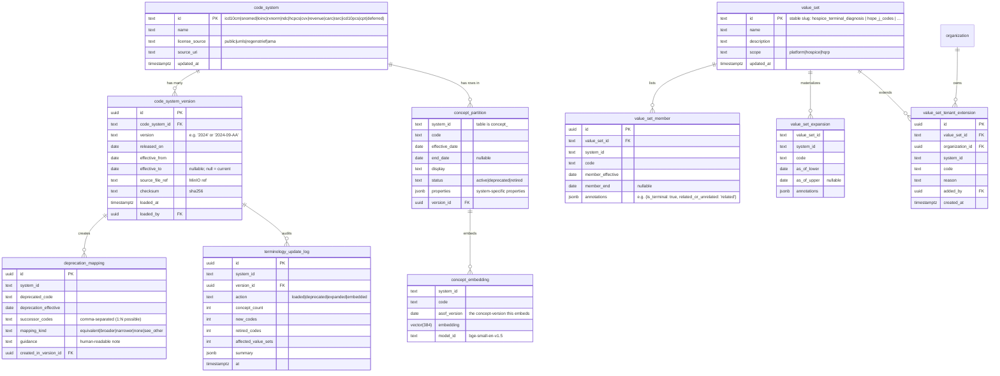
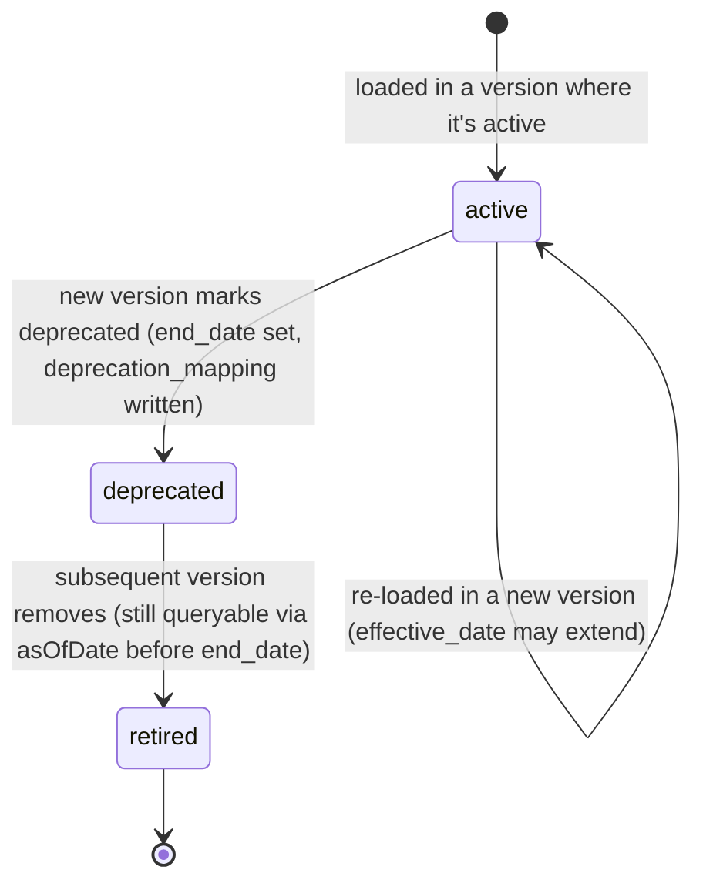

# Module 38 — Clinical Terminology Service Specification

> **Authority note:** This spec is an **implementation proposal** (repo authority rule): [`docs/architecture/`](../architecture/) and the ratified ADRs in [`docs/adr/`](../adr/) win on conflict, and the code plus [`docs/BUSINESS_LOGIC.md`](../BUSINESS_LOGIC.md) are ground truth for as-built behavior. Mechanism choices named here may be superseded — see ADR-0036…0040 and ADR-0030/0032/0035 for the recorded divergences (outbox not Socket.IO, TypeScript not Python sidecars, app-layer AES-256-GCM not pgcrypto, pure transition tables not XState, hand-rolled HTTP hardening not `@fastify/*`, Vite + react-router not TanStack Start).


**Module ID:** 38
**Phase:** 1 (foundation tier — lands after Modules 1–4 and 36, alongside Module 40, before Module 5 and every clinical/billing/interop consumer)
**Depends on:** 1 (Foundation — `wardenx_app`/`wardenx_admin` role split, RLS generator, `withOrgContext`/`withPlatformContext`, `audit()` helper, outbox dispatcher, idempotency middleware, partitioned-table conventions, pgvector extension policy), 2 (Identity — actor resolution for admin loads and tenant value-set extensions), 3 (Authorization — `terminology.*` permission keys; admin-load and deprecation-report gated), 4 (Audit — version loads, deprecation reports, tenant value-set edits all audited; canonical write-audit triggers via M4 generator)
**Consumed by:** 5 (Patient — problem list ICD-10 + SNOMED), 6 (Admission — hospice election diagnoses, level-of-care codes), 7 (Care Plan — Goal/Intervention SNOMED + LOINC), 8 (Encounters & Visit Notes — encounter coding + LOINC for measurements), 9 (Clinical Assessments — LOINC for scale items; SNOMED for findings), 10 (HOPE Engine — HOPE J-code value sets, HQRP measure codes), 11 (Orders — order categories, route, dose form), 12 (DoseSpot — RxNorm/NDC for medication identity), 13 (eMAR — administration route/site coded), 21 (Supplies/DME — HCPCS-keyed catalog), 23 (Billing Medicare — ICD-10-CM sequencing, Q-codes, revenue codes, CARC/RARC for denials), 24 (Billing Medicaid — state-specific coded fields), 27 (Cost Report — HCPCS/revenue rollups), 28 (FHIR Gateway — re-exports M38 as FHIR R4 `CodeSystem`/`ValueSet`/`$expand`/`$validate-code`), 29 (External Interfaces — LOINC for HL7 ORU mapping), 30 (HQRP & Quality — measure code sets)
**Spec status:** Re-locked v0.3 (Phase-2 remediation; supersedes Locked v0.2)

> **Phase-2 remediation (2026-06-11).** **M38-F01 (ADR-0011 D1):** the per-tenant deprecation
> remediation scan (§1.1 "patient X has problem code A which is end-dated") must **not** read consumer
> modules' clinical tables directly. Instead, M38 emits `m38.code_version.loaded` (deprecated/successor
> code set); **each owning module subscribes and runs its own code-usage scan within its RLS
> boundary**, returning affected-record counts via its own reader/outbox — or M38 consults an
> owner-published `CodeUsageReader` seam. M38 never scans another module's tables. The SECURITY DEFINER
> `terminology_loader` function is hardened with `SET search_path = pg_catalog, public` (S12).

## Changelog

- **v0.2 (Locked)** — Resolved all eight open questions into binding decisions (§11). Wrote full Drizzle for the per-system concept tables, value sets, expansions, deprecation mappings, version log, tenant value-set extensions, and embeddings. Expanded §3 to complete migration DDL (`0038_terminology`: roles, `terminology_loader` SECURITY DEFINER pattern, all tables, RLS for the platform-shared and platform-shared-plus-tenant-extension patterns, seed of code-system catalog + hospice value sets, pgvector HNSW indexes). Added complete per-route TypeBox schemas (§4.2), the exact permission-key set this module registers into Module 3 (§4.4), and the `TerminologyProvider` seam contract (§4.5). The destruction `eraseFn` for terminology (D8) is defined — tenant value-set extensions erase; platform-shared concepts persist (they aren't tenant data). Phase boundary fixed: CPT is post-Phase-1 (AMA licensing); HCPCS ships now.
- **v0.1** — Initial draft. Defines the **platform-shared read-only** RLS pattern (the second of System Design §4.6's three patterns, alongside the canonical+overlay one MDM owns) and the version-aware lookup model that every clinical/billing module consumes. Ships the per-system concept tables, value-set + expansion model, deprecation mapping, semantic-search (pgvector), update loader (annual ICD-10 / twice-yearly SNOMED / monthly RxNorm), tenant value-set extension surface, and the typed `TerminologyProvider` interface.

> **Phase boundary (binding):** Phase 1 delivers everything in this spec **except** the CPT code system (gated by AMA license — D4) and per-tenant embedding model swaps (every tenant shares the platform embedding model in Phase 1 — revisit if model-drift surfaces in metrics). The `terminology_provider` seam, the `TerminologyProvider` interface, all per-system concept tables for the Phase-1 systems (ICD-10-CM, ICD-10-PCS, SNOMED CT US, LOINC, RxNorm, NDC, HCPCS incl. Q-codes, CVX, revenue codes, CARC/RARC), value sets + expansions, deprecation mapping, update loader for all four cadences, semantic search, and FHIR-shape export hooks (consumed by M28) all ship Phase 1.

-----

## 1. Purpose & Scope

### 1.1 What This Module Does

Module 38 is the system's **one place where a clinical code is validated, looked up, expanded into a value set, or searched by natural-language description** — and the one place that knows *which version of that code system* answered the question. Module 1 established the database; Module 4 established that every clinical write would be audited; Module 38 establishes that every clinical code those writes carry has a single owner, a single update cadence, and a single answer to "is this code valid on this date":

- **Per-system concept catalog.** ICD-10-CM, ICD-10-PCS, SNOMED CT US Edition, LOINC, RxNorm, NDC, HCPCS (including Q-codes), CVX, UB-04 revenue codes, and X12 CARC/RARC ship Phase 1. Each system is one table (`concept_<system>`) with version-aware effective/end dates on every row — never one polymorphic blob — for storage efficiency, system-specific indexes, and clear ownership when a system is updated.
- **Version awareness on every query.** Every public method takes an `asOfDate` (defaulted to today). A claim filed for 2023 dates validates against the ICD-10-CM 2023 version even when 2024 has loaded — the right answer is "valid as of the service date," not "valid now." This eliminates the *retroactive invalidation* class of bug that surfaces every October when ICD-10-CM updates.
- **Value sets + precomputed expansions.** A `value_set` is a typed list of (system, code) pairs (`hospice_terminal_diagnosis`, `hope_j_codes`, `comfort_kit_meds`, `level_of_care`, `route_of_administration`, …). Expansions are precomputed at version load into `value_set_expansion` and read via index — `isMemberOf` is a single B-tree lookup, not an in-place enumeration. Tenants can **extend** a platform value set with their own additions; never weaken (per D3).
- **Deprecation mapping with remediation.** When a code is retired in a new version, `deprecation_mapping` records the successor(s). On version load, M38 runs a per-tenant scan: "patient X has problem code A which is end-dated in the new version; here is the proposed replacement," and emits the remediation worklist to Compliance via Module 36. The annual ICD-10 cutover stops being "the October fire drill."
- **Semantic search.** HNSW pgvector index on concept embeddings (BGE-small-en, local — architecture §10.7) means "find the ICD-10 code for 'congestive heart failure with reduced ejection fraction'" returns the right concept(s), not a substring grep. Embeddings refresh on version load.
- **Update loader (one cadence per system).** Annual ICD-10-CM (Oct 1), twice-yearly SNOMED CT US (Mar/Sep), monthly RxNorm, plus per-source schedules for the others — all through one adapter (`packages/terminology-loader`, M1 §6.23 integration). Versioned, idempotent, never destructive.
- **The typed `TerminologyProvider` every consumer imports.** A seam interface in `packages/terminology` with `validate`, `lookup`, `expand`, `isMemberOf`, `getDeprecationMapping`, `searchByText` and their batch variants. Consumer modules import the interface; the per-system tables are private. Adding a new code system later is a one-package change, not a 20-module refactor.

### 1.2 What This Module Does Not Do

- **Decide whether a coded value is *clinically* appropriate.** M38 says ICD-10 `I50.21` is a valid 2024 code for "Acute systolic (congestive) heart failure"; whether it belongs on *this patient's* problem list is the consuming clinician's call (assisted by Module 32's coding assistant where enabled).
- **Own claim-side sequencing rules.** Module 23 §11.A owns "terminal diagnosis primary; related secondary; unrelated excluded or flagged." M38 only answers "is this code valid on this service date and is it a member of the `hospice_terminal_diagnosis` value set?" — the sequencing logic consumes the answer.
- **Generate the FHIR `CodeSystem` / `ValueSet` resource.** Module 28 owns the FHIR Gateway and the wire shape; M38 provides a stable internal projection (`asFhirCodeSystem(systemId, asOfDate)`, `asFhirValueSet(valueSetId, asOfDate)`) that M28 maps to FHIR R4 (and R5/R6 as those mappers land).
- **Own NDC ↔ RxNorm crosswalk *policy*.** The crosswalk *data* lives here (RxNorm provides it); the policy decision for DoseSpot (Module 12) — when to upgrade an NDC-only order to an RxNorm RxCUI — is in Module 12.
- **Own the AI coding-assistant prompt.** Module 32 (AI Platform) owns the coding assistant; it consumes M38's `searchByText` and `lookup` as its grounding source.
- **Maintain CPT.** CPT is AMA-licensed and Phase-1 deferred (D4); the schema slot is reserved and the loader interface accepts it, but no CPT data ships and no consumer can compile against `'cpt'` until the license is in place.
- **Own credential/provider data.** That's MDM (M40). A code is *what* was billed/done; a provider is *who* did it.

### 1.3 Regulatory & Operational Drivers

| Driver | Requirement | How Module 38 satisfies it |
|---|---|---|
| HIPAA §162 — Code Sets | Use HHS-adopted code sets for transactions | ICD-10-CM/PCS, HCPCS, NDC, CARC/RARC ship Phase 1 |
| 42 CFR §418 — Hospice CoP | Coded diagnoses on patient record; HOPE per CMS spec | `hospice_terminal_diagnosis` + `hope_j_codes` value sets |
| CMS HOPE manual | J2030/J2050/J2051 symptom-impact items at HUVs | `hope_j_codes` value set with `j2051_severity` properties; HOPE engine (M10) consumes via `isMemberOf` |
| ICD-10-CM annual update (Oct 1) | New/retired codes effective on service date | `effective_date`/`end_date` per concept + annual loader + per-tenant deprecation remediation |
| LOINC / Regenstrief license | License required for use & redistribution | License credential tracked in BAA register (M40 `mdm_baa_record` + license-source attribution per system) |
| UMLS / SNOMED CT license | License required (free for US) | Same |
| AMA CPT license | Paid license required for use | Phase-1 deferred (D4); ships when license executed |
| X12 5010 — CARC/RARC code | Remittance reason codes for denials | `carc`/`rarc` systems; Module 25 (Remittance) consumes `lookup` |
| FHIR R4 conformance | Terminology services per `$expand`, `$validate-code` | M38 internal projection; M28 maps to FHIR (Phase 2 R5/R6 mappers per architecture §9) |
| Auditable changes to terminology | Every version load / tenant extension recorded | M4 audit triggers on all canonical and tenant tables + dedicated `terminology_update_log` |

### 1.4 Competitive Context

Other hospice EHRs let each module reach for its own ICD-10 file or, worse, hard-code a snapshot in a frontend dropdown. The October-1 update is then per-module engineering work, deprecated codes keep being assigned, and "is this code valid on the service date?" is whatever the dropdown said at the time. WardenX's differentiators: **one cached, indexed, embedding-searchable terminology service**; **as-of-date built into the public API** (not an afterthought); **deprecation remediation as a feature, not a panic**; **tenant value-set extensibility without weakening platform value sets**; and a **typed provider seam** so the day we add a 13th code system, the diff is one package, not the whole monorepo.

-----

## 2. Domain Model

### 2.1 Resolution Architecture

One read path, one load path, one provider interface.

```mermaid
flowchart TD
    subgraph Consumers["Consumers (M5/M7/M8/M9/M10/M11/M12/M13/M21/M23/M24/M27/M28/M29/M30)"]
      C1[validate code]
      C2[expand value set]
      C3[searchByText]
      C4[isMemberOf]
    end
    subgraph M38["packages/terminology (TerminologyProvider seam)"]
      P[TerminologyProvider\nvalidate / lookup / expand /\nisMemberOf / getDeprecationMapping /\nsearchByText]
      P --> CACHE{Valkey cache?\nkey: (system,code,asOf)}
      CACHE -->|miss| DB[query per-system table\nWHERE code = ? AND\n  effective_date <= asOf AND\n  (end_date IS NULL OR end_date > asOf)]
      CACHE -->|hit| RESPOND[return]
      DB --> RESPOND
    end
    subgraph PG["PostgreSQL"]
      CS[(code_system\ncode_system_version)]
      CON[(concept_icd10cm,\nconcept_snomed, concept_loinc,\nconcept_rxnorm, ...)\nplatform-shared, public read]
      EMB[(concept_embedding\nHNSW pgvector)]
      VS[(value_set\nvalue_set_member\nvalue_set_expansion)]
      VST[(value_set_tenant_extension\ntenant-scoped)]
      DEP[(deprecation_mapping)]
      LOG[(terminology_update_log)]
    end

    Consumers --> P
    DB --> CON
    DB --> EMB
    DB --> VS
    DB --> VST
    DB --> DEP

    subgraph Loader["packages/terminology-loader (platform-only)"]
      L[Loader\nwithPlatformContext]
      L -->|writes via terminology_loader| CON
      L -->|recompute| EMB
      L -->|recompute| VS
      L -->|append| DEP
      L --> LOG
      L --> REM[per-tenant deprecation\nremediation reports →\nM36 alert]
    end

    subgraph FHIR["Module 28 — FHIR Gateway"]
      F[CodeSystem/ValueSet/\n$expand/$validate-code]
      F --> P
    end
```

Two principles drive the picture:

1. **`asOfDate` is in the signature, not optional.** Every public method takes it. The default is "today," but the parameter exists so historical records validate against the version active *at service time*. A 2023 claim re-validated in 2025 must not be invalidated by codes retired in 2024.
2. **Value-set expansion is precomputed, not interpreted.** `value_set_expansion` is materialized at version load; `isMemberOf(code, valueSetId, asOfDate)` is a single B-tree lookup. The alternative — interpreting the value-set definition on every call — would not survive the volume hospice billing produces.

### 2.2 Entity-Relationship Diagram



> `concept_partition` in the diagram is a *shape* — one table per system in real schema (`concept_icd10cm`, `concept_snomed`, …) for the reasons in §2.3.

### 2.3 Per-System Table, Not One Polymorphic Concept Table

The single largest design call in M38: **one table per code system**, not one polymorphic `concept` table with a system column.

| Driver | Why |
|---|---|
| Storage volume | SNOMED CT US is ~360k active concepts; ICD-10-CM is ~72k; LOINC ~100k; RxNorm ~150k. A polymorphic table is ~1M rows with very different update cadences — vacuum and partitioning get pathological. Per-system tables are independently maintained. |
| System-specific properties | ICD-10's `is_billable_leaf`, SNOMED's `concept_hierarchy_path`, LOINC's `component/property/time/system/scale/method`, RxNorm's `tty` (term type) — entirely different shape per system. A polymorphic JSON column hides that from the type system; per-system Drizzle tables make it explicit. |
| Index strategy | Each system has a different hot-path index (`(code)` for ICD-10, `(component, property)` for LOINC, `(rxcui)` for RxNorm). Separate tables = separate indexes; one table = bloated multi-column indexes. |
| Update isolation | An ICD-10 load that fails halfway should not block a concurrent SNOMED load. Separate tables = separate locking footprints. |
| Cardinality of system addition | ~one new code system every couple years. Adding a table is cheap; the migration churn that polymorphism saves doesn't exist. |

Common shape (every per-system table has these columns; system-specific columns added per table):

```
code             text not null
display          text not null
status           mdm_term_status not null  -- 'active'|'deprecated'|'retired'
effective_date   date not null
end_date         date                       -- nullable; null = still active
version_id       uuid references code_system_version(id)
properties       jsonb                      -- system-specific
created_at       timestamptz not null
```

The `TerminologyProvider` interface hides which table is read; consumers see only the union shape `ResolvedConcept`.

### 2.4 Entity Lifecycle States

#### 2.4.1 Concept status (per row)



> Crucially: a `retired` code is **still returned** by `lookup(code, system, asOfDate)` where `asOfDate <= end_date`. We never delete a concept row that was ever active — historical record validation requires it.

#### 2.4.2 Code-system version (per system)

```mermaid
stateDiagram-v2
    [*] --> loading: loader fetches new version file
    loading --> failed: parse/checksum failure; no DB writes
    loading --> staged: file parsed into staging tables
    staged --> active: diff computed, deprecation_mapping written, value-set expansions recomputed, embeddings refreshed
    active --> superseded: a later version is activated
    superseded --> superseded: remains; needed for asOfDate queries
    failed --> [*]
```



#### 2.4.3 Tenant value-set extension

```mermaid
stateDiagram-v2
    [*] --> active: tenant admin adds a (system, code) to a value_set
    active --> removed: tenant admin removes; row soft-deleted (audit retained)
    removed --> [*]
```

A tenant extension never overrides a platform value-set member, only adds. Platform members of a value set always carry the platform's annotations; tenant extensions carry the tenant's reason. `expand()` returns the union.

### 2.5 Validation Rules

| Rule | Type | Detail |
|---|---|---|
| Canonical write-grant locked | infra (GRANT) | `wardenx_app` has only SELECT on all platform terminology tables (per-system concept tables, `code_system`, `code_system_version`, `value_set`, `value_set_member`, `value_set_expansion`, `deprecation_mapping`, `concept_embedding`, `terminology_update_log`); INSERT/UPDATE only via `terminology_loader` SECURITY DEFINER paths |
| Tenant extension tenant-scoped | infra (RLS) | `value_set_tenant_extension` RLS-isolates on `organization_id` |
| Concept uniqueness within version | sync (UNIQUE) | UNIQUE (`code`, `version_id`) per per-system table |
| As-of consistency | invariant | for any concept row, `effective_date <= end_date` when both set; `effective_date <= as_of <= end_date` is the inclusion check |
| Deprecation mapping completeness | invariant | for every concept that transitions `active → deprecated` in a version, a `deprecation_mapping` row exists (loader guarantee; verified by post-load check) |
| Value-set member valid | sync (FK + check) | every `value_set_member` row's (system_id, code) resolves to at least one active concept on its `member_effective` date |
| Value-set expansion freshness | invariant | `value_set_expansion` is regenerated on every version load and every value-set edit; staleness alarm if last expansion older than newest version load for any included system |
| Tenant extension cannot remove platform member | sync (no shape for it) | extension table only adds — no `is_removal` flag |
| Tenant extension references valid concept | sync (FK to system+code on insert) | extension write checks `lookup(code, system, today)` returns active |
| Embedding model uniformity | invariant | all embeddings in `concept_embedding` use the same `model_id` per code-system version load; mixed-model rows blocked at load |
| FHIR projection stable | invariant | `asFhirCodeSystem`/`asFhirValueSet` produce deterministic output for the same (id, asOfDate) — verified by golden tests M28 consumes |

### 2.6 Side Effects

| Trigger | Side effect |
|---|---|
| Loader activates a new version | `terminology.version_loaded` outbox event; value-set expansions for value sets that include the system are recomputed; embeddings recomputed for affected concepts |
| Loader detects new deprecations | `terminology.deprecations_detected` event; per-tenant scan enqueued (`terminology.tenant_deprecation_scan`) |
| Per-tenant scan finds active records using a now-deprecated code | per-tenant remediation report written; Module 36 alert to Compliance Officer with affected count and one-click drill-down |
| Tenant adds a value-set extension | M4 audit row written; if value-set is consumed by claim validation (e.g. `hospice_terminal_diagnosis`), Module 23 invalidates its cached expansion for this tenant |
| Tenant removes a value-set extension | same; the removal flips members of `value_set_tenant_extension` to soft-deleted |
| Tenant offboarding (D8) | M38 `eraseFn` deletes the tenant's `value_set_tenant_extension` rows + cached expansion overrides; **platform tables untouched** (terminology is not tenant data); destruction certificate filed for the extension-data class only |
| Concept lookup by an integration egress consumer (M28 `$validate-code`) | recorded as `terminology.external_lookup` (audit `audit.elevated_access` if cross-tenant) |
| Hot-cache miss on a value-set expand for a non-trivial set | one-shot async warm of related value sets if same system/version (cache-friendly amortization) |

-----

## 3. Drizzle Schema

### 3.1 Package Layout

```
packages/terminology/
├── src/
│   ├── interfaces/
│   │   ├── provider.ts              # TerminologyProvider seam contract
│   │   └── kinds.ts                 # CodeSystemId union + ResolvedConcept shape
│   ├── resolve/
│   │   ├── lookup.ts                # validate/lookup per-system with asOfDate
│   │   ├── expand.ts                # value-set expansion read path
│   │   ├── is-member-of.ts          # single B-tree lookup against expansion
│   │   └── cache.ts                 # Valkey TTL keyed by (system, code, asOf) + value-set keys
│   ├── search/
│   │   ├── exact.ts                 # B-tree (code), code+display fuzzy
│   │   └── semantic.ts              # HNSW pgvector kNN
│   ├── deprecation/
│   │   ├── get-mapping.ts           # successor lookup
│   │   └── tenant-scan.ts           # post-load: find tenant records using deprecated codes
│   ├── extension/
│   │   ├── add.ts                   # tenant adds to value set
│   │   └── remove.ts                # tenant removes; soft-delete audit
│   ├── fhir/
│   │   ├── as-code-system.ts        # projection M28 consumes
│   │   └── as-value-set.ts          # projection M28 consumes
│   └── destruction/
│       └── eraseFn.ts               # registered with M4 destruction registry
packages/terminology-loader/         # adapter package (M1 §6.23)
├── src/
│   ├── sources/
│   │   ├── icd10cm-cms.ts           # annual CMS feed
│   │   ├── icd10pcs-cms.ts
│   │   ├── snomed-umls.ts           # NLM UMLS license
│   │   ├── loinc-regenstrief.ts     # Regenstrief license
│   │   ├── rxnorm-nlm.ts            # monthly
│   │   ├── ndc-fda.ts
│   │   ├── hcpcs-cms.ts             # incl. Q-codes
│   │   ├── cvx-cdc.ts
│   │   ├── revenue-codes.ts         # UB-04 static seed; manual update on revision
│   │   └── carc-rarc-wpc.ts         # WPC published list
│   ├── load.ts                      # generic version-load orchestrator
│   ├── stage-and-diff.ts            # staging tables + diff vs prior
│   └── refresh-expansions.ts        # rebuild value_set_expansion + concept_embedding
packages/db/src/schema/terminology/
├── code-systems.ts
├── code-system-versions.ts
├── concept-icd10cm.ts
├── concept-icd10pcs.ts
├── concept-snomed.ts
├── concept-loinc.ts
├── concept-rxnorm.ts
├── concept-ndc.ts
├── concept-hcpcs.ts
├── concept-cvx.ts
├── concept-revenue.ts
├── concept-carc.ts
├── concept-rarc.ts
├── value-sets.ts
├── value-set-members.ts
├── value-set-expansion.ts
├── value-set-tenant-extension.ts
├── deprecation-mapping.ts
├── concept-embedding.ts
└── terminology-update-log.ts
```

### 3.2 Enums

```typescript
// packages/db/src/enums.ts (additions)
export const codeSystemId = pgEnum('code_system_id', [
  'icd10cm','icd10pcs','snomed','loinc','rxnorm','ndc','hcpcs','cvx',
  'revenue','carc','rarc',
  // 'cpt' — reserved; not in enum until D4 unlocks
])
export const conceptStatus = pgEnum('concept_status', ['active','deprecated','retired'])
export const valueSetScope = pgEnum('value_set_scope', ['platform','hospice','hqrp'])
export const deprecationMappingKind = pgEnum('deprecation_mapping_kind',
  ['equivalent','broader','narrower','none','see_other'])
export const versionLoadStatus = pgEnum('version_load_status',
  ['loading','staged','active','superseded','failed'])
export const terminologyUpdateAction = pgEnum('terminology_update_action',
  ['loaded','deprecated','expanded','embedded','tenant_extension_added','tenant_extension_removed'])
```

### 3.3 Code-System Catalog & Versions

```typescript
// code-systems.ts (platform-shared catalog)
export const codeSystems = pgTable('code_system', {
  id: codeSystemId('id').primaryKey(),
  name: text('name').notNull(),
  licenseSource: text('license_source').notNull(),       // 'public'|'umls'|'regenstrief'|'ama'
  sourceUri: text('source_uri'),
  updatedAt: timestamp('updated_at', { withTimezone: true }).notNull().defaultNow(),
})

// code-system-versions.ts
export const codeSystemVersions = pgTable('code_system_version', {
  id: uuid('id').primaryKey().defaultRandom(),
  codeSystemId: codeSystemId('code_system_id').notNull()
    .references(() => codeSystems.id, { onDelete: 'restrict' }),
  version: text('version').notNull(),                    // '2024' or '2024-09-AA' (snomed)
  releasedOn: date('released_on').notNull(),
  effectiveFrom: date('effective_from').notNull(),
  effectiveTo: date('effective_to'),                     // nullable; null = current
  sourceFileRef: text('source_file_ref').notNull(),      // MinIO object id
  checksum: text('checksum').notNull(),                  // sha256 of source
  status: versionLoadStatus('status').notNull().default('loading'),
  loadedAt: timestamp('loaded_at', { withTimezone: true }).notNull().defaultNow(),
  loadedBy: uuid('loaded_by').references(() => users.id),
}, (t) => ({
  uniquePerSystem: uniqueIndex('code_system_version_unique')
    .on(t.codeSystemId, t.version),
  currentIdx: index('code_system_version_current_idx')
    .on(t.codeSystemId).where(sql`status = 'active' AND effective_to IS NULL`),
  effectiveRangeIdx: index('code_system_version_effective_idx')
    .on(t.codeSystemId, t.effectiveFrom, t.effectiveTo),
}))
```

### 3.4 Per-System Concept Tables (representative — ICD-10-CM, SNOMED, LOINC, RxNorm)

```typescript
// concept-icd10cm.ts
export const conceptIcd10cm = pgTable('concept_icd10cm', {
  code: text('code').notNull(),
  display: text('display').notNull(),
  status: conceptStatus('status').notNull(),
  effectiveDate: date('effective_date').notNull(),
  endDate: date('end_date'),
  versionId: uuid('version_id').notNull().references(() => codeSystemVersions.id),
  // ICD-10-specific
  isBillableLeaf: boolean('is_billable_leaf').notNull().default(false),
  chapter: text('chapter'),
  parentCode: text('parent_code'),
  properties: jsonb('properties').notNull().default({}),
  createdAt: timestamp('created_at', { withTimezone: true }).notNull().defaultNow(),
}, (t) => ({
  pk: primaryKey({ columns: [t.code, t.versionId] }),
  codeIdx: index('icd10cm_code_idx').on(t.code),
  asOfRangeIdx: index('icd10cm_asof_idx')
    .on(t.code, t.effectiveDate, t.endDate),
  activeBillableIdx: index('icd10cm_active_billable_idx')
    .on(t.status).where(sql`status = 'active' AND is_billable_leaf = true`),
  parentIdx: index('icd10cm_parent_idx').on(t.parentCode),
  displayTrgmIdx: index('icd10cm_display_trgm_idx')
    .using('gin', sql`display gin_trgm_ops`),
}))

// concept-snomed.ts (US Edition; ~360k active concepts)
export const conceptSnomed = pgTable('concept_snomed', {
  code: text('code').notNull(),                          // SCTID
  display: text('display').notNull(),                    // preferred FSN/synonym
  status: conceptStatus('status').notNull(),
  effectiveDate: date('effective_date').notNull(),
  endDate: date('end_date'),
  versionId: uuid('version_id').notNull().references(() => codeSystemVersions.id),
  // SNOMED-specific
  fullySpecifiedName: text('fully_specified_name').notNull(),
  semanticTag: text('semantic_tag'),                     // 'disorder','finding','procedure',...
  hierarchyPath: text('hierarchy_path').array(),         // ancestor SCTIDs
  properties: jsonb('properties').notNull().default({}),
  createdAt: timestamp('created_at', { withTimezone: true }).notNull().defaultNow(),
}, (t) => ({
  pk: primaryKey({ columns: [t.code, t.versionId] }),
  codeIdx: index('snomed_code_idx').on(t.code),
  semanticTagIdx: index('snomed_semantic_tag_idx').on(t.semanticTag),
  hierarchyIdx: index('snomed_hierarchy_idx')
    .using('gin', sql`hierarchy_path`),
  displayTrgmIdx: index('snomed_display_trgm_idx')
    .using('gin', sql`display gin_trgm_ops`),
}))

// concept-loinc.ts
export const conceptLoinc = pgTable('concept_loinc', {
  code: text('code').notNull(),                          // LOINC num
  display: text('display').notNull(),                    // long common name
  status: conceptStatus('status').notNull(),
  effectiveDate: date('effective_date').notNull(),
  endDate: date('end_date'),
  versionId: uuid('version_id').notNull().references(() => codeSystemVersions.id),
  // LOINC-specific (component/property/time/system/scale/method)
  component: text('component'),
  property: text('property'),
  time: text('time'),
  system: text('system'),
  scale: text('scale'),
  method: text('method'),
  shortName: text('short_name'),
  properties: jsonb('properties').notNull().default({}),
  createdAt: timestamp('created_at', { withTimezone: true }).notNull().defaultNow(),
}, (t) => ({
  pk: primaryKey({ columns: [t.code, t.versionId] }),
  codeIdx: index('loinc_code_idx').on(t.code),
  axisIdx: index('loinc_axis_idx').on(t.component, t.property),
  displayTrgmIdx: index('loinc_display_trgm_idx')
    .using('gin', sql`display gin_trgm_ops`),
}))

// concept-rxnorm.ts
export const conceptRxnorm = pgTable('concept_rxnorm', {
  code: text('code').notNull(),                          // RxCUI
  display: text('display').notNull(),
  status: conceptStatus('status').notNull(),
  effectiveDate: date('effective_date').notNull(),
  endDate: date('end_date'),
  versionId: uuid('version_id').notNull().references(() => codeSystemVersions.id),
  // RxNorm-specific
  tty: text('tty').notNull(),                            // term type: 'IN','SCD','SBD','BN',...
  ingredientRxcui: text('ingredient_rxcui'),
  ndcs: text('ndcs').array(),                            // associated NDCs at this version
  properties: jsonb('properties').notNull().default({}),
  createdAt: timestamp('created_at', { withTimezone: true }).notNull().defaultNow(),
}, (t) => ({
  pk: primaryKey({ columns: [t.code, t.versionId] }),
  codeIdx: index('rxnorm_code_idx').on(t.code),
  ttyIdx: index('rxnorm_tty_idx').on(t.tty),
  ingredientIdx: index('rxnorm_ingredient_idx').on(t.ingredientRxcui),
  displayTrgmIdx: index('rxnorm_display_trgm_idx')
    .using('gin', sql`display gin_trgm_ops`),
}))
```

The remaining seven tables (`concept_icd10pcs`, `concept_ndc`, `concept_hcpcs`, `concept_cvx`, `concept_revenue`, `concept_carc`, `concept_rarc`) follow the common shape from §2.3 with kind-specific columns (e.g., `concept_hcpcs.kind` discriminates between supply codes, Q-codes for place-of-service, and modifier codes). Full Drizzle in `packages/db/src/schema/terminology/`.

### 3.5 Value Sets, Members, Expansion, Tenant Extension

```typescript
// value-sets.ts
export const valueSets = pgTable('value_set', {
  id: text('id').primaryKey(),                           // stable slug
  name: text('name').notNull(),
  description: text('description'),
  scope: valueSetScope('scope').notNull(),
  updatedAt: timestamp('updated_at', { withTimezone: true }).notNull().defaultNow(),
})

// value-set-members.ts
export const valueSetMembers = pgTable('value_set_member', {
  id: uuid('id').primaryKey().defaultRandom(),
  valueSetId: text('value_set_id').notNull()
    .references(() => valueSets.id, { onDelete: 'cascade' }),
  systemId: codeSystemId('system_id').notNull(),
  code: text('code').notNull(),
  memberEffective: date('member_effective').notNull(),
  memberEnd: date('member_end'),
  annotations: jsonb('annotations').notNull().default({}),
}, (t) => ({
  uniqueMember: uniqueIndex('value_set_member_unique')
    .on(t.valueSetId, t.systemId, t.code, t.memberEffective),
  bySetIdx: index('value_set_member_by_set_idx').on(t.valueSetId),
}))

// value-set-expansion.ts (materialized at load; the hot read path)
export const valueSetExpansion = pgTable('value_set_expansion', {
  valueSetId: text('value_set_id').notNull()
    .references(() => valueSets.id, { onDelete: 'cascade' }),
  systemId: codeSystemId('system_id').notNull(),
  code: text('code').notNull(),
  asOfLower: date('as_of_lower').notNull(),
  asOfUpper: date('as_of_upper'),
  annotations: jsonb('annotations').notNull().default({}),
}, (t) => ({
  pk: primaryKey({ columns: [t.valueSetId, t.systemId, t.code, t.asOfLower] }),
  membershipIdx: index('value_set_expansion_membership_idx')
    .on(t.systemId, t.code, t.valueSetId),
  asOfIdx: index('value_set_expansion_asof_idx')
    .on(t.valueSetId, t.asOfLower, t.asOfUpper),
}))

// value-set-tenant-extension.ts (the only tenant-scoped table in M38)
export const valueSetTenantExtension = pgTable('value_set_tenant_extension', {
  id: uuid('id').primaryKey().defaultRandom(),
  valueSetId: text('value_set_id').notNull()
    .references(() => valueSets.id, { onDelete: 'restrict' }),
  organizationId: uuid('organization_id').notNull()
    .references(() => organizations.id, { onDelete: 'cascade' }),
  systemId: codeSystemId('system_id').notNull(),
  code: text('code').notNull(),
  reason: text('reason').notNull(),
  addedBy: uuid('added_by').references(() => users.id),
  removedAt: timestamp('removed_at', { withTimezone: true }),   // soft delete
  createdAt: timestamp('created_at', { withTimezone: true }).notNull().defaultNow(),
}, (t) => ({
  activeUnique: uniqueIndex('vs_tenant_ext_active_unique')
    .on(t.valueSetId, t.organizationId, t.systemId, t.code)
    .where(sql`removed_at IS NULL`),
  orgIdx: index('vs_tenant_ext_org_idx').on(t.organizationId),
  valueSetIdx: index('vs_tenant_ext_value_set_idx').on(t.valueSetId),
}))
```

### 3.6 Deprecation, Embeddings, Update Log

```typescript
// deprecation-mapping.ts
export const deprecationMapping = pgTable('deprecation_mapping', {
  id: uuid('id').primaryKey().defaultRandom(),
  systemId: codeSystemId('system_id').notNull(),
  deprecatedCode: text('deprecated_code').notNull(),
  deprecationEffective: date('deprecation_effective').notNull(),
  successorCodes: text('successor_codes').array().notNull().default(sql`'{}'::text[]`),
  mappingKind: deprecationMappingKind('mapping_kind').notNull(),
  guidance: text('guidance'),
  createdInVersionId: uuid('created_in_version_id').notNull()
    .references(() => codeSystemVersions.id),
  createdAt: timestamp('created_at', { withTimezone: true }).notNull().defaultNow(),
}, (t) => ({
  bySystemCodeIdx: uniqueIndex('deprecation_mapping_unique')
    .on(t.systemId, t.deprecatedCode, t.deprecationEffective),
}))

// concept-embedding.ts (HNSW pgvector; refreshed on version load)
export const conceptEmbedding = pgTable('concept_embedding', {
  systemId: codeSystemId('system_id').notNull(),
  code: text('code').notNull(),
  asofVersion: uuid('asof_version').notNull()
    .references(() => codeSystemVersions.id),
  embedding: vector('embedding', { dimensions: 384 }).notNull(),  // BGE-small-en-v1.5
  modelId: text('model_id').notNull(),
  createdAt: timestamp('created_at', { withTimezone: true }).notNull().defaultNow(),
}, (t) => ({
  pk: primaryKey({ columns: [t.systemId, t.code, t.asofVersion] }),
  hnswIdx: index('concept_embedding_hnsw_idx')
    .using('hnsw', sql`embedding vector_cosine_ops`)
    .with({ m: 16, ef_construction: 64 }),
  bySystemIdx: index('concept_embedding_system_idx').on(t.systemId),
}))

// terminology-update-log.ts (audit-of-audit-style log, kept beyond M4 audit class)
export const terminologyUpdateLog = pgTable('terminology_update_log', {
  id: uuid('id').primaryKey().defaultRandom(),
  systemId: codeSystemId('system_id').notNull(),
  versionId: uuid('version_id').references(() => codeSystemVersions.id),
  action: terminologyUpdateAction('action').notNull(),
  conceptCount: integer('concept_count').notNull().default(0),
  newCodes: integer('new_codes').notNull().default(0),
  retiredCodes: integer('retired_codes').notNull().default(0),
  affectedValueSets: integer('affected_value_sets').notNull().default(0),
  summary: jsonb('summary').notNull().default({}),
  at: timestamp('at', { withTimezone: true }).notNull().defaultNow(),
}, (t) => ({
  bySystemAtIdx: index('terminology_update_log_system_at_idx').on(t.systemId, t.at),
}))
```

### 3.7 RLS & Grants (the platform-shared pattern, locked)

```sql
-- ============================================================================
-- Migration 0038_terminology — RLS for platform-shared + tenant-extension only
-- ============================================================================

-- pgvector + pg_trgm already created by M1/M40 respectively; assert presence
CREATE EXTENSION IF NOT EXISTS vector;
CREATE EXTENSION IF NOT EXISTS pg_trgm;

-- loader role: INSERT/UPDATE only, owned by terminology SECURITY DEFINER fns
CREATE ROLE terminology_loader NOLOGIN;

-- ------- platform-shared canonical tables ------------------------------------
DO $$
DECLARE t TEXT;
BEGIN
  FOREACH t IN ARRAY ARRAY[
    'code_system','code_system_version',
    'concept_icd10cm','concept_icd10pcs','concept_snomed','concept_loinc',
    'concept_rxnorm','concept_ndc','concept_hcpcs','concept_cvx',
    'concept_revenue','concept_carc','concept_rarc',
    'value_set','value_set_member','value_set_expansion',
    'deprecation_mapping','concept_embedding','terminology_update_log'
  ] LOOP
    EXECUTE format('ALTER TABLE %I ENABLE ROW LEVEL SECURITY', t);
    EXECUTE format('CREATE POLICY %I_read ON %I FOR SELECT TO wardenx_app USING (true)', t, t);
    EXECUTE format('GRANT SELECT ON %I TO wardenx_app', t);
    EXECUTE format('GRANT SELECT, INSERT, UPDATE ON %I TO terminology_loader', t);
    EXECUTE format('GRANT ALL ON %I TO wardenx_admin', t);
  END LOOP;
END $$;

-- ------- tenant-scoped value-set extension -----------------------------------
ALTER TABLE value_set_tenant_extension ENABLE ROW LEVEL SECURITY;
CREATE POLICY value_set_tenant_extension_org ON value_set_tenant_extension
  FOR ALL TO wardenx_app
  USING (organization_id = current_setting('app.org_id', true)::uuid)
  WITH CHECK (organization_id = current_setting('app.org_id', true)::uuid);
GRANT SELECT, INSERT, UPDATE, DELETE ON value_set_tenant_extension TO wardenx_app;

COMMENT ON ROLE terminology_loader IS
  'Owns terminology canonical INSERT/UPDATE. Granted to SECURITY DEFINER functions in packages/terminology and packages/terminology-loader only. wardenx_app NEVER writes terminology.';
```

> **Same pattern as M40's `mdm_canonical_writer` and M4's `wardenx_audit_writer`** — least privilege at the DB layer. Even if app code calls a write path incorrectly, the DB role has no INSERT/UPDATE grant on the platform tables and the call fails. The only writers are the SECURITY DEFINER functions in `packages/terminology-loader/{load,stage-and-diff,refresh-expansions}` (version load) and `packages/terminology/extension/{add,remove}` (tenant extensions, which go through the `wardenx_app` role per RLS).

### 3.8 Write-Audit Triggers (consumes M4 generator)

Every platform terminology table and the tenant extension table install the M4 `generateAuditTrigger` in `0038_terminology`. Denylists are empty — terminology data is non-PHI reference data; full diffs are the point.

```typescript
// in 0038_terminology migration
import { generateAuditTrigger } from '@wardenx/audit/triggers'

const platformTables = [
  'code_system','code_system_version',
  'concept_icd10cm','concept_icd10pcs','concept_snomed','concept_loinc',
  'concept_rxnorm','concept_ndc','concept_hcpcs','concept_cvx',
  'concept_revenue','concept_carc','concept_rarc',
  'value_set','value_set_member','value_set_expansion',
  'deprecation_mapping','concept_embedding','terminology_update_log',
]

for (const table of platformTables) {
  await db.execute(sql.raw(generateAuditTrigger({
    table, resourceKind: `term.${table}`, denylist: [], retentionClass: 'compliance',
  })))
}

await db.execute(sql.raw(generateAuditTrigger({
  table: 'value_set_tenant_extension',
  resourceKind: 'term.value_set_extension',
  denylist: [],
  retentionClass: 'compliance',
})))
```

### 3.9 Seed

Phase-1 bootstrap seeds the `code_system` catalog (rows for the 11 systems shipping Phase 1) and the platform value-set definitions; actual concept data is loaded by the per-system loaders in §4.3. CPT is omitted from the seed (D4).

```sql
-- code_system catalog
INSERT INTO code_system (id, name, license_source, source_uri) VALUES
  ('icd10cm',  'ICD-10-CM',        'public',     'https://www.cms.gov/medicare/coding/icd10'),
  ('icd10pcs', 'ICD-10-PCS',       'public',     'https://www.cms.gov/medicare/coding/icd10'),
  ('snomed',   'SNOMED CT US',     'umls',       'https://www.nlm.nih.gov/healthit/snomedct'),
  ('loinc',    'LOINC',            'regenstrief','https://loinc.org'),
  ('rxnorm',   'RxNorm',           'public',     'https://www.nlm.nih.gov/research/umls/rxnorm'),
  ('ndc',      'NDC',              'public',     'https://www.fda.gov/drugs/drug-approvals-and-databases/national-drug-code-directory'),
  ('hcpcs',    'HCPCS (incl Q)',   'public',     'https://www.cms.gov/medicare/coding/medhcpcsgeninfo'),
  ('cvx',      'CVX (vaccines)',   'public',     'https://www2a.cdc.gov/vaccines/iis/iisstandards/vaccines.asp'),
  ('revenue',  'UB-04 revenue',    'public',     'https://www.nubc.org'),
  ('carc',     'X12 CARC',         'public',     'https://x12.org/codes/claim-adjustment-reason-codes'),
  ('rarc',     'X12 RARC',         'public',     'https://x12.org/codes/remittance-advice-remark-codes');

-- platform value sets (definitions only; members loaded via curation file)
INSERT INTO value_set (id, name, description, scope) VALUES
  ('hospice_terminal_diagnosis',
   'Hospice terminal diagnoses',
   'ICD-10-CM codes acceptable as terminal diagnosis on a hospice claim',
   'hospice'),
  ('hope_j_codes',
   'HOPE J-code symptom-impact items',
   'J2030, J2050, J2051 plus related; consumed by Module 10',
   'hqrp'),
  ('hqrp_measure_codes',
   'HQRP measure codes',
   'Quality measure codes per CMS HQRP spec',
   'hqrp'),
  ('level_of_care',
   'Hospice level-of-care revenue codes',
   '0651 RHC, 0652 CHC, 0655 IRC, 0656 GIP',
   'platform'),
  ('place_of_service_q_codes',
   'HCPCS Q-codes for hospice place of service',
   'Q5001..Q5010',
   'platform'),
  ('route_of_administration',
   'Route of administration (SNOMED-coded)',
   'PO, IV, SQ, SL, PR, topical, inhalation, ...',
   'platform'),
  ('dosage_form',
   'Dosage form (SNOMED-coded)',
   'tablet, capsule, solution, suspension, patch, ...',
   'platform'),
  ('comfort_kit_medications',
   'Common comfort medications (RxNorm-keyed)',
   'morphine, lorazepam, haloperidol, atropine, scopolamine, ...',
   'hospice'),
  ('advance_directive_type',
   'Advance directive types',
   'living will, DPOA-HC, POLST/MOLST, code status',
   'platform');
```


-----

## 4. API Routes & Seam

### 4.1 Route Inventory

| Method | Path | Auth | Permission key | Purpose |
|---|---|---|---|---|
| GET | `/api/v1/terminology/:system/validate` | session | `terminology.read` | binary validate (code, asOfDate) |
| GET | `/api/v1/terminology/:system/:code` | session | `terminology.read` | lookup full concept (system-specific properties) |
| GET | `/api/v1/terminology/:system/search` | session | `terminology.read` | exact / fuzzy / semantic (mode parameter) |
| GET | `/api/v1/terminology/value-sets/:id/expand` | session | `terminology.read` | expanded membership at asOfDate (paginated) |
| GET | `/api/v1/terminology/value-sets/:id/is-member` | session | `terminology.read` | (system, code, asOf) → boolean |
| GET | `/api/v1/terminology/value-sets` | session | `terminology.read` | catalog of value sets |
| POST | `/api/v1/terminology/value-sets/:id/extensions` | session | `terminology.value_set.extend` | tenant adds a (system, code) to a value set |
| DELETE | `/api/v1/terminology/value-sets/:id/extensions/:extId` | session | `terminology.value_set.extend` | tenant removes (soft delete, audited) |
| GET | `/api/v1/terminology/:system/:code/deprecation` | session | `terminology.read` | successor mapping if any |
| GET | `/api/v1/terminology/remediation` | session | `terminology.deprecation_report` | per-tenant report: this org's records that use newly-deprecated codes |
| GET | `/api/v1/admin/terminology/versions` | session | `terminology.admin.read` | platform: load history (terminology_update_log) |
| POST | `/api/v1/admin/terminology/:system/load` | session + step-up | `terminology.admin.load` | platform: load a specific source version (idempotent on (system, version)) |
| POST | `/api/v1/admin/terminology/:system/refresh-embeddings` | session | `terminology.admin.load` | recompute embeddings for a system at its current version |
| GET | `/api/v1/admin/terminology/value-set-extensions` | session | `terminology.admin.read` | cross-tenant view of extensions for governance |

> All `/api/v1/admin/terminology/*` routes are platform-ops only and audited as `audit.elevated_access` per M4 §6.

### 4.2 Per-Route Specifications

**GET /api/v1/terminology/:system/validate** — `terminology.read`
```typescript
// Params { system: codeSystemIdSchema }
// Query  { code: Type.String({minLength:1, maxLength:32}),
//          asOf: Type.Optional(Type.String({format:'date'})) }    // default = today
// 200 -> { valid: Type.Boolean(),
//          status: Type.Optional(Type.Union([Type.Literal('active'),Type.Literal('deprecated'),Type.Literal('retired')])),
//          asOf: Type.String({format:'date'}),
//          successor: Type.Optional(DeprecationMappingResponseSchema) }
// Behavior: 'valid' = true only when a row exists with effective_date <= asOf AND (end_date IS NULL OR end_date > asOf).
//           For deprecated codes the successor mapping (if any) is attached for caller remediation.
```

**GET /api/v1/terminology/:system/:code** — `terminology.read`
```typescript
// Params { system, code }
// Query  { asOf?: Type.String({format:'date'}) }
// 200 -> ResolvedConcept<system>      // canonical fields + system-specific properties
// 404 NOT_FOUND if no version of this code is in the system OR (with asOf) the asOf is before its effective_date
```

**GET /api/v1/terminology/:system/search** — `terminology.read`
```typescript
// Params { system }
// Query  { q: Type.String({minLength:1, maxLength:200}),
//          mode: Type.Union([Type.Literal('exact'),Type.Literal('fuzzy'),Type.Literal('semantic')], {default:'fuzzy'}),
//          asOf?: Type.String({format:'date'}),
//          limit?: Type.Integer({minimum:1, maximum:50, default:10}),
//          billableOnly?: Type.Boolean({default:false}),       // ICD-10 leaf filter
//          inValueSet?: Type.String() }                         // restrict to value-set members
// 200 -> { results: Array<ResolvedConcept<system>>, mode, asOf }
// Behavior: exact -> code prefix; fuzzy -> pg_trgm on (code, display); semantic -> HNSW kNN on concept_embedding.
//           Semantic mode requires asOf <= current active version; older asOfs degrade to fuzzy (embeddings not retained).
```

**GET /api/v1/terminology/value-sets/:id/expand** — `terminology.read`
```typescript
// Params { id }
// Query  { asOf?: Type.String({format:'date'}),
//          system?: codeSystemIdSchema,              // filter to one system
//          cursor?: Type.String(), limit?: Type.Integer({minimum:1, maximum:1000, default:200}),
//          includeTenantExtensions?: Type.Boolean({default:true}) }
// 200 -> Cursor({ systemId, code, display, annotations })
// Behavior: reads from value_set_expansion (precomputed); union with active tenant extensions if includeTenantExtensions.
```

**GET /api/v1/terminology/value-sets/:id/is-member** — `terminology.read`
```typescript
// Params { id }
// Query  { system: codeSystemIdSchema, code: Type.String(),
//          asOf?: Type.String({format:'date'}) }
// 200 -> { isMember: Type.Boolean(), source: Type.Union([Type.Literal('platform'),Type.Literal('tenant_extension'),Type.Null()]) }
// Behavior: single B-tree lookup on value_set_expansion + index on tenant extension.
```

**POST /api/v1/terminology/value-sets/:id/extensions** — `terminology.value_set.extend`
```typescript
// Params { id }
// Body  { system: codeSystemIdSchema, code: Type.String(),
//         reason: Type.String({minLength:10, maxLength:500}) }
// 201 -> { extensionId, valueSetId, system, code }
// 404 if value set doesn't exist; 422 INVALID_CODE if (system, code) doesn't resolve to an active concept today;
// 409 ALREADY_EXTENDED if the same (valueSetId, system, code) already active for this org.
```

**DELETE /api/v1/terminology/value-sets/:id/extensions/:extId** — `terminology.value_set.extend`
```typescript
// Params { id, extId }
// 204 No Content      // soft-delete; sets removed_at; audit row written
```

**GET /api/v1/terminology/:system/:code/deprecation** — `terminology.read`
```typescript
// Params { system, code }
// 200 -> { mapping: DeprecationMappingResponseSchema | null }
//        // { deprecatedCode, deprecationEffective, successorCodes: string[], mappingKind, guidance }
```

**GET /api/v1/terminology/remediation** — `terminology.deprecation_report`
```typescript
// Query { since?: Type.String({format:'date'}),                   // default last 18 months
//         system?: codeSystemIdSchema, cursor?, limit? }
// 200 -> Cursor({
//   deprecatedCode, system, deprecationEffective, successorCodes,
//   affectedRecordCount, sampleRecordIds: string[] (max 5),
//   recommendedAction: 'update_to_successor' | 'manual_review',
// })
// Behavior: org-scoped (RLS). Driven by the post-load tenant-deprecation-scan job's output materialized for fast read.
```

**POST /api/v1/admin/terminology/:system/load** — `terminology.admin.load` *(step-up re-auth)*
```typescript
// Params { system }
// Body  { version: Type.String(), sourceFileRef: Type.String(),    // MinIO id from upload step
//         reauthToken: Type.String() }
// 200 -> { versionId, status: 'loading' }       // enqueues terminology.load_version
// 401 REAUTH_REQUIRED; 409 VERSION_ALREADY_LOADED (idempotent on (system, version)) — returns existing versionId
```

**POST /api/v1/admin/terminology/:system/refresh-embeddings** — `terminology.admin.load`
```typescript
// Params { system }
// 200 -> { versionId, status: 'embedding' }    // enqueues terminology.refresh_embeddings
```

### 4.3 Jobs (BullMQ on Valkey)

| Queue | Trigger | Work |
|---|---|---|
| `terminology.load_version` | on admin load OR scheduled per source cadence | run `packages/terminology-loader/load.ts` — fetch source, stage, diff, write concepts via `terminology_loader`, write deprecation_mapping, mark version `active`, supersede prior |
| `terminology.refresh_expansions` | on version `active` OR value-set member edit | recompute `value_set_expansion` for every value set that includes the affected system; bounded staleness window 2 min |
| `terminology.refresh_embeddings` | on version `active` OR admin route | call `embeddings-worker` (architecture §12) over new/changed concepts; write `concept_embedding` |
| `terminology.tenant_deprecation_scan` | on deprecations detected in a load | for each tenant with consuming records (problem list, claim line, order…), build remediation report; emit M36 alert to Compliance Officer |
| `terminology.scheduled_icd10cm` | annual (Sep 15 dry-run, Oct 1 activate) | fetch new CMS file; validate; load; emit Sep alert with diff summary; activate Oct 1 effective_from |
| `terminology.scheduled_snomed` | twice yearly (Mar/Sep) | UMLS fetch with platform license; same load pattern |
| `terminology.scheduled_rxnorm` | monthly | NLM RxNorm monthly release |
| `terminology.scheduled_loinc` | per Regenstrief release (twice yearly) | LOINC fetch with platform license |
| `terminology.scheduled_other` | per source cadence (HCPCS quarterly, CARC/RARC ad hoc, CVX as published) | catch-all |

### 4.4 Permission Keys Registered into Module 3

Module 38 contributes the following keys to Module 3's permission catalog and assigns them to default templates. **Binding cross-module handshake: M3 must include these before M38 routes can be authorized.** The set is deliberately small — read-side terminology is a foundational utility, like reading a dictionary; the gated keys are tenant extension (changes meaning of a value set) and platform load (changes meaning for everyone).

| Key | Resource.action | Default roles | ABAC |
|---|---|---|---|
| `terminology.read` | terminology.read | every clinical_*, every billing_*, intake_*, supplies_*, prescribing_*, org_admin, Compliance, Privacy | `none` (platform-shared; everyone has read) |
| `terminology.value_set.extend` | value_set.extend | org_admin, Coder (per architecture role catalog §7 E), Compliance Officer | `none` (tenant-scoped by RLS) |
| `terminology.deprecation_report` | deprecation_report | Compliance Officer, Privacy Officer, Coder, org_admin | `none` |
| `terminology.admin.read` | admin.read | platform_ops | **platform-only** |
| `terminology.admin.load` | admin.load | platform_ops | **platform-only** (step-up re-auth at route) |

> Five keys total. The "everyone-can-read" default for `terminology.read` is deliberate and matches the foundational nature: a clinician who can't look up an ICD-10 code can't document a problem; a biller who can't expand `level_of_care` can't sequence a claim. The protective keys are at the two boundaries where meaning can change: tenant extensions (per-tenant) and platform loads (global).

### 4.5 The `TerminologyProvider` Seam (the contract every consumer imports)

```typescript
// packages/terminology/src/interfaces/provider.ts

export type CodeSystemId =
  | 'icd10cm' | 'icd10pcs' | 'snomed' | 'loinc'
  | 'rxnorm'  | 'ndc'      | 'hcpcs'  | 'cvx'
  | 'revenue' | 'carc'     | 'rarc'
  // 'cpt' deliberately NOT in the union until D4 unlocks; the type itself prevents
  // consumers from compiling against CPT prematurely.

export interface ResolvedConcept<S extends CodeSystemId> {
  systemId: S
  code: string
  display: string
  status: 'active' | 'deprecated' | 'retired'
  effectiveDate: string                 // ISO date
  endDate: string | null
  properties: ConceptProperties<S>      // strongly typed per system (LOINC has axes, RxNorm has tty, ...)
}

export interface DeprecationMappingResponse {
  deprecatedCode: string
  deprecationEffective: string
  successorCodes: string[]
  mappingKind: 'equivalent' | 'broader' | 'narrower' | 'none' | 'see_other'
  guidance: string | null
}

export interface TerminologyProvider {
  // validate / lookup — version aware on every call
  validate(system: CodeSystemId, code: string, asOf?: Date): Promise<{
    valid: boolean
    status?: 'active' | 'deprecated' | 'retired'
    successor?: DeprecationMappingResponse
  }>
  lookup<S extends CodeSystemId>(system: S, code: string, asOf?: Date): Promise<ResolvedConcept<S> | null>

  // batch (hot path — chart loads, claim lines, encounter lists)
  lookupBatch<S extends CodeSystemId>(
    system: S, codes: string[], asOf?: Date,
  ): Promise<Map<string, ResolvedConcept<S>>>

  // value-set surface
  expand(valueSetId: string, opts?: {
    asOf?: Date
    system?: CodeSystemId
    includeTenantExtensions?: boolean
    orgId?: string                       // required if includeTenantExtensions
  }): AsyncIterable<{ systemId: CodeSystemId; code: string; display: string; annotations: any }>

  isMemberOf(valueSetId: string, system: CodeSystemId, code: string, opts?: {
    asOf?: Date; orgId?: string
  }): Promise<{ isMember: boolean; source: 'platform' | 'tenant_extension' | null }>

  // search
  searchByText<S extends CodeSystemId>(system: S, q: string, opts?: {
    mode?: 'exact' | 'fuzzy' | 'semantic'
    asOf?: Date
    limit?: number
    billableOnly?: boolean
    inValueSet?: string
  }): Promise<ResolvedConcept<S>[]>

  // deprecation
  getDeprecationMapping(system: CodeSystemId, code: string): Promise<DeprecationMappingResponse | null>

  // tenant extension (the only mutating surface in the read-side interface)
  addTenantExtension(orgId: string, valueSetId: string, system: CodeSystemId, code: string,
                     reason: string, actorUserId: string): Promise<{ extensionId: string }>
  removeTenantExtension(orgId: string, extensionId: string, actorUserId: string): Promise<void>

  // FHIR projection (consumed by Module 28)
  asFhirCodeSystem(system: CodeSystemId, asOf?: Date): Promise<FhirCodeSystemProjection>
  asFhirValueSet(valueSetId: string, opts?: { asOf?: Date; orgId?: string }): Promise<FhirValueSetProjection>
}
```

Registered at boot via the M1 seam registry:

```typescript
// apps/backend/src/bootstrap/seams.ts
import { setTerminologyProvider } from './terminology'
import { realTerminologyProvider } from '@wardenx/terminology'

setTerminologyProvider(realTerminologyProvider)
// validateSeams() will refuse to start the server if no provider is registered.
```

Consumers import only the interface. Example (claim §11.A ICD-10 sequencing rule):

```typescript
// apps/backend/src/modules/23-billing-medicare/rules/icd10-sequencing.ts
import type { TerminologyProvider } from '@wardenx/terminology'

async function validatePrimaryIsTerminal(
  claim: Claim, terminology: TerminologyProvider,
): Promise<RuleResult> {
  const asOf = claim.serviceFrom
  const primary = claim.diagnoses[0]
  const v = await terminology.validate('icd10cm', primary.code, asOf)
  if (!v.valid) return fail('PRIMARY_INVALID', { successor: v.successor })

  const m = await terminology.isMemberOf('hospice_terminal_diagnosis',
    'icd10cm', primary.code, { asOf, orgId: claim.organizationId })
  if (!m.isMember) return fail('PRIMARY_NOT_TERMINAL')

  return pass()
}
```

No consumer ever imports a Drizzle schema from `packages/db/src/schema/terminology/*` — the dependency-cruiser rule (architecture §25.15 check 5) blocks it, exactly as for MDM.

### 4.6 Cache & Invalidation

- **Concept lookup cache.** Valkey key `term:lookup:<system>:<code>:<asOf>` TTL 1 hour. Invalidated en masse on `terminology.version_loaded` (publish `term.system_changed:<system>` → all backend instances delete keys with prefix `term:lookup:<system>:`).
- **Value-set expansion membership cache.** Valkey key `term:vs:<id>:<system>:<code>:<asOf>` TTL 1 hour. Invalidated on value-set member edit OR new version load that affects an included system.
- **Search results cache.** Valkey key `term:search:<system>:<mode>:<hash(q,opts)>:<asOf>` TTL 15 min. Best-effort; OK to be slightly stale across version loads.
- **Tenant extension cache.** Valkey key `term:vsext:<orgId>:<valueSetId>` TTL 5 min. Invalidated on extension add/remove for the org.
- **Batch lookup uses `MGET`** then DB-fills misses and writes back in one round trip. Hot loads (chart open: 30+ codes) finish in one network hop on warm cache.

-----

## 5. Frontend Screens

M38 is mostly machinery consumed by other modules' UIs (problem list, order entry, claim sequencing). The visible surfaces serve coders, compliance, and platform ops.

### 5.1 Screen Inventory

| Screen | App | Route | Actor | Purpose |
|---|---|---|---|---|
| Code lookup | `apps/web` | `/admin/terminology/search` | any role with `terminology.read` | system-aware search (exact / fuzzy / semantic); show full concept, deprecation status |
| Value set browser | `apps/web` | `/admin/terminology/value-sets` | same | catalog of value sets; expand any value set; see tenant extensions |
| Value set extension | `apps/web` | `/admin/terminology/value-sets/:id/extend` | Coder, Compliance Officer, org_admin | add/remove tenant additions with reason |
| Deprecation remediation | `apps/web` | `/admin/terminology/remediation` | Coder, Compliance Officer | this tenant's records affected by recent deprecations; drill to the specific record |
| Version history | `apps/admin` | `/terminology/versions` | platform_ops | every load; success/failure; diff summary |
| Load a version | `apps/admin` | `/terminology/load` | platform_ops | upload source file; preview diff in a staged view; confirm with step-up; trigger load |
| Extension governance | `apps/admin` | `/terminology/extensions` | platform_ops | cross-tenant view of who's extending what (with their reasons) |

### 5.2 Key Screen Detail

**Code lookup** — three search modes selectable via segmented control: exact (code prefix; fast B-tree), fuzzy (pg_trgm on code+display; the default), semantic (HNSW kNN; activates when query length > 8 chars or contains spaces). Results show display, status badge (active / deprecated / retired with successor inline), system-specific properties (LOINC axes, ICD-10 billable-leaf, RxNorm TTY), and a quick "copy code" affordance. An `asOf` date picker defaults to today; changing it re-queries.

**Value-set extension** — top of page shows the platform members of the value set (read-only, grouped by system). Below, the tenant's active extensions table with delete affordance (soft delete; audited). "Add extension" launches the lookup modal scoped to systems the value set allows; selection requires a reason of 10+ chars. On submit, code is re-validated against `lookup(system, code, today)` to guarantee active status (the route enforces; UI surfaces the failure cleanly).

**Deprecation remediation** — group-by-deprecated-code view, sorted by affected record count desc. Each group expands to show sample record ids (with deep-link to the chart) and a one-click "view all affected records" filter. Where `mappingKind = 'equivalent'`, an inline "propose bulk update" affordance is shown (Phase 1 hands off to the consuming module's edit flow; Phase 2 may offer staged bulk patch).

**Load a version (admin)** — three-step wizard: (1) upload source file (MinIO upload), system + version selection; (2) staged-diff preview (new codes, retired codes, changed displays, count of affected value sets); (3) step-up re-auth + confirm. After confirm, the job runs; the screen shows live status (`loading → staged → active`); on `active`, the value-set expansion and embedding refresh jobs are dispatched automatically.

### 5.3 Accessibility (WCAG 2.1 AA)

- Status badges (active/deprecated/retired) text + icon, never color-only.
- Lookup search input announces result count via `aria-live`.
- Staged-diff preview presented as definition list, not color-coded table only.
- All admin destructive actions (load activate) confirmed twice and announced.

-----

## 6. Permissions Matrix

| Action | clinical_* | intake_* | billing_* | Coder | org_admin | Compliance | platform_ops | Guard |
|---|---|---|---|---|---|---|---|---|
| Validate / lookup a code | ✅ | ✅ | ✅ | ✅ | ✅ | ✅ | ✅ | RLS USING(true) on platform tables |
| Expand a value set | ✅ | ✅ | ✅ | ✅ | ✅ | ✅ | ✅ | same |
| Semantic search | ✅ | ✅ | ✅ | ✅ | ✅ | ✅ | ✅ | same |
| Add/remove tenant value-set extension | ❌ | ❌ | ⚠ (lead) | ✅ | ✅ | ✅ | ❌ | RLS org-scoped; reason required; audited |
| Read deprecation remediation (own org) | ❌ | ❌ | ❌ | ✅ | ✅ | ✅ | ⚠ (via break-glass) | org-scoped |
| Read terminology update log | ❌ | ❌ | ❌ | ⚠ | ⚠ | ✅ | ✅ | platform-shared; gated key |
| Load a new code-system version | ❌ | ❌ | ❌ | ❌ | ❌ | ❌ | ✅ | step-up re-auth; audited; only writer is `terminology_loader` |
| Refresh embeddings | ❌ | ❌ | ❌ | ❌ | ❌ | ❌ | ✅ | audited |
| Cross-tenant extension governance view | ❌ | ❌ | ❌ | ❌ | ❌ | ❌ | ✅ | `audit.elevated_access` |
| Write any platform terminology table | ❌ | ❌ | ❌ | ❌ | ❌ | ❌ | ✅ (via SECURITY DEFINER) | **wardenx_app has no INSERT/UPDATE grant — physically impossible** |

> Cross-tenant reads of `value_set_tenant_extension` by platform_ops require Module 3 break-glass and emit `audit.elevated_access` (M4 §6).

-----

## 7. Workflow Acceptance Criteria

### 7.1 As-of-date is honored on every query
**Done means:** `validate('icd10cm', 'X-RETIRED-IN-2024', new Date('2023-06-15'))` returns `{ valid: true, status: 'active' }` even after the 2024 version is loaded; the same call with `asOf` of today returns `{ valid: false }` (or `valid: true, status: 'deprecated'` depending on whether the 2024 version end-dated it). Proven by a fixture that loads two versions and asserts both shapes of answer.

### 7.2 Two versions coexist; older never deleted
**Done means:** after a new ICD-10-CM version is loaded, the previous version's rows remain queryable for any `asOf` within their effective range; no `DELETE` is ever executed against a concept row by the loader; a destruction certificate has never been needed for terminology canonical data (terminology is not subject to HIPAA retention destruction — it's reference data; D8).

### 7.3 Annual deprecation remediation
**Done means:** the day a new ICD-10-CM version activates, every tenant with affected records (problem list, claim line, order) receives a Module-36 alert and the `/admin/terminology/remediation` page shows the per-deprecated-code rollup with sample record ids and successor codes. Verified end-to-end against a fixture with 100 records using a now-deprecated code; remediation report renders in < 1 s.

### 7.4 Tenants cannot write canonical
**Done means:** `wardenx_app` attempting any `INSERT`/`UPDATE`/`DELETE` on any of the 19 platform terminology tables fails with a permission error. Even with the app role's privileges fully open at the app layer, the DB refuses. Same Security Hardening pattern as M4's audit table and M40's canonical tables.

### 7.5 Value-set expansion is fast and freshness-correct
**Done means:** `isMemberOf` on a value set with 5k members returns in < 5 ms (warm cache) / < 20 ms (cold) via a single B-tree lookup on `value_set_expansion`. On version load, expansions affected by the loaded system are recomputed within 2 minutes; staleness gauge metric stays below threshold. A test deliberately loads a version that adds a member to `hospice_terminal_diagnosis` and asserts `isMemberOf` returns true for the new code within 2 minutes.

### 7.6 Tenant extensions add, never weaken
**Done means:** a tenant cannot remove a platform value-set member (no shape exists); their extension can only add. `expand({ includeTenantExtensions: true, orgId })` returns the platform members union with the org's active extensions; `expand({ includeTenantExtensions: false })` returns only platform. The audit log shows the tenant's add/remove with `reason`.

### 7.7 Semantic search lands the right code
**Done means:** for a curated set of 50 query→target pairs (e.g. "CHF reduced EF" → `I50.21`), `searchByText('icd10cm', q, { mode: 'semantic' })` returns the target in top-3 results ≥90% of the time on a held-out set. Tracked as a CI metric; regressions on embedding-model upgrade block the upgrade.

### 7.8 CPT is unreachable until D4 unlocks
**Done means:** the `CodeSystemId` union does not include `'cpt'`; calling any provider method with the literal `'cpt'` fails to compile. After the AMA license is in place, a single PR adds the enum value, the seed row, the loader source, and the table; consumers are unaffected (they typecheck against the union).

### 7.9 FHIR projection is stable and consumed by M28
**Done means:** `asFhirCodeSystem('loinc', '2024-08-01')` produces byte-identical output to a golden fixture for that asOf; M28 consumes the projection and exposes it at `/fhir/CodeSystem/loinc?date=2024-08-01`. Golden-file tests live in M38 (projection) and M28 (wire shape).

### 7.10 Edge cases & failure paths

| Case | Expected behavior |
|---|---|
| Code lookup at an asOf earlier than any loaded version | 404 NOT_FOUND |
| Semantic search at an asOf earlier than the embedded version | degraded to fuzzy with a `mode: 'fuzzy_fallback'` header |
| Tenant extension where (system, code) is currently `deprecated` | 422 INVALID_CODE; extension refused (a tenant can't add a code we know is being retired) |
| Tenant extension where (system, code) is already a platform member | 409 REDUNDANT_EXTENSION (no-op; audit captures the attempt) |
| Loader run interrupted between staged and active | next run resumes from staged; no half-active version exposed |
| Loader checksum mismatch on source file | run marked failed; no DB writes; ops paged |
| Value-set expansion lag | staleness gauge alerts ops; `isMemberOf` continues to return correctly against the most recent successful expansion |
| Embedding refresh fails after version load | version stays active (lookup/validate work); semantic search degrades to fuzzy until refresh succeeds; ops paged |
| Patient record references a code the loader has now end-dated | code still resolves at the record's service date; remediation report flags it for review; no automatic mutation |
| Consumer module imports `packages/db/src/schema/terminology/*` directly | dependency-cruiser fails CI (architecture §25.15 check 5) |

-----

## 8. Audit & Observability

### 8.1 Events Emitted

| Event | Severity | Payload |
|---|---|---|
| `terminology.version_loaded` | info | `{ system, versionId, releasedOn, newCodes, retiredCodes, affectedValueSets }` |
| `terminology.version_load_failed` | critical | `{ system, version, reason }` |
| `terminology.deprecations_detected` | warn | `{ system, versionId, deprecatedCount }` |
| `terminology.tenant_deprecation_scan_completed` | info | `{ orgId, system, affectedRecordCount }` |
| `terminology.value_set_extension_added` | info | `{ orgId, valueSetId, system, code, reason }` |
| `terminology.value_set_extension_removed` | info | `{ orgId, valueSetId, system, code, reason }` |
| `terminology.embeddings_refreshed` | info | `{ system, versionId, conceptCount }` |
| `terminology.expansion_staleness_exceeded` | warn | `{ valueSetId, lagSeconds }` |
| `terminology.external_lookup` | info | `{ via: 'm28_fhir', system, code, asOf }` |

All platform writes also flow through the M4 audit triggers as `term.<table>.created/updated/deleted` with full before/after diffs (no PHI in terminology data).

### 8.2 Metrics (Prometheus)

| Metric | Type | Labels | Purpose |
|---|---|---|---|
| `terminology_lookup_total` | counter | `system, hit(cache\|db\|miss)` | hot-path volume |
| `terminology_lookup_duration_seconds` | histogram | `system, hit` | p95 < 2ms cache / < 10ms DB |
| `terminology_validate_total` | counter | `system, outcome(valid\|deprecated\|invalid)` | validation outcomes |
| `terminology_search_duration_seconds` | histogram | `system, mode(exact\|fuzzy\|semantic)` | search latencies |
| `terminology_value_set_expand_duration_seconds` | histogram | `value_set` | expand latency |
| `terminology_is_member_of_duration_seconds` | histogram | — | hottest path; p95 < 5ms warm |
| `terminology_expansion_staleness_seconds` | gauge | `value_set` | freshness vs newest version-load |
| `terminology_version_loads_total` | counter | `system, outcome` | loader throughput |
| `terminology_embedding_refresh_duration_seconds` | histogram | `system` | refresh time per system |
| `terminology_tenant_extensions_active` | gauge | `value_set` | extension volume |
| `terminology_deprecation_remediation_open` | gauge | `org_id, system` | per-tenant compliance gap |
| `terminology_semantic_recall_at_3` | gauge | `system` | offline-eval recall; CI guard |

### 8.3 Spans & Logs

- Spans: `terminology.validate`, `terminology.lookup`, `terminology.lookup_batch`, `terminology.expand`, `terminology.is_member_of`, `terminology.search_<mode>`, `terminology.load_version`, `terminology.refresh_expansions`, `terminology.refresh_embeddings`, `terminology.tenant_deprecation_scan`.
- Logs are PHI-free by construction (reference data). Embedding-worker calls log dimensions and counts, never source text.

-----

## 9. Test Plan

### 9.1 Unit (target ≥90%; ≥95% on as-of resolution, value-set expansion, deprecation mapping)

- **As-of resolution**: row included iff `effective_date <= asOf AND (end_date IS NULL OR end_date > asOf)`; boundary cases at effective_date and end_date.
- **Lookup type narrowing**: TypeScript generics produce per-system properties; `lookup('loinc', code)` result has axes; `lookup('rxnorm', code)` result has TTY (compile-time test).
- **Deprecation mapping kinds**: equivalent / broader / narrower / none / see_other all parseable and serializable.
- **Value-set expansion correctness**: a value-set with overlapping member ranges produces a deduplicated expansion at any asOf.
- **Tenant extension union**: `expand({ includeTenantExtensions: true })` is the platform union with active extensions; soft-deleted extensions excluded.
- **Search modes**: exact prefix match; fuzzy via pg_trgm; semantic returns kNN ordering.

### 9.2 Integration (Testcontainers — PG with pg_trgm + vector + Valkey)

- **Canonical write blocked from app role**: `wardenx_app` INSERT on any of the 19 platform tables → permission denied.
- **Two-version coexistence**: load v1, load v2 deprecating one v1 code → both versions queryable at their respective asOfs; the deprecated code resolves as `active` at the old date and `deprecated` at the new date with `successor` populated.
- **Value-set expansion refresh on load**: load a version that introduces a new ICD-10 code; assert `value_set_expansion` for `hospice_terminal_diagnosis` includes the new code within the refresh-window threshold.
- **Tenant extension RLS**: Org A's extension invisible under Org B's context; `isMemberOf` for Org B returns `source: 'platform'` only.
- **Loader idempotency**: load the same (system, version) twice; second call returns the existing `versionId` with no DB diff and no double-deprecation.
- **NPPES-style failure**: source-file checksum mismatch → loader fails; staged tables cleaned up; alert emitted.
- **Embedding kNN**: fixture of 1k concepts with embeddings; `searchByText(mode: 'semantic')` returns the seeded target in top-3 ≥ 90% across 50 query/target pairs.

### 9.3 Boundary & Security

- **Dependency-cruiser** rule: a fixture consumer module that imports `packages/db/src/schema/terminology/concept-icd10cm.ts` fails CI.
- **Vendor adapter mandate** (architecture §25.15 check 2): no raw `fetch` calls to CMS/NLM/Regenstrief endpoints outside `packages/terminology-loader`.
- **`terminology_loader` is the only writer**: after migration, `\dp concept_icd10cm` (and all 18 others) confirms `wardenx_app` has SELECT only.
- **CPT compilation guard**: a fixture file with `provider.lookup('cpt', '99213')` fails the TypeScript build (D4 enforced at the type level).

### 9.4 RLS Isolation

- Org A cannot see Org B's `value_set_tenant_extension` rows.
- Cross-tenant read by platform_ops without break-glass → denied; with break-glass → allowed and emits `audit.elevated_access`.
- Platform tables return identical rows under any tenant context (positive test for the public-read pattern).

### 9.5 E2E (Playwright)

- Coder searches "CHF reduced EF" semantic; result includes `I50.21`; "copy code" copies to clipboard.
- Coder adds a tenant extension to `hospice_terminal_diagnosis` with a 50-char reason; appears in expand view under tenant section.
- Compliance opens remediation page after a simulated October load; affected records visible with successor proposal; drill-through navigates to the chart.
- Platform-ops loads a new ICD-10-CM file with step-up re-auth; stages and activates; the version-history page reflects the new active version.

### 9.6 Performance

- `lookup` p95 < 2 ms (cache) / < 10 ms (DB).
- `isMemberOf` p95 < 5 ms warm / < 20 ms cold.
- `expand` of a 5k-member value set: first page < 100 ms; full enumeration < 1 s.
- Semantic search top-10 on 360k SNOMED concepts: p95 < 150 ms.
- ICD-10 annual load (72k concepts): under 10 minutes including embedding refresh.
- SNOMED biannual load (360k concepts): under 90 minutes including embedding refresh.

### 9.7 Fixtures

- `seedCodeSystemVersion(system, version, conceptCount)` for each Phase-1 system.
- Multi-version fixture: at least one system with two loaded versions and a deprecation map.
- `makeValueSetWithMembers(id, members)` and `makeTenantExtension(orgId, valueSetId, ...)`.
- 50-pair semantic-search benchmark fixture (curated query → target).
- Multi-tenant fixture: 3 orgs × distinct extensions on the same value set — mandatory for isolation suite.

-----

## 10. Implementation Tasks

| # | Task | Size | Depends on |
|---|---|---|---|
| 1 | `0038_terminology` migration: enums, all 19 platform tables + 1 tenant table, `terminology_loader` role, RLS, audit triggers via M4 generator, HNSW + pg_trgm indexes, seed catalog + value-set definitions | L | M1, M4 |
| 2 | `TerminologyProvider` interface + per-system result shapes in `packages/terminology/src/interfaces` | M | 1 |
| 3 | Resolve path: as-of-date lookup, batch lookup, Valkey cache + invalidation | M | 2 |
| 4 | Value-set expand path: read from `value_set_expansion`; `isMemberOf`; tenant-extension union | M | 2 |
| 5 | Search: exact, fuzzy (pg_trgm), semantic (HNSW) | M | 2 |
| 6 | Deprecation: `getDeprecationMapping`; tenant remediation read path | S | 2 |
| 7 | Tenant value-set extension: add/remove with active-code validation | S | 2 |
| 8 | Loader: `packages/terminology-loader` skeleton (stage-and-diff, refresh-expansions, refresh-embeddings) | L | 1 |
| 9 | Per-source loaders: ICD-10-CM, ICD-10-PCS, SNOMED (UMLS), LOINC (Regenstrief), RxNorm, NDC, HCPCS (incl Q-codes), CVX, revenue codes, CARC/RARC | L | 8 |
| 10 | Tenant-deprecation scan job + per-tenant remediation materialized table | M | 6, 9 |
| 11 | FHIR projection: `asFhirCodeSystem`, `asFhirValueSet` for M28 | M | 2 |
| 12 | API routes (tenant + admin) to TypeBox schemas in §4.2 | L | 3–7, 11 |
| 13 | Permission keys registered into M3 catalog + assigned to default templates | S | M3 |
| 14 | Boot wiring: register `realTerminologyProvider` via M1 seam registry; register `eraseFn` (D8) with M4 destruction registry | S | M1, M4 |
| 15 | Frontend: tenant search/value-sets/extension/remediation screens | M | 12 |
| 16 | Frontend (admin app): versions, load wizard, extension governance | M | 12 |
| 17 | Embeddings: pgvector wiring; `embeddings-worker` call path; HNSW index validation | M | 1, 8 |
| 18 | Semantic-search benchmark fixture + CI recall@3 guard | S | 5, 17 |
| 19 | Test suite (unit + integration + RLS + boundary + E2E + perf) per §9 | L | all |

**PR boundaries:** (A) 1 schema+RLS; (B) 2–4 interface+resolve+expand; (C) 5–7 search+deprecation+extension; (D) 8–9 loader+per-source; (E) 10 tenant scan; (F) 11 FHIR projection; (G) 12–13 API + M3 handshake; (H) 14 boot+eraseFn; (I) 15–16 frontend; (J) 17–18 embeddings+benchmark; (K) 19 tests.

-----

## 11. Resolved Decisions

All prior open questions are now decided. One carries a *licensing-confirmation* note (CPT) — the engineering decision is made and built to; legal/procurement may execute the AMA license, which is a config + one-PR change, not a redesign.

| # | Decision | Rationale | Status |
|---|---|---|---|
| D1 | **One table per code system, not a polymorphic concept table.** Common shape (code, display, status, effective_date, end_date, version_id, properties) plus system-specific columns. | Storage cardinality, index strategy, update-isolation, and system-specific properties (LOINC axes, RxNorm TTY) all argue for separate tables. The TerminologyProvider interface hides which table is read; consumers see only `ResolvedConcept<S>`. | **Decided** |
| D2 | **`asOfDate` is mandatory in the public API.** Defaults to today; the parameter is in the signature so historical records validate against the version active at service time. Calls without an explicit asOf are still logged with the resolved date for traceability. | The retroactive-invalidation bug class (October ICD-10 cutover invalidating June claims) is eliminated at the API boundary, not by per-module discipline. | **Decided** |
| D3 | **Tenant value-set extensions ADD only, never remove.** No `is_removal` flag on `value_set_tenant_extension`; the table shape itself prevents weakening a platform value set. Soft-deletes of *extensions* are allowed (audit retained). | A tenant cannot decide that a platform-mandated terminal diagnosis isn't terminal. The "extend, don't weaken" rule is enforced by the data model rather than runtime checks. | **Decided** |
| D4 | **CPT is Phase-1 deferred.** AMA license required and not in place; `'cpt'` is deliberately absent from the `CodeSystemId` union, the seed, the loader sources, and the migration. When the license executes, one PR adds the enum value, the seed row, the loader source, and the table; no consumer changes. | Type-level enforcement (`CodeSystemId` union) makes accidental hard-coding of `'cpt'` impossible. Hospice doesn't bill CPT routinely (HCPCS Level II + revenue codes are the primary set); CPT is needed only for Module 23 §11.A edge rules and Module 28 FHIR export. | **Decided** (legal/procurement: AMA CPT license; on execution, the unlock PR is a half-day) |
| D5 | **Embeddings via local BGE-small-en-v1.5 (384-dim, HNSW m=16, ef_construction=64).** Generated by the `embeddings-worker` (architecture §10.7). Same model across tenants in Phase 1; per-tenant model selection deferred. Embeddings recomputed on every version load for affected concepts. | Architecture §10.7 names BGE-small as the local-default for embeddings; in-perimeter, no third-party call, no per-token cost. Sentence-Transformers + ONNX runtime in the worker. Per-tenant model swaps add complexity for a benefit we have no metric for yet. | **Decided** (revisit per-tenant if drift surfaces) |
| D6 | **Deprecated codes do not block reads but trigger remediation.** A `lookup` of a deprecated code returns it with `status='deprecated'` and `successor` populated. Writes (e.g. adding to a problem list) at the consuming module's choice — most warn at compose time and block on submission of a *new* record using a code end-dated as of today. Records using a since-deprecated code are surfaced in the per-tenant remediation report; no automatic mutation. | Automatic mutation of clinical records is unsafe (mapping kinds vary; a `none` mapping means there's no successor). The right answer is to inform the clinician and let them update with attribution. | **Decided** |
| D7 | **Value-set expansion is precomputed at version-load time and stored in `value_set_expansion`.** `isMemberOf` is a single B-tree lookup against the expansion. Refresh window target 2 minutes; staleness alarm if exceeded. | The alternative (interpret value-set definition on every call) does not survive hospice billing volume — `isMemberOf` is called per code per claim per validation, easily thousands of calls per claim batch. Precompute trades a small refresh-window latency for two orders of magnitude faster reads. | **Decided** |
| D8 | **Terminology destruction `eraseFn` (registered with M4 D4): deletes the tenant's `value_set_tenant_extension` rows on tenant offboarding; platform terminology tables are NEVER touched.** Platform tables are reference data, not tenant data — destruction certificates apply only to the extension-data class. | Terminology is not subject to HIPAA retention destruction. The only tenant-attributable data in M38 is the extension table; everything else is shared reference data that survives the tenant. Same pattern as MDM (D7) — the tenant's view-of-the-world is erased; the world isn't. | **Decided** |

-----

## 12. Acceptance Sign-Off Checklist

- [ ] Migration `0038_terminology` applied; `pgvector` + `pg_trgm` extensions present; `terminology_loader` role created; all 19 platform + 1 tenant tables live with the platform-shared / tenant-scoped RLS; audit triggers installed via M4 generator; HNSW + pg_trgm indexes built; code-system catalog + value-set definition seed loaded
- [ ] **Canonical write-lock proven:** `wardenx_app` cannot INSERT/UPDATE/DELETE any of the 19 platform terminology tables; only `terminology_loader` SECURITY DEFINER paths in `packages/terminology-loader/*` and `packages/terminology/extension/*` succeed (the latter only for `value_set_tenant_extension` via the app role per RLS)
- [ ] `TerminologyProvider` interface stable in `packages/terminology/src/interfaces`; `realTerminologyProvider` registered via M1 seam registry; `validateSeams()` boot-aborts if missing
- [ ] **As-of-date correctness:** golden-fixture test loads two versions, asserts deprecated-then-still-active code resolves correctly at both asOfs (D2)
- [ ] **Two-version coexistence:** older version rows are never deleted; pre-deprecation queries continue to return them indefinitely
- [ ] Value-set `expand` returns platform members + active tenant extensions (when `includeTenantExtensions: true`); excludes soft-deleted (D3)
- [ ] **Extension cannot weaken:** schema has no `is_removal` flag on `value_set_tenant_extension`; attempts to circumvent fail at the type/SQL layer
- [ ] Semantic search top-3 recall ≥ 90% on the 50-pair benchmark fixture; CI guard blocks embedding-model regressions
- [ ] Deprecation remediation: per-tenant scan after a fixture load finds affected records; report renders < 1 s; Module 36 alert dispatched
- [ ] All §4.2 routes implemented to TypeBox schemas; admin routes step-up re-auth + `audit.elevated_access`
- [ ] **CPT compilation guard:** `'cpt'` is absent from `CodeSystemId` union; a fixture file referencing CPT fails the TypeScript build (D4)
- [ ] All four cadenced loaders schedulable (ICD-10 annual, SNOMED biannual, RxNorm monthly, LOINC biannual); HCPCS / NDC / CVX / revenue / CARC / RARC loaders runnable on demand
- [ ] Loader idempotency proven on `(system, version)` duplicate load
- [ ] Value-set expansion refresh window p95 < 2 min after a version load; staleness gauge below threshold
- [ ] Embedding refresh after version load completes within target windows (ICD-10 < 10 min, SNOMED < 90 min)
- [ ] FHIR projection (`asFhirCodeSystem`, `asFhirValueSet`) deterministic vs golden fixtures; M28 consumes
- [ ] **Module 3 handshake:** the 5 permission keys in §4.4 are in M3's catalog and assigned to default role templates (broad `terminology.read`; gated extension/admin keys)
- [ ] **Module 4 handshake (D8):** terminology `eraseFn` registered with M4 destruction registry; tenant offboarding test deletes `value_set_tenant_extension` rows for the org and files a destruction certificate for `terminology_tenant_extensions` data class; platform tables untouched
- [ ] **Architecture-fitness boundary check 5 green:** no consumer imports `packages/db/src/schema/terminology/*` directly; only the interface
- [ ] **Vendor adapter mandate green:** terminology source fetches only via `packages/terminology-loader`; no raw `fetch` against CMS/NLM/Regenstrief elsewhere
- [ ] Frontend: tenant search/value-sets/extension/remediation + admin versions/load/governance screens shipped; WCAG 2.1 AA pass
- [ ] Multi-tenant RLS isolation test passes (the 3-org × extension fixture)
- [ ] Metrics scraped; `terminology_lookup_duration_seconds` p95 < 2 ms cache / < 10 ms DB; `terminology_is_member_of_duration_seconds` p95 < 5 ms warm; `terminology_expansion_staleness_seconds` below threshold
- [ ] Module manifest entry filled: `ownedTables` lists the 11 per-system concept tables + `code_system` + `code_system_version` + `value_set` + `value_set_member` + `value_set_expansion` + `deprecation_mapping` + `concept_embedding` + `terminology_update_log` + `value_set_tenant_extension` (20 tables; CPT slot reserved)
- [ ] Architecture §11.P (Module 38) cross-ref updated to point at this spec for the concrete contract

**Lock status:** All decisions resolved (§11). Buildable now. The only items that complete *after* downstream modules exist are (a) per-consumer remediation-action UIs (each consuming module decides how to surface the "code is deprecated" recommendation in its own edit flow) and (b) CPT load (D4) when the AMA license executes — both are defined interfaces / flagged unlocks, not open design.

-----

**End of Module 38 — Clinical Terminology Service Specification v0.2 (Locked)**
